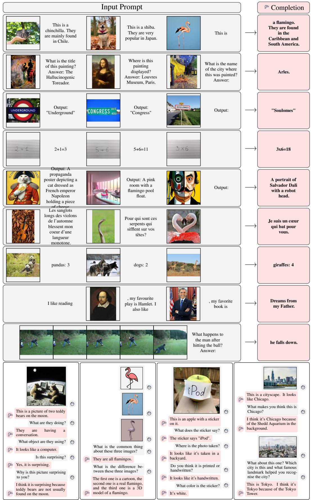
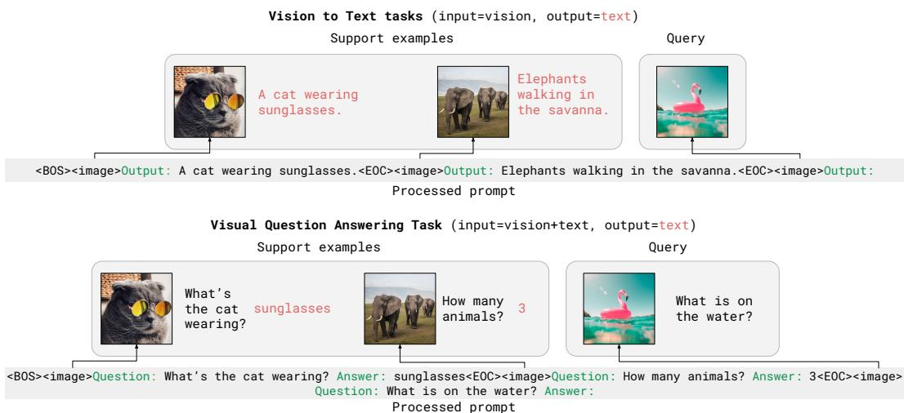
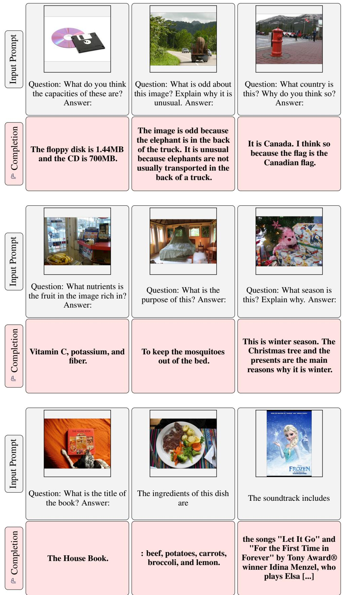
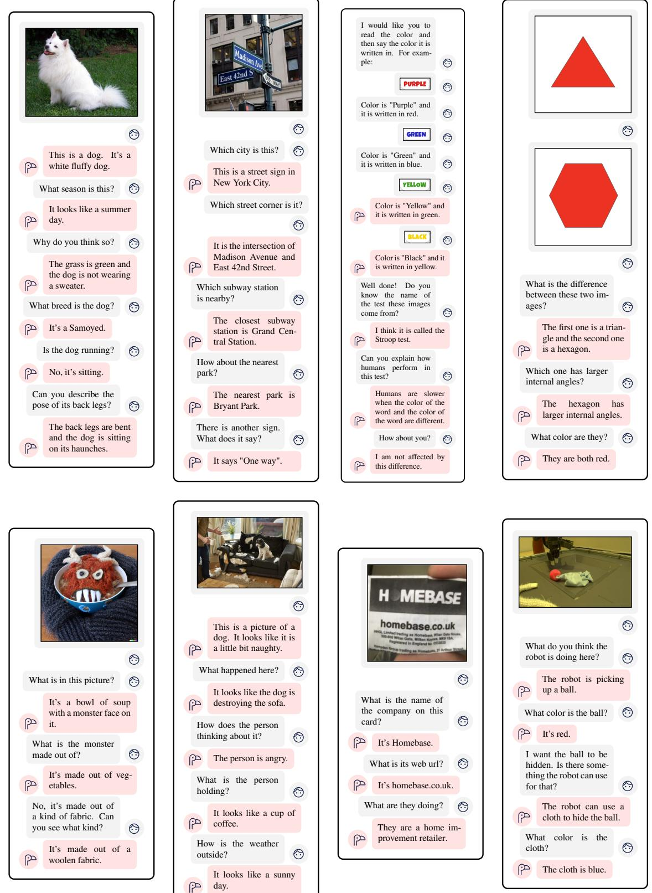
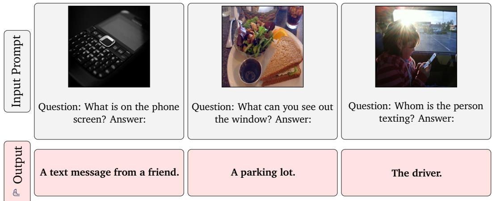

# Flamingo：用于少样本学习的视觉语言模型

Jean-Baptiste Alayrac<sup>\*,‡</sup>　Jeff Donahue<sup>\*</sup>　Pauline Luc<sup>\*</sup>　Antoine Miech<sup>\*</sup>

Iain Barr<sup>†</sup>　Yana Hasson<sup>†</sup>　Karel Lenc<sup>†</sup>　Arthur Mensch<sup>†</sup>　Katie Millican<sup>†</sup>

Malcolm Reynolds<sup>†</sup>　Roman Ring<sup>†</sup>　Eliza Rutherford<sup>†</sup>　Serkan Cabi　Tengda Han

Zhitao Gong　Sina Samangooei

Marianne Monteiro　Jacob Menick

Sebastian Borgeaud　Andrew Brock

Aida Nematzadeh　Sahand Sharifzadeh

Mikolaj Binkowski　Ricardo Barreira

Oriol Vinyals　Andrew Zisserman

Karen Simonyan<sup>\*,‡</sup>

<sup>\*</sup> Equal contributions, ordered alphabetically，<sup>†</sup> Equal contributions, ordered alphabetically，<sup>‡</sup> Equal senior contributions

DeepMind

## 摘要（Abstract）

构建能够仅借助少量标注样本就迅速适应新任务的多模态机器学习模型，是一项公开挑战。我们介绍 Flamingo，一类具备此能力的视觉语言模型（Visual Language Model, VLM）。我们提出了若干关键的架构创新，以实现：(i) 在强大的纯视觉预训练模型与纯语言预训练模型之间架起桥梁；(ii) 处理任意交错排列的视觉与文本序列数据；(iii) 无缝地将图像或视频作为输入进行摄取。得益于其灵活性，Flamingo 模型可在包含任意交错文本与图像的大规模多模态网络语料上进行训练，这对于赋予其上下文少样本学习能力至关重要。我们对所提出的模型进行了全面评估，探索并衡量其在多种图像与视频任务上快速适应的能力。这些任务涵盖诸如视觉问答（visual question-answering）之类的开放型任务——在该任务中，模型被给定一个问题并需作答；描述型任务——评估模型描述一个场景或事件的能力；以及诸如多选视觉问答之类的封闭型任务。对于分布于这一谱系中任意位置的任务，只需以任务专属示例对模型进行提示（prompting），单一的 Flamingo 模型便能借助少样本学习取得新的最先进水平（state of the art）。在众多基准测试上，Flamingo 的表现优于在数量多出数千倍的任务专属数据上微调的模型。

  

图 1：从 Flamingo-80B 获得的精选输入与输出示例。Flamingo 能够通过少样本提示（few-shot prompting）迅速适配多种图像/视频理解任务（上）。此外，开箱即用的 Flamingo 同样能够进行多图像视觉对话（下）。更多示例见附录 C。


  

图 2：Flamingo 结果概览。左侧：我们最大的模型（命名为 Flamingo）在所考察的 16 个任务中的 6 个上，无需任何微调即超越了当前最先进的微调模型。在已发布少样本结果的 9 个任务上，Flamingo 刷新了少样本场景下的最新最优水平。注：我们省略了第 16 个基准 RareAct，因为它是零样本基准，且没有可比较的已发布微调结果。右侧：Flamingo 的性能随模型规模与样本数量的增加而提升。

## 1 引言

智能的一个关键方面是能够根据简短的指令快速学习执行新任务 [33, 70]。虽然计算机视觉领域在实现类似能力方面取得了初步进展，但目前最广泛使用的范式仍然是先在大量有监督数据上进行预训练，然后在目标任务上对模型进行微调 [66, 118, 143]。然而，成功的微调通常需要数千个带标注的数据点。此外，它还需要针对每个任务进行仔细的超参数调整，并且资源消耗很大。最近，通过对比目标（contrastive objective）训练的多模态视觉-语言模型 [50, 85] 使得对新颖任务的零样本适配（zero-shot adaptation）成为可能，无需进行微调。然而，由于这些模型只是简单地提供文本与图像之间的相似度评分，它们只能应对有限的使用场景，例如分类——即事先给出一组有限的结果。它们关键性地缺乏生成语言的能力，这使得它们不太适合更开放的任务，例如图像描述（captioning）或视觉问答（visual question answering）。另有一些研究探索了以视觉为条件的语言生成 [17, 114, 119, 124, 132]，但尚未在低数据场景（low-data regimes）下展示出良好的性能。

我们介绍 Flamingo，一种视觉语言模型（Visual Language Model, VLM），它在广泛的开放式视觉与语言任务的少样本学习（few-shot learning）上创造了新的最先进水平，其方法仅需借助若干输入/输出示例作为提示（prompt），如图 1 所示。在我们所考虑的 16 个任务中，Flamingo 在其中 6 个任务上也超越了经过微调的最先进方法，尽管其使用的任务特定训练数据少了若干数量级（见图 2）。为实现这一点，Flamingo 从近期关于大语言模型（large language models, LMs）的研究中汲取灵感——这些研究表明大语言模型是优秀的少样本学习者 [11, 18, 42, 86]。单个大型语言模型仅凭其文本接口就能在许多任务上取得强劲性能：若干任务示例作为提示连同查询输入一起提供给模型，模型通过生成续文（continuation）来给出该查询的预测输出。我们表明，对于图像与视频理解任务（如分类、字幕生成或问答），同样可以做到这一点：这些任务可以被建模为以视觉输入为条件的文本预测问题。与语言模型的不同之处在于，该模型必须能够摄入由图像和/或视频与文本交错组成的多模态提示（multimodal prompt）。Flamingo 模型具备这一能力——它们是受视觉条件驱动的自回归文本生成模型，能够摄入与图像和/或视频交错的文本标记序列，并输出文本。Flamingo 模型利用了两个互补的、预训练且冻结的模型：一个能够"感知"视觉场景的视觉模型，以及一个执行基础形式推理的大型语言模型。在这两个模型之间，我们加入了新颖的架构组件，以一种保留其在计算密集型预训练过程中所积累知识的方式将它们连接起来。Flamingo 模型还能够处理高分辨率图像或视频，这得益于一种基于 Perceiver [48] 的架构——该架构能够针对每幅图像/每个视频产生数量固定的少量视觉标记（visual tokens），而不受输入视觉特征数量较多且可变的影响。

大语言模型性能的一个关键因素在于它们是在海量文本数据上训练得到的。这种训练赋予了它们通用的生成能力，使其在接受任务示例提示时能够表现良好。类似地，我们证明 Flamingo 模型的训练方式对其最终性能至关重要。它们在经过精心挑选的、互补的大规模多模态数据混合上进行训练，所有数据均仅来自网络，且未使用任何为机器学习目的而标注的数据。经过这一训练阶段后，Flamingo 模型可以通过简单的少样本学习直接适配到视觉任务，无需任何任务特定的微调。

  

图 3：Flamingo 架构概览。Flamingo 是一系列视觉语言模型（Visual Language Models, VLMs），其输入为与文本交错（interleaved）的视觉数据，并以自由形式（free-form）的文本作为输出。

贡献。综上，本文的主要贡献如下：(i) 我们提出了 Flamingo 系列的视觉语言模型（VLMs），该系列模型仅需少量输入/输出示例即可执行多种多模态任务（如图像描述、视觉对话或视觉问答）。得益于架构创新，Flamingo 模型能够高效地接收任意交错排列的视觉数据和文本作为输入，并以开放式方式生成文本。(ii) 我们定量评估了 Flamingo 模型通过少样本学习（few-shot learning）适应各类任务的能力。值得一提的是，我们保留了大量留出（held-out）基准测试集，这些测试集未用于任何设计决策或超参数的验证。我们利用这些基准来估计无偏的少样本性能。(iii) Flamingo 在广泛的 16 项多模态语言以及图像/视频理解任务上的少样本学习中创下新的最先进水平（state of the art）。在其中 6 项任务上，即便仅使用 32 个任务特定示例（所用任务特定训练数据约为当前最先进水平的一千分之一），Flamingo 仍超越了当前经过微调的最先进水平。在拥有更大标注预算时，Flamingo 还可以被有效微调，在另外五个具有挑战性的基准上创下新的最先进水平：VQAv2、VATEX、VizWiz、MSRVTTQA 和 HatefulMemes。

## 2 方法

本节描述 Flamingo：一个以文本（与图像/视频交错排列）作为输入并输出自由形式文本的视觉语言模型。图 3 中所示的关键架构组件经过精心挑选，旨在利用预训练的视觉与语言模型并有效地桥接它们。首先，Perceiver Resampler（第 2.1 节）接收来自视觉编码器（Vision Encoder，从图像或视频中提取）的时空特征，并输出固定数量的视觉 token。其次，这些视觉 token 被用于通过新初始化的跨注意力层（第 2.2 节）对冻结的语言模型（LM）进行条件化，这些跨注意力层被交错插入到预训练 LM 的各层之间。这些新增的层为 LM 提供了一种富于表达力的方式，以便在下一 token 预测任务中融合视觉信息。Flamingo 对以交错图像和视频为条件的文本 $y$ 的似然建模如下：

$$
p (y | x) = \prod_ {\ell = 1} ^ {L} p (y _ {\ell} | y _ {<   \ell}, x _ {\leq \ell}),\tag{1}
$$

其中 $y _ { \ell }$ 是输入文本的第 ℓ 个语言 token，$y _ { < \ell }$ 是其前面的 token 集合，$x _ { < \ell }$ 是在交错序列中位于 token $y _ { \ell }$ 之前的图像/视频集合，$p$ 由 Flamingo 模型参数化。处理交错文本和视觉序列的能力（第 2.3 节）使得自然地将 Flamingo 模型用于上下文少样本学习，类似于使用 GPT-3 进行少样本文本提示。模型在第 2.4 节所述的多样化数据集混合上进行训练。

  

Figure 4: GATED XATTN-DENSE 层。为了使语言模型（LM）以视觉输入为条件，我们在现有预训练且冻结的语言模型层之间插入新的交叉注意力层。这些层中的键（keys）和值（values）来自视觉特征，而查询（queries）源自语言输入。其后接有密集前馈层。这些层采用门控机制，使得语言模型在初始化时保持完整不变，从而提升稳定性和性能。

## 2.1 视觉处理与感知器重采样器（Perceiver Resampler）

视觉编码器：从像素到特征。我们的视觉编码器是一个预训练且冻结的无归一化残差网络（Normalizer-Free ResNet, NFNet）[10]——我们使用 F6 模型。我们在由图像-文本对组成的数据集上使用对比学习目标对视觉编码器进行预训练，采用 Radford 等人 [85] 提出的双项对比损失。我们使用最后一个阶段的输出，即一个被展平为一维序列的二维空间特征网格。对于视频输入，我们以 1 FPS 的帧率抽取帧并独立编码，以获得一个三维时空特征网格，并向其中加入学习得到的时间嵌入。特征在送入感知器重采样器之前被展平为一维。关于对比模型训练及性能的更多细节分别见附录 B.1.3 和附录 B.3.2。

感知器重采样器（Perceiver Resampler）：从可变尺寸的大型特征图到少量视觉令牌。如图 3 所示，该模块将视觉编码器与冻结的语言模型相连接。它以来自视觉编码器的可变数量的图像或视频特征作为输入，并产生固定数量（64）的视觉输出，从而降低视觉-文本交叉注意力的计算复杂度。类似于 Perceiver [48] 和 DETR [13]，我们学习一组数量预定义的潜在输入查询，这些查询被送入一个 Transformer 并与视觉特征进行交叉注意力。我们在消融研究（第 3.3 节）中证明，使用这样的视觉-语言重采样器模块优于普通的 Transformer 和多层感知机（MLP）。我们在附录 A.1.1 中提供了示意图、更多架构细节和伪代码。

## 2.2 在视觉表征上对冻结的语言模型进行条件化

文本生成由一个 Transformer 解码器执行，该解码器以感知器重采样器产生的视觉表征为条件。我们将预训练且冻结的纯文本语言模型块与从零开始训练的块交错排列，这些从零训练的块对感知器重采样器的视觉输出进行交叉注意力。

在冻结的预训练语言模型中交错插入新的门控交叉注意力密集层（GATED XATTN-DENSE layers）。我们冻结预训练的语言模型块，并在原始层之间插入从零开始训练的门控交叉注意力密集块（图 4）。为了在初始化时确保条件模型的输出与原始语言模型相同，我们采用了 tanh 门控机制 [41]。该机制将一个新添加层的输出乘以 tanh(α) 后，再将其与来自残差连接的输入表征相加，其中 α 是一个逐层可学习的标量，初始化为 0 [4]。因此，在初始化时，模型的输出与预训练语言模型的输出相匹配，从而改善了训练稳定性和最终性能。在消融研究（第 3.3 节）中，我们将所提出的门控交叉注意力密集层与近期的其他方案 [22, 68] 进行了比较，并探讨了以何种频率插入这些额外层以在效率和表达能力之间进行权衡的影响。更多细节见附录 A.1.2。

不同模型规模。我们在三种模型规模上进行了实验，基于参数量分别为 1.4B、7B 和 70B 的 Chinchilla 模型 [42] 构建；分别命名为 Flamingo-3B、Flamingo-9B 和 Flamingo-80B。为简洁起见，在全文中我们将其统称为 Flamingo。虽然我们增加了冻结语言模型（frozen LM）以及可训练视觉-文本 GATED XATTN-DENSE 模块的参数数量，但在不同模型之间，我们保持了固定大小的冻结视觉编码器（frozen vision encoder）和可训练的 Perceiver Resampler（相对于完整模型规模而言较小）。更多细节见附录 B.1.1。

## 2.3 多视觉输入支持：逐图像/视频的注意力掩码

公式 (1) 中引入的图像因果建模（image-causal modelling）是通过对完整的文本到图像交叉注意力矩阵进行掩码实现的，限制模型在每个文本标记处能看到哪些视觉标记。在给定的文本标记处，模型只关注在交错序列中恰好出现在它之前的那个图像的视觉标记，而不是关注之前所有的图像（在附录 A.1.3 中给出了形式化定义和示意图）。尽管模型在任意时刻只直接关注单个图像，但通过对语言模型中自注意力（self-attention）的依赖，它仍然保留了对所有先前图像的依赖关系。这种单图像交叉注意力方案的一个重要优点是，它允许模型无缝地泛化到任意数量的视觉输入，而不受训练时所使用数量的限制。具体而言，我们在交错数据集上训练时每个序列最多使用 5 张图像，而我们的模型在评估时能够从多达 32 对（即 "shots"）图像/视频及其对应文本的序列中受益。我们在第 3.3 节中展示了，相较于允许模型直接对所有先前图像进行交叉注意力，这种方案更为有效。

## 2.4 在视觉与语言数据集混合上进行训练

我们在三类数据集的混合上训练 Flamingo 模型，所有数据均从网络爬取得到：源自网页的交错图像与文本数据集、图像-文本对、以及视频-文本对。

M3W：交错的图像与文本数据集。Flamingo 模型的少样本能力依赖于在交错的文本和图像数据上进行训练。为此，我们收集了 MultiModal MassiveWeb（M3W）数据集。我们从大约 4300 万个网页的 HTML 中提取文本和图像，并根据文本和图像元素在文档对象模型（Document Object Model，DOM）中的相对位置，确定图像相对于文本的位置。然后通过在纯文本中图像所在位置插入 `<image>` 标签来构建样本，并在任何图像之前以及文档末尾插入一个特殊的 `<EOC>`（end of chunk，块结束）标记（该标记被加入词汇表并参与学习）。从每个文档中，我们采样一个长度为 $L=256$ 标记的随机子序列，并取该采样序列中包含的最多前 $N=5$ 张图像。为了节省计算量，其余的图像将被丢弃。更多细节见附录 A.3。

图像/视频与文本对。对于图像与文本对，我们首先利用 ALIGN [50] 数据集，该数据集由 18 亿张图像及其替代文本（alt-text）配对组成。为了补充该数据集，我们自建了图像与文本对数据集 LTIP（Long Text & Image Pairs，长文本与图像对），专注于更高质量与更长描述的内容，共包含 3.12 亿个图像与文本对。我们还收集了一个类似的数据集，但使用视频而非静态图像：VTP（Video & Text Pairs，视频与文本对）包含 2700 万个短视频（平均时长约 22 秒）及其句子级描述。我们通过在每条训练描述前添加 <image>、在末尾添加 <EOC>，使这些配对数据集的语法与 M3W 的语法保持一致（详见附录 A.3.3）。

多目标训练与优化策略。我们通过最小化给定视觉输入条件下，每个数据集文本期望负对数似然（negative log-likelihoods）的加权和来训练模型：

$$
\sum_ {m = 1} ^ {M} \lambda_ {m} \cdot \mathbb {E} _ {(x, y) \sim \mathcal {D} _ {m}} \left[ - \sum_ {\ell = 1} ^ {L} \log p (y _ {\ell} | y _ {<   \ell}, x _ {\leq \ell}) \right],\tag{2}
$$

其中 $\mathcal{D}_m$ 和 $\lambda_m$ 分别是第 $m$ 个数据集及其权重。逐数据集权重 $\lambda_m$ 的调节是性能的关键。我们对所有数据集累加梯度，我们发现这优于「轮询（round-robin）」方法 [17]。我们将在附录 B.1.2 中提供进一步的训练细节和消融实验。

## 2.5 通过少样本上下文学习进行任务适配

Flamingo 训练完成后，我们通过给它一个多模态交错提示（multimodal interleaved prompt）来让其处理视觉任务。我们评估我们的模型通过上下文学习快速适配新任务的能力——类似于 GPT-3 [11]——方法是将形式为 $(x_{\text{image}}, x_{\text{text}})$ 的支持示例对交错排列，后面跟查询视觉输入，从而构建一个提示（详见附录 A.2）。我们使用束搜索（beam search）进行解码来完成开放式评估，并使用模型的似然对数（log-likelihood）对每个候选答案进行打分来完成封闭式评估。我们通过向模型提示该任务仅含两个文本示例（无对应图像）来探索零样本泛化能力。评估超参数和更多细节见附录 B.1.5。

<table><tr><td>Method</td></tr><tr><td>FT Shot</td></tr><tr><td>OKVQA (I)</td></tr><tr><td>VQAv2 (I)</td></tr><tr><td>COCO (I)</td></tr><tr><td>MSVDQA (V)</td></tr><tr><td>VATEX (V)</td></tr><tr><td>VizWiz (I)</td></tr><tr><td>Flick30K (I)</td></tr><tr><td>MSRVTTQA (V)</td></tr><tr><td>iVQA (V)</td></tr><tr><td>YouCook2 (V)</td></tr><tr><td>STAR (V)</td></tr><tr><td>VisDial (I)</td></tr><tr><td>TextVQA (I)</td></tr><tr><td>NextQA (I)</td></tr><tr><td>HatefulMemes (I)</td></tr><tr><td>RareAct (V)</td></tr></table>

<table><tr><td rowspan="3">Zero/Few shot SOTA</td><td rowspan="3">X</td><td rowspan="3">(X)</td><td>[34]</td><td>[114]</td><td>[124]</td><td>[58]</td><td></td><td></td><td></td><td>[58]</td><td>[135]</td><td></td><td>[143]</td><td>[79]</td><td></td><td></td><td>[85]</td><td>[85]</td></tr><tr><td>43.3</td><td>38.2</td><td>32.2</td><td>35.2</td><td>-</td><td>-</td><td>-</td><td>19.2</td><td>12.2</td><td>-</td><td>39.4</td><td>11.6</td><td>-</td><td>-</td><td>66.1</td><td>40.7</td></tr><tr><td>(16)</td><td>(4)</td><td>(0)</td><td>(0)</td><td></td><td></td><td></td><td>(0)</td><td>(0)</td><td></td><td>(0)</td><td>(0)</td><td></td><td></td><td>(0)</td><td>(0)</td></tr><tr><td rowspan="3">Flamingo-3B</td><td>X</td><td>0</td><td>41.2</td><td>49.2</td><td>73.0</td><td>27.5</td><td>40.1</td><td>28.9</td><td>60.6</td><td>11.0</td><td>32.7</td><td>55.8</td><td>39.6</td><td>46.1</td><td>30.1</td><td>21.3</td><td>53.7</td><td>58.4</td></tr><tr><td>X</td><td>4</td><td>43.3</td><td>53.2</td><td>85.0</td><td>33.0</td><td>50.0</td><td>34.0</td><td>72.0</td><td>14.9</td><td>35.7</td><td>64.6</td><td>41.3</td><td>47.3</td><td>32.7</td><td>22.4</td><td>53.6</td><td>-</td></tr><tr><td>X</td><td>32</td><td>45.9</td><td>57.1</td><td>99.0</td><td>42.6</td><td>59.2</td><td>45.5</td><td>71.2</td><td>25.6</td><td>37.7</td><td>76.7</td><td>41.6</td><td>47.3</td><td>30.6</td><td>26.1</td><td>56.3</td><td>-</td></tr><tr><td rowspan="3">Flamingo-9B</td><td>X</td><td>0</td><td>44.7</td><td>51.8</td><td>79.4</td><td>30.2</td><td>39.5</td><td>28.8</td><td>61.5</td><td>13.7</td><td>35.2</td><td>55.0</td><td>41.8</td><td>48.0</td><td>31.8</td><td>23.0</td><td>57.0</td><td>57.9</td></tr><tr><td>X</td><td>4</td><td>49.3</td><td>56.3</td><td>93.1</td><td>36.2</td><td>51.7</td><td>34.9</td><td>72.6</td><td>18.2</td><td>37.7</td><td>70.8</td><td>42.8</td><td>50.4</td><td>33.6</td><td>24.7</td><td>62.7</td><td>-</td></tr><tr><td>X</td><td>32</td><td>51.0</td><td>60.4</td><td>106.3</td><td>47.2</td><td>57.4</td><td>44.0</td><td>72.8</td><td>29.4</td><td>40.7</td><td>77.3</td><td>41.2</td><td>50.4</td><td>32.6</td><td>28.4</td><td>63.5</td><td>-</td></tr><tr><td rowspan="3">Flamingo</td><td>X</td><td>0</td><td>50.6</td><td>56.3</td><td>84.3</td><td>35.6</td><td>46.7</td><td>31.6</td><td>67.2</td><td>17.4</td><td>40.7</td><td>60.1</td><td>39.7</td><td>52.0</td><td>35.0</td><td>26.7</td><td>46.4</td><td>60.8</td></tr><tr><td>X</td><td>4</td><td>57.4</td><td>63.1</td><td>103.2</td><td>41.7</td><td>56.0</td><td>39.6</td><td>75.1</td><td>23.9</td><td>44.1</td><td>74.5</td><td>42.4</td><td>55.6</td><td>36.5</td><td>30.8</td><td>68.6</td><td>-</td></tr><tr><td>X</td><td>32</td><td>57.8</td><td>67.6</td><td>113.8</td><td>52.3</td><td>65.1</td><td>49.8</td><td>75.4</td><td>31.0</td><td>45.3</td><td>86.8</td><td>42.2</td><td>55.6</td><td>37.9</td><td>33.5</td><td>70.0</td><td>-</td></tr><tr><td rowspan="3">Pretrained FT SOTA</td><td rowspan="3">√</td><td></td><td>54.4</td><td>80.2</td><td>143.3</td><td>47.9</td><td>76.3</td><td>57.2</td><td>67.4</td><td>46.8</td><td>35.4</td><td>138.7</td><td>36.7</td><td>75.2</td><td>54.7</td><td>25.2</td><td>79.1</td><td></td></tr><tr><td></td><td>[34]</td><td>[140]</td><td>[124]</td><td>[28]</td><td>[153]</td><td>[65]</td><td>[150]</td><td>[51]</td><td>[135]</td><td>[132]</td><td>[128]</td><td>[79]</td><td>[137]</td><td>[129]</td><td>[62]</td><td>-</td></tr><tr><td>(X)</td><td>(10K)</td><td>(444K)</td><td>(500K)</td><td>(27K)</td><td>(500K)</td><td>(20K)</td><td>(30K)</td><td>(130K)</td><td>(6K)</td><td>(10K)</td><td>(46K)</td><td>(123K)</td><td>(20K)</td><td>(38K)</td><td>(9K)</td><td></td></tr></table>

表 1：与现有方法的对比。一个 Flamingo 模型在多种图像（I）和视频（V）理解任务上，仅用少样本（few-shot）学习就达到了当前最优水平，仅用 4 个样本就显著优于此前的零样本（zero-shot）和少样本（few-shot）最优方法。更重要的是，仅使用 32 个样本且不调整任何模型权重，Flamingo 就在七项任务上超越了当前最优方法——后者需要使用数千个标注样本进行微调（fine-tuned）。最优少样本数字以加粗表示，总体最优数字加下划线。

## 3 实验

我们的目标是开发能够快速适应多种多样且具有挑战性任务的模型。为此，我们考虑了 16 个流行的多模态图像/视频与语言基准。在项目过程中，为了验证模型的设计决策，有 5 个基准被用作我们的开发集（DEV）：COCO、OKVQA、VQAv2、MSVDQA 和 VATEX。由于模型选择的缘故，DEV 基准上的性能估计可能存在偏差。我们指出，之前使用类似基准来验证和消融设计决策的工作也存在同样的问题。为了考虑到这一点，我们额外报告了在 11 个基准上的性能，涵盖图像描述、视频问答，以及一些较少被探索的能力，如视觉对话和多选题问答任务。评估基准在附录 B.1.4 中描述。我们在所有基准上保持所有评估超参数固定不变。根据任务的不同，我们使用四种少样本提示模板，在附录 B.1.5 中详细描述。我们强调，我们不会在这 11 个基准上验证任何设计决策，仅用它们来估计模型的无偏少样本学习性能。

具体来说，估计模型的少样本学习性能需要使用一组支持样本（support samples）对其进行提示（prompt），并在一组查询样本（query samples）上进行评估。对于既用于验证设计决策和超参数、又用于报告最终性能的 DEV 基准，我们因此使用四个子集：验证支持集（validation support）、验证查询集（validation query）、测试支持集（test support）和测试查询集（test query）。对于其他基准，我们只需要后两个子集。我们在附录 B.1.4 中说明这些子集是如何构成的。

我们在 3.1 节中报告 Flamingo 模型在少样本学习上的结果。3.2 节给出 Flamingo 微调后的结果。3.3 节给出消融研究。附录 B.2 提供了更多结果，包括 Flamingo 在 ImageNet 和 Kinetics700 分类任务上的表现，以及我们对比模型的性能。附录 C 包含额外的定性结果。

## 3.1 视觉-语言任务上的少样本学习

少样本结果。结果列于表 1 中。在所考察的 16 个基准测试上，Flamingo 大幅领先于所有此前的零样本或少样本方法。这一成绩仅需每任务 4 个样本即可达成，展示了视觉模型对新任务实用而高效的自适应能力。更重要的是，Flamingo 通常可与那些在多达数十万标注样本上额外微调的当前最优方法相抗衡。在六项任务上，尽管仅使用同一组模型权重，且仅采用 32 个任务特定样本，Flamingo 甚至超越了微调后的当前最优方法。

<table><tr><td rowspan="2">Method</td><td colspan="2">VQAV2</td><td rowspan="2">COCO test</td><td rowspan="2">VATEX test</td><td colspan="2">VizWiz</td><td rowspan="2">MSRVTTQA test</td><td colspan="2">VisDial</td><td rowspan="2">YouCook2 valid</td><td rowspan="2">TextVQA valid</td><td rowspan="2">TextVQA test</td><td rowspan="2">HatefulMemes test seen</td></tr><tr><td>test-dev</td><td>test-std</td><td>test-dev</td><td>test-std</td><td>valid</td><td>test-std</td></tr><tr><td>32 shots</td><td>67.6</td><td>-</td><td>113.8</td><td>65.1</td><td>49.8</td><td>-</td><td>31.0</td><td>56.8</td><td>-</td><td>86.8</td><td>36.0</td><td>-</td><td>70.0</td></tr><tr><td>Fine-tuned</td><td>82.0</td><td>82.1</td><td>138.1</td><td>84.2</td><td>65.7</td><td>65.4</td><td>47.4</td><td>61.8</td><td>59.7</td><td>118.6</td><td>57.1</td><td>54.1</td><td>86.6</td></tr><tr><td>SotA</td><td> $81.3^†$ [133]</td><td> $81.3^†$ [133]</td><td> $149.6^†$ [119]</td><td> $81.4^†$ [153]</td><td> $57.2^†$ [65]</td><td> $60.6^†$ [65]</td><td>46.8[51]</td><td>75.2[79]</td><td> $75.4^†$ [123]</td><td>138.7[132]</td><td>54.7[137]</td><td>73.7[84]</td><td> $84.6^†$ [152]</td></tr></table>

表 2：微调 Flamingo 时与当前最优方法（SotA）的对比。我们在 Flamino 未通过少样本学习达到 SotA 的全部九个任务上对 Flamingo 进行了微调。Flamingo 在其中五个任务上刷新了 SotA，超越了那些使用模型集成（model ensembling）或特定领域指标优化（如 CIDEr 优化）等技巧的方法（以 † 标出）。

<table><tr><td></td><td>Ablated setting</td><td>Flamingo-3B original value</td><td>Changed value</td><td>Param. count ↓</td><td>Step time ↓</td><td>COCO CIDEr↑</td><td>OKVQA top1↑</td><td>VQAv2 top1↑</td><td>MSVDQA top1↑</td><td>VATEX CIDEr↑</td><td>Overall score↑</td></tr><tr><td colspan="4">Flamingo-3B model</td><td>3.2B</td><td>1.74s</td><td>86.5</td><td>42.1</td><td>55.8</td><td>36.3</td><td>53.4</td><td>70.7</td></tr><tr><td rowspan="4">(i)</td><td rowspan="4">Training data</td><td rowspan="4">All data</td><td>w/o Video-Text pairs</td><td>3.2B</td><td>1.42s</td><td>84.2</td><td>43.0</td><td>53.9</td><td>34.5</td><td>46.0</td><td>67.3</td></tr><tr><td>w/o Image-Text pairs</td><td>3.2B</td><td>0.95s</td><td>66.3</td><td>39.2</td><td>51.6</td><td>32.0</td><td>41.6</td><td>60.9</td></tr><tr><td>Image-Text pairs→LAION</td><td>3.2B</td><td>1.74s</td><td>79.5</td><td>41.4</td><td>53.5</td><td>33.9</td><td>47.6</td><td>66.4</td></tr><tr><td>w/o M3W</td><td>3.2B</td><td>1.02s</td><td>54.1</td><td>36.5</td><td>52.7</td><td>31.4</td><td>23.5</td><td>53.4</td></tr><tr><td>(ii)</td><td>Optimisation</td><td>Accumulation</td><td>Round Robin</td><td>3.2B</td><td>1.68s</td><td>76.1</td><td>39.8</td><td>52.1</td><td>33.2</td><td>40.8</td><td>62.9</td></tr><tr><td>(iii)</td><td>Tanh gating</td><td>√</td><td>✗</td><td>3.2B</td><td>1.74s</td><td>78.4</td><td>40.5</td><td>52.9</td><td>35.9</td><td>47.5</td><td>66.5</td></tr><tr><td rowspan="2">(iv)</td><td rowspan="2">Cross-attention architecture</td><td rowspan="2">GATED XATTN-DENSE</td><td rowspan="2">VANILLA XATTN GRAFTING</td><td>2.4B</td><td>1.16s</td><td>80.6</td><td>41.5</td><td>53.4</td><td>32.9</td><td>50.7</td><td>66.9</td></tr><tr><td>3.3B</td><td>1.74s</td><td>79.2</td><td>36.1</td><td>50.8</td><td>32.2</td><td>47.8</td><td>63.1</td></tr><tr><td rowspan="3">(v)</td><td rowspan="3">Cross-attention frequency</td><td rowspan="3">Every</td><td>Single in middle</td><td>2.0B</td><td>0.87s</td><td>71.5</td><td>38.1</td><td>50.2</td><td>29.1</td><td>42.3</td><td>59.8</td></tr><tr><td>Every 4th</td><td>2.3B</td><td>1.02s</td><td>82.3</td><td>42.7</td><td>55.1</td><td>34.6</td><td>50.8</td><td>68.8</td></tr><tr><td>Every 2nd</td><td>2.6B</td><td>1.24s</td><td>83.7</td><td>41.0</td><td>55.8</td><td>34.5</td><td>49.7</td><td>68.2</td></tr><tr><td rowspan="2">(vi)</td><td rowspan="2">Resampler</td><td rowspan="2">Perceiver</td><td>MLP</td><td>3.2B</td><td>1.85s</td><td>78.6</td><td>42.2</td><td>54.7</td><td>35.2</td><td>44.7</td><td>66.6</td></tr><tr><td>Transformer</td><td>3.2B</td><td>1.81s</td><td>83.2</td><td>41.7</td><td>55.6</td><td>31.5</td><td>48.3</td><td>66.7</td></tr><tr><td rowspan="2">(vii)</td><td rowspan="2">Vision encoder</td><td rowspan="2">NFNet-F6</td><td>CLIP ViT-L/14</td><td>3.1B</td><td>1.58s</td><td>76.5</td><td>41.6</td><td>53.4</td><td>33.2</td><td>44.5</td><td>64.9</td></tr><tr><td>NFNet-F0</td><td>2.9B</td><td>1.45s</td><td>73.8</td><td>40.5</td><td>52.8</td><td>31.1</td><td>42.9</td><td>62.7</td></tr><tr><td rowspan="2">(viii)</td><td rowspan="2">Freezing LM</td><td rowspan="2">√</td><td>✗ (random init)</td><td>3.2B</td><td>2.42s</td><td>74.8</td><td>31.5</td><td>45.6</td><td>26.9</td><td>50.1</td><td>57.8</td></tr><tr><td>✗ (pretrained)</td><td>3.2B</td><td>2.42s</td><td>81.2</td><td>33.7</td><td>47.4</td><td>31.0</td><td>53.9</td><td>62.7</td></tr></table>

表 3：消融实验。每一行都应与基线 Flamingo 运行（首行）进行比较。Step time 度量在所有训练数据集上执行梯度更新所花费的时间。

最后，尽管我们仅使用 DEV 基准进行设计决策，但我们的结果能够很好地泛化到其他基准，证实了我们方法的通用性。

关于参数与样本数的扩展性。如图 2 所示，模型越大，少样本性能越好，这与 GPT-3 [11] 类似。性能也随着样本数的增加而提升。我们进一步发现，最大的模型能够更好地利用更多的样本数。有趣的是，尽管我们的 Flamingo 模型在 M3W 上训练时序列最多仅包含 5 张图像，但它们在推理时仍能从多达 32 张图像或视频中获益。这展示了 Flamingo 架构在处理可变数量视频或图像方面的灵活性。

## 3.2 将 Flamingo 作为预训练视觉-语言模型进行微调

虽然这并非我们工作的主要重点，但我们验证了在给定更多数据时，Flamingo 模型可以通过微调其权重来适配具体任务。在表 2 中，我们探索了在无标注预算限制的条件下，对我们最大的模型 Flamingo 进行任务级微调。简而言之，我们采用较小的学习率并以较短的训练计划对模型进行微调，同时额外解冻视觉骨干网络以支持更高的输入分辨率（详见附录 B.2.2）。我们发现，相较于先前呈现的上下文少样本学习结果，我们可以在另外五个任务上取得新的最先进水平：VQAv2、VATEX、VizWiz、MSRVTTQA 和 HatefulMemes。

## 3.3 消融实验

在表 3 中，我们报告了使用 Flamingo-3B 在五个 DEV 基准的验证子集上、采用 4 个样本时的消融结果。请注意，与最终模型相比，我们使用了更小的批量大小和更短的训练计划。Overall 分数通过对每个基准的分数除以表 1 中对应的当前最优（SotA）性能后取平均得到。更多细节和结果见附录 B.3 和表 10。

训练数据混合的重要性。如第 (i) 行所示，获取正确的训练数据至关重要。事实上，去除图文交错数据集 M3W 会导致性能下降超过 17%，而去除常规的图文配对数据也会使性能下降（9.8%），这表明了不同类型数据集的必要性。此外，去除我们的视频-文本配对数据集会对所有视频任务的性能产生负面影响。我们通过将图文配对数据（ITP）替换为公开可用的 LAION-400M 数据集 [96] 进行消融，这会导致性能略有下降。我们在第 (ii) 行展示了相对于使用轮询更新（round-robin updates）[17] 而言，我们梯度累积策略的重要性。

视觉条件化与冻结语言模型。我们在第 (iii) 行中消融了在将交叉注意力输出合并到冻结语言模型输出时使用的 0 初始化的 tanh 门控机制。在不使用该门控的情况下，我们的总体得分下降了 4.2%。此外，我们注意到禁用 0 初始化的 tanh 门控会导致训练不稳定。接下来，我们在第 (iv) 行中消融了不同的条件化架构。VANILLA XATTN 指的是原始 Transformer 解码器 [115] 中的标准交叉注意力。在 [68] 的 GRAFTING 方法中，冻结的语言模型按原样使用，不插入额外的层，并从零开始学习一组由自注意力和交叉注意力层交错组成的层，这些层接收冻结语言模型的输出。总体而言，我们表明我们的 GATED XATTN-DENSE 条件化方法效果最佳。

计算/显存与性能的权衡。在第 (v) 行中，我们消融了添加新的 GATED XATTN-DENSE 块的频率。虽然在每一层都添加效果更好，但它显著增加了可训练参数的数量和模型的时间复杂度。值得注意的是，每隔四个块插入一次可以使训练速度加快 66%，而总体得分仅下降 1.9%。考虑到这种权衡，我们在硬件约束下最大化所添加层的数量，在 Flamingo-9B 中每隔四层添加一个 GATED XATTN-DENSE，在 Flamingo-80B 中每隔七层添加一个。我们进一步在第 (vi) 行中将 Perceiver Resampler 与 MLP 以及标准 Transformer 在给定参数预算下进行比较。二者在性能上均逊于 Perceiver Resampler，同时速度也更慢。

视觉编码器。在第 (vii) 行中，我们将通过对比学习预训练的 NFNet-F6 视觉编码器（详见附录 B.1.3）与公开可用的、以 224 分辨率训练的 CLIP ViT-L/14 [85] 模型进行比较。我们的 NFNet-F6 比 CLIP ViT-L/14 高出 +5.8%，比更小的 NFNet-F0 编码器高出 +8.0%，这凸显了使用强大视觉骨干网络的重要性。

冻结语言模型组件可防止灾难性遗忘。我们在第 (viii) 行验证了在训练时冻结语言模型层的重要性。如果从头开始训练，我们观察到性能大幅下降，达到 −12.9%。有趣的是，微调我们预训练的语言模型也会导致性能下降 −8.0%。这表明存在一种"灾难性遗忘"（catastrophic forgetting）[71] 现象，即模型在针对新目标进行训练时逐渐遗忘其预训练内容。在我们的设定中，冻结语言模型是在混合数据中同时使用预训练数据集（MassiveText）进行训练的更好替代方案。

## 4 相关工作

语言建模与少样本适应。自从 Transformer [115] 被提出以来，语言建模最近取得了显著进展。"先在海量数据上进行预训练，再在下游任务上进行适配"这一范式已成为标准做法 [11, 23, 32, 44, 52, 75, 87, 108]。在本工作中，我们以 700 亿参数的 Chinchilla 语言模型 [42] 作为 Flamingo 的基础 LM。许多研究探索了使用少量样本来使语言模型适应新任务的技术，包括添加小型适配器模块 [43]、微调 LM 的一小部分 [141]、在提示中展示上下文样本 [11]，或通过梯度下降优化提示 [56, 60]。在本文中，我们从上下文 [11] 少样本学习技术中汲取灵感，而不是采用基于度量学习 [24, 103, 112, 117] 或元学习 [6, 7, 27, 31, 91, 155] 的更为复杂的少样本学习方法。

当语言遇见视觉。这些 LM 的突破对视觉-语言建模产生了重要影响。特别是 BERT [23] 启发了一大批视觉-语言工作 [16, 28, 29, 38, 59, 61, 66, 101, 106, 107, 109, 118, 121, 142, 143, 151]。我们与这些方法的不同之处在于 Flamingo 模型不需要在新任务上进行微调。另一类视觉-语言模型基于对比学习 [2, 5, 49, 50, 57, 74, 82, 85, 138, 140, 146]。Flamingo 与对比模型的不同之处在于它能够生成文本，尽管我们也构建并依赖于这些模型作为我们的视觉编码器。与我们的工作类似的是能够以自回归方式生成文本的 VLM [19, 25, 45, 67, 116]。同期的工作 [17, 58, 119, 124, 154] 也提出将许多视觉任务形式化为文本生成问题。在强大的预训练语言模型之上构建已经在最近的一些工作中得到了探索。近期的一条工作路线 [26, 68, 78, 114, 136, 144] 提出冻结预训练 LM 的权重以防止灾难性遗忘 [71]。我们遵循这一思路冻结 Chinchilla LM 层 [42]，并在冻结的 LM 内添加可学习的层。我们与先前工作的不同之处在于引入了首个能够接收任意交错图像、视频和文本的 LM。

网络规模的视觉和语言训练数据集。手动标注的视觉和语言数据集获取成本高昂，因此规模相对较小（10k-100k）[3, 15, 69, 122, 129, 139]。为了缓解这种数据不足的问题，许多研究 [14, 50, 98, 110] 自动抓取易于获取的配对视觉-文本数据。除了这种配对数据之外，我们还展示了在包含交错图像和文本的完整多模态网页上作为单个序列进行训练的重要性。同期的工作 CM3 [1] 提出从页面生成 HTML 标记，而我们通过仅生成纯文本来简化文本预测任务。我们强调少样本学习和视觉任务，而 CM3 [1] 主要在零样本或微调设置下评估纯语言基准。

## 5 讨论（Discussion）

局限（Limitations）。第一，我们的模型建立在预训练 LM 之上，并作为副作用直接继承了它们的弱点。例如，LM 先验通常是有帮助的，但可能在偶尔出现的幻觉（hallucinations）和无依据猜测中起到一定作用。此外，LM 对长于训练序列的序列泛化能力较差。它们在训练期间还存在样本效率低的问题。解决这些问题可以推动该领域的进展，并增强诸如 Flamingo 之类的 VLM 的能力。

第二，Flamingo 的分类性能落后于最先进的对比模型 [82, 85]。这些模型直接针对图文检索（text-image retrieval）进行优化，而分类是其中的一个特例。相比之下，我们的模型可处理范围更广的任务，例如开放式任务。一种能够兼采二者之长的统一方法是重要的研究方向。

第三，上下文学习（in-context learning）相对于基于梯度的少样本学习方法具有显著优势，但也存在一些缺点，具体取决于所面临的应用特点。当可用的样本仅限于几十个时，我们证明了上下文学习的有效性。上下文学习还支持简单的部署，仅需推理即可，一般无需超参数调优。然而，众所周知，上下文学习对演示样本的多个方面高度敏感 [80, 148]，且在此低数据（low-data）范围之外，其推理计算开销和绝对性能随样本数（shots）的增加而表现不佳。可能存在将少样本学习方法加以组合以利用其互补优势的机会。我们在附录 D.1 中更深入地讨论了我们工作的局限性。

社会影响（Societal impacts）。在社会影响方面，Flamingo 带来了一系列益处，同时也伴随着一些风险。它能够快速适应广泛的任务，有潜力使非专家用户在数据匮乏的场景下获得良好的性能，从而降低有益和恶意应用两方面的门槛。Flamingo 暴露在与大语言模型相同的风险之下，例如输出冒犯性语言、传播社会偏见和刻板印象，以及泄露隐私 [42, 122]。其额外处理视觉输入的能力带来了特定风险，例如与输入图像内容相关的性别和种族偏见，这与多种视觉识别系统类似 [12, 21, 37, 97, 147]。我们请读者参阅附录 D.2，以更广泛地讨论我们工作的社会影响（积极的和消极的），以及缓解策略和针对种族或性别偏见及有害输出的风险的初步研究。最后，我们注意到，借鉴先前聚焦于语言模型的工作 [72, 81, 111]，Flamingo 的少样本能力可能有助于缓解此类风险。

结论. 我们提出了 Flamingo，一个通用模型家族，仅需极少量的任务特定训练数据即可应用于图像和视频任务。我们还定性探索了 Flamingo 的交互能力，例如与模型进行「聊天」，展示了超越传统视觉基准测试的灵活性。我们的结果表明，将预训练的大型语言模型与强大的视觉模型相连接，是迈向通用视觉理解的重要一步。

致谢与资助披露. 本研究由 DeepMind 资助。我们要感谢众多同事的有益讨论、建议、反馈和指导，包括：Samuel Albanie、Relja Arandjelovic、Kareem Ayoub、Lorrayne Bennett、Adria Recasens Continente、Tom Eccles、Nando de Freitas、Sander Dieleman、Conor Durkan、Aleksa Gordic、Raia Hadsell、Will Hawkins、Lisa Anne Hendricks、Felix Hill、Jordan Hoffmann、Geoffrey Irving、Drew Jaegle、Koray Kavukcuoglu、Agustin Dal Lago、Mateusz Malinowski、Sona Mokrá、Gaby Pearl、Toby Pohlen、Jack Rae、Laurent Sifre、Francis Song、Maria Tsimpoukelli、Gregory Wayne 和 Boxi Wu。

## 参考文献

[2] Jean-Baptiste Alayrac, Adria Recasens, Rosalia Schneider, Relja Arandjelovic, Jason Ramapuram, Jeffrey De Fauw, Lucas Smaira, Sander Dieleman, and Andrew Zisserman. 自监督多模态多功能网络。神经信息处理系统大会，2020。

[3] Stanislaw Antol, Aishwarya Agrawal, Jiasen Lu, Margaret Mitchell, Dhruv Batra, C. Lawrence Zitnick, and Devi Parikh. VQA：视觉问答。载于 国际计算机视觉大会，2015。

[4] Thomas Bachlechner, Bodhisattwa Prasad Majumder, Henry Mao, Gary Cottrell, and Julian McAuley. ReZero 就是你所需要的一切：在大深度下的快速收敛。载于 人工智能中的不确定性会议，2021。

[5] Max Bain, Arsha Nagrani, Gül Varol, and Andrew Zisserman. 冻结于时间：用于端到端检索的联合视频与图像编码器。载于 国际计算机视觉大会，2021。

[6] Luca Bertinetto, João F. Henriques, Jack Valmadre, Philip Torr, and Andrea Vedaldi. 学习前馈式单样本学习器。神经信息处理系统大会，2016。

[7] Luca Bertinetto, Joao F. Henriques, Philip H. S. Torr, and Andrea Vedaldi. 基于可微闭式求解器的元学习。arXiv:1805.08136，2018。

[9] John S. Bridle. 前馈分类网络输出的概率解释及其与统计模式识别的关系（Probabilistic interpretation of feedforward classification network outputs, with relationships to statistical pattern recognition）. 载于《Neurocomputing》，1990年。

[10] Andrew Brock, Soham De, Samuel L. Smith, and Karen Simonyan. 无需归一化的高性能大规模图像识别（High-performance large-scale image recognition without normalization）. arXiv:2102.06171，2021年。

[12] Joy Buolamwini and Timnit Gebru. 性别阴影：商业性别分类中的交叉性准确率差异（Gender shades: Intersectional accuracy disparities in commercial gender classification）. 载于ACM公平性、问责制与透明度会议（ACM Conference on Fairness, Accountability, and Transparency），2018年。

[13] Nicolas Carion, Francisco Massa, Gabriel Synnaeve, Nicolas Usunier, Alexander Kirillov, and Sergey Zagoruyko. 基于Transformer的端到端目标检测（End-to-end object detection with transformers）. 载于欧洲计算机视觉会议（European Conference on Computer Vision），2020年。

[14] Soravit Changpinyo, Piyush Sharma, Nan Ding, and Radu Soricut. Conceptual 12M：将网络规模图像-文本预训练推向识别长尾视觉概念（Conceptual 12M: Pushing web-scale image-text pre-training to recognize long-tail visual concepts）. 载于IEEE计算机视觉与模式识别会议（IEEE Computer Vision and Pattern Recognition），2021年。

[16] Yen-Chun Chen, Linjie Li, Licheng Yu, Ahmed El Kholy, Faisal Ahmed, Zhe Gan, Yu Cheng, and Jingjing Liu. UNITER：通用图文表示学习（UNITER: Universal image-text representation learning）. 载于欧洲计算机视觉会议（European Conference on Computer Vision），2020年。

[17] Jaemin Cho, Jie Lei, Hao Tan, and Mohit Bansal. 通过文本生成统一视觉与语言任务（Unifying vision-and-language tasks via text generation）. 载于国际机器学习大会（International Conference on Machine Learning），2021年。

[19] Wenliang Dai, Lu Hou, Lifeng Shang, Xin Jiang, Qun Liu, and Pascale Fung. 通过视觉-语言知识蒸馏在 CLIP 上实现多模态生成。发表于 ACL Findings，2022年。

[20] Abhishek Das, Satwik Kottur, Khushi Gupta, Avi Singh, Deshraj Yadav, José MF Moura, Devi Parikh, and Dhruv Batra. 视觉对话。发表于 IEEE 计算机视觉与模式识别会议，2017年。

[21] Terrance De Vries, Ishan Misra, Changhan Wang, and Laurens Van der Maaten. 目标识别对每个人都有效吗？发表于 IEEE 计算机视觉与模式识别会议，2019年。

[22] Karan Desai and Justin Johnson. VirTex：从文本标注中学习视觉表征。发表于 IEEE 计算机视觉与模式识别会议，2021年。

[23] Jacob Devlin, Ming-Wei Chang, Kenton Lee, and Kristina Toutanova. BERT：用于语言理解的深度双向变换器预训练。arXiv:1810.04805，2018年。

[24] Carl Doersch, Ankush Gupta, and Andrew Zisserman. CrossTransformers：具有空间感知能力的少样本迁移。神经信息处理系统会议，2020年。

[25] Jeffrey Donahue, Lisa Anne Hendricks, Sergio Guadarrama, Marcus Rohrbach, Subhashini Venugopalan, Kate Saenko, and Trevor Darrell. 用于视觉识别与描述的长时循环卷积网络。发表于 IEEE 计算机视觉与模式识别会议，2015年。

[26] Constantin Eichenberg, Sidney Black, Samuel Weinbach, Letitia Parcalabescu, and Anette Frank. MAGMA：通过基于适配器的微调实现生成模型的多模态增强。arXiv:2112.05253，2021年。

[27] Chelsea Finn, Pieter Abbeel, and Sergey Levine. 用于深度网络快速适应的模型无关元学习。发表于国际机器学习大会，2017年。

[28] Tsu-Jui Fu, Linjie Li, Zhe Gan, Kevin Lin, William Yang Wang, Lijuan Wang, and Zicheng Liu. VIOLET：端到端视频-语言 Transformer 及其掩码视觉 token 建模。arXiv:2111.12681, 2021.

[29] Zhe Gan, Yen-Chun Chen, Linjie Li, Chen Zhu, Yu Cheng, and Jingjing Liu. 面向视觉-语言表征学习的大规模对抗训练。收录于：神经信息处理系统大会，2020.

[31] Jonathan Gordon, John Bronskill, Matthias Bauer, Sebastian Nowozin, and Richard E. Turner. 用于预测的元学习概率推断。arXiv:1805.09921, 2018.

[32] Alex Graves. 利用循环神经网络生成序列。arXiv:1308.0850, 2013.

[33] Thomas L. Griffiths, Frederick Callaway, Michael B. Chang, Erin Grant, Paul M. Krueger, and Falk Lieder. 以少博多：人类与机器中的元推理与元学习。当代行为科学观点，2019.

[34] Liangke Gui, Borui Wang, Qiuyuan Huang, Alex Hauptmann, Yonatan Bisk, and Jianfeng Gao. KAT：面向视觉-语言的知识增强 Transformer。arXiv:2112.08614, 2021.

[35] Danna Gurari, Qing Li, Abigale J. Stangl, Anhong Guo, Chi Lin, Kristen Grauman, Jiebo Luo, and Jeffrey P. Bigham. VizWiz 大挑战：回答盲人的视觉问题。收录于：IEEE 计算机视觉与模式识别会议，2018.

[36] Adi Haviv, Ori Ram, Ofir Press, Peter Izsak, and Omer Levy. 不使用位置编码的 Transformer 语言模型仍能学习位置信息。arXiv:2203.16634, 2022.

[37] Lisa Anne Hendricks, Kaylee Burns, Kate Saenko, Trevor Darrell, and Anna Rohrbach. 女性也单板滑雪：克服字幕生成模型中的偏见。收录于：欧洲计算机视觉会议，2018.

[38] Lisa Anne Hendricks, John Mellor, Rosalia Schneider, Jean-Baptiste Alayrac, and Aida Nematzadeh. 解耦多模态 Transformer 中数据、注意力与损失的作用。计算语言学协会年度大会，2021.

[39] Dan Hendrycks and Kevin Gimpel. 高斯误差线性单元（GELU）。arXiv:1606.08415, 2016.

[40] Tom Hennigan, Trevor Cai, Tamara Norman, and Igor Babuschkin. Haiku：JAX 版本的 Sonnet，2020。网址 http://github.com/deepmind/dm-haiku。

[41] Sepp Hochreiter and Jürgen Schmidhuber. 长短期记忆网络。神经计算，1997.

[43] Neil Houlsby, Andrei Giurgiu, Stanislaw Jastrzebski, Bruna Morrone, Quentin De Laroussilhe, Andrea Gesmundo, Mona Attariyan, and Sylvain Gelly. 参数高效迁移学习用于自然语言处理（Parameter-efficient transfer learning for NLP）. 发表于：国际机器学习大会（International Conference on Machine Learning），2019年.

[44] Jeremy Howard and Sebastian Ruder. 用于文本分类的通用语言模型微调（Universal language model fine-tuning for text classification）. arXiv:1801.06146，2018年.

[45] Xiaowei Hu, Zhe Gan, Jianfeng Wang, Zhengyuan Yang, Zicheng Liu, Yumao Lu, and Lijuan Wang. 扩大视觉-语言预训练规模用于图像描述生成（Scaling up vision-language pre-training for image captioning）. arXiv:2111.12233，2021年.

[46] Lun Huang, Wenmin Wang, Jie Chen, and Xiao-Yong Wei. 注意力之上的注意力用于图像描述生成（Attention on attention for image captioning）. 发表于：国际计算机视觉大会（International Conference on Computer Vision），2019年.

[47] Md Amirul Islam, Matthew Kowal, Sen Jia, Konstantinos G. Derpanis, and Neil D. B. Bruce. 全局池化，远不止所见：位置信息在卷积神经网络中按通道编码（Global pooling, more than meets the eye: Position information is encoded channel-wise in CNNs）. 发表于：国际计算机视觉大会（International Conference on Computer Vision），2021年.

[48] Andrew Jaegle, Felix Gimeno, Andy Brock, Oriol Vinyals, Andrew Zisserman, and Joao Carreira. Perceiver：通过迭代注意力实现通用感知（Perceiver: General perception with iterative attention）. 发表于：国际机器学习大会（International Conference on Machine Learning），2021年.

[50] Chao Jia, Yinfei Yang, Ye Xia, Yi-Ting Chen, Zarana Parekh, Hieu Pham, Quoc V. Le, Yun-Hsuan Sung, Zhen Li, and Tom Duerig. 利用含噪文本监督扩大视觉及视觉-语言表征学习规模（Scaling up visual and vision-language representation learning with noisy text supervision）. arXiv:2102.05918，2021年.

[51] Alex Jinpeng Wang, Yixiao Ge, Rui Yan, Yuying Ge, Xudong Lin, Guanyu Cai, Jianping Wu, Ying Shan, Xiaohu Qie, and Mike Zheng Shou. 一统天下：探索统一的视频-语言预训练（All in one: Exploring unified video-language pre-training）. arXiv:2203.07303，2022年.

[52] Rafal Jozefowicz, Oriol Vinyals, Mike Schuster, Noam Shazeer, and Yonghui Wu. 探索语言建模的极限（Exploring the limits of language modeling）. arXiv:1602.02410，2016年.

[54] Douwe Kiela, Hamed Firooz, Aravind Mohan, Vedanuj Goswami, Amanpreet Singh, Pratik Ringshia, and Davide Testuggine. 仇恨表情包挑战赛：在多模态表情包中检测仇恨言论（The Hateful Memes Challenge: Detecting hate speech in multimodal memes）. 发表于：神经信息处理系统大会（Conference on Neural Information Processing Systems），2020年.

[55] Hugo Larochelle. 通过循环利用深度学习实现少样本分类（Few-shot classification by recycling deep learning）. ICLR 2021 S2D-OLAD 工作组邀请报告（Invited Talk at the S2D-OLAD Workshop, ICLR 2021），2021年. URL https://slideslive.com/38955350/ fewshot-classification-by-recycling-deep-learning.

[56] Brian Lester, Rami Al-Rfou, and Noah Constant. 参数高效提示调优中规模的力量（The power of scale for parameter-efficient prompt tuning）. arXiv:2104.08691，2021年.

[57] Junnan Li、Ramprasaath Selvaraju、Akhilesh Gotmare、Shafiq Joty、Caiming Xiong、Steven Chu Hong Hoi。先对齐后融合：基于动量蒸馏的视觉与语言表征学习。发表于 2021 年神经信息处理系统大会。

[58] Junnan Li、Dongxu Li、Caiming Xiong、Steven Hoi。BLIP：用于统一视觉-语言理解与生成的引导式语言-图像预训练。arXiv:2201.12086, 2022。

[59] Linjie Li、Yen-Chun Chen、Yu Cheng、Zhe Gan、Licheng Yu、Jingjing Liu。HERO：用于视频+语言全表征预训练的层次化编码器。arXiv:2005.00200, 2020。

[60] Xiang Lisa Li、Percy Liang。前缀微调：优化用于生成的连续提示。arXiv:2101.00190, 2021。

[61] Xiujun Li、Xi Yin、Chunyuan Li、Pengchuan Zhang、Xiaowei Hu、Lei Zhang、Lijuan Wang、Houdong Hu、Li Dong、Furu Wei、Yejin Choi、Jianfeng Gao。Oscar：面向视觉-语言任务的物体-语义对齐预训练。发表于 2020 年欧洲计算机视觉大会。

[62] Phillip Lippe、Nithin Holla、Shantanu Chandra、Santhosh Rajamanickam、Georgios Antoniou、Ekaterina Shutova、Helen Yannakoudakis。用于仇恨表情包检测的多模态框架。arXiv:2012.12871, 2020。

[63] Jiachang Liu、Dinghan Shen、Yizhe Zhang、Bill Dolan、Lawrence Carin、Weizhu Chen。什么样的样本是 GPT-3 的良好上下文示例？arXiv:2101.06804, 2021。

[64] Siqi Liu、Zhenhai Zhu、Ning Ye、Sergio Guadarrama、Kevin Murphy。使用策略梯度方法优化图像描述指标。发表于 2017 年国际计算机视觉大会。

[65] Yu Liu、Lianghua Huang、Liuyihang Song、Bin Wang、Yingya Zhang、Pan Pan。强化多模态 Transformer 中用于视觉问答的文本线索。VizWiz Challenge 2021, 2021。

[66] Jiasen Lu、Dhruv Batra、Devi Parikh、Stefan Lee。ViLBERT：面向视觉与语言任务的与任务无关的视觉语言表征预训练。神经信息处理系统大会, 2019。

[67] Huaishao Luo、Lei Ji、Botian Shi、Haoyang Huang、Nan Duan、Tianrui Li、Jason Li、Taroon Bharti、Ming Zhou。UniVL：用于多模态理解与生成的统一视频与语言预训练模型。arXiv:2002.06353, 2020。

[68] Ziyang Luo、Yadong Xi、Rongsheng Zhang、Jing Ma。VC-GPT：用于端到端生成式视觉与语言预训练的视觉条件化 GPT。arXiv:2201.12723, 2022。

[69] Kenneth Marino、Mohammad Rastegari、Ali Farhadi、Roozbeh Mottaghi。OK-VQA：需要外部知识的视觉问答基准。发表于 2019 年 IEEE 计算机视觉与模式识别大会。

[70] Ellen M. Markman。儿童范畴化与命名：归纳问题。MIT Press, 1989。

[71] Michael McCloskey、Neil J. Cohen。连接主义网络中的灾难性干扰：序列学习问题。The Psychology of Learning and Motivation, 1989。

[72] Jacob Menick, Maja Trebacz, Vladimir Mikulik, John Aslanides, Francis Song, Martin Chadwick, Mia Glaese, Susannah Young, Lucy Campbell-Gillingham, Geoffrey Irving, and Nat McAleese. 教语言模型用已验证的引文支撑回答. arXiv:2203.11147，2022 年.

[73] Antoine Miech, Jean-Baptiste Alayrac, Ivan Laptev, Josef Sivic, and Andrew Zisserman. RareAct：一个包含非常规交互的视频数据集. arXiv:2008.01018，2020 年.

[74] Antoine Miech, Jean-Baptiste Alayrac, Lucas Smaira, Ivan Laptev, Josef Sivic, and Andrew Zisserman. 从未经整理的教学视频中端到端学习视觉表征. 发表于 IEEE 计算机视觉与模式识别会议，2020 年.

[75] Tomas Mikolov, Martin Karafiát, Lukas Burget, Jan Cernocky, and Sanjeev Khudanpur. 基于循环神经网络的语言模型. Interspeech，2010 年.

[76] Sewon Min, Xinxi Lyu, Ari Holtzman, Mikel Artetxe, Mike Lewis, Hannaneh Hajishirzi, and Luke Zettlemoyer. 重新思考示例的作用：是什么让上下文学习有效？arXiv:2202.12837，2022 年.

[77] Margaret Mitchell, Simone Wu, Andrew Zaldivar, Parker Barnes, Lucy Vasserman, Ben Hutchinson, Elena Spitzer, Inioluwa Deborah Raji, and Timnit Gebru. 用于模型报告的模型卡. 发表于 ACM 公平性、问责制与透明度会议，2019 年.

[78] Ron Mokady, Amir Hertz, and Amit H. Bermano. ClipCap：用于图像描述的 CLIP 前缀. arXiv:2111.09734，2021 年.

[79] Vishvak Murahari, Dhruv Batra, Devi Parikh, and Abhishek Das. 视觉对话的大规模预训练：一个简洁的最强基线. 发表于欧洲计算机视觉会议，2020 年.

[80] Ethan Perez, Douwe Kiela, and Kyunghyun Cho. 真正的少样本语言模型学习. 神经信息处理系统大会，2021 年.

[81] Ethan Perez, Saffron Huang, Francis Song, Trevor Cai, Roman Ring, John Aslanides, Amelia Glaese, Nat McAleese, and Geoffrey Irving. 用语言模型对语言模型进行红队对抗测试. arXiv:2202.03286，2022 年.

[82] Hieu Pham, Zihang Dai, Golnaz Ghiasi, Hanxiao Liu, Adams Wei Yu, Minh-Thang Luong, Mingxing Tan, and Quoc V. Le. 零样本迁移学习的组合缩放. arXiv:2111.10050，2021 年.

[83] Ofir Press, Noah Smith, and Mike Lewis. 短训练长测试：带线性偏置的注意力支持输入长度外推. 发表于国际学习表征会议，2022 年.

[84] Yixuan Qiao, Hao Chen, Jun Wang, Yihao Chen, Xianbin Ye, Ziliang Li, Xianbiao Qi, Peng Gao, and Guotong Xie. TextVQA Challenge 2021 冠军团队 Mia：基于预训练序列到序列模型的视觉-语言表征学习. arXiv:2106.15332，2021 年.

[85] Alec Radford, Jong Wook Kim, Chris Hallacy, Aditya Ramesh, Gabriel Goh, Sandhini Agarwal, Girish Sastry, Amanda Askell, Pamela Mishkin, Jack Clark, Gretchen Krueger, and Ilya Sutskever. 从自然语言监督中学习可迁移的视觉模型. arXiv:2103.00020，2021 年.

[87] Colin Raffel, Noam Shazeer, Adam Roberts, Katherine Lee, Sharan Narang, Michael Matena, Yanqi Zhou, Wei Li, 与 Peter J. Liu. 利用统一的文本到文本 Transformer 探索迁移学习的极限. arXiv:1910.10683, 2019.

[88] Samyam Rajbhandari, Jeff Rasley, Olatunji Ruwase, 与 Yuxiong He. ZeRO：面向万亿参数模型训练的内存优化. 载于 International Conference for High Performance Computing, Networking, Storage and Analysis, 2020.

[89] Aditya Ramesh, Prafulla Dhariwal, Alex Nichol, Casey Chu, 与 Mark Chen. 使用 CLIP 潜变量的分层文本条件图像生成. arXiv:2204.06125, 2022.

[90] Steven J. Rennie, Etienne Marcheret, Youssef Mroueh, Jarret Ross, 与 Vaibhava Goel. 面向图像描述的自批判序列训练. 载于 IEEE Computer Vision and Pattern Recognition, 2017.

[91] James Requeima, Jonathan Gordon, John Bronskill, Sebastian Nowozin, 与 Richard E. Turner. 使用条件神经自适应过程实现快速灵活的多任务分类. 载于 Conference on Neural Information Processing Systems, 2019.

[92] Laria Reynolds 与 Kyle McDonell. 大语言模型的提示编程：超越少样本范式. 载于 Extended Abstracts of the 2021 CHI Conference on Human Factors in Computing Systems, 2021.

[93] Rachel Rudinger, Jason Naradowsky, Brian Leonard, 与 Benjamin Van Durme. 指代消解中的性别偏见. arXiv:1804.09301, 2018.

[98] Piyush Sharma, Nan Ding, Sebastian Goodman, and Radu Soricut. Conceptual Captions：一个用于自动图像描述的清洗后的、上位词化的图像替代文本数据集（Conceptual Captions: A cleaned, hypernymed, image alt-text dataset for automatic image captioning）。载于：*Annual Meeting of the Association for Computational Linguistics*，2018。

[99] Mohammad Shoeybi, Mostofa Patwary, Raul Puri, Patrick LeGresley, Jared Casper, and Bryan Catanzaro. Megatron-LM：使用模型并行训练数十亿参数的语言模型（Megatron-LM: Training multi-billion parameter language models using model parallelism）。*arXiv:2104.08691*，2019。

[102] Lucas Smaira, João Carreira, Eric Noland, Ellen Clancy, Amy Wu, and Andrew Zisserman. 关于 Kinetics-700-2020 人类动作数据集的简短说明（A short note on the Kinetics-700-2020 human action dataset）。*arXiv:2010.10864*，2020。

[103] Jake Snell, Kevin Swersky, and Richard Zemel. 用于少样本学习的原型网络（Prototypical networks for few-shot learning）。*Conference on Neural Information Processing Systems*，2017。

[104] David R So, Wojciech Manke, Hanxiao Liu, Zihang Dai, Noam Shazeer, and Quoc V. Le. Primer：搜索用于语言建模的高效 Transformer（Primer: Searching for efficient transformers for language modeling）。*arXiv:2109.08668*，2021。

[105] Emma Strubell, Ananya Ganesh, and Andrew McCallum. 深度学习在自然语言处理中的能耗与政策考量。arXiv:1906.02243, 2019.

[106] Weijie Su, Xizhou Zhu, Yue Cao, Bin Li, Lewei Lu, Furu Wei, and Jifeng Dai. VL-BERT：通用视觉-语言表示的预训练。arXiv:1908.08530, 2019.

[107] Chen Sun, Austin Myers, Carl Vondrick, Kevin Murphy, and Cordelia Schmid. VideoBERT：用于视频与语言表示学习的联合模型。载于：国际计算机视觉大会（International Conference on Computer Vision），2019.

[108] Ilya Sutskever, James Martens, and Geoffrey E. Hinton. 利用循环神经网络生成文本。载于：国际机器学习大会（International Conference on Machine Learning），2011.

[109] Hao Tan and Mohit Bansal. LXMERT：基于 Transformer 学习跨模态编码器表示。载于：自然语言处理实证方法大会（Conference on Empirical Methods in Natural Language Processing），2019.

[112] Yonglong Tian, Yue Wang, Dilip Krishnan, Joshua B. Tenenbaum, and Phillip Isola. 重新思考小样本图像分类：好的嵌入就足够了？载于：欧洲计算机视觉大会（European Conference on Computer Vision），2020.

[113] Hugo Touvron, Andrea Vedaldi, Matthijs Douze, and Hervé Jégou. 修正训练-测试分辨率差异。神经信息处理系统大会（Conference on Neural Information Processing Systems），2019.

[114] Maria Tsimpoukelli, Jacob Menick, Serkan Cabi, SM Eslami, Oriol Vinyals, and Felix Hill. 基于冻结语言模型的多模态小样本学习。神经信息处理系统大会（Conference on Neural Information Processing Systems），2021.

[115] Ashish Vaswani, Noam Shazeer, Niki Parmar, Jakob Uszkoreit, Llion Jones, Aidan N. Gomez, Łukasz Kaiser, and Illia Polosukhin. Attention is all you need（注意力机制就够了）。载于：神经信息处理系统大会（Conference on Neural Information Processing Systems），2017.

[116] Oriol Vinyals, Alexander Toshev, Samy Bengio, and Dumitru Erhan. 看图说话：一种神经图像描述生成器（Show and tell: A neural image caption generator）. 收录于：国际计算机视觉大会（International Conference on Computer Vision），2015年.

[117] Oriol Vinyals, Charles Blundell, Timothy Lillicrap, Koray Kavukcuoglu, and Daan Wierstra. 匹配网络用于单样本学习（Matching networks for one shot learning）. 神经信息处理系统大会（Conference on Neural Information Processing Systems），2016年.

[118] Jianfeng Wang, Xiaowei Hu, Zhe Gan, Zhengyuan Yang, Xiyang Dai, Zicheng Liu, Yumao Lu, and Lijuan Wang. UFO：用于视觉-语言表征学习的统一Transformer（UFO: A unified transformer for vision-language representation learning）. arXiv:2111.10023，2021年.

[119] Peng Wang, An Yang, Rui Men, Junyang Lin, Shuai Bai, Zhikang Li, Jianxin Ma, Chang Zhou, Jingren Zhou, and Hongxia Yang. 通过简单的序列到序列学习框架统一架构、任务与模态（Unifying architectures, tasks, and modalities through a simple sequence-to-sequence learning framework）. arXiv:2202.03052，2022年.

[120] Thomas Wang, Adam Roberts, Daniel Hesslow, Teven Le Scao, Hyung Won Chung, Iz Beltagy, Julien Launay, and Colin Raffel. 哪种语言模型架构与预训练目标最适合零样本泛化？（What language model architecture and pretraining objective work best for zero-shot generalization?） arXiv:2204.05832，2022年.

[121] Wenhui Wang, Hangbo Bao, Li Dong, and Furu Wei. VLMo：基于模态专家混合的统一视觉-语言预训练（VLMo: Unified vision-language pre-training with mixture-of-modality-experts）. arXiv:2111.02358，2021年.

[122] Xin Wang, Jiawei Wu, Junkun Chen, Lei Li, Yuan-Fang Wang, and William Yang Wang. VATEX：一个面向视频与语言研究的大规模高质量多语言数据集（VATEX: A large-scale, high-quality multilingual dataset for video-and-language research）. 收录于：国际计算机视觉大会（International Conference on Computer Vision），2019年.

[123] Yue Wang, Shafiq Joty, Michael Lyu, Irwin King, Caiming Xiong, and Steven Hoi. VD-BERT：基于BERT的统一视觉与对话Transformer（VD-BERT: A unified vision and dialog transformer with BERT）. 收录于：自然语言处理经验方法会议（Conference on Empirical Methods in Natural Language Processing），2020年.

[124] Zirui Wang, Jiahui Yu, Adams Wei Yu, Zihang Dai, Yulia Tsvetkov, and Yuan Cao. SimVLM：基于弱监督的简单视觉语言模型预训练（SimVLM: Simple visual language model pretraining with weak supervision）. arXiv:2108.10904，2021年.

[125] Jason Wei, Maarten Bosma, Vincent Y. Zhao, Kelvin Guu, Adams Wei Yu, Brian Lester, Nan Du, Andrew M. Dai, and Quoc V. Le. 微调后的语言模型是零样本学习者（Finetuned language models are zero-shot learners）. arXiv:2109.01652，2021年.

[127] Mitchell Wortsman, Gabriel Ilharco, Samir Yitzhak Gadre, Rebecca Roelofs, Raphael Gontijo Lopes, Ari S. Morcos, Hongseok Namkoong, Ali Farhadi, Yair Carmon, Simon Kornblith, and Ludwig Schmidt. 模型汤：对多个微调模型的权重进行平均可在不增加推理时间的前提下提升精度（Model soups: averaging weights of multiple fine-tuned models improves accuracy without increasing inference time）. arXiv:2203.05482，2022年.

[128] Bo Wu, Shoubin Yu, Zhenfang Chen, Joshua B. Tenenbaum, and Chuang Gan. STAR：面向真实世界视频的情境推理基准. 载于 Conference on Neural Information Processing Systems, 2021.

[129] Junbin Xiao, Xindi Shang, Angela Yao, and Tat-Seng Chua. Next-QA：问答的下一阶段——解释时序动作. 载于 IEEE Conference on Computer Vision and Pattern Recognition, 2021.

[130] Dejing Xu, Zhou Zhao, Jun Xiao, Fei Wu, Hanwang Zhang, Xiangnan He, and Yueting Zhuang. 通过对外观与运动逐步精化注意力的视频问答. 载于 ACM Multimedia, 2017.

[131] Hanwei Xu, Yujun Chen, Yulun Du, Nan Shao, Yanggang Wang, Haiyu Li, and Zhilin Yang. Zeroprompt：将基于提示的预训练扩展到 1,000 个任务以提升零样本泛化能力. arXiv:2201.06910, 2022.

[132] Hu Xu, Gargi Ghosh, Po-Yao Huang, Prahal Arora, Masoumeh Aminzadeh, Christoph Feichtenhofer, Florian Metze, and Luke Zettlemoyer. VLM：面向视频理解的与任务无关的视频-语言模型预训练. arXiv:2105.09996, 2021.

[134] Shen Yan, Xuehan Xiong, Anurag Arnab, Zhichao Lu, Mi Zhang, Chen Sun, and Cordelia Schmid. 用于视频识别的多视角 Transformer. arXiv:2201.04288, 2022.

[135] Antoine Yang, Antoine Miech, Josef Sivic, Ivan Laptev, and Cordelia Schmid. 只管问：从数百万个旁白视频中学习回答问题. 载于 International Conference on Computer Vision, 2021.

[136] Zhengyuan Yang, Zhe Gan, Jianfeng Wang, Xiaowei Hu, Yumao Lu, Zicheng Liu, and Lijuan Wang. GPT-3 在少样本知识型视觉问答中的实证研究. 载于 AAAI Conference on Artificial Intelligence, 2021.

[137] Zhengyuan Yang, Yijuan Lu, Jianfeng Wang, Xi Yin, Dinei Florencio, Lijuan Wang, Cha Zhang, Lei Zhang, and Jiebo Luo. TAP：面向文本视觉问答与文本描述的文本感知预训练. 载于 IEEE Conference on Computer Vision and Pattern Recognition, 2021.

[138] Lewei Yao, Runhui Huang, Lu Hou, Guansong Lu, Minzhe Niu, Hang Xu, Xiaodan Liang, Zhenguo Li, Xin Jiang, and Chunjing Xu. FILIP：细粒度交互式语言-图像预训练. arXiv:2111.07783, 2021.

[139] Peter Young, Alice Lai, Micah Hodosh, and Julia Hockenmaier. 从图像描述到视觉指称：面向事件描述语义推理的新相似度度量. 载于 Annual Meeting of the Association for Computational Linguistics, 2014.

[141] Elad Ben Zaken, Shauli Ravfogel, and Yoav Goldberg. BitFit: 基于 Transformer 的掩码语言模型的简单参数高效微调. arXiv:2106.10199, 2021.

[142] Rowan Zellers, Ximing Lu, Jack Hessel, Youngjae Yu, Jae Sung Park, Jize Cao, Ali Farhadi, and Yejin Choi. MERLOT: 多模态神经脚本知识模型. 神经信息处理系统大会, 2021.

[143] Rowan Zellers, Jiasen Lu, Ximing Lu, Youngjae Yu, Yanpeng Zhao, Mohammadreza Salehi, Aditya Kusupati, Jack Hessel, Ali Farhadi, and Yejin Choi. MERLOT reserve: 通过视觉、语言和声音的神经脚本知识. 发表于 IEEE 计算机视觉与模式识别会议, 2022.

[145] Xiaohua Zhai, Alexander Kolesnikov, Neil Houlsby, and Lucas Beyer. 视觉 Transformer 的规模化. arXiv:2106.04560, 2021.

[146] Xiaohua Zhai, Xiao Wang, Basil Mustafa, Andreas Steiner, Daniel Keysers, Alexander Kolesnikov, and Lucas Beyer. LiT: 通过锁定图像文本调优的零样本迁移. arXiv:2111.07991, 2021.

[147] Dora Zhao, Angelina Wang, and Olga Russakovsky. 理解与评估图像描述中的种族偏见. 发表于 IEEE 计算机视觉与模式识别会议, 2021.

[148] Zihao Zhao, Eric Wallace, Shi Feng, Dan Klein, and Sameer Singh. 使用前校准: 提升语言模型的少样本性能. 发表于国际机器学习大会, 2021.

[149] Luowei Zhou, Chenliang Xu, and Jason J. Corso. 从网络教学视频中自动学习操作流程. 发表于全国人工智能会议 (AAAI), 2018.

[150] Luowei Zhou, Hamid Palangi, Lei Zhang, Houdong Hu, Jason Corso, and Jianfeng Gao. 面向图像描述与视觉问答的统一视觉-语言预训练. 发表于全国人工智能会议 (AAAI), 2020.

[151] Linchao Zhu and Yi Yang. ActBERT: 学习全局-局部视频-文本表示. 发表于 IEEE 计算机视觉与模式识别会议, 2020.

[152] Ron Zhu. 利用外部标签与领域内预训练增强多模态 Transformer: 仇恨表情包挑战赛获奖方案. arXiv:2012.08290, 2020.

[153] Xinxin Zhu, Longteng Guo, Peng Yao, Shichen Lu, Wei Liu, and Jing Liu. Vatex 视频描述挑战赛 2020: 多视图特征与混合奖励策略用于视频描述. arXiv:1910.11102, 2019.

[154] Xizhou Zhu, Jinguo Zhu, Hao Li, Xiaoshi Wu, Xiaogang Wang, Hongsheng Li, Xiaohua Wang, and Jifeng Dai. Uni-Perceiver：面向零样本（zero-shot）与少样本（few-shot）任务的通用感知统一架构预训练。arXiv:2112.01522, 2021.

[155] Luisa Zintgraf, Kyriacos Shiarli, Vitaly Kurin, Katja Hofmann, and Shimon Whiteson. 通过元学习实现快速上下文适应。载于：International Conference on Machine Learning, 2019.

## 清单

1. 对于所有作者……

(a) 摘要和引言中所作的主要声明是否准确反映了论文的贡献与范围？[是]

(b) 是否描述了本工作的局限性？[是] 参见第 5 节。

(c) 是否讨论了本工作可能产生的负面社会影响？[是] 简要讨论见第 5 节，完整讨论见附录 D.2。

(d) 是否已阅读伦理审查指南并确保论文符合这些要求？[是]

2. 如果包含理论结果……

(a) 是否陈述了所有理论结果的完整假设集？[不适用]

(b) 是否给出了所有理论结果的完整证明？[不适用]

3. 如果进行了实验……

(a) 是否提供了复现主要实验结果所需的代码、数据和说明（无论在补充材料中还是以 URL 形式）？[否] 代码与数据为专有资产。

(b) 是否说明了所有训练细节（例如数据划分、超参数及其选取方式）？[是] 参见第 3 节与附录 B。

(c) 是否报告了误差条（例如针对随机种子在多次运行实验后的情况）？[否] 在我们的训练运行中并未观察到足够大的方差，不足以证明多次训练运行所带来的计算开销是合理的。对于最大的模型而言，在我们当前的计算预算内也无法实现。

(d) 是否包含了总计算量以及所用资源类型（例如 GPU 类型、内部集群或云服务商）？[是] 详细信息可见附录 B.1.2。简言之，我们最大的一次运行使用了 1536 块 TPU 芯片训练了 15 天。

4. 如果使用了现有资产（例如代码、数据、模型），或正在整理/发布新资产……

(a) 如果你的工作使用了现有资产，是否引用了其创建者？[是] 我们已恰当引用了所基于的先前方法，以及在适当情况下的先前数据集（例如 ALIGN）。

(b) 是否说明了资产的许可协议？[不适用] 我们使用的资产是先前工作，我们已引用了相应论文。我们在附录 G 中说明了论文图片所使用的所有视觉资产的许可协议。

(c) 是否在补充材料中或以 URL 形式提供了任何新资产？[否]

(d) 是否讨论了是否以及如何获得数据所涉及人员的同意？[是] 我们的数据是通过自动方式从数百万个网页上抓取的。参见附录 F 中的 Datasheets [30]。

(e) 你是否讨论了正在使用/整理的数据是否包含个人可识别信息或冒犯性内容？[是] 详见附录 F 中的 Datasheets [30]。

5. 如果你使用了众包或以人类受试者进行了研究……

(a) 你是否包括了提供给参与者的完整指示文本以及相关截图（如适用）？[不适用]

(b) 你是否描述了任何潜在的参与者风险，并附上机构审查委员会（IRB）的批准链接（如适用）？[不适用]

(c) 你是否包括了支付给参与者的估计时薪以及参与者补偿的总支出？[不适用]

## 附录

我们在下方提供附录的概览。

方法（附录 A）。我们在附录 A.1 中首先提供关于模型的更多细节：

• Perceiver Resampler（在第 2.1 节描述）的示意图和伪代码见附录 A.1.1 和图 5。

• 第 2.2 节中 GATED XATTN-DENSE 层的类似示意图见附录 A.1.2 和图 4。

• 多图像/视频注意力机制（第 2.3 节）的实现细节见附录 A.1.3。

• 所有模型架构的超参数见附录 A.1.4。

然后我们在附录 A.2 中解释如何使用上下文少量样本学习来评估我们的模型。其中包括关于如何构建少样本提示、如何获得开放式和封闭式任务的预测、如何获得零样本结果，以及如何利用检索和集成来使用更多标注样本的细节。

最后，在附录 A.3 中，我们提供有关训练数据集的更多细节：

• M3W 的收集见附录 A.3.1，

• 训练期间如何处理 M3W 样本见附录 A.3.2，

• LTIP 和 VTP 的收集见附录 A.3.3，

• 我们所采用的去重策略，以确保训练和评估数据集之间没有泄漏，见附录 A.3.4。

实验（附录 B）。我们在附录 B.1 中首先提供额外的训练和评估细节，包括：

• Flamingo-3B、Flamingo-9B 和 Flamingo 的细节见附录 B.1.1，

• 训练超参数见附录 B.1.2，

• 关于对比模型预训练的更多细节见附录 B.1.3，

• 评估基准和划分细节见附录 B.1.4，

• 关于少样本学习超参数的讨论见附录 B.1.5，

• 图 1 和图 11 中所示定性对话示例所使用的对话提示见附录 B.1.6。

接下来，我们在附录 B.2 中给出由我们的模型获得的额外结果，包括 Flamingo 模型在分类任务上的表现（附录 B.2.1）、详细微调结果（附录 B.2.2）以及来自我们对比模型的零样本结果（附录 B.2.3）。

最后，我们在附录 B.3 中为 Flamingo 模型（附录 B.3.1）和我们对比预训练的视觉编码器（附录 B.3.2）提供更多的消融研究。

定性结果（附录 C）。附录 C 中给出了更多定性结果：图 10（单图像样本）、图 11（对话示例）和图 12（视频示例）。

讨论（附录 D）。我们在附录 D 中对工作进行了更全面的讨论，包括局限性、失败案例、更广泛的影响以及社会影响。

模型卡片（附录 E）。Flamingo 模型卡片见附录 E。

数据说明书（附录 F）。M3W、LTIP 和 VTP 的数据说明书分别见附录 F.1、附录 F.2.1 和附录 F.2.2。

视觉素材致谢（附录 G）。我们在附录 G 中提供了论文中使用的所有视觉插图的署名信息。

  

图 5：Perceiver Resampler 模块将视觉编码器（Vision Encoder）输出的可变大小的时空视觉特征网格映射到固定数量的输出 token（图示中为五个），且该映射与输入图像分辨率或输入视频帧数无关。该 Transformer 以一组可学习的潜向量作为查询（query），键（key）和值（value）则由时空视觉特征与可学习的潜向量拼接而成。

## A 方法

## A.1 模型细节

## A.1.1 感知器重采样器（Perceiver Resampler）

在第 2.1 节简要描述的基础上，图 5 给出了我们的感知器重采样器处理一段示例视频的示意图以及相应的伪代码。我们的感知器重采样器在思想层面与 Jaegle 等人 [48] 所提出的感知器（Perceiver）模型相似。我们学习一组预定数量的潜在输入查询，并对展平的视觉特征 $X _ { f } .$ 进行交叉注意力。这些视觉特征 $X _ { f }$ 是通过对给定视频帧内的每个特征添加一个可学习的时间位置编码得到的（其中图像被视为单帧视频）。需要注意的是，我们仅使用时间编码，而不使用显式的空间网格位置编码；我们并未观察到后者带来性能提升。这背后的原因可能是，像我们使用的 NFNet 编码器这样的卷积神经网络，已知会在通道维度上隐式地包含空间信息 [47]。随后，视觉特征按照图 5 所示进行展平和拼接。感知器重采样器输出标记的数量等于可学习潜在查询的数量。与 DETR 和感知器中做法不同的是，由可学习潜在向量计算得到的键和值会与由 $X _ { f }$ 得到的键和值进行拼接，我们发现这样做效果略好。

## A.1.2 门控交叉注意力稠密层（GATED XATTN-DENSE）细节

我们在图 4 中给出了一个门控交叉注意力稠密层（GATED XATTN-DENSE）模块以及其如何与一个冻结的语言模型块相连接的示意图，并附有相应的伪代码。

我们还在图 6 中绘制了 tanh 门控值的绝对值随训练进度（从 0% 到 100%）的变化曲线，对象为由 24 层语言模型层组成的 Flamingo-3B 模型中语言模型堆叠的不同层。冻结语言模型堆叠中的所有层似乎都在利用视觉信息，因为 tanh 门控的绝对值从其初始的 0 值迅速增大。我们还注意到，这些绝对值似乎随着网络深度的增加而增大。然而，仅凭这一观察难以得出强有力的结论：门控之前的激活规模也可能随深度而变化。

  

(a) 注意力 tanh 门控

  

(b) FFW tanh 门控

  

图 6：Flamingo-3B 模型不同层中 tanh 门控（tanh gating）绝对值的演化过程。

图 7：交错排列的视觉数据与文本支持。对于与图像/视频交错的文本（例如来自网页的内容），我们首先在文本中视觉数据所处的位置插入 <image> 标签以及特殊标记（<BOS> 表示"序列起始 / beginning of sequence"，<EOC> 表示"块结束 / end of chunk"），以此处理文本。图像由视觉编码器（Vision Encoder）和 Perceiver Resampler 独立处理，以提取视觉标记。在某个给定的文本标记处，模型仅对该标记之前的最后一个图像/视频所对应的视觉标记进行交叉注意力（cross-attention）。� 表示该文本标记可注意力到的图像/视频，当前方没有图像/视频时则为 0。在实际实现中，这种选择性交叉注意力通过掩码（masking）机制实现——图中以深蓝色条目（未掩码 / 可见）与浅蓝色条目（已掩码）加以示意。

未来工作仍需进一步理解这些新增层对优化动力学以及模型本身的影响。

## A.1.3 多视觉输入支持

我们在图 7 中展示了所采用的掩码（masking）方法，该方法用于限制某个文本标记所能看到的视觉标记数量。我们还形式化了用于交错图像/视频与文本序列的符号表示。

视觉数据与文本的交错序列。我们考虑图像/视频与文本的交错示例：每个示例包含一段文本序列 �、一段图像/视频序列 �，以及图像在文本中出现的位置序列。基于视觉数据的位置，我们定义函数 $\phi : [ 1 , L ] \mapsto [ 0 , N ]$，将每个文本位置映射到该位置之前出现的最后一张图像/视频的索引（若该位置之前未出现视觉数据则映射为 0）。函数 � 决定了我们在公式 (1) 中用于预测标记 ℓ 时所考虑的视觉输入集合：前序标记集合 $y _ { < \ell } \triangleq \left( y _ { 1 } , \dots , y _ { \ell - 1 } \right)$，以及前序图像/视频集合 $x _ { \leq \ell } \triangleq \{ x _ { i } | i \leq \phi ( \ell ) \}$。

## A.1.4 Transformer 架构

我们在表 4 中列出了 Flamingo 模型各 Transformer 组件所使用的层数（�）、隐藏维度（�）、头数（�）以及前馈激活函数（Act.）。各配置中键（key）与值（value）的维度为 �/�（Perceiver Resampler 为 96；GATED XATTN-DENSE 以及冻结的语言模型均为 128），每个前馈层的隐藏维度为

<table><tr><td rowspan="2"></td><td colspan="4">Perceiver Resampler</td><td colspan="4">GATED XATTN-DENSE</td><td colspan="4">Frozen LM</td></tr><tr><td>L</td><td>D</td><td>H</td><td>Act.</td><td>L</td><td>D</td><td>H</td><td>Act.</td><td>L</td><td>D</td><td>H</td><td>Act.</td></tr><tr><td>Flamingo-3B</td><td>6</td><td>1536</td><td>16</td><td>Sq. ReLU</td><td>24</td><td>2048</td><td>16</td><td>Sq. ReLU</td><td>24</td><td>2048</td><td>16</td><td>GeLU</td></tr><tr><td>Flamingo-9B</td><td>6</td><td>1536</td><td>16</td><td>Sq. ReLU</td><td>10</td><td>4096</td><td>32</td><td>Sq. ReLU</td><td>40</td><td>4096</td><td>32</td><td>GeLU</td></tr><tr><td>Flamingo</td><td>6</td><td>1536</td><td>16</td><td>Sq. ReLU</td><td>12</td><td>8192</td><td>64</td><td>Sq. ReLU</td><td>80</td><td>8192</td><td>64</td><td>GeLU</td></tr></table>

表 4：Flamingo 模型 Transformer 的超参数。每个前馈 MLP 的隐藏层大小为 4<sup>P</sup>。L：层数，D：Transformer 隐藏层大小，H：注意力头数，Act.：前馈激活函数，Sq. ReLU：平方 ReLU [104]。

  

图 8：少样本交错提示生成。给定一些任务特定的少样本示例（亦称支持示例）以及 Flamingo 需要进行预测的查询，我们通过将图像与对应的文本交错排列来构建提示。为此我们引入了一些格式化操作：对所有视觉到文本的任务，在期望响应前加上 "Output:"；对于视觉问答任务，则采用 "Question: {question} Answer: {answer}" 的格式进行提示。

MLP 维度为 4�。注意，冻结的语言模型使用 GeLU 激活函数 [39] 训练，而其余可训练的 Transformer 层使用 Squared ReLU 激活函数 [104]，我们发现后者表现优于 GeLU。

## A.2 上下文少样本评估细节

上下文学习与 Flamingo 模型。我们按照与 GPT-3 [11] 中类似的方法，评估我们的模型通过上下文学习快速适应新任务的能力。具体而言，我们给定一组支持样本，其形式为 (�����, ����) 或 (�����, ����)（其中 ����� 或 ����� 是输入的视觉信息，���� 是期望的响应以及任何额外的任务相关信息，例如一个问题），以及单个视觉查询，我们希望模型对其进行预测。给定这些输入，我们通过将支持样本与视觉查询拼接在一起来构建多模态提示，如图 8 所示。除非另有说明，我们随机选择拼接顺序。

开放式与封闭式评估。在开放式设置中，模型在查询图像之后采样的文本被视为其对该图像的预测，并在首次预测出 <EOC>（"end of chunk"，即"块结束"）标记时停止。除非另有说明，我们始终使用束宽为 3 的束搜索（beam search）。在封闭式设置中，所有可能的输出被独立地附加到查询图像之后，我们使用模型估计的对数似然对每个生成的序列进行评分。这些评分随后用于按置信度从高到低的顺序对候选输出进行排序。

  

图 9：训练数据集。不同格式的训练数据集混合。� 对应单个示例的视觉输入数量。对于成对的图像（或视频）和文本数据集，� = 1。� 是视频帧数（对于图像，� = 1）。�、� 和 � 分别是高度、宽度和颜色通道数。

零样本泛化。在缺乏少样本示例的情况下，方法通常依赖提示工程（prompt engineering）[85]，通过合适的任务自然语言描述在推理时对模型进行条件化。此类提示的验证会显著影响性能，但需要访问大量标注样本，因此不能被视为真正的零样本。此外，Perez 等人 [80] 已经表明，在验证期间仅能访问少量样本时，此类验证程序通常并不鲁棒。为了在我们的工作中报告零样本性能，我们转而构建一个包含来自下游任务的两个示例的提示，并将它们对应的图像或视频移除。例如，对于图 8 顶部所示的任务，提示将是 "<BOS>Output: This is a cat wearing sunglasses.<EOC>Output: Three elephants walking in the savanna.<EOC><image> Output:"，并且不会向模型输入任何支持图像。我们观察到，在提示中仅展示一个而非两个文本示例是高度有害的，因为模型会偏向于生成与所提供的单个文本示例相似的文本输出。提供多于两个文本示例会有所帮助，但收益甚微。因此，为了实用性，我们在所有零样本结果中均使用两个文本示例。在实践中，我们认为这并不比为给定任务寻找一个合适的自然文本描述更繁琐。这与 [76] 关于演示中哪些方面是性能关键驱动因素的近期发现相一致。对于封闭式任务，即我们使用模型对不同候选答案进行打分的场景，我们观察到在零样本提示中无需提供任何文本示例。

基于检索的上下文示例选择（Retrieval-based In-Context Example Selection）[136]。当支持集（support set）的规模超过一定限度时，就难以利用上下文学习（in-context learning）中的所有示例：首先，因为将所有示例都放入提示（prompt）中会变得过于昂贵；其次，当提示长度超过训练时使用的序列长度时，存在泛化能力下降的风险 [83]。在这种情况下，使用某种形式的提示选择（prompt selection）既可以限制序列长度，又有可能提升提示质量，从而带来更好的性能 [63]。具体而言，我们遵循 [136] 所提出的基于检索的上下文示例选择（RICES）方法。详细地说，给定一张查询图像，我们通过比较从冻结的预训练视觉编码器提取的视觉特征，在支持集中检索相似图像。然后，我们将最相似的 top-� 个示例拼接起来构建提示。由于语言模型会因近因偏差（recency bias）[148] 而对提示中的顺序敏感，我们按相似度递增的方式排列示例，使得最相似的支持示例正好出现在查询之前。我们在具有数百个类别的分类场景中显著展示了该方法的有效性（见附录 B.2.1），其中每个类别给定一张或多张图像/视频，得到的示例数量原本无法全部放入提示中。

提示集成（Prompt ensembling）。我们还在封闭选项（close-ended）设定下探索对多个提示的模型输出进行集成。这尤其可以与 RICES 结合使用，其中可以对排序后的最近邻的多种排列进行集成。具体而言，对于给定答案，我们将模型在所选少样本示例的 6 种随机排列上估计的对数似然（log likelihood）进行平均。

## A.3 训练数据集细节

我们在图 9 所示并在下文描述的一个精心挑选的数据集组合上训练 Flamingo 模型。

## A.3.1 M3W 语料库

M3W 的网页选取与抓取过程遵循与收集 MassiveWeb 数据集 [86] 所用过程类似的方式。我们先过滤掉非英语文档，再移除未通过内部过滤器的文档，这些过滤器用于识别图像、视频和文本中的显式内容（explicit content）。我们使用自定义的抓取工具从剩余文档中提取显著内容，其形式为与图像交错排列的纯文本，如第 2.4 节所述。M3W 中文本的收集方式与 MassiveWeb 类似，但我们还会收集 HTML 树中同一层级上的所有图像。对于抓取过程未产生任何图像的文档，我们予以丢弃。

我们随后应用类似的文本过滤启发式规则，以剔除低质量文档并降低重复度，同时也采用一些图像过滤手段，去除过小的图像（宽度或高度任一小于 64 像素）、过宽或过窄的图像（任一方向长宽比大于 3），以及明确低质量的图像（例如单色图像）。经过这一过滤步骤后，我们丢弃不再包含任何图像的文档。

## A.3.2 M3W 图像放置数据增强（M3W image-placement augmentation）

在对 Flamingo 模型进行评测时，我们向模型提供一张图像并要求它为该图像生成文本。这在推理时自然形成了一种序列结构：图像出现在对应文本输出之前。

然而，在我们交错的 M3W 数据集（第 2.4 节）中，图像与文本之间的对应关系通常是未知的（并且在某些情况下可能并没有良定义的对应）。作为一个启发性示例，一个简单的网页可能按以下任一方式组织：

（a）这是我的狗！<狗的图像> 这是我的猫！<猫的图像>

（b）<狗的图像> 那是我的狗！<猫的图像> 那是我的猫！

与文本对齐的图像索引（indices）"理想上"应当被选定为：在文本的每个位置，该索引指向与该文本语义上最相关的图像——即在示例（a）中指向下一张图像，在示例（b）中指向上一张图像。在缺乏一种通用方法能够"在野外"网页上确定文本与图像之间的语义对应的情况下，我们做一个简化的假设：在文本中的任意位置，最相关的图像要么是出现在该文本标记之前的最后一张图像，要么是紧随其后的下一张图像（如上述简单示例所示），并据此选择索引。

在训练时，对于每个采样的网页，我们以概率 $\begin{array} { r } { p _ { n e x t } = \frac { 1 } { 2 } } \end{array}$ 采样决定索引是选择将文本映射到上一张图像还是下一张图像。这意味着不可避免地，我们在大约一半的时间里会做出语义上"不自然"的选择——例如，在上述示例（a）中将文本"这是我的猫！"与狗的图像关联起来。我们在第 3.3 节中对此选择进行了消融实验，发现将 $\begin{array} { r } { p _ { n e x t } = \frac { 1 } { 2 } } \end{array}$ 设置为 0（总是选择上一张图像的索引）或 1（总是选择下一张图像的索引）相比有小幅优势。这表明这种随机化可能产生一种有益的"数据增强"效果。

## A.3.3 LTIP 与 VTP：与文本配对的视觉数据（LTIP and VTP: Visual data paired with text）

除了我们的图文交错（interleaved）数据集之外，训练中还使用了多个视觉与文本配对的网页数据集。其中一个数据集是 ALIGN [50]，由 18 亿张与替代文本（alt-text）配对的图像组成。ALIGN 规模庞大，但噪声较多，且仅包含图像，其图像常常无法被对应的 alt-text 标注准确描述。因此，我们用另外两个数据集加以扩充：LTIP（Long Text & Image Pairs，长文本与图像对）由 3.12 亿张图像组成，VTP（Video & Text Pairs，视频与文本对）由 2700 万个短视频（平均时长约 22 秒）组成。这两个数据集均配有描述性更强的字幕。例如，ALIGN 数据集中每张图像对应的文本描述平均包含 12.4 个词元（token），而 LTIP 数据集平均包含 20.5 个词元。LTIP 和 VTP 数据集是通过抓取不超过十个以高质量、内容丰富的图像描述为目标的网站采集而来的。这些单图像和单视频数据集的预处理方式与前述 M3W 数据预处理类似：在序列开头（紧接 <BOS> 之后）添加 <image> 标签，并在文本之后（<EOS> 之前）添加 <EOC> 词元。我们使用图像相似度将这些数据集与所有基准（包括训练集和评估集）进行了去重处理，具体细节见附录 A.3.4。LTIP 和 VTP 的数据卡（datasheet）分别见附录 F.2.1 和附录 F.2.2。

<table><tr><td rowspan="2"></td><td rowspan="2">Requires model sharding</td><td colspan="2">Frozen</td><td colspan="2">Trainable</td><td rowspan="2">Total count</td></tr><tr><td>Language</td><td>Vision</td><td>GATED XATTN-DENSE</td><td>Resampler</td></tr><tr><td>Flamingo-3B</td><td>✘</td><td>1.4B</td><td>435M</td><td>1.2B (every)</td><td>194M</td><td>3.2B</td></tr><tr><td>Flamingo-9B</td><td>✘</td><td>7.1B</td><td>435M</td><td>1.6B (every 4th)</td><td>194M</td><td>9.3B</td></tr><tr><td>Flamingo</td><td>✓</td><td>70B</td><td>435M</td><td>10B (every 7th)</td><td>194M</td><td>80B</td></tr></table>

表 5：Flamingo 模型的参数量。我们专注于增大冻结语言模型（frozen LM）以及可训练视觉-文本 GATED XATTN-DENSE 模块的参数量，同时在不同的模型中保持冻结视觉编码器和可训练 Resampler 的参数量固定且较小。GATED XATTN-DENSE 相对于原始语言模型模块的频率在括号中给出。

## A.3.4 针对评测任务的数据集去重

我们使用了一个内部去重工具，将训练数据集与评测数据集进行去重。该去重流程依赖于一个训练好的视觉编码器，当图像可能是潜在重复时，它会将它们的嵌入映射到更近的位置。在计算出图像嵌入之后，对训练图像执行一次快速的近似最近邻搜索，从验证数据集中检索重复候选。对于配对的图文数据集，我们将 LTIP 和 ALIGN 训练图像与以下数据集进行了去重：ImageNet（train、val）、COCO（train、valid、test）、OK-VQA（train、valid、test）、VQAv2（train、valid、test）、Flickr30k（train、valid、test）、VisDial（train、valid、test）。

我们没有将图像数据集与 VizWiz、HatefulMemes 和 TextVQA 进行去重，因为我们在训练完 Flamingo 模型之后才进行了这些评测。然而，我们认为这不会对我们的结果产生影响，因为来自这些数据集的图像不太可能是从网络上抓取得到的：VizWiz 图像是通过一个特定的移动应用获取并仅供下载，HatefulMemes 的表情包是由研究人员创建的而非从网络上抓取，TextVQA 图像则来自 OpenImages。

需要说明的是，我们没有在 M3W 数据集上运行去重，因为一个训练样本是一整个网页，其中包含多张图像的交错段落，不太可能包含来自我们基准套件的图像。为了验证这一假设，我们对 M3W 中的 1.85 亿张独立图像获取了近似重复统计数据，结果如下：在 ImageNet、COCO、OK-VQA、VQAv2、Flickr30k 和 VisDial 的验证与测试划分中，总共发现了 1314 个潜在重复。在这 1314 个候选中，只有 125 个是完全重复的。

对于视频数据集，我们没有对 VTP（2700 万视频）进行任何去重，因为所收集的 VTP 视频没有来自 YouTube 或 Flickr，而这两个来源正是我们从互联网上收集的所有视频评测数据集的来源。

## B 实验

## B.1 训练与评测细节

## B.1.1 模型

我们在三种模型规模上开展实验，其中冻结语言模型的规模从 1.4B 扩展到 7B 和 70B；并据此调整其他组件的参数数量。在所有实验中，我们保持预训练视觉编码器冻结，并使用一个对比训练的 NFNet-F6 模型（见附录 B.1.3），除非在消融研究中另有明确说明。在三种模型规模下，我们都使用一个参数约 200M 的 Perceiver Resampler。

如何交错插入 GATED XATTN-DENSE 层的数量，主要取决于内存约束与下游性能之间的权衡。我们先在小模型规模上确定最优权衡点，再将结论迁移到大型模型架构上。

我们得到三个模型，Flamingo-3B、Flamingo-9B 和 Flamingo-80B，详情如下：

• Flamingo-3B 模型基于 [42] 中 1.4B 的冻结语言模型构建。在每个 transformer 块之前，我们添加一个 GATED XATTN-DENSE 层来关注视觉输入；这带来了 1.4B 的额外可学习参数。

• Flamingo-9B 模型基于 [42] 中 7B 的冻结语言模型构建。从第一层开始，在每隔第四个 transformer 块之前，我们添加一个 GATED XATTN-DENSE 层来关注视觉输入；这带来了 1.8B 的额外可学习参数。

• Flamingo-80B 模型基于 [42] 中冻结的 Chinchilla 70B 语言模型构建。从第一层开始，在每隔第七个 transformer 块之前，我们添加一个 GATED XATTN-DENSE 层来关注视觉输入；这带来了 10B 的额外可学习参数。为简便起见，我们在全文中将其简称为 Flamingo。

在表 5 中，我们报告了模型各组件的参数数量，以及模型分片需求。更多的 Transformer 架构细节见附录 A.1.4。Flamingo 模型卡 [77] 也见附录 E。

## B.1.2 Flamingo 模型的训练细节

数据增强与预处理。经验上，我们发现以 0.5 的概率在配对数据集的文本样本前随机添加一个空格字符是有效的。我们将此归因于这样一个现象：我们的子词分词器会根据单词开头是否带有前导空格，将其映射到不同的子词。这使我们能够对该分词器伪影施加不变性，同时不会显著降低标点的正确性——而在许多此类样本中，标点本身就已经缺失。我们观察到，这种做法在多个任务上都带来了显著的提升。

视觉输入被缩放到 320 × 320，同时保持其长宽比，必要时用均值对图像进行填充。需要注意的是，这高于我们的视觉编码器（Vision Encoder）对比预训练时所使用的 $288 \times 288$ 分辨率（参见附录 B.1.3）。最终阶段训练时提升分辨率的动机来自 [113]，该研究表明在使用 CNN 时，在更高的测试时间分辨率下可以获得更好的性能。这一分辨率的提升也仅带来中等程度的计算和内存开销，因为不会通过冻结的视觉编码器进行反向传播。我们还采用了随机左右翻转和颜色增强。

对于交错数据集（第 2.4 节），当我们从 M3W 数据集中采样样本时，还会通过对所选图像索引 � 进行轻度随机化来进行数据增强，超参数为 $p _ { n e x t }$。该增强的具体细节见附录 A.3.2，我们对 $\begin{array} { r } { p _ { n e x t } = \frac { 1 } { 2 } } \end{array}$ 的选择在附录 B.3.1 中进行了消融实验。对于视频训练，我们从每个训练视频中以每秒一帧（fps）的速率时间采样一个包含 8 帧的片段。尽管我们的模型是用固定的 8 帧数量训练的，但在推理时，我们以 3 FPS 的速率输入 30 帧。这是通过在推理时线性插值 Perceiver Resampler 学到的时间位置嵌入来实现的。

损失与优化。我们所有的模型都使用 AdamW 优化器进行训练，全局范数裁剪为 1，Perceiver Resampler 不使用权衰减，其他可训练参数的权重衰减为 0.1。学习率先在前 5000 步内从 0 线性增加到 $1 \bar { 0 ^ { - 4 } }$，然后在训练过程中保持恒定（衰减学习率未观察到任何改进）。除非另有说明，我们训练模型的步数为 500�。训练使用四个数据集：M3W、ALIGN、LTIP 和 VTP，权重 $\lambda _ { m }$ 分别为 1.0、0.2、0.2 和 0.03。这些权重是在小模型规模下通过经验获得的，之后保持固定。批量大小取决于具体设置，将在下一节中给出。

基础设施与实现。我们的模型及相关基础设施使用 JAX [8] 和 Haiku [40] 实现。所有训练和评估均在 TPUv4 实例上执行。包含 800 亿参数的最大模型在 1536 块芯片上训练 15 天，并在 16 个设备上进行分片。Megatron 类型的分片 [99] 用于在所有 Embedding / Self-Attention / Cross-Attention / FFW 层上实现 16 路模型并行，而 NFNet 视觉层则不分片。ZeRO 阶段 1 [88] 用于分片优化器状态。所有训练参数和优化器累加器以 float32 存储和更新；所有激活和梯度在参数从 float32 降为 bfloat16 之后以 bfloat16 计算。冻结的参数以 bfloat16 存储和应用。

## B.1.3 对比模型细节

视觉编码器与语言编码器一同从头开始训练。利用这些编码器，图像和文本对被分别编码并投影到一个共享的嵌入空间中，再进行 L2 归一化。基于这些嵌入，我们使用多类交叉熵损失来最大化配对嵌入之间的相似度，并最小化非配对嵌入之间的相似度，其中配对的图像—文本被视为正样本，批次中的其余样本被视为负样本。我们使用与 CLIP [85] 相同的损失函数，它由两个对比损失组成：一个是从文本到图像，另一个是从图像到文本。我们在最终的 log-softmax 层中使用一个可学习的温度参数 [9]。从文本到图像的损失如下：

$$
L _ {c o n t r a s t i v e: t x t 2 i m} = - \frac {1}{N} \sum_ {i} ^ {N} \log \left(\frac {\exp (L _ {i} ^ {\intercal} V _ {i} \beta)}{\sum_ {j} ^ {N} \exp (L _ {i} ^ {\intercal} V _ {j} \beta)}\right)\tag{3}
$$

图像到文本的损失（image-to-text loss）以类似方式定义：

$$
L _ {c o n t r a s t i v e: i m 2 t x t} = - \frac {1}{N} \sum_ {i} ^ {N} \log \left(\frac {\exp (V _ {i} ^ {\intercal} L _ {i} \beta)}{\sum_ {j} ^ {N} \exp (V _ {i} ^ {\intercal} L _ {j} \beta)}\right)\tag{4}
$$

两个损失之和被最小化。这里，$V_i$ 和 $L_i$ 分别是批次中第 � 个元素的视觉和语言部分的归一化嵌入。� 是一个可训练的逆温度参数，� 是批次中元素的数量。我们对语言编码器使用 BERT [23] 架构。语言和视觉编码器的输出在投影到共享嵌入空间之前分别（在 token 和空间位置上）进行均值池化。我们只在主要的 Flamingo 模型中使用对比视觉编码器的权重。

视觉编码器在 ALIGN 和 LTIP 数据集上进行预训练。训练图像分辨率为 288 × 288，共享嵌入空间大小为 1376，批大小为 16,384。它在 512 个 TPUv4 芯片上进行了 120 万次参数更新步的训练，每个更新步包含两次梯度计算步（详见下文）。学习率在训练过程中从 $10^{-3}$ 线性衰减到零。训练过程中对图像应用随机颜色增强和水平翻转。我们使用 Jia 等人 [50] 所采用的 tokenizer。使用 Adam 优化器来优化网络，并对标签应用 0.1 的标签平滑（label smoothing）。我们对 NFNet 编码器应用 $10^{-2}$ 的自适应梯度裁剪（Adaptive Gradient Clipping, AGC）[10]，对 BERT 编码器应用全局范数梯度裁剪 10。

为了评估预训练模型，我们跟踪零样本（zero-shot）图像分类和检索。对于零样本图像分类，我们使用图像与类别名之间的图文检索。遵循 Radford 等人 [85] 的做法，我们使用「提示集成（prompt-ensembling）」，即使用诸如 $^{6}${6A} photo of a {class_name} 之类的模板对多个文本进行嵌入，并对得到的嵌入取平均。

## B.1.4 评估基准

我们的目标是开发能够在少样本（few-shot）设定下快速适应各种具有挑战性任务的模型。为此，我们考虑了表 6 中汇总的多种流行图像和视频基准。总体而言，我们选择了 16 个多模态图像/视频和语言基准，涵盖了需要一定语言理解能力的任务（视觉问答、视觉对话）以及两个标准的图像和视频分类基准（ImageNet 和 Kinetics）。注意，对于从 YouTube 收集的视频数据集（即除 NextQA 和 STAR 之外的所有视频数据集），我们在截至 2022 年 4 月的所有公开可用视频上对模型进行了评估。

DEV 基准。为了在项目过程中验证模型的设计决策，我们从这 16 个多模态图像/视频和语言基准中选出 5 个，以及用于分类的 ImageNet 和 Kinetics，作为我们的开发集（称为 DEV）。为了最大化其相关性，我们选择了图像和视频上最具挑战性且被广泛研究的图像描述（captioning）、视觉问答和分类任务基准。

DEV 基准测试的数据集划分。具体而言，估算一个模型的少样本学习性能包括在一组支持样本（support samples）上对其进行适配，然后在一组查询样本（query samples）上对其进行评估。因此，任何评估集都应该由两个不相交的子集组成，分别包含支持样本和查询样本。对于同时用于验证设计决策和超参数，以及用于报告最终性能的 DEV 基准测试，我们因此使用四个子集：

<table><tr><td></td><td>Dataset</td><td>DEV</td><td>Gen.</td><td>Custom prompt</td><td>Task description</td><td>Eval set</td><td>Metric</td></tr><tr><td rowspan="9">Image</td><td>ImageNet-1k [94]</td><td>√</td><td></td><td></td><td>Object classification</td><td>Val</td><td>Top-1 acc.</td></tr><tr><td>MS-COCO [15]</td><td>√</td><td>√</td><td></td><td>Scene description</td><td>Test</td><td>CIDEr</td></tr><tr><td>VQAv2 [3]</td><td>√</td><td>√</td><td></td><td>Scene understanding QA</td><td>Test-dev</td><td>VQA acc. [3]</td></tr><tr><td>OKVQA [69]</td><td>√</td><td>√</td><td></td><td>External knowledge QA</td><td>Val</td><td>VQA acc. [3]</td></tr><tr><td>Flickr30k [139]</td><td></td><td>√</td><td></td><td>Scene description</td><td>Test (Karpathy)</td><td>CIDEr</td></tr><tr><td>VizWiz [35]</td><td></td><td>√</td><td></td><td>Scene understanding QA</td><td>Test-dev</td><td>VQA acc. [3]</td></tr><tr><td>TextVQA [100]</td><td></td><td>√</td><td></td><td>Text reading QA</td><td>Val</td><td>VQA acc. [3]</td></tr><tr><td>VisDial [20]</td><td></td><td></td><td></td><td>Visual Dialogue</td><td>Val</td><td>NDCG</td></tr><tr><td>Hateful Memes [54]</td><td></td><td></td><td>√</td><td>Meme classification</td><td>Seen Test</td><td>ROC AUC</td></tr><tr><td rowspan="9">Video</td><td>Kinetics700 2020 [102]</td><td>√</td><td></td><td></td><td>Action classification</td><td>Val</td><td>Top-1/5 avg</td></tr><tr><td>VATEX [122]</td><td>√</td><td>√</td><td></td><td>Event description</td><td>Test</td><td>CIDEr</td></tr><tr><td>MSVDQA [130]</td><td>√</td><td>√</td><td></td><td>Event understanding QA</td><td>Test</td><td>Top-1 acc.</td></tr><tr><td>YouCook2 [149]</td><td></td><td>√</td><td></td><td>Event description</td><td>Val</td><td>CIDEr</td></tr><tr><td>MSRVTTQA [130]</td><td></td><td>√</td><td></td><td>Event understanding QA</td><td>Test</td><td>Top-1 acc.</td></tr><tr><td>iVQA [135]</td><td></td><td>√</td><td></td><td>Event understanding QA</td><td>Test</td><td>iVQA acc. [135]</td></tr><tr><td>RareAct [73]</td><td></td><td></td><td>√</td><td>Composite action retrieval</td><td>Test</td><td>mWAP</td></tr><tr><td>NextQA [129]</td><td></td><td>√</td><td></td><td>Temporal/Causal QA</td><td>Test</td><td>WUPS</td></tr><tr><td>STAR [128]</td><td></td><td></td><td></td><td>Multiple-choice QA</td><td>Test</td><td>Top-1 acc.</td></tr></table>

表 6：评估基准（Evaluation Benchmarks）汇总。DEV 基准用于验证 Flamingo 模型的一般性设计决策。Gen. 代表生成式任务（generative task），即从 VLM 中采样文本。若任务为非生成（non-generative），则表示我们使用 VLM 在给定的有限候选集合中对答案进行打分。对于大多数任务，我们使用统一的默认提示（default prompt），从而尽量减少针对特定任务的调优（见附录 B.1.5）。

- 验证支持集（validation support）：包含用于验证的支持样本；
- 验证查询集（validation query）：包含用于验证的查询样本；
- 测试支持集（test support）：包含用于最终性能估计的支持样本；
- 测试查询集（test query）：包含用于最终性能估计的查询样本。

在实际操作中，对于测试查询子集，我们使用先前工作报告结果时所采用的子集，以便进行公平的对比。虽然验证集看起来是验证查询子集的天然选择，但我们注意到这对所有基准而言并不一定可行，因为某些基准并没有官方的验证集（例如 OKVQA），而对于另一些基准，验证集通常被用来代替测试集以报告最终性能（例如 ImageNet 或 COCO）。为简便起见，我们使用原始训练集的一个子集作为验证查询子集。最后，我们还使用训练集中其他互不相交的子集，分别作为验证支持子集和测试支持子集。

现在我们更详细地描述后三个子集是如何构建的。对于描述生成（captioning）任务，开放式（open-ended）评估的效率较高，因此我们在大量样本上进行评估。具体而言，对于 COCO，我们使用的样本数量与 Karpathy 划分中评估集所使用的样本数量相同（5000）。对于 VATEX，由于训练集规模有限，我们仅在 1024 个样本上进行评估，将其剩余部分留作支持集。对于问答（question-answering）任务，我们在 1024 个样本上进行评估；这一数量的选择旨在使开放式和封闭式评估都保持合理的运行速度。对于图像分类任务，我们对每个类别评估 10 张图像：ImageNet 为 10,000 个样本，Kinetics700 为 7,000 个样本。至于支持集，无论是用于验证还是最终性能估计，我们在所有任务上均使用 2,048 个样本，但分类任务除外——对于分类任务，我们将这一规模扩展为每个类别 32 个样本，以更好地估计每个类别的预期性能。

无偏的少样本性能估计。少样本学习在 DEV 基准上的性能估计可能存在偏差，因为在项目的过程中，我们是依据这些基准上取得的性能来做出设计决策的。我们注意到先前工作中也存在这种情况，他们同样利用这些基准来验证和消融自己的设计决策。为了消除这种偏差并提供无偏的少样本学习性能估计，我们在剩余的 11 个基准上报告性能。其中一些基准涵盖了与 DEV 基准相同的开放式图像和视频任务（图像描述和视觉问答）。但我们也考察了更具体的基准，以探索较少被探索的能力。这些基准特别包括：TextVQA [100]，它通过问答专门评估 OCR 能力；

VisDial [20]，一个视觉对话基准；HatefulMemes [54]，一个视觉与文本分类基准；NextQA [129]，专门关注因果关系与时序关系；STAR [128]，一个多项选择问答任务；以及 RareAct [73]，一个衡量动作识别中组合性的基准。我们强调，我们不在这些基准上验证任何设计决策，仅在 Flamingo 训练完成后使用它们来估计无偏的少样本学习性能。

## B.1.5 少样本学习的评估超参数

在少样本学习中，超参数的选择隐式地增加了样本数量，因为它需要额外的验证示例。如果不将其考虑在内——而实践中通常就是这种情况——少样本性能可能被高估 [80]。类似地，对特定基准的超参数（如提示）的交叉验证应被视为一种特别基础的少样本学习方法，即在样本集合上选择特定于任务的提示。但其他学习方法在利用这些标注示例方面可能更有效。鉴于 [80] 在交叉验证鲁棒性方面报告的负面结果，除非另有说明，所有基准均使用单一的超参数评估设置（包括提示）。我们联合针对 DEV 基准的验证子集优化超参数，除了下文详述的少数例外情况之外，不进行任何特定于基准的超参数交叉验证。

除 HatefulMemes 和 RareAct 外，我们对所有非问答任务都使用提示词 "Output: {output}"，对所有问答/视觉对话任务都使用提示词 "Question: {question} Answer: {answer}"。具体而言，对于 VisDial [20]，我们使用前面描述的提示词来编码对话中的每个问答，且所提供的图像描述直接拼接到对话历史之前而不使用任何提示词。对于 HatefulMemes [54]，我们使用一个特定的提示词将所提供的 OCR 信息作为输入纳入其中，该提示词为："is an image with written: "{meme\_text}" on it. Is it hateful? Answer: {answer}"，其中答案为 yes 或 no。请注意，这是唯一一个我们将 OCR 文本 "meme\_text" 显式作为输入提供给 Flamingo 模型的数据集。对于 TextVQA，我们不使用所提供的 OCR 转录文本，而是直接依赖 Flamingo 模型自带的 OCR 能力。对于 RareAct（一个零样本基准），我们将动词名称改为第三人称，在每个名词前添加冠词，并使用提示词 "Caption: a person {verb + object}"。

## B.1.6 对话提示词

对于图 1 和图 11 中的对话示例，使用了以下提示词：

```txt
This is a conversation between a human, User, and an intelligent visual AI, Flamingo. User sends images, and Flamingo describes them.
User: <a cat image>
Flamingo: That is a cat. It's a tiny kitten with really cute big ears.
User: <a dinner image>
Flamingo: This is a picture of a group of people having dinner. They are having a great time!
User: Can you guess what are they celebrating?
Flamingo: They might be celebrating the end of a successful project or maybe a birthday?
User: <a graph image>
Flamingo: This is a graph, it looks like a cumulative density function graph.
```

<table><tr><td>Model</td><td>Method</td><td>Prompt size</td><td>shots/class</td><td>ImageNet top 1</td><td>Kinetics700 avg top1/5</td></tr><tr><td>SotA</td><td>Fine-tuned</td><td>-</td><td>full</td><td>90.9 [127]</td><td>89.0 [134]</td></tr><tr><td>SotA</td><td>Contrastive</td><td>-</td><td>0</td><td>85.7 [82]</td><td>69.6 [85]</td></tr><tr><td>NFNetF6</td><td>Our contrastive</td><td>-</td><td>0</td><td>77.9</td><td>62.9</td></tr><tr><td rowspan="3">Flamingo-3B</td><td rowspan="3">RICES</td><td>8</td><td>1</td><td>70.9</td><td>55.9</td></tr><tr><td>16</td><td>1</td><td>71.0</td><td>56.9</td></tr><tr><td>16</td><td>5</td><td>72.7</td><td>58.3</td></tr><tr><td rowspan="3">Flamingo-9B</td><td rowspan="3">RICES</td><td>8</td><td>1</td><td>71.2</td><td>58.0</td></tr><tr><td>16</td><td>1</td><td>71.7</td><td>59.4</td></tr><tr><td>16</td><td>5</td><td>75.2</td><td>60.9</td></tr><tr><td rowspan="5">Flamingo-80B</td><td>Random</td><td>16</td><td> $\leq 0.02$ </td><td>66.4</td><td>51.2</td></tr><tr><td rowspan="3">RICES</td><td>8</td><td>1</td><td>71.9</td><td>60.4</td></tr><tr><td>16</td><td>1</td><td>71.7</td><td>62.7</td></tr><tr><td>16</td><td>5</td><td>76.0</td><td>63.5</td></tr><tr><td>RICES+ensembling</td><td>16</td><td>5</td><td>77.3</td><td>64.2</td></tr></table>

表 7：分类任务上的少样本结果。Flamingo 模型同样可以用于标准的分类任务。具体而言，我们探索使用比当前提示所能容纳的更大的支持集（最多使用 5000 个支持样本）。在该设定下，使用 RICES 方法 [136] 以及提示集成（prompt ensembling）能够获得显著提升。我们同样观察到与视觉-语言基准测试相同的趋势：更大的模型表现更好，且更多的样本数也有帮助。

## B.2 额外的性能结果

### B.2.1 分类任务上的少样本学习

我们考虑将 Flamingo 模型应用于受到广泛研究的分类基准，例如 ImageNet 或 Kinetics700。结果如表 7 所示。我们观察到与其他实验中类似的规律：更大的模型倾向于表现更好。其次，鉴于少样本分类任务通常会附带更多的训练样本（例如，ImageNet 每类 1 个样本时共 1000 个），使用能够扩展到更大支持集的方法是有益的。RICES（Retrieval In-Context Example Selection，检索式上下文样本选择 [136]，详见附录 A.2）的表现显著优于简单地随机挑选样本加入提示。事实上，当使用 RICES 从 5000 个候选中选取 16 个支持样本时，Flamingo 在 ImageNet 分类任务上相较于随机选取同样数量样本取得了 9.2% 的提升。对多个提示进行集成可进一步提升结果。然而，需要注意的是，Flamingo 模型在分类任务上的表现不及当前主流的对比学习范式；特别是，它们甚至不及用作其视觉编码器的对比模型本身（更多细节见附录 D.1 关于 Flamingo 局限性的讨论）。最后，ImageNet 上最先进的零样本模型，如 BASIC [82] 和 LiT [146]，由于在 JFT-3B [145]（一个包含图像与标签的数据集）上训练，针对分类任务进行了专门优化。提升 Flamingo 等 VLM 在分类任务上的性能是未来工作中一个值得探索的方向。

### B.2.2 将 Flamingo 作为预训练视觉-语言模型进行微调

若要在下游任务上对 Flamingo 模型进行微调，我们以第 2.4 节中所述的单图/视频数据集的相同格式，在目标任务的数据批次上对模型进行训练。

**冻结策略与超参数。** 在对 Flamingo 进行微调时，我们保持底层语言模型（LM）层处于冻结状态，仅训练与预训练阶段相同的 Flamingo 层。我们还将输入图像的分辨率从 $3 2 0 \times 3 2 0 ~ { \mathrm { t o } } ~ 4 8 0 \times 4 8 0$ 提高。与预训练阶段不同的是，我们还对基础视觉编码器进行微调，发现这通常能够提升结果，这可能部分得益于更高的输入分辨率。

我们针对每个任务选择一定的超参数，方法是在训练集的验证子集（或可用的官方/标准验证集）上进行网格搜索。这些超参数包括学习率（范围从 $3 \times 1 0 ^ { - 8 }$ 到 $1 \times 1 0 ^ { - 5 }$）和衰减调度（按 $10\times$ 的指数衰减）、训练步数、批大小（$8$ 或 $16$），以及是否使用视觉数据增强（颜色增强、随机水平翻转）。

结果。在表 8 中，我们展示了逐任务 Flamingo 微调的额外结果。当可访问大规模任务特定数据集（含数万示例）时，我们发现结果优于先前以上下文少样本学习方式得到的结果，并在五个任务上刷新了当前最优水平：VQAv2、VATEX、VizWiz、MSRVTTQA 和 HatefulMemes。例如，在 VQAv2 上，我们观察到结果提升至 82.0%，优于以 32 样本上下文学习取得的结果（67.3%）以及此前的最优结果（81.3%，Yan 等人 [133]）。

虽然相对于先前以上下文少样本学习得到的结果，这些微调结果需要更高的计算成本——除此之外还存在超参数调优等方面的挑战——但它们进一步证明了 VLM 预训练在视觉理解方面的强大能力，即便在已有大量任务特定训练数据的情况下亦是如此。

在某些情况下，我们的结果可能落后于当前最优水平，部分原因在于我们仅直接优化对数似然，并未采用常见的针对特定任务指标的优化技巧，例如 COCO 图像描述任务中的 CIDEr 优化 [64, 90]，以及 VisDial 上对密集标注进行微调的方法 [79]。例如，Murahari 等人 [79] 报告称，通过此类密集标注微调，VisDial 上的 NDCG 指标获得了 10% 的相对提升。

## B.2.3 预训练对比模型的零样本性能

我们方法的一个关键部分是视觉编码器（Vision Encoder），它通过对比学习单独预训练，并在训练 Flamingo 模型时保持冻结。我们报告了在 ImageNet、Kinetics700 上的零样本图像分类结果，以及在 Flick30K 和 COCO 上的检索结果。分类结果如表 7 所示，检索结果如表 9 所示。在检索任务上，我们的模型优于当前最先进的对比双编码器方法 CLIP [85]、ALIGN [50] 和 Florence [140]。然而，在 Kinetics700（CLIP）和 ImageNet（BASIC）上的零样本性能不及当前最先进方法。但如前所述，BASIC [82] 是专为分类优化的：它在 JFT-3B [145] 数据集上训练，该数据集包含带标签的图像而非图文描述对。我们观察到，在图像和类似标签的短文本描述上进行训练对 ImageNet 有显著帮助，但对检索基准则不利，因为后者需要捕捉丰富的场景描述。由于我们的目标是将视觉编码器用作 Flamingo 模型的特征提取器，以捕捉整个场景而不仅仅是主要物体，因此我们更看重检索指标而非分类指标。关于对比预训练的更多细节，我们将在附录 B.1.3 中给出。

表 8：微调 Flamingo 时与 SotA 的比较。我们在 Flamingo 通过少样本学习未能达到 SotA 的全部九个任务上对 Flamingo 进行微调。Flamingo 在其中五个任务上取得了新的 SotA，有时甚至超过了采用已知性能优化技巧（如模型集成）的方法（在 VQAv2、VATEX、VizWiz 和 HatefulMemes 上）。受限制 SotA 中的最佳数字以粗体标出。总体最佳数字带下划线。受限制 SotA<sup>†</sup> 仅纳入使用单一模型（非集成）且不直接优化测试指标（无 CIDEr 优化）的方法。

<table><tr><td rowspan="2">Method</td><td colspan="2">VQAV2</td><td>COCO</td><td>VATEX</td><td colspan="2">VizWiz</td><td>MSRVTQA</td><td colspan="2">VisDial</td><td>YouCook2</td><td colspan="2">TextVQA</td><td>HatefulMemes</td></tr><tr><td>test-dev</td><td>test-std</td><td>test</td><td>test</td><td>test-dev</td><td>test-std</td><td>test</td><td>valid</td><td>test-std</td><td>valid</td><td>valid</td><td>test-std</td><td>test seen</td></tr><tr><td>Flamingo - 32 shots</td><td>67.6</td><td>-</td><td>113.8</td><td>65.1</td><td>49.8</td><td>-</td><td>31.0</td><td>56.8</td><td>-</td><td>86.8</td><td>36.0</td><td>-</td><td>70.0</td></tr><tr><td>SimVLM [124]</td><td>80.0</td><td>80.3</td><td>143.3</td><td>-</td><td>-</td><td>-</td><td>-</td><td>-</td><td>-</td><td>-</td><td>-</td><td>-</td><td>-</td></tr><tr><td>OFA [119]</td><td>79.9</td><td>80.0</td><td>149.6</td><td>-</td><td>-</td><td>-</td><td>-</td><td>-</td><td>-</td><td>-</td><td>-</td><td>-</td><td>-</td></tr><tr><td>Florence [140]</td><td>80.2</td><td>80.4</td><td>-</td><td>-</td><td>-</td><td>-</td><td>-</td><td>-</td><td>-</td><td>-</td><td>-</td><td>-</td><td>-</td></tr><tr><td>Flamingo Fine-tuned</td><td>82.0</td><td>82.1</td><td>138.1</td><td>84.2</td><td>65.7</td><td>65.4</td><td>47.4</td><td>61.8</td><td>59.7</td><td>118.6</td><td>57.1</td><td>54.1</td><td>86.6</td></tr><tr><td>Restricted SotA $^{\dagger}$ </td><td>80.2[140]</td><td>80.4[140]</td><td>143.3[124]</td><td>76.3[153]</td><td>-</td><td>-</td><td>46.8[51]</td><td>75.2[79]</td><td>74.5[79]</td><td>138.7[132]</td><td>54.7[137]</td><td>73.7[84]</td><td>79.1[62]</td></tr><tr><td>Unrestricted SotA</td><td>81.3[133]</td><td>81.3[133]</td><td>149.6[119]</td><td>81.4[153]</td><td>57.2[65]</td><td>60.6[65]</td><td>-</td><td>-</td><td>75.4[123]</td><td>-</td><td>-</td><td>-</td><td>84.6[152]</td></tr></table>

<table><tr><td rowspan="3"></td><td colspan="6">Flickr30K</td><td colspan="6">COCO</td></tr><tr><td colspan="3">image-to-text</td><td colspan="3">text-to-image</td><td colspan="3">image-to-text</td><td colspan="3">text-to-image</td></tr><tr><td>R@1</td><td>R@5</td><td>R@10</td><td>R@1</td><td>R@5</td><td>R@10</td><td>R@1</td><td>R@5</td><td>R@10</td><td>R@1</td><td>R@5</td><td>R@10</td></tr><tr><td>Florence [140]</td><td>90.9</td><td>99.1</td><td>-</td><td>76.7</td><td>93.6</td><td>-</td><td>64.7</td><td>85.9</td><td>-</td><td>47.2</td><td>71.4</td><td>-</td></tr><tr><td>ALIGN [50]</td><td>88.6</td><td>98.7</td><td>99.7</td><td>75.7</td><td>93.8</td><td>96.8</td><td>58.6</td><td>83.0</td><td>89.7</td><td>45.6</td><td>69.8</td><td>78.6</td></tr><tr><td>CLIP [85]</td><td>88.0</td><td>98.7</td><td>99.4</td><td>68.7</td><td>90.6</td><td>95.2</td><td>58.4</td><td>81.5</td><td>88.1</td><td>37.7</td><td>62.4</td><td>72.2</td></tr><tr><td>Ours</td><td>89.3</td><td>98.8</td><td>99.7</td><td>79.5</td><td>95.3</td><td>97.9</td><td>65.9</td><td>87.3</td><td>92.9</td><td>48.0</td><td>73.3</td><td>82.1</td></tr></table>

表 9：零样本对比预训练评估。与当前最先进的双编码器对比模型相比，我们所预训练对比模型的零样本图像-文本检索评估。

<table><tr><td></td><td>Ablated setting</td><td>Flamingo 3B value</td><td>Changed value</td><td>Param. count ↓</td><td>Step time ↓</td><td>COCO CIDEr↑</td><td>OKVQA top1↑</td><td>VQAv2 top1↑</td><td>MSVDQA top1↑</td><td>VATEX CIDEr↑</td><td>Overall score↑</td></tr><tr><td></td><td colspan="3">Flamingo 3B model (short training)</td><td>3.2B</td><td>1.74s</td><td>86.5</td><td>42.1</td><td>55.8</td><td>36.3</td><td>53.4</td><td>70.7</td></tr><tr><td rowspan="2">(i)</td><td rowspan="2">Resampler size</td><td rowspan="2">Medium</td><td>Small</td><td>3.1B</td><td>1.58s</td><td>81.1</td><td>40.4</td><td>54.1</td><td>36.0</td><td>50.2</td><td>67.9</td></tr><tr><td>Large</td><td>3.4B</td><td>1.87s</td><td>84.4</td><td>42.2</td><td>54.4</td><td>35.1</td><td>51.4</td><td>69.0</td></tr><tr><td>(ii)</td><td>Multi-Img att.</td><td>Only last</td><td>All previous</td><td>3.2B</td><td>1.74s</td><td>70.0</td><td>40.9</td><td>52.0</td><td>32.1</td><td>46.8</td><td>63.5</td></tr><tr><td rowspan="2">(iii)</td><td rowspan="2"> $p_{next}$ </td><td rowspan="2">0.5</td><td>0.0</td><td>3.2B</td><td>1.74s</td><td>85.0</td><td>41.6</td><td>55.2</td><td>36.7</td><td>50.6</td><td>69.6</td></tr><tr><td>1.0</td><td>3.2B</td><td>1.74s</td><td>81.3</td><td>43.3</td><td>55.6</td><td>36.8</td><td>52.7</td><td>70.4</td></tr><tr><td>(iv)</td><td>LM pretraining</td><td>MassiveText</td><td>C4</td><td>3.2B</td><td>1.74s</td><td>81.3</td><td>34.4</td><td>47.1</td><td>60.6</td><td>53.9</td><td>62.8</td></tr><tr><td rowspan="2">(v)</td><td rowspan="2">Freezing Vision</td><td rowspan="2">✓</td><td>✗ (random init)</td><td>3.2B</td><td>4.70s*</td><td>74.5</td><td>41.6</td><td>52.7</td><td>31.4</td><td>35.8</td><td>61.4</td></tr><tr><td>✗ (pretrained)</td><td>3.2B</td><td>4.70s*</td><td>83.5</td><td>40.6</td><td>55.1</td><td>34.6</td><td>50.7</td><td>68.1</td></tr><tr><td rowspan="2">(vi)</td><td rowspan="2">Co-train LM on MassiveText</td><td rowspan="2">✗</td><td>✓ (random init)</td><td>3.2B</td><td>5.34s*</td><td>69.3</td><td>29.9</td><td>46.1</td><td>28.1</td><td>45.5</td><td>55.9</td></tr><tr><td>✓ (pretrained)</td><td>3.2B</td><td>5.34s*</td><td>83.0</td><td>42.5</td><td>53.3</td><td>35.1</td><td>51.1</td><td>68.6</td></tr><tr><td rowspan="2">(vii)</td><td rowspan="2">Dataset and Vision encoder</td><td rowspan="2">M3W+ITP+VTP and NFNetF6</td><td>LAION400M and CLIP</td><td>3.1B</td><td>0.86s</td><td>61.4</td><td>37.9</td><td>50.9</td><td>27.9</td><td>29.7</td><td>54.7</td></tr><tr><td>M3W+LAION400M+VTP and CLIP</td><td>3.1B</td><td>1.58s</td><td>76.3</td><td>41.5</td><td>53.4</td><td>32.5</td><td>46.1</td><td>64.9</td></tr></table>

表 10：额外的消融研究。该消融研究表中的每一行都应与表顶部报告的基线 Flamingo 运行进行比较。步进时间衡量在所有训练数据集上执行梯度更新所花费的时间。(\*)：由于更高的显存占用，这些模型使用了四倍数量的 TPU 芯片进行训练，因此获得的累积步进时间乘以了四。

## B.3 扩展消融研究

## B.3.1 Flamingo

消融研究实验设置。如表 10 所示，我们在 5 个 DEV 多模态基准的验证子集上以 4-shot 报告 Flamingo-3B 的每任务结果和总体分数（见第 3.3 节）。我们使用 M3W 的批量大小为 256、ALIGN 的批量大小为 512、LTIP 的批量大小为 512 以及 VTP 的批量大小为 64 进行消融。模型训练了 100 万个梯度步（即 250,000 次梯度更新，对基础模型而言，因为我们跨四个数据集累积梯度）。

Resampler 的大小。我们在表 10 的第 (i) 行进一步研究了 Resampler 的架构设计。我们使用三个选项对 Resampler 的大小进行消融：Small（小型）、Medium（中型，所有 Flamingo 模型的默认值）和 Large（大型）。我们看到，使用中型 Resampler 可达到最佳性能。此外，当与冻结的 LM 一起缩放时，我们观察到增加 Perceiver Resampler 的大小会导致训练不稳定。因此，我们做出了保守的选择，对所有 Flamingo 模型保持相同的中型 Resampler 大小。

交叉注意力图像数量的影响。在图文交错场景中，我们进行消融实验，验证模型是只能对最近的前一张图像进行注意力计算，还是可以对所有先前的图像进行注意力计算（表 10 第 (ii) 行）。我们可以看到，仅对单张图像进行注意力的情形带来了显著更好的结果（整体得分高出 7.2%）。一种可能的解释是，当对所有先前图像进行注意力计算时，在交叉注意力输入中并没有显式的方式来区分不同的图像。尽管如此，最近的研究表明，借助因果注意力机制，这种区分仍然可以通过隐式方式实现 [36]。我们还探索了更为显式的方法，在对所有先前图像进行注意力计算的同时，通过修改图像标签使其包含索引（<image 1>、<image 2> 等），以及/或者为每张图像的交叉注意力特征学习可加的绝对位置嵌入，来实现这种区分。当训练时与测试时每条序列的图像数量发生变化时，这些策略的鲁棒性不如我们的方法。这种特性是可取的，因为它使我们能够在训练时减少每条序列的图像数量以提高效率（我们在训练时使用 $N = 5$），同时仍能在少样本评估时泛化到更多图像（我们在测试时最多支持 $N = 3 2$）。出于这些原因，我们为 Flamingo 模型保留了单张图像交叉注意力策略。需要注意的是，虽然由于这种掩码策略，模型无法显式地对所有先前图像进行注意力计算，但它仍然可以通过纯语言的自注意力机制隐式地对这些图像进行注意力计算，因为先前所有图像的特征都通过之前的文本 token 进行了传递。

M3W 图像位置数据增广。给定一个网页，我们无法预先知道页面文本是否会提及页面 DOM 二维布局中前一张或后一张图像。出于这个原因，我们在 M3W 上探索了一种由 $p _ { n e x t }$ 控制的数据增广，该参数表示给定的文本 token 是对前一张还是后一张图像进行注意力计算（详见附录 A.3.2）。默认值 $\begin{array} { r } { p _ { n e x t } = \frac { 1 } { 2 } } \end{array}$ 意味着对于每个被采样的网页，我们以均匀随机的方式决定模型是对前一张还是后一张图像进行注意力计算。$p _ { n e x t } = 0$ 表示模型始终对前一张图像进行注意力计算，而 $p _ { n e x t } = 1$ 表示模型始终对后一张图像进行注意力计算。实验结果（表 10 第 (iii) 行）表明，使用这种随机化策略是有益的。

语言模型预训练。为了衡量文本预训练的重要性，我们比较了使用冻结的仅解码器 Transformer 的性能，该 Transformer 预训练于 MassiveText（我们的主要模型）或 C4 数据集 [87]（表 10 第 (iv) 行）。使用 C4 数据集（比 MassiveText 更小且过滤程度更低）进行训练会导致性能显著下降（总体 −7.9%）。我们注意到，对于涉及更多语言理解的任务（OKVQA、VQAv2 和 MSVDQA），性能显著下降，而对于不需要太多语言理解的任务（COCO、VATEX），性能则基本持平。这凸显了在高质量纯文本数据集上预训练语言模型的重要性。

冻结视觉编码器。在 Flamingo 训练过程中，我们冻结预训练组件（视觉编码器和语言模型层），同时从头开始训练新添加的组件。我们在表 10 第 (v) 行对这一冻结决策进行了消融实验，分别从头训练视觉编码器权重，或使用对比视觉-语言任务的权重进行初始化。如果从头训练，我们观察到性能大幅下降 −9.3%。从预训练权重开始仍会导致性能下降 −2.6%，同时还会增加训练的计算成本。

通过在 MassiveText 上联合训练来替代冻结语言模型。另一种防止灾难性遗忘的方法是在 MassiveText [86]（用于预训练语言模型的数据集）上进行联合训练。具体而言，我们将 MassiveText 加入训练混合数据中，权重 $\lambda _ { m }$ 设为 1.0（经过小规模网格搜索后的最佳值），使用 2048 的序列长度以及与 Chinchilla [42] 预训练完全相同的设置来计算纯文本训练损失。为了在 MassiveText 上联合训练，我们需要解冻语言模型，但保持视觉编码器冻结。我们在表 10 第 (vi) 行进行了两项消融实验：从预训练的语言模型开始（语言模型权重的学习率乘数为 0.1）与从零开始初始化（各处使用相同的学习率）。在两种情况下，总体得分都不如我们的基线——该基线从在 MassiveText 上预训练的语言模型开始，并在整个训练期间保持冻结。这表明冻结语言模型以避免灾难性遗忘的策略是有益的。更重要的是，冻结语言模型在计算上更便宜，因为不需要对语言模型权重进行梯度更新，而且我们也不需要在额外的数据集上进行训练。这一计算方面的论据对于我们最大的模型 Flamingo-80B 更为相关，因为在该模型中我们冻结了接近 90% 的总权重。

使用 LAION400M 数据集的额外实验。为了提供使用公开数据集和网络权重更容易复现的参考数值，我们还在表 10 的第 (vii) 行使用 CLIP ViT L-14 权重 [85] 和 LAION400M 数据集 [96] 提供了两项额外的消融实验。

## B.3.2 对比预训练的数据集混合策略

取得强结果的一个关键是在训练中将我们的新数据集 LTIP 与 ALIGN 一起纳入。尽管 LTIP 数据集规模比 ALIGN 小 6 倍，但在我们的评估指标上，仅在 LTIP 上训练的对比模型优于仅在 ALIGN 上训练的模型，这表明在我们所操作的训练规模下，数据集质量可能比规模更为重要。我们还发现，在 ALIGN 与 LTIP 上联合训练的模型优于在两个数据集上分别训练的模型，并且数据集的组合方式也很重要。

<table><tr><td rowspan="3">Dataset</td><td rowspan="3">Combination strategy</td><td rowspan="3">ImageNet accuracy top-1</td><td colspan="6">COCO</td></tr><tr><td colspan="3">image-to-text</td><td colspan="3">text-to-image</td></tr><tr><td>R@1</td><td>R@5</td><td>R@10</td><td>R@1</td><td>R@5</td><td>R@10</td></tr><tr><td>LTIP</td><td>None</td><td>40.8</td><td>38.6</td><td>66.4</td><td>76.4</td><td>31.1</td><td>57.4</td><td>68.4</td></tr><tr><td>ALIGN</td><td>None</td><td>35.2</td><td>32.2</td><td>58.9</td><td>70.6</td><td>23.7</td><td>47.7</td><td>59.4</td></tr><tr><td>LTIP + ALIGN</td><td>Accumulation</td><td>45.6</td><td>42.3</td><td>68.3</td><td>78.4</td><td>31.5</td><td>58.3</td><td>69.0</td></tr><tr><td>LTIP + ALIGN</td><td>Data merged</td><td>38.6</td><td>36.9</td><td>65.8</td><td>76.5</td><td>15.2</td><td>40.8</td><td>55.7</td></tr><tr><td>LTIP + ALIGN</td><td>Round-robin</td><td>41.2</td><td>40.1</td><td>66.7</td><td>77.6</td><td>29.2</td><td>55.1</td><td>66.6</td></tr></table>

Table 11: 对比预训练数据集与组合策略的效果。前两行展示了仅在 LTIP 和 ALIGN 上训练小型模型的效果；最后三行展示了在这两个数据集的组合上训练小型模型的结果，并比较了不同的组合策略。

为了展示这一点，我们使用 NFNet-F0 视觉编码器、BERT-mini 语言编码器，批量大小为 2048，在 ALIGN、LTIP 以及两者的混合上训练了一个小型模型，进行 100 万次梯度计算步。结果如表 11 所示。它展示了使用三种不同合并策略在组合数据集上训练模型的结果：

• 数据合并（Data merged）：通过将每个数据集中的样本合并到一个批次中来构建批次。

• 轮询（Round-robin）：我们交替使用每个数据集的批次，并在每个批次上更新参数。

• 累积（Accumulation）：我们在每个数据集的一个批次上计算一个梯度，然后对这些梯度进行加权并求和，用于更新参数。

在所有评估指标上，我们发现累积方法优于其他组合数据集的方法。尽管 LTIP 数据集比 ALIGN 数据集小 5 倍，但本消融研究表明，训练数据的质量可能比其数量更为重要。

## C 定性结果

除了图 1 中的样本外，本节还在图 10、11 和 12 中提供了涵盖不同交互模态的选定样本。与使用波束宽度为 3 的波束搜索进行解码的定量基准测试结果不同，本节中呈现的所有定性结果均使用贪心解码以便更快地采样。

图 10 展示了最简单的交互形式，即提供单个图像，然后给出文本提示，文本提示以问题或字幕开头形式呈现。尽管模型并未针对问答格式进行专门训练，但预训练语言模型的能力允许进行这种适配。在许多此类示例中，Flamingo 至少能进行一步隐式推理。一些对象在提示中未被显式命名，但其属性被直接查询。模型根据其视觉输入设法召回与所指对象相关的知识，从而产生正确的答案。以对比方式训练的视觉网络已被证明能够学习字符识别能力 [85]。我们观察到 Flamingo 在完整模型中保留了这种能力，在某些情况下，即使是相对于图像尺寸较小的文本也能识别。

由于我们的模型能够以视觉和语言任意序列的形式接受输入，我们测试了它在包含交错图像和文本的扩展对话中保持对话的能力。图 11 展示了一些样本，这些样本是通过用一个简短的对话（附录 B.1.6）作为提示，然后让用户插入图像进行交互而生成的。即使经过多轮交互，Flamingo 仍然能够成功地关注图像，并对那些仅凭语言无法猜测的问题作出回答。我们观察到，多张图像可以被分别关注：简单的比较和推理都能被正确处理。

最后，我们研究了模型在视频输入上的类似能力，因为与图像相比，视频输入带来了一些额外的挑战。图 12 展示了一些精选样本。如图所示，在某些情况下，Flamingo 能够成功地整合来自多个帧的信息（例如，扫描场景或文本的视频），并回答涉及时间理解的问题（例如，在最后一个例子中，使用"after"一词的问题）。

## D 讨论

## D.1 局限性、失败案例与改进机会

在此，我们描述了模型的一些局限性和失败案例，以及进一步改进模型和扩展其能力的契机。

分类性能。尽管我们的视觉语言模型相比对比模型具有重要优势（例如，少样本学习和开放式生成能力），但在分类任务上的表现仍落后于对比模型。我们认为这是因为对比训练目标是为图文检索直接优化的，而在实践中，分类任务的评估过程可以看作是图文检索的一种特殊情况 [85]。对于我们用来训练视觉语言模型的语言建模目标而言，情况并非如此，这可能导致在分类任务上观察到的性能差距。具体而言，Zhao 等人 [148] 已经表明，语言模型会受到源于训练数据分布、提示中使用的样本集合及其顺序的各种偏差的影响。他们还表明，如果能够假设标签空间上存在某个先验分布（例如均匀分布），则可以通过校准技术来缓解这些问题。这一假设并非普遍成立，因此需要进一步研究开发在少样本设置中解决这些问题的技术。更广泛地说，寻求能够弥合这两类模型之间差距的目标函数、架构或评估程序，是一个有前景的研究方向。

语言模型的遗留问题。我们的模型建立在强大的预训练因果语言模型之上，并作为一种副作用，直接继承了它们的弱点。例如，对条件输入的因果建模的表达能力严格弱于双向建模。在这一方向上，最近的研究表明，非因果的掩码语言模型适配 [120] 之后再进行多任务微调 [95, 125, 131]，可以有效提升仅含解码器的因果语言模型的零样本性能。此外，基于 Transformer 的语言模型往往难以泛化到比训练序列明显更长的测试序列 [83]。在预期文本输出过长的场景中，模型利用足够多的样本进行少样本学习的能力可能会受到影响。例如，对于 VisDial 数据集 [20]，单个样本由一张图像和一段由 21 个不同句子组成的长对话构成。因此，由 32 个 VisDial 样本组成的序列至少包含 ${ \bar { 3 } } 2 \times 2 1 { \bar { = } } 6 7 2$ 个句子，这实际上意味着提示长度介于 4096 到 8192 个词元之间。这显著长于我们的语言模型所训练的最大序列长度（2048）[42]。为此，我们将 VisDial 上报告的结果限制在最多 16 个样本。另一方面，尽管我们的消融实验表明从冻结的语言模型所继承的语言模型先验的重要性，但我们怀疑它们可能在开放域对话设置中偶尔出现的幻觉和无依据猜测中起到了作用。我们在图 13 中提供了此类行为的示例并进行了分析。最后，语言建模在预训练阶段存在样本效率低下的问题 [11]。缓解这一问题有望大幅加速该领域的进展，通过缩短大规模训练的周转时间，进而提升在更大规模下更系统地探索设计决策的可行性。关于大型语言模型典型弱点的进一步讨论可参见 [11, 86]。

少样本学习方法的权衡。在本文中，我们使用上下文学习（in-context learning）作为我们首选的少样本学习方法（见第 2.5 节）。相对于微调等基于梯度的方法，该方法具有显著优势。事实上，上下文学习几乎不需要超参数调优，在极低数据量（几十个样本）的情况下也能表现良好，且仅需推理即可，简化了部署。相比之下，基于梯度的方法需要精心调整的设计选择以避免过拟合（通过适当的学习率调度或架构设计 [43]），且通常需要更多数据（数千个）才能表现良好。这促使我们将研究重点放在上下文学习上；然而，该方法也存在缺点，我们将在下文讨论。

推理计算成本。对于 Transformer 模型的上下文学习（in-context learning），如果能够通过缓存键（keys）与值（values）来对多个查询样本复用少样本（few-shot）提示，其推理计算成本随样本数量线性增长；否则呈二次方增长。相比之下，基于梯度的少样本学习方法 [43] 在推理阶段相对于样本数量具有常数复杂度。

  

图10：选定的单图像样本。灰色框为用户输入，粉色框为 Flamingo 的输出。

  

图 11：精选对话样本。灰色框表示用户输入，粉色框表示 Flamingo 的输出。在对话任务中，Flamingo 被提供了一个自定义提示（在可视化中已隐藏，但见附录 B.1.6），其中包含一段带有 3 张对应图片的对话，但它并未以任何其他方式针对对话进行微调。

  

图 12：选定的视频样本。这些都是模型所看到的所有帧。（建议放大查看。）

提示敏感性（Prompt sensitivity）。上下文学习（in-context learning）也已被证明对演示样本的多个方面表现出令人不安的敏感性，例如样本的顺序 [148] 或其格式。

利用更多样本（Leveraging more shots）。在使用上下文学习时，当少样本（few-shot）样本数量超过 32 之后，性能会迅速进入平台期。这与典型的基于梯度的方法形成鲜明对比——在基于梯度的方法中，正确配对的训练数据量是影响性能的关键因素。我们注意到，RICES（检索式上下文示例选择（Retrieval In-Context Example Selection）[136]，详见附录 A.2）能够有效缓解分类任务中的这一问题（见附录 B.2.1），但当每个类别的样本数量超过少量时，仍然面临类似的问题。

任务定位（Task location）。关于理解是什么使上下文学习有效的最新研究，为解释为何更多样本并不总是有帮助提供了一些线索 [76, 92]。更详细地说，Brown 等人 [11] 提出一个问题：上下文学习究竟是根据所提供的输入—输出映射在推理时"学习"新任务，还是仅仅识别和定位在训练期间已经学到的任务。关于这一问题，Reynolds 和 McDonell [92] 的研究结果表明，后者是跨多种设置下性能表现的关键驱动因素，并将其称为任务定位（task location）。类似地，Min 等人 [76] 表明，与指定示例的整体格式相比，从输入到输出的映射通常对少样本性能的影响有限。与这些发现一致，我们也观察到，在不包含任何图像的提示下，模型仍能取得不容忽视的零样本（zero-shot）性能，这同样凸显了任务格式的重要性。直观上看，少数几个样本通常就足以很好地完成任务定位，但模型一般无法在推理时利用更多样本来进一步优化其行为。

  

图 13：开放域视觉问答中的幻觉与无依据猜测。左：模型偶尔会通过给出仅依据文本看似合理、但加入图像作为额外输入时却是错误的答案而产生幻觉。中：通过用无关问题对模型进行对抗性提示，也可能引发类似的幻觉。右：一种更常见的缺陷出现在模型于答案无法根据输入确定时做出无依据猜测的情况。少样本示例与更精细的提示设计可用于缓解这些问题。更广泛而言，解决这些问题是改进模型在开放域视觉对话场景中应用的一个重要研究方向。

总之，并不存在一种在所有场景下都表现优异的「黄金」少样本方法。最佳少样本学习方法的选择在很大程度上取决于应用本身的特性（…，2022）。在期望文本输出过长的场景下，模型所能有效利用的样本数量会受到限制。影响选择的一个重要因素是标注样本的数量。在这一点上，我们的工作证明，在数据匮乏的设定下（32 个样本或更少），上下文学习是高度有效的。仍有机会将不同方法加以组合，以发挥它们互补的优势，尤其在面向数据约束不那么严苛的场景（例如，数百个样本）时。

例如，对于 VisDial 数据集（…，2017），单个样本由一张图片和一段包含 21 句对话的长对话组成。因此，32 个 VisDial 样本至少由 32 × 21 = 672 个句子构成。从 16 样本扩展到 32 样本时性能的提升趋于停滞，可能正是由于这一限制。

另一方面，尽管我们的消融实验表明从冻结的语言模型继承而来的语言模型先验非常重要，我们仍怀疑它们可能在一定程度上导致了在开放式对话场景中偶尔出现的幻觉（hallucination）和无依据的猜测。我们提供了此类行为的实例并对其进行了分析。

**拓展视觉与文本接口。** 自然语言是一种强大且多用途的输入/输出接口，可用于向模型描述视觉任务、生成输出，或对可能的输出估计条件似然。然而，对于那些涉及以更具结构化的输出（如边界框，及其在时间维度、时空维度上的对应物）为条件或对其进行预测的任务，以及需要在空间（或时间、时空上）做稠密预测的任务而言，自然语言接口可能显得笨拙。此外，某些视觉任务（如光流预测）需要在连续空间中进行预测，这并非我们的模型开箱即用所能处理的。最后，我们还可以考虑视觉之外的其他模态（例如音频），它们或许能起到互补作用。凭借各项能力之间的协同效应，上述所有方向都有潜力拓展我们模型所能处理的任务范围，并进一步提升我们在当前所关注任务上的表现。

…大规模场景下对各项设计决策的探索。有关语言模型中常见弱点的进一步讨论可在…中找到。

-shot learning method (see Section 4.2). This method has notable advantages over gradient-bScaling laws for vision-language models. In this work, we scale Flamingo models up to 80B roaches such as fine-tuning (see Section 4.3). Indeed, in-context learning requires almosparameters and provide some initial insights on their scaling behaviour across evaluation benchmarks, summarized in Figure 2. In the language space, an important line of work has focused on establishing scaling laws for language models [42, 53]. In the vision domain, Zhai et al. [145] take a step in this direction. Similar efforts have yet to be made for vision-language models, including contrastive models, as well as visual language models such as the ones we propose. While language modeling scaling law research has focused on perplexity as the golden metric, we speculate that it may be more directly useful for our purposes to establish such trends in terms of aggregate downstream evaluation task performance.

## D.2 Benefits, risks and mitigation strategies

## D.2.1 Benefits

Accessibility. A system like Flamingo offers a number of potential societal benefits, some of which we will discuss in this section. Broadly, the fact that Flamingo is capable of task generalisation makes it suitable for use cases that have not been the focus of vision research historically. Typical vision systems are trained to solve a particular problem by training on large databases of manually annotated task-specific examples, making them poorly suited for applications outside of the narrow use cases for which they were deliberately trained. On the other hand, Flamingo is trained in a minimally constrained setting, endowing it with strong few-shot task induction capabilities. As we’ve shown in our qualitative examples (Appendix C), Flamingo can also be used through a “chat”-like interface for open-ended dialogue. Such capabilities could enable non-expert end users to apply models like Flamingo even to low-resource problems for which little to no task-specific training data has been collected, and where queries might be posed in a variety of formats and writing styles. In this direction, we have shown that Flamingo achieves strong performance on the VizWiz challenge<sup>1</sup>, which promotes visual recognition technologies to assist visually impaired people. A dialogue interface could also promote better understanding and interpretability of visual language models. It could help highlight issues with bias, fairness, and toxicity the model may pick up on from the training data. Overall, we believe that Flamingo represents an important step towards making state-of-the-art visual recognition technology more broadly accessible and useful for many diverse applications.

模型回收（Model recycling）。从建模的角度来看，尽管 Flamingo 的训练在计算上开销巨大，但它重要地利用了预训练的冻结语言模型和视觉编码器。我们证明了新的模态可以被引入到冻结模型中，从而避免了昂贵的再训练。随着此类模型在规模和计算需求上持续增长，从环境角度（以及实际角度）来看，"回收"它们将变得越来越重要，正如 Larochelle [55] 所述，并在 Strubell 等人 [105] 关于语言模型的研究中得到了探讨。我们希望这些结果能够激发进一步的研究，思考如何高效地重新利用现有模型，而不是从头开始训练。

## D.2.2 风险与缓解策略

本节对类似 Flamingo 的模型的潜在风险进行了一些初步调查。本研究是初步的，我们预计应开展进一步的研究工作以更好地评估这些风险。我们还讨论了安全部署这些模型的潜在缓解策略。请注意，如我们在附录 E 的模型卡（Model Card）[77] 中所解释的，该模型仅供研究目的开发，在进行适当的风险分析并探讨缓解策略之前，不应在特定应用中使用。

按构造而言，Flamingo 继承了大型语言模型（Large LMs）的风险。回想一下，我们模型的大部分权重是通过冻结现有语言模型 [42] 的权重获得的。特别地，如果没有提供图像，Flamingo 会退回到语言模型的行为。因此，Flamingo 暴露于与大型语言模型相同的风险之下：它可能输出潜在的攻击性语言、传播社会偏见和刻板印象，以及泄露隐私信息 [126]。特别是，我们参考 Chinchilla 论文（Hoffmann 等人 [42]，第 4.2.7 节）中关于 Winogender 数据集 [93] 上性别偏见的分析，该分析表明，尽管该模型在性别偏见方面比之前的模型 [86] 更少，但性别偏见仍然存在。在无提示毒性方面，我们也参考了 Chinchilla [42] 的分析，该分析通过在 25,000 个样本上计算 PerspectiveAPI 毒性分数，强调模型在未被提示产生毒性输出时产生毒性输出的总体倾向较低。Weidinger 等人 [126] 详细描述了应对这些风险的可能的长期缓解策略。这些策略包括社会或公共政策干预，如创建监管框架和指南；细致的产品设计，例如涉及用户界面决策；以及 AI 伦理与 NLP 交叉领域的研究，如构建更好的基准和改进缓解策略。

在短期内，有效的方法包括依靠提示来缓解任何偏见和有害输出 [86]。接下来，我们将探讨 Flamingo 额外的视觉输入能力所带来的额外风险。

<table><tr><td rowspan="2"></td><td colspan="2">CIDEr difference</td><td rowspan="2">CIDER overall</td></tr><tr><td>female - male = Δ</td><td>darker - lighter = Δ</td></tr><tr><td>AoANet [46]</td><td>-</td><td>+0.0019</td><td>1.198</td></tr><tr><td>Oscar [61]</td><td>-</td><td>+0.0030</td><td>1.278</td></tr><tr><td>Flamingo, 0 shot</td><td>0.899 - 0.870 = +0.029 (p = 0.52)</td><td>0.955 - 0.864 = +0.091 (p = 0.25)</td><td>0.843</td></tr><tr><td>Flamingo, 32 shots</td><td>1.172 - 1.142 = +0.030 (p = 0.54)</td><td>1.128 - 1.152 = -0.025 (p = 0.76)</td><td>1.138</td></tr></table>

表 12: Flamingo 在 COCO 字幕任务上的偏见评估。我们在 Zhao 等人 [147] 提供的按性别和肤色划分的 COCO 数据集子集上报告结果。

### 图像提示下的性别与种族偏见

先前的工作已经研究了字幕系统中存在的偏见 [37, 147]。此类建模偏见如果在部署时不够谨慎，可能会造成现实世界的危害。为了让 AI 系统惠及整个社会，其性能不应取决于主体的肤色或性别感知——它们应对所有人群表现一致。然而，已有报告指出，当前自动视觉系统的性能会因种族、性别而变化，或在应用于不同人群和地理区域时发生变化 [12, 21, 97]。作为评估 Flamingo 在不同人群之间性能差异的一项初步研究，我们遵循 Zhao 等人 [147] 提出的研究方案，报告我们的模型在 COCO 上的字幕性能如何随性别和种族而变化。请注意，我们采用了与 Zhao 等人 [147] 提出的不同的评估协议；在该工作中，他们在 5 个预训练模型上测量结果，并基于每个模型的聚合得分计算置信区间。在这里，我们只有一份模型副本（由于其高昂的训练成本），因此我们改为在 Zhao 等人 [147] 的数据划分上对每个样本的 CIDEr 得分执行统计检验。我们在表 12 中报告结果。

总体而言，在比较标记为女性与男性的图像聚合后的 CIDEr 得分，以及在比较深色皮肤与浅色皮肤时，我们发现各样本的 CIDEr 得分之间不存在统计学上的显著差异。为了比较这两组样本，我们使用方差不等假设下的双侧 t 检验，在所考虑的四个比较中，我们发现的最低 p 值为 $p = 0 . 2 5 ,$，远高于典型的统计显著性阈值（例如，一个常见的拒绝阈值可能是 $p < \alpha = 0 . 0 5 )$ 。这意味着在均值相等的原假设下，得分差异与随机波动不可区分。我们注意到，未能拒绝原假设并证明存在显著差异，并不意味着不存在显著差异；例如，可能存在某种差异，只是需要更大的样本量才能显示出来。然而，这些初步结果仍然令人鼓舞。

图像提示下的毒性。我们还使用 Perspective API<sup>2</sup> 评估了 Flamingo 在以 COCO 测试集图像作为提示时生成描述的毒性。我们观察到某些描述被分类器标记为可能具有毒性；然而在人工核查后，我们并未发现明显的毒性——输出的描述与所提供的图像是恰当匹配的。总体而言，根据我们在整个项目期间与该系统交互的经验，在给定"适合工作场合"（safe-for-work）图像的情况下，我们尚未观察到有毒输出。但这并不意味着该模型无法产生有毒输出，特别是在以"不适合工作场合"（not-safe-for-work）图像和/或有毒文本作为探测输入时。若要将此类模型投入生产，则需要进行更深入的探索与研究。

将 Flamingo 应用于缓解策略。由于具备在低资源场景下快速适应的能力，Flamingo 本身也可被用于应对上述一些挑战。例如，沿用 Thoppilan 等人 [111] 的思路，经过充分条件化或微调的 Flamingo 模型可用于对训练数据中有毒或有害样本进行过滤。在他们的工作中，他们观察到在所得数据上进行微调后，在安全性与质量方面取得了显著改进。此外，在评估阶段，这类经过适配的模型可被用于降低排名或排除那些可能被归类为冒犯性、宣扬社会偏见与刻板印象、或泄露隐私信息的输出，从而即便在低资源任务上也能推动该方向的进展。我们在 HatefulMemes 基准上的结果代表了朝这一方向迈出的可喜一步。近期在语言建模领域的研究也表明，训练一个语言模型来扮演"红队"（red team）并生成测试用例是可行的，从而自动发现另一个目标语言模型表现有害的情形 [81]。在我们的设定下也可以衍生出类似的方法。能够让模型支持在视觉输入中的特定位置处给出输出，或引用外部已核实的引文，也是一个有趣的方向 [72, 111]。最后，在图 11 中，我们提供了定性示例，证明 Flamingo 能够解释自身的输出，这为通过模型的文本界面实现可解释性与可解读性开辟了途径。

## E Flamingo 模型卡（Model Card）

我们在表 13 中给出了 Flamingo 的模型卡（model card），遵循 Mitchell 等人 [77] 提出的框架。

<table><tr><td colspan="2">Model Details</td></tr><tr><td>Model Date</td><td>March 2022</td></tr><tr><td>Model Type</td><td>Transformer-based autoregressive language model, conditioned on visual features from a convnet-based encoder. Additional transformer-based cross-attention layers incorporate vision features into the language model's text predictions. (See Section 2 for details.)</td></tr><tr><td colspan="2">Intended Uses</td></tr><tr><td>Primary Intended Uses</td><td>The primary use is research on visual language models (VLM), including: research on VLM applications like classification, captioning or visual question answering, understanding how strong VLMs can contribute to AGI, advancing fairness and safety research in the area of multimodal research, and understanding limitations of current large VLMs.</td></tr><tr><td>Out-of-Scope Uses</td><td>Uses of the model for visually conditioned language generation in harmful or deceitful settings. Broadly speaking, the model should not be used for downstream applications without further safety and fairness mitigations specific to each application.</td></tr><tr><td colspan="2">Factors</td></tr><tr><td>Card Prompts – Relevant Factor</td><td>Relevant factors include which language is used. Our model is trained on English data. Our model is designed for research. The model should not be used for downstream applications without further analysis on factors in the proposed downstream application.</td></tr><tr><td>Card Prompts – Evaluation Factors</td><td>Flamingo is based on Chinchilla (a large proportion of the weights of Chinchilla are used as this) and we refer to the analysis provided in [42, 86] for the language only component of this work. We refer to our study presented in Appendix D.2.2 for a toxicity analysis when the model is conditioned on an image.</td></tr><tr><td colspan="2">Metrics</td></tr><tr><td>Model Performance Measures</td><td>We principally focus on the model's ability to predict relevant language when given an image. For that we used a total of 18 different benchmarks described in Appendix B.1.4 spanning various vision and language tasks such as classification (ImageNet, Kinetics700, HatefulMemes), image and video captioning (COCO, VATEX, Flickr30K, YouCook2, RareAct), visual question answering (OKVQA, VizWiz, TextVQA, VQAv2, MSRVTTQA, MSVDQA, iVQA, STAR, NextQA) and visual dialog (VisDiag). This was tested either in an open ended setting where Flamingo generate language and we compare the outputs with the ground truth or in a close ended setting where we directly score various outcomes using the likelihood of the model.</td></tr><tr><td>Decision thresholds</td><td>N/A</td></tr><tr><td>Approaches to Uncertainty and Variability</td><td>Due to the costs of training Flamingo, we cannot train it multiple times. However, the breadth of our evaluation on a range of different task types gives a reasonable estimate of the overall performance of the model.</td></tr><tr><td colspan="2">Evaluation Data</td></tr><tr><td>Datasets</td><td>See Table 6 for a detailed list.</td></tr><tr><td>Motivation</td><td>We chose our evaluation datasets to span an important range of vision and language tasks to correctly assess the ability of Flamingo to produce relevant text given an image.</td></tr><tr><td>Preprocessing</td><td>Input text is tokenized using a SentencePiece tokenizer with a vocabulary size of 32,000. Images are processed so that their mean and variance are 0 and 1 respectively.</td></tr><tr><td colspan="2">Training Data</td></tr><tr><td colspan="2">See [50], the Datasheet in Appendix F.1, Appendix F.2.1, Appendix F.2.2</td></tr><tr><td colspan="2">Quantitative Analyses</td></tr><tr><td>Unitary Results</td><td>Flamingo sets a new state of the art in few-shot learning on a wide range of open-ended vision and language tasks. On the 16 tasks we consider, Flamingo also surpasses the fine-tuned state-of-art in 6 of the cases despite using orders of magnitude less task-specific training data. We refer to Section 3 for the full details of our quantitative study.</td></tr><tr><td>Intersectional Results</td><td>We did not investigate intersectional biases.</td></tr><tr><td colspan="2">Ethical Considerations</td></tr><tr><td>Data</td><td>The data is sourced from a variety of sources, some of it from web content. Sexually explicit content is filtered out, but the dataset does include racist, sexist or otherwise harmful content.</td></tr><tr><td>Human Life</td><td>The model is not intended to inform decisions about matters central to human life or flourishing.</td></tr><tr><td>Mitigations</td><td>Apart from removing sexual explicit content we did not filter out toxic content, following the rationale of Rae et al. [86]. More work is needed on mitigation approaches to toxic content and other types of risks associated with language models, such as those discussed in Weidinger et al. [126].</td></tr><tr><td>Risks and Harms</td><td>The data is collected from the internet, and thus undoubtedly toxic and biased content is included in our training dataset. Furthermore, it is likely that personal information is also in the dataset that has been used to train our models. We defer to the more detailed discussion in Weidinger et al. [126].</td></tr><tr><td>Use Cases</td><td>Especially fraught use cases include the generation of factually incorrect information with the intent of distributing it or using the model to generate racist, sexist or otherwise toxic text with harmful intent. Many more use cases that could cause harm exist. Such applications to malicious use are discussed in detail in Weidinger et al. [126].</td></tr></table>

表 13：Flamingo 模型卡（Model Card）。我们遵循 Mitchell 等人 [77] 所提出的框架。

## F 数据表

## F.1 M3W 数据集

我们遵循 Gebru 等人 [30] 所定义的框架，并在表 14 中给出 M3W 的数据表。

<table><tr><td colspan="2">Motivation</td></tr><tr><td>For what purpose was the dataset created? Who created the dataset? Who funded the creation of the dataset?</td><td>The dataset was created for pre-training vision-language models and was created by researchers and engineers.</td></tr><tr><td>Any other comments?</td><td>None.</td></tr><tr><td colspan="2">Composition</td></tr><tr><td>What do the instances that comprise the dataset represent (e.g., documents, photos, people, countries)?</td><td>All instances of the dataset are documents from the web containing interleaved text and images.</td></tr><tr><td>How many instances are there in total (of each type, if appropriate)?</td><td>There are 43.3M instances (documents) in total, with a total of 185M images and 182 GB of text.</td></tr><tr><td>Does the dataset contain all possible instances or is it a sample (not necessarily random) of instances from a larger set?</td><td>The dataset is a sample from a larger set.</td></tr><tr><td>What data does each instance consist of?</td><td>Each instance is made up of a sequence of UTF-8 bytes encoding the document's text, as well as a sequence of integers indicating the positions of images in the text, and the images themselves in compressed format (see Section 2.4).</td></tr><tr><td>Is there a label or target associated with each instance?</td><td>No, there are no labels associated with each instance.</td></tr><tr><td>Is any information missing from individual instances?</td><td>No.</td></tr><tr><td>Are relationships between individual instances made explicit?</td><td>There are no relationships between the different instances in the dataset.</td></tr><tr><td>Are there recommended data splits?</td><td>We use random splits for the training and development sets.</td></tr><tr><td>Are there any errors, sources of noise, or redundancies in the dataset?</td><td>There is significant redundancy at the sub-document level.</td></tr><tr><td>Is the dataset self-contained, or does it link to or otherwise rely on external resources?</td><td>The dataset is self-contained.</td></tr><tr><td>Does the dataset contain data that might be considered confidential?</td><td>No.</td></tr><tr><td>Does the dataset contain data that, if viewed directly, might be offensive, insulting, threatening, or might otherwise cause anxiety?</td><td>The dataset likely contains some data that might be considered offensive, insulting or threatening, as such data is prevalent on the web. We do not try to filter out such content, with the exception of explicit content, which we identify using dedicated filter.</td></tr><tr><td colspan="2">Collection Process</td></tr><tr><td>How was the data associated with each instance acquired?</td><td>The data is available publicly on the web.</td></tr><tr><td>What mechanisms or procedures were used to collect the data?</td><td>The data was collected using a variety of software programs to extract and clean the raw text and images.</td></tr><tr><td>If the dataset is a sample from a larger set, what was the sampling strategy?</td><td>We randomly subsample documents.</td></tr><tr><td>Over what timeframe was the data collected?</td><td>The dataset was collected over a period of several months in 2021. We do not filter the sources based on creation date.</td></tr><tr><td>Were any ethical review processes conducted?</td><td>No.</td></tr><tr><td colspan="2">Preprocessing/cleaning/labeling</td></tr><tr><td>Was any preprocessing/Cleaning/Labeling of the data done (e.g., discretization or bucketing, tokenization, part-of-speech tagging, SIFT feature extraction, removal of instances, processing of missing values)?</td><td>Yes — the pre-processing details are discussed in Appendix A.3.1.</td></tr><tr><td>Is the software used to preprocess/-clean/label the instances available?</td><td>No.</td></tr><tr><td colspan="2">Uses</td></tr><tr><td>Has the dataset been used for any tasks already?</td><td>Yes, we use the dataset for pre-training multimodal language and vision models.</td></tr><tr><td>Is there a repository that links to any or all papers or systems that use the dataset?</td><td>No, the dataset has only been used to train the models in this paper.</td></tr><tr><td>What (other) tasks could the dataset be used for?</td><td>We do not foresee other usages of the dataset at this stage.</td></tr><tr><td>Is there anything about the composition of the dataset or the way it was collected and preprocessed/-cleaned/labeled that might impact future uses?</td><td>The dataset is static and thus will become progressively more “stale”. For example, it will not reflect new language and norms that evolve over time. However, due to the nature of the dataset it is relatively cheap to collect an up-to-date version.</td></tr><tr><td>Are there tasks for which the dataset should not be used?</td><td>The dataset described in this paper contains English language text almost exclusively and therefore should not be used for training models intended to have multilingual capabilities.</td></tr><tr><td colspan="2">Distribution</td></tr><tr><td>Will the dataset be distributed to third parties outside of the entity (e.g., company, institution, organization) on behalf of which the dataset was created?</td><td>No.</td></tr></table>

Table 14: M3W Datasheet. We follow the framework as presented by Gebru et al. [30].

## F.2 Image and video text pair datasets

F.2.1 Datasheet for LTIP

<table><tr><td colspan="2">Motivation</td></tr><tr><td>For what purpose was the dataset created? Who created the dataset? Who funded the creation of the dataset?</td><td>The dataset was created for pre-training vision-language models and was created by researchers and engineers.</td></tr><tr><td>Any other comments?</td><td>None.</td></tr><tr><td colspan="2">Composition</td></tr><tr><td>What do the instances that comprise the dataset represent (e.g., documents, photos, people, countries)?</td><td>All instances of the dataset are image-text pairs.</td></tr><tr><td>How many instances are there in total (of each type, if appropriate)?</td><td>The dataset contains 312M image-text pairs.</td></tr><tr><td>Does the dataset contain all possible instances or is it a sample (not necessarily random) of instances from a larger set?</td><td>The dataset is a sample from a larger set.</td></tr><tr><td>What data does each instance consist of?</td><td>Each instance is made up of a sequence of UTF-8 bytes encoding the document's text, and an image in compressed format (see Appendix A.3.3).</td></tr><tr><td>Is there a label or target associated with each instance?</td><td>No, there are no labels associated with each instance.</td></tr><tr><td>Is any information missing from individual instances?</td><td>No.</td></tr><tr><td>Are relationships between individual instances made explicit?</td><td>There are no relationships between the different instances in the dataset.</td></tr><tr><td>Are there recommended data splits?</td><td>We use random splits for the training and development sets.</td></tr><tr><td>Are there any errors, sources of noise, or redundancies in the dataset?</td><td>The data is relatively high quality but there is a chance that some instances are repeated multiple times.</td></tr><tr><td>Is the dataset self-contained, or does it link to or otherwise rely on external resources?</td><td>The dataset is self-contained.</td></tr><tr><td>Does the dataset contain data that might be considered confidential?</td><td>No.</td></tr><tr><td>Does the dataset contain data that, if viewed directly, might be offensive, insulting, threatening, or might otherwise cause anxiety?</td><td>The websites that were used for this dataset were carefully selected to avoid such content. However given the scale of the data it is possible that some data could be considered offensive or insulting.</td></tr><tr><td colspan="2">Collection Process</td></tr><tr><td>How was the data associated with each instance acquired?</td><td>The data is available publicly on the web.</td></tr><tr><td>What mechanisms or procedures were used to collect the data?</td><td>The data was collected using a variety of software programs to extract and clean the raw text and images.</td></tr><tr><td>If the dataset is a sample from a larger set, what was the sampling strategy?</td><td>N.A.</td></tr><tr><td>Over what timeframe was the data collected?</td><td>The dataset was collected over a period of several months in 2021. We do not filter the sources based on creation date.</td></tr><tr><td>Were any ethical review processes conducted?</td><td>No.</td></tr><tr><td colspan="2">Preprocessing/cleaning/labeling</td></tr><tr><td>Was any preprocessing/Cleaning/Labeling of the data done (e.g., discretization or bucketing, tokenization, part-of-speech tagging, SIFT feature extraction, removal of instances, processing of missing values)?</td><td>Some automatic text formatting was applied to remove from the captions dates and locations that were not relevant to the training objective.</td></tr><tr><td>Is the software used to preprocess/-clean/label the instances available?</td><td>No.</td></tr><tr><td colspan="2">Uses</td></tr><tr><td>Has the dataset been used for any tasks already?</td><td>Yes, we use the dataset for pre-training multimodal language and vision models.</td></tr><tr><td>Is there a repository that links to any or all papers or systems that use the dataset?</td><td>No, the dataset has only been used to train the models in this paper.</td></tr><tr><td>What (other) tasks could the dataset be used for?</td><td>We do not foresee other usages of the dataset at this stage.</td></tr><tr><td>Is there anything about the composition of the dataset or the way it was collected and preprocessed/-cleaned/labeled that might impact future uses?</td><td>The dataset is static and thus will become progressively more “stale”. For example, it will not reflect new language and norms that evolve over time. However, due to the nature of the dataset it is relatively cheap to collect an up-to-date version.</td></tr><tr><td>Are there tasks for which the dataset should not be used?</td><td>The dataset described in this paper contains English language text almost exclusively and therefore should not be used for training models intended to have multilingual capabilities.</td></tr><tr><td colspan="2">Distribution</td></tr><tr><td>Will the dataset be distributed to third parties outside of the entity (e.g., company, institution, organization) on behalf of which the dataset was created?</td><td>No.</td></tr></table>

Table 15: LTIP Datasheet. We follow the framework as presented by Gebru et al. [30].

F.2.2 Datasheet for VTP

<table><tr><td colspan="2">Motivation</td></tr><tr><td>For what purpose was the dataset created? Who created the dataset? Who funded the creation of the dataset?</td><td>The dataset was created for pre-training vision-language models and was created by researchers and engineers.</td></tr><tr><td>Any other comments?</td><td>None.</td></tr><tr><td colspan="2">Composition</td></tr><tr><td>What do the instances that comprise the dataset represent (e.g., documents, photos, people, countries)?</td><td>All instances of the dataset are video-text pairs.</td></tr><tr><td>How many instances are there in total (of each type, if appropriate)?</td><td>The dataset contains 27M video-text pairs.</td></tr><tr><td>Does the dataset contain all possible instances or is it a sample (not necessarily random) of instances from a larger set?</td><td>The dataset is a sample from a larger set.</td></tr><tr><td>What data does each instance consist of?</td><td>Each instance is made up of a sequence of UTF-8 bytes encoding the document's text, and a video in compressed format (see Appendix A.3.3).</td></tr><tr><td>Is there a label or target associated with each instance?</td><td>No, there are no labels associated with each instance.</td></tr><tr><td>Is any information missing from individual instances?</td><td>No.</td></tr><tr><td>Are relationships between individual instances made explicit?</td><td>There are no relationships between the different instances in the dataset.</td></tr><tr><td>Are there recommended data splits?</td><td>We use random splits for the training and development sets.</td></tr><tr><td>Are there any errors, sources of noise, or redundancies in the dataset?</td><td>The data is relatively high quality but there is a chance that some instances are repeated multiple times.</td></tr><tr><td>Is the dataset self-contained, or does it link to or otherwise rely on external resources?</td><td>The dataset is self-contained.</td></tr><tr><td>Does the dataset contain data that might be considered confidential?</td><td>No.</td></tr><tr><td>Does the dataset contain data that, if viewed directly, might be offensive, insulting, threatening, or might otherwise cause anxiety?</td><td>The websites that were used for this dataset were carefully selected to avoid such content. However given the scale of the data it is possible that some data could be considered offensive or insulting.</td></tr><tr><td colspan="2">Collection Process</td></tr><tr><td>How was the data associated with each instance acquired?</td><td>The data is available publicly on the web.</td></tr><tr><td>What mechanisms or procedures were used to collect the data?</td><td>The data was collected using a variety of software programs to extract and clean the raw text and videos.</td></tr><tr><td>If the dataset is a sample from a larger set, what was the sampling strategy?</td><td>N.A.</td></tr><tr><td>Over what timeframe was the data collected?</td><td>The dataset was collected over a period of several months in 2021. We do not filter the sources based on creation date.</td></tr><tr><td>Were any ethical review processes conducted?</td><td>No.</td></tr><tr><td colspan="2">Preprocessing/cleaning/labeling</td></tr><tr><td>Was any preprocessing/Cleaning/Labeling of the data done (e.g., discretization or bucketing, tokenization, part-of-speech tagging, SIFT feature extraction, removal of instances, processing of missing values)?</td><td>Some automatic text formatting was applied to remove from the captions dates and locations that were not relevant to the training objective.</td></tr><tr><td>Is the software used to preprocess/-clean/label the instances available?</td><td>No.</td></tr><tr><td colspan="2">Uses</td></tr><tr><td>Has the dataset been used for any tasks already?</td><td>Yes, we use the dataset for pre-training multimodal language and vision models.</td></tr><tr><td>Is there a repository that links to any or all papers or systems that use the dataset?</td><td>No, the dataset has only been used to train the models in this paper.</td></tr><tr><td>What (other) tasks could the dataset be used for?</td><td>We do not foresee other usages of the dataset at this stage.</td></tr><tr><td>Is there anything about the composition of the dataset or the way it was collected and preprocessed/-cleaned/labeled that might impact future uses?</td><td>The dataset is static and thus will become progressively more “stale”. For example, it will not reflect new language and norms that evolve over time. However, due to the nature of the dataset it is relatively cheap to collect an up-to-date version.</td></tr><tr><td>Are there tasks for which the dataset should not be used?</td><td>The dataset described in this paper contains English language text almost exclusively and therefore should not be used for training models intended to have multilingual capabilities.</td></tr><tr><td colspan="2">Distribution</td></tr><tr><td>Will the dataset be distributed to third parties outside of the entity (e.g., company, institution, organization) on behalf of which the dataset was created?</td><td>No.</td></tr></table>

Table 16: VTP Datasheet. We follow the framework as presented by Gebru et al. [30].

## G Credit for visual content

• Figure 1:

– Row 1: All images are provided under license by Unsplash.

– Row 2: All images are under the public domain.

– Row 3: First two images are provided under license by Unsplash.

– Row 5: Available from DALL·E 2 [89].

– Row 6: First two are provided under license by Unsplash, the third one is provided by Wikimedia Commons, licensed under CC BY-ND 2.0.

– Row 7: The images are provided by Wikimedia Commons, licensed under CC BY-ND 2.0.

– Row 8: The images are provided by Wikimedia Commons, licensed under CC BY-ND 2.0.

– Row 9: This video is from YFCC100M, licensed under CC BY-ND 2.0.

– Dialogue 1: Available from DALL·E 2 [89].

– Dialogue 2: The first icon is provided under license by Flaticon, the second image is provided under license by Unsplash, the third one is provided under license by Sketchfab.

– Dialogue 3: Available from CLIP [85].

– Dialogue 4: Chicago and Tokyo pictures obtained from Unsplash.

• Model Figures 3, 7, 9 and 8: All images are provided under license by Unsplash.

• Qualitative Figures 10, 11, 12, and 13: All visuals are sourced from various sources including the COCO dataset, Wikimedia Commons, licensed under CC BY-ND 2.0 or available from DALL·E 2 [89].