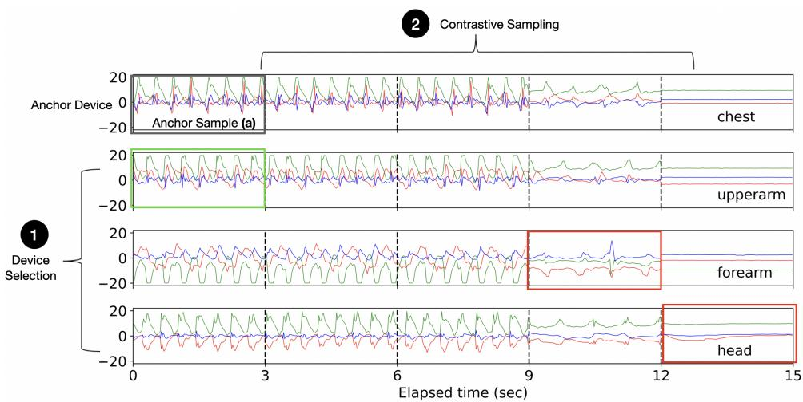
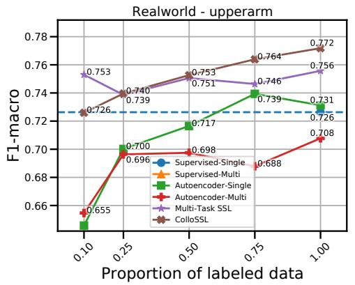
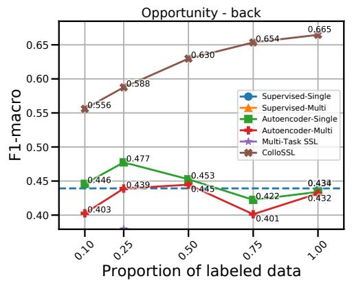
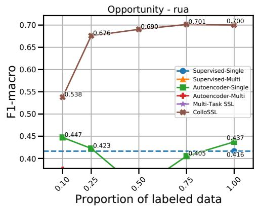
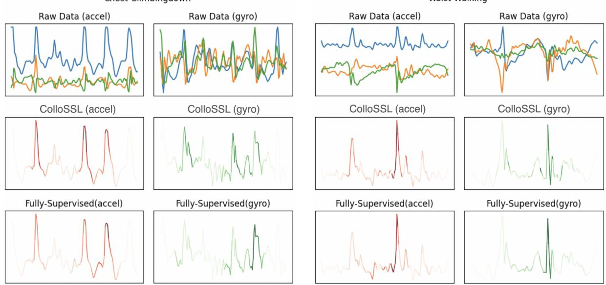
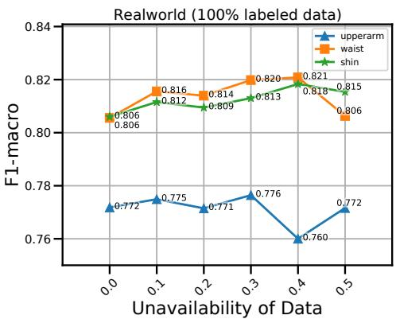

# ColloSSL：面向人类活动识别的协作式自监督学习

YASH JAIN∗, Georgia Tech（佐治亚理工学院）, 美国

CHI IAN TANG∗, University of Cambridge, United Kingdom（剑桥大学, 英国）

CHULHONG MIN, Nokia Bell Labs, United Kingdom（诺基亚贝尔实验室, 英国）

FAHIM KAWSAR, Nokia Bell Labs, United Kingdom（诺基亚贝尔实验室, 英国）

AKHIL MATHUR, Nokia Bell Labs, United Kingdom（诺基亚贝尔实验室, 英国）

训练鲁棒的人体活动识别（Human-Activity Recognition, HAR）模型的一个主要瓶颈在于对大规模带标签传感器数据集的需求。由于对大量传感器数据进行标注是一项成本高昂的任务，无监督和半监督学习技术应运而生，它们能够从数据中学习良好的特征而无需任何标签。在本文中，我们拓展了这一研究方向，提出了一种称为协作式自监督学习（Collaborative Self-Supervised Learning, ColloSSL）的新技术，它利用用户佩戴的多个设备所采集的无标签数据来学习高质量的数据特征。支撑 ColloSSL 设计的一个核心洞见是：由多个设备同时采集的无标签传感器数据集可视为彼此之间的自然变换，并可被利用以生成用于表征学习的监督信号。我们提出了三项技术创新，将传统的自监督学习算法扩展到多设备场景：一种设备选择（Device Selection）方法，用于选取正、负设备以实现对比学习；一种对比采样（Contrastive Sampling）算法，用于在多设备场景下采样正例与负例；以及一种称为多视图对比损失（Multi-view Contrastive Loss）的损失函数，它将标准对比损失扩展至多设备场景。我们在三个多设备数据集上的实验结果表明，在大多数实验设置下，ColloSSL 均优于全监督和半监督学习技术，相较于表现最佳的基线方法，$F_{1}$ 分数取得了高达 7.9% 的绝对提升。W

此外，我们还表明 ColloSSL 在低数据（low-data）场景下优于全监督（fully-supervised）方法，在最佳情况下仅使用十分之一的可用标记数据。

CCS 概念（CCS Concepts）：• 计算方法学（Computing methodologies）→ 无监督学习（Unsupervised learning）；• 硬件（Hardware）→ 传感器应用与部署（Sensor applications and deployments）；• 以人为中心的计算（Human-centered computing）→ 普适计算（Ubiquitous computing）。

附加关键词与短语：人类活动识别（Human Activity Recognition）、自监督学习（Self-Supervised Learning）、对比学习（Contrastive Learning）。

## ACM 引用格式（ACM Reference Format）：

Yash Jain, Chi Ian Tang, Chulhong Min, Fahim Kawsar, and Akhil Mathur. 2022. ColloSSL: 人类活动识别中的协作式自监督学习（Collaborative Self-Supervised Learning for Human Activity Recognition）。Proc. ACM Interact. Mob. Wearable Ubiquitous Technol. 1, 1, Article 1 (January 2022), 28 pages. https://doi.org/10.1145/1122445.1122456

∗按字母顺序排序，贡献相等。本工作完成时，作者们正在英国 Nokia Bell Labs 担任访问研究员。

作者地址：Yash Jain, yashjain@gatech.edu, Georgia Tech, 美国; Chi Ian Tang, cit27@cam.ac.uk, University of Cambridge, 英国; Chulhong Min, chulhong.min@nokia-bell-labs.com, Nokia Bell Labs, 英国; Fahim Kawsar, fahim.kawsar@nokia-bell-labs.com, Nokia Bell Labs, 英国; Akhil Mathur, akhil.mathur@nokia-bell-labs.com, Nokia Bell Labs, 英国。

允许为本作品全部或部分内容制作数字或硬拷贝，供个人或课堂教学使用，无需支付费用，但前提是所制作的拷贝不得用于营利或商业利益的分发或传播，且拷贝首页须注明本声明及完整的引用信息。本作品中由 ACM（Association for Computing Machinery）以外第三方所拥有的组成部分，其版权归相应各方所有，必须予以尊重。允许在注明出处的前提下进行摘要引用。除上述情形外，如需进行其他形式的复制、再版、在服务器上发布或向列表重新分发，必须事先获得明确的书面许可，并/或支付相应费用。请通过 permissions@acm.org 申请许可。

© 2022 Association for Computing Machinery（美国计算机协会）。2474-9567/2022/1-ART1 \$15.00 https://doi.org/10.1145/1122445.1122456

## 1 引言

过去几十年间，人类活动识别（Human Activity Recognition, HAR）应用在移动和可穿戴设备中的采用显著增加，这得益于能够处理原始传感器数据以推断人类活动的计算模型的进步。

通常，这些计算模型采用监督学习方式进行训练，即需要一组带标签的数据样本来训练模型。

最近，随着数据需求量大的深度学习模型在HAR中日渐流行[19, 31, 45]，对大规模带标签训练数据的需求变得更加突出。

然而，先前的研究已经指出，在实验室环境之外收集大规模带标签HAR数据尤为繁琐[9]。

标注HAR数据集的一个关键瓶颈在于，传感器流（例如加速度计轨迹）难以通过目视检查来解读，这使得任何事后标注工作都并非易事。

这一挑战的直接后果是，HAR数据收集工作[2, 35, 43, 44]通常以小规模、受控或半受控的环境进行，且参与者大多不足50人，从而导致模型在现实生活场景中无法良好泛化。

与数据标注所面临的挑战相比，由于传感器设备（例如智能手机、可穿戴设备）在日常生活中的普遍存在，收集未标注的人体活动识别（Human Activity Recognition, HAR）数据要容易得多。因此，在训练过程中利用未标注数据的机器学习方法在 HAR 文献中正日益受到关注。在这一方向上，最令人兴奋的范式之一是自监督学习（Self-Supervised Learning, SSL）[26]，其核心思想是利用（未标注的）输入数据中固有的结构来导出监督信号。通常的做法是定义一个预文本任务（Pretext Task），在该任务中，对输入数据施加一组预定义的变换，并训练一个深度神经网络去预测数据中的这些变换。例如，在图像数据集中，预文本任务可能涉及将输入图像旋转 60°，然后训练深度神经网络去学习原始图像与旋转图像共享相同的嵌入表示。我们通常并不关心模型在预文本任务上的准确率；相反，我们关心的是模型所学习到的中间表示（或特征），期望这些特征能够承载关于信号的语义或结构信息，从而对各种下游任务有用。

近年来，我们见证了一些令人振奋的探索，将自监督学习（Self-Supervised Learning, SSL）应用于基于惯性传感器的活动识别。Saeed 等人 [46] 在多任务设置中探索了 SSL，他们提出了针对加速度计数据的八种不同变换，并训练了一个特征提取器来预测每种变换是否已被应用。通过这样做，他们发现特征提取器能够学习到数据中固有的结构并生成良好的特征。Tang 等人 [57] 通过应用教师-学生训练扩展了这一思路，并展示了相对于先前工作的性能提升。Haresamudram 等人 [21] 研究了在特定时间戳对传感器数据进行掩码的想法，并训练特征编码器来重构缺失的数据。最近，Haresamudram 等人 [22] 还提出了对比预测编码（Contrastive Predictive Coding），该方法利用传感器数据流的长期时序结构进行自监督学习。SSL 也已被用于变化点检测 [11] 和联邦学习 [47] 的场景中。

在这项工作中，我们拓展了人体活动识别（Human Activity Recognition, HAR）自监督学习这一研究方向，尽管是在一种不同的情境下。我们研究了一种被称为时间同步多设备系统（Time-Synchronous Multi-Device System, TSMDS）的问题设置，它为自监督学习打开了一个尚未被探索的机会。这一问题设置的灵感来自当前人们佩戴多个配备惯性测量单元（Inertial Measurement Unit, IMU）的设备（包括智能手机和消费级可穿戴设备）的趋势。例如文献 [49] 甚至预计，到 2025 年，每人平均将拥有 9.3 台互联设备。图 1a 展示了这一趋势的一个示例——在此，用户佩戴着多个配备 IMU 的设备，这些设备在用户进行诸如慢跑之类的体育活动时收集时间同步的传感器数据。

除了该问题设置的日益重要性与实用性之外，它还为人类活动识别（HAR）的对比学习——一种前景广阔的自监督学习方法——提供了独特的机会。对比学习涉及将一个数据样本与该样本的变换版本以及数据集中的其他样本进行比较。在 TSMDS 设置中，用户身体上的多个设备正从不同视角捕获同一物理现象（即用户的活动）。例如，当用户正在跑步时，放在大腿口袋中的智能手机和戴在手腕上的智能手表都会为跑步活动记录传感器数据，但由于它们在身体上各自独特的位置，所记录的数据来自不同视角。因此，我们无需手动为对比学习生成数据样本的变换，而是可以将 TSMDS 设置中来自不同设备的数据视为彼此的自然变换，并据此设计自监督对比学习算法。在这里，不同的设备在自监督学习的过程中彼此协作；因此我们将这种方法称为协作式自监督学习（Collaborative Self-Supervised Learning，ColloSSL）。

  

(a) On-body 可穿戴惯性传感器

  

(b) 居住空间中的声学传感器

  

(c) 交通路口处的摄像头  
图g. 1. 时间同步多设备系统（Time-Synchronous Multi-Device Systems, TSMDS）在不同场景中的示p例。

在 §3 中，我们给出了 TSMDS 设置的形式化定义，并提供了对比自监督学习（Contrastive Self-Supervised Learning）的入门介绍。在 §4 中，我们详细阐述了当前对比学习技术的局限性，这些局限性构成了我们研究问题的动机。在 §5 中，我们为协作自监督学习（Collaborative Self-Supervised Learning）引入了新颖的算法和优化目标，即设备选择（Device Selection）、对比采样（Contrastive Sampling）以及多视图对比损失函数（Multi-view Contrastive Loss）。随后，我们提出了一种端到端的半监督框架，该框架在来自多个设备的未标记传感器数据上使用协作自监督学习，从数据中学习高质量特征，然后再在少量标记数据上训练一个 HAR（Human Activity Recognition，人类活动识别）分类器，以识别具体的人类活动。最后，在 §6 中，我们在三个多设备 HAR 数据集上，将我们的框架性能与若干有监督和半监督训练基线进行了比较。我们的结果表明，ColloSSL 在低数据量和高数据量场景下通常都优于有监督训练以及其他半监督基线。我们还展示了关于 ColloSSL 所生成特征嵌入的见解，以及 ColloSSL 的鲁棒性和泛化能力。

## 我们的工作做出了三大主要贡献：

• 我们提出了协作自监督学习（Collaborative Self-Supervised Learning，ColloSSL），这是一种从用户佩戴的多个设备所采集的未标注惯性传感器数据中进行学习的新方法。与已有方法 [46, 57] 不同，ColloSSL 利用从多个设备采集的传感器数据集中的自然变换来执行对比学习，并针对下游可学习目标构建鲁棒的特征提取器*用于下游人体活动识别（HAR）分类任务。

• 我们提出了 ColloSSL 面临的三个关键研究挑战，并提出了新颖的设备选择和数据采样算法，以及一种将对比学习扩展到多设备场景的新损失函数。

• 我们在三个多设备人体活动识别数据集上对 ColloSSL 进行了全面的评估，涵盖运动类活动和复杂的日常生活活动。我们的结果表明，无论在识别准确率还是在标注数据效率方面，ColloSSL 都优于全监督和半监督基线方法。

## 2 相关工作

在本节中，我们回顾了与本文相关的四组先前工作（prior works）。具体而言，我们首先回顾了人体活动识别（Human-Activity Recognition, HAR）领域的相关文献，以及近年来涌现出的旨在缓解 HAR 中标注数据稀缺（labeled data scarcity）问题的半监督学习（semi-supervised learning）技术。与本文工作紧密相关的是近期在 HAR 中探索自监督学习（self-supervised learning）的趋势——为此，我们梳理了近期关于自监督学习与对比学习（contrastive learning）的机器学习（Machine Learning, ML）文献，并阐述其如何在 HAR 中得到应用。最后，我们还讨论了本文工作与先前在多设备传感（multi-device sensing）环境下开展的研究之间的关联。

用于人体活动识别的深度学习。人体活动识别是一项分类任务，其标签是诸如"步行"和"跑步"等在日常活动中自然出现的活动。该问题已被信号处理领域的研究者[13, 18–20, 41, 64]深入研究，他们利用来自移动设备中嵌入式传感器的时间序列数据；同时也受到计算机视觉领域研究者的深入研究，他们专注于基于视频和摄像头的解决方案。对于一般的深度学习或机器学习解决方案而言，特征提取器的选择起着至关重要的作用。传统上，相关方法侧重于已被众多研究者[13, 20, 41]研究过的统计特征。后来，深度卷积网络和循环网络[18, 19, 64]被证明能够从标注数据中有效地学习特征提取器。

然而，数据集的大小、多样性以及对现实世界的代表性，对于机器学习和深度学习解决方案在真实场景中取得令人满意的性能至关重要 [34, 59, 60]。与其他数据模态（例如图像、视频和音频片段）相比，这些模态通常便于进行事后标注（post-hoc annotations），而为传感器时间序列（尤其是那些在自由生活环境中采集的）获取标签则非常困难 [5]。不同用例与设置之间的差异进一步加剧了这一困难，这些差异涵盖嵌入式传感器的不同型号或类别、传感器的佩戴位置以及目标活动类别，使得几乎不可能采集到能够涵盖所有可能设置的数据。这导致了用于监督训练的标注数据既稀缺又质量有限，从而可能对模型在真实世界中的性能产生不利影响。

无监督和半监督学习（Unsupervised and Semi-supervised Learning），其包含的方法旨在利用未标记数据来克服纯监督方法的局限性，是 HAR [54, 63, 68] 中一些最热门的研究方向。我们的工作同样建立在关于半监督学习技术的这一研究路线上，尽管处于一个不同的问题设定中——在该设定中，我们利用用户佩戴的多个设备所获得的未标记数据，来为表示学习生成监督信号。

用于人体活动识别的自监督学习。自监督学习（Self-supervised Learning, SSL）已成为机器学习社区中越来越受欢迎的研究领域，旨在减少训练深度学习模型时对标记数据的依赖 [6, 8, 23, 25, 29]。沿着这一方向，研究者已提出许多具有各自独特优化目标的自监督学习框架 [8, 10, 17]。例如，SimCLR [8] 框架通过将同一样本的变换视图作为正样本对，并将它们与其他样本进行对比，从而训练特征提取器对变换保持不变性。

HAR（人体活动识别，Human Activity Recognition）社区的研究人员最近开始探索如何将 SSL（自监督学习，Self-Supervised Learning）技术进行扩展或专门为 HAR 任务设计 [46, 48, 58]。在早期的开创性工作之一中，Saeed 等人将"识别对特定数据样本施加了哪种信号变换"这一任务用作自监督任务 [46]。他们选取了一组八种信号变换来表示信号噪声，并报告通过用该任务对模型进行预训练可以获得性能提升。然而，这些作者专注于使用来自相似分布、来自单一设备的数据对模型进行预训练。该信号变换任务也被进一步适配，用于训练基于心电图（ECG）数据进行情感识别的模型 [50]。整体方法与先前的工作 [46] 十分接近，并额外探索了在使用不同难度级别的预训练任务时对性能的影响，以及预训练任务与应用任务之间的关系。最近，SimCLR 框架已被应用于 HAR [58]。作者探索了一组为时间序列数据设计的不同变换函数组合，用于基于 SimCLR 框架训练传感器数据的特征提取器。然而，这项工作同样只关注利用来自单个传感器的数据，而提取更强监督信号的潜力

来自其他传感器和设备的信号尚未被探索。已有研究尝试利用多种设备进行自监督学习（Self-Supervised Learning, SSL）以获得视觉表征[51]。研究表明，时间同步的视觉表征可用于通过强化学习为机器人操作提供奖励函数。其局限性之一在于仅使用了两个相机视角的数据，但我们的方案兼容包含多于两个数据源的设置，并且我们全面探索了使用不同数量惯性测量单元（Inertial Measurement Unit, IMU）设备的设置。

**多设备环境用于人体活动识别（HAR）**：多设备环境用于HAR的研究在过去几十年里已从多个角度得到广泛研究。我们简要回顾多设备环境的已有研究，重点关注用于HAR的传感器选择与融合。首先，已有研究提出传感器选择策略，通过根据每个设备的预定义参数（如平均准确率、资源使用情况和设备可用性）动态选择最佳传感器，以最大化体域网中的系统效用[27, 28, 36, 67]。虽然这些策略侧重于在多设备环境中提供更好的运行时系统性能，但它们并未利用来自多个设备的数据来提高活动识别的准确性。为此目的，已有许多基于深度学习的传感器融合技术[37, 39, 61, 65, 66]被提出，通过连接多个传感器数据流来训练融合模型。虽然这些技术在模型准确性方面显示出显著改进，但它们假设所有传感器数据流都已标注。相比之下，我们的工作专注于利用来自多个设备的未标注数据，从数据中学习高质量特征，这些特征稍后可借助极少量的标注数据来训练下游HAR模型。此外，与基于融合的方法相比，我们在推理时不需要所有设备都可用；来自多个

…多设备[之间的通信]仅在训练时需要，推理可在每个设备上独立进行。

## 3 预备知识

本节我们将阐述 TSMDS 问题设置，并对对比自监督学习做一简要介绍。

## 3.1 时间同步多设备系统

我们首先详细介绍本文所探讨的问题设置，称为时间同步多设备系统（Time-Synchronous Multi-Device Systems，TSMDS）。需要指出的是，我们的目标并不是要声称这是一个从未被研究过的问题设置；相反，我们认为这是一个自监督学习尚未涉足的有趣问题空间。本节我们从概念上描述该问题设置，并在 §5.1 中给出其数学形式化。

在人体活动识别（Human Activity Recognition, HAR）的背景下，TSMDS 问题设定与人体局域网（Body-Area Network）类似，其中多个计算/传感设备被穿戴、固定或植入于人体 [24]。TSMDS 的本质特征在于，所有设备同时观测同一物理现象（例如用户的位移活动），并以时间对齐的方式记录传感器数据（图 1a）。尽管我们的工作聚焦于使用运动数据的 HAR，但 TSMDS 设定具有相当的通用性，可应用于众多其他传感场景。在智能家居中（图 1b），多个语音助手（例如智能手机中的 Siri、客厅中的 Alexa 和 Google Home）可以同时监听用户的语音和音频指令。在部署于交通路口的摄像头网络中（图 1c），多个摄像头可以同时从不同视角捕捉同一场景。

下面我们给出在 HAR 背景下探索 TSMDS 设定时所依据的两条关键假设：

• 我们假设多设备系统中的所有传感器设备共享相同的传感器采样率，或者它们的数据可被重采样到同一采样率。该假设确保了输入到 HAR 模型的数据维度在不同设备间保持一致，并简化了 HAR 模型的神经网络架构设计。

按定义，我们假设在 TSMDS 设置中，多个设备以时间对齐（time-aligned）的方式采集传感器数据。诚然，在真实应用中，跨多个设备的传感器数据集完美时间对齐这一假设是较强的。设备之间可能存在时间戳噪声或系统时钟错位，这可能使多设备数据集的时间对齐产生偏差。然而，人体活动识别（Human Activity Recognition, HAR）领域的先前研究 [55] 表明，加速度计和陀螺仪传感器的时间戳噪声非常小，通常不到 10 毫秒。我们假设如此小的噪声不会降低我们解决方案的性能，并通过经验验证这一假设，证明我们的方法对中等程度的设备间时间错位具有鲁棒性（第 7.6 节）。

## 3.2 对比自监督学习入门（Primer on Contrastive Self-Supervised Learning）

对比学习g（Contrastive Learning）是一种yp自p监督学习g（self-supervised learning）算法g，其g目标g是将数据集中相似的样本p在嵌入空间g space（embedding space）中拉得更近，将不相似的样本p推得更远 [3, 8]。在使用未标注数据（unlabelled data）的对比学习中，从训练数据集中取出一个数据样本（称为锚定样本，anchor sample），通常会施加一个预p定义的p扰动（e.g.，旋转），以generate（生成）该样本p的一个变换版本。在训练g过程中，变换后的样本被视为正样本（positive sample），而从数据集中随机选择的其他数据样本被视为负样本（negative sample）。这三种类型的数据样本（锚定样本、正样本、负gative）都被输入到神经网络中以获得特征嵌入（feature embeddings）。模型g训练g的目标是将g roup锚定样本和正样本的特征嵌入拉得更近，同时将锚定样本和负样本的嵌入推得更远。在n这个过程中，模型学会仅使用未标注的原始数据就提取出高质量的特征嵌入，这些嵌入可以后续用于下游分类任务。

影响对比学习性能的最重要因素之一，是为每个锚样本所施加的扰动方式的选择——我们希望模型对这些扰动保持不变，同时对其他负样本保持区分能力。先前的研究 [8, 58] 表明，算法设计者所选择的扰动方式会对对比学习的性能产生深远的影响。他们发现，在 ImageNet 数据集上通过对比学习预训练的模型，其 top-1 准确率会因扰动选择的不同而出现剧烈下降：从使用图像裁剪与着色变换时的 56.3%，骤降至仅使用图像旋转变换时的 2.6%。

## 4 协作式自监督学习的动机与挑战

在对比学习中，我们不再手动指定变换（例如旋转），而是探究是否可以充分利用传感器数据中已存在的天然变换。有趣的是，TSMDS（Time-Synchronized Multi-Device Sensors，时间同步多设备传感器）设置呈现出一种独特的场景——我们可以获得跨不同设备的人体活动识别（Human Activity Recognition, HAR）数据的天然变换。如图 1a 所示，用户佩戴的多个设备同时从不同视角捕获相同的身体活动（例如跑步）。因此，我们可以将来自不同设备的数据集视为彼此的天然变换。这一观察也可以从 Kunze 和 Lukowicz [30] 的早期开创性 HAR 研究中得到验证，他们指出，由可穿戴传感器采集的加速度计和陀螺仪数据取决于传感器所放置身体部位的平移和旋转特性。由于不同身体部位具有不同的平移和旋转特性（例如，手腕的旋转自由度高于胸部），这会在从不同身体位置采集的加速度计和陀螺仪数据中引发天然变换。

Proc. ACM Interact. Mob. Wearable Ubiquitous Technol., 第 1 卷, 第 1 期, 文章 1. 发表日期：2022 年 1 月。

  

图 2. ColloSSL 中两项研究挑战的示意：设备选择（Device Selection）与对比采样（Contrastive Sampling）。锚样本由绿色矩形表示。绿色与红色矩形分别表示由我们在 §5.4 中描述的设备选择与对比采样算法所选出的正样本与负样本。

总之，时间对齐的多设备传感器设置（TSMDS）使我们能够捕获时间对齐的传感器数据集，这些数据集之间具有自然的变换。我们的想法是利用这些自然变换来定义一个前置任务并执行对比学习。

协同自监督学习（ColloSSL）中的研究挑战。为了引出我们的研究挑战，我们在图2中给出了一个示例插图。该图显示了一段15秒长的无标签加速度计数据轨迹，这些数据由� (=4) 个身体佩戴设备同时采集。每条加速度计轨迹使用3秒的窗口长度进行分段，从而为每个设备提供5个窗口/样本。假设我们想要使用对比学习为'胸部'身体位置训练一个特征提取器。因此，来自'胸部'的数据样本将成为锚样本。图2中用灰色矩形高亮显示了来自'胸部'的第一个锚样本（�）。如上所述，要执行对比学习，我们需要选择合适的正样本和负样本。下面我们识别了该方向上的三个关键研究问题：

从其余的 $k - 1$ 个设备（即上臂（upperarm）、前臂（forearm）、头部（head））中，我们应如何为对比训练（contrastive training）选择正样本和负样本？直观上，有些设备的数据分布会与 '胸部'（chest）设备的数据分布相距过远。若使用这些相距过远的设备来获取正样本，并在嵌入空间（embedding space）中将它们推向锚样本（anchor samples），可能会导致对比学习（contrastive learning）产生退化解（degenerate solutions）。此外，由于每个设备的数据分布会随用户活动而变化，我们在选择设备时需要考虑这些动态变化。我们将此研究挑战称为设备选择 1（Device Selection 1），并提出了一种数据驱动的策略，使用最大均值差异（Maximum Mean Discrepancy, MMD）作为度量，在对比学习过程中动态选择正设备和负设备。作为示例，我们在图 2 中展示了我们的策略为给定的数据样本选择 '上臂' 作为正设备，'前臂' 和 '头部' 作为负设备。具体的选择算法详见 §5.4.1。

• 除了设备选择之外，我们还需要回答来自所选设备的哪些样本将充当正样本（positive）或负样本（negative）。例如，如果我们选择 'upperarm'（上臂）作为正设备，那么其 5 个样本（或窗口）中的哪一个将充当锚样本（anchor sample）的正样本（�）？我们将此挑战称为对比采样 2（Contrastive Sampling 2），并提出使用来自正设备的时间同步样本（time-synchronized samples）和来自负设备的时间异步样本（time-asynchronized samples）的想法。例如，在图 2 中，来自正设备的时间同步样本用绿色矩形突出显示，而来自负设备的时间异步样本用红色矩形突出显示。对比采样算法背后的原理和细节在 §5.4.2 中给出。

• 最后，为了在一组设备中实现对比学习，我们需要定义一个新的优化目标。为此，我们提出了一种新颖的损失函数，称为多视图对比损失（Multi-View Contrastive Loss），它可以将任意数量的正样本和负样本作为输入并计算损失度量，然后使用随机梯度下降对其进行优化（§5.5）。

## 5 协作式自监督学习（Collaborative Self-Supervised Learning）

在本节中，我们介绍我们提出的用于人体活动识别（Human Activity Recognition, HAR）的协作式自监督学习方法。

## 5.1 问题陈述（Problem Statement）

我们将 TSMDS 问题形式化如下：给定 $D$ 个设备，每个设备带有一个时间对齐且未标记的传感器数据集 $\{ \mathbb{X}_i \}_{i=1}^D$。不失一般性，我们假设这些数据集已按照 HAR 任务中的惯例被预先分割为 $T$ 个窗口。每个数据集 $\mathbb{X}_i$ 包含 $T$ 个窗口 $\{x_i^1, \cdots, x_i^T\}$，其中 $x_i^j$ 表示设备 $i$ 在窗口 $j$ 中的一组传感器样本。一般而言，一个传感器样本可以是任何形式的 IMU 测量，例如 3 维加速度计数据、3 维陀螺仪数据、1 维加速度计幅值。在我们的工作中，每个传感器样本是一个 6 维向量，由 3 轴加速度计数据和 3 轴陀螺仪数据堆叠而成。

设 $D^* \in D$ 为锚设备（例如智能手机），我们希望针对该设备训练一个 HAR 预测模型。设 $\mathbb{L}^* = \{(x_*^1, y_*^1) \cdots, (x_*^m, y_*^m)\}$ 为来自该锚设备的一个（小规模）预先分割并标注的数据集，包含 $m$ 个窗口 $(m \ll T)$，其中 $x_*^j$ 是窗口 $j$ 中的一组传感器样本，$y_*^j$ 是分配给这些样本的类别标签。

我们的目标有两个方面：首先，我们旨在利用来自所有设备的未标记数据集 $\{ \mathbb { X } _ { i } \} _ { i = 1 } ^ { D }$，通过 ColloSSL 训练特征提取器 $f ( . )$。训练好的特征提取器应能为锚设备数据生成高质量的特征嵌入（embeddings）。其次，我们旨在利用这个预训练的特征提取器 $f ( . )$ 来获得已标记锚样本 $x _ { * } ^ { j }$ 的特征嵌入，随后训练一个人体活动识别（HAR）分类器 $\Phi(.)$，将得到的特征嵌入映射到对应的类别标签 $y _ { * } ^ { j }$。

## 5.2 解决方案概述

我们提出的解决方案如图 3 所示，工作流程如下：

1. 我们以随机权重初始化特征提取器 $f ( . )$。

2. 我们从所有 $D$ 个设备中采样一个大小为 $B$ 的时间对齐未标记数据批次 $\{ x _ { i } ^ { 1 } , \cdots , x _ { i } ^ { B } \} _ { i = 1 } ^ { D }$。

3. 图 3 中的设备选择 1：给定一个锚设备 $D ^ { * }$，我们首先决定在该数据批次中，哪些剩余设备将为对比学习提供正样本和负样本。这一过程通过 §5.4.1 中介绍的设备选择算法完成。

4. 对比采样（Contrastive Sampling）（Figure 3 中的步骤 2）：接下来，对于每个锚点（anchor）样本，我们从批量（batch）中的所有样本中决定哪些来自正、负设备的特定样本应用于对比学习。虽然数据采样在过去已被作为自监督学习（SSL）的一个重要方面加以研究，我们提出了一种名为对比采样（Contrastive Sampling）的算法（§5.4.2），将数据采样扩展到 TSMDS 设置中。

5. 多视图对比学习（Multi-view Contrastive Learning）（Figure 3 中的步骤 3）：锚点、正样本和负样本被输入到特征提取器 $f ( . )$ 中以生成特征嵌入。这些特征嵌入用于计算多视图对比损失（Multi-view Contrastive Loss，详见 §5.5），该损失将正样本嵌入向锚点方向拉近，并将负样本嵌入向远离锚点的方向推远。

  

图 3. 协作自监督学习（Collaborative Self-Supervised Learning）概述。详细解释请参阅 §5.2。

步骤 4-5 重复执行，直至批次中所有锚样本都被计算完毕；步骤 2-5 重复执行，直至多视图对比损失（Multi-view Contrastive Loss）收敛。收敛之后，我们期望 $f(\cdot)$ 已经学会了为锚设备提取高质量特征。

7. 监督微调（图 3 中的标号 4）：最后，我们使用预训练的特征提取器 $f(\cdot)$ 以及来自锚设备的标注数据集 $L^{\ast}$，通过监督学习训练一个 HAR 分类器（§5.5.1）。

## 5.3 特征提取器

我们使用时序（一维）卷积神经网络作为特征提取器。这一设计选择受到了 HAR 中自监督学习相关先前工作 [46] 的启发，并且通过在不同方法之间保持模型架构一致，使我们能够将我们的解决方案与基线方法进行公平的比较。该架构由三个一维卷积层（Conv1D）组成，滤波器数量分别为 32、64 和 96，卷积核大小分别为 24、16 和 8，步长均为 1。为了正则化，我们在每一对相邻层之间使用 Dropout，丢弃率为 0.1，并施加 L2 正则化，正则化系数为 1e-4。最后，最后一个 Conv1D 层的输出被送入一维全局最大池化（GlobalMaxPooling 1D）层。

函数 $f(\cdot)$ 的输入是一个二维张量，一个轴是时间，另一个轴是传感器数据。由于我们使用 3 轴加速度计和 3 轴陀螺仪（gyroscope）轨迹作为输入，传感器数据的维度为 6。因此，给定采样率为 50 Hz、窗口长度为 2 秒，模型的输入张量维度为 100 × 6。函数 $f(\cdot)$ 的输出是一个维度为 (96 × 1) 的特征嵌入（feature embedding）。

## 5.4 设备选择与对比采样（Device Selection and Contrastive Sampling）

如 §4 和图 2 所述，ColloSSL 中的两个关键挑战是：(1) 设备选择（Device Selection），即从哪些设备中选取正样本和负样本；(2) 对比采样（Contrastive Sampling），即决定从所选设备中选择哪些样本用于对比学习。

在介绍我们的方法之前，我们先解释对于给定的锚点样本（anchor sample，$x$），什么样的正样本（positive sample，$x^+$）和负样本（negative sample，$x^-$）对于对比学习是「较优的」。回想一下，对比学习的目标是引导特征提取器（feature extractor）$f$ 将 $x$ 和 $x^+$ 在特征空间（feature space）中映射得更近，而将 $x$ 和 $x^-$ 映射得更远。

正样本的优良性。我们认为一个好的正样本 $x^+$ 应具备以下两个特征：

(P1) $x^+$ 应与锚点样本 $x$ 属于相同的标签/类别。因为如果 $x$ 和 $x^+$ 来自不同类别，而特征提取器 $f$ 仍然试图将它们映射得更近，就会导致类别分离效果较差，并降低下游分类任务的性能。

$x^+$ 应来自与锚点设备数据分布差异较小的设备。这一点很重要，因为如果锚点设备与正样本设备在数据特征上差异很大（例如腕戴 IMU（Inertial Measurement Unit，惯性测量单元）与胸戴 IMU），则可能会影响特征提取器提取有意义的不变嵌入。

请注意，在 ColloSSL 中，我们无法获取数据的真实标签。因此，乍看之下在 $x^+$ 上强制执行 (P1) 可能显得有些棘手。然而，根据 TSMDS（Time-Synchronized Multi-Device Setting，时间同步多设备）设定的定义，我们知道所有设备同时且以时间对齐的方式收集 HAR（Human Activity Recognition，人体活动识别）数据。因此，我们可以自然地假设真实标签（如步行、跑步）在各设备之间也是时间对齐的。所以，如果我们能确保 $\bar{x}$ 与 $x^+$ 是时间对齐的，那么它们就隐含地保证了具有相同的标签。

负样本的好坏。我们提出，一个好的负样本 $x^-$ 应具备以下两个特征：

(N1) $x^-$ 应是一个真正的负样本，即与锚点样本 $\bar{x}$ 属于不同类别。因为如果 $\bar{x}$ 与 $x^-$ 来自同一类别，而特征提取器 $f$ 却试图将它们推开，则可能导致较差的分类性能。

(N2) 最有信息量的负样本是那些其嵌入（embedding）最初接近锚点（anchor）嵌入的样本，需要将它们推远。在这种情况下，它从数据中获得强监督信号，并在训练过程中获得更有用的梯度。在另一种情况下，即当训练初始化时负嵌入已经远离锚点时，它将从数据中获得较弱的监督信号，这可能会对其收敛产生不利影响。

同样，由于 ColloSSL 中类别标签不可用，严格执行 (N1) 是不可能的。需要一种能够鼓励负样本具备该特性、并最小化 $x^{+}$ 和 $x^{-}$ 属于同一类别的可能性的解决方案。

在定义了什么是好的正样本和负样本之后，我们现在描述我们的设备选择（device selection）和对比采样（contrastive sampling）算法。

5.4.1 设备选择。我们的设备选择算法旨在提高选择好的正样本和负样本的可能性。为简洁起见，我们将从中获取正（或负）样本的设备称为正设备（positive device）（或负设备（negative device））。形式上，我们给出一个由 $D$ 个设备组成的集合，这些设备带有时间对齐且未标记的传感器数据集 $\{ \mathbb { X } _ { i } \} _ { i = 1 } ^ { D }$ 。设 $D ^ { * } \in D$ 为锚点设备。设 $D ^ { \theta } = D \backslash D ^ { * }$ 为候选剩余设备集合，我们要从中选择正设备和负设备。

我们的设备选择算法工作如下：首先，我们从锚定设备（anchor device）$D^{*}$ 以及 $D^{\theta}$ 中的每个设备上采样一批时间对齐的数据。令 $x^{*}$ 和 $X^{\theta}=\{x_{i}\}_{i=1}^{|\bar{D}^{\theta}|}$ 分别为来自锚定设备和候选设备的数据批次。

我们计算 $x^{*}$ 与 $X^{\theta}$ 中每个数据批次之间的两两最大均值差异（Maximum Mean Discrepancy, MMD）。MMD 是一种分布级统计量，用于度量两个数据分布之间的距离；MMD 值越大，表明两个分布之间的距离越大 [16]。在获得每对设备批次之间的批次级 MMD 分数后，我们采用以下设备选择策略：

**最近正样本（Closest Positive）。** 选择与锚定数据之间 MMD 距离最小的设备作为正样本设备。这一选择满足选取优质正样本的标准 (P2)，并能保证 $\phi(\cdot)$ 合理地将两个样本的嵌入（embeddings）映射到彼此更接近的位置。需要说明的是，我们也尝试了使用多个正样本设备，但发现仅使用一个（最近的）设备作为正样本能够取得最佳性能。

加权负样本（Weighted Negatives）。对于负样本设备，我们使用候选集 $D^\theta$ 中的"全部"设备，但它们在训练过程中的贡献会根据其与锚样本之间 MMD（Maximum Mean Discrepancy）距离的倒数进行加权。在对比训练中，与锚样本 MMD 距离较小的设备获得较高的权重，而 MMD 距离较大的设备获得较小的权重。该策略服务于两个目标：首先，通过为与锚样本 MMD 距离较小的设备赋予更高的权重，满足了 (N2)，并确保那些更接近锚样本的负样本在训练中获得更多的权重。其次，将"全部"设备用作负样本，可以在某一设备违反 (N1) 的情况下起到对冲作用。例如，即使某台设备违反了 (N1)，最终从与 $x$ 相同的类别中选择了 $x^-$，其他设备也可以为其补位，从而确保其对特征提取器的影响最小化。

分配给每个负样本设备 $i \in D^\theta$ 的权重可以表示为：

$$
w _ {i} = \frac {1}{M M D (x ^ {*} , x _ {i})}\tag{1}
$$

权重通过将每个权重除以所有设备中的最大权重进一步归一化。

举例来说，我们将设备选择策略应用于 RealWorld HAR 数据集（数据集的详细信息见 §6.1）。该数据集包含来自 7 个配备 IMU 的设备的数据：𝓓 = {chest（胸部）、upperarm（上臂）、forearm（前臂）、thigh（大腿）、shin（小腿）、head（头部）、waist（腰部）}。我们选择 'chest' 作为锚定设备，并获取 'chest' 数据与其余设备数据之间的两两 MMD。结果得到以下两两 MMD 分数：{chest-head：0.45，chest-waist：0.61，chest-thigh：0.67，chest-upperarm：0.77，chest-forearm：0.83，chest-shin：1.51}。根据我们的选择算法，我们选择 head 作为正样本设备，{head、waist、thigh、upperarm、forearm、shin} 作为负样本设备，其权重与 MMD 分数成反比。

• Jain and Tang 等人。

5.4.2 对比采样（Contrastive Sampling）。在上一阶段，我们已确定 $D_\theta$ 中哪些设备将充当正样本和负样本。现在，我们决定应从每个设备中挑选哪些数据样本用于对比训练。

形式化地，我们给定一个锚定设备 $D^*$，一组正样本设备 $(D^+)$ 和负样本设备 $(D^-)$。令 $P_i = \{p_i^1, \cdots, p_i^T\}|_{i=1}^{|D^+|}$、$N_j = \{n_j^1, \cdots, n_j^T\}|_{j=1}^{|D^-|}$、$A = \{a^1, \cdots, a^T\}$ 分别表示来自第 $i$ 个正样本设备、第 $j$ 个负样本设备和锚定设备的时间对齐数据批次（time-aligned data batches）。其中，$p_i^t$、$n_j^t$ 和 $a^t$ 分别表示在时间步 $t$ 的数据样本。

对比采样的目标是为给定的锚点样本 $a^t$ 选取"好的"正样本与负样本嵌入。我们的采样策略如下：

同步正样本。对于时间步 $t$ 处的给定锚点样本 $a^t$，我们选取其时间对齐的正样本对应物 $\boldsymbol{p}_i^t$ 作为正样本。如前所述，这一选取确保了锚点样本与正样本具有相同的标签，并满足好正样本的 (P1) 准则。

异步负样本。好负样本的一条准则 (N1) 是其应当与锚点样本属于不同类别。由于在对比学习过程中我们无法获得真实标签（ground-truth labels），因此不可能严格地强制执行 (N1)。作为一种解决方案，我们利用如下观察：与锚点样本时间不同步的负样本更有可能来自不同类别。也就是说，对于时间步 $t$ 处的锚点样本 $a^t$，一个好的负样本应当满足 $n^{t'} \mid t' \ne t$。

这一选择（this choice）仍然无法保证时间步 $t$ 和 $t'$ 处的标签互不相同；例如，用户在 $t=0$ 和 $t'=100$ 处的活动可能恰好相同，属于随机巧合。为了尽可能降低此类情况发生的可能性，我们采用了一个简单的技巧：在 ColloSSL 训练期间使用大小为 512 的大批量（batch size），以确保每个批次（batch）中包含多样的类别标签，从而降低 $t$ 和 $t'$ 处标签因随机因素而发生重叠的可能性。

5.4.3 小结。本节所介绍的技术解决了图 2 中所明确的 ColloSSL 的两个核心研究挑战。首先，我们使用设备选择（Device Selection）算法来确定在训练期间哪些设备充当正样本（positive）或负样本（negative）。接下来，对比采样（Contrastive Sampling）算法从所选设备中找出'好的'正样本和负样本，这些样本可用于与锚定嵌入（anchor embedding）一起进行对比学习（contrastive learning）。

细心的读者可能已经注意到，我们的算法所选出的正设备和负设备并不是互斥的。具有距锚点最小 MMD 距离的正设备，同样会被纳入到负设备集合中。然而，在对比采样（Contrastive Sampling）过程中，从该设备选出的样本会有所不同：当它作为正设备时，将选取与锚点时间同步（time-synchronized）的样本；而当它作为负设备时，则将选取与锚点**不**时间同步的样本。

## 5.5 多视角对比损失（Multi-view Contrastive Loss）

在本节中，我们说明在上述步骤中所选出的正样本和负样本是如何用于训练特征提取器的。首先，将锚点样本、正样本和负样本输入到特征提取器中，以获得特征嵌入（feature embeddings）。设 $\{ z _ { i } ^ { + } \} \rvert _ { i = 1 } ^ { \lfloor D ^ { + } \rfloor }$ 和 $\{ z _ { j } ^ { - } \} \rvert _ { j = 1 } ^ { | D ^ { - } | }$ 分别为来自第 $i ^ { t h }$ 个正设备和第 $j ^ { t h }$ 个负设备的所选特征嵌入。设 $z ^ { * }$ 为锚点嵌入。

我们提出了一种新颖的损失函数，称为多视图对比损失（Multi-view Contrastive Loss），其灵感来源于标准的对比损失函数，但可兼容多个正样本和负样本。

$$
\mathcal {L} _ {M C L} = - \log \frac {\sum_ {i = 0} ^ {| D ^ {+} |} \exp \left(\text {sim} \left(z ^ {*} , z _ {i} ^ {+}\right) / \tau\right)}{\binom{\sum_ {i = 0} ^ {| D ^ {+} |} \exp \left(\text {sim} \left(z ^ {*} , z _ {i} ^ {+}\right) / \tau\right)}{+ \sum_ {j = 0} ^ {| D ^ {-} |} w _ {j} \exp \left(\text {sim} \left(z ^ {*} , z _ {j} ^ {-}\right) / \tau\right)}}\tag{2}
$$

Proc. ACM Interact. Mob. Wearable Ubiquitous Technol., Vol. 1, No. 1, Article 1. 出版日期：2022 年 1 月。

其中 sim(.) 表示余弦相似度（cosine similarity），$w_j$ 是根据 (1) 分配给第 $j^{th}$ 个负样本设备（negative device）的权重，τ 是一个表示温度（temperature）的超参数（hyperparameter）。

$\mathcal{L}_{MCL}$ 通过随机梯度下降（stochastic gradient descent）对每一批数据进行最小化。在训练过程中，损失最小化有效地引导特征提取器 $f(.)$ 增大锚样本与正样本嵌入之间的余弦相似度（即在特征空间中将它们拉近），并对锚样本与负样本嵌入做相反的操作。通过这种方式，$f(.)$ 理解了不同设备传感器数据的结构，并学会将原始数据映射为高质量特征，这些特征可被用于各种下游分类任务。

5.5.1 监督微调（Supervised Fine-tuning）。最后，在使用 ColloSSL 训练完特征提取器之后，便可以将其用于训练下游的人体活动识别（Human Activity Recognition, HAR）分类模型。为此，我们遵循 Saeed 等人 [46] 的方法，即冻结特征提取器的权重（最后一层卷积层除外），并在模型中添加一个分类头。该分类头由一个具有 1024 个隐藏单元的全连接层构成，使用 ReLU 激活函数，随后是一个输出层，其单元数等于类别数。然后，通过优化标准的分类交叉熵损失，使用来自锚定设备的小规模有标签数据集 $\mathbb{L}^*$ 对模型进行训练。

## 6 评估（Evaluation）

我们在三个多设备 HAR 数据集上对 ColloSSL 进行了评估，并将其性能与各种 HAR 基线方法（包括自监督学习、半监督学习和全监督学习）进行了比较。我们的主要结果包括：

• ColloSSL 在低数据量场景下优于全监督学习。在 18 个锚设备中的 15 个上，使用 10% 或 25% 标注数据训练的 ColloSSL 比使用 100% 标注数据训练的全监督模型取得了更高的 $F_1$ 分数。

• ColloSSL 在识别性能上也优于各种人体活动识别（HAR）基线方法。在使用相同数量的标注数据时，与表现最好的基线相比，ColloSSL 在 $F_1$ 分数上取得了 7.9% 的绝对提升。

• 通过可视化 t-SNE 图和显著性图，我们证明 ColloSSL 能够在不同类别之间生成可分性强且有意义的特征嵌入。

• ColloSSL 对多设备数据的时间错位具有鲁棒性；当设备中引入最多 0.5 秒的时间同步误差时，$F_1$ 分数的差异小于 ±0.006；当引入最多 3 秒的时间同步误差时，差异小于 ±0.01。

## 6.1 实验设置（Experimental Setup）

数据集：在我们的实验中，我们使用三个人体活动识别（Human Activity Recognition, HAR）数据集，它们具有来自多个设备的时间对齐传感器数据：RealWorld [56]、Opportunity [44] 和 PAMAP2 [43]，如表 1 所示。这些数据集都包含来自多个可穿戴设备的 3 轴加速度计和 3 轴陀螺仪同步采样数据。其中两个数据集中使用的惯性传感器也是异构的：RealWorld 数据集使用三星 Galaxy S4（Samsung Galaxy S4）智能手机和 LG G 智能手表来收集传感器数据，而 Opportunity 数据集中使用的惯性传感器则来自不同的厂商，例如 InertiaCube3 和 Sun SPOT。

• RealWorld：RealWorld 数据集 [56] 包含 15 位参与者的加速度计和陀螺仪轨迹数据，采样频率为 50 Hz，同步采集自安装在前臂、大腿、头部、上臂、腰部、胸部和胫骨上的 7 个传感器设备。每位参与者执行 8 种活动：上下楼梯、跳跃、躺、站、坐、跑步/慢跑和行走。

1:14 • Jain and Tang, et al.

<table><tr><td>Dataset</td><td>No. of devices (positions)</td><td>No. of users</td><td>No. of activities (labels)</td></tr><tr><td>RealWorld [56]</td><td>7 (forearm, thigh, head, upper arm, waist, chest, shin)</td><td>15</td><td>8 (stair up, stair down, jumping, lying, standing, sitting, running, walking)</td></tr><tr><td>Opportunity [44]</td><td>5 (back, left lower arm, right shoe, right upper arm, left shoe)</td><td>4</td><td>4 (standing, walking, sitting, lying)</td></tr><tr><td>PAMAP2- Locomotion [43]</td><td>3 (arm, chest, ankle)</td><td>8</td><td>4 (standing, walking, sitting, lying)</td></tr><tr><td>PAMAP2-ADL [43]</td><td>3 (arm, chest, ankle)</td><td>8</td><td>12 (standing, walking, sitting, lying, running, cycling, nordic walking, ascending stairs, descending stairs, vacuum cleaning, ironing, rope jumping)</td></tr></table>

表 1. 用于评估的数据集摘要。RealWorld 和 Opportunity 数据集还包含来自不同厂商的异构传感器。

• **Opportunity**：Opportunity 数据集 [44] 由 4 名参与者在执行日常生活活动时通过 17 个穿戴式传感器设备采集的 IMU 数据组成，采样率为 30 Hz。在本评估中，我们选择了部署在背部、左前臂、右鞋、右上臂和左鞋上的五个设备，并旨在检测运动模式类别，即站立、行走、坐和躺。

• **PAMAP2（运动与日常活动）**：PAMAP2 身体活动监测数据集 [43] 包含 9 名参与者使用 3 个 IMU 执行的 18 种不同身体活动的数据。这些 IMU 分别部署在主臂手腕上、胸部以及主侧脚踝上，采样率为 100 Hz。在 9 名参与者中，我们使用了其中 8 位的数据，因为剩余用户仅有一个活动类别的数据。我们使用数据集的两种不同划分进行评估：PAMAP2 - Locomotion，包含 4 种运动活动（站立、行走、坐和躺），以及 PAMAP2 - ADL，包含 12 种日常活动：跑步、骑行、北欧式健走、上楼梯、下楼梯、吸尘、熨烫和跳绳，加上上述 4 种运动活动。

**基线方法（Baselines）**：我们将 ColloSSL 与 6 种基线方法进行比较，分为以下 4 类：

• Random（随机）：在 Random 基线方法中，我们为特征提取器赋予随机权重并将其冻结。在有监督微调阶段，只有分类头利用来自锚点设备的有标签数据进行训练。该基线用于验证我们的学习任务并非如此简单，以至于可以用随机特征提取器直接解决。

• Supervised（有监督）：为了体现有监督学习，我们设计了两个基线：Supervised-single 和 Supervised-multi。在这两个基线中，特征提取器与分类器通过优化交叉熵损失在有标签数据上进行联合训练。在 Supervised-single 中，会针对每个锚点设备的有标签数据分别训练一个独立模型。而在 Supervised-multi 中，则利用数据集中所有设备的有标签数据训练一个统一的模型。

• 半监督：作为半监督学习的一个示例，我们使用两个自编码器（AutoEncoder）[4] 基线：AutoEncoder-single 和 AutoEncoder-multi。在这两个基线中，特征提取器充当"编码器（encoder）"，将未标记的输入样本转换为特征嵌入。我们添加一个单独的"解码器（decoder）"神经网络来完成相反的任务，即将特征嵌入映射回输入样本。编码器和解码器共同构成自编码器（AutoEncoder, AE），通过最小化输入数据与重构数据之间的均方误差（Mean Squared Error）进行训练。在 AutoEncoder-single 中，为每个锚点设备（anchor device）分别训练一个 AE；在 AutoEncoder-multi 中，则使用来自所有设备的数据训练一个公共的 AE。当 AE 训练收敛后，我们丢弃解码器，将训练好的编码器作为我们的特征提取器 Φ(.)。随后，Φ(.) 在来自锚点设备的标记数据上进行微调。

• 自监督（Self-supervised）：为了将 ColloSSL 与一种最先进的自监督学习（Self-supervised Learning, SSL）技术进行比较，我们采用了 Saeed 等人 [46] 提出的 Multi-task SSL 技术。Multi-task SSL 利用未标注数据训练一个多任务时间卷积网络，将变换识别作为前置任务（pretext task）来学习通用特征提取器，并基于该特征提取器使用一个小型标注数据集训练识别模型。微调阶段将模型对齐到特定设备的数据分布；为确保不同基线在专用模型上的公平比较，针对每个锚定设备分别训练独立的识别模型。需要说明的是，尽管已有其他针对人类活动识别（Human Activity Recognition, HAR）提出的 SSL 技术，我们仍选择 [46] 作为基线，因为它同样对传感器数据值施加变换，从而与 ColloSSL 的对比更为公平。

数据预处理与超参数：加速度计与陀螺仪的轨迹被切分为时间窗口，RealWorld 数据集窗口长度为 3 秒，Opportunity 与 PAMAP2 数据集窗口长度为 2 秒，且各窗口之间不重叠。这些窗口尺寸是基于这些数据集的先前探索（例如文献 [7, 32]）所选定。最后，数据集被归一化至 -1 至 1 的范围内。

我们的训练流程基于 Tensorflow 2.0 实现。我们使用 TF HParams API¹ 进行超参数调优，最终得到如下训练超参数：{ColloSSL 学习率：1e-5，微调与监督学习率：1e-3，τ = 0.05，批量大小 = 512}。

评估协议与指标：在 ColloSSL 中，尽管我们使用来自多个设备的未标注数据来训练特征提取器，我们的评估始终在单一锚定设备（例如 RealWorld 中佩戴于胸部的惯性测量单元（IMU））上进行。我们将受试者划分为多组，并进行留一组交叉验证（leave-one-group-out cross-validation）。RealWorld、Opportunity 与 PAMAP2 的组数分别设置为 5、4 和 4。更具体地，我们使用除保留组外所有组的未标注数据训练特征提取器。随后，特征提取器与分类头在锚定设备的有标注数据上进行微调。最后，微调后的模型在保留组的数据上进行测试。

我们使用宏 $F_1$ 分数（所有类别 $F_1$ 分数的未加权均值）作为性能指标，这被认为是不平衡数据集的一种合理评估策略 [40]。加权 $F_1$ 分数同样被认为能够考虑类别不平衡，然而正如 Plötz [40] 所论述的，它可能会偏向多数类，从而夸大识别结果。

## 6.2 ColloSSL 在低数据量场景下的性能

我们从两个方面评估 ColloSSL 相对于基线方法的人体活动识别（HAR）性能。首先，我们研究在低数据量场景下，我们的方案与基线方法相比能否达到相当的性能，即 ColloSSL 即使在仅有少量标注数据的情况下是否能展现出可比的性能。其次，我们探究在相同数据可用性的条件下，即所有基线方法都使用相同数量的标注数据进行训练时，我们的方案在识别准确率方面是否优于基线方法。

为了研究低数据场景（low-data regime），我们对 ColloSSL 及其他基线方法（Supervised-single 除外）进行微调，分别使用锚点设备（anchor device）10%、25%、50%、75% 和 100% 的可用标注数据。随后，在验证/留出组（validation/held-out group）的锚点设备上对微调后的模型进行评估。Supervised-single 作为参考基准，因此使用 100% 的训练数据进行训练。需要指出的是，我们数据集中每个锚点设备平均可用的标注训练数据量如下：RealWorld：1027 个窗口样本（约 51 分钟）；Opportunity：3014 个样本（约 100 分钟）；PAMAP2 - Locomotion：1280 个样本（约 42 分钟）；PAMAP2 - ADL：5709 个样本（约 190 分钟）。

表 2 展示了各锚点设备的分类性能，在留一组出（leave-one-group-out）评估中对所有验证组取平均。更具体地说，我们报告了每种方法超越 Supervised-single 性能所需的最小已标注数据百分比（在括号中给出），以及在所有验证组上取平均的对应 macro-${-}F_1$ 分数。若某方法未能超越 Supervised-single 的性能，则报告其最佳 $F_1$ 分数及对应的已标注数据百分比。

1:16 • Jain and Tang, et al.

<table><tr><td>Dataset (anchor)</td><td>Supervised-single</td><td>Random</td><td>Supervised-multi</td><td>AutoEncoder-single</td><td>AutoEncoder-multi</td><td>Multi-task SSL</td><td>ColloSSL</td></tr><tr><td colspan="8">RealWorld</td></tr><tr><td>forearm</td><td>0.732 (100%)</td><td>0.253 (50%)*</td><td>0.495 (100%)*</td><td>0.723 (100%)*</td><td>0.739 (75%)</td><td>0.734 (50%)</td><td>0.767 (25%)</td></tr><tr><td>head</td><td>0.643 (100%)</td><td>0.211 (25%)*</td><td>0.537 (100%)*</td><td>0.647 (100%)</td><td>0.646 (25%)</td><td>0.670 (25%)</td><td>0.690 (10%)</td></tr><tr><td>shin</td><td>0.781 (100%)</td><td>0.375 (100%)*</td><td>0.628 (100%)*</td><td>0.784 (10%)</td><td>0.765 (75%)*</td><td>0.81 (10%)</td><td>0.81 (10%)</td></tr><tr><td>chest</td><td>0.715 (100%)</td><td>0.228 (50%)*</td><td>0.650 (100%)*</td><td>0.478 (75%)*</td><td>0.720 (25%)</td><td>0.722 (10%)</td><td>0.716 (25%)</td></tr><tr><td>thigh</td><td>0.701 (100%)</td><td>0.283 (100%)*</td><td>0.586 (100%)*</td><td>0.695 (75%)*</td><td>0.656 (25%)*</td><td>0.675 (75%)*</td><td>0.690 (25%)*</td></tr><tr><td>upper arm</td><td>0.726 (100%)</td><td>0.268 (75%)*</td><td>0.595 (100%)*</td><td>0.739 (75%)</td><td>0.708 (100%)*</td><td>0.753 (10%)</td><td>0.740 (25%)</td></tr><tr><td>waist</td><td>0.745 (100%)</td><td>0.297 (25%)*</td><td>0.674 (100%)*</td><td>0.582 (75%)*</td><td>0.770 (10%)</td><td>0.778 (10%)</td><td>0.781 (10%)</td></tr><tr><td colspan="8">Opportunity</td></tr><tr><td>back</td><td>0.439 (100%)</td><td>0.164 (50%)*</td><td>0.253 (25%)*</td><td>0.446 (10%)</td><td>0.445 (50%)</td><td>0.380 (25%)*</td><td>0.556 (10%)</td></tr><tr><td>lla</td><td>0.370 (100%)</td><td>0.197 (100%)*</td><td>0.398 (25%)</td><td>0.386 (25%)</td><td>0.375 (25%)</td><td>0.374 (100%)</td><td>0.516 (10%)</td></tr><tr><td>left shoe</td><td>0.391 (100%)</td><td>0.164 (10%)*</td><td>0.396 (75%)</td><td>0.282 (100%)*</td><td>0.172 (25%)*</td><td>0.164 (100%)*</td><td>0.416 (25%)</td></tr><tr><td>right shoe</td><td>0.378 (100%)</td><td>0.164 (10%)*</td><td>0.392 (25%)</td><td>0.265 (100%)*</td><td>0.166 (50%)*</td><td>0.183 (100%)*</td><td>0.402 (10%)</td></tr><tr><td>rua</td><td>0.416 (100%)</td><td>0.164 (10%)*</td><td>0.293 (100%)*</td><td>0.447 (10%)</td><td>0.375 (10%)*</td><td>0.277 (10%)*</td><td>0.538 (10%)</td></tr><tr><td colspan="8">PAMAP2 - Locomotion</td></tr><tr><td>ankle</td><td>0.731 (100%)</td><td>0.609 (50%)*</td><td>0.589 (10%)*</td><td>0.651 (10%)*</td><td>0.770 (10%)</td><td>0.774 (50%)</td><td>0.784 (100%</td></tr><tr><td>chest</td><td>0.654 (100%)</td><td>0.295 (50%)*</td><td>0.738 (10%)</td><td>0.669 (75%)</td><td>0.655 (10%)</td><td>0.730 (10%)</td><td>0.741 (10%)</td></tr><tr><td>hand</td><td>0.723 (100%)</td><td>0.496 (25%)*</td><td>0.731 (25%)</td><td>0.723 (100%)</td><td>0.750 (10%)</td><td>0.791 (10%)</td><td>0.740 (10%)</td></tr><tr><td colspan="8">PAMAP2 - ADL</td></tr><tr><td>ankle</td><td>0.550 (100%)</td><td>0.262 (100%)*</td><td>0.548 (100%)*</td><td>0.56 (25%)</td><td>0.489 (100%)*</td><td>0.567 (50%)</td><td>0.578 (25%)</td></tr><tr><td>chest</td><td>0.640 (100%)</td><td>0.156 (100%)*</td><td>0.64 (50%)</td><td>0.623 (25%)</td><td>0.607 (75%)*</td><td>0.615 (100%)*</td><td>0.651 (50%)</td></tr><tr><td>hand</td><td>0.575 (100%)</td><td>0.208 (50%)*</td><td>0.585 (25%)</td><td>0.577 (75%)</td><td>0.586 (50%)</td><td>0.596 (50%)</td><td>0.617 (25%)</td></tr></table>

表 2. 分类性能：宏 $F_1$ 分数的平均值，以及超越全监督模型（Supervised-single）所需的最小标注数据比例。对于每个 anchor 设备，粗体数字表示最高的 $F_1$ 分数，红色数字表示以最少标注数据量超越 Supervised-single 的方法。当某方法未能超越 Supervised-single 时，我们用星号标记其取得的最佳性能。

我们的结果证实了 ColloSSL 的数据高效性。在 18 个 anchor 设备中的 15 个上（包括用于 ADL 识别的设备），ColloSSL 仅使用 10% 或 25% 的标注数据即可取得比使用 100% 标注数据训练的 Supervised-single 更高的 $F_1$ 分数。在其余三种情况下，ColloSSL 在 RealWorld 数据集的大腿佩戴设备上使用 25% 标注数据时取得与 Supervised-single 相当的 $F_1$ 分数（ColloSSL: 0.690，Supervised-single: 0.701），在 PAMAP2 数据集的脚踝佩戴设备上使用 100% 标注数据时取得更高的 $F_1$ 分数（ColloSSL: 0.784，Supervised-single: 0.731），以及在 PAMAP2 - ADL 数据集的胸部佩戴设备上使用 50% 标注数据时取得与 Supervised-single 相当的 $F_1$ 分数（ColloSSL: 0.651，Supervised-single: 0.640）。

表 2 还以红色字体显示了超越 Supervised-single 所需标注数据最少的方法。我们观察到，相较于其他半监督方法（AutoEncoder-single 和 AutoEncoder-multi）以及自监督方法（Multi-task SSL），ColloSSL 总体表现更优。具体而言，在 18 个锚定设备中的 13 个上，ColloSSL 在所有基线中所使用的标注数据比例最低。考虑到 AutoEncoder-single、AutoEncoder-multi 和 Multi-task SSL 分别在 $5 ,$ 4 和 6 个锚定设备上胜出，这一结果尤为显著；需要注意的是，可能存在多个胜出方法。

最后，表 2 以粗体显示了低数据量场景下性能最高的方法。在所有方法中，ColloSSL 在 18 个锚定设备中的 14 个上取得了最高的 $F _ { 1 }$ 分数。Multi-task

  

图 4. 在不同标注数据比例下，评估 ColloSSL 与各基线方法的分类性能。需要注意的是，部分基线方法的性能极差，未在图中显示。详细结果请参见表 2。

SSL 在大多数情况下也优于有监督基线方法，并在其余 3 个场景中优于 ColloSSL。这可归因于自监督方法的数据高效性，并且在某些场景中，基于特定数据变换的代理任务可为训练特征提取器提供合适的数据多样性。然而，对于 Opportunity 数据集，存在一些多任务 SSL 基线未能优于有监督基线的情况。造成这种情况的一个可能原因是，依赖人工数据变换的 SSL 方法的有效性高度依赖于数据集及该技术所采用的具体变换 [8]。该基线所采用的人工变换可能并非对 Opportunity 最优，从而导致识别准确率较差。相比之下，ColloSSL 不在数据集上定义任何人工变换，而是利用数据中存在的自然变换；因此总体而言它对数据集变化更具鲁棒性。

图 4 通过绘制各方法在使用来自锚定设备（anchor device）不同比例标注数据进行训练或微调时的性能，为这些发现提供了更深入的洞察。我们给出两个重要发现。首先，无论用于微调的标注数据比例如何，ColloSSL 通常都优于基线方法。这表明我们对设备选择、对比采样以及组对比损失的设计有助于提升人体活动识别（Human Activity Recognition，HAR）的性能。其次，我们可以再次观察到，即便使用更少的标注数据，ColloSSL 也优于全监督模型（Supervised-single），这一点对于 PAMAP2 - ADL 数据集同样成立，因为该数据集包含更复杂的日常生活活动。

<table><tr><td>Dataset (anchor)</td><td>Random</td><td>Supervised-single</td><td>Supervised-multi</td><td>AutoEncoder-single</td><td>AutoEncoder-multi</td><td>Multi-task SSL</td><td>ColloSSL</td></tr><tr><td colspan="8">RealWorld</td></tr><tr><td>forearm</td><td>0.248 (0.028)</td><td>0.732 (0.065)</td><td>0.495 (0.039)</td><td>0.723 (0.045)</td><td>0.718 (0.064)</td><td>0.738 (0.057)</td><td>0.774 (0.053)</td></tr><tr><td>head</td><td>0.123 (0.028)</td><td>0.643 (0.055)</td><td>0.537 (0.031)</td><td>0.647 (0.071)</td><td>0.627 (0.061)</td><td>0.663 (0.026)</td><td>0.730 (0.046)</td></tr><tr><td>shin</td><td>0.375 (0.045)</td><td>0.781 (0.044)</td><td>0.628 (0.060)</td><td>0.799 (0.064)</td><td>0.761 (0.078)</td><td>0.785 (0.052)</td><td>0.806 (0.103)</td></tr><tr><td>chest</td><td>0.135 (0.030)</td><td>0.715 (0.104)</td><td>0.650 (0.054)</td><td>0.461 (0.127)</td><td>0.729 (0.09)</td><td>0.708 (0.061)</td><td>0.720 (0.095)</td></tr><tr><td>thigh</td><td>0.283 (0.024)</td><td>0.701 (0.11)</td><td>0.586 (0.022)</td><td>0.670 (0.061)</td><td>0.616 (0.088)</td><td>0.651 (0.120)</td><td>0.679 (0.101)</td></tr><tr><td>upper arm</td><td>0.126 (0.028)</td><td>0.726 (0.090)</td><td>0.595 (0.019)</td><td>0.731 (0.066)</td><td>0.708 (0.063)</td><td>0.756 (0.084)</td><td>0.772 (0.042)</td></tr><tr><td>waist</td><td>0.157 (0.049)</td><td>0.745 (0.127)</td><td>0.674 (0.042)</td><td>0.579 (0.167)</td><td>0.775 (0.051)</td><td>0.783 (0.102)</td><td>0.806 (0.070)</td></tr><tr><td>Average</td><td>0.207 (0.090)</td><td>0.720 (0.039)</td><td>0.595 (0.058)</td><td>0.659 (0.103)</td><td>0.705 (0.057)</td><td>0.726 (0.050)</td><td>0.755 (0.044)</td></tr><tr><td colspan="8">Opportunity</td></tr><tr><td>back</td><td>0.164 (0.010)</td><td>0.439 (0.092)</td><td>0.217 (0.012)</td><td>0.434 (0.114)</td><td>0.432 (0.107)</td><td>0.355 (0.076)</td><td>0.665 (0.134)</td></tr><tr><td>lla</td><td>0.197 (0.050)</td><td>0.370 (0.013)</td><td>0.396 (0.082)</td><td>0.458 (0.028)</td><td>0.369 (0.016)</td><td>0.374 (0.011)</td><td>0.553 (0.018)</td></tr><tr><td>left shoe</td><td>0.164 (0.009)</td><td>0.391 (0.043)</td><td>0.394 (0.046)</td><td>0.282 (0.073)</td><td>0.171 (0.010)</td><td>0.164 (0.009)</td><td>0.443 (0.040)</td></tr><tr><td>right shoe</td><td>0.164 (0.009)</td><td>0.378 (0.024)</td><td>0.354 (0.032)</td><td>0.265 (0.056)</td><td>0.164 (0.009)</td><td>0.183 (0.011)</td><td>0.448 (0.026)</td></tr><tr><td>rua</td><td>0.164 (0.009)</td><td>0.416 (0.060)</td><td>0.293 (0.068)</td><td>0.437 (0.126)</td><td>0.277 (0.058)</td><td>0.185 (0.034)</td><td>0.700 (0.131)</td></tr><tr><td>Average</td><td>0.171 (0.013)</td><td>0.399 (0.025)</td><td>0.331 (0.068)</td><td>0.375 (0.084)</td><td>0.283 (0.106)</td><td>0.252 (0.092)</td><td>0.562 (0.107)</td></tr><tr><td colspan="8">PAMAP2 - Locomotion</td></tr><tr><td>ankle</td><td>0.558 (0.115)</td><td>0.731 (0.100)</td><td>0.558 (0.072)</td><td>0.635 (0.012)</td><td>0.754 (0.081)</td><td>0.720 (0.095)</td><td>0.784 (0.088)</td></tr><tr><td>chest</td><td>0.160 (0.052)</td><td>0.654 (0.136)</td><td>0.680 (0.082)</td><td>0.687 (0.120)</td><td>0.639 (0.098)</td><td>0.716 (0.141)</td><td>0.742 (0.112)</td></tr><tr><td>hand</td><td>0.397 (0.180)</td><td>0.723 (0.111)</td><td>0.738 (0.092)</td><td>0.723 (0.105)</td><td>0.729 (0.088)</td><td>0.777 (0.065)</td><td>0.737 (0.078)</td></tr><tr><td>Average</td><td>0.372 (0.163)</td><td>0.703 (0.121)</td><td>0.659 (0.111)</td><td>0.682 (0.099)</td><td>0.708 (0.102)</td><td>0.738 (0.109)</td><td>0.754 (0.097)</td></tr><tr><td colspan="8">PAMAP2 - ADL</td></tr><tr><td>ankle</td><td>0.262 (0.038)</td><td>0.550 (0.124)</td><td>0.548 (0.135)</td><td>0.566 (0.090)</td><td>0.489 (0.151)</td><td>0.559 (0.096)</td><td>0.646 (0.184)</td></tr><tr><td>chest</td><td>0.156 (0.062)</td><td>0.640 (0.189)</td><td>0.655 (0.177)</td><td>0.66 (0.150)</td><td>0.606 (0.104)</td><td>0.615 (0.169)</td><td>0.66 (0.185)</td></tr><tr><td>hand</td><td>0.170 (0.030)</td><td>0.575 (0.078)</td><td>0.647 (0.090)</td><td>0.575 (0.063)</td><td>0.585 (0.095)</td><td>0.621 (0.089)</td><td>0.664 (0.087)</td></tr><tr><td>Average</td><td>0.196 (0.047)</td><td>0.588 (0.038)</td><td>0.617 (0.049)</td><td>0.601 (0.044)</td><td>0.560 (0.051)</td><td>0.598 (0.028)</td><td>0.657 (0.008)</td></tr><tr><td>Total average</td><td>0.237</td><td>0.603</td><td>0.551</td><td>0.579</td><td>0.564</td><td>0.579</td><td>0.682</td></tr></table>

表 3. 当 100% 的有标注数据可用于微调时，不同锚定设备的分类性能比较（宏 $F_1$ 分数的平均值与标准差）。lla：左前臂（left lower arm），rua：右上臂（right upper arm）。

## 6.3 ColloSSL 识别性能与基线方法的比较

我们现在将 ColloSSL 在有充足标注数据可用情况下的分类性能与各种基线方法进行比较。这里，我们使用锚定设备 100% 可用的标注训练数据来微调 ColloSSL、AutoEncoder-single、AutoEncoder-multi 和 Multi-task SSL，并用于训练 Supervised-single 和 Supervised-multi。随后，我们在来自留出组（held-out group）的锚定设备上对这些方法进行评估。我们对所有流程的训练参数进行了超参数搜索，以确保达到最佳性能。

表 3 展示了不同锚点设备（anchor device）下宏 $F _ { 1 }$ 分数的均值与标准差。总体而言，结果显示 ColloSSL 在我们所使用的所有数据集上均胜过基线方法。相比于表现最佳的基线 Supervised-single，ColloSSL 在所有数据集、所有锚点设备上的平均 $F _ { 1 }$ 分数绝对提升了约 7.9%。我们还观察到，除一个锚点设备外，ColloSSL 在所有锚点设备上的表现均优于 Multi-task SSL——一种用于人体活动识别（HAR, Human Activity Recognition）的最先进的自监督学习方法。这验证了我们的设计选择，即利用 TSMDS 设置中的自然变换进行自监督对比学习。此外，在 PAMAP2 - ADL 数据集上，我们的方法在 $F _ { 1 }$ 分数上以绝对值计优于最佳基线 4%，这表明我们所提出的方法在较简单的运动识别以及更复杂的 ADL 识别上均能带来性能提升。

  

图 5. t-SNE 可视化，用于比较 ColloSSL 与各种基线方法所学到的特征。

## 6.4 嵌入相似性与数据显著性

在本节中，我们深入分析特征提取器所学习到的特征嵌入，并对比 ColloSSL 与全监督（Fully Supervised）设置下所学嵌入的差异。我们还展示了显著性图（Saliency Map），以理解在这两种设置下训练的人体活动识别（HAR）模型是如何做出预测的。

使用 t-SNE 图可视化特征空间：我们使用 t 分布随机邻域嵌入（t-SNE）图 [62] 对 ColloSSL 与基线方法（Supervised-single）所学到的特征嵌入进行可视化。t-SNE 是一种用于探索和可视化高维数据的统计方法。它基于随机邻域嵌入（Stochastic Neighbor Embedding），以非线性方式降低数据维度，将每个数据点放置在二维或三维空间中的某个位置上。具体而言，t-SNE 旨在根据数据点之间的相似性对其进行聚类，从而发现数据中的模式。

使用 t-SNE，我们将在以下设定下把特征提取器生成的 96 维特征嵌入投影到二维空间：ColloSSL 不微调、ColloSSL 微调、完全监督（fully-supervised）、多任务自监督学习（multi-task SSL）和单一自编码器（autoencoder-single）。图 5 展示了来自 RealWorld（上）和 PAMAP2（下）数据集中两个用户和两个锚点设备的 t-SNE 图。总体而言，我们观察到 ColloSSL 不微调就已经能够生成跨类别可分性良好的特征嵌入。这表明 ColloSSL 很好地捕捉到了数据的语义结构。如 ColloSSL 微调所示，利用少量标注数据进行微调后，嵌入中的类别分离效果进一步得到改善。我们还观察到聚类性质

  

(a) 胸部佩戴 IMU（Inertial Measurement Unit，惯性测量单元）采集的下楼活动  
(b) 腰部佩戴 IMU 采集的步行活动

图6. RealWorld数据集样本的显著性图；（顶部）原始输入信号，（中部）和（底部）从输入信号计算的幅值。颜色强度表示该区域对模型预测的影响程度。我们观察到ColloSSL与全监督模型展现出相似的颜色强度模式。这意味着采用这两种方法训练的模型在很大程度上关注数据的相似区域以进行预测。

使用ColloSSL学习到的特征与使用100%标注数据训练的全监督模型所学习到的特征在很大程度上相当。两个基线方法——自编码器（autoencoder）和多任务自监督学习（multi-task SSL）——也实现了相当不错的聚类分离；然而某些类别最终在其特征中出现了较高的重叠。例如，多任务自监督学习难以分离图5（顶部）中的向上攀爬、向下攀爬和行走这三类活动。

使用显著性图（Saliency Maps）可视化数据中的显著区域。为了更好地解释我们的发现，我们对从 RealWorld 数据集中随机选取的两个数据样本可视化了显著性图 [46, 53]。显著性图展示了数据样本中对模型预测影响最大的区域；颜色强度更高的部分表示对模型预测贡献最大的区域。我们的目标是理解数据的显著区域在 ColloSSL 和全监督（Fully-Supervised）训练之间是否保持一致。

图6展示了从RealWorld数据集中随机选取的两个数据样本的显著性图；图6a为从胸部佩戴IMU采集的下爬活动样本，另一个为从腰部佩戴IMU采集的步行活动样本。我们在顶部面板中分别可视化加速度计和陀螺仪的三轴原始输入数据。中间和底部面板展示了由ColloSSL和全监督训练对该输入数据产生的、针对预测得分最高类别的显著性图。为便于理解，显著性图中仅呈现加速度计和陀螺仪数据的幅值。在中间和底部面板中，颜色强度表示该区域对模型预测的影响程度。强度较高的区域意味着它们对模型预测的贡献大于强度较低的区域。

图 6 显示，ColloSSL 与全监督模型在颜色强度上呈现出相似的模式，无论对于加速度计样本还是陀螺仪样本均是如此。例如，在图 6a 中，加速度计数据中 x 轴（蓝色）上的周期性峰值在 ColloSSL 与全监督设置下都对模型的预测起主要作用。这一结果的主要启示是，使用 ColloSSL 训练的模型与采用全监督训练的模型在很大程度上聚焦于数据的相似区域来进行预测。这印证了 ColloSSL 能够为人类活动识别（Human Activity Recognition, HAR）分类任务生成有意义的数据表示。

<table><tr><td>Anchor</td><td>Closest Positive &amp; Random Negative</td><td>Random Selection</td><td>ColloSSL</td></tr><tr><td>chest</td><td>0.649 (0.175)</td><td>0.631 (0.166)</td><td>0.662 (0.185)</td></tr><tr><td>ankle</td><td>0.602 (0.122)</td><td>0.553 (0.095)</td><td>0.646 (0.184)</td></tr><tr><td>hand</td><td>0.651 (0.088)</td><td>0.634 (0.085)</td><td>0.664 (0.087)</td></tr></table>

表 4. 在 PAMAP2 - ADL 数据集上对各种设备选择策略的性能比较（宏 $F _ { 1 }$ 分数的平均值与标准差）。

## 7 分析

在本节中，我们呈现一组消融研究，并分析 ColloSSL 在传感器设备的实际约束下的性能。请注意，由于篇幅限制，我们在每个小节中仅展示一个数据集和一组锚点设备上的结果，但结论在其他场景下同样成立。

## 7.1 设备选择策略的分析

我们提出的设备选择策略（§5.4.1）将距离锚点最近的设备（MMD 距离最小）作为正样本设备，并将所有设备作为负样本，按其到锚点的 MMD 距离的倒数进行加权。在本消融实验中，我们将该策略与两个基线方法进行比较：i) 随机选择（Random Selection）；ii) 最近正样本与随机负样本选择（Closest Positive and Random Negative Selection）。在随机选择策略中，我们在每个批次中随机且有放回地选择一个正样本和一个负样本。在最近正样本与随机负样本策略中，我们选取距离锚点最近（MMD 距离最小）的设备，但随机选择一个负样本设备。

表 4 展示了在包含 12 种日常活动（ADL）的 PAMAP2-ADL 数据集上的实验结果。我们观察到 ColloSSL 优于两种基线方法。具体而言，随机选择（Random Selection）策略表现最差，因为它经常选取与锚点设备数据分布不同的正样本设备。最近正样本与随机负样本（Closest Positive & Random Negative）方法同样表现较差，因为它未能避免如 §5.4 中所述的对负样本违反（N1）准则的情况。这一发现支持了我们的假设：使用「全部」设备作为负样本可以在某台设备上违反（N1）准则时起到对冲作用。

## 7.2 对比采样方法的分析

我们现在通过在 PAMAP2-ADL 数据集上运行消融实验来评估对比采样的效果。我们将 ColloSSL 的异步负采样与对应的同步负采样进行对比。需要注意的是，在两种设置中正样本都是同步采样的，否则正样本将违反特征（P1）。表 5 展示了使用异步负采样所带来的性能提升。我们将该增益归因于以下事实：在 TSMDS 设置中，同步采样得到的样本与锚点样本属于同一类别；因此，通过将这些样本作为负样本进行对比，特征提取器实际上违反了（N1），从而学到了较差的表示。

## 7.3 分析权重在多视图对比损失（Multi-view Contrastive Loss）中的作用

在多视图对比损失中，我们引入权重以区分每个负样本设备对优化目标的贡献。为了研究这些权重对 ColloSSL 的影响，我们进行了一项实验，将权重从损失函数中移除（即所有设备被赋予相同的权重）。表 6 展示了我们的实验结果。我们可以观察到，使用加权损失准则能够提升 ColloSSL 的性能，这支持了我们的假设：加权负样本有助于将更近的负样本嵌入进一步推离锚点设备（N2），从而获得更好的特征。

<table><tr><td>Anchor</td><td>Synchronous positive and negative</td><td>ColloSSL</td></tr><tr><td>chest</td><td>0.6307 (0.180)</td><td>0.662 (0.185)</td></tr><tr><td>ankle</td><td>0.601 (0.101)</td><td>0.646 (0.184)</td></tr><tr><td>hand</td><td>0.639 (0.076)</td><td>0.664 (0.087)</td></tr></table>

表 5. 在 PAMAP2-ADL 数据集上对比采样对性能影响（宏 $F _ { 1 }$ 分数的均值与标准差）的比较。

<table><tr><td>Anchor</td><td>ColloSSL w/o weights</td><td>ColloSSL</td></tr><tr><td>chest</td><td>0.658 (0.184)</td><td>0.662 (0.185)</td></tr><tr><td>ankle</td><td>0.601 (0.112)</td><td>0.646 (0.184)</td></tr><tr><td>hand</td><td>0.636 (0.076)</td><td>0.664 (0.087)</td></tr></table>

Table 6. ColloSSL 在 PAMAP2 - ADL 数据集上权重（Weights）对性能影响的比较（macro $F _ { 1 }$ 分数的均值与标准差）。

## 7.4 对传感器异构性（Sensor Heterogeneity）的鲁棒性

在 TSMDS 设定下，放置于不同身体位置的设备可能是异构的，因为它们可能来自不同的制造商或使用不同的惯性传感器（inertial sensors）。在本节中，我们基于已有文献 [14, 15, 42]，通过在 IMU（Inertial Measurement Unit）数据中人为地加入两种异构性，来检验 ColloSSL 对传感器异构性的鲁棒性。

之前的研究表明，IMU 传感器中的确定性误差（deterministic errors）是传感器数据异构性的主要成因。确定性误差源自于不同制造商之间传感器元件的差异、传感器制造过程中模拟电路所引入的瑕疵 [12]，以及初始校准与运行阶段之间的温度差异 [1]。确定性误差的两个主要类型是比例因子误差（scale factor errors）和偏置误差（bias errors）[15]。

对于本实验，我们对 RealWorld 数据集中每个 IMU 设备引入不同的尺度因子（scale factor）与偏差（bias）误差。对于每个设备，我们从正态分布中采样一个尺度因子，其分布参数为 $\mu = 1 . 0$ 和 $\sigma = 0 . 0 5$（低异质性）或 $\sigma = 0 . 1$（高异质性）。类似地，我们从正态分布中采样一个偏差因子，其分布参数为 $\mu = 0 . 0$ 和 $\sigma = 0 . 0 5$（低异质性）或 $\sigma = 0 . 1$（高异质性）。依据 [15] 中所提出的方法，将这两个因子引入到原始数据集 $\{ \mathbb { X } _ { i } \} _ { i = 1 } ^ { \bar { D } }$ 中，以得到 $\mathbb { X } ^ { \prime } { } _ { i } = S \times ( \mathbb { X } _ { i } - B )$，其中 $\mathbb { X } _ { i } ^ { \prime }$ 表示为第 $i ^ { t h }$ 个设备引入传感器异质性后的数据集。此后，我们在异质性数据集 $\{ \mathbb { X } ^ { \prime } { } _ { i } \} _ { i = 1 } ^ { D }$ 上运行 ColloSSL 的端到端训练流程，采用与先前实验相同的实验协议。

我们的研究结果如表 7 所示。为了便于比较，我们还展示了在不向数据集添加额外传感器误差时的结果。总体而言，我们观察到 ColloSSL 能够处理传感器异构性，并且优于全监督基线方法和多任务自监督学习（SSL）基线。有趣的是，我们发现向未标记数据引入"低异构性"能够提升 ColloSSL 以及其他基线方法的性能。这一发现可以通过先前的研究来解释——已有研究表明，基于数据增强的深度神经网络训练有助于学习更具泛化能力的特征 [33, 38]。

## 7.5 对缺失设备的鲁棒性

在真实世界场景中，设备并非时刻都可用的情况很常见，例如设备电量耗尽，或者用户在对话过程中摘下耳机。这会导致在 TSMDS 设置中某些设备的信号数据缺失。我们针对 ColloSSL 探索了这一缺失数据问题，并使用 RealWorld 数据集进行了一项实验。在准备本次实验的数据时，我们假设锚点设备（anchor device，我们希望为其学习预测模型的设备）始终可用。对于其余 N 个设备，我们将每个设备的不可用概率设为 ${ p _ { u } } = \left\{ 0 . 1 , 0 . 2 , 0 . 3 , 0 . 4 , 0 . 5 \right\}$。例如，$\mathrm { i f } \ p _ { u }$ 被设为 $0 . 1 ,$ 则所有设备在同一时间窗口内都可用的概率为 $( 1 - 0 . 1 ) ^ { N }$。更具体地说，当某个设备在给定时间窗口内被设为不可用时，我们将其传感器数据替换为零。

<table><tr><td></td><td colspan="3">None</td><td colspan="3">Low</td><td colspan="3">High</td></tr><tr><td>Anchor</td><td>Supervised single</td><td>Multi-task SSL</td><td>ColloSSL</td><td>Supervised single</td><td>Multi-task SSL</td><td>ColloSSL</td><td>Supervised single</td><td>Multi-task SSL</td><td>ColloSSL</td></tr><tr><td>forearm</td><td>0.732</td><td>0.738</td><td>0.774</td><td>0.744</td><td>0.762</td><td>0.786</td><td>0.73</td><td>0.74</td><td>0.761</td></tr><tr><td>shin</td><td>0.781</td><td>0.785</td><td>0.806</td><td>0.806</td><td>0.811</td><td>0.8337</td><td>0.773</td><td>0.782</td><td>0.80</td></tr></table>

表 7. 在 RealWorld 数据集上，两个锚点设备在不同传感器异构性水平下的性能（宏 $F _ { 1 }$ 分数）。'None' 表示未向数据集添加额外传感器误差的情况。

  

图7. 评估 ColloSSL 在 TSMDS 设置中不同设备不可用情况下的分类性能。请注意，每个设备的不可用性（x 轴）是相互独立决定的。更多详细信息请参阅 § 7.5。

图 7 展示了在不同可用设备概率值下的 $F _ { 1 }$ -macro 分数。实验结果表明，ColloSSL 对设备随机的可用性具有较强的鲁棒性，在我们的实验中，由于设备不可用而导致的性能下降最多为 1%。这一结果可以由 ColloSSL 中设备选择和加权损失函数的设计来解释。首先，缺失的设备（即没有数据的设备）会与锚点设备产生较大的 MMD 距离，ColloSSL 很可能将它们分配为负设备。其次，在多视图损失函数中，这些缺失设备的贡献将被显著地降低权重，因为具有较大 MMD 距离的负设备在训练中被赋予较小的权重。令人惊讶的是，我们还观察到 ColloSSL 在某些情况下使用缺失设备时，其性能略高于所有设备均可用时的性能。诚然，我们对这一现象没有一个很好的解释；我们推测神经网络将缺失数据视为一种噪声形式，这可能会带来一种隐式的训练正则化，从而提升性能。

## 7.6 对时间错位的鲁棒性

在 §3.1 中，我们假设 TSMDS 设置中来自多个设备的数据是以时间对齐的方式采集的。为了探究 ColloSSL 对设备间时间未对齐情况的鲁棒性，我们使用 RealWorld 数据集进行了一项实验，通过人为地引入时间同步误差。具体而言，我们将 RealWorld 数据集中除锚点设备（anchor device）外所有设备的时间戳分别平移 0.01、0.1、0.5、0.75、1.5、2.25 和 3 秒。

<table><tr><td rowspan="2">Anchor device (RealWorld)</td><td colspan="8">Time Synchronization error</td></tr><tr><td>0s</td><td>0.01s</td><td>0.1s</td><td>0.5s</td><td>0.75s</td><td>1.5s</td><td>2.25s</td><td>3s</td></tr><tr><td>waist</td><td>0.806</td><td>0.804</td><td>0.800</td><td>0.808</td><td>0.811</td><td>0.805</td><td>0.802</td><td>0.812</td></tr><tr><td>shin</td><td>0.806</td><td>0.809</td><td>0.809</td><td>0.805</td><td>0.807</td><td>0.813</td><td>0.811</td><td>0.815</td></tr></table>

表 8. 针对不同时间同步误差下的分类性能比较（宏 $F_1$ 分数的平均值）。

<table><tr><td>Device for testing</td><td>ColloSSL</td><td>ColloSSL-unseen</td></tr><tr><td>upper arm</td><td>0.772 (0.042)</td><td>0.764 (0.063)</td></tr><tr><td>waist</td><td>0.806 (0.070)</td><td>0.792 (0.072)</td></tr></table>

Table 9. 在 RealWorld 数据集上 ColloSSL 与 ColloSSL-unseen 分类性能（宏 $F_1$ 分数的均值与标准差）的比较

表 8 给出了两个锚定设备（waist 与 shin）的 $F_1$-macro 值。结果显示，对于真实场景下中等程度的时间同步误差（≤ 0.5 秒），ColloSSL 的性能无显著变化，即与 $F_1$-macro 值相差在 ±0.006 以内。即使在较大失同步情况下（> 0.5 秒），$F_1$-macro 分数的变化也仅在 ±0.01 左右。我们推测这一结果源于：a）人类行为的时间局部性，以及 b）特征提取器 $\Phi(\cdot)$ 能够忽略中等程度的同步误差。

## 7.7 特征提取器的泛化能力

我们进一步研究 ColloSSL 的泛化能力：即使用 ColloSSL 训练得到的特征提取器 $\Phi(\cdot)$ 是否可迁移到新的设备上，即那些未参与 $\Phi(\cdot)$ 预训练的设备。为此，我们在除某个"未见"设备之外的所有设备的未标注数据上预训练 ColloSSL-unseen。然后在"未见"设备上对预训练模型进行微调（fine-tune）并评估。例如，在 RealWorld 数据集中——若选择 'head' 作为"未见"设备，则在其余设备上预训练特征提取器以得到 ColloSSL-unseen。接着，使用 'head' 的标注数据对 ColloSSL-unseen 进行微调，并基于 'head' 的测试数据报告其分类性能。

表 9 比较了 ColloSSL 与 ColloSSL-unseen 在 RealWorld 数据集中，模型在上臂佩戴设备和腰部佩戴设备上评估时的分类性能。结果显示，尽管未见设备的数据未用于预训练特征提取器，ColloSSL-unseen 仍展现出与 ColloSSL 相当的性能。两种情况下 $F_1$ 分数的下降均小于 1%。这初步表明，使用 ColloSSL 训练的特征提取器 Φ(.) 可跨设备迁移，并可用于未见设备上的微调。更具体地说，当在 TSMDS 设置中添加新的未见设备时，我们可以复用预训练的 Φ(.)，只需使用来自新设备的一小部分标注数据对其进行微调即可。

## 8 讨论与局限性

在本节中，我们讨论所提方法的局限性，详细阐述与该方法相关的一些实际部署问题，并指出该主题未来研究的方向。

ColloSSL 的训练成本。使用 ColloSSL 训练模型相比全监督学习（fully-supervised learning）自然需要更多时间，因为需要在未标注数据上进行预训练。然而，由于模型训练目前是离线进行的（例如在服务器上），因此它对移动设备或可穿戴设备的系统资源不会产生不利影响。此外，ColloSSL 不会带来任何额外的数据收集成本；在 TSMDS 设置下，多个设备（例如智能手机、智能手表）本来就在收集与用户活动相关的传感器数据，而 ColloSSL 只是简单地利用这些未标注数据来训练更准确的 HAR 模型。

运行时系统成本。尽管 ColloSSL 使用来自多个设备的数据来训练 HAR 模型，但需要指出的是，使用 ColloSSL 训练出的模型在运行时仅在单个设备上运行，与任何常规 HAR 模型类似。因此，我们预计 ColloSSL 的系统成本，例如移动设备和可穿戴设备上的推理延迟和能耗，与使用监督学习训练的 HAR 模型相同。

ColloSSL 作为面向时间序列多设备自监督学习（Time-Series Multi-Device Self-supervised Learning, TSMDS）场景的通用学习框架。虽然我们的工作聚焦于将 ColloSSL 应用于基于运动数据的人体活动识别（Human Activity Recognition, HAR），但如图 1 所示，TSMDS 场景在其他传感器模态（例如音频、视觉）中同样普遍存在。若要将 ColloSSL 推广至其他 TSMDS 场景，其中的技术方案（设备选择、对比采样和组对比损失）需要根据传感器信号、用户行为及环境的特性进行重新设计。然而，我们相信 ColloSSL 的核心理念仍然成立，即利用来自多个设备的无标注数据中的自然变换来生成用于训练的自监督信号。在未来工作中，我们计划探索相应的技术方案，将 ColloSSL 拓展至基于音频与视觉的 TSMDS 场景。

接下来我们讨论当前方法的若干局限性。

数据隐私。ColloSSL 被设计为一个协作学习框架，因为它需要来自多个设备的原始数据来训练 HAR（Human Activity Recognition，人体活动识别）模型。在实践中，用户拥有的传感器设备可能来自不同的设备制造商，由于隐私和商业原因，这些制造商可能不愿意将原始传感器数据上传到集中式云服务器。我们设想两种潜在的解决方案：首先，模型训练可以在一个可信的边缘设备（例如家用路由器）上完成，这可以确保用户的数据不会离开其场所。或者，可以探索联邦自监督学习方法 [52]，其中特征提取器在每个设备上本地训练，只有特征提取器的梯度被共享到中央服务器进行聚合。

扩展到更新的 SSL 算法。本工作专注于使用带有正样本和负样本的对比学习范式进行自监督学习。然而，最近提出了新的 SSL 方法，这些方法不需要负样本 [10, 17]，并且性能优于诸如 SimCLR 等对比学习方法。作为未来工作，我们计划在 TSMDS 设定中探索这些自监督学习方法。

## 9 结论

我们提出了协作自监督学习（Collaborative Self-Supervised Learning, ColloSSL），这是一种新方法，用于利用从多个可穿戴设备收集的未标记惯性数据来学习该数据的良好表示。为此，我们利用了 TSMDS 设置中的一个重要特性：来自不同设备的时间对齐数据可以视为彼此之间的自然变换。基于这一观察，我们提出了一个对比学习流水线，该流水线能够智能地从多个设备中收集正样本和负样本，并将它们与来自锚定设备（anchor device）的样本进行对比，从而从未标记数据中生成监督信号。

我们的主要发现是：在大多数实验设置中，ColloSSL 优于全监督和半监督学习方法。其次，ColloSSL 具有数据高效性，在大多数设置中仅使用十分之一的标注数据就能超越全监督基线。我们还证明 ColloSSL 能够从数据中学习到可分性良好的特征，并通过可视化显著图（saliency maps）揭示了它进行预测的方式。尽管本文的研究重点是基于惯性传感器的人体活动识别任务，但我们提出的协作自监督学习（Collaborative Self-Supervised Learning）思想以及所提出的框架具有通用性，未来可以应用于其他传感模态和应用场景。

## 参考文献

[1] P Aggarwal, Z Syed, X Niu, 和 N El-Sheimy. 2008. 面向低成本 MEMS 惯性传感器与单元的标准测试与校准方法. The Journal of Navigation 61, 2 (2008), 323–336.

[2] Davide Anguita, Alessandro Ghio, Luca Oneto, Xavier Parra, Jorge Luis Reyes-Ortiz, 等. 2013. 用于智能手机人体活动识别的公共领域数据集.. 载于: ESANN 论文集, 第 3 卷. 3.

[3] Philip Bachman, R Devon Hjelm, 和 William Buchwalter. 2019. 通过最大化跨视图互信息来学习表征. arXiv 预印本 arXiv:1906.00910 (2019).

[4] Pierre Baldi. 2012. 自编码器、无监督学习与深度架构. 载于: ICML 无监督与迁移学习研讨会论文集（机器学习研究论文集, 第 27 卷）, Isabelle Guyon, Gideon Dror, Vincent Lemaire, Graham Taylor, 和 Daniel Silver (编). PMLR, 美国华盛顿州 Bellevue, 37–49. http://proceedings.mlr.press/v27/baldi12a.html

[5] Andreas Bulling、Ulf Blanke 和 Bernt Schiele。2014。《使用身体佩戴惯性传感器的人体活动识别教程》（A tutorial on human activity recognition using body-worn inertial sensors）。ACM Computing Surveys (CSUR) 46, 3 (2014), 1–33。

[6] Mathilde Caron、Hugo Touvron、Ishan Misra、Hervé Jégou、Julien Mairal、Piotr Bojanowski 和 Armand Joulin。2021。《自监督视觉Transformer中涌现的性质》（Emerging Properties in Self-Supervised Vision Transformers）。arXiv:2104.14294 [cs.CV]

[7] Youngjae Chang、Akhil Mathur、Anton Isopoussu、Junehwa Song 和 Fahim Kawsar。2020。《针对鲁棒人体活动识别的无监督域自适应系统性研究》（A systematic study of unsupervised domain adaptation for robust human-activity recognition）。Proceedings of the ACM on Interactive, Mobile, Wearable and Ubiquitous Technologies 4, 1 (2020), 1–30。

[8] Ting Chen、Simon Kornblith、Mohammad Norouzi 和 Geoffrey Hinton。2020。《视觉表征对比学习的简单框架》（A simple framework for contrastive learning of visual representations）。发表于 International Conference on Machine Learning。PMLR，1597–1607。

[9] Wenqiang Chen、Shupei Lin、Elizabeth Thompson 和 John Stankovic。2021。《SenseCollect：我们需要高效的方法来收集基于身体佩戴传感器的人体活动数据！》（SenseCollect: We Need Efficient Ways to Collect On-body Sensor-based Human Activity Data!）。Proc. ACM Interact. Mob. Wearable Ubiquitous Technol. 1, 1 (2021)。

[10] Xinlei Chen 和 Kaiming He。2021。《探索简单孪生网络的表征学习》（Exploring simple siamese representation learning）。发表于 Proceedings of the IEEE/CVF Conference on Computer Vision and Pattern Recognition。15750–15758。

[11] Shohreh Deldari、Daniel V Smith、Hao Xue 和 Flora D Salim。2021。《基于自监督对比预测编码的时间序列变点检测》（Time Series Change Point Detection with Self-Supervised Contrastive Predictive Coding）。发表于 Proceedings of the Web Conference 2021。3124–3135。

[12] Sanorita Dey、Nirupam Roy、Wenyuan Xu、Romit Roy Choudhury 和 Srihari Nelakuditi。2014。《AccelPrint：加速度计的缺陷使智能手机可被追踪》（AccelPrint: Imperfections of Accelerometers Make Smartphones Trackable）。发表于 NDSS。Citeseer。

[13] Davide Figo、Pedro C Diniz、Diogo R Ferreira 和 Joao MP Cardoso。2010。《基于加速度计数据进行上下文识别的预处理技术》（Preprocessing techniques for context recognition from accelerometer data）。Personal and Ubiquitous Computing 14, 7 (2010), 645–662。

[14] Iuri Frosio、Federico Pedersini 和 N Alberto Borghese。2008。《MEMS加速度计的自动校准》（Autocalibration of MEMS accelerometers）。IEEE Transactions on Instrumentation and Measurement 58, 6 (2008), 2034–2041。

[15] Andreas Grammenos、Cecilia Mascolo 和 Jon Crowcroft。2018。《你在感知，但你是否存在偏差？：一种无需用户参与的移动感知传感器校准方法》（You Are Sensing, but Are You Biased?: A User Unaided Sensor Calibration Approach for Mobile Sensing）。Proc. ACM Interact. Mob. Wearable Ubiquitous Technol. 2, 1, Article 11 (March 2018), 26 pages。https://doi.org/10.1145/3191743

[16] Arthur Gretton, Karsten Borgwardt, Malte J Rasch, Bernhard Scholkopf, and Alexander J Smola. 2008. 一种用于双样本问题的核方法. arXiv 预印本 arXiv:0805.2368 (2008).

[17] Jean-Bastien Grill, Florian Strub, Florent Altché, Corentin Tallec, Pierre H Richemond, Elena Buchatskaya, Carl Doersch, Bernardo Avila Pires, Zhaohan Daniel Guo, Mohammad Gheshlaghi Azar, et al. 2020. 自举潜在表示：一种自监督学习的新方法. arXiv 预印本 arXiv:2006.07733 (2020).

[18] Yu Guan and Thomas Plötz. 2017. 基于可穿戴设备的深度 LSTM 学习器集成用于活动识别. Proceedings of the ACM on Interactive, Mobile, Wearable and Ubiquitous Technologies 1, 2 (2017 年 6 月), 1–28. https://doi.org/10.1145/3090076

[19] Nils Y Hammerla, Shane Halloran, and Thomas Plötz. 2016. 基于可穿戴设备的深度、卷积与循环模型用于人类活动识别. arXiv 预印本 arXiv:1604.08880 (2016).

[20] Nils Y Hammerla, Reuben Kirkham, Peter Andras, and Thomas Ploetz. 2013. 关于使用经验累积分布保留加速度测量数据统计特征的研究. 载于：2013 年国际可穿戴计算机研讨会论文集. 65–68.

[21] Harish Haresamudram, Apoorva Beedu, Varun Agrawal, Patrick L Grady, Irfan Essa, Judy Hofman, and Thomas Plötz. 2020. 基于掩码重建的自监督方法用于人类活动识别. 载于：2020 年国际可穿戴计算机研讨会论文集. 45–49.

[22] Harish Haresamudram, Irfan Essa, and Thomas Plötz. 2021. 用于人类活动识别的对比预测编码. Proceedings of the ACM on Interactive, Mobile, Wearable and Ubiquitous Technologies 5, 2 (2021), 1–26.

[23] Adam W. Harley, Shrinidhi K. Lakshmikanth, Fangyu Li, Xian Zhou, Hsiao-Yu Fish Tung, and Katerina Fragkiadaki. 2020. 使用对比预测神经三维映射从无标签视频中学习. arXiv:1906.03764 [cs.CV]

[24] Khalid Hasan, Kamanashis Biswas, Khandakar Ahmed, Nazmus S Nafi, and Md Saiful Islam. 2019. 无线体域网综合综述. Journal of Network and Computer Applications 143 (2019), 178–198.

[25] Kaiming He, Haoqi Fan, Yuxin Wu, Saining Xie, and Ross Girshick. 2020. 用于无监督视觉表征学习的动量对比. arXiv:1911.05722 [cs.CV]

[26] Longlong Jing and Yingli Tian. 2020. 基于深度神经网络的自监督视觉特征学习综述. IEEE transactions on pattern analysis and machine intelligence (2020).

[27] Seungwoo Kang, Youngki Lee, Chulhong Min, Younghyun Ju, Taiwoo Park, Jinwon Lee, Yunseok Rhee, and Junehwa Song. 2010. Orchestrator：面向传感器富集移动环境中移动上下文监测的主动资源编排框架. 载于：2010年IEEE国际普适计算与通信会议（PerCom）. IEEE, 135–144.

[28] Matthew Keally, Gang Zhou, Guoliang Xing, Jianxin Wu, and Andrew Pyles. 2011. PBN：迈向基于智能手机体域网的实用活动识别. 载于：第9届ACM嵌入式网络化传感器系统会议论文集. 246–259.

[29] Prannay Khosla, Piotr Teterwak, Chen Wang, Aaron Sarna, Yonglong Tian, Phillip Isola, Aaron Maschinot, Ce Liu, and Dilip Krishnan. 2021. 有监督对比学习. arXiv:2004.11362 [cs.LG]

[30] Kai Kunze and Paul Lukowicz. 2008. 处理基于运动的身体活动识别系统中的传感器位移问题. 载于：第10届国际普适计算会议论文集（韩国首尔）（UbiComp '08）. Association for Computing Machinery, New York, NY, USA, 20–29. https://doi.org/10.1145/1409635.1409639

[31] Song-Mi Lee, Sang Min Yoon, and Heeryon Cho. 2017. 使用卷积神经网络从加速度计数据进行人类活动识别. 载于：2017年IEEE大数据与智能计算国际会议（BigComp）. IEEE, 131–134.

[32] Jonathan Liono, A Kai Qin, and Flora D Salim. 2016. 多活动识别中传感器流时间分割的最优时间窗口. 载于：第13届移动与普适系统国际会议论文集：计算、网络与服务. 10–19.

[33] Akhil Mathur, Tianlin Zhan, Sourav Bhattachara, Petar Velickovic, Leonid Jofe, Nicholas D Lane, Fahim Kawsar, and Pietro Lió. 2018. 利用深度数据增强训练应对可穿戴与智能手机传感设备中的软硬件异构性. 载于：2018年第17届ACM/IEEE传感器网络信息处理国际会议（IPSN）. IEEE, 200–211.

[34] Ninareh Mehrabi, Fred Morstatter, Nripsuta Saxena, Kristina Lerman, and Aram Galstyan. 2019. 机器学习中的偏见与公平性综述. arXiv 预印本 arXiv:1908.09635 (2019).

[35] Daniela Micucci, Marco Mobilio, and Paolo Napoletano. 2017. Unimib shar：一个使用智能手机加速度数据进行人类活动识别的数据集. Applied Sciences 7, 10 (2017), 1101.

[36] Chulhong Min, Alessandro Montanari, Akhil Mathur, and Fahim Kawsar. 2019. 深入剖析多设备环境中感知模型的质量感知运行时评估. 见：第 17 届嵌入式网络化传感器系统会议论文集，第 271–284 页.

[37] Francisco Javier Ordóñez 和 Daniel Roggen. 2016. 用于多模态可穿戴活动识别的深度卷积与 LSTM 循环神经网络. Sensors 16, 1 (2016), 115.

[38] Daniel S Park, William Chan, Yu Zhang, Chung-Cheng Chiu, Barret Zoph, Ekin D Cubuk, and Quoc V Le. 2019. SpecAugment：一种用于自动语音识别的简单数据增强方法. arXiv 预印本 arXiv:1904.08779 (2019).

[39] Liangying Peng, Ling Chen, Zhenan Ye, and Yi Zhang. 2018. Aroma：一种基于深度多任务学习的、使用可穿戴传感器的简单与复杂人类活动识别方法. Proceedings of the ACM on Interactive, Mobile, Wearable and Ubiquitous Technologies 2, 2 (2018), 1–16.

[40] Thomas Plötz. 2021. 在交互式系统中应用机器学习进行传感器数据分析：务实使用的常见陷阱及其规避方法. ACM Computing Surveys (CSUR) 54, 6 (2021), 1–25.

[41] Thomas Plötz, Nils Y Hammerla, and Patrick L Olivier. 2011. 普适计算中面向活动识别的特征学习. 见：第二十二届国际人工智能联合会议.

[42] Shashi Poddar, Vipan Kumar, and Amod Kumar. 2017. 惯性传感器校准技术的综合综述. Journal of Dynamic Systems, Measurement, and Control 139, 1 (2017).

[43] Attila Reiss 和 Didier Stricker. 2012. 引入一个用于活动监测的新基准数据集. 见：2012 年第 16 届国际可穿戴计算机研讨会论文集，IEEE，第 108–109 页.

[44] Daniel Roggen, Alberto Calatroni, Mirco Rossi, Thomas Holleczek, Kilian Förster, Gerhard Tröster, Paul Lukowicz, David Bannach, Gerald Pirkl, Alois Ferscha, 等. 2010. 在高度丰富的网络化传感器环境中采集复杂活动数据集. 见：2010 年第 7 届国际网络传感系统会议（INSS），IEEE，第 233–240 页.

[45] Charissa Ann Ronao 和 Sung-Bae Cho. 2016. 使用深度学习神经网络与智能手机传感器进行人体活动识别. Expert Systems with Applications 59 (2016), 235–244.

[46] Aaqib Saeed, Tanir Ozcelebi, 和 Johan Lukkien. 2019. 用于人体活动检测的多任务自监督学习. Proceedings of the ACM on Interactive, Mobile, Wearable and Ubiquitous Technologies 3, 2 (2019), 1–30.

[47] Aaqib Saeed, Flora D Salim, Tanir Ozcelebi, 和 Johan Lukkien. 2020. 面向嵌入式智能的多传感器表示联邦自监督学习. IEEE Internet of Things Journal 8, 2 (2020), 1030–1040.

[48] Aaqib Saeed, Victor Ungureanu, 和 Beat Gfeller. 2020. 感知与学习：无处不在传感器的自监督. arXiv 预印本 arXiv:2009.13233 (2020).

[49] Bardia Safaei, Amir Mahdi Hosseini Monazzah, Milad Bazegar Bafroei, 和 Alireza Ejlali. 2017. 物联网应用层协议的可靠性副作用. 载于: 2017 年第 2 届系统可靠性与安全国际会议 (ICSRS). IEEE, 207–212.

[50] Pritam Sarkar 和 Ali Etemad. 2020. 用于情感识别的自监督心电图表示学习. arXiv 预印本 arXiv:2002.03898 (2020).

[51] Pierre Sermanet, Corey Lynch, Yevgen Chebotar, Jasmine Hsu, Eric Jang, Stefan Schaal, Sergey Levine, 和 Google Brain. 2018. 时间对比网络：来自视频的自监督学习. 载于: 2018 年 IEEE 国际机器人与自动化会议 (ICRA). IEEE, 1134–1141.

[52] Haizhou Shi, Youcai Zhang, Zijin Shen, Siliang Tang, Yaqian Li, Yandong Guo, 和 Yueting Zhuang. 2021. 基于集成相似性蒸馏的联邦自监督对比学习. arXiv 预印本 arXiv:2109.14611 (2021).

[53] Karen Simonyan, Andrea Vedaldi, 和 Andrew Zisserman. 2013. 深入卷积网络内部：可视化图像分类模型与显著性图. arXiv 预印本 arXiv:1312.6034 (2013).

[54] Maja Stikic, Kristof Van Laerhoven, 和 Bernt Schiele. 2008. 探索用于活动识别的半监督与主动学习. 载于: 2008 年第 12 届 IEEE 国际可穿戴计算机研讨会. IEEE, 81–88.

[55] Allan Stisen, Henrik Blunck, Sourav Bhattacharya, Thor Siiger Prentow, Mikkel Baun Kjærgaard, Anind Dey, Tobias Sonne, and Mads Møller Jensen. 2015. 智能设备与众不同：评估并缓解活动识别中的移动传感异质性. 发表于：第 13 届 ACM 嵌入式网络传感器系统会议论文集，第 127–140 页。

[56] Timo Sztyler and Heiner Stuckenschmidt. 2016. 可穿戴设备的机载定位：位置感知活动识别研究. 发表于：2016 年 IEEE 普适计算与通信国际会议 (PerCom). IEEE, 第 1–9 页。

[57] Chi Ian Tang, Ignacio Perez-Pozuelo, Dimitris Spathis, Soren Brage, Nick Wareham, and Cecilia Mascolo. 2021. SelfHAR：通过使用未标记数据的自训练改进人类活动识别. arXiv 预印本 arXiv:2102.06073 (2021)。

[58] Chi Ian Tang, Ignacio Perez-Pozuelo, Dimitris Spathis, and Cecilia Mascolo. 2020. 探索医疗保健领域人类活动识别中的对比学习. arXiv 预印本 arXiv:2011.11542 (2020)。

[59] Tatiana Tommasi, Novi Patricia, Barbara Caputo, and Tinne Tuytelaars. 2017. 深入审视数据集偏差. 收录于：《计算机视觉应用中的领域适应》. Springer, 第 37–55 页。

[60] Antonio Torralba and Alexei A Efros. 2011. 数据集偏差的客观审视. 收录于：CVPR 2011. IEEE, 第 1521–1528 页。

[61] Yonatan Vaizman, Nadir Weibel, and Gert Lanckriet. 2018. 野外场景中的上下文识别：面向多模态传感器与多标签分类的统一模型. Proceedings of the ACM on Interactive, Mobile, Wearable and Ubiquitous Technologies 1, 4 (2018), 第 1–22 页。

[62] Laurens Van der Maaten and Geoffrey Hinton. 2008. 使用 t-SNE 可视化数据. Journal of Machine Learning Research 9, 11 (2008)。

[63] Jesper E Van Engelen and Holger H Hoos. 2020. 半监督学习综述. Machine Learning 109, 2 (2020), 第 373–440 页。

[64] Jian Bo Yan, Minh Nhut Nguyen, Phuoc Pham, San Xiao, Li Li, and Shonali Krishnaswamy. 2015. 基于多通道时间序列的深度卷积神经网络用于人类活动识别. 发表于：第 24 届国际人工智能联合会议论文集（阿根廷布宜诺斯艾利斯）(IJCAI'15). AAAI Press, 第 3995–4001 页。

[65] Shuochao Yao, Shaohan Hu, Yiran Zhao, Aston Zhang, and Tarek Abdelzaher. 2017. Deepsense：用于时间序列移动传感数据处理的统一深度学习框架. 发表于：第 26 届国际万维网会议论文集，第 351–360 页。

[66] Shuochao Yao, Yiran Zhao, Shaohan Hu, 和 Tarek Abdelzaher. 2018. Qualitydeepsense：面向物联网应用的、具有传感器-时序注意力机制的质量感知深度学习框架（Qualitydeepsense: Quality-aware deep learning framework for internet of things applications with sensor-temporal attention）。载于：第二届嵌入式与移动深度学习国际研讨会论文集（Proceedings of the 2nd International Workshop on Embedded and Mobile Deep Learning）。42–47。

[67] Piero Zappi, Clemens Lombriser, Thomas Stiefmeier, Elisabetta Farella, Daniel Roggen, Luca Benini, 和 Gerhard Tröster. 2008. 基于穿戴式传感器的活动识别：通过动态传感器选择实现精度-功耗权衡（Activity recognition from on-body sensors: accuracy-power trade-off by dynamic sensor selection）。载于：欧洲无线传感器网络会议论文集（European Conference on Wireless Sensor Networks）。Springer，17–33。

[68] Xiaojin Jerry Zhu. 2005. 半监督学习文献综述（Semi-supervised learning literature survey）。技术报告。威斯康星大学麦迪逊分校计算机科学系（University of Wisconsin-Madison Department of Computer Sciences）。