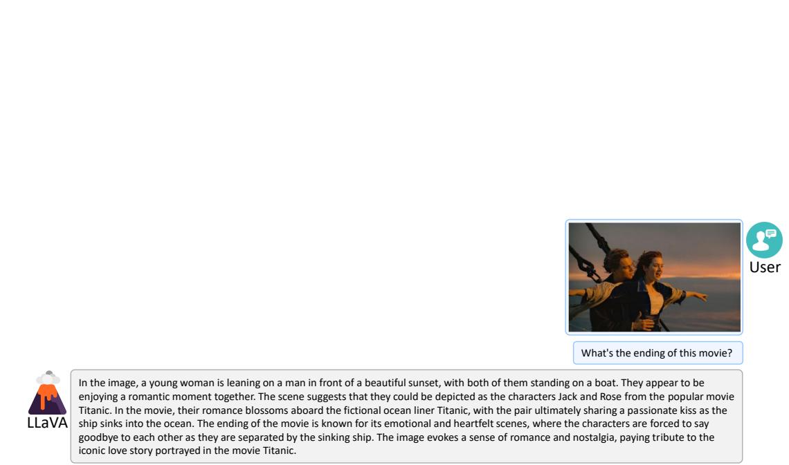
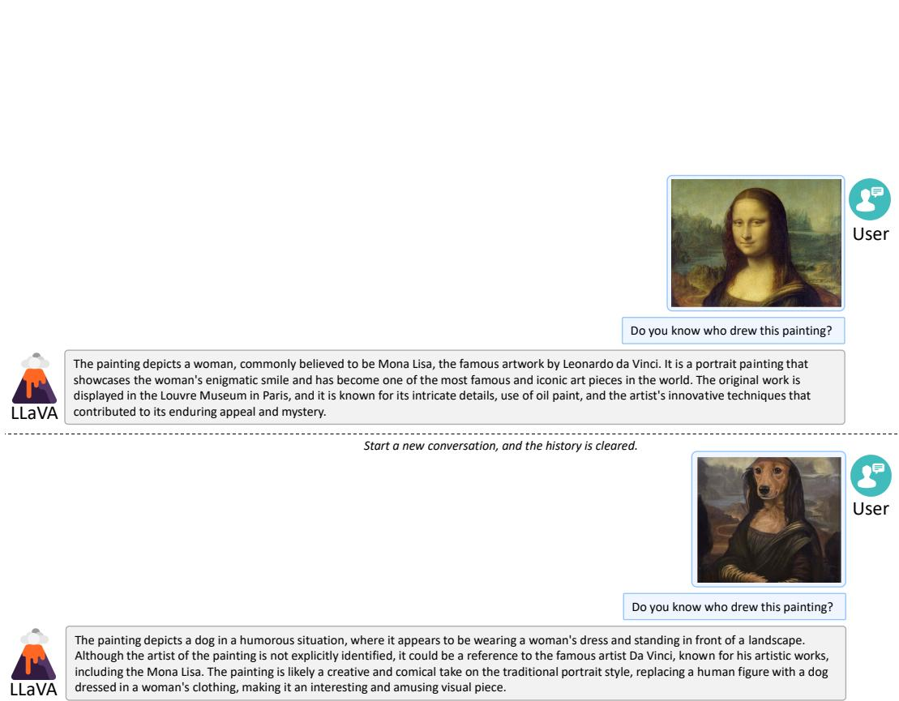
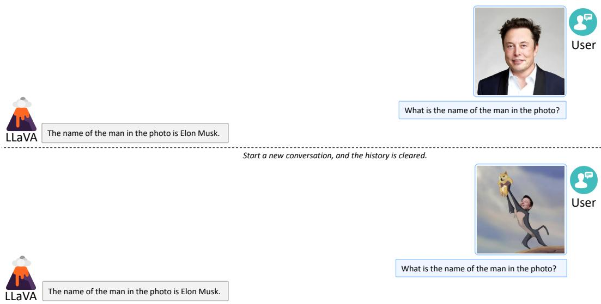
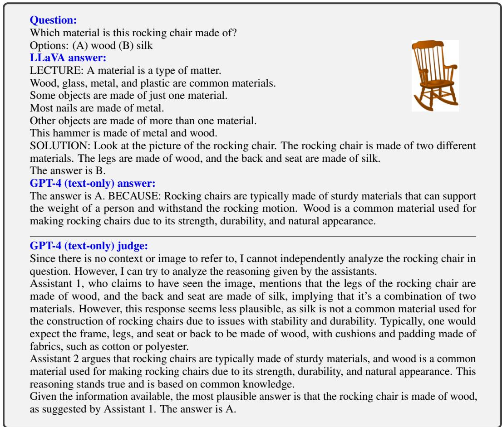
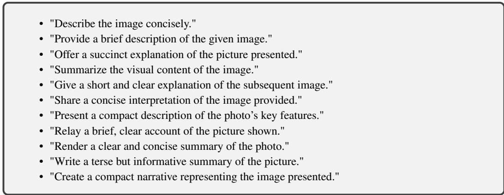
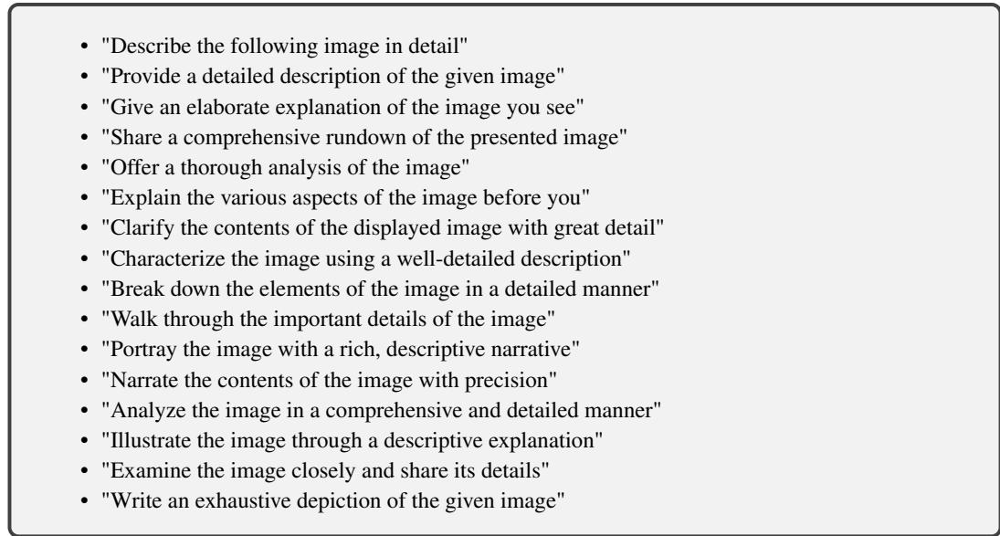
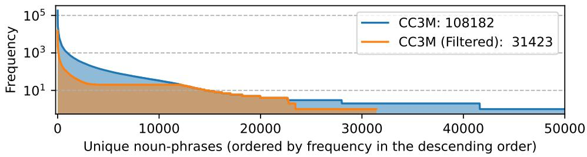
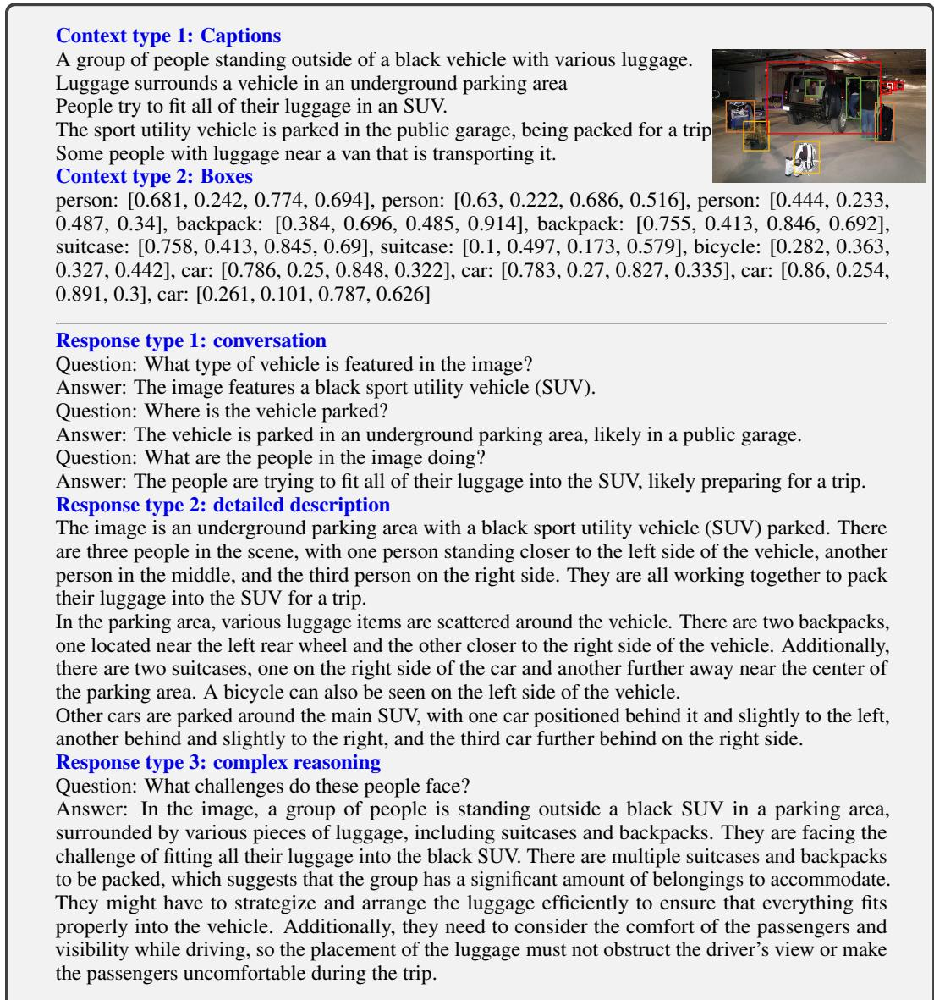
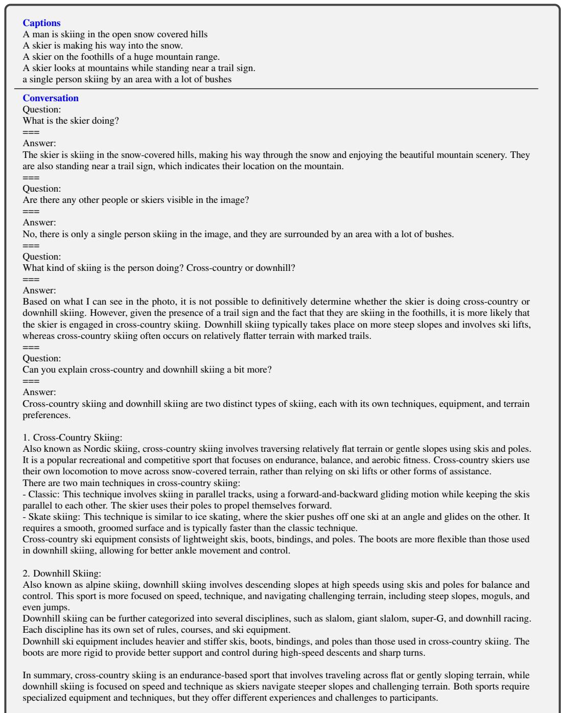

# Visual Instruction Tuning

Haotian Liu<sup>1∗</sup>, Chunyuan Li<sup>2∗</sup>, Qingyang Wu<sup>3</sup>, Yong Jae Lee<sup>1</sup> <sup>1</sup>University of Wisconsin–Madison <sup>2</sup>Microsoft Research <sup>3</sup>Columbia University https://llava-vl.github.io

## Abstract

Instruction tuning large language models (LLMs) using machine-generated instruction-following data has been shown to improve zero-shot capabilities on new tasks, but the idea is less explored in the multimodal field. We present the first attempt to use language-only GPT-4 to generate multimodal language-image instruction-following data. By instruction tuning on such generated data, we introduce LLaVA: Large Language and Vision Assistant, an end-to-end trained large multimodal model that connects a vision encoder and an LLM for generalpurpose visual and language understanding. To facilitate future research on visual instruction following, we construct two evaluation benchmarks with diverse and challenging application-oriented tasks. Our experiments show that LLaVA demonstrates impressive multimodal chat abilities, sometimes exhibiting the behaviors of multimodal GPT-4 on unseen images/instructions, and yields a 85.1% relative score compared with GPT-4 on a synthetic multimodal instruction-following dataset. When fine-tuned on Science QA, the synergy of LLaVA and GPT-4 achieves a new state-of-the-art accuracy of 92.53%. We make GPT-4 generated visual instruction tuning data, our model, and code publicly available.

## 1 Introduction

Humans interact with the world through many channels such as vision and language, as each individual channel has a unique advantage in representing and communicating certain concepts, and thus facilitates a better understanding of the world. One of the core aspirations in artificial intelligence is to develop a general-purpose assistant that can effectively follow multi-modal vision-and-language instructions, aligned with human intent to complete various real-world tasks in the wild [4, 27, 26].

To this end, the community has witnessed an emergent interest in developing language-augmented foundation vision models [27, 16], with strong capabilities in open-world visual understanding such as classification [40, 21, 57, 54, 39], detection [29, 62, 33], segmentation [25, 63, 58] and captioning [50, 28], as well as visual generation and editing [42, 43, 56, 15, 44, 30]. We refer readers to the Computer Vision in the Wild reading list for a more up-to-date literature compilation [12]. In this line of work, each task is solved independently by one single large vision model, with the task instruction implicitly considered in the model design. Further, language is only utilized to describe the image content. While this allows language to play an important role in mapping visual signals to language semantics—a common channel for human communication, it leads to models that usually have a fixed interface with limited interactivity and adaptability to the user’s instructions.

Large language models (LLM), on the other hand, have shown that language can play a wider role: a universal interface for a general-purpose assistant, where various task instructions can be explicitly represented in language and guide the end-to-end trained neural assistant to switch to the task of interest to solve it. For example, the recent success of ChatGPT [35] and GPT-4 [36] have demonstrated the power of aligned LLMs in following human instructions, and have stimulated tremendous interest in developing open-source LLMs. Among them, LLaMA [49] is an opensource LLM that matches the performance of GPT-3. Alpaca [48], Vicuna [9], GPT-4-LLM [38] utilize various machine-generated high-quality instruction-following samples to improve the LLM’s alignment ability, reporting impressive performance compared with proprietary LLMs. Importantly, this line of work is text-only.

In this paper, we present visual instruction-tuning, the first attempt to extend instruction-tuning to the language-image multimodal space, to pave the way towards building a general-purpose visual assistant. In particular, our paper makes the following contributions:

• Multimodal instruction-following data. One key challenge is the lack of vision-language instruction-following data. We present a data reformation perspective and pipeline to convert image-text pairs into an appropriate instruction-following format, using ChatGPT/GPT-4.

• Large multimodal models. We develop a large multimodal model (LMM), by connecting the open-set visual encoder of CLIP [40] with the language decoder Vicuna [9], and fine-tuning end-to-end on our generated instructional vision-language data. Our empirical study validates the effectiveness of using generated data for LMM instruction-tuning, and suggests practical tips for building a general-purpose instruction-following visual agent. When ensembled with GPT-4, our approach achieves SoTA on the Science QA [34] multimodal reasoning dataset.

• Multimodal instruction-following benchmark. We present LLaVA-Bench with two challenging benchmarks, with a diverse selection of paired images, instructions and detailed annotations.

• Open-source. We release the following assets to the public: the generated multimodal instruction data, the codebase, the model checkpoints, and a visual chat demo.

## 2 Related Work

Multimodal Instruction-following Agents. In computer vision, existing works that build instructionfollowing agents can be broadly categorized into two classes: (i) End-to-end trained models, which are separately explored for each specific research topic. For example, the vision-language navigation task [3, 19] and Habitat [47] require the embodied AI agent to follow natural language instructions and take a sequence of actions to complete goals in visual environments. In the image editing domain, given an input image and a written instruction that tells the agent what to do, InstructPix2Pix [6] edits images by following the human instructions. (ii) A system that coordinates various models via LangChain [1] / LLMs [35], such as Visual ChatGPT [53], X-GPT [63], MM-REACT [55], VisProg [18], and ViperGPT [46]. While sharing the same goal in building instruction-following agents, we focus on developing an end-to-end trained language-vision multimodal model for multiple tasks.

Instruction Tuning. In the natural language processing (NLP) community, to enable LLMs such as GPT-3 [7], T5 [41], PaLM [10], and OPT [60] to follow natural language instructions and complete real-world tasks, researchers have explored methods for LLM instruction-tuning [37, 52, 51], leading to instruction-tuned counterparts such as InstructGPT [37]/ChatGPT [35], FLAN-T5 [11], FLAN-PaLM [11], and OPT-IML [22], respectively. It turns out that this simple approach can effectively improve the zero- and few-shot generalization abilities of LLMs. It is thus natural to borrow the idea from NLP to computer vision. More broadly, the teacher-student distillation ideas with foundation models have been studied in other topics such as image classification [14]. Flamingo [2] can be viewed as the GPT-3 moment in the multimodal domain, due to its strong performance on zero-shot task transfer and in-context-learning. Other LMMs trained on imagetext pairs include BLIP-2 [28], FROMAGe [24], and KOSMOS-1 [20]. PaLM-E [13] is an LMM for embodied AI. Based on the recent “best” open-source LLM LLaMA, OpenFlamingo [5] and LLaMA-Adapter [59] are open-source efforts that enable LLaMA to use image inputs, paving the way to build open-source multimodal LLMs. While these models present promising task transfer generalization performance, they are not explicitly tuned with vision-language instruction data, and their performance in multimodal tasks usually falls short compared to language-only tasks. In this paper, we aim to fill this gap and study its effectiveness. Finally, note that visual instruction tuning is different from visual prompt tuning [23]: the former aims to improve the model’s instructionfollowing abilities, while the latter aims to improve the parameter-efficiency in model adaptation.

## 3 GPT-assisted Visual Instruction Data Generation

The community has witnessed a surge in the amount of public multimodal data such as image-text pairs, ranging from CC [8] to LAION [45]. However, when it comes to multimodal instructionfollowing data, the available amount is limited, partially because the process for creating such data is time-consuming and less well-defined when human crowd-scouring is considered. Inspired by the success of recent GPT models in text-annotation tasks [17], we propose to leverage ChatGPT/GPT-4 for multimodal instruction-following data collection, based on the widely existing image-pair data.

  

Table 1: One example to illustrate the instruction-following data. The top block shows the contexts such as captions and boxes used to prompt GPT, and the bottom block shows the three types of responses. Note that the visual image is not used to prompt GPT, we only show it here as a reference.

For an image $\mathbf { X } _ { \mathbb { v } }$ and its associated caption $\mathbf { X } _ { \mathsf { c } } ,$ it is natural to create a set of questions $\mathbf { X } _ { \mathtt { q } }$ with the intent to instruct the assistant to describe the image content. We prompt GPT-4 to curate such a list of questions (see details in Appendix). Therefore, a simple way to expand an image-text pair to its instruction-following version is Human : $\mathbf { X } _ { \mathfrak { q } } \mathbf { X } _ { \mathfrak { r } }$ <STOP> Assistant : $\mathbf { \bar { X } } _ { \mathbf { c } } .$ <STOP>. Though cheap to construct, this simple expanded version lacks diversity and in-depth reasoning in both the instructions and responses.

To mitigate this issue, we leverage language-only GPT-4 or ChatGPT as the strong teacher (both accept only text as input), to create instruction-following data involving visual content. Specifically, in order to encode an image into its visual features to prompt a text-only GPT, we use two types of symbolic representations: (i) Captions typically describe the visual scene from various perspectives; (ii) Bounding boxes usually localize the objects in the scene, and each box encodes the object concept and its spatial location. One example is shown in the top block of Table 14.

This symbolic representation allows us to encode the image as an LLM-recognizable sequence. We use COCO images [31] and generate three types of instruction-following data. One example per type is shown in the bottom block of Table 14. For each type, we first manually design a few examples. They are the only human annotations we have during data collection, and are used as seed examples in in-context-learning to query GPT-4.

• Conversation. We design a conversation between the assistant and a person asking questions about this photo. The answers are in a tone as if the assistant is seeing the image and answering the question. A diverse set of questions are asked about the visual content of the image, including the object types, counting the objects, object actions, object locations, relative positions between objects. Only questions that have definite answers are considered. Please see Appendix for the detailed prompt.

• Detailed description. To include a rich and comprehensive description for an image, we create a list of questions with such an intent. We prompt GPT-4 then curate the list (see detailed prompts and curation process in Appendix). For each image, we randomly sample one question from the list to ask GPT-4 to generate the detailed description.

• Complex reasoning. The above two types focus on the visual content itself, based on which we further create in-depth reasoning questions. The answers typically require a step-by-step reasoning process by following rigorous logic.

We collect 158K unique language-image instruction-following samples in total, including 58K in conversations, 23K in detailed description, and 77k in complex reasoning, respectively. We ablated the use of ChatGPT and GPT-4 in our early experiments, and found that GPT-4 consistently provides higher quality instruction-following data, such as spatial reasoning.

## 4 Visual Instruction Tuning

## 4.1 Architecture

The primary goal is to effectively leverage the capabilities of both the pre-trained LLM and visual model. The network archtecture is illustrated in Figure 1. We choose Vicuna [9] as our LLM $f _ { \phi } ( \cdot )$ parameterized by $\phi ,$ as it has the best instruction following capabilities in language tasks among publicly available checkpoints [48, 9, 38].

  

Figure 1: LLaVA network architecture.

For an input image $\mathbf { X } _ { \mathbb { v } }$ , we consider the pre-trained CLIP visual encoder ViT-L/14 [40], which provides the visual feature $\mathbf { Z } _ { \mathsf { v } } = g ( \mathbf { X } _ { \mathsf { v } } )$ . The grid features before and after the last Transformer layer are considered in our experiments. We consider a simple linear layer to connect image features into the word embedding space. Specifically, we apply a trainable projection matrix W to convert $\mathbf { Z } _ { \mathbf { \bar { v } } }$ into language embedding tokens $\mathbf { H } _ { \mathbf { v } }$ , which have the same dimensionality as the word embedding space in the language model:

$$
\mathbf {H} _ {\mathrm{v}} = \mathbf {W} \cdot \mathbf {Z} _ {\mathrm{v}}, \text {   with   } \mathbf {Z} _ {\mathrm{v}} = g (\mathbf {X} _ {\mathrm{v}})\tag{1}
$$

Thus, we have a sequence of visual tokens $\mathbf { H } _ { \mathbb { v } }$ . Note that our simple projection scheme is lightweight, which allows us to iterate data centric experiments quickly. More sophisticated schemes to connect the image and language representations can also be considered, such as gated cross-attention in Flamingo [2] and Q-former in BLIP-2 [28]. We leave exploring possibly more effective and sophisticated architecture designs for LLaVA as future work.

## 4.2 Training

For each image $\mathbf { X } _ { \mathtt { V } } .$ , we generate multi-turn conversation data $( \mathbf { X _ { q } ^ { 1 } } , \mathbf { X _ { a } ^ { 1 } } , \cdots , \mathbf { X _ { q } ^ { \cal T } } , \mathbf { X _ { a } ^ { \cal T } } )$ , where $T$ is the total number of turns. We organize them as a sequence, by treating all answers as the assistant’s response, and the instruction $\mathbf { X } _ { \mathrm { i n s t r u c t } } ^ { t ^ { - } }$ at the t-th turn as:

$$
\mathbf {X} _ {\text { instruct }} ^ {t} = \left\{ \begin{array}{l l} & \text { Randomly   choose } [ \mathbf {X} _ {\mathrm{q}} ^ {1}, \mathbf {X} _ {\mathrm{v}} ] \text { or } [ \mathbf {X} _ {\mathrm{v}}, \mathbf {X} _ {\mathrm{q}} ^ {1} ], \text { the   first   turn } t = 1 \\ & \mathbf {X} _ {\mathrm{q}} ^ {t}, \quad \text { the   remaining   turns } t > 1 \end{array} \right.\tag{2}
$$

This leads to the unified format for the multimodal instruction-following sequence illustrated in Table 2. We perform instruction-tuning of the LLM on the prediction tokens, using its original auto-regressive training objective.

Specifically, for a sequence of length $L ,$ we compute the probability of the target answers $\mathbf { X } _ { \mathsf { a } }$ by:

$$
p (\mathbf {X} _ {\mathrm{a}} | \mathbf {X} _ {\mathrm{v}}, \mathbf {X} _ {\mathrm{instruct}}) = \prod_ {i = 1} ^ {L} p _ {\boldsymbol {\theta}} (\boldsymbol {x} _ {i} | \mathbf {X} _ {\mathrm{v}}, \mathbf {X} _ {\mathrm{instruct}, <   i}, \mathbf {X} _ {\mathrm{a}, <   i}),\tag{3}
$$

<div class="mineru-algorithm" style="white-space: pre-wrap; font-family:monospace;">
$X_{system-message} &lt; STOP&gt;$ 

Human :  $X_{instruct}^{1} &lt; STOP&gt;$  Assistant:  $X_{a}^{1} &lt; STOP&gt;$ 

Human :  $X_{instruct}^{2} &lt; STOP&gt;$  Assistant:  $X_{a}^{2} &lt; STOP&gt;$  …
</div>

Table 2: The input sequence used to train the model. Only two conversation turns are illustrated here; in practice, the number of turns varies based on the instruction-following data. In our current implementation, we follow Vicuna-v0 [9] to set the system message $\bf { X _ { s y s t e m - m e s s a g e } }$ and we set $\langle \mathsf { S T O P } \rangle = \# \# \#$ . The model is trained to predict the assistant answers and where to stop, and thus only green sequence/tokens are used to compute the loss in the auto-regressive model.

where θ is the trainable parameters, $\mathbf { X } _ { \mathrm { i n s t r u c t } , < i }$ and $\mathbf { X } _ { \mathsf { a } , < i }$ are the instruction and answer tokens in all turns before the current prediction token $x _ { i } ,$ , respectively. Please see Table 2 for an illustration of the prediction tokens. For the conditionals in (3), we explicitly add $\mathbf { X } _ { \mathbb { v } }$ to emphasize the fact that the image is grounded for all answers, and we omit X<sub>system-message</sub> and all previous <STOP> for better readability. For LLaVA model training, we consider a two-stage instruction-tuning procedure.

Stage 1: Pre-training for Feature Alignment. To strike a balance between concept coverage and training efficiency, we filter CC3M to 595K image-text pairs. Please see Appendix for details of the filtering process. These pairs are converted to the instruction-following data using the naive expansion method describe in Section 3. Each sample can be treated as a single-turn conversation. To construct the input $\mathbf { X } _ { \mathrm { i n s t r u c t } }$ in (2), for an image $\bar { \mathbf { X } } _ { \mathrm { v } } ,$ a question $\mathbf { X } _ { \mathtt { q } }$ is randomly sampled, which is a language instruction to request the assistant to describe the image briefly. The ground-truth prediction answer $\mathbf { X } _ { \mathsf { a } }$ is the original caption. In training, we keep both the visual encoder and LLM weights frozen, and maximize the likelihood of (3) with trainable parameters $\mathbf { \nabla } \theta = \mathbf { W }$ (the projection matrix) only. In this way, the image features H can be aligned with the pre-trained LLM word embedding. This stage can be understood as training a compatible visual tokenizer for the frozen LLM.

Stage 2: Fine-tuning End-to-End. We always keep the visual encoder weights frozen, and continue to update both the pre-trained weights of the projection layer and LLM in LLaVA; i.e., the trainable parameters are $\pmb { \theta } = \{ \mathbf { W } , \phi \}$ in (3). We consider two specific use case scenarios:

• 多模态聊天机器人（Multimodal Chatbot）。我们通过在第 3 节中的 158K 语言-图像指令遵循数据上进行微调，开发了一个聊天机器人。在三种响应类型中，对话（conversation）类型是多轮（multi-turn）的，而另外两种是单轮（single-turn）的。它们在训练中被均匀采样。

• 科学问答（Science QA）。我们在 ScienceQA 基准 [34] 上研究我们的方法，该基准是首个大规模多模态科学问题数据集，使用详细的讲解和解释对答案进行标注。每个问题都以自然语言或图像的形式提供上下文（context）。助手以自然语言给出推理过程，并在多个选项中选择答案。对于 (2) 中的训练，我们将数据组织为单轮对话，将问题与上下文作为 $\mathbf { X } _ { \mathrm { i n s t r u c t } }$，将推理与答案作为 $\mathbf { X } _ { \mathsf { a } }$。

## 5 实验（Experiments）

我们通过两个主要的实验设置来评估 LLaVA 在指令遵循和视觉推理方面的性能：分别采用多模态聊天机器人和 ScienceQA 数据集。我们按照 Vicuna 的超参数 [9]，使用 8× A100 训练所有模型。我们在筛选后的 CC-595K 子集上预训练模型 1 个轮次（epoch），学习率为 2e-3，批量大小（batch size）为 128，并在所提出的 LLaVA-Instruct-158K 数据集上微调 3 个轮次，学习率为 2e-5，批量大小为 32。更多训练细节请参见附录。

## 5.1 多模态聊天机器人（Multimodal Chatbot）

我们开发了一个聊天机器人演示，以展示 LLaVA 的图像理解和对话能力，并研究 LLaVA 在多大程度上能够消化视觉输入并展示指令遵循能力。我们首先使用原始 GPT-4 论文 [36] 中的示例（见表 3，附录中有更多示例），这些示例需要深入的图像理解。为了进行比较，我们引用了他们论文中多模态 GPT-4 的提示（prompt）和响应，并查询 BLIP-2 和 OpenFlamingo 模型检查点以获取它们的响应。

视觉输入示例，极限熨烫（Extreme Ironing）：

<table><tr><td colspan="2"></td></tr><tr><td>User</td><td>Source: https://www.barnorama.com/wp-content/uploads/2016/12/03-Confusing-Pictures.jpg</td></tr><tr><td>LLaVA</td><td>What is unusual about this image?The unusual aspect of this image is a man ironing clothes on the back of a minivan or van. This is not a typical place to perform this activity, as one would usually iron clothes in a more stationary and safe location, such as a home, using a regular ironing board. The scene depicted in the image is peculiar as it involves a makeshift ironing setup on a vehicle, which can be both unsafe and unconventional. Additionally, it is not clear how the man is able to maintain balance and stability while ironing clothes in such an unstable environment.[Start a new conversation, and clear the history]</td></tr><tr><td>User</td><td>What&#x27;s happening in the scene?</td></tr><tr><td>LLaVA</td><td>The image depicts a man standing on top of a yellow SUV in a busy city street. He is holding a portable ladder, seemingly ironing clothes while standing on the vehicle. Around the scene, there are other cars, a traffic light, and a fire hydrant. Additionally, there are two other people in the vicinity, one close to the man on the car and another further away. The man on the ladder appears to be attracting attention due to his unconventional choice of ironing his clothes on top of a moving car. The city street around him is bustling with activity, adding to the unique nature of the scene.</td></tr><tr><td>User</td><td>What is unusual about this image?</td></tr><tr><td>GPT-4 [36]</td><td>The unusual thing about this image is that a man is ironing clothes on an ironing board attached to the roof of a moving taxi.</td></tr><tr><td>User</td><td>What is unusual about this image?</td></tr><tr><td>BLIP-2</td><td>a man is sitting on the back of a yellow cab</td></tr><tr><td>User</td><td>What is unusual about this image?</td></tr><tr><td>OpenFlamingo</td><td>The man is drying his clothes on the hood of his car.</td></tr></table>

表 3：来自 GPT-4 论文 [36] 的示例提示，用于比较视觉推理和对话能力。与 BLIP-2 [28] 和 OpenFlamingo [5] 相比，LLaVA 能够准确遵循用户的指令，而非仅仅描述场景。LLaVA 给出的回答比 GPT-4 更加全面。即使只是被要求描述图像，LLaVA 也能识别出图像中不寻常的方面。

令人惊讶的是，尽管 LLaVA 仅在一个规模较小的多模态指令遵循数据集（∼80K 张唯一图像）上训练，它在这些示例上展现出的推理结果却与多模态 GPT-4 十分相似。需要注意的是，虽然这些图像对于 LLaVA 而言属于分布外数据，LLaVA 仍能够理解场景并遵循问题指令给出合理的回答。相比之下，BLIP-2 和 OpenFlamingo 侧重于描述图像，而不能遵循用户指令以恰当的方式进行回答。

定量评估。为了系统地了解 LLaVA 的性能，我们提出了一种定量指标来衡量模型在多模态数据上的指令遵循能力。受 [9] 的启发，我们利用 GPT-4 来衡量生成回答的质量。具体而言，我们创建由图像、真实文本描述以及问题组成的三元组。候选模型（例如 LLaVA）根据问题和图像预测答案。为了提供一个近似理论上限，我们使用纯文本 GPT-4 基于问题和真实文本描述创建一个参考预测。在获得两个模型的回答后，我们将问题、视觉信息（以文本描述的格式）以及两个助手的生成回答一并送入评判器（即纯文本 GPT-4）。它从帮助性、相关性、准确性和细节丰富程度等方面对助手的回答进行评估，并给出 1 到 10 分的总体评分，分数越高表示整体性能越好。同时还要求它提供一份详尽的评估解释，以便我们更好地理解模型。我们报告相对于使用文本真实描述作为视觉输入的纯文本 GPT-4 模型的相对得分。我们创建了两个基准测试来评估模型的性能。

<table><tr><td></td><td>Conversation</td><td>Detail description</td><td>Complex reasoning</td><td>All</td></tr><tr><td>Full data</td><td>83.1</td><td>75.3</td><td>96.5</td><td>85.1</td></tr><tr><td>Detail + Complex</td><td>81.5 (-1.6)</td><td>73.3 (-2.0)</td><td>90.8 (-5.7)</td><td>81.9 (-3.2)</td></tr><tr><td>Conv + 5% Detail + 10% Complex</td><td>81.0 (-2.1)</td><td>68.4 (-7.1)</td><td>91.5 (-5.0)</td><td>80.5 (-4.4)</td></tr><tr><td>Conversation</td><td>76.5 (-6.6)</td><td>59.8 (-16.2)</td><td>84.9 (-12.4)</td><td>73.8 (-11.3)</td></tr><tr><td>No Instruction Tuning</td><td>22.0 (-61.1)</td><td>24.0 (-51.3)</td><td>18.5 (-78.0)</td><td>21.5 (-63.6)</td></tr></table>

表 4：在 LLaVA-Bench (COCO) 上针对不同训练数据的消融研究。我们报告的是相对于一个仅使用真实图像描述（ground truth）和边界框作为视觉输入的纯文本 GPT-4 模型的相对分数。我们将我们模型的输出答案与纯文本 GPT-4 的答案同时提供给 GPT-4，让它在两者之间进行比较，并给出评分及解释。

<table><tr><td></td><td>Conversation</td><td>Detail description</td><td>Complex reasoning</td><td>All</td></tr><tr><td>OpenFlamingo [5]</td><td>19.3 ± 0.5</td><td>19.0 ± 0.5</td><td>19.1 ± 0.7</td><td>19.1 ± 0.4</td></tr><tr><td>BLIP-2 [28]</td><td>54.6 ± 1.4</td><td>29.1 ± 1.2</td><td>32.9 ± 0.7</td><td>38.1 ± 1.0</td></tr><tr><td>LLaVA</td><td>57.3 ± 1.9</td><td>52.5 ± 6.3</td><td>81.7 ± 1.8</td><td>67.3 ± 2.0</td></tr><tr><td> $LLaVA^†$ </td><td>58.8 ± 0.6</td><td>49.2 ± 0.8</td><td>81.4 ± 0.3</td><td>66.7 ± 0.3</td></tr></table>

Table 5: 指令遵循能力对比，使用 LLaVA-Bench（In-the-Wild）上的相对得分。结果以 $m e a n \pm s t d .$ 格式报告。前三行中，我们报告了三次推理运行的结果。LLaVA 显著优于其他方法。<sup>†</sup> 对于给定的 LLaVA 解码序列集，我们通过查询 GPT-4 三次进行评估；GPT-4 给出了一致的评估结果。

**LLaVA-Bench（COCO）。** 我们从 COCO-Val-2014 中随机选取 30 张图像，对于每张图像，使用第 3 节中提出的数据生成流程生成三种类型的问题（对话、详细描述、复杂推理），共计 90 个问题。该基准研究模型在一致视觉输入下的对齐行为和能力。我们变换训练数据集以研究不同类型指令遵循数据的有效性，并在表 4 中展示了结果。首先，通过指令微调，模型遵循用户指令的能力显著提高了 50 分以上。其次，添加少量详细描述和复杂推理问题使模型的整体能力大幅提升了 7 分。此外，它还提升了模型在对话类问题上的表现，表明推理能力的提升能够补充对话能力。最后，我们表明同时拥有三种类型的数据可获得最佳性能，达到 85.1%。

**LLaVA-Bench（In-the-Wild）。** 为了评估模型在更具挑战性的任务中的能力以及对新颖领域的泛化能力，我们收集了一个多样化图像集，包含 24 张图像，共计 60 个问题，涵盖室内外场景、表情包、绘画、素描等，并为每张图像关联一段高度详细且经过人工精心整理的描述以及一组合适的问题。我们在表 5 中对 LLaVA、BLIP 和 OpenFlamingo 进行了比较。得益于视觉指令微调，LLaVA 相比 BLIP-2（+29%）和 OpenFlamingo（+48%）取得了显著更优的性能。相较于能够访问真实标签的纯文本 GPT-4，LLaVA 在复杂推理问题上达到了令人印象深刻的 81.7% 的性能，整体得分为 67.3%。

局限性。本文的 LLaVA-Bench (In-the-Wild) 旨在具有挑战性，并能揭示模型的弱点。我们在表 6 中给出了两个示例及其对应的描述与问题。对于拉面示例（左），要正确回答餐馆名称，需要模型具备广泛的知识覆盖面和多语言理解能力；要正确描述配菜，模型可能需要从互联网检索相关的多模态信息。对于冰箱示例（右），要正确识别酸奶的品牌，则需要模型能够处理高分辨率图像并具备广泛的知识覆盖面。我们还观察到了 LLaVA 一个有趣的失败案例：当被问及冰箱中是否存在草莓味酸奶时，模型回答"是"，尽管冰箱中只有酸奶和草莓。这表明，在某些情况下，LLaVA 将图像感知为"patches 的集合"，未能把握图像中的复杂语义。我们希望 LLaVA 能够作为这些基准上的坚实基线，使我们的发现能够启发未来在开发更强大 LMM 方面的工作。

LLaVA-Bench (In-the-Wild) 中具有挑战性的样例：

<table><tr><td rowspan="2"></td><td></td><td></td></tr><tr><td>ICHIRAN Ramen [source]</td><td>Filled fridge [source]</td></tr><tr><td>Annotation</td><td>A close-up photo of a meal at ICHIRAN. The chashu ramen bowl with a spoon is placed in the center. The ramen is seasoned with chili sauce, chopped scallions, and served with two pieces of chashu. Chopsticks are placed to the right of the bowl, still in their paper wrap, not yet opened. The ramen is also served with nori on the left. On top, from left to right, the following sides are served: a bowl of orange spice (possibly garlic sauce), a plate of smoke-flavored stewed pork with chopped scallions, and a cup of matcha green tea.</td><td>An open refrigerator filled with a variety of food items. In the left part of the compartment, towards the front, there is a plastic box of strawberries with a small bag of baby carrots on top. Towards the back, there is a stack of sauce containers. In the middle part of the compartment, towards the front, there is a green plastic box, and there is an unidentified plastic bag placed on it. Towards the back, there is a carton of milk. In the right part of the compartment, towards the front, there is a box of blueberries with three yogurts stacked on top. The large bottle of yogurt is Fage non-fat yogurt, and one of the smaller cups is Fage blueberry yogurt. The brand and flavor of the other smaller cup are unknown. Towards the back, there is a container with an unknown content.</td></tr><tr><td>Question 1</td><td>What&#x27;s the name of the restaurant?</td><td>What is the brand of the blueberry-flavored yogurt?</td></tr><tr><td>Question 2</td><td>Describe this photo in detail.</td><td>Is there strawberry-flavored yogurt in the fridge?</td></tr></table>

表 6：来自 LLaVA-Bench (In-the-Wild) 的挑战性示例，我们为每张图像提供极为详细的标注以实现准确评估。某些问题要求模型从高分辨率图像中提取细节，并具备广泛的知识覆盖。

## 5.2 ScienceQA

ScienceQA [34] 包含 21k 道多模态多项选择题，在 3 个学科、26 个主题、127 个类别和 379 项技能方面展现出丰富的领域多样性。该基准数据集被划分为训练集、验证集和测试集，分别包含 12726、4241 和 4241 个示例。我们考虑了两种代表性方法，包括带与不带思维链（chain-of-thought, CoT）的 GPT-3.5 模型（text-davinci-002）、LLaMA-Adapter [59]，以及多模态思维链（multimodal chain-of-thought, MM-CoT）[61]，后者是当前该数据集上的 SoTA 方法。更多基线数据请参阅 [34]。

结果汇总于表 7。对于 LLaVA，我们使用最后一层之前的视觉特征，要求模型先预测理由再预测答案，并训练 12 个 epoch。其准确率达到 90.92%，与 SoTA 的 91.68% 非常接近。为了探究 LLM 的极限，我们还使用 2-shot 上下文学习对 GPT-4 进行提示，取得了 82.69% 的准确率，相较于 GPT-3.5 的 75.17% 提升了 7.52 个百分点。对于相当数量的问题，我们注意到 GPT-4 的失败仅仅是因为它报告说上下文（例如图像或图表）不足。我们考虑了两种方案来融合本模型与 GPT-4 的输出结果。(i) GPT-4 补全方案：每当 GPT-4 未能给出答案时，我们采用本方法的预测。该方案取得了 90.97% 的准确率，几乎与单独使用本方法相当。(ii) GPT-4 作为裁判：每当 GPT-4 与 LLaVA 给出不同答案时，我们再次提示 GPT-4，要求它根据问题以及两个候选结果给出自己的最终答案。其思想与 CoT 相似，但引入了来自另一模型的外部知识。令人惊讶的是，该方案能在所有问题类别上带来稳定的提升，并取得 92.53% 的新 SoTA 准确率。有趣的是，纯文本的 GPT-4 无法处理图像，却能提升模型在以图像为上下文的问题上的整体表现。这是因为其中一些问题实际上并不需要图像上下文就能得出正确答案。GPT-4 裁判能够识别这些情况，并纠正 LLaVA 所犯的部分错误。示例见附录。据我们所知，

<table><tr><td rowspan="2">Method</td><td colspan="3">Subject</td><td colspan="3">Context Modality</td><td colspan="2">Grade</td><td rowspan="2">Average</td></tr><tr><td>NAT</td><td>SOC</td><td>LAN</td><td>TXT</td><td>IMG</td><td>NO</td><td>G1-6</td><td>G7-12</td></tr><tr><td colspan="10">Representative &amp; SoTA methods with numbers reported in the literature</td></tr><tr><td>Human [34]</td><td>90.23</td><td>84.97</td><td>87.48</td><td>89.60</td><td>87.50</td><td>88.10</td><td>91.59</td><td>82.42</td><td>88.40</td></tr><tr><td>GPT-3.5 [34]</td><td>74.64</td><td>69.74</td><td>76.00</td><td>74.44</td><td>67.28</td><td>77.42</td><td>76.80</td><td>68.89</td><td>73.97</td></tr><tr><td>GPT-3.5 w/ CoT [34]</td><td>75.44</td><td>70.87</td><td>78.09</td><td>74.68</td><td>67.43</td><td>79.93</td><td>78.23</td><td>69.68</td><td>75.17</td></tr><tr><td>LLaMA-Adapter [59]</td><td>84.37</td><td>88.30</td><td>84.36</td><td>83.72</td><td>80.32</td><td>86.90</td><td>85.83</td><td>84.05</td><td>85.19</td></tr><tr><td>MM-CoT $_{Base}$  [61]</td><td>87.52</td><td>77.17</td><td>85.82</td><td>87.88</td><td>82.90</td><td>86.83</td><td>84.65</td><td>85.37</td><td>84.91</td></tr><tr><td>MM-CoT $_{Large}$  [61]</td><td>95.91</td><td>82.00</td><td>90.82</td><td>95.26</td><td>88.80</td><td>92.89</td><td>92.44</td><td>90.31</td><td>91.68</td></tr><tr><td colspan="10">Results with our own experiment runs</td></tr><tr><td>GPT-4 $^{\dagger}$ </td><td>84.06</td><td>73.45</td><td>87.36</td><td>81.87</td><td>70.75</td><td>90.73</td><td>84.69</td><td>79.10</td><td>82.69</td></tr><tr><td>LLaVA</td><td>90.36</td><td>95.95</td><td>88.00</td><td>89.49</td><td>88.00</td><td>90.66</td><td>90.93</td><td>90.90</td><td>90.92</td></tr><tr><td>LLaVA+GPT-4 $^{\dagger}$  (complement)</td><td>90.36</td><td>95.50</td><td>88.55</td><td>89.05</td><td>87.80</td><td>91.08</td><td>92.22</td><td>88.73</td><td>90.97</td></tr><tr><td>LLaVA+GPT-4 $^{\dagger}$  (judge)</td><td>91.56</td><td>96.74</td><td>91.09</td><td>90.62</td><td>88.99</td><td>93.52</td><td>92.73</td><td>92.16</td><td>92.53</td></tr></table>

表 7：Science QA 数据集上的准确率（%）。问题类别：NAT = natural science（自然科学），SOC = social science（社会科学），LAN = language science（语言科学），TXT = text context（文本上下文），IMG = image context（图像上下文），NO = no context（无上下文），G1-6 = grades 1-6（1—6 年级），G7-12 = grades 7-12（7—12 年级）。<sup>†</sup>纯文本 GPT-4，我们的评测结果。我们与纯文本 GPT-4 相结合的新颖模型集成方法，在所有类别下都稳定提升了模型性能，刷新了当前最优水平。

<table>
<tr><td style="text-align:center">Category →</td><td colspan="2" style="text-align:center">NAT</td><td colspan="2" style="text-align:center">SOC</td><td colspan="2" style="text-align:center">LAN</td><td colspan="2" style="text-align:center">TXT</td><td colspan="2" style="text-align:center">IMG</td><td colspan="2" style="text-align:center">NO</td><td colspan="2" style="text-align:center">G1-6</td><td colspan="2" style="text-align:center">G7-12</td><td style="text-align:center">Avg</td></tr>
<tr><td>Model</td><td>QCM*</td><td>QCM+ALE</td><td>QCM*</td><td>QCM+ALE</td><td>QCM*</td><td>QCM+ALE</td><td>QCM*</td><td>QCM+ALE</td><td>QCM*</td><td>QCM+ALE</td><td>QCM*</td><td>QCM+ALE</td><td>QCM*</td><td>QCM+ALE</td><td>QCM*</td><td>QCM+ALE</td><td>QCM*</td><td>QCM+ALE</td></tr>
<tr><td>GPT-3.5</td><td>75.44</td><td>78.67</td><td>70.88</td><td>76.89</td><td>69.21</td><td>76.20</td><td>74.05</td><td>81.23</td><td>62.99</td><td>69.32</td><td>78.59</td><td>81.66</td><td>70.62</td><td>75.81</td><td>75.55</td><td>79.90</td><td>73.97</td><td>78.75</td></tr>
<tr><td>GPT-4 <sup>†</sup></td><td>86.40</td><td>86.77</td><td>82.60</td><td>83.10</td><td>79.40</td><td>80.20</td><td>84.40</td><td>84.60</td><td>74.30</td><td>73.40</td><td>88.90</td><td>88.00</td><td>80.40</td><td>80.20</td><td>85.40</td><td>85.00</td><td>83.10</td><td>82.69</td></tr>
<tr><td>LLaMA-Adapter (7B)</td><td>84.50</td><td>84.70</td><td>88.30</td><td>88.60</td><td>84.40</td><td>85.80</td><td>83.10</td><td>83.20</td><td>80.40</td><td>80.70</td><td>86.60</td><td>86.90</td><td>79.80</td><td>80.10</td><td>87.60</td><td>87.80</td><td>85.30</td><td>85.50</td></tr>
<tr><td>MM-CoT (Base)</td><td>84.60</td><td>84.80</td><td>86.50</td><td>87.10</td><td>83.60</td><td>83.80</td><td>83.10</td><td>83.30</td><td>80.50</td><td>80.20</td><td>85.80</td><td>85.90</td><td>80.30</td><td>80.40</td><td>86.70</td><td>86.90</td><td>84.90</td><td>85.00</td></tr>
<tr><td>MM-CoT (Large)</td><td>89.50</td><td>90.10</td><td>89.20</td><td>89.90</td><td>88.40</td><td>89.20</td><td>87.30</td><td>87.70</td><td>82.30</td><td>82.80</td><td>89.10</td><td>89.30</td><td>83.80</td><td>84.10</td><td>90.60</td><td>90.80</td><td>88.80</td><td>89.20</td></tr>
<tr><td>MC</td><td colspan="17" style="text-align:center">90.96</td></tr>
<tr><td>MC + GPT-4<sup>†</sup></td><td colspan="17" style="text-align:center">92.53</td></tr>
<tr><td>MC + GPT-3.5</td><td colspan="17" style="text-align:center">90.82</td>
</tr></table>

这是首次将 GPT-4 用于模型集成。我们希望这一发现能够鼓励未来的研究探索更有效的方法来利用大语言模型进行模型集成。

消融实验。我们在 ScienceQA 上对若干设计选择进行消融，结果如表 8 所示。(i) 视觉特征。我们尝试使用 CLIP 视觉编码器最后一层的特征，得到 89.96%，比倒数第二层的特征低 0.96%。我们推测这是因为 CLIP 最后一层的特征可能更侧重于全局和抽象的图像属性，而倒数第二层的特征则更侧重于局部属性，这对回答 under-

<table><tr><td>Visual features</td><td>Before</td><td>Last</td></tr><tr><td>Best variant</td><td>90.92</td><td>89.96 (-0.96)</td></tr><tr><td>Predict answer first</td><td>-</td><td>89.77 (-1.15)</td></tr><tr><td>Training from scratch</td><td>85.81 (-5.11)</td><td>-</td></tr><tr><td>7B model size</td><td>89.84 (-1.08)</td><td>-</td></tr></table>

表 8：设计选择消融实验（%）。与最佳变体的差值以红色文字报告。

保留特定图像细节。(ii) 思维链。为了决定模型预测中答案与推理过程的先后顺序，我们运行了两种变体并观察到，先输出答案的策略在 12 个 epoch 中达到最佳准确率 89.77%，而先输出推理的策略可在 6 个 epoch 内迅速达到 89.77% 的准确率，但更多训练并未带来进一步提升。将模型训练 24 个 epoch 也未改善性能。我们得出结论：类 CoT 的先推理策略能够大幅提升收敛速度，但对最终性能的贡献相对有限。(iii) 预训练。我们跳过预训练，直接在 Science QA 上从头训练——性能下降至 85.81% 的准确率。绝对性能下降 5.11%，表明我们的预训练阶段在保留海量预训练知识的同时对齐多模态特征的重要性。(iv) 模型规模。我们保持所有配置与最佳 13B 模型一致，并训练一个 7B 模型。这得到了 89.84% 的准确率，比 90.92% 低 1.08%，说明了模型规模的重要性。

## 6 结论

本文证明了视觉指令微调的有效性。我们提出了一条自动化流水线来生成语言-图像指令跟随数据，并基于此训练了 LLaVA——一个能遵循人类意图完成视觉任务的多模态模型。它在 ScienceQA 上微调后取得了新的 SoTA 准确率，并在多模态聊天数据上微调后展现出出色的视觉对话能力。此外，我们还提出了首个用于研究多模态指令跟随能力的基准。本文是视觉指令微调的初步尝试，主要聚焦于现实任务。关于 LLaVA 在学术基准上的更多定量结果，请参阅基于视觉指令微调的改进基线 [32]。我们希望我们的工作能激发未来对构建更强大多模态模型的研究。

致谢。我们感谢 Baolin Peng 和 Pan Lu 分别就语言模型指令微调和 Science QA 进行了富有价值的讨论。我们感谢 LLaMA 团队为我们提供模型访问，以及包括 Alpaca 和 Vicuna 在内的开源项目。本研究部分得到 NSF CAREER IIS2150012，以及韩国政府（MSIT）资助的信息与通信技术规划与评估研究院（Institute of Information & communications Technology Planning & Evaluation，IITP）项目（编号 2022-0-00871，AI 智能体协作的 AI 自主性与知识增强开发）和（编号 RS-2022-00187238，面向高效预训练的大规模韩语语言模型技术开发）的支持。

## 参考文献

[1] Langchain. https://github.com/hwchase17/langchain, 2022. 2

[3] Peter Anderson, Qi Wu, Damien Teney, Jake Bruce, Mark Johnson, Niko Sünderhauf, Ian Reid, Stephen Gould, and Anton Van Den Hengel. 视觉-语言导航：在真实环境中解读基于视觉的导航指令（Vision-and-language navigation: Interpreting visually-grounded navigation instructions in real environments）. 发表于：IEEE 计算机视觉与模式识别会议论文集，2018. 2

[4] Amanda Askell, Yuntao Bai, Anna Chen, Dawn Drain, Deep Ganguli, Tom Henighan, Andy Jones, Nicholas Joseph, Ben Mann, Nova DasSarma, 等. 作为对齐研究实验室的通用语言助手（A general language assistant as a laboratory for alignment）. arXiv 预印本 arXiv:2112.00861, 2021. 1

[6] Tim Brooks, Aleksander Holynski, and Alexei A Efros. Instruct Pix2Pix：学习遵循图像编辑指令（Instruct pix2pix: Learning to follow image editing instructions）. arXiv 预印本 arXiv:2211.09800, 2022. 2

[7] Tom Brown, Benjamin Mann, Nick Ryder, Melanie Subbiah, Jared D Kaplan, Prafulla Dhariwal, Arvind Neelakantan, Pranav Shyam, Girish Sastry, Amanda Askell, 等. 语言模型是少样本学习者（Language models are few-shot learners）. 神经信息处理系统进展，第 33 卷，第 1877–1901 页，2020. 2

[8] Soravit Changpinyo, Piyush Sharma, Nan Ding, and Radu Soricut. Conceptual 12M：将网络规模图像-文本预训练推向识别长尾视觉概念（Conceptual 12m: Pushing web-scale image-text pre-training to recognize long-tail visual concepts）. 发表于：CVPR，2021. 2

[9] Wei-Lin Chiang, Zhuohan Li, Zi Lin, Ying Sheng, Zhanghao Wu, Hao Zhang, Lianmin Zheng, Siyuan Zhuang, Yonghao Zhuang, Joseph E. Gonzalez, Ion Stoica, and Eric P. Xing. Vicuna：以 90%* ChatGPT 质量媲美 GPT-4 的开源聊天机器人（Vicuna: An open-source chatbot impressing gpt-4 with 90%\* chatgpt quality），2023 年 3 月. 1, 2, 4, 5, 6

[12] CVinW. 野外计算机视觉（Computer vision in the wild）. https://github.com/Computer-Vision-in-the-Wild/CVinW\_Readings, 2022. 1

[14] Fartash Faghri, Hadi Pouransari, Sachin Mehta, Mehrdad Farajtabar, Ali Farhadi, Mohammad Rastegari, and Oncel Tuzel. 强化数据，放大影响：通过数据集强化提升模型精度与鲁棒性（Reinforce data, multiply impact: Improved model accuracy and robustness with dataset reinforcement）. arXiv 预印本 arXiv:2303.08983, 2023. 2

[15] Oran Gafni, Adam Polyak, Oron Ashual, Shelly Sheynin, Devi Parikh, and Yaniv Taigman. Make-a-scene：基于场景与人类先验的文本到图像生成（Make-a-scene: Scene-based text-to-image generation with human priors）. ArXiv, abs/2203.13131, 2022. 1

[16] Zhe Gan, Linjie Li, Chunyuan Li, Lijuan Wang, Zicheng Liu, Jianfeng Gao, 等. 视觉-语言预训练：基础、最新进展与未来趋势（Vision-language pre-training: Basics, recent advances, and future trends）. Foundations and Trends® in Computer Graphics and Vision, 2022. 1

[17] Fabrizio Gilardi, Meysam Alizadeh, and Maël Kubli. ChatGPT 在文本标注任务上优于众包工作者（ChatGPT outperforms crowd-workers for text-annotation tasks）. arXiv 预印本 arXiv:2303.15056, 2023. 3

[18] Tanmay Gupta and Aniruddha Kembhavi. 视觉编程：无需训练即可实现的组合式视觉推理（Visual programming: Compositional visual reasoning without training）. arXiv 预印本 arXiv:2211.11559, 2022. 2

[19] Weituo Hao, Chunyuan Li, Xiujun Li, Lawrence Carin, and Jianfeng Gao. 通过预训练学习面向视觉-语言导航的通用智能体（Towards learning a generic agent for vision-and-language navigation via pre-training）. 载于：CVPR, 2020. 2

[20] Shaohan Huang, Li Dong, Wenhui Wang, Yaru Hao, Saksham Singhal, Shuming Ma, Tengchao Lv, Lei Cui, Owais Khan Mohammed, Qiang Liu, 等. 语言并非你所需要的一切：将感知与语言模型对齐（Language is not all you need: Aligning perception with language models）. arXiv 预印本 arXiv:2302.14045, 2023. 2

[23] Menglin Jia, Luming Tang, Bor-Chun Chen, Claire Cardie, Serge Belongie, Bharath Hariharan, and Ser-Nam Lim. 视觉提示微调（Visual prompt tuning）. 载于：ECCV, 2022. 2

[24] Jing Yu Koh, Ruslan Salakhutdinov, and Daniel Fried. 将语言模型锚定到图像以实现多模态生成（Grounding language models to images for multimodal generation）. arXiv 预印本 arXiv:2301.13823, 2023. 2

[25] Boyi Li, Kilian Q Weinberger, Serge Belongie, Vladlen Koltun, and René Ranftl. 语言驱动的语义分割（Language-driven semantic segmentation）. ICLR, 2022. 1

[26] Chunyuan Li, Zhe Gan, Zhengyuan Yang, Jianwei Yang, Linjie Li, Lijuan Wang, and Jianfeng Gao. 多模态基础模型：从专用模型到通用助手（Multimodal foundation models: From specialists to general-purpose assistants）. arXiv 预印本 arXiv:2309.10020, 2023. 1

[27] Chunyuan Li, Haotian Liu, Liunian Harold Li, Pengchuan Zhang, Jyoti Aneja, Jianwei Yang, Ping Jin, Houdong Hu, Zicheng Liu, Yong Jae Lee, and Jianfeng Gao. ELEVATER：用于评估语言增强视觉模型的基准与工具包（ELEVATER: A benchmark and toolkit for evaluating language-augmented visual models）. 载于：NeurIPS 数据集与基准赛道, 2022. 1

[28] Junnan Li, Dongxu Li, Silvio Savarese, and Steven Hoi. BLIP-2：使用冻结图像编码器和大语言模型的自举语言-图像预训练. arXiv 预印本 arXiv:2301.12597, 2023. 1, 2, 4, 6, 7

[29] Liunian Harold Li, Pengchuan Zhang, Haotian Zhang, Jianwei Yang, Chunyuan Li, Yiwu Zhong, Lijuan Wang, Lu Yuan, Lei Zhang, Jenq-Neng Hwang, et al. 基于基础（grounded）的语言-图像预训练. 发表于 CVPR, 2022. 1

[30] Yuheng Li, Haotian Liu, Qingyang Wu, Fangzhou Mu, Jianwei Yang, Jianfeng Gao, Chunyuan Li, and Yong Jae Lee. GLIGEN：开放集基于基础（grounded）的文本到图像生成. arXiv 预印本 arXiv:2301.07093, 2023. 1

[32] Haotian Liu, Chunyuan Li, Yuheng Li, and Yong Jae Lee. 通过视觉指令微调改进基线, 2023. 9, 14

[33] Shilong Liu, Zhaoyang Zeng, Tianhe Ren, Feng Li, Hao Zhang, Jie Yang, Chunyuan Li, Jianwei Yang, Hang Su, Jun Zhu, et al. Grounding DINO：将 DINO 与基于基础（grounded）的预训练相结合用于开放集目标检测. arXiv 预印本 arXiv:2303.05499, 2023. 1

[34] Pan Lu, Swaroop Mishra, Tanglin Xia, Liang Qiu, Kai-Wei Chang, Song-Chun Zhu, Oyvind Tafjord, Peter Clark, and Ashwin Kalyan. 学会解释：通过思维链进行多模态推理以回答科学问题. 《神经信息处理系统进展》, 2022. 2, 5, 8, 9

[35] OpenAI. ChatGPT. https://openai.com/blog/chatgpt/, 2023. 1, 2

[36] OpenAI. GPT-4 技术报告, 2023. 1, 5, 6, 15

[37] Long Ouyang, Jeffrey Wu, Xu Jiang, Diogo Almeida, Carroll Wainwright, Pamela Mishkin, Chong Zhang, Sandhini Agarwal, Katarina Slama, Alex Ray, et al. 使用人类反馈训练语言模型遵循指令. 《神经信息处理系统进展》, 35:27730–27744, 2022. 2

[38] Baolin Peng, Chunyuan Li, Pengcheng He, Michel Galley, and Jianfeng Gao. 使用 GPT-4 进行指令微调. arXiv 预印本 arXiv:2304.03277, 2023. 1, 4

[39] Hieu Pham, Zihang Dai, Golnaz Ghiasi, Kenji Kawaguchi, Hanxiao Liu, Adams Wei Yu, Jiahui Yu, Yi-Ting Chen, Minh-Thang Luong, Yonghui Wu, et al. 开放词汇图像分类的组合缩放. arXiv 预印本 arXiv: 2111.10050, 2021. 1

[40] Alec Radford, Jong Wook Kim, Chris Hallacy, Aditya Ramesh, Gabriel Goh, Sandhini Agarwal, Girish Sastry, Amanda Askell, Pamela Mishkin, Jack Clark, et al. 从自然语言监督中学习可迁移的视觉模型. arXiv 预印本 arXiv:2103.00020, 2021. 1, 2, 4

[41] Colin Raffel, Noam Shazeer, Adam Roberts, Katherine Lee, Sharan Narang, Michael Matena, Yanqi Zhou, Wei Li, and Peter J Liu. 使用统一的文本到文本 Transformer 探索迁移学习的极限. 《机器学习研究杂志》, 2020. 2

[42] Aditya Ramesh, Prafulla Dhariwal, Alex Nichol, Casey Chu, and Mark Chen. 基于CLIP潜变量的分层文本条件图像生成. ArXiv预印本，编号abs/2204.06125，2022年. 1

[43] Robin Rombach, A. Blattmann, Dominik Lorenz, Patrick Esser, and Björn Ommer. 基于潜扩散模型的高分辨率图像合成. CVPR，第10674–10685页，2022年. 1

[44] Chitwan Saharia, William Chan, Saurabh Saxena, Lala Li, Jay Whang, Emily L. Denton, Seyed Kamyar Seyed Ghasemipour, Burcu Karagol Ayan, Seyedeh Sara Mahdavi, Raphael Gontijo Lopes, Tim Salimans, Jonathan Ho, David J. Fleet, and Mohammad Norouzi. 具有深度语言理解的真实感文本到图像扩散模型. ArXiv预印本，编号abs/2205.11487，2022年. 1

[45] Christoph Schuhmann, Romain Beaumont, Richard Vencu, Cade Gordon, Ross Wightman, Mehdi Cherti, Theo Coombes, Aarush Katta, Clayton Mullis, Mitchell Wortsman, et al. LAION-5B：用于训练下一代图文模型的大规模开放数据集. arXiv预印本 arXiv:2210.08402，2022年. 2

[46] Dídac Surís, Sachit Menon, and Carl Vondrick. ViperGPT：通过Python执行进行视觉推理. arXiv预印本 arXiv:2303.08128，2023年. 2

[48] Rohan Taori, Ishaan Gulrajani, Tianyi Zhang, Yann Dubois, Xuechen Li, Carlos Guestrin, Percy Liang, and Tatsunori B. Hashimoto. Stanford Alpaca：一种遵循指令的LLaMA模型. https://github.com/tatsu-lab/stanford\_alpaca，2023年. 1, 4

[50] Jianfeng Wang, Zhengyuan Yang, Xiaowei Hu, Linjie Li, Kevin Lin, Zhe Gan, Zicheng Liu, Ce Liu, and Lijuan Wang. GIT：用于视觉与语言的生成式图文转换Transformer. arXiv预印本 arXiv:2205.14100，2022年. 1

[51] Yizhong Wang, Yeganeh Kordi, Swaroop Mishra, Alisa Liu, Noah A Smith, Daniel Khashabi, and Hannaneh Hajishirzi. Self-Instruct：通过自生成指令对齐语言模型. arXiv预印本 arXiv:2212.10560，2022年. 2

[52] Yizhong Wang, Swaroop Mishra, Pegah Alipoormolabashi, Yeganeh Kordi, Amirreza Mirzaei, Anjana Arunkumar, Arjun Ashok, Arut Selvan Dhanasekaran, Atharva Naik, David Stap, et al. 通过上下文学习指令在1600余项语言任务上对泛化能力进行基准测试. arXiv预印本 arXiv:2204.07705，2022年. 2

[53] Chenfei Wu, Shengming Yin, Weizhen Qi, Xiaodong Wang, Zecheng Tang, and Nan Duan. Visual ChatGPT：通过视觉基础模型进行对话、绘画与编辑. arXiv preprint arXiv:2303.04671, 2023. 2

[54] Jianwei Yang, Chunyuan Li, Pengchuan Zhang, Bin Xiao, Lu Yuan, Ce Liu, and Jianfeng Gao. 在图像-文本-标签空间中的统一对比学习. CVPR, 2022. 1

[58] Hao Zhang, Feng Li, Xueyan Zou, Shilong Liu, Chunyuan Li, Jianfeng Gao, Jianwei Yang, and Lei Zhang. 一种用于开放词汇分割与检测的简单框架. arXiv preprint arXiv:2303.08131, 2023. 1

[59] Renrui Zhang, Jiaming Han, Aojun Zhou, Xiangfei Hu, Shilin Yan, Pan Lu, Hongsheng Li, Peng Gao, and Yu Qiao. LLaMA-Adapter：通过零初始化注意力高效微调语言模型. arXiv preprint arXiv:2303.16199, 2023. 2, 8, 9

[61] Zhuosheng Zhang, Aston Zhang, Mu Li, Hai Zhao, George Karypis, and Alex Smola. 语言模型中的多模态思维链推理. arXiv preprint arXiv:2302.00923, 2023. 8, 9

[62] Yiwu Zhong, Jianwei Yang, Pengchuan Zhang, Chunyuan Li, Noel Codella, Liunian Harold Li, Luowei Zhou, Xiyang Dai, Lu Yuan, Yin Li, et al. RegionCLIP：基于区域的语言-图像预训练. 发表于 IEEE/CVF 计算机视觉与模式识别会议论文集，第 16793–16803 页，2022. 1

[63] Xueyan Zou, Zi-Yi Dou, Jianwei Yang, Zhe Gan, Linjie Li, Chunyuan Li, Xiyang Dai, Harkirat Behl, Jianfeng Wang, Lu Yuan, et al. 面向像素、图像与语言的广义解码. arXiv preprint arXiv:2212.11270, 2022. 1, 2

## A 更广泛的影响

LLaVA 作为一种通用视觉助手，其更广泛的影响与其部署和发布所带来的潜在益处和风险相关。由于 LLaVA 的视觉特性，某些考量是其独有的，而另一些则与现有的指令跟随型大语言模型（LLM）（例如 Alpaca、Vicuna 等）存在相似之处。由于 LLaVA 建立在 LLaMA、Vicuna 和 CLIP 之上，它继承了与这些大语言模型和视觉编码器相关的一些问题。在下文中，我们概述了本次模型发布所涉及的风险以及已采取的缓解策略。

恶意输入。为最大程度地减少潜在的滥用和有害后果，我们对 LLaVA 采取了两项预防措施：(1) 使用 OpenAI Filter API 对用户输入文本进行过滤，以防止有害或不当的文本指令被模型处理；以及 (2) 对用户上传的图像使用 NSFW 过滤器，以检测并屏蔽不适宜工作场所（Not Safe For Work, NSFW）的内容或任何其他潜在有害的图像输入。

幻觉。与大语言模型类似，LLaVA 可能会生成未基于事实或输入数据的输出。这引发了对其所做出推断的担忧，尤其是在关键应用中（例如医疗领域）。

偏差。偏差可能会从基础模型传递到 LLaVA，既可能来自视觉编码器（CLIP），也可能来自语言解码器（LLaMA/Vicuna）。这可能导致有偏的结果，或对多样化内容产生不公平的表征。

能耗。尽管由于 LLaVA 的预训练数据集较小（详见 C 节），能耗并非主要关注点，但在扩展预训练数据集规模或增大模型规模时（例如使用更大的 LLaMA 版本，如 65B 模型），能耗可能会成为一个值得关注的问题。

评估复杂性。评估 LLaVA 的性能具有挑战性，因为它同时涉及语言和视觉任务。我们的评估基准涵盖了多个方面，包括准确性、概念覆盖度、推理能力和创造力。然而，还需考虑其他方面，例如视觉内容幻觉的程度以及对视觉内容的细粒度理解。尽管在我们的研究中，基于纯文本的 GPT-4 多模态评估具有一致性和准确性，但其在不同情境下的稳健性以及评估其他尚未探索方面的能力，仍是未来研究的主题。

尽管存在这些风险，我们认为，向研究社区发布 LLaVA 的收益要大于其潜在的危害。这有助于对该模型进行持续的研究和改进，并促使社区共同制定更好的缓解策略以应对上述问题。此外，LLaVA 的发布还能推动新应用和研究方向的发展，最终促进视觉-语言任务中基础模型的进步与负责任部署。

## B 更多结果

我们展示了更多 LLaVA 的定性结果，以分析其涌现行为和观察到的弱点。关于 LLaVA 在学术基准上的更多定量结果，请参考通过视觉指令微分的改进基线 [32]。在表 9 中，LLaVA 在其论文中的另一个示例里展示了与 GPT-4 类似的行为。类似于 OpenAI 的 GPT-4 实时演示，LLaVA 能够根据图 2 中简化的用户输入草图，生成一个交互式笑话网站的 HTML/JS/CSS 代码，尽管存在一个小错误。如图 3 所示，LLaVA 能够以对话风格遵循用户的指令，并提供详细的回答或创意写作。此外，LLaVA 能够将视觉内容与预训练大语言模型中的文本知识相关联，如图 4 和图 5 所示。

LLaVA 的一个有趣的涌现行为是，它能够理解训练中未涵盖的视觉内容。例如，在图 6 中，它能够在一张头像照和一张他装扮成 doge 模样的幽默表情包中都识别出 Elon Musk，尽管在 LLaVA 的视觉特征对齐或视觉指令微调阶段的训练数据中，Elon Musk 都从未出现过。LLaVA 还在表 9 和图 2 中展示了令人印象深刻的 OCR（optical character recognition，光学字符识别）能力，而我们的训练数据中很少涵盖这方面的内容。

我们希望这些额外的结果和观察能够展示 LLaVA 在各个应用领域的潜力。在未来的工作中，重要的是更彻底地调查这些涌现行为，并理解使 LLaVA 展现出此类泛化能力的底层机制。这将为构建更好的 LMM 铺平道路，包括增强鲁棒性、减少偏差，以及改进所学视觉-语言表示的对齐和范围。

<table><tr><td colspan="2">Visual input example, Chicken Nugget Map:</td></tr><tr><td rowspan="2"></td><td>Sometimes I just look at pictures of the earth from space and I marvel at how beautiful it all is.</td></tr><tr><td></td></tr><tr><td>User LLaVA</td><td>Can you explain this meme in detail?The meme in the image is a creative and humorous take on food, with a focus on chicken nuggets, as the center of the universe. The meme begins with the phrase &quot;Sometimes I just look at pictures of the Earth from space and I marvel at how beautiful it all is...&quot; The main image features a tray of cooked chicken nuggets, with the chicken pieces positioned to resemble the continents and islands on a world map. The meme playfully suggests that the chicken nuggets represent the Earth, and the various locations depicted in the photo are actually chicken nugget versions of different places. The punchline of the meme appears in smaller text at the bottom, reading &quot;I mean, it&#x27;s not the real Earth, but how beautiful it is all is.&quot; This lighthearted and entertaining meme combines food and humor, using the image of chicken nuggets to create a funny and imaginative representation of the world.</td></tr><tr><td>User GPT-4 [36]</td><td>Can you explain this meme?This meme is a joke that combines two unrelated things: pictures of the earth from space and chicken nuggets. The text of the meme suggests that the image below is a beautiful picture of the earth from space. However, the image is actually of chicken nuggets arranged to vaguely resemble a map of the world. The humor in this meme comes from the unexpected juxtaposition of the text and the image. The text sets up an expectation of a majestic image of the earth, but the image is actually something mundane and silly.</td></tr><tr><td>User BLIP-2</td><td>Can you explain this meme in detail?sometimes i just look at pictures of the earth from space and marvel how beautiful it is</td></tr><tr><td>User OpenFlamingo</td><td>Can you explain this meme in detail?It&#x27;s a picture of a chicken nugget on the International Space Station.</td></tr></table>

表 9：比较 LLaVA、GPT-4、BLIP-2 和 OpenFlamingo 在理解幽默方面的视觉推理能力的示例提示。BLIP-2 和 OpenFlamingo 未能遵循用户的指令。LLaVA 和 GPT-4 都解释了表情包及其幽默之处，而 GPT-4 给出了更简洁的回答。

  

图 2：LLaVA 根据用户草图输入生成用于交互式网站的 HTML/JS 代码。生成的输出中存在一个小错误（以红色标注），经修复后该交互界面可以正常运行。LLaVA 的输出仍有改进空间，例如将笑话正文与笑点分成两行，并设置为仅在点击按钮后才显示笑点，从而更好地反映用户的意图。

  

图 3：LLaVA 能够在不直接发出视觉识别提示的情况下，识别符合用户意图的视觉内容。当被要求进行后续追问时，它也能提供详细的回答，且所生成的回复与所提供的视觉内容紧密相关。

  

图 4：LLaVA 将电影场景与预训练 LLM 中的文本知识相关联。

  

图 5：LLaVA 能够识别出由列奥纳多·达·芬奇（Leonardo da Vinci）创作的著名艺术作品《蒙娜丽莎》（Mona Lisa）。当我们开启一段新的对话时，它还能解释网上创作的模仿《蒙娜丽莎》的幽默艺术作品。



  

图 6：LLaVA 一个有趣的新兴行为是它能够同时在头像照和一张幽默梗图（其中 Elon Musk 被装扮成一只 doge）中识别出 Elon Musk。这暗示预训练的 CLIP 视觉编码器可能见过 Elon Musk 的图像。然而，这仍然令人惊讶，因为在 LLaVA 的视觉特征对齐和视觉指令微调两个阶段的训练数据中都没有出现过 Elon Musk，这表明基础语言模型能够泛化到未见过的视觉概念。

表 10：一个示例，展示纯文本的 GPT-4 如何作为裁判来集成 LLaVA 与纯文本 GPT-4 的预测，并给出正确的最终答案。

## C 训练细节

我们在过滤后的 CC-595K 子集上对模型进行 1 个 epoch 的预训练，学习率为 2e-3，批量大小为 128；然后在所提出的 LLaVA-Instruct-158K 数据集上进行 3 个 epoch 的微调，学习率为 2e-5，批量大小为 32。参照 Vicuna，我们使用 Adam 优化器，不使用权重衰减，采用余弦学习率并设置 3% 的 warmup 比例。微调过程中，使用 FSDP（Full Shard Data Parallel，全分片数据并行）和梯度检查点（gradient checkpointing）以节省 GPU 内存，不使用 offloading。启用 BF16 和 TF32 以在速度与精度之间取得平衡。

我们使用 8 块 A100 训练所有模型。在 CC-595K 上的预训练在 4 小时内完成。在 Instruct-158K 上的微调在 10 小时内完成。在 ScienceQA 上的微调在 4 小时内完成。

## D 资源

我们的源代码、生成的指令微调数据、所提出的基准已上传至匿名化的 GitHub 仓库：LLaVA-Annonymous/LLaVA。

1. 源代码：link

2. README：link

3. 启动 demo 的说明：link

4. 用于查询 GPT-4 的所有 prompt 和少样本示例：link

5. LLaVA-Instruct-158K：link

6. LLaVA-Bench：COCO、In-The-Wild

7. 模型检查点。压缩后的模型检查点大小为 25GB，超过了 GitHub LFS（Large File Storage）的 5GB 限制。我们将向公众发布检查点，或应本次投稿审稿人的请求提供。

## E 数据

简要图像描述的指令。用于简要描述图像内容的指令列表如表 11 所示。这些指令在自然语言表达上有所不同，但表达了相同的含义。

  

表 11：简要图像描述的指令列表。

详细图像描述的指令。用于详细描述图像内容的指令列表如表 12 所示。它们以自然语言的变化形式呈现相同的含义。

CC3M。我们在整个 CC3M 数据集上使用 Spacy 为每条字幕（caption）提取名词短语（noun-phrase），并统计每个唯一名词短语的频次。我们跳过频次小于 3 的名词短语，因为它们通常是概念与属性的罕见组合，已被其他字幕覆盖。然后我们从剩余频次最低的名词短语开始，将包含该名词短语的字幕添加到候选池中。如果该名词短语的频次大于 100，则从其全部字幕中随机选取一个大小为 100 的子集。这产生了约 595K 个图像-文本对。

  

表 12：详细图像描述的指令列表。

CC3M 过滤前后名词短语统计的对比展示于图 7。过滤后的数据集虽然图像-文本对的数量有所减少，但对频率高于 3 的概念仍保持了较好的覆盖度。

  

图 7：过滤 CC3M 前后名词短语统计的对比。独有的名词短语总数在图例中给出。

## F 提示词（Prompts）

用于从 ChatGPT/GPT-4 生成基于图像的对话的提示词如表 13 所示。

```python
messages = [ { "role": "system", "content": f"""You are an AI visual assistant, and you are seeing a single image. What you see are provided with five sentences, describing the same image you are looking at. Answer all questions as you are seeing the image.

Design a conversation between you and a person asking about this photo. The answers should be in a tone that a visual AI assistant is seeing the image and answering the question. Ask diverse questions and give corresponding answers.

Include questions asking about the visual content of the image, including the object types, counting the objects, object actions, object locations, relative positions between objects, etc. Only include questions that have definite answers:
(1) one can see the content in the image that the question asks about and can answer confidently;
(2) one can determine confidently from the image that it is not in the image. Do not ask any question that cannot be answered confidently.

Also include complex questions that are relevant to the content in the image, for example, asking about background knowledge of the objects in the image, asking to discuss about events happening in the image, etc. Again, do not ask about uncertain details. Provide detailed answers when answering complex questions. For example, give detailed examples or reasoning steps to make the content more convincing and well-organized. You can include multiple paragraphs if necessary."""
]
for sample in fewshot_samples:
    messages.append({ "role": "user", "content": sample['context']})
    messages.append({ "role": "assistant", "content": sample['response'] })
messages.append({ "role": "user", "content": '\n'.join(query)})
```

表 13：对于每个查询，我们展示了使用少样本上下文学习（few-shot in-context-learning）为 ChatGPT/GPT-4 构建提示的过程，用于从 query['context'] 中收集 query['response']，其中示例来自 fewshot_samples，每个示例包含输入 sample['context'] 和输出 sample['response']。注意，messages 是最终的提示。在本例中，我们提供了用于生成对话响应（conversation response）的提示，详见表 15 和表 16 中的其上下文学习示例。我们建议读者查阅代码库，以查看用于生成另外两种类型响应（包括详细描述（detailed description）和复杂推理（complex reasoning））的提示。

  

表 14：一个用于说明指令遵循数据的示例。顶部块展示了用于提示 GPT 的上下文（如标题和边界框），底部块展示了三类响应。请注意，视觉图像并不用于提示 GPT，此处仅作为参考而呈现。

  

表 15：用于通过上下文学习（in-context-learning）构建视觉对话数据的一个示例。

  

表 16：用于上下文学习（in-context-learning）以构建视觉对话数据的一个示例。