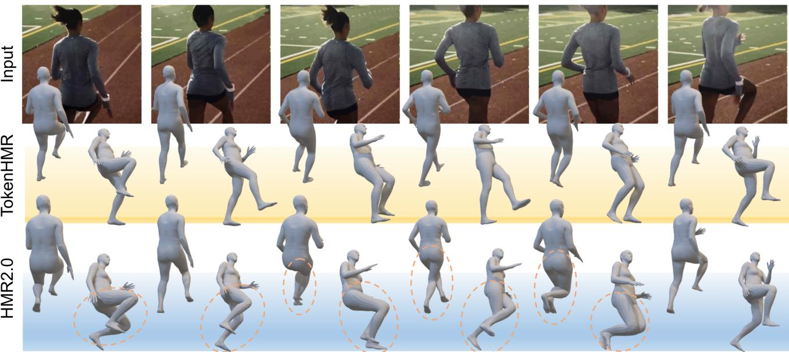
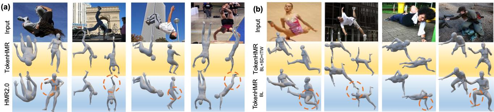
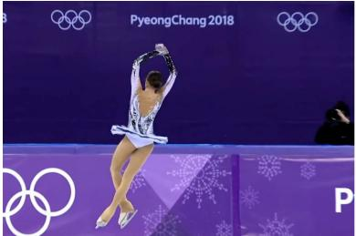

# TokenHMR：通过令牌化姿态表示推进人体网格恢复

Sai Kumar Dwivedi1,\* Yu Sun2,∗ Priyanka Patel1 Yao Feng1,2,3 Michael J. Black1

1Max Planck Institute for Intelligent Systems（图宾根，德国）
2Meshcapade
3ETH Zurich（苏黎世联邦理工学院）

  

图 1. 现有从图像回归 3D 人体姿态与形状（HPS）的方法（例如 HMR2.0 [12]）所估计的人体要么与图像对齐，要么具有准确的 3D 姿态，但两者不能兼得。我们表明，对于现有方法而言，这是一个根本性的权衡问题。为了解决这一问题，我们的方法 TokenHMR 提出了一种新颖的损失函数——阈值自适应损失缩放（Threshold-Adaptive Loss Scaling, TALS），以及一种基于离散 token 的 3D 姿态表示。借助这些设计，TokenHMR 在多个野外 3D 基准上达到了最先进的精度。

## 摘要

我们研究从单张图像回归三维人体姿态与形状的问题，重点关注三维精度。当前最先进的方法利用大规模的三维伪真值（p-GT）和二维关键点数据集，取得了稳健的性能。然而，我们观察到在使用这些方法时，随着二维精度的提升，三维姿态精度反而出现了矛盾的下降现象。这是由 p-GT 中的偏差以及近似的相机投影模型所导致的。我们量化了当前相机模型所引入的误差，并证明精确拟合二维关键点和 p-GT 反而会导致三维姿态不正确。我们的分析定义了「无效距离」范围，在该范围内最小化二维和 p-GT 损失是有害的。基于此，我们提出了一种新的损失函数——「阈值自适应损失缩放（Threshold-Adaptive Loss Scaling, TALS）」，它会对较大的二维和 p-GT 误差进行惩罚，而对较小的误差则不进行惩罚。使用该损失时，存在许多能够同样好地解释二维证据的三维姿态。为了降低这种模糊性，我们需要一个关于有效人体姿态的先验，但这样的先验可能引入不必要的偏差。为了解决这个问题，我们利用人体姿态的标记化（tokenized）表示，并将该问题重新表述为标记预测。这将估计的姿态限制在有效姿态的空间内，从而有效地提升了对遮挡的鲁棒性。在 EMDB 和 3DPW 数据集上的大量实验表明，我们重新设计的损失函数和标记化方法使我们能够在使用野外（in-the-wild）数据训练的同时，超越当前最先进的三维精度。我们的模型和代码可在以下网址获取：https://tokenhmr.is.tue.mpg.de。

## 1. 引言

我们研究从单张图像回归三维人体姿态与形状（HPS）的问题。最近的方法 [3, 12, 32, 49] 在该任务上的精度不断提高。

所谓「准确」，我们指两件事：方法应当正确地回归出三维姿态，同时也要与图像证据相吻合。不幸的是，目前的模型无法同时满足这两点。我们观察到一个看似矛盾的现象：方法在拟合二维关键点方面越精确，其预测的三维姿态反而越不准确。我们对这一问题进行了研究，并确定常用的弱透视相机假设是主要的罪魁祸首。该相机模型与采集图像所用的真实相机不匹配，因此投影得到的三维关节点与检测到的二维关节点之间存在偏差。由于目前尚无可靠的方法能够从单张图像估计相机参数，我们对这一影响进行了研究并量化，进而提出了两种解决方案。

具体而言，我们使用了合成的 BEDLAM [3] 数据集，该数据集具有完美的三维和二维真值（GT）。我们使用文献 [12] 中的相机模型将三维数据投影到二维，以量化最佳情况下的二维误差；该误差很大。然后我们反方向论证，说明较低的二维误差可能导致较大的三维误差。即使使用如文献 [32] 中那样的完整透视模型也无法解决该问题，因为我们缺乏精确的相机内外参数。

本分析着重指出了用二维关键点损失来监督三维姿态回归的问题。然而，这种损失能够让我们使用大规模数据集，从而获得泛化性和鲁棒性。不幸的是，伪真值（pseudo ground-truth, p-GT）训练数据也存在同样的问题，因为它是借助近似相机模型，通过优化的手段拟合到二维数据上得到的三维人体。如何在缓解三维精度下降的同时，利用大规模、野外（in-the-wild）数据集中丰富的信息？我们的答案是 TokenHMR——一种新的人体姿态与体型（human pose and shape, HPS）回归方法，它在有效利用二维关键点的同时保持了三维姿态的精度，从而能够在相机参数未知的情况下利用当前的互联网数据。

TokenHMR 有两个主要组件。第一个组件基于我们的关键洞见：来自二维关键点的监督虽然存在缺陷，但能有效防止出现严重错误的预测。然而，过度依赖二维线索会引入偏差。为了解决这个问题，我们定义了一种新的损失，称为阈值自适应损失缩放（Threshold-Adaptive Loss Scaling, TALS），它对较大的二维和伪真值误差进行惩罚，但对较小的误差仅施加轻微惩罚。我们利用对 BEDLAM 的分析来定义这一损失，从而使得网络不会被鼓励把二维像素k点拟合得超出相机模型合理范围之外的精度。

然而，这又带来一个新问题。从二维关键点预测三维姿态在本质上就是具有歧义性的。当放宽关键点匹配的约束时，与二维数据相一致的三维姿态会变得更多。为了控制这一情况，我们需要引入一个先验，使网络偏向有效的姿态。不幸的是，现有的基于高斯混合（mixtures of Gaussians）[4] 或 VAE [42] 的姿态先验都偏向于训练数据中频繁出现的姿态。相反，我们寻求的是一种无偏的先验——它仅限制网络输出有效的姿态，但并不偏向于任何特定的姿态。

这引导我们进入 TokenHMR 的第二个关键组件，也是其名称的由来。具体而言，我们通过将人体姿态进行分词（tokenization），把连续姿态回归的问题转化为令牌（token）预测问题。我们使用向量量化 VAE（Vector Quantized-VAE, VQ-VAE）[53]，在 AMASS [37]、MOYO [52] 等大规模运动捕捉数据集上进行预训练，以此将连续的人体姿态离散化。这种离散化表示为回归器提供了一个有效姿态的"词汇表"，有效地将姿态先验表示为一个知识库——码本（codebook）。由于 VQ-VAE 旨在表示一个均匀先验，我们认为这能减少此前姿态先验所带来的偏差。

TokenHMR 通过分类的方式生成离散令牌，这与回归连续姿态信息形成对比。当我们把一个 SOTA 的 HPS 方法中的连续姿态替换为我们的离散化姿态方案时，在三维精度上能看到持续的提升（在其他条件不变的情况下）。

我们进行了大量实验，以评估对姿态进行不同分词方式及其对精度的影响。任何姿态离散化都会带来一定的精度损失。在我们的例子中，这造成了约 2.5 毫米的 3D 精度损失，比当前最先进（state-of-the-art, SOTA）的人体姿态（HPS）回归器在真实数据上的精度小 20 倍；也就是说，由分词（tokenization）导致的精度损失可以忽略不计。

最后，我们将两个组件结合在一起，发现它们具有协同效应。我们的新损失函数不会扭曲 3D 姿态以过度拟合关键点或伪真值（p-GT），而分词则避免了网络为追求 2D 精度而扭曲 3D 姿态。通过这种组合，我们在 3D 精度方面达到了新的最先进水平。我们在具有精确 3D 真值的 EMDB [23] 和 3DPW [55] 上对 TokenHMR 及其他近期方法进行了广泛评估。在相同数据和骨干网络下，TokenHMR 在具有挑战性的 EMDB 数据集上比 HMR2.0 [12] 减少了 7.6% 的 3D 误差。定性结果表明，TokenHMR 对模糊的图像证据具有鲁棒性，且所估计的姿态不会遭受使用伪真值（p-GT）和 2D 关键点的方法所特有的"弯膝"（bent knees）偏差（见图 1）。

总之，我们做出以下关键贡献：（1）3D 精度退化分析：我们分析并量化了当前人体姿态（HPS）方法在使用 2D 损失时在 3D 与 2D 精度之间面临的权衡。（2）阈值自适应损失缩放：为缓解该问题，我们提出了一种新颖的损失函数，可降低小于因相机模型错误所导致的预期误差的 2D 和伪真值（p-GT）误差的影响。（3）基于分词（token）的姿态表示：我们引入了一种基于分词的人体姿态表示方法，并证明它能够产生更精确的姿态估计。我们的模型和代码已公开供研究使用。

## 2. 相关工作（Related Work）

## 2.1. 人体姿态回归（HPS Regression）

从单张图像中估计三维人体姿态与形状，这一问题已被广泛研究，方法涵盖从基于优化的方法到最新的基于 Transformer 的回归器。优化方法将参数化模型 [36, 42, 59] 拟合到二维图像线索，包括但不限于关键点 [4, 42, 59]、轮廓 [41] 和部位分割 [30]。一些基于学习的方法直接从图像 [6, 8, 9, 21, 25, 32, 48, 49, 61] 和视频 [22, 24] 中估计参数化人体模型，还有一些方法以无模型（model-free）方式估计人体，或表示为顶点 [28, 34, 46]，或表示为隐式形状 [39, 45, 58]。最近的方法 [12, 33] 使用 Transformer 来估计三维人体，取得了当前最佳的精度。为应对泛化方面的挑战，EFT [20]、NeuralAnnot [40]、HMR2.0 [12] 和 CLIFF [32] 等近期方法在训练损失中使用二维关键点和伪真值（pseudo Ground Truth, p-GT），以使投影人体与图像之间产生良好对齐。HuManiFlow [47] 和 POCO [9] 等方法对人体姿态与形状估计（Human Pose and Shape, HPS）进行概率建模，以显式地处理姿态模糊问题。在追求更好二维对齐的过程中出现的三维精度下降问题，在我们的工作之前已被注意到但未得到广泛量化。我们的统计分析突出了现有的人体网格恢复（Human Mesh Recovery, HMR）方法中的这种偏差，为该问题的训练策略提供了新的视角。

一些方法 [26, 32, 56] 通过从单张图像估计相机，来解决三维到二维的投影误差问题。SPEC [26] 使用网络预测相机参数但泛化性不佳，而 CLIFF [32] 则通过向网络提供图像中人体边界框坐标的信息进行近似。从单张图像估计相机是高度不适定的，因此这仍是一个具有挑战性的、尚未解决的问题。我们的方法减少了使用错误相机模型的影响，并且可以应用于任何 HPS 回归方法。

## 2.2. 姿态先验（Pose Prior）

人体姿态先验在多种应用中起着关键作用，例如将二维姿态提升到三维 [4, 42] 以及从图像/视频估计人体姿态 [20, 29]。早期姿态先验侧重于学习关节限位 [1] 以避免不可能的姿态。高斯混合模型（Gaussian Mixture Models, GMM）[4] 和生成对抗网络（Generative Adversarial Networks, GAN）[11, 21] 也被用于在训练过程中施加先验知识。一些近期方法使用变分自编码器（Variational Autoencoder, VAE）[42] 和归一化流（Normalizing Flow）[29] 作为先验。其中许多方法偏向于常见的姿态，这种偏差被传递给回归器。Pose-NDF [51] 等方法学习由神经隐式函数的零水平集表示的合理姿态流形。将无效姿态映射到有效姿态涉及梯度下降，这在集成到 HPS 训练中时是一项昂贵的操作。与先前工作不同，我们学习了基于离散令牌（token）的有效 SMPL 姿态先验，减少了姿态偏差并提升了对遮挡的鲁棒性，同时易于集成到 HPS 训练中。

  

图 2. 相机/姿态偏差问题的可视化。(a) 缺少正确的焦距意味着像 HMR2.0 这类方法会将透视缩短的腿部估计为弯曲的；(b) 将预测的身体姿态替换为真实值后，可以观察到相机偏差；(c) 在保持二维对齐的情况下，三维姿态可能会有多大的偏差？详见第3节。

我们使用 VQ-VAE [53]（它是 VAE 的一种变体）来学习一个离散化的先验，其方法是将 3D 训练姿态进行量化（这一过程称为"Tokenization"），从而构建一个知识库（即码本 codebook）。Tokenization 已被广泛应用于多种任务，例如图像合成 [44, 53]、文本到图像生成（text-to-image generation）[43]、2D 人体姿态估计 [10]，以及运动先验的学习 [18, 62]。在人体姿态估计的语境下，tokenization 仍较少受到关注，不过它在人体运动生成 [14, 62] 中已经得到了广泛使用。当然，图像和语言的 tokenized 表示已被大量用于众多视觉与语言问题。我们的方法的创新之处在于：它将原本的回归问题重新表述为一个姿态 token 分类问题，从而利用 tokenization 来表示有效的姿态，本质上提供了一个姿态先验。

## 3. 相机/姿态偏差

估计 3D HPS 的方法通常试图同时满足两个目标：准确的 3D 姿态，以及与 2D 图像特征准确对齐。然而，我们在所有实验中都观察到一个趋势——一个方法在 2D 误差上表现越好，其在 3D 上的表现就越差，反之亦然。其核心原因在于：当前的方法（包括本文所测试的方法）并不估计相机内参（例如焦距）或相机外参（旋转和平移）。相反，当前方法使用缩放正交投影（scaled orthographic projection），或使用固定且不正确的相机参数进行透视投影，来在相机坐标系下估计人体。这会导致真实的 3D 关节与其 2D 投影之间出现不匹配。具体来说，由于照片通常大致从人眼高度进行拍摄，因此腿部比上半身距离相机更远，从而产生透视缩短（foreshortening）。训练模型去最小化 2D 误差会迫使它们在 3D 中生成不正确的姿态；这一现象如图 2（a）所示。2D 姿态数据集的伪真值（pseudo ground truth, p-GT）是通过在使用有问题的相机参数下最小化 2D 误差得到的。完全信任这样的 p-GT 并追求对其标注的精确学习，反而会使该问题更加突出。请注意，透视缩短会让腿在图像中显得更短。要让一个合理的人体模型与之吻合，唯一的办法是在 3D 中让膝盖弯曲或让身体发生倾斜，使腿在 3D 中距离相机更远。这会产生不自然或不稳定的姿态。

这是当前所有方法共同面临的一个根本性问题——若不知道相机参数，就无法同时在 3D 和 2D 上都取得较低的误差。为了定量地评估这种不匹配的影响，我们使用 BEDLAM [3]——一个合成数据集，其中 3D 和 2D 数据以及相机参数都是已知的。这避免了任何可能的噪声，使我们能够观察使用错误相机对 2D 投影误差的影响。具体而言，如图 2（b）所示，我们使用 HMR2.0 [12] 的相机将 BEDLAM 的真值人体投影到图像中。

我们使用标准度量——正确关键点百分比（Percentage of Correct Keypoints, PCK）——在 2D 空间上评估错误相机的影响，该指标针对 BEDLAM 验证集中的一个序列进行计算。HMR2.0b 预测的 3D 人体在 PCK0.5 上的误差为 0.78，在 PCK1.0 上的误差为 0.88。相比之下，当我们将 HMR2.0b 的相机与真实 3D 人体配合使用时，PCK 得分在 PCK0.5 上降至 0.66，在 PCK1.0 上降至 0.86。理想情况下，使用正确的相机模型时，PCK0.5 和 PCK1.0 都应达到 1.0。HMR2.0b 的误差低于使用真值相机时的误差，这一事实表明其输出因相机偏差而偏离了真实的 3D 姿态与形状。这说明，HMR2.0b 之类的方法虽然获得了较高的 PCK 值，却是以牺牲 3D 精度为代价的。总之，除非拥有正确的相机模型，否则追求高 PCK 值反而有损于 3D 精度。

我们进一步设计了实验，以探索在保持良好 2D 对齐的同时，3D 误差可能恶化到何种程度。我们对 SMPLify [4] 的损失函数进行了修改，使预测的 2D 关键点与真实 2D 关键点 $\scriptstyle J _ { 2 D _ { g } }$ 之间的距离尽可能小，同时新增一项损失以增大预测的 3D 关键点 $J _ { 3 D }$ 与真实 3D 关键点 $\ J _ { 3 D _ { g } }$ 之间的距离，其表达式如下：

$$
w _ {2 D} | | \Pi (\boldsymbol {J} _ {\boldsymbol {3 D}}, \boldsymbol {T}) - \boldsymbol {J} _ {\boldsymbol {2 D} _ {g}} | | _ {2} - w _ {3 D} | | \boldsymbol {J} _ {\boldsymbol {3 D}} - \boldsymbol {J} _ {\boldsymbol {3 D} _ {g}} | | _ {2} + m\tag{1}
$$

where Π represents 3D-to-2D projection using HMR2.0’s camera, $m \ = \ 2 0$ is the margin value, $w _ { 2 D } ~ = ~ 4$ and $w _ { 3 D } ~ = ~ 4 0 . 5$ are scalar weights. After 100 iterations of optimization, the Mean Per Joint Position Error (MPJPE) reaches 146mm. As shown in Fig. 2 (c), the projected 3D pose can still maintain a high degree of 2D alignment even with significant errors in the depth direction. When optimized for 200 iterations, the MPJPE exceeds 300mm, and the error continues to increase with further optimization.

由于当前领域尚无可靠的方法从单张图像中估计相机参数，下面我们将探讨我们的新方法（TALS 和 tokenization）是否有助于缓解近似相机模型所带来的问题。Figure 2 (a) 比较了 HMR2.0 和 TokenHMR 的结果。值得注意的是，透视缩短效应在 TokenHMR 上对姿态估计的影响更小。

## 4. TokenHMR

## 4.1. Preliminaries（预备知识）

Our method, TokenHMR, takes an input image, I, and outputs body pose, θ, shape, β and perspective camera, T. We use SMPL [36], a differentiable parametric body model. Its input parameters consist of pose, denoted by $\theta \in \mathbb { R } ^ { 7 2 }$ and shape, denoted as $\beta \in \mathbb { R } ^ { 1 0 }$ . As output, it produces a body mesh, M, and vertices, $V \in \mathbb { R } ^ { N X \bar { 3 } }$ , where $N = 6 8 9 0$ is the number of vertices. 3D joints denoted as $J _ { 3 D }$ , are derived through a linear combination of mesh vertices using a pre-trained joint regressor.

我们的方法 TokenHMR 以输入图像 $I$ 为输入，输出身体姿态 $\theta$、形状 $\beta$ 以及透视相机 $T$。我们使用 SMPL [36]，一种可微的参数化人体模型。其输入参数包括姿态，记为 $\theta \in \mathbb { R } ^ { 7 2 }$，以及形状，记为 $\beta \in \mathbb { R } ^ { 1 0 }$。作为输出，它生成人体网格 $M$ 和顶点 $V \in \mathbb { R } ^ { N X \bar { 3 } }$，其中 $N = 6 8 9 0$ 是顶点的数量。记为 $J _ { 3 D }$ 的 3D 关节点通过使用预训练关节点回归器对网格顶点进行线性组合而得到。

## 4.2. Threshold-Adaptive Loss Scaling: TALS（阈值自适应损失缩放：TALS）

在第 3 节中，我们的分析揭示了一个阻碍使用伪真值（pseudo-ground-truth）和 2D 关键点进行有效学习的显著障碍——相机/姿态偏差。尽管存在这一挑战，由这些标注提供的尺度信息对于实现最优的泛化能力和鲁棒性仍然是不可或缺的。我们认为，只要得到恰当利用且不过拟合，这些标注能够显著提升模型鲁棒地估计姿态的能力。从我们的观察中得到一个关键洞见：建立有效的阈值对于甄别那些作为训练信号不再带来额外收益的误差水平至关重要。当损失超过该阈值时，常规的学习机制将引导姿态估计；反之，当损失低于这一有效阈值时，我们将其影响降至最低，以防止对相机/姿态偏差的过拟合。

为了确定这一有效阈值，我们分析了利用真实（GT）3D 姿态与一个标准（不正确的）相机模型所得到的误差。我们再次利用 3D

  

图 3. 框架概览。我们的方法包含两个阶段。(a) 在 tokenization 步骤中，编码器学习将连续姿态映射为离散的姿态 token，而解码器则尝试重建原始姿态。(b) 为了训练 TokenHMR，我们利用预训练解码器提供的有效姿态"词汇表"，将回归替换为分类。

## 4.3. 标记化（Tokenization）

GT in BEDLAM [3]，这次是为 2D 关键点和 SMPL 伪真值（pseudo-ground-truth）建立有效的阈值。对于 2D 关键点，我们用 BEDLAM 中的真值（ground truth）替换预测的 SMPL 参数，以获得在 HMR2.0 相机下真实 3D 人体的 2D 关键点投影。然后我们计算这些投影与 2D 关键点 GT 之间的平均 L1 范数，并将其作为 2D 关键点监督的阈值 $\varepsilon J _ { 2 D }$。我们相对于图像宽度对这些 2D 关键点进行归一化，并将数值缩放到 -0.5 到 0.5 之间，以缓解与尺度相关的方差。

类似地，为了建立 SMPL p-GT 的有效监督阈值，我们进行了额外的实验。使用 p-GT 时，我们将姿态损失表示为关节角度误差的形式。为了对这些误差设定合适的阈值，我们评估了 HMR2.0 在 BEDLAM 上的预测与 SMPL 模型真值之间每个关节的关节角度差异。具体来说，我们计算 HMR2.0 在 SO(3) 旋转流形上预测的 3D 关节旋转与 BEDLAM 中真值旋转之间的平均测地距离\*（geodesic distance）。具体阈值数值请参见补充材料（Sup. Mat.）第 B.2 节。

在为 2D 关键点和 SMPL p-GT 建立有效阈值之后，我们引入一种新的损失，称为阈值自适应损失缩放（Threshold-Adaptive Loss Scaling, TALS）。它仅在损失低于阈值时才对其进行缩放。具体而言，p-GT 姿态和 2D 关节的 TALS 损失项定义为

$$
\mathcal {L} _ {\boldsymbol {\theta} _ {p G T}} = \left\{ \begin{array}{l l} \| \boldsymbol {\theta} - \boldsymbol {\theta} _ {g} \| ^ {2} & \text { if } \mathcal {L} _ {\boldsymbol {\theta} _ {p G T}} > \varepsilon_ {\boldsymbol {\theta}} \\ \alpha_ {\boldsymbol {\theta}} \cdot \| \boldsymbol {\theta} - \boldsymbol {\theta} _ {g} \| ^ {2} & \text { otherwise } \end{array} \right.\tag{2}
$$

$$
\mathcal {L} _ {J _ {2 D _ {p G T}}} = \left\{ \begin{array}{l l} | J _ {\mathbf {2 D}} - J _ {\mathbf {2 D} _ {g}} | & \text {if \mathcal {L} _{J_{2D_{pGT}}} > \varepsilon_ {J_{2D}}} \\ \alpha_ {J _ {2 D}} \cdot | J _ {\mathbf {2 D}} - J _ {\mathbf {2 D} _ {g}} | & \text {otherwise} \end{array} \right.\tag{3}
$$

其中 $\alpha_{J_{2D}}$ 和 $\alpha_\theta$ 是小的标量乘子，$\varepsilon_\theta$ 是为每个姿态参数分别计算的阈值，$\varepsilon_{J_{2D}}$ 是 2D 关节点的阈值。

我们使用 VQ-VAE [53]，它学习将 3D 姿态编码到离散表示中。具体而言，我们为 SMPL 身体参数学习一个离散表示，$\theta = [\theta_1, \theta_2, \ldots, \theta_{21}]$，其中 $\theta_i$ 表示每个关节点在 $\mathbb{R}^6$ 中的姿态参数。该过程使用自编码器（autoencoder）架构和一个可学习的码本（codebook）对姿态参数进行编码和解码，记为 $CB = \{c_k\}_{k=1}^K$，其中每个码 $c_k \in \mathbb{R}^{d_c}$，$d_c$ 是码的维度。姿态 VQ-VAE 的整体架构如图 3 (a) 所示。自编码器的编码器和解码器分别用 E 和 D 表示。编码器负责生成离散的姿态 token，而解码器将这些 token 重建回 SMPL 姿态。潜在特征 z 可通过 $z = E(\theta)$ 计算得到，结果为 $z = [z_1, z_2, \dots, z_M]$，其中 $z_i \in \mathbb{R}^{d_c}$，M 是 token 的数量。每个潜在特征 $z_i$ 通过在码本 CB 中寻找最相似的码元素进行量化，如下式所示：

$$
\hat {z} _ {i} = \underset {c _ {k} \in C B} {\arg \min} \| z _ {i} - c _ {k} \| _ {2}.\tag{4}
$$

在训练姿态分词器（pose tokenizer）时，我们采用了与先前工作 [53] 相似的策略，涉及三种主要的损失函数来优化分词器：重构损失（reconstruction loss，$\mathcal{L}_{\mathcal{RE}}$）、嵌入损失（embedding loss，$\mathcal{L}_{\mathcal{E}}$）以及承诺损失（commitment loss，$\mathcal{L}_{\mathcal{C}}$）。总体损失（$\mathcal{L}_{\mathcal{VQ}}$）定义为

$$
\begin{array}{r l} & {\mathcal {L} _ {\mathcal {V Q}} = \lambda_ {\mathcal {R E}} \mathcal {L} _ {\mathcal {R E}} + \lambda_ {\mathcal {E}} \mathcal {L} _ {\mathcal {E}} + \lambda_ {\mathcal {C}} \mathcal {L} _ {\mathcal {C}}} \\ & {\qquad = \lambda_ {\mathcal {R E}} \mathcal {L} _ {\mathcal {R E}} + \lambda_ {\mathcal {E}} | | s g [ z ] - e | | _ {2} + \lambda_ {\mathcal {C}} | | z - s g [ e ] | | _ {2}} \end{array}\tag{5}
$$

其中 $sg$ 是停梯度（stop gradient）算子，$\mathbf{e}$ 是码本（codebook）中的嵌入向量，$\lambda_{\mathcal{RE}}$、$\lambda_{\mathcal{E}}$、$\lambda_{\mathcal{C}}$ 是各项的超参数。对于重建，我们使用 $\mathcal{L}_1$ 损失，分别计算真实姿态 $\theta_g$ 与预测姿态 $\theta$ 之间的差异，以及 SMPL 真实三维关节 $J_{3D_g}$ 与预测关节 $J_{3D}$ 之间的误差。因此，$\mathcal{L}_{\mathcal{RE}}$ 损失定义为

$$
\mathcal {L} _ {\mathcal {R E}} = \mathcal {L} _ {1} (\boldsymbol {\theta} _ {g}, \boldsymbol {\theta}) + \mathcal {L} _ {1} (J _ {3 D _ {g}}, J _ {3 D}).\tag{6}
$$

原始 VQ-VAE 存在码本坍缩（codebook collapse）问题，即码本未被充分利用。参照先前工作 [62]，我们采用指数移动平均（Exponential Moving Average, EMA）和码本重置（Code Reset）的训练策略，以提升码本利用率。

## 4.4. 架构

我们的架构采用了 Vision Transformer（ViT）[7]，与 HMR2.0 [12] 类似。输入图像 I 首先被转换为输入标记（token），随后由 Transformer 进行处理以生成输出标记。这些输出标记接着在 Transformer 解码器中进一步处理。Transformer 解码器具有多头自注意力机制，它将零输入标记与图像输出标记进行交叉注意力运算，从而得到 Transformer 模块的特征。与采用三个线性层将 Transformer 模块的特征映射到 SMPL 姿态 θ、形状 β 以及相机 T 的 HMR2.0 [12] 不同，我们提出了一种新颖的方法。我们的目标是借助一个在大量运动捕捉（mocap）数据上训练得到的标记器（tokenizer），并特别聚焦于人体姿态。为此，我们将 SMPL 姿态参数划分为身体姿态（body pose）和全局朝向（global orientation）。我们使用独立的线性层，分别从标记器预测全局朝向和身体姿态。

一种直观的标记器集成方式是直接从 ViT Transformer 主干网络估计码本索引，并根据该索引从码本 CB 中选取嵌入 e。然而，这会带来挑战，因为从码本中选取嵌入的过程是不可微的。为解决该问题，我们采用基于 logit 的方法。具体而言，我们不再直接估计码本索引，而是为每个标记输出 logit Q。这些 logit 与码本相乘，从而得到加权后的嵌入。因此，近似的量化特征 $\hat { z } = [ \hat { z } _ { 1 } , \hat { z } _ { 2 } , . . . , \hat { z } _ { M } ]$ 可通过下式计算得到

$$
\bar {z} = \sigma (\pmb {Q} _ {M \times K}) \times \pmb {C B} _ {K \times D} \approx \hat {z}\tag{7}
$$

其中，$Q$ 是由骨干网络估计的 logits，$\sigma$ 是 softmax 操作，CB 是预训练的码本（codebook），M 是 token 的数量，K 是码本中条目（entry）的数量，D 是每个码本条目的维度。该操作使其可微。所得到的近似量化特征 Z̄ 随后被传入 token 解码器。该过程产生最终的姿态。在 TokenHMR 的训练中，学习到的 token 解码器被冻结，以利用其从动捕（mocap）数据中学到的先验知识。

## 4.5. 损失函数

遵循先前工作 [12, 25]，我们在 2D 和 3D 关节以及 SMPL 姿态和形状参数上定义损失，即分别在 $J _ { 2 D } , J _ { 3 D } , \theta , \beta$ 上定义损失。然而，根据第 4.2 节的分析，我们对来自 2D 和 3D 数据集的数据区别对待。对于 3D 真值数据集，我们定义标准损失为

$$
\begin{array}{r} \mathcal {L} _ {G T} = \lambda_ {\theta} \mathcal {L} _ {\theta} (\pmb {\theta}, \pmb {\theta} _ {g}) + \lambda_ {\beta} \mathcal {L} _ {\beta} (\pmb {\beta}, \pmb {\beta} _ {g}) + \\ \lambda_ {3 D} \mathcal {L} _ {3 D} (\pmb {J} _ {3 D}, \pmb {J} _ {3 D _ {g}}) + \lambda_ {2 D} \mathcal {L} _ {2 D} (\pmb {J} _ {2 D}, \pmb {J} _ {2 D _ {g}}) \end{array}\tag{8}
$$

其中 $\mathcal { L } _ { \beta }$ 是 SMPL 形状损失（shape loss），$\mathcal { L } _ { J _ { 3 D } }$ 是三维关节点损失，$\mathcal { L } _ { J _ { 2 D } }$ 是关节点重投影损失。$\lambda _ { \beta }$、$\lambda _ { 3 D }$ 和 $\lambda _ { 2 D }$ 是各项的调控权重。为了从 SMPL 伪真值（pseudo-ground-truth）中学习，我们采用阈值自适应损失缩放（Threshold-Adaptive Loss Scaling, TALS），即根据 4.2 节所计算的阈值来对损失进行缩放，具体见公式 2 和公式 3。因此，总损失定义为

$$
\mathcal {L} _ {T o t a l} = \mathcal {L} _ {G T} + \mathcal {L} _ {\theta_ {p G T}} + \mathcal {L} _ {J _ {2 D _ {p G T}}}.\tag{9}
$$

## 5. 实验

## 5.1. 实现细节

TokenHMR 的训练包含两个阶段：首先我们使用 AMASS [37] 和 MOYO [52] 动捕数据训练一个 tokenizer，以学习离散的姿态表征；然后我们将该 tokenizer 的预训练解码器作为额外的头部用于身体姿态回归。在 TokenHMR 的训练过程中，tokenizer 被冻结以利用其先验。

我们的 tokenizer 架构受 T2M-GPT [62] 的启发，但我们学习的是 SMPL 姿态参数的姿态 tokens，而不是 3D 关节点的运动 tokens。

在编码器和解码器中，我们都使用了 1 个 ResNet [15] 块和 4 个一维卷积层。

引导权重 $\lambda _ { \mathcal { R } \mathcal { E } } , \lambda _ { \mathcal { E } } , \lambda _ { \mathcal { C } }$ 分别设置为 50.0、1.0、1.0。

模型训练 150K 次迭代，批量大小为 256，学习率为 $2 e ^ { - 4 }$。

为了训练一个鲁棒的模型，我们从 $1 e ^ { - 3 }$ 开始为随机关节添加噪声，并在每 5K 次迭代后逐步增大噪声幅度。

我们根据验证集上的重建误差，为 TokenHMR 选择了包含 160 个 tokens、码本大小为 2048 × 256 的最佳 tokenizer 模型。

对于 TokenHMR，我们采用 ViT-H/16 [7] 作为骨干网络，并沿用 HMR2.0 [12] 的标准 Transformer 解码器。

我们使用 4 个独立的线性层，将 Transformer 解码器输出的 1024 维特征映射到 SMPL 的全局朝向、手部姿态和身体形状，并使用一个线性层映射到相机参数。

然而，对于身体姿态，我们将 1024 维特征通过 4 个线性层块进行处理，每个块包含 2 个 MLP 和一个 GELU 激活函数 [16]。

由此得到的最终 logits Q 大小为 160 × 2048，用于与大小为 $2 0 4 8 \times 2 5 6$ 的码本相乘，得到近似的量化特征 z¯；见公式 4。

我们使用 ViT-Pose [60] 作为预训练骨干网络。

我们在 4 块 Nvidia RTX 6000 GPU 上以批量大小 256、学习率 $1 e ^ { - 5 }$ 训练 100K 次迭代，耗时约一天。

引导权重 $\lambda _ { \theta } , \lambda _ { \beta } , \lambda _ { J _ { 2 D } } , \lambda _ { J _ { 3 D } }$ 分别设置为 $1 e ^ { - 3 } , 5 e ^ { - 4 }$ $1 e ^ { - 2 } , \bar { 5 } e ^ { - 2 }$。

TALS 的损失权重对姿态 $\alpha \theta$ 和 2D 关键点 $\alpha _ { J _ { 2 D } }$ 均设为 1%。

<table><tr><td rowspan="2">TrainingDatasets</td><td rowspan="2">Method</td><td colspan="3">EMDB [23]</td><td colspan="3">3DPW [55]</td></tr><tr><td>MVE</td><td>MPJPE</td><td>PA-MPJPE</td><td>MVE</td><td>MPJPE</td><td>PA-MPJPE</td></tr><tr><td>SD</td><td>HybrIK [31]</td><td>122.2</td><td>103.0</td><td>65.6</td><td>94.5</td><td>80.0</td><td>48.8</td></tr><tr><td>SD</td><td>CLIFF [32]</td><td>122.9</td><td>103.1</td><td>68.8</td><td>81.2</td><td>69.0</td><td>43.0</td></tr><tr><td>SD</td><td>HMR2.0 [12]</td><td>120.1</td><td>97.8</td><td>61.5</td><td>84.1</td><td>70.0</td><td>44.5</td></tr><tr><td>BL</td><td>BEDLAM-CLIFF [3]</td><td>113.2</td><td>97.1</td><td>61.3</td><td>85.0</td><td>72.0</td><td>46.6</td></tr><tr><td>BL</td><td>HMR2.0</td><td>106.6</td><td>90.7</td><td>51.3</td><td>88.4</td><td>72.2</td><td>45.1</td></tr><tr><td>BL</td><td>TokenHMR</td><td>104.2</td><td>88.1</td><td>49.8</td><td>86.0</td><td>70.5</td><td>43.8</td></tr><tr><td>SD + ITW</td><td>HMR2.0 [12]</td><td>140.6</td><td>118.5</td><td>79.3</td><td>94.4</td><td>81.3</td><td>54.3</td></tr><tr><td>SD + ITW</td><td>TokenHMR</td><td>124.4</td><td>102.4</td><td>67.5</td><td>88.1</td><td>76.2</td><td>49.3</td></tr><tr><td>SD + ITW + BL</td><td>HMR2.0</td><td>120.7</td><td>99.3</td><td>62.8</td><td>88.4</td><td>77.4</td><td>47.4</td></tr><tr><td>SD + ITW + BL</td><td>HMR2.0 + TALS</td><td>115.7</td><td>96.7</td><td>58.5</td><td>89.6</td><td>73.5</td><td>46.8</td></tr><tr><td>SD + ITW + BL</td><td>HMR2.0 + Token</td><td>116.1</td><td>95.6</td><td>62.2</td><td>86.6</td><td>75.0</td><td>48.0</td></tr><tr><td>SD + ITW + BL</td><td>HMR2.0 + TALS + VPoser [42]</td><td>116.8</td><td>97.9</td><td>56.4</td><td>87.1</td><td>73.7</td><td>45.7</td></tr><tr><td>SD + ITW + BL</td><td>TokenHMR</td><td>109.4</td><td>91.7</td><td>55.6</td><td>84.6</td><td>71.0</td><td>44.3</td></tr></table>

表 1. 在 EMDB 和 3DPW 数据集上的三维人体网格与姿态误差。详见正文。

<table><tr><td rowspan="2">Method</td><td colspan="3">Crop 30%</td><td colspan="3">Crop 50%</td></tr><tr><td>MVE</td><td>MPJPE</td><td>PA-MPJPE</td><td>MVE</td><td>MPJPE</td><td>PA-MPJPE</td></tr><tr><td>HMR2.0 [12]</td><td>135.24 (+14.98)</td><td>113.39 (+14.13)</td><td>70.68 (+7.86)</td><td>166.71 (+46.45)</td><td>137.88 (+38.59)</td><td>90.30 (+27.48)</td></tr><tr><td>TokenHMR</td><td>124.09 (+14.71)</td><td>104.72 (+13.01)</td><td>62.13 (+6.52)</td><td>150.29 (+40.91)</td><td>125.99 (+34.28)</td><td>78.88 (+23.27)</td></tr></table>

表 2. 在不同边界裁剪比例下均匀裁剪图像对 EMDB 数据集上 3D 人体姿态估计（HPS）精度的影响。括号中的数字表示相对于未裁剪场景的性能变化；数值越小越好。此处比较的所有模型均采用相同的骨干网络，并在相同的数据上进行训练。

<table><tr><td></td><td></td><td colspan="2">AMASS [37]</td><td colspan="2">MOYO [52]</td></tr><tr><td></td><td>Method</td><td>MVE ↓</td><td>MPJPE ↓</td><td>MVE ↓</td><td>MPJPE ↓</td></tr><tr><td rowspan="3">CB</td><td>1024 × 256</td><td>11.5</td><td>4.6</td><td>27.1</td><td>15.7</td></tr><tr><td>2048 × 128</td><td>9.4</td><td>3.1</td><td>22.5</td><td>12.3</td></tr><tr><td>2048 × 256</td><td>8.3</td><td>2.2</td><td>19.9</td><td>10.4</td></tr><tr><td rowspan="3">Tokens</td><td>80</td><td>12.5</td><td>4.1</td><td>24.4</td><td>16.7</td></tr><tr><td>160</td><td>8.3</td><td>2.2</td><td>19.9</td><td>10.4</td></tr><tr><td>320</td><td>8.1</td><td>1.9</td><td>19.0</td><td>10.1</td></tr><tr><td rowspan="2">Noise</td><td>Yes</td><td>8.3</td><td>2.2</td><td>19.9</td><td>10.4</td></tr><tr><td>No</td><td>7.9</td><td>1.9</td><td>21.0</td><td>11.5</td></tr><tr><td colspan="2">AMASS + MOYO*</td><td>8.7</td><td>2.6</td><td>16.5</td><td>7.6</td></tr></table>

表 3. 分词器消融。所有方法均在 AMASS [37] 的标准训练集上训练，并在 AMASS 测试集和 MOYO [52] 验证集上评估，最后一行⋆除外，该行使用 MOYO 训练集进行训练。最后一个模型在 TokenHMR 中用作分词器。

**训练数据（Training Data）：** 在训练分词器时，我们使用 AMASS [37] 的标准训练划分以及 MOYO [52] 的训练数据。有关训练数据准备的更多细节，请参阅补充材料（Sup. Mat.）。遵循先前方法 [12, 25, 27]，我们使用标准数据集（SD）进行训练，其中包括 Human3.6M [17]、MPI-INF-3DHP [38]、COCO [35] 和 MPII [2]。此外，与 HMR2.0b 类似，我们还使用野外（in-the-wild）2D 数据集（ITW）如 InstaVariety [22]、AVA [13] 和 AI Challenger [57] 数据集及其 p-GT 用于训练。我们还引入了 BEDLAM（BL）[3]，这是一个具有精确真值 3D 数据的合成数据集。为了公平比较，我们使用 SD、ITW 和 BL 数据集的组合重新训练 HMR2.0b。我们选择 HMR2.0b 作为基线模型，因为其代码开源且我们能够复现其结果。

**评估与指标（Evaluation and Metrics）：** 对于分词器精度，我们报告平均顶点误差（Mean Vertex Error, MVE）和平均关节位置误差（Mean Per Joint Position Error, MPJPE），并在 AMASS 的标准测试划分和 MOYO 的验证集上进行评估。对于 TokenHMR，我们报告预测值与真值之间的平均顶点误差（MVE）、平均关节位置误差（MPJPE）和 Procrustes 对齐后的平均关节位置误差（PA-MPJPE）。我们在 3DPW [55] 和 EMDB [23] 数据集的测试集上进行评估。前者是标准的 3D 数据集，后者是最近发布的、更具挑战性的数据集，包含变化的相机运动和多样的 3D 姿态。

## 5.2. 如何缓解 3D 退化问题？（How to Alleviate the 3D Degradation Problem?）

表 1 显示了 HMR2.0 模型仅使用 SD 数据集训练时的性能，以及使用 SD 和 ITW 数据集共同训练时的性能。我们观察到在加入 ITW 数据后，EMDB 数据集上的 3D 精度出现显著下降（超过 17%）。与此同时，根据 HMR2.0 [12] 论文中的表 2，ITW 数据提升了方法的 2D 性能。一种对抗这一趋势的直接方法是引入更多具有精确 3D 标注的数据，例如 BEDLAM [3]。然而，正如表 1 所示，即使引入了 BEDLAM，HMR2.0（SD+ITW+BL）仍然存在明显的 3D 指标退化。这一观察结果构成了我们进一步研究的基线。

  

图 4. 在 LSP [19] 数据集上对具有挑战性姿态的定性比较。

采用我们新颖的损失函数（TALS）公式在 EMDB 和 3DPW 数据集上都带来了显著的性能提升，表明它在防止对含噪声的 p-GT 数据过拟合方面是有效的。虽然 TALS 带来了改进，但我们进一步深入探索姿态先验，以补偿削弱的监督信号。我们评估了在 HPS 中广泛使用的 VAE 先验 VPoser [42]，结果仅带来微小的提升，这表明需要一个更鲁棒的替代方案。我们基于 VQ-VAE 的姿态标记化（tokenization）方法带来了更大的改进。TokenHMR 显著优于 HMR2.0，在 EMDB 上 MVE 提升 9%，MPJPE 提升 7.6%，PA-MPJPE 提升 11.5%。在 3DPW 上也观察到一致的趋势。

## 5.3. 基于标记的先验是如何起到帮助作用的？

除了我们在上文讨论的促进更有效的学习之外，我们还考察了我们的离散标记先验在图像信息存在歧义（例如截断）场景中的有效性。我们在 EMDB 数据集上以不同程度的图像裁剪评估我们的方法。具体来说，我们从图像边界裁剪 30% 和 50%。如表 2 所示，与 HMR2.0 [12] 相比，我们的方法在具有挑战性的截断设置下性能下降更少（50% 对比 30%）。此外，如图 4 所示的定性结果凸显了嵌入在我们基于标记的姿态表示中的先验的鲁棒性。这种鲁棒性对于处理现实中常见的图像截断场景至关重要。

## 5.4. 标记化器的消融研究

表 3 展示了我们在 AMASS 标准测试集和 MOYO 验证集上对不同标记化器设计选择的消融研究。为了理解这些设计选择对分布外（OOD）MOYO 数据的影响，我们仅使用 AMASS 进行训练并进行各种消融实验。然而，最终的标记化器模型（表 3 最后一行）被用于 TokenHMR，并在 AMASS 和 MOYO 两个数据集上进行训练。我们的发现表明，码本条目（codebook entries）的数量比码维度（code dimensions）具有更显著的影响。尽管标记的数量对于精确表示至关重要，但我们观察到了性能平台期，因此在最终模型中选择了 160 个标记。这个数量在 TokenHMR 的网络规模和重建精度之间取得了平衡。对姿态参数进行随机噪声增强可以构建一个更鲁棒的标记化器，虽然略微降低了分布内数据的性能，但有益地影响分布外数据。

## 6. 结论

在本文中，我们提出了一种从单张图像进行 3D 人体姿态估计的新方法。我们首先识别并量化了使用错误的相机模型配合 2D 关键点损失所引发的问题。这导致现有方法面临一个根本性的权衡——要么具有较高的 3D 精度，要么具有较高的 2D 精度，但二者不可兼得。我们的方法 TokenHMR 通过两项易于被其他方法采用的贡献来解决这一问题。TokenHMR 采用了一种基于对人体姿态的离散化标记（token）表示进行回归的新型范式。我们将其与一种新的损失 TALS 结合使用，该损失能够在仍允许使用野外（in-the-wild）训练数据的前提下，缓解由相机投影误差及有偏 p-GT 所带来的部分偏差。我们在 EMDB 和 3DPW 数据集上的实验表明，即便在显著遮挡的情况下，TokenHMR 在 3D 精度方面也显著优于 HMR2.0 等现有模型。

## 7. 致谢

我们衷心感谢 Perceiving Systems 部门与 Meshcapade GmbH 的机器学习（ML）团队所提出的深刻讨论与宝贵反馈。我们感谢 International Max Planck Research School for Intelligent Systems（IMPRS-IS）对 Sai Kumar Dwivedi 的支持。我们感谢 Meshcapade GmbH 对 Yu Sun 的支持以及所提供的 GPU 资源。本工作部分受到德国联邦教育与研究部（BMBF）的资助：图宾根人工智能中心（Tübingen AI Center），项目编号 FKZ: 01IS18039B。利益冲突声明：https://files.is.tue.mpg.de/black/CoI CVPR 2024.txt

## 参考文献

[8] Sai Kumar Dwivedi, Nikos Athanasiou, Muhammed Kocabas, and Michael J. Black. 使用可微分语义渲染从图像回归人体. 载于 International Conference on Computer Vision (ICCV), 2021. 3

[9] Sai Kumar Dwivedi, Cordelia Schmid, Hongwei Yi, Michael J. Black, and Dimitrios Tzionas. POCO：基于置信度的三维姿态与形状估计. 载于 International Conference on 3D Vision (3DV), 2024. 3

[10] Zigang Geng, Chunyu Wang, Yixuan Wei, Ze Liu, Houqiang Li, and Han Hu. 人体姿态作为组合令牌. 载于 Computer Vision and Pattern Recognition (CVPR), 2023. 3

[11] G. Georgakis, Ren Li, S. Karanam, Terrence Chen, J. Kosecka, and Ziyan Wu. 分层运动学人体网格恢复. European Conference on Computer Vision (ECCV), 2020. 3

[12] Shubham Goel, Georgios Pavlakos, Jathushan Rajasegaran, Angjoo Kanazawa, and Jitendra Malik. 4D 中的人：使用 Transformer 重建与跟踪人体. 载于 International Conference on Computer Vision (ICCV), 2023. 1, 2, 3, 4, 6, 7, 8

[13] Chunhui Gu, Chen Sun, David A Ross, Carl Vondrick, Caroline Pantofaru, Yeqing Li, Sudheendra Vijayanarasimhan, George Toderici, Susanna Ricco, Rahul Sukthankar, et al. AVA：时空局部化的原子级视觉动作视频数据集. 载于 Computer Vision and Pattern Recognition (CVPR), 6047–6056 页, 2018. 7

[14] Chuan Guo, Xinxin Zuo, Sen Wang, and Li Cheng. TM2T：用于三维人体运动与文本相互生成的随机化与令牌化建模. 载于 European Conference on Computer Vision (ECCV), 2022. 3

[15] Kaiming He, Xiangyu Zhang, Shaoqing Ren, and Jian Sun. 用于图像识别的深度残差学习. 载于 Computer Vision and Pattern Recognition (CVPR), 2016. 6

[16] Dan Hendrycks and Kevin Gimpel. 高斯误差线性单元（GELUs）. arXiv 预印本 arXiv: 1606.08415, 2016. 6

[17] Catalin Ionescu, Dragos Papava, Vlad Olaru, and Cristian Sminchisescu. Human3.6M：自然环境中三维人体感知的大规模数据集与预测方法. Transactions on Pattern Analysis and Machine Intelligence (TPAMI), 2014. 7, 1

[18] Biao Jiang, Xin Chen, Wen Liu, Jingyi Yu, Gang Yu, and Tao Chen. MotionGPT：将人体运动视作一种外语. arXiv 预印本 arXiv: 2306.14795, 2023. 3

[19] Sam Johnson and Mark Everingham. 从不准确标注中学习有效的人体姿态估计. 载于 Computer Vision and Pattern Recognition (CVPR), 2011. 8, 1

[20] Hanbyul Joo, Natalia Neverova, and Andrea Vedaldi. 面向野外 3D 人体姿态估计的样本微调用于 3D 人体姿态拟合. 发表于 国际三维视觉会议 (3DV), 2020. 3

[21] Angjoo Kanazawa, Michael J. Black, David W. Jacobs, and Jitendra Malik. 人体形状与姿态的端到端恢复. 发表于 计算机视觉与模式识别会议 (CVPR), 2018. 3

[22] Angjoo Kanazawa, Jason Y. Zhang, Panna Felsen, and Jitendra Malik. 从视频中学习 3D 人体动力学. 发表于 计算机视觉与模式识别会议 (CVPR), 2019. 3, 7

[23] Manuel Kaufmann, Jie Song, Chen Guo, Kaiyue Shen, Tianjian Jiang, Chengcheng Tang, Juan Jose Zárate, and Otmar Hilliges. EMDB：野外全局 3D 人体姿态与形状的电磁数据库. 发表于 国际计算机视觉会议 (ICCV), 2023. 2, 7

[24] Muhammed Kocabas, Nikos Athanasiou, and Michael J. Black. VIBE：用于人体姿态与形状估计的视频推断. 发表于 计算机视觉与模式识别会议 (CVPR), 2020. 3

[25] Muhammed Kocabas, Chun-Hao P. Huang, Otmar Hilliges, and Michael J. Black. PARE：用于 3D 人体估计的部位注意力回归器. 发表于 国际计算机视觉会议 (ICCV), 2021. 3, 6, 7

[26] Muhammed Kocabas, Chun-Hao P. Huang, Joachim Tesch, Lea Muller, Otmar Hilliges, and Michael J. Black. SPEC：通过估计相机在野外观察人体. 发表于 国际计算机视觉会议 (ICCV), 2021. 3

[27] Nikos Kolotouros, Georgios Pavlakos, Michael J. Black, and Kostas Daniilidis. 通过循环中模型拟合学习重建 3D 人体姿态与形状. 发表于 国际计算机视觉会议 (ICCV), 2019. 7

[28] Nikos Kolotouros, Georgios Pavlakos, and Kostas Daniilidis. 用于单图像人体形状重建的卷积网格回归. 发表于 计算机视觉与模式识别会议 (CVPR), 2019. 3

[29] Nikos Kolotouros, Georgios Pavlakos, Dinesh Jayaraman, and Kostas Daniilidis. 人体网格恢复的概率建模. 发表于 国际计算机视觉会议 (ICCV), 2021. 3

[30] Christoph Lassner, Javier Romero, Martin Kiefel, Federica Bogo, Michael J. Black, and Peter Gehler. 团结众人：闭合 3D 与 2D 人体表示之间的循环. 发表于 计算机视觉与模式识别会议 (CVPR), 2017. 3

[31] Jiefeng Li, Chao Xu, Zhicun Chen, Siyuan Bian, Lixin Yang, and Cewu Lu. HybrIK：用于 3D 人体姿态与形状估计的混合解析-神经逆运动学解决方案. 发表于 计算机视觉与模式识别会议 (CVPR), 2021. 7

[32] Zhihao Li, Jianzhuang Liu, Zhensong Zhang, Songcen Xu, and Youliang Yan. CLIFF：将完整帧中的位置信息引入人体姿态与形状估计. 发表于 欧洲计算机视觉会议 (ECCV), 2022. 1, 2, 3, 7

[33] Jing Lin, Ailing Zeng, Haoqian Wang, Lei Zhang, Yu Li. 单阶段三维全身网格恢复：基于部件感知的 Transformer. 发表于 *计算机视觉与模式识别大会 (CVPR)*, 2023. 3

[34] Kevin Lin, Lijuan Wang, Zicheng Liu. 网格图变换器 (Mesh Graphormer). 发表于 *国际计算机视觉大会 (ICCV)*, 2021. 3

[35] Tsung-Yi Lin, Michael Maire, Serge J. Belongie, James Hays, Pietro Perona, Deva Ramanan, Piotr Dollár, C. Lawrence Zitnick. 微软 COCO：上下文中的常见物体. 发表于 *欧洲计算机视觉大会 (ECCV)*, 2014. 7

[36] Matthew Loper, Naureen Mahmood, Javier Romero, Gerard Pons-Moll, Michael J. Black. SMPL：一种蒙皮多人线性模型. 发表于 *图形学汇刊 (TOG)*, 2015. 3, 4

[37] Naureen Mahmood, Nima Ghorbani, Nikolaus F. Troje, Gerard Pons-Moll, Michael J. Black. AMASS：以表面形状形式存储的运动捕捉数据集. 发表于 *国际计算机视觉大会 (ICCV)*, 2019. 2, 6, 7, 1

[38] Dushyant Mehta, Helge Rhodin, Dan Casas, Pascal V. Fua, Oleksandr Sotnychenko, Weipeng Xu, Christian Theobalt. 基于改进 CNN 监督的野外单目三维人体姿态估计. 发表于 *三维视觉国际会议 (3DV)*, 2017. 7

[39] Marko Mihajlovic, Shunsuke Saito, Aayush Bansal, Michael Zollhöfer, Siyu Tang. COAP：人体的组合式铰接占据表示. 发表于 *计算机视觉与模式识别大会 (CVPR)*, 2022. 3

[40] Gyeongsik Moon, Hongsuk Choi, Kyoung Mu Lee. NeuralAnnot：面向三维人体网格训练集的神经标注器. 发表于 *IEEE/CVF 计算机视觉与模式识别会议论文集*, 第 2299–2307 页, 2022. 3

[41] Mohamed Omran, Christoph Lassner, Gerard Pons-Moll, Peter Gehler, Bernt Schiele. 神经人体拟合：融合深度学习与基于模型的人体姿态与形状估计. 发表于 *三维视觉国际会议 (3DV)*, 2018. 3

[42] Georgios Pavlakos, Vasileios Choutas, Nima Ghorbani, Timo Bolkart, Ahmed A. A. Osman, Dimitrios Tzionas, Michael J. Black. 富有表现力的人体捕捉：从单张图像恢复三维手部、面部与身体. 发表于 *计算机视觉与模式识别大会 (CVPR)*, 2019. 2, 3, 7, 8, 1

[43] A. Ramesh, Mikhail Pavlov, Gabriel Goh, S. Gray, Chelsea Voss, Alec Radford, Mark Chen, Ilya Sutskever. 零样本文本到图像生成. *国际机器学习大会 (ICML)*, 2021. 3

[44] Ali Razavi, Aaron Van den Oord, Oriol Vinyals. 使用 VQ-VAE-2 生成多样化的高保真图像. *神经信息处理系统大会 (NeurIPS)*, 2019. 3

[45] Shunsuke Saito, Tomas Simon, Jason Saragih, Hanbyul Joo. PIFuHD：用于高分辨率三维人体数字化的多层级像素对齐隐式函数. 发表于 *计算机视觉与模式识别大会 (CVPR)*, 2020. 3

[46] István Sárándi, Timm Linder, Kai O. Arras, Bastian Leibe. 面向三维人体姿态估计的度量尺度截断鲁棒热力图. 发表于 *IEEE 国际自动人脸与手势识别会议 (FG)*, 2020. 3

[47] Akash Sengupta, Ignas Budvytis, and Roberto Cipolla. Hu-ManiFlow：SO(3) 流形上基于祖先条件归一化流的人体姿态与形状分布估计. 载于 Computer Vision and Pattern Recognition (CVPR), 2023. 3

[48] Yu Sun, Qian Bao, Wu Liu, Yili Fu, Black Michael J., and Tao Mei. 单目、单阶段、多 3D 人物回归. 载于 International Conference on Computer Vision (ICCV), 2021. 3

[49] Yu Sun, Wu Liu, Qian Bao, Yili Fu, Tao Mei, and Michael J Black. 各归其位：单目深度方向的 3D 人物回归. 载于 Computer Vision and Pattern Recognition (CVPR), 2022. 1, 3

[50] Guy Tevet, Sigal Raab, Brian Gordon, Yoni Shafir, Daniel Cohen-or, and Amit Haim Bermano. 人体运动扩散模型. 载于 The Eleventh International Conference on Learning Representations, 2023. 2

[51] Garvita Tiwari, Dimitrije Antic, Jan Eric Lenssen, Nikolaos Sarafianos, Tony Tung, and Gerard Pons-Moll. Pose-NDF：使用神经距离场建模人体姿态流形. 载于 European Conference on Computer Vision (ECCV), 2022. 3

[52] Shashank Tripathi, Lea Muller, Chun-Hao P. Huang, Taheri Omid, Michael J. Black, and Dimitrios Tzionas. 基于直观物理的 3D 人体姿态估计. 载于 Computer Vision and Pattern Recognition (CVPR), 2023. 2, 6, 7, 1

[53] Aaron Van Den Oord, Oriol Vinyals, 等. 神经离散表示学习. 载于 Conference on Neural Information Processing Systems (NeurIPS), 2017. 2, 3, 5

[55] Timo von Marcard, Roberto Henschel, Michael J. Black, Bodo Rosenhahn, and Gerard Pons-Moll. 利用 IMU 与运动相机在野外恢复准确的 3D 人体姿态. 载于 European Conference on Computer Vision (ECCV), 2018. 2, 7

[56] Wenjia Wang, Yongtao Ge, Haiyi Mei, Zhongang Cai, Qingping Sun, Yanjun Wang, Chunhua Shen, Lei Yang, and Taku Komura. Zolly：透视畸变下人体网格重建的变焦焦距校正. 载于 International Conference on Computer Vision (ICCV), 2023. 3

[57] Jiahong Wu, He Zheng, Bo Zhao, Yixin Li, Baoming Yan, Rui Liang, Wenjia Wang, Shipei Zhou, Guosen Lin, Yanwei Fu, 等. AI Challenger：用于深入图像理解的大规模数据集. arXiv, 2017. 7

[58] Yuliang Xiu, Jinlong Yang, Xu Cao, Dimitrios Tzionas, and Michael J. Black. ECON：通过法向积分优化的显式着装人体. 载于 Computer Vision and Pattern Recognition (CVPR), 2023. 3

[59] Hongyi Xu, Eduard Gabriel Bazavan, Andrei Zanfir, William T. Freeman, Rahul Sukthankar, and Cristian Sminchisescu. GHUM 与 GHUML：生成式 3D 人体形状与关节姿态模型. 载于 Computer Vision and Pattern Recognition (CVPR), 2020. 3

[60] Yufei Xu, Jing Zhang, Qiming Zhang, and Dacheng Tao. ViTPose：用于人体姿态估计的简单视觉Transformer基线. 发表于：神经信息处理系统大会（NeurIPS），2022。

[61] Hongwen Zhang, Yating Tian, Xinchi Zhou, Wanli Ouyang, Yebin Liu, Limin Wang, and Zhenan Sun. PyMAF：具有金字塔网格对齐反馈循环的三维人体姿态与形状回归. 发表于：国际计算机视觉会议（ICCV），第 11446–11456 页，2021。

[62] Jianrong Zhang, Yangsong Zhang, Xiaodong Cun, Shaoli Huang, Yong Zhang, Hongwei Zhao, Hongtao Lu, and X Shen. T2M-GPT：基于离散表示从文本描述生成人体运动. 发表于：计算机视觉与模式识别会议（CVPR），2023。

# TokenHMR：利用分词化姿态表示推进人体网格恢复

补充材料

## A. 引言

在本补充材料中，我们提供了更多实现细节并讨论了 TokenHMR 的局限性。请参考补充视频以快速回顾本文并查看更多定性结果。

## B. 更多实现细节

### B.1. 分词器的数据准备

对于姿态分词，我们遵循 Vposer [42] 使用 21 个身体姿态参数。如主文表 3 所示，我们在两种设置下评估分词效果：分布内（in-distribution）和分布外（out-of-distribution）。对于分布内，我们在 AMASS [37] 的训练集上训练，并在 AMASS 的测试集上评估。为了展示分词的有效性，我们还在分布外的瑜伽数据集 MOYO [52] 上进行评估。在训练中，我们使用以下数据集：{CMU、KIT、BMLrub、DanceDB、BMLmovi、EyesJapan、BMLhandball、TotalCapture、EKUT、ACCAD、TCDHands、MPI-Limits}，对应的权重分别为 {0.14、0.14、0.14、0.06、0.06、0.06、0.06、0.06、0.04、0.04、0.04、0.16}。

### B.2. TALS 的逐关节阈值

为了为 TALS（第 4.2 节）建立有效的逐关节阈值，我们在 BEDLAM [3] 数据集的 20221018_3-8_250_batch01hand_6fps 验证子集上进行了详细的统计分析，该子集包含超过 34k 个多样化的人体三维姿态、形状和相机视角样本。表 S.1 给出了 TALS 所使用的每个关节的阈值距离。

### B.3. 数据增强

数据增强在提升人体姿态与形状（HPS）回归器的鲁棒性和泛化能力方面起着关键作用。因此，遵循 HMR2.0，我们执行多种数据增强。这些增强包括 x 和 y 方向的随机平移（系数为 0.02）、缩放（系数为 0.3）以及 30 度的随机旋转。其他增强包括水平翻转和颜色重缩放。我们观察到，极端裁剪（即随机移除部分人体肢体）也能提升对遮挡的鲁棒性。

## C. 讨论

### C.1. 姿态空间分析

我们通过评估对训练集中不存在的分布外（Out-of-Distribution, OOD）姿态的重构来分析姿态空间。具体做法是在 AMASS 上训练、在 MOYO 上测试。定性结果如图 S.1 所示，结果显示对来自 MOYO [52] 的分布外瑜伽姿态具有良好的泛化能力。相比之下，我们发现带噪声的测试姿态无法被良好地恢复。

<table><tr><td>2D Joints</td><td>Threshold</td><td>SMPL Joints</td><td>Threshold</td></tr><tr><td>OP Nose</td><td>0.00850</td><td>Pelvis</td><td>0.46</td></tr><tr><td>OP Neck</td><td>0.00649</td><td>LHip</td><td>0.22</td></tr><tr><td>OP RShoulder</td><td>0.00748</td><td>RHip</td><td>0.21</td></tr><tr><td>OP RElbow</td><td>0.01103</td><td>Spine</td><td>0.15</td></tr><tr><td>OP RWrist</td><td>0.01356</td><td>LKnee</td><td>0.33</td></tr><tr><td>OP LShoulder</td><td>0.00742</td><td>RKnee</td><td>0.30</td></tr><tr><td>OP LElbow</td><td>0.01097</td><td>Thorax</td><td>0.17</td></tr><tr><td>OP LWrist</td><td>0.01414</td><td>LAnkle</td><td>0.20</td></tr><tr><td>OP MidHip</td><td>0.00974</td><td>RAnkle</td><td>0.27</td></tr><tr><td>OP RHip</td><td>0.01127</td><td>Thorax</td><td>0.12</td></tr><tr><td>OP RKnee</td><td>0.01663</td><td>LToe</td><td>0.29</td></tr><tr><td>OP RAnkle</td><td>0.00565</td><td>RToe</td><td>0.28</td></tr><tr><td>OP LHip</td><td>0.01126</td><td>Neck</td><td>0.24</td></tr><tr><td>OP LKnee</td><td>0.01616</td><td>LCollar</td><td>0.26</td></tr><tr><td>OP LAnkle</td><td>0.00533</td><td>RCollar</td><td>0.26</td></tr><tr><td>OP REye</td><td>0.00830</td><td>Jaw</td><td>0.28</td></tr><tr><td>OP LEye</td><td>0.00831</td><td>LShoulder</td><td>0.29</td></tr><tr><td>OP REar</td><td>0.00737</td><td>RShoulder</td><td>0.32</td></tr><tr><td>OP LEar</td><td>0.00743</td><td>LElbow</td><td>0.35</td></tr><tr><td>OP LBigToe</td><td>0.00544</td><td>RElbow</td><td>0.35</td></tr><tr><td>OP LSmallToe</td><td>0.00551</td><td>LWrist</td><td>0.62</td></tr><tr><td>OP LHeel</td><td>0.00536</td><td>RWrist</td><td>0.59</td></tr><tr><td>OP RBigToe</td><td>0.00565</td><td>LHand</td><td>0.20</td></tr><tr><td>OP RSmallToe</td><td>0.00582</td><td>RHand</td><td>0.20</td></tr><tr><td>OP RHeel</td><td>0.00573</td><td></td><td></td></tr><tr><td>LSP RAnkle</td><td>0.00554</td><td></td><td></td></tr><tr><td>LSP RKnee</td><td>0.01515</td><td></td><td></td></tr><tr><td>LSP RHip</td><td>0.00986</td><td></td><td></td></tr><tr><td>LSP LHip</td><td>0.00998</td><td></td><td></td></tr><tr><td>LSP LKnee</td><td>0.01520</td><td></td><td></td></tr><tr><td>LSP LAnkle</td><td>0.00511</td><td></td><td></td></tr><tr><td>LSP RWrist</td><td>0.01288</td><td></td><td></td></tr><tr><td>LSP RElbow</td><td>0.01106</td><td></td><td></td></tr><tr><td>LSP RShoulder</td><td>0.00711</td><td></td><td></td></tr><tr><td>LSP LShoulder</td><td>0.00710</td><td></td><td></td></tr><tr><td>LSP LElbow</td><td>0.01092</td><td></td><td></td></tr><tr><td>LSP LWrist</td><td>0.01388</td><td></td><td></td></tr><tr><td>LSP Neck</td><td>0.00648</td><td></td><td></td></tr><tr><td>LSP Head Top</td><td>0.00766</td><td></td><td></td></tr><tr><td>MPII Pelvis</td><td>0.00931</td><td></td><td></td></tr><tr><td>MPII Thorax</td><td>0.00647</td><td></td><td></td></tr><tr><td>H36M Spine</td><td>0.00677</td><td></td><td></td></tr><tr><td>H36M Jaw</td><td>0.00744</td><td></td><td></td></tr><tr><td>H36M Head</td><td>0.00752</td><td></td><td></td></tr></table>

表 S.1. 44 个 2D 关节点与 24 个 SMPL 关节点的阈值。2D 关节点名称以骨架原点为起点，其中 OP 代表 OpenPose [5]。LSP [19]、MPII [2] 和 H36M [17] 为相关数据集。

  

图 S.1. 仅在 AMASS 上训练的 tokenizer 对未见过的姿态（三维人体关节点）进行重建的 t-SNE 可视化。我们能够重建来自 MOYO 的分布外（out-of-distribution）瑜伽姿态。其中 GT 表示真实姿态（ground-truth poses），PR 表示预测姿态（predicted poses）。

## C.2. TALS 损失 vs 过滤策略

与 HMR2.0 类似，我们采用过滤策略来确保 p-GT（pseudo-ground-truth，伪真值）与 2D 图像的高质量对齐。然而，过滤策略是"全有或全无"的：即数据样本要么被拒绝，要么被采纳。我们的 TALS 损失则有所不同，它使用所有经过过滤的伪真值样本直到一个阈值，超过该阈值后监督强度会被缩减。这超越了标准的过滤与数据清洗流程。

## D. 局限性讨论

## D.1. 弱透视相机模型下 2D 对齐效果较差

第 3 节中的实验分析表明，使用现有存在缺陷的相机投影模型会导致对 2D 关键点的过拟合，进而学习到有偏的姿态。为避免该问题，我们设计了一种宽松的 TALS 监督训练策略，并通过基于 token 的姿态表征融入先验知识。如图 S.2 a) 所示，结合 TALS 的宽松 2D 监督以及表征中内置的先验，TokenHMR 能够估计出合理的 3D 姿态，但在存在透视缩短（foreshortening）的情况下，这些姿态在 2D 图像上并不总是能很好地对齐。正如弱透视相机模型下所预期的那样，透视畸变越明显，2D 对齐效果就越差。

## D.2. 失败案例

在本工作中，我们引入 TokenHMR 来减少相机/姿态偏差，并通过 token 化的姿态先验来缓解歧义性。然而，TokenHMR 仍然存在一些局限性，可以在未来工作中进一步探索。

如图 S.2 b) 所示，在没有更好相机模型的情况下，透视缩短仍然具有挑战性。在如图 S.2 c) 所示的情况下，仅考虑人体线索时全局朝向（global orientation）是模糊的。我们可能需要利用来自面部和脚部的更多线索来确定正确的全局朝向。未来的工作可以尝试将 TokenHMR 扩展到全身姿态估计（即 SMPL-X）以解决该问题。

## E. 未来工作

未来的工作显然应直接解决相机投影问题，通过恢复更精确的相机估计来实现。

  

a) 由于 TALS 的弱监督（loose supervision），我们的预测在弱透视相机（weak-perspective camera）下在二维上对齐不佳。  
b) 深度方向的歧义（depth-wise ambiguity）仍然极具挑战性。

  

c) 全局朝向估计（Global Orientation Estimation）有时会失败，因为面部和脚部线索尚未得到充分的探索。

图 S.2. 2D 对齐问题与失败案例。

即使有这些改进，我们仍认为标记（token）表示具有保留价值，因为它在各种测试场景下都能持续提升性能。一个有前景的下一步工作是将标记化（tokenization）扩展到时间维度上。最近关于从文本生成人体运动的研究利用了人体运动的标记化表示 [50]。更进一步来看，一个引人入胜的未来研究方向是探索将我们基于标记（token）的姿态表示应用于大语言模型（Large Language Models, LLMs）。我们为三维人体姿态估计（3D human pose estimation）所设计的姿态标记（pose tokens）具有离散且鲁棒的特性，这为弥合计算机视觉与自然语言处理之间的鸿沟提供了契机。