# SAM 2: 图像与视频中的任意分割

Nikhila Ravi∗,†, Valentin Gabeur∗, Yuan-Ting Hu∗, Ronghang Hu∗, Chaitanya Ryali∗, Tengyu Ma∗, Haitham Khedr∗, Roman Rädle∗, Chloe Rolland, Laura Gustafson, Eric Mintun, Junting Pan, Kalyan Vasudev Alwala, Nicolas Carion, Chao-Yuan Wu, Ross Girshick, Piotr Dollár†, Christoph Feichtenhofer∗,†

Meta FAIR

∗核心贡献者，†项目负责人

我们提出了 Segment Anything Model 2（SAM 2），一个面向解决图像与视频中可提示视觉分割（promptable visual segmentation）的基础模型。我们构建了一个数据引擎，通过用户交互来改进模型与数据，从而收集到迄今为止规模最大的视频分割数据集。我们的模型是一个带有流式记忆（streaming memory）的简洁 Transformer 架构，可用于实时视频处理。基于我们数据训练的 SAM 2 在广泛的任务上表现强劲。在视频分割任务上，我们以比先前方法少 3 倍的交互次数获得了更高的精度。在图像分割任务上，我们的模型比 Segment Anything Model（SAM）更精确且速度提升 6 倍。我们相信，我们的数据、模型以及洞见将成为视频分割及相关感知任务的一个重要里程碑。我们将发布我们的主要模型、数据集，以及用于模型训练的代码和我们的演示（demo）。

Demo：https://sam2.metademolab.com 代码：https://github.com/facebookresearch/sam2 网站：https://ai.meta.com/sam2

0Meta

## 1 引言

Segment Anything（SA）针对图像中的可提示分割任务引入了基础模型（Kirillov et al., 2023）。然而，图像仅仅是真实世界的静态快照，其中的视觉片段可能呈现复杂的运动；随着多媒体内容的快速增长，其中相当一部分现在带有时间维度，特别是视频数据。在 AR/VR、机器人、自动驾驶、视频编辑等许多重要应用中，都需要超越图像级分割的时间定位能力。我们认为，一个通用的视觉分割系统应当同时适用于图像和视频。

视频中的分割旨在确定实体在时空上的范围，这带来了图像分割之外的独特挑战。由于运动、形变、遮挡、光照变化以及其他因素，实体的外观可能会发生显著变化。由于相机运动、模糊以及较低的分辨率，视频的质量往往低于图像。此外，如何高效地处理大量帧也是一个关键挑战。尽管 SA 成功解决了图像分割问题，但现有的视频分割模型和数据集在提供与「在视频中分割一切（segment anything in videos）」相当的能力方面仍有不足。

我们介绍 Segment Anything 模型 2（Segment Anything Model 2, SAM 2），一个用于视频与图像分割的统一模型（我们将一张图像视为单帧视频）。我们的工作包含一个任务、一个模型和一个数据集（见图 1）。

我们聚焦于可提示视觉分割（Promptable Visual Segmentation, PVS）任务，它将图像分割推广至视频领域。该任务的输入是视频任意帧上的点、框或掩码，用于指定感兴趣的目标，并预测其时空掩码（即"掩码片段（masklet）"）。一旦预测出掩码片段，就可以通过在更多帧上提供提示对其进行迭代式细化。

我们的模型（第4节）能够在单张图像上以及跨视频帧地对感兴趣目标生成分割掩码。SAM 2 配备了一个记忆模块，用于存储关于目标及其先前交互的信息，使其能够在整段视频中生成掩码片段预测，并能基于先前观察帧中存储的目标记忆上下文有效地修正这些预测。我们的流式架构是 SAM 向视频领域的一种自然推广——逐帧处理视频，并配备一个记忆注意力模块以关注目标对象的先前记忆。当应用于图像时，记忆为空，模型表现得与 SAM 一致。

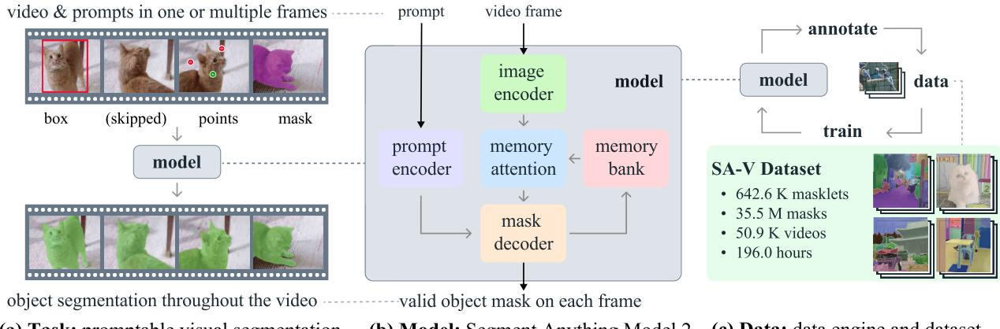  

(a) 任务：可提示视觉分割（promptable visual segmentation）
(b) 模型：分割一切模型 2（Segment Anything Model 2）
(c) 数据：数据引擎与数据集（data engine and dataset）

图 1 我们提出了分割一切模型 2（Segment Anything Model 2，SAM 2），旨在利用我们的基础模型（b）解决可提示视觉分割任务（a），该模型基于通过我们的数据引擎（c）所收集的大规模 SA-V 数据集进行训练。SAM 2 能够借助一个用于保存先前提示与预测结果的流式记忆模块，通过对一个或多个视频帧上的提示（点击点、边界框或掩码）进行交互式分割。

我们采用数据引擎（§5）来生成训练数据，将我们的模型接入标人与标注者的循环中，以交互式标注新的、具有挑战性的数据。与大多数现有的视频分割数据集不同，我们的数据引擎并不局限于特定类别的物体，而是旨在为分割任何具有有效边界的物体（包括部件和子部件）提供训练数据。与现有的模型辅助方法相比，将 SAM 2 接入循环的数据引擎在质量相当的情况下，速度提升了 8.4 倍。我们最终的分割一切视频（Segment Anything Video, SA-V）数据集（§5.2）包含 50.9K 个视频中的 35.5M 个掩码，掩码数量是任何现有视频分割数据集的 53 倍。SA-V 极具挑战性，其中包含会在视频过程中被遮挡并重新出现的小物体和部件。我们的 SA-V 数据集在地理上具有多样性，对 SAM 2 的公平性评估表明，在基于感知性别（perceived gender）的视频分割任务中，性能差异极小，在我们考察的三个感知年龄段（perceived age groups）之间的方差也很小。

我们的实验（§6）表明，SAM 2 在视频分割体验上带来了跨越式提升。SAM 2 能在使用比先前方法少 3 倍交互次数的情况下，产生更好的分割精度。此外，SAM 2 在多个评估设置下，于既有的视频对象分割基准测试中超越了先前工作，并在图像分割基准测试上相较 SAM 表现更佳，同时速度提升了 6 倍。SAM 2 在多种视频和图像分布上均展现出有效性，这一点通过大量的零样本基准测试得到了验证，其中包括 17 项视频分割基准测试和 37 项单图像分割基准测试。

我们将以宽松的开源许可证发布我们的工作，包括 SA-V 数据集（CC by 4.0）、SAM 2 模型检查点1、训练代码（Apache 2.0）以及我们的交互式在线演示代码（Apache 2.0）。

## 2 相关工作

图像分割。Segment Anything（Kirillov et al., 2023）提出了一项可提示的图像分割任务，其目标是在给定指向目标物体的输入提示（例如边界框或点）的情况下，输出一个有效的分割掩码。在 SA-1B 数据集上训练的 SAM 支持零样本分割，从而使其得以被广泛应用于各类任务。近期工作对 SAM 进行了扩展，例如通过引入 High-Quality 输出令牌来训练细粒度掩码（Ke et al., 2024），或提升 SAM 的效率（Xiong et al., 2023; Zhang et al., 2023a; Zhao et al., 2023）。更广泛而言，SAM 已被用于多种应用场景，包括医学成像（Ma et al., 2024; Deng et al., 2023; Mazurowski et al., 2023; Wu et al., 2023a）、遥感（Chen et al., 2024; Ren et al., 2024）、运动分割（Xie et al., 2024）以及伪装目标检测（Tang et al., 2023）。

交互式视频目标分割（Interactive Video Object Segmentation, iVOS）。交互式视频目标分割已成为一项关键任务，旨在通过用户引导高效地获取视频中的目标分割结果（掩码序列，masklets），用户引导通常以涂鸦（scribble）、点击（click）或边界框（bounding box）的形式呈现。一些早期方法（Wang 等，2005；Bai 与 Sapiro，2007；Fan 等，2015）采用基于图的优化（graph-based optimization）来引导分割标注过程。更多近期方法（Heo 等，2020；Cheng 等，2021b；Delatolas 等，2024）通常采用模块化设计，将用户输入转换为单帧上的掩码表示，然后将其传播到其他帧。

对于交互式视频分割而言，基于点击的输入更易于收集（Homayounfar 等，2021）。最近的工作将 SAM 在图像上的应用与基于掩码（Cheng 等，2023b；Yang 等，2023；Cheng 等，2023c）或基于点（Rajič 等，2023）的视频跟踪器相结合。然而，这些方法存在局限性：跟踪器可能无法适用于所有目标，SAM 在视频帧上的表现可能不佳，并且除了在每一帧中使用 SAM 重新标注并从该处重新开始跟踪之外，没有机制可以交互式地修正模型的错误。

我们的工作与这些工作有着相似的目标，即跨视频交互式地分割目标，我们构建了一个强大的统一模型，能够直接接收提示（prompts）以进行交互式视频分割，并构建了一个大规模且多样化的数据集以追求实现这一目标。

视频目标分割（Video Object Segmentation, VOS）。VOS 任务从第一帧的目标掩码作为输入开始，必须在整段视频中对其进行准确跟踪（Pont-Tuset 等，2017）。该任务被称为"半监督 VOS"，因为输入掩码可以视为仅在第一帧可用的目标监督信号。由于该任务在视频编辑或机器人技术等应用中的相关性，它引起了极大关注。

早期基于深度学习的方法通常在第一帧（Caelles 等，2016；Perazzi 等，2016；Yoon 等，2017；Maninis 等，2017；Hu 等，2018a；Bhat 等，2020；Robinson 等，2020）或所有帧（Voigtlaender 与 Leibe，2017）上进行在线微调（online fine-tuning）以使模型适应目标对象。离线训练（offline-trained）的模型实现了更快的推理速度，其条件化方式为仅以第一帧（Hu 等，2018b；Chen 等，2018）为条件，或还融合前一帧（Oh 等，2018；Yang 等，2018、2020）。这种多条件化已借助 RNN（Xu 等，2018a）和 Transformer（Oh 等，2019；Cheng 等，2021a；Li 等，2022a；Yang 等，2021b、2024；Cheng 与 Schwing，2022；Yang 与 Yang，2022；Wang 等，2022；Cheng 等，2023a；Goyal 等，2023；Zhang 等，2023b；Wu 等，2023b）扩展到所有帧。

半监督 VOS 可以被视为我们的可提示视觉分割（Promptable Visual Segmentation, PVS）任务的一个特例，其中仅在第一帧提供一个掩码提示。值得注意的是，在 VOS 中标注第一帧所需的高质量目标掩码在实践中具有挑战性且耗时。

视频分割数据集。研究者已提出了许多数据集来支持 VOS 任务。早期的 VOS 数据集（Prest 等, 2012；Li 等, 2013；Ochs 等, 2014；Fan 等, 2015），如 DAVIS（Pont-Tuset 等, 2017；Caelles 等, 2019），包含高质量标注，但其规模限制了基于深度学习的方法。YouTube-VOS（Xu 等, 2018b）是首个用于 VOS 的大规模数据集。随着算法不断改进、基准性能趋于饱和，研究者开始通过专门关注遮挡（Qi 等, 2022；Ding 等, 2023）、长视频（Hong 等, 2023, 2024）、极端形变（Tokmakov 等, 2022）、目标多样性（Wang 等, 2021b, 2023）或场景多样性（Athar 等, 2022）来提高 VOS 任务的难度。

我们发现，现有的视频分割数据集缺乏足够的覆盖范围，难以实现「在视频中分割任何东西」的能力。这些数据集的标注通常覆盖整个目标（而非部件），且往往以特定目标类别为中心，例如人、车辆和动物。与这些数据集相比，我们发布的 SA-V 数据集不仅关注整体目标，还广泛涵盖目标部件，并包含超过一个数量级的更多掩码。

## 3 任务：可提示视觉分割

我们的 PVS 任务允许在视频的任意帧向模型提供提示。提示可以是正/负点击、框或掩码，既可以用于定义待分割的目标，也可以用于约束/精修模型预测的目标。为了提供交互式体验，在特定帧接收到提示后，模型应立即以该帧上目标的有效分割掩码作为响应。在接收到初始提示后（无论是在同一帧还是在不同帧），模型应将这些提示传播到整个视频以获得目标的掩码序列（masklet），在每一帧定位目标的分割掩码。在任意帧都可以向模型提供额外的提示，以在整段视频中精修分割结果（示例见图 2）。关于任务的详细信息，请参见 §B。

  

图 2 使用 SAM 2 的交互式分割。步骤 1（选择）：我们在第 1 帧中对 SAM 2 进行提示，以获得目标对象（舌头）的分割区域。绿点/红点分别表示正向/负向提示。SAM 2 自动将分割传播到后续帧（蓝色箭头），以形成掩码片段（masklet）。如果 SAM 2 丢失了目标对象（在第 2 帧之后），我们可以通过在新帧中提供额外提示（红色箭头）来修正掩码片段。步骤 2（精修）：在第 3 帧中单击一次即可恢复目标对象，并将其传播以获得正确的掩码片段。而解耦的 SAM + 视频追踪器方法需要在第 3 帧中进行多次点击（与第 1 帧类似）才能正确地重新标注目标对象，因为分割需要从头开始。凭借 SAM 2 的记忆能力，单次点击即可恢复舌头。

SAM 2（§4）被用作 PVS 任务的数据采集工具，以构建我们的 SA-V 数据集（§5）。我们通过在多个帧上模拟交互式视频分割场景来评估模型（§6），包括在传统的半监督 VOS 设置中（注释仅限于第一帧），以及在 SA 基准上进行图像分割。

## 4 模型

SAM 2（图 3）可以看作是 SAM 在视频（和图像）领域上的推广，它接受单帧上的点、框和掩码提示，以定义需要在时空上被分割对象的空间范围。在空间上，该模型的行为与 SAM 类似。一个可提示且轻量级的掩码解码器接收图像嵌入和提示（如果有），并输出该帧的分割掩码。可以在同一帧上迭代添加提示以对掩码进行精修。

SAM 2 解码器所使用的帧嵌入并非直接来自图像编码器，而是以过去预测帧和已提示帧的记忆作为条件。提示帧甚至可以是相对于当前帧「来自未来」的。帧的记忆由记忆编码器基于当前预测创建，并存入记忆库中以供后续帧使用。记忆注意力操作将图像编码器得到的逐帧嵌入基于记忆库进行条件化，再送入掩码解码器以形成输出结果。

我们在下文中描述各个组件及训练过程，并在附录 D 中提供更多细节。

图像编码器。为了对任意长度的视频进行实时处理，我们采用流式方法，即在视频帧可用时立即消费它们。图像编码器在整个交互过程中只运行一次，其作用是提供表示每一帧的无条件 token（特征嵌入）。我们使用 MAE（He et al., 2022）预训练的 Hiera（Ryali et al., 2023; Bolya et al., 2023）图像编码器，它具有层次化结构，使我们能够在解码过程中使用多尺度特征。

图 3 SAM 2 架构。对于给定帧，分割预测以当前提示（prompt）和/或先前观察到的记忆为条件。视频以流式方式处理，每一帧由图像编码器逐帧消费，并与来自先前帧的目标对象的记忆进行交叉注意力。掩码解码器可选地接收输入提示，预测该帧的分割掩码。最后，记忆编码器将预测和图像编码器嵌入（图中未显示）进行变换，以供后续帧使用。

记忆注意力。记忆注意力的作用是根据过去帧的特征与预测，以及任何新提示来对当前帧特征加条件。我们堆叠 $L$ 个 Transformer 块，第一个块以当前帧的图像编码作为输入。每个块依次执行自注意力、对记忆中（已提示/未提示）帧与对象指针（见下）的交叉注意力，再接一个 MLP。自注意力和交叉注意力均采用 vanilla 注意力运算，使我们能够受益于近期高效注意力核的发展（Dao, 2023）。

提示编码器与掩码解码器。我们的提示编码器与 SAM 的相同，可通过点击（正或负）、边界框或掩码来提示，从而定义对象在给定帧中的范围。稀疏提示通过位置编码与针对每种提示类型的学习嵌入相加来表示，而掩码则通过卷积进行嵌入，并与帧嵌入相加。

我们的解码器设计大体沿用 SAM。我们堆叠「双向（two-way）」Transformer 块来更新提示与帧嵌入。与 SAM 一样，对于存在歧义的提示（例如单次点击）——即可能有多个兼容的目标掩码——我们会预测多枚掩码。该设计对于确保模型输出有效掩码十分重要。在视频中，歧义可能跨帧延续，因此模型在每一帧上都预测多枚掩码。若没有后续提示来消除歧义，模型仅对当前帧传播具有最高预测 IoU 的掩码。

与 SAM 不同（在 SAM 中给定正提示总存在可分割的有效对象），在 PVS 任务中，某些帧上可能不存在有效对象（例如因遮挡）。为支持这一新的输出模式，我们增加了一个额外的头，用于预测当前帧上是否存在感兴趣对象。另一项新设计是从分层图像编码器引出的跨层跳跃连接（绕过记忆注意力层），以便将高分辨率嵌入纳入掩码解码（见 §D）。

记忆编码器。记忆编码器通过一个卷积模块对输出掩码进行下采样，并与来自图像编码器的无条件帧嵌入（图 3 中未显示）逐元素相加，然后通过轻量级卷积层来融合信息，从而生成一条记忆。

Memory bank. 记忆库（memory bank）通过维护一个最多包含 N 帧最近记忆的 FIFO 队列来保留目标对象在视频中过去预测的信息，并通过一个最多包含 M 帧已提示帧的 FIFO 队列来存储提示信息。例如，在 VOS（视频目标分割）任务中，初始掩码是唯一的提示，此时记忆库始终保留第一帧的记忆以及最多 N 帧最近（未被提示的）帧的记忆。这两组记忆都以空间特征图的形式存储。

除空间记忆外，我们还存储一个对象指针（object pointers）列表，作为待分割对象高层语义信息的轻量向量，这些指针基于每一帧掩码解码器输出的 token。我们的记忆注意力机制（memory attention）会同时对空间记忆特征和这些对象指针进行交叉注意力（cross-attention）。

我们将时间位置信息嵌入到最近 N 帧的记忆中，使模型能够表示短时目标运动；但不将其嵌入到已提示帧的记忆中，因为已提示帧的训练信号较为稀疏，且更难泛化到推理时的场景——在推理时，已提示帧可能来自与训练时差异很大的时间范围。

Training. 该模型在图像和视频数据上进行联合训练。类似于先前工作（Kirillov et al., 2023; Sofiiuk et al., 2022），我们模拟对模型的交互式提示过程。我们采样长度为 8 帧的序列，并随机选择最多 2 帧进行提示，然后以一定概率接收来自标注者的修正点击，这些点击是利用真值 masklet 和模型预测在训练过程中采样得到的。训练任务是顺序地（即"交互式地"）预测真值 masklet。对模型的初始提示可以是：概率 0.5 的真值掩码、概率 0.25 的从真值掩码中采样的正向点击，或概率 0.25 的边界框输入。更多细节参见 §D。

## 5 Data

为实现在视频中"分割一切"（segment anything）的能力，我们构建了一个数据引擎（data engine）来收集大规模且多样化的视频分割数据集。我们采用了让交互式模型参与的人工标注循环（model-in-the-loop）设置。类似于 Kirillov et al. (2023)，我们对所标注的 masklet 不施加语义限制，并同时关注完整对象（例如一个人）和部分对象（例如一个人的帽子）。我们的数据引擎经历了三个阶段，每个阶段根据提供给标注者的模型辅助水平进行划分。接下来，我们分别描述数据引擎的每个阶段以及我们的 SA-V 数据集。

## 5.1 Data engine

阶段 1：逐帧 SAM。第一阶段使用基于图像的交互式 SAM（Kirillov et al., 2023）来辅助人工标注。标注者需要在视频的每一帧中以每秒 6 帧（FPS）的速率使用 SAM 标注目标对象的掩码，并使用像素级精确的手动编辑工具（如"画笔"和"橡皮擦"）。此过程不涉及任何跟踪模型来辅助掩码在时间上向其他帧传播。由于这是逐帧方法，所有帧都需要从零开始标注掩码，因此该过程较慢，在我们的实验中平均标注时间为每帧 37.8 秒。然而，该方法能够为每帧生成高质量的空间标注。在该阶段，我们从 1.4K 个视频中收集了 16K 个时空掩码片段（masklet）。此外，我们使用此方法来标注 SA-V 验证集和测试集，以减轻评估期间 SAM 2 带来的潜在偏差。

阶段 2：SAM + SAM 2 Mask。第二阶段将 SAM 2 加入流程，其中 SAM 2 仅接受掩码作为提示。我们将此版本称为 SAM 2 Mask。标注者使用与第一阶段相同的 SAM 和其他工具生成第一帧的空间掩码，然后使用 SAM 2 Mask 将标注的掩码在时间上传播到其他帧，以获得完整的时空 masklet。在任意后续视频帧中，标注者可以通过使用 SAM 从零标注掩码、"画笔"和/或"橡皮擦"来空间修改 SAM 2 Mask 所做的预测，并使用 SAM 2 Mask 重新传播，重复此过程直至 masklet 正确。SAM 2 Mask 最初使用第一阶段数据和公开可用的数据集进行训练。在第二阶段期间，我们使用收集到的数据在标注流程中重新训练并更新了 SAM 2 Mask 两次。在第二阶段，我们收集了 63.5K 个 masklet。标注时间降至 7.4 秒/帧，相对于第一阶段提速约 5.1 倍。

尽管标注时间有所改善，但此方法需要在不借助先前记忆的情况下从零标注中间帧中的掩码。随后，我们推进开发了功能完备的 SAM 2，能够在统一模型中同时进行交互式分割和掩码传播。

阶段 3：SAM 2。在最后阶段，我们使用功能完备的 SAM 2，它接受各种类型的提示，包括点和掩码。SAM 2 受益于跨时间维度的对象记忆来生成掩码预测。这意味着标注者只需偶尔向 SAM 2 提供修正点击即可编辑中间帧中预测的 masklet，而无需使用不具备此类记忆上下文的空间 SAM 从零标注。在第三阶段期间，我们使用收集到的标注数据重新训练并更新了 SAM 2 五次。将 SAM 2 加入流程后，每帧的标注时间降至 4.5 秒，相对于第一阶段提速约 8.4 倍。在第三阶段，我们收集了 197.0K 个 masklet。

质量验证。为了维持标注的高标准，我们引入了验证步骤。由另一组标注员负责验证每个已标注掩码片段的质量，并将其判定为"满意"（即在所有帧中正确且一致地跟踪目标对象）或"不满意"（即目标对象定义明确且边界清晰，但掩码片段不正确或不一致）。判定为不满意的掩码片段将被送回标注流程进行修正。任何跟踪对象定义不明确的掩码片段将被整体拒绝。

<table><tr><td rowspan="2"></td><td rowspan="2">Model in the Loop</td><td rowspan="2">Time per Frame</td><td rowspan="2">Edited Frames</td><td rowspan="2">Clicks per Clicked Frame</td><td colspan="4">Phase 1 Mask Alignment Score (IoU&gt;0.75)</td></tr><tr><td>All</td><td>Small</td><td>Medium</td><td>Large</td></tr><tr><td>Phase 1</td><td>SAM only</td><td>37.8 s</td><td>100.00 %</td><td>4.80</td><td>-</td><td>-</td><td>-</td><td>-</td></tr><tr><td>Phase 2</td><td>SAM + SAM 2 Mask</td><td>7.4 s</td><td>23.25 %</td><td>3.61</td><td>86.4 %</td><td>71.3 %</td><td>80.4 %</td><td>97.9 %</td></tr><tr><td>Phase 3</td><td>SAM 2</td><td>4.5 s</td><td>19.04 %</td><td>2.68</td><td>89.1 %</td><td>72.8 %</td><td>81.8 %</td><td>100.0 %</td></tr></table>

表 1 数据引擎各阶段的演进，展示每帧的平均标注时间、每个 masklet 的平均编辑帧百分比、每点击帧的手动点击次数，以及按 mask 尺寸与 Phase 1 相比的 Mask 对齐情况。

自动 masklet 生成。确保标注的多样性对于实现我们模型的任意物体分割能力至关重要。由于人类标注者通常可能更关注显著物体，我们用自动生成的 masklet（称为"自动"（Auto））来扩充标注。这具有双重目的：增加标注的覆盖范围，并帮助识别模型的失败案例。为了生成自动 masklet，我们使用规则点网格在第一帧上提示 SAM 2，并生成候选 masklet。然后将它们送入 masklet 验证步骤进行过滤。被标记为"令人满意"（satisfactory）的自动 masklet 被添加到 SA-V 数据集中。被识别为"不令人满意"（unsatisfactory）（即模型失败案例）的 masklet 被采样并呈现给标注者，以便在引入 SAM 2 协助的情况下进行精炼（数据引擎的第 3 阶段）。这些自动 masklet 覆盖了大的显著中心物体，但也覆盖了背景中不同大小和位置的物体。

分析。表 1 通过受控实验（详见 §E.2.2）展示了每个数据引擎阶段的标注协议比较。我们比较了每帧的平均标注时间、每个 masklet 的平均手动编辑帧百分比，以及每点击帧的平均点击次数。为了进行质量评估，我们定义第 1 阶段 Mask 对齐分数（Phase 1 Mask Alignment Score）为相对于第 1 阶段对应 mask 的 IoU 超过 0.75 的 mask 百分比。选择第 1 阶段的数据作为参考，因为它具有每帧高质量的人工标注。引入 SAM 2 协助的第 3 阶段提高了效率并保持了可比的标注质量：它比第 1 阶段快 8.4×，具有最低的编辑帧百分比和每帧点击次数，并产生更好的对齐效果。

在表 2 中，我们展示了在每个阶段结束时，使用可用数据训练的 SAM 2 的性能比较，其中保持迭代次数固定，因此仅衡量额外数据的影响。我们在自有的 SA-V 验证集和 9 个零样本基准测试上进行了评估（详见 §F.1），使用标准的 J&F 准确度指标（越高越好），在第一帧上使用 3 次点击进行提示。我们注意到在迭代地包含每个阶段的数据后，性能持续提升，不仅在域内 SA-V 验证集上，而且在 9 个零样本基准测试上也是如此。

<table><tr><td>Training data</td><td>SA-V val</td><td>9 zero-shot</td></tr><tr><td>VOS + SA-1B</td><td>50.0</td><td>62.5</td></tr><tr><td>+ Phase 1</td><td>53.0</td><td>66.9</td></tr><tr><td>+ Phase 2</td><td>58.8</td><td>70.9</td></tr><tr><td>+ Phase 3</td><td>62.5</td><td>71.2</td></tr><tr><td>+ Auto</td><td>63.2</td><td>71.5</td></tr></table>

表2：加入每个数据引擎阶段数据后分割精度（J&F metric）的提升。"VOS" 是一组视频目标分割（Video Object Segmentation）数据集。详见 §F。

## 5.2 SA-V 数据集

通过我们的数据引擎采集的 SA-V 数据集包含 50.9K 个视频和 642.6K 个遮罩序列（masklet）。在表3中，我们从视频数、masklet 数和掩膜（mask）数方面将 SA-V 数据集的构成与常见的 VOS 数据集进行了比较。值得注意的是，SA-V 数据集中标注掩膜的数量是任何现有 VOS 数据集的 53 倍（不使用自动标注时为 15 倍），为未来研究提供了重要资源。我们将以宽松许可证（permissive license）发布 SA-V 数据集。

视频。我们收集了一批由众包工人（crowdworker）拍摄的新视频，共 50.9K 个。视频中 54% 为室内场景，46% 为室外场景，平均时长为 14 秒。视频呈现 "in-the-wild"（真实场景）多样化的环境，涵盖多种日常情境。

Masklet。标注包括 190.9K 条人工 masklet 标注和 451.7K 条由我们的数据引擎采集的自动 masklet。叠加了 masklet（人工与自动）的示例视频如图4所示。SA-V 的掩膜数量比最大的 VOS 数据集多 53 倍（不使用自动标注时为 15 倍）。SA-V Manual 数据集中的消失率（Ding et al., 2023）（即至少在一帧中消失后又重新出现的标注 masklet 占比）为 42.5%，在现有数据集中具有竞争力。

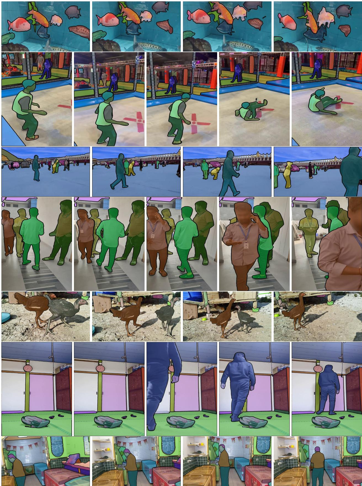  

图 4　SA-V 数据集中的示例视频，叠加了 masklet（人工标注与自动生成）。每个 masklet 都具有唯一的颜色，每一行代表来自同一视频的帧，帧之间间隔为 1 秒。

<table><tr><td></td><td>#Videos</td><td>Duration</td><td>#Masklets</td><td>#Masks</td><td>#Frames</td><td>Disapp. Rate</td></tr><tr><td>DAVIS 2017 (Pont-Tuset et al., 2017)</td><td>0.2K</td><td>0.1 hr</td><td>0.4K</td><td>27.1K</td><td>10.7K</td><td>16.1 %</td></tr><tr><td>YouTube-VOS (Xu et al., 2018b)</td><td>4.5K</td><td>5.6 hr</td><td>8.6K</td><td>197.3K</td><td>123.3K</td><td>13.0 %</td></tr><tr><td>UVO-dense (Wang et al., 2021b)</td><td>1.0K</td><td>0.9 hr</td><td>10.2K</td><td>667.1K</td><td>68.3K</td><td>9.2 %</td></tr><tr><td>VOST (Tokmakov et al., 2022)</td><td>0.7K</td><td>4.2 hr</td><td>1.5K</td><td>175.0K</td><td>75.5K</td><td>41.7 %</td></tr><tr><td>BURST (Athar et al., 2022)</td><td>2.9K</td><td>28.9 hr</td><td>16.1K</td><td>600.2K</td><td>195.7K</td><td>37.7 %</td></tr><tr><td>MOSE (Ding et al., 2023)</td><td>2.1K</td><td>7.4 hr</td><td>5.2K</td><td>431.7K</td><td>638.8K</td><td>41.5 %</td></tr><tr><td>Internal</td><td>62.9K</td><td>281.8 hr</td><td>69.6K</td><td>5.4M</td><td>6.0M</td><td>36.4 %</td></tr><tr><td>SA-V Manual</td><td>50.9K</td><td>196.0 hr</td><td>190.9K</td><td>10.0M</td><td>4.2M</td><td>42.5 %</td></tr><tr><td>SA-V Manual+Auto</td><td>50.9K</td><td>196.0 hr</td><td>642.6K</td><td>35.5M</td><td>4.2M</td><td>27.7 %</td></tr></table>

表3 我们的数据集与开源 VOS 数据集在视频数量、时长、masklet 数量、掩码数量、帧数以及消失率方面的对比。SA-V Manual 仅包含人工标注的标签。SA-V Manual+Auto 将人工标注的标签与自动生成的 masklet 结合在一起。

SA-V 的训练集、验证集和测试集划分。我们基于视频作者（及其地理位置）来划分 SA-V，以确保相似对象之间的重叠尽可能少。为了构建 SA-V val 和 SA-V test 集，我们在挑选视频时聚焦于具有挑战性的场景，并要求标注人员识别具有挑战性的目标，这些目标快速运动、被其他物体复杂遮挡，并且具有消失与重新出现的模式。这些目标使用第 5.1 节中数据引擎的 Phase 1 设置，以 6 FPS 的帧率进行标注。SA-V val 划分包含 293 个 masklet 和 155 个视频，SA-V test 划分包含 278 个 masklet 和 150 个视频。

内部数据集。我们还使用了内部可获取的授权视频数据，以进一步扩充我们的训练集。我们的内部数据集由 62.9K 个视频和 69.6K 个 masklet 组成，使用第 5.1 节中的 Phase 2 和 Phase 3 进行标注，用于训练；以及 96 个视频和 189 个 masklet，使用 Phase 1 进行标注，用于测试（Internal-test）。

关于数据引擎和 SA-V 数据集的更多细节（包括公平性评估），请参见附录 E。

## 6 零样本实验（Zero-shot experiments）

在这一节中，我们将 SAM 2 与之前在零样本视频和图像任务上的工作进行比较。对于视频任务，我们报告标准的 $\mathcal { T } \& \mathcal { F }$ 指标（Pont-Tuset 等，2017）；对于图像任务，我们报告 mIoU 指标。除非另有说明，本节中的结果均遵循我们的默认设置，使用分辨率为 1024 的 Hiera-B+ 图像编码器，并在全部数据集组合上进行训练，即表 6 中的 SAM 2（Hiera-B+）（详见 §D.2）。

## 6.1 可提示视频分割（Promptable video segmentation）

我们首先评估可提示视频分割任务，该任务通过模拟一种类似于用户体验的交互式设置来进行。我们有两种评估设置：离线评估（offline evaluation），即对视频进行多次遍历以根据最大模型误差选择要进行交互的帧；以及在线评估（online evaluation），即在视频的单次前向遍历过程中完成帧的标注。这些评估在 9 个密集标注的零样本视频数据集上进行，每帧使用 $N _ { \mathrm { c l i c k } } = 3$ 次点击（详见 §F.1）。

我们基于两个当前最先进的视频目标分割模型——XMem++（Bekuzarov 等，2023）和 Cutie（Cheng 等，2023a）——构建了两个强基线：SAM+XMem++ 和 SAM+Cutie。

  

(a) 离线平均 $\mathcal { I } \& \mathcal { F }$ 在各数据集上的结果（3-click）

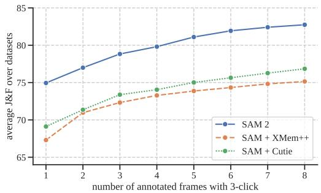  

(b) 跨数据集在线平均 $\mathcal { I } \& \mathcal { F }$（3-click）

图 5 在交互式离线（offline）与在线（online）评估设置下，跨 9 个数据集的零样本准确率。

我们使用 XMem++ 根据一张或多张帧上的掩码输入来生成视频分割。SAM 用于提供初始掩码，或对输出进行优化（将当前分割作为掩码提示反馈给 SAM）。对于 SAM+Cutie 基线方法，我们对 Cutie 进行了修改，使其能够接受多帧上的掩码输入。

在图 5 中，我们报告了在 $N _ { \mathrm { f r a m e } } = 1 , \ldots , 8$ 个交互帧上的平均 $\mathcal { T } \& \mathcal { F }$ 准确率。在离线（offline）和在线（online）两种评估设置下，SAM 2 均优于 SAM+XMem++ 和 SAM+Cutie。在全部 9 个数据集上（参见 §F.1 中逐数据集的结果），SAM 2 都优于这两种方法，能够通过少量点击生成高质量的视频分割，同时支持通过提示进行持续优化。总体而言，SAM 2 能够以更少（超过 3 倍）的交互次数获得更高的分割准确率。

## 6.2 半监督视频目标分割

<table><tr><td>Method</td><td>1-click</td><td>3-click</td><td>5-click</td><td>bounding box</td><td>ground-truth mask‡</td></tr><tr><td>SAM+XMem++</td><td>56.9</td><td>68.4</td><td>70.6</td><td>67.6</td><td>72.7</td></tr><tr><td>SAM+Cutie</td><td>56.7</td><td>70.1</td><td>72.2</td><td>69.4</td><td>74.1</td></tr><tr><td>SAM 2</td><td>64.7</td><td>75.3</td><td>77.6</td><td>74.4</td><td>79.3</td></tr></table>

表 4 在 17 个视频数据集上使用不同提示的零样本准确率。我们报告了每种类型提示（1、3 或 5 次点击、边界框或真值掩码）在视频第一帧上的平均准确率（‡：此情形直接将掩码作为输入送入 XMem++ 或 Cutie，而不使用 SAM）。

我们在半监督视频目标分割（VOS）设定下（Pont-Tuset et al., 2017）进行评估，仅在视频的第一帧上使用点击、框或掩码提示。当使用点击提示时，我们在视频第一帧上交互式地采样 1、3 或 5 次点击。

与 §6.1 中的交互式设定类似，我们与 XMem++ 和 Cutie 进行对比，对点击和框提示使用 SAM，而对掩码提示则使用它们各自的默认设定。我们报告了标准的 $\mathcal { I } \& \mathcal { F }$ 准确率（Pont-Tuset et al., 2017），但在 VOST（Tokmakov et al., 2022）上遵循其协议报告 J 度量。结果见表 4。SAM 2 在 17 个数据集上均优于这两种方法。这些结果强调 SAM 2 在传统的、非交互式的 VOS 任务（这些方法正是为此而设计）中也同样表现出色，使用掩码作为输入时效果尤为突出。详细结果见 §F.1.3。

## 6.3 图像分割

我们在 37 个零样本数据集上评估 SAM 2 在 Segment Anything 任务上的表现，其中包括 SAM 先前用于评估的 23 个数据集。1 次点击和 5 次点击的 mIoU 报告于表 5 中，我们还展示了按数据集领域划分的平均 mIoU 以及在单块 A100 GPU 上的模型速度（以每秒帧数 FPS 衡量）。

第一列（SA-23 All）展示了在 SAM 的 23 个数据集上的准确率。SAM 2 取得了更高的准确率（1 次点击时为 58.9 mIoU），优于 SAM（1 次点击时为 58.1 mIoU），且未使用任何额外数据，速度更是快了 6 倍。这主要归功于 SAM 2 中更小但更高效的 Hiera 图像编码器。

最底下一行展示了在我们的 SA-1B 和视频数据混合集上训练如何进一步提升准确率，在 23 个数据集上平均达到 61.4%。我们还观察到在 SA-23 的视频基准（视频数据集以图像形式进行评估，与 Kirillov et al., 2023 的处理方式一致），以及我们新增的 14 个视频数据集上都取得了显著的提升。更为详细的结果，包括按数据集的细分，见 §F.3。

## 7 与半监督 VOS 领域最先进方法的对比

我们的主要关注点是一般的、交互式的 PVS 任务，但我们也涉及特定的半监督 VOS 设定（其中提示为第一帧上的真值掩码），因为这是一个历史上常见的评估协议。我们评估了两个版本的 SAM 2，使用不同规模的图像编码器（Hiera-B+ 和 Hiera-L），以获得不同的速度-准确率权衡。我们使用批大小为 1 在单块 A100 GPU 上测量每秒帧数（FPS）。基于 Hiera-B+ 和 Hiera-L 的 SAM 2 分别以 43.8 和 30.2 FPS 的实时速度运行。

我们在表 6 中给出了与现有最先进方法的对比，采用标准协议报告准确率。SAM 2 相较于现有最佳方法有显著提升。我们观察到，使用更大的图像编码器能够在各方面带来显著的精度提升。

1 (5) 次点击 mIoU

<table><tr><td>Model</td><td>Data</td><td>SA-23 All</td><td>SA-23 Image</td><td>SA-23 Video</td><td>14 new Video</td><td>FPS</td></tr><tr><td>SAM</td><td>SA-1B</td><td>58.1 (81.3)</td><td>60.8 (82.1)</td><td>54.5 (80.3)</td><td>59.1 (83.4)</td><td>21.7</td></tr><tr><td>SAM 2</td><td>SA-1B</td><td>58.9 (81.7)</td><td>60.8 (82.1)</td><td>56.4 (81.2)</td><td>56.6 (83.7)</td><td>130.1</td></tr><tr><td>SAM 2</td><td>our mix</td><td>61.9 (83.5)</td><td>63.3 (83.8)</td><td>60.1 (83.2)</td><td>69.6 (85.8)</td><td>130.1</td></tr></table>

表 5 在 37 个数据集上分割一切（Segment Anything, SA）任务的零样本准确率。该表展示了 SAM 2 相对于 SAM 在按图像/视频（image/video）领域划分下的 1 次点击和 5 次点击平均 mIoU。我们报告了 SAM 所使用的 23 个数据集（SA-23）上的平均指标，以及在另外 14 个零样本视频数据集上的平均表现（详见 §F.3）。

<table><tr><td rowspan="2">Method</td><td colspan="5">J&amp;F</td><td>G</td></tr><tr><td>MOSE val</td><td>DAVIS 2017 val</td><td>LVOS val</td><td>SA-V val</td><td>SA-V test</td><td>YTVOS 2019 val</td></tr><tr><td>STCN (Cheng et al., 2021a)</td><td>52.5</td><td>85.4</td><td>-</td><td>61.0</td><td>62.5</td><td>82.7</td></tr><tr><td>SwinB-AOT (Yang et al., 2021b)</td><td>59.4</td><td>85.4</td><td>-</td><td>51.1</td><td>50.3</td><td>84.5</td></tr><tr><td>SwinB-DeAOT (Yang &amp; Yang, 2022)</td><td>59.9</td><td>86.2</td><td>-</td><td>61.4</td><td>61.8</td><td>86.1</td></tr><tr><td>RDE (Li et al., 2022a)</td><td>46.8</td><td>84.2</td><td>-</td><td>51.8</td><td>53.9</td><td>81.9</td></tr><tr><td>XMem (Cheng &amp; Schwing, 2022)</td><td>59.6</td><td>86.0</td><td>-</td><td>60.1</td><td>62.3</td><td>85.6</td></tr><tr><td>SimVOS-B (Wu et al., 2023b)</td><td>-</td><td>88.0</td><td>-</td><td>44.2</td><td>44.1</td><td>84.2</td></tr><tr><td>JointFormer (Zhang et al., 2023b)</td><td>-</td><td>90.1</td><td>-</td><td>-</td><td>-</td><td>87.4</td></tr><tr><td>ISVOS (Wang et al., 2022)</td><td>-</td><td>88.2</td><td>-</td><td>-</td><td>-</td><td>86.3</td></tr><tr><td>DEVA (Cheng et al., 2023b)</td><td>66.0</td><td>87.0</td><td>55.9</td><td>55.4</td><td>56.2</td><td>85.4</td></tr><tr><td>Cutie-base (Cheng et al., 2023a)</td><td>69.9</td><td>87.9</td><td>66.0</td><td>60.7</td><td>62.7</td><td>87.0</td></tr><tr><td>Cutie-base+ (Cheng et al., 2023a)</td><td>71.7</td><td>88.1</td><td>-</td><td>61.3</td><td>62.8</td><td>87.5</td></tr><tr><td>SAM 2 (Hiera-B+)</td><td>76.6</td><td>90.2</td><td>78.0</td><td>76.8</td><td>77.0</td><td>88.6</td></tr><tr><td>SAM 2 (Hiera-L)</td><td>77.9</td><td>90.7</td><td>78.0</td><td>77.9</td><td>78.4</td><td>89.3</td></tr></table>

Table 6 VOS 与已有工作的对比。SAM 2 在基于首帧真值掩码提示的视频分割中，在精度（J &F、G）上表现出色。SAM 2 在 SA-V val/test 上表现显著优于已有方法。

我们还在 SA-V val 和 test 集上对已有工作进行了评估，这些数据集衡量了「任意」物体类别的开放世界分割性能。在此基准上进行比较时，我们看到大多数已有方法在该精度附近达到峰值。已有工作在 SA-V val 和 SA-V test 上的最佳性能显著较低，展示了与「分割视频中的任意对象」能力之间的差距。最后，我们观察到 SAM 2 在长期视频目标分割方面也带来了显著提升，这在 LVOS 基准结果中得到了体现。关于数据和模型的消融实验，请参见 §A。

## 8 结论

我们将 Segment Anything 自然地演进到视频领域，基于三个关键方面：(i) 将可提示分割任务扩展到视频，(ii) 使 SAM 架构能够在应用于视频时使用记忆机制，(iii) 多样化的 SA-V 数据集，用于训练和基准测试视频分割。我们相信 SAM 2 标志着视觉感知领域的重大进展，将我们的工作视为里程碑，必将推动后续研究与应用的发展。

致谢（Acknowledgements）。感谢 Alexander Kirillov 和 Jitendra Malik 就项目方向进行的讨论。感谢 Andrew Huang、Sahir Gomez、Miguel Martin、Devansh Kukreja 和 Somya Jain 在演示方面的工作，以及 Aohan Lin 和 Meng Wang 创建的数据集可视化工具。感谢 Shoubhik Debnath 和 Sagar Vaze 在数据准备方面的工作。感谢 William Ngan 和 Sasha Mitts 在设计方面的专业知识，以及 Grant Gardner 和 George Orlin 主导产品管理工作。感谢 Joelle Pineau、Daniel Bolya、Kate Saenko、Pengchuan Zhang 和 Christopher Chedeau 的宝贵讨论。感谢 Rene Martinez Doehner 和 Baishan Guo 在数据方面的支持，以及我们的标注工程与管理合作伙伴：Robert Kuo、Rishi Godugu、Bob Kamma、Ida Cheng、Claudette Ward、Kai Brown、Jake Kinney、Jenny Truong 和 Karen Bergan。感谢 Vispi Cassod、Parth Malani、Shiva Koduvayur、Alexander Miller 和 Caleb Ho 在算力和基础设施方面的支持。最后，我们感谢 Azita Shokrpour、Mallika Malhotra、Rodrick Shepard、Jonathan Torres、Luc Dahlin、David Soofian、Alex Bosenberg 和 Amanda Kallet 在项目层面的支持。

## 附录

## 目录：

• 章节：A：数据和模型消融实验

• 章节：B：任务细节

• 章节：C：局限性

• 章节：D：模型细节

• 章节：E：数据集细节

• 章节：E.2.1：标注指南

• 章节：F：零样本实验细节

• 章节：H：数据集、标注与模型卡

## A 数据和模型消融实验

本节展示了为 SAM 2 设计决策提供依据的消融实验。我们在 SA-V val、Internal-test，以及我们的 MOSE 开发集（"MOSE dev"，由从 MOSE 训练划分中随机抽样的 200 个视频组成，已从我们的训练数据中排除）上进行评估，并对 9 个零样本（zero-shot）视频数据集取平均。作为对比指标，我们报告在第一帧使用 3-click 输入下的 J&F，作为 1-click 设定与 VOS 风格得分提示之间的折中。此外，我们还报告了 SAM 在图像 SA 任务中所用 23 数据集基准上的平均 1-click mIoU。除非另有说明，我们均在 5122 空间分辨率下进行消融实验，并使用 SA-V manual 与 SA-1B 的 10% 子集进行训练。更多细节见 §D.2。

## A.1 数据消融

<table><tr><td rowspan="2"></td><td colspan="4">Training data</td><td colspan="4"> $\mathcal{J}\&\mathcal{F}$ </td><td>mIoU</td></tr><tr><td>VOS</td><td>Internal</td><td>SA-V</td><td>SA-1B</td><td>SA-V val</td><td>Internal-test</td><td>MOSE dev</td><td>9 zero-shot</td><td>SA-23</td></tr><tr><td>1</td><td>√</td><td></td><td></td><td></td><td>48.1</td><td>60.2</td><td>76.9</td><td>59.7</td><td>45.4</td></tr><tr><td>2</td><td></td><td>√</td><td></td><td></td><td>57.0</td><td>72.2</td><td>70.6</td><td>70.0</td><td>54.4</td></tr><tr><td>3</td><td></td><td></td><td>√</td><td></td><td>63.0</td><td>72.6</td><td>72.8</td><td>69.7</td><td>53.0</td></tr><tr><td>4</td><td></td><td></td><td>√</td><td>√</td><td>62.9</td><td>73.2</td><td>73.6</td><td>69.7</td><td>58.6</td></tr><tr><td>5</td><td></td><td>√</td><td>√</td><td></td><td>63.0</td><td>73.2</td><td>73.3</td><td>70.9</td><td>55.8</td></tr><tr><td>6</td><td></td><td>√</td><td>√</td><td>√</td><td>63.6</td><td>75.0</td><td>74.4</td><td>71.6</td><td>58.6</td></tr><tr><td>7</td><td>√</td><td></td><td></td><td>√</td><td>50.0</td><td>63.2</td><td>77.6</td><td>62.5</td><td>54.8</td></tr><tr><td>8</td><td>√</td><td>√</td><td></td><td></td><td>54.9</td><td>71.5</td><td>77.9</td><td>70.6</td><td>55.1</td></tr><tr><td>9</td><td>√</td><td></td><td>√</td><td></td><td>61.6</td><td>72.8</td><td>78.3</td><td>69.9</td><td>51.0</td></tr><tr><td>10</td><td>√</td><td></td><td>√</td><td>√</td><td>62.2</td><td>74.1</td><td>78.5</td><td>70.3</td><td>57.3</td></tr><tr><td>11</td><td>√</td><td>√</td><td>√</td><td></td><td>61.8</td><td>74.4</td><td>78.5</td><td>71.8</td><td>55.7</td></tr><tr><td>12</td><td>√</td><td>√</td><td>√</td><td>√</td><td>63.1</td><td>73.7</td><td>79.0</td><td>71.6</td><td>58.9</td></tr></table>

表 7 我们在不同的数据混合上训练模型，包括视频物体分割（VOS）数据集（DAVIS、MOSE、YouTubeVOS），以及 Internal-train、SA-V 和 SA-1B 的子集。我们报告了在 SA-V val 与 Internal-test、MOSE 以及 9 个零样本数据集上，使用首帧 3 次点击提示时的 J&F 准确率，以及在 SA-23 数据集上的平均 1 次点击 mIoU。

数据混合消融。在表 7 中，我们比较了 SAM 2 在不同数据混合上训练时的准确率。我们在 SA-1B 上进行预训练，然后针对每种设置单独训练一个模型。我们固定迭代次数（200k）与批量大小（128），仅在实验之间更改训练数据。我们在 SA-V val 与 Internal 集、MOSE、9 个零样本视频基准以及 SA-23 任务（第 6.3 节）上报告准确率。

第 1 行显示，仅在现有 VOS 数据集（DAVIS、MOSE、YouTubeVOS）上训练的模型在域内 MOSE dev 上表现良好，但在包括 9 个零样本 VOS 数据集在内的所有其他数据集上表现较差 $\left( 5 9 . 7 ~ \mathcal { I } \& \mathcal { F } \right)$。我们观察到，将数据引擎数据加入训练混合会带来巨大收益，包括在 9 个零样本数据集上取得 +12.1% 的平均性能提升（第 11 行 vs 第 1 行）。这可归因于 VOS 数据集的覆盖范围与规模有限。加入 SA-1B 图像可提升图像分割任务的性能（第 3 行 vs 第 4 行、第 5 行 vs 第 6 行、第 9 行 vs 第 10 行、第 11 行 vs 第 12 行），同时不会削弱 VOS 能力。仅在 SA-V 与 SA-1B 上训练（第 4 行）即可在除 MOSE（特定物体类别）以外的所有基准上取得强劲性能。总体而言，当混合所有数据集——VOS、SA-1B 以及我们的数据引擎数据（第 12 行）时，我们取得了最佳结果。

数据量消融。接下来，我们研究扩展训练数据的影响。SAM 2 在 SA-1B 上进行预训练，然后在不同规模的 SA-V 上训练。我们在 3 个基准上报告平均 $\mathcal { T } \& \mathcal { F }$ 分数（使用首帧 3 次点击提示）：SA-V val、零样本与 MOSE dev。图 6 显示，训练数据量与所有基准上的视频分割准确率之间存在一致的幂律关系。

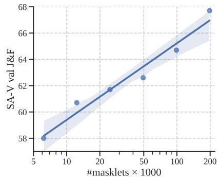

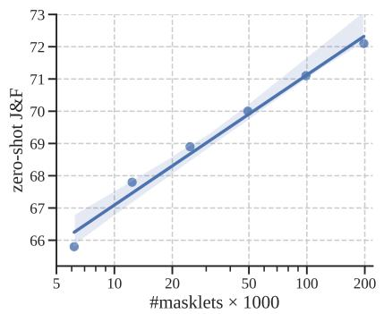

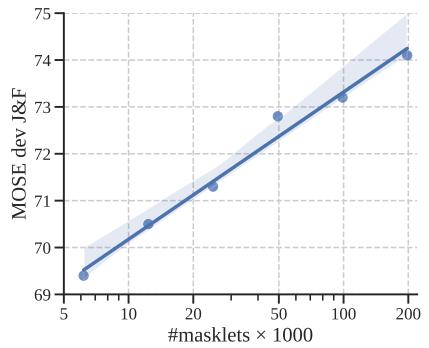  

图 6 SAM 2 精度随 SA-V 数量的变化关系。我们在 SA-V val（左）、9 个零样本（zero-shot）数据集（中）和 MOSE dev（右）上，针对第一帧中的 3 次点击提示报告 J&F 精度。

数据质量消融实验。在表 8 中，我们针对质量过滤策略进行了实验。我们从 SA-V 中子采样 5 万个 masklet，采样方式分别为随机采样，或选取被标注员编辑次数最多的 masklet。基于编辑帧数进行过滤，仅使用 25% 的数据即可取得强劲性能，并优于随机采样，但仍不及使用全部 19 万个 SA-V masklet 的效果。

<table><tr><td rowspan="2">Setting</td><td colspan="4">J&amp;F</td><td>mIoU</td></tr><tr><td>SA-V val</td><td>Internal-test</td><td>MOSE dev</td><td>9 zero-shot</td><td>SA-23</td></tr><tr><td>SA-1B + SA-V 50k random</td><td>63.7</td><td>70.3</td><td>72.3</td><td>68.7</td><td>59.1</td></tr><tr><td>SA-1B + SA-V 50k most edited</td><td>66.2</td><td>73.0</td><td>72.5</td><td>69.2</td><td>58.6</td></tr><tr><td>SA-1B + SA-V</td><td>69.9</td><td>73.8</td><td>73.9</td><td>70.8</td><td>59.8</td></tr></table>

表 8：我们在 SA-V Manual 数据集的不同子集上训练模型：随机采样的 50k 个 masklet、编辑帧最多的 50k 个 masklet，以及完整的 SA-V 数据集（190k 个 masklet）。

## A.2 模型架构消融实验

在本节中，我们展示了指导设计决策的模型消融实验，默认在较小的模式设置下进行，输入分辨率为 512。对于每种消融设置，我们报告视频 $(\mathcal{I} \& \mathcal{F})$ 和图像（mIoU）任务的分割精度，以及其相对视频分割速度（即相对于灰色标注的消融默认设置的最大推理吞吐量的比值）。我们发现图像组件和视频组件的设计选择在很大程度上是解耦的——这可以归因于我们模块化的设计和训练策略。

### A.2.1 容量消融实验

输入尺寸。在训练过程中，我们以固定分辨率和固定长度（此处用 # 帧表示）的帧序列进行采样。我们在表 9a 和表 9b 中对它们的影响进行消融。较高的分辨率在图像和视频任务上都带来了显著提升，我们在最终模型中使用的空间输入分辨率为 $1 0 2 4 ^ { 2 }$。增加帧数能为视频基准带来明显收益，我们默认使用 8 帧以平衡速度与精度。

<table><tr><td rowspan="2">res.</td><td colspan="3">J&amp;F</td><td colspan="2">mIoU</td></tr><tr><td>MOSE dev</td><td>SA-V val</td><td>9 zero-shot</td><td>speed</td><td>SA-23</td></tr><tr><td>512</td><td>73.0</td><td>68.3</td><td>70.7</td><td>1.00×</td><td>59.7</td></tr><tr><td>768</td><td>76.1</td><td>71.1</td><td>72.5</td><td>0.43×</td><td>61.0</td></tr><tr><td>1024</td><td>77.0</td><td>70.1</td><td>72.3</td><td>0.22×</td><td>61.5</td></tr></table>

表 9 我们沿输入规模（分辨率、帧数）、记忆规模（记忆数量、记忆通道维度）和模型规模（记忆注意力、图像编码器）对建模容量进行消融实验。消融默认设置以灰色标注。

记忆规模。增加（最大）记忆数量 $N$ 通常有助于提升性能，尽管可能存在一些波动，如表 9c 所示。我们使用 6 帧过去帧作为默认值，以在时间上下文长度和计算成本之间取得平衡。使用更少的记忆通道并不会造成明显的性能下降，如表 9d 所示，同时可将存储所需的内存缩小 4 倍。

模型规模。增加图像编码器或记忆注意力（自注意力/交叉注意力块数量）的容量通常会带来更好的结果，如表 9e、9f 所示。增大图像编码器在图像和视频指标上均带来提升，而增大记忆注意力仅提升视频指标。我们默认使用 B+ 图像编码器，它在速度和精度之间提供了合理的平衡。

## A.2.2 相对位置编码（Relative Positional Encoding）

<table><tr><td rowspan="2">RPB</td><td rowspan="2">2d-RoPE</td><td colspan="4"> $\mathcal{J}\&\mathcal{F}$ </td><td rowspan="2">speed</td><td>mIoU</td></tr><tr><td>MOSE dev</td><td>SA-V val</td><td>LVOSv2 val</td><td>9 zero-shot</td><td>SA-23</td></tr><tr><td></td><td>√</td><td>73.0</td><td>68.3</td><td>71.6</td><td>70.7</td><td>1.00×</td><td>59.7</td></tr><tr><td>√</td><td>√</td><td>73.6</td><td>67.9</td><td>71.0</td><td>71.5</td><td>0.93×</td><td>60.0</td></tr><tr><td></td><td></td><td>72.8</td><td>67.1</td><td>70.3</td><td>70.3</td><td>1.04×</td><td>59.9</td></tr></table>

表 10：我们在记忆注意力（memory attention）中使用二维旋转位置编码（2d-RoPE）位置编码，同时默认从图像编码器中移除相对位置偏置（RPB，灰色）。移除 RPB 还使我们能够启用 FlashAttention-2（Dao, 2023），这在（10242）分辨率下带来了显著的速度提升。在如此高的分辨率下，二维旋转位置编码（第 1 行）与无 RoPE 基线（第 3 行）之间的速度差距变得很小（4%）。

默认情况下，我们始终在图像编码器以及记忆注意力中都使用绝对位置编码。在表 10 中，我们研究了相对位置编码的设计选择。我们还在 LVOSv2（Hong et al., 2024）上以第 1 帧上的 3 次点击进行评估，作为长期视频目标分割的基准。

SAM（Kirillov et al., 2023）遵循 Li et al. (2022b) 的做法，在所有图像编码器层中添加相对位置偏置（RPB），而 Bolya et al. (2023) 通过在除全局注意力层之外的所有层中移除 RPB 并采用"绝对窗口"（absolute-win）位置编码来改进这一点，从而带来巨大的速度提升。我们进一步改进了这一点，通过从图像编码器中移除所有 RPB，在 SA-23 上没有性能回归，在视频基准上仅有极轻微的性能回归（见表 10），同时在 1024 分辨率下带来显著的速度提升。我们还发现，在记忆注意力中使用二维旋转位置编码（Su et al., 2021；Heo et al., 2024）是有益的。

## A.2.3 记忆架构消融研究

循环记忆（Recurrent memory）。我们研究了在将记忆特征添加到记忆库之前将其输入到 GRU 中的有效性。类似于 §A.2.2，我们还在 LVOSv2 上进行评估，作为长期目标分割的额外基准。虽然先前的工作通常采用 GRU（Cho et al., 2014）状态作为将记忆纳入跟踪过程的一种手段，但我们在表 11 中的发现表明，这种方法并不能带来改进（除了在 LVOSv2 上略有改进）。相反，我们发现直接将记忆特征存储在记忆库中就足够了，这既更简单又更高效。

目标指针（Object pointers）。我们消融了在其他帧中交叉关注来自掩码解码器输出的目标指针向量的影响（见 §4）。表 11 中呈现的结果表明，虽然交叉关注目标指针并不能提高 9 个零样本数据集的平均性能，但它显著提高了 SA-V 验证数据集以及具有挑战性的 LVOSv2 基准（验证集）上的性能。因此，我们默认同时交叉关注目标指针和来自记忆编码器的记忆库嵌入。

<table><tr><td rowspan="2">Object Pointers</td><td rowspan="2">GRU</td><td colspan="4"> $\mathcal{J}\&\mathcal{F}$ </td><td rowspan="2">speed</td><td>mIoU</td></tr><tr><td>MOSE dev</td><td>SA-V val</td><td>LVOSv2 val</td><td>9 zero-shot</td><td>SA-23</td></tr><tr><td></td><td></td><td>73.1</td><td>64.5</td><td>67.0</td><td>70.9</td><td>1.00×</td><td>59.9</td></tr><tr><td></td><td>√</td><td>72.3</td><td>65.3</td><td>68.9</td><td>70.5</td><td>0.97×</td><td>60.0</td></tr><tr><td>√</td><td></td><td>73.0</td><td>68.3</td><td>71.6</td><td>70.7</td><td>1.00×</td><td>59.7</td></tr></table>

Table 11 记忆设计的消融实验。我们默认使用对象指针（object pointers，灰色），同时也研究循环 GRU 记忆。

## B PVS 任务细节

Promptable Visual Segmentation（PVS，可提示视觉分割）任务可以看作是将 Segment Anything（SA）任务从静态图像扩展到视频。在 PVS 设置中，给定一段输入视频，模型可以在视频的任意帧上通过不同类型的输入（包括点击点、边界框或掩码）进行交互式提示，目标是跨整段视频分割（并跟踪）一个有效对象。在与视频交互的过程中，模型在被提示的帧上提供即时响应（类似于 SAM 在图像上的交互体验），并近乎实时地返回整段视频中该对象的分割结果。与 SAM 类似，我们关注的是具有清晰边界的有效对象，不考虑没有视觉边界的区域（例如 Bekuzarov 等 (2023)）。图 7 展示了该任务。

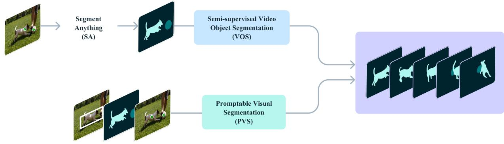  

图7 可提示视觉分割任务（Promptable Visual Segmentation, PVS）的示意图。此前研究过的任务，如 Segment Anything（SA）和半监督视频对象分割（Video Object Segmentation, VOS），均可视为 PVS 任务的特例。

PVS 与图像和视频领域中的任务相关。对于图像而言，SA 任务可以视为 PVS 的一个子集，其中视频被简化为单帧。类似地，传统的半监督和交互式 VOS（Pont-Tuset 等，2017）任务也是 PVS 的特殊情况，前者仅限于在第一帧上提供掩码提示，后者则是在多个帧上提供涂鸦以在整个视频中分割对象。在 PVS 中，提示可以是点击、掩码或框，重点在于增强交互体验，能够以最少的交互对分割结果进行细化。

## C 局限性

SAM 2 在静态图像和视频领域均表现出色，但在某些场景下仍会遇到困难。模型可能无法在镜头切换时对目标进行分割，也可能在拥挤场景中、长时间遮挡之后或在较长的视频中丢失目标或造成目标混淆。为缓解这一问题，我们设计了可在任意帧上对 SAM 2 进行提示的能力：如果模型丢失了目标或产生了错误，在额外帧上的修正点击通常可以快速恢复正确的预测。SAM 2 同样难以准确跟踪具有非常细小或精细细节的目标，特别是当它们快速移动时。另一个具有挑战性的场景是存在外观相似的邻近目标（例如多个相同的杂耍球）。将更显式的运动建模引入 SAM 2 可能会减少此类情况下的错误。

虽然 SAM 2 能够在视频中同时跟踪多个目标，但 SAM 2 对每个目标单独进行处理，仅利用共享的逐帧嵌入，而没有目标间的通信。虽然这种方法较为简单，但引入共享的目标级上下文信息有助于提升效率。

我们的数据引擎依赖人工标注者来验证掩码片段（masklet）的质量并选择需要修正的帧。未来的改进方向可包括将该过程自动化以提高效率。

## D SAM 2 细节

## D.1 架构

在此我们讨论进一步的架构细节，作为 §4 中模型描述的补充。

图像编码器（Image encoder）。我们采用特征金字塔网络（feature pyramid network）（Lin et al., 2017），将来自 Hiera 图像编码器第 3 阶段和第 4 阶段、步长分别为 16 和 32 的特征进行融合，从而为每一帧生成图像嵌入（image embeddings）。另外，第 1 阶段和第 2 阶段中步长为 4 和 8 的特征不用于记忆注意力（memory attention），而是按照图 8 所示被加到掩码解码器（mask decoder）的上采样层中，这有助于生成高分辨率的分割细节。我们沿用 Bolya et al. (2023) 的做法，在 Hiera 图像编码器中使用窗口式绝对位置嵌入（windowed absolute positional embeddings）。在 Bolya et al. (2023) 中，RPB 在图像编码器中提供了跨窗口的位置信息；与此不同，我们采用一种更简单的方法，即对全局位置嵌入进行插值，以覆盖跨窗口的位置。我们不使用任何相对位置编码。我们训练了不同规模的图像编码器模型——T、S、B+ 和 L。我们参考 Li et al. (2022b)，仅在图像编码器的部分层中使用全局注意力（global attention）（见表 12）。

记忆注意力（Memory attention）。除了正弦绝对位置嵌入之外，我们在自注意力层和交叉注意力层中还使用二维空间旋转位置嵌入（2d spatial Rotary Positional Embedding, RoPE）（Su et al., 2021; Heo et al., 2024）。目标指针令牌（object pointer tokens）不参与 RoPE，因为它们不具有特定的空间对应关系。默认情况下，记忆注意力使用 L = 4 层。

提示编码器与掩码解码器（Prompt encoder and mask decoder）。提示编码器的设计沿用 SAM，接下来讨论掩码解码器设计上的更多细节。我们使用对应于输出掩码的掩码令牌（mask token）作为该帧的目标指针令牌，并将其放入记忆库（memory bank）中。正如 §4 中所讨论的，我们还引入了一个遮挡预测头（occlusion prediction head）。具体做法是新增一个令牌，与掩码令牌和 IoU 输出令牌并列。通过在该新令牌上应用一个额外的 MLP 头，输出一个分数，表示感兴趣目标在当前帧中可见的可能性（如图 8 所示）。在记忆库中，我们还将一个可学习的遮挡嵌入（occlusion embedding）加到那些被遮挡预测头预测为遮挡（不可见）帧的记忆特征中。

SAM 引入了一种能力：当模型对图像中待分割目标存在歧义时，能够输出多个有效掩码。例如，当用户在自行车的轮胎上点击时，模型可以将此次点击理解为仅指轮胎，也可以理解为指整辆自行车，并据此输出多个预测结果。在视频场景中，这种歧义可以跨越多个视频帧。例如，如果在某一帧中只有轮胎可见，对轮胎的点击有时仅指自然气味的轮胎，而当后续帧中自行车的更多部分逐渐显现时，该点击本意可能指向整辆自行车。为了处理这种歧义，SAM 2 在视频的每一个步骤都会预测多个掩码。如果后续的提示未能消除歧义，模型将选择当前帧中预测 IoU 最高的关键掩码，用于在视频中进一步传播。

  

图 8 掩码解码器架构。该设计主要遵循 SAM，并在上采样过程中额外引入了来自图像编码器的步长为 4 和 8 的特征。我们还使用与输出掩码对应的掩码标记作为目标指针，并生成一个遮挡分数，用于指示感兴趣目标在当前帧中是否可见。

记忆编码器与记忆库。我们的记忆编码器不使用额外的图像编码器，而是复用由 Hiera 编码器生成的图像嵌入，并将其与预测的掩码信息融合以生成记忆特征（如第 §4 节所讨论的）。这种设计使得记忆特征能够受益于图像编码器所产生的强表征（尤其当我们将图像编码器扩展到更大规模时）。此外，我们将记忆库中的记忆特征投影到 64 维，并将 256 维对象指针拆分为 4 个 64 维的 token，以便与记忆库进行交叉注意力。

处理视频中的多个对象。当将 SAM 2 应用于同一视频中多个对象的分割任务时（例如在半监督 VOS 评估中的多对象跟踪），我们对每个对象独立执行推理。具体来说，我们在同一视频的所有对象之间共享图像编码器的视觉特征，但对每个对象分别运行所有其他模型组件（如记忆库和掩码解码器）。

## D.2 训练

## D.2.1 预训练

我们首先在静态图像上的 SA-1B 数据集上对 SAM 2 进行预训练。表 12a 详细列出了在 SA-1B 上预训练期间所使用的设置——此处未列出的其他设置沿用 Kirillov et al. (2023)。图像编码器由经过 MAE 预训练的 Hiera (Ryali et al., 2023) 初始化。与 SAM 类似，我们过滤掉覆盖图像超过 90% 的掩码，并将每张图像的训练限制在随机采样的 64 个掩码上。

与 SAM 不同，我们发现使用 $\ell _ { 1 }$ 损失对 IoU 预测进行更激进的监督，并将 sigmoid 激活函数应用于 IoU logits 以将输出限制在 0 到 1 的范围内，是有益的。对于多掩码预测（在第一次点击时），我们对所有掩码的 IoU 预测进行监督，以鼓励模型更好地学习何时某个掩码可能较差，但只对具有最低分割损失（focal 损失与 dice 损失的线性组合）的掩码 logits 进行监督。在 SAM 中，在迭代采样点的过程中，会插入两次没有任何额外提示的迭代（仅输入先前的掩码 logits）——我们在训练中不加入这样的迭代，并使用 $7$ 次修正点击（而非 SAM 中的 8 次）。我们还在训练期间采用水平翻转数据增强，并将图像缩放为 1024×1024 的方形尺寸。

我们使用 AdamW (Loshchilov & Hutter, 2019)，并对图像编码器应用层级学习率衰减 (Clark et al., 2020)，采用倒数平方根调度策略 (Zhai et al., 2022)。有关预训练阶段的超参数，请参见表 12 (a)。

## D.2.2 全量训练

在预训练之后，我们在所引入的数据集 SA-V + Internal（第 §5.2 节）、SA-1B 的 10% 子集，以及包括 DAVIS (Pont-Tuset et al., 2017; Caelles et al., 2019)、MOSE (Ding et al., 2023) 和 YouTubeVOS (Xu et al., 2018b) 在内的开源视频数据混合集上训练 SAM 2。我们发布的模型是在 SA-V manual + Internal 和 SA-1B 上训练的。

SAM 2 针对两项任务设计：PVS 任务（针对视频）和 SA 任务（针对图像）。我们在图像和视频数据上联合训练。为了在训练过程中优化数据使用和计算资源，我们采用视频数据（多帧）和静态图像（单帧）之间的交替训练策略。具体来说，在每次训练迭代中，我们从图像或视频数据集中采样一个完整批次，其采样概率与各数据源的大小成正比。这种方法允许对两项任务进行均衡的曝光，并为每个数据源使用不同的批大小以最大化计算利用率。此处未明确说明的图像任务设置遵循预训练阶段的设置。全量训练阶段的超参数请参见表 12 (b)。训练数据混合包括约 15.2% 的 SA-1B、约 70% 的 SA-V 和约 14.8% 的 Internal。当纳入开源数据集时采用相同的设置，只是增加了额外的数据（约 1.3% DAVIS、约 9.4% MOSE、约 9.2% YouTubeVOS、约 15.5% SA-1B、约 49.5% SA-V、约 15.1% Internal）。在 SA-V 和其他视频数据集上训练时，我们仅使用人工标注的 masklet（不添加自动生成的），根据我们的分析，这足以实现强劲的性能。

我们对训练视频应用一系列数据增强（详见表 12），包括随机水平翻转、随机仿射变换、随机颜色抖动和随机灰度变换，如表 12 所列。我们还采用马赛克变换来模拟具有多个外观相似对象的挑战性场景——以 10% 的概率，我们将同一训练视频平铺成 2×2 网格，并从 4 个象限之一中选择一个 masklet 作为要分割的目标对象。在这种情况下，模型必须聚焦于其他线索，如运动或时间连续性，以将目标对象与其他象限中外观相同的对应对象区分开来。此外，在此马赛克变换之后，每个象限中的视频和对象尺寸更小（仅为原始宽度和高度的一半），这也有助于学习分割小对象。

我们通过模拟交互设置进行训练，对 8 帧序列进行采样，并随机选择最多 2 帧（包括第一帧）作为修正点击。在训练期间，我们使用真值 masklet 和模型预测来采样提示，初始提示为真值掩码（50% 概率）、来自真值掩码的正向点击（25%）或边界框输入（25%）。

我们将每个 8 帧序列的最大 masklet 数量限制为随机选取的 3 个。我们以 50% 的概率反转时间顺序，以帮助泛化到双向传播。在对纠错点击进行采样时，我们以 10% 的小概率从真值掩码中随机采样点击，而不考虑模型预测，以便在掩码细化中具有额外的灵活性。

使用 16 帧序列进行微调。上述过程的一个潜在缺点是，模型在训练期间仅看到采样的 8 帧序列，相比推理时的完整视频长度而言相对较短。为了缓解这一问题并进一步提升长视频上的分割质量，我们引入了一个额外的微调阶段，在具有挑战性的视频（即那些已编辑帧数最多的视频，如 §E.2.1 所述）上采样 16 帧序列。更具体地说，我们按已编辑帧数对 masklet 进行排序，对于 SA-V 和内部数据集（Internal datasets），仅考虑已编辑次数最多的前 50% masklet 用于训练。我们仍保留 OSS 数据集（DAVIS、MOSE 和 YouTubeVOS）的完整版本在训练组合中。我们使用原始学习率的一半进行 50k 次迭代的微调（原始计划的 1/3），并冻结图像编码器以将 16 帧序列适配到 A100 GPU 的 80 GB 内存中。

损失函数与优化。我们使用焦点损失（focal loss）和 Dice 损失的线性组合对掩码预测进行监督，使用平均绝对误差（MAE）损失对 IoU 预测进行监督，使用交叉熵损失对物体预测进行监督，比率分别为 20:1:1:1。与预训练阶段一样，对于多掩码预测，我们只监督分割损失最低的掩码。如果真值中不包含某一帧的掩码，则我们不监督任何掩码输出（但始终监督遮挡预测头，该预测头预测帧中是否应存在掩码）。

<table><tr><td>config</td><td>value</td></tr><tr><td>data</td><td>SA-1B, Internal, SA-V</td></tr><tr><td>steps</td><td> $\sim 150k$ </td></tr><tr><td>resolution</td><td>1024</td></tr><tr><td>precision</td><td>bfloat16</td></tr><tr><td>optimizer</td><td>AdamW</td></tr><tr><td>optimizer momentum</td><td> $\beta_1, \beta_2=0.9, 0.999$ </td></tr><tr><td>gradient clipping</td><td>type:  $\ell_2$ , max: 0.1</td></tr><tr><td>weight decay</td><td>0.1</td></tr><tr><td>learning rate (lr)</td><td>img. enc.: 6e-5, other: 3.0e-4</td></tr><tr><td>lr schedule</td><td>cosine</td></tr><tr><td>warmup</td><td>linear, 7.5k iters</td></tr><tr><td>layer-wise decay</td><td>0.8 (T, S), 0.9 (B+), 0.925 (L)</td></tr><tr><td>image augmentation</td><td>hflip, resize to 1024 (square)</td></tr><tr><td>video augmentation</td><td>hflip, affine (deg: 25, shear: 20), colorjitter (b: 0.1, c: 0.03, s: 0.03, h: null), grayscale (0.05), per frame colorjitter (b: 0.1, c: 0.05, s: 0.05, h: null), mosaic-2×2 (0.1)</td></tr><tr><td>batch size</td><td>256</td></tr><tr><td>drop path</td><td>0.1 (T, S), 0.2 (B+), 0.3 (L)</td></tr><tr><td>mask losses (weight)</td><td>focal (20), dice (1)</td></tr><tr><td>IoU loss (weight)</td><td> $\ell_1$  (1)</td></tr><tr><td>occlusion loss (weight)</td><td>cross-entropy (1)</td></tr><tr><td>max. masks per frame.</td><td>image: 64, video: 3</td></tr><tr><td># correction points</td><td>7</td></tr><tr><td>global attn. blocks</td><td>5-7-9 (T), 7-10-13 (S), 12-16-20 (B+), 23-33-43 (L)</td></tr></table>

(b) 完整训练（Full training）

<table><tr><td>config</td><td>value</td></tr><tr><td>data</td><td>SA-1B</td></tr><tr><td>steps</td><td> $\sim 90k$ </td></tr><tr><td>resolution</td><td>1024</td></tr><tr><td>precision</td><td>bfloat16</td></tr><tr><td>optimizer</td><td>AdamW</td></tr><tr><td>optimizer momentum</td><td> $\beta_1, \beta_2=0.9, 0.999$ </td></tr><tr><td>gradient clipping</td><td>type:  $\ell_2$ , max: 0.1</td></tr><tr><td>weight decay</td><td>0.1</td></tr><tr><td>learning rate (lr)</td><td>4e-4</td></tr><tr><td>lr schedule</td><td>reciprocal sqrt, timescale=1000</td></tr><tr><td>warmup</td><td>linear, 1k iters</td></tr><tr><td>cooldown</td><td>linear, 5k iters</td></tr><tr><td>layer-wise decay</td><td>0.8 (T, S), 0.9 (B+), 0.925 (L)</td></tr><tr><td>augmentation</td><td>hflip, resize to 1024 (square)</td></tr><tr><td>batch size</td><td>256</td></tr><tr><td>drop path</td><td>0.1 (T, S), 0.2 (B+), 0.3 (L)</td></tr><tr><td>mask losses (weight)</td><td>focal (20), dice (1)</td></tr><tr><td>IoU loss (weight)</td><td> $\ell_1$  (1)</td></tr><tr><td>max # masks per image</td><td>64</td></tr><tr><td># correction points</td><td>7</td></tr><tr><td>global attn. blocks</td><td>5-7-9 (T), 7-10-13 (S), 12-16-20 (B+), 23-33-43 (L)</td></tr></table>

(a) 预训练  
Table 12 SAM 2 预训练与全量训练的超参数（hyperparameters）与细节。注意，部分设置会随图像编码器尺寸（T、S、B+、L）变化。

## D.3 速度基准测试

我们在单张 A100 GPU 上进行所有基准测试实验，使用 PyTorch 2.3.1 与 CUDA 12.1，并采用 bfloat16 的自动混合精度（automatic mixed precision）。我们对所有 SAM 2 模型的图像编码器使用 torch.compile 进行编译，并对 SAM 与 HQ-SAM 做同样处理，以便在 SA 任务上进行直接对比（Tables 5 和 15）。SA 任务的 FPS 测量使用 batch size 为 10 张图像，因为在三种模型上该设定均可达到最高 FPS。对于视频任务，我们遵循视频分割领域的通用协议，使用 batch size 为 1。

## E 数据细节

## E.1 SA-V 数据集细节

**视频。** 分辨率范围从 240p 到 4K，平均为 $1 , 4 0 1 \times 1 , 0 3 7$。时长范围从 4 秒到 2.3 分钟，平均 13.8 秒，总计 4.2M 帧、196 小时。

**数据集多样性。** 如图 10 所示，SA-V 视频在 47 个国家录制（图 10b），参与者具有多样性（自报人口统计信息见图 10c）。图 10a 展示了 SA-V 与 DAVIS、MOSE 和 YouTubeVOS 在 mask 大小分布（按视频分辨率归一化）上的对比。超过 88% 的 SA-V mask 的归一化 mask 面积小于 0.1。

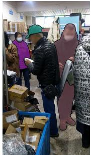

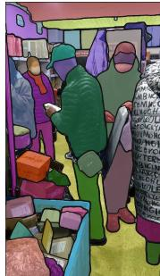  

(a) 仅手工标注（Manual Labels, ML）
(b) 含自动标注（With Automatic Labels, Auto）

图 9 标注叠加在第一帧上：（a）仅含手工标注（ML），（b）含自动标注（Auto）。自动标注增加了多样性与覆盖范围。

自动掩码片段（Automatic masklets）。与 Kirillov 等人（2023）描述的方法类似，通过使用规则网格提示模型来生成自动掩码片段。我们在第一帧上使用 $32 \times 32$ 网格提示模型，此外还在第一帧的 4 个放大图像裁剪块上使用 $16 \times 16$ 网格提示（这些裁剪块由 $2 \times 2$ 重叠窗口得到）以及在第一帧的 16 个放大图像裁剪块上使用 $4 \times 4$ 网格提示（这些裁剪块由 $4 \times 4$ 重叠窗口得到）。我们对所有帧应用两个后处理步骤。首先，我们移除面积小于 200 像素的微小不连通成分。其次，如果可在此图形中空洞的面积小于 200 像素，则对分割掩码中的空洞进行填充。通过将这些自动生成的掩码片段与人工创建的掩码片段相结合，我们增强了 SA-V 数据集中标注的覆盖范围，如图 9 所示。

## E.1.1 公平性评估

我们在不同人口群体间评估 SAM 2 的公平性。我们在 Ego-Exo4D（Grauman et al., 2023）数据集的人物类别上收集标注，该数据集包含视频主体提供的自我报告的人口统计信息。我们采用与 SA-V 验证集和测试集相同的标注设置，并将其应用于第三人称（exo）视频中的 20 秒片段。我们使用第一帧上的 1 次点击、3 次点击以及真实掩码在该数据上评估 SAM 2。

<table><tr><td></td><td>1-click</td><td>3-click</td><td>mask</td></tr><tr><td colspan="4">gender</td></tr><tr><td>male</td><td>81.9</td><td>95.1</td><td>95.9</td></tr><tr><td>female</td><td>75.1</td><td>94.1</td><td>95.2</td></tr><tr><td colspan="4">age</td></tr><tr><td>18-26</td><td>77.2</td><td>95.0</td><td>95.7</td></tr><tr><td>26-50</td><td>76.7</td><td>94.7</td><td>95.8</td></tr><tr><td>50+</td><td>81.4</td><td>95.1</td><td>96.2</td></tr></table>

Table 13 SAM 2 在受保护人口学群体上的公平性评估（采用 $\mathcal{I} \& \mathcal{F}$ 指标）。

Table 13 比较了 SAM 2 在性别与年龄维度上对人物进行分割时的 $\mathcal{T} \& \mathcal{F}$ 准确率。在 3 次点击并使用真实掩码提示（ground-truth mask prompts）的条件下，差异极小。我们人工检查了 1 次点击的预测结果，发现模型经常将人物某一部分的掩码预测为整个人物的掩码。当把比较限制在人物被正确分割的片段上时，1 次点击的差距大幅缩小（$\mathcal{I} \& \mathcal{F}$ 男性 94.3，女性 92.7），这表明该差异可部分归因于提示本身的歧义性。

我们在附录 H 中给出了 SA-V 的模型、数据与标注卡说明。

  

(a) Size

  

(b) 地理

  

(i) 性别

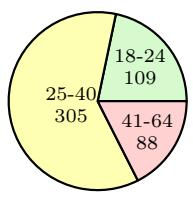  

(ii) 年龄  
(c) 众包工人人口统计  
图 10 数据集分布：(a) masklets 大小分布（按视频分辨率归一化），(b) 视频的地理多样性，以及 (c) 录制视频的众包工人的自报人口统计信息。

## E.2 数据引擎细节

## E.2.1 标注协议

  

图11 标注指南概览。主要有3项标注任务：掩模片段（masklet）选择、掩模片段跟踪和掩模片段验证。每项任务由不同的标注员团队负责。

我们数据引擎中使用的标注协议示意图如图 11 所示。标注任务被分为若干步骤，每一步由不同的标注员完成：第 1 步和第 2 步聚焦于对象选取，第 3 步和第 4 步聚焦于 masklet 跟踪，第 5 步进行质量核验。SAM 2 以 API 形式部署在 GPU 上，并集成到标注工具中，从而支持交互式使用。

与图像分割标注相比，大规模视频分割标注面临独特的挑战，这需要在标注任务设计与协议上进行创新。为了提升模型「分割一切」的能力，将标注重点放在 SAM 2 表现不佳的对象上至关重要。我们利用在线模型 in-the-loop 设置来实现这一点，要求标注员以交互方式使用 SAM 2 来识别失败模式并加以修正。

我们发现编辑过的帧数可以作为对象「难度」的代理指标，如表 8 所示。因此，我们要求标注员标注在 SAM 2 in-the-loop 条件下至少需要编辑 2 帧的对象。为了让标注聚焦于不太显著且更具挑战性的情形，我们向标注员呈现预先填充了已核验合格的自动 masklet 的视频，要求他们找出未被标注的困难对象。我们进一步将对象选取任务与标注任务解耦：在选取任务中，标注员专注于在一帧内挑选困难对象；而在标注任务中，标注员会获得一个困难的目标对象，并被要求在整段视频中一致地标注其 masklet。

## E.2.2 数据引擎各阶段对比

表 1 所示的数据引擎各阶段对比，是使用 169 个视频和 452 个 masklet 进行的受控实验。我们让三组不同的标注员子集，使用每个阶段的标注协议对同一组对象进行标注。我们根据第一帧中的 mask 面积将 masklet 归入三类（小：1 至 322，中：$3 2 ^ { 2 } \ \mathrm { t o \ 9 6 ^ { 2 } }$，大：大于等于 962）。第 1 阶段的数据被用作质量参考基准，因为其通过逐帧手动标注配合 SAM 而得到，质量较高。

## F 零样本迁移实验细节

本节我们将进一步描述零样本实验的细节（§6）。除非另有说明，本节报告的结果均遵循我们的默认设置：使用 Hiera-B+ 图像编码器，分辨率为 1024，并基于全部数据集组合进行训练，即表 6 中的 SAM 2（Hiera-B+）。

## F.1 零样本视频任务

## F.1.1 视频数据集细节

我们在 17 个零样本数据集的多样化基准上对 SAM 2 进行评估：EndoVis 2018（Allan 等人，2020）包含带有机器人器械的医学手术视频。ESD（Huang 等人，2023）包含来自机器人机械臂摄像头的视频，常带有运动模糊。LVOSv2（Hong 等人，2024）是面向长期视频对象分割的基准。LV-VIS（Wang 等人，2023）包含来自多种开放词汇对象类别的视频。UVO（Wang 等人，2021b）包含用于开放世界对象分割的视频，VOST（Tokmakov 等人，2022）包含对象发生大变形的视频，例如鸡蛋破碎或纸张撕裂。PUMaVOS（Bekuzarov 等人，2023）包含对象部件周围（例如人的脸颊）的分割视频。Virtual KITTI 2（Cabon 等人，2020）是包含驾驶场景的合成视频数据集。VIPSeg（Miao 等人，2022）提供全景视频中的对象分割。Wildfires（Toulouse 等人，2017）来自 Corsican Fire Database（科西嘉火灾数据库），包含不同条件下的野火视频。VISOR（Darkhalil 等人，2022）包含厨房场景中的自我中心视频，带有手部和活动对象周围的分割。FBMS（Brox 等人，2010）提供视频中运动对象上的运动分割。Ego-Exo4D（Grauman 等人，2023）是围绕各种人类活动的大型自我中心视频数据集。Cityscapes（Cordts 等人，2016）包含用于城市驾驶场景的视频。Lindenthal Camera（Haucke 与 Steinhage，2021）包含野生动物园中针对所观察到的动物（例如鸟类和哺乳动物）的分割视频。HT1080WT Cells（Gómez-de Mariscal 等人，2021）包含细胞分割的显微镜视频。Drosophila Heart（Fishman 等人，2023）包含果蝇心脏的显微镜视频。

在上述 17 个零样本视频数据集中，其中 9 个（EndoVis、ESD、LVOSv2、LV-VIS、UVO、VOST、PUMaVOS、Virtual KITTI 2 和 VIPSeg）对每个视频帧都进行了密集的对象分割标注。在其余 8 个数据集（Wildfires、VISOR、FBMS、Ego-Exo4D、Cityscapes、Lindenthal Camera、HT1080WT Cells 和 Drosophila Heart）中，对象分割仅在视频帧的子集上进行了稀疏标注，我们在那些真实分割掩码可用的帧上计算指标。在本文的大多数评估中，我们仅在这 9 个密集标注数据集上评估零样本性能，而在我们的半监督 VOS 评估（§6.2）中，我们在上述列出的全部 17 个数据集上进行评估。

## F.1.2 交互式离线与在线评估细节

离线评估涉及对整个视频的多次遍历。我们从第一帧上的点击提示（click prompts）出发，对目标进行整段视频的分割；然后在下一轮遍历中，选取相对于地面真值（ground-truth）分割交并比（IoU）最低的帧作为新的提示帧。模型随后基于此前接收到的所有提示，再次对目标进行整段视频的分割，直至达到最大 $N_{\mathrm{frame}}$ 轮遍历（每一轮新增一个提示帧）。

在线评估仅对整个视频进行一次遍历。我们从第一帧上的点击提示开始，将提示沿视频向前传播；当遇到预测质量较低的帧时（与地面真值的 $\mathrm{IoU} < 0.75$），暂停传播。接着在该暂停帧上添加额外的点击提示，以修正该帧上的分割结果，然后继续向前传播，直至再次遇到 $\mathrm{IoU} < 0.75$ 的低质量帧。如此反复进行，直至提示帧的数量达到最大值 $N_{\mathrm{frame}}$。与前述离线评估不同，在该设置下，新提示仅影响当前暂停帧之后的帧，而不影响其之前的帧。

在两种设置下，我们均在 §F.1.1 中的 9 个密集标注数据集上进行评估（EndoVis、ESD、LVOSv2、LV-VIS、UVO、VOST、PUMaVOS、Virtual KITTI 2 和 VIPSeg）。若某个视频的地面真值标注中包含多个待分割目标，则我们对每个目标独立进行推理。我们以每帧 $N_{\mathrm{click}} = 3$ 次点击来模拟交互式视频分割，并假设用户会通过视觉定位目标（通过初始点击）以对其进行标注，或对当前分割预测进行修正（通过修正点击）。具体而言，在第一轮遍历开始时（此时尚无任何已有预测），我们在第一帧上目标地面真值掩膜（mask）的中心2放置一个初始点击，然后基于误差区域（第一帧上地面真值掩膜与预测分割之间的误差区域）的中心，交互式地再添加两个点击。而在后续遍历中（此时已存在预测分割），我们基于误差区域（被提示帧上地面真值掩膜与预测分割之间的误差区域）的中心，交互式地添加三次点击。

我们报告在 $N_{\mathrm{frame}} = 1, \ldots, 8$ 个交互帧上的平均 $\mathcal{T}\&\mathcal{F}$ 指标，以及在不同标注时间下视频的 $\mathcal{T}\&\mathcal{F}$ 指标，所依据的假设如下：

• 在每一帧上，标注者视觉定位帧中目标需耗时 $T_{\mathrm{loc}} = 1$ 秒，每添加一次点击需耗时 $T_{\mathrm{click}} = 1.5$ 秒，参考 Delatolas 等人（2024）的设定。

• 在离线模式下，对于 300 帧的视频，每轮检查整个视频的结果（包括查找分割质量最差的帧以添加修正）需要 $T _ { \mathrm { e x a m } } = 3 0$ 秒（对于更长或更短的视频，假设标注员能够以 10 FPS 的速度检查结果，则该时间与视频长度 L 成正比）。

• 在在线模式下，对于 300 帧的视频，总共跟踪整个视频的结果（包括在低质量帧处暂停以进一步修正）需要 $T _ { \mathrm { e x a m } } = 3 0$ 秒（该时间与离线模式类似，与视频长度 L 成正比）。

• 单个对象的标注时间为：在离线模式下为 $( T _ { \mathrm { e x a m } } \cdot ( L / 3 0 0 ) + T _ { \mathrm { l o c } } + T _ { \mathrm { c l i c k } } \cdot N _ { \mathrm { c l i c k } } ) \cdot N _ { \mathrm { f r a m e } }$，在在线模式下为 $T _ { \mathrm { e x a m } } \cdot ( L / 3 0 0 ) + ( T _ { \mathrm { l o c } } + T _ { \mathrm { c l i c k } } \cdot N _ { \mathrm { c l i c k } } ) \cdot N _ { \mathrm { f r a m e } }$，其中 L 是视频中的总帧数，$N _ { \mathrm { f r a m e } } = 1 , \ldots , 8$ 是标注的帧数（即交互轮数），$N _ { \mathrm { c l i c k } } = 3$ 是每帧的点击次数。3

我们在 Fig. 12 和 Fig. 13 中展示了 SAM 2 和两个基线（SAM+XMem++ 和 SAM+Cutie，详见下文）在交互式离线和在线评估下的各数据集结果。SAM 2 在所有数据集和设置上都以显著优势优于两个基线。

## F.1.3 半监督 VOS 评估细节

在 §6.2 中，我们还在半监督 VOS 设置（Pont-Tuset et al., 2017）下与之前的视频跟踪方法进行了比较，在该设置中，仅在视频的第一帧上提供提示（可以是前景/背景点击、边界框或真实对象掩码）。在使用点击提示时，我们在第一帧上交互式地采样 1、3 或 5 次点击，然后基于这些点击跟踪对象。遵循先前工作中的基于点击的评估（Kirillov et al., 2023; Sofiiuk et al., 2022），初始点击放置在对象中心，后续点击从误差区域的中心获得。

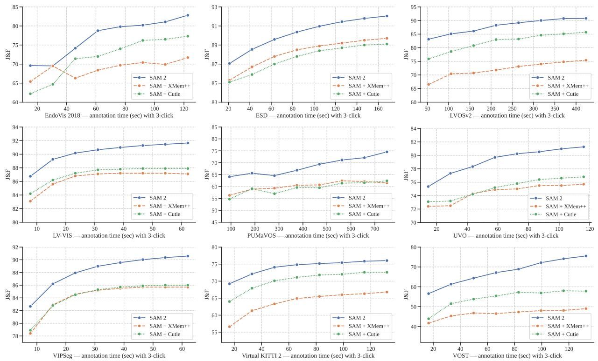  

(a) J&F 在每个数据集上使用不同交互帧数（3 次点击）的性能

<table><tr><td rowspan="2">Method</td><td colspan="7">EndoVis</td><td colspan="3">Virtual</td></tr><tr><td>2018</td><td>ESD</td><td>LVOSv2</td><td>LV-VIS</td><td>PUMaVOS</td><td>UVO</td><td>VIPSeg</td><td>KITTI 2</td><td>VOST</td><td>(average)</td></tr><tr><td>SAM + XMem++</td><td>68.9</td><td>88.2</td><td>72.1</td><td>86.4</td><td>60.2</td><td>74.5</td><td>84.2</td><td>63.8</td><td>46.6</td><td>71.7</td></tr><tr><td>SAM + Cutie</td><td>71.8</td><td>87.6</td><td>82.1</td><td>87.1</td><td>59.4</td><td>75.2</td><td>84.4</td><td>70.3</td><td>54.3</td><td>74.7</td></tr><tr><td>SAM 2</td><td>77.0</td><td>90.2</td><td>87.9</td><td>90.3</td><td>68.5</td><td>79.2</td><td>88.3</td><td>74.1</td><td>67.5</td><td>80.3</td></tr></table>

(b) 每个数据集在 8 个交互帧（每次 3 次点击）上的平均 J&F

图 12. SAM 2 与基线方法（SAM+XMem++ 和 SAM+Cutie）在不同数量交互帧、每帧 3 次点击的交互式离线评估下的零样本性能。详见 §F.1.2。

类似于交互式设置，这里我们也使用 SAM+XMem++ 和 SAM+Cutie 作为两个基线方法。对于点击或框提示，首先用 SAM 处理点击或边界框输入，其输出掩码随后用作 XMem++ 或 Cutie 的输入。对于掩码提示，第一帧上的真实目标掩码直接用作 XMem++ 和 Cutie 的输入——这是标准的半监督 VOS（Video Object Segmentation）设置，在不使用 SAM 的情况下评估 XMem++ 和 Cutie。

在此设置下，我们在 §F.1.1 的全部 17 个零样本视频数据集上进行评估。如果某个数据集不遵循标准的 VOS 格式，我们将其预处理为类似于 MOSE（Ding 等，2023）的格式。在处理过程中，我们确保每个视频中的所有目标在第一帧上都具有有效的非空分割掩码，以兼容半监督 VOS 评估。如果某个目标未在第一帧中出现，我们为它创建一个从该目标首次出现的第一帧开始的独立视频。

我们报告此评估的标准 J&F 指标（Pont-Tuset 等，2017）。如果某个数据集提供了官方评估工具包，我们使用它进行评估（在 VOST 数据集上，我们遵循其官方协议（Tokmakov 等，2022）改为报告 J 指标）。结果如表 4 所示，SAM 2 在大多数 17 个数据集的不同类型提示下均优于两个基线方法。

我们在图 14 中展示了 SAM 2 和两个基线方法（SAM+XMem++ 和 SAM+Cutie，详见下文）的半监督 VOS 评估的逐数据集结果。SAM 2 在大多数这些数据集的不同类型提示下均优于两个基线方法。

  

（a）各数据集上采用不同数量交互帧（3 次点击）时的 J&F 性能

<table><tr><td rowspan="2">Method</td><td colspan="7">EndoVis</td><td colspan="3">Virtual</td></tr><tr><td>2018</td><td>ESD</td><td>LVOSv2</td><td>LV-VIS</td><td>PUMaVOS</td><td>UVO</td><td>VIPSeg</td><td>KITTI 2</td><td>VOST</td><td>(average)</td></tr><tr><td>SAM + XMem++</td><td>71.4</td><td>87.8</td><td>72.9</td><td>85.2</td><td>63.7</td><td>74.7</td><td>82.5</td><td>63.9</td><td>52.7</td><td>72.8</td></tr><tr><td>SAM + Cutie</td><td>70.5</td><td>87.3</td><td>80.6</td><td>86.0</td><td>58.9</td><td>75.2</td><td>82.1</td><td>70.4</td><td>54.6</td><td>74.0</td></tr><tr><td>SAM 2</td><td>77.5</td><td>88.9</td><td>87.8</td><td>88.7</td><td>72.7</td><td>78.6</td><td>85.5</td><td>74.0</td><td>65.0</td><td>79.8</td></tr></table>

(b) 在 8 帧交互上（每帧 3 次点击）每个数据集的平均 J&F  
图 13 在不同交互帧数下，使用每帧 3 次点击的交互式在线评估中，SAM 2 与基线（SAM+XMem++ 和 SAM+Cutie）的零样本性能。详见 §F.1.2。

## F.1.4 SAM+XMem++ 和 SAM+Cutie 基线细节

我们采用 SAM+XMem++ 和 SAM+Cutie 作为可提示视频分割（promptable video segmentation）的两个基线，其中点击（或框）提示首先由 SAM 处理以获得目标掩膜（object mask），接着由 XMem++ / Cutie 模型将该 SAM 掩膜在视频中进行跟踪，得到最终的 masklet。在这两个基线中，SAM 既可以用于在第一帧上提供初始的目标掩膜，又可以用于对 XMem++ 或 Cutie 输出的现有目标掩膜进行修正。在后续交互帧上的交互式离线（interactive offline）和在线（online）评估中，新的正、负点击被作为对现有掩膜的修正而被使用。

当使用 SAM 对给定帧中现有的掩膜预测进行修正时，我们遵循 EVA-VOS（Delatolas et al., 2024）中的策略，首先用 XMem++ 或 Cutie 输出的掩膜对 SAM 进行初始化，然后再加入新的修正点击。具体来说，我们首先在 SAM 中重建 XMem++ 或 Cutie 的输出掩膜：通过从中采样点击并将其作为输入送入 SAM，直到 SAM 中重建的掩膜与 XMem++ 或 Cutie 的输出掩膜之间的 IoU 达到 0.8 以上。然后，为了引入新的正、负点击以进行修正，我们将这些额外的修正点击与掩膜构建过程中采样的初始点击进行拼接，并将拼接后的联合列表作为输入送入 SAM，从而获得最终修正后的掩膜。我们发现，相比若干替代方案（例如，将 XMem++ 或 Cutie 的输出掩膜作为 mask prompt 连同新的修正点击一起送入 SAM；或者仅将修正点击作为 SAM 的输入而忽略 XMem++ 或 Cutie 的输出掩膜），该策略效果更好。

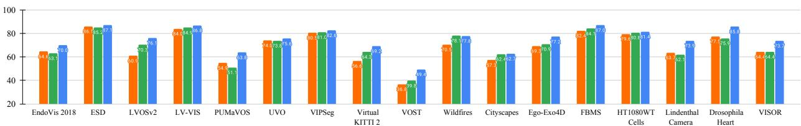

SAM + XMem++（在第 1 帧上点击 3 次）
SAM + Cutie（在第 1 帧上点击 3 次）
SAM 2（在第 1 帧上点击 3 次）

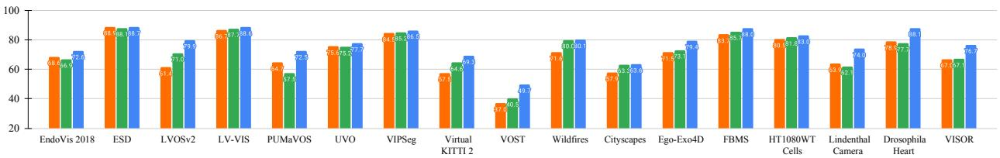

SAM + XMem++（在第 1 帧上点击 5 次） SAM + Cutie（在第 1 帧上点击 5 次） SAM 2（在第 1 帧上点击 5 次）

SAM + XMem++（首帧边界框）

SAM + Cutie（首帧边界框）

SAM 2（首帧边界框）

XMem++（第1帧上的真实掩码（ground-truth mask））
Cutie（第1帧上的真实掩码）
SAM 2（第1帧上的真实掩码）

图14 在 17 个视频数据集上，使用不同提示（视频首帧上的 1、3 或 5 次点击、边界框或真值掩码）进行半监督视频对象分割（VOS）评估时，SAM 2 与两个基线（SAM+XMem++ 和 SAM+Cutie）的零样本性能，每种提示类型在数据集上的平均性能如正文表 4 所示。详见 §F.1.3。

## F.2 DAVIS 交互式基准

我们还在 DAVIS 交互式基准（Caelles et al., 2018）上进行了评估，该基准与 §6.1 中的交互式离线评估类似，在每一轮交互中，评估服务器会对分割性能最差的帧提供新的标注。官方 DAVIS 评估工具包在交互过程中提供涂鸦（scribble）提示，而其他工作如 CiVOS（Vujasinović et al., 2022）也已将其扩展至支持点击提示。

此处我们遵循 CiVOS，使用正负点击作为输入提示，并采用相同的点击采样策略。我们在该基准上报告其评估器所提供的 J&F@60s 和 AUC-J&F 指标，并与两个基线进行比较：MiVOS（Cheng et al., 2021b），它通过涂鸦转掩码（scribble-to-mask）模块直接使用所提供的涂鸦（在 Vujasinović 等（2022）中也已扩展至点击提示）；以及 CiVOS，它从所提供的涂鸦中采样点击。结果如表 14 所示，在点击输入下，SAM 2（基于点击输入）优于两个基线。我们注意到，SAM 2 往往在第一次点击时倾向于分割对象的局部（例如一个人的手臂），而 DAVIS 数据集主要包含完整对象（例如整个人），这可能会影响 SAM 2 在该基准上的 J&F 表现。

<table><tr><td>Method</td><td>input type</td><td>AUC- $\mathcal{J}\&\mathcal{F}$ </td><td> $\mathcal{J}\&\mathcal{F}@60s$ </td></tr><tr><td>MiVOS (Cheng et al., 2021b)</td><td>scribbles</td><td>0.87</td><td>0.88</td></tr><tr><td>MiVOS ( $Cheng et al., 2021b$ ) $^{\ddagger}$ </td><td>clicks</td><td>0.75</td><td>0.75</td></tr><tr><td>CiVOS (Vujasinović et al., 2022)</td><td>clicks</td><td>0.83</td><td>0.84</td></tr><tr><td>SAM 2</td><td>clicks</td><td>0.86</td><td>0.90</td></tr></table>

Table 14 SAM 2 与其他模型在 DAVIS 交互式基准上的性能。对于 SAM 2，我们采用点击作为输入，遵循 CiVOS（Vujasinović 等人，2022 年）中的点击采样策略。详见 §F.2（‡：性能数据引自 Vujasinović 等人（2022 年））。

## F.3 零样本（Zero-shot）图像任务

## F.3.1 数据集详情

在交互式分割任务中，我们在共 37 个数据集的综合套件上对 SAM 2 进行了评估。该套件包括先前 SAM 用于零样本评估的 23 个数据集。为求完整，我们列出这 23 个数据集：LVIS（Gupta 等人，2019 年）、ADE20K（Zhou 等人，2019 年）、Hypersim（Roberts 等人，2021 年）、Cityscapes（Cordts 等人，2016 年）、BBBC038v1（Caicedo 等人，2019 年）、DOORS（Pugliatti 和 Topputo，2022 年）、DRAM（Cohen 等人，2022 年）、EgoHOS（Zhang 等人，2022 年）、GTEA（Fathi 等人，2011 年；Li 等人，2015 年）、iShape（Yang 等人，2021a）、NDD20（Trotter 等人，2020 年）、NDISPark（Ciampi 等人，2021 年、2022 年）、OVIS（Qi 等人，2022 年）、PPDLS（Minervini 等人，2016 年）、Plittersdorf（Haucke 等人，2022 年）、STREETS（Snyder 和 Do，2019 年）、TimberSeg（Fortin 等人，2022 年）、TrashCan（Hong 等人，2020 年）、VISOR（Darkhalil 等人，2022 年；Damen 等人，2022 年）、WoodScape（Yogamani 等人，2019 年）、PIDRay（Wang 等人，2021a）、ZeroWaste-f（Bashkirova 等人，2022 年）以及 IBD（Chen 等人，2022 年）。关于这些数据集的更多详细信息，我们建议读者参阅 Kirillov 等人（2023 年）。除这 23 个数据集之外，我们还在从 14 个视频数据集中采样的帧上进行了评估，以衡量 SAM 2 在视频域图像上的性能。所使用的视频数据集列举如下：Lindenthal Camera Traps（LCT）（Haucke 和 Steinhage，2021 年）、VOST（Tokmakov 等人，2022 年）、LV-VIS（Wang 等人，2023 年）、FBMS（Brox 等人，2010 年）、Virtual KITTI 2（Cabon 等人，2020 年）、Corsican Fire Database（CFD）（Toulouse 等人，2017 年）、VIPSeg（Miao 等人，2022 年）、Drosophila Heart OCM（DH OCM）（Fishman 等人，2023 年）、EndoVis 2018（Allan 等人，2020 年）、ESD（Huang 等人，2023 年）、UVO（Wang 等人，2021b）、Ego-Exo4d（Grauman 等人，2023 年）、LVOSv2（Hong 等人，2024 年）以及 HT1080WT（Gómez-de Mariscal 等人，2021 年）。Table 16 给出了这些数据集更为详细的介绍。（其中一些数据集与 §F.1.1 中零样本视频数据集源自相同的数据来源。）

## F.3.2 详细的零样本实验

本节给出 §6.3 中实验的更为详细的版本。我们在 Table 15 中将 SAM 2 与 SAM 和 HQ-SAM 在不同模型规模下进行比较。我们用于评估的主要指标是 1-click 和 5-click 的 mIoU，并根据数据集所属的领域对结果进行了分类。

Table 15 首先展示了在仅使用图像训练（用于 SA 任务）的模型之间，使用不同图像编码器大小在 SA-23 基准测试以及 14 个新引入的视频数据集上的对比。仅在 SA-1B 上训练的 SAM 2 (Hiera-B+) 在 1-click 准确率上优于 SAM (ViT-H)，在 5-click 准确率上优于 SAM (ViT-H) 和 HQ-SAM (ViT-H)，同时速度快 6 倍。SAM 2 (Hiera-L) 进一步将 1-click 平均准确率提升 1 个百分点，但以速度为代价。尽管比 Hiera-B+ 慢，但仍比 SAM (ViT-H) 快 3.4 倍，比 SAM (ViT-B) 快 1.5 倍。

Table 15 的最后两行展示了使用图像与视频混合数据进行训练所带来的收益：使用 Hiera-B+ 图像编码器时，23 个数据集上的平均准确率提升至 61.4%。此外，我们观察到在 SA-23 的视频基准以及 14 个新引入的视频数据集上都有显著提升。需要说明的是，我们并未在 Hiera-L 之上进一步扩展模型规模，但预计更大的模型会带来更好的性能。

1 (5) click mIoU

<table><tr><td>Model</td><td>Data</td><td>SA-23 All</td><td>SA-23 Image</td><td>SA-23 Video</td><td>14 new Video</td><td>FPS</td></tr><tr><td>SAM (ViT-B)</td><td>SA-1B</td><td>55.9 (80.9)</td><td>57.4 (81.3)</td><td>54.0 (80.4)</td><td>54.5 (82.6)</td><td>76.7</td></tr><tr><td>SAM (ViT-H)</td><td>SA-1B</td><td>58.1 (81.3)</td><td>60.8 (82.1)</td><td>54.5 (80.3)</td><td>59.1 (83.4)</td><td>21.7</td></tr><tr><td>HQ-SAM (ViT-B)</td><td>HQSEG-44k</td><td>53.9 (72.1)</td><td>56.3 (73.9)</td><td>50.7 (69.9)</td><td>54.5 (75.0)</td><td>73.5</td></tr><tr><td>HQ-SAM (ViT-H)</td><td>HQSEG-44k</td><td>59.1 (79.8)</td><td>61.8 (80.5)</td><td>55.7 (78.9)</td><td>58.9 (81.6)</td><td>21.4</td></tr><tr><td>SAM 2 (Hiera-B+)</td><td>SA-1B</td><td>58.9 (81.7)</td><td>60.8 (82.1)</td><td>56.4 (81.2)</td><td>56.6 (83.7)</td><td>130.1</td></tr><tr><td>SAM 2 (Hiera-L)</td><td>SA-1B</td><td>60.0 (81.8)</td><td>62.0 (82.2)</td><td>57.4 (81.2)</td><td>58.5 (83.8)</td><td>61.4</td></tr><tr><td>SAM 2 (Hiera-B+)</td><td>our mix</td><td>61.9 (83.5)</td><td>63.3 (83.8)</td><td>60.1 (83.2)</td><td>69.6 (85.8)</td><td>130.1</td></tr><tr><td>SAM 2 (Hiera-L)</td><td>our mix</td><td>63.6 (83.5)</td><td>64.7 (83.7)</td><td>62.2 (83.2)</td><td>71.1 (85.7)</td><td>61.4</td></tr></table>

表 15 在 37 个数据集套件上 Segment Anything（SA）任务的零样本（zero-shot）性能。该表按数据集领域分类，展示了 SAM 2 在 1-click 和 5-click mIoU 上相对于两个基线的平均表现。我们报告了在 SAM 用于零样本评估的 23 个数据集上的平均指标，以及在 14 个新引入的零样本视频基准上的平均值。

图 15 中展示了各数据集准确率的详细分解，其中相对于 SAM 的每个数据集 1-click mIoU 增量按数据类型（图像或视频）进行了颜色编码。值得注意的是，尽管使用了较小的 Hiera-B+ 图像编码器，SAM 2（Hiera-B+）在 29 个数据集4上仍以最多 53.9 mIoU 的优势超越了 SAM。

## G 与半监督 VOS 领域最先进方法的对比详情

我们提供了与半监督 VOS（§7）先前最先进方法对比的更多细节。我们列出了仅在 SA-1B、SA-V 和 Internal 数据上训练的 SAM 2 针对不同编码器规模的结果。

定性比较：在图 16 中，我们展示了在第一帧以掩码作为提示时，我们的基线（Cutie-base+，上排）与我们的模型（SAM 2，下排）之间的对比。尽管第一帧中的掩码提示仅覆盖了该人物的衬衫，但基线预测的 masklet 错误地传播到了整个人物。而我们的模型能够将 masklet 限制在目标对象上。

定量比较：在表 17 中，我们在额外的半监督 VOS 指标上将我们的模型与先前方法的性能进行了比较。SAM 2 在所有评估基准和所有指标上都优于先前的工作。请注意，与这些先前方法不同，SAM 2 并非专门针对半监督 VOS 任务设计，而是能够进行更通用的可提示分割（promptable segmentation）。SAM 2 也不受限于特定的对象类别集合。我们的模型在 SA-V 基准（表 17a）上的性能展示了其在视频中对任意目标进行分割的能力。

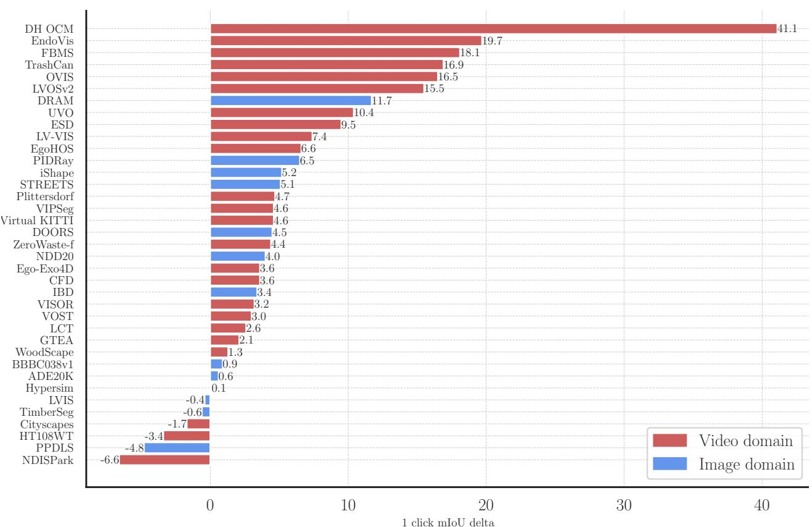  

图 15 SAM 2 与 SAM 在 37 个数据集上的零样本性能对比。该图展示了 SAM 2 与 SAM 之间中心 1 点击 mIoU 1的差值。源自视频分布的数据集以红色高亮显示，而源自图像分布的数据集以蓝色高亮显示。

  

图 16 在第一帧使用掩码提示时，我们基线（Cutie-base+，上排）与我们的模型（SAM 2，下排）的对比。

<table><tr><td>dataset</td><td>abbreviation &amp; link</td><td>video type</td><td>description</td><td>annotation type</td><td>source split</td><td># videos sampled</td><td># masklets sampled</td><td># frames sampled</td><td># masks sampled</td></tr><tr><td>LV-VIS (Wang et al., 2023)</td><td>LV-VIS</td><td>Open Vocabulary</td><td>Large scale open vocabulary video instance segmentation</td><td>Dense</td><td>Validation</td><td>690</td><td>2536</td><td>15,604</td><td>54,077</td></tr><tr><td>A Drosophila heart optical coherence microscopy database for automatic video segmentation (Fishman et al., 2023)</td><td>DH OCM</td><td>Microscopy; heart</td><td>Segmentation of a fruit fly heart in optical coherence microscopy videos</td><td>Sparse</td><td>All</td><td>213</td><td>213</td><td>608,000</td><td>607,158</td></tr><tr><td>Video Object Segmentation under Transformations (Tokmakov et al., 2022)</td><td>VOST</td><td>Deformation</td><td>Video object segmentation with emphasis on shape transformations</td><td>Dense</td><td>Validation</td><td>635</td><td>882</td><td>67,004</td><td>89,722</td></tr><tr><td>Cityscapes-VPS (Cordts et al., 2016; Kim et al., 2020)</td><td>Cityscapes-VPS</td><td>Driving</td><td>Panoptic segmentation for Cityscapes driving dataset</td><td>Sparse</td><td>Validation Instance</td><td>209</td><td>1372</td><td>4,259</td><td>4,579</td></tr><tr><td>Corsican Fire Database (Toulouse et al., 2017)</td><td>CFD</td><td>Wildfire</td><td>Segmentation of wildfires</td><td>Sparse</td><td>All</td><td>5</td><td>5</td><td>541</td><td>541</td></tr><tr><td>Partial and Unusual Masks for Video Object Segmentation (Bekuzarov et al., 2023)</td><td>PUMaVOS</td><td>Parts</td><td>Video object segmentation with a focus on parts and practical use cases</td><td>Dense</td><td>All</td><td>24</td><td>26</td><td>21,187</td><td>21,485</td></tr><tr><td>EPIC-KITCHENS VISOR (Darkhalil et al., 2022)</td><td>VISOR</td><td>Egocentric</td><td>Video object segmentation benchmark containing egocentric videos of cooking with an emphasis on segmenting active objects.</td><td>Sparse</td><td>Validation</td><td>921</td><td>921</td><td>736,030</td><td>4,426</td></tr><tr><td>HT1080WT cells embedded in 3D collagen type I matrices (Gómez-de Mariscal et al., 2021)</td><td>HT1080WT</td><td>Microscopy; cells</td><td>Timelapse videos of HT1080WT cell movement</td><td>Sparse</td><td>All</td><td>60</td><td>150</td><td>1,010</td><td>2,694</td></tr><tr><td>Freiburg-Berkeley Motion Segmentation Dataset (Brox et al., 2010)</td><td>FBMS</td><td>Moving Object</td><td>Precise segmentation of moving objects</td><td>Sparse</td><td>All</td><td>45</td><td>70</td><td>9734</td><td>755</td></tr><tr><td>Virtual KITTI 2 (Cabon et al., 2020)</td><td>Virtual KITTI 2</td><td>Synthetic; Driving</td><td>Synthetic driving videos generated by a game engine that recreate real world KITTI videos.</td><td>Dense</td><td>All from video angle Camera_0</td><td>996</td><td>1,638</td><td>109,368</td><td>162,708</td></tr><tr><td>EndoVis 2018 (Allan et al., 2020)</td><td>EndoVis 2018</td><td>Endoscopic video; surgery</td><td>Segmentation of medical tools in endoscopic videos</td><td>Dense</td><td>All</td><td>15</td><td>29</td><td>2,325</td><td>4,314</td></tr><tr><td>Lindenthal Camera Traps (Haucke &amp; Steinhage, 2021)</td><td>LCT</td><td>Stereo</td><td>Wildlife videos captured using stereo cameras.</td><td>Sparse</td><td>All</td><td>12</td><td>12</td><td>4,012</td><td>412</td></tr><tr><td>LVOSv2 (Hong et al., 2024)</td><td>LVOSv2</td><td>Long videos</td><td>Long-term video object segmentation benchmark, on average 1.14 minutes</td><td>Dense</td><td>Validation</td><td>136</td><td>225</td><td>64,523</td><td>91,510</td></tr><tr><td>UVO (Wang et al., 2021b)</td><td>UVO</td><td>Open World</td><td>Open World instance segmentation of all objects in a video</td><td>Dense</td><td>Validation</td><td>54</td><td>311</td><td>4,860</td><td>26,747</td></tr><tr><td>EgoExo4d (Grauman et al., 2023)</td><td>EgoExo4d</td><td>Egocentric</td><td>Egocentric videos of participants completing skilled activities.</td><td>Sparse</td><td>Validation videos on egocentric cameras</td><td>1185</td><td>1185</td><td>327,080</td><td>9,035</td></tr><tr><td>VIPSeg (Miao et al., 2022)</td><td>VIPSeg</td><td>Panoptic</td><td>Large scale and real world scenarios for video panoptic segmentation</td><td>Dense</td><td>Validation</td><td>152</td><td>1,457</td><td>3,416</td><td>30,408</td></tr><tr><td>Event-based Segmentation Dataset (Huang et al., 2023)</td><td>ESD</td><td>Clutter</td><td>Tabletop object segmentation in an indoor cluttered environment</td><td>Dense</td><td>All</td><td>135</td><td>814</td><td>13,325</td><td>78,243</td></tr></table>

表 16 用于零样本评估的视频分割数据集。

  

图 17 SAM 2 零样本（zero-shot）视频基准测试套件中的示例。

<table><tr><td rowspan="2">Method</td><td colspan="3">SA-V val</td><td colspan="3">SA-V test</td></tr><tr><td>J&amp;F</td><td>J</td><td>F</td><td>J&amp;F</td><td>J</td><td>F</td></tr><tr><td>STCN (Cheng et al., 2021a)</td><td>61.0</td><td>57.4</td><td>64.5</td><td>62.5</td><td>59.0</td><td>66.0</td></tr><tr><td>SwinB-AOT-L (Yang et al., 2021b)</td><td>51.1</td><td>46.4</td><td>55.7</td><td>50.3</td><td>46.0</td><td>54.6</td></tr><tr><td>SwinB-DeAOT-L (Yang &amp; Yang, 2022)</td><td>61.4</td><td>56.6</td><td>66.2</td><td>61.8</td><td>57.2</td><td>66.3</td></tr><tr><td>RDE (Li et al., 2022a)</td><td>51.8</td><td>48.4</td><td>55.2</td><td>53.9</td><td>50.5</td><td>57.3</td></tr><tr><td>XMem (Cheng &amp; Schwing, 2022)</td><td>60.1</td><td>56.3</td><td>63.9</td><td>62.3</td><td>58.9</td><td>65.8</td></tr><tr><td>SimVOS-B (Wu et al., 2023b)</td><td>44.2</td><td>40.0</td><td>48.3</td><td>44.1</td><td>40.5</td><td>47.7</td></tr><tr><td>DEVA (Cheng et al., 2023b)</td><td>55.4</td><td>51.5</td><td>59.2</td><td>56.2</td><td>52.4</td><td>60.1</td></tr><tr><td>Cutie-base (Cheng et al., 2023a)</td><td>60.7</td><td>57.7</td><td>63.7</td><td>62.7</td><td>59.7</td><td>65.7</td></tr><tr><td>Cutie-base+ (Cheng et al., 2023a)</td><td>61.3</td><td>58.3</td><td>64.4</td><td>62.8</td><td>59.8</td><td>65.8</td></tr><tr><td>SAM 2 (Hiera-B+)</td><td>76.8</td><td>73.4</td><td>80.1</td><td>77.0</td><td>73.5</td><td>80.5</td></tr><tr><td>SAM 2 (Hiera-L)</td><td>77.9</td><td>74.5</td><td>81.3</td><td>78.4</td><td>74.9</td><td>82.0</td></tr><tr><td>SAM 2 (Hiera-T) $^{\ddagger}$ </td><td>75.2</td><td>71.7</td><td>78.7</td><td>76.5</td><td>72.9</td><td>80.1</td></tr><tr><td>SAM 2 (Hiera-S) $^{\ddagger}$ </td><td>77.0</td><td>73.6</td><td>80.5</td><td>76.6</td><td>73.0</td><td>80.2</td></tr><tr><td>SAM 2 (Hiera-B+) $^{\ddagger}$ </td><td>77.5</td><td>74.1</td><td>80.9</td><td>78.2</td><td>74.8</td><td>81.7</td></tr><tr><td>SAM 2 (Hiera-L) $^{\ddagger}$ </td><td>78.6</td><td>75.3</td><td>82.0</td><td>79.5</td><td>76.0</td><td>83.0</td></tr></table>

(a) SAM 2 与先前工作在我们 SA-V 基准上的半监督视频对象分割（VOS）任务上的对比。我们使用先前工作的开源代码与检查点（checkpoint）在 SA-V 上对它们进行了评估。

<table><tr><td colspan="4">LVOS val</td></tr><tr><td>Method</td><td> $\mathcal{J}\&\mathcal{F}$ </td><td> $\mathcal{J}$ </td><td> $\mathcal{F}$ </td></tr><tr><td>DEVA (Cheng et al., 2023b)</td><td>55.9</td><td>51.1</td><td>60.7</td></tr><tr><td>DDMemory (Hong et al., 2023)</td><td>60.7</td><td>55.0</td><td>66.3</td></tr><tr><td>Cutie-base (Cheng et al., 2023a)</td><td>66.0</td><td>61.3</td><td>70.6</td></tr><tr><td>SAM 2 (Hiera-B+)</td><td>78.0</td><td>73.2</td><td>82.7</td></tr><tr><td>SAM 2 (Hiera-L)</td><td>78.0</td><td>73.2</td><td>82.7</td></tr><tr><td>SAM 2 (Hiera-T) $^{\ddagger}$ </td><td>77.5</td><td>73.0</td><td>82.1</td></tr><tr><td>SAM 2 (Hiera-S) $^{\ddagger}$ </td><td>77.3</td><td>72.3</td><td>82.2</td></tr><tr><td>SAM 2 (Hiera-B+) $^{\ddagger}$ </td><td>77.7</td><td>73.1</td><td>82.4</td></tr><tr><td>SAM 2 (Hiera-L) $^{\ddagger}$ </td><td>80.1</td><td>75.4</td><td>84.9</td></tr></table>

<table><tr><td>Method</td><td> $\mathcal{J}\&\mathcal{F}$ </td><td> $\mathcal{J}_{s}$ </td><td> $\mathcal{F}_{s}$ </td><td> $\mathcal{J}_{u}$ </td><td> $\mathcal{F}_{u}$ </td></tr><tr><td>STCN (Cheng et al., 2021a)</td><td>60.6</td><td>57.2</td><td>64.0</td><td>57.5</td><td>63.8</td></tr><tr><td>RDE (Li et al., 2022a)</td><td>62.2</td><td>56.7</td><td>64.1</td><td>60.8</td><td>67.2</td></tr><tr><td>SwinB-DeAOT-L (Yang &amp; Yang, 2022)</td><td>63.9</td><td>61.5</td><td>69.0</td><td>58.4</td><td>66.6</td></tr><tr><td>XMem (Cheng &amp; Schwing, 2022)</td><td>64.5</td><td>62.6</td><td>69.1</td><td>60.6</td><td>65.6</td></tr><tr><td>SAM 2 (Hiera-B+)</td><td>78.7</td><td>80.6</td><td>87.2</td><td>69.0</td><td>77.8</td></tr><tr><td>SAM 2 (Hiera-L)</td><td>79.6</td><td>81.0</td><td>87.4</td><td>70.4</td><td>79.8</td></tr><tr><td>SAM 2 (Hiera-T) $^{\ddagger}$ </td><td>77.3</td><td>79.9</td><td>86.9</td><td>67.1</td><td>75.4</td></tr><tr><td>SAM 2 (Hiera-S) $^{\ddagger}$ </td><td>78.3</td><td>79.2</td><td>85.9</td><td>69.0</td><td>79.0</td></tr><tr><td>SAM 2 (Hiera-B+) $^{\ddagger}$ </td><td>78.2</td><td>80.5</td><td>87.2</td><td>68.1</td><td>76.9</td></tr><tr><td>SAM 2 (Hiera-L) $^{\ddagger}$ </td><td>80.6</td><td>81.7</td><td>88.2</td><td>71.4</td><td>81.0</td></tr></table>

（c）SAM 2 与先前工作在 LVOSv2（Hong 等，2024）基准测试上的对比。我们报告了由 LVOSv2 作者所评估的先前工作的性能。

<table><tr><td rowspan="2">Method</td><td colspan="3">MOSE val</td><td colspan="3">DAVIS17 val</td><td colspan="3">DAVIS17 test</td><td colspan="5">YTVOS19 val</td></tr><tr><td>J&amp;F</td><td>J</td><td>F</td><td>J&amp;F</td><td>J</td><td>F</td><td>J&amp;F</td><td>J</td><td>F</td><td>G</td><td>Js</td><td>Fs</td><td>Ju</td><td>Fu</td></tr><tr><td>STCN (Cheng et al., 2021a)</td><td>52.5</td><td>48.5</td><td>56.6</td><td>85.4</td><td>82.2</td><td>88.6</td><td>76.1</td><td>72.7</td><td>79.6</td><td>82.7</td><td>81.1</td><td>85.4</td><td>78.2</td><td>85.9</td></tr><tr><td>SwinB-AOT-L (Yang et al., 2021b)</td><td>59.4</td><td>55.5</td><td>63.2</td><td>85.4</td><td>82.4</td><td>88.4</td><td>81.2</td><td>77.3</td><td>85.1</td><td>84.5</td><td>84.0</td><td>88.8</td><td>78.4</td><td>86.7</td></tr><tr><td>SwinB-DeAOT-L (Yang &amp; Yang, 2022)</td><td>59.9</td><td>55.7</td><td>64.0</td><td>86.2</td><td>83.1</td><td>89.2</td><td>82.8</td><td>78.9</td><td>86.7</td><td>86.1</td><td>85.3</td><td>90.2</td><td>80.4</td><td>88.6</td></tr><tr><td>RDE (Li et al., 2022a)</td><td>46.8</td><td>42.4</td><td>51.3</td><td>84.2</td><td>80.8</td><td>87.5</td><td>77.4</td><td>73.6</td><td>81.2</td><td>81.9</td><td>81.1</td><td>85.5</td><td>76.2</td><td>84.8</td></tr><tr><td>XMem (Cheng &amp; Schwing, 2022)</td><td>59.6</td><td>55.4</td><td>63.7</td><td>86.0</td><td>82.8</td><td>89.2</td><td>79.6</td><td>76.1</td><td>83.0</td><td>85.6</td><td>84.1</td><td>88.5</td><td>81.0</td><td>88.9</td></tr><tr><td>SimVOS-B (Wu et al., 2023b)</td><td>-</td><td>-</td><td>-</td><td>88.0</td><td>85.0</td><td>91.0</td><td>80.4</td><td>76.1</td><td>84.6</td><td>84.2</td><td>83.1</td><td>-</td><td>79.1</td><td>-</td></tr><tr><td>JointFormer (Zhang et al., 2023b)</td><td>-</td><td>-</td><td>-</td><td>90.1</td><td>87.0</td><td>93.2</td><td>88.1</td><td>84.7</td><td>91.6</td><td>87.4</td><td>86.5</td><td>90.9</td><td>82.0</td><td>90.3</td></tr><tr><td>ISVOS (Wang et al., 2022)</td><td>-</td><td>-</td><td>-</td><td>88.2</td><td>84.5</td><td>91.9</td><td>84.0</td><td>80.1</td><td>87.8</td><td>86.3</td><td>85.2</td><td>89.7</td><td>81.0</td><td>89.1</td></tr><tr><td>DEVA (Cheng et al., 2023b)</td><td>66.0</td><td>61.8</td><td>70.3</td><td>87.0</td><td>83.8</td><td>90.2</td><td>82.6</td><td>78.9</td><td>86.4</td><td>85.4</td><td>84.9</td><td>89.4</td><td>79.6</td><td>87.8</td></tr><tr><td>Cutie-base (Cheng et al., 2023a)</td><td>69.9</td><td>65.8</td><td>74.1</td><td>87.9</td><td>84.6</td><td>91.1</td><td>86.1</td><td>82.4</td><td>89.9</td><td>87.0</td><td>86.0</td><td>90.5</td><td>82.0</td><td>89.6</td></tr><tr><td>Cutie-base+ (Cheng et al., 2023a)</td><td>71.7</td><td>67.6</td><td>75.8</td><td>88.1</td><td>85.5</td><td>90.8</td><td>88.1</td><td>84.7</td><td>91.4</td><td>87.5</td><td>86.3</td><td>90.6</td><td>82.7</td><td>90.5</td></tr><tr><td>SAM 2 (Hiera-B+)</td><td>76.6</td><td>72.6</td><td>80.6</td><td>90.2</td><td>87.0</td><td>93.4</td><td>87.9</td><td>84.7</td><td>91.1</td><td>88.6</td><td>87.1</td><td>91.6</td><td>83.9</td><td>91.9</td></tr><tr><td>SAM 2 (Hiera-L)</td><td>77.9</td><td>73.9</td><td>81.9</td><td>90.7</td><td>87.5</td><td>94.0</td><td>87.7</td><td>84.6</td><td>90.9</td><td>89.3</td><td>87.5</td><td>92.0</td><td>84.8</td><td>92.8</td></tr><tr><td>SAM 2 (Hiera-T)‡</td><td>71.8</td><td>67.4</td><td>76.1</td><td>89.4</td><td>85.8</td><td>92.9</td><td>86.9</td><td>83.4</td><td>90.3</td><td>87.4</td><td>85.7</td><td>90.1</td><td>82.7</td><td>91.1</td></tr><tr><td>SAM 2 (Hiera-S)‡</td><td>73.5</td><td>69.2</td><td>77.7</td><td>89.6</td><td>86.3</td><td>92.9</td><td>87.6</td><td>84.1</td><td>91.1</td><td>88.0</td><td>85.9</td><td>90.2</td><td>83.9</td><td>91.9</td></tr><tr><td>SAM 2 (Hiera-B+)‡</td><td>73.8</td><td>69.7</td><td>77.9</td><td>90.0</td><td>86.8</td><td>93.1</td><td>86.6</td><td>83.3</td><td>89.8</td><td>88.2</td><td>86.1</td><td>90.6</td><td>84.0</td><td>92.1</td></tr><tr><td>SAM 2 (Hiera-L)‡</td><td>74.6</td><td>70.6</td><td>78.6</td><td>90.2</td><td>86.9</td><td>93.4</td><td>88.9</td><td>85.3</td><td>92.5</td><td>88.8</td><td>86.5</td><td>91.0</td><td>84.7</td><td>92.8</td></tr></table>

(d) SAM 2 与以往工作在半监督 VOS 任务上的对比。  
Table 17 SAM 2 与以往工作在各个基准测试上的详细对比（‡：指在 SA-1B、SA-V 以及 §5.2 中所述的内部数据集上训练的模型版本）。

## H 模型、数据与标注卡

## H.1 模型卡

<table><tr><td colspan="2">Model Overview</td></tr><tr><td>Name</td><td>SAM 2 (Segment Anything Model 2)</td></tr><tr><td>Version</td><td>1.0</td></tr><tr><td>Date</td><td>2024</td></tr><tr><td>Organization</td><td>Meta FAIR</td></tr><tr><td>Mode type</td><td>Promptable segmentation model</td></tr><tr><td>Architecture</td><td>See Section 4</td></tr><tr><td>Repository</td><td>https://github.com/facebookresearch/sam2</td></tr><tr><td>License</td><td>Apache 2.0</td></tr><tr><td colspan="2">Intended Use</td></tr><tr><td>Primary intended users</td><td>SAM 2 was designed as a unified model for promptable video and image segmentation tasks. The model was primarily developed for research use cases. SAM 2 is released under an Apache 2.0 license.</td></tr><tr><td>Out-of-scope use cases</td><td>See Ethical considerations and license for restrictions.</td></tr><tr><td>Caveats and recommendations</td><td>See Appendix C for limitations.</td></tr><tr><td colspan="2">Relevant Factors</td></tr><tr><td>Groups</td><td>SAM 2 is class agnostic and was designed for promptable image and video segmentation. It can segment and track any object.</td></tr><tr><td>Instrumentation and environment</td><td>SAM 2 was evaluated across a variety of types of video and image data. The video benchmark suite included domains such as driving data, microscopy, egocentric video, robotic surgery. See Table 16 for descriptions of the benchmarks and Figure 17 for example frames. SAM 2 was evaluated on the same suite of image benchmarks as Kirillov et al. (2023), which covers domains including underwater images, paintings, fish-eye images.</td></tr><tr><td colspan="2">Metrics</td></tr><tr><td></td><td>We evaluate the performance of SAM 2 using the following metrics: J&amp;F: We evaluate performance using J&amp;F (Pont-Tuset et al., 2017) for the promptable video segmentation and semi-supervised VOS tasks. G: We use G for evaluation on YTVOS 2019 for the semi-supervised VOS task. mIoU: We evaluate performance using mIoU for the promptable image segmentation task.</td></tr><tr><td colspan="2">Evaluation Data</td></tr><tr><td>Data sources</td><td>See Appendix F</td></tr><tr><td colspan="2">Training Data</td></tr><tr><td>Data source</td><td>SAM 2 was trained on the SA-V dataset alongside internally available licensed video data. See Section 5 of the main text for more details and Appendix H.2 for the SA-V dataset data card.</td></tr><tr><td colspan="2">Ethical Considerations</td></tr><tr><td>Data</td><td>See Section 5 for more details about the SAM 2 training data. In Section E.1 we show a geographic distribution of the videos and demographic distribution of the crowdworkers who collected the videos in the SA-V dataset.</td></tr><tr><td>Cost and impact of compute</td><td>The released SAM 2 was trained on 256 A100 GPUs for 108 hours. This corresponds to 12165.12 kWh and an estimated emissions of 3.89 metric tons of CO2e (Patterson et al., 2021; Lacoste et al., 2019). The emissions from training the released SAM 2 are equivalent to ~10k miles driven by an average gasoline-powered passenger vehicle (Agency, 2022).</td></tr><tr><td>Risks and harms</td><td>In Section E.1.1 of the main text we analyze SAM 2 performance on people across demographic groups. When using SAM 2 in new settings, we suggest that researchers perform their own fairness evaluation for SAM 2 specific to their use case.</td></tr><tr><td>Use cases</td><td>We implore users to use their best judgement.</td></tr></table>

Table 18 Model card for SAM 2 following the structure in Mitchell et al. (2019)

## H.2 Dataset card for SA-V dataset

## Motivation

1. For what purpose was the dataset created? Was there a specific task in mind? Was there a specific gap that needed to be filled? Please provide a description. The dataset was designed for the PVS task. The contributions of our dataset to the vision community are: (1) The dataset, composed of 50.9K videos and 642.6K masklets, is the largest video segmentation dataset publicly available today (see 5.2 for comparisons to current VOS datasets) (2) The dataset is available under a Creative Commons Attribution 4.0 International Public License at https://ai.meta.com/datasets/segment-anything-video/, (3) The data is a more geographically diverse, publicly available, video segmentation dataset than its predecessors.

2. Who created the dataset (e.g., which team, research group) and on behalf of which entity (e.g., company, institution, organization)? The dataset was created by Meta FAIR. The underlying videos were collected via a contracted third party company.

3. Who funded the creation of the dataset? The dataset was funded by Meta FAIR.

4. Any other comments? No.

## Composition

1. What do the instances that comprise the dataset represent (e.g., documents, photos, people, countries)? Are there multiple types of instances (e.g., movies, users, and ratings; people and interactions between them; nodes and edges)? Please provide a description. All of the instances in the dataset are videos. Subject matter diversity was encouraged and no specific themes were applied during video collection. Common themes of the video include: locations, objects, scenes. All the videos are distinct, however there are some sets of videos that were taken of the same subject matter.

2. How many instances are there in total (of each type, if appropriate)? There are 50.9K videos.

3. Does the dataset contain all possible instances or is it a sample (not necessarily random) of instances from a larger set? If the dataset is a sample, then what is the larger set? Is the sample representative of the larger set (e.g., geographic coverage)? If so, please describe how this representativeness was validated/verified. If it is not representative of the larger set, please describe why not (e.g., to cover a more diverse range of instances, because instances were withheld or unavailable). While the dataset contains all possible instances, reviewers were advised to refuse to annotate content containing explicit imagery.

4. What data does each instance consist of? “Raw” data (e.g., unprocessed text or images) or features? In either case, please provide a description. Each instance is a video.

5. 每个实例是否有关联的标签或目标？如果有，请提供说明。每段视频都用 masklet 进行了标注，这些 masklet 在整个视频中追踪物体。Masklet 不关联任何类别或文本。标注帧率为 6 FPS。每段视频平均包含 3.8 个手动 masklet 和 8.9 个自动 masklet，总计共有 642.6K 个 masklet。

6. 单个实例中是否有信息缺失？如果有，请提供说明，并解释为何该信息缺失（例如，因为该信息无法获取）。此处不包括刻意删除的信息，但可能包括（例如被编辑遮盖的文本）。否。

7. 是否显式建立了单个实例之间的关系（例如，用户的电影评分、社交网络链接）？如果是，请描述这些关系是如何显式建立的。否。

8. 数据集中是否存在错误、噪声来源或冗余？如果有，请提供说明。对于手动 masklet，可能存在人为错误，例如标注员在需要时可能漏检或漏修复某一帧。对于自动 masklet，由于使用 SAM 2 生成，可能存在模型错误，例如 masklet 中的不一致性。

9. 数据集是否是自包含的，还是链接到或依赖于外部资源（例如，网站、推文、其他数据集）？如果链接到或依赖于外部资源：a）是否有保证它们会随时间持续存在并保持不变；b）是否有完整数据集的官方归档版本（例如，包含数据集创建时的外部资源状态）；c）外部资源是否存在任何限制（例如许可协议、费用）可能适用于数据集使用者？请提供所有外部资源的描述及任何相关限制，并附上链接或其他访问入口（如适用）。该数据集是自包含的。

10. 数据集是否包含可能被视为机密的数据（例如，受法律特权或医患保密协议保护的数据，包含个人非公开通信内容的数据）？如果有，请提供说明。否。

11. 数据集是否包含如果直接查看可能具有冒犯性、侮辱性、威胁性，或可能引发焦虑的内容？如果有，请描述原因。我们采取了三项安全措施以防止不当内容：（1）为负责采集视频的众包工作者提供了指导说明，要求其不要录制可能包含不当内容的视频（例如，暴力、裸露或不当内容）。（2）为负责标注视频的专业标注员提供了指导说明，要求其在视频中出现不当内容时进行标记并拒绝。（3）可通过 segment-anything@meta.com 提交关于数据集中视频的举报。

12. 数据集是否识别了任何子群体（例如按年龄、性别）？如果识别了，请描述这些子群体是如何被识别的，并提供它们在数据集中各自分布的描述。数据集未识别视频中任何人的子群体。数据集中收集视频的众包工作者的人口统计信息见 5.2 节。

13. 是否可能从数据集中直接或间接地（即结合其他数据）识别出具体的个人（即一个或多个自然人）？如果可以，请描述如何识别。视频经过人脸模糊模型处理。数据集视频的相关举报可提交至 segment-anything@meta.com。

14. 数据集是否包含任何可能被视为敏感的数据（例如，揭示种族或民族血统、性取向、宗教信仰、政治观点或工会会员资格的数据；或位置信息；财务或健康数据；生物特征或基因数据；政府身份证件形式，如社会安全号码；犯罪记录）？如果包含，请提供说明。数据集并不专注于可能被视为敏感的数据。数据集视频的相关举报可提交至 segment-anything@meta.com。

15. 其他意见？没有。

## Collection Process（数据采集过程）

1. 与每个实例相关联的数据是如何获取的？数据是直接观察得到的（例如原始文本、电影评分），还是由被试报告的（例如调查回复），或从其他数据间接推断/衍生的（例如词性标签、模型对年龄或语言的猜测）？如果数据由被试报告或从其他数据间接推断/衍生，数据是否经过验证/核实？如果是，请描述如何验证。数据集中发布的与每个视频相关联的 masklet（掩码片段）通过两种方式采集：（1）由 SAM 2 辅助的人工标注；（2）由 SAM 2 自动生成并由标注员进行验证。

2. 收集数据使用了哪些机制或程序（例如硬件设备或传感器、人工整理、软件程序、软件 API）？这些机制或程序是如何验证的？数据集中的视频通过签约的第三方供应商收集。这些视频由众包工作者使用未知设备拍摄。

3. 如果数据集是从更大集合中采样的，采样策略是什么（例如确定性的、带有特定采样概率的概率性采样）？不适用。

4. 谁参与了数据采集过程（例如学生、众包工作者、承包商），他们的报酬是多少（例如众包工作者的报酬是多少）？（1）数据集中的视频通过签约的第三方供应商收集。这些视频由众包工作者拍摄，众包工作者按供应商设定的时薪获得报酬。（2）数据集中人工采集的 masklet 由另一家第三方供应商的标注员收集。标注员按供应商设定的时薪获得报酬。

5. 数据采集的时间跨度是多久？这个时间跨度是否与实例相关数据的创建时间跨度相匹配（例如，对旧新闻文章的最新爬取）？如果不匹配，请描述实例相关数据的创建时间跨度。视频拍摄于 2023 年 11 月至 2024 年 3 月之间。masklet 标注采集于 2024 年 4 月至 2024 年 7 月之间。

6. 是否进行了任何伦理审查流程（例如，由机构审查委员会进行）？如果是，请提供这些审查流程的描述，包括结果，以及任何支持文档的链接或其他访问点。如果该数据集与人无关，您可以跳过本节剩余的问题。该项目经过内部审查流程。

7. 您是从相关个人那里直接收集数据，还是通过第三方或其他来源（例如网站）获取数据？我们与第三方供应商签订合同，由其采集视频并生成或审核标注。

8. 相关个人是否被告知了数据收集情况？如果是，请描述（或通过截图或其他信息展示）告知是如何提供的，并提供链接或其他访问点，或以其他方式复制告知本身的原文。视频由众包工作者通过签约的第三方供应商采集。众包工作者同意了知情同意书。

9. 相关个人是否同意其数据的收集和使用？如果是，请描述（或通过截图或其他信息展示）同意是如何请求和提供的，并提供链接或其他访问点，或以其他方式复制个人所同意的确切文本。视频通过签约的第三方采集，该第三方就根据需要从个人处获取任何告知和同意提供了相应的陈述。

10. 如果获得了同意，是否为同意的个人提供了在未来或对某些用途撤销同意的机制？如果是，请提供描述，以及该机制的链接或其他访问点（如适用）。根据合同规定，签约的第三方采集了同意书，并提供了撤销同意的机会。

11. 是否对数据集及其使用对数据主体的潜在影响（例如，数据保护影响分析）进行了分析？如果是，请提供此分析的描述，包括结果，以及任何支持文档的链接或其他访问点。详见 E.1.1。

12. 是否有其他意见？没有。

## 预处理 / 清洗 / 标注

1. 是否对数据进行了任何预处理/清洗/标注（例如，离散化或分桶、词性标注、SIFT 特征提取、删除实例、缺失值处理）？如果是，请提供说明。如果未进行，可跳过本节其余问题。视频被重新采样至 24 fps 并转换为 mp4 格式。

2. 除预处理/清洗/标注后的数据外，是否还保存了"原始"数据（例如，以支持未来不可预见的用途）？如果是，请提供"原始"数据的链接或其他访问点。否。

## Uses

1. 数据集是否已用于任何任务？如果是，请提供说明。该数据集已用于训练和评估 SAM 2。

2. 该数据集还可用于哪些（其他）任务？该数据可用于 VOS、iVOS 或 PVS 任务。如果从视频中采样帧，则该数据集可用于图像分割任务。

3. 数据集的组成或其收集与预处理/清洗/标注方式是否存在可能影响未来使用的情况？例如，数据集使用者是否需要了解某些事项，以避免可能导致对个人或群体不公平待遇（例如，刻板印象、服务质量问题）的使用，或其他风险与危害（例如，法律风险、财务危害）？如果是，请提供说明。数据集使用者可以采取哪些措施来减轻这些风险或危害？我们在 5.2 节中对数据集的地理分布和众包工作者人口统计学进行了分析。虽然我们认为我们的数据集在这些因素上比目前大多数同类公开数据集更具代表性，但我们承认在所有地理和人口统计学群体中并未实现完全均等，并鼓励数据集使用者在使用该数据集时注意模型可能学到的任何潜在偏见。

4. 是否有该数据集不应被用于的任务？如果是，请提供说明。否。该数据集的完整使用条款可在 https://ai.meta.com/datasets/segment-anything-video-downloads/ 查阅。

5. 其他任何评论？否。

## Distribution

1. 数据集是否会分发给代表创建该数据集的实体（例如，公司、机构、组织）之外的第三方？如果是，请提供说明。该数据集将以宽松的知识共享署名 4.0 国际公共许可证（Creative Commons Attribution 4.0 International Public License）发布。

2. 数据集将如何分发（例如，网站上的 tarball、API、GitHub）？数据集是否有数字对象标识符（DOI）？该数据集可在 https://ai.meta.com/datasets/segment-anything-video/ 获取。

3. 数据集将于何时分发？该数据集将于 2024 年 7 月分发。

4. 数据集是否会依据版权或其他知识产权（IP）许可和/或适用的使用条款（Terms of Use, ToU）发布？若是，请描述该许可和/或使用条款，并提供相关许可条款或使用条款的链接或其他访问方式，或以其他方式予以复现，同时说明与这些限制相关的任何费用。是的，该数据集将以知识共享署名 4.0 国际公共许可证（Creative Commons Attribution 4.0 International Public License, CC BY 4.0）发布。数据集的许可协议和使用条款可在 https://ai.meta.com/datasets/segment-anything-video-downloads/ 获取。用户必须在下载或使用数据集之前同意使用条款。

5. 是否有任何第三方对相应实例的数据施加了基于知识产权或其他方面的限制？若是，请描述这些限制，并提供相关许可条款的链接或其他访问方式，或以其他方式予以复现，同时说明与这些限制相关的任何费用。有关 SA-V 数据集使用限制的完整条款可在 https://ai.meta.com/datasets/segment-anything-video-downloads/ 获取。

6. 数据集或各个实例是否受到任何出口管制或其他监管限制？若是，请描述这些限制，并提供支持文档的链接或其他访问方式，或以其他方式予以复现。有关 SA-V 数据集许可及使用限制的信息可在 https://ai.meta.com/datasets/segment-anything-video-downloads/ 获取。

7. 其他任何评论？无。

## 维护（Maintenance）

1. 谁将负责数据集的支持、托管与维护？该数据集将托管在 https://ai.meta.com/datasets/segment anything-video/，并由 Meta FAIR 进行维护。

2. 如何联系数据集的所有者/策展人/管理者（例如，电子邮件地址）？请发送邮件至 segment-anything@meta.com。

3. 是否有勘误？若有，请提供链接或其他访问方式。无。

4. 数据集是否会进行更新（例如，修正标注错误、新增实例、删除实例）？若是，请描述更新频率、由谁执行，以及如何向数据集使用者传达更新（例如，邮件列表、GitHub）。可能会根据发送至 segment-anything@meta.com 的反馈进行更新。

5. 如果数据集涉及人物，是否对相应实例的数据保留期限有适用限制（例如，是否已告知相关人员其数据将保留一段固定时间后删除）？若是，请描述这些限制并说明如何执行。对数据保留没有设定任何限制。

6. 旧版本的数据集是否会继续得到支持、托管与维护？若是，请描述具体方式。若否，请描述如何向数据集使用者告知其废弃。若数据集发生更新，旧版本将不再继续托管。

7. 如果其他人希望对该数据集进行扩展、增补或在之上构建/为其做出贡献，是否存在相应的机制？如果有，请提供说明。这些贡献是否会被验证/核实？如果会，请描述如何验证。如果不会，为什么不会？是否有将贡献传达/分发给数据集使用者的流程？如果有，请提供说明。**我们鼓励对 SA-V 进行进一步的标注，但这些标注不会由 Meta 进行验证/核实，也不会获得 Meta 的支持/托管/维护。**

8. 其他意见？没有。

## H.3 数据标注卡

## 任务制定

1. 从较高层次来看，你的任务中的主观方面是什么？在视频中选择需要掩码和跟踪的目标本质上是一项主观任务，不同标注者在是否对目标进行掩码的决策上可能存在分歧。

2. 你对标注者做了哪些假设？我们假设标注者理解 PVS 任务，并且接受过视频相关任务的良好训练。标注者全职从事我们的标注任务。这使得我们能够通过定期反馈对标注者进行培训。

3. 你如何选择任务说明的具体措辞？如果有，采取了哪些步骤来核实任务说明和措辞对标注者而言是否清晰？(1) 任务说明中包含了可视化示例（图像和视频）以提供清晰度。(2) 标注者在投入生产队列之前接受了良好训练。(3) 研究团队每天分享反馈，并每周与标注者举行问答会议。

4. 你的任务是否给标注者带来某些风险？他们是否在参与任务前被告知这些风险？标注者被告知需要拒绝不良视频。

5. 向标注者提供的精确说明是什么？标注说明的细节见第 11 节。

## 选择标注

1. 是否有应当被优先考虑的特定视角？如果有，你是如何获取这些视角的？我们选择了具有先前视频标注经验的标注者进行合作。

2. 是否有某些视角的纳入会带来危害？如果有，你是如何将这些视角排除在外的？没有。

3. 在为你的任务选择标注者时是否使用了社会人口学特征？如果使用，请详细描述该过程。对于 masklet（掩码片段）标注，在选择标注者时并未使用社会人口学特征。对于视频采集，我们向第三方供应商强调了众包工作者多样性的重要性。虽然这不是一项硬性要求，但我们鼓励纳入多样化的众包工作者群体，以丰富数据采集过程中所涉及的广泛视角。该方法旨在自然地融入多样性，而无需根据社会人口学因素施加严格的选择。

4. 如果你有关于标注人员的汇总社会人口统计数据，请加以描述。你是否有理由相信标注人员的社会人口特征可能会影响他们标注数据的方式？为什么？关于收集视频的众包工人的汇总社会人口统计数据见 5.2 节。

5. 考虑到数据集的预期使用场景以及可能受基于该数据集训练的模型影响的个体与社区，这些社区在你的标注团队中有代表吗？参与调查的标注人员来自多个国家。SA-V 数据集是一个地理多样化的公开视频分割数据集，如 5.2 节所述。此外，我们分析了基于该数据集训练的模型在负责任人工智能（responsible AI）维度上的表现，如 E.1.1 节所述。

## 平台与基础设施选择

1. 你使用了什么标注平台？在较高的层面，是哪些考量因素决定了平台的选择？所选平台是否充分满足了你为标注团队设定的要求？是否有任何未被涵盖的方面？我们使用了一个内部标注平台。

2. 你所选平台提供了哪些（如果有的话）沟通渠道，以促进与标注人员的交流？这种沟通渠道如何影响标注过程和/或所产生的标注结果？研究团队每天分享反馈，并每周与标注人员会面，以就任务说明和期望达成一致，并举行问答（Q&A）会议。在这些会议之外，标注人员可以访问一个电子表格和聊天群组，以便与研究团队沟通。

3. 标注人员的报酬是多少？在确定其报酬时，你是否考虑了任何特定的薪酬标准？如果有，请描述它。（1）视频收集的众包工人按供应商设定的时薪获得报酬。（2）标注人员按供应商设定的时薪获得报酬。

## 数据集分析与评估

1. 你如何在你的情境中定义标注的质量，以及你如何评估你所构建数据集中的质量？标注人员必须先完成培训才能进入生产队列。标注人员参加了由供应商主持的为期 2 天的培训课程，然后被要求标注训练队列中的任务。在供应商问答团队或研究团队审查其工作并评估质量之后，标注人员方可从培训进入生产队列。平均而言，标注人员需要 1 到 2 周的培训时间才能进入生产队列。同样，供应商和研究团队的问答团队每天手动审查生产队列的标注，并每天分享反馈。

2. 你是否对分歧模式进行了任何分析？如果有，你使用了哪些分析，主要发现是什么？你是否分析了潜在的分歧来源？分歧模式在每日和每周的反馈与问答会议中被分享。

3. 单个标注者的回答与数据集中发布的最终标签之间有何关系？最终标签是经过数据清洗和后处理之后，由单个标注者的回答得到的。

## 数据集发布与维护

1. 您是否有理由相信该数据集中的标注可能随时间发生变化？您是否计划更新数据集？不会。

2. 是否有任何条件或定义，如果发生变化，可能影响数据集的实用性？不会。

3. 您是否会尝试跟踪、对数据集的使用施加限制或以其他方式影响其使用方式？如果是，如何影响？SA-V 数据集以宽松的 CC BY 4.0 许可证发布。

4. 标注者是否被告知数据是如何外部化的？如果对数据集做出修改，是否会告知他们？否。

5. 是否有标注者后续可以选择将其数据从数据集中撤回的流程？如果有，请详细说明。否。

## 参考文献

美国环境保护署（United States Environmental Protection Agency）. 温室气体等效计算器（Greenhouse Gas Equivalencies Calculator）. https://www.epa.gov/energy/greenhouse-gas-equivalencies-calculator, 2022.

Ali Athar, Jonathon Luiten, Paul Voigtlaender, Tarasha Khurana, Achal Dave, Bastian Leibe 和 Deva Ramanan. Burst：用于统一视频中目标识别、分割与跟踪的基准（Burst: A Benchmark for Unifying Object Recognition, Segmentation and Tracking in Video）. WACV, 第 1674–1683 页, 2022.

Xue Bai 和 Guillermo Sapiro. 用于快速交互式图像和视频分割与抠图的测地线框架（A Geodesic Framework for Fast Interactive Image and Video Segmentation and Matting）. 收录于 ICCV, 2007.

Maksym Bekuzarov, Ariana Bermudez, Joon-Young Lee 和 Hao Li. Xmem++：基于少量标注帧的生产级视频分割（Xmem++: Production-Level Video Segmentation from Few Annotated Frames）. 收录于 ICCV, 第 635–644 页, 2023.

Goutam Bhat, Felix Järemo Lawin, Martin Danelljan, Andreas Robinson, Michael Felsberg, Luc Van Gool 和 Radu Timofte. 学习视频对象分割中应该学什么（Learning What to Learn for Video Object Segmentation）. ECCV, abs/2003.11540, 2020.

Daniel Bolya, Chaitanya Ryali, Judy Hofman 和 Christoph Feichtenhofer. 窗口注意力机制存在缺陷：如何不插值位置嵌入（Window Attention Is Bugged: How Not to Interpolate Position Embeddings）. ICLR, 2023.

T Brox, J Malik 和 P Ochs. Freiburg-Berkeley 运动分割数据集（FBMS-59）（Freiburg-Berkeley Motion Segmentation Dataset (FBMS-59)）. 收录于 ECCV, 第 1 卷, 第 9 页, 2010.

Yohann Cabon, Naila Murray 和 Martin Humenberger. Virtual KITTI 2. arXiv 预印本 arXiv:2001.10773, 2020.

Sergi Caelles, Kevis-Kokitsi Maninis, Jordi Pont-Tuset, Laura Leal-Taixé, Daniel Cremers 和 Luc Van Gool. 一次性视频对象分割（One-Shot Video Object Segmentation）. CVPR, 第 5320–5329 页, 2016.

Sergi Caelles, Alberto Montes, Kevis-Kokitsi Maninis, Yuhua Chen, Luc Van Gool, Federico Perazzi, 和 Jord Pont-Tuset. 2018 年 DAVIS 视频目标分割挑战赛. arXiv 预印本 arXiv:1803.00557, 2018.

Sergi Caelles, Jordi Pont-Tuset, Federico Perazzi, Alberto Montes, Kevis-Kokitsi Maninis, 和 Luc Van Gool. 2019 年 DAVIS 视频目标分割挑战赛：无监督多目标分割. arXiv 预印本 arXiv:1905.00737, 2019.

Jiazhou Chen, Yanghui Xu, Shufang Lu, Ronghua Liang, 和 Liangliang Nan. MVS 建筑物的三维实例分割. IEEE Transactions on Geoscience and Remote Sensing, 2022.

Keyan Chen, Chenyang Liu, Hao Chen, Haotian Zhang, Wenyuan Li, Zhengxia Zou, 和 Zhenwei Shi. RSPrompter：基于视觉基础模型学习提示词用于遥感实例分割. IEEE Transactions on Geoscience and Remote Sensing, 2024.

Yuhua Chen, Jordi Pont-Tuset, Alberto Montes, 和 Luc Van Gool. 基于逐像素度量学习的极速视频目标分割. CVPR, 第 1189–1198 页, 2018.

Ho Kei Cheng 和 Alexander G Schwing. XMem：基于 Atkinson-Shifrin 记忆模型的长期视频目标分割. 载于 ECCV, 第 640–658 页. Springer, 2022.

Ho Kei Cheng, Yu-Wing Tai, 和 Chi-Keung Tang. 重新思考时空网络：通过改进记忆覆盖实现高效视频目标分割. 载于 NeurIPS, 2021a.

Ho Kei Cheng, Yu-Wing Tai, 和 Chi-Keung Tang. 模块化交互式视频目标分割：从交互到掩码、传播与差异感知融合. 载于 CVPR, 2021b.

Ho Kei Cheng, Seoung Wug Oh, Brian Price, Joon-Young Lee, 和 Alexander Schwing. 将目标重新放回视频目标分割之中. 载于 arXiv, 2023a.

Ho Kei Cheng, Seoung Wug Oh, Brian L. Price, Alexander Schwing, 和 Joon-Young Lee. 基于解耦视频分割的任意目标跟踪. ICCV, 第 1316–1326 页, 2023b.

Yangming Cheng, Liulei Li, Yuanyou Xu, Xiaodi Li, Zongxin Yang, Wenguan Wang, 和 Yi Yang. 分割并跟踪任意目标. arXiv 预印本 arXiv:2305.06558, 2023c.

Kyunghyun Cho, Bart van Merrienboer, Caglar Gulcehre, Dzmitry Bahdanau, Fethi Bougares, Holger Schwenk, 和 Yoshua Bengio. 使用 RNN 编码器-解码器学习短语表示用于统计机器翻译, 2014. 引用 arxiv:1406.1078，注释：EMNLP 2014.

Luca Ciampi, Carlos Santiago, Joao Costeira, Claudio Gennaro, 和 Giuseppe Amato. 用于交通密度估计的领域自适应. International Joint Conference on Computer Vision, Imaging and Computer Graphics Theory and Applications, 2021.

Luca Ciampi, Carlos Santiago, Joao Costeira, Claudio Gennaro 和 Giuseppe Amato. 昼夜实例分割停车场（Night and Day Instance Segmented Park, NDISPark）数据集：用于停车场区域车辆检测、分割与计数的昼夜图像集。Zenodo, 2022.

Kevin Clark, Minh-Thang Luong, Quoc V Le 和 Christopher D Manning. ELECTRA：将文本编码器预训练为判别器而非生成器。发表于 ICLR, 2020.

Nadav Cohen, Yael Newman 和 Ariel Shamir. 艺术绘画中的语义分割。Computer Graphics Forum, 2022.

Marius Cordts, Mohamed Omran, Sebastian Ramos, Timo Rehfeld, Markus Enzweiler, Rodrigo Benenson, Uwe Franke, Stefan Roth 和 Bernt Schiele. Cityscapes 数据集用于城市街景语义理解。发表于 CVPR, 第 3213–3223 页, 2016.

Dima Damen, Hazel Doughty, Giovanni Maria Farinella, Antonino Furnari, Jian Ma, Evangelos Kazakos, Davide Moltisanti, Jonathan Munro, Toby Perrett, Will Price 和 Michael Wray. 重新标度自我中心视觉：EPIC-KITCHENS-100 的采集、流水线与挑战。IJCV, 2022.

Tri Dao. FlashAttention-2：通过更优的并行性与工作划分实现更快的注意力计算。arXiv 预印本 arXiv:2307.08691, 2023.

Ahmad Darkhalil, Dandan Shan, Bin Zhu, Jian Ma, Amlan Kar, Richard Higgins, Sanja Fidler, David Fouhey 和 Dima Damen. EPIC-KITCHENS VISOR 基准：视频分割与物体关系。NeurIPS, 第 35 卷第 13745–13758 页, 2022.

Thanos Delatolas, Vicky Kalogeiton 和 Dim P Papadopoulos. 学习视频对象分割中的标注内容与标注方式。发表于 WACV, 第 6951–6961 页, 2024.

Ruining Deng, Can Cui, Quan Liu, Tianyuan Yao, Lucas W Remedios, Shunxing Bao, Bennett A Landman, Lee E Wheless, Lori A Coburn, Keith T Wilson 等. 数字病理学中的 Segment Anything Model（SAM）：在全切片成像上评估零样本分割。arXiv 预印本 arXiv:2304.04155, 2023.

Henghui Ding, Chang Liu, Shuting He, Xudong Jiang, Philip H. S. Torr 和 Song Bai. MOSE：用于复杂场景视频对象分割的新数据集。ICCV, 第 20167–20177 页, 2023.

Qingnan Fan, Fan Zhong, Dani Lischinski, Daniel Cohen-Or 和 Baoquan Chen. JumpCut：视频抠图中非连续掩码的迁移与插值。ACM Transactions on Graphics, 2015.

Alireza Fathi, Xiaofeng Ren 和 James M. Rehg. 学习识别自我中心活动中的物体。CVPR, 2011.

Matthew Fishman, Abigail Matt, Fei Wang, Elena Gracheva, Jiantao Zhu, Xiangping Ouyang, Andrey Komarov, Yuxuan Wang, Hongwu Liang 和 Chao Zhou. 用于自动视频分割的果蝇心脏光学相干显微镜数据集。Scientific Data, 第 10 卷第 1 期第 886 页, 2023.

Jean-Michel Fortin, Olivier Gamache, Vincent Grondin, François Pomerleau 和 Philippe Giguère. 用于林业作业自主抓取原木的实例分割。IROS, 2022.

Estibaliz Gómez-de Mariscal, Hasini Jayatilaka, Özgün Çiçek, Thomas Brox, Denis Wirtz, and Arrate Muñoz-Barrutia. 在相差显微镜视频中搜索时间细胞分割的鲁棒性. arXiv预印本 arXiv:2112.08817, 2021.

Raghav Goyal, Wan-Cyuan Fan, Mennatullah Siam, and Leonid Sigal. TAM-VT：用于分割与跟踪的变换感知多尺度视频Transformer. arXiv预印本 arXiv:2312.08514, 2023.

Kristen Grauman, Andrew Westbury, Lorenzo Torresani, Kris Kitani, Jitendra Malik, Triantafyllos Afouras, Kumar Ashutosh, Vijay Baiyya, Siddhant Bansal, Bikram Boote, 等. Ego-Exo4D：从第一人称和第三人称视角理解熟练的人类活动. arXiv预印本 arXiv:2311.18259, 2023.

Agrim Gupta, Piotr Dollar, and Ross Girshick. LVIS：一个用于大词汇量实例分割的数据集. CVPR, 2019.

Timm Haucke and Volker Steinhage. 利用深度信息进行野生动物监测. arXiv预印本 arXiv:2102.05607, 2021.

Timm Haucke, Hjalmar S. Kühl, and Volker Steinhage. SOCRATES：使用立体视觉在视觉野生动物监测中引入深度信息. Sensors, 2022.

Kaiming He, Xinlei Chen, Saining Xie, Yanghao Li, Piotr Dollár, and Ross Girshick. 掩码自编码器是可扩展的视觉学习器. 载于 CVPR, 2022.

Byeongho Heo, Song Park, Dongyoon Han, and Sangdoo Yun. 用于视觉Transformer的旋转位置编码. arXiv预印本 arXiv:2403.13298, 2024.

Yuk Heo, Yeong Jun Koh, and Chang-Su Kim. 使用全局和局部迁移模块的交互式视频目标分割. 载于 ECCV, 2020.

Namdar Homayounfar, Justin Liang, Wei-Chiu Ma, and Raquel Urtasun. VideoClick：基于单次点击的视频目标分割. arXiv预印本 arXiv:2101.06545, 2021.

Jungseok Hong, Michael Fulton, and Junaed Sattar. TrashCan：一个面向海洋垃圾视觉检测的语义分割数据集. arXiv:2007.08097, 2020.

Lingyi Hong, Wenchao Chen, Zhongying Liu, Wei Zhang, Pinxue Guo, Zhaoyu Chen, and Wenqiang Zhang. LVOS：一个用于长期视频目标分割的基准. 载于 ICCV, 第13480–13492页, 2023.

Lingyi Hong, Zhongying Liu, Wenchao Chen, Chenzhi Tan, Yuang Feng, Xinyu Zhou, Pinxue Guo, Jinglun Li, Zhaoyu Chen, Shuyong Gao, 等. LVOS：一个用于大规模长期视频目标分割的基准. arXiv预印本 arXiv:2404.19326, 2024.

Yuan-Ting Hu, Jia-Bin Huang, and Alexander G. Schwing. MaskRNN：实例级视频目标分割. 载于 NeurIPS, 2018a.

Yuan-Ting Hu, Jia-Bin Huang, and Alexander G. Schwing. VideoMatch：基于匹配的视频目标分割. ECCV, abs/1809.01123, 2018b.

Xiaoqian Huang, Kachole Sanket, Abdulla Ayyad, Fariborz Baghaei Naeini, Dimitrios Makris, and Yahya Zweiri. 室内杂乱环境中目标分割的神经形态数据集. arXiv预印本 arXiv:2302.06301, 2023.

Lei Ke, Mingqiao Ye, Martin Danelljan, Yu-Wing Tai, Chi-Keung Tang, Fisher Yu, 等. 高质量分割一切. NeurIPS, 36, 2024.

Dahun Kim, Sanghyun Woo, Joon-Young Lee, and In So Kweon. 视频全景分割（Video Panoptic Segmentation）. In CVPR, 2020.

Alexandre Lacoste, Alexandra Luccioni, Victor Schmidt, and Thomas Dandres. 量化机器学习的碳排放. arXiv preprint arXiv:1910.09700, 2019.

Fuxin Li, Taeyoung Kim, Ahmad Humayun, David Tsai, and James M. Rehg. 通过跟踪多个前景-背景段进行视频分割. CVPR, pp. 2192–2199, 2013.

Mingxing Li, Liucheng Hu, Zhiwei Xiong, Bang Zhang, Pan Pan, and Dong Liu. 用于视频目标分割的循环动态嵌入. CVPR, pp. 1322–1331, 2022a.

Yanghao Li, Hanzi Mao, Ross Girshick, and Kaiming He. 探索用于目标检测的普通视觉 Transformer 主干网络. In ECCV, 2022b.

Yin Li, Zhefan Ye, and James M. Rehg. 深入研究自我中心动作. CVPR, 2015.

Tsung-Yi Lin, Piotr Dollár, Ross Girshick, Kaiming He, Bharath Hariharan, and Serge Belongie. 用于目标检测的特征金字塔网络. In CVPR, 2017.

Ilya Loshchilov and Frank Hutter. 解耦权重衰减正则化. ICLR, 2019.

Jun Ma, Yuting He, Feifei Li, Lin Han, Chenyu You, and Bo Wang. 在医学图像中分割一切. Nature Communications, 15(1):654, 2024.

Maciej A Mazurowski, Haoyu Dong, Hanxue Gu, Jichen Yang, Nicholas Konz, and Yixin Zhang. 用于医学图像分析的分割一切模型：一项实验研究. Medical Image Analysis, 89:102918, 2023.

Jiaxu Miao, Xiaohan Wang, Yu Wu, Wei Li, Xu Zhang, Yunchao Wei, and Yi Yang. 野外大规模视频全景分割：一个基准. In CVPR, pp. 21033–21043, 2022.

Massimo Minervini, Andreas Fischbach, Hanno Scharr, and Sotirios A. Tsaftaris. 用于基于图像的植物表型分析的细粒度标注数据集. Pattern Recognition Letters, 2016.

Margaret Mitchell, Simone Wu, Andrew Zaldivar, Parker Barnes, Lucy Vasserman, Ben Hutchinson, Elena Spitzer, Inioluwa Deborah Raji, and Timnit Gebru. 用于模型报告的模型卡片. In 公平、问责与透明度会议论文集, pp. 220–229, 2019.

Peter Ochs, Jitendra Malik, and Thomas Brox. 通过长期视频分析进行运动目标分割. IEEE Transactions on Pattern Analysis and Machine Intelligence, 36(6):1187–1200, 2014.

Seoung Wug Oh, Joon-Young Lee, Kalyan Sunkavalli, and Seon Joo Kim. 通过参考引导掩码传播实现快速视频目标分割. CVPR, pp. 7376–7385, 2018.

Seoung Wug Oh, Joon-Young Lee, N. Xu, and Seon Joo Kim. 使用时空记忆网络的视频目标分割. ICCV, pp. 9225–9234, 2019.

David Patterson, Joseph Gonzalez, Quoc Le, Chen Liang, Lluis-Miquel Munguia, Daniel Rothchild, David So, Maud Texier, and Jef Dean. 碳排放与大型神经网络训练. arXiv预印本 arXiv:2104.10350, 2021.

Federico Perazzi, Anna Khoreva, Rodrigo Benenson, Bernt Schiele, and Alexander Sorkine-Hornung. 从静态图像学习视频目标分割. CVPR, 第3491–3500页, 2016.

Jordi Pont-Tuset, Federico Perazzi, Sergi Caelles, Pablo Arbeláez, Alexander Sorkine-Hornung, and Luc Van Gool. 2017年DAVIS视频目标分割挑战赛. arXiv:1704.00675, 2017.

Alessandro Prest, Christian Leistner, Javier Civera, Cordelia Schmid, and Vittorio Ferrari. 从弱标注视频中学习目标类别检测器. CVPR, 第3282–3289页, 2012.

Mattia Pugliatti and Francesco Topputo. DOORS：巨石分割数据集（Dataset fOr bOuldeRs Segmentation）. Zenodo, 2022.

Jiyang Qi, Yan Gao, Yao Hu, Xinggang Wang, Xiaoyu Liu, Xiang Bai, Serge Belongie, Alan Yuille, Philip Torr, and Song Bai. 遮挡视频实例分割：一个基准. IJCV, 2022.

Frano Rajič, Lei Ke, Yu-Wing Tai, Chi-Keung Tang, Martin Danelljan, and Fisher Yu. Segment Anything遇上点跟踪. arXiv:2307.01197, 2023.

Simiao Ren, Francesco Luzi, Saad Lahrichi, Kaleb Kassaw, Leslie M Collins, Kyle Bradbury, and Jordan M Malof. Segment Anything能来自太空吗？发表于WACV, 第8355–8365页, 2024.

Mike Roberts, Jason Ramapuram, Anurag Ranjan, Atulit Kumar, Miguel Angel Bautista, Nathan Paczan, Russ Webb, and Joshua M. Susskind. Hypersim：用于整体室内场景理解的真实感合成数据集. ICCV, 2021.

Andreas Robinson, Felix Järemo Lawin, Martin Danelljan, Fahad Shahbaz Khan, and Michael Felsberg. 为视频目标分割学习快速且鲁棒的目标模型. CVPR, 第7404–7413页, 2020.

Corey Snyder and Minh Do. STREETS：一种用于交通流的新型相机网络数据集. NeurIPS, 2019.

Konstantin Sofiiuk, Ilya A Petrov, and Anton Konushin. 通过掩码指导重振交互式分割的迭代训练. 发表于ICIP, 第3141–3145页. IEEE, 2022.

Jianlin Su, Yu Lu, Shengfeng Pan, Bo Wen, and Yunfeng Liu. RoFormer：带有旋转位置编码的增强型Transformer. arXiv预印本 arXiv:2104.09864, 2021.

Lv Tang, Haoke Xiao, and Bo Li. SAM能分割一切吗？当SAM遇见伪装目标检测. arXiv预印本 arXiv:2304.04709, 2023.

Pavel Tokmakov, Jie Li, and Adrien Gaidon. 打破视频目标分割中的"目标"概念. CVPR, 第22836–22845页, 2022.

Tom Toulouse, Lucile Rossi, Antoine Campana, Turgay Celik, and Moulay A Akhloufi. 用于野火研究的计算机视觉：一个用于处理与分析的演进图像数据集. Fire Safety Journal, 92:188–194, 2017.

Cameron Trotter, Georgia Atkinson, Matt Sharpe, Kirsten Richardson, A. Stephen McGough, Nick Wright, Ben Burville, and Per Berggren. NDD20：用于粗粒度与细粒度分类的大规模少样本海豚数据集. arXiv:2005.13359, 2020.

Paul Voigtlaender and B. Leibe. 用于视频目标分割的卷积神经网络在线自适应. ArXiv, abs/1706.09364, 2017.

Stéphane Vujasinović, Sebastian Bullinger, Stefan Becker, Norbert Scherer-Negenborn, Michael Arens, and Rainer Stiefelhagen. 重新审视基于点击的交互式视频目标分割. 发表于 ICIP, 第 2756–2760 页. IEEE, 2022.

Boying Wang, Libo Zhang, Longyin Wen, Xianglong Liu, and Yanjun Wu. 迈向真实世界违禁物品检测：大规模 X 光基准. CVPR, 2021a.

Haochen Wang, Cilin Yan, Shuai Wang, Xiaolong Jiang, Xu Tang, Yao Hu, Weidi Xie, and Efstratios Gavves. 迈向开放词汇视频实例分割. 发表于 ICCV, 第 4057–4066 页, 2023.

Jue Wang, Pravin Bhat, R Alex Colburn, Maneesh Agrawala, and Michael F Cohen. 交互式视频抠图. ACM Transactions on Graphics, 2005.

Junke Wang, Dongdong Chen, Zuxuan Wu, Chong Luo, Chuanxin Tang, Xiyang Dai, Yucheng Zhao, Yujia Xie, Lu Yuan, and Yu-Gang Jiang. 匹配之前先观察：实例理解在视频目标分割中至关重要. CVPR, 第 2268–2278 页, 2022.

Weiyao Wang, Matt Feiszli, Heng Wang, and Du Tran. 未识别视频目标：用于密集开放世界分割的基准. 发表于 ICCV, 第 10776–10785 页, 2021b.

Junde Wu, Wei Ji, Yuanpei Liu, Huazhu Fu, Min Xu, Yanwu Xu, and Yueming Jin. 医学 SAM 适配器：将 Segment Anything 模型适配于医学图像分割. arXiv preprint arXiv:2304.12620, 2023a.

Qiangqiang Wu, Tianyu Yang, Wei Wu, and Antoni B. Chan. 基于简化框架的可扩展视频目标分割. 发表于 ICCV, 2023b.

Junyu Xie, Charig Yang, Weidi Xie, and Andrew Zisserman. 运动目标分割：你所需要的只是 SAM（以及光流）. arXiv preprint arXiv:2404.12389, 2024.

N. Xu, L. Yang, Yuchen Fan, Jianchao Yang, Dingcheng Yue, Yuchen Liang, Brian L. Price, Scott D. Cohen, and Thomas S. Huang. YouTube-VOS：序列到序列的视频目标分割. 发表于 ECCV, 2018a.

N. Xu, L. Yang, Yuchen Fan, Dingcheng Yue, Yuchen Liang, Jianchao Yang, and Thomas S. Huang. YouTube-VOS：大规模视频目标分割基准. ArXiv, abs/1809.03327, 2018b.

Jinyu Yang, Mingqi Gao, Zhe Li, Shang Gao, Fangjing Wang, and Feng Zheng. 跟踪一切：分割一切模型遇见视频（Track anything: Segment anything meets videos）. arXiv 预印本 arXiv:2304.11968, 2023.

L. Yang, Yanran Wang, Xuehan Xiong, Jianchao Yang, and Aggelos K. Katsaggelos. 基于网络调制的高效视频目标分割（Efficient video object segmentation via network modulation）. CVPR，第 6499–6507 页，2018.

Lei Yang, Yan Zi Wei, Yisheng HE, Wei Sun, Zhenhang Huang, Haibin Huang, and Haoqiang Fan. iShape：迈向不规则形状实例分割的第一步（iShape: A first step towards irregular shape instance segmentation）. arXiv:2109.15068, 2021a.

Zongxin Yang and Yi Yang. 层次化传播中解耦特征用于视频目标分割（Decoupling features in hierarchical propagation for video object segmentation）. 见：NeurIPS, 2022.

Zongxin Yang, Yunchao Wei, and Yi Yang. 通过前景-背景融合的协作式视频目标分割（Collaborative video object segmentation by foreground-background integration）. 见：ECCV, 2020.

Zongxin Yang, Yunchao Wei, and Yi Yang. 利用 Transformer 关联目标进行视频目标分割（Associating objects with transformers for video object segmentation）. 见：NeurIPS, 2021b.

Zongxin Yang, Jiaxu Miao, Yunchao Wei, Wenguan Wang, Xiaohan Wang, and Yi Yang. 基于识别机制的可扩展视频目标分割（Scalable video object segmentation with identification mechanism）. TPAMI, 2024.

Senthil Yogamani, Ciarán Hughes, Jonathan Horgan, Ganesh Sistu, Padraig Varley, Derek O'Dea, Michal Uricár, Stefan Milz, Martin Simon, Karl Amende, 等. WoodScape：用于自动驾驶的多任务多摄像头鱼眼数据集（WoodScape: A multi-task, multi-camera fisheye dataset for autonomous driving）. ICCV, 2019.

Jae Shin Yoon, François Rameau, Junsik Kim, Seokju Lee, Seunghak Shin, and In-So Kweon. 使用卷积神经网络进行视频目标分割的像素级匹配（Pixel-level matching for video object segmentation using convolutional neural networks）. ICCV，第 2186–2195 页，2017.

Xiaohua Zhai, Alexander Kolesnikov, Neil Houlsby, and Lucas Beyer. 视觉 Transformer 的规模化（Scaling vision transformers）. 见：CVPR，第 12104–12113 页，2022.

Chaoning Zhang, Dongshen Han, Yu Qiao, Jung Uk Kim, Sung-Ho Bae, Seungkyu Lee, and Choong Seon Hong. 更快的分割一切：面向移动应用的轻量化 SAM（Faster segment anything: Towards lightweight sam for mobile applications）, 2023a.

Jiaming Zhang, Yutao Cui, Gangshan Wu, and Limin Wang. 联合建模特征、对应关系与压缩记忆的视频目标分割（Joint modeling of feature, correspondence, and a compressed memory for video object segmentation）. ArXiv, abs/2308.13505, 2023b.

Lingzhi Zhang, Shenghao Zhou, Simon Stent, and Jianbo Shi. 细粒度第一人称手-物体分割：数据集、模型与应用（Fine-grained egocentric hand-object segmentation: Dataset, model, and applications）. ECCV, 2022.

Xu Zhao, Wenchao Ding, Yongqi An, Yinglong Du, Tao Yu, Min Li, Ming Tang, and Jinqiao Wang. 快速分割一切（Fast segment anything）, 2023.

Bolei Zhou, Hang Zhao, Xavier Puig, Tete Xiao, Sanja Fidler, Adela Barriuso, and Antonio Torralba. 通过 ADE20K 数据集进行场景语义理解（Semantic understanding of scenes through the ADE20K dataset）. IJCV, 2019.