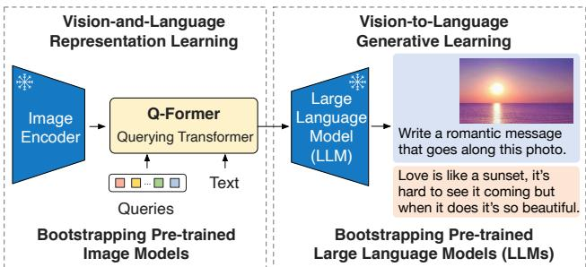
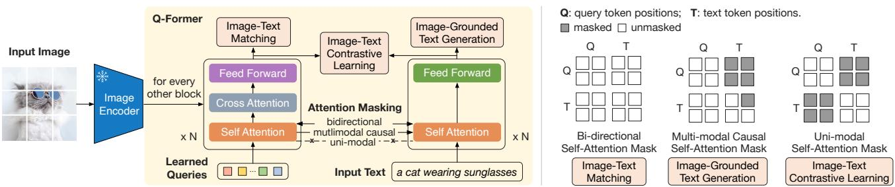
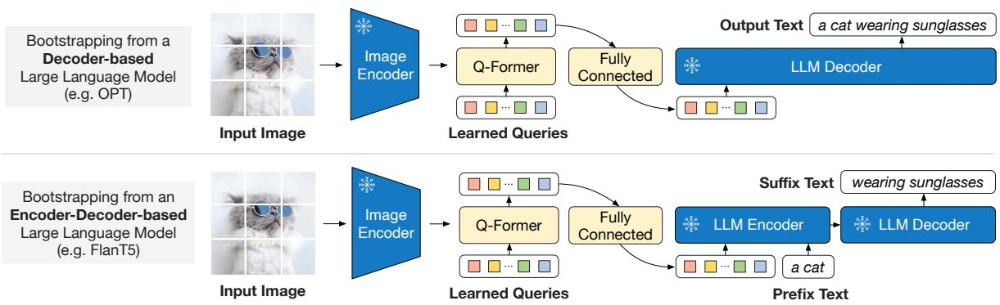
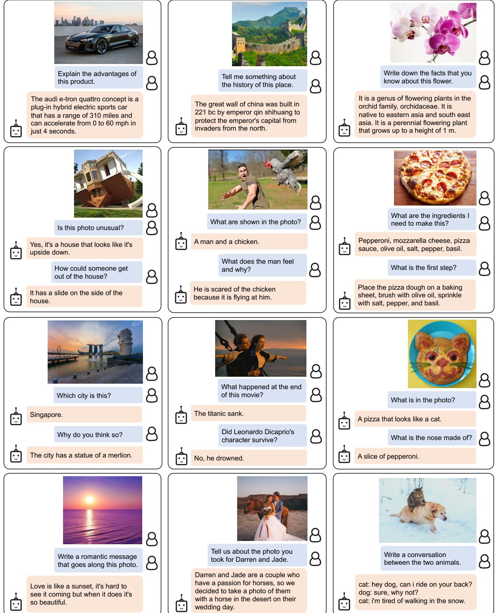
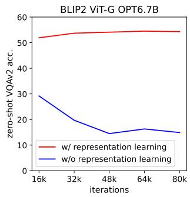
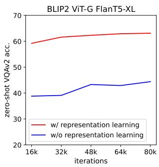
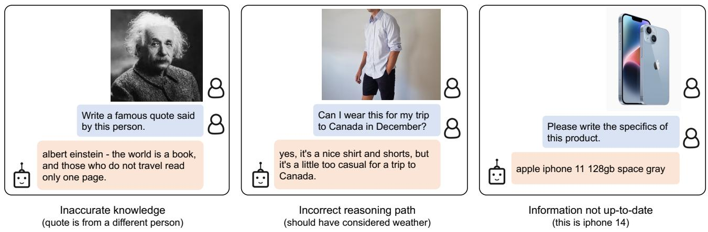
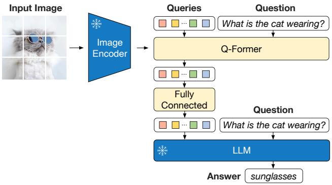

# BLIP-2：利用冻结的图像编码器和大型语言模型引导视觉-语言预训练（Bootstrapping Language-Image Pre-training with Frozen Image Encoders and Large Language Models）

Junnan Li Dongxu Li Silvio Savarese Steven Hoi

Salesforce Research

https://github.com/salesforce/LAVIS/tree/main/projects/blip2

## 摘要（Abstract）

由于大规模模型的端到端训练，视觉与语言预训练的成本已变得越来越高昂。本文提出了 BLIP-2，这是一种通用且高效的预训练策略，它利用现成且冻结的预训练图像编码器和冻结的大型语言模型（LLMs）来引导（bootstrap）视觉-语言预训练。BLIP-2 通过一个轻量级的查询 Transformer（Querying Transformer）弥合模态鸿沟，该模型分两个阶段进行预训练。第一阶段从冻结的图像编码器引导视觉-语言表示学习。第二阶段从冻结的语言模型引导视觉到语言的生成学习。尽管可训练参数明显少于现有方法，BLIP-2 在各种视觉-语言任务上均取得了最先进的性能（state-of-the-art）。例如，我们的模型在零样本 VQAv2 上比 Flamingo80B 高出 8.7%，而可训练参数减少了 54 倍。我们还展示了该模型遵循自然语言指令进行零样本图像到文本生成的涌现能力。

## 1. 引言（Introduction）

在过去几年中，视觉-语言预训练（VLP）研究取得了飞速发展，规模越来越大的预训练模型不断被开发出来，持续刷新各种下游任务的最优性能（Radford et al., 2021; Li et al., 2021; 2022; Wang et al., 2022a; Alayrac et al., 2022; Wang et al., 2022b）。然而，由于使用大规模模型和数据集进行端到端训练，大多数最先进的视觉-语言模型在预训练期间都会产生高昂的计算成本。

视觉-语言研究处于视觉与语言的交叉领域，因此自然期望视觉-语言模型能够直接汲取来自视觉和自然语言社区中现成的单模态模型的成果。在本文中，我们提出了一种通用且计算高效的 VLP 方法，通过从现成的预训练视觉模型和语言模型中进行引导。预训练视觉模型能够提供高质量的视觉表示。预训练语言模型，尤其是大型语言模型（LLMs），具有强大的语言生成和零样本迁移能力。为了降低计算成本并解决灾难性遗忘（catastrophic forgetting）问题，单模态预训练模型在预训练期间保持冻结状态。

  
Figure 1. BLIP-2 框架概览。我们遵循两阶段策略预训练了一个轻量级的 Querying Transformer，以弥合模态鸿沟（modality gap）。第一阶段从冻结的图像编码器中引导（bootstrap）视觉-语言表征学习。第二阶段从冻结的 LLM 中引导视觉到语言的生成式学习，从而实现零样本指令化图像到文本生成（更多示例见 Figure 4）。

为了利用预训练的单模态模型进行 VLP（视觉-语言预训练），促进跨模态对齐是关键所在。然而，由于 LLM 在其单模态预训练期间未见过图像，将其冻结使得视觉-语言对齐变得尤为具有挑战性。在这方面，现有方法（例如 Frozen (Tsimpoukelli et al., 2021)、Flamingo (Alayrac et al., 2022)）借助于图像到文本的生成损失，但我们表明这不足以弥合模态鸿沟。

为了在冻结单模态模型的情况下实现有效的视觉-语言对齐，我们提出了一种采用全新两阶段预训练策略进行预训练的 Querying Transformer（Q-Former）。如图 Figure 1 所示，Q-Former 是一个轻量级 Transformer，它采用一组可学习的查询向量从冻结的图像编码器中提取视觉特征。它充当了冻结的图像编码器与冻结的 LLM 之间的信息瓶颈，向 LLM 提供最有用的视觉特征以输出所需的文本。在第一个预训练阶段中，我们执行视觉-语言表征学习，促使 Q-Former 学习与文本最相关的视觉表征。在第二个预训练阶段中，我们通过将 Q-Former 的输出连接到冻结的 LLM 来执行视觉到语言的生成式学习，并训练 Q-Former 使其输出的视觉表征能够被 LLM 所理解。

我们将我们的 VLP 框架命名为 BLIP-2：利用冻结单模态模型引导语言-图像预训练（Bootstrapping Language-Image Pre-training with frozen unimodal models）。BLIP-2 的主要优势包括：

• BLIP-2 有效利用了冻结的预训练图像模型和语言模型。我们使用经过两阶段（表征学习阶段和生成学习阶段）预训练的 Q-Former 弥合了模态鸿沟。BLIP-2 在包括视觉问答、图像描述（image captioning）和图文检索在内的各种视觉-语言任务上均取得了最先进的性能。

• 在 LLM（例如 OPT (Zhang et al., 2022)、FlanT5 (Chung et al., 2022)）的加持下，BLIP-2 可以通过提示（prompt）遵循自然语言指令执行零样本图像到文本生成，从而具备了诸如视觉知识推理、视觉对话等涌现能力（示例见 Figure 4）。

• 由于采用了冻结的单模态模型和轻量级 Q-Former，BLIP-2 比现有的最先进方法具有更高的计算效率。例如，在零样本 VQAv2 上，BLIP-2 超越了 Flamingo (Alayrac et al., 2022) 8.7%，同时使用的可训练参数减少了 54 倍。此外，我们的结果表明，BLIP-2 是一种通用方法，能够利用更先进的单模态模型来获得更好的 VLP 性能。

## 2. 相关工作

## 2.1. 端到端视觉-语言预训练

视觉-语言预训练（Vision-language pre-training, VLP）旨在学习多模态基础模型，以提升其在各种视觉与语言任务上的性能。根据下游任务的不同，研究人员提出了不同的模型架构，包括双编码器架构（Radford et al., 2021; Jia et al., 2021）、融合编码器架构（Tan & Bansal, 2019; Li et al., 2021）、编码器-解码器架构（Cho et al., 2021; Wang et al., 2021b; Chen et al., 2022b），以及近期提出的统一 Transformer 架构（Li et al., 2022; Wang et al., 2022b）。多年来，各种预训练目标也被相继提出，并逐渐收敛到少数经受住时间检验的目标：图文对比学习（Radford et al., 2021; Yao et al., 2022; Li et al., 2021; 2022）、图文匹配（Li et al., 2021; 2022; Wang et al., 2021a）以及（掩码）语言建模（Li et al., 2021; 2022; Yu et al., 2022; Wang et al., 2022b）。

大多数 VLP 方法使用大规模图文对数据集进行端到端预训练。随着模型尺寸的不断增大，预训练可能会产生极高的计算成本。此外，端到端预训练模型难以灵活利用现成的单模态预训练模型，例如大语言模型（LLMs）（Brown et al., 2020; Zhang et al., 2022; Chung et al., 2022）。

## 2.2. 模块化视觉-语言预训练

与我们更为相似的是利用现成的预训练模型并在 VLP 期间保持其冻结的方法。一些方法冻结图像编码器，包括采用冻结的目标检测器来提取视觉特征的早期工作（Chen et al., 2020; Li et al., 2020; Zhang et al., 2021），以及最近使用冻结的预训练图像编码器进行 CLIP（Radford et al., 2021）预训练的 LiT（Zhai et al., 2022）。一些方法冻结语言模型，利用 LLM 的知识进行视觉到语言生成任务（Tsimpoukelli et al., 2021; Alayrac et al., 2022; Chen et al., 2022a; Manas et al.˜ , 2023; Tiong et al., 2022; Guo et al., 2022）。使用冻结 LLM 的关键挑战在于将视觉特征与文本空间对齐。为实现这一点，Frozen（Tsimpoukelli et al., 2021）微调了一个图像编码器，其输出直接用作 LLM 的软提示（soft prompts）。Flamingo（Alayrac et al., 2022）在 LLM 中插入新的交叉注意力层以注入视觉特征，并在数十亿图像-文本对上对这些新层进行预训练。这两种方法都采用了语言建模损失，其中语言模型以图像为条件生成文本。

与现有方法不同，BLIP-2 能够有效且高效地同时利用冻结的图像编码器和冻结的 LLM 来处理各种视觉-语言任务，以更低的计算成本实现了更强的性能。

## 3. 方法

我们提出了 BLIP-2，一种从冻结的预训练单模态模型中自举（bootstrap）的新型视觉-语言预训练方法。为了弥合模态差距，我们提出了一种查询式 Transformer（Querying Transformer，Q-Former），分两个阶段进行预训练：(1) 基于冻结图像编码器的视觉-语言表征学习阶段，以及 (2) 基于冻结 LLM 的视觉到语言生成学习阶段。本节首先介绍 Q-Former 的模型架构，然后详细阐述两阶段预训练流程。

## 3.1. 模型架构

我们提出 Q-Former 作为可训练模块，用于弥合冻结的图像编码器与冻结的 LLM（大语言模型）之间的差距。它从图像编码器中提取固定数量的输出特征，且与输入图像的分辨率无关。如图 Figure 2 所示，Q-Former 由两个共享相同自注意力层的 Transformer 子模块组成：(1) 与冻结的图像编码器进行交互以提取视觉特征的图像 Transformer；(2) 既可用作文本编码器又可用作文本解码器的文本 Transformer。我们创建了一定数量的可学习查询嵌入（query embeddings）作为图像 Transformer 的输入。这些查询通过自注意力层相互交互，并通过交叉注意力层（每隔一个 Transformer 块插入）与冻结的图像特征进行交互。此外，查询还可以通过相同的自注意力层与文本进行交互。根据预训练任务的不同，我们应用不同的自注意力掩码来控制查询与文本之间的交互。我们使用 BERTbase (Devlin et al., 2019) 的预训练权重初始化 Q-Former，而交叉注意力层则进行随机初始化。Q-Former 总共包含 188M 个参数。需要注意的是，查询也被视为模型参数。

  
Figure 2.（左）Q-Former 的模型架构以及 BLIP-2 第一阶段视觉-语言表征学习目标。我们联合优化三个目标，迫使查询（一组可学习的嵌入）提取与文本最相关的视觉表征。（右）各目标用于控制查询-文本交互的自注意力掩码策略。

在我们的实验中，我们使用了 32 个查询，每个查询的维度为 768（与 Q-Former 的隐藏维度相同）。我们用 Z 表示输出的查询表征。Z 的大小（32 × 768）远小于冻结图像特征的大小（例如 ViT-L/14 为 257 × 1024）。这种瓶颈结构与我们的预训练目标共同作用，迫使查询提取与文本最相关的视觉信息。

## 3.2. 从冻结的图像编码器引导视觉-语言表征学习

在表征学习阶段，我们将 Q-Former 连接到冻结的图像编码器，并使用图像-文本对进行预训练。我们的目标是训练 Q-Former，使查询能够学会提取对文本最具信息量的视觉表征。受 BLIP (Li et al., 2022) 的启发，我们联合优化共享相同输入格式和模型参数的三个预训练目标。每个目标在查询和文本之间采用不同的注意力掩码策略来控制它们之间的交互（参见 Figure 2）。

图文对比学习（Image-Text Contrastive Learning, ITC）学习对齐图像表征和文本表征，以最大化它们之间的互信息。它通过对比正样本对与负样本对之间的图文相似度来实现这一目标。我们将图像 Transformer 输出的查询表征 Z 与文本 Transformer 输出的文本表征 t 对齐，其中 t 是 [CLS] token 的输出嵌入。由于 Z 包含多个输出嵌入（每个查询对应一个），我们首先计算每个查询输出与 t 之间的两两相似度，然后选择最高的一个作为图文相似度。为了避免信息泄露，我们采用了单模态自注意力掩码（unimodal self-attention mask），在此掩码下查询和文本之间互不可见。由于使用了冻结的图像编码器，与端到端方法相比，我们可以在每个 GPU 上容纳更多样本。因此，我们使用批次内负样本（in-batch negatives）代替 BLIP 中的动量队列。

基于图像的文本生成（Image-grounded Text Generation, ITG）损失以输入图像为条件来训练 Q-Former 生成文本。由于 Q-Former 的架构不允许冻结的图像编码器与文本 token 之间发生直接交互，因此生成文本所需的信息必须首先由查询提取，然后通过自注意力层传递给文本 token。因此，查询被迫提取能够捕捉文本全部信息的视觉特征。我们采用多模态因果自注意力掩码（multimodal causal self-attention mask）来控制查询与文本的交互，类似于 UniLM（Dong et al., 2019）中使用的方法。查询之间可以相互关注，但不能关注文本 token。每个文本 token 可以关注所有查询及其前面的文本 token。我们还将 [CLS] token 替换为一个新的 [DEC] token 作为第一个文本 token，以指示解码任务。

图文匹配（Image-Text Matching, ITM）旨在学习图像和文本表征之间的细粒度对齐。这是一个二分类任务，要求模型预测图文对是正样本（匹配）还是负样本（不匹配）。我们使用双向自注意力掩码（bi-directional self-attention mask），其中所有查询和文本均可相互关注。因此，输出的查询嵌入 Z 捕捉到了多模态信息。我们将每个输出的查询嵌入输入到一个二分类线性分类器中以获得 logit，并将所有查询的 logit 取平均作为输出的匹配分数。我们采用了来自 Li et al. (2021; 2022) 的难负样本挖掘策略（hard negative mining strategy）来构建信息量更大的负样本对。

  
Figure 3. BLIP-2 的第二阶段视觉到语言生成式预训练，它利用冻结的大型语言模型（LLM）进行自举引导（bootstrapping）。（上）自举引导基于 Decoder 的 LLM（例如 OPT）。（下）自举引导基于 Encoder-Decoder 的 LLM（例如 FlanT5）。全连接层将 Q-Former 的输出维度适配到所选 LLM 的输入维度。

## 3.3. 从冻结的 LLM 中引导视觉到语言的生成式学习

在生成式预训练阶段，我们将 Q-Former（附带冻结的图像编码器）连接到冻结的 LLM，以利用 LLM 的语言生成能力。如图 3 所示，我们使用全连接（FC）层将输出查询嵌入 Z 线性投影到与 LLM 的文本嵌入相同的维度。然后将投影后的查询嵌入添加到输入文本嵌入的前面。它们充当软视觉提示（soft visual prompts），使 LLM 以 Q-Former 提取的视觉表征为条件。由于 Q-Former 已经过预训练以提取富含语言信息的视觉表征，它实际上起到了信息瓶颈的作用，在向 LLM 提供最有用信息的同时去除不相关的视觉信息。这减轻了 LLM 学习视觉-语言对齐的负担，从而缓解了灾难性遗忘问题。

我们对两类 LLM 进行了实验：基于解码器的 LLM 和基于编码器-解码器的 LLM。对于基于解码器的 LLM，我们使用语言建模损失进行预训练，其中冻结的 LLM 的任务是以来自 Q-Former 的视觉表征为条件生成文本。对于基于编码器-解码器的 LLM，我们使用前缀语言建模损失进行预训练，其中我们将文本分为两部分。前缀文本与视觉表征拼接后作为 LLM 编码器的输入。后缀文本用作 LLM 解码器的生成目标。

## 3.4. 模型预训练

预训练数据。我们使用与 BLIP 相同的预训练数据集，总计包含 129M 张图像，包括 COCO (Lin et al., 2014)、Visual Genome (Krishna et al., 2017)、CC3M (Sharma et al., 2018)、CC12M (Changpinyo et al., 2021)、SBU (Ordonez et al., 2011)，以及来自 LAION400M 数据集 (Schuhmann et al., 2021) 的 115M 张图像。我们采用 CapFilt 方法 (Li et al., 2022) 为网络图像创建合成字幕。具体而言，我们使用 $\mathrm { B L I P _ { l a r g e } }$ 字幕模型生成 10 个字幕，并根据 CLIP ViT-L/14 模型生成的图像-文本相似度对合成字幕与原始网络字幕进行排序。我们保留每张图像排名前两位的字幕作为训练数据，并在每个预训练步骤中随机采样一个。

预训练图像编码器和 LLM。对于冻结的图像编码器，我们探索了两种最先进的预训练视觉 Transformer 模型：(1) 来自 CLIP (Radford et al., 2021) 的 ViT-L/14 和 (2) 来自 EVA-CLIP (Fang et al., 2022) 的 ViT-g/14。我们移除了 ViT 的最后一层并使用倒数第二层的输出特征，这带来了略微更好的性能。对于冻结的语言模型，我们在基于解码器的 LLM 中探索了无监督训练的 OPT 模型家族 (Zhang et al., 2022)，在基于编码器-解码器的 LLM 中探索了经过指令训练的 FlanT5 模型家族 (Chung et al., 2022)。

预训练设置。我们在第一阶段预训练 250k 步，在第二阶段预训练 80k 步。我们在第一阶段对 ViT-L/ViT-g 使用 2320/1680 的批大小（batch size），在第二阶段对 OPT/FlanT5 使用 1920/1520 的批大小。在预训练期间，我们将冻结的 ViT 和 LLM 参数转换为 FP16，除了 FlanT5 我们使用 BFloat16。与使用 32 位模型相比，我们发现性能没有下降。由于使用了冻结模型，我们的预训练比现有的规模化 VLP 方法更具计算友好性。例如，使用单台配备 16 张 A100(40G) 的机器，我们最大的模型（包含 ViT-g 和 FlanT5-XXL）在第一阶段所需时间不到 6 天，在第二阶段所需时间不到 3 天。

所有模型均使用相同的预训练超参数设置。我们使用 AdamW（Loshchilov & Hutter, 2017）优化器，其中 $\beta _ { 1 } = 0 . 9 , \beta _ { 1 } = 0 . 9 8$ ，权重衰减为 0.05。我们采用余弦学习率衰减，峰值学习率为 1e-4，线性预热（warmup）为 2k 步。第二阶段的最低学习率为 5e-5。我们使用尺寸为 224×224 的图像，并通过随机缩放裁剪和水平翻转进行数据增强。

解释一下这款产品的优势。

奥迪 e-tron quattro 概念车是一款插电式混合动力电动跑车，续航里程达 310 英里，0 至 60 英里/小时加速仅需 4 秒。

这张照片有什么不寻常之处吗？

是的，这是一栋看起来倒过来的房子。

怎么才能从这栋房子里出来？

它的侧面配有一个滑梯

这是哪座城市？

你为什么这么认为？

新加坡。

爱如日落，难以预见其来临，但当它降临时却如此绚丽。

跟我讲讲这个地方的历史吧。

他很害怕这只鸡，因为它正朝他飞过来。

写一句配这张照片的浪漫文案。

照片里展示了什么？

这座城市有一座鱼尾狮雕像。

中国的长城由秦始皇于公元前 221 年修建，旨在保护帝都免受北方入侵者的侵害。

一个男人和一只鸡。

这个男人有什么感受，为什么？

这部电影的结局是什么？

第一步是什么？

意大利辣香肠、马苏里拉奶酪、披萨酱、橄榄油、盐、胡椒粉、罗勒。

写下你所了解的关于这种花的事实。

制作这个需要哪些原料？

莱昂纳多·迪卡普里奥（Leonardo DiCaprio）饰演的角色幸存下来了吗？

告诉我们你为达伦（Darren）和杰德（Jade）拍摄的那张照片的故事。

它是兰科（Orchidaceae）下的一个开花植物属。它原产于东亚和东南亚。它是一种多年生开花植物，株高可达 1 米。

达伦和杰德是一对热爱马匹的夫妇，因此我们决定在他们婚礼当天，在沙漠里为他们拍一张与马合影的照片。

泰坦尼克号沉没了。

将披萨面团放在烤盘上，刷上橄榄油，撒上盐、胡椒粉和罗勒。

不，他淹死了。

照片里有什么？

一个看起来像猫的比萨。

鼻子是用什么做的？

一片意大利辣香肠。

写一段这两只动物之间的对话。

猫：嘿，狗，我能骑在你背上吗？狗：当然，为什么不呢？猫：我不想在雪地里走了。

Figure 4. 使用配备 ViT-g 和 FlanT5XXL 的 BLIP-2 模型进行指令式零样本图生文生成的精选示例，展示了包括视觉对话、视觉知识推理、视觉常识推理、故事创作、个性化图生文生成等广泛能力。

BLIP-2：利用冻结的图像编码器和大型语言模型引导视觉-语言预训练

<table><tr><td>模型</td><td>可训练参数量</td><td>是否开源？</td><td>视觉问答 VQAv2 (test-dev) VQA 准确率</td><td>图像描述 NoCaps (val) CIDEr</td><td>SPICE</td><td>图文检索 Flickr (test) TR@1</td><td>IR@1</td></tr><tr><td>BLIP (Li et al., 2022)</td><td>583M</td><td>√</td><td>-</td><td>113.2</td><td>14.8</td><td>96.7</td><td>86.7</td></tr><tr><td>SimVLM (Wang et al., 2021b)</td><td>1.4B</td><td>✕</td><td>-</td><td>112.2</td><td>-</td><td>-</td><td>-</td></tr><tr><td>BEIT-3 (Wang et al., 2022b)</td><td>1.9B</td><td>✕</td><td>-</td><td>-</td><td>-</td><td>94.9</td><td>81.5</td></tr><tr><td>Flamingo (Alayrac et al., 2022)</td><td>10.2B</td><td>✕</td><td>56.3</td><td>-</td><td>-</td><td>-</td><td>-</td></tr><tr><td>BLIP-2</td><td>188M</td><td>√</td><td>65.0</td><td>121.6</td><td>15.8</td><td>97.6</td><td>89.7</td></tr></table>

Table 1. BLIP-2 在各项零样本视觉-语言任务上的结果概览。与以往的最优模型相比，BLIP-2 取得了最高的零样本性能，同时在视觉-语言预训练期间所需的可训练参数量最少。

<table><tr><td rowspan="2">模型</td><td rowspan="2">可训练参数量</td><td rowspan="2">总参数量</td><td colspan="2">VQAv2</td><td rowspan="2">OK-VQA test</td><td rowspan="2">GQA test-dev</td></tr><tr><td>val</td><td>test-dev</td></tr><tr><td>VL-T5no-vqa</td><td>224M</td><td>269M</td><td>13.5</td><td>-</td><td>5.8</td><td>6.3</td></tr><tr><td>FewVLM (Jin et al., 2022)</td><td>740M</td><td>785M</td><td>47.7</td><td>-</td><td>16.5</td><td>29.3</td></tr><tr><td>Frozen (Tsimpoukelli et al., 2021)</td><td>40M</td><td>7.1B</td><td>29.6</td><td>-</td><td>5.9</td><td>-</td></tr><tr><td>VLKD (Dai et al., 2022)</td><td>406M</td><td>832M</td><td>42.6</td><td>44.5</td><td>13.3</td><td>-</td></tr><tr><td>Flamingo3B (Alayrac et al., 2022)</td><td>1.4B</td><td>3.2B</td><td>-</td><td>49.2</td><td>41.2</td><td>-</td></tr><tr><td>Flamingo9B (Alayrac et al., 2022)</td><td>1.8B</td><td>9.3B</td><td>-</td><td>51.8</td><td>44.7</td><td>-</td></tr><tr><td>Flamingo80B (Alayrac et al., 2022)</td><td>10.2B</td><td>80B</td><td>-</td><td>56.3</td><td>50.6</td><td>-</td></tr><tr><td>BLIP-2 ViT-L OPT $_{2.7B}$ </td><td>104M</td><td>3.1B</td><td>50.1</td><td>49.7</td><td>30.2</td><td>33.9</td></tr><tr><td>BLIP-2 ViT-g OPT $_{2.7B}$ </td><td>107M</td><td>3.8B</td><td>53.5</td><td>52.3</td><td>31.7</td><td>34.6</td></tr><tr><td>BLIP-2 ViT-g OPT $_{6.7B}$ </td><td>108M</td><td>7.8B</td><td>54.3</td><td>52.6</td><td>36.4</td><td>36.4</td></tr><tr><td>BLIP-2 ViT-L FlanT5XL</td><td>103M</td><td>3.4B</td><td>62.6</td><td>62.3</td><td>39.4</td><td>44.4</td></tr><tr><td>BLIP-2 ViT-g FlanT5XL</td><td>107M</td><td>4.1B</td><td>63.1</td><td>63.0</td><td>40.7</td><td>44.2</td></tr><tr><td>BLIP-2 ViT-g FlanT5XXL</td><td>108M</td><td>12.1B</td><td>65.2</td><td>65.0</td><td>45.9</td><td>44.7</td></tr></table>

Table 2. 与最先进方法在零样本视觉问答上的对比。

## 4. 实验

Table 1 概述了 BLIP-2 在各种零样本视觉-语言任务上的表现。与以往的最先进模型相比，BLIP-2 取得了更优异的性能，同时在视觉-语言预训练期间所需的可训练参数量大幅减少。

## 4.1. 指令引导的零样本图像到文本生成

BLIP-2 有效地使 LLM 能够理解图像，同时保留其遵循文本提示的能力，这使我们能够通过指令来控制图像到文本的生成。我们只需将文本提示附加在视觉提示之后，作为 LLM 的输入。Figure 4 展示了证明其广泛零样本图像到文本能力的示例，包括视觉知识推理、视觉常识推理、视觉对话、个性化图像到文本生成等。

零样本视觉问答（Zero-shot VQA）。我们在零样本视觉问答任务上进行了定量评估。对于 OPT 模型，我们使用的提示为“Question: {} Answer:”。对于 FlanT5 模型，我们使用的提示为“Question: {} Short answer:”。在生成过程中，我们使用束搜索（beam search），束宽（beam width）设为 5。我们还将长度惩罚（length-penalty）设置为 -1，以鼓励生成更短的答案，从而更好地与人工标注对齐。

如 Table 2 所示，BLIP-2 在 VQAv2 (Goyal et al., 2017) 和 GQA (Hudson & Manning, 2019) 数据集上取得了最先进（state-of-the-art）的结果。尽管可训练参数量减少了 54 倍，但它在 VQAv2 上仍比 Flamingo80B 高出 8.7%。在 OK-VQA (Marino et al., 2019) 数据集上，BLIP-2 仅次于 Flamingo80B。我们推测这是因为 OK-VQA 相比视觉理解更注重开放世界知识，而 Flamingo80B 采用的 70B Chinchilla (Hoffmann et al., 2022) 语言模型比 11B FlanT5XXL 拥有更多的知识储备。

我们从 Table 2 中得出了一个令人欣喜的观察结果：更强大的图像编码器或更强大的 LLM 都会带来更好的性能。这一观察结果得到了若干事实的支持：(1) 无论对于 OPT 还是 FlanT5，ViT-g 的表现均优于 ViT-L。(2) 在同一个 LLM 家族中，更大的模型性能优于较小的模型。(3) 作为经过指令微调的 LLM，FlanT5 在 VQA 上的表现优于无监督训练的 OPT。这一观察验证了 BLIP-2 作为一种通用视觉-语言预训练方法，能够有效地汲取视觉和自然语言领域的快速发展成果。

## 视觉-语言表征学习的效果

第一阶段的表征学习对 Q-Former 进行预训练，以学习与文本相关的视觉特征，从而减轻了 LLM 学习视觉-语言对齐的负担。如果没有表征学习阶段，Q-

BLIP-2: Bootstrapping Language-Image Pre-training with Frozen Image Encoders and Large Language Models

<table><tr><td rowspan="3">模型</td><td rowspan="3">可训练参数量</td><td colspan="8">NoCaps 零样本（验证集）</td><td rowspan="2" colspan="2">COCO 微调 Karpathy 测试集</td></tr><tr><td colspan="2">域内</td><td colspan="2">近域</td><td colspan="2">域外</td><td colspan="2">总体</td></tr><tr><td>C</td><td>S</td><td>C</td><td>S</td><td>C</td><td>S</td><td>C</td><td>S</td><td>B@4</td><td>C</td></tr><tr><td>OSCAR (Li et al., 2020)</td><td>345M</td><td>-</td><td>-</td><td>-</td><td>-</td><td>-</td><td>-</td><td>80.9</td><td>11.3</td><td>37.4</td><td>127.8</td></tr><tr><td>VinVL (Zhang et al., 2021)</td><td>345M</td><td>103.1</td><td>14.2</td><td>96.1</td><td>13.8</td><td>88.3</td><td>12.1</td><td>95.5</td><td>13.5</td><td>38.2</td><td>129.3</td></tr><tr><td>BLIP (Li et al., 2022)</td><td>446M</td><td>114.9</td><td>15.2</td><td>112.1</td><td>14.9</td><td>115.3</td><td>14.4</td><td>113.2</td><td>14.8</td><td>40.4</td><td>136.7</td></tr><tr><td>OFA (Wang et al., 2022a)</td><td>930M</td><td>-</td><td>-</td><td>-</td><td>-</td><td>-</td><td>-</td><td>-</td><td>-</td><td>43.9</td><td>145.3</td></tr><tr><td>Flamingo (Alayrac et al., 2022)</td><td>10.6B</td><td>-</td><td>-</td><td>-</td><td>-</td><td>-</td><td>-</td><td>-</td><td>-</td><td>-</td><td>138.1</td></tr><tr><td>SimVLM (Wang et al., 2021b)</td><td>~1.4B</td><td>113.7</td><td>-</td><td>110.9</td><td>-</td><td>115.2</td><td>-</td><td>112.2</td><td>-</td><td>40.6</td><td>143.3</td></tr><tr><td>BLIP-2 ViT-g  $OPT_{2.7B}$ </td><td>1.1B</td><td>123.0</td><td>15.8</td><td>117.8</td><td>15.4</td><td>123.4</td><td>15.1</td><td>119.7</td><td>15.4</td><td>43.7</td><td>145.8</td></tr><tr><td>BLIP-2 ViT-g  $OPT_{6.7B}$ </td><td>1.1B</td><td>123.7</td><td>15.8</td><td>119.2</td><td>15.3</td><td>124.4</td><td>14.8</td><td>121.0</td><td>15.3</td><td>43.5</td><td>145.2</td></tr><tr><td>BLIP-2 ViT-g FlanT5XL</td><td>1.1B</td><td>123.7</td><td>16.3</td><td>120.2</td><td>15.9</td><td>124.8</td><td>15.1</td><td>121.6</td><td>15.8</td><td>42.4</td><td>144.5</td></tr></table>

Table 3. 在 NoCaps 和 COCO Caption 上与最先进的图像描述（image captioning）方法的对比。所有方法在微调过程中均优化交叉熵损失。C: CIDEr，S: SPICE，B@4: BLEU@4。

  
Figure 5. 视觉-语言表示学习对视觉到语言生成式学习的影响。若没有表示学习，Q-Former 无法弥合模态鸿沟，从而导致零样本 VQA 性能显著下降。

前者仅依靠视觉到语言的生成式学习来弥合模态鸿沟，这与 Flamingo 中的 Perceiver Resampler 类似。Figure 5 展示了表示学习对生成式学习的影响。若没有表示学习，两种类型的 LLM 在零样本 VQA 上的性能均显著下降。特别是，OPT 会遭受灾难性遗忘，随着训练的进行性能急剧恶化。

## 4.2. 图像描述（Image Captioning）

我们针对图像描述任务对 BLIP-2 模型进行微调，该任务要求模型针对图像的视觉内容生成文本描述。我们使用提示词“a photo of”作为 LLM 的初始输入，并通过语言建模损失训练模型生成描述。在微调期间，我们保持 LLM 冻结，并更新 Q-Former 以及图像编码器的参数。我们使用 ViT-g 和各种 LLM 进行了实验。详细的超参数可以在附录中找到。我们在 COCO 上进行微调，并在 COCO 测试集以及向 NoCaps (Agrawal et al., 2019) 验证集的零样本迁移上进行评估。

结果如 Table 3 所示。BLIP-2 取得了最先进的性能，且相比现有方法在 NoCaps 上取得了显著改进，证明了其对域外图像具有强大的泛化能力。

<table><tr><td rowspan="2">模型</td><td rowspan="2">可训练参数量</td><td colspan="2">VQAv2</td></tr><tr><td>test-dev</td><td>test-std</td></tr><tr><td colspan="4">开放式生成模型</td></tr><tr><td>ALBEF (Li et al., 2021)</td><td>314M</td><td>75.84</td><td>76.04</td></tr><tr><td>BLIP (Li et al., 2022)</td><td>385M</td><td>78.25</td><td>78.32</td></tr><tr><td>OFA (Wang et al., 2022a)</td><td>930M</td><td>82.00</td><td>82.00</td></tr><tr><td>Flamingo80B (Alayrac et al., 2022)</td><td>10.6B</td><td>82.00</td><td>82.10</td></tr><tr><td>BLIP-2 ViT-g FlanT5XL</td><td>1.2B</td><td>81.55</td><td>81.66</td></tr><tr><td>BLIP-2 ViT-g OPT $_{2.7B}$ </td><td>1.2B</td><td>81.59</td><td>81.74</td></tr><tr><td>BLIP-2 ViT-g OPT $_{6.7B}$ </td><td>1.2B</td><td>82.19</td><td>82.30</td></tr><tr><td colspan="4">封闭式分类模型</td></tr><tr><td>VinVL</td><td>345M</td><td>76.52</td><td>76.60</td></tr><tr><td>SimVLM (Wang et al., 2021b)</td><td>~1.4B</td><td>80.03</td><td>80.34</td></tr><tr><td>CoCa (Yu et al., 2022)</td><td>2.1B</td><td>82.30</td><td>82.30</td></tr><tr><td>BEIT-3 (Wang et al., 2022b)</td><td>1.9B</td><td>84.19</td><td>84.03</td></tr></table>

Table 4. 与经过微调用于视觉问答的最先进模型的对比。

## 4.3. 视觉问答（Visual Question Answering）

在给定标注的 VQA 数据的情况下，我们在保持 LLM 冻结的同时，对 Q-Former 和图像编码器的参数进行微调。我们采用开放式答案生成损失进行微调，其中 LLM 接收 Q-Former 的输出和问题作为输入，并被要求生成答案。为了提取出与问题更相关的图像特征，我们额外以问题为条件对 Q-Former 进行调节。具体而言，问题 token 作为输入提供给 Q-Former，并通过自注意力层与查询（queries）进行交互，从而引导 Q-Former 的交叉注意力层聚焦于信息量更大的图像区域。

遵循 BLIP，我们的 VQA 数据包括来自 VQAv2 的训练集与验证集划分，以及来自 Visual Genome 的训练样本。Table 4 展示了 BLIP-2 在开放式生成模型中取得的 SOTA（state-of-the-art）结果。

BLIP-2: Bootstrapping Language-Image Pre-training with Frozen Image Encoders and Large Language Models（利用冻结的图像编码器和大型语言模型引导图文预训练）

<table><tr><td rowspan="3">模型</td><td rowspan="3">可训练参数量</td><td colspan="6">Flickr30K 零样本 (1K 测试集)</td><td colspan="6">COCO 微调 (5K 测试集)</td></tr><tr><td colspan="3">图像 → 文本</td><td colspan="3">文本 → 图像</td><td colspan="3">图像 → 文本</td><td colspan="3">文本 → 图像</td></tr><tr><td>R@1</td><td>R@5</td><td>R@10</td><td>R@1</td><td>R@5</td><td>R@10</td><td>R@1</td><td>R@5</td><td>R@10</td><td>R@1</td><td>R@5</td><td>R@10</td></tr><tr><td colspan="14">双编码器模型</td></tr><tr><td>CLIP (Radford et al., 2021)</td><td>428M</td><td>88.0</td><td>98.7</td><td>99.4</td><td>68.7</td><td>90.6</td><td>95.2</td><td>-</td><td>-</td><td>-</td><td>-</td><td>-</td><td>-</td></tr><tr><td>ALIGN (Jia et al., 2021)</td><td>820M</td><td>88.6</td><td>98.7</td><td>99.7</td><td>75.7</td><td>93.8</td><td>96.8</td><td>77.0</td><td>93.5</td><td>96.9</td><td>59.9</td><td>83.3</td><td>89.8</td></tr><tr><td>FILIP (Yao et al., 2022)</td><td>417M</td><td>89.8</td><td>99.2</td><td>99.8</td><td>75.0</td><td>93.4</td><td>96.3</td><td>78.9</td><td>94.4</td><td>97.4</td><td>61.2</td><td>84.3</td><td>90.6</td></tr><tr><td>Florence (Yuan et al., 2021)</td><td>893M</td><td>90.9</td><td>99.1</td><td>-</td><td>76.7</td><td>93.6</td><td>-</td><td>81.8</td><td>95.2</td><td>-</td><td>63.2</td><td>85.7</td><td>-</td></tr><tr><td>BEIT-3(Wang et al., 2022b)</td><td>1.9B</td><td>94.9</td><td>99.9</td><td>100.0</td><td>81.5</td><td>95.6</td><td>97.8</td><td>84.8</td><td>96.5</td><td>98.3</td><td>67.2</td><td>87.7</td><td>92.8</td></tr><tr><td colspan="14">融合编码器模型</td></tr><tr><td>UNITER (Chen et al., 2020)</td><td>303M</td><td>83.6</td><td>95.7</td><td>97.7</td><td>68.7</td><td>89.2</td><td>93.9</td><td>65.7</td><td>88.6</td><td>93.8</td><td>52.9</td><td>79.9</td><td>88.0</td></tr><tr><td>OSCAR (Li et al., 2020)</td><td>345M</td><td>-</td><td>-</td><td>-</td><td>-</td><td>-</td><td>-</td><td>70.0</td><td>91.1</td><td>95.5</td><td>54.0</td><td>80.8</td><td>88.5</td></tr><tr><td>VinVL (Zhang et al., 2021)</td><td>345M</td><td>-</td><td>-</td><td>-</td><td>-</td><td>-</td><td>-</td><td>75.4</td><td>92.9</td><td>96.2</td><td>58.8</td><td>83.5</td><td>90.3</td></tr><tr><td colspan="14">双编码器 + 融合编码器重排序</td></tr><tr><td>ALBEF (Li et al., 2021)</td><td>233M</td><td>94.1</td><td>99.5</td><td>99.7</td><td>82.8</td><td>96.3</td><td>98.1</td><td>77.6</td><td>94.3</td><td>97.2</td><td>60.7</td><td>84.3</td><td>90.5</td></tr><tr><td>BLIP (Li et al., 2022)</td><td>446M</td><td>96.7</td><td>100.0</td><td>100.0</td><td>86.7</td><td>97.3</td><td>98.7</td><td>82.4</td><td>95.4</td><td>97.9</td><td>65.1</td><td>86.3</td><td>91.8</td></tr><tr><td>BLIP-2 ViT-L</td><td>474M</td><td>96.9</td><td>100.0</td><td>100.0</td><td>88.6</td><td>97.6</td><td>98.9</td><td>83.5</td><td>96.0</td><td>98.0</td><td>66.3</td><td>86.5</td><td>91.8</td></tr><tr><td>BLIP-2 ViT-g</td><td>1.2B</td><td>97.6</td><td>100.0</td><td>100.0</td><td>89.7</td><td>98.1</td><td>98.9</td><td>85.4</td><td>97.0</td><td>98.5</td><td>68.3</td><td>87.7</td><td>92.6</td></tr></table>

Table 5. 与最先进的图像-文本检索方法的比较，在 COCO 上进行微调并在 Flickr30K 上进行零样本（zero-shot）迁移。

<table><tr><td rowspan="2">COCO 微调目标</td><td colspan="2">图像 → 文本</td><td colspan="2">文本 → 图像</td></tr><tr><td>R@1</td><td>R@5</td><td>R@1</td><td>R@5</td></tr><tr><td>ITC + ITM</td><td>84.5</td><td>96.2</td><td>67.2</td><td>87.1</td></tr><tr><td>ITC + ITM + ITG</td><td>85.4</td><td>97.0</td><td>68.3</td><td>87.7</td></tr></table>

Table 6. 基于图像的文本生成（ITG）损失通过强制查询（queries）提取与语言相关的视觉特征，从而提升了图像-文本检索性能。

## 4.4. 图像-文本检索

由于图像-文本检索不涉及语言生成，我们直接对不包含 LLM 的第一阶段预训练模型进行微调。具体而言，我们在 COCO 上使用与预训练相同的目标（即 ITC、ITM 和 ITG）微调图像编码器和 Q-Former。随后，我们在 COCO 和 Flickr30K（Plummer et al., 2015）数据集上评估模型的图像到文本检索和文本到图像检索性能。在推理过程中，我们遵循 Li et al. (2021; 2022) 的方法，首先根据图像-文本特征相似度选择 $k = 128$ 个候选样本，随后根据成对的 ITM 分数进行重排序。我们分别实验了以 ViT-L 和 ViT-g 作为图像编码器的情况。详细的超参数可在附录中找到。

结果如 Table 5 所示。BLIP-2 取得了最先进的性能，在零样本图像-文本检索方面较现有方法有了显著提升。

ITC 和 ITM 损失对于图像-文本检索至关重要，因为它们直接学习图像与文本之间的相似度。在 Table 6 中，我们展示了 ITG（基于图像的文本生成）损失对图像-文本检索同样有益。这一结果支持了我们在设计表示学习目标时的直觉：ITG 损失强制查询提取与文本最相关的视觉特征，从而改善了视觉-语言的对齐。

## 5. 局限性

近期的 LLM 能够在给定少样本（few-shot）示例的情况下进行上下文学习（in-context learning）。然而，在我们的 BLIP-2 实验中，向 LLM 提供上下文 VQA 示例并未观察到 VQA 性能的提升。我们将缺乏上下文学习能力归因于我们的预训练数据集，该数据集中每个样本仅包含单对图像-文本。LLM 无法从中学习到单个序列中多个图像-文本对之间的关联。Flamingo 论文中也报告了相同的观察结果，该论文使用了一个闭源的图文交错数据集（M3W），每个序列包含多个图像-文本对。我们的目标是在未来的工作中构建一个类似的数据集。

BLIP-2 的图像到文本生成可能会因多种原因产生不尽人意的结果，包括来自 LLM 的不准确知识、激活了错误的推理路径，或是缺乏关于新图像内容的最新信息（见 Figure 7）。此外，由于使用了冻结模型，BLIP-2 继承了 LLM 的风险，例如输出攻击性语言、传播社会偏见或泄露隐私信息。补救方法包括使用指令来引导模型的生成，或在移除了有害内容的过滤数据集上进行训练。

## 6. 结论

我们提出了 BLIP-2，这是一种通用且计算高效的视觉-语言预训练方法，它利用了冻结的预训练图像编码器和 LLM。BLIP-2 在预训练期间仅包含少量的可训练参数，同时在各种视觉-语言任务上取得了最先进的性能。BLIP-2 还在零样本指令化图像到文本生成中展现出了涌现能力。我们认为 BLIP-2 是迈向构建多模态对话式 AI 智能体的重要一步。

## 参考文献

Agrawal, H., Anderson, P., Desai, K., Wang, Y., Chen, X., Jain, R., Johnson, M., Batra, D., Parikh, D., and Lee, S. nocaps: novel object captioning at scale. In ICCV, pp. 8947–8956, 2019.

Alayrac, J., Donahue, J., Luc, P., Miech, A., Barr, I., Hasson, Y., Lenc, K., Mensch, A., Millican, K., Reynolds, M., Ring, R., Rutherford, E., Cabi, S., Han, T., Gong, Z., Samangooei, S., Monteiro, M., Menick, J., Borgeaud, S., Brock, A., Nematzadeh, A., Sharifzadeh, S., Binkowski, M., Barreira, R., Vinyals, O., Zisserman, A., and Simonyan, K. Flamingo: a visual language model for fewshot learning. arXiv preprint arXiv:2204.14198, 2022.

Brown, T. B., Mann, B., Ryder, N., Subbiah, M., Kaplan, J., Dhariwal, P., Neelakantan, A., Shyam, P., Sastry, G., Askell, A., Agarwal, S., Herbert-Voss, A., Krueger, G., Henighan, T., Child, R., Ramesh, A., Ziegler, D. M., Wu, J., Winter, C., Hesse, C., Chen, M., Sigler, E., Litwin, M., Gray, S., Chess, B., Clark, J., Berner, C., McCandlish, S., Radford, A., Sutskever, I., and Amodei, D. Language models are few-shot learners. In Larochelle, H., Ranzato, M., Hadsell, R., Balcan, M., and Lin, H. (eds.), NeurIPS, 2020.

Changpinyo, S., Sharma, P., Ding, N., and Soricut, R. Conceptual 12M: Pushing web-scale image-text pre-training to recognize long-tail visual concepts. In CVPR, 2021.

Chen, J., Guo, H., Yi, K., Li, B., and Elhoseiny, M. Visualgpt: Data-efficient adaptation of pretrained language models for image captioning. In CVPR, pp. 18009–18019, 2022a.

Chen, X., Wang, X., Changpinyo, S., Piergiovanni, A. J., Padlewski, P., Salz, D., Goodman, S., Grycner, A., Mustafa, B., Beyer, L., Kolesnikov, A., Puigcerver, J., Ding, N., Rong, K., Akbari, H., Mishra, G., Xue, L., Thapliyal, A., Bradbury, J., Kuo, W., Seyedhosseini, M., Jia, C., Ayan, B. K., Riquelme, C., Steiner, A., Angelova, A., Zhai, X., Houlsby, N., and Soricut, R. Pali: A jointly-scaled multilingual language-image model. arXiv preprint arXiv:2209.06794, 2022b.

Chen, Y., Li, L., Yu, L., Kholy, A. E., Ahmed, F., Gan, Z., Cheng, Y., and Liu, J. UNITER: universal image-text representation learning. In ECCV, volume 12375, pp. 104–120, 2020.

Cho, J., Lei, J., Tan, H., and Bansal, M. Unifying visionand-language tasks via text generation. arXiv preprint arXiv:2102.02779, 2021.

Chung, H. W., Hou, L., Longpre, S., Zoph, B., Tay, Y., Fedus, W., Li, E., Wang, X., Dehghani, M., Brahma, S.,

Webson, A., Gu, S. S., Dai, Z., Suzgun, M., Chen, X., Chowdhery, A., Narang, S., Mishra, G., Yu, A., Zhao, V. Y., Huang, Y., Dai, A. M., Yu, H., Petrov, S., Chi, E. H., Dean, J., Devlin, J., Roberts, A., Zhou, D., Le, Q. V., and Wei, J. Scaling instruction-finetuned language models. arXiv preprint arXiv:2210.11416, 2022.

Dai, W., Hou, L., Shang, L., Jiang, X., Liu, Q., and Fung, P. Enabling multimodal generation on CLIP via visionlanguage knowledge distillation. In Muresan, S., Nakov, P., and Villavicencio, A. (eds.), ACL Findings, pp. 2383– 2395, 2022.

Devlin, J., Chang, M., Lee, K., and Toutanova, K. BERT: pre-training of deep bidirectional transformers for language understanding. In Burstein, J., Doran, C., and Solorio, T. (eds.), NAACL, pp. 4171–4186, 2019.

Dong, L., Yang, N., Wang, W., Wei, F., Liu, X., Wang, Y., Gao, J., Zhou, M., and Hon, H. Unified language model pre-training for natural language understanding and generation. In Wallach, H. M., Larochelle, H., Beygelzimer, A., d’Alche-Buc, F., Fox, E. B., and Garnett, R. (eds.),´ NeurIPS, pp. 13042–13054, 2019.

Fang, Y., Wang, W., Xie, B., Sun, Q., Wu, L., Wang, X., Huang, T., Wang, X., and Cao, Y. Eva: Exploring the limits of masked visual representation learning at scale. arXiv preprint arXiv:2211.07636, 2022.

Goyal, Y., Khot, T., Summers-Stay, D., Batra, D., and Parikh, D. Making the V in VQA matter: Elevating the role of image understanding in visual question answering. In CVPR, pp. 6325–6334, 2017.

Guo, J., Li, J., Li, D., Tiong, A. M. H., Li, B., Tao, D., and Hoi, S. C. H. From images to textual prompts: Zero-shot VQA with frozen large language models. In CVPR, 2022.

Hoffmann, J., Borgeaud, S., Mensch, A., Buchatskaya, E., Cai, T., Rutherford, E., Casas, D. d. L., Hendricks, L. A., Welbl, J., Clark, A., Hennigan, T., Noland, E., Millican, K., Driessche, G. v. d., Damoc, B., Guy, A., Osindero, S., Simonyan, K., Elsen, E., Rae, J. W., Vinyals, O., and Sifre, L. Training compute-optimal large language models. arXiv preprint arXiv:2203.15556, 2022.

Hudson, D. A. and Manning, C. D. GQA: A new dataset for real-world visual reasoning and compositional question answering. In CVPR, pp. 6700–6709, 2019.

Jia, C., Yang, Y., Xia, Y., Chen, Y.-T., Parekh, Z., Pham, H., Le, Q. V., Sung, Y., Li, Z., and Duerig, T. Scaling up visual and vision-language representation learning with noisy text supervision. arXiv preprint arXiv:2102.05918, 2021.

Jin, W., Cheng, Y., Shen, Y., Chen, W., and Ren, X. A good prompt is worth millions of parameters: Low-resource prompt-based learning for vision-language models. In Muresan, S., Nakov, P., and Villavicencio, A. (eds.), ACL, pp. 2763–2775, 2022.

Krishna, R., Zhu, Y., Groth, O., Johnson, J., Hata, K., Kravitz, J., Chen, S., Kalantidis, Y., Li, L., Shamma, D. A., Bernstein, M. S., and Fei-Fei, L. Visual genome: Connecting language and vision using crowdsourced dense image annotations. IJCV, 123(1):32–73, 2017.

Li, J., Selvaraju, R. R., Gotmare, A. D., Joty, S., Xiong, C., and Hoi, S. Align before fuse: Vision and language representation learning with momentum distillation. In NeurIPS, 2021.

Li, J., Li, D., Xiong, C., and Hoi, S. C. H. BLIP: bootstrapping language-image pre-training for unified visionlanguage understanding and generation. In ICML, pp. 12888–12900, 2022.

Li, X., Yin, X., Li, C., Zhang, P., Hu, X., Zhang, L., Wang, L., Hu, H., Dong, L., Wei, F., Choi, Y., and Gao, J. Oscar: Object-semantics aligned pre-training for vision-language tasks. In ECCV, pp. 121–137, 2020.

Lin, T., Maire, M., Belongie, S. J., Hays, J., Perona, P., Ramanan, D., Dollar, P., and Zitnick, C. L. Microsoft COCO: common objects in context. In Fleet, D. J., Pajdla, T., Schiele, B., and Tuytelaars, T. (eds.), ECCV, volume 8693, pp. 740–755, 2014.

Loshchilov, I. and Hutter, F. Decoupled weight decay regularization. arXiv preprint arXiv:1711.05101, 2017.

Manas, O., Rodríguez, P., Ahmadi, S., Nematzadeh, A., Goyal, Y., and Agrawal, A. MAPL: parameter-efficient adaptation of unimodal pre-trained models for visionlanguage few-shot prompting. In EACL, 2023.

Marino, K., Rastegari, M., Farhadi, A., and Mottaghi, R. Okvqa: A visual question answering benchmark requiring external knowledge. In CVPR, 2019.

Ordonez, V., Kulkarni, G., and Berg, T. L. Im2text: Describing images using 1 million captioned photographs. In Shawe-Taylor, J., Zemel, R. S., Bartlett, P. L., Pereira, F. C. N., and Weinberger, K. Q. (eds.), NIPS, pp. 1143–1151, 2011.

Plummer, B. A., Wang, L., Cervantes, C. M., Caicedo, J. C., Hockenmaier, J., and Lazebnik, S. Flickr30k entities: Collecting region-to-phrase correspondences for richer image-to-sentence models. In ICCV, pp. 2641–2649, 2015.

Radford, A., Kim, J. W., Hallacy, C., Ramesh, A., Goh, G., Agarwal, S., Sastry, G., Askell, A., Mishkin, P., Clark, J., et al. Learning transferable visual models from natural language supervision. arXiv preprint arXiv:2103.00020, 2021.

Schuhmann, C., Vencu, R., Beaumont, R., Kaczmarczyk, R., Mullis, C., Katta, A., Coombes, T., Jitsev, J., and Komatsuzaki, A. Laion-400m: Open dataset of clipfiltered 400 million image-text pairs. arXiv preprint arXiv:2111.02114, 2021.

Sharma, P., Ding, N., Goodman, S., and Soricut, R. Conceptual captions: A cleaned, hypernymed, image alt-text dataset for automatic image captioning. In Gurevych, I. and Miyao, Y. (eds.), ACL, pp. 2556–2565, 2018.

Tan, H. and Bansal, M. LXMERT: learning cross-modality encoder representations from transformers. In Inui, K., Jiang, J., Ng, V., and Wan, X. (eds.), EMNLP, pp. 5099– 5110, 2019.

Tiong, A. M. H., Li, J., Li, B., Savarese, S., and Hoi, S. C. H. Plug-and-play VQA: zero-shot VQA by conjoining large pretrained models with zero training. In EMNLP Findings, 2022.

Tsimpoukelli, M., Menick, J., Cabi, S., Eslami, S. M. A., Vinyals, O., and Hill, F. Multimodal few-shot learning with frozen language models. In Ranzato, M., Beygelzimer, A., Dauphin, Y. N., Liang, P., and Vaughan, J. W. (eds.), NeurIPS, pp. 200–212, 2021.

Wang, P., Yang, A., Men, R., Lin, J., Bai, S., Li, Z., Ma, J., Zhou, C., Zhou, J., and Yang, H. OFA: unifying architectures, tasks, and modalities through a simple sequence-tosequence learning framework. In Chaudhuri, K., Jegelka, S., Song, L., Szepesvari, C., Niu, G., and Sabato, S. (eds.),´ ICML, pp. 23318–23340, 2022a.

Wang, W., Bao, H., Dong, L., and Wei, F. Vlmo: Unified vision-language pre-training with mixture-of-modalityexperts. arXiv preprint arXiv:2111.02358, 2021a.

Wang, W., Bao, H., Dong, L., Bjorck, J., Peng, Z., Liu, Q., Aggarwal, K., Mohammed, O. K., Singhal, S., Som, S., and Wei, F. Image as a foreign language: Beit pretraining for all vision and vision-language tasks. arXiv preprint arXiv:2208.10442, 2022b.

Wang, Z., Yu, J., Yu, A. W., Dai, Z., Tsvetkov, Y., and Cao, Y. Simvlm: Simple visual language model pretraining with weak supervision. arXiv preprint arXiv:2108.10904, 2021b.

Yao, L., Huang, R., Hou, L., Lu, G., Niu, M., Xu, H., Liang, X., Li, Z., Jiang, X., and Xu, C. FILIP: fine-grained interactive language-image pre-training. In ICLR, 2022.

Yu, J., Wang, Z., Vasudevan, V., Yeung, L., Seyedhosseini, M., and Wu, Y. Coca: Contrastive captioners are imagetext foundation models. arXiv preprint arXiv:2205.01917, 2022.

Yuan, L., Chen, D., Chen, Y., Codella, N., Dai, X., Gao, J., Hu, H., Huang, X., Li, B., Li, C., Liu, C., Liu, M., Liu, Z., Lu, Y., Shi, Y., Wang, L., Wang, J., Xiao, B., Xiao, Z., Yang, J., Zeng, M., Zhou, L., and Zhang, P. Florence: A new foundation model for computer vision. arXiv preprint arXiv:2111.11432, 2021.

Zhai, X., Wang, X., Mustafa, B., Steiner, A., Keysers, D., Kolesnikov, A., and Beyer, L. Lit: Zero-shot transfer with locked-image text tuning. In CVPR, pp. 18102–18112, 2022.

Zhang, P., Li, X., Hu, X., Yang, J., Zhang, L., Wang, L., Choi, Y., and Gao, J. Vinvl: Making visual representations matter in vision-language models. arXiv preprint arXiv:2101.00529, 2021.

Zhang, S., Roller, S., Goyal, N., Artetxe, M., Chen, M., Chen, S., Dewan, C., Diab, M. T., Li, X., Lin, X. V., Mihaylov, T., Ott, M., Shleifer, S., Shuster, K., Simig, D., Koura, P. S., Sridhar, A., Wang, T., and Zettlemoyer, L. OPT: open pre-trained transformer language models. arXiv preprint arXiv:2205.01068, 2022.

<table><tr><td>LLM</td><td> $\text{FlanT5}_{\text{XL}}$ </td><td> $\text{OPT}_{2.7\text{B}}$ </td><td> $\text{OPT}_{6.7\text{B}}$ </td></tr><tr><td>微调轮数</td><td></td><td>5</td><td></td></tr><tr><td>预热步数</td><td></td><td>1000</td><td></td></tr><tr><td>学习率</td><td></td><td>1e-5</td><td></td></tr><tr><td>批大小</td><td></td><td>256</td><td></td></tr><tr><td>AdamW  $\beta$ </td><td></td><td>(0.9,0.999)</td><td></td></tr><tr><td>权重衰减</td><td></td><td>0.05</td><td></td></tr><tr><td>Drop path</td><td></td><td>0</td><td></td></tr><tr><td>图像分辨率</td><td></td><td>364</td><td></td></tr><tr><td>提示词</td><td></td><td>“a photo of”</td><td></td></tr><tr><td>推理束搜索大小</td><td></td><td>5</td><td></td></tr><tr><td>ViT 层级学习率衰减</td><td>1</td><td>1</td><td>0.95</td></tr></table>

Table 7. 使用 ViT-g 在 COCO 图像描述（captioning）任务上微调 BLIP-2 的超参数。

<table><tr><td>LLM</td><td> $FlanT5_{XL}$ </td><td> $OPT_{2.7B}$ </td><td> $OPT_{6.7B}$ </td></tr><tr><td>微调轮数</td><td></td><td>5</td><td></td></tr><tr><td>预热步数</td><td></td><td>1000</td><td></td></tr><tr><td>学习率</td><td></td><td>1e-5</td><td></td></tr><tr><td>批大小</td><td></td><td>128</td><td></td></tr><tr><td>AdamW  $\beta$ </td><td></td><td>(0.9,0.999)</td><td></td></tr><tr><td>权重衰减</td><td></td><td>0.05</td><td></td></tr><tr><td>Drop path</td><td></td><td>0</td><td></td></tr><tr><td>图像分辨率</td><td></td><td>490</td><td></td></tr><tr><td>提示词</td><td colspan="3">“Question: {} Answer:”</td></tr><tr><td>推理束搜索大小</td><td></td><td>5</td><td></td></tr><tr><td>ViT 层级学习率衰减</td><td>0.95</td><td>0.95</td><td>0.9</td></tr></table>

Table 8. 使用 ViT-g 在 VQA 任务上微调 BLIP-2 的超参数。

<table><tr><td>图像编码器</td><td>ViT-L/14</td><td>ViT-g/14</td></tr><tr><td>微调轮数</td><td colspan="2">5</td></tr><tr><td>预热步数</td><td colspan="2">1000</td></tr><tr><td>学习率</td><td>5e-6</td><td>1e-5</td></tr><tr><td>批大小</td><td colspan="2">224</td></tr><tr><td>AdamW β</td><td>(0.9,0.98)</td><td>(0.9,0.999)</td></tr><tr><td>权重衰减</td><td colspan="2">0.05</td></tr><tr><td>Drop path</td><td colspan="2">0</td></tr><tr><td>图像分辨率</td><td colspan="2">364</td></tr><tr><td>ViT 层级学习率衰减</td><td>1</td><td>0.95</td></tr></table>

Table 9. 在 COCO 图像-文本检索上微调 BLIP-2 的超参数。

  
Figure 6. 使用配备 ViT-g 和 FlanT5XXL 的 BLIP-2 模型进行指令式零样本图像到文本生成时的错误输出示例。

  
Figure 7. 用于 VQA 微调的模型架构，其中 LLM 接收 Q-Former 的输出和问题作为输入，然后预测答案。我们还将问题作为条件提供给 Q-Former，从而使提取的图像特征与问题更加相关。