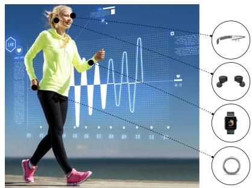
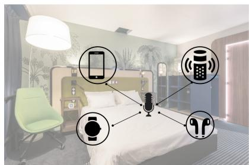
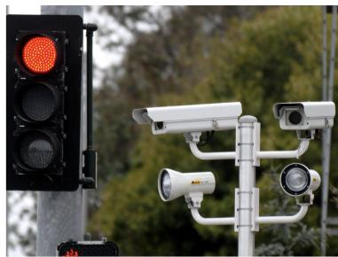
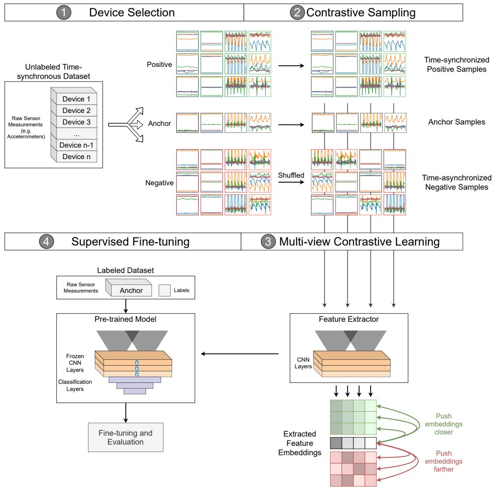
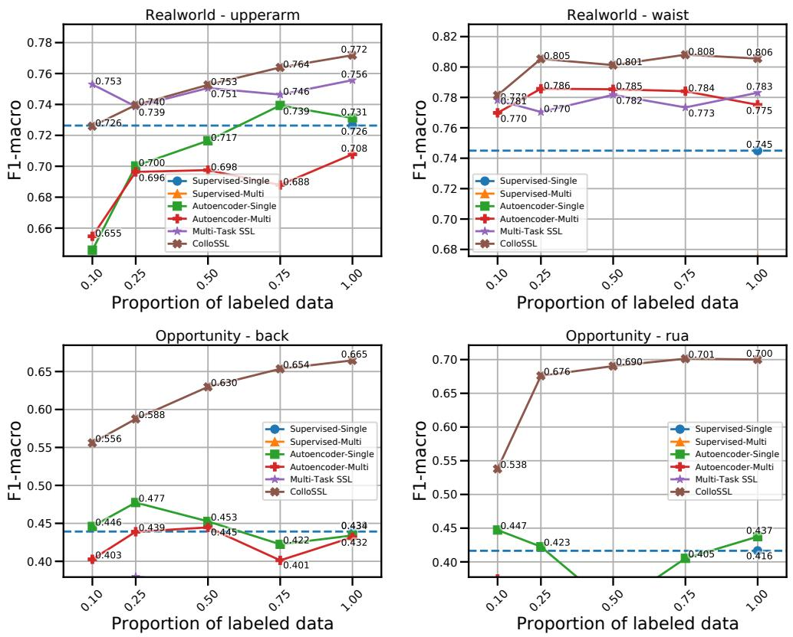
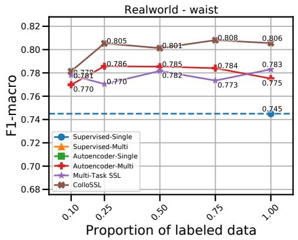
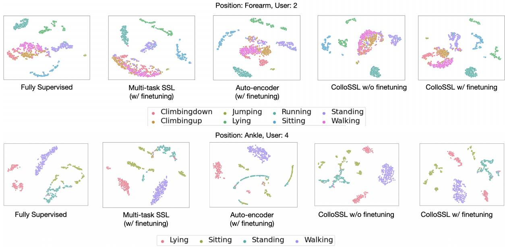

# ColloSSL：用于人类活动识别的协同自监督学习（Collaborative Self-Supervised Learning for Human Activity Recognition）

YASH JAIN∗, Georgia Tech, United States of America

CHI IAN TANG∗, University of Cambridge, United Kingdom

CHULHONG MIN, Nokia Bell Labs, United Kingdom

FAHIM KAWSAR, Nokia Bell Labs, United Kingdom

AKHIL MATHUR, Nokia Bell Labs, United Kingdom

训练稳健的人体活动识别（Human-Activity Recognition, HAR）模型的一个主要瓶颈是对大规模标注传感器数据集的需求。由于标注大量传感器数据是一项昂贵的任务，因此涌现出了无需任何标签即可从数据中学习良好特征的无监督和半监督学习技术。在本文中，我们拓展了这一研究方向，提出了一种名为协同自监督学习（Collaborative Self-Supervised Learning, ColloSSL）的新颖技术，该技术利用用户佩戴的多个设备所采集的未标注数据来学习数据的高质量特征。支持 ColloSSL 设计的一个关键见解在于，由多个设备同时捕获的未标注传感器数据集可以被视为彼此之间的自然变换，并可用于为表示学习生成监督信号。我们提出了三项技术创新，将传统的自监督学习算法扩展到多设备场景：一种选择正样本和负样本设备以实现对比学习的设备选择（Device Selection）方法；一种在多设备场景下对正负样本进行采样的对比采样（Contrastive Sampling）算法；以及一种将标准对比损失扩展到多设备场景的被称为多视角对比损失（Multi-view Contrastive Loss）的损失函数。我们在三个多设备数据集上的实验结果表明，ColloSSL 在绝大多数实验设置中均优于全监督和半监督学习技术，相比表现最佳的基线模型，$F _ { 1 }$ 分数实现了高达 7.9% 的绝对提升。我们还证明了 ColloSSL 在低数据量环境下也能超越全监督方法，在最佳情况下仅需使用十分之一的可用标注数据。

CCS 概念：• 计算方法 → 无监督学习；• 硬件 → 传感器应用与部署；• 以人为本的计算 → 普适计算。

其他关键词与短语：人体活动识别（Human Activity Recognition）、自监督学习（Self-Supervised learning）、对比学习（Contrastive Learning）

## ACM 引用格式：

Yash Jain, Chi Ian Tang, Chulhong Min, Fahim Kawsar, and Akhil Mathur. 2022. ColloSSL: Collaborative Self-Supervised Learning for Human Activity Recognition. Proc. ACM Interact. Mob. Wearable Ubiquitous Technol. 1, 1, Article 1 (January 2022), 28 页. https://doi.org/10.1145/1122445.1122456

∗按字母顺序排序，贡献均等。本工作完成于作者在英国 Nokia Bell Labs 担任访问研究员期间。

作者地址：Yash Jain, yashjain@gatech.edu, Georgia Tech, 美国；Chi Ian Tang, cit27@cam.ac.uk, University of Cambridge, 英国；Chulhong Min, chulhong.min@nokia-bell-labs.com, Nokia Bell Labs, 英国；Fahim Kawsar, fahim.kawsar@nokia-bell-labs.com, Nokia Bell Labs, 英国；Akhil Mathur, akhil.mathur@nokia-bell-labs.com, Nokia Bell Labs, 英国。

出于个人或课堂教学目的制作本作品全部或部分的电子版或纸质版副本，均予以免费许可，前提是副本的制作或分发不得用于盈利或商业利益，且副本首页必须附有本声明及完整引用信息。对于本作品中非 ACM 所有的组件，其版权必须予以尊重。允许在注明出处的前提下进行文摘引用。以其他方式复制、重印、在服务器上发布或向邮件列表重新分发，均须事先获得特定许可和/或支付费用。索取许可请致信 permissions@acm.org。

© 2022 Association for Computing Machinery. 2474-9567/2022/1-ART1 $15.00 https://doi.org/10.1145/1122445.1122456

## 1 引言

在过去的几十年里，随着处理原始传感器数据以推断人类活动的计算模型的进步，人类活动识别（Human Activity Recognition, HAR）应用在移动和可穿戴设备中的普及程度显著提高。通常，这些计算模型是使用监督学习进行训练的，即需要一组标注的数据样本来训练模型。最近，随着对数据高度依赖的深度学习模型在 HAR 中的普及 [19, 31, 45]，对大规模标注训练数据的需求变得更加迫切。然而，先前的研究指出，收集大规模的标注 HAR 数据非常繁琐，尤其是在实验室环境之外 [9]。标注 HAR 数据集的一个关键瓶颈在于传感器数据流（例如加速度计轨迹）难以通过目视检查进行解读，这使得任何事后标注工作都变得十分困难。这一挑战的直接后果是，HAR 数据收集工作 [2, 35, 43, 44] 通常规模较小，在受控或半受控环境中进行，且大多涉及少于 50 名参与者，从而导致模型在现实生活场景中缺乏泛化能力。

与数据标注所面临的挑战形成对比的是，由于日常生活中支持传感器的设备（例如智能手机、可穿戴设备）随处可见，收集未标注的人体活动识别（HAR）数据要容易得多。因此，在训练过程中利用未标注数据的机器学习方法在 HAR 文献中日益受到重视。这一方向上最令人兴奋的范式之一是自监督学习（self-supervised learning, SSL）[26]，其核心思想是利用（未标注）输入数据中存在的固有结构来获取监督信号。通常，这是通过定义一个前置任务（Pretext Task）来实现的，其中对输入数据应用一组预定义的变换，并训练深度神经网络来预测数据中的这些变换。例如，在图像数据集中，前置任务可以是将输入图像旋转 60°，并训练深度神经网络以学习到原始图像与旋转后的图像共享相同的嵌入。我们通常并不关心模型在前置任务上的准确率。相反，我们关注的是模型所学到的中间表示（或特征），并期望这些特征能够承载关于信号的良好语义或结构信息，从而对各种下游任务有所帮助。

近年来，我们看到了一些利用惯性传感器进行自监督学习（self-supervised learning，SSL）以实现活动识别的令人兴奋的探索。Saeed 等人 [46] 在多任务设置中探索了 SSL，他们针对加速度计数据提出了八种不同的变换，并训练了一个特征提取器来预测是否应用了每种变换。通过这种方式，他们发现特征提取器成功学习到了数据中的固有结构并生成了高质量的特征。Tang 等人 [57] 通过应用教师-学生训练（teacher-student training）扩展了这一思路，并展示了相比先前工作的性能提升。Haresamudram 等人 [21] 研究了在特定时间步掩码传感器数据并训练特征编码器以重构缺失数据的思路。最近，Haresamudram 等人 [22] 还提出了对比预测编码（Contrastive Predictive Coding），该方法利用传感器数据流的长期时间结构进行自监督学习。SSL 也已被应用于变点检测（change point detection）[11] 和联邦学习（federated learning）[47] 等领域。

在本研究中，我们拓展了用于 HAR（人体活动识别）的自监督学习研究方向，不过是在一个不同的背景下。我们研究了一种被称为时间同步多设备系统（Time-Synchronous Multi-Device System，TSMDS）的问题设定，该设定为自监督学习开辟了一个尚未探索的契机。这种问题设定的灵感来自于当前人们佩戴多种支持惯性测量单元（IMU）设备的趋势，包括智能手机和消费级可穿戴设备。相关研究（例如 [49]）甚至预计，到 2025 年，每人平均将拥有 9.3 台互联设备。Figure 1a 展示了这种趋势的一个示例——在此，用户佩戴了多个支持 IMU 的设备，这些设备在用户进行跑步等身体活动时采集时间同步的传感器数据。

除了该问题设定日益增长的重要性和实用性之外，它还为人脸与人体活动识别（HAR，Human Activity Recognition）中的对比学习（Contrastive Learning）带来了独特的契机，而对比学习是自监督学习中极具前景的方法之一。对比学习涉及将一个数据样本与其变换后的版本以及数据集中的其他样本进行比较。在 TSMDS 设定下，用户身体上的多个设备正在从不同视角采集相同的物理现象（即用户的活动）。例如，当用户跑步时，放置在大腿口袋中的智能手机和佩戴在手腕上的智能手表都会记录该跑步活动的传感器数据，但由于它们在身体上的不同放置位置，采集的视角也各不相同。因此，我们无需为对比学习人工生成数据样本的变换，而是可以将 TSMDS 设定中来自不同设备的数据视为彼此之间的“自然变换”，并据此设计自监督对比学习算法。在此过程中，不同的设备在自监督学习过程中相互协作；因此，我们将这种方法称为协作式自监督学习（Collaborative Self-Supervised Learning，ColloSSL）。

  
(a) 身体佩戴式惯性传感器

  
(b) 生活空间中的声学传感器

  
(c) 交通路口的摄像头  
Fig. 1. 不同场景下的时间同步多设备系统（TSMDS）示例。

在 §3 中，我们给出了 TSMDS 设置的形式化定义，并对对比自监督学习进行了基础介绍。在 §4 中，我们详细阐述了当前对比学习技术的局限性，这构成了我们研究问题的动机。在 §5 中，我们提出了用于协同自监督学习（Collaborative Self-Supervised Learning）的新颖算法和优化目标，即设备选择（Device Selection）、对比采样（Contrastive Sampling）以及多视角对比损失函数（Multi-view Contrastive Loss function）。随后，我们提出了一种端到端半监督框架，该框架利用来自多个设备的未标记传感器数据进行协同自监督学习，以从数据中学习高质量特征，接着在少量标记数据上训练 HAR 分类器以识别特定的人体活动。最后，在 §6 中，我们在三个多设备 HAR 数据集上将我们框架的性能与多种监督和半监督训练基线进行了比较。我们的结果表明，ColloSSL 在低数据量和高数据量情况下通常都优于监督训练和其他半监督基线。我们还对 ColloSSL 生成的特征嵌入以及 ColloSSL 的鲁棒性和泛化能力提供了深入见解。

## 我们的工作做出了三项主要贡献：

• 我们提出了协同自监督学习（Collaborative Self-Supervised Learning，简称 ColloSSL），这是一种从用户佩戴的多设备所采集的无标注惯性传感器数据中进行学习的新方法。与以往的方法 [46, 57] 不同，ColloSSL 利用从多设备采集的传感器数据中的自然变换来进行对比学习，并为下游 HAR（人体活动识别）分类任务学习一个鲁棒的特征提取器。

• 我们指出了 ColloSSL 面临的三项关键研究挑战，并提出了新颖的设备选择和数据采样算法，以及一种将对比学习扩展到多设备场景的全新损失函数。

• 我们在涵盖移动活动和复杂的日常生活活动（ADL）的三个多设备 HAR 数据集上对 ColloSSL 进行了全面的评估。结果表明，ColloSSL 在识别准确率和标注数据利用效率方面均优于全监督和半监督基线方法。

## 2 相关工作

在本节中，我们回顾与本文相关的四类先前工作。具体而言，我们回顾了人类活动识别（HAR）的相关文献，以及旨在解决 HAR 中标注数据稀缺挑战的新兴半监督学习技术。与我们的工作紧密相关的是最近在 HAR 中探究自监督学习的趋势——因此，我们调研了关于自监督学习和对比学习的最新机器学习（ML）文献，并阐释其如何应用于 HAR。最后，我们还强调了本工作与多设备感知环境先前研究之间的关联。

用于人体活动识别的深度学习。人体活动识别（Human Activity Recognition）是一个分类任务，其标签为日常活动中自然出现的诸如“步行”和“跑步”等活动。该问题已被信号处理领域的研究人员 [13, 18–20, 41, 64] 利用移动设备内置传感器的时间序列数据进行了深入研究，计算机视觉领域的研究人员也专注于基于视频和摄像头的解决方案展开了深入探索。总体而言，对于任何深度学习或机器学习解决方案，特征提取器的选择都起着至关重要的作用。传统上，解决方案主要集中在已被众多研究人员 [13, 20, 41] 广泛研究的统计特征上。后来，深度卷积网络和循环网络 [18, 19, 64] 被证明在从有标签数据中学习特征提取器方面是行之有效的。

然而，数据集的规模、多样性以及真实世界代表性，对于机器学习和深度学习方案在现实世界中取得令人满意的性能至关重要 [34, 59, 60]。与图像、视频和音频片段等通常可行进行事后标注的其他数据模态相比，获取传感器时间序列的标签——尤其是那些在自由生活环境中收集的数据——是非常困难的 [5]。不同用例和配置之间的差异进一步加剧了这一问题，其中包括嵌入式传感器的不同型号或类型、传感器的佩戴/放置位置以及目标活动类别，这使得收集能够代表所有不同可能配置的数据几乎不可行。这导致用于监督的标注数据匮乏且质量有限，进而可能对真实世界中的性能产生不利影响。

无监督和半监督学习旨在利用未标记数据来克服纯监督方法的局限性，是 HAR（人类活动识别）中最热门的研究方向之一 [54, 63, 68]。我们的工作同样建立在这一关于半监督学习技术的研究基础之上，不过是在一个不同的问题设定下：我们利用用户佩戴的多个设备所获取的未标记数据，来生成用于表征学习的监督信号。

用于人类活动识别的自监督学习。自监督学习（SSL）已成为机器学习界日益热门的研究领域，旨在减少训练深度学习模型时对标记数据的依赖 [6, 8, 23, 25, 29]。沿着这一思路，许多具有独特优化目标的自监督学习框架被提出 [8, 10, 17]。例如，SimCLR [8] 框架通过将同一样本的变换视图作为正样本对，并将其与其他样本进行对比，从而训练出对变换具有不变性的特征提取器。

HAR 领域的研究人员最近开始探索如何扩展或专门针对 HAR 任务设计 SSL 技术 [46, 48, 58]。在早期的开创性工作之一中，Saeed 等人将“识别特定数据样本应用了哪种信号变换”作为自监督任务 [46]。他们选取了一组共八种信号变换来表示信号噪声，并通过利用该任务预训练模型报告了性能提升。然而，作者主要关注使用来自相似分布且来自单一设备的数据对模型进行预训练。该信号变换任务也被改编用于训练基于心电图（ECG）数据的情感识别模型 [50]。其整体方法紧随前述工作 [46]，并进一步探索了使用不同难度级别的预训练任务对性能的影响，以及预训练任务与下游应用任务之间的关系。最近，SimCLR 框架已被应用于 HAR [58]。作者探索了一组专为时间序列数据设计的不同变换函数组合，用于基于 SimCLR 框架训练传感器数据的特征提取器。然而，该工作同样仅侧重于利用来自单一传感器的数据，并未探索从其他传感器和设备中提取更强监督信号的潜力。在视觉表征领域，已有利用多个设备进行 SSL 的初步尝试 [51]。该研究表明，时间同步的视觉表征可用于通过强化学习为机器人操作提供奖励函数。其局限性之一在于它仅利用了来自两个摄像机视角的数据，而我们提出的方案兼容具有两个以上数据源的设置，并且我们全面探索了具有不同数量 IMU 设备的设置。

用于 HAR 的多设备环境：在过去的几十年中，针对 HAR（人体活动识别）的多设备环境已从多个角度得到了积极的研究。我们简要回顾了过去关于多设备环境的研究，重点关注 HAR 的传感器选择与融合。首先，已有研究提出了传感器选择策略，通过根据每个设备的预定义参数（如平均精度、资源使用情况和设备可用性）动态选择最佳传感器，从而最大化人体传感器网络中的系统效用 [27, 28, 36, 67]。尽管这些策略侧重于在多设备环境中提供更好的运行时系统性能，但它们并未利用来自多个设备的数据来提高活动识别的准确率。为此，已有许多基于深度学习的传感器融合技术 [37, 39, 61, 65, 66] 被提出，这些技术通过拼接多个传感器数据流来训练融合模型。尽管它们在模型精度上表现出显著提升，但它们假设所有传感器数据流都带有标签。相反，我们的工作重点在于利用来自多个设备的未标记数据来学习数据中高质量的特征，这些特征随后可用于仅使用极少量标记数据来训练下游 HAR 模型。此外，与基于融合的方法相比，我们在推理阶段不需要所有设备均可用；来自多个设备的数据仅在训练期间需要，而在各个设备上的推理可以独立进行。

## 3 预备知识

在本节中，我们阐述 TSMDS 问题设置，并对对比自监督学习（contrastive self-supervised learning）进行简要介绍。

## 3.1 时间同步多设备系统（Time-Synchronous Multi-Device Systems）

我们首先对本工作中所探讨的问题设置——时间同步多设备系统（Time-Synchronous Multi-Device Systems，简称 TSMDS）提供更多细节。需要指出的是，我们的目的并非声称这是一个此前从未被研究过的问题设置；相反，我们认为这是一个自监督学习尚未涉足的有趣问题领域。在本节中，我们从概念上描述这一问题设置，随后在 §5.1 中对其进行数学形式化。

在人类活动识别（human-activity recognition，HAR）的背景下，TSMDS 问题设定类似于体域网（Body-Area Network），其中多个计算/传感器设备佩戴、附着或植入在人体上 [24]。TSMDS 的本质特征在于所有设备同时观察一个物理现象（例如用户的移动活动），并以时间对齐的方式记录传感器数据（Figure 1a）。尽管我们的工作侧重于使用运动数据的 HAR，但 TSMDS 设定相当通用，广泛存在于许多其他感知应用中。在智能家居中（Figure 1b），多个语音助手（例如智能手机中的 Siri，客厅中的 Alexa 和 Google Home）可以同时收听用户的语音和音频命令。在部署于交通路口的摄像机网络中（Figure 1c），多个摄像机同时从不同视角捕捉同一场景。

下面我们阐述在 HAR 背景下探索 TSMDS 设定时所作的两个关键假设：

• 我们假设多设备系统中的所有传感器设备共享相同的传感器采样率，或者它们的数据可以重采样至相同的采样率。该假设确保了输入到 HAR 模型的数据维度在不同设备间保持一致，并简化了 HAR 模型的神经网络架构设计。

• 根据定义，我们假设 TSMDS 设定下的多个设备以时间对齐的方式采集传感器数据。诚然，在实际应用中，跨多个设备的传感器数据集完全时间对齐是一个较强的假设。设备之间可能存在时间戳噪声或系统时钟偏差，这可能会破坏多设备数据集的时间对齐。然而，HAR（人类活动识别）领域的先前研究 [55] 表明，加速度计和陀螺仪传感器的时间戳噪声非常小，通常小于 10ms。我们假设如此微小的噪声不会降低我们方案的性能，并通过证明我们的方法对设备间适度的时间不对齐具有鲁棒性，从而实证验证了这一假设（§7.6）。

## 3.2 对比自监督学习基础

对比学习（Contrastive Learning）是一种自监督学习（self-supervised learning）算法，其目标是在嵌入空间中使数据集中相似的样本彼此更近，而不相似的样本彼此远离 [3, 8]。在基于未标注数据的对比学习中，从训练数据集中选取一个数据样本（称为锚点样本，anchor sample），并通常施加预定义的扰动（例如旋转）以生成该样本的变换版本。在训练过程中，变换后的样本被视为正样本，而从数据集中随机选取的其他数据样本则被视为负样本。所有这三类数据样本（锚点样本、正样本、负样本）都被输入到神经网络中以获得特征嵌入。模型训练的目标是拉近锚点样本与正样本的特征嵌入，同时推开锚点样本与负样本的特征嵌入。在此过程中，模型仅利用未标注的原始数据即可学会提取高质量的特征嵌入，这些嵌入随后可用于下游分类任务。

支撑对比学习性能的最重要因素之一，是应用于每个锚点样本（anchor sample）的扰动选择；我们希望模型对这些扰动保持不变性，同时对其他负样本保持判别性。先前的研究 [8, 58] 表明，算法设计者所选择的扰动会对对比学习的性能产生深远影响。他们发现，在 ImageNet 数据集上使用对比学习进行预训练的模型，其 Top-1 准确率可能会发生急剧下降，从 56.3%（使用图像裁剪和颜色变换）骤降至仅 2.6%（使用图像旋转变换）。

## 4 协同自监督学习的动机与挑战

与其在对比学习期间指定人工变换（例如旋转），我们探讨是否可以利用传感器数据集中已有的自然变换。有趣的是，TSMDS（时间同步多设备系统）设置呈现出一种独特的场景，使我们能够在不同设备间获得 HAR（人类活动识别）数据的此类自然变换。如图 Figure 1a 所示，用户佩戴的多个设备从不同视角同时捕获相同的身体活动（例如跑步）。因此，我们可以将来自不同设备的数据集视为彼此的自然变换。这一观察也可以从 Kunze 和 Lukowicz [30] 的一项早期开创性 HAR 研究中得到验证，他们指出佩戴在身上的传感器收集的加速度计和陀螺仪数据取决于放置传感器的身体部位的平移和旋转特性。由于不同身体部位具有不同的平移和旋转特性（例如手腕的旋转自由度高于胸部），这会在从不同身体位置收集的加速度计和陀螺仪数据中诱导出自然变换。

Proc. ACM Interact. Mob. Wearable Ubiquitous Technol., Vol. 1, No. 1, Article 1. 出版日期：2022 年 1 月。

  
Fig. 2. ColloSSL 中两个研究挑战的示意图：设备选择（Device Selection）与对比采样（Contrastive Sampling）。锚点样本用灰色矩形表示。绿色和红色矩形表示由我们在 §5.4 中描述的设备选择与对比采样算法选出的正样本和负样本。

综上所述，TSMDS 设置使我们能够捕获彼此之间具有自然变换的时间对齐传感器数据集。我们的想法是利用这些自然变换来定义前置任务（pretext task）并进行对比学习（contrastive learning）。

ColloSSL 中的研究挑战。为了阐明我们的研究挑战，我们在 Figure 2 中展示了一个示例图解。该图显示了同时从 （=4）个身体佩戴设备收集的 15 秒未标注加速度计数据轨迹。每条加速度计轨迹均使用 3 秒的窗口长度进行分段，从而使每个设备获得 5 个窗口/样本。假设我们希望使用对比学习为“胸部（chest）”身体位置训练一个特征提取器。因此，来自“胸部”的数据样本将成为锚点样本（anchor samples）。来自“胸部”的第一个锚点样本（）在 Figure 2 中用灰色矩形突出显示。如上所述，为了进行对比学习，我们需要选择合适的正样本和负样本。在此方向上，我们在下文中确定了三个关键研究问题：

• 从其余的  − 1 个设备（即上臂、前臂、头部）中，我们该如何选择用于对比训练的正样本和负样本？直观上，某些设备的数据分布会与“胸部”的数据分布相差甚远。如果我们使用这些差异较大的设备来获取正样本，并在嵌入空间中将它们推近锚点样本，可能会导致对比学习产生退化解（degenerate solutions）。此外，由于每个设备的数据分布会随着用户的活动而发生变化，我们在选择设备时需要考虑这些动态变化。我们将这一研究挑战称为设备选择 1（Device Selection 1），并提出了一种数据驱动策略，该策略利用最大均值差异（Maximum Mean Discrepancy, MMD）作为度量指标，在对比学习过程中动态选择正样本和负样本设备。作为示例，我们在 Figure 2 中展示了对于给定的数据样本，我们的策略选择“上臂”作为正样本设备，选择“前臂”和“头部”作为负样本设备。该选择算法在 §5.4.1 中进行了详细描述。

• 除了设备选择（Device Selection）之外，我们还需要确定来自所选设备的哪些样本将作为正样本或负样本。例如，如果我们选择“大臂”（upperarm）作为正样本设备，那么在其 5 个样本（或窗口）中，哪一个将作为锚点样本（）的正样本？我们将这一挑战称为对比采样 2（Contrastive Sampling 2），并提出了使用来自正样本设备的时间同步样本以及来自负样本设备的时间非同步样本的想法。例如，在 Figure 2 中，来自正样本设备的时间同步样本用绿色矩形高亮显示，而来自负样本设备的时间非同步样本则用红色矩形高亮显示。对比采样算法背后的原理和详细细节见 §5.4.2。

• 最后，为了在一组设备中实现对比学习，我们需要定义一个新的优化目标。为此，我们提出了一种名为多视角对比损失（Multi-View Contrastive Loss）的新型损失函数，它可以接收任意数量的正样本和负样本作为输入并计算损失指标，随后使用随机梯度下降进行优化（§5.5）。

## 5 协作自监督学习

在本节中，我们介绍针对 HAR 所提出的协作自监督学习（Collaborative Self-Supervised Learning）方法。

## 5.1 问题表述

我们将 TSMDS 问题设定形式化如下：给定 $D$ 个设备，其具有时间对齐且未标注的传感器数据集 $\{ \mathbb { X } _ { i } \} _ { i = 1 } ^ { D }$。不失一般性，按照人类活动识别（HAR）任务的惯例，我们假设数据集已被预先分割为 $T$ 个窗口。每个数据集 $\mathbb { X } _ { i }$ 包含 $T$ 个窗口 $\{ x _ { i } ^ { 1 } , \cdots , x _ { i } ^ { T } \}$，其中 $x _ { i } ^ { j }$ 表示窗口 $j$ 中来自设备 $i$ 的一组传感器样本。通常，传感器样本可以是任何形式的惯性测量单元（IMU）测量值，例如 3 维加速度计数据、3 维陀螺仪数据或 1 维加速度计范数。在我们的工作中，每个传感器样本是一个 6 维向量，由 3 轴加速度计数据和 3 轴陀螺仪数据堆叠而成。

令 $D ^ { * } \in D$ 为一个锚点设备（例如智能手机），我们希望为其训练一个 HAR 预测模型。令 $\mathbb { L } ^ { * } = \{ ( x _ { * } ^ { 1 } , y _ { * } ^ { 1 } ) \cdot \cdot \cdot , ( x _ { * } ^ { m } , y _ { * } ^ { m } ) \}$ 为来自该锚点设备的一个（小型）预分割已标注数据集，包含 $m$ 个窗口 $( m \ll T )$，其中 $x _ { * } ^ { j }$ 是窗口 $j$ 中的传感器样本集合，而 $y _ { * } ^ { j }$ 是分配给这些样本的类别标签。

我们的目标有两个方面：首先，我们旨在利用来自所有设备的未标记数据集 $\{ \mathbb { X } _ { i } \} _ { i = 1 } ^ { D }$，使用 ColloSSL 训练一个特征提取器 $f ( . )$。训练好的特征提取器应当能够为锚点设备数据生成高质量的特征嵌入。其次，我们旨在利用该预训练特征提取器 $f ( . )$ 获取已标记锚点样本 $x _ { * } ^ { j } .$ 的特征嵌入，并随后训练一个 HAR 分类器 $g(.)$，该分类器将这些特征嵌入映射到相应的类别标签 $y _ { * } ^ { j }$。

## 5.2 方案概述

我们提出的方案如图 3 所示，其工作流程如下：

1. 我们使用随机权重初始化特征提取器 $f(.)$。

2. 我们从所有 $D$ 台设备中采样一批时间对齐的未标记数据批次 $B$：$\{ x _ { i } ^ { 1 } , \cdots , x _ { i } ^ { B } \} _ { i = 1 } ^ { D }$。

3. 图 3 中的设备选择 1：给定一个锚点设备 $D ^ { * }$，我们首先确定在这一批数据中，其余设备中哪些将为对比学习提供正样本和负样本。这是通过 §5.4.1 中说明的设备选择算法完成的。

4. 对比采样（图 3 中的 2）：接下来，对于每个锚点样本，我们从批次 $\mathcal{B}$ 的所有样本中确定应使用来自正样本设备和负样本设备的哪些具体样本来进行对比学习。尽管数据采样在以往作为自监督学习（SSL）的一个重要方面得到了研究，但我们提出了一种名为对比采样（Contrastive Sampling，§5.4.2）的算法，将数据采样扩展到了 TSMDS 场景。

5. 多视角对比学习（图 3 中的 3）：将锚点样本、正样本和负样本输入特征提取器 $f ( . )$ 中以生成特征嵌入。这些特征嵌入用于计算多视角对比损失（Multi-view Contrastive Loss，详见 §5.5），该损失将正样本嵌入拉近到锚点，并将负样本嵌入推离锚点。

  
Fig. 3. 协同自监督学习（Collaborative Self-Supervised Learning）概述。详细说明请参见 §5.2。

6. 重复步骤 4-5，直到计算完批次 $\mathcal{B}$ 中的所有锚点样本；重复步骤 2-5，直到多视角对比损失收敛。收敛后，我们期望 $f(.)$ 已经学会为锚点设备提取高质量的特征。

7. 有监督微调（图 3 中的 4）：最后，我们使用预训练的特征提取器 $f(.)$ 以及来自锚点设备的有标签数据集（$L^*$），通过监督学习训练一个 HAR 分类器（§5.5.1）。

## 5.3 特征提取器

我们使用时序（一维）卷积神经网络作为特征提取器。该设计选择受到了人类活动识别（HAR [46]）中自监督学习已有工作的启发，并通过在不同技术之间保持模型架构的一致性，使我们能够将我们的解决方案与基准（baseline）进行公平的比较。该架构由三个一维卷积层组成，卷积核数量分别为 32、64 和 96，卷积核尺寸（kernel size）分别为 24、16 和 8，步长（stride）均为 1。为了进行正则化，我们在每两个层之间使用比例为 0.1 的 Dropout，并应用正则化系数为 1e-4 的 L2 正则化。最后，最后一个 Conv1D 层的输出被传入一个全局最大池化（GlobalMaxPooling，1D）层。

$f(\cdot)$ 的输入是一个二维张量，一个轴表示时间，另一个轴表示传感器数据。由于我们同时使用三轴加速度计和三轴陀螺仪数据作为输入，传感器数据的维度为 6。因此，在采样率为 50 Hz、窗口长度为 2 秒的情况下，模型的输入张量维度为 100 × 6。$f ( . )$ 的输出是维度为 (96 × 1) 的特征嵌入（feature embedding）。

## 5.4 设备选择与对比采样

正如 §4 和图 2 中所解释的，ColloSSL 中的两个核心挑战是：(1) 设备选择（Device Selection），即选择用于提取正样本和负样本的设备；以及 (2) 对比采样（Contrastive Sampling）：决定将所选设备中的哪些样本用于对比学习。

在介绍我们的方法之前，我们首先解释对于给定的锚点样本（anchor sample）()，什么才构成对比学习（contrastive learning）中“好”的正样本 $( x ^ { + } )$ 和负样本 $( x ^ { - } )$。回顾对比学习的目标，它是引导特征提取器  将  与 $x ^ { + }$ 在特征空间中映射得彼此更近，而将  与 $x ^ { - }$ 映射得彼此远离。

正样本的优良性。我们认为一个好的正样本 $x ^ { + }$ 应当具备以下两个特征：

(P1) $x ^ { + }$ 应当与锚点样本  属于相同的标签/类别。因为如果  和 $x ^ { + }$ 来自不同的类别，而特征提取器  却试图将它们彼此拉近，这会导致类别分离度变差，并降低下游分类性能。

(P2) $x ^ { + }$ 应当来自与锚点设备数据分布散度（divergence）较小的设备。这一点至关重要，因为如果锚点设备和正样本设备在数据特征上差异极大（例如，手腕佩戴式 IMU 与胸部佩戴式 IMU），则可能会影响特征提取器提取有意义的不变嵌入表征（invariant embeddings）。

请注意，在 ColloSSL 中，我们无法获取数据的真实标签（ground-truth labels）。因此，在 $x ^ { + }$ 上施加 (P1) 最初可能看起来较为棘手。然而，根据 TSMDS 设定的定义，所有设备都是以时间对齐的方式同时采集 HAR 数据的。因此，我们自然可以假设各设备间的真实标签（例如步行、跑步）也是时间对齐的。因此，如果我们能够确保 $x$ 与 $x ^ { + }$ 时间对齐，就将隐式保证它们具有相同的标签。

负样本的优良性（Goodness of negative samples）。我们提出，一个好的负样本 $x^-$ 应该具备以下两个特征：

(N1) $x ^ { - }$ 应该是一个真负样本（true negative），即与锚点样本（anchor sample）$x$ 属于不同的类别。因为如果 $x$ 与 $x ^ { - }$ 来自同一类别，而特征提取器却试图将它们推开，就可能会导致分类性能下降。

(N2) 最具信息量的负样本是那些嵌入（embedding）在初始状态下接近锚点嵌入的样本，特征提取器需要将它们推远。在这种情况下，特征提取器能从数据中获得较强的监督信号，并在训练过程中获得更有用的梯度。在另一种情况下，如果负样本嵌入在训练初始化时就已经远离锚点，特征提取器从数据中获得的监督信号就会较弱，这可能会对其收敛产生不利影响。

同样，由于 ColloSSL 中无法获取类别标签，严格执行 (N1) 是不可能的。因此需要一种解决方案，能够促进负样本具备这一特征，并最大程度地降低锚点样本与 $x ^ { - }$ 属于同一类别的可能性。

在定义了何为优质的正负样本之后，我们现在介绍设备选择和对比采样算法。

5.4.1 设备选择。我们的设备选择算法旨在增加选择“优质”正负样本的可能性。为简明起见，我们将提取正（或负）样本的设备称为正设备（或负设备）。形式上，给定一组拥有时间对齐且无标签传感器数据集 $\{ \mathbb { X } _ { i } \} _ { i = 1 } ^ { D }$ 的设备集合。令 $D ^ { * } \in D$ 为锚点设备。令 $D ^ { \theta } = D \backslash D ^ { * }$ 为剩余候选设备集合，我们希望从中选出正设备和负设备。

我们的设备选择算法工作流程如下：首先，我们从锚点设备 $D ^ { * }$ 以及 $D ^ { \theta }$ 中的各个设备中采样一批时间对齐的数据。令 $x ^ { * }$ 和 $X ^ { \theta } = \{ x _ { i } \} _ { i = 1 } ^ { | \bar { D } ^ { \theta } | }$ 分别为来自锚点设备和候选设备的数据批次。

我们计算 $x ^ { * }$ 与 $X ^ { \theta }$ 中每个数据批次之间的成对最大均值差异（Maximum Mean Discrepancy，MMD）。MMD 是一种用于计算两个数据分布之间距离的分布级统计量；更高的 MMD 意味着分布之间的距离更大 [16]。在获得每对设备批次之间的批次级 MMD 分数后，我们采用以下设备选择策略：

最近正例（Closest Positive）。其数据与锚点数据具有最小 MMD 距离的设备被选为正例设备。该选择满足了筛选优质正样本的准则 (P2)，并确保 (.) 能够合理地将两个样本的嵌入映射得更加接近。请注意，我们也尝试过使用多个正例设备进行实验，但发现仅使用一个（最近的）设备作为正例能获得最佳性能。

加权负样本。对于负样本设备，我们使用候选集 $D ^ { \theta } { } _ { ; }$ 中的“所有”设备，但在训练过程中，它们的贡献根据其与锚样本的 MMD 距离的倒数进行加权。与锚样本 MMD 距离较小的设备在对比训练期间获得更高的权重，而 MMD 距离较大的设备则获得较小的权重。该策略有两个目标：首先，通过为与锚样本具有较小 MMD 距离的设备分配更高的权重，它满足了 (N2)，并确保在训练过程中距离锚样本更近的那些负样本获得更大的权重。其次，使用“所有”设备作为负样本可以规避某个设备违反 (N1) 的情况。例如，即使某个设备违反了 (N1) 且最终从与 $x$ 相同的类别中选择了 $x ^ { - }$，其他设备也可以对其进行弥补，并确保其对特征提取器的影响降至最低。

分配给每个负样本设备 $i \in D ^ { \theta }$ 的权重可表示为：

$$
w _ {i} = \frac {1}{M M D (x ^ {*} , x _ {i})}\tag{1}
$$

通过将每个权重除以所有设备中的最大权重，对权重进行进一步归一化。

作为一个示例，我们将设备选择策略应用于 RealWorld HAR 数据集（数据集的详细信息见 §6.1）。该数据集包含来自 7 个配备 IMU 的设备传感器数据： = {chest, upperarm, forearm, thigh, shin, head, waist}。我们选择“chest”作为锚点设备（anchor device），并获取来自“chest”的数据与来自其余设备的数据之间的成对 MMD。这产生了以下成对 MMD 得分：{chest-head: 0.45, chest-waist: $\phantom { - } 0 . 6 1 ,$ , chest-thigh: $0 . 6 7 ,$ chest-upperarm: $0 . 7 7 ,$ chest-forearm: 0.83, chest-shin: 1.51}。根据我们的选择算法，我们选择 head 作为正样本设备，并选择 {head, waist, thigh, upperarm, forearm, shin} 作为负样本设备，其权重与其 MMD 得分成反比。

• Jain and Tang, et al.

5.4.2 对比采样（Contrastive Sampling）。在前一阶段，我们已经确定了 $D _ { \theta }$ 中的哪些设备将充当正样本和负样本。现在，我们确定应从每个设备中选取哪些数据样本用于对比训练。

形式上，给定一个锚点设备 $D ^ { * }$、一组正样本设备 $( D ^ { + } )$ 和负样本设备 $( D ^ { - } )$。令 $P _ { i } = \{ p _ { i } ^ { 1 } , \cdots , p _ { i } ^ { T } \} | _ { i = 1 } ^ { | D ^ { + } | }$ $N _ { j } = \{ n _ { j } ^ { 1 } , \cdot \cdot \cdot , n _ { j } ^ { T } \} \vert _ { j = 1 } ^ { \vert D ^ { - } \vert } , A = \{ a ^ { 1 } , \cdot \cdot \cdot , a ^ { T } \}$ 分别表示来自第 $i ^ { t h }$ 个正样本设备、第 $j ^ { t h }$ 个负样本设备以及锚点设备的时间对齐数据批次。在此，$\mathbf { \mathcal { P } } _ { i } ^ { t } , { \boldsymbol { n } } _ { j } ^ { t }$ 和 $a ^ { t }$ 各自表示在时间步  处的一个数据样本。

对比采样的目标是为给定的锚点样本 $a ^ { t }$ 选择“良好”的正样本和负样本嵌入。我们的采样策略如下：

同步正样本。对于时间步 $t$ 处的给定锚点样本 $a ^ { t }$，我们选择其时间对齐的正对应样本 $\boldsymbol { p } _ { i } ^ { t }$ 作为正样本。正如前面所解释的，这种选择确保了锚点和正样本具有相同的标签，并满足良好正样本的 (P1) 标准。

异步负样本。良好负样本的标准 (N1) 是它们应该属于与锚点样本不同的类别。由于我们在对比学习期间无法获取真实标签，因此无法严格执行 (N1)。作为解决方案，我们利用了以下观察结果：与锚点未进行时间同步的负样本更有可能属于不同的类别。也就是说，对于时间步 $t$ 处的锚点样本 $a ^ { t }$，一个良好的负样本应为 $n ^ { \dot { t } ^ { \prime } } \mid t ^ { \prime } \ne t$。

然而，这种选择仍然不能保证时间步 $t$ 和 $t ^ { \prime }$ 处的标签是不同的；例如，用户在 $t = 0$ 和 $t ^ { \prime } = 1 0 0$ 时的活动可能纯属偶然地相同。为了尽量减少这种情况发生的可能性，我们采用了一个简单的技巧：在 ColloSSL 过程中使用 512 的大批次大小（batch size），这确保了每个批次中都包含多样化的类别标签，并降低了 $t$ 和 $t ^ { \prime }$ 处因偶然性而发生标签重叠的可能性。

5.4.3 总结。本节介绍的技术解决了 Figure 2 中指出的 ColloSSL 的两个核心研究挑战。使用设备选择（Device Selection）算法，我们首先确定哪些设备在训练期间充当正样本或负样本。接下来，对比采样（Contrastive Sampling）算法从选定的设备中找出“优质”的正样本和负样本，这些样本可用于与锚点嵌入（anchor embedding）进行对比学习。

细心的读者可能已经注意到，我们算法选出的正样本设备和负样本设备并不是互斥的。与锚点（anchor）具有最小 MMD 距离的正样本设备也会被选入负样本设备集中。然而，在对比采样（Contrastive Sampling）过程中，从该设备中选取的样本会有所不同：当它作为正样本设备时，将选取与锚点时间同步的样本；而当它作为负样本设备时，将选取与锚点时间不同步的样本。

## 5.5 多视角对比损失

在本节中，我们将解释如何利用上一步选取的正样本和负样本来训练特征提取器。首先，将锚点样本、正样本和负样本输入特征提取器以获得特征嵌入。设 $\{ z _ { i } ^ { + } \} \rvert _ { i = 1 } ^ { \lfloor D ^ { + } \rfloor }$ 和 $\{ z _ { j } ^ { - } \} \rvert _ { j = 1 } ^ { | D ^ { - } | }$ 分别为从第 $i ^ { t h }$ 个正样本设备和第 $j ^ { t h }$ 个负样本设备中选取的特征嵌入。设 $z ^ { * }$ 为锚点嵌入。

我们提出了一种名为多视角对比损失（Multi-view Contrastive Loss）的新型损失函数，该函数受到标准对比损失函数的启发，但能够兼容多个正样本和负样本

$$
\mathcal {L} _ {M C L} = - \log \frac {\sum_ {i = 0} ^ {| D ^ {+} |} \exp \left(\text {sim} \left(z ^ {*} , z _ {i} ^ {+}\right) / \tau\right)}{\binom{\sum_ {i = 0} ^ {| D ^ {+} |} \exp \left(\text {sim} \left(z ^ {*} , z _ {i} ^ {+} \right) / \tau\right)}{+ \sum_ {j = 0} ^ {| D ^ {-} |} w _ {j} \exp \left(\text {sim} \left(z ^ {*} , z _ {j} ^ {-}\right) / \tau\right)}}\tag{2}
$$

Proc. ACM Interact. Mob. Wearable Ubiquitous Technol., Vol. 1, No. 1, Article 1. 出版日期：2022年1月。

其中 $\text{sim}(\cdot)$ 表示余弦相似度，$w _ { j }$ 是根据式 (1) 分配给第 $j$ 个负样本设备的权重，$\tau$ 是表示温度系数的超参数。

使用随机梯度下降对每个批次的数据最小化 $\mathcal { L } _ { M C L }$。实际上，训练期间的损失最小化引导特征提取器 $f ( . )$ 提高锚点（anchor）与正样本嵌入之间的余弦相似度（即在特征空间中将它们拉近），并对锚点与负样本嵌入执行相反的操作（将它们推远）。通过这种方式，$f(.)$ 能够理解来自不同设备的传感器数据的结构，并学习将原始数据映射为高质量特征，这些特征可用于各种下游分类任务。

5.5.1 监督微调（Supervised Fine-tuning）。最后，在使用 ColloSSL 训练完特征提取器后，它可以用于训练下游 HAR 分类模型。为此，我们遵循 Saeed 等人 [46] 的方法，冻结特征提取器除最后一个卷积层之外的权重，并向模型添加一个分类头。该分类头包含一个具有 1024 个隐藏单元且采用 ReLU 激活的全连接层，随后是一个单元数等于标签数量的输出层。然后，通过优化标准分类交叉熵损失（Categorical Cross Entropy loss），使用来自锚设备的小型有标签数据集 $\mathbb { L } ^ { * }$ 对模型进行训练。

## 6 评估

我们在三个多设备 HAR 数据集上对 ColloSSL 进行了评估，并将其性能与自监督学习、半监督学习和全监督学习等各种 HAR 基线方法进行了比较。我们的主要结果包括：

• ColloSSL 在低数据量机制（low-data regime）下优于全监督学习。在 18 个锚点设备中的 15 个上，仅使用 10% 或 25% 标注数据训练的 ColloSSL，其 $F_1$ 分数便高于使用 100% 标注数据训练的全监督模型。

• 在识别性能方面，ColloSSL 也优于多种 HAR（人体活动识别）基线模型。在使用相同数量的标注数据时，相较于表现最佳的基线模型，ColloSSL 的 $F _ { 1 }$ 分数实现了 7.9% 的绝对提升。

• 通过 t-SNE 图和显著性图（saliency maps）的可视化，我们表明 ColloSSL 能够在各个类别之间生成具有良好可分性且有意义的特征嵌入。

• ColloSSL 对来自多设备数据的时间不对齐具有鲁棒性；当在设备间引入高达 0.5 秒的时间同步误差时，观察到的 $F _ { 1 }$ 分数差异小于 ±0.006，而当误差高达 3 秒时，差异仍小于 ±0.01。

## 6.1 实验设置

数据集：在我们的实验中，我们使用了三个用于人类活动识别（HAR）的数据集，这些数据集包含来自多个设备的时间对齐传感器数据：RealWorld [56]、Opportunity [44] 和 PAMAP2 [43]，如 Table 1 所示。共同点在于，它们都包含从多个穿戴在身上的设备上同时采样的 3-axis 加速度计和 3-axis 陀螺仪数据。其中两个数据集中使用的惯性传感器也是异构的：RealWorld 数据集使用 Samsung Galaxy S4 智能手机和 LG G 智能手表来采集传感器数据，而 Opportunity 数据集中使用的惯性传感器也来自不同的制造商，例如 InertiaCube3 和 Sun SPOT。

• RealWorld：RealWorld 数据集 [56] 包含 15 位参与者的加速度计和陀螺仪轨迹数据，是在佩戴于前臂、大腿、头部、上臂、腰部、胸部和小腿的 7 个传感器设备上以 50 Hz 的频率同时采样的。每位参与者进行了 8 项活动：下楼梯和上楼梯、跳跃、躺卧、站立、静坐、跑步/慢跑以及步行。

1:14 • Jain and Tang, et al.

<table><tr><td>数据集</td><td>设备数量（位置）</td><td>用户数量</td><td>活动数量（标签）</td></tr><tr><td>RealWorld [56]</td><td>7 (前臂, 大腿, 头部, 上臂, 腰部, 胸部, 小腿)</td><td>15</td><td>8 (上楼梯, 下楼梯, 跳跃, 躺卧, 站立, 静坐, 跑步, 步行)</td></tr><tr><td>Opportunity [44]</td><td>5 (背部, 左前臂, 右鞋, 右上臂, 左鞋)</td><td>4</td><td>4 (站立, 步行, 静坐, 躺卧)</td></tr><tr><td>PAMAP2- Locomotion [43]</td><td>3 (手臂, 胸部, 脚踝)</td><td>8</td><td>4 (站立, 步行, 静坐, 躺卧)</td></tr><tr><td>PAMAP2-ADL [43]</td><td>3 (手臂, 胸部, 脚踝)</td><td>8</td><td>12 (站立, 步行, 静坐, 躺卧, 跑步, 骑行, 越野行走, 上楼梯, 下楼梯, 吸尘清洁, 熨烫, 跳绳)</td></tr></table>

Table 1. 用于评估的数据集汇总。RealWorld 和 Opportunity 数据集还包含来自不同制造商的异构传感器。

• Opportunity：Opportunity 数据集 [44] 包含 4 位参与者在佩戴 17 个体表传感器设备进行日常生活活动（activities of daily living）时采集的 IMU 数据，采样频率为 30 Hz。在我们的评估中，我们选择了部署在背部、左前臂、右鞋、右上臂和左鞋上的 5 个设备，目标是检测移动模式（mode of locomotion）类别，即站立、行走、坐着和躺卧。

• PAMAP2（移动与 ADL）：PAMAP2 身体活动监测数据集（PAMAP2 Physical Activity Monitoring dataset）[43] 包含 9 位参与者佩戴 3 个 IMU 进行 18 种不同身体活动的数据。IMU 分别部署在惯用手手腕、胸部以及惯用侧脚踝处，采样率为 100 Hz。在 9 位参与者中，我们使用了其中 8 位的数据，因为剩余的一位用户仅有单一活动类别的数据。我们使用该数据集的两个不同子集进行了评估：PAMAP2 - Locomotion，包含 4 种移动活动（站立、行走、坐着和躺卧）；以及 PAMPA2 - ADL，包含 12 种 ADL 活动（跑步、骑行、越野行走、上楼梯、下楼梯、吸尘、熨烫和跳绳，以及前述 4 种移动活动）。

基线方法（Baselines）：我们将 ColloSSL 与 6 个基线方法进行对比，这些方法划分为以下 4 个类别：

• Random：在 Random 基线中，我们为特征提取器分配随机权重并将其冻结。在有监督微调期间，仅使用来自锚点设备（anchor device）的有标签数据训练分类头。该基线用于证实我们的学习任务并非简单到可以通过随机特征提取器来解决。

• Supervised：为了代表有监督学习，我们设计了两个基线：Supervised-single 和 Supervised-multi。在这两个基线中，均通过优化交叉熵损失，使用有标签数据对特征提取器和分类器进行联合训练。在 Supervised-single 中，针对每个锚点设备各自的有标签数据分别训练一个独立模型。另一方面，Supervised-multi 则使用数据集中所有设备的有标签数据训练一个通用模型。

• 半监督（Semi-supervised）：作为半监督学习的示例，我们使用了两个 AutoEncoder [4] 基线：AutoEncoder-single 和 AutoEncoder-multi。在这两个基线中，特征提取器充当“编码器”（encoder），将无标签输入样本转换为特征嵌入。我们添加了一个单独的“解码器”（decoder）神经网络来执行逆任务，即将特征嵌入映射回输入样本。编码器和解码器共同构成自编码器（AutoEncoder, AE），并通过最小化输入数据与重构数据之间的均方误差（Mean Squared Error）进行训练。在 AutoEncoder-single 中，为每个锚设备（anchor device）分别训练一个独立的 AE；而在 AutoEncoder-multi 中，则使用来自所有设备的数据训练一个通用的 AE。在 AE 训练收敛后，我们舍弃解码器，并将训练好的编码器作为特征提取器 $\phi(\cdot)$。随后，$\phi(\cdot)$ 在来自锚设备的有标签数据上进行微调。

• 自监督（Self-supervised）：为了将 ColloSSL 的性能与最先进的自监督学习（Self-Supervised Learning, SSL）技术进行对比，我们采用了 Saeed 等人 [46] 提出的多任务 SSL（Multi-task SSL）技术。多任务 SSL 利用无标签数据学习一个用于变换识别的多任务时间卷积网络（temporal convolutional network）作为前置任务（pretext task），以此学习通用特征提取器，并使用少量带标签数据集基于该特征提取器训练识别模型。微调阶段使模型与特定设备的数据分布相对齐；为了确保在专用模型上与不同基线进行公平对比，我们为每个锚点设备（anchor device）分别训练了独立的识别模型。请注意，尽管已有其他针对 HAR（人体活动识别）提出的 SSL 技术，我们仍选择 [46] 作为基线，因为该方法同样对传感器数据值应用了变换，从而能够与 ColloSSL 进行更公平的对比。

数据预处理与超参数：对于 RealWorld 数据集，加速度计和陀螺仪的时序信号被切分为无重叠的 3 秒时间窗口；对于 Opportunity 和 PAMAP2 数据集，则切分为无重叠的 2 秒时间窗口。这些窗口大小是根据以往对这些数据集的探索（例如 [7, 32]）来选取的。最后，将数据集归一化到 -1 和 1 的范围内。

我们的训练环境基于 TensorFlow 2.0 实现。我们使用 TF HParams $\mathrm { A P I ^ { 1 } }$ 进行超参数调优，并得到了以下训练超参数：{ColloSSL 学习率：1e-5，微调与监督学习率：1e-3， = 0.05，批大小 = 512}。

评估协议与指标：在 ColloSSL 中，尽管我们使用来自多个设备的未标记数据来训练特征提取器，但我们的评估始终在单个锚定设备（anchor device）上进行（例如 RealWorld 中的胸部佩戴式 IMU）。我们将参与者划分为多个组，并进行留一组交叉验证（leave-one-group-out cross-validation）。RealWorld、Opportunity 和 PAMAP2 的组数分别设置为 5、4 和 4。更具体而言，我们使用除保留组之外所有组的未标记数据来训练特征提取器。随后，特征提取器连同分类头在来自锚定设备的标记数据集上进行微调。最后，微调后的模型在保留组的数据上进行测试。

我们使用宏 $F _ { 1 }$ 分数（macro $F _ { 1 }$ score，即所有类别 $F _ { 1 }$ 分数的未加权平均值）作为性能指标，这被认为是不平衡数据集的合理评估策略 [40]。虽然加权 $F _ { 1 }$ 分数也考虑了类别不平衡，但正如 Plötz [40] 所指出的，它可能会偏向多数类从而夸大识别结果。

## 6.2 ColloSSL 在低数据量条件下的性能

我们从两个方面评估 ColloSSL 相较于基线技术的人体活动识别（HAR）性能。首先，我们研究我们的方案在低数据量条件下与基线相比是否具有相当的性能，即 ColloSSL 是否在仅有少量标注数据的情况下仍能表现出相当的性能。其次，我们探究在相同数据可用性下，即当所有基线模型均使用相同数量的标注数据进行训练时，我们的方案在识别准确率方面是否优于基线。

为了研究低数据量情况（low-data regime），我们使用来自锚点设备（anchor device）的 10%、25%、50%、75% 和 100% 的可用有标签数据，对 ColloSSL 以及除 Supervised-single 之外的其他基准模型进行微调。微调后的模型随后在来自验证/保留组（validation/held-out group）的锚点设备上进行评估。Supervised-single 被用作参考基准，因此使用 100% 的训练数据进行训练。需要注意的是，我们数据集中每个锚点设备的可用有标签训练数据（平均而言）如下：RealWorld 为 1027 个窗口化样本（约 51 分钟），Opportunity 为 3014 个样本（约 100 分钟），PAMAP2 - Locomotion 为 1280 个样本（约 42 分钟），以及 PAMAP2 - ADL 为 5709 个样本（约 190 分钟）。

Table 2 展示了在留一组评估（leave-one-group-out evaluation）中对所有验证组取平均后，各种锚定设备（anchor devices）的分类性能。更具体而言，我们报告了每种技术超过 Supervised-single 性能所需的最少标注数据百分比（括号中注明），以及在所有验证组上取平均的对应 macro- ${ - } F _ { 1 }$ 分数。如果某种技术的性能未能超过 Supervised-single，我们则报告其表现最佳的 $F _ { 1 }$ 分数和对应的标注数据百分比。

1:16 • Jain and Tang, et al.

<table><tr><td>数据集（锚点）</td><td>Supervised-single</td><td>Random</td><td>Supervised-multi</td><td>AutoEncoder-single</td><td>AutoEncoder-multi</td><td>Multi-task SSL</td><td>ColloSSL</td></tr><tr><td colspan="8">RealWorld</td></tr><tr><td>前臂</td><td>0.732 (100%)</td><td>0.253 (50%)*</td><td>0.495 (100%)*</td><td>0.723 (100%)*</td><td>0.739 (75%)</td><td>0.734 (50%)</td><td>0.767 (25%)</td></tr><tr><td>头部</td><td>0.643 (100%)</td><td>0.211 (25%)*</td><td>0.537 (100%)*</td><td>0.647 (100%)</td><td>0.646 (25%)</td><td>0.670 (25%)</td><td>0.690 (10%)</td></tr><tr><td>小腿</td><td>0.781 (100%)</td><td>0.375 (100%)*</td><td>0.628 (100%)*</td><td>0.784 (10%)</td><td>0.765 (75%)*</td><td>0.81 (10%)</td><td>0.81 (10%)</td></tr><tr><td>胸部</td><td>0.715 (100%)</td><td>0.228 (50%)*</td><td>0.650 (100%)*</td><td>0.478 (75%)*</td><td>0.720 (25%)</td><td>0.722 (10%)</td><td>0.716 (25%)</td></tr><tr><td>大腿</td><td>0.701 (100%)</td><td>0.283 (100%)*</td><td>0.586 (100%)*</td><td>0.695 (75%)*</td><td>0.656 (25%)*</td><td>0.675 (75%)*</td><td>0.690 (25%)*</td></tr><tr><td>上臂</td><td>0.726 (100%)</td><td>0.268 (75%)*</td><td>0.595 (100%)*</td><td>0.739 (75%)</td><td>0.708 (100%)*</td><td>0.753 (10%)</td><td>0.740 (25%)</td></tr><tr><td>腰部</td><td>0.745 (100%)</td><td>0.297 (25%)*</td><td>0.674 (100%)*</td><td>0.582 (75%)*</td><td>0.770 (10%)</td><td>0.778 (10%)</td><td>0.781 (10%)</td></tr><tr><td colspan="8">Opportunity</td></tr><tr><td>背部</td><td>0.439 (100%)</td><td>0.164 (50%)*</td><td>0.253 (25%)*</td><td>0.446 (10%)</td><td>0.445 (50%)</td><td>0.380 (25%)*</td><td>0.556 (10%)</td></tr><tr><td>lla</td><td>0.370 (100%)</td><td>0.197 (100%)*</td><td>0.398 (25%)</td><td>0.386 (25%)</td><td>0.375 (25%)</td><td>0.374 (100%)</td><td>0.516 (10%)</td></tr><tr><td>左鞋</td><td>0.391 (100%)</td><td>0.164 (10%)*</td><td>0.396 (75%)</td><td>0.282 (100%)*</td><td>0.172 (25%)*</td><td>0.164 (100%)*</td><td>0.416 (25%)</td></tr><tr><td>右鞋</td><td>0.378 (100%)</td><td>0.164 (10%)*</td><td>0.392 (25%)</td><td>0.265 (100%)*</td><td>0.166 (50%)*</td><td>0.183 (100%)*</td><td>0.402 (10%)</td></tr><tr><td>rua</td><td>0.416 (100%)</td><td>0.164 (10%)*</td><td>0.293 (100%)*</td><td>0.447 (10%)</td><td>0.375 (10%)*</td><td>0.277 (10%)*</td><td>0.538 (10%)</td></tr><tr><td colspan="8">PAMAP2 - Locomotion</td></tr><tr><td>脚踝</td><td>0.731 (100%)</td><td>0.609 (50%)*</td><td>0.589 (10%)*</td><td>0.651 (10%)*</td><td>0.770 (10%)</td><td>0.774 (50%)</td><td>0.784 (100%</td></tr><tr><td>胸部</td><td>0.654 (100%)</td><td>0.295 (50%)*</td><td>0.738 (10%)</td><td>0.669 (75%)</td><td>0.655 (10%)</td><td>0.730 (10%)</td><td>0.741 (10%)</td></tr><tr><td>手部</td><td>0.723 (100%)</td><td>0.496 (25%)*</td><td>0.731 (25%)</td><td>0.723 (100%)</td><td>0.750 (10%)</td><td>0.791 (10%)</td><td>0.740 (10%)</td></tr><tr><td colspan="8">PAMAP2 - ADL</td></tr><tr><td>脚踝</td><td>0.550 (100%)</td><td>0.262 (100%)*</td><td>0.548 (100%)*</td><td>0.56 (25%)</td><td>0.489 (100%)*</td><td>0.567 (50%)</td><td>0.578 (25%)</td></tr><tr><td>胸部</td><td>0.640 (100%)</td><td>0.156 (100%)*</td><td>0.64 (50%)</td><td>0.623 (25%)</td><td>0.607 (75%)*</td><td>0.615 (100%)*</td><td>0.651 (50%)</td></tr><tr><td>手部</td><td>0.575 (100%)</td><td>0.208 (50%)*</td><td>0.585 (25%)</td><td>0.577 (75%)</td><td>0.586 (50%)</td><td>0.596 (50%)</td><td>0.617 (25%)</td></tr></table>

Table 2. 分类性能：宏 $F _ { 1 }$ 分数的平均值以及超越全监督模型（Supervised-single）所需的最低标注数据百分比。对于每个锚定设备（anchor device），加粗数字表示最高的 $F _ { 1 }$ 分数，红色数字表示超越 Supervised-single 所需标注数据量最少的技术。当某种技术未能超越 Supervised-single 时，我们用星号（*）标出其所达到的最佳性能。

我们的结果证实了 ColloSSL 的数据效率。在 18 个锚定设备中的 15 个（包括用于 ADL 识别的设备）上，仅使用 10% 或 25% 标注数据的 ColloSSL 所取得的 $F _ { 1 }$ 分数便高于使用 100% 标注数据训练的 Supervised-single。在其余三种情况下，当在 RealWorld 数据集中佩戴在大腿的设备上进行评估时，使用 25% 标注数据的 ColloSSL 表现出了相当的 $F _ { 1 }$ 分数（ColloSSL：0.690，Supervised-single：0.701）；当在 PAMAP2 中佩戴在脚踝的设备上进行评估时，使用 100% 标注数据的 ColloSSL 取得了更高的 $F _ { 1 }$ 分数（ColloSSL：0.784，Supervised-single：0.731）；当在 PAMAP2 - ADL 中佩戴在胸部的设备上进行评估时，使用 50% 标注数据的 ColloSSL 取得了相当的 $F _ { 1 }$ 分数（ColloSSL：0.651，Supervised-single：0.640）。

表 2 还显示了（以红色字体）超越 Supervised-single 所需标注数据量最少的技术。我们观察到，与其他半监督方法（AutoEncoder-single 和 AutoEncoder-multi）以及自监督方法（Multi-task SSL）相比，ColloSSL 通常表现更好。更具体地说，在 18 个锚定设备（anchor devices）中，ColloSSL 在 13 个设备上使用了各基线中最低百分比的标注数据。考虑到 AutoEncoder-single、AutoEncoder-multi 和 Multi-task SSL 分别在 $5$、4 和 6 个锚定设备上胜出，这一表现十分显著；请注意，胜出者可以有多个。

最后，表 2 显示了（以粗体字体）在低数据量机制下提供最高性能的技术。在此，ColloSSL 在所有技术中于 18 个锚定设备中的 14 个上取得了最高的 $F _ { 1 }$ 分数。Multi-task

  
Fig. 4. 评估 ColloSSL 与基线模型在不同标注数据比例下的分类性能。请注意，部分基线模型的性能较差，未在图中显示。深入的结果请参见 Table 2。

在大多数情况下，SSL 也优于监督基线，并且在其余 3 个场景中优于 ColloSSL。这可以归因于自监督方法的高数据效率，并且在某些场景中，基于特定数据变换的前置任务（pre-text tasks）能够为训练特征提取器提供恰当的数据多样性。然而，对于 Opportunity 数据集，在几种情况下多任务 SSL（Multi-task SSL）基线未能超越监督基线。造成这种情况的一个可能原因是，依赖人工数据变换的 SSL 方法的有效性可能高度依赖于数据集以及该技术所采用的具体变换 [8]。该基线所采用的人工变换可能对于 Opportunity 而言并非最优，从而导致识别准确率较差。相反，ColloSSL 没有在数据集上定义任何人工变换，而是利用了数据中存在的自然变换；因此总体而言，它对数据集的变化具有更强的鲁棒性。

图 4（Figure 4）通过绘制各方法在利用来自锚设备（anchor device）不同比例的有标签数据进行训练或微调时的性能，为这些发现提供了进一步的见解。我们得出了两个重要发现。首先，无论用于微调的有标签数据比例是多少，ColloSSL 的表现总体上均优于基线模型。这表明我们在设备选择、对比采样和分组对比损失方面的设计有助于提升 HAR（人类活动识别）的性能。其次，我们再次观察到，ColloSSL 即使在有标签数据少得多的情况下，其表现也优于全监督模型（Supervised-single），包括在包含更复杂日常生活活动的 PAMAP2-ADL 数据集上也是如此。

<table><tr><td>数据集（锚点）</td><td>Random</td><td>Supervised-single</td><td>Supervised-multi</td><td>AutoEncoder-single</td><td>AutoEncoder-multi</td><td>Multi-task SSL</td><td>ColloSSL</td></tr><tr><td colspan="8">RealWorld</td></tr><tr><td>前臂</td><td>0.248 (0.028)</td><td>0.732 (0.065)</td><td>0.495 (0.039)</td><td>0.723 (0.045)</td><td>0.718 (0.064)</td><td>0.738 (0.057)</td><td>0.774 (0.053)</td></tr><tr><td>头部</td><td>0.123 (0.028)</td><td>0.643 (0.055)</td><td>0.537 (0.031)</td><td>0.647 (0.071)</td><td>0.627 (0.061)</td><td>0.663 (0.026)</td><td>0.730 (0.046)</td></tr><tr><td>小腿</td><td>0.375 (0.045)</td><td>0.781 (0.044)</td><td>0.628 (0.060)</td><td>0.799 (0.064)</td><td>0.761 (0.078)</td><td>0.785 (0.052)</td><td>0.806 (0.103)</td></tr><tr><td>胸部</td><td>0.135 (0.030)</td><td>0.715 (0.104)</td><td>0.650 (0.054)</td><td>0.461 (0.127)</td><td>0.729 (0.09)</td><td>0.708 (0.061)</td><td>0.720 (0.095)</td></tr><tr><td>大腿</td><td>0.283 (0.024)</td><td>0.701 (0.11)</td><td>0.586 (0.022)</td><td>0.670 (0.061)</td><td>0.616 (0.088)</td><td>0.651 (0.120)</td><td>0.679 (0.101)</td></tr><tr><td>上臂</td><td>0.126 (0.028)</td><td>0.726 (0.090)</td><td>0.595 (0.019)</td><td>0.731 (0.066)</td><td>0.708 (0.063)</td><td>0.756 (0.084)</td><td>0.772 (0.042)</td></tr><tr><td>腰部</td><td>0.157 (0.049)</td><td>0.745 (0.127)</td><td>0.674 (0.042)</td><td>0.579 (0.167)</td><td>0.775 (0.051)</td><td>0.783 (0.102)</td><td>0.806 (0.070)</td></tr><tr><td>平均值</td><td>0.207 (0.090)</td><td>0.720 (0.039)</td><td>0.595 (0.058)</td><td>0.659 (0.103)</td><td>0.705 (0.057)</td><td>0.726 (0.050)</td><td>0.755 (0.044)</td></tr><tr><td colspan="8">Opportunity</td></tr><tr><td>背部</td><td>0.164 (0.010)</td><td>0.439 (0.092)</td><td>0.217 (0.012)</td><td>0.434 (0.114)</td><td>0.432 (0.107)</td><td>0.355 (0.076)</td><td>0.665 (0.134)</td></tr><tr><td>lla</td><td>0.197 (0.050)</td><td>0.370 (0.013)</td><td>0.396 (0.082)</td><td>0.458 (0.028)</td><td>0.369 (0.016)</td><td>0.374 (0.011)</td><td>0.553 (0.018)</td></tr><tr><td>左鞋</td><td>0.164 (0.009)</td><td>0.391 (0.043)</td><td>0.394 (0.046)</td><td>0.282 (0.073)</td><td>0.171 (0.010)</td><td>0.164 (0.009)</td><td>0.443 (0.040)</td></tr><tr><td>右鞋</td><td>0.164 (0.009)</td><td>0.378 (0.024)</td><td>0.354 (0.032)</td><td>0.265 (0.056)</td><td>0.164 (0.009)</td><td>0.183 (0.011)</td><td>0.448 (0.026)</td></tr><tr><td>rua</td><td>0.164 (0.009)</td><td>0.416 (0.060)</td><td>0.293 (0.068)</td><td>0.437 (0.126)</td><td>0.277 (0.058)</td><td>0.185 (0.034)</td><td>0.700 (0.131)</td></tr><tr><td>平均值</td><td>0.171 (0.013)</td><td>0.399 (0.025)</td><td>0.331 (0.068)</td><td>0.375 (0.084)</td><td>0.283 (0.106)</td><td>0.252 (0.092)</td><td>0.562 (0.107)</td></tr><tr><td colspan="8">PAMAP2 - Locomotion</td></tr><tr><td>脚踝</td><td>0.558 (0.115)</td><td>0.731 (0.100)</td><td>0.558 (0.072)</td><td>0.635 (0.012)</td><td>0.754 (0.081)</td><td>0.720 (0.095)</td><td>0.784 (0.088)</td></tr><tr><td>胸部</td><td>0.160 (0.052)</td><td>0.654 (0.136)</td><td>0.680 (0.082)</td><td>0.687 (0.120)</td><td>0.639 (0.098)</td><td>0.716 (0.141)</td><td>0.742 (0.112)</td></tr><tr><td>手部</td><td>0.397 (0.180)</td><td>0.723 (0.111)</td><td>0.738 (0.092)</td><td>0.723 (0.105)</td><td>0.729 (0.088)</td><td>0.777 (0.065)</td><td>0.737 (0.078)</td></tr><tr><td>平均值</td><td>0.372 (0.163)</td><td>0.703 (0.121)</td><td>0.659 (0.111)</td><td>0.682 (0.099)</td><td>0.708 (0.102)</td><td>0.738 (0.109)</td><td>0.754 (0.097)</td></tr><tr><td colspan="8">PAMAP2 - ADL</td></tr><tr><td>脚踝</td><td>0.262 (0.038)</td><td>0.550 (0.124)</td><td>0.548 (0.135)</td><td>0.566 (0.090)</td><td>0.489 (0.151)</td><td>0.559 (0.096)</td><td>0.646 (0.184)</td></tr><tr><td>胸部</td><td>0.156 (0.062)</td><td>0.640 (0.189)</td><td>0.655 (0.177)</td><td>0.66 (0.150)</td><td>0.606 (0.104)</td><td>0.615 (0.169)</td><td>0.66 (0.185)</td></tr><tr><td>手部</td><td>0.170 (0.030)</td><td>0.575 (0.078)</td><td>0.647 (0.090)</td><td>0.575 (0.063)</td><td>0.585 (0.095)</td><td>0.621 (0.089)</td><td>0.664 (0.087)</td></tr><tr><td>平均值</td><td>0.196 (0.047)</td><td>0.588 (0.038)</td><td>0.617 (0.049)</td><td>0.601 (0.044)</td><td>0.560 (0.051)</td><td>0.598 (0.028)</td><td>0.657 (0.008)</td></tr><tr><td>总平均值</td><td>0.237</td><td>0.603</td><td>0.551</td><td>0.579</td><td>0.564</td><td>0.579</td><td>0.682</td></tr></table>

Table 3. 当 100% 的有标签数据可用于微调时，不同锚点设备的分类性能比较（宏 $F _ { 1 }$ 分数的平均值和标准差）。lla：左小臂，rua：右上臂。

## 6.3 ColloSSL 与基线方法的识别性能比较

我们现在比较在有充足标签数据可用时，ColloSSL 与各种基线技术的分类性能。在此，我们使用来自锚点设备的 100% 有标签训练数据来微调 ColloSSL、AutoEncoder-single、AutoEncoder-multi 和 Multi-task SSL，并用于训练 Supervised-single 和 Supervised-multi。然后，我们在来自留出组（held-out group）的锚点设备上评估这些技术。我们对所有流程的训练参数进行了超参数搜索，以确保获得最佳性能。

表 3 展示了不同锚设备（anchor devices）的宏 $F _ { 1 }$ 分数（macro $F _ { 1 }$ scores）的均值和标准差。平均而言，结果表明 ColloSSL 在我们使用的所有数据集上均优于基线技术。与表现最佳的基线 Supervised-single 相比，ColloSSL 在所有数据集的所有锚设备平均 $F _ { 1 }$ 分数上取得了约 7.9% 的绝对提升。我们还观察到，除一个锚设备外，ColloSSL 在其余所有设备上的表现均优于 Multi-task SSL（一种用于 HAR 的最先进自监督学习技术）。这验证了我们利用来自 TSMDS 设置的自然变换来进行自监督对比学习的设计选择。此外，在 PAMAP2 - ADL 上，我们的方法在 $F _ { 1 }$ 分数绝对值上比表现最佳的基线高出 4%，这表明我们提出的方法不仅能在较简单的运动识别（locomotion recognition）中带来性能增益，在更复杂的 ADL 识别中同样如此。

  
Fig. 5. 用于比较 ColloSSL 和各种基线方法所学特征的 t-SNE 可视化。

## 6.4 嵌入相似度与数据显著性

在本节中，我们深入分析特征提取器所学习到的特征嵌入，并在 ColloSSL 与全监督（Fully Supervised）设置之间进行对比。我们还展示了显著图（Saliency Maps），以理解在这两种设置下训练的 HAR 模型是如何做出预测的。

使用 t-SNE 图可视化特征空间：我们使用 t 分布随机邻域嵌入（t-distributed stochastic neighbor embedding，t-SNE）图 [62] 可视化 ColloSSL 和基线方法（Supervised-single）所学习到的特征嵌入。t-SNE 是一种用于探索和可视化高维数据的统计方法。它基于随机邻域嵌入（Stochastic Neighbor Embedding），以非线性方式降低数据维度，并将每个数据点放置在二维或三维空间中的特定位置。具体而言，t-SNE 旨在通过基于相似度对数据点进行聚类来发现数据中的模式。

使用 t-SNE，我们在以下设置下将特征提取器生成的 96 维特征嵌入投影到二维空间中：未微调的 ColloSSL（ColloSSL w/o finetuning）、微调后的 ColloSSL（ColloSSL w/ finetuning）、全监督（fully-supervised）、多任务 SSL（multi-task SSL）以及单自动编码器（autoencoder-single）。图 5 展示了来自 RealWorld（顶部）和 PAMAP2（底部）数据集的两位用户和两个锚点设备的 t-SNE 图。共同点在于，我们观察到未微调的 ColloSSL 已经能够生成在类别间具有良好可分性的特征嵌入。这表明 ColloSSL 能够非常好地捕捉数据的语义结构。如微调后的 ColloSSL 所示，通过使用少量有标签数据进行微调，嵌入中的类别分离度得到了进一步提升。我们还观察到聚类的特性

腰部-步行（Waist-Walking）

  
(a) 从胸部佩戴的 IMU 采集的下楼活动  
(b) 从腰部佩戴的 IMU 采集的步行活动

Fig. 6. RealWorld 数据集样本的显著图；(上) 原始输入信号，(中) 和 (下) 由输入信号计算出的幅值。颜色的深浅表示该区域对模型预测的影响程度。我们观察到 ColloSSL 与全监督模型展现出了相似的颜色深浅模式。这表明通过这两种方法训练的模型在很大程度上都聚焦于数据的相似区域来进行预测。

使用 ColloSSL 学习到的特征在很大程度上可与使用 100% 有标签数据训练的全监督模型所学到的特征相媲美。自编码器（autoencoder）和多任务自监督学习（multi-task SSL）这两个基线模型也实现了相当不错的聚类分离；然而，某些类别的特征最终存在高度重叠。例如，在 Figure 5 (top) 中，多任务自监督学习很难区分向上攀爬（Climbing up）、向下攀爬（Climbing Down）和行走（Walking）活动的数据。

使用显著性图（Saliency maps）可视化数据中的显著区域。为了更好地解释我们的研究结果，我们为从 RealWorld 数据集中随机选取的两个数据样本可视化了显著性图 [46, 53]。显著性图展示了数据样本中对模型预测影响最大的区域；颜色强度较高的部分表示对模型预测贡献最大的区域。我们的目标是探究数据的显著区域在 ColloSSL 和全监督（Fully-Supervised）训练之间是否保持一致。

Figure 6 展示了从 RealWorld 数据集中随机选取的两个数据样本的显著图（saliency maps）：Figure 6a 为从佩戴在胸部的 IMU 采集的下楼活动样本，以及一个从佩戴在腰部的 IMU 采集的步行活动样本。我们在顶部窗格中分别可视化了来自加速度计和陀螺仪的三轴原始输入数据。中部和底部窗格展示了 ColloSSL 和全监督训练（Fully-supervised training）针对具有最高预测得分的类别为该输入数据生成的显著图。为便于理解，我们在显著图中仅呈现了加速度计和陀螺仪数据的幅值。在中部和底部窗格中，颜色深浅（强度）表示该区域对模型预测的影响程度。颜色强度较高的区域表明它们对模型预测的贡献大于强度较弱的区域。

图 6 显示，ColloSSL 和全监督模型在加速度计和陀螺仪样本的颜色强度上均呈现出相似的模式。例如，在图 6a 中，x 轴（蓝色）加速度计数据中的周期性峰值在 ColloSSL 和全监督设置下都在很大程度上决定了模型的预测结果。该结果表明，通过 ColloSSL 和全监督训练得到的模型在很大程度上聚焦于数据的相似区域来进行预测。这证实了 ColloSSL 能够为 HAR（人类活动识别）分类任务生成有意义的数据表征。

<table><tr><td>锚点</td><td>最近正样本与随机负样本</td><td>随机选择</td><td>ColloSSL</td></tr><tr><td>胸部</td><td>0.649 (0.175)</td><td>0.631 (0.166)</td><td>0.662 (0.185)</td></tr><tr><td>脚踝</td><td>0.602 (0.122)</td><td>0.553 (0.095)</td><td>0.646 (0.184)</td></tr><tr><td>手部</td><td>0.651 (0.088)</td><td>0.634 (0.085)</td><td>0.664 (0.087)</td></tr></table>

Table 4. 针对 PAMAP2 - ADL 数据集，各种设备选择策略在性能方面的比较（宏 $F _ { 1 }$ 分数的平均值和标准差）。

## 7 分析

在本节中，我们展示了一组消融实验，并分析了 ColloSSL 在传感器设备面临真实世界约束时的性能。请注意，由于篇幅限制，我们在各小节中仅展示了一个数据集和部分锚点设备上的结果，但这些结果在其他场景下同样成立。

## 7.1 设备选择策略分析

我们提出的设备选择策略（§5.4.1）将与锚点距离最近（MMD 距离最小）的设备作为正样本设备，并将所有设备作为负样本，其权重由它们到锚点的 MMD 距离的倒数决定。在此消融实验中，我们将该策略与两个基线方法进行对比：i) 随机选择（Random Selection） ii) 最近正样本与随机负样本选择（Closest Positive and Random Negative Selection）。在随机选择策略中，我们在每个批次中有放回地随机选取一个正样本和一个负样本。在最近正样本与随机负样本策略中，我们选取与锚点 MMD 距离最小的最近设备作为正样本，但随机选择一个负样本设备。

Table 4 展示了在包含 12 种 ADL 活动的 PAMAP2-ADL 数据集上的实验结果。我们观察到 ColloSSL 的表现优于两种基线方法。特别是，随机选择（Random Selection）策略表现最差，因为它经常挑选与锚点设备具有不同数据分布的正样本设备。最近正样本与随机负样本（Closest Positive & Random Negative）策略的表现也较低，因为它如 §5.4 所述未能防止负样本违反 (N1) 标准。这一发现支持了我们的假设，即对负样本使用“所有”设备可以作为一种对冲手段，以防在其中一个设备上违反 (N1) 的情况发生。

## 7.2 对比采样方法分析

我们现在通过在 PAMAP2-ADL 数据集上运行消融实验来评估对比采样的效果。我们将 ColloSSL 的异步负采样与其对应的同步负采样进行了比较。请注意，在两种设置中正样本都是同步采样的，否则正样本将违反特征 (P1)。Table 5 展示了使用异步负采样所带来的性能提升。我们将这一提升归因于以下认知：在 TSMDS 设置中，同步样本与锚点样本属于同一类别；因此，通过对这些样本进行负向对比，特征提取器会违反 (N1) 并学到较差的表征。

## 7.3 分析多视图对比损失中权重的作用

在多视图对比损失中，我们引入权重作为区分各负样本设备对优化目标贡献的一种方式。为了探究这些权重对 ColloSSL 产生的影响，我们进行了一项实验，将权重从损失函数中移除（即为所有设备分配相同的权重）。Table 6 展示了我们的实验结果。我们可以观察到，使用加权损失准则提升了 ColloSSL 的性能，这支持了我们的假设，即加权负样本有助于将更接近的负样本嵌入推离锚点设备（N2），从而获得更优质的特征。

<table><tr><td>锚点</td><td>同步正负样本</td><td>ColloSSL</td></tr><tr><td>胸部 (chest)</td><td>0.6307 (0.180)</td><td>0.662 (0.185)</td></tr><tr><td>脚踝 (ankle)</td><td>0.601 (0.101)</td><td>0.646 (0.184)</td></tr><tr><td>手部 (hand)</td><td>0.639 (0.076)</td><td>0.664 (0.087)</td></tr></table>

Table 5. 对比采样对 PAMAP2 - ADL 数据集性能（宏 $F _ { 1 }$ 分数的平均值和标准差）影响的比较。

<table><tr><td>锚点</td><td>ColloSSL（无权重）</td><td>ColloSSL</td></tr><tr><td>胸部 (chest)</td><td>0.658 (0.184)</td><td>0.662 (0.185)</td></tr><tr><td>脚踝 (ankle)</td><td>0.601 (0.112)</td><td>0.646 (0.184)</td></tr><tr><td>手部 (hand)</td><td>0.636 (0.076)</td><td>0.664 (0.087)</td></tr></table>

Table 6. 权重对 PAMAP2 - ADL 数据集中 ColloSSL 性能（宏 $F _ { 1 }$ 分数的平均值和标准差）影响的比较。

## 7.4 对传感器异质性的鲁棒性

在 TSMDS 设定下，放置在不同身体部位的设备可能是异构的，因为它们可能来自不同的制造商或使用不同的惯性传感器。在本节中，我们参考已有文献 [14, 15, 42]，通过在 IMU 数据中合成添加两种类型的异质性，来探究 ColloSSL 对传感器异构性的鲁棒性。

先前的研究表明，IMU 传感器中的确定性误差是导致传感器数据异构性的主要原因。确定性误差是由不同制造商之间传感器组件的差异、制造过程中传感器模拟电路引入的缺陷 [12]，或初始校准与运行阶段之间的温度差异 [1] 引起的。确定性误差的两种主要类型是比例因子误差和偏置误差 [15]。

在本实验中，我们对 RealWorld 数据集中的每个 IMU 设备引入了不同的比例因子和偏置误差。对于每个设备，我们从 $\mu = 1.0$ 且 $\sigma = 0.05$（低异质性）和 $\sigma = 0.1$（高异质性）的正态分布中采样比例因子 $S$。类似地，我们从 $\mu = 0.0$ 且 $\sigma = 0.05$（低异质性）和 $\sigma = 0.1$（高异质性）的正态分布中采样偏置因子 $B$。遵循 [15] 中提出的方法，将这两个因子引入到原始数据集 $\{ \mathbb { X } _ { i } \} _ { i = 1 } ^ { \bar { D } }$ 中以获得 $\mathbb { X } ^ { \prime } { } _ { i } = S \times ( \mathbb { X } _ { i } - B )$，其中 $\mathbb { X } _ { i } ^ { \prime }$ 表示第 $i ^ { t h }$ 个设备引入传感器异质性后的数据集。随后，我们使用与先前实验相同的实验协议，在异质数据集 $\{ \mathbb { X } ^ { \prime } { } _ { i } \} _ { i = 1 } ^ { D }$ 上运行 ColloSSL 的端到端训练流程。

我们的研究结果如 Table 7 所示。为了进行对比，我们还给出了未向数据集添加额外传感器误差时的结果。总体而言，我们观察到 ColloSSL 能够有效处理传感器异构性，并且优于全监督基线和多任务 SSL（自监督学习）基线。有趣的是，我们发现在未标注数据中引入“低异构性”能够提升 ColloSSL 以及其他基线的性能。这一发现可以通过先前的研究来解释，即基于数据增强的深度神经网络训练有助于学习到更好、更具泛化性的特征 [33, 38]。

## 7.5 对设备缺失的鲁棒性

在真实场景中，往往并非所有设备都始终可用，例如设备电量耗尽，或者用户在交谈时摘下耳机。在 TSMDS 设置中，这将导致来自某些设备的数据信号缺失。我们针对 ColloSSL 探讨了这一数据缺失问题，并使用 RealWorld 数据集进行了实验。在为该实验准备数据时，我们假设要为其学习预测模型的锚点设备（anchor device）始终可用。对于剩余的 $N$ 台设备，我们将每台设备的不可用性设置为概率 ${ p _ { u } } = \left\{ 0 . 1 , 0 . 2 , 0 . 3 , 0 . 4 , 0 . 5 \right\}$。例如，$\mathrm { i f } \ p _ { u }$ 设为 $0 . 1 ,$ 则所有设备在同一时间窗口内均可用的概率为 $( 1 - 0 . 1 ) ^ { N }$。具体而言，当某台设备在给定时间窗口内被设置为不可用时，我们将其传感器数据替换为零。

<table><tr><td></td><td colspan="3">无</td><td colspan="3">低</td><td colspan="3">高</td></tr><tr><td>锚点设备</td><td>单设备监督</td><td>多任务 SSL</td><td>ColloSSL</td><td>单设备监督</td><td>多任务 SSL</td><td>ColloSSL</td><td>单设备监督</td><td>多任务 SSL</td><td>ColloSSL</td></tr><tr><td>前臂</td><td>0.732</td><td>0.738</td><td>0.774</td><td>0.744</td><td>0.762</td><td>0.786</td><td>0.73</td><td>0.74</td><td>0.761</td></tr><tr><td>小腿</td><td>0.781</td><td>0.785</td><td>0.806</td><td>0.806</td><td>0.811</td><td>0.8337</td><td>0.773</td><td>0.782</td><td>0.80</td></tr></table>

Table 7. RealWorld 数据集中两个锚点设备在不同传感器异质性水平下的性能（宏 $F _ { 1 }$ 分数）。“None”表示未向数据集中添加额外传感器误差的情况。

  
Fig. 7. 评估 TSMDS 设置下 ColloSSL 在不同设备不可用性下的分类性能。注意，每个设备的不可用性（x 轴）是相互独立决定的。更多细节请参考 § 7.5。

图 7 展示了不同可用性概率值下的宏 $F _ { 1 }$ 值。结果表明，ColloSSL 对设备可用性的变化具有鲁棒性，在我们的实验中，由于设备不可用导致的性能下降至多为 1%。这一结果可以通过 ColloSSL 中的设备选择设计和加权损失函数来解释。首先，缺失的设备（即数据量为 0 的设备）与锚点设备之间具有较高的 MMD，ColloSSL 很可能将它们指定为负样本设备。其次，这些缺失设备在多视角损失函数中的贡献会被显著降低权重，因为具有高 MMD 距离的负样本设备在训练中会被分配较小的权重。令人惊讶的是，我们还观察到，存在缺失设备时的 ColloSSL 有时比设备完全可用的情况下性能略高。诚然，我们对这种现象没有确切的解释；我们推测神经网络将缺失数据视为一种噪声形式，这可能会带来隐式的训练正则化，从而提升性能。

## 7.6 对时间未对齐的鲁棒性

在 §3.1 中，我们假设 TSMDS 设定下多设备的数据是以时间对齐的方式采集的。为了探究 ColloSSL 对设备间时间未对齐（temporal misalignment）的鲁棒性，我们在 RealWorld 数据集上通过故意注入时间同步误差进行了实验。更具体地说，除锚点设备（anchor device）外，我们将 RealWorld 数据集中所有设备的时间戳分别偏移 0.01、0.1、0.5、0.75、1.5、2.25 和 3 秒。

<table><tr><td rowspan="2">锚点设备 (RealWorld)</td><td colspan="8">时间同步误差</td></tr><tr><td>0s</td><td>0.01s</td><td>0.1s</td><td>0.5s</td><td>0.75s</td><td>1.5s</td><td>2.25s</td><td>3s</td></tr><tr><td>腰部</td><td>0.806</td><td>0.804</td><td>0.800</td><td>0.808</td><td>0.811</td><td>0.805</td><td>0.802</td><td>0.812</td></tr><tr><td>小腿</td><td>0.806</td><td>0.809</td><td>0.809</td><td>0.805</td><td>0.807</td><td>0.813</td><td>0.811</td><td>0.815</td></tr></table>

Table 8. 不同时间同步误差下的分类性能比较（宏 $F _ { 1 }$ 分数均值）。

<table><tr><td>测试设备</td><td>ColloSSL</td><td>ColloSSL-unseen</td></tr><tr><td>大臂</td><td>0.772 (0.042)</td><td>0.764 (0.063)</td></tr><tr><td>腰部</td><td>0.806 (0.070)</td><td>0.792 (0.072)</td></tr></table>

Table 9. ColloSSL 与 ColloSSL-unseen 在 RealWorld 数据集上的分类性能比较（宏 $F _ { 1 }$ 分数的均值和标准差）。

表 8 展示了腰部（waist）和胫骨（shin）这两个锚点设备的 $F _ { 1 }$ -macro 值。结果表明，对于现实中适度的时间同步误差（$\le 0.5$ 秒），ColloSSL 的性能没有显著变化，即 $F _ { 1 }$ -macro 值的变化在 $\pm 0.006$ 以内。即使在严重不同步的情况下（$> 0.5$ 秒），$F _ { 1 }$ -macro 分数的变化也仅约为 $\pm 0.01$。我们推测这一结果归因于：a) 人类行为的时间局部性（temporal locality），以及 b) 特征提取器 $f(\cdot)$ 忽略适度同步误差的能力。

## 7.7 特征提取器的泛化能力

我们进一步研究了 ColloSSL 的泛化能力：使用 ColloSSL 训练的特征提取器 $f(\cdot)$ 是否可迁移到新设备，即未参与 $f(\cdot)$ 预训练的设备。为此，我们在除一台“未见（unseen）”设备之外的所有设备的未标记数据上对 ColloSSL-unseen 进行预训练。随后，在该未见设备上对预训练模型进行微调和评估。例如，在 RealWorld 数据集中——如果选择“头部（head）”作为未见设备，我们在其余设备上预训练特征提取器以获得 ColloSSL-unseen。然后，我们使用“头部”的有标签数据对 ColloSSL-unseen 进行微调，并使用“头部”的测试数据报告分类性能。

Table 9 比较了在 RealWorld 数据集上的上臂和腰部佩戴设备上评估模型时，ColloSSL 与 ColloSSL-unseen 之间的分类性能。结果表明，即使未见设备的数据未用于预训练特征提取器，ColloSSL-unseen 仍展现出与 ColloSSL 相当的性能。在两种情况下，$F _ { 1 }$ 分数的下降均小于 1%。这为我们提供了一个初步迹象，表明使用 ColloSSL 训练的特征提取器 $f(\cdot)$ 具有跨设备迁移能力，并可用于在未见设备上进行微调。更具体地说，当新的未见设备被添加到 TSMDS 设置中时，我们可以复用预训练的 $f(\cdot)$，并且仅使用来自新设备的少量标注数据对其进行微调。

## 8 讨论与局限性

在本节中，我们讨论了本方法的局限性，详细阐述了与我们方法相关的一些实际部署问题，并指出了该主题未来研究的方向。

ColloSSL 的训练成本。与全监督学习（fully-supervised learning）相比，使用 ColloSSL 训练模型自然需要更多时间，因为需要在无标签数据上进行预训练。然而，由于模型训练目前是在离线环境（例如在服务器上）完成的，因此它对移动或可穿戴设备上的系统资源不会产生任何不利影响。此外，ColloSSL 不会增加任何额外的数据收集成本；在 TSMDS 设置下，多个设备（例如智能手机、智能手表）本来就在收集与用户活动相关的传感器数据，ColloSSL 只是利用这些无标签数据来训练更准确的 HAR 模型。

运行时系统成本。尽管 ColloSSL 使用来自多个设备的数据来训练 HAR 模型，但需要注意的是，采用 ColloSSL 训练出的模型在运行时仅在单个设备上运行，这与任何常规 HAR 模型类似。因此，我们预计 ColloSSL 在移动和可穿戴设备上的系统成本（如推理延迟和能耗）与使用监督学习训练的 HAR 模型相同。

ColloSSL 作为 TSMDS 环境下学习的通用框架。尽管我们重点关注将 ColloSSL 应用于基于运动数据的 HAR，但如图 Figure 1 所示，TSMDS 环境在其他传感器模态（例如音频、视觉）中也很常见。为了将 ColloSSL 应用于其他 TSMDS 环境，需要重新设计技术方案（设备选择、对比采样和群组对比损失），以反映感官信号、用户行为和环境的特征。然而，我们相信 ColloSSL 的核心思想仍然有效，即利用来自多个设备的未标记数据集中的自然变换来生成用于训练的监督信号。在未来的工作中，我们计划探索技术方案，将 ColloSSL 扩展到基于音频和视觉的 TSMDS 环境中。

我们现在讨论当前方法的若干局限性。

数据隐私。ColloSSL 被设计为一个协同学习框架，因为它需要来自多个设备的原始数据来训练 HAR 模型。在实践中，用户拥有的传感器设备可能来自不同的设备制造商，出于隐私和商业原因，这些制造商可能不愿意将原始传感器数据上传到中心化云服务器。我们设想了针对该问题的两种潜在解决方案：首先，模型训练可以在受信任的边缘设备（如家庭路由器）上完成，以确保用户的数据绝不离开其本地场所。或者，可以探索联邦自监督学习（federated self-supervised learning）方法 [52]，其中特征提取器在每个设备上本地训练，仅将特征提取器的梯度共享给中心服务器进行聚合。

扩展到更新的 SSL 算法。本工作侧重于使用带有正负样本的对比学习范式来进行自监督学习。然而，最近有研究提出了不需要负样本的新型 SSL 方法 [10, 17]，其性能超越了诸如 SimCLR 等对比学习方法。作为未来的工作，我们计划在 TSMDS 设置下探索此类自监督学习方法。

## 9 结论

我们提出了协同自监督学习（Collaborative Self-Supervised Learning，ColloSSL），这是一种利用从多个可穿戴设备采集的未标注惯性数据来学习优质数据表征的新方法。在此过程中，我们利用了 TSMDS 设置的一个重要特性，即来自不同设备的时间对齐数据可以被视为彼此的自然变换。基于这一观察，我们提出了一种对比学习流程，该流程智能地从多个设备中收集正样本和负样本，并将它们与来自锚设备（anchor device）的样本进行对比，从而从未标注数据中生成监督信号。

我们的主要发现是，在大多数实验设置下，ColloSSL 的性能均优于全监督和半监督学习技术。其次，ColloSSL 具有高数据效率，在大多数设置下仅使用十分之一的标注数据即可超越全监督基线。我们还表明 ColloSSL 能够从数据中学习到良好可分离的特征，并通过显著图（saliency maps）的可视化阐明了其做出预测的机制。尽管本文的研究重点是利用惯性传感器进行人体活动识别任务，但我们提出的协同自监督学习（Collaborative Self-Supervised Learning）思想以及所提出的框架具有通用性，在未来的工作中可以应用于其他传感模态和应用场景。

## 参考文献

[1] P Aggarwal, Z Syed, X Niu, and N El-Sheimy. 2008. A standard testing and calibration procedure for low cost MEMS inertial sensors and units. The Journal of Navigation 61, 2 (2008), 323–336.

[2] Davide Anguita, Alessandro Ghio, Luca Oneto, Xavier Parra, Jorge Luis Reyes-Ortiz, et al. 2013. A public domain dataset for human activity recognition using smartphones.. In Esann, Vol. 3. 3.

[3] Philip Bachman, R Devon Hjelm, and William Buchwalter. 2019. Learning representations by maximizing mutual information across views. arXiv preprint arXiv:1906.00910 (2019).

[4] Pierre Baldi. 2012. Autoencoders, Unsupervised Learning, and Deep Architectures. In Proceedings of ICML Workshop on Unsupervised and Transfer Learning (Proceedings of Machine Learning Research, Vol. 27), Isabelle Guyon, Gideon Dror, Vincent Lemaire, Graham Taylor, and Daniel Silver (Eds.). PMLR, Bellevue, Washington, USA, 37–49. http://proceedings.mlr.press/v27/baldi12a.html

[5] Andreas Bulling, Ulf Blanke, and Bernt Schiele. 2014. A tutorial on human activity recognition using body-worn inertial sensors. ACM Computing Surveys (CSUR) 46, 3 (2014), 1–33.

[6] Mathilde Caron, Hugo Touvron, Ishan Misra, Hervé Jégou, Julien Mairal, Piotr Bojanowski, and Armand Joulin. 2021. Emerging Properties in Self-Supervised Vision Transformers. arXiv:2104.14294 [cs.CV]

[7] Youngjae Chang, Akhil Mathur, Anton Isopoussu, Junehwa Song, and Fahim Kawsar. 2020. A systematic study of unsupervised domain adaptation for robust human-activity recognition. Proceedings of the ACM on Interactive, Mobile, Wearable and Ubiquitous Technologies 4, 1 (2020), 1–30.

[8] Ting Chen, Simon Kornblith, Mohammad Norouzi, and Geofrey Hinton. 2020. A simple framework for contrastive learning of visual representations. In International conference on machine learning. PMLR, 1597–1607.

[9] Wenqiang Chen, Shupei Lin, Elizabeth Thompson, and John Stankovic. 2021. SenseCollect: We Need Eficient Ways to Collect On-body Sensor-based Human Activity Data! Proc. ACM Interact. Mob. Wearable Ubiquitous Technol 1, 1 (2021).

[10] Xinlei Chen and Kaiming He. 2021. Exploring simple siamese representation learning. In Proceedings of the IEEE/CVF Conference on Computer Vision and Pattern Recognition. 15750–15758.

[11] Shohreh Deldari, Daniel V Smith, Hao Xue, and Flora D Salim. 2021. Time Series Change Point Detection with Self-Supervised Contrastive Predictive Coding. In Proceedings of the Web Conference 2021. 3124–3135.

[12] Sanorita Dey, Nirupam Roy, Wenyuan Xu, Romit Roy Choudhury, and Srihari Nelakuditi. 2014. AccelPrint: Imperfections of Accelerometers Make Smartphones Trackable.. In NDSS. Citeseer.

[13] Davide Figo, Pedro C Diniz, Diogo R Ferreira, and Joao MP Cardoso. 2010. Preprocessing techniques for context recognition from accelerometer data. Personal and Ubiquitous Computing 14, 7 (2010), 645–662.

[14] Iuri Frosio, Federico Pedersini, and N Alberto Borghese. 2008. Autocalibration of MEMS accelerometers. IEEE Transactions on Instrumentation and Measurement 58, 6 (2008), 2034–2041.

[15] Andreas Grammenos, Cecilia Mascolo, and Jon Crowcroft. 2018. You Are Sensing, but Are You Biased?: A User Unaided Sensor Calibration Approach for Mobile Sensing. Proc. ACM Interact. Mob. Wearable Ubiquitous Technol. 2, 1, Article 11 (March 2018), 26 pages. https://doi.org/10.1145/3191743

[16] Arthur Gretton, Karsten Borgwardt, Malte J Rasch, Bernhard Scholkopf, and Alexander J Smola. 2008. 双样本问题的核方法（A kernel method for the two-sample problem）. arXiv preprint arXiv:0805.2368 (2008).

[17] Jean-Bastien Grill, Florian Strub, Florent Altché, Corentin Tallec, Pierre H Richemond, Elena Buchatskaya, Carl Doersch, Bernardo Avila Pires, Zhaohan Daniel Guo, Mohammad Gheshlaghi Azar, et al. 2020. 引导自身潜在表示：一种自监督学习的新方法（Bootstrap your own latent: A new approach to self-supervised learning）. arXiv preprint arXiv:2006.07733 (2020).

[18] Yu Guan and Thomas Plötz. 2017. 基于可穿戴设备进行活动识别的深度 LSTM 学习器集成（Ensembles of Deep LSTM Learners for Activity Recognition using Wearables）. Proceedings of the ACM on Interactive, Mobile, Wearable and Ubiquitous Technologies 1, 2 (Jun 2017), 1–28. https://doi.org/10.1145/3090076

[19] Nils Y Hammerla, Shane Halloran, and Thomas Plötz. 2016. 基于可穿戴设备进行人体活动识别的深度、卷积和循环模型（Deep, convolutional, and recurrent models for human activity recognition using wearables）. arXiv preprint arXiv:1604.08880 (2016).

[20] Nils Y Hammerla, Reuben Kirkham, Peter Andras, and Thomas Ploetz. 2013. 论利用经验累积分布保持加速度计数据的统计特征（On preserving statistical characteristics of accelerometry data using their empirical cumulative distribution）. In Proceedings of the 2013 international symposium on wearable computers. 65–68.

[21] Harish Haresamudram, Apoorva Beedu, Varun Agrawal, Patrick L Grady, Irfan Essa, Judy Hofman, and Thomas Plötz. 2020. 基于掩码重构的人体活动识别自监督方法（Masked reconstruction based self-supervision for human activity recognition）. In Proceedings of the 2020 International Symposium on Wearable Computers. 45–49.

[22] Harish Haresamudram, Irfan Essa, and Thomas Plötz. 2021. 用于人体活动识别的对比预测编码（Contrastive predictive coding for human activity recognition）. Proceedings of the ACM on Interactive, Mobile, Wearable and Ubiquitous Technologies 5, 2 (2021), 1–26.

[23] Adam W. Harley, Shrinidhi K. Lakshmikanth, Fangyu Li, Xian Zhou, Hsiao-Yu Fish Tung, and Katerina Fragkiadaki. 2020. 利用对比预测神经 3D 映射从无标签视频中学习（Learning from Unlabelled Videos Using Contrastive Predictive Neural 3D Mapping）. arXiv:1906.03764 [cs.CV]

[24] Khalid Hasan, Kamanashis Biswas, Khandakar Ahmed, Nazmus S Nafi, and Md Saiful Islam. 2019. 无线体域网综合综述（A comprehensive review of wireless body area network）. Journal of Network and Computer Applications 143 (2019), 178–198.

[25] Kaimin He, Haoqi Fan, Yuxin Wu, Saining Xie, and Ross Girshick. 2020. 用于无监督视觉表征学习的动量对比（Momentum Contrast for Unsupervised Visual Representation Learning）. arXiv:1911.05722 [cs.CV]

[26] Longlong Jing and Yingli Tian. 2020. Self-supervised visual feature learning with deep neural networks: A survey. IEEE transactions on pattern analysis and machine intelligence (2020).

[27] Seungwoo Kang, Youngki Lee, Chulhong Min, Younghyun Ju, Taiwoo Park, Jinwon Lee, Yunseok Rhee, and Junehwa Song. 2010. Orchestrator: An active resource orchestration framework for mobile context monitoring in sensor-rich mobile environments. In 2010 ieee international conference on pervasive computing and communications (percom). IEEE, 135–144.

[28] Matthew Keally, Gang Zhou, Guoliang Xing, Jianxin Wu, and Andrew Pyles. 2011. Pbn: towards practical activity recognition using smartphone-based body sensor networks. In Proceedings of the 9th ACM Conference on Embedded Networked Sensor Systems. 246–259.

[29] Prannay Khosla, Piotr Teterwak, Chen Wang, Aaron Sarna, Yonglong Tian, Phillip Isola, Aaron Maschinot, Ce Liu, and Dilip Krishnan. 2021. Supervised Contrastive Learning. arXiv:2004.11362 [cs.LG]

[30] Kai Kunze and Paul Lukowicz. 2008. Dealing with Sensor Displacement in Motion-Based Onbody Activity Recognition Systems. In Proceedings of the 10th International Conference on Ubiquitous Computing (Seoul, Korea) (UbiComp ’08). Association for Computing Machinery, New York, NY, USA, 20–29. https://doi.org/10.1145/1409635.1409639

[31] Song-Mi Lee, Sang Min Yoon, and Heeryon Cho. 2017. Human activity recognition from accelerometer data using Convolutional Neural Network. In 2017 ieee international conference on big data and smart computing (bigcomp). IEEE, 131–134.

[32] Jonathan Liono, A Kai Qin, and Flora D Salim. 2016. Optimal time window for temporal segmentation of sensor streams in multi-activity recognition. In Proceedings of the 13th International Conference on Mobile and Ubiquitous Systems: Computing, Networking and Services. 10–19.

[33] Akhil Mathur, Tianlin Zhang, Sourav Bhattacharya, Petar Velickovic, Leonid Joffe, Nicholas D Lane, Fahim Kawsar, and Pietro Liò. 2018. Using deep data augmentation training to address software and hardware heterogeneities in wearable and smartphone sensing devices. In 2018 17th ACM/IEEE International Conference on Information Processing in Sensor Networks (IPSN). IEEE, 200–211.

[34] Ninareh Mehrabi, Fred Morstatter, Nripsuta Saxena, Kristina Lerman, and Aram Galstyan. 2019. A survey on bias and fairness in machine learning. arXiv preprint arXiv:1908.09635 (2019).

[35] Daniela Micucci, Marco Mobilio, and Paolo Na oletano. 2017. Unimib shar: A dataset for human activit reco nition usin acceleration data from smartphones. Applied Sciences 7, 10 (2017), 1101.

[36] Chulhong Min, Alessandro Montanari, Akhil Mathur, and Fahim Kawsar. 2019. A closer look at quality-aware runtime assessment of sensin models in multi-device environments. In Proceedings ofthe 17th Conference on Embedded Networked Sensor Systems. 271–284.

[37] Francisco Javier Ordóñez and Daniel Roggen. 2016. Deep convolutional and lstm recurrent neural networks for multimodal wearable activity recognition. Sensors 16, 1 (2016), 115.

[38] Daniel S Park, William Chan, Yu Zhang, Chung-Cheng Chiu, Barret Zoph, Ekin D Cubuk, and Quoc V Le. 2019. Specaugment: A simple data augmentation method for automatic speech recognition. arXiv preprint arXiv:1904.08779 (2019).

[39] Liangying Peng, Ling Chen, Zhenan Ye, and Yi Zhang. 2018. Aroma: A deep multi-task learning based simple and complex human activity recognition method using wearable sensors. Proceedings ofthe ACM on Interactive, Mobile, Wearable and Ubiquitous Technologies 2, 2 (2018), 1–16.

[40] Thomas PlÖtz. 2021. Applying Machine Learning for Sensor Data Analysis in Interactive Systems: Common Pitfalls of Pragmatic Use and Ways to Avoid Them. ACM Computing Surveys (CSUR) 54, 6 (2021), 1–25.

[41] Thomas Plötz, Nils Y Hammerla, and Patrick L Olivier. 2011. Feature learning for activity recognition in ubiquitous computing. In Twenty-second international joint conference on artificial intelligence.

[42] Shashi Poddar, Vipan Kumar, and Amod Kumar. 2017. A comprehensive overview of inertial sensor calibration techniques. Journal of Dynamic Systems, Measurement, and Control 139, 1 (2017).

[43] Attila Reiss and Didier Stricker. 2012. Introducing a new benchmarked dataset for activity monitoring. In 2012 16th international symposium on wearable computers. IEEE, 108–109.

[44] Daniel Ro en, Alberto Calatroni, Mirco Rossi, Thomas Holleczek, Kilian Förster, Gerhard Tröster, Paul Lukowicz, David Bannach, Gerald Pirkl, Alois Ferscha, et al. 2010. Collecting complex activity datasets in highly rich networked sensor environments. In 2010 Seventh international conference on networked sensing systems (INSS). IEEE, 233–240.

[45] Charissa Ann Ronao and Sung-Bae Cho. 2016. 基于深度学习神经网络的智能手机传感器人体活动识别. Expert Systems with Applications 59 (2016), 235–244.

[46] Aaqib Saeed, Tanir Ozcelebi, and Johan Lukkien. 2019. 用于人体活动检测的多任务自监督学习. Proceedings of the ACM on Interactive, Mobile, Wearable and Ubiquitous Technologies 3, 2 (2019), 1–30.

[47] Aaqib Saeed, Flora D Salim, Tanir Ozcelebi, and Johan Lukkien. 2020. 面向嵌入式智能的多传感器表征联邦自监督学习. IEEE Internet of Things Journal 8, 2 (2020), 1030–1040.

[48] Aaqib Saeed, Victor Ungureanu, and Beat Gfeller. 2020. 感知与学习：泛在传感器的自监督. arXiv preprint arXiv:2009.13233 (2020).

[49] Bardia Safaei, Amir Mahdi Hosseini Monazzah, Milad Barzegar Bafroei, and Alireza Ejlali. 2017. 物联网应用层协议中的可靠性副作用. In 2017 2nd International Conference on System Reliability and Safety (ICSRS). IEEE, 207–212.

[50] Pritam Sarkar and Ali Etemad. 2020. 用于情绪识别的自监督心电图（ECG）表征学习. arXiv preprint arXiv:2002.03898 (2020).

[51] Pierre Sermanet, Corey Lynch, Yevgen Chebotar, Jasmine Hsu, Eric Jang, Stefan Schaal, Sergey Levine, and Google Brain. 2018. 时间对比网络：基于视频的自监督学习. In 2018 IEEE International Conference on Robotics and Automation (ICRA). IEEE, 1134–1141.

[52] Haizhou Shi, Youcai Zhang, Zijin Shen, Siliang Tang, Yaqian Li, Yandong Guo, and Yueting Zhuang. 2021. 基于集成相似度蒸馏的联邦自监督对比学习. arXiv preprint arXiv:2109.14611 (2021).

[53] Karen Simonyan, Andrea Vedaldi, and Andrew Zisserman. 2013. 深入卷积网络内部：图像分类模型与显著图的可视化. arXiv preprint arXiv:1312.6034 (2013).

[54] Maja Stikic, Kristof Van Laerhoven, and Bernt Schiele. 2008. 用于活动识别的半监督与主动学习探索. In 2008 12th IEEE International Symposium on Wearable Computers. IEEE, 81–88.

[55] Allan Stisen, Henrik Blunck, Sourav Bhattacharya, Thor Siiger Prentow, Mikkel Baun Kjærgaard, Anind Dey, Tobias Sonne, and Mads Møller Jensen. 2015. Smart devices are different: Assessing and mitigating mobile sensing heterogeneities for activity recognition. In Proceedings of the 13th ACM Conference on Embedded Networked Sensor Systems. 127–140.

[56] Timo Sztyler and Heiner Stuckenschmidt. 2016. On-body localization of wearable devices: An investigation of position-aware activity recognition. In 2016 IEEE International Conference on Pervasive Computing and Communications (PerCom). IEEE, 1–9.

[57] Chi Ian Tang, Ignacio Perez-Pozuelo, Dimitris Spathis, Soren Brage, Nick Wareham, and Cecilia Mascolo. 2021. SelfHAR: Improving Human Activity Recognition through Self-training with Unlabeled Data. arXiv preprint arXiv:2102.06073 (2021).

[58] Chi Ian Tang, Ignacio Perez-Pozuelo, Dimitris Spathis, and Cecilia Mascolo. 2020. Exploring Contrastive Learning in Human Activity Recognition for Healthcare. arXiv preprint arXiv:2011.11542 (2020).

[59] Tatiana Tommasi, Novi Patricia, Barbara Caputo, and Tinne Tuytelaars. 2017. A deeper look at dataset bias. In Domain Adaptation in Computer Vision Applications. Springer, 37–55.

[60] Antonio Torralba and Alexei A Efros. 2011. Unbiased look at dataset bias. In CVPR 2011. IEEE, 1521–1528.

[61] Yonatan Vaizman, Nadir Weibel, and Gert Lanckriet. 2018. Context recognition in-the-wild: Unified model for multi-modal sensors and multi-label classification. Proceedings of the ACM on Interactive, Mobile, Wearable and Ubiquitous Technologies 1, 4 (2018), 1–22.

[62] Laurens Van der Maaten and Geoffrey Hinton. 2008. Visualizing data using t-SNE. Journal of Machine Learning Research 9, 11 (2008).

[63] Jesper E Van Engelen and Holger H Hoos. 2020. A survey on semi-supervised learning. Machine Learning 109, 2 (2020), 373–440.

[64] Jian Bo Yang, Minh Nhut Nguyen, Phyo Phyo San, Xiao Li Li, and Shonali Krishnaswamy. 2015. Deep Convolutional Neural Networks on Multichannel Time Series for Human Activity Recognition. In Proceedings of the 24th International Conference on Artificial Intelligence (Buenos Aires, Argentina) (IJCAI’15). AAAI Press, 3995–4001.

[65] Shuochao Yao, Shaohan Hu, Yiran Zhao, Aston Zhang, and Tarek Abdelzaher. 2017. DeepSense: A unified deep learning framework for time-series mobile sensing data processing. In Proceedings of the 26th International Conference on World Wide Web. 351–360.

[66] Shuochao Yao, Yiran Zhao, Shaohan Hu, and Tarek Abdelzaher. 2018. Qualitydeepsense: Quality-aware deep learning framework for internet of things applications with sensor-temporal attention. In Proceedings of the 2nd International Workshop on Embedded and Mobile Deep Learning. 42–47.

[67] Piero Zappi, Clemens Lombriser, Thomas Stiefmeier, Elisabetta Farella, Daniel Roggen, Luca Benini, and Gerhard Tröster. 2008. Activity recognition from on-body sensors: accuracy-power trade-of by dynamic sensor selection. In European Conference on Wireless Sensor Networks. Springer, 17–33.

[68] Xiaojin Jerry Zhu. 2005. Semi-supervised learning literature survey. Technical Report. University of Wisconsin-Madison Department of Computer Sciences.