# DINOv2：无监督学习鲁棒视觉特征

Maxime Oquab∗∗, Timothée Darcet∗∗, Théo Moutakanni∗∗,

Huy V. Vo∗, Marc Szafraniec∗, Vasil Khalidov∗, Pierre Fernandez, Daniel Haziza, Francisco Massa, Alaaeldin El-Nouby, Mahmoud Assran, Nicolas Ballas, Wojciech Galuba, Russell Howes, Po-Yao Huang, Shang-Wen Li, Ishan Misra, Michael Rabbat, Vasu Sharma, Gabriel Synnaeve, Hu Xu, Hervé Jegou, Julien Mairal1, Patrick Labatut∗, Armand Joulin∗, Piotr Bojanowski∗

Meta AI Research 1Inria

核心团队 ∗∗同等贡献 在 OpenReview 上评审：https://openreview.net/forum?id=a68SUt6zFt

## 摘要

近期自然语言处理（NLP）领域在海量数据上的模型预训练突破，为计算机视觉中类似的基座模型铺平了道路。这些模型能够生成通用视觉特征（即无需微调即可适用于不同图像分布和下游任务的特征），从而极大地简化图像在各类系统中的应用。本项工作表明，如果使用来自多种来源的足够量级的高质量筛选（curated）数据进行训练，现有的预训练方法（尤其是自监督方法）完全能够生成此类特征。我们重新审视了现有方法，并结合了不同技术，以在数据规模和模型大小两个维度上扩展我们的预训练。大多数技术贡献旨在加速并稳定大规模训练过程。在数据方面，我们提出了一种自动化流程，用于构建一个专用的、多样化的、经过筛选的图像数据集，而不是像自监督文献中通常那样直接使用未经筛选的数据。在模型方面，我们训练了一个包含 10 亿（1B）参数的 ViT 模型（Dosovitskiy et al., 2021），并将其蒸馏为一系列较小的模型，这些模型在图像级和像素级的大多数基准测试中均超越了当前最佳的通用特征 OpenCLIP（Ilharco et al., 2021）。

## 1 引言

学习任务无关的预训练表征已成为自然语言处理（NLP）领域的标准范式（Radford et al., 2019; Rafel et al., 2020; Chowdhery et al., 2022; Hofmann et al., 2022; Touvron et al., 2023）。人们可以“按原样”（即无需微调）直接使用这些特征，并在下游任务上取得显著优于任务特定模型的性能（Brown et al., 2020）。这一成功得益于利用无需监督的前置任务目标（如语言建模（Radford et al., 2017）或词向量（Devlin et al., 2019））在海量原始文本上进行的大规模预训练。

继 NLP（自然语言处理）领域的这一范式转变之后，我们期望计算机视觉领域也会出现类似的“基础”（foundation）模型 (Bommasani et al., 2021)。这些模型生成的视觉特征应该能够开箱即用（work out of the box）地适用于任何任务，无论是在图像级别（例如图像分类）还是像素级别（例如分割）。针对这些基础模型的最有前景的尝试主要集中在文本引导的预训练上，即使用某种形式的文本监督来指导特征的训练 (Joulin et al., 2016; Mahajan et al., 2018; Radford et al.,

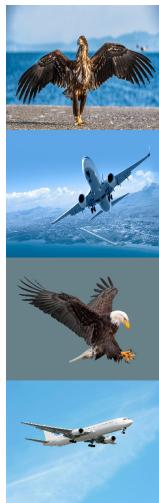

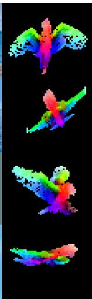  
(a)

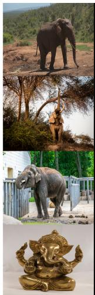

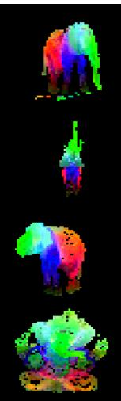  
(b)

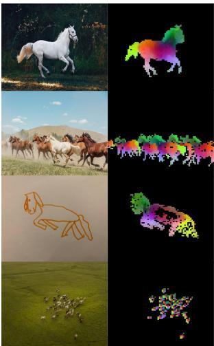  
(c)

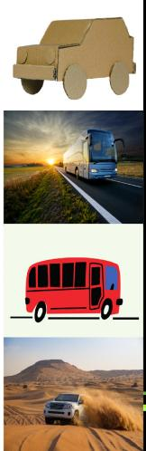  
(d)

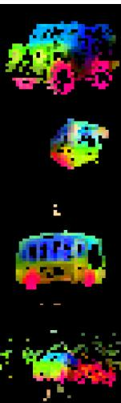  
Figure 1: 前几个 PCA 分量的可视化。我们计算了来自同一列（a、b、c 和 d）图像的图块（patch）之间的 PCA，并展示了它们的前 3 个主成分。每个主成分对应一个不同的颜色通道。尽管姿态、风格甚至物体发生改变，相关图像之间的相同部件依然能够相互匹配。背景通过对第一个 PCA 分量设定阈值来去除。

2021)。这种文本引导的预训练形式限制了图像中可保留的信息，因为图文描述只能粗略表达图像中的丰富信息，而复杂的像素级信息在文本监督下可能无法显现。此外，这些图像编码器需要对齐的图文语料库，因此无法提供与文本编码器相当的灵活性，即仅从原始数据中进行学习的能力。

文本引导预训练的一种替代方案是自监督学习（self-supervised learning）（Caron et al., 2018; Chen et al., 2020; He et al., 2022），它仅从图像本身学习特征。这些方法在概念上更接近语言建模等前置任务（pretext tasks），并且能够捕获图像和像素级别的信息（Caron et al., 2021）。此外，自监督模型输出的特征已被证明展现出多种有用的特性，并赋能了广泛的应用（Amir et al., 2022; Tumanyan et al., 2022; Ofri-Amar et al., 2023; Hamilton et al., 2022）。然而，尽管自监督学习具备学习通用特征的潜力，但其大部分进展都是在小型精选数据集 ImageNet-1k（Russakovsky et al., 2015）上进行预训练的背景下取得的。尽管已有部分工作尝试将这些方法扩展到 ImageNet-1k 之外（Caron et al., 2019; Goyal et al., 2021; 2022a），但它们主要聚焦于未经筛选的数据集，这通常会导致特征质量显著下降。其原因在于缺乏对数据质量和多样性的控制，而这两者对于生成高质量特征至关重要。

在这项工作中，我们探讨了如果在大量精选数据上进行预训练，自监督学习是否具备学习通用视觉特征的潜力。我们重新审视了现有的能够在图像和图像块（patch）级别学习特征的判别式自监督方法，例如 iBOT（Zhou et al., 2022a），并在更大规模数据集的视角下重新考量了它们的部分设计选择。我们的主要技术贡献致力于在模型和数据规模扩展时，稳定并加速判别式自监督学习。这些改进使我们的方法比同类判别式自监督方法快约 2×，且内存需求减少 3×，从而使我们能够利用更大的批次大小进行更长时间的训练。

在预训练数据方面，我们构建了一个自动化流程，用于从庞大的未经筛选的图像集合中过滤并重新平衡数据集。该流程受到 NLP（Wenzek et al., 2020）中所用流程的启发，利用数据相似度代替外部元数据，且无需人工标注。在处理自然场景图像时，一个主要的难点在于重新平衡各类概念，并避免过拟合到少数占主导地位的模态上。在这项工作中，一种朴素的聚类方法在解决这一问题上表现得相当有效。我们收集了一个规模适中但具有多样性的 142M 图像语料库，以验证我们的方法。

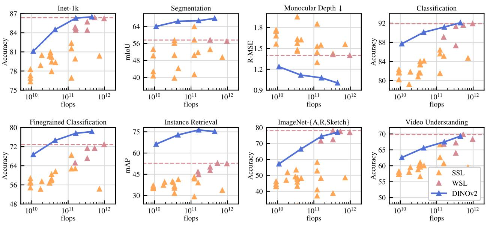  
Figure 2: 参数规模扩展时性能的演变。我们展示了如第 7 节所述的八类视觉任务上的性能，并计算了每类任务的平均指标。特征提取自我们的自监督编码器 DINOv2（深蓝色），我们将其与自监督方法（浅橙色）以及弱监督方法（深粉色）进行了对比。我们将性能最佳的弱监督模型的表现标为水平虚线。我们的模型系列相比先前的自监督学习最先进技术有了显著提升，并达到了与弱监督特征相媲美的性能。详细分析请参见第 7 节。

最后，我们提供了一系列预训练视觉模型，统称为 DINOv2，它们是在我们的数据上使用不同的 Vision Transformers（ViT）（Dosovitskiy et al., 2016）架构训练而成的。我们开源了所有模型以及在任意数据上重新训练 DINOv2 的代码。如图 2 所示，我们在图像和像素两个层面的各种计算机视觉基准上，验证了随着模型规模扩展 DINOv2 的质量。我们的结论是，仅凭自监督预训练就足以学习到具有迁移性的冻结特征，且这些特征能与公开可得的最佳弱监督模型相媲美。

## 2 相关工作

图像内自监督训练。第一类自监督方法侧重于从图像本身构建的前置任务（pretext tasks），即从图像中提取某一信号，并利用图像的其余部分对其进行预测。这一理念随着 Doersch et al. (2015) 的工作而流行起来，他们通过预测给定图像块（patch）的上下文来进行训练。此后引入了许多其他前置任务，例如基于图像重新着色（Zhang et al., 2016）、预测变换（Gidaris et al., 2018）、图像修复（Pathak et al., 2016）或图像块重排序（Noroozi & Favaro, 2016; Misra & Maaten, 2020）。近年来，像 ViT 这样基于图像块的架构的出现，促使人们重新审视将图像修复用于预训练（He et al., 2022; Bao et al., 2021; El-Nouby et al., 2021），并可能将其拓展至特征空间（Assran et al., 2023; Baevski et al., 2022）。尤其值得关注的是，He et al. (2022) 表明掩码自编码器（masked auto-encoder, MAE）学习到的特征在下游任务上进行微调时能带来显著的性能提升。MAE 的这一特性在视频（Tong et al., 2022）、音频（Xu et al., 2022）以及其他模态（Girdhar et al., 2023）中得到了进一步验证。然而，它们的特征需要监督微调，而我们的特征开箱即用就能表现优异。

判别式自监督学习。第二类与我们更为接近的工作，是利用图像或图像组之间的判别信号来学习特征。这类方法起源于早期的深度学习工作（Hadsell et al., 2006），但随着实例分类方法（Dosovitskiy et al., 2016; Bojanowski & Joulin, 2017; Wu et al., 2018）的出现而流行起来。随后，研究者基于实例级目标（Hénaf et al., 2019; He et al., 2020; Chen & He, 2021; Chen et al., 2020; Grill et al., 2020; Caron et al., 2021）或聚类（Caron et al., 2018; Asano et al., 2020; Caron et al., 2020）提出了多项改进。这些方法在像 ImageNet（Russakovsky et al., 2015）这样的标准基准测试中能够提供高性能的冻结特征，但很难扩展到更大的模型规模（Chen et al., 2021）。在本研究中，我们在大型预训练数据集和模型的背景下重新审视了这些方法的训练。特别地，我们基于 Zhou et al. (2022a) 的工作展开，我们发现该方法特别适合扩展规模。

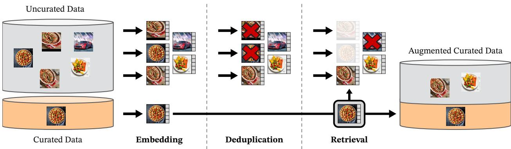  
Figure 3: 我们的数据处理流程概览。首先将来自精选和非精选数据源的图像映射为嵌入向量。随后对非精选图像进行去重，再将其与精选图像进行匹配。最终的组合通过自监督检索系统扩充了初始数据集。

扩展自监督预训练的规模。越来越多的工作开始关注自监督学习在数据和模型规模方面的扩展能力（Caron et al., 2019; Goyal et al., 2019; Tian et al., 2021; Goyal et al., 2022a）。这些工作大多利用海量非精选数据进行无监督模型训练。它们证明了判别式方法能够随数据规模进行扩展，但由于预训练数据质量较差，大部分结果是通过微调特征获得的。尤其值得关注的是，Goyal et al. (2021) 还表明，在有足够预训练数据的情况下，这些方法也能从模型规模的扩展中受益。这一系列工作探讨了自监督方法在任意数据上的有效性，而我们则专注于生成最佳的预训练编码器。

自动数据精选。我们的数据集构建借鉴了图像检索领域（Weinzaepfel et al., 2021; Radenović et al., 2018b; Berman et al., 2019; Douze et al., 2009; Tolias et al., 2016; Revaud et al., 2019）的方法。特别是，利用检索来扩充训练集已在半监督学习的背景下得到了研究（Yalniz et al., 2019）。类似地，其他研究也使用了话题标签（hashtags）或其他元数据（Mahajan et al., 2018; Radford et al., 2021），或预训练视觉编码器（Schuhmann et al., 2021; 2022）来过滤未经精选的数据集。与这些工作不同，我们不使用预训练编码器、元数据或监督信号来过滤图像，而是利用图像之间的视觉相似度。我们的方法受到了文本精选流程（Wenzek et al., 2020）的启发，该流程在 Wikipedia 上训练语言模型，以此来对从非精选源中提取的文本进行评分。

## 3 数据处理

我们通过从庞大的未精选数据池中检索与若干精选数据集中的图像相近的图像，构建了精选的 LVD-142M 数据集。我们在下文介绍数据流程中的主要组成部分，包括精选/未精选数据源、图像去重步骤以及检索系统。如图 Fig. 3 所示，我们的流程不需要任何元数据或文本，直接处理图像。关于我们方法的更多细节，请读者参阅附录 A。

数据源。我们所选用的精选数据集详见附录（Table 15），包括 ImageNet-22k、ImageNet-1k 的训练集切分、Google Landmarks 以及若干细粒度数据集。对于未精选的数据源，我们从一个公开可用的爬取网页数据仓库中收集了一个原始且未经过滤的图像数据集。在该仓库的每个网页中，我们从  标签中提取图像的 URL 链接。我们舍弃了不安全或受域名限制的 URL，并对下载的图像进行了后处理（PCA 哈希去重、NSFW 过滤以及模糊可识别的人脸）。这最终得到了 12 亿（1.2B）张独立图像。

去重。我们对未精选数据应用了 Pizzi et al. (2022) 的副本检测流程，并移除了近似重复的图像。这减少了冗余并增加了图像之间的多样性。我们还移除了与本研究所使用的任何基准测试的测试集或验证集中所包含图像近似重复的样本。

自监督图像检索。我们通过从未整理的数据源中检索与已整理数据源相近的图像，来构建我们的精选预训练数据集。为此，我们首先使用在 ImageNet-22k 上预训练的自监督 ViT-H/16 网络计算图像嵌入，并使用余弦相似度作为图像之间的距离度量。然后，我们对未整理数据进行 k-means 聚类。给定用于检索的查询数据集，如果其足够大，我们为每个查询图像检索 $N$（通常为 4）个最近邻。如果其较小，我们从每个查询图像对应的聚类簇中采样 $M$ 张图像。尽管目视检查似乎表明当 $N$ 远大于 4 时检索质量良好，但这会导致更多的冲突（即某些图像成为多个查询的最近邻检索结果）。我们选择 $N = 4$，因为它在这方面提供了一个很好的权衡。

实现细节。我们流程中的去重和检索阶段依赖 Faiss 库（Johnson et al., 2019）来高效索引并计算最近邻嵌入的批量搜索。特别是，我们充分利用了其对 GPU 加速索引的支持，使用了带有乘积量化编码的倒排文件索引（Jegou et al., 2010）。整个处理过程分布在一个包含 20 个节点的计算集群上，每个节点配备 8 块 V100-32GB GPU，生成 LVD-142M 数据集耗时不到两天。

## 4 判别式自监督预训练

我们采用一种判别式自监督方法来学习特征，该方法可以看作是 DINO 和 iBOT 损失与 SwAV（Caron et al., 2020）中心化机制的结合。我们还添加了一个用于分散特征的正则化项，以及一个简短的高分辨率训练阶段。我们在下文中简要介绍这些方法，更多细节可以在相关论文或我们的开源代码中找到。

• 图像级目标（Caron et al., 2021）。我们考虑从学生网络和教师网络提取的特征之间的交叉熵损失。这两种特征均来自 ViT 的类别标记（class token），是从同一图像的不同裁剪区域中获取的。我们将学生类标记输入学生 DINO 头部（head）。该头部是一个输出得分向量的 MLP 模型，我们称之为“原型得分”（prototype scores）。然后我们应用 softmax 得到 $p _ { s }$ 。类似地，我们将教师 DINO 头部应用于教师类标记以获得教师原型得分。接着我们应用 softmax 以及基于移动平均的中心化（或如下文详述的 Sinkhorn-Knopp 中心化）以得到 $p _ { t }$ 。DINO 损失项对应于：

$$
\mathcal {L} _ {D I N O} = - \sum p _ {t} \log p _ {s}
$$

我们学习学生网络的参数，并通过历史迭代的指数移动平均来构建教师头部（He et al., 2020）。

• Patch 级别目标（Zhou et al., 2022a）。我们随机遮蔽（mask）给定给 student 的部分输入 patch，但不遮蔽 teacher 的输入。然后，我们将 student iBOT head 应用于 student 的 mask token。类似地，我们将 teacher iBOT head 应用于与 student 中被遮蔽 patch 对应的（可见的）teacher patch token。接着，我们像前面一样应用 softmax 和居中（centering）步骤，得到 iBOT 损失项：

$$
\mathcal {L} _ {i B O T} = - \sum_ {i} p _ {t i} \log p _ {s i}
$$

，其中 $i$ 是被遮蔽 token 的 patch 索引。与上述类似，我们学习 student 的参数，并通过指数移动平均（exponential moving average）构建 teacher head。

• 解绑两个目标之间的 head 权重。DINO 和 iBOT 损失都使用可学习的 MLP 投影 head。它被应用于输出 token，并在其之上计算损失。在 Zhou et al. (2022a) 中，一项消融实验表明在 DINO 和 iBOT head 之间共享参数可以带来更好的性能。但在大规模训练下，我们观察到了相反的结论，因此我们在所有实验中都使用两个独立的 head。

• Sinkhorn-Knopp 居中（Caron et al., 2020）。Ruan et al. (2023) 建议将 DINO 和 iBOT 的 teacher softmax-centering 步骤替换为 SwAV（Caron et al., 2020）的 Sinkhorn-Knopp（SK）批归一化。我们运行 Sinkhorn-Knopp 算法步骤 3 次迭代。对于 student，我们应用 softmax 归一化。

• KoLeo 正则化项（Sablayrolles et al., 2019）。KoLeo 正则化项源自 Kozachenko-Leonenko 微分熵估计器（参见 Beirlant et al. (1997)；Delattre & Fournier (2017)），旨在促进批次内特征的均匀分布。给定一组包含 $n$ 个向量的集合 $( x _ { 1 } , \ldots , x _ { n } )$，其定义为

$$
\mathcal {L} _ {\mathrm{koleo}} = - \frac {1}{n} \sum_ {i = 1} ^ {n} \log (d _ {n, i}),
$$

其中 $\begin{array} { r } { d _ { n , i } = \operatorname* { m i n } _ { j \neq i } \| x _ { i } - x _ { j } \| } \end{array}$ 是 $x _ { i }$ 与批次内任何其他点之间的最小距离。在计算该正则化项之前，我们还会对特征进行 ℓ2 归一化。

• 调整分辨率（Touvron et al., 2019）。提高图像分辨率对于分割或检测等像素级下游任务至关重要，因为小目标在低分辨率下会消失。然而，高分辨率训练非常耗费时间和内存，因此我们改为在预训练结束前的较短时间内将图像分辨率提高到 518 × 518。这也类似于 Likhomanenko et al. (2021) 的 UniViT 训练以及 Beyer et al. (2023) 的 FlexiViT 训练。

## 5 高效实现

我们考虑了几项改进，以便在更大规模上训练模型。我们在 A100 GPU 上使用 PyTorch 2.0 训练模型。代码和预训练模型已在 Apache 2.0 许可证下开源 1。我们模型的详细信息见附录 Table 17。在相同硬件条件下，与 iBOT 实现相比，DINOv2 代码的运行速度提升了约 2 倍，且仅占用 1/3 的内存。

快速且内存高效的注意力机制（Fast and memory-efficient attention）。我们实现了自己的 FlashAttention（Dao et al., 2022）版本，以优化自注意力层的内存占用和运行速度。在所考虑的所有情况下，我们的版本均能与原版相媲美或表现更优，同时支持了更多的使用场景和硬件。由于 GPU 硬件的特性，当每个头的嵌入维度是 64 的倍数时效率最高，而当总嵌入维度是 256 的倍数时，矩阵运算效率更佳。因此，为了最大化计算效率，我们的 ViT-g 架构与 Zhai et al. (2022) 提出的架构略有不同：我们采用了包含 24 个头的 1536 嵌入维度（64 维/头），而不是包含 16 个头的 1408 维度（88 维/头）。我们的实验表明这在最终准确率上没有显著差异，我们的 ViT-g 主干网络包含 1.1B 参数。

序列打包（Sequence packing）。DINO 算法需要同时对大裁剪区域（分辨率为 224）和小裁剪区域（分辨率为 98）进行前向传播。当被分割成 patch 时，这两组区域表现为不同长度的 token 序列，无法一起进行前向传播。为了加速训练，我们采用了一种源自自然语言处理（NLP）（Krell et al., 2022）的技巧，称为“序列打包”（sequence packing）。其原理很简单：我们将必须通过 Transformer 进行前向传播的各个序列拼接为一个长序列，并像往常一样将该序列传入 Transformer 块。不过，在注意力层中，自注意力矩阵上会应用一个块对角掩码（block-diagonal mask），以阻止不同序列之间相互计算注意力。通过这种方式，该前向传播在逻辑上完全等价于分别对每个序列进行前向传播。与以往实现中分别进行前向和反向传播相比，这一技巧为我们带来了显著的计算效率提升。我们实验设置中的底层组件可在 xFormers 库 2（Lefaudeux et al. (2022)）中获取。

高效随机深度（Efficient stochastic depth）。我们实现了随机深度（Huang et al., 2016）的改进版本，该版本直接跳过被丢弃残差项的计算，而不是对计算结果进行掩码处理。得益于特定的融合算子（fused kernels），这能够以大致与丢弃率相等的比例节省内存和计算量。在较高丢弃率下（本工作中 $d = 40\%$），这显著提高了计算效率并降低了内存占用。具体实现方式为：沿 batch 维度随机打乱 $B$ 个样本，并截取前 $(1 - d) \times B$ 个样本用于该模块内的计算。

完全分片数据并行（Fully-Sharded Data Parallel，FSDP）。使用 AdamW 优化器最小化我们的目标函数需要 4 份 float32 精度的模型副本——学生网络（student）、教师网络（teacher）、优化器一阶动量和优化器二阶动量。对于像我们的 ViT-g 这样拥有十亿参数的模型，这总共需要 16 GB 的显存。为了减少每张 GPU 的显存占用，我们使用 FSDP 的 PyTorch 实现将模型副本拆分到多个 GPU 上，即在 GPU 之间对这 16 GB 进行分片（sharding）。因此，模型大小不再受限于单张 GPU 的显存，而是受限于跨计算节点的 GPU 显存总和。PyTorch 的 FSDP 实现带来了第二个优势，即节省跨 GPU 的通信成本：优化器所需的权重分片以 float32 精度存储，但骨干网络（backbone）的广播权重和规约（reduce）梯度是以 float16 精度完成的（MLP 头的梯度以 float32 进行规约，以避免训练不稳定）。与在其他自监督预训练方法（Caron et al., 2021; Zhou et al., 2022a）中使用的 DistributedDataParallel (DDP) 里的 float32 梯度 all-reduce 操作相比，这减少了大约 50% 的通信成本。结果是，在扩展 GPU 节点数量时，该训练过程比带有 float16 autocast 的 DDP 扩展得更高效。总体而言，在我们遇到的几乎所有情况下，PyTorch-FSDP 混合精度都优于带有 autocast 的 DDP。

模型蒸馏（Model distillation）。我们对训练循环的大多数技术改进旨在改善大模型在海量数据上的训练。对于较小的模型，我们从最大的模型 ViT-g 中进行蒸馏，而不是从头开始训练它们。知识蒸馏（Knowledge distillation，Hinton et al., 2014）旨在通过最小化给定输入集下两个模型输出之间的某种距离，利用较小的模型来复现大模型的输出。由于我们的目标函数本身就是一种从教师网络到学生网络的蒸馏形式，我们利用了相同的训练循环，但有几点例外：我们使用更大的模型作为冻结的教师模型，保留一份学生模型的备用 EMA 作为我们的最终模型，移除掩码（masking）和随机深度（stochastic depth），并将 iBOT 损失应用于两个全局裁剪区域（global crops）。在我们的消融实验中，我们观察到这种方法比从头训练取得了更好的性能，即使对于 ViT-L 也是如此。我们的蒸馏方法最终与 Duval et al. (2023) 所描述的方法很接近，不同之处在于我们没有修改用于蒸馏的损失项，并且评估的是学生模型的 EMA。

## 6 消融实验

我们提出了一系列消融实验，以实证验证我们流程中不同组件的有效性：第 4 节中描述的技术改进、预训练数据以及模型蒸馏的影响。我们考虑了第 7 节中描述的各种下游任务。

## 6.1 改进的训练配方

我们的方法通过将 iBOT 方法与第 4 节中描述的若干现有组件相结合，对其进行了改进。为了评估这些组件的重要性，我们在基线 iBOT 模型上逐步添加组件并训练了多个模型。我们在 Table 1 中报告了在 ImageNet-1k 验证集上使用 k-NN 和线性探测（linear probe）的 Top-1 准确率。通常，我们观察到每个组件都能提升 k-NN 或线性探测的性能，在大多数情况下甚至能同时提升两者的性能。根据我们的经验，只有 LayerScale 和随机深度（Stochastic Depth）会导致线性探测性能下降，但能显著提高训练稳定性。

<table><tr><td></td><td>INet-1k k-NN</td><td>INet-1k 线性</td></tr><tr><td>iBOT</td><td>72.9</td><td>82.3</td></tr><tr><td>+（我们的复现）</td><td>74.5 ↑ 1.6</td><td>83.2 ↑ 0.9</td></tr><tr><td>+LayerScale, 随机深度</td><td>75.4 ↑ 0.9</td><td>82.0 ↓ 1.2</td></tr><tr><td>+128k 原型</td><td>76.6 ↑ 1.2</td><td>81.9 ↓ 0.1</td></tr><tr><td>+KoLeo</td><td>78.9 ↑ 2.3</td><td>82.5 ↑ 0.6</td></tr><tr><td>+SwiGLU FFN</td><td>78.7 ↓ 0.2</td><td>83.1 ↑ 0.6</td></tr><tr><td>+Patch 大小 14</td><td>78.9 ↑ 0.2</td><td>83.5 ↑ 0.4</td></tr><tr><td>+教师动量 0.994</td><td>79.4 ↑ 0.5</td><td>83.6 ↑ 0.1</td></tr><tr><td>+调整预热调度策略</td><td>80.5 ↑ 1.1</td><td>83.8 ↑ 0.2</td></tr><tr><td>+批次大小 3k</td><td>81.7 ↑ 1.2</td><td>84.7 ↑ 0.9</td></tr><tr><td>+Sinkhorn-Knopp</td><td>81.7 =</td><td>84.7 =</td></tr><tr><td>+解绑投影头 = DINOv2</td><td>82.0 ↑ 0.3</td><td>84.5 ↓ 0.2</td></tr></table>

Table 1: iBOT 与 DINOv2 之间训练差异的消融研究。我们针对 k-NN 性能进行优化，因为根据我们的经验，线性探测性能受 k-NN 性能的下界约束。某些改动（如 LayerScale 和较高的随机深度（比率=0.4））会导致线性探测性能下降，但其优势在于通过避免训练过程中的 NaN 损失值来提高训练稳定性（Touvron et al., 2022）。总体而言，这些修改使得后续一系列改进的加入成为可能。实验是在 ImageNet-22k 上使用 ViT-Large 架构进行的。

<table><tr><td>训练数据</td><td>INet-1k</td><td>Im-A</td><td>ADE-20k</td><td>Oxford-M</td><td>iNat2018</td><td>iNat2021</td><td>Places205</td></tr><tr><td>INet-22k</td><td>85.9</td><td>73.5</td><td>46.6</td><td>62.5</td><td>81.1</td><td>85.6</td><td>67.0</td></tr><tr><td>INet-22k \ INet-1k</td><td>85.3</td><td>70.3</td><td>46.2</td><td>58.7</td><td>80.1</td><td>85.1</td><td>66.5</td></tr><tr><td>未筛选数据</td><td>83.3</td><td>59.4</td><td>48.5</td><td>54.3</td><td>68.0</td><td>76.4</td><td>67.2</td></tr><tr><td>LVD-142M</td><td>85.8</td><td>73.9</td><td>47.7</td><td>64.6</td><td>82.3</td><td>86.4</td><td>67.6</td></tr></table>

Table 2：预训练数据来源的消融实验。我们将 iBOT 中使用的 INet-22k 数据集与我们构建的数据集 LVD-142M 进行了比较。每个模型均在未进行高分辨率适配的情况下训练相同的迭代次数（少于我们最终运行的迭代次数）。在 LVD-142M 上进行预训练在保持 INet-1k 性能的同时，使模型在其他领域表现更佳。

## 6.2 预训练数据来源

特征的质量与预训练数据的质量直接相关。在本实验中，我们探究了 LVD-142M 相比于常用的预训练数据集 ImageNet-22k 或直接使用未经清洗的原始数据所带来的影响。对于未经清洗的数据集，我们从与 LVD-142M 相同的数据源中随机抽取 1.42 亿张图像。我们在每个数据集上以相同的迭代次数训练一个 ViT-g/14。为了实验的完整性，我们还纳入了通过移除 ImageNet-1k 同义词集所得到的 ImageNet-22k 变体（INet-22k \ INet-1k）。我们在 Table 2 中报告了比较结果。

最显著的观察结果是，在经过清洗的图像集上进行训练在大多数基准测试中均优于在未经清洗的数据上进行训练。这证实了即使在自监督预训练（self-supervised pretraining）的情况下，进行数据清洗也大有裨益。与在 ImageNet-22k 上训练的模型相比，在 LVD-142M 上的训练除了 ImageNet-1k 之外在所有基准测试上均表现更优。这证实了在更多样化的图像集上进行训练可以提升未被 ImageNet-22k 覆盖领域的特征质量。我们还看到，在经过我们清洗的数据上进行训练提升了在清洗过程中未使用的领域（INaturalist 2018、2021 和 Places205）上的性能，证明了规模与多样性可以使未见领域受益。

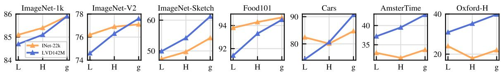

Figure 4：模型规模与数据规模。针对两种不同的预训练数据集——ImageNet-22k（1400 万张图像）和 LVD-142M（1.42 亿张图像），性能随模型大小变化的演变过程。在大多数基准测试中，在 LVD-142M 上训练的 $\mathrm { V i T - g }$ 均优于在 ImageNet-22k 上训练的 $\mathrm { V i T - g }$。

<table><tr><td>KoLeo</td><td>INet-1k</td><td>Im-A</td><td>ADE-20k</td><td>Oxford-M</td></tr><tr><td>×</td><td>85.3</td><td>70.6</td><td>47.2</td><td>55.6</td></tr><tr><td>√</td><td>85.8</td><td>72.8</td><td>47.1</td><td>63.9</td></tr></table>

(a) KoLeo 损失

<table><tr><td>MIM</td><td>INet-1k</td><td>Im-A</td><td>ADE-20k</td><td>Oxford-M</td></tr><tr><td>×</td><td>85.3</td><td>72.0</td><td>44.2</td><td>64.3</td></tr><tr><td>√</td><td>85.8</td><td>72.8</td><td>47.1</td><td>63.9</td></tr></table>

(b) iBOT 中的 MIM 目标  
Table 3: (a) KoLeo 损失项的效果。(b) iBOT 掩码图像建模（MIM）损失项的效果。评估在 ImageNet-{1k,A}（线性探测分类，准确率 %）、ADE-20k（线性层分割，mIoU）和 Oxford-M（图像检索，mAP）上进行。每个模型都在相同的迭代次数下进行训练，该次数小于我们最终运行的迭代次数。KoLeo 损失项改善了最近邻搜索任务（例如检索），而 MIM 损失改善了 patch 级别的任务（例如分割）。

总体而言，该消融实验的结论是，我们的数据集提供了不同类型图像的良好平衡，从而实现了最佳的综合性能。

## 6.3 模型大小与数据

我们在 Fig. 4 中量化了数据规模随模型大小扩展的重要性。随着模型规模的增长，在 LVD-142M 上进行训练比在 ImageNet-22k 上训练更加有益。例如，在 LVD-142M 上训练的 ViT-g 在 ImageNet-1k 上的性能与在 ImageNet-22k 上训练的模型相当，同时在其他基准测试上显著优于后者。

## 6.4 损失组成部分

我们在 Sec. 6.1 中通过递增添加所提出的技术改进对其进行了验证。本节从表现最好的模型出发，分析消融特定损失项时所观察到的性能下降。我们消融了 KoLeo 损失的重要性以及掩码图像建模项的影响。对于两者，我们均报告了使用线性分类器在 ImageNet-1k 上的性能、使用线性分类器在 ADE-20k 上的分割性能，以及在 Oxford-M 上的最近邻图像检索性能。Table 3a 展示了使用 KoLeo 损失的影响。我们可以看到，实例检索性能提升了 8% 以上，证实了该项有助于在输出空间中分散特征。与此同时，其他指标并未受到这种正则化的负面影响。在 Table 3b 中，我们展示了使用来自 iBOT 的掩码图像建模项的影响。该项对稠密预测任务至关重要，带来了近 3% 的性能提升。

## 6.5 知识蒸馏的影响

对于较小的架构，我们蒸馏较大的模型而不是从头开始训练它们。我们使用 Sec. 5 中描述的蒸馏过程。我们在 Fig. 5 中通过在 12 个基准测试上比较从头训练的 $\mathrm { V i T - L } / 1 4$ 与从 ViT-g/14 蒸馏得到的模型来评估该方法的有效性。我们还报告了用于蒸馏的 ViT-g/14 的性能作为上限基准（topline）。蒸馏后的模型在所有 12 个基准测试上均优于从头训练的模型，验证了我们针对小模型的预训练方法。

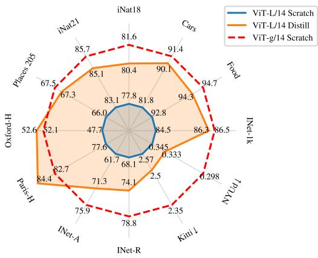  
(a) 在各项独立指标上的比较

<table><tr><td>架构</td><td>方法</td><td>INet-1k</td><td>分割</td><td>深度↓</td><td>分类</td></tr><tr><td>ViT-g/14</td><td>从头训练</td><td>86.5</td><td>73.4</td><td>1.00</td><td>92.1</td></tr><tr><td>ViT-L/14</td><td>从头训练</td><td>84.5</td><td>72.2</td><td>1.10</td><td>90.2</td></tr><tr><td>ViT-L/14</td><td>蒸馏</td><td>86.3</td><td>73.3</td><td>1.08</td><td>91.2</td></tr><tr><td>架构</td><td>方法</td><td>细粒度</td><td>检索</td><td>ARSketch</td><td>视频</td></tr><tr><td>ViT-g/14</td><td>从头训练</td><td>78.3</td><td>75.2</td><td>77.0</td><td>69.3</td></tr><tr><td>ViT-L/14</td><td>从头训练</td><td>75.8</td><td>71.3</td><td>69.5</td><td>67.3</td></tr><tr><td>ViT-L/14</td><td>蒸馏</td><td>77.6</td><td>76.3</td><td>74.5</td><td>67.5</td></tr></table>

(b) 8个视觉任务的平均指标

Figure 5: 知识蒸馏的有效性。从头训练的 ViT-L 与从使用 ViT-g/14 的 DINOv2 中蒸馏得到的 ViT-L 的比较。作为参考，我们还报告了 $\mathrm { V i T - g / 1 4 }$ 教师模型的性能。我们表明，从冻结的 ViT-g 蒸馏出的 ViT-L 模型在所有基准测试中均优于从头训练的相同模型，有时甚至超越了蒸馏目标模型。  
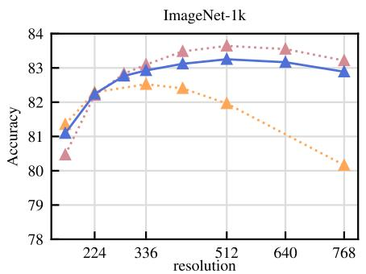

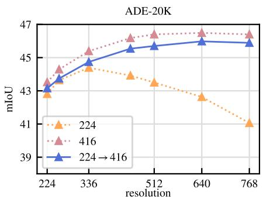  
Figure 6: 分辨率的作用。在 ImageNet-1k 上以固定分辨率（“224”和“416”）训练，或先在 224 下训练后在 416 下短时间训练 $( ^ { 6 6 } 2 2 4 \to 4 1 6 ^ { 3 3 } )$ 的 ViT-L/16 的性能。我们在不同分辨率下的冻结特征之上训练线性分类器，并报告了 ImageNet 上的 Top-1 准确率以及 ADE-20k 上的 mIoU。我们观察到，短时间进行高分辨率 SSL（自监督学习）训练，能够以全流程高分辨率训练成本的一小部分，实现与其接近的表现和结果。

## 6.6 分辨率的影响

我们衡量了在预训练期间改变分辨率对图像级和 patch 级特征性能的影响。我们考虑了使用固定分辨率 $2 2 4 \times 2 2 4$ 或 $4 1 6 \times 4 1 6$ 从头开始训练的模型，以及一个在 224 × 224 分辨率下从头开始训练、随后在 416 × 416 分辨率下继续训练 10k 次迭代的模型。高分辨率训练计算密集，因此我们在一个较小的配置上进行消融实验：在 ImageNet1k 上训练的 ViT-L/16。在 Fig. 6 中，我们报告了在不同分辨率下评估的 ImageNet-1k 和 ADE 20k 上的线性探测（linear probe）性能。在高分辨率图像上训练的模型在各个分辨率下的表现均最佳，但这带来了高昂的成本：在 416 分辨率下训练的计算量大约是在 224 分辨率下训练的 3 倍。另一方面，仅在训练结束时以高分辨率训练 10k 次迭代的效果几乎一样好，而且只需极小一部分的计算量。因此，我们在训练结束时加入了这一步骤，而不是从头开始进行高分辨率训练。

## 7 结果

在本节中，我们展示了我们的模型在诸多图像理解任务上的实证评估结果。我们在类别和实例级识别、语义分割、单目深度估计以及动作识别任务上，对全局和局部图像表征进行了评估。我们在附录 C 中详细列出了基准测试列表。本次评估的目的有两个。首先，我们展示了我们的自监督特征以极大的优势超越了当前的最新水平（state of the art）。其次，我们表明它们在相当多的任务上达到或超过了弱监督特征的性能。

基线（Baselines）。在我们的对比中，我们使用两类模型作为基线。我们与公开可用的性能最佳的自监督模型进行比较。首先，我们对 MAE (He et al., 2022)、DINO (Caron et al., 2021)、SEERv2 (Goyal et al., 2022a)、MSN (Assran et al., 2022)、EsViT (Li et al., 2022a)、Mugs (Zhou et al., 2022b) 和 iBOT (Zhou et al., 2022a) 运行了评估。当某种方法提出了多种架构变体时，我们报告在 ImageNet-1k 上取得最佳 Top-1 准确率的变体结果。其次，我们报告了开源弱监督模型的性能，如 CLIP (Radford et al., 2021)、OpenCLIP (Ilharco et al., 2021; Cherti et al., 2023) 和 SWAG (Singh et al., 2022)。在 ImageNet-1k 上评估模型时，我们报告上述每种方法的性能。对于所有其他评估，我们报告 SSL 模型中表现最好的四个模型。此外，作为参考，我们还报告了弱监督模型中表现最佳的 OpenCLIP-G。

## 7.1 ImageNet 分类

作为第一项评估，我们在 ImageNet-1k 分类数据集上探究了模型生成的整体图像表征的质量。我们通过在冻结的骨干网络（frozen backbone）上训练一个简单的分类器来评估特征质量，并且不对骨干网络权重进行微调（finetuning）。遵循以往的研究，为了简单起见并确保评估的可复现性，我们使用了线性模型，尽管各类别之间可能并非线性可分。由于大多数 SSL（自监督学习）方法在开发时都将 ImageNet-1k 验证集表现作为调试信号，因此我们还报告了在 ImageNet-ReaL 和 ImageNet-V2 上的 Top-1 准确率。为了报告这些额外的验证性能，对于所有模型，我们均使用我们自己的代码运行评估。在 Table 4 中，我们将我们的冻结特征与公开可用的最佳 SSL 特征进行了对比，无论其采用何种架构或预训练数据。我们可以看到，在线性评估中，本研究提出的组件相比先前的 SOTA（在 ImageNet-22k 上训练的 iBOT ViT-L/16）取得了极其显著的提升（+4.2%）。与此同时，我们还发现我们的方法在替代测试集上的性能增幅更大，这表明其具有更强的泛化能力。我们在附录 B.3 中详细介绍了线性评估的具体细节。

我们距离弱监督模型还有多远？我们还希望验证我们的特征与最先进的开源弱监督模型相比是否具有竞争力。为此，我们在 ImageNet-1k 上采用线性评估，与包含多种架构变体的三种现成方法进行了对比。对于所有模型，在确保我们的数据与技术报告及论文中报告的数据一致后，我们使用自己的代码运行了线性评估。我们在 Table 4 中展示了该评估的结果。我们可以看到，我们的骨干网络性能超越了采用 ViT-G/14 架构的 OpenCLIP（+0.3%）以及采用 ViT-g/14 的 EVA-CLIP（+0.1%）。与此同时，我们还观察到我们在 ImageNet-V2 测试集上的性能明显更优（相较于 EVA-CLIP 高出 +1.1%），表明其具备更出色的泛化能力。在本节的后续部分中，我们将 OpenCLIP-G 作为弱监督模型的参考基准进行报告。

我们可以微调编码器吗？我们探讨了模型生成高质量冻结特征的能力是否会在特定数据集上进行有监督微调时影响其性能。尽管这并非本文的核心内容，但该实验可以表明我们是否无意中使模型专门偏向了冻结特征的线性评估设置。为了进行这一合理性检查（sanity check），我们直接采用了 Touvron et al. (2022) 的微调流程，并未调整超参数。在 Table 5 中，我们展示了当对主干网络（backbone）进行微调时，ImageNet-1k 验证集上的 Top-1 准确率提升了超过 +2%。在使用分辨率为 224 和 448 的模型时均是如此。通过调整微调的超参数还可以获得进一步的增益，但这超出了本次合理性检查的目标。尽管如此，我们微调后的最佳性能（88.9%）仅比绝对的最新水平（−2.2%）低了几个百分点

<table><tr><td rowspan="2">方法</td><td rowspan="2">架构</td><td rowspan="2">数据</td><td rowspan="2">文本监督</td><td>kNN</td><td colspan="3">线性</td></tr><tr><td>val</td><td>val</td><td>ReaL</td><td>V2</td></tr><tr><td colspan="8">弱监督</td></tr><tr><td>CLIP</td><td>ViT-L/14</td><td>WIT-400M</td><td>√</td><td>79.8</td><td>84.3</td><td>88.1</td><td>75.3</td></tr><tr><td>CLIP</td><td> $ViT-L/14_{336}$ </td><td>WIT-400M</td><td>√</td><td>80.5</td><td>85.3</td><td>88.8</td><td>75.8</td></tr><tr><td>SWAG</td><td>ViT-H/14</td><td>IG3.6B</td><td>√</td><td>82.6</td><td>85.7</td><td>88.7</td><td>77.6</td></tr><tr><td>OpenCLIP</td><td>ViT-H/14</td><td>LAION-2B</td><td>√</td><td>81.7</td><td>84.4</td><td>88.4</td><td>75.5</td></tr><tr><td>OpenCLIP</td><td>ViT-G/14</td><td>LAION-2B</td><td>√</td><td>83.2</td><td>86.2</td><td>89.4</td><td>77.2</td></tr><tr><td>EVA-CLIP</td><td>ViT-g/14</td><td>custom*</td><td>√</td><td>83.5</td><td>86.4</td><td>89.3</td><td>77.4</td></tr><tr><td colspan="8">自监督</td></tr><tr><td>MAE</td><td>ViT-H/14</td><td>INet-1k</td><td>×</td><td>49.4</td><td>76.6</td><td>83.3</td><td>64.8</td></tr><tr><td>DINO</td><td>ViT-S/8</td><td>INet-1k</td><td>×</td><td>78.6</td><td>79.2</td><td>85.5</td><td>68.2</td></tr><tr><td>SEERv2</td><td>RG10B</td><td>IG2B</td><td>×</td><td>-</td><td>79.8</td><td>-</td><td>-</td></tr><tr><td>MSN</td><td>ViT-L/7</td><td>INet-1k</td><td>×</td><td>79.2</td><td>80.7</td><td>86.0</td><td>69.7</td></tr><tr><td>EsViT</td><td>Swin-B/W=14</td><td>INet-1k</td><td>×</td><td>79.4</td><td>81.3</td><td>87.0</td><td>70.4</td></tr><tr><td>Mugs</td><td>ViT-L/16</td><td>INet-1k</td><td>×</td><td>80.2</td><td>82.1</td><td>86.9</td><td>70.8</td></tr><tr><td>iBOT</td><td>ViT-L/16</td><td>INet-22k</td><td>×</td><td>72.9</td><td>82.3</td><td>87.5</td><td>72.4</td></tr><tr><td rowspan="4">DINOv2</td><td>ViT-S/14</td><td>LVD-142M</td><td>×</td><td>79.0</td><td>81.1</td><td>86.6</td><td>70.9</td></tr><tr><td>ViT-B/14</td><td>LVD-142M</td><td>×</td><td>82.1</td><td>84.5</td><td>88.3</td><td>75.1</td></tr><tr><td>ViT-L/14</td><td>LVD-142M</td><td>×</td><td>83.5</td><td>86.3</td><td>89.5</td><td>78.0</td></tr><tr><td>ViT-g/14</td><td>LVD-142M</td><td>×</td><td>83.5</td><td>86.5</td><td>89.6</td><td>78.4</td></tr></table>

Table 4: 冻结预训练特征在 ImageNet-1k 上的线性评估。我们报告了在公开或私有数据上训练、有或无文本监督（text sup.）的公开可用模型在验证集上的 Top-1 准确率。作为参考，我们还报告了在验证集上的 kNN 性能。我们在所有可能的架构（Arch.）间进行比较，除另有说明外，分辨率均为 224 × 224。用于训练 EVA-CLIP 的数据集为自定义混合数据，详见原论文（Fang et al., 2023）。

水平（91.1%），由 Chen et al. (2023a) 取得。由于 DINOv2 提取的特征在线性探测和微调设置下都非常强大，因此我们方法的一个显著特性是微调是可选的。

<table><tr><td>架构</td><td>分辨率</td><td>线性</td><td>微调</td><td> $\Delta$ </td></tr><tr><td rowspan="2">ViT-g/14</td><td>224</td><td>86.5</td><td>88.5</td><td>+2.0</td></tr><tr><td>448</td><td>86.7</td><td>88.9</td><td>+2.2</td></tr></table>

Table 5: ImageNet-1k 上的监督微调。我们使用 Touvron et al. (2022) 的流程，在 224 × 224 或 $4 4 8 \times 4 4 8$ 分辨率下对 ImageNet-1k 上的编码器进行微调。我们将其与线性探测获得的准确率进行比较，观察到微调带来的提升幅度较小：这表明 DINOv2 特征开箱即用便具有出色的性能。

鲁棒性分析。为了补充我们的研究并探究特征的泛化能力，我们在域泛化基准上评估了使用线性分类头训练的 ImageNet-1k 模型。我们使用如上所述性能最佳的线性分类器，并直接在这些基准上运行推理。请注意，文献中的大多数结果都是通过在 ImageNet-1k 上端到端微调的模型获得的。我们在 Table 6 中展示了该实验的结果。与最先进的 SSL（自监督学习）方法相比，我们的模型表现出显著更强的鲁棒性（与 iBOT 相比，在 A (Hendrycks et al., 2021b) 上提高 +29.6%，在 R (Hendrycks et al., 2021a) 上提高 +22.1%，在 Sketch (Wang et al., 2019) 上提高 +23.0%）。我们的模型在 ImageNet-A 上也优于最佳的弱监督模型，但在 R 和 Sketch 上稍有落后。

<table><tr><td>方法</td><td>架构</td><td>数据</td><td>Im-A</td><td>Im-R</td><td>Im-C↓</td><td>Sketch</td></tr><tr><td>OpenCLIP</td><td>ViT-G/14</td><td>LAION-2B</td><td>63.8</td><td>87.8</td><td>45.3</td><td>66.4</td></tr><tr><td>MAE</td><td>ViT-H/14</td><td>INet-1k</td><td>10.2</td><td>34.4</td><td>61.4</td><td>21.9</td></tr><tr><td>DINO</td><td>ViT-B/8</td><td>INet-1k</td><td>23.9</td><td>37.0</td><td>56.6</td><td>25.5</td></tr><tr><td>iBOT</td><td>ViT-L/16</td><td>INet-22k</td><td>41.5</td><td>51.0</td><td>43.9</td><td>38.5</td></tr><tr><td rowspan="4">DINOv2</td><td>ViT-S/14</td><td>LVD-142M</td><td>33.5</td><td>53.7</td><td>54.4</td><td>41.2</td></tr><tr><td>ViT-B/14</td><td>LVD-142M</td><td>55.1</td><td>63.3</td><td>42.7</td><td>50.6</td></tr><tr><td>ViT-L/14</td><td>LVD-142M</td><td>71.3</td><td>74.4</td><td>31.5</td><td>59.3</td></tr><tr><td>ViT-g/14</td><td>LVD-142M</td><td>75.9</td><td>78.8</td><td>28.2</td><td>62.5</td></tr></table>

Table 6: 在 224 分辨率下基于冻结特征使用线性探测的域泛化结果。除 Im-C 外，所有基准的数值都是越高越好。

<table><tr><td rowspan="2">特征</td><td rowspan="2">架构</td><td colspan="3">图像分类</td><td colspan="3">视频分类</td></tr><tr><td>iNat2018</td><td>iNat2021</td><td>Places205</td><td>K400</td><td>UCF-101</td><td>SSv2</td></tr><tr><td>OpenCLIP</td><td>ViT-G/14</td><td>73.0</td><td>76.0</td><td>69.8</td><td>78.3</td><td>90.7</td><td>35.8</td></tr><tr><td>MAE</td><td>ViT-H/14</td><td>31.0</td><td>32.3</td><td>52.4</td><td>54.2</td><td>70.6</td><td>29.2</td></tr><tr><td>DINO</td><td>ViT-B/8</td><td>59.6</td><td>68.3</td><td>60.4</td><td>64.5</td><td>85.0</td><td>32.6</td></tr><tr><td>iBOT</td><td>ViT-L/16</td><td>66.3</td><td>74.6</td><td>64.4</td><td>72.6</td><td>88.6</td><td>38.7</td></tr><tr><td rowspan="4">DINOv2</td><td>ViT-S/14</td><td>69.0</td><td>74.2</td><td>62.9</td><td>67.8</td><td>87.0</td><td>33.1</td></tr><tr><td>ViT-B/14</td><td>76.4</td><td>81.1</td><td>66.2</td><td>73.2</td><td>89.1</td><td>34.4</td></tr><tr><td>ViT-L/14</td><td>80.4</td><td>85.1</td><td>67.3</td><td>76.3</td><td>90.5</td><td>35.6</td></tr><tr><td>ViT-g/14</td><td>81.6</td><td>85.7</td><td>67.5</td><td>78.4</td><td>91.2</td><td>38.3</td></tr></table>

Table 7: 在其他图像和视频分类任务上的线性评估。图像基准包含大量关于物体或场景的细粒度样本。视频基准涵盖动作分类和人-物交互。所有特征均被冻结，并在其之上添加线性探测器。

## 7.2 附加图像与视频分类基准

在本节中，我们研究特征在下游分类基准上的泛化能力。在此背景下，我们考虑了两组评估。一方面，我们使用大型细粒度数据集，如 iNaturalist 和 Places205。另一方面，我们使用最初在 SimCLR (Chen et al., 2020) 中提出的 12 个图像分类任务。对于 iNaturalist 2018、iNaturalist 2021 和 Places205，我们如 7.1 节所述，结合数据增强训练了一个线性分类器。我们在 Table 7 中汇报了这三个数据集的 top-1 准确率。有趣的是，我们的模型在 iNaturalist 的两个版本上均显著超越了 OpenCLIP ViT-G/14（2018 和 2021 版本分别提升了 +8.6% 和 +9.7%），而在 Places 205 上略微落后（−2.3%）。

在第二组评估中，尽管我们的特征并非在视频上训练得到，我们依然衡量了模型在视频动作识别上的性能。我们在三个数据集上评估了特征，即 UCF-101 (Soomro et al., 2012)、Kinetics-400 (Kay et al., 2017) 以及 Something-Something v2 (Goyal et al., 2017)。对于该评估，我们在视频中选取 8 个等间距帧，并在 UCF 和 K-400 上基于特征的平均值训练线性分类器。对于 SSv2，我们选择进行拼接，以比特征平均保留更多的时序信息。对于每个数据集，我们测量了平均准确率并在 Table 7 中报告了结果。我们可以看到，在自监督方法中，我们的模型显然树立了新的最优性能（state of the art）。此外，我们的模型在 UCF 和 Kinetics 上达到了与 OpenCLIP 特征相当的准确率（分别提升 +0.1% 和 +0.5%），并且在 SSv2 上显著超越了它们（+2.5%）。这尤其引人注目，因为 SSv2 需要对视频帧有更丰富的理解。

最后，在 Table 8 中，我们在 Chen et al. (2020) 最初提出的 12 个迁移分类基准上比较了选定的冻结特征。该基准涵盖了场景、物体（食物、汽车、飞机）以及纹理。

<table><tr><td>特征</td><td>架构</td><td>Food</td><td>C10</td><td>C100</td><td>SUN</td><td>Cars</td><td>Aircr</td><td>VOC</td><td>DTD</td><td>Pets</td><td>Cal101</td><td>Flowers</td><td>CUB</td><td>平均</td></tr><tr><td>OpenCLIP</td><td>ViT-G/14</td><td>94.5</td><td>98.7</td><td>91.0</td><td>84.0</td><td>96.1</td><td>80.2</td><td>89.3</td><td>86.0</td><td>95.7</td><td>98.1</td><td>99.5</td><td>89.9</td><td>91.9</td></tr><tr><td>MAE</td><td>ViT-H/14</td><td>78.4</td><td>96.1</td><td>83.9</td><td>63.9</td><td>56.1</td><td>63.4</td><td>84.3</td><td>75.4</td><td>89.4</td><td>95.9</td><td>92.3</td><td>57.2</td><td>78.0</td></tr><tr><td>DINO</td><td>ViT-B/8</td><td>85.1</td><td>97.2</td><td>86.9</td><td>70.3</td><td>76.6</td><td>70.6</td><td>86.7</td><td>79.6</td><td>93.2</td><td>95.4</td><td>97.6</td><td>81.7</td><td>85.1</td></tr><tr><td>iBOT</td><td>ViT-L/16</td><td>91.0</td><td>99.0</td><td>92.8</td><td>75.6</td><td>71.8</td><td>72.4</td><td>89.0</td><td>80.7</td><td>87.7</td><td>97.5</td><td>99.6</td><td>82.1</td><td>86.6</td></tr><tr><td rowspan="4">DINOv2</td><td>ViT-S/14</td><td>89.1</td><td>97.7</td><td>87.5</td><td>74.4</td><td>81.6</td><td>74.0</td><td>87.8</td><td>80.6</td><td>95.1</td><td>97.0</td><td>99.6</td><td>88.1</td><td>87.7</td></tr><tr><td>ViT-B/14</td><td>92.8</td><td>98.7</td><td>91.3</td><td>77.3</td><td>88.2</td><td>79.4</td><td>88.2</td><td>83.3</td><td>96.2</td><td>96.1</td><td>99.6</td><td>89.6</td><td>90.1</td></tr><tr><td>ViT-L/14</td><td>94.3</td><td>99.3</td><td>93.4</td><td>78.7</td><td>90.1</td><td>81.5</td><td>88.3</td><td>84.0</td><td>96.6</td><td>97.5</td><td>99.7</td><td>90.5</td><td>91.2</td></tr><tr><td>ViT-g/14</td><td>94.7</td><td>99.5</td><td>94.4</td><td>78.7</td><td>91.4</td><td>87.2</td><td>89.0</td><td>84.5</td><td>96.7</td><td>97.6</td><td>99.7</td><td>91.6</td><td>92.1</td></tr></table>

Table 8: 冻结特征在细粒度基准上的线性评估。遵循 Chen et al. (2020) 提出的评估协议，在涵盖物体、场景和纹理的 12 个基准上的准确率。

<table><tr><td rowspan="2">特征</td><td rowspan="2">架构</td><td colspan="2">Oxford</td><td colspan="2">Paris</td><td colspan="3">Met</td><td>AmsterTime</td></tr><tr><td>M</td><td>H</td><td>M</td><td>H</td><td>GAP</td><td>GAP-</td><td>ACC</td><td>mAP</td></tr><tr><td>OpenCLIP</td><td>ViT-G/14</td><td>50.7</td><td>19.7</td><td>79.2</td><td>60.2</td><td>6.5</td><td>23.9</td><td>34.4</td><td>24.6</td></tr><tr><td>MAE</td><td>ViT-H/14</td><td>11.7</td><td>2.2</td><td>19.9</td><td>4.7</td><td>7.5</td><td>23.5</td><td>30.5</td><td>4.2</td></tr><tr><td>DINO</td><td>ViT-B/8</td><td>40.1</td><td>13.7</td><td>65.3</td><td>35.3</td><td>17.1</td><td>37.7</td><td>43.9</td><td>24.6</td></tr><tr><td>iBOT</td><td>ViT-L/16</td><td>39.0</td><td>12.7</td><td>70.7</td><td>47.0</td><td>25.1</td><td>54.8</td><td>58.2</td><td>26.7</td></tr><tr><td rowspan="4">DINOv2</td><td>ViT-S/14</td><td>68.8</td><td>43.2</td><td>84.6</td><td>68.5</td><td>29.4</td><td>54.3</td><td>57.7</td><td>43.5</td></tr><tr><td>ViT-B/14</td><td>72.9</td><td>49.5</td><td>90.3</td><td>78.6</td><td>36.7</td><td>63.5</td><td>66.1</td><td>45.6</td></tr><tr><td>ViT-L/14</td><td>75.1</td><td>54.0</td><td>92.7</td><td>83.5</td><td>40.0</td><td>68.9</td><td>71.6</td><td>50.0</td></tr><tr><td>ViT-g/14</td><td>73.6</td><td>52.3</td><td>92.1</td><td>82.6</td><td>36.8</td><td>73.6</td><td>76.5</td><td>46.7</td></tr></table>

Table 9: 冻结特征在实例级识别上的评估。我们考虑了 4 个不同的基准并报告其主要指标。

我们用 CUB 替换了 Birdsnap 数据集，因为后者无法完整公开获取。我们遵循 Chen et al. (2020) 概述的实验方案，即在预先计算的特征上训练逻辑回归。我们的模型显著优于最先进的 SSL（自监督学习）模型，其中最显著的差异体现在 Stanford Cars（相比 DINO ViT-B/8 为 +14.8%）和 FGVC Aircraft（相比 iBOT ViT-L/16 为 +14.8%）上。尽管这些基准有利于文本引导的预训练，但我们的特征在大多数分类基准上与 OpenCLIP 相比仍然具有竞争力，仅在少数数据集上除外，尤其是 SUN（−5.3%）和 Cars（−4.7%）。

## 7.3 实例识别

在该实验中，我们使用非参数方法在实例级识别任务上探测我们的模型。数据库中的图像根据其与查询图像的余弦相似度进行排序。我们在作为地标识别基准的 Paris 和 Oxford 数据集上评估了我们的模型并与基线进行了比较。我们还在 Met（来自大都会艺术博物馆的艺术品数据集）和 AmsterTime（包含与阿姆斯特丹档案图像相匹配的街景图像）上进行了评估。我们通过计算平均精度均值（mean average precision, mAP）来衡量性能，并在 Table 9 中报告了结果。我们可以看到，我们的特征显著优于自监督学习（SSL）特征（在 Oxford-Hard 上高出 +41% mAP）和弱监督特征（在 Oxford-Hard 上高出 +34% mAP）。值得注意的是，我们的特征在不同的任务粒度（无论是在类别级别还是实例级别）上均表现良好。这是强大的开箱即用计算机视觉特征所期望具备的优良特性。

<table><tr><td rowspan="2">方法</td><td rowspan="2">架构</td><td colspan="2">ADE20k (62.9)</td><td colspan="2">CityScapes (86.9)</td><td colspan="2">Pascal VOC (89.0)</td></tr><tr><td>lin.</td><td>+ms</td><td>lin.</td><td>+ms</td><td>lin.</td><td>+ms</td></tr><tr><td>OpenCLIP</td><td>ViT-G/14</td><td>39.3</td><td>46.0</td><td>60.3</td><td>70.3</td><td>71.4</td><td>79.2</td></tr><tr><td>MAE</td><td>ViT-H/14</td><td>33.3</td><td>30.7</td><td>58.4</td><td>61.0</td><td>67.6</td><td>63.3</td></tr><tr><td>DINO</td><td>ViT-B/8</td><td>31.8</td><td>35.2</td><td>56.9</td><td>66.2</td><td>66.4</td><td>75.6</td></tr><tr><td>iBOT</td><td>ViT-L/16</td><td>44.6</td><td>47.5</td><td>64.8</td><td>74.5</td><td>82.3</td><td>84.3</td></tr><tr><td rowspan="4">DINOv2</td><td>ViT-S/14</td><td>44.3</td><td>47.2</td><td>66.6</td><td>77.1</td><td>81.1</td><td>82.6</td></tr><tr><td>ViT-B/14</td><td>47.3</td><td>51.3</td><td>69.4</td><td>80.0</td><td>82.5</td><td>84.9</td></tr><tr><td>ViT-L/14</td><td>47.7</td><td>53.1</td><td>70.3</td><td>80.9</td><td>82.1</td><td>86.0</td></tr><tr><td>ViT-g/14</td><td>49.0</td><td>53.0</td><td>71.3</td><td>81.0</td><td>83.0</td><td>86.2</td></tr></table>

Table 10: 在 ADE20K、CityScapes 和 Pascal VOC 上使用冻结特征及线性分类器（lin.）以及多尺度（+ms）的语义分割结果。表格顶部列出了绝对的最优水平——分别来自 Wang et al. (2022)、Liu et al. (2021) 和 Chen et al. (2018)。作为参考，在我们冻结的 $\mathrm { V i T - g / 1 4 }$ 主干网络之上结合 ViT-Adapter (Chen et al., 2023b) 使用 Mask2Former 流程 (Steiner et al., 2021)，在 ADE-20k 上达到了 60.2 mIoU。

## 7.4 密集识别任务

我们在若干密集下游任务上探测了从我们网络中提取的 patch 级特征的质量。我们在多种设置下考虑了图像语义分割和单目深度估计，并针对每种任务在多个数据集上进行了评估。

语义分割。对于语义分割评估，我们考虑了两种不同的设置。Linear：训练一个线性层以从 patch token 预测类别 logits。它用于生成低分辨率的 logit 图（例如，对于 patch 大小为 16 的模型，生成 32x32 的图），然后将其上采样到全分辨率（512x512）以获得分割图。这一过程极其简单，但难以直接生成高分辨率的分割结果。+ms：Linear 设置的增强版本。我们拼接了最后 4 层的 patch token，采用更大的 640 图像分辨率，并使用多尺度测试时增强（multiscale test-time augmentations）来改进预测结果。我们在 Table 10 中报告了我们的模型变体以及基线模型在这两种设置下于三个数据集上的性能。

我们的模型在所有数据集和所有设置下都展现出了非常优异的性能。有趣的是，我们使用 +ms 的评估结果与完全微调带有 Upernet 解码器的 MAE 相当（53.0 对比 53.6 mIoU）。这一结果令人惊讶，因为我们使用的预测器要简单得多。此外，当使用增强方案进行评估时，我们的最佳模型几乎达到了 Pascal VOC 上的 SOTA（前沿）水平（86.2 对比 89.0 mIoU）。

SOTA 流水线中的冻结主干网络。在最后一个实验中，我们冻结了主干网络（backbone），并将其接入带有 Mask2former 头部（Cheng et al., 2022）的 ViT-Adapter Chen et al. (2023b) 中。我们微调适配器和头部的权重，但保持主干网络冻结，这意味着 66% 的权重是被冻结的。与完整的端到端微调相比，这实现了更轻量级的分割训练。在这种设置下，我们在 ADE20k 上达到了 60.2 mIoU，接近具有竞争力的 SOTA 水平（62.9 mIoU，Wang et al., 2022）。尽管我们在此实验中的设置没有采用 Sec. 5 中描述的优化技术，但该实验中的分割训练在 16 张 V100 GPU 上仅耗时 28 小时。

深度估计。在本实验中，我们在三个单目深度估计基准上评估我们的 patch 级特征：NYUd、KITTI 以及从 NYUd 到 SUN3d 的零样本迁移（zero-shot transfer）。我们遵循 Li et al. (2022b) 的评估协议。对于本次评估，我们考虑了三种不同的设置。lin. 1：我们提取冻结的 transformer 最后一层，并将 [CLS] token 拼接至每个 patch token。然后，我们对 token 进行 4 倍的双线性上采样以提高分辨率。最后，遵循 Bhat et al. (2021)，我们将深度预测范围划分为 256 个均匀分布的区间（bins）并使用线性归一化，通过分类损失训练一个简单的线性层。lin. 4：我们使用与单层相同的协议，但拼接了来自多个层的 token，其中 ViT-S/B 采用层 $l = \{3, 6, 9, 12\}$，ViT-L 采用 $l = \{5, 12, 18, 24\}$，ViT-g 采用 $l = \{10, 20, 30, 40\}$。DPT：我们在冻结的模型之上使用 DPT 解码器（Ranftl et al., 2021）并构建一个回归任务。我们根据每个架构的特征维度来缩放预测头的大小。我们在 Table 11 中展示了所有基线、所有数据集和所有设置的结果。

<table><tr><td rowspan="2">方法</td><td rowspan="2">架构</td><td colspan="3">NYUd(0.330)</td><td colspan="3">KITTI(2.10)</td><td colspan="3">NYUd → SUN RGB-D(0.421)</td></tr><tr><td>lin. 1</td><td>lin. 4</td><td>DPT</td><td>lin. 1</td><td>lin. 4</td><td>DPT</td><td>lin. 1</td><td>lin. 4</td><td>DPT</td></tr><tr><td>OpenCLIP</td><td>ViT-G/14</td><td>0.541</td><td>0.510</td><td>0.414</td><td>3.57</td><td>3.21</td><td>2.56</td><td>0.537</td><td>0.476</td><td>0.408</td></tr><tr><td>MAE</td><td>ViT-H/14</td><td>0.517</td><td>0.483</td><td>0.415</td><td>3.66</td><td>3.26</td><td>2.59</td><td>0.545</td><td>0.523</td><td>0.506</td></tr><tr><td>DINO</td><td>ViT-B/8</td><td>0.555</td><td>0.539</td><td>0.492</td><td>3.81</td><td>3.56</td><td>2.74</td><td>0.553</td><td>0.541</td><td>0.520</td></tr><tr><td>iBOT</td><td>ViT-L/16</td><td>0.417</td><td>0.387</td><td>0.358</td><td>3.31</td><td>3.07</td><td>2.55</td><td>0.447</td><td>0.435</td><td>0.426</td></tr><tr><td rowspan="4">DINOv2</td><td>ViT-S/14</td><td>0.449</td><td>0.417</td><td>0.356</td><td>3.10</td><td>2.86</td><td>2.34</td><td>0.477</td><td>0.431</td><td>0.409</td></tr><tr><td>ViT-B/14</td><td>0.399</td><td>0.362</td><td>0.317</td><td>2.90</td><td>2.59</td><td>2.23</td><td>0.448</td><td>0.400</td><td>0.377</td></tr><tr><td>ViT-L/14</td><td>0.384</td><td>0.333</td><td>0.293</td><td>2.78</td><td>2.50</td><td>2.14</td><td>0.429</td><td>0.396</td><td>0.360</td></tr><tr><td>ViT-g/14</td><td>0.344</td><td>0.298</td><td>0.279</td><td>2.62</td><td>2.35</td><td>2.11</td><td>0.402</td><td>0.362</td><td>0.338</td></tr></table>

Table 11: 冻结特征下的深度估计。我们报告了在 1 层（lin. 1）或 4 层（lin. 4）Transformer 层之上训练线性分类器，以及使用 Ranftl et al. (2021) 的 DPT 解码器（DPT）时的性能。我们报告了 3 个数据集上的 RMSE 指标。数值越低越好。作为参考，我们在表格顶部列出了来自 Li et al. (2022b) 在各个基准上的最新最先进（SOTA）结果。

从该表中可以看出，我们的特征明显优于现有的最佳 SSL（自监督学习）和 WSL（弱监督学习）特征。有趣的是，从 ViT-L 提取的 iBOT 特征优于使用 ViT-G 的 OpenCLIP 特征。这一观察支持了一种直觉，即基于图文描述（caption）的特征学习无法学习到像这类精细的模式。此外，我们的模型在采用 DPT 解码器且冻结主干网络的情况下，达到或超过了 Li et al. (2022b) 近期工作的性能。最后，SUN-RGBd 上的域外泛化结果表明，我们的特征在不同域之间具有极佳的迁移能力。在来自 NYUd 的室内场景上训练的深度预测模块能够很好地泛化到 SUN-RGBd 的室外样本上。

## 7.5 定性结果

在我们特征实证评估的最后一个小节中，我们提供了一些定性分析。

语义分割与深度估计。我们展示了密集预测评估的一些定性结果：Fig. 7 中的 ADE20K 分割，以及 Fig. 7 中的 NYUd、KITTI 和 SUN RGB-D 深度估计。我们在每个数据集上使用线性分类器将 DINOv2 与 OpenCLIP 进行了对比。尽管不够完美，但在该评估设置下，使用我们 DINOv2 主干网络的线性分割模型产生了良好的结果，且表现远优于 OpenCLIP 模型。事实上，OpenCLIP-G 生成的分割掩码显示出许多伪影和断开的连通域。深度估计的定性结果清楚地说明了 OpenCLIP 和 DINOv2 之间的定量差距。这些结果突出表明，我们的特征以及从 OpenCLIP 提取的特征，都能够线性分离诸如深度之类的复杂信息，尽管两者在训练时都未使用此类信息。然而，我们的特征带来了平滑得多的深度估计，且伪影更少。某些物体（例如 SUN RGB-D 图像上的椅子）被 OpenCLIP 完全忽略，而在使用我们的特征时得到了正确定位。

分布外泛化。我们在 Fig. 8 中展示了将深度预测和分割线性分类器应用于分布外样本的几个示例。定性结果支持了我们的主张，即我们的特征能够在不同域之间进行迁移。尽管领域差异很大，但针对动物图片或绘画预测的深度和分割质量仍然非常好。

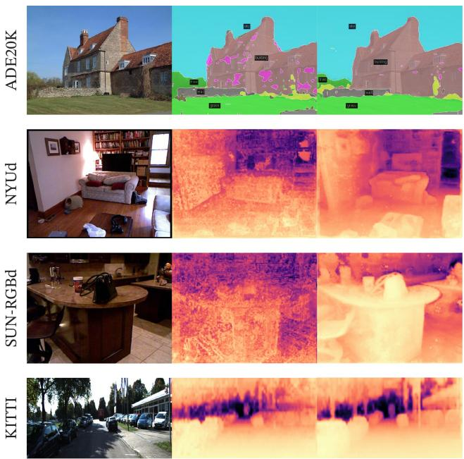  
输入（Input）  
OpenCLIP-G  
DINOv2-g

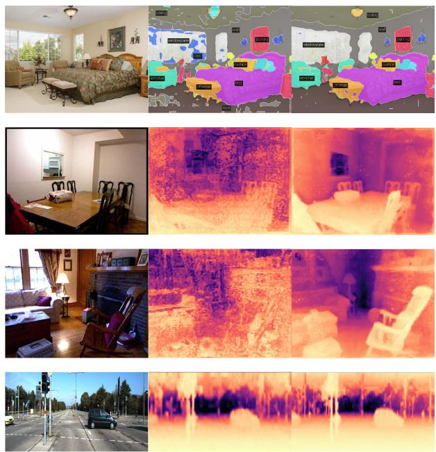  
输入 (Input)  
DINOv2-g  
OpenCLIP-G

Figure 7: 基于线性分类器的分割和深度估计。在冻结的 OpenCLIP-G 和 DINOv2-g 特征上使用线性探测（linear probe），来自 ADE20K、NYUd、SUN RGB-D 和 KITTI 的示例。  
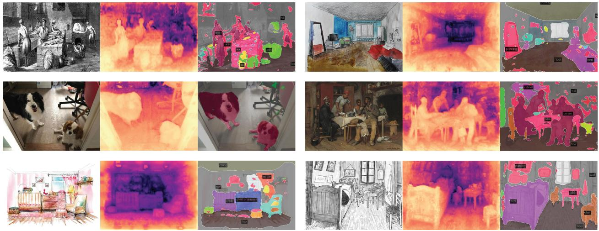  
Figure 8: 使用冻结的 DINOv2-g 特征和线性探测的分布外（out-of-distribution）示例。

图像块特征的 PCA 分析。我们展示了对我们模型提取的图像块特征（patch features）进行主成分分析（PCA）的结果。我们对第一主成分进行阈值处理后，仅保留具有正值的图像块。事实证明，该过程可以将图像的主要前景物体与背景分离开来。我们对描绘相同类别的三幅图像中剩余的图像块计算第二次 PCA。我们用三种不同的颜色对前三个主成分进行着色，并在图 1 和图 9 中展示了结果。有两个有趣的发现：首先，我们基于检测最大方差方向的无监督前景/背景检测器表现非常出色，能够清晰地勾勒出图片中主要物体的边界。其次，其他主成分对应于物体的“部件”，并在相同类别的图像之间高度匹配。这是一种涌现属性（emerging property）——我们的模型在训练时并未被训练去解析物体的部件。

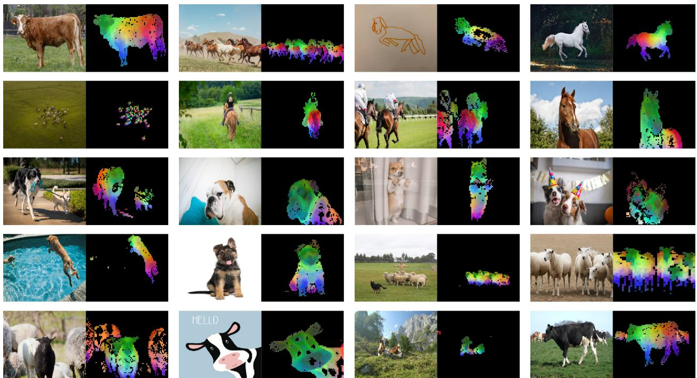  
Figure 9: 前几个 PCA 主成分的更多可视化。我们计算所有图像块之间的 PCA，并展示其前 3 个主成分。每个主成分对应一个特定的颜色通道。尽管姿态、风格甚至物体本身发生变化，相关图像之间的相同部件依然能够相互匹配。通过去除第一 PCA 主成分得分为负的图像块来移除背景。

图像块匹配。最后，我们通过在图像之间进行匹配来探索图像块级特征包含何种类型的信息。我们首先使用上述步骤检测前景物体。然后，我们计算从两幅图像中提取的图像块特征之间的欧氏距离，并通过求解指派问题进行映射。为了减少匹配数量，我们随后应用非极大值抑制（NMS）以仅保留显著的匹配项。在图 10 中，我们展示了此类匹配的一些示例。

我们观察到，这些特征似乎捕获了有关在不同物体或动物中具有相似作用的语义区域的信息。例如，飞机的机翼与鸟的翅膀相匹配。我们还观察到，该模型对风格变化（照片与绘画）以及姿态的巨大变化（参见大象）均具有鲁棒性。

## 8 公平性与偏见分析

我们对模型进行了两项公平性评估。我们探究了地理公平性以及潜在的有害标签关联。在这两项评估中，我们均使用最大的 ViT-g 模型进行实验。

## 8.1 地理公平性

我们在 De Vries et al. (2019) 引入的 Dollar Street 数据集上，采用 Goyal et al. (2022b) 的评估协议来评估地理公平性。该基准比较了不同国家和收入水平下的性能。它包含来自 54 个国家、289 个家庭的 16,073 张图像。该任务旨在识别 94 个概念，这些概念在不同家庭之间因收入或地理位置而呈现出视觉差异。在 Table 12 中，我们将我们的模型与 SEERv2 (Goyal et al., 2022a) 进行了比较，后者是一个在地理多样化图像集上训练的模型。在不同地区和收入水平之间，我们的模型比 SEERv2 模型略微更加公平，并且显著优于 Goyal et al. (2022a) 报告的监督基线。然而，我们仍然观察到地区之间存在显著差异，特别是在非洲，与欧洲相比，我们模型的性能下降了 25.7%。这表明我们的模型仍然偏向西方国家。同样，我们的模型在高收入家庭上的表现显著优于低收入家庭，差距达 31.7%。尽管有所改善，我们仍然观察到我们的模型对来自西方国家的富裕家庭存在显著偏见。

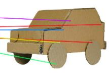

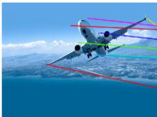

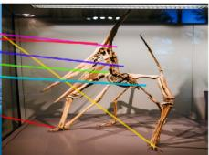

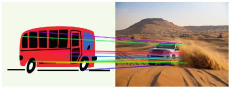  
(车辆)

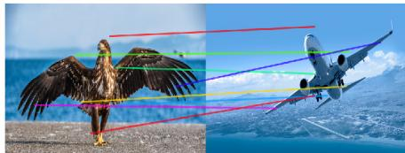  
(鸟类 / 飞机)

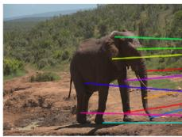

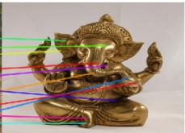

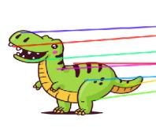

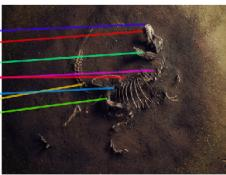

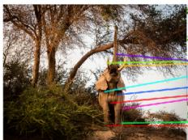  
(大象)

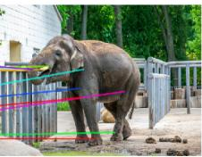

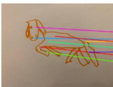

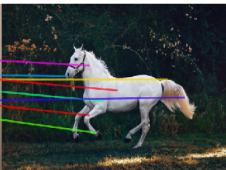  
(图画 / 动物)

Figure 10: 跨图像匹配。我们对来自不同领域、姿态甚至共享相似语义信息的不同物体的图像之间的 patch 级特征进行匹配。这展示了我们模型跨领域迁移以及理解不同物体相似部件之间关系的能力。

<table><tr><td rowspan="2">方法</td><td rowspan="2">架构</td><td rowspan="2">数据</td><td colspan="3">收入分段</td><td colspan="4">区域</td></tr><tr><td>低</td><td>中</td><td>高</td><td>非洲</td><td>亚洲</td><td>美洲</td><td>欧洲</td></tr><tr><td>SEERv2</td><td>RG-10B</td><td>IG-1B</td><td>59.7</td><td>78.5</td><td>86.6</td><td>65.9</td><td>76.3</td><td>81.1</td><td>85.6</td></tr><tr><td>DINOv2</td><td>ViT-g/14</td><td>LVD-142M</td><td>67.4</td><td>83.3</td><td>90.5</td><td>74.0</td><td>81.6</td><td>86.2</td><td>89.7</td></tr></table>

表 12：跨收入分段和区域的地理公平性与多样性分析。

## 8.2 性别、肤色与年龄

在第二组评估中，我们探究了模型如何对不同性别、肤色和年龄（均为自我报告）的人物图像进行分类。我们遵循 Goyal et al. (2022b) 的方案，在 ImageNet-22k 的 619 个类别子集上训练了一个多类别分类器。我们将这 619 个类别划分为四大类：人类（Human）、可能为人类（Possibly Human）、非人类（Non-Human）或犯罪（Crime）。非人类和犯罪被视为有害类别。使用该分类器，我们对来自 Casual Conversations 数据集（Hazirbas et al., 2021）的 2955 张图像进行推理，并保留 top-5 中分配概率达到或超过 0.1 的所有标签。正因如此，我们可以为每张图像分配多个类别。我们对原始评估方案做了一处修改：不对骨干网络反向传播梯度，而是保持其冻结。我们在表 13 中将我们的模型与 SEERv2 进行了比较。

<table><tr><td rowspan="2">模型</td><td rowspan="2">关联类别</td><td colspan="4">性别与肤色</td><td colspan="4">年龄组</td></tr><tr><td>女性深肤色</td><td>女性浅肤色</td><td>男性深肤色</td><td>男性浅肤色</td><td>18-30</td><td>30-45</td><td>45-70</td><td>70+</td></tr><tr><td>SEER</td><td>非人类</td><td>0.0</td><td>0.0</td><td>0.0</td><td>0.0</td><td>0.0</td><td>0.0</td><td>0.0</td><td>0.0</td></tr><tr><td rowspan="3">RG-10B</td><td>犯罪</td><td>0.0</td><td>0.0</td><td>0.0</td><td>0.0</td><td>0.0</td><td>0.0</td><td>0.0</td><td>0.0</td></tr><tr><td>人类</td><td>94.9</td><td>95.8</td><td>86.6</td><td>79.0</td><td>90.5</td><td>88.3</td><td>91.9</td><td>82.3</td></tr><tr><td>可能为人类</td><td>13.6</td><td>6.7</td><td>65.0</td><td>60.2</td><td>32.8</td><td>37.2</td><td>29.4</td><td>6.5</td></tr><tr><td>DINOv2</td><td>非人类</td><td>0.0</td><td>0.0</td><td>0.0</td><td>0.0</td><td>0.0</td><td>0.0</td><td>0.0</td><td>0.0</td></tr><tr><td rowspan="3">ViT-g/14</td><td>犯罪</td><td>0.0</td><td>0.0</td><td>0.2</td><td>0.0</td><td>0.0</td><td>0.1</td><td>0.0</td><td>0.0</td></tr><tr><td>人类</td><td>97.3</td><td>97.7</td><td>86.1</td><td>84.0</td><td>91.2</td><td>90.2</td><td>93.2</td><td>88.7</td></tr><tr><td>可能为人类</td><td>15.8</td><td>17.2</td><td>52.2</td><td>48.1</td><td>35.3</td><td>37.3</td><td>23.0</td><td>9.7</td></tr></table>

Table 13: 跨性别、肤色和年龄组的标签关联公平性评估。我们遵循 Goyal 等人 (2022b) 提出的方案并进行了微调。我们没有微调主干网络（backbone），而是仅在 ImageNet-22k 的 619 个类别子集上训练了一个线性分类器。

<table><tr><td>待复现模型</td><td>GPU 类型</td><td>GPU 功耗</td><td>GPU 小时数</td><td>PUE</td><td>总功耗</td><td>碳排放量 (tCO2eq)</td></tr><tr><td>DINOv2-g</td><td>A100-40GB</td><td>400W</td><td>22,016</td><td>1.1</td><td>9.7 MWh</td><td>3.7</td></tr></table>

Table 14: 复现 DINOv2 的碳足迹。在假设 A100-40GB 功耗为 400W、PUE 为 1.1 且碳排放强度因子为每 KWh 0.385 kg $\mathrm { C O _ { 2 } e }$ 的情况下，我们报告了复现 DINOv2-g 的潜在碳排放量。

我们的模型通常将所有群体的图像分类为 Human（人类），在不同肤色之间没有出现较大偏差。SEERv2 和 DINOv2 均未预测出属于 Non-Human（非人类）或 Crime（犯罪）元类别的有害标签（除了两个背景包含在视觉上与监狱栏杆相似的栏杆的实例）。我们发现我们的模型经常触发 Possibly-Human（疑似人类）类别。该类别由 ImageNet-22k 中通常与人类相关的物体构建而成，例如 Scarf（围巾）、Glasses（眼镜）或 Beard（胡须）。由于 Beard 类别的普遍存在，我们的模型经常为男性预测 Possibly-Human 类别。本研究中没有明显的模式表明对特定群体存在偏见。尽管这令人鼓舞，但我们也承认，对偏见进行更全面的评估可能会揭示我们模型中的缺陷。

## 9 评估训练我们模型的环境影响

训练基础模型会消耗大量能源，导致二氧化碳排放。Patterson et al. (2021) 提出了一种方法，根据数据中心及其电网的具体情况来报告模型训练期间碳排放的估计值。这一计算为用于训练模型的数据中心设计以及数据中心的选址提供了参考。该方法需要了解用于训练的数据中心的具体细节，而当随着时间的推移涉及多个数据中心时，这可能会变得很复杂。此外，这些具体细节通常不在 AI 从业者的控制范围内，因此在从业者对未来的训练做出技术决策时，该方法的帮助较小。相反，在本节中，我们采用另一种方法，即报告在美国的平均数据中心中重新训练类似模型的潜在碳排放。该方法曾用于自然语言处理的先前工作中（Strubell et al., 2019; Touvron et al., 2023），以在预训练方案之间建立对等的比较。更准确地说，我们将所有外生变量（即电能利用效率（Power Usage Effectiveness, PUE）和电网的碳强度因子）的值固定为与 Touvron et al. (2023) 中相同的值，即 PUE 为 1.1，碳强度因子为美国平均水平的 0.385 kg $\mathrm { C O _ { 2 } e q / K W h }$ 。我们使用与 Patterson et al. (2021) 相同的公式来估算潜在的能耗和碳排放。对于 A100-80GB 的功耗，我们采用 NVLink 系统的热设计功耗，即 400W。我们在 Table 14 中报告了重新训练 DINOv2 ViT-g 的潜在碳排放。作为对比，如果在同一数据中心运行，重新训练 OpenCLIP ViT-L 或 OpenCLIP ViT-G 将分别需要 22.4 MWh 和 118.9 MWh。这是其碳排放量的 10 倍。需要注意的是，这种比较对它们并不公平，因为它们还并行训练了一个文本编码器，因此我们未在表格中列出它们。然而，它为那些仅对训练视觉特征感兴趣的人提供了一个合理的指导准则：在这种情况下，从碳排放的角度来看，训练自监督模型是更优的选择。当计划复用文本编码器时，训练文本引导的模型仍然具有实际意义。

整个项目的碳足迹。此外，使用上文介绍的相同电网计算3，我们估计整个项目的碳足迹在 0.5k 至 1k tCO eq 之间。这一碳足迹相当于约 200k GPU 天的量级。主要的排放源是模型的自监督预训练。例如，单次预训练一个 ViT-g 模型（22k GPU 小时）会排放 3.7 吨 $\mathrm { C O _ { 2 } e q } .$，而在 ImageNet-1k 上的微调（1k GPU 小时）则排放 0.2 吨。该估计仅考虑了 GPU 的电力消耗，而忽略了其他排放，例如其制造和报废处置。

## 10 未来工作与讨论

在这项工作中，我们提出了 DINOv2，这是一系列在经过筛选的大规模数据上无监督预训练的新型图像编码器。这是首个在图像数据上的 SSL（自监督学习，Self-Supervised Learning）工作，其生成的视觉特征在广泛的基准测试中缩小了与（弱）监督方法的性能差距，且无需进行微调。我们可以将 DINOv2 系列模型的强大性能归因于几个因素：i) 具有更佳超参数和正则化的改进训练配方（Table 1），ii) 更大的模型规模，无论用于训练的数据如何都能带来更好的结果（Fig. 4），iii) 更大的数据集（Fig. 4），以及 iv) 使较小模型能够受益于最强 ViT-g 模型性能的蒸馏过程（Fig. 5）。这些模型中涌现出了一些特性，例如跨图像域的对象部件和场景几何理解能力。我们期望在更大的模型和数据规模下会涌现出更多此类特性，类似于大型语言模型中的指令涌现，并计划继续沿这些维度扩展。本文还表明，这些视觉特征与像线性层一样简单的分类器兼容——这意味着底层信息是立即可用的。在未来的工作中，我们计划利用这种能力来训练一个具备语言能力的 AI 系统，该系统能够像处理词元（word tokens）一样处理视觉特征，并提取所需的信息以实现系统的信息锚定（ground the system）。

## 致谢

我们感谢 Mathilde Caron 为促成这项工作而进行的初期讨论。Julien Mairal 得到了 ERC 资助项目（编号 101087696，APHELAIA 项目）以及 ANR 3IA MIAI@Grenoble Alpes（ANR-19- P3IA-0003）的支持。我们感谢 Olivia Joulin 为 Fig. 10 绘制的马匹图画。我们感谢 Madeleine 和 Léon 为 Fig. 8 摆姿势拍照。我们还要感谢 FAIR 和 Meta AI 的其他成员在整个项目期间对本工作的反馈。

## 参考文献

Shir Amir, Yossi Gandelsman, Shai Bagon, and Tali Dekel. Deep vit features as dense visual descriptors. In ECCV workshop on "What is Motion For?", 2022.

Yuki Markus Asano, Christian Rupprecht, and Andrea Vedaldi. Self-labelling via simultaneous clustering and representation learning. In ICLR, 2020.

Mahmoud Assran, Mathilde Caron, Ishan Misra, Piotr Bojanowski, Florian Bordes, Pascal Vincent, Armand Joulin, Michael Rabbat, and Nicolas Ballas. Masked siamese networks for label-eficient learning. In ECCV, 2022.

Mahmoud Assran, Quentin Duval, Ishan Misra, Piotr Bojanowski, Pascal Vincent, Michael Rabbat, Yann LeCun, and Nicolas Ballas. Self-supervised learning from images with a joint-embedding predictive architecture. In CVPR, 2023.

Alexei Baevski, Wei-Ning Hsu, Qiantong Xu, Arun Babu, Jiatao Gu, and Michael Auli. Data2vec: A general framework for self-supervised learning in speech, vision and language. In ICML, 2022.

Hangbo Bao, Li Dong, and Furu Wei. Beit: Bert pre-training of image transformers. In ICLR, 2021.

Jan Beirlant, Edward J Dudewicz, László Györfi, Edward C Van der Meulen, et al. Nonparametric entropy estimation: An overview. International Journal of Mathematical and Statistical Sciences, 6(1):17–39, 1997.

Maxim Berman, Hervé Jégou, Vedaldi Andrea, Iasonas Kokkinos, and Matthijs Douze. MultiGrain: a unified image embedding for classes and instances. arXiv preprint arXiv:1902.05509, 2019.

Lucas Beyer, Olivier J Hénaf, Alexander Kolesnikov, Xiaohua Zhai, and Aäron van den Oord. Are we done with imagenet? arXiv preprint arXiv:2006.07159, 2020.

Lucas Beyer, Pavel Izmailov, Alexander Kolesnikov, Mathilde Caron, Simon Kornblith, Xiaohua Zhai, Matthias Minderer, Michael Tschannen, Ibrahim Alabdulmohsin, and Filip Pavetic. Flexivit: One mode for all patch sizes. In CVPR, 2023.

Shariq Farooq Bhat, Ibraheem Alhashim, and Peter Wonka. AdaBins: Depth estimation using adaptive bins. In CVPR, 2021.

Piotr Bojanowski and Armand Joulin. Unsupervised learning by predicting noise. In ICML, 2017.

Rishi Bommasani, Drew A Hudson, Ehsan Adeli, Russ Altman, Simran Arora, Sydney von Arx, Michael S Bernstein, Jeannette Bohg, Antoine Bosselut, Emma Brunskill, et al. On the opportunities and risks of foundation models. arXiv preprint arXiv:2108.07258, 2021.

Lukas Bossard, Matthieu Guillaumin, and Luc Van Gool. Food-101 – mining discriminative components with random forests. In ECCV, 2014.

Tom B Brown, Benjamin Mann, Nick Ryder, Melanie Subbiah, Jared Kaplan, Prafulla Dhariwal, Arvind Neelakantan, Pranav Shyam, Girish Sastry, Amanda Askell, et al. Language models are few-shot learners. In NeurIPS, 2020.

Mathilde Caron, Piotr Bojanowski, Armand Joulin, and Matthijs Douze. Deep clustering for unsupervised learning of visual features. In ECCV, 2018.

Mathilde Caron, Piotr Bojanowski, Julien Mairal, and Armand Joulin. Unsupervised pre-training of image features on non-curated data. In ICCV, 2019.

Mathilde Caron, Ishan Misra, Julien Mairal, Priya Goyal, Piotr Bojanowski, and Armand Joulin. Unsupervised learning of visual features by contrasting cluster assignments. In NeurIPS, 2020.

Mathilde Caron, Hugo Touvron, Ishan Misra, Hervé Jégou, Julien Mairal, Piotr Bojanowski, and Armand Joulin. 自监督视觉 Transformer 中的涌现特性. In ICCV, 2021.

Liang-Chieh Chen, Yukun Zhu, George Papandreou, Florian Schrof, and Hartwig Adam. 用于语义图像分割的带空洞可分离卷积的编码器-解码器. In ECCV, 2018.

Ting Chen, Simon Kornblith, Mohammad Norouzi, and Geofrey Hinton. 视觉表示对比学习的简单框架. In ICML, 2020.

Xiangning Chen, Chen Liang, Da Huang, Esteban Real, Kaiyuan Wang, Yao Liu, Hieu Pham, Xuanyi Dong, Thang Luong, Cho-Jui Hsieh, et al. 优化算法的符号化发现. arXiv preprint arXiv:2302.06675, 2023a.

Xinlei Chen and Kaiming He. 探索简单的孪生表示学习. In CVPR, 2021.

Xinlei Chen, Saining Xie, and Kaiming He. 训练自监督视觉 Transformer 的实证研究. In ICCV, 2021.

Zhe Chen, Yuchen Duan, Wenhai Wang, Junjun He, Tong Lu, Jifeng Dai, and Yu Qiao. 用于密集预测的视觉 Transformer 适配器. In ICLR, 2023b.

Bowen Cheng, Ishan Misra, Alexander G Schwing, Alexander Kirillov, and Rohit Girdhar. 用于通用图像分割的掩蔽注意力掩码 Transformer. In CVPR, 2022.

Mehdi Cherti, Romain Beaumont, Ross Wightman, Mitchell Wortsman, Gabriel Ilharco, Cade Gordon, Christoph Schuhmann, Ludwig Schmidt, and Jenia Jitsev. 对比语言-图像学习的可复现缩放定律. In CVPR, 2023.

Aakanksha Chowdhery, Sharan Narang, Jacob Devlin, Maarten Bosma, Gaurav Mishra, Adam Roberts, Paul Barham, Hyung Won Chung, Charles Sutton, Sebastian Gehrmann, et al. PaLM：利用 Pathways 扩展语言建模. arXiv preprint arXiv:2204.02311, 2022.

M. Cimpoi, S. Maji, I. Kokkinos, S. Mohamed, , and A. Vedaldi. 自然环境下的纹理描述. In CVPR, 2014.

Marius Cordts, Mohamed Omran, Sebastian Ramos, Timo Rehfeld, Markus Enzweiler, Rodrigo Benenson, Uwe Franke, Stefan Roth, and Bernt Schiele. 用于语义城市场景理解的 Cityscapes 数据集. In CVPR, 2016.

Tri Dao, Daniel Y. Fu, Stefano Ermon, Atri Rudra, and Christopher Ré. FlashAttention：具有 IO 感知的高速且内存高效的精确注意力. In NeurIPS, 2022.

Terrance De Vries, Ishan Misra, Changhan Wang, and Laurens Van der Maaten. 目标识别对每个人都适用吗？ In CVPR workshops, 2019.

Sylvain Delattre and Nicolas Fournier. 论 Kozachenko–Leonenko 熵估计量. Journal of Statistical Planning and Inference, 185:69–93, 2017.

Jia Deng, Wei Dong, Richard Socher, Li-Jia Li, Kai Li, and Li Fei-Fei. ImageNet：大规模分层图像数据库. In CVPR, 2009.

Jacob Devlin, Ming-Wei Chang, Kenton Lee, and Kristina Toutanova. BERT：用于语言理解的深度双向 Transformer 预训练. NAACL, 2019.

Carl Doersch, Abhinav Gupta, and Alexei A Efros. 通过上下文预测进行无监督视觉表示学习. In ICCV, 2015.

Alexey Dosovitskiy, Philipp Fischer, Jost Tobias Springenberg, Martin Riedmiller, and Thomas Brox. 基于样本卷积神经网络的判别式无监督特征学习. TPAMI, 2016.

Alexey Dosovitskiy, Lucas Beyer, Alexander Kolesnikov, Dirk Weissenborn, Xiaohua Zhai, Thomas Unterthiner, Mostafa Dehghani, Matthias Minderer, Georg Heigold, Sylvain Gelly, et al. 一张图像等价于 16x16 个单词：用于大规模图像识别的 Transformer. In ICLR, 2021.

Matthijs Douze, Hervé Jégou, Harsimrat Sandhawalia, Laurent Amsaleg, and Cordelia Schmid. 用于网络级图像搜索的 GIST 描述符评估. In CIVR, 2009

Quentin Duval, Ishan Misra, and Nicolas Ballas. 具有竞争力且低计算量的自监督视觉模型构建方案. arXiv preprint arXiv:2301.09451, 2023.

Alaaeldin El-Nouby, Gautier Izacard, Hugo Touvron, Ivan Laptev, Hervé Jegou, and Edouard Grave. 自监督预训练是否需要大规模数据集？arXiv preprint arXiv:2112.10740, 2021.

Mark Everingham, Luc Van Gool, Christopher KI Williams, John Winn, and Andrew Zisserman. PASCAL 视觉对象类别（VOC）挑战赛. IJCV, 2010.

Yuxin Fang, Wen Wang, Binhui Xie, Quan Sun, Ledell Wu, Xinggang Wang, Tiejun Huang, Xinlong Wang, and Yue Cao. EVA：探索大规模掩码视觉表征学习的极限. In CVPR, 2023.

Li Fei-Fei, Rob Fergus, and Pietro Perona. 从少量训练样本中学习生成式视觉模型：在 101 个物体类别上测试的增量贝叶斯方法. In CVPR, 2004.

Andreas Geiger, Philip Lenz, Christoph Stiller, and Raquel Urtasun. 视觉遇见机器人：KITTI 数据集. IJRR, 2013.

Spyros Gidaris, Praveer Singh, and Nikos Komodakis. 通过预测图像旋转进行无监督表征学习. In ICLR, 2018.

Rohit Girdhar, Alaaeldin El-Nouby, Mannat Singh, Kalyan Vasudev Alwala, Armand Joulin, and Ishan Misra. OmniMAE：基于图像和视频的单模型掩码预训练. In CVPR, 2023.

Priya Goyal, Dhruv Mahajan, Abhinav Gupta, and Ishan Misra. 扩展与基准测试自监督视觉表征学习. In ICCV, 2019.

Priya Goyal, Mathilde Caron, Benjamin Lefaudeux, Min Xu, Pengchao Wang, Vivek Pai, Mannat Singh, Vitaliy Liptchinsky, Ishan Misra, Armand Joulin, et al. 自然场景下视觉特征的自监督预训练. preprint arXiv:2103.01988, 2021.

Priya Goyal, Quentin Duval, Isaac Seessel, Mathilde Caron, Mannat Singh, Ishan Misra, Levent Sagun, Armand Joulin, and Piotr Bojanowski. 在未经筛选的图像上进行无监督预训练使视觉模型更具鲁棒性和公平性. arXiv preprint arXiv:2202.08360, 2022a.

Priya Goyal, Adriana Romero Soriano, Caner Hazirbas, Levent Sagun, and Nicolas Usunier. 用于系统评估视觉特征提取器的公平性指标. In FAcct, 2022b.

Raghav Goyal, Samira Ebrahimi Kahou, Vincent Michalski, Joanna Materzynska, Susanne Westphal, Heuna Kim, Valentin Haenel, Ingo Fruend, Peter Yianilos, Moritz Mueller-Freitag, et al. The "something something" video database for learning and evaluating visual common sense. In ICCV, 2017.

Jean-Bastien Grill, Florian Strub, Florent Altché, Corentin Tallec, Pierre H Richemond, Elena Buchatskaya, Carl Doersch, Bernardo Avila Pires, Zhaohan Daniel Guo, Mohammad Gheshlaghi Azar, Bilal Piot, Koray Kavukcuoglu, Rémi Munos, and Michal Valko. Bootstrap your own latent: A new approach to selfsupervised learning. In NeurIPS, 2020.

Raia Hadsell, Sumit Chopra, and Yann LeCun. Dimensionality reduction by learning an invariant mapping. In CVPR, 2006.

Mark Hamilton, Zhoutong Zhang, Bharath Hariharan, Noah Snavely, and William T Freeman. Unsupervised semantic segmentation by distilling feature correspondences. In ICLR, 2022.

Caner Hazirbas, Joanna Bitton, Brian Dolhansky, Jacqueline Pan, Albert Gordo, and Cristian Canton Ferrer. Towards measuring fairness in ai: the casual conversations dataset. IEEE Transactions on Biometrics, Behavior, and Identity Science, 2021.

Kaiming He, Haoqi Fan, Yuxin Wu, Saining Xie, and Ross Girshick. Momentum contrast for unsupervised visual representation learning. In CVPR, 2020.

Kaiming He, Xinlei Chen, Saining Xie, Yanghao Li, Piotr Dollár, and Ross Girshick. Masked autoencoders are scalable vision learners. In CVPR, 2022.

Olivier J Hénaf, Aravind Srinivas, Jefrey De Fauw, Ali Razavi, Carl Doersch, SM Eslami, and Aaron van den Oord. Data-eficient image recognition with contrastive predictive coding. PMLR, 2019.

Dan Hendrycks and Thomas Dietterich. Benchmarking neural network robustness to common corruptions and perturbations. In ICLR, 2019.

Dan Hendrycks, Steven Basart, Norman Mu, Saurav Kadavath, Frank Wang, Evan Dorundo, Rahul Desai, Tyler Zhu, Samyak Parajuli, Mike Guo, et al. The many faces of robustness: A critical analysis of out-of-distribution generalization. In ICCV, 2021a.

Dan Hendrycks, Kevin Zhao, Steven Basart, Jacob Steinhardt, and Dawn Song. Natural adversarial examples. In CVPR, 2021b.

Geofrey Hinton, Oriol Vinyals, and Jef Dean. Distilling the knowledge in a neural network. In NeurIPS Deep Learning Workshop, 2014.

Jordan Hofmann, Sebastian Borgeaud, Arthur Mensch, Elena Buchatskaya, Trevor Cai, Eliza Rutherford, Diego de Las Casas, Lisa Anne Hendricks, Johannes Welbl, Aidan Clark, et al. Training compute-optimal large language models. arXiv preprint arXiv:2203.15556, 2022.

Gao Huang, Yu Sun, Zhuang Liu, Daniel Sedra, and Kilian Q Weinberger. Deep networks with stochastic depth. In ECCV, 2016.

Gabriel Ilharco, Mitchell Wortsman, Ross Wightman, Cade Gordon, Nicholas Carlini, Rohan Taori, Achal Dave, Vaishaal Shankar, Hongseok Namkoong, John Miller, Hannaneh Hajishirzi, Ali Farhadi, and Ludwig Schmidt. Openclip. 2021.

Herve Jegou, Matthijs Douze, and Cordelia Schmid. 用于最近邻搜索的乘积量化. TPAMI, 2010.

Jef Johnson, Matthijs Douze, and Hervé Jégou. 基于 GPU 的十亿规模相似度搜索. IEEE Transactions on Big Data, 2019.

Armand Joulin, Laurens Van Der Maaten, Allan Jabri, and Nicolas Vasilache. 从大规模弱监督数据中学习视觉特征. In ECCV, 2016.

Will Kay, Joao Carreira, Karen Simonyan, Brian Zhang, Chloe Hillier, Sudheendra Vijayanarasimhan, Fabio Viola, Tim Green, Trevor Back, Paul Natsev, et al. Kinetics 人类动作视频数据集. arXiv preprint arXiv:1705.06950, 2017.

Jonathan Krause, Michael Stark, Jia Deng, and Li Fei-Fei. 用于细粒度分类的 3D 物体表征. In 3DRR, 2013.

Mario Michael Krell, Matej Kosec, Sergio P. Perez, and Andrew Fitzgibbon. 无交叉污染的高效序列打包：在不影响性能的情况下加速大型语言模型, 2022.

Alex Krizhevsky, Geofrey Hinton, et al. 从微小图像中学习多层特征. 2009.

Benjamin Lefaudeux, Francisco Massa, Diana Liskovich, Wenhan Xiong, Vittorio Caggiano, Sean Naren, Min Xu, Jieru Hu, Marta Tintore, Susan Zhang, Patrick Labatut, and Daniel Haziza. xformers: 模块化且可扩展的 Transformer 建模库. https://github.com/facebookresearch/xformers, 2022.

Chunyuan Li, Jianwei Yang, Pengchuan Zhang, Mei Gao, Bin Xiao, Xiyang Dai, Lu Yuan, and Jianfeng Gao. 用于表征学习的高效自监督视觉 Transformer. In ICLR, 2022a.

Zhenyu Li, Xuyang Wang, Xianming Liu, and Junjun Jiang. Binsformer: 重新审视用于单目深度估计的自适应分箱. arXiv preprint arXiv:2204.00987, 2022b.

Tatiana Likhomanenko, Qiantong Xu, Gabriel Synnaeve, Ronan Collobert, and Alex Rogozhnikov. Cape: 使用连续增强位置嵌入编码相对位置. In NeurIPS, 2021.

Huajun Liu, Fuqiang Liu, Xinyi Fan, and Dong Huang. 极化自注意力：迈向高质量的逐像素回归. arXiv preprint arXiv:2107.00782, 2021.

Dhruv Mahajan, Ross Girshick, Vignesh Ramanathan, Kaiming He, Manohar Paluri, Yixuan Li, Ashwin Bharambe, and Laurens van der Maaten. 探索弱监督预训练的极限. In ECCV, 2018.

S. Maji, J. Kannala, E. Rahtu, M. Blaschko, and A. Vedaldi. 飞机的细粒度视觉分类. Technical report, 2013.

Ishan Misra and Laurens van der Maaten. 代理任务不变表征的自监督学习. In CVPR, 2020.

Maria-Elena Nilsback and Andrew Zisserman. 多类别自动花卉分类. In ICVGIP, 2008.

Mehdi Noroozi and Paolo Favaro. 通过拼图游戏进行视觉表征的无监督学习. In ECCV, 2016.

Dolev Ofri-Amar, Michal Geyer, Yoni Kasten, and Tali Dekel. Neural congealing: 将图像对齐到联合语义图谱. In CVPR, 2023.

Omkar M. Parkhi, Andrea Vedaldi, Andrew Zisserman, and C. V. Jawahar. Cats and dogs. In CVPR, 2012.

Deepak Pathak, Philipp Krähenbühl, Jef Donahue, Trevor Darrell, and Alexei Efros. Context encoders: Feature learning by inpainting. In CVPR, 2016.

David Patterson, Joseph Gonzalez, Quoc Le, Chen Liang, Lluis-Miquel Munguia, Daniel Rothchild, David So, Maud Texier, and Jef Dean. Carbon emissions and large neural network training. arXiv preprint arXiv:2104.10350, 2021.

Ed Pizzi, Sreya Dutta Roy, Sugosh Nagavara Ravindra, Priya Goyal, and Matthijs Douze. A self-supervised descriptor for image copy detection. In CVPR, 2022.

Filip Radenović, Ahmet Iscen, Giorgos Tolias, Yannis Avrithis, and Ondřej Chum. Revisiting oxford and paris: Large-scale image retrieval benchmarking. In CVPR, 2018a.

Filip Radenović, Giorgos Tolias, and Ondřej Chum. Fine-tuning cnn image retrieval with no human annotation. TPAMI, 2018b.

Alec Radford, Rafal Jozefowicz, and Ilya Sutskever. Learning to generate reviews and discovering sentiment. arXiv preprint arXiv:1704.01444, 2017.

Alec Radford, Jefrey Wu, Rewon Child, David Luan, Dario Amodei, and Ilya Sutskever. Language models are unsupervised multitask learners. 2019.

Alec Radford, Jong Wook Kim, Chris Hallacy, Aditya Ramesh, Gabriel Goh, Sandhini Agarwal, Girish Sastry, Amanda Askell, Pamela Mishkin, Jack Clark, et al. Learning transferable visual models from natural language supervision. In ICML, 2021.

Colin Rafel, Noam Shazeer, Adam Roberts, Katherine Lee, Sharan Narang, Michael Matena, Yanqi Zhou, Wei Li, Peter J Liu, et al. Exploring the limits of transfer learning with a unified text-to-text transformer. JMLR, 2020.

René Ranftl, Alexey Bochkovskiy, and Vladlen Koltun. Vision transformers for dense prediction. In ICCV, 2021.

Benjamin Recht, Rebecca Roelofs, Ludwig Schmidt, and Vaishaal Shankar. Do imagenet classifiers generalize to imagenet? In ICML, 2019.

Jerome Revaud, Jon Almazán, Rafael S Rezende, and Cesar Roberto de Souza. Learning with average precision: Training image retrieval with a listwise loss. In ICCV, 2019.

Yangjun Ruan, Saurabh Singh, Warren Morningstar, Alexander A Alemi, Sergey Iofe, Ian Fischer, and Joshua V Dillon. Weighted ensemble self-supervised learning. In ICLR, 2023.

Olga Russakovsky, Jia Deng, Hao Su, Jonathan Krause, Sanjeev Satheesh, Sean Ma, Zhiheng Huang, Andrej Karpathy, Aditya Khosla, Michael Bernstein, Alexander C Berg, and Li Fei-Fei. Imagenet large scale visual recognition challenge. IJCV, 2015.

Alexandre Sablayrolles, Matthijs Douze, Cordelia Schmid, and Hervé Jégou. Spreading vectors for similarity search. In ICLR, 2019.

Christoph Schuhmann, Richard Vencu, Romain Beaumont, Robert Kaczmarczyk, Clayton Mullis, Aarush Katta, Theo Coombes, Jenia Jitsev, and Aran Komatsuzaki. Laion-400m: Open dataset of clip-filtered 400 million image-text pairs. In NeurIPS Data Centric AI Workshop, 2021.

Christoph Schuhmann, Romain Beaumont, Richard Vencu, Cade Gordon, Ross Wightman, Mehdi Cherti, Theo Coombes, Aarush Katta, Clayton Mullis, Mitchell Wortsman, et al. Laion-5b: An open large-scale dataset for training next generation image-text models. In NeurIPS, 2022.

Noam Shazeer. Glu variants improve transformer. arXiv preprint arXiv:2002.05202, 2020.

Nathan Silberman, Derek Hoiem, Pushmeet Kohli, and Rob Fergus. Indoor segmentation and support inference from rgbd images. In ECCV, 2012.

Mannat Singh, Laura Gustafson, Aaron Adcock, Vinicius de Freitas Reis, Bugra Gedik, Raj Prateek Kosaraju, Dhruv Mahajan, Ross Girshick, Piotr Dollár, and Laurens van der Maaten. Revisiting Weakly Supervised Pre-Training of Visual Perception Models. In CVPR, 2022.

Shuran Song, Samuel P Lichtenberg, and Jianxiong Xiao. Sun rgb-d: A rgb-d scene understanding benchmark suite. In CVPR, 2015.

Khurram Soomro, Amir Roshan Zamir, and Mubarak Shah. Ucf101: A dataset of 101 human actions classes from videos in the wild. arXiv preprint arXiv:1212.0402, 2012.

Andreas Steiner, Alexander Kolesnikov, Xiaohua Zhai, Ross Wightman, Jakob Uszkoreit, and Lucas Beyer. How to train your vit? data, augmentation, and regularization in vision transformers. TMLR, 2021.

Emma Strubell, Ananya Ganesh, and Andrew McCallum. Energy and policy considerations for deep learning in nlp. ACL, 2019.

Yonglong Tian, Olivier J Henaf, and Aäron van den Oord. Divide and contrast: Self-supervised learning from uncurated data. In ICCV, 2021.

Giorgos Tolias, Ronan Sicre, and Hervé Jégou. Particular object retrieval with integral max-pooling of cnn activations. In ICLR, 2016.

Zhan Tong, Yibing Song, Jue Wang, and Limin Wang. Videomae: Masked autoencoders are data-eficient learners for self-supervised video pre-training. In NeurIPS, 2022.

Hugo Touvron, Andrea Vedaldi, Matthijs Douze, and Hervé Jégou. Fixing the train-test resolution discrepancy. In NeurIPS, 2019.

Hugo Touvron, Matthieu Cord, and Hervé Jégou. Deit iii: Revenge of the vit. In ECCV, 2022.

Hugo Touvron, Thibaut Lavril, Gautier Izacard, Xavier Martinet, Marie-Anne Lachaux, Timothée Lacroix, Baptiste Rozière, Naman Goyal, Eric Hambro, Faisal Azhar, Aurelien Rodriguez, Armand Joulin, Edouard Grave, and Guillaume Lample. Llama: Open and eficient foundation language models. arXiv preprint arXiv:2302.13971, 2023.

Narek Tumanyan, Omer Bar-Tal, Shai Bagon, and Tali Dekel. Splicing vit features for semantic appearance transfer. In CVPR, 2022.

Grant Van Horn, Oisin Mac Aodha, Yang Song, Yin Cui, Chen Sun, Alex Shepard, Hartwig Adam, Pietro Perona, and Serge Belongie. The inaturalist species classification and detection dataset. In CVPR, 2018.

Grant Van Horn, Elijah Cole, Sara Beery, Kimberly Wilber, Serge Belongie, and Oisin Mac Aodha. Benchmarking representation learning for natural world image collections. In CVPR, 2021.

Wenhai Wang, Jifeng Dai, Zhe Chen, Zhenhang Huang, Zhiqi Li, Xizhou Zhu, Xiaowei Hu, Tong Lu, Lewei Lu, Hongsheng Li, et al. InternImage: 利用可变形卷积探索大规模视觉基础模型. In CVPR, 2022.

Xiaolong Wang, Allan Jabri, and Alexei A Efros. 从时间循环一致性中学习对应关系. In CVPR, 2019.

Frederik Warburg, Soren Hauberg, Manuel Lopez-Antequera, Pau Gargallo, Yubin Kuang, and Javier Civera. Mapillary 街景序列：用于终身地点识别的数据集. In CVPR, 2020.

Philippe Weinzaepfel, Thomas Lucas, Diane Larlus, and Yannis Kalantidis. 学习用于图像检索的超特征. In ICLR, 2021.

P. Welinder, S. Branson, T. Mita, C. Wah, F. Schrof, S. Belongie, and P. Perona. Caltech-UCSD Birds 200. 技术报告 CNS-TR-2010-001, 2010.

Guillaume Wenzek, Marie-Anne Lachaux, Alexis Conneau, Vishrav Chaudhary, Francisco Guzmán, Armand Joulin, and Edouard Grave. CCNet：从网络爬虫数据中提取高质量单语数据集. In LREC, 2020.

Tobias Weyand, Andre Araujo, Bingyi Cao, and Jack Sim. Google Landmarks Dataset v2——用于实例级识别与检索的大规模基准. In CVPR, 2020.

Zhirong Wu, Yuanjun Xiong, Stella X Yu, and Dahua Lin. 基于非参数实例判别的无监督特征学习. In CVPR, 2018.

J. Xiao, J. Hays, K. A. Ehinger, A. Oliva, and A. Torralba. SUN 数据库：从修道院到动物园的大规模场景识别. In CVPR, 2010.

Hu Xu, Juncheng Li, Alexei Baevski, Michael Auli, Wojciech Galuba, Florian Metze, Christoph Feichtenhofer, et al. 能够倾听的掩码自编码器. arXiv preprint arXiv:2207.06405, 2022.

I Zeki Yalniz, Hervé Jégou, Kan Chen, Manohar Paluri, and Dhruv Mahajan. 用于图像分类的十亿级半监督学习. arXiv preprint arXiv:1905.00546, 2019.

Burak Yildiz, Seyran Khademi, Ronald Maria Siebes, and Jan van Gemert. AmsterdamTime：针对严重领域偏移的视觉地点识别基准数据集. In ICPR, 2022.

Nikolaos-Antonios Ypsilantis, Noa Garcia, Guangxing Han, Sarah Ibrahimi, Nanne Van Noord, and Giorgos Tolias. The MET 数据集：艺术品的实例级识别. In NeurIPS Datasets and Benchmarks Track, 2021.

Xiaohua Zhai, Alexander Kolesnikov, Neil Houlsby, and Lucas Beyer. 扩展视觉 Transformer. In CVPR, 2022.

Richard Zhang, Phillip Isola, and Alexei A Efros. 丰富多彩的图像着色. In ECCV, 2016.

Bolei Zhou, Agata Lapedriza, Jianxiong Xiao, Antonio Torralba, and Aude Oliva. 利用 Places 数据库学习用于场景识别的深度特征. In NeurIPS, 2014.

Bolei Zhou, Hang Zhao, Xavier Puig, Sanja Fidler, Adela Barriuso, and Antonio Torralba. 基于 ADE20K 数据集的场景解析. In CVPR, 2017.

Jinghao Zhou, Chen Wei, Huiyu Wang, Wei Shen, Cihang Xie, Alan Yuille, and Tao Kong. iBOT：基于在线分词器的图像 BERT 预训练. In ICLR, 2022a.

Pan Zhou, Yichen Zhou, Chenyang Si, Weihao Yu, Teck Khim Ng, and Shuicheng Yan. Mugs: A multigranular self-supervised learning framework. arXiv preprint arXiv:2203.14415, 2022b.

## A 数据处理

## A.1 数据选择

我们用于构建 LVD-142M 的数据集选择详见 Tab. 15。该数据集集合旨在提供能够很好覆盖图像级和稠密识别等各种下游视觉任务的图像。

## A.2 图像相似度

我们使用余弦相似度来比较图像特征（无论是我们的特征还是用于去重生成的特征），相似度函数 $m$ 如下：

$$
m (s, r) = \text { cosine - similarity } \left(f (s), f (r)\right) = \frac {f (s) \cdot f (r)}{\| f (s) \| _ {2} \| f (r) \| _ {2}}
$$

其中 $s$ 和 $r$ 是待比较的一对图像，$f$ 是生成特征的模型。

## A.3 去重

自身去重（Self-deduplication）。为了对我们包含 1.3B 张图像的未整理数据源进行去重，我们计算并使用由 Pizzi et al. (2022) 生成的嵌入，并检索每张图像的 $k = 64$ 个最近邻（使用余弦相似度）。仅考虑相似度 >0.6 的邻居，我们借助可扩展的并查集（disjoint set）数据结构实现，提取关联 $k\text{-NN}$ 图的连通分量。然后，我们对每个重复图像分量仅保留一个代表。这产生了一个包含 1.1B 张图像的自身去重数据源。

相对去重（Relative deduplication） 为了减少冗余并正确评估我们特征的性能，我们丢弃了自身去重数据源中与评估数据集的训练集和测试集划分过于相似的剩余图像。为此，我们采用了与自身去重类似的流程，但采用了更严格的相似度阈值 >0.45，这次识别每个参考图像所属的重复分量（如果有）并将其完全丢弃。这产生了一个包含 744M 张图像的经过自身去重和相对去重的数据源。

## A.4 检索

我们采用两种方法通过检索来扩充数据集：基于样本的方法（sample-based）和基于聚类的方法（cluster-based）。第一种是基于样本的方法，适用于大于 1M（100 万）张图像的数据集，其做法是为待检索数据集中的每个样本图像收集固定数量 $k$ 的最近邻图像，从而有效地将数据集规模扩大 $k$ 倍。我们对 Google Landmarks v2 和 ImageNet-22k 使用 $k = 4$，但使用更大的 $k = 32$ 以使该特定检索成为我们 LVD-142M 数据集的核心部分。对于较小的数据集，第二种基于聚类的方法则是首先通过分布式 k-means 实现将我们未精选的数据源聚类为 100, 000 个独立的聚类簇。每个聚类簇应捕捉不同类型的图像概念和内容。然后，我们从与被检索数据集关联超过 3 张图像的每个聚类簇中挑选 10, 000 张图像。由于这可能会导致某些数据集检索出的图像数量非常庞大，我们将此类检索限制在最多 1M 张图像，以保持 LVD-142M 内不同数据集之间的平衡。

## B 实现细节

## B.1 无监督预训练

对于无监督预训练，我们基于 DINO 和 iBOT 代码库构建。我们使用 Table 16 中展示的超参数，以及 Table 17 中描述的 ViT 架构。

KoLeo 正则化。我们在同一 GPU 内的所有样本之间，对第一个全局裁剪（global crop）的类别标记（class token）应用权重为 0.1 的 KoLeo 正则化项，该步骤无需进行跨卡通信。

<table><tr><td>任务</td><td>数据集 / 划分</td><td>图像数</td><td>检索方式</td><td>检索所得</td><td>最终数量</td></tr><tr><td>分类</td><td>ImageNet-22k / -</td><td>14,197,086</td><td>原样</td><td>-</td><td>14,197,086</td></tr><tr><td>分类</td><td>ImageNet-22k / -</td><td>14,197,086</td><td>采样</td><td>56,788,344</td><td>56,788,344</td></tr><tr><td>分类</td><td>ImageNet-1k / train</td><td>1,281,167</td><td>采样</td><td>40,997,344</td><td>40,997,344</td></tr><tr><td>细粒度分类</td><td>Caltech 101 / train</td><td>3,030</td><td>聚类</td><td>2,630,000</td><td>1,000,000</td></tr><tr><td>细粒度分类</td><td>CUB-200-2011 / train</td><td>5,994</td><td>聚类</td><td>1,300,000</td><td>1,000,000</td></tr><tr><td>细粒度分类</td><td>DTD / train1</td><td>1,880</td><td>聚类</td><td>1,580,000</td><td>1,000,000</td></tr><tr><td>细粒度分类</td><td>FGVC-Aircraft / train</td><td>3,334</td><td>聚类</td><td>1,170,000</td><td>1,000,000</td></tr><tr><td>细粒度分类</td><td>Flowers-102 / train</td><td>1,020</td><td>聚类</td><td>1,060,000</td><td>1,000,000</td></tr><tr><td>细粒度分类</td><td>Food-101 / train</td><td>75,750</td><td>聚类</td><td>21,670,000</td><td>1,000,000</td></tr><tr><td>细粒度分类</td><td>Oxford-IIIT Pet / trainval</td><td>3,680</td><td>聚类</td><td>2,750,000</td><td>1,000,000</td></tr><tr><td>细粒度分类</td><td>Stanford Cars / train</td><td>8,144</td><td>聚类</td><td>7,220,000</td><td>1,000,000</td></tr><tr><td>细粒度分类</td><td>SUN397 / train1</td><td>19,850</td><td>聚类</td><td>18,950,000</td><td>1,000,000</td></tr><tr><td>细粒度分类</td><td>Pascal VOC 2007 / train</td><td>2,501</td><td>聚类</td><td>1,010,000</td><td>1,000,000</td></tr><tr><td>分割</td><td>ADE20K / train</td><td>20,210</td><td>聚类</td><td>20,720,000</td><td>1,000,000</td></tr><tr><td>分割</td><td>Cityscapes / train</td><td>2,975</td><td>聚类</td><td>1,390,000</td><td>1,000,000</td></tr><tr><td>分割</td><td>Pascal VOC 2012 (seg.) / trainaug</td><td>1,464</td><td>聚类</td><td>10,140,000</td><td>1,000,000</td></tr><tr><td>深度估计</td><td>Mapillary SLS / train</td><td>1,434,262</td><td>原样</td><td>-</td><td>1,434,262</td></tr><tr><td>深度估计</td><td>KITTI / train (Eigen)</td><td>23,158</td><td>聚类</td><td>3,700,000</td><td>1,000,000</td></tr><tr><td>深度估计</td><td>NYU Depth V2 / train</td><td>24,231</td><td>聚类</td><td>10,850,000</td><td>1,000,000</td></tr><tr><td>深度估计</td><td>SUN RGB-D / train</td><td>4,829</td><td>聚类</td><td>4,870,000</td><td>1,000,000</td></tr><tr><td>检索</td><td>Google Landmarks v2 / train (clean)</td><td>1,580,470</td><td>原样</td><td>-</td><td>1,580,470</td></tr><tr><td>检索</td><td>Google Landmarks v2 / train (clean)</td><td>1,580,470</td><td>采样</td><td>6,321,880</td><td>6,321,880</td></tr><tr><td>检索</td><td>AmsterTime / new</td><td>1,231</td><td>聚类</td><td>960,000</td><td>960,000</td></tr><tr><td>检索</td><td>AmsterTime / old</td><td>1,231</td><td>聚类</td><td>830,000</td><td>830,000</td></tr><tr><td>检索</td><td>Met / train</td><td>397,121</td><td>聚类</td><td>62,860,000</td><td>1,000,000</td></tr><tr><td>检索</td><td>Revisiting Oxford / base</td><td>4,993</td><td>聚类</td><td>3,680,000</td><td>1,000,000</td></tr><tr><td>检索</td><td>Revisiting Paris / base</td><td>6,322</td><td>聚类</td><td>3,660,000</td><td>1,000,000</td></tr></table>

Table 15: 我们的 LVD-142M 数据集构成。我们汇报了用于构建该数据集的数据集列表及相关划分、它们的包含方式（原样保留而不进行检索，或通过基于样本的检索或基于聚类的检索）。对于检索部分，我们指出了实际检索到的图像数量以及最终包含在数据集中的数量。我们选择在预训练数据中包含尽可能多的数据集，以覆盖尽可能广泛的领域。我们保留了少数数据集，以便评估在预训练领域之外的性能。有关数据集使用的更多详细信息，参见 Table 18。

<table><tr><td></td><td>架构</td><td>丢弃率</td><td>学习率</td><td>批大小</td></tr><tr><td>DINOv2-S（蒸馏）</td><td>ViT-S/14</td><td>0</td><td>1e-3</td><td>2048</td></tr><tr><td>DINOv2-B（蒸馏）</td><td>ViT-B/14</td><td>0</td><td>1e-3</td><td>2048</td></tr><tr><td>DINOv2-L（蒸馏）</td><td>ViT-L/14</td><td>0</td><td>1e-3</td><td>2048</td></tr><tr><td>DINOv2-L（从头训练）</td><td>ViT-L/14</td><td>0.4</td><td>3.5e-4</td><td>3072</td></tr><tr><td>DINOv2-g（从头训练）</td><td>ViT-g/14</td><td>0.4</td><td>3.5e-4</td><td>3072</td></tr></table>

Table 16: DINOv2-S、DINOv2-B、DINOv2-L 和 DINOv2-g 的训练超参数。所有模型均使用 AdamW 优化器运行 625k 次迭代，LayerScale 初始值为 1e-5，权重衰减采用从 0.04 到 0.2 的余弦调度，学习率预热 100k 次迭代，教师动量采用从 0.994 到 1 的余弦调度，并且我们在所有情况下均以 float16 精度进行训练（DINO 头除外，其梯度以 float32 进行规约）。

<table><tr><td>架构</td><td>嵌入维度</td><td>头数</td><td>模块数</td><td>FFN 层</td></tr><tr><td>ViT-S/14（蒸馏）</td><td>384</td><td>6</td><td>12</td><td>MLP</td></tr><tr><td>ViT-B/14（蒸馏）</td><td>768</td><td>12</td><td>18</td><td>MLP</td></tr><tr><td>ViT-L/14（蒸馏）</td><td>1024</td><td>16</td><td>24</td><td>MLP</td></tr><tr><td>ViT-L/14（从头训练）</td><td>1024</td><td>16</td><td>24</td><td>SwiGLU</td></tr><tr><td>ViT-g/14（从头训练）</td><td>1536</td><td>24</td><td>40</td><td>SwiGLU</td></tr></table>

Table 17: 本文所使用的 ViT-S/B/L/g 网络的架构细节。我们对蒸馏模型使用 MLP 前馈网络，在从头训练时使用 SwiGLU (Shazeer, 2020)。

教师模型的 EMA 更新。教师模型初始化为与学生模型相同的状态，是学生网络按指数移动平均（EMA）计算得到的，其动量值遵循余弦调度处于 [0.994, 1.0] 范围内。它在每个训练步结束时进行更新。

## B.2 高分辨率自适应

我们使用预训练权重对模型进行初始化，然后采用与原始预训练相同的流程训练 10k 次迭代。所有的调度方案均与原始训练保持一致，但被压缩以适应 10k 次迭代。除降低基础学习率外，所有超参数均与首次预训练保持一致。

## B.3 线性探测评估

对于线性探测（linear probing），我们定义了 3 个评估参数：学习率、使用的输出层数量、是否将平均池化的 patch token 特征与 class token 进行拼接（或者仅使用 class token）。我们使用 SGD 训练线性层 12500 次迭代，采用随机裁剪缩放（random-resized-crop）数据增强，并进行如下网格搜索：

• 学习率在 {0.0001, 0.0002, 0.0005, 0.001, 0.002, 0.005, 0.01, 0.02, 0.05, 0.1, 0.2, 0.3, 0.5} 中选择

• 输出层数在 {1, 4} 中选择

• 拼接平均池化 token 在 {yes, no} 中选择

按照通用惯例，我们随后报告在验证集上获得的最高准确率值。需要注意的是，这种网格搜索的开销并不昂贵，因为在每次迭代中，我们仅对主干网络（backbone）执行一次推理，然后将输出输入到所有线性分类器中（每个分类器仅执行一次矩阵乘法）。

## C 所用数据集列表

我们在 Table 18 中展示了所使用的基准和数据集列表及其用途。

<table><tr><td>数据集</td><td>预训练（原样）</td><td>检索预训练数据</td><td>评估</td><td>任务</td><td>引用文献</td></tr><tr><td>ImageNet-1k</td><td>✕</td><td>√</td><td>√</td><td>分类</td><td>(Russakovsky et al., 2015)</td></tr><tr><td>ImageNet-22k</td><td>√</td><td>√</td><td>✕</td><td></td><td>(Deng et al., 2009)</td></tr><tr><td>ImageNet-V2</td><td>✕</td><td>✕</td><td>√</td><td>分类</td><td>(Recht et al., 2019)</td></tr><tr><td>ImageNet-ReaL</td><td>✕</td><td>✕</td><td>√</td><td>分类</td><td>(Beyer et al., 2020)</td></tr><tr><td>ImageNet-A</td><td>✕</td><td>✕</td><td>√</td><td>分类</td><td>(Hendrycks et al., 2021b)</td></tr><tr><td>ImageNet-C</td><td>✕</td><td>✕</td><td>√</td><td>分类</td><td>(Hendrycks &amp; Dietterich, 2019)</td></tr><tr><td>ImageNet-R</td><td>✕</td><td>✕</td><td>√</td><td>分类</td><td>(Hendrycks et al., 2021a)</td></tr><tr><td>ImageNet-Sk.</td><td>✕</td><td>✕</td><td>√</td><td>分类</td><td>(Wang et al., 2019)</td></tr><tr><td>Food-101</td><td>✕</td><td>√</td><td>√</td><td>分类</td><td>(Bossard et al., 2014)</td></tr><tr><td>CIFAR-10</td><td>✕</td><td>√</td><td>√</td><td>分类</td><td>(Krizhevsky et al., 2009)</td></tr><tr><td>CIFAR-100</td><td>✕</td><td>√</td><td>√</td><td>分类</td><td>(Krizhevsky et al., 2009)</td></tr><tr><td>SUN397</td><td>✕</td><td>√</td><td>√</td><td>分类</td><td>(Xiao et al., 2010)</td></tr><tr><td>StanfordCars</td><td>✕</td><td>√</td><td>√</td><td>分类</td><td>(Krause et al., 2013)</td></tr><tr><td>FGVC-Aircraft</td><td>✕</td><td>√</td><td>√</td><td>分类</td><td>(Maji et al., 2013)</td></tr><tr><td>VOC 2007</td><td>✕</td><td>√</td><td>√</td><td>分类</td><td>(Everingham et al., 2010)</td></tr><tr><td>DTD</td><td>✕</td><td>√</td><td>√</td><td>分类</td><td>(Cimpoi et al., 2014)</td></tr><tr><td>Oxford Pets</td><td>✕</td><td>√</td><td>√</td><td>分类</td><td>(Parkhi et al., 2012)</td></tr><tr><td>Caltech101</td><td>✕</td><td>√</td><td>√</td><td>分类</td><td>(Fei-Fei et al., 2004)</td></tr><tr><td>Flowers</td><td>✕</td><td>√</td><td>√</td><td>分类</td><td>(Nilsback &amp; Zisserman, 2008)</td></tr><tr><td>CUB200</td><td>✕</td><td>√</td><td>√</td><td>分类</td><td>(Welinder et al., 2010)</td></tr><tr><td>iNaturalist 2018</td><td>✕</td><td>✕</td><td>√</td><td>分类</td><td>(Van Horn et al., 2018)</td></tr><tr><td>iNaturalist 2021</td><td>✕</td><td>✕</td><td>√</td><td>分类</td><td>(Van Horn et al., 2021)</td></tr><tr><td>Places-205</td><td>✕</td><td>✕</td><td>√</td><td>分类</td><td>(Zhou et al., 2014)</td></tr><tr><td>UCF101</td><td>✕</td><td>✕</td><td>√</td><td>视频</td><td>(Soomro et al., 2012)</td></tr><tr><td>Kinetics-400</td><td>✕</td><td>✕</td><td>√</td><td>视频</td><td>(Kay et al., 2017)</td></tr><tr><td>SSv2</td><td>✕</td><td>✕</td><td>√</td><td>视频</td><td>(Goyal et al., 2017)</td></tr><tr><td>GLD v2</td><td>√</td><td>√</td><td>✕</td><td></td><td>(Weyand et al., 2020)</td></tr><tr><td>R-Paris</td><td>✕</td><td>√</td><td>√</td><td>检索</td><td>(Radenović et al., 2018a)</td></tr><tr><td>R-Oxford</td><td>✕</td><td>√</td><td>√</td><td>检索</td><td>(Radenović et al., 2018a)</td></tr><tr><td>Met</td><td>✕</td><td>√</td><td>√</td><td>检索</td><td>(Ypsilantis et al., 2021)</td></tr><tr><td>Amstertime</td><td>✕</td><td>√</td><td>√</td><td>检索</td><td>(Yildiz et al., 2022)</td></tr><tr><td>ADE20k</td><td>✕</td><td>√</td><td>√</td><td>分割</td><td>(Zhou et al., 2017)</td></tr><tr><td>Cityscapes</td><td>✕</td><td>√</td><td>√</td><td>分割</td><td>(Cordts et al., 2016)</td></tr><tr><td>VOC 2012</td><td>✕</td><td>√</td><td>√</td><td>分割</td><td>(Everingham et al., 2010)</td></tr><tr><td>Mapillary SLS</td><td>√</td><td>✕</td><td>✕</td><td></td><td>(Warburg et al., 2020)</td></tr><tr><td>NYU-Depth V2</td><td>✕</td><td>√</td><td>√</td><td>深度</td><td>(Silberman et al., 2012)</td></tr><tr><td>KITTI</td><td>✕</td><td>√</td><td>√</td><td>深度</td><td>(Geiger et al., 2013)</td></tr><tr><td>SUN-RGBD</td><td>✕</td><td>√</td><td>√</td><td>深度</td><td>(Song et al., 2015)</td></tr><tr><td>DollarStreet</td><td>✕</td><td>✕</td><td>√</td><td>公平性</td><td>(De Vries et al., 2019)</td></tr><tr><td>Casual Conv.</td><td>✕</td><td>✕</td><td>√</td><td>公平性</td><td>(Hazirbas et al., 2021)</td></tr></table>

Table 18: 所使用的数据集列表。