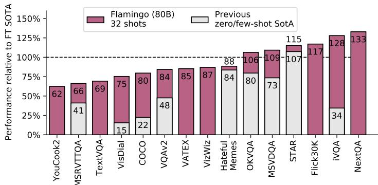
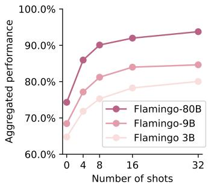
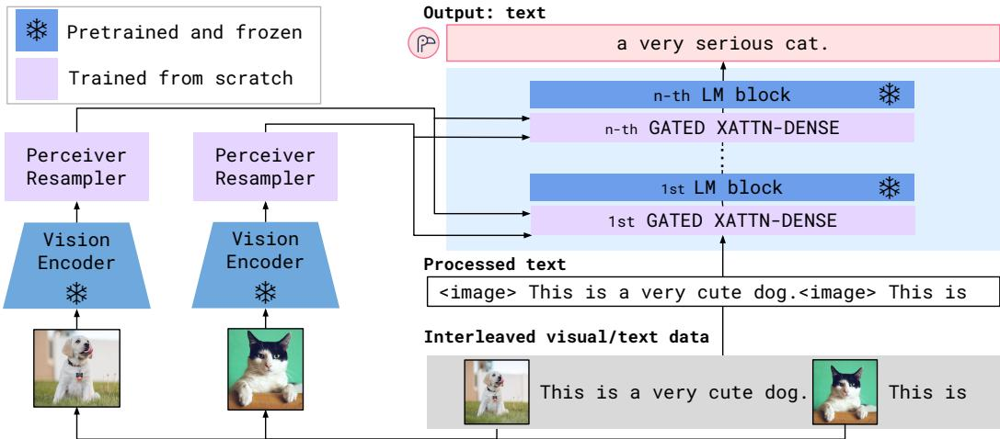
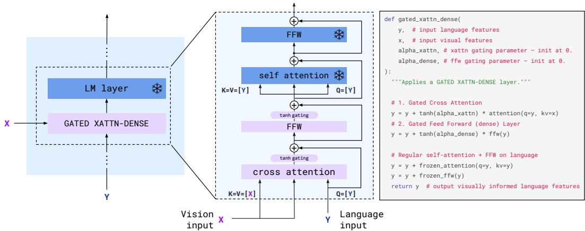
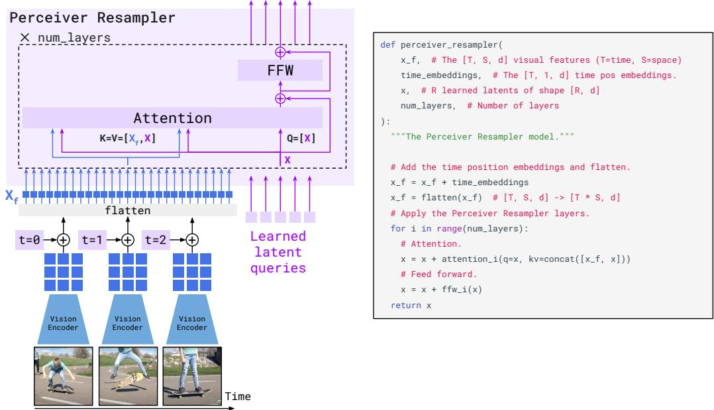
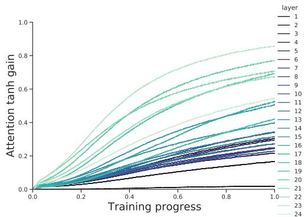
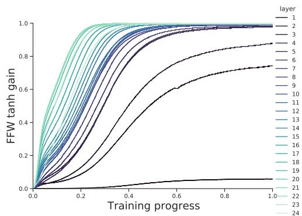
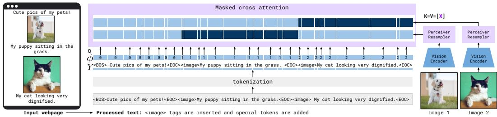
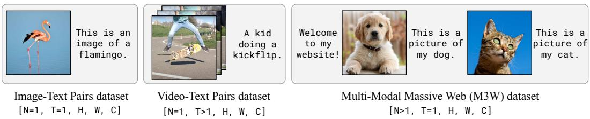
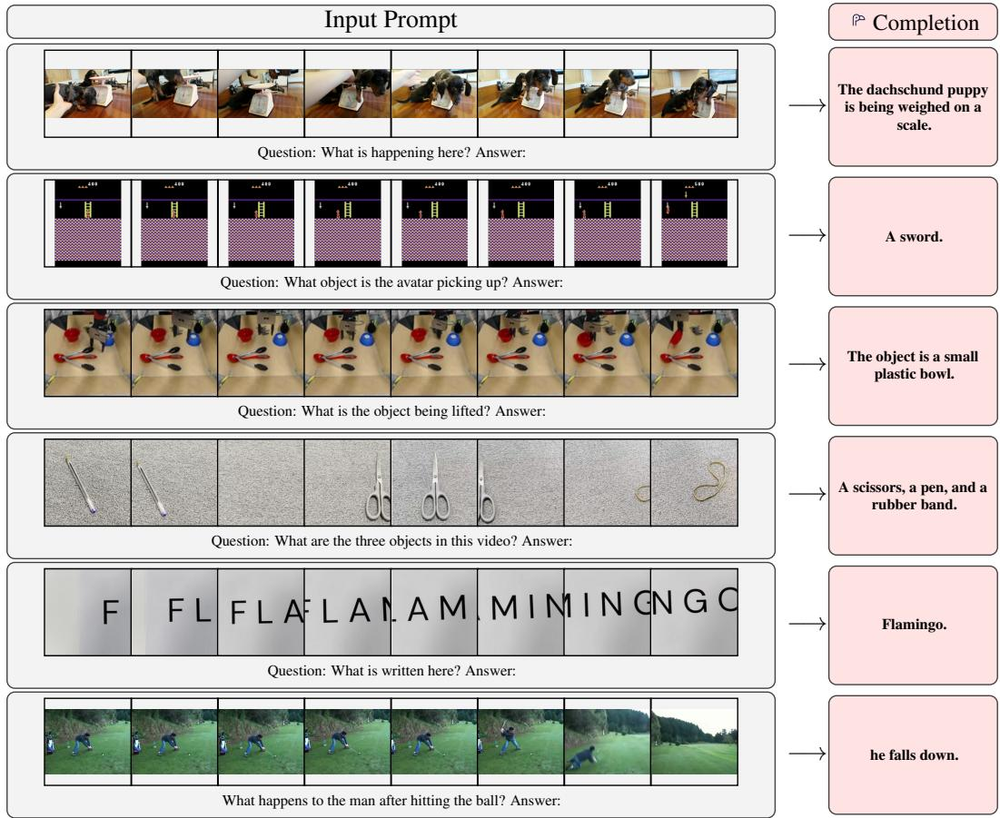

# Flamingo：用于少样本学习的视觉语言模型

Jean-Baptiste Alayrac<sup>\*,‡</sup> Jeff Donahue<sup>\*</sup> Pauline Luc<sup>\*</sup> Antoine Miech<sup>\*</sup>

Iain Barr<sup>†</sup> Yana Hasson<sup>†</sup> Karel Lenc<sup>†</sup> Arthur Mensch<sup>†</sup> Katie Millican<sup>†</sup>

Malcolm Reynolds<sup>†</sup> Roman Ring<sup>†</sup> Eliza Rutherford<sup>†</sup> Serkan Cabi Tengda Han

Zhitao Gong Sina Samangooei

Marianne Monteiro Jacob Menick

Sebastian Borgeaud Andrew Brock

Aida Nematzadeh Sahand Sharifzadeh

Mikolaj Binkowski Ricardo Barreira

Oriol Vinyals Andrew Zisserman

Karen Simonyan<sup>\*,‡</sup>

<sup>\*</sup> 贡献相同，按姓名字母顺序排列，<sup>†</sup> 贡献相同，按姓名字母顺序排列，<sup>‡</sup> 资深作者贡献相同

DeepMind

## 摘要

构建仅需少量标注样本即可快速适应新任务的模型，是多模态机器学习研究中一项极具挑战的公开课题。我们推出了 Flamingo 系列视觉语言模型（Visual Language Models, VLM），该系列模型具备这种能力。我们提出了关键的架构创新，以实现：(i) 连接强大的预训练纯视觉模型与纯语言模型；(ii) 处理任意交错的视觉与文本数据序列；(iii) 无缝摄入图像或视频作为输入。得益于其灵活性，Flamingo 模型可以在包含任意交错文本和图像的大规模多模态网络语料库上进行训练，这正是赋予其上下文少样本学习（in-context few-shot learning）能力的关键。我们对模型进行了全面的评估，探索并衡量了其快速适应各种图像和视频任务的能力。这些任务包括开放式任务（如视觉问答，即通过提示向模型提出问题并由其回答）、图像描述任务（评估其描述场景或事件的能力）以及闭合式任务（如多项选择视觉问答）。对于处于该谱系中的任意任务，仅需使用特定任务的样本对模型进行提示，单一的 Flamingo 模型即可凭借少样本学习刷新当前最优性能（state of the art）。在多个基准测试中，Flamingo 的表现超越了在千倍以上特定任务数据上微调的模型。

  
Figure 1: Flamingo-80B 的输入与输出精选示例。Flamingo 可以通过少样本提示（few-shot prompting）快速适应各种图像/视频理解任务（上图）。开箱即用状态下，Flamingo 还具备多图像视觉对话能力（下图）。更多示例见附录 C。



  
Figure 2: Flamingo 结果概览。左图：我们最大的模型 Flamingo，在无需微调的情况下，在我们考虑的 16 项任务中的 6 项上超越了最先进的微调模型。对于已有公开发表少样本（few-shot）结果的 9 项任务，Flamingo 刷新了少样本的最优水平（state of the art）。注：我们省略了第 16 项基准测试 RareAct，因为这是一个零样本基准，没有可供对比的微调结果。右图：Flamingo 的性能随着模型规模和样本数（shots）的增加而提升。

## 1 引言

智能的一个关键方面在于能够根据简短指令快速学会执行新任务 [33, 70]。尽管在计算机视觉领域朝着类似能力取得了一定进展，但目前最广泛使用的范式仍然是在大量监督数据上先行预训练，随后在目标任务上微调模型 [66, 118, 143]。然而，成功的微调往往需要成千上万个标注数据点。此外，它通常需要针对每个任务进行精细的超参数调优，且耗费大量资源。近期，采用对比目标训练的多模态视觉-语言模型（multimodal vision-language models）[50, 85] 实现了对新任务的零样本（zero-shot）适应，而无需微调。然而，由于这些模型仅提供文本与图像之间的相似度得分，它们只能处理有限的应用场景，例如预先提供了有限输出结果集的分类任务。至关重要的是，它们缺乏生成语言的能力，这使其不太适用于更为开放的任务，如图像描述（captioning）或视觉问答（visual question answering）。亦有其他工作探索了以视觉为条件的语言生成 [17, 114, 119, 124, 132]，但在低数据量场景下尚未展现出优良性能。

我们推出了 Flamingo，这是一种视觉语言模型（Visual Language Model，VLM），它在广泛的开放式视觉和语言任务上的少样本学习（few-shot learning）中树立了全新的前沿水平，仅需通过少量输入/输出样例进行提示（prompt），如图 1 所示。在我们考虑的 16 项任务中，Flamingo 还在 6 项任务上超越了微调的最新水平，尽管所使用的特定任务训练数据要少几个数量级（见图 2）。为实现这一目标，Flamingo 从近期关于大语言模型（large language models，LM）的研究中汲取了灵感，这些大语言模型是非常出色的少样本学习者 [11, 18, 42, 86]。单个大语言模型仅使用其文本接口就能在许多任务上取得强大的性能：将任务的几个样例作为提示连同查询输入一起提供给模型，模型通过生成后续文本来为该查询生成预测输出。我们证明，对于图像和视频理解任务（如分类、图像描述生成或问答）也可以做到这一点：这些任务可以被重塑为以视觉输入为条件的文本预测问题。与语言模型的不同之处在于，该模型必须能够接收包含图像和/或视频与文本交错的多模态提示。Flamingo 模型具备这种能力——它们是以视觉为条件的自回归文本生成模型，能够接收与图像和/或视频交错的文本标记（tokens）序列，并生成文本作为输出。Flamingo 模型利用了两个互补的预训练且冻结的模型：一个能够“感知”视觉场景的视觉模型，以及一个执行基本推理形式的大语言模型。在这些模型之间添加了新颖的架构组件，以便将它们连接起来，同时保留它们在计算密集型预训练期间积累的知识。得益于基于 Perceiver [48] 的架构，Flamingo 模型还能够接收高分辨率图像或视频，该架构可以在给定大量且可变数量的视觉输入特征的情况下，为每张图像/每个视频生成少量固定数量的视觉标记。

大语言模型性能的一个关键方面在于它们是在大量文本数据上训练的。这种训练提供了通用的生成能力，使这些大语言模型在接收到任务样例提示时能够表现出色。同样，我们证明训练 Flamingo 模型的方式对其最终性能至关重要。它们在精心挑选的互补大规模多模态数据混合物上进行训练，这些数据仅来源于网络，未使用任何专为机器学习目的而标注的数据。在完成这种训练后，Flamingo 模型可以通过简单的少样本学习直接适应视觉任务，而无需任何特定于任务的微调。

  
Figure 3: Flamingo 架构概览。Flamingo 是一个视觉语言模型（VLMs）家族，它以与文本交错的视觉数据作为输入，并生成自由形式的文本作为输出。

贡献（Contributions）。总的来说，我们的贡献如下：(i) 我们推出了 Flamingo 系列视觉语言模型（VLM），该系列模型仅凭少量输入/输出示例即可执行各种多模态任务（例如图像描述、视觉对话或视觉问答）。得益于架构上的创新，Flamingo 模型能够高效地接收任意交错的视觉数据和文本作为输入，并以开放式方式生成文本。(ii) 我们定量评估了 Flamingo 模型如何通过少样本学习（few-shot learning）适应各种任务。值得注意的是，我们保留了大量未用于验证该方法的任何设计决策或超参数的保留基准（heldout benchmarks）。我们利用这些基准来评估无偏的少样本性能。(iii) Flamingo 在包含 16 个多模态语言与图像/视频理解任务的广泛领域中刷新了少样本学习的当前最优水平（state of the art）。在这 16 个任务中的 6 个任务上，尽管 Flamingo 仅使用了 32 个特定任务的示例（比当前最优水平所用的特定任务训练数据少约 1000 倍），其表现仍优于经过微调的当前最优水平模型。在更大的标注预算下，Flamingo 还可以通过有效微调在另外五个具有挑战性的基准测试上创下新的最佳水平：VQAv2、VATEX、VizWiz、MSRVTTQA 和 HatefulMemes。

## 2 方法

本节介绍 Flamingo：一种接收与图像/视频交错的文本作为输入并输出自由形式文本的视觉语言模型。图 3（Figure 3）所示的关键架构组件旨在利用预训练的视觉和语言模型，并有效地将它们连接起来。首先，Perceiver 重采样器（Perceiver Resampler，第 2.1 节）接收来自视觉编码器（Vision Encoder，从图像或视频中获得）的时空特征，并输出固定数量的视觉 token（visual tokens）。其次，这些视觉 token 用于通过新初始化的交叉注意力层（cross-attention layers，第 2.2 节）为冻结的语言模型（LM）提供条件，这些交叉注意力层交错插入在预训练的语言模型层之间。这些新层为语言模型在下一个 token 预测（next-token prediction）任务中整合视觉信息提供了一种富于表达力的方式。Flamingo 将以交错的图像和视频 $x$ 为条件的文本 $y$ 的似然建模如下：

$$
p (y | x) = \prod_ {\ell = 1} ^ {L} p (y _ {\ell} | y _ {<   \ell}, x _ {\leq \ell}),\tag{1}
$$

其中 $y _ { \ell }$ 是输入文本的第 $\ell$ 个语言 token，$y _ { < \ell }$ 是前面所有 token 的集合，$x _ { < \ell }$ 是交错序列中先于 token $y _ { \ell }$ 的图像/视频集合，而 $p$ 则由 Flamingo 模型参数化。处理交错文本和视觉序列的能力（第 2.3 节）使得 Flamingo 模型能够自然地用于上下文少样本学习（in-context few-shot learning），类似于使用少样本文本提示（few-shot text prompting）的 GPT-3。该模型在多样化的混合数据集上进行训练，详见第 2.4 节。

  
Figure 4: 门控交叉注意力-稠密（GATED XATTN-DENSE）层。为了将视觉输入作为条件引入 LM，我们在现有的预训练且冻结的 LM 层之间插入了新的交叉注意力层。这些层中的键（keys）和值（values）来自视觉特征，而查询（queries）则来自语言输入。它们后接稠密前馈层。这些层采用了门控机制，使得在初始化时 LM 保持不变，以提高稳定性和性能。

## 2.1 视觉处理与 Perceiver 重采样器（Perceiver Resampler）

视觉编码器：从像素到特征。我们的视觉编码器是一个预训练且冻结的无归一化 ResNet（Normalizer-Free ResNet，NFNet）[10]——我们使用的是 F6 模型。我们在图像-文本对数据集上使用对比目标对视觉编码器进行预训练，采用了 Radford 等人 [85] 的双项对比损失。我们使用最后一阶段的输出，即展平为 1D 序列的 2D 空间特征网格。对于视频输入，以 1 FPS 采样视频帧并独立进行编码，以获得 3D 时空特征网格，并在其上添加可学习的时间嵌入（temporal embeddings）。然后将这些特征展平为 1D，再送入 Perceiver Resampler。关于对比模型训练和性能的更多细节分别见附录 B.1.3 和附录 B.3.2。

Perceiver 重采样器：从大小可变的大特征图到少量视觉标记（tokens）。该模块将视觉编码器与冻结的语言模型连接起来，如图 3 所示。它接收来自视觉编码器的可变数量的图像或视频特征作为输入，并产生固定数量的视觉输出（64 个），从而降低了视觉-文本交叉注意力的计算复杂度。与 Perceiver [48] 和 DETR [13] 类似，我们学习预定义数量的潜在输入查询（latent input queries），将其输入到 Transformer 中并与视觉特征进行交叉注意力计算。我们在消融实验（第 3.3 节）中表明，使用这种视觉-语言重采样器模块优于普通的 Transformer 和 MLP。我们在附录 A.1.1 中提供了示意图、更多架构细节以及伪代码。

## 2.2 以视觉表征为条件指导冻结语言模型

文本生成由 Transformer 解码器执行，并以 Perceiver Resampler 生成的视觉表征为条件。我们将预训练且冻结的纯文本 LM 模块与从头开始训练的模块进行交替交错排列，后者与来自 Perceiver Resampler 的视觉输出进行交叉注意力计算。

在冻结的预训练 LM 中交错插入新的 GATED XATTN-DENSE 层。我们冻结预训练 LM 块，并在原始层之间插入从头训练的门控交叉注意力稠密块（Figure 4）。为了确保在初始化时条件模型产生与原始语言模型相同的结果，我们使用了 tanh 门控机制 [41]。该机制在将新添加层的输出加到来自残差连接的输入表示之前，先将其乘以 $\tanh(\alpha)$，其中 $\alpha$ 是特定于层的可学习标量，初始化为 0 [4]。因此，在初始化时，模型输出与预训练 LM 的输出一致，从而提高了训练稳定性和最终性能。在我们的消融实验（Section 3.3）中，我们将提出的 GATED XATTN-DENSE 层与近期的替代方案 [22, 68] 进行了比较，并探讨了插入这些附加层的频率所带来的效率与表达能力之间的权衡。详见 Appendix A.1.2。

不同的模型尺寸。我们基于 1.4B、7B 和 70B 参数的 Chinchilla 模型 [42] 进行了跨三种模型尺寸的实验；分别称它们为 Flamingo-3B、Flamingo-9B 和

Flamingo-80B。为简便起见，我们在整篇论文中将后者简称为 Flamingo。在增加冻结 LM 和可训练视觉-文本 GATED XATTN-DENSE 模块参数量的同时，我们在不同模型间保持了固定尺寸的冻结视觉编码器和可训练 Perceiver Resampler（相对于整个模型尺寸较小）。详见 Appendix B.1.1。

## 2.3 多视觉输入支持：逐图像/视频注意力掩码

公式 Equation (1) 中引入的图像因果建模是通过掩码完整的文本到图像交叉注意力矩阵来实现的，从而限制了模型在每个文本 token 处能看到的视觉 token。在给定的文本 token 处，模型只关注交错序列中紧邻其前出现的图像的视觉 token，而不是所有之前的图像（在 Appendix A.1.3 中进行了形式化说明和图解）。尽管模型一次只能直接关注单个图像，但通过 LM 中的自注意力机制，对之前所有图像的依赖性仍然得以保留。重要的是，这种单图像交叉注意力方案使模型能够无缝泛化到任意数量的视觉输入，而与训练期间使用的数量无关。特别是，在交错数据集上训练时，每个序列我们最多仅使用 5 张图像，但在评估期间，我们的模型能够从多达 32 对（或“shots”）图像/视频及对应文本的序列中受益。我们在 Section 3.3 中展示了该方案比允许模型直接对所有先前图像进行交叉注意力更有效。

## 2.4 在视觉与语言混合数据集上训练

我们在三类混合数据集上训练 Flamingo 模型，这些数据集均抓取自网络：源自网页的交错图像和文本数据集、图像-文本对以及视频-文本对。

M3W：图文交错数据集。Flamingo 模型的少样本（few-shot）能力依赖于在图文交错数据上的训练。为此，我们构建了 MultiModal MassiveWeb（M3W）数据集。我们从大约 4300 万个网页的 HTML 中提取文本和图像，并根据文档对象模型（Document Object Model，DOM）中文本和图像元素的相对位置来确定图像相对于文本的位置。接着，通过在网页中图像所在位置的纯文本中插入 `<image>` 标签，并在任意图像之前以及文档末尾插入一个特殊的 `<EOC>`（块结束，end of chunk）token（已添加到词表中并进行学习）来构建样本。对于每个文档，我们随机采样一个长度为 $L = 2 5 6$ 个 token 的子序列，并保留该采样序列中包含的最多前 $N = 5$ 张图像。超出部分的图像将被丢弃以节省计算资源。更多细节见附录 A.3。

图像/视频与文本对。对于图文对，我们首先利用了由 18 亿张图像及其替代文本（alt-text）配对组成的 ALIGN [50] 数据集。为了对该数据集进行补充，我们收集了以更高质量和更长描述为目标的自有图文对数据集：包含 3.12 亿个图文对的 LTIP（Long Text & Image Pairs，长文本与图像对）。我们还收集了一个类似但使用视频代替静态图像的数据集：包含 2700 万条短视频（平均时长约 22 秒）与句子描述配对的 VTP（Video & Text Pairs，视频与文本对）。我们通过在每个训练描述（caption）前添加 `<image>` 并在末尾追加 `<EOC>`，使配对数据集的句法与 M3W 的句法保持一致（详见附录 A.3.3）。

多目标训练与优化策略。我们通过在给定视觉输入的情况下最小化各数据集文本的期望负对数似然加权和来训练模型：

$$
\sum_ {m = 1} ^ {M} \lambda_ {m} \cdot \mathbb {E} _ {(x, y) \sim \mathcal {D} _ {m}} \left[ - \sum_ {\ell = 1} ^ {L} \log p (y _ {\ell} | y _ {<   \ell}, x _ {\leq \ell}) \right],\tag{2}
$$

其中 $\mathcal { D } _ { m }$ 和 $\lambda _ { m }$ 分别代表第 $m$ 个数据集及其权重。调整每个数据集的权重 $\lambda _ { m }$ 是提升性能的关键。我们在所有数据集上累积梯度，并发现这种做法优于“轮询（round-robin）”方法 [17]。我们在附录 B.1.2 中提供了更多训练细节和消融实验。

## 2.5 基于少样本上下文学习的任务适配

一旦 Flamingo 训练完成，我们通过以多模态交错提示为条件来利用它处理视觉任务。与 GPT-3 [11] 类似，我们通过交错排列形如 (, ) 或 (, ) 的支持示例对，随后接上查询视觉输入来构建提示（详见附录 A.2），以此评估模型利用上下文学习（in-context learning）快速适应新任务的能力。我们使用束搜索（beam search）进行解码以开展开放式评估，并利用模型的对数似然对每个可能的答案进行评分以开展封闭式评估。我们通过使用来自该任务的两个纯文本示例（不包含对应图像）对模型进行提示，来探索零样本泛化（zero-shot generalization）。评估超参数及其他详细信息见附录 B.1.5。

<table><tr><td>方法</td></tr><tr><td>FT Shot</td></tr><tr><td>OKVQA (I)</td></tr><tr><td>VQAv2 (I)</td></tr><tr><td>COCO (I)</td></tr><tr><td>MSVDQA (V)</td></tr><tr><td>VATEX (V)</td></tr><tr><td>VizWiz (I)</td></tr><tr><td>Flick30K (I)</td></tr><tr><td>MSRVTTQA (V)</td></tr><tr><td>iVQA (V)</td></tr><tr><td>YouCook2 (V)</td></tr><tr><td>STAR (V)</td></tr><tr><td>VisDial (I)</td></tr><tr><td>TextVQA (I)</td></tr><tr><td>NextQA (I)</td></tr><tr><td>HatefulMemes (I)</td></tr><tr><td>RareAct (V)</td></tr></table>

<table><tr><td rowspan="3">零样本/少样本 SOTA</td><td rowspan="3">X</td><td rowspan="3">(X)</td><td>[34]</td><td>[114]</td><td>[124]</td><td>[58]</td><td></td><td></td><td></td><td>[58]</td><td>[135]</td><td></td><td>[143]</td><td>[79]</td><td></td><td></td><td>[85]</td><td>[85]</td></tr><tr><td>43.3</td><td>38.2</td><td>32.2</td><td>35.2</td><td>-</td><td>-</td><td>-</td><td>19.2</td><td>12.2</td><td>-</td><td>39.4</td><td>11.6</td><td>-</td><td>-</td><td>66.1</td><td>40.7</td></tr><tr><td>(16)</td><td>(4)</td><td>(0)</td><td>(0)</td><td></td><td></td><td></td><td>(0)</td><td>(0)</td><td></td><td>(0)</td><td>(0)</td><td></td><td></td><td>(0)</td><td>(0)</td></tr><tr><td rowspan="3">Flamingo-3B</td><td>X</td><td>0</td><td>41.2</td><td>49.2</td><td>73.0</td><td>27.5</td><td>40.1</td><td>28.9</td><td>60.6</td><td>11.0</td><td>32.7</td><td>55.8</td><td>39.6</td><td>46.1</td><td>30.1</td><td>21.3</td><td>53.7</td><td>58.4</td></tr><tr><td>X</td><td>4</td><td>43.3</td><td>53.2</td><td>85.0</td><td>33.0</td><td>50.0</td><td>34.0</td><td>72.0</td><td>14.9</td><td>35.7</td><td>64.6</td><td>41.3</td><td>47.3</td><td>32.7</td><td>22.4</td><td>53.6</td><td>-</td></tr><tr><td>X</td><td>32</td><td>45.9</td><td>57.1</td><td>99.0</td><td>42.6</td><td>59.2</td><td>45.5</td><td>71.2</td><td>25.6</td><td>37.7</td><td>76.7</td><td>41.6</td><td>47.3</td><td>30.6</td><td>26.1</td><td>56.3</td><td>-</td></tr><tr><td rowspan="3">Flamingo-9B</td><td>X</td><td>0</td><td>44.7</td><td>51.8</td><td>79.4</td><td>30.2</td><td>39.5</td><td>28.8</td><td>61.5</td><td>13.7</td><td>35.2</td><td>55.0</td><td>41.8</td><td>48.0</td><td>31.8</td><td>23.0</td><td>57.0</td><td>57.9</td></tr><tr><td>X</td><td>4</td><td>49.3</td><td>56.3</td><td>93.1</td><td>36.2</td><td>51.7</td><td>34.9</td><td>72.6</td><td>18.2</td><td>37.7</td><td>70.8</td><td>42.8</td><td>50.4</td><td>33.6</td><td>24.7</td><td>62.7</td><td>-</td></tr><tr><td>X</td><td>32</td><td>51.0</td><td>60.4</td><td>106.3</td><td>47.2</td><td>57.4</td><td>44.0</td><td>72.8</td><td>29.4</td><td>40.7</td><td>77.3</td><td>41.2</td><td>50.4</td><td>32.6</td><td>28.4</td><td>63.5</td><td>-</td></tr><tr><td rowspan="3">Flamingo</td><td>X</td><td>0</td><td>50.6</td><td>56.3</td><td>84.3</td><td>35.6</td><td>46.7</td><td>31.6</td><td>67.2</td><td>17.4</td><td>40.7</td><td>60.1</td><td>39.7</td><td>52.0</td><td>35.0</td><td>26.7</td><td>46.4</td><td>60.8</td></tr><tr><td>X</td><td>4</td><td>57.4</td><td>63.1</td><td>103.2</td><td>41.7</td><td>56.0</td><td>39.6</td><td>75.1</td><td>23.9</td><td>44.1</td><td>74.5</td><td>42.4</td><td>55.6</td><td>36.5</td><td>30.8</td><td>68.6</td><td>-</td></tr><tr><td>X</td><td>32</td><td>57.8</td><td>67.6</td><td>113.8</td><td>52.3</td><td>65.1</td><td>49.8</td><td>75.4</td><td>31.0</td><td>45.3</td><td>86.8</td><td>42.2</td><td>55.6</td><td>37.9</td><td>33.5</td><td>70.0</td><td>-</td></tr><tr><td rowspan="3">预训练微调 SOTA</td><td rowspan="3">√</td><td></td><td>54.4</td><td>80.2</td><td>143.3</td><td>47.9</td><td>76.3</td><td>57.2</td><td>67.4</td><td>46.8</td><td>35.4</td><td>138.7</td><td>36.7</td><td>75.2</td><td>54.7</td><td>25.2</td><td>79.1</td><td></td></tr><tr><td></td><td>[34]</td><td>[140]</td><td>[124]</td><td>[28]</td><td>[153]</td><td>[65]</td><td>[150]</td><td>[51]</td><td>[135]</td><td>[132]</td><td>[128]</td><td>[79]</td><td>[137]</td><td>[129]</td><td>[62]</td><td>-</td></tr><tr><td>(X)</td><td>(10K)</td><td>(444K)</td><td>(500K)</td><td>(27K)</td><td>(500K)</td><td>(20K)</td><td>(30K)</td><td>(130K)</td><td>(6K)</td><td>(10K)</td><td>(46K)</td><td>(123K)</td><td>(20K)</td><td>(38K)</td><td>(9K)</td><td></td></tr></table>

Table 1: 与最先进技术的对比。单个 Flamingo 模型通过少样本学习在广泛的图像（I）和视频（V）理解任务上达到了最先进水平，仅使用区区四个示例就显著超越了此前最佳的零样本和少样本方法。更重要的是，在仅使用 32 个示例且不调整任何模型权重的情况下，Flamingo 在七个任务上超越了当前最佳方法——而这些方法是在数千个标注示例上微调得到的。最佳少样本数值以**粗体**显示，总体最佳数值以<u>下划线</u>标出。

## 3 实验

我们的目标是开发能够快速适应多样且具有挑战性任务的模型。为此，我们考虑了涵盖多模态图像/视频与语言的 16 个流行基准。为了在项目过程中验证模型设计决策，其中 5 个基准被用作我们开发（DEV）集的一部分：COCO、OKVQA、VQAv2、MSVDQA 和 VATEX。由于模型选择的存在，在 DEV 基准上的性能评估可能存在偏差。我们注意到，利用类似基准来验证和消融设计决策的先前工作也是如此。为了解决这一问题，我们在另外 11 个基准上报告了性能，这些基准涵盖图像描述、视频问答，以及一些较少被探索的能力，如视觉对话和多项选择问答任务。评估基准在附录 B.1.4 中进行了描述。我们在所有基准上保持所有评估超参数固定。根据任务的不同，我们使用了四种少样本提示模板，具体细节在附录 B.1.5 中描述。我们强调，我们没有在这 11 个基准上验证任何设计决策，仅将其用于评估模型无偏的少样本学习性能。

具体而言，评估模型的少样本学习性能涉及使用一组支持样本对其进行提示，并在对应的一组查询样本上进行评估。对于既用于验证设计决策和超参数、又用于报告最终性能的 DEV 基准，我们因此使用了四个子集：验证支持集（validation support）、验证查询集（validation query）、测试支持集（test support）和测试查询集（test query）。对于其他基准，我们只需要后两个子集。我们在附录 B.1.4 中报告了如何构建这些子集。

我们在第 3.1 节中报告了 Flamingo 模型在少样本学习上的结果。第 3.2 节给出了 Flamingo 的微调结果。消融实验在第 3.3 节中给出。附录 B.2 提供了更多结果，包括 Flamingo 在 ImageNet 和 Kinetics700 分类任务上的性能，以及我们对比模型的性能。附录 C 包含了额外的定性结果。

## 3.1 视觉-语言任务上的少样本学习

少样本（Few-shot）结果。结果如 Table 1 所示。在所评估的 16 个基准上，Flamingo 大幅超越了以往所有的零样本（zero-shot）或少样本方法。这一成绩仅通过每个任务少至 4 个示例即可实现，证明了视觉模型对新任务实用且高效的适应能力。更重要的是，Flamingo 通常能够与那些在多达数十万个标注示例上额外进行了微调的最先进（state-of-the-art，SotA）方法相媲美。在 6 个任务中，尽管仅使用单一模型权重且每个任务仅给出了 32 个特定示例，Flamingo 甚至超越了微调后的 SotA。

<table><tr><td rowspan="2">方法</td><td colspan="2">VQAV2</td><td rowspan="2">COCO test</td><td rowspan="2">VATEX test</td><td colspan="2">VizWiz</td><td rowspan="2">MSRVTTQA test</td><td colspan="2">VisDial</td><td rowspan="2">YouCook2 valid</td><td rowspan="2">TextVQA valid</td><td rowspan="2">TextVQA test</td><td rowspan="2">HatefulMemes test seen</td></tr><tr><td>test-dev</td><td>test-std</td><td>test-dev</td><td>test-std</td><td>valid</td><td>test-std</td></tr><tr><td>32 shots</td><td>67.6</td><td>-</td><td>113.8</td><td>65.1</td><td>49.8</td><td>-</td><td>31.0</td><td>56.8</td><td>-</td><td>86.8</td><td>36.0</td><td>-</td><td>70.0</td></tr><tr><td>Fine-tuned</td><td>82.0</td><td>82.1</td><td>138.1</td><td>84.2</td><td>65.7</td><td>65.4</td><td>47.4</td><td>61.8</td><td>59.7</td><td>118.6</td><td>57.1</td><td>54.1</td><td>86.6</td></tr><tr><td>SotA</td><td> $81.3^†$ [133]</td><td> $81.3^†$ [133]</td><td> $149.6^†$ [119]</td><td> $81.4^†$ [153]</td><td> $57.2^†$ [65]</td><td> $60.6^†$ [65]</td><td>46.8[51]</td><td>75.2[79]</td><td> $75.4^†$ [123]</td><td>138.7[132]</td><td>54.7[137]</td><td>73.7[84]</td><td> $84.6^†$ [152]</td></tr></table>

Table 2: 微调 Flamingo 时与 SotA 的对比。我们在少样本学习未达到 SotA 的全部 9 个任务上对 Flamingo 进行了微调。Flamingo 在其中 5 个任务上创造了新的 SotA，超越了使用模型集成或特定领域指标优化（例如 CIDEr 优化）等技巧的方法（用 † 标出）。

<table><tr><td></td><td>消融设置</td><td>Flamingo-3B 原始值</td><td>变更值</td><td>参数量 ↓</td><td>步耗时 ↓</td><td>COCO CIDEr↑</td><td>OKVQA top1↑</td><td>VQAv2 top1↑</td><td>MSVDQA top1↑</td><td>VATEX CIDEr↑</td><td>综合得分↑</td></tr><tr><td colspan="4">Flamingo-3B 模型</td><td>3.2B</td><td>1.74s</td><td>86.5</td><td>42.1</td><td>55.8</td><td>36.3</td><td>53.4</td><td>70.7</td></tr><tr><td rowspan="4">(i)</td><td rowspan="4">训练数据</td><td rowspan="4">所有数据</td><td>去除视频-文本对</td><td>3.2B</td><td>1.42s</td><td>84.2</td><td>43.0</td><td>53.9</td><td>34.5</td><td>46.0</td><td>67.3</td></tr><tr><td>去除图像-文本对</td><td>3.2B</td><td>0.95s</td><td>66.3</td><td>39.2</td><td>51.6</td><td>32.0</td><td>41.6</td><td>60.9</td></tr><tr><td>图像-文本对→LAION</td><td>3.2B</td><td>1.74s</td><td>79.5</td><td>41.4</td><td>53.5</td><td>33.9</td><td>47.6</td><td>66.4</td></tr><tr><td>去除 M3W</td><td>3.2B</td><td>1.02s</td><td>54.1</td><td>36.5</td><td>52.7</td><td>31.4</td><td>23.5</td><td>53.4</td></tr><tr><td>(ii)</td><td>优化方式</td><td>梯度累加</td><td>轮询（Round Robin）</td><td>3.2B</td><td>1.68s</td><td>76.1</td><td>39.8</td><td>52.1</td><td>33.2</td><td>40.8</td><td>62.9</td></tr><tr><td>(iii)</td><td>Tanh 门控</td><td>√</td><td>✗</td><td>3.2B</td><td>1.74s</td><td>78.4</td><td>40.5</td><td>52.9</td><td>35.9</td><td>47.5</td><td>66.5</td></tr><tr><td rowspan="2">(iv)</td><td rowspan="2">交叉注意力架构</td><td rowspan="2">GATED XATTN-DENSE</td><td rowspan="2">VANILLA XATTN GRAFTING</td><td>2.4B</td><td>1.16s</td><td>80.6</td><td>41.5</td><td>53.4</td><td>32.9</td><td>50.7</td><td>66.9</td></tr><tr><td>3.3B</td><td>1.74s</td><td>79.2</td><td>36.1</td><td>50.8</td><td>32.2</td><td>47.8</td><td>63.1</td></tr><tr><td rowspan="3">(v)</td><td rowspan="3">交叉注意力频率</td><td rowspan="3">每层</td><td>仅中间单层</td><td>2.0B</td><td>0.87s</td><td>71.5</td><td>38.1</td><td>50.2</td><td>29.1</td><td>42.3</td><td>59.8</td></tr><tr><td>每 4 层</td><td>2.3B</td><td>1.02s</td><td>82.3</td><td>42.7</td><td>55.1</td><td>34.6</td><td>50.8</td><td>68.8</td></tr><tr><td>每 2 层</td><td>2.6B</td><td>1.24s</td><td>83.7</td><td>41.0</td><td>55.8</td><td>34.5</td><td>49.7</td><td>68.2</td></tr><tr><td rowspan="2">(vi)</td><td rowspan="2">重采样器（Resampler）</td><td rowspan="2">Perceiver</td><td>MLP</td><td>3.2B</td><td>1.85s</td><td>78.6</td><td>42.2</td><td>54.7</td><td>35.2</td><td>44.7</td><td>66.6</td></tr><tr><td>Transformer</td><td>3.2B</td><td>1.81s</td><td>83.2</td><td>41.7</td><td>55.6</td><td>31.5</td><td>48.3</td><td>66.7</td></tr><tr><td rowspan="2">(vii)</td><td rowspan="2">视觉编码器</td><td rowspan="2">NFNet-F6</td><td>CLIP ViT-L/14</td><td>3.1B</td><td>1.58s</td><td>76.5</td><td>41.6</td><td>53.4</td><td>33.2</td><td>44.5</td><td>64.9</td></tr><tr><td>NFNet-F0</td><td>2.9B</td><td>1.45s</td><td>73.8</td><td>40.5</td><td>52.8</td><td>31.1</td><td>42.9</td><td>62.7</td></tr><tr><td rowspan="2">(viii)</td><td rowspan="2">冻结语言模型（LM）</td><td rowspan="2">√</td><td>✗（随机初始化）</td><td>3.2B</td><td>2.42s</td><td>74.8</td><td>31.5</td><td>45.6</td><td>26.9</td><td>50.1</td><td>57.8</td></tr><tr><td>✗（预训练）</td><td>3.2B</td><td>2.42s</td><td>81.2</td><td>33.7</td><td>47.4</td><td>31.0</td><td>53.9</td><td>62.7</td></tr></table>

Table 3: 消融研究。每一行都应与基线 Flamingo 运行（顶行）进行比较。单步时间（Step time）衡量在所有训练数据集上执行梯度更新所花费的时间。

最后，尽管我们仅使用 DEV 基准测试来进行设计决策，但我们的结果能够很好地泛化到其他基准测试，证实了我们方法的通用性。

参数量与少样本数量的扩展性（Scaling with respect to parameters and shots）。如图 2 所示，模型越大，少样本性能越好，这与 GPT-3 [11] 类似。性能也会随着样本数量（shots）的增加而提升。我们进一步发现，最大的模型能够更好地利用更多的样本数量。有趣的是，尽管我们的 Flamingo 模型在 M3W 上的训练序列仅限于 5 张图像，但它们在推理过程中仍能从多达 32 张图像或视频中受益。这证明了 Flamingo 架构在处理可变数量的视频或图像方面的灵活性。

## 3.2 将 Flamingo 作为预训练视觉-语言模型进行微调

尽管这不是我们工作的重点，但我们验证了在给定更多数据的情况下，Flamingo 模型可以通过微调其权重来适应某项任务。在 Table 2 中，我们探讨了在不限制标注预算的情况下，针对给定任务微调我们最大的模型 Flamingo。简而言之，我们通过在较短的训练周期内使用较小的学习率对模型进行微调，并额外解冻视觉主干网络以适应更高的输入分辨率（详情见附录 B.2.2）。我们发现，相比于我们之前展示的上下文少样本学习结果，微调可以进一步提升性能，在另外五个任务上创造了新的最先进水平（state of the art）：VQAv2、VATEX、VizWiz、MSRVTTQA 和 HatefulMemes。

## 3.3 消融研究

在 Table 3 中，我们报告了使用 Flamingo-3B 在五个 DEV 基准测试的验证子集上进行 4 样本（4-shot）测试的消融实验结果。需要注意的是，与最终模型相比，我们使用了更小的批次大小（batch sizes）和更短的训练周期。综合得分（Overall score）是通过将每个基准测试的分数除以其在 Table 1 中的最先进（SotA）性能并计算平均值得到的。更多细节和结果见附录 B.3 和 Table 10。

训练数据混合的重要性。如行 (i) 所示，选择正确的训练数据起着至关重要的作用。事实上，移除图文交错数据集 M3W 会导致性能下降超过 17%，而移除传统的配对图文数据也会使性能下降（下降 9.8%），这表明了对不同类型数据集的需求。此外，移除我们的配对视频-文本数据集会对所有视频任务的性能产生负面影响。我们进行了用公开可用的 LAION-400M 数据集 [96] 替换我们的图文对（ITP）的消融实验，这导致了性能的轻微下降。我们在行 (ii) 中展示了与使用轮询更新（round-robin updates）[17] 相比，我们的梯度累积策略的重要性。

冻结 LM 的视觉条件化。在第 (iii) 行中，我们消融了在将交叉注意力（cross-attention）输出与冻结 LM 输出合并时使用 0 初始化 tanh 门控（0-initialized tanh gating）的效果。如果没有该门控，我们的总分下降了 4.2%。此外，我们注意到禁用 0 初始化 tanh 门控会导致训练不稳定。接下来，我们在第 (iv) 行中消融了不同的条件化架构。VANILLA XATTN 是指来自原始 Transformer 解码器 [115] 的原生交叉注意力。在来自 [68] 的 GRAFTING 方法中，冻结的 LM 原样使用，不插入额外的层，并从头学习一组堆叠的交错自注意力与交叉注意力层，这些层接收冻结 LM 的输出。总体而言，我们表明我们的 GATED XATTN-DENSE 条件化方法效果最好。

计算/内存与性能权衡。在第 (v) 行中，我们消融了添加新 GATED XATTN-DENSE 块的频率。虽然在每一层都添加它们效果更好，但这会显著增加模型的可训练参数量和时间复杂度。值得注意的是，每四个块插入一个可以将训练速度提高 66%，而总分仅下降 1.9%。鉴于这种权衡，我们在硬件限制下最大化添加层的数量，对于 Flamingo-9B 每四层添加一个 GATED XATTN-DENSE，对于 Flamingo-80B 则每七层添加一个。我们还在第 (vi) 行中，在给定参数预算的情况下将 Perceiver Resampler 与 MLP 以及原生 Transformer 进行了比较。两者的表现均不及 Perceiver Resampler，且速度更慢。

视觉编码器。在第 (vii) 行中，我们将使用对比学习预训练的 NFNet-F6 视觉编码器（详见附录 B.1.3）与公开可用的、在 224 分辨率下训练的 CLIP ViT-L/14 [85] 模型进行了比较。我们的 NFNet-F6 相比 CLIP ViT-L/14 有 +5.8% 的优势，相比更小的 NFNet-F0 编码器有 +8.0% 的优势，这突显了使用强视觉骨干网络（vision backbone）的重要性。

冻结 LM 组件可防止灾难性遗忘。我们在第 (viii) 行验证了训练时冻结 LM 层的重要性。如果从头开始训练，我们观察到性能大幅下降 −12.9%。有趣的是，微调我们的预训练 LM 也会导致性能下降 −8.0%。这表明出现了“灾难性遗忘”（catastrophic forgetting）[71] 现象，即模型在针对新目标进行训练时会逐渐遗忘其预训练知识。在我们的设定中，冻结语言模型是比在混合数据中加入预训练数据集（MassiveText）进行训练更好的替代方案。

## 4 相关工作

语言建模与少样本自适应（Language modelling and few-shot adaptation）。随着 Transformer [115] 的引入，语言建模近期取得了重大进展。首先在海量数据上进行预训练，随后在下游任务上进行自适应的范式已成为标准 [11, 23, 32, 44, 52, 75, 87, 108]。在这项工作中，我们基于 70B Chinchilla 语言模型 [42] 构建 Flamingo 的基础语言模型（LM）。大量研究探索了利用少量样本使语言模型适应新任务的技术。其中包括添加小型适配器模块（adapter modules）[43]、微调语言模型的一小部分 [141]、在提示中展示上下文示例（in-context examples）[11]，或通过梯度下降优化提示 [56, 60]。在本文中，我们从上下文少样本学习技术 [11] 中汲取灵感，而不是采用基于度量学习 [24, 103, 112, 117] 或元学习 [6, 7, 27, 31, 91, 155] 的更复杂的少样本学习方法。

当语言遇上视觉（When language meets vision）。这些语言模型的突破对视觉-语言建模产生了深远影响。特别是 BERT [23] 启发了大量的视觉-语言研究工作 [16, 28, 29, 38, 59, 61, 66, 101, 106, 107, 109, 118, 121, 142, 143, 151]。我们与这些方法的不同之处在于，Flamingo 模型在新任务上无需微调。另一类视觉-语言模型基于对比学习 [2, 5, 49, 50, 57, 74, 82, 85, 138, 140, 146]。Flamingo 与对比模型的不同之处在于它能够生成文本，尽管我们在视觉编码器上构建并依赖于它们。与我们工作相似的是能够以自回归方式生成文本的视觉语言模型（VLM）[19, 25, 45, 67, 116]。同期工作 [17, 58, 119, 124, 154] 也提出将众多视觉任务形式化为文本生成问题。近期有几项工作探索了基于强大的预训练语言模型进行构建。最近的一条研究路线 [26, 68, 78, 114, 136, 144] 提出冻结预训练语言模型的权重，以防止灾难性遗忘 [71]。我们沿用这一思路，冻结了

Chinchilla LM 层 [42]，并在冻结的 LM 内部添加可学习层。我们与以往工作的不同之处在于，引入了首个能够接收任意交错的图像、视频和文本的语言模型。

网络规模的视觉与语言训练数据集（Web-scale vision and language training datasets）。人工标注的视觉与语言数据集获取成本高昂，因此规模相对较小（10k-100k）[3, 15, 69, 122, 129, 139]。为了缓解数据匮乏的问题，许多研究 [14, 50, 98, 110] 自动抓取现成可用的配对视觉-文本数据。除了此类配对数据外，我们还展示了在包含交错图像和文本的完整多模态网页上（作为单个序列）进行训练的重要性。同期工作 CM3 [1] 提出从网页生成 HTML 标记，而我们通过仅生成纯文本简化了文本预测任务。我们强调少样本学习和视觉任务，而 CM3 [1] 主要在零样本或微调设置下在纯语言基准上进行评估。

## 5 讨论

局限性。首先，我们的模型建立在预训练 LM（语言模型）之上，因此直接继承了它们的缺点。例如，LM 先验通常是有益的，但在某些情况下可能会导致幻觉和无依据的猜测。此外，LM 对长于训练长度的序列泛化能力较差。它们在训练过程中的样本效率也较低。解决这些问题可以加速该领域的进展，并提升类似 Flamingo 的 VLM（视觉语言模型）的能力。

其次，Flamingo 的分类性能落后于最先进的对比模型 [82, 85]。这些模型直接针对文本-图像检索进行优化，而分类只是其中的一个特例。相比之下，我们的模型可以处理更广泛的任务，例如开放式任务。探索一种兼具两者优势的统一方法是一个重要的研究方向。

第三，上下文学习（in-context learning）相比基于梯度的少样本学习方法具有显著优势，但也存在一些缺点，具体取决于实际应用的特征。我们展示了在仅能获取几十个样本的情况下上下文学习的有效性。上下文学习还便于部署，仅需推理阶段，通常无需超参数调优。然而，众所周知，上下文学习对示例演示的各个方面高度敏感 [80, 148]，且在超出这种低数据量场景后，其推理计算成本和绝对性能随着样本数量（shots）的增加扩展性较差。未来或可将不同的少样本学习方法结合起来，以利用它们互补的优势。我们在附录 D.1 中对本工作的局限性进行了更深入的讨论。

社会影响。在社会影响方面，Flamingo 带来诸多益处的同时也伴随着一些风险。它快速适应广泛任务的能力，使得非专家用户有可能在数据匮乏的场景下获得良好的性能，从而降低了有益应用以及恶意应用的门槛。Flamingo 面临着与大型语言模型相同的风险，例如输出攻击性语言、传播社会偏见和刻板印象，以及泄露隐私信息 [42, 126]。由于它还具备处理视觉输入的能力，因此与许多视觉识别系统类似 [12, 21, 37, 97, 147]，存在与输入图像内容相关的性别和种族偏见等特定风险。读者可参阅附录 D.2，了解关于我们工作的社会影响（包括积极和消极方面）更广泛的讨论，以及缓解策略和针对种族或性别偏见及有害输出风险的早期调研。最后我们注意到，继先前针对语言模型的研究 [72, 81, 111] 之后，Flamingo 的少样本能力或可用于缓解此类风险。

结论。我们提出了 Flamingo，一个仅需极少量任务特定训练数据即可应用于图像和视频任务的通用模型家族。我们还定性探索了 Flamingo 的交互能力，例如与模型进行“聊天”，展示了超越传统视觉基准测试的灵活性。我们的研究结果表明，将预训练的大型语言模型与强大的视觉模型相结合，是迈向通用视觉理解的重要一步。

致谢与资金披露。本项研究由 DeepMind 资助。我们谨向多位同事在有益的讨论、建议、反馈和指导方面给予的帮助表示感谢，包括：Samuel Albanie, Relja Arandjelovic, Kareem Ayoub, Lorrayne Bennett, Adria Recasens Continente, Tom Eccles, Nando de Freitas, Sander Dieleman, Conor Durkan, Aleksa Gordic, Raia Hadsell, Will Hawkins, Lisa Anne Hendricks, Felix Hill, Jordan Hoffmann, Geoffrey Irving, Drew Jaegle, Koray Kavukcuoglu, Agustin Dal Lago, Mateusz Malinowski, Sona Mokrá, Gaby Pearl, Toby Pohlen, Jack Rae, Laurent Sifre, Francis Song, Maria Tsimpoukelli, Gregory Wayne 以及 Boxi Wu。

## 参考文献

[1] Armen Aghajanyan, Bernie Huang, Candace Ross, Vladimir Karpukhin, Hu Xu, Naman Goyal, Dmytro Okhonko, Mandar Joshi, Gargi Ghosh, Mike Lewis, and Luke Zettlemoyer. CM3: A causal masked multimodal model of the internet. arXiv:2201.07520, 2022.

[2] Jean-Baptiste Alayrac, Adria Recasens, Rosalia Schneider, Relja Arandjelovic, Jason Ramapuram, Jeffrey De Fauw, Lucas Smaira, Sander Dieleman, and Andrew Zisserman. Selfsupervised multimodal versatile networks. Conference on Neural Information Processing Systems, 2020.

[3] Stanislaw Antol, Aishwarya Agrawal, Jiasen Lu, Margaret Mitchell, Dhruv Batra, C. Lawrence Zitnick, and Devi Parikh. VQA: Visual question answering. In International Conference on Computer Vision, 2015.

[4] Thomas Bachlechner, Bodhisattwa Prasad Majumder, Henry Mao, Gary Cottrell, and Julian McAuley. ReZero is all you need: Fast convergence at large depth. In Uncertainty in Artificial Intelligence, 2021.

[5] Max Bain, Arsha Nagrani, Gül Varol, and Andrew Zisserman. Frozen in time: A joint video and image encoder for end-to-end retrieval. In International Conference on Computer Vision, 2021.

[6] Luca Bertinetto, João F. Henriques, Jack Valmadre, Philip Torr, and Andrea Vedaldi. Learning feed-forward one-shot learners. Conference on Neural Information Processing Systems, 2016.

[7] Luca Bertinetto, Joao F. Henriques, Philip H. S. Torr, and Andrea Vedaldi. Meta-learning with differentiable closed-form solvers. arXiv:1805.08136, 2018.

[8] James Bradbury, Roy Frostig, Peter Hawkins, Matthew James Johnson, Chris Leary, Dougal Maclaurin, George Necula, Adam Paszke, Jake VanderPlas, Skye Wanderman-Milne, and Qiao Zhang. JAX: composable transformations of Python+NumPy programs, 2018. URL http://github.com/google/jax.

[9] John S. Bridle. Probabilistic interpretation of feedforward classification network outputs, with relationships to statistical pattern recognition. In Neurocomputing, 1990.

[10] Andrew Brock, Soham De, Samuel L. Smith, and Karen Simonyan. High-performance large-scale image recognition without normalization. arXiv:2102.06171, 2021.

[11] Tom B. Brown, Benjamin Mann, Nick Ryder, Melanie Subbiah, Jared Kaplan, Prafulla Dhariwal, Arvind Neelakantan, Pranav Shyam, Girish Sastry, Amanda Askell, Sandhini Agar wal, Ariel Herbert-Voss, Gretchen Krueger, Tom Henighan, Rewon Child, Aditya Ramesh, Daniel M. Ziegler, Jeffrey Wu, Clemens Winter, Christopher Hesse, Mark Chen, Eric Sigler, Mateusz Litwin, Scott Gray, Benjamin Chess, Jack Clark, Christopher Berner, Sam McCandlish, Alec Radford, Ilya Sutskever, and Dario Amodei. Language models are few-shot learners. In Conference on Neural Information Processing Systems, 2020.

[12] Joy Buolamwini and Timnit Gebru. Gender shades: Intersectional accuracy disparities in commercial gender classification. In ACM Conference on Fairness, Accountability, and Transparency, 2018.

[13] Nicolas Carion, Francisco Massa, Gabriel Synnaeve, Nicolas Usunier, Alexander Kirillov, and Sergey Zagoruyko. End-to-end object detection with transformers. In European Conference on Computer Vision, 2020.

[14] Soravit Changpinyo, Piyush Sharma, Nan Ding, and Radu Soricut. Conceptual 12M: Pushing web-scale image-text pre-training to recognize long-tail visual concepts. In IEEE Computer Vision and Pattern Recognition, 2021.

[15] Xinlei Chen, Hao Fang, Tsung-Yi Lin, Ramakrishna Vedantam, Saurabh Gupta, Piotr Dollár, and C Lawrence Zitnick. Microsoft COCO captions: Data collection and evaluation server. arXiv:1504.00325, 2015.

[16] Yen-Chun Chen, Linjie Li, Licheng Yu, Ahmed El Kholy, Faisal Ahmed, Zhe Gan, Yu Cheng, and Jingjing Liu. UNITER: Universal image-text representation learning. In European Conference on Computer Vision, 2020.

[17] Jaemin Cho, Jie Lei, Hao Tan, and Mohit Bansal. Unifying vision-and-language tasks via text generation. In International Conference on Machine Learning, 2021.

[18] Aakanksha Chowdhery, Sharan Narang, Jacob Devlin, Maarten Bosma, Gaurav Mishra, Adam Roberts, Paul Barham, Hyung Won Chung, Charles Sutton, Sebastian Gehrmann, Parker Schuh, Kensen Shi, Sasha Tsvyashchenko, Joshua Maynez, Abhishek Rao, Parker Barnes, Yi Tay, Noam Shazeer, Vinodkumar Prabhakaran, Emily Reif, Nan Du, Ben Hutchinson, Reiner Pope, James Bradbury, Jacob Austin, Michael Isard, Guy Gur-Ari, Pengcheng Yin, Toju Duke, Anselm Levskaya, Sanjay Ghemawat, Sunipa Dev, Henryk Michalewski, Xavier Garcia, Vedant Misra, Kevin Robinson, Liam Fedus, Denny Zhou, Daphne Ippolito, David Luan, Hyeontaek Lim, Barret Zoph, Alexander Spiridonov, Ryan Sepassi, David Dohan, Shivani Agrawal, Mark Omernick, Andrew M. Dai, Thanumalayan Sankaranarayana Pillai, Marie Pellat, Aitor Lewkowycz, Erica Moreira, Rewon Child, Oleksandr Polozov, Katherine Lee, Zongwei Zhou, Xuezhi Wang, Brennan Saeta, Mark Diaz, Orhan Firat, Michele Catasta, Jason Wei, Kathy Meier-Hellstern, Douglas Eck, Jeff Dean, Slav Petrov, and Noah Fiedel. PaLM：利用 Pathways 扩展语言建模。arXiv:2204.02311, 2022.

[19] Wenliang Dai, Lu Hou, Lifeng Shang, Xin Jiang, Qun Liu, and Pascale Fung. 通过视觉-语言知识蒸馏在 CLIP 上实现多模态生成。In ACL Findings, 2022.

[20] Abhishek Das, Satwik Kottur, Khushi Gupta, Avi Singh, Deshraj Yadav, José MF Moura, Devi Parikh, and Dhruv Batra. 视觉对话（Visual dialog）。In IEEE Computer Vision and Pattern Recognition, 2017.

[21] Terrance De Vries, Ishan Misra, Changhan Wang, and Laurens Van der Maaten. 目标识别对每个人都适用吗？In IEEE Computer Vision and Pattern Recognition, 2019.

[22] Karan Desai and Justin Johnson. VirTex：从文本标注中学习视觉表示。In IEEE Computer Vision and Pattern Recognition, 2021.

[23] Jacob Devlin, Ming-Wei Chang, Kenton Lee, and Kristina Toutanova. BERT：用于语言理解的深度双向 Transformer 预训练。arXiv:1810.04805, 2018.

[24] Carl Doersch, Ankush Gupta, and Andrew Zisserman. CrossTransformers：具空间感知的小样本迁移。Conference on Neural Information Processing Systems, 2020.

[25] Jeffrey Donahue, Lisa Anne Hendricks, Sergio Guadarrama, Marcus Rohrbach, Subhashini Venugopalan, Kate Saenko, and Trevor Darrell. 用于视觉识别与描述的长期循环卷积网络。In IEEE Computer Vision and Pattern Recognition, 2015.

[26] Constantin Eichenberg, Sidney Black, Samuel Weinbach, Letitia Parcalabescu, and Anette Frank. MAGMA——通过基于适配器微调实现的生成模型多模态增强。arXiv:2112.05253, 2021.

[27] Chelsea Finn, Pieter Abbeel, and Sergey Levine. 适用于深度网络快速适应的模型无关元学习。In International Conference on Machine Learning, 2017.

[28] Tsu-Jui Fu, Linjie Li, Zhe Gan, Kevin Lin, William Yang Wang, Lijuan Wang, and Zicheng Liu. VIOLET: End-to-end video-language transformers with masked visual-token modeling. arXiv:2111.12681, 2021.

[29] Zhe Gan, Yen-Chun Chen, Linjie Li, Chen Zhu, Yu Cheng, and Jingjing Liu. Large-scale adversarial training for vision-and-language representation learning. In Conference on Neural Information Processing Systems, 2020.

[30] Timnit Gebru, Jamie Morgenstern, Briana Vecchione, Jennifer Wortman Vaughan, Hanna Wallach, Hal Daumé III, and Kate Crawford. Datasheets for datasets. Communications of the ACM, 2021.

[31] Jonathan Gordon, John Bronskill, Matthias Bauer, Sebastian Nowozin, and Richard E. Turner. Meta-learning probabilistic inference for prediction. arXiv:1805.09921, 2018.

[32] Alex Graves. Generating sequences with recurrent neural networks. arXiv:1308.0850, 2013.

[33] Thomas L. Griffiths, Frederick Callaway, Michael B. Chang, Erin Grant, Paul M. Krueger, and Falk Lieder. Doing more with less: meta-reasoning and meta-learning in humans and machines. Current Opinion in Behavioral Sciences, 2019.

[34] Liangke Gui, Borui Wang, Qiuyuan Huang, Alex Hauptmann, Yonatan Bisk, and Jianfeng Gao. KAT: A knowledge augmented transformer for vision-and-language. arXiv:2112.08614, 2021.

[35] Danna Gurari, Qing Li, Abigale J. Stangl, Anhong Guo, Chi Lin, Kristen Grauman, Jiebo Luo, and Jeffrey P. Bigham. VizWiz grand challenge: Answering visual questions from blind people. In IEEE Computer Vision and Pattern Recognition, 2018.

[36] Adi Haviv, Ori Ram, Ofir Press, Peter Izsak, and Omer Levy. Transformer language models without positional encodings still learn positional information. arXiv:2203.16634, 2022.

[37] Lisa Anne Hendricks, Kaylee Burns, Kate Saenko, Trevor Darrell, and Anna Rohrbach. Women also snowboard: Overcoming bias in captioning models. In European Conference on Computer Vision, 2018.

[38] Lisa Anne Hendricks, John Mellor, Rosalia Schneider, Jean-Baptiste Alayrac, and Aida Nematzadeh. Decoupling the role of data, attention, and losses in multimodal transformers. Annual Meeting ofthe Associationfor Computational Linguistics, 2021.

[39] Dan Hendrycks and Kevin Gimpel. Gaussian error linear units (GELUs). arXiv:1606.08415, 2016.

[40] Tom Hennigan, Trevor Cai, Tamara Norman, and Igor Babuschkin. Haiku: Sonnet for JAX, 2020. URL http://github.com/deepmind/dm-haiku.

[41] Sepp Hochreiter and Jürgen Schmidhuber. Long short-term memory. Neural Computation, 1997.

[42] Jordan Hoffmann, Sebastian Borgeaud, Arthur Mensch, Elena Buchatskaya, Trevor Cai, Eliza Rutherford, Diego de Las Casas, Lisa Anne Hendricks, Johannes Welbl, Aidan Clark, Eric Noland Tom Hennigan, Katie Millican, George van den Driessche, Bogdan Damoc, Aurelia Guy, Simon Osindero, Karen Simonyan, Erich Elsen, Jack W. Rae, Oriol Vinyals, and Laurent Sifre. Training compute-optimal large language models. arXiv:2203.15556, 2022.

[43] Neil Houlsby, Andrei Giurgiu, Stanislaw Jastrzebski, Bruna Morrone, Quentin De Laroussilhe, Andrea Gesmundo, Mona Attariyan, and Sylvain Gelly. Parameter-efficient transfer learning for NLP. In International Conference on Machine Learning, 2019.

[44] Jeremy Howard and Sebastian Ruder. Universal language model fine-tuning for text classification. arXiv:1801.06146, 2018.

[45] Xiaowei Hu, Zhe Gan, Jianfeng Wang, Zhengyuan Yang, Zicheng Liu, Yumao Lu, and Lijuan Wang. Scaling up vision-language pre-training for image captioning. arXiv:2111.12233, 2021.

[46] Lun Huang, Wenmin Wang, Jie Chen, and Xiao-Yong Wei. Attention on attention for image captioning. In International Conference on Computer Vision, 2019.

[47] Md Amirul Islam, Matthew Kowal, Sen Jia, Konstantinos G. Derpanis, and Neil D. B. Bruce. Global pooling, more than meets the eye: Position information is encoded channel-wise in CNNs. In International Conference on Computer Vision, 2021.

[48] Andrew Jaegle, Felix Gimeno, Andy Brock, Oriol Vinyals, Andrew Zisserman, and Joao Carreira. Perceiver: General perception with iterative attention. In International Conference on Machine Learning, 2021.

[49] Aashi Jain, Mandy Guo, Krishna Srinivasan, Ting Chen, Sneha Kudugunta, Chao Jia, Yinfei Yang, and Jason Baldridge. MURAL: multimodal, multitask retrieval across languages. arXiv:2109.05125, 2021.

[50] Chao Jia, Yinfei Yang, Ye Xia, Yi-Ting Chen, Zarana Parekh, Hieu Pham, Quoc V. Le, Yun-Hsuan Sung, Zhen Li, and Tom Duerig. Scaling up visual and vision-language representation learning with noisy text supervision. arXiv:2102.05918, 2021.

[51] Alex Jinpeng Wang, Yixiao Ge, Rui Yan, Yuying Ge, Xudong Lin, Guanyu Cai, Jianping Wu, Ying Shan, Xiaohu Qie, and Mike Zheng Shou. All in one: Exploring unified video-language pre-training. arXiv:2203.07303, 2022.

[52] Rafal Jozefowicz, Oriol Vinyals, Mike Schuster, Noam Shazeer, and Yonghui Wu. Exploring the limits of language modeling. arXiv:1602.02410, 2016.

[53] Jared Kaplan, Sam McCandlish, Tom Henighan, Tom B Brown, Benjamin Chess, Rewon Child, Scott Gray, Alec Radford, Jeffrey Wu, and Dario Amodei. Scaling laws for neural language models. arXiv:2001.08361, 2020.

[54] Douwe Kiela, Hamed Firooz, Aravind Mohan, Vedanuj Goswami, Amanpreet Singh, Pratik Ringshia, and Davide Testuggine. The Hateful Memes Challenge: Detecting hate speech in multimodal memes. Conference on Neural Information Processing Systems, 2020.

[55] Hugo Larochelle. Few-shot classification by recycling deep learning. Invited Talk at the S2D-OLAD Workshop, ICLR 2021, 2021. URL https://slideslive.com/38955350/ fewshot-classification-by-recycling-deep-learning.

[56] Brian Lester, Rami Al-Rfou, and Noah Constant. The power of scale for parameter-efficient prompt tuning. arXiv:2104.08691, 2021.

[57] Junnan Li, Ramprasaath Selvaraju, Akhilesh Gotmare, Shafiq Joty, Caiming Xiong, and Steven Chu Hong Hoi. 融合前对齐：基于动量蒸馏的视觉与语言表征学习（Align before fuse: Vision and language representation learning with momentum distillation）. In Conference on Neural Information Processing Systems, 2021.

[58] Junnan Li, Dongxu Li, Caiming Xiong, and Steven Hoi. BLIP：用于统一视觉-语言理解与生成的自举式语言-图像预训练（BLIP: Bootstrapping language-image pre-training for unified vision-language understanding and generation）. arXiv:2201.12086, 2022.

[59] Linjie Li, Yen-Chun Chen, Yu Cheng, Zhe Gan, Licheng Yu, and Jingjing Liu. HERO：用于视频+语言全方位表征预训练的分层编码器（HERO: Hierarchical encoder for video+language omni-representation pre-training）. arXiv:2005.00200, 2020.

[60] Xiang Lisa Li and Percy Liang. 前缀微调：针对生成优化连续提示（Prefix-tuning: Optimizing continuous prompts for generation）. arXiv:2101.00190, 2021.

[61] Xiujun Li, Xi Yin, Chunyuan Li, Pengchuan Zhang, Xiaowei Hu, Lei Zhang, Lijuan Wang, Houdong Hu, Li Dong, Furu Wei, Yejin Choi, and Jianfeng Gao. Oscar：面向视觉-语言任务的目标语义对齐预训练（Oscar: Object-semantics aligned pre-training for vision-language tasks）. In European Conference on Computer Vision, 2020.

[62] Phillip Lippe, Nithin Holla, Shantanu Chandra, Santhosh Rajamanickam, Georgios Antoniou, Ekaterina Shutova, and Helen Yannakoudakis. 一种用于仇恨模因检测的多模态框架（A multimodal framework for the detection of hateful memes）. arXiv:2012.12871, 2020.

[63] Jiachang Liu, Dinghan Shen, Yizhe Zhang, Bill Dolan, Lawrence Carin, and Weizhu Chen. 什么是 GPT-3 的优质上下文示例？（What makes good in-context examples for GPT-3?） arXiv:2101.06804, 2021.

[64] Siqi Liu, Zhenhai Zhu, Ning Ye, Sergio Guadarrama, and Kevin Murphy. 基于策略梯度方法的图像描述评价指标优化（Optimization of image description metrics using policy gradient methods）. In International Conference on Computer Vision, 2017.

[65] Yu Liu, Lianghua Huang, Liuyihang Song, Bin Wang, Yingya Zhang, and Pan Pan. 在多模态 Transformer 中增强用于 VQA 的文本线索（Enhancing textual cues in multi-modal transformers for VQA）. VizWiz Challenge 2021, 2021.

[66] Jiasen Lu, Dhruv Batra, Devi Parikh, and Stefan Lee. ViLBERT：面向视觉与语言任务预训练任务无关的视觉语言表征（ViLBERT: Pretraining task-agnostic visiolinguistic representations for vision-and-language tasks）. Conference on Neural Information Processing Systems, 2019.

[67] Huaishao Luo, Lei Ji, Botian Shi, Haoyang Huang, Nan Duan, Tianrui Li, Jason Li, Taroon Bharti, and Ming Zhou. UniVL：用于多模态理解与生成的统一视频和语言预训练模型（UniVL: A unified video and language pre-training model for multimodal understanding and generation）. arXiv:2002.06353, 2020.

[68] Ziyang Luo, Yadong Xi, Rongsheng Zhang, and Jing Ma. VC-GPT：用于端到端生成式视觉与语言预训练的视觉条件 GPT（VC-GPT: Visual conditioned GPT for end-to-end generative vision-and-language pre-training）. arXiv:2201.12723, 2022.

[69] Kenneth Marino, Mohammad Rastegari, Ali Farhadi, and Roozbeh Mottaghi. OK-VQA：一个需要外部知识的视觉问答基准（OK-VQA: A visual question answering benchmark requiring external knowledge）. In IEEE Computer Vision and Pattern Recognition, 2019.

[70] Ellen M. Markman. 儿童的分类与命名：归纳问题（Categorization and naming in children: Problems of induction）. MIT Press, 1989.

[71] Michael McCloskey and Neil J. Cohen. 联结主义网络中的灾难性干扰：序贯学习问题（Catastrophic interference in connectionist networks: The sequential learning problem）. The Psychology of Learning and Motivation, 1989.

[72] Jacob Menick, Maja Trebacz, Vladimir Mikulik, John Aslanides, Francis Song, Martin Chadwick, Mia Glaese, Susannah Young, Lucy Campbell-Gillingham, Geoffrey Irving, and Nat McAleese. Teaching language models to support answers with verified quotes. arXiv:2203.11147, 2022.

[73] Antoine Miech, Jean-Baptiste Alayrac, Ivan Laptev, Josef Sivic, and Andrew Zisserman. RareAct: A video dataset of unusual interactions. arxiv:2008.01018, 2020.

[74] Antoine Miech, Jean-Baptiste Alayrac, Lucas Smaira, Ivan Laptev, Josef Sivic, and Andrew Zisserman. End-to-end learning of visual representations from uncurated instructional videos. In IEEE Computer Vision and Pattern Recognition, 2020.

[75] Tomas Mikolov, Martin Karafiát, Lukas Burget, Jan Cernocky, and Sanjeev Khudanpur. Recurrent neural network based language model. Interspeech, 2010.

[76] Sewon Min, Xinxi Lyu, Ari Holtzman, Mikel Artetxe, Mike Lewis, Hannaneh Hajishirzi, and Luke Zettlemoyer. Rethinking the role of demonstrations: What makes in-context learning work? arXiv:2202.12837, 2022.

[77] Margaret Mitchell, Simone Wu, Andrew Zaldivar, Parker Barnes, Lucy Vasserman, Ben Hutchinson, Elena Spitzer, Inioluwa Deborah Raji, and Timnit Gebru. Model cards for model reporting. In ACM Conference on Fairness, Accountability, and Transparency, 2019.

[78] Ron Mokady, Amir Hertz, and Amit H. Bermano. ClipCap: CLIP prefix for image captioning. arXiv:2111.09734, 2021.

[79] Vishvak Murahari, Dhruv Batra, Devi Parikh, and Abhishek Das. Large-scale pretraining for visual dialog: A simple state-of-the-art baseline. In European Conference on Computer Vision, 2020.

[80] Ethan Perez, Douwe Kiela, and Kyunghyun Cho. True few-shot learning with language models. Conference on Neural Information Processing Systems, 2021.

[81] Ethan Perez, Saffron Huang, Francis Song, Trevor Cai, Roman Ring, John Aslanides, Amelia Glaese, Nat McAleese, and Geoffrey Irving. Red teaming language models with language models. arXiv:2202.03286, 2022.

[82] Hieu Pham, Zihang Dai, Golnaz Ghiasi, Hanxiao Liu, Adams Wei Yu, Minh-Thang Luong, Mingxing Tan, and Quoc V. Le. Combined scaling for zero-shot transfer learning. arXiv:2111.10050, 2021.

[83] Ofir Press, Noah Smith, and Mike Lewis. Train short, test long: Attention with linear biases enables input length extrapolation. In International Conference on Learning Representations, 2022.

[84] Yixuan Qiao, Hao Chen, Jun Wang, Yihao Chen, Xianbin Ye, Ziliang Li, Xianbiao Qi, Peng Gao, and Guotong Xie. Winner team Mia at TextVQA Challenge 2021: Vision-and-language representation learning with pre-trained sequence-to-sequence model. arXiv:2106.15332, 2021.

[85] Alec Radford, Jong Wook Kim, Chris Hallacy, Aditya Ramesh, Gabriel Goh, Sandhini Agarwal, Girish Sastry, Amanda Askell, Pamela Mishkin, Jack Clark, Gretchen Krueger, and Ilya Sutskever. Learning transferable visual models from natural language supervision. arXiv:2103.00020, 2021.

[86] Jack W. Rae, Sebastian Borgeaud, Trevor Cai, Katie Millican, Jordan Hoffmann, Francis Song, John Aslanides, Sarah Henderson, Roman Ring, Susannah Young, Eliza Rutherford, Tom Hennigan, Jacob Menick, Albin Cassirer, Richard Powell, George van den Driessche, Lisa Anne Hendricks, Maribeth Rauh, Po-Sen Huang, Amelia Glaese, Johannes Welbl, Sumanth Dathathri, Saffron Huang, Jonathan Uesato, John Mellor, Irina Higgins, Antonia Creswell, Nat McAleese, Amy Wu, Erich Elsen, Siddhant Jayakumar, Elena Buchatskaya, David Budden, Esme Sutherland, Karen Simonyan, Michela Paganini, Laurent Sifre, Lena Martens, Xiang Lorraine Li, Adhiguna Kuncoro, Aida Nematzadeh, Elena Gribovskaya, Domenic Donato, Angeliki Lazaridou, Arthur Mensch, Jean-Baptiste Lespiau, Maria Tsimpoukelli, Nikolai Grigorev, Doug Fritz, Thibault Sottiaux, Mantas Pajarskas, Toby Pohlen, Zhitao Gong, Daniel Toyama, Cyprien de Masson d’Autume, Yujia Li, Tayfun Terzi, Vladimir Mikulik, Igor Babuschkin, Aidan Clark, Diego de Las Casas, Aurelia Guy, Chris Jones, James Bradbury, Matthew Johnson, Blake Hechtman, Laura Weidinger, Iason Gabriel, William Isaac, Ed Lockhart, Simon Osindero, Laura Rimell, Chris Dyer, Oriol Vinyals, Kareem Ayoub, Jeff Stanway, Lorrayne Bennett, Demis Hassabis, Koray Kavukcuoglu, and Geoffrey Irving. Scaling language models: Methods, analysis & insights from training Gopher（扩展语言模型：训练 Gopher 的方法、分析与见解）. arXiv:2112.11446, 2021.

[87] Colin Raffel, Noam Shazeer, Adam Roberts, Katherine Lee, Sharan Narang, Michael Matena, Yanqi Zhou, Wei Li, and Peter J. Liu. Exploring the limits of transfer learning with a unified text-to-text transformer（使用统一的文本到文本 Transformer 探索迁移学习的极限）. arXiv:1910.10683, 2019.

[88] Samyam Rajbhandari, Jeff Rasley, Olatunji Ruwase, and Yuxiong He. ZeRO: Memory optimizations toward training trillion parameter models（ZeRO：面向万亿参数模型训练的内存优化）. In International Conference for High Performance Computing, Networking, Storage and Analysis, 2020.

[89] Aditya Ramesh, Prafulla Dhariwal, Alex Nichol, Casey Chu, and Mark Chen. Hierarchical text-conditional image generation with clip latents（基于 CLIP 隐变量的分层文本条件图像生成）. arXiv:2204.06125, 2022.

[90] Steven J. Rennie, Etienne Marcheret, Youssef Mroueh, Jarret Ross, and Vaibhava Goel. Self-critical sequence training for image captioning（用于图像描述的自批判序列训练）. In IEEE Computer Vision and Pattern Recognition, 2017.

[91] James Requeima, Jonathan Gordon, John Bronskill, Sebastian Nowozin, and Richard E. Turner. Fast and flexible multi-task classification using conditional neural adaptive processes（基于条件神经自适应过程的快速灵活多任务分类）. Conference on Neural Information Processing Systems, 2019.

[92] Laria Reynolds and Kyle McDonell. Prompt programming for large language models: Beyond the few-shot paradigm（大语言模型的提示编程：超越少样本范式）. In Extended Abstracts of the 2021 CHI Conference on Human Factors in Computing Systems, 2021.

[93] Rachel Rudinger, Jason Naradowsky, Brian Leonard, and Benjamin Van Durme. Gender bias in coreference resolution（共指消解中的性别偏见）. arXiv:1804.09301, 2018.

[94] Olga Russakovsky, Jia Deng, Hao Su, Jonathan Krause, Sanjeev Satheesh, Sean Ma, Zhiheng Huang, Andrej Karpathy, Aditya Khosla, Michael Bernstein, Alexander C. Berg, and Li Fei-Fei. ImageNet large scale visual recognition challenge. International Journal of Computer Vision, 2015.

[95] Victor Sanh, Albert Webson, Colin Raffel, Stephen H. Bach, Lintang Sutawika, Zaid Alyafeai, Antoine Chaffin, Arnaud Stiegler, Teven Le Scao, Arun Raja, Manan Dey, M. Saiful Bari, Canwen Xu, Urmish Thakker, Shanya Sharma Sharma, Eliza Szczechla, Taewoon Kim, Gunjan

Chhablani, Nihal Nayak, Debajyoti Datta, Jonathan Chang, Mike Tian-Jian Jiang, Han Wang, Matteo Manica, Sheng Shen, Zheng Xin Yong, Harshit Pandey, Rachel Bawden, Thomas Wang, Trishala Neeraj, Jos Rozen, Abheesht Sharma, Andrea Santilli, Thibault Fevry, Jason Alan Fries, Ryan Teehan, Stella Biderman, Leo Gao, Tali Bers, Thomas Wolf, and Alexander M. Rush. Multitask Prompted Training Enables Zero-Shot Task Generalization. In International Conference on Learning Representations, 2022.

[96] Christoph Schuhmann, Richard Vencu, Romain Beaumont, Robert Kaczmarczyk, Clayton Mullis, Aarush Katta, Theo Coombes, Jenia Jitsev, and Aran Komatsuzaki. Laion-400m: Open dataset of clip-filtered 400 million image-text pairs. arXiv:2111.02114, 2021.

[97] Carsten Schwemmer, Carly Knight, Emily D. Bello-Pardo, Stan Oklobdzija, Martijn Schoonvelde, and Jeffrey W. Lockhart. Diagnosing gender bias in image recognition systems. Socius, 2020.

[98] Piyush Sharma, Nan Ding, Sebastian Goodman, and Radu Soricut. Conceptual Captions: A cleaned, hypernymed, image alt-text dataset for automatic image captioning. In Annual Meeting ofthe Associationfor Computational Linguistics, 2018.

[99] Mohammad Shoeybi, Mostofa Patwary, Raul Puri, Patrick LeGresley, Jared Casper, and Bryan Catanzaro. Megatron-LM: Training multi-billion parameter language models using model parallelism. arXiv:2104.08691, 2019.

[100] Amanpreet Singh, Vivek Natarajan, Meet Shah, Yu Jiang, Xinlei Chen, Dhruv Batra, Devi Parikh, and Marcus Rohrbach. Towards VQA models that can read. In IEEE Computer Vision and Pattern Recognition, 2019.

[101] Amanpreet Singh, Ronghang Hu, Vedanuj Goswami, Guillaume Couairon, Wojciech Galuba, Marcus Rohrbach, and Douwe Kiela. FLAVA: A foundational language and vision alignment model. arXiv:2112.04482, 2021.

[102] Lucas Smaira, João Carreira, Eric Noland, Ellen Clancy, Amy Wu, and Andrew Zisserman. A short note on the Kinetics-700-2020 human action dataset. arXiv:2010.10864, 2020.

[103] Jake Snell, Kevin Swersky, and Richard Zemel. Prototypical networks for few-shot learning. Conference on Neural Information Processing Systems, 2017.

[104] David R So, Wojciech Manke, Hanxiao Liu, Zihang Dai, Noam Shazeer, and Quoc V. Le.´ Primer: Searching for efficient transformers for language modeling. arXiv:2109.08668, 2021.

[105] Emma Strubell, Ananya Ganesh, and Andrew McCallum. NLP 中深度学习的能耗与政策考量（Energy and policy considerations for deep learning in NLP）. arXiv:1906.02243, 2019.

[106] Weijie Su, Xizhou Zhu, Yue Cao, Bin Li, Lewei Lu, Furu Wei, and Jifeng Dai. VL-BERT：通用视觉-语言表示的预训练（VL-BERT: Pre-training of generic visual-linguistic representations）. arXiv:1908.08530, 2019.

[107] Chen Sun, Austin Myers, Carl Vondrick, Kevin Murphy, and Cordelia Schmid. VideoBERT：用于视频和语言表示学习的联合模型（VideoBERT: A joint model for video and language representation learning）. In International Conference on Computer Vision（国际计算机视觉会议）, 2019.

[108] Ilya Sutskever, James Martens, and Geoffrey E. Hinton. 利用循环神经网络生成文本（Generating text with recurrent neural networks）. In International Conference on Machine Learning（国际机器学习会议）, 2011.

[109] Hao Tan and Mohit Bansal. LXMERT：从 Transformer 学习跨模态编码器表示（LXMERT: Learning cross-modality encoder representations from transformer）. In Conference on Empirical Methods in Natural Language Processing（自然语言处理实证方法会议）, 2019.

[110] Bart Thomee, David A Shamma, Gerald Friedland, Benjamin Elizalde, Karl Ni, Douglas Poland, Damian Borth, and Li-Jia Li. YFCC100M：多媒体研究中的新数据（YFCC100M: The new data in multimedia research）. Communications of the ACM, 2016.

[111] Romal Thoppilan, Daniel De Freitas, Jamie Hall, Noam Shazeer, Apoorv Kulshreshtha, Heng-Tze Cheng, Alicia Jin, Taylor Bos, Leslie Baker, Yu Du, YaGuang Li, Hongrae Lee, Huaixiu Steven Zheng, Amin Ghafouri, Marcelo Menegali, Yanping Huang, Maxim Krikun, Dmitry Lepikhin, James Qin, Dehao Chen, Yuanzhong Xu, Zhifeng Chen, Adam Roberts,

Maarten Bosma, Vincent Zhao, Yanqi Zhou, Chung-Ching Chang, Igor Krivokon, Will Rusch, Marc Pickett, Pranesh Srinivasan, Laichee Man, Kathleen Meier-Hellstern, Meredith Ringel Morris, Tulsee Doshi, Renelito Delos Santos, Toju Duke, Johnny Soraker, Ben Zevenbergen, Vinodkumar Prabhakaran, Mark Diaz, Ben Hutchinson, Kristen Olson, Alejandra Molina, Erin Hoffman-John, Josh Lee, Lora Aroyo, Ravi Rajakumar, Alena Butryna, Matthew Lamm, Viktoriya Kuzmina, Joe Fenton, Aaron Cohen, Rachel Bernstein, Ray Kurzweil, Blaise Aguera-Arcas, Claire Cui, Marian Croak, Ed Chi, and Quoc Le. LaMDA：用于对话应用的语言模型（LaMDA: Language models for dialog applications）. arXiv:2201.08239, 2022.

[112] Yonglong Tian, Yue Wang, Dilip Krishnan, Joshua B. Tenenbaum, and Phillip Isola. 重新思考少样本图像分类：良好的嵌入就是你所需要的全部吗？（Rethinking few-shot image classification: a good embedding is all you need?）. In European Conference on Computer Vision（欧洲计算机视觉会议）, 2020.

[113] Hugo Touvron, Andrea Vedaldi, Matthijs Douze, and Hervé Jégou. 解决训练与测试分辨率差异问题（Fixing the train-test resolution discrepancy）. Conference on Neural Information Processing Systems（神经信息处理系统大会）, 2019.

[114] Maria Tsimpoukelli, Jacob Menick, Serkan Cabi, SM Eslami, Oriol Vinyals, and Felix Hill. 基于冻结语言模型的多模态少样本学习（Multimodal few-shot learning with frozen language models）. Conference on Neural Information Processing Systems（神经信息处理系统大会）, 2021.

[115] Ashish Vaswani, Noam Shazeer, Niki Parmar, Jakob Uszkoreit, Llion Jones, Aidan N. Gomez, Łukasz Kaiser, and Illia Polosukhin. 注意力就是你所需要的一切（Attention is all you need）. In Conference on Neural Information Processing Systems（神经信息处理系统大会）, 2017.

[116] Oriol Vinyals, Alexander Toshev, Samy Bengio, and Dumitru Erhan. Show and tell: A neural image caption generator. In International Conference on Computer Vision, 2015.

[117] Oriol Vinyals, Charles Blundell, Timothy Lillicrap, Koray Kavukcuoglu, and Daan Wierstra. Matching networks for one shot learning. Conference on Neural Information Processing Systems, 2016.

[118] Jianfeng Wang, Xiaowei Hu, Zhe Gan, Zhengyuan Yang, Xiyang Dai, Zicheng Liu, Yumao Lu, and Lijuan Wang. UFO: A unified transformer for vision-language representation learning. arXiv:2111.10023, 2021.

[119] Peng Wang, An Yang, Rui Men, Junyang Lin, Shuai Bai, Zhikang Li, Jianxin Ma, Chang Zhou, Jingren Zhou, and Hongxia Yang. Unifying architectures, tasks, and modalities through a simple sequence-to-sequence learning framework. arXiv:2202.03052, 2022.

[120] Thomas Wang, Adam Roberts, Daniel Hesslow, Teven Le Scao, Hyung Won Chung, Iz Beltagy, Julien Launay, and Colin Raffel. What language model architecture and pretraining objective work best for zero-shot generalization? arXiv:2204.05832, 2022.

[121] Wenhui Wang, Hangbo Bao, Li Dong, and Furu Wei. VLMo: Unified vision-language pre-training with mixture-of-modality-experts. arXiv:2111.02358, 2021.

[122] Xin Wang, Jiawei Wu, Junkun Chen, Lei Li, Yuan-Fang Wang, and William Yang Wang. VATEX: A large-scale, high-quality multilingual dataset for video-and-language research. In International Conference on Computer Vision, 2019.

[123] Yue Wang, Shafiq Joty, Michael Lyu, Irwin King, Caiming Xiong, and Steven Hoi. VD-BERT: A unified vision and dialog transformer with BERT. In Conference on Empirical Methods in Natural Language Processing, 2020.

[124] Zirui Wang, Jiahui Yu, Adams Wei Yu, Zihang Dai, Yulia Tsvetkov, and Yuan Cao. SimVLM: Simple visual language model pretraining with weak supervision. arXiv:2108.10904, 2021.

[125] Jason Wei, Maarten Bosma, Vincent Y. Zhao, Kelvin Guu, Adams Wei Yu, Brian Lester, Nan Du, Andrew M. Dai, and Quoc V. Le. Finetuned language models are zero-shot learners. arXiv:2109.01652, 2021.

[126] Laura Weidinger, John Mellor, Maribeth Rauh, Conor Griffin, Jonathan Uesato, Po-Sen Huang, Myra Cheng, Mia Glaese, Borja Balle, Atoosa Kasirzadeh, Zac Kenton, Sasha Brown, Will Hawkins, Tom Stepleton, Courtney Biles, Abeba Birhane, Julia Haas, Laura Rimell, Lisa Anne Hendricks, William Isaac, Sean Legassick, Geoffrey Irving, and Iason Gabriel. Ethical and social risks of harm from language models. arXiv:2112.04359, 2021.

[127] Mitchell Wortsman, Gabriel Ilharco, Samir Yitzhak Gadre, Rebecca Roelofs, Raphael Gontijo Lopes, Ari S. Morcos, Hongseok Namkoong, Ali Farhadi, Yair Carmon, Simon Kornblith, and Ludwig Schmidt. Model soups: averaging weights of multiple fine-tuned models improves accuracy without increasing inference time. arXiv:2203.05482, 2022.

[128] Bo Wu, Shoubin Yu, Zhenfang Chen, Joshua B. Tenenbaum, and Chuang Gan. STAR: A Benchmark for Situated Reasoning in Real-World Videos. In Conference on Neural Information Processing Systems, 2021.

[129] Junbin Xiao, Xindi Shang, Angela Yao, and Tat-Seng Chua. Next-QA: Next phase of question answering to explaining temporal actions. In IEEE Computer Vision and Pattern Recognition, 2021.

[130] Dejing Xu, Zhou Zhao, Jun Xiao, Fei Wu, Hanwang Zhang, Xiangnan He, and Yueting Zhuang. Video question answering via gradually refined attention over appearance and motion. In ACM Multimedia, 2017.

[131] Hanwei Xu, Yujun Chen, Yulun Du, Nan Shao, Yanggang Wang, Haiyu Li, and Zhilin Yang. Zeroprompt: Scaling prompt-based pretraining to 1,000 tasks improves zero-shot generalization. arXiv:2201.06910, 2022.

[132] Hu Xu, Gargi Ghosh, Po-Yao Huang, Prahal Arora, Masoumeh Aminzadeh, Christoph Feicht enhofer, Florian Metze, and Luke Zettlemoyer. VLM: Task-agnostic video-language model pre-training for video understanding. arXiv:2105.09996, 2021.

[133] Ming Yan, Haiyang Xu, Chenliang Li, Junfeng Tian, Bin Bi, Wei Wang, Weihua Chen, Xianzhe Xu, Fan Wang, Zheng Cao, Zhicheng Zhang, Qiyu Zhang, Ji Zhang, Songfang Huang, Fei Huang, Luo Si, and Rong Jin. Achieving human parity on visual question answering. arXiv:2111.08896, 2021.

[134] Shen Yan, Xuehan Xiong, Anurag Arnab, Zhichao Lu, Mi Zhang, Chen Sun, and Cordelia Schmid. Multiview transformers for video recognition. arXiv:2201.04288, 2022.

[135] Antoine Yang, Antoine Miech, Josef Sivic, Ivan Laptev, and Cordelia Schmid. Just ask: Learning to answer questions from millions of narrated videos. In International Conference on Computer Vision, 2021.

[136] Zhengyuan Yang, Zhe Gan, Jianfeng Wang, Xiaowei Hu, Yumao Lu, Zicheng Liu, and Lijuan Wang. An empirical study of GPT-3 for few-shot knowledge-based VQA. In National Conference on Artificial Intelligence (AAAI), 2021.

[137] Zhengyuan Yang, Yijuan Lu, Jianfeng Wang, Xi Yin, Dinei Florencio, Lijuan Wang, Cha Zhang, Lei Zhang, and Jiebo Luo. TAP: Text-aware pre-training for text-VQA and text-caption. In IEEE Computer Vision and Pattern Recognition, 2021.

[138] Lewei Yao, Runhui Huang, Lu Hou, Guansong Lu, Minzhe Niu, Hang Xu, Xiaodan Liang, Zhenguo Li, Xin Jiang, and Chunjing Xu. FILIP: Fine-grained interactive language-image pre-training. arXiv:2111.07783, 2021.

[139] Peter Young, Alice Lai, Micah Hodosh, and Julia Hockenmaier. From image descriptions to visual denotations: New similarity metrics for semantic inference over event descriptions. Annual Meeting of the Association for Computational Linguistics, 2014.

[140] Lu Yuan, Dongdong Chen, Yi-Ling Chen, Noel Codella, Xiyang Dai, Jianfeng Gao, Houdong Hu, Xuedong Huang, Boxin Li, Chunyuan Li, Ce Liu, Mengchen Liu, Zicheng Liu, Yumao Lu, Yu Shi, Lijuan Wang, Jianfeng Wang, Bin Xiao, Zhen Xiao, Jianwei Yang, Michael Zeng, Luowei Zhou, and Pengchuan Zhang. Florence: 面向计算机视觉的新型基础模型（Florence: A new foundation model for computer vision）. arXiv:2111.11432, 2021.

[141] Elad Ben Zaken, Shauli Ravfogel, and Yoav Goldberg. BitFit: 用于基于 Transformer 的掩码语言模型的简单参数高效微调（BitFit: Simple parameter-efficient fine-tuning for transformer-based masked language-models）. arXiv:2106.10199, 2021.

[142] Rowan Zellers, Ximing Lu, Jack Hessel, Youngjae Yu, Jae Sung Park, Jize Cao, Ali Farhadi, and Yejin Choi. MERLOT: 多模态神经脚本知识模型（MERLOT: Multimodal neural script knowledge models）. Conference on Neural Information Processing Systems, 2021.

[143] Rowan Zellers, Jiasen Lu, Ximing Lu, Youngjae Yu, Yanpeng Zhao, Mohammadreza Salehi, Aditya Kusupati, Jack Hessel, Ali Farhadi, and Yejin Choi. MERLOT reserve: 通过视觉、语言和声音获取神经脚本知识（MERLOT reserve: Neural script knowledge through vision and language and sound）. In IEEE Computer Vision and Pattern Recognition, 2022.

[144] Andy Zeng, Adrian Wong, Stefan Welker, Krzysztof Choromanski, Federico Tombari, Aveek Purohit, Michael Ryoo, Vikas Sindhwani, Johnny Lee, Vincent Vanhoucke, and Pete Florence. 苏格拉底模型：利用语言组合零样本多模态推理（Socratic models: Composing zero-shot multimodal reasoning with language）. arXiv:2204.00598, 2022.

[145] Xiaohua Zhai, Alexander Kolesnikov, Neil Houlsby, and Lucas Beyer. 扩展视觉 Transformer（Scaling vision transformers）. arXiv:2106.04560, 2021.

[146] Xiaohua Zhai, Xiao Wang, Basil Mustafa, Andreas Steiner, Daniel Keysers, Alexander Kolesnikov, and Lucas Beyer. LiT: 基于锁定图像文本微调的零样本迁移（LiT: Zero-shot transfer with locked-image text tuning）. arXiv:2111.07991, 2021.

[147] Dora Zhao, Angelina Wang, and Olga Russakovsky. 理解并评估图像描述中的种族偏见（Understanding and evaluating racial biases in image captioning）. In IEEE Computer Vision and Pattern Recognition, 2021.

[148] Zihao Zhao, Eric Wallace, Shi Feng, Dan Klein, and Sameer Singh. 使用前校准：提升语言模型的小样本性能（Calibrate before use: Improving few-shot performance of language models）. In International Conference on Machine Learning, 2021.

[149] Luowei Zhou, Chenliang Xu, and Jason J. Corso. 迈向从网络教学视频中自动学习操作流程（Towards automatic learning of procedures from web instructional videos）. In National Conference on Artificial Intelligence (AAAI), 2018.

[150] Luowei Zhou, Hamid Palangi, Lei Zhang, Houdong Hu, Jason Corso, and Jianfeng Gao. 用于图像描述和视觉问答的统一视觉-语言预训练（Unified vision-language pre-training for image captioning and VQA）. In National Conference on Artificial Intelligence (AAAI), 2020.

[151] Linchao Zhu and Yi Yang. ActBERT: 学习全局-局部视频-文本表征（ActBERT: Learning global-local video-text representations）. In IEEE Computer Vision and Pattern Recognition, 2020.

[152] Ron Zhu. 利用外部标签和领域内预训练增强多模态 Transformer：仇恨模因挑战赛冠军方案（Enhance multimodal transformer with external label and in-domain pretrain: Hateful meme challenge winning solution）. arXiv:2012.08290, 2020.

[153] Xinxin Zhu, Longteng Guo, Peng Yao, Shichen Lu, Wei Liu, and Jing Liu. VATEX 2020 视频描述挑战赛：用于视频描述的多视角特征与混合奖励策略（Vatex video captioning challenge 2020: Multi-view features and hybrid reward strategies for video captioning）. arXiv:1910.11102, 2019.

[154] Xizhou Zhu, Jinguo Zhu, Hao Li, Xiaoshi Wu, Xiaogang Wang, Hongsheng Li, Xiaohua Wang, and Jifeng Dai. Uni-Perceiver: Pre-training unified architecture for generic perception for zero-shot and few-shot tasks. arXiv:2112.01522, 2021.

[155] Luisa Zintgraf, Kyriacos Shiarli, Vitaly Kurin, Katja Hofmann, and Shimon Whiteson. Fast context adaptation via meta-learning. In International Conference on Machine Learning, 2019.

## 自查清单

1. 对于所有作者...

(a) 摘要和引言中的主要论断是否准确反映了论文的贡献和范围？[是]

(b) 您是否描述了本工作的局限性？[是] 参见第 5 节。

(c) 您是否讨论了本工作的任何潜在负面社会影响？[是] 简要讨论参见第 5 节，完整讨论参见附录 D.2。

(d) 您是否阅读了伦理审查指南并确保您的论文符合这些指南？[是]

2. 如果您包含理论结果...

(a) 您是否陈述了所有理论结果的完整假设集？[不适用]

(b) 您是否包含了所有理论结果的完整证明？[不适用]

3. 如果您进行了实验...

(a) 您是否包含了复现主要实验结果所需的代码、数据和说明（无论是在补充材料中还是作为 URL）？[否] 代码和数据为专有资产。

(b) 您是否指明了所有训练细节（例如，数据划分、超参数、如何选择超参数）？[是] 参见第 3 节和附录 B。

(c) 您是否报告了误差线（例如，多次运行实验后针对随机种子的误差）？[否] 我们在训练运行中没有观察到足够大的方差来证明多次训练运行所产生的计算成本是合理的。对于最大的模型，这在我们的计算预算内是不可行的。

(d) 您是否包含了使用的计算总量和资源类型（例如，GPU 类型、内部集群或云提供商）？[是] 详细信息见附录 B.1.2。简而言之，我们最大规模的运行是在 1536 个 TPU 芯片上训练了 15 天。

4. 如果您正在使用现有资产（例如，代码、数据、模型）或管理/发布新资产...

(a) 如果您的工作使用了现有资产，您是否引用了创建者？[是] 我们适当地引用了本工作所基于的先前方法，并在适当时引用了先前的数据集（例如 ALIGN）。

(b) 您是否提及了资产的许可证？[不适用] 我们使用的资产是先前的工作，并引用了相关论文。我们在附录 G 中确实提及了论文图表中使用的所有视觉资产的许可证。

(c) 您是否在补充材料中或作为 URL 包含了任何新资产？[否]

(d) 您是否讨论了是否以及如何从您正在使用/整理其数据的人群处获得知情同意？[是] 我们的数据是从数百万个网页中自动抓取的。参见附录 F 中的 Datasheets [30]。

(e) 您是否讨论了所使用/整理的数据是否包含个人身份信息或冒犯性内容？[是] 参见附录 F 中的 Datasheets [30]。

5. 如果您使用了众包或进行了针对人类受试者的研究……

(a) 如果适用，您是否包含了提供给参与者的完整指导说明文本和截图？[不适用]

(b) 如果适用，您是否描述了参与者的任何潜在风险，并附有机构审查委员会（IRB）批准的链接？[不适用]

(c) 您是否包含了支付给参与者的预估时薪以及用于参与者报酬的总支出金额？[不适用]

## 附录

我们在下方提供了附录的概述。

方法（附录 A）。我们首先在附录 A.1 中提供了关于模型的更多细节：

• 附录 A.1.1 和 Figure 5 提供了 Perceiver Resampler（在第 2.1 节中描述）的示意图和伪代码。

• 附录 A.1.2 和 Figure 4 提供了第 2.2 节中 GATED XATTN-DENSE 层的类似示意图。

• 附录 A.1.3 中给出了我们对多图像/视频注意力机制（第 2.3 节）实现的详细信息。

• 附录 A.1.4 中给出了所有模型架构的超参数。

随后，我们在附录 A.2 中解释了如何使用上下文少样本学习（in-context few-shot learning）来评估我们的模型。这包括我们如何构建少样本提示（few-shot prompt）、如何获取开放式和封闭式任务的预测结果、如何获得零样本数据指标，以及我们如何利用检索和集成（ensembling）来充分利用更多标注样本的细节。

最后，在附录 A.3 中，我们提供了有关训练数据集的更多细节：

• 附录 A.3.1 中 M3W 的收集，

• 附录 A.3.2 中训练期间如何处理 M3W 样本，

• 附录 A.3.3 中 LTIP 和 VTP 的收集，

• 附录 A.3.4 中为确保训练集和评估数据集之间不存在数据泄漏而采用的去重策略。

实验（附录 B）。我们首先在附录 B.1 中提供额外的训练和评估细节，包括：

• 附录 B.1.1 中关于 Flamingo-3B、Flamingo-9B 和 Flamingo 的详细信息，

• 附录 B.1.2 中的训练超参数，

• 附录 B.1.3 中关于对比模型预训练（Contrastive model pretraining）的更多细节，

• 附录 B.1.4 中关于评估基准和划分（splits）的详细信息，

• 附录 B.1.5 中对少样本学习超参数的讨论，

• 附录 B.1.6 中用于 Figure 1 和 Figure 11 所示定性对话示例的对话提示。

接下来，我们在附录 B.2 中给出了模型取得的更多结果，包括附录 B.2.1 中 Flamingo 模型在分类任务上的表现、附录 B.2.2 中详细的微调结果，以及对比模型的零样本结果（附录 B.2.3）。

最后，我们在附录 B.3 中为 Flamingo 模型（附录 B.3.1）和对比预训练视觉编码器（Visual Encoders，附录 B.3.2）提供了更多的消融实验研究。

定性结果（附录 C）。附录 C 中给出了更多定性结果：Figure 10（单图像样本）、Figure 11（对话示例）和 Figure 12（视频示例）。

讨论（附录 D）。我们在附录 D 中对我们的工作进行了更全面的讨论，包括局限性、失败案例、更广泛的影响以及社会影响。

模型卡片（附录 E）。Flamingo 模型卡片（Model card）在附录 E 中提供。

数据说明文档（附录 F）。M3W、LTIP 和 VTP 的数据说明文档（Datasheets）分别在附录 F.1、附录 F.2.1 和附录 F.2.2 中给出。

视觉内容归属（附录 G）。我们在附录 G 中提供了论文中使用的所有视觉插图的归属声明。

  
Figure 5：Perceiver Resampler 模块将 Vision Encoder 输出的可变大小的时空视觉特征网格映射到固定数量的输出 token（图中为五个），与输入图像分辨率或输入视频帧数无关。该 Transformer 使用一组学习得到的潜在向量作为查询（queries），而键（keys）和值（values）则是时空视觉特征与学习得到的潜在向量的拼接。

## A 方法

## A.1 模型细节

## A.1.1 Perceiver Resampler

基于第 2.1 节中的简要描述，Figure 5 展示了我们的 Perceiver Resampler 处理示例视频的过程以及伪代码。我们的 Perceiver Resampler 在设计理念上与 Jaegle 等人 [48] 提出的 Perceiver 模型相似。我们学习预定义数量的潜在输入查询，并对展平的视觉特征 $X _ { f } .$ 进行交叉注意力计算。这些视觉特征 $X _ { f }$ 是通过首先向给定视频帧内的每个特征添加学习到的时间位置编码获得的（图像被视为单帧视频）。请注意，我们仅使用时间编码，而没有使用显式的空间网格位置编码；我们没有观察到后者带来的性能提升。这背后的原因可能是，诸如我们的 NFNet 编码器之类的 CNN 已知能够在通道维度隐式包含空间信息 [47]。然后，如 Figure 5 所示，将视觉特征展平并拼接。Perceiver Resampler 的输出 token 数量等于学习到的潜在查询数量。与 DETR 和 Perceiver 不同的是，由学习到的潜在向量计算出的键和值与从 $X _ { f }$ 获得的键和值进行了拼接，我们发现这种做法的表现略好。

## A.1.2 GATED XATTN-DENSE 细节

我们在 Figure 4 中展示了 GATED XATTN-DENSE 模块的示意图、它如何连接到冻结的 LM 模块以及伪代码。

我们还在 Figure 6 中绘制了由 24 个 LM 层组成的 Flamingo-3B 模型在 LM 堆叠的不同层上，tanh 门控值的绝对值随训练进度（从 0% 到 100%）的演变过程。冻结的 LM 堆叠的所有层似乎都利用了视觉信息，因为 tanh 门控的绝对值从其 0 初始化状态迅速增大。我们还注意到，绝对值似乎随着深度的增加而增长。然而，很难从这一观察中得出确凿的结论：门控前的激活尺度也可能随深度而变化。

  
(a) 注意力 tanh 门控

  
(b) FFW tanh 门控。

Figure 6: Flamingo-3B 不同层上 tanh 门控绝对值的演变。  
  
Figure 7: 交织视觉数据和文本支持。给定与图像/视频交织的文本（例如来自网页），我们首先通过在文本中视觉数据所在的位置插入 <image> 标签以及特殊 token（<BOS> 表示“序列开始”或 <EOC> 表示“块结束”）来处理文本。图像由 Vision Encoder 和 Perceiver Resampler 独立处理以提取视觉 token。在给定的文本 token 处，模型仅对与其之前紧邻的最后一个图像/视频相对应的视觉 token 进行交叉注意力。 表示文本 token 可以注意哪个图像/视频，当之前没有图像/视频时为 0。在实践中，这种选择性交叉注意力是通过掩码（masking）实现的——在此处用深蓝色条目（未掩码/可见）和浅蓝色条目（已掩码）表示。

需要未来的工作来更好地理解这些新增层对优化动力学以及模型本身的影响。

## A.1.3 多视觉输入支持

我们在 Figure 7 中展示了用于限制特定文本 token 所能看到的视觉 token 数量的掩码方法。我们还对图像/视频与文本的交织序列的形式化表示进行了定义。

视觉数据与文本的交织序列。我们考虑交织的图像/视频与文本示例：每个示例包含一个文本序列 、一个图像/视频序列 ，以及图像在文本中位置的序列。基于视觉数据的位置，我们定义了一个函数 $\phi : [ 1 , L ] \mapsto [ 0 , N ]$，该函数将每个文本位置映射到出现在该位置之前的最后一个图像/视频的索引（如果该位置之前没有视觉数据出现，则为 0）。函数  定义了我们在公式 (1) 中预测 token ℓ 时认为可用的视觉输入：前面 token 的集合 $y _ { < \ell } \triangleq \left( y _ { 1 } , \dots , y _ { \ell - 1 } \right)$，以及前面图像/视频的集合 $x _ { \leq \ell } \triangleq \{ x _ { i } | i \leq \phi ( \ell ) \}$

## A.1.4 Transformer 架构

我们在表 4 中列出了 Flamingo 模型中每个 Transformer 组件所使用的层数（$L$）、隐藏层维度（$D$）、注意力头数（$H$）以及前馈网络（FFW）激活函数（Act.）。每种配置中键（key）和值（value）的维度由 $D/H$ 给出（Perceiver Resampler 为 96；GATED XATTN-DENSE 和冻结的 LM 为 128），并且每个前馈

<table><tr><td rowspan="2"></td><td colspan="4">Perceiver Resampler</td><td colspan="4">GATED XATTN-DENSE</td><td colspan="4">Frozen LM</td></tr><tr><td>L</td><td>D</td><td>H</td><td>Act.</td><td>L</td><td>D</td><td>H</td><td>Act.</td><td>L</td><td>D</td><td>H</td><td>Act.</td></tr><tr><td>Flamingo-3B</td><td>6</td><td>1536</td><td>16</td><td>Sq. ReLU</td><td>24</td><td>2048</td><td>16</td><td>Sq. ReLU</td><td>24</td><td>2048</td><td>16</td><td>GeLU</td></tr><tr><td>Flamingo-9B</td><td>6</td><td>1536</td><td>16</td><td>Sq. ReLU</td><td>10</td><td>4096</td><td>32</td><td>Sq. ReLU</td><td>40</td><td>4096</td><td>32</td><td>GeLU</td></tr><tr><td>Flamingo</td><td>6</td><td>1536</td><td>16</td><td>Sq. ReLU</td><td>12</td><td>8192</td><td>64</td><td>Sq. ReLU</td><td>80</td><td>8192</td><td>64</td><td>GeLU</td></tr></table>

Table 4: Flamingo 模型 Transformer 的超参数。每个前馈 MLP 的隐藏层大小为 4$D$。L：层数，D：Transformer 隐藏层大小，H：注意力头数，Act.：FFW 激活函数，Sq. ReLU：Squared ReLU [104]。

  
Figure 8: 少样本交错提示生成。给定一些特定任务的少样本示例（又称支持示例，support examples）以及一个供 Flamingo 进行预测的查询，我们通过将图像与其对应文本交错排列来构建提示。为此我们引入了一些格式化规则：在所有视觉到文本任务中，在期望的响应前添加“Output:”，或者在视觉问答任务中采用“Question: {question} Answer: {answer}”的提示格式。

MLP 的隐藏层维度为 4$D$。请注意，冻结的 LM 是使用 GeLU 激活函数 [39] 训练的，而其余可训练的 Transformer 层则使用 Squared ReLU 激活函数 [104]，我们发现该激活函数的表现优于 GeLU。

## A.2 上下文少样本评估细节

Flamingo 模型的上下文学习。我们采用与 GPT-3 [11] 类似的方法，评估模型利用上下文学习（in-context learning）快速适应新任务的能力。具体而言，我们给定一组形式为 (, ) 或 (, ) 的支持示例（其中  或  是输入的视觉内容， 是期望的响应以及任何额外的特定任务信息，例如问题），以及一个我们需要模型对其进行预测的单个视觉查询。在此基础上，我们通过拼接支持示例并在其后附加视觉查询来构建多模态提示（multimodal prompt），如图 Figure 8 所示。除非另有说明，我们随机选择拼接顺序。

开放式与封闭式评估。在开放式设定中，模型在查询图像之后采样的文本将被作为其对该图像的预测，并在首次预测到 <EOC>（“块结束”，end of chunk）标记时停止。除非另有说明，我们始终使用束大小（beam size）为 3 的束搜索（beam search）。在封闭式设定中，所有可能的输出都会被独立地追加到查询图像之后，我们使用模型估计的对数似然对每个生成的序列进行评分。随后，这些分数被用于按从最置信到最不置信的降序对候选输出进行排序。

  
Figure 9: 训练数据集。不同格式训练数据集的混合。 对应于单个样本的视觉输入数量。对于成对的图像（或视频）和文本数据集， = 1。 是视频帧数（对于图像， = 1）。、 和  分别是高度、宽度和颜色通道。

零样本泛化（Zero-shot generalization）。在缺乏少样本示例的情况下，现有方法通常依赖提示工程（prompt engineering）[85]，在推理时使用合适的任务自然语言描述来对模型进行条件化约束。此类提示的验证会对性能产生显著影响，但需要访问一定数量的标注示例，因此不能被视为真正的零样本。此外，Perez 等人 [80] 表明，在验证期间仅访问少量样本时，这类验证过程通常不够鲁棒。为了在我们的工作中报告零样本性能，我们改为使用来自下游任务的两个示例来构建提示，并移除了它们对应的图像或视频。例如，对于 Figure 8 顶部所示的任务，提示为“<BOS>Output: This is a cat wearing sunglasses.<EOC>Output: Three elephants walking in the savanna.<EOC><image> Output:”，并且不会向模型输入任何支持图像。我们观察到，在提示中仅展示一个（而非两个）文本示例会产生极大的不利影响，因为模型会产生偏见，倾向于生成与提供的单个文本示例相似的文本输出。提供两个以上的文本示例虽有帮助，但提升幅度微乎其微。因此，出于实用性考虑，我们在所有零样本结果中均使用两个文本示例。在实践中，我们认为这并不比为给定任务寻找良好的自然文本描述更繁琐。这与近期关于示例中驱动性能的关键要素的研究发现是一致的 [76]。对于我们使用模型对不同可能答案进行评分的封闭式任务（close-ended tasks），我们观察到在零样本提示中无需提供任何单个文本示例。

基于检索的上下文样例选择（Retrieval-based In-Context Example Selection）[136]。当支持集（support set）的规模超过一定限制时，利用上下文学习（in-context learning）充分利用所有样例会变得十分困难：首先，将所有样例放入提示（prompt）中的开销会过大；其次，当提示长度超过训练期间使用的序列长度时，存在泛化性能变差的风险 [83]。在此类情况下，采用某种形式的提示选择方法不仅可以限制序列长度，还可能提高提示质量，从而带来更好的性能 [63]。具体而言，我们遵循了 [136] 提出的基于检索的上下文样例选择（RICES）方法。详细来说，给定一张查询图像，我们通过比较从冻结的预训练视觉编码器中提取的视觉特征，在支持集中检索出相似的图像。然后，我们通过拼接最相似的 top- 个样例来构建提示。由于语言模型（LMs）由于近因偏差（recency bias）对提示中的顺序较为敏感 [148]，我们按相似度递增的顺序排列这些样例，使得最相似的支持样例紧邻查询出现。值得注意的是，我们在包含数百个类别的分类任务设定中证明了该方法的有效性（见 Appendix B.2.1），在这种设定下，每个类别都给出了一个或多个图像/视频，从而产生了无法直接全部放入提示中的海量样例。

提示集成（Prompt ensembling）。我们还探索了在封闭式设定下对模型在多个提示上的输出进行集成。值得注意的是，这可以与 RICES 相结合，在排名前列的最近邻样例的多种排列上进行集成。具体来说，对于给定的答案，我们对模型在所选少样本样例的 6 种随机排列上估计的对数似然进行平均。

## A.3 训练数据集细节

我们在精心挑选的数据集混合体上训练 Flamingo 模型，具体如图 Figure 9 所示并在下文中进行说明。

## A.3.1 M3W 采集

M3W 的网页选择和抓取遵循与构建 MassiveWeb 数据集 [86] 类似的过程。我们首先过滤掉非英语文档。我们还会移除未通过内部过滤器的文档，该过滤器用于识别图像、视频和文本中的显式违规内容。如 Section 2.4 所述，我们使用自定义抓取工具从剩余文档中提取显著内容，形式为图像与纯文本交错排列。M3W 中文本的收集方式与 MassiveWeb 类似，但我们还会收集 HTML 树中同级存在的所有图像。我们会丢弃在抓取过程中未获取到任何图像的文档。

然后，我们应用类似的文本过滤启发式规则，以移除低质量文档并减少重复，同时使用一些图像过滤器来移除尺寸过小（宽度或高度小于 64 像素）、过宽或过窄（任一方向的宽高比大于 3）或明显低质量（例如纯色图像）的图像。在此过滤步骤之后，我们丢弃不再包含任何图像的文档。

## A.3.2 M3W 图像放置增强

在评估 Flamingo 模型期间，我们使用一张图像对模型进行提示，并要求其为该图像生成文本。这在推理时形成了一种自然的顺序，即图像位于相应的文本输出之前。

然而，在我们交错的 M3W 数据集（第 2.4 节）中，图像与文本之间的对应关系通常是未知的（在某些情况下可能没有明确的定义）。作为一个启发性的例子，一个简单的网页可能会以下列任一方式构建：

(a) This is my dog! <dog image> This is my cat! <cat image>

(b) <dog image> That was my dog! <cat image> That was my cat!

与文本对齐的图像索引（indices）在“理想”情况下可能是这样选择的：在文本的每个位置，索引都指向与该文本在语义上最相关的图像——即示例 (a) 中的下一张图像，以及示例 (b) 中的上一张图像。由于缺乏一种通用的方法来确定现实网络中（“in the wild”）网页上文本与图像之间的语义对应关系，我们做出了一个简化假设，即文本中任意给定位置最相关的图像要么是出现在该文本 token 之前的最后一张图像，要么是紧随其后的图像（如上述简单示例所示），并据此选择索引。

在训练期间，对于采样的每个网页，我们以概率 $\begin{array} { r } { p _ { n e x t } = \frac { 1 } { 2 } } \end{array}$ 采样索引是选择将文本映射到上一张还是下一张图像。这不可避免地意味着在大约一半的时间里，我们会做出语义上“不自然”的选择——例如，在上述 (a) 中将文本“This is my cat!”与狗的图像关联起来。我们在第 3.3 节中对这一选择进行了消融实验，发现将 $\begin{array} { r } { p _ { n e x t } = \frac { 1 } { 2 } } \end{array}$ 设置为该值相比设置为 0（始终为上一张图像索引）或 1（始终为下一张图像索引）具有微弱的优势。这表明这种随机化可能具有有益的“数据增强”效果。

## A.3.3 LTIP 和 VTP：与文本配对的视觉数据

除了我们的图文交错数据集外，我们还使用了几个成对的视觉与文本网络数据集进行训练。其中一个数据集是 ALIGN [50]，由 18 亿张与替换文本（alt-text）配对的图像组成。ALIGN 规模庞大，但噪声较多且仅限于图像。图像往往很难被对应的替换文本标注充分描述。因此，我们使用两个数据集对其进行了扩充：LTIP（长文本与图像对，Long Text & Image Pairs）包含 3.12 亿张图像，而 VTP（视频与文本对，Video & Text Pairs）包含 2700 万条短视频（平均时长约为 22 秒）。这两个数据集都配有更具描述性的字幕。例如，ALIGN 文本描述的平均词元（token）数为每张图像 12.4 个，而 LTIP 数据集则为 20.5 个。LTIP 和 VTP 数据集是通过抓取针对高质量和丰富图像描述的不到十个网站收集的。这些单图像和单视频数据集的预处理方式与前面描述的 M3W 数据预处理类似，在序列的开头（紧跟在 <image> 之后）添加 <image> 标签，并在文本之后（<EOS> 之前）添加 <EOC> 词元。我们使用图像相似度对这些数据集与所有基准测试（包括训练集和评估集）进行了去重，详见附录 A.3.4。LTIP 和 VTP 的数据表分别在附录 F.2.1 和附录 F.2.2 中给出。

<table><tr><td rowspan="2"></td><td rowspan="2">需要模型分片</td><td colspan="2">冻结</td><td colspan="2">可训练</td><td rowspan="2">总参数量</td></tr><tr><td>语言</td><td>视觉</td><td>GATED XATTN-DENSE</td><td>Resampler</td></tr><tr><td>Flamingo-3B</td><td>✘</td><td>1.4B</td><td>435M</td><td>1.2B（每层）</td><td>194M</td><td>3.2B</td></tr><tr><td>Flamingo-9B</td><td>✘</td><td>7.1B</td><td>435M</td><td>1.6B（每 4 层）</td><td>194M</td><td>9.3B</td></tr><tr><td>Flamingo</td><td>✓</td><td>70B</td><td>435M</td><td>10B（每 7 层）</td><td>194M</td><td>80B</td></tr></table>

Table 5：Flamingo 模型的参数量。我们重点增加了冻结的 LM 和可训练的视觉-文本 GATED XATTN-DENSE 模块的参数量，同时在不同模型间保持冻结的视觉编码器和可训练的 Resampler 为固定且较小的尺寸。括号中给出了 GATED XATTN-DENSE 相对于原始语言模型块的插入频率。

## A.3.4 针对评估任务的数据集去重

我们使用了一个内部去重工具来消除训练数据集与评估数据集之间的重复数据。该去重流程依赖于一个经过训练的视觉编码器，当图像可能是潜在的重复项时，它会将它们的嵌入（embedding）映射得更接近。计算出图像嵌入后，系统会对训练图像执行快速近似最近邻搜索，以从验证数据集中检索候选重复项。对于图文对数据集，我们已将 LTIP 和 ALIGN 训练图像与以下数据集进行了去重：ImageNet（train、val）、COCO（train、valid、test）、OK-VQA（train、valid、test）、VQAv2（train、valid、test）、Flickr30k（train、valid、test）、VisDial（train、valid、test）。

我们没有针对 VizWiz、HatefulMemes 和 TextVQA 对图像数据集进行去重，因为我们是在训练完 Flamingo 模型之后才进行的这些评估。然而，我们认为这对我们的结果没有影响，因为这些数据集中的图像不太可能是从网络上抓取的；VizWiz 图像是通过特定的移动应用程序获取的且仅供下载，HatefulMemes 的梗图是由研究人员创建的而非从网络抓取，最后 TextVQA 图像则来自 OpenImages。

需要注意的是，我们没有在 M3W 数据集上运行去重，因为其一个训练样本是由包含多张图像的图文交错段落构成的完整网页，不太可能包含我们基准测试集中的图像。为了验证这一假设，我们获取了 M3W 中 185M 张独立图像的近似重复统计数据，结果如下：总共从 ImageNet、COCO、OK-VQA、VQAv2、Flickr30k 和 VisDial 的验证集和测试集中找到了 1314 个潜在重复项。在这 1314 个候选重复项中，只有 125 个是完全重复的。

对于视频数据集，我们没有对 VTP（27M 个视频）进行任何去重，因为收集的 VTP 视频都不是来自 YouTube 或 Flickr，而这两个平台是我们从互联网收集的所有视频评估数据集的数据来源。

## B 实验

## B.1 训练与评估细节

## B.1.1 模型

我们在三种模型规模上进行了实验，将冻结的语言模型从 1.4B 扩展到 7B 和 70B；并相应地调整了其他组件的参数量。除非在消融实验中另有明确说明，我们在所有实验中都保持预训练视觉编码器处于冻结状态，并使用通过对比学习训练的 NFNet-F6 模型（见附录 B.1.3）。在所有三种模型规模中，我们都使用了约 200M 参数的 Perceiver Resampler。

关于插入多少个 GATED XATTN-DENSE 层的决策，主要取决于显存限制与下游性能之间的权衡。我们在小规模模型上确定了最佳权衡方案，然后再将所得经验迁移到大规模模型架构中。

我们获得了三个模型，分别为 Flamingo-3B、Flamingo-9B 和 Flamingo-80B，详述如下：

• Flamingo-3B 模型构建在来自 [42] 的 1.4B 冻结语言模型之上。在每个 transformer 块之前，我们添加了一个关注视觉输入的 GATED XATTN-DENSE 层；这增加了 1.4B 个额外的可学习参数。

• Flamingo-9B 模型构建在来自 [42] 的 7B 冻结语言模型之上。从第一层开始，每隔四个 transformer 块之前，我们添加一个关注视觉输入的 GATED XATTN-DENSE 层；这增加了 1.8B 个额外的可学习参数。

• Flamingo-80B 模型构建在冻结的 Chinchilla 70B 语言模型 [42] 之上。从第一层开始，每隔七个 transformer 块之前，我们添加一个关注视觉输入的 GATED XATTN-DENSE 层；这增加了 10B 个额外的可学习参数。为简便起见，在整篇论文中我们简称为 Flamingo。

在 Table 5 中，我们报告了模型各个组件的参数量以及模型分片（sharding）需求。我们在附录 A.1.4 中提供了更多 Transformer 架构细节。Flamingo 模型卡片（model card）[77] 也在附录 E 中给出。

## B.1.2 Flamingo 模型的训练细节

数据增强与预处理。经验上，我们发现以 0.5 的概率随机在配对数据集文本样本前添加一个空格字符是有效的。我们将此归因于我们的子词分词器（subword tokenizer）会根据单词前面是否有空格将各种单词的开头映射到不同的标记（token）。这使我们能够增强对这种分词器伪影（artifact）的不变性，同时又不会显著降低标点符号的正确性（许多此类样本中本就缺乏标点符号）。我们观察到这在各项任务中都带来了实质性的改进。

视觉输入在保持宽高比的同时被调整为 320 × 320，必要时使用均值填充图像。请注意，这高于用于我们 Vision Encoder 对比预训练的 288 × 288 分辨率（见附录 B.1.3）。在最终阶段训练中提高分辨率的动机源于 [113]，该文献表明在使用 CNN 时，在更高的测试分辨率下可以获得更好的性能。这种分辨率的提升也仅带来适度的计算和内存开销，因为冻结的 Vision Encoder 不进行反向传播。我们还采用了随机左右翻转和颜色增强。

对于交错数据集（第 2.4 节），我们在从 M3W 数据集中采样样本时，还通过超参数 $p _ { n e x t }$ 对所选图像索引  进行轻微随机化来采用数据增强。该数据增强在附录 A.3.2 中有详细说明，我们在附录 B.3.1 中对 $\begin{array} { r } { p _ { n e x t } = \frac { 1 } { 2 } } \end{array}$ 的选择进行了消融实验。对于视频训练，我们从每个训练视频中以每秒一帧（fps）的采样率在时间上采样一个包含 8 帧的片段。尽管我们的模型是用固定的 8 帧进行训练的，但在推理时，我们以 3 FPS 输入 30 帧。这是通过在推理时对 Perceiver Resampler 学习到的时间位置嵌入进行线性插值来实现的。

损失与优化。我们所有的模型都使用 AdamW 优化器进行训练，全局范数裁剪为 1，Perceiver Resampler 不进行权重衰减，其他可训练参数的权重衰减为 0.1。学习率在前 5000 步中从 0 线性增加至 $1 \bar { 0 ^ { - 4 } }$，然后在整个训练过程中保持不变（衰减学习率未观察到提升）。除非另有说明，我们对模型进行 500 步训练。训练使用了四个数据集：M3W、ALIGN、LTIP 和 VTP，其权重 $\lambda _ { m }$ 分别为 1.0、0.2、0.2 和 0.03。这些权重是在小模型规模下通过经验获得的，之后保持固定。批次大小取决于具体设置，并在接下来的章节中给出。

基础设施与实现。我们的模型及相关基础设施使用 JAX [8] 和 Haiku [40] 实现。所有训练和评估均在 TPUv4 实例上执行。包含 800 亿参数的最大模型在 1536 个芯片上训练了 15 天，并在 16 个设备间进行分片。使用 Megatron 类型的分片 [99] 对所有 Embedding / Self-Attention / Cross-Attention / FFW 层实现 16 路模型并行，而 NFNet 视觉层则不进行分片。使用 ZeRO stage 1 [88] 对优化器状态进行分片。所有训练参数和优化器累加器均以 float32 格式存储和更新；在将参数从 float32 降精度转换为 bfloat16 后，所有激活值和梯度均以 bfloat16 格式计算。冻结的参数以 bfloat16 格式存储并应用。

## B.1.3 对比模型细节

视觉编码器与语言编码器一起从头开始训练。利用这些编码器，图像和文本对分别被编码并投影到共享嵌入空间中，并进行 L2 归一化。基于这些嵌入，我们使用多类交叉熵损失来最大化配对嵌入的相似度并最小化未配对嵌入的相似度，其中配对的图像-文本被视为正例，批次中的其余部分被视为负例。我们使用与 CLIP [85] 相同的损失，该损失由两个对比损失组成，一个是从文本到图像，另一个是从图像到文本。我们在最终的 log-softmax 层中使用了一个可学习的温度参数 [9]。文本到图像的损失如下：

$$
L _ {c o n t r a s t i v e: t x t 2 i m} = - \frac {1}{N} \sum_ {i} ^ {N} \log \left(\frac {\exp (L _ {i} ^ {\intercal} V _ {i} \beta)}{\sum_ {j} ^ {N} \exp (L _ {i} ^ {\intercal} V _ {j} \beta)}\right)\tag{3}
$$

图像到文本的损失定义类似：

$$
L _ {c o n t r a s t i v e: i m 2 t x t} = - \frac {1}{N} \sum_ {i} ^ {N} \log \left(\frac {\exp (V _ {i} ^ {\intercal} L _ {i} \beta)}{\sum_ {j} ^ {N} \exp (V _ {i} ^ {\intercal} L _ {j} \beta)}\right)\tag{4}
$$

最小化这两个损失的总和。此处，$V _ { i }$ 和 $L _ { i }$ 分别是批次中第 $i$ 个元素的视觉和语言组件的归一化嵌入。$\beta$ 是可训练的逆温度参数，$N$ 是批次中的元素数量。语言编码器我们采用 BERT [23] 架构。语言和视觉编码器的输出在投影到共享嵌入空间之前先进行平均池化（分别跨 token 和空间位置）。在主要的 Flamingo 模型中，我们仅使用对比视觉编码器的权重。

视觉编码器在 ALIGN 和 LTIP 数据集上进行预训练。训练图像分辨率为 288 × 288，联合嵌入空间大小为 1376，批次大小为 16,384。它在 512 个 TPUv4 芯片上训练了 120 万个参数更新步，每步包含两个梯度计算步（详见下文）。在训练过程中，学习率从 $1 0 ^ { - 3 }$ 线性衰减到零。训练期间对图像应用了随机颜色增强和水平翻转。我们使用了 Jia 等人 [50] 所采用的分词器。使用 Adam 优化器来优化网络，并且我们应用了 0.1 的标签平滑。我们对 NFNet 编码器应用了 $1 0 ^ { - 2 }$ 的自适应梯度裁剪（AGC）[10]，对 BERT 编码器应用了 10 的全局范数梯度裁剪。

为了评估预训练模型，我们跟踪零样本（zero-shot）图像分类和检索任务。对于零样本图像分类，我们在图像与类别名称之间使用图像-文本检索。遵循 Radford et al. [85]，我们使用“提示集成”（prompt-ensembling），即使用诸如“$^ { 6 } \mathrm { { ^ 6 } A }$ photo of a {class\_name}”之类的模板嵌入多个文本，并对生成的嵌入向量进行平均。

## B.1.4 评估基准

我们的目标是开发能够在少样本（few-shot）设定下快速适应多样且具有挑战性的任务的模型。为此，我们考虑了表 6 中总结的一系列广泛流行的图像和视频基准。我们总共选择了 16 个多模态图像/视频与语言基准，涵盖需要一定语言理解能力的任务（视觉问答、描述生成、视觉对话），以及两个标准的图像和视频分类基准（ImageNet 和 Kinetics）。请注意，对于从 YouTube 收集的视频数据集（即除 NextQA 和 STAR 之外的所有视频数据集），我们基于截至 2022 年 4 月所有公开可用的视频评估了我们的模型。

DEV 基准。为了在项目进行过程中验证我们模型的设计决策，我们从 16 个多模态图像/视频与语言基准以及用于分类的 ImageNet 和 Kinetics 中选择了五个基准作为我们的开发集（称为 DEV）。为了最大化其相关性，我们在图像和视频的描述生成、视觉问答及分类任务中选择了最具挑战性且被广泛研究的基准。

DEV 基准的数据集划分。具体而言，评估模型的少样本学习性能包括在一组支持样本（support samples）上对其进行适应，并在另一组查询样本（query samples）上对其进行评估。因此，任何评估集都应由分别包含支持样本和查询样本的两个不相交子集组成。对于既用于验证设计决策和超参数、又用于报告最终性能的 DEV 基准，我们因此使用了四个子集：

<table><tr><td></td><td>数据集</td><td>DEV</td><td>Gen.</td><td>自定义提示</td><td>任务描述</td><td>评估集</td><td>评估指标</td></tr><tr><td rowspan="9">图像</td><td>ImageNet-1k [94]</td><td>√</td><td></td><td></td><td>目标分类</td><td>Val</td><td>Top-1 acc.</td></tr><tr><td>MS-COCO [15]</td><td>√</td><td>√</td><td></td><td>场景描述</td><td>Test</td><td>CIDEr</td></tr><tr><td>VQAv2 [3]</td><td>√</td><td>√</td><td></td><td>场景理解问答</td><td>Test-dev</td><td>VQA acc. [3]</td></tr><tr><td>OKVQA [69]</td><td>√</td><td>√</td><td></td><td>外部知识问答</td><td>Val</td><td>VQA acc. [3]</td></tr><tr><td>Flickr30k [139]</td><td></td><td>√</td><td></td><td>场景描述</td><td>Test (Karpathy)</td><td>CIDEr</td></tr><tr><td>VizWiz [35]</td><td></td><td>√</td><td></td><td>场景理解问答</td><td>Test-dev</td><td>VQA acc. [3]</td></tr><tr><td>TextVQA [100]</td><td></td><td>√</td><td></td><td>文本阅读问答</td><td>Val</td><td>VQA acc. [3]</td></tr><tr><td>VisDial [20]</td><td></td><td></td><td></td><td>视觉对话</td><td>Val</td><td>NDCG</td></tr><tr><td>Hateful Memes [54]</td><td></td><td></td><td>√</td><td>梗图分类</td><td>Seen Test</td><td>ROC AUC</td></tr><tr><td rowspan="9">视频</td><td>Kinetics700 2020 [102]</td><td>√</td><td></td><td></td><td>动作分类</td><td>Val</td><td>Top-1/5 avg</td></tr><tr><td>VATEX [122]</td><td>√</td><td>√</td><td></td><td>事件描述</td><td>Test</td><td>CIDEr</td></tr><tr><td>MSVDQA [130]</td><td>√</td><td>√</td><td></td><td>事件理解问答</td><td>Test</td><td>Top-1 acc.</td></tr><tr><td>YouCook2 [149]</td><td></td><td>√</td><td></td><td>事件描述</td><td>Val</td><td>CIDEr</td></tr><tr><td>MSRVTTQA [130]</td><td></td><td>√</td><td></td><td>事件理解问答</td><td>Test</td><td>Top-1 acc.</td></tr><tr><td>iVQA [135]</td><td></td><td>√</td><td></td><td>事件理解问答</td><td>Test</td><td>iVQA acc. [135]</td></tr><tr><td>RareAct [73]</td><td></td><td></td><td>√</td><td>复合动作检索</td><td>Test</td><td>mWAP</td></tr><tr><td>NextQA [129]</td><td></td><td>√</td><td></td><td>时序/因果问答</td><td>Test</td><td>WUPS</td></tr><tr><td>STAR [128]</td><td></td><td></td><td></td><td>多项选择问答</td><td>Test</td><td>Top-1 acc.</td></tr></table>

Table 6: 评估基准概述。DEV 基准用于验证 Flamingo 模型的一般设计决策。Gen. 代表生成式任务，即我们从 VLM 中采样文本。如果一个任务是非生成式的，则意味着我们使用 VLM 在给定的有限集合中对答案进行打分。对于我们的大多数任务，我们使用通用的默认提示，从而最大限度地减少特定任务的微调（见附录 B.1.5）。

• 验证支持集（validation support）：包含用于验证的支持样本；

• 验证查询集（validation query）：包含用于验证的查询样本；

• 测试支持集（test support）：包含用于最终性能评估的支持样本；

• 测试查询集（test query）：包含用于最终性能评估的查询样本。

实践中，对于测试查询子集，我们使用先前工作汇报结果所用的子集，以便进行同维度的公平对比（apples-to-apples comparison）。虽然验证集是验证查询子集的自然选择，但我们注意到这并非对所有基准测试都可行，因为某些基准测试没有官方验证集（例如 OKVQA），而对于另一些基准测试，验证集通常被用来代替测试集以汇报最终性能（例如 ImageNet 或 COCO）。为简便起见，我们使用原始训练集的一个子集作为验证查询子集。最后，我们还使用训练集中额外的不相交子集分别作为验证支持子集和测试支持子集。

我们现在更详细地描述如何构建后三个子集。对于描述（captioning）任务，开放式评估效率较高，因此我们在大量样本上进行评估。具体而言，对于 COCO，我们使用与 Karpathy splits 评估集中相同数量的样本（5000）。对于 VATEX，由于训练集规模有限，我们仅在 1024 个样本上进行评估，其余样本留作支持集。对于问答任务，我们在 1024 个样本上进行评估；这样选择是为了使开放式和封闭式评估都能保持合理的评估速度。对于图像分类任务，我们对每个类别评估 10 张图像：ImageNet 为 10,000 个样本，Kinetics700 为 7000 个样本。至于支持集，无论是对于验证还是最终性能评估，除分类任务外，我们在所有任务中均使用 2048 个样本；对于分类任务，我们将其调整为每个类别 32 个样本，以便更好地估计每个类别的期望性能。

无偏少样本性能估计。在 DEV 基准测试上的少样本学习性能估计可能存在偏差，因为在本项目进行过程中，各项设计决策是基于在这些基准测试上所取得的性能而制定的。我们注意到先前的工作也是如此，它们同样利用这些基准测试来验证和消融其自身的设计决策。为了考虑这种偏差并提供无偏的少样本学习性能估计，我们在其余的一组共 11 个基准测试上汇报性能。在这些基准测试中，有一些涵盖了与我们的 DEV 基准测试相同的开放式图像和视频任务（描述和视觉问答）。但我们也考察了更具体的基准测试，以探索那些较少被探索的能力。其中尤其包括：专门通过问答来评估 OCR（光学字符识别）能力的 TextVQA [100]；

VisDial [20]，一个视觉对话基准；HatefulMemes [54]，一个视觉和文本分类基准；NextQA [129]，专门关注因果关系和时间关系；STAR [128]，一个多项选择问答任务；以及 RareAct [73]，一个衡量动作识别中组合性的基准。我们强调，我们没有在这些基准上验证任何设计决策，而仅在 Flamingo 训练完成后使用它们来评估无偏的少样本学习性能。

## B.1.5 少样本学习评估超参数

在少样本学习中，超参数选择隐式地增加了样本数量，因为它需要额外的验证示例。如果不考虑这些示例（在实践中通常如此），少样本性能可能会被高估 [80]。类似地，对特定基准超参数（如提示词）的交叉验证应被视为一种特别基础的少样本学习方法，其中研究人员在一组少样本示例上选择特定于任务的提示词。但其他学习方法在利用这些标注示例方面可能更有效。鉴于 [80] 报告的关于交叉验证鲁棒性的负面结果，并且除非另有说明，所有基准测试都使用单组评估超参数（包括提示词）运行。我们在 DEV 基准的验证子集上联合优化超参数，除了少数例外情况（我们将在下文详细说明），不对超参数执行任何特定于基准的交叉验证。

除 HatefulMemes 和 RareAct 外，对于所有非问答任务，我们始终使用提示词 “Output: {output}”，对于所有问答/视觉对话任务，使用 “Question: {question} Answer: {answer}”。特别地，对于 VisDial [20]，我们使用前面描述的提示词对对话中的每个问题/答案进行编码，并且提供的图像描述（caption）在不添加任何提示词的情况下直接置于对话历史之前。对于 HatefulMemes [54]，我们使用特定提示词来结合作为输入提供的 OCR 信息，即：“is an image with written: "{meme\_text}" on it. Is it hateful? Answer: {answer}”，其中答案是 yes 或 no。请注意，这是我们显式提供 OCR 文本 “meme\_text” 作为 Flamingo 模型输入的唯一数据集。对于 TextVQA，我们没有利用提供的 OCR 转录文本，而是直接依赖 Flamingo 模型的开箱即用 OCR 能力。对于零样本基准 RareAct，我们将动词名称改为第三人称，在每个名词前加冠词，并使用提示词 “Caption: a person {verb + object}”。

## B.1.6 对话提示词

对于 Figure 1 和 11 中的对话示例，使用了以下提示词：

```txt
This is a conversation between a human, User, and an intelligent visual AI, Flamingo. User sends images, and Flamingo describes them.
User: <a cat image>
Flamingo: That is a cat. It's a tiny kitten with really cute big ears.
User: <a dinner image>
Flamingo: This is a picture of a group of people having dinner. They are having a great time!
User: Can you guess what are they celebrating?
Flamingo: They might be celebrating the end of a successful project or maybe a birthday?
User: <a graph image>
Flamingo: This is a graph, it looks like a cumulative density function graph.
```

<table><tr><td>模型</td><td>方法</td><td>提示大小</td><td>shots/类别</td><td>ImageNet top 1</td><td>Kinetics700 avg top1/5</td></tr><tr><td>SotA</td><td>微调</td><td>-</td><td>full</td><td>90.9 [127]</td><td>89.0 [134]</td></tr><tr><td>SotA</td><td>对比学习</td><td>-</td><td>0</td><td>85.7 [82]</td><td>69.6 [85]</td></tr><tr><td>NFNetF6</td><td>我们的对比方法</td><td>-</td><td>0</td><td>77.9</td><td>62.9</td></tr><tr><td rowspan="3">Flamingo-3B</td><td rowspan="3">RICES</td><td>8</td><td>1</td><td>70.9</td><td>55.9</td></tr><tr><td>16</td><td>1</td><td>71.0</td><td>56.9</td></tr><tr><td>16</td><td>5</td><td>72.7</td><td>58.3</td></tr><tr><td rowspan="3">Flamingo-9B</td><td rowspan="3">RICES</td><td>8</td><td>1</td><td>71.2</td><td>58.0</td></tr><tr><td>16</td><td>1</td><td>71.7</td><td>59.4</td></tr><tr><td>16</td><td>5</td><td>75.2</td><td>60.9</td></tr><tr><td rowspan="5">Flamingo-80B</td><td>随机</td><td>16</td><td> $\leq 0.02$ </td><td>66.4</td><td>51.2</td></tr><tr><td rowspan="3">RICES</td><td>8</td><td>1</td><td>71.9</td><td>60.4</td></tr><tr><td>16</td><td>1</td><td>71.7</td><td>62.7</td></tr><tr><td>16</td><td>5</td><td>76.0</td><td>63.5</td></tr><tr><td>RICES+集成</td><td>16</td><td>5</td><td>77.3</td><td>64.2</td></tr></table>

Table 7: 分类任务上的少样本（few-shot）结果。Flamingo 模型也可用于标准分类任务。特别地，我们探索了利用超出当前提示容量的大规模支持集（使用多达 5000 个支持样本）的情况。在此设定下，通过使用 RICES 方法 [136] 以及提示集成（prompt ensembling）获得了显著的性能提升。我们还观察到了与视觉-语言基准测试相同的趋势：更大的模型表现更好，且更多的样本（shots）有助于提升性能。

## B.2 额外性能结果

## B.2.1 分类任务上的少样本学习

我们考虑将 Flamingo 模型应用于广泛研究的分类基准，如 ImageNet 或 Kinetics700。结果见 Table 7。我们观察到了与其他实验类似的模式：更大的模型往往表现更好。其次，鉴于少样本分类任务通常伴随更多的训练样本（例如，ImageNet 中每类 1 个样本即有 1000 个样本），采用能够扩展到更大支持集的方法是有益的。RICES（Retrieval In-Context Example Selection [136]，上下文样本检索选择，详见 Appendix A.2）的表现显著优于简单随机选择样本加入提示（prompt）中。事实上，与随机选择相同数量的样本相比，Flamingo 在使用 RICES 从 5000 个样本中选择 16 个支持样本时，在 ImageNet 分类上取得了 9.2% 的提升。集成（Ensembling）多个提示可进一步提升结果。然而，需要注意的是，Flamingo 模型在分类任务上的表现逊于当前主流的对比学习范式；特别是，它们的表现逊于其本身用作视觉编码器的对比学习模型（更多细节请参阅 Appendix D.1 关于 Flamingo 的局限性）。最后，ImageNet 上的最先进零样本模型（如 BASIC [82] 和 LiT [146]）在分类任务上进行了特别优化，因为它们是在 JFT-3B [145]（一个包含图像和标签的数据集）上训练的。提升像 Flamingo 这样的 VLM 在分类任务上的性能是未来工作的一个有趣方向。

## B.2.2 将 Flamingo 作为预训练视觉-语言模型进行微调

为了在下游任务上微调 Flamingo 模型，我们使用目标任务的数据批次对其进行训练，其格式与 2.4 节中描述的单图像/视频数据集相同。

冻结与超参数。在微调 Flamingo 时，我们保持底层 LM 层冻结，并训练与预训练阶段相同的 Flamingo 层。我们还将输入图像的分辨率从 $3 2 0 \times 3 2 0 ~ { \mathrm { t o } } ~ 4 8 0 \times 4 8 0$ 提高。与预训练阶段不同的是，我们还微调了基础视觉编码器，发现这通常可以提升结果，可能部分归因于更高的输入分辨率。

我们通过在训练集的验证子集上（或在官方或标准验证集上，若有提供）进行网格搜索，按任务分别选择特定超参数。这些超参数包括学习率（范围从 $3 \times 1 0 ^ { - 8 } t o 1 \times 1 0 ^ { - 5 } )$）和衰减策略（按 10 倍因子的指数衰减）、训练步数、批大小（8 或 16），以及是否使用视觉数据增强（色彩增强、随机水平翻转）。

结果。在 Table 8 中，我们展示了针对每个任务进行 Flamingo 微调的额外结果。当能够获取包含数万个样本的大规模特定任务数据集时，我们发现可以在之前展示的上下文少样本学习（in-context few-shot learning）结果基础上进一步提升性能，在五个任务上刷新了最优水平（state of the art）：VQAv2、VATEX、VizWiz、MSRVTTQA 和 HatefulMemes。例如，在 VQAv2 上，我们观察到结果提升至 82.0%，超过了我们通过 32-shot 上下文学习取得的成绩（67.3%）以及先前的最优水平（81.3%，Yan 等人 [133]）。

尽管相对于之前展示的上下文少样本学习结果，这些微调结果带来了高昂的计算成本——以及超参数调优等其他挑战——但它们进一步证明了视觉语言模型（VLM）预训练在视觉理解方面的强大能力，即使在存在大量特定任务训练数据的情况下也是如此。

在某些情况下，我们的结果可能落后于当前最优水平，部分原因在于我们仅优化对数似然（log-likelihood），而没有利用常见的特定任务指标优化技巧，例如针对 COCO 图像描述的 CIDEr 优化 [64, 90]，以及针对 VisDial [79] 的密集标注微调。例如，Murahari 等人 [79] 报告称，通过此类密集标注微调，VisDial 上的 NDCG 获得了 10% 的相对提升。

## B.2.3 预训练对比模型的零样本性能

我们方法的一个关键部分是视觉编码器（Vision Encoder），它是使用对比学习单独预训练的，并在训练 Flamingo 模型时保持冻结。我们报告了在 ImageNet、Kinetics700 上的零样本（zero-shot）图像分类结果，以及在 Flick30K 和 COCO 上的检索结果。分类结果列于 Table 7 中，而检索结果列于 Table 9 中。对于检索任务，我们的模型优于当前最先进的对比双编码器方法 CLIP [85]、ALIGN [50] 和 Florence [140]。然而，我们在 Kinetics700 上的零样本表现落后于最优水平（CLIP），在 ImageNet 上的零样本表现也落后于最优水平（BASIC）。但是，如前所述，BASIC [82] 专门针对分类进行了优化：它在 JFT-3B [145] 数据集上进行训练，该数据集包含带有标签而非描述文本（captions）的图像。我们注意到，使用图像和类似于标签的简短文本描述进行训练对 ImageNet 帮助很大，但对需要捕捉丰富场景描述的检索基准却不利。由于我们的目标是将 Vision Encoder 用作 Flamingo 模型的特征提取器，以捕捉整个场景而不仅仅是主要物体，因此我们更看重检索指标而非分类指标。我们在 Appendix B.1.3 中提供了有关对比预训练的更多细节。

Table 8: 微调 Flamingo 时与 SotA 的对比。我们在少样本学习（few-shot learning）未达到 SotA 的全部九项任务上对 Flamingo 进行了微调。Flamingo 在其中五项任务上刷新了 SotA，有时甚至击败了采用已知性能优化技巧（如模型集成）的方法（在 VQAv2、VATEX、VizWiz 和 HatefulMemes 上）。受限 SotA 中的最佳数值以粗体显示。总体最佳数值带有下划线。受限 SotA<sup>†</sup> 仅包含使用单一模型（非集成）且未直接优化测试指标（无 CIDEr 优化）的方法。

<table><tr><td rowspan="2">方法</td><td colspan="2">VQAV2</td><td>COCO</td><td>VATEX</td><td colspan="2">VizWiz</td><td>MSRVTQA</td><td colspan="2">VisDial</td><td>YouCook2</td><td colspan="2">TextVQA</td><td>HatefulMemes</td></tr><tr><td>test-dev</td><td>test-std</td><td>test</td><td>test</td><td>test-dev</td><td>test-std</td><td>test</td><td>valid</td><td>test-std</td><td>valid</td><td>valid</td><td>test-std</td><td>test seen</td></tr><tr><td>Flamingo - 32 shots</td><td>67.6</td><td>-</td><td>113.8</td><td>65.1</td><td>49.8</td><td>-</td><td>31.0</td><td>56.8</td><td>-</td><td>86.8</td><td>36.0</td><td>-</td><td>70.0</td></tr><tr><td>SimVLM [124]</td><td>80.0</td><td>80.3</td><td>143.3</td><td>-</td><td>-</td><td>-</td><td>-</td><td>-</td><td>-</td><td>-</td><td>-</td><td>-</td><td>-</td></tr><tr><td>OFA [119]</td><td>79.9</td><td>80.0</td><td>149.6</td><td>-</td><td>-</td><td>-</td><td>-</td><td>-</td><td>-</td><td>-</td><td>-</td><td>-</td><td>-</td></tr><tr><td>Florence [140]</td><td>80.2</td><td>80.4</td><td>-</td><td>-</td><td>-</td><td>-</td><td>-</td><td>-</td><td>-</td><td>-</td><td>-</td><td>-</td><td>-</td></tr><tr><td>Flamingo Fine-tuned</td><td>82.0</td><td>82.1</td><td>138.1</td><td>84.2</td><td>65.7</td><td>65.4</td><td>47.4</td><td>61.8</td><td>59.7</td><td>118.6</td><td>57.1</td><td>54.1</td><td>86.6</td></tr><tr><td>受限 SotA $^{\dagger}$ </td><td>80.2[140]</td><td>80.4[140]</td><td>143.3[124]</td><td>76.3[153]</td><td>-</td><td>-</td><td>46.8[51]</td><td>75.2[79]</td><td>74.5[79]</td><td>138.7[132]</td><td>54.7[137]</td><td>73.7[84]</td><td>79.1[62]</td></tr><tr><td>非受限 SotA</td><td>81.3[133]</td><td>81.3[133]</td><td>149.6[119]</td><td>81.4[153]</td><td>57.2[65]</td><td>60.6[65]</td><td>-</td><td>-</td><td>75.4[123]</td><td>-</td><td>-</td><td>-</td><td>84.6[152]</td></tr></table>

<table><tr><td rowspan="3"></td><td colspan="6">Flickr30K</td><td colspan="6">COCO</td></tr><tr><td colspan="3">图像到文本</td><td colspan="3">文本到图像</td><td colspan="3">图像到文本</td><td colspan="3">文本到图像</td></tr><tr><td>R@1</td><td>R@5</td><td>R@10</td><td>R@1</td><td>R@5</td><td>R@10</td><td>R@1</td><td>R@5</td><td>R@10</td><td>R@1</td><td>R@5</td><td>R@10</td></tr><tr><td>Florence [140]</td><td>90.9</td><td>99.1</td><td>-</td><td>76.7</td><td>93.6</td><td>-</td><td>64.7</td><td>85.9</td><td>-</td><td>47.2</td><td>71.4</td><td>-</td></tr><tr><td>ALIGN [50]</td><td>88.6</td><td>98.7</td><td>99.7</td><td>75.7</td><td>93.8</td><td>96.8</td><td>58.6</td><td>83.0</td><td>89.7</td><td>45.6</td><td>69.8</td><td>78.6</td></tr><tr><td>CLIP [85]</td><td>88.0</td><td>98.7</td><td>99.4</td><td>68.7</td><td>90.6</td><td>95.2</td><td>58.4</td><td>81.5</td><td>88.1</td><td>37.7</td><td>62.4</td><td>72.2</td></tr><tr><td>本文方法</td><td>89.3</td><td>98.8</td><td>99.7</td><td>79.5</td><td>95.3</td><td>97.9</td><td>65.9</td><td>87.3</td><td>92.9</td><td>48.0</td><td>73.3</td><td>82.1</td></tr></table>

Table 9: 零样本对比预训练评估。我们预训练的对比模型与最先进的双编码器对比模型在零样本图文检索上的评估对比。

<table><tr><td></td><td>消融设置</td><td>Flamingo 3B 取值</td><td>修改后的取值</td><td>参数量 ↓</td><td>单步耗时 ↓</td><td>COCO CIDEr↑</td><td>OKVQA top1↑</td><td>VQAv2 top1↑</td><td>MSVDQA top1↑</td><td>VATEX CIDEr↑</td><td>综合得分↑</td></tr><tr><td></td><td colspan="3">Flamingo 3B 模型（简短训练）</td><td>3.2B</td><td>1.74s</td><td>86.5</td><td>42.1</td><td>55.8</td><td>36.3</td><td>53.4</td><td>70.7</td></tr><tr><td rowspan="2">(i)</td><td rowspan="2">重采样器大小</td><td rowspan="2">中等</td><td>小</td><td>3.1B</td><td>1.58s</td><td>81.1</td><td>40.4</td><td>54.1</td><td>36.0</td><td>50.2</td><td>67.9</td></tr><tr><td>大</td><td>3.4B</td><td>1.87s</td><td>84.4</td><td>42.2</td><td>54.4</td><td>35.1</td><td>51.4</td><td>69.0</td></tr><tr><td>(ii)</td><td>多图像注意力</td><td>仅上一张</td><td>所有先前图像</td><td>3.2B</td><td>1.74s</td><td>70.0</td><td>40.9</td><td>52.0</td><td>32.1</td><td>46.8</td><td>63.5</td></tr><tr><td rowspan="2">(iii)</td><td rowspan="2"> $p_{next}$ </td><td rowspan="2">0.5</td><td>0.0</td><td>3.2B</td><td>1.74s</td><td>85.0</td><td>41.6</td><td>55.2</td><td>36.7</td><td>50.6</td><td>69.6</td></tr><tr><td>1.0</td><td>3.2B</td><td>1.74s</td><td>81.3</td><td>43.3</td><td>55.6</td><td>36.8</td><td>52.7</td><td>70.4</td></tr><tr><td>(iv)</td><td>语言模型预训练</td><td>MassiveText</td><td>C4</td><td>3.2B</td><td>1.74s</td><td>81.3</td><td>34.4</td><td>47.1</td><td>60.6</td><td>53.9</td><td>62.8</td></tr><tr><td rowspan="2">(v)</td><td rowspan="2">冻结视觉编码器</td><td rowspan="2">✓</td><td>✘（随机初始化）</td><td>3.2B</td><td>4.70s*</td><td>74.5</td><td>41.6</td><td>52.7</td><td>31.4</td><td>35.8</td><td>61.4</td></tr><tr><td>✘（预训练）</td><td>3.2B</td><td>4.70s*</td><td>83.5</td><td>40.6</td><td>55.1</td><td>34.6</td><td>50.7</td><td>68.1</td></tr><tr><td rowspan="2">(vi)</td><td rowspan="2">在 MassiveText 上联合训练语言模型</td><td rowspan="2">✘</td><td>✓（随机初始化）</td><td>3.2B</td><td>5.34s*</td><td>69.3</td><td>29.9</td><td>46.1</td><td>28.1</td><td>45.5</td><td>55.9</td></tr><tr><td>✓（预训练）</td><td>3.2B</td><td>5.34s*</td><td>83.0</td><td>42.5</td><td>53.3</td><td>35.1</td><td>51.1</td><td>68.6</td></tr><tr><td rowspan="2">(vii)</td><td rowspan="2">数据集与视觉编码器</td><td rowspan="2">M3W+ITP+VTP 及 NFNetF6</td><td>LAION400M 及 CLIP</td><td>3.1B</td><td>0.86s</td><td>61.4</td><td>37.9</td><td>50.9</td><td>27.9</td><td>29.7</td><td>54.7</td></tr><tr><td>M3W+LAION400M+VTP 及 CLIP</td><td>3.1B</td><td>1.58s</td><td>76.3</td><td>41.5</td><td>53.4</td><td>32.5</td><td>46.1</td><td>64.9</td></tr></table>

Table 10: 额外的消融实验。该消融实验表格中的每一行都应与表格顶部报告的基线 Flamingo 运行结果进行比较。单步时间衡量了在所有训练数据集上执行梯度更新所花费的时间。(*)：由于更高的内存占用，这些模型使用了四倍数量的 TPU 芯片进行训练。因此，所获得的累积单步时间乘以了四。

## B.3 扩展消融实验

## B.3.1 Flamingo

消融实验设置。如 Table 10 所示，我们在 Table 10 中报告了 Flamingo-3B 在 4-shot 设置下、针对 5 个 DEV 多模态基准验证子集的逐任务结果以及总体得分（Overall score，参见第 3.3 节）。我们进行消融实验时使用的批量大小为：M3W 为 256，ALIGN 为 512，LTIP 为 512，VTP 为 64。模型训练了 100 万个梯度步（对于基础模型而言意味着 250,000 次梯度更新，因为我们在四个数据集上累积梯度）。

Resampler 大小。我们在 Table 10 的行 (i) 中进一步探讨了 Resampler 的架构设计。我们对 Resampler 的大小进行了消融实验，共有三个选项：Small、Medium（所有 Flamingo 模型的默认值）和 Large。我们发现，采用 Medium 大小的 Resampler 能取得最佳性能。此外，当与冻结的 LM 一同进行缩放时，我们观察到增加 Perceiver Resampler 的大小会导致训练不稳定。因此，我们做出了一个保守的选择，即在所有 Flamingo 模型中保持相同的 Medium Resampler 大小。

交叉注意力所关注图像数量的影响。在图文交错的场景中，我们对模型是仅能关注最近的一张先前图像，还是能关注所有先前的图像进行了消融实验（Table 10 的第 (ii) 行）。我们可以看到，单图像的情况带来了显著更好的结果（综合得分提高了 7.2%）。一种可能的解释是，当关注所有先前的图像时，交叉注意力输入中缺乏区分不同图像的显式方法。尽管如此，最近的研究表明，通过因果注意力机制 [36] 隐式地实现这种区分仍然是可能的。我们还探索了在关注所有先前图像的同时实现这一点的更显式方法，即通过修改图像标签以包含索引（<image 1>、<image 2> 等），以及/或者学习添加到每个图像的交叉注意力特征中的绝对索引嵌入。当训练和测试阶段每个序列的图像数量发生变化时，这些策略不如我们的方法稳健。这一特性对于在训练期间减少每个序列的图像数量以提高效率（我们在训练时使用 $N = 5$），同时仍能泛化到用于少样本（few-shot）评估的许多图像（我们在测试时最高达到 $N = 3 2$）是非常理想的。出于这些原因，我们在 Flamingo 模型中保留了单图像交叉注意力策略。请注意，尽管由于这种掩码策略模型无法显式地关注所有先前的图像，但它仍然可以通过仅语言的自注意力机制隐式地关注它们，该机制通过先前的文本标记（tokens）传播所有先前图像的特征。

M3W 图像放置数据增强。给定一个网页，我们无法在网页 DOM 的二维布局中预先知道网页文本会提及前一张图像还是后一张图像。为此，我们在 M3W 上探索了一种由 $p _ { n e x t }$ 控制的数据增强，该参数指示给定的文本标记是关注前一张图像还是后一张图像（详见附录 A.3.2）。默认值 $\begin{array} { r } { p _ { n e x t } = \frac { 1 } { 2 } } \end{array}$ 意味着对于每个采样的网页，我们均匀随机地决定模型是关注前一张还是后一张图像。$p _ { n e x t } = 0$ 意味着模型始终关注前一张图像，而 $p _ { n e x t } = 1$ 则意味着模型始终关注后一张图像。实验结果（Table 10 的第 (iii) 行）表明采用这种随机化是有益的。

语言模型预训练。为了衡量文本预训练的重要性，我们比较了使用在 MassiveText 上预训练（我们的主模型）与在 C4 数据集 [87] 上预训练的冻结纯解码器 Transformer 的性能（Table 10 的第 (iv) 行）。使用 C4 数据集（比 MassiveText 更小且过滤程度更低）进行训练会导致性能显著下降（总体下降 −7.9%）。我们注意到，对于涉及更多语言理解的任务，例如视觉问答任务（OKVQA、VQAv2 和 MSVDQA），性能显著下降；而对于不需要太多语言理解的任务（COCO、VATEX），性能基本持平。这凸显了在高质量纯文本数据集上预训练 LM 的重要性。

冻结视觉编码器。在 Flamingo 训练期间，我们冻结预训练组件（Vision Encoder 和 LM 层），同时从头训练新添加的组件。我们在 Table 10 的 (v) 中对这一冻结决策进行了消融实验，分别从头训练 Vision Encoder 权重或使用对比视觉-语言任务进行初始化。如果从头训练，我们观察到性能大幅下降了 −9.3%。从预训练权重开始训练仍然会导致 −2.6% 的性能下降，同时还会增加训练的计算成本。

通过在 MassiveText 上进行联合训练作为冻结 LM 的替代方案。防止灾难性遗忘的另一种方法是在 MassiveText [86]（用于预训练该语言模型的数据集）上进行联合训练。具体而言，我们将 MassiveText 添加到训练混合数据中，权重 $\lambda _ { m }$ 为 1.0（经过小规模网格搜索后的最佳表现），使用 2048 的序列长度，并采用与 Chinchilla [42] 预训练完全相同的设置来计算纯文本训练损失。为了在 MassiveText 上进行联合训练，我们需要解冻语言模型，但保持视觉编码器处于冻结状态。我们在 Table 10 的第 (vi) 行中进行了两项消融实验：从预训练语言模型开始（LM 权重的学习率乘数为 0.1）对比从头初始化（所有位置使用相同的学习率）。在这两种情况下，总体得分均劣于我们的基线（基线从在 MassiveText 上预训练的语言模型开始，并在整个训练过程中保持冻结）。这表明冻结语言模型以避免灾难性遗忘的策略是有益的。更重要的是，冻结 LM 在计算上更廉价，因为不需要对 LM 权重进行梯度更新，而且我们也不需要在额外的数据集上进行训练。这一计算优势对于我们最大的模型 Flamingo-80B 而言更为显著，在该模型中我们冻结了几乎 90% 的总权重。

使用 LAION400M 数据集的额外实验。为了提供使用公开数据集和网络权重更容易复现的参考数值，我们在 Table 10 的第 (vii) 行中还提供了使用 CLIP ViT L-14 权重 [85] 和 LAION400M 数据集 [96] 的两个额外消融实验。

## B.3.2 对比预训练的数据集混合策略

取得优越结果的一个关键在于，我们在训练中除 ALIGN 之外还引入了我们的新数据集 LTIP。尽管 LTIP 比 ALIGN 小 6 倍，但在我们的评估指标上，仅在 LTIP 上训练的对比模型优于仅在 ALIGN 上训练的模型，这表明在我们所处的机制下，数据集质量可能比规模更为重要。我们还发现，在 ALIGN 和 LTIP 上共同训练的模型优于分别在这两个数据集上单独训练的模型，且数据集的组合方式至关重要。

<table><tr><td rowspan="3">数据集</td><td rowspan="3">组合策略</td><td rowspan="3">ImageNet Top-1 准确率</td><td colspan="6">COCO</td></tr><tr><td colspan="3">图像到文本</td><td colspan="3">文本到图像</td></tr><tr><td>R@1</td><td>R@5</td><td>R@10</td><td>R@1</td><td>R@5</td><td>R@10</td></tr><tr><td>LTIP</td><td>无</td><td>40.8</td><td>38.6</td><td>66.4</td><td>76.4</td><td>31.1</td><td>57.4</td><td>68.4</td></tr><tr><td>ALIGN</td><td>无</td><td>35.2</td><td>32.2</td><td>58.9</td><td>70.6</td><td>23.7</td><td>47.7</td><td>59.4</td></tr><tr><td>LTIP + ALIGN</td><td>累加</td><td>45.6</td><td>42.3</td><td>68.3</td><td>78.4</td><td>31.5</td><td>58.3</td><td>69.0</td></tr><tr><td>LTIP + ALIGN</td><td>数据合并</td><td>38.6</td><td>36.9</td><td>65.8</td><td>76.5</td><td>15.2</td><td>40.8</td><td>55.7</td></tr><tr><td>LTIP + ALIGN</td><td>轮询</td><td>41.2</td><td>40.1</td><td>66.7</td><td>77.6</td><td>29.2</td><td>55.1</td><td>66.6</td></tr></table>

Table 11: 对比预训练数据集及组合策略的效果。前两行展示了仅在 LTIP 和 ALIGN 上训练小模型的效果；最后三行展示了在这些数据集的组合上训练小模型的结果，对比了不同的组合策略。

为了证明这一点，我们使用 NFNet-F0 视觉编码器和 BERT-mini 语言编码器，以 2048 的批大小（batch size）在 ALIGN、LTIP 以及二者的混合数据集上训练了一个小模型，进行 100 万次梯度计算步。结果如 Table 11 所示。它展示了使用三种不同合并方案在组合数据集上训练模型的结果：

• 数据合并（Data merged）：通过将来自每个数据集的样本合并到单个批次中来构建批次。

• 轮询（Round-robin）：我们交替使用每个数据集的批次，并在每个批次上更新参数。

• 累加（Accumulation）：我们计算来自每个数据集的一个批次的梯度。然后将这些梯度加权求和，并用于更新参数。

在所有评估指标上，我们发现 Accumulation 方法均优于其他组合数据集的方法。尽管 LTIP 数据集比 ALIGN 数据集小 5 ×，但该消融实验表明，训练数据的质量可能比其数量更为重要。

## C 定性结果

除了 Figure 1 中的样例外，本节还在 Figures 10、11 和 12 中提供了涵盖不同交互模态的精选样例。与使用束宽为 3 的束搜索（beam search）进行解码的定量基准结果不同，本节呈现的所有定性结果均采用贪心解码（greedy decoding），以实现更快的采样。

Figure 10 展示了最简单的交互形式：提供单张图像，随后附带一个文本提示，该提示可以是一个问题，也可以是一段说明文字（caption）的开头。尽管该模型并未专门针对问答格式进行训练，但预训练语言模型的能力使其具备了这种适应性。在其中许多样例中，Flamingo 能够完成至少一步隐式推理。部分物体在提示中并未被直接指名，但其属性被直接询问。基于视觉输入，该模型能够成功回忆起与所指物体相关的知识，从而给出正确的答案。通过对比学习训练的视觉网络已被证明能够习得字符识别能力 [85]。我们观察到 Flamingo 在完整模型中保留了这种能力，在某些情况下，即使文字相对于图像尺寸而言相当微小也能识别。

由于我们的模型可以接受由任意视觉和语言序列组成的输入，我们测试了它在图文交错的情况下进行多轮对话的能力。Figure 11 展示了一些样例，这些样例是通过使用一段简短对话提示模型（Appendix B.1.6），随后进行包含插入图像的用户交互生成的。即使在经过多轮交互之后，Flamingo 仍然能够成功关注图像，并回答仅凭语言无法推测出的问题。我们观察到模型可以分别关注多张图像：简单的比较和推理都能得到妥善处理。

最后，我们研究了模型在视频输入下的类似能力，因为与图像相比，视频带来了一些额外的挑战。Figure 12 展示了一些精选样例。如图所示，在某些情况下，

Flamingo 能够成功整合来自多个帧的信息（例如扫过某个场景或文本的视频），并回答涉及时间理解的问题（例如在最后一个样例中，包含单词“after”的问题）。

## D 讨论

## D.1 局限性、失败案例与未来机遇

在此，我们描述了模型的一些局限性和失败案例，以及进一步改进模型并扩展其能力的机遇。

分类性能。尽管我们的视觉语言模型（visual language models）相比于对比模型（contrastive models）具有重要优势（例如少样本学习和开放式生成能力），但它们在分类任务上的性能仍落后于对比模型。我们认为这是因为对比训练目标直接针对文本-图像检索进行优化，而在实践中，分类的评估过程可以被视为图像到文本检索的一种特例 [85]。我们用于训练视觉语言模型的语言建模目标则并非如此，这可能是导致在分类任务上观察到性能差距的原因。特别是，Zhao et al. [148] 表明，语言模型会受到源自训练数据分布、提示（prompt）中使用的样本集及其排列顺序所带来的各种偏差的影响。他们还表明，如果可以假设标签空间上存在某种先验分布（例如均匀分布），则可以通过校准技术缓解此类问题。该假设在通常情况下并不成立，仍需进一步研究以开发能够在少样本设置下解决这些问题的技术。更广泛地说，探索能够弥合这两类模型之间差距的目标函数、架构或评估流程是一个极具前景的研究方向。

**语言模型的遗留问题。** 我们的模型建立在强大的预训练因果语言模型（causal language models）之上，作为其副效应，也直接继承了它们的弱点。例如，对条件输入进行因果建模的表现力严格弱于双向建模。在这方面，近期的研究表明，非因果掩码语言建模适配（non-causal masked language modeling adaptation）[120] 结合多任务微调 [95, 125, 131] 可以有效提升因果纯解码器（decoder-only）语言模型的零样本性能。此外，基于 Transformer 的语言模型在明显长于训练序列的测试序列上往往泛化能力较差 [83]。在预期文本输出过长的场景下，模型利用足够样本（shots）进行少样本学习的能力可能会受到影响。例如，对于 VisDial 数据集 [20]，单个 shot 包含一张图像以及随后由 21 个不同句子组成的长对话。因此，由 32 个 VisDial shots 组成的序列至少包含 ${ \bar { 3 } } 2 \times 2 1 { \bar { = } } 6 7 2$ 个句子，这在实际中意味着 prompt 长度在 4096 到 8192 个 token 之间。这明显长于我们的 LM 所训练的最大序列长度（2048）[42]。为此，我们在 VisDial 上报告的结果上限设为 16 个 shots。另一方面，尽管我们的消融实验证明了从冻结语言模型中继承语言模型先验的重要性，但我们推测，它们可能也是在开放式对话场景中观察到的偶发性幻觉（hallucinations）和无根据猜测的原因之一。我们在 Figure 13 中提供并分析了此类行为的示例。最后，语言建模在预训练期间的样本效率较低 [11]。缓解这一问题有望通过提高大规模训练运行的周转效率，进而提高在更大规模上更系统地探索设计决策的可行性，从而极大地加速该领域的进展。关于大型 LM 典型弱点的进一步讨论可见于 [11, 86]。

**少样本学习方法的权衡。** 在本文中，我们使用上下文学习（in-context learning）作为我们的“首选”少样本学习方法（见 Section 2.5）。与基于梯度的方法（如微调）相比，该方法具有显著的优势。事实上，上下文学习几乎不需要超参数调优，在极低数据量（几十个样本）的情况下表现相当出色，并且仅需要推理，从而简化了部署。相比之下，基于梯度的方法需要精心调优的设计选择以避免过拟合（无论是通过适当的学习率调度还是架构设计 [43]），并且通常需要更多的数据（数千个）才能良好运行。这促使我们重点关注上下文学习；然而，这种方法也存在我们在接下来要讨论的缺点。

推理计算成本。若能对多个查询样本复用少样本提示（通过缓存键（key）和值（value）），基于 Transformer 模型的上下文学习（in-context learning）计算成本随样本数（shots）呈线性增长，否则呈二次方增长。相比之下，基于梯度的少样本学习方法 [43] 在推理过程中关于样本数量具有恒定的复杂度。

  
Figure 10: 精选的单张图像样本。灰色框表示用户输入，粉色框表示 Flamingo 输出。

  
Figure 11: 精选的对话样本。灰色框表示用户输入，粉色框表示 Flamingo 输出。对于对话，Flamingo 被提供了一个包含一段对话及 3 张对应图像的自定义提示（在可视化中隐藏，但见附录 B.1.6），但并未以任何其他方式针对对话进行微调。

  
Figure 12: 精选的视频样本。这些是模型所看到的所有帧。（建议放大查看。）

提示敏感性。已有研究表明，上下文学习对示例展示的各个方面（例如样本的顺序 [148] 或其格式）表现出令人不安的敏感性。

利用更多样本。在使用上下文学习时，当少样本数量超过 32 个后，性能会迅速进入平台期。这与典型的基于梯度的方法形成了鲜明的对比，对于后者而言，正确配对的训练数据量是决定性能的关键因素。我们注意到，RICES（Retrieval In-Context Example Selection [136]，详见附录 A.2）在分类任务中有效缓解了该问题（附录 B.2.1），但在每个类别的样本数超出少量范围后仍面临类似问题。

任务定位（Task location）。近期关于理解上下文学习（in-context learning）为何有效的研究，为解释为什么更多的样本（shot）并不总是有帮助提供了一些启示 [76, 92]。具体而言，Brown et al. [11] 提出了一个问题：上下文学习究竟是在推理时根据所提供的输入-输出映射真正“学习”了新任务，还是仅仅识别并定位了在训练期间学到的任务。针对这一问题，Reynolds and McDonell [92] 的研究发现表明，后者是跨不同设置提升性能的关键驱动因素，并将其称为任务定位（task location）。类似地，Min et al. [76] 表明，与指定示例的整体格式相比，输入到输出的映射对少样本性能的影响通常很有限。与这些发现一致，我们还在未使用任何图像的提示下观察到了显著的零样本性能，这进一步凸显了任务格式具有重要影响。直观来看，少数几个样本通常就足以出色地完成任务定位，但模型通常无法在推理时进一步利用更多样本来完善其行为。

  
Figure 13: 开放式视觉问答中的幻觉与无依据猜测。左图：模型偶尔会产生幻觉，给出的答案仅根据文本看似合理，但在结合图像作为额外输入时却是错误的。中图：通过使用无关问题对模型进行对抗性提示，也会引发类似的幻觉。右图：一个更常见的缺陷发生在答案无法根据输入确定时，模型会进行毫无依据的猜测。少样本示例和更复杂的提示设计可用于缓解这些问题。更广泛地说，解决这些问题是提升我们模型在开放式视觉对话场景中应用的重要研究方向。

总而言之，并不存在一种在所有场景下都表现出色的“万用”少样本（few-shot）方法。特别是，少样本学习方法的最佳选择很大程度上取决于具体应用的特征，<sub>其中一个重要特征是标注样本的数量。在这一点上，在我们的工作中，我们证明了</sub>在预期文本输出过长的设定中，模型为少样本学习有效利用（leverage）足够多样本的能力可能会受到影响。例如，对于 VisDial 数据集<sub>上下文学习（in-context learning）在数据极度匮乏的场景（32 个样本或更少）下高度有效。针对受数据限制较少的数据场景（例如数百个样本）时，</sub>一个单样本（shot）包含一张图像以及随后由 21 轮对话组成的长文本。因此，32 个 VisDial 样本构成的序列至少由 $32 \times 21 = 672$ 句<sub>可能存在结合不同方法以利用其互补优势的机会</sub>组成。

扩展视觉与文本接口。自然语言是一种强大且通用的输入/输出在从 16-shot 增加到 32-shot 时，很可能是由于这种局限性。另一方面，虽然<sub>接口，可用于向模型提供视觉任务的描述、生成输出或估计可能输出的条件似然度。然而，对于涉及以更结构化的输出为条件或预测更结构化输出的任务（例如边界框或其时间与时空对应物），以及进行空间（或时间及空时）密集预测的任务，它可能是一个较为繁琐的接口。此外，一些视觉任务（例如预测光流）涉及在连续空间中的预测，这并非我们模型开箱即用所能处理的。最后，除了视觉之外，人们还可以考虑可能互补的其他模态，例如音频。所有这些方向都有潜力扩展我们模型</sub>展示了继承自冻结语言模型的先验的重要性，我们怀疑它们可能会导致在开放式对话设定中观察到的偶尔幻觉和无依据的猜测。我们提供并分析了此类行为的示例<sub>所能处理的任务范围；甚至得益于相应能力之间的协同作用，还能提升在我们所关注任务上的性能。</sub>在大规模下对设计决策的探索。关于观察到的典型缺点的进一步讨论可以在对应能力中找到。

-shot 学习方法（参见第 4.2 节）。该方法相比于基于梯度的视觉-语言模型缩放定律具有显著优势。在这项工作中，我们将 Flamingo 模型扩展至 80B 方法（例如微调，参见第 4.3 节）。事实上，上下文学习几乎不需要参数，并就它们在各个评估基准上的缩放行为提供了一些初步见解，总结于 Figure 2 中。在语言领域，一项重要的工作聚焦于建立语言模型的缩放定律 [42, 53]。在视觉领域，Zhai 等人 [145] 朝这个方向迈出了一步。对于视觉-语言模型（包括对比模型以及我们提出的这类视觉语言模型），类似的尝试仍有待开展。尽管语言建模缩放定律的研究一直将困惑度作为黄金指标，但我们推测，就聚合下游评估任务性能来确立此类趋势，对于我们的目的而言可能更为直接有用。

## D.2 益处、风险与缓解策略

## D.2.1 益处

可及性。像 Flamingo 这样的系统具有诸多潜在的社会益处，我们将在本节中讨论其中的一部分。总体而言，Flamingo 具备任务泛化能力，这一事实使其适用于历史上未成为视觉研究重点的用例。典型的视觉系统通过在海量人工标注的任务特定示例数据库上训练来解决某一特定问题，这使得它们很难适用于专门训练的狭隘用例之外的应用。另一方面，Flamingo 是在受限极小的情况下进行训练的，从而赋予了它强大的少样本任务归纳能力。正如我们在定性示例（附录 C）中所展示的，Flamingo 还可以通过类“聊天”界面进行开放式对话。此类能力可以让非专业终端用户将 Flamingo 这类模型应用到几乎没有或完全没有收集任务特定训练数据的低资源问题中，且在这些场景中查询可能会以各种格式和书写风格提出。沿着这一方向，我们展示了 Flamingo 在 VizWiz 挑战赛<sup>1</sup>上取得了优异的性能，该挑战赛旨在推动辅助视障人群的视觉识别技术发展。对话界面还可以促进对视觉语言模型更好的理解和可解释性。它可以帮助凸显模型可能从训练数据中习得的偏见、公平性和毒性问题。总的来说，我们认为 Flamingo 代表着向使尖端视觉识别技术更具广泛可及性并适用于众多不同应用迈出的重要一步。

模型回收（Model recycling）。从建模的角度来看，尽管训练 Flamingo 的计算成本很高，但它重要地利用了预训练的冻结语言模型和视觉编码器。我们证明了可以将新模态引入冻结模型中，从而避免昂贵的重新训练。随着此类模型在规模和计算需求上的不断增长，正如 Larochelle [55] 所描述以及 Strubell 等人 [105] 针对语言模型所探讨的那样，从环境视角（以及实用视角）来看，“回收”这些模型将变得越来越重要。我们希望这些结果能够启发关于如何高效地重新利用现有模型而非从头开始训练的进一步研究。

## D.2.2 风险与缓解策略

本节提供了针对类似 Flamingo 等模型潜在风险的一些早期调查。本项研究是初步的，我们预见应开展进一步的研究工作以更好地评估这些风险。我们还讨论了旨在安全部署这些模型的潜在缓解策略。请注意，正如附录 E 中的模型卡片（Model Card）[77] 所说明的那样，该模型仅用于研究目的，在进行适当的风险分析并探索缓解策略之前，不应将其用于具体应用中。

从结构设计上讲，Flamingo 继承了大型语言模型（Large LM）的风险。回顾可知，我们模型的大部分是通过冻结现有语言模型 [42] 的权重获得的。特别地，如果不提供任何图像，Flamingo 会回退到语言模型的行为。因此，Flamingo 面临与大型语言模型相同的风险：它可能会输出具有冒犯性的语言、传播社会偏见和刻板印象，以及泄露隐私信息 [126]。特别地，我们参考了 Chinchilla 论文（Hoffmann 等人 [42]，第 4.2.7 节）中关于 Winogender 数据集 [93] 上性别偏见的分析，该分析表明，尽管该模型在性别偏见方面少于先前的模型 [86]，但性别偏见仍然存在。在非提示性毒性（unprompted toxicity）方面，我们同样参考了 Chinchilla [42] 的分析，该分析强调，通过在 25,000 个样本上计算 PerspectiveAPI 毒性评分测得，在未被明确提示的情况下，模型产生有毒输出的总体倾向相当低。Weidinger 等人 [126] 详细阐述了针对这些风险的可能长期缓解策略。它们包括社会或公共政策干预（例如建立监管框架和指导方针）；谨慎的产品设计（例如与用户界面决策相关的设计）；以及人工智能伦理（AI Ethics）与自然语言处理（NLP）交叉领域的研究（例如构建更好的基准和改进缓解策略）。在短期内，有效的方法包括依赖提示（prompting）来缓解任何偏见和有害输出 [86]。接下来，我们将探讨 Flamingo 增加的视觉输入能力所带来的额外风险。

<table><tr><td rowspan="2"></td><td colspan="2">CIDEr 差异</td><td rowspan="2">总体 CIDEr</td></tr><tr><td>女性 - 男性 = Δ</td><td>较深肤色 - 较浅肤色 = Δ</td></tr><tr><td>AoANet [46]</td><td>-</td><td>+0.0019</td><td>1.198</td></tr><tr><td>Oscar [61]</td><td>-</td><td>+0.0030</td><td>1.278</td></tr><tr><td>Flamingo, 0 shot</td><td>0.899 - 0.870 = +0.029 (p = 0.52)</td><td>0.955 - 0.864 = +0.091 (p = 0.25)</td><td>0.843</td></tr><tr><td>Flamingo, 32 shots</td><td>1.172 - 1.142 = +0.030 (p = 0.54)</td><td>1.128 - 1.152 = -0.025 (p = 0.76)</td><td>1.138</td></tr></table>

Table 12: Flamingo 在 COCO 图像描述任务中的偏见评估。我们报告了在 Zhao 等人 [147] 提供的按性别和肤色划分的 COCO 数据集切分上的结果。

图像提示下的性别和种族偏见。先前的研究探讨了图像描述系统中存在的偏见 [37, 147]。如果未经谨慎部署，此类模型偏见可能会在现实世界中造成危害。为了使 AI 系统对整个社会有用，其性能不应依赖于拍摄对象被感知的肤色或性别——它们应该对所有人群表现得同样出色。然而，已有报道指出，当前的自动视觉系统性能会因种族、性别或在应用于不同人口统计特征及地理区域时出现差异 [12, 21, 97]。作为评估 Flamingo 性能如何在不同人群之间变化的初步研究，我们遵循 Zhao 等人 [147] 提出的研究方法，并报告了我们的模型在 COCO 上的图像描述性能如何随性别和种族而变化。需要注意的是，我们使用了与 Zhao 等人 [147] 提出的不同的评估方案；在那项工作中，他们测量了 5 个预训练模型的结果，并计算了每个模型聚合分数的置信区间。在这里，由于训练成本高昂，我们仅拥有该模型的一个副本，因此我们在 Zhao 等人 [147] 的数据切分上，对每个样本的 CIDEr 分数进行了统计检验。我们在 Table 12 中报告了这些结果。

总体而言，当比较标记为女性与男性的图像所汇总的 CIDEr 得分，以及比较深色皮肤与浅色皮肤的图像时，我们发现在单样本 CIDEr 得分上均不存在统计学上的显著差异。为了比较这两组样本，我们使用了异方差双尾 t 检验，在所考虑的四组比较中，我们发现的最低 p 值为 $p = 0 . 2 5 ,$ ，远高于典型的统计显著性阈值（例如，常见的拒绝阈值可能为 $p < \alpha = 0 . 0 5 )$）。这意味着在平均得分相等的零假设下，得分差异与随机波动无法区分。我们注意到，未能拒绝零假设并证实显著差异并不意味着绝对不存在显著差异；例如，可能确实存在某种差异，但需要通过更大的样本量才能证实。然而，这些初步结果仍然令人鼓舞。

以图像作为提示时的毒性。我们还使用 Perspective API<sup>2</sup> 评估了 Flamingo 的毒性，以检验该模型在以来自 COCO 测试集的图像作为提示时所生成图像说明（captions）的毒性。我们观察到分类器将某些图像说明标记为潜在有毒；然而，在进行人工检查时，我们并未发现任何明显的毒性——输出的图像说明对于所提供的图像而言是恰当的。总体而言，基于我们在整个项目过程中与系统交互的自身经验，在输入“工作场所安全”（safe-for-work）的图像时，我们尚未观察到有毒输出。但这并不意味着该模型无法产生有毒输出，特别是在使用“非工作场所安全”（not-safe-for-work）图像和/或有毒文本进行探查时。若要将此类模型投入实际生产，则需要进行更加深入的探索与研究。

应用 Flamingo 实施缓解策略。得益于其在低资源环境下快速适应的能力，Flamingo 本身亦可用于解决上述部分问题。例如，参考 Thoppilan 等人 [111] 的方法，经过充分条件控制或微调的 Flamingo 模型可用于过滤训练数据中的有毒或有害样本。在他们的研究中，在过滤后的数据上进行微调时，他们观察到了在安全性和质量方面的显著改善。此外，在评估过程中，此类经过适配的模型可用于降低可能被归类为具有冒犯性、助长社会偏见和刻板印象或泄露隐私信息的输出的排名或直接将其排除，从而即使在低资源任务中也能加速该方向的进展。我们在 HatefulMemes 基准上的结果代表了朝这一方向迈出的有前景的一步。语言建模领域的最新研究还成功展示了训练语言模型（LM）扮演“红队”（red team）角色并生成测试用例，从而自动发现另一个目标 LM 表现出有害行为的情况 [81]。类似的方案也可以推广到我们的场景中。使模型能够支持参考视觉输入中的特定位置或外部经验证的引文来生成输出，也是一个有趣的方向 [72, 111]。最后，在 Figure 11 中，我们提供了定性示例，展示了 Flamingo 能够解释自身的输出，这表明了利用模型的文本接口实现可解释性（explainability）和可解读性（interpretability）的途径。

## E Flamingo 模型卡（Model Card）

我们遵循 Mitchell 等人 [77] 提出的框架，在 Table 13 中给出了 Flamingo 的模型卡。

<table><tr><td colspan="2">模型详情</td></tr><tr><td>模型日期</td><td>2022年3月</td></tr><tr><td>模型类型</td><td>基于 Transformer 的自回归语言模型，以基于卷积网络（convnet）编码器的视觉特征为条件。额外的基于 Transformer 的交叉注意力层将视觉特征融入语言模型的文本预测中。（详见第 2 节。）</td></tr><tr><td colspan="2">预期用途</td></tr><tr><td>主要预期用途</td><td>主要用途是视觉语言模型（VLM）的研究，包括：对分类、图像描述（captioning）或视觉问答等 VLM 应用的研究，理解强大的 VLM 如何对 AGI（通用人工智能）做出贡献，推进多模态研究领域的公平性与安全性研究，以及理解当前大型 VLM 的局限性。</td></tr><tr><td>超出范围的用途</td><td>在有害或欺骗性场景中将该模型用于以视觉为条件的语言生成。广义而言，在没有针对各个具体应用采取进一步的安全性和公平性缓解措施之前，该模型不应用于下游应用。</td></tr><tr><td colspan="2">影响因素</td></tr><tr><td>模型卡片提示 – 相关因素</td><td>相关因素包括所使用的语言。我们的模型是在英文数据上训练的。我们的模型是为研究而设计的。在对拟定下游应用中的相关因素进行进一步分析之前，不应将该模型用于下游应用。</td></tr><tr><td>模型卡片提示 – 评估因素</td><td>Flamingo 基于 Chinchilla（Chinchilla 的很大一部分权重直接用于此），对于本工作中仅涉及语言的组件，我们参考了 [42, 86] 中提供的分析。对于以图像为条件时的模型毒性分析，我们参考了附录 D.2.2 中展示的研究。</td></tr><tr><td colspan="2">评估指标</td></tr><tr><td>模型性能度量</td><td>我们主要关注模型在给定图像时预测相关语言的能力。为此，我们使用了附录 B.1.4 中描述的共 18 个不同基准，涵盖各种视觉和语言任务，如分类（ImageNet, Kinetics700, HatefulMemes）、图像与视频描述（COCO, VATEX, Flickr30K, YouCook2, RareAct）、视觉问答（OKVQA, VizWiz, TextVQA, VQAv2, MSRVTTQA, MSVDQA, iVQA, STAR, NextQA）以及视觉对话（VisDiag）。测试在两种设置下进行：一种是开放式设置，Flamingo 生成语言，我们将输出与标准答案（ground truth）进行比较；另一种是封闭式设置，我们使用模型的似然直接对各种结果进行评分。</td></tr><tr><td>决策阈值</td><td>N/A</td></tr><tr><td>不确定性与可变性的处理方法</td><td>由于训练 Flamingo 的成本高昂，我们无法对其进行多次训练。然而，我们在多种不同任务类型上进行的广泛评估，为模型的整体性能提供了合理的估计。</td></tr><tr><td colspan="2">评估数据</td></tr><tr><td>数据集</td><td>详细列表见 Table 6。</td></tr><tr><td>动机</td><td>我们选择评估数据集以涵盖一系列重要的视觉和语言任务，从而正确评估 Flamingo 在给定图像时生成相关文本的能力。</td></tr><tr><td>预处理</td><td>输入文本使用词表大小为 32,000 的 SentencePiece 分词器进行分词。图像经过处理使其均值和方差分别为 0 和 1。</td></tr><tr><td colspan="2">训练数据</td></tr><tr><td colspan="2">参见 [50]、附录 F.1 中的数据集说明书（Datasheet）、附录 F.2.1、附录 F.2.2</td></tr><tr><td colspan="2">定量分析</td></tr><tr><td>单项结果</td><td>Flamingo 在广泛的开放式视觉和语言任务的少样本学习（few-shot learning）中创造了新的最先进水平。在我们考虑的 16 项任务中，尽管使用的任务特定训练数据减少了数个数量级，Flamingo 仍在 6 项任务中超越了经过微调的最先进水平。有关我们定量研究的完整细节，请参见第 3 节。</td></tr><tr><td>交叉分析结果</td><td>我们没有调查交叉偏见（intersectional biases）。</td></tr><tr><td colspan="2">伦理考量</td></tr><tr><td>数据</td><td>数据来自多种来源，部分来自网络内容。露骨的色情内容已被过滤，但数据集中确实包含种族主义、性别歧视或其他有害内容。</td></tr><tr><td>人类生命</td><td>该模型不用于为关乎人类生命或福祉的关键事项提供决策参考。</td></tr><tr><td>缓解措施</td><td>遵循 Rae 等人 [86] 的基本原理，除删除露骨色情内容外，我们没有过滤掉有毒有害内容。对于有害内容以及与语言模型相关的其他类型风险（如 Weidinger 等人 [126] 中所讨论的），仍需开展更多缓解方法的研究。</td></tr><tr><td>风险与危害</td><td>数据收集自互联网，因此我们的训练数据集中毫无疑问包含有害和有偏见的内容。此外，用于训练我们模型的数据集中很可能也包含个人信息。我们请读者参考 Weidinger 等人 [126] 中更详细的讨论。</td></tr><tr><td>用例</td><td>尤其充满风险的用例包括意图分发而生成事实上不正确的信息，或出于恶意利用该模型生成种族主义、性别歧视或其他有害文本。还存在许多可能造成危害的其他用例。针对此类恶意应用的讨论详见 Weidinger 等人 [126]。</td></tr></table>

Table 13: Flamingo 模型卡（Model Card）。我们遵循 Mitchell et al. [77] 提出的框架。

## F 数据表（Datasheets）

## F.1 M3W 数据集

我们遵循 Gebru et al. [30] 定义的框架，并在 Table 14 中提供了 M3W 的数据表。

<table><tr><td colspan="2">动机（Motivation）</td></tr><tr><td>创建该数据集的目的是什么？谁创建了该数据集？谁资助了该数据集的创建？</td><td>该数据集创建用于预训练视觉-语言模型（vision-language models），由研究人员和工程师创建。</td></tr><tr><td>是否有其他评论？</td><td>无。</td></tr><tr><td colspan="2">构成（Composition）</td></tr><tr><td>构成数据集的实例代表什么（例如文档、照片、人、国家）？</td><td>数据集的所有实例均是来自网络的包含图文交错的文档。</td></tr><tr><td>总共有多少个实例（如果合适，各类别的数量是多少）？</td><td>总共有 43.3M 个实例（文档），包含总计 185M 张图像和 182 GB 的文本。</td></tr><tr><td>该数据集是否包含所有可能的实例，还是从更大集合中抽取的样本（不一定是随机的）？</td><td>该数据集是从更大集合中抽取的样本。</td></tr><tr><td>每个实例由哪些数据组成？</td><td>每个实例由编码文档文本的 UTF-8 字节序列、指示图像在文本中位置的整数序列以及压缩格式的图像本身组成（参见 Section 2.4）。</td></tr><tr><td>每个实例是否有关联的标签或目标？</td><td>没有，每个实例没有关联的标签。</td></tr><tr><td>单个实例中是否有任何信息缺失？</td><td>没有。</td></tr><tr><td>单个实例之间的关系是否被明确说明？</td><td>数据集中不同实例之间没有关联。</td></tr><tr><td>是否有推荐的数据集划分方式？</td><td>我们对训练集和开发集使用随机划分。</td></tr><tr><td>数据集中是否存在任何错误、噪声源或冗余？</td><td>在子文档级别存在显著的冗余。</td></tr><tr><td>该数据集是自包含的，还是链接到或以其他方式依赖于外部资源？</td><td>该数据集是自包含的。</td></tr><tr><td>该数据集是否包含可能被视为机密的数据？</td><td>不包含。</td></tr><tr><td>该数据集是否包含直接查看时可能会引起反感、侮辱、威胁或可能引起焦虑的数据？</td><td>数据集可能包含一些可能被视为具有冒犯性、侮辱性或威胁性的数据，因为此类数据在网络上普遍存在。除了使用专用过滤器识别的不良/露骨内容（explicit content）外，我们没有尝试过滤掉此类内容。</td></tr><tr><td colspan="2">收集过程（Collection Process）</td></tr><tr><td>与每个实例关联的数据是如何获取的？</td><td>这些数据在网络上公开可用。</td></tr><tr><td>使用了什么机制或程序来收集数据？</td><td>数据是使用多种软件程序提取和清洗原始文本及图像收集而来的。</td></tr><tr><td>如果数据集是从更大集合中抽取的样本，抽样策略是什么？</td><td>我们对文档进行了随机二次抽样（subsample）。</td></tr><tr><td>数据是在什么时间范围内收集的？</td><td>该数据集是在 2021 年的几个月期间收集的。我们没有根据创建日期对来源进行过滤。</td></tr><tr><td>是否进行了任何伦理审查流程？</td><td>没有。</td></tr><tr><td colspan="2">预处理/清洗/标注（Preprocessing/cleaning/labeling）</td></tr><tr><td>是否对数据进行了任何预处理/清洗/标注（例如，离散化或分箱、分词、词性标注、SIFT 特征提取、实例移除、缺失值处理）？</td><td>是的 — 预处理细节在 Appendix A.3.1 中讨论。</td></tr><tr><td>用于预处理/清洗/标注实例的软件是否可用？</td><td>不可用。</td></tr><tr><td colspan="2">用途（Uses）</td></tr><tr><td>该数据集是否已用于任何任务？</td><td>是的，我们使用该数据集预训练多模态语言和视觉模型。</td></tr><tr><td>是否有链接到使用该数据集的任何或所有论文或系统的代码库/存储库？</td><td>没有，该数据集仅用于训练本文中的模型。</td></tr><tr><td>该数据集还可以用于哪些（其他）任务？</td><td>在此阶段，我们未预见该数据集的其他用途。</td></tr><tr><td>数据集的构成或其收集和预处理/清洗/标注的方式是否有任何可能影响未来使用的因素？</td><td>数据集是静态的，因此会逐渐变得更加“陈旧”。例如，它不会反映随时间演变的新语言和规范。然而，由于数据集的特性，收集最新版本的成本相对较低。</td></tr><tr><td>是否有不应使用该数据集的任务？</td><td>本文中描述的数据集几乎全部包含英语文本，因此不应将其用于训练旨在具备多语言能力的模型。</td></tr><tr><td colspan="2">分发（Distribution）</td></tr><tr><td>该数据集是否会分发给创建该数据集的实体（例如公司、机构、组织）之外的第三方？</td><td>否。</td></tr></table>

Table 14: M3W 数据集规范说明（Datasheet）。我们遵循 Gebru et al. [30] 提出的框架。

## F.2 图像与视频文本对数据集

F.2.1 LTIP 数据集规范说明

<table><tr><td colspan="2">创建动机</td></tr><tr><td>创建该数据集的目的何在？谁创建了该数据集？谁资助了该数据集的创建？</td><td>该数据集创建用于预训练视觉-语言模型（vision-language models），由研究人员和工程师创建。</td></tr><tr><td>还有其他评论吗？</td><td>无。</td></tr><tr><td colspan="2">数据集构成</td></tr><tr><td>构成该数据集的实例代表什么（例如，文档、照片、人物、国家）？</td><td>该数据集的所有实例均为图文对（image-text pairs）。</td></tr><tr><td>总共有多少个实例（若适用，各类型分别有多少）？</td><td>该数据集包含 312M 个图文对。</td></tr><tr><td>该数据集是包含了所有可能的实例，还是从更大集合中抽取的样本（不一定是随机的）？</td><td>该数据集是从更大集合中抽取的样本。</td></tr><tr><td>每个实例由哪些数据组成？</td><td>每个实例由编码文档文本的 UTF-8 字节序列以及压缩格式的图像组成（参见附录 A.3.3）。</td></tr><tr><td>每个实例是否关联有标签或目标？</td><td>否，每个实例均未关联标签。</td></tr><tr><td>单个实例中是否存在任何信息缺失？</td><td>否。</td></tr><tr><td>单个实例之间的关系是否被明确表述？</td><td>数据集中的不同实例之间不存在关联。</td></tr><tr><td>是否有推荐的数据集划分方式？</td><td>我们使用随机划分作为训练集和开发集。</td></tr><tr><td>数据集中是否存在任何错误、噪声源或冗余？</td><td>数据质量相对较高，但某些实例有可能被多次重复。</td></tr><tr><td>该数据集是自包含的，还是链接到或依赖于外部资源？</td><td>该数据集是自包含的。</td></tr><tr><td>该数据集是否包含可能被视为机密的数据？</td><td>否。</td></tr><tr><td>该数据集是否包含直接查看时可能具有冒犯性、侮辱性、威胁性或可能引起焦虑的数据？</td><td>用于该数据集的网站经过仔细挑选以避免此类内容。然而鉴于数据的规模，仍有可能存在某些被认为具有冒犯性或侮辱性的数据。</td></tr><tr><td colspan="2">收集过程</td></tr><tr><td>与每个实例关联的数据是如何获取的？</td><td>数据可在网络上公开获取。</td></tr><tr><td>用于收集数据采用了哪些机制或流程？</td><td>数据是使用多种软件程序收集的，用于提取和清洗原始文本与图像。</td></tr><tr><td>如果该数据集是从更大集合中抽取的样本，其抽样策略是什么？</td><td>不适用。</td></tr><tr><td>数据是在什么时间范围内收集的？</td><td>该数据集是在 2021 年的数月时间内收集的。我们没有根据创建日期对来源进行过滤。</td></tr><tr><td>是否进行了任何伦理审查流程？</td><td>否。</td></tr><tr><td colspan="2">预处理/清洗/标注</td></tr><tr><td>是否对数据进行了任何预处理/清洗/标注（例如，离散化或分桶、分词、词性标注、SIFT 特征提取、实例移除、缺失值处理）？</td><td>应用了一些自动文本格式化处理，以从图注中移除与训练目标无关的日期和位置信息。</td></tr><tr><td>用于对实例进行预处理/清洗/标注的软件是否可用？</td><td>否。</td></tr><tr><td colspan="2">用途</td></tr><tr><td>该数据集是否已用于任何任务？</td><td>是的，我们使用该数据集预训练多模态语言和视觉模型。</td></tr><tr><td>是否存在链接到使用该数据集的任何或所有论文或系统的代码库/仓储？</td><td>否，该数据集仅用于训练本文中的模型。</td></tr><tr><td>该数据集还可用于哪些（其他）任务？</td><td>在现阶段，我们尚未预见该数据集的其他用途。</td></tr><tr><td>数据集的构成或其收集、预处理/清洗/标注的方式是否存在任何可能影响未来使用的因素？</td><td>该数据集是静态的，因此会逐渐变得“陈旧”。例如，它不会反映随时间演变的新语言和规范。然而，由于该数据集的特性，收集最新版本的成本相对较低。</td></tr><tr><td>是否有该数据集不应被用于的任务？</td><td>本文中描述的数据集几乎全部包含英语文本，因此不应用于训练旨在具备多语言能力之模型。</td></tr><tr><td colspan="2">分发</td></tr><tr><td>该数据集是否会分发给代表其创建数据集的实体（例如公司、机构、组织）之外的第三方？</td><td>否。</td></tr></table>

Table 15: LTIP 数据集说明书（Datasheet）。我们遵循 Gebru 等人 [30] 提出的框架。

F.2.2 VTP 数据集说明书

<table><tr><td colspan="2">动机</td></tr><tr><td>该数据集创建的目的是什么？谁创建了该数据集？谁资助了该数据集的创建？</td><td>该数据集用于预训练视觉-语言模型（vision-language models），由研究人员和工程师创建。</td></tr><tr><td>还有其他意见吗？</td><td>无。</td></tr><tr><td colspan="2">构成</td></tr><tr><td>构成数据集的实例代表什么（例如：文档、照片、人物、国家）？</td><td>数据集中的所有实例均为视频-文本对（video-text pairs）。</td></tr><tr><td>总共有多少个实例（若适用，请按各类型说明）？</td><td>该数据集包含 27M 个视频-文本对。</td></tr><tr><td>该数据集包含所有可能的实例，还是从更大集合中抽取的样本（不一定是随机的）？</td><td>该数据集是从更大集合中抽取的样本。</td></tr><tr><td>每个实例由什么数据组成？</td><td>每个实例由编码文档文本的 UTF-8 字节序列以及压缩格式的视频组成（参见附录 A.3.3）。</td></tr><tr><td>每个实例是否有关联的标签或目标？</td><td>否，每个实例没有关联的标签。</td></tr><tr><td>单个实例中是否有任何缺失的信息？</td><td>否。</td></tr><tr><td>单个实例之间的关系是否已明确说明？</td><td>数据集中不同实例之间不存在关系。</td></tr><tr><td>是否有推荐的数据划分方式？</td><td>我们对训练集和开发集使用随机划分。</td></tr><tr><td>数据集中是否存在任何错误、噪声源或冗余？</td><td>数据质量相对较高，但某些实例有可能被多次重复。</td></tr><tr><td>数据集是自包含的，还是链接到或以其他方式依赖外部资源？</td><td>数据集是自包含的。</td></tr><tr><td>数据集是否包含可能被视为机密的数据？</td><td>否。</td></tr><tr><td>数据集是否包含如果直接查看可能会具有冒犯性、侮辱性、威胁性或可能引起焦虑的数据？</td><td>用于该数据集的网站经过了仔细筛选以避免此类内容。然而鉴于数据的规模，仍有可能存在某些被认为具有冒犯性或侮辱性的数据。</td></tr><tr><td colspan="2">收集过程</td></tr><tr><td>与每个实例相关联的数据是如何获取的？</td><td>这些数据在网络上公开可用。</td></tr><tr><td>使用了什么机制或流程来收集数据？</td><td>数据是通过各种软件程序提取和清洗原始文本及视频来收集的。</td></tr><tr><td>如果数据集是从更大集合中抽取的样本，抽样策略是什么？</td><td>N.A.</td></tr><tr><td>数据是在什么时间范围内收集的？</td><td>数据集是在 2021 年的几个月内收集的。我们没有根据创建日期过滤数据源。</td></tr><tr><td>是否进行了任何伦理审查流程？</td><td>否。</td></tr><tr><td colspan="2">预处理/清洗/标注</td></tr><tr><td>是否对数据进行了任何预处理/清洗/标注（例如：离散化或分桶、分词、词性标注、SIFT 特征提取、实例移除、缺失值处理）？</td><td>应用了一些自动文本格式化，以从字幕中移除与训练目标无关的日期和位置。</td></tr><tr><td>用于预处理/清洗/标注实例的软件是否可用？</td><td>否。</td></tr><tr><td colspan="2">用途</td></tr><tr><td>该数据集是否已被用于任何任务？</td><td>是的，我们将该数据集用于预训练多模态语言和视觉模型。</td></tr><tr><td>是否存在链接到使用该数据集的任何或所有论文或系统的资源库？</td><td>否，该数据集仅用于训练本文中的模型。</td></tr><tr><td>该数据集还可以用于哪些（其他）任务？</td><td>在现阶段，我们没有预见到该数据集的其他用途。</td></tr><tr><td>数据集的构成或其收集和预处理/清洗/标注的方式是否存在任何可能影响未来使用的问题？</td><td>数据集是静态的，因此会逐渐变得更加“陈旧”。例如，它不会反映随时间演变的新语言和规范。然而，由于数据集的特性，收集最新版本的成本相对较低。</td></tr><tr><td>是否存在不应使用该数据集的任务？</td><td>本文描述的数据集几乎全部包含英语文本，因此不应用于训练旨在具备多语言能力（multilingual capabilities）的模型。</td></tr><tr><td colspan="2">分发</td></tr><tr><td>数据集是否会分发给创建该数据集的主体（例如：公司、机构、组织）之外的第三方？</td><td>否。</td></tr></table>

Table 16: VTP 数据表。我们遵循 Gebru et al. [30] 提出的框架。

## G 视觉内容出处说明

• Figure 1:

– Row 1：所有图像均在 Unsplash 许可协议下提供。

– Row 2：所有图像均属于公有领域。

– Row 3：前两张图像在 Unsplash 许可协议下提供。

– Row 5：来自 DALL·E 2 [89]。

– Row 6：前两张在 Unsplash 许可协议下提供，第三张由 Wikimedia Commons 提供，遵循 CC BY-ND 2.0 许可协议。

– Row 7：图像由 Wikimedia Commons 提供，遵循 CC BY-ND 2.0 许可协议。

– Row 8：图像由 Wikimedia Commons 提供，遵循 CC BY-ND 2.0 许可协议。

– Row 9：该视频来自 YFCC100M，遵循 CC BY-ND 2.0 许可协议。

– Dialogue 1：来自 DALL·E 2 [89]。

– Dialogue 2：第一个图标在 Flaticon 许可协议下提供，第二张图像在 Unsplash 许可协议下提供，第三张在 Sketchfab 许可协议下提供。

– Dialogue 3：来自 CLIP [85]。

– Dialogue 4：Chicago 和 Tokyo 的图片获取自 Unsplash。

• 模型 Figures 3, 7, 9 and 8：所有图像均在 Unsplash 许可协议下提供。

• 定性结果 Figures 10, 11, 12, and 13：所有视觉素材均来自多种渠道，包括 COCO 数据集、Wikimedia Commons（遵循 CC BY-ND 2.0 许可协议）或来自 DALL·E 2 [89]。