# IMAGEBIND: 联结万物的统一嵌入空间

Rohit Girdhar∗ Alaaeldin El-Nouby∗ Zhuang Liu Mannat Singh Kalyan Vasudev Alwala Armand Joulin Ishan Misra∗ FAIR, Meta AI https://facebookresearch.github.io/ImageBind

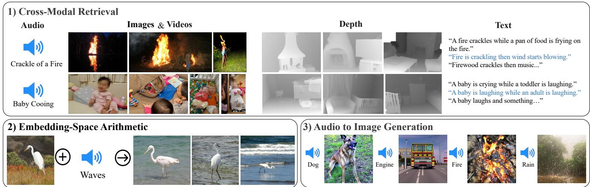  
Figure 1. IMAGEBIND 的联合嵌入空间实现了新颖的多模态能力。通过将六种模态的嵌入对齐到一个公共空间中，IMAGEBIND 实现了：1）跨模态检索（Cross-Modal Retrieval），展示了未曾一同出现的模态（如音频、深度或文本）之间的涌现对齐能力。2）将来自不同模态的嵌入相加，自然地组合了它们的语义。以及 3）音频到图像生成（Audio-to Image generation），通过将我们的音频嵌入与专为配合 CLIP 文本嵌入而设计的预训练 DALLE-2 [61] 解码器结合使用。

## 摘要

我们提出了 IMAGEBIND，一种跨图像、文本、音频、深度、热成像（thermal）和惯性测量单元（IMU）数据六种不同模态学习联合嵌入的方法。我们表明，训练这样的联合嵌入并不需要所有模态组合的成对数据，仅凭与图像配对的数据就足以将这些模态联结在一起。IMAGEBIND 能够利用近期的大规模视觉-语言模型，仅通过利用各模态与图像的自然配对，就能将其零样本（zero-shot）能力扩展到新模态。它支持各种“开箱即用”的新颖涌现应用，包括跨模态检索、模态算术组合、跨模态检测与生成。这种涌现能力会随着图像编码器性能的增强而提升，并且我们在跨模态的涌现零样本识别任务上刷新了当前最优性能（state-of-the-art），超越了专用的监督模型。最后，我们展示了超越先前工作的强大少样本（few-shot）识别结果，并表明 IMAGEBIND 可作为一种评估视觉模型在视觉和非视觉任务中表现的新途径。

## 1. 引言

单张图像可以将许多体验联结在一起——海滩的图像可以让我们联想到海浪的声音、沙粒的质感、微风，甚至能激发写诗的灵感。图像的这种“联结”（binding）特性为学习视觉特征提供了丰富的监督来源，即通过将它们与任何与图像相关的感官体验相对齐。理想情况下，为了构建一个单一的联合嵌入空间，应当通过与所有这些传感器相对齐来学习视觉特征。然而，这需要针对同一组图像获取所有类型及其组合的配对数据，这是不切实际的。

最近，许多方法学习与文本 [1, 31, 46, 60, 64, 65, 82, 83]、音频 [3, 4, 50, 55, 56, 70] 等对齐的图像特征。这些方法使用单一模态对，或者充其量使用少数几种视觉模态。然而，最终的嵌入表示仅限于训练中所使用的模态对。因此，视频-音频嵌入无法直接用于图像-文本任务，反之亦然。学习真正的联合嵌入的一个主要障碍是缺乏所有模态同时存在的大规模多模态数据。

在本文中，我们提出了 IMAGEBIND，它通过利用多种类型的图像配对数据来学习单一的共享表示空间。它不需要所有模态彼此共存的数据集。相反，我们利用了图像的绑定（binding）特性，并证明仅将每种模态的嵌入与图像嵌入对齐，就能促成所有模态之间的涌现对齐（emergent alignment）。在实践中，IMAGEBIND 利用网络规模的（图像，文本）配对数据，并将其与自然发生的配对数据（如（视频，音频）、（图像，深度）等）相结合，以学习单一的联合嵌入空间。这使得 IMAGEBIND 能够隐式地将文本嵌入与其他模态（如音频、深度等）对齐，从而在没有显式语义或文本配对的情况下，赋予这些模态零样本识别能力。此外，我们表明它可以用大规模视觉-语言模型（例如 CLIP [60]）进行初始化，从而利用这些模型丰富的图像和文本表示。因此，IMAGEBIND 仅需极少的训练即可应用于各种不同的模态和任务。

我们使用大规模图像-文本配对数据，以及涵盖四种新模态——音频、深度、热成像和惯性测量单元（Inertial Measurement Unit，IMU）读数——的自然配对“自监督”数据，并在这些模态各自的任务上展示了强大的涌现零样本分类和检索性能。随着基础图像表示的增强，这些涌现特性也会进一步提升。在音频分类和检索基准测试中，IMAGEBIND 的涌现零样本分类在 ESC、Clotho、AudioCaps 等基准上匹敌甚至超越了通过直接音频-文本监督训练的专业模型。在少样本评估基准上，IMAGEBIND 的表示也优于专业监督模型。最后，如图 Figure 1 所示，我们展示了 IMAGEBIND 的联合嵌入可用于广泛的组合任务，包括跨模态检索、通过算术运算组合嵌入、检测图像中的声源以及根据音频输入生成图像。

## 2. 相关工作

IMAGEBIND 建立在视觉-语言、多模态和自监督研究的多项进展之上。

语言-图像预训练（Language Image Pre-training）。将图像与词语或句子等语言信号进行联合训练，已被证明是实现零样本（zero-shot）、开放词表识别以及文本到图像检索的有效方法 [14, 18, 38, 68]。以语言作为监督还可以进一步用于学习强大的视频表征 [2, 47, 48]。Joulin 等人 [34] 表明，使用带有噪声描述的大规模图像数据集可以生成强大的视觉特征。近期，CLIP [60]、ALIGN [31] 和 Florence [83] 收集了大规模的图像-文本对，并通过对比学习训练模型将图像和语言输入嵌入到一个联合空间中，展现出了令人瞩目的零样本性能。CoCa [82] 在对比损失的基础上增加了图像描述（image captioning）目标以提升性能。Flamingo [1] 能够处理任意交错的图像和文本，并在许多少样本学习基准上达到了最先进的水平（state of the art）。LiT [84] 采用对比训练进行微调，并发现冻结图像编码器效果最佳。这一先前的研究路线主要考虑图像和文本，而我们的工作则实现了针对多种模态的零样本识别。

多模态学习（Multi-Modal Learning）。我们的工作将多种模态表征绑定在一个联合嵌入空间中。先前的研究在监督学习 [21, 42] 或自监督学习 [3, 20, 50, 70, 74] 语境下探索了多模态的联合训练。诸如 CLIP 等图像与语言预训练方法的成功，启发了通过将其他模态与语言输入相匹配来重新审视深度语义表征学习的方法。各种方法对 CLIP 进行了适配，以提取语义强大的视频表征 [15, 43, 45, 79]。与我们的方法最为相关的是，Nagrani 等人 [51] 构建了一个用于配对的视频-音频与描述的弱标注数据集，该数据集允许训练多模态视频-音频编码器来匹配文本特征，从而带来了强大的音频和视频检索及描述生成性能。AudioCLIP [27] 将音频作为额外模态引入 CLIP 框架中，实现了零样本音频分类。相比之下，IMAGEBIND 不需要所有模态之间显式的配对数据，而是利用图像作为统一各种模态的天然弱监督信号。

特征对齐（Feature Alignment） 由于其视觉表征的强大能力，预训练的 CLIP 模型已被用作教师模型来监督其他模型 [44, 58, 75]。此外，CLIP 的图像与文本联合嵌入空间也被广泛应用于各种零样本任务，如检测 [24, 88]、分割 [41]、网格动画 [81] 等，展现了联合嵌入空间的强大能力。Point-CLIP [85] 发现，通过将点云投影到多个 2D 深度图视角，并使用 CLIP 视觉编码器进行编码，预训练的 CLIP 编码器可用于 3D 识别。在多语言神经机器翻译中，通常会观察到并利用一种与 IMAGEBIND 的涌现行为类似的现象：如果通过学习到的隐式桥接将不同语言训练在同一个潜空间中，就可以在未提供配对数据的语言对之间实现翻译 [33, 40]。

## 3. 方法

我们的目标是通过使用图像将所有模态绑定在一起，从而为所有模态学习一个单一的联合嵌入空间。我们将每个模态的嵌入与图像嵌入对齐，例如利用网络数据将文本与图像对齐，以及利用带有 IMU 的第一人称视角相机采集的视频数据将 IMU 与视频对齐。我们表明，所得到的嵌入空间具有强大的涌现零样本能力，能够在未见过该特定模态对的任何训练数据的情况下，自动将它们关联起来。我们在 Figure 2 中展示了我们的方法。

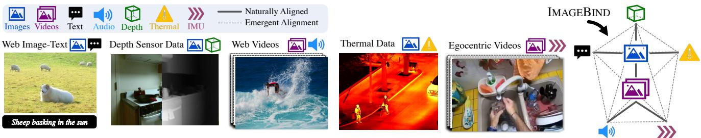  
Figure 2. IMAGEBIND 概览。不同模态在不同的数据源中天然对齐，例如网络数据中的图像+文本和视频+音频，与图像配对的深度或热成像信息，第一人称视角相机采集的视频中的 IMU 数据等。IMAGEBIND 将所有这些模态连接在一个通用的嵌入空间中，从而实现全新的涌现对齐与能力。

## 3.1. 预备知识

对齐特定的模态对。对比学习（Contrastive learning）[28] 是一种通过使用相关样本对（正例）和不相关样本对（负例）来学习嵌入空间的通用技术。利用对齐的观测对，对比学习可以对齐模态对，例如（图像，文本）[60]、（音频，文本）[27]、（图像，深度）[70]、（视频，音频）[50] 等。然而，在以往的各种情况下，联合嵌入的训练和评估都是使用相同的模态对进行的。因此，（视频，音频）嵌入无法直接应用于基于文本的任务，而（图像，文本）嵌入也无法应用于音频任务。

基于文本提示的零样本图像分类。CLIP [60] 推广了一种基于对齐的（图像，文本）嵌入空间的“零样本（zero-shot）”分类任务。这涉及构建一个描述数据集中各类别的文本描述列表。输入图像根据其在嵌入空间中与文本描述的相似度来进行分类。若要为其他模态解锁此类零样本分类，通常需要使用配对的文本数据进行专门训练，例如（音频，文本）[27] 或（点云，文本）[85]。相比之下，IMAGEBIND 无需配对的文本数据即可解锁其他模态的零样本分类。

## 3.2. 用图像绑定各模态

IMAGEBIND 使用模态对 $( \mathcal { T } , \mathcal { M } )$（其中 I 代表图像，M 代表另一种模态）来学习单一的联合嵌入。我们使用了涵盖广泛语义概念、具有（图像，文本）配对的大规模网络数据集。此外，我们还利用了其他模态——音频、深度、热成像以及惯性测量单元（IMU）——与图像之间的天然、自监督配对。

考虑具有对齐观测值的模态对 (I, M)。给定图像 $\mathbf { I } _ { i }$ 及其在另一模态中对应的观测值 $\mathbf { M } _ { i } .$，我们将它们编码为归一化嵌入：$\mathbf { q } _ { i } = f ( \mathbf { I } _ { i } )$ 以及 $\mathbf { k } _ { i } = g ( \mathbf { M } _ { i } )$，其中 $f , g$ 为深度网络。嵌入和编码器使用 InfoNCE [54] 损失进行优化：

$$
L _ {\mathcal {I}, \mathcal {M}} = - \log \frac {\exp (\mathbf {q} _ {i} ^ {\mathsf {T}} \mathbf {k} _ {i} / \tau)}{\exp (\mathbf {q} _ {i} ^ {\mathsf {T}} \mathbf {k} _ {i} / \tau) + \sum_ {j \neq i} \exp (\mathbf {q} _ {i} ^ {\mathsf {T}} \mathbf {k} _ {j} / \tau)},\tag{1}
$$

其中 τ 是控制 softmax 分布平滑度的标量温度参数，j 表示不相关的观测值，也称为“负例（negatives）”。我们遵循 [76]，将小批量（mini-batch）中每个 $j \neq i$ 的样本都视为负例。该损失使得嵌入 qi 和 ki 在联合嵌入空间中更加接近，从而实现 I 与 M 的对齐。在实践中，我们使用对称损失 $L _ { \mathcal { T } , \mathcal { M } } + L _ { \mathcal { M } , \mathcal { T } } .$。

未见模态对的涌现对齐。IMAGEBIND 利用与图像配对的模态，即形如 (I, M) 的模态对，将来自每个模态 M 的嵌入与来自图像的嵌入进行对齐。我们在嵌入空间中观察到一种涌现行为，即使我们仅使用模态对 $( \mathbb { Z } , \ M _ { 1 } )$ 和 $( \mathbb { Z } , \ M _ { 2 } )$ 进行训练，它也能对齐未配对的模态 $( \mathcal { M } _ { 1 } , \mathcal { M } _ { 2 } )$。这种特性使我们能够在无需专门训练的情况下执行各种零样本和跨模态检索任务。在未见过哪怕一个配对的 (audio, text) 样本的情况下，我们实现了最先进的零样本文本-音频分类结果。

## 3.3. 实现细节

IMAGEBIND 在概念上非常简单，并且可以通过多种不同的方式实现。我们特意选择了一种朴素（vanilla）实现，它具有灵活性，便于进行有效的研究以及易于被采用。在 § 5 中，我们展示了对于实现良好涌现“绑定（binding）”至关重要的设计决策。

模态编码。我们对所有模态编码器均使用 Transformer 架构 [73]。对于图像，我们使用 Vision Transformer (ViT) [13]。遵循 [20]，我们对图像和视频使用相同的编码器。我们在时间维度上膨胀（temporally inflate）[7] ViT 的 patch 投影层，并使用从 2 秒中采样的 2 帧视频片段。我们遵循 [22] 进行音频编码，并将以 16kHz 采样的 2 秒音频使用 128 个梅尔频谱图频段（mel-spectrogram bins）转换为频谱图。由于频谱图也是与图像类似的二维信号，我们使用 patch 大小为 16、步长为 10 的 ViT。我们将热成像图和深度图视为单通道图像，并同样使用 ViT 对其进行编码。我们遵循 [21] 将深度转换为视差图以实现尺度不变性。我们提取由跨 X、Y 和 Z 轴的加速度计和陀螺仪测量值组成的 IMU 信号。我们使用 5 秒的片段，产生 2K 个时间步的 IMU 读数，并通过卷积核大小为 8 的一维卷积进行投影。生成的序列使用 Transformer 进行编码。最后，我们遵循 CLIP [60] 的文本编码器设计。

<table><tr><td>数据集</td><td>任务</td><td>#cls</td><td>评估指标</td><td>#test</td></tr><tr><td>Audioset 仅音频 (AS-A) [19]</td><td>音频分类</td><td>527</td><td>mAP</td><td>19048</td></tr><tr><td>ESC 5折 (ESC) [59]</td><td>音频分类</td><td>50</td><td>Acc</td><td>400</td></tr><tr><td>Clotho (Clotho) [17]</td><td>检索</td><td>-</td><td>Recall</td><td>1045</td></tr><tr><td>AudioCaps (AudioCaps) [37]</td><td>检索</td><td>-</td><td>Recall</td><td>796</td></tr><tr><td>VGGSound (VGGS) [8]</td><td>音频分类</td><td>309</td><td>Acc</td><td>14073</td></tr><tr><td>SUN 仅深度 (SUN-D) [69]</td><td>场景分类</td><td>19</td><td>Acc</td><td>4660</td></tr><tr><td>NYU-v2 仅深度 (NYU-D) [66]</td><td>场景分类</td><td>10</td><td>Acc</td><td>653</td></tr><tr><td>LLVIP (LLVIP) [32]</td><td>行人分类</td><td>2</td><td>Acc</td><td>15809</td></tr><tr><td>Ego4D (Ego4D) [23]</td><td>情境分类</td><td>108</td><td>Acc</td><td>68865</td></tr></table>

Table 1. 音频、深度、热成像以及惯性测量单元（IMU）模态的新兴零样本分类数据集。我们在未针对这些任务中的任何一个进行训练，且未在这些模态的配对文本数据上进行训练的情况下对 IMAGEBIND 进行评估。对于每个数据集，我们报告了任务（分类或检索）、类别数量（#cls）、评估指标（准确率或平均精度均值）以及测试样本数量（#test）。

我们对图像、文本、音频、热成像、深度图像和 IMU 使用独立的编码器。我们在每个编码器上添加了一个模态特定的线性投影头，以获得固定大小的 $d$ 维嵌入，该嵌入经过归一化后用于公式 1 中的 InfoNCE 损失。除了简化学习过程外，这种设置还允许我们使用预训练模型来初始化一部分编码器，例如使用 CLIP [60] 或 OpenCLIP [30] 初始化图像和文本编码器。

## 4. 实验

我们首先描述主要的实验设置，并在补充材料中提供完整细节。

自然配对的模态与数据集。我们在六种模态上使用 IMAGEBIND——图像/视频、文本、音频、深度、热成像和 IMU。如第 3.3 节所述，我们将视频视为 2 帧图像，并以与图像相同的方式处理它们。对于自然可用的配对数据，我们使用来自 Audioset 数据集 [19] 的（视频，音频）对、来自 SUN RGB-D 数据集 [69] 的（图像，深度）对、来自 LLVIP 数据集 [32] 的（图像，热成像）对以及来自 Ego4D 数据集 [23] 的（视频，IMU）对。对于这些模态对，我们不使用任何诸如类别标签、文本等额外监督。由于 SUN RGB-D 和 LLVIP 相对较小，我们遵循 [21] 的方法，在训练中将它们复制 50 倍。大规模图像-文本对。我们利用来自大规模网络数据的图像-文本监督 [60]。为便于实验，我们使用在数十亿个（图像，文本）对上训练的预训练模型。具体而言，我们使用了来自 OpenCLIP [11, 30] 的预训练视觉编码器（ViT-H，6.3 亿参数）和文本编码器（3.02 亿参数）。

各模态的编码器。我们将音频转换为 2D 梅尔频谱图（mel-spectrograms）[22]，并将热成像和深度模态转换为单通道图像，分别使用 ViT-B 和 ViT-S 编码器。在 IMAGEBIND 训练期间，图像和文本编码器保持冻结，而音频、深度、热成像和 IMU 编码器进行更新。

涌现零样本 vs. 零样本。诸如 CLIP [60]、AudioCLIP [27] 等方法使用模态对（图像, 文本）和（音频, 文本）进行训练，以展示针对相同模态使用文本提示（text-prompts）的零样本分类。相比之下，IMAGEBIND 仅使用以图像配对的数据将各模态绑定在一起。因此，仅通过在（图像, 文本）和（图像, 音频）上训练，IMAGEBIND 就能使用文本提示执行音频的零样本分类。由于我们并未直接针对此能力进行训练，我们将其称为涌现零样本（emergent zero-shot）分类，以区别于专门针对所有模态使用成对文本监督进行训练的方法。

下游任务评估。我们使用不同的评估协议在许多不同的下游任务上对 IMAGEBIND 进行了全面评估。我们在 Table 1 中总结了用于评估的主要数据集。

## 4.1. 涌现零样本分类

我们在涌现零样本分类上评估 IMAGEBIND，并使用来自 [60] 的文本提示模板（完整细节见 Appendix B）。我们在 Table 2 中汇报了结果。每项任务都衡量了 IMAGEBIND 在训练过程中未曾同时观测到文本与其他模态的情况下，将文本嵌入与这些模态进行关联的能力。鉴于我们问题设定的新颖性，目前没有“公平”的基线可以与 IMAGE-BIND 进行比较。尽管如此，我们与使用与特定模态配对的文本的先前工作（例如音频 [27, 51]）进行了对比，而对于深度和热成像等特定“类视觉”模态，我们直接使用 CLIP 模型。我们还报告了每个基准测试所报告的最佳有监督上限。

IMAGEBIND 取得了出色的涌现零样本分类性能。在每个基准测试中，IMAGEBIND 均取得了显著提升，甚至优于针对特定模态和任务训练的监督专用模型。这些结果表明，IMAGEBIND 对齐了各模态，并隐式地将与图像关联的文本监督迁移到了音频等其他模态中。特别是，IMAGEBIND 在音频和 IMU 等非视觉模态上展现出强大的对齐能力，表明它们与图像自然存在的配对是一种强大的监督来源。为了完整起见，我们还报告了标准零样本图像（ImageNet [63] - IN1K，Places-365 [87] - P365）和视频（Kinetics400 [35] - K400，MSR-VTT 1k-A [78] - MSR-VTT）任务的结果。由于图像和文本编码器使用 OpenCLIP 进行初始化（并冻结），这些结果与 OpenCLIP 的结果一致。

<table><tr><td></td><td>IN1K</td><td>P365</td><td>K400</td><td>MSR-VTT</td><td>NYU-D</td><td>SUN-D</td><td>AS-A</td><td>VGGS</td><td>ESC</td><td>LLVIP</td><td>Ego4D</td></tr><tr><td>随机</td><td>0.1</td><td>0.27</td><td>0.25</td><td>0.1</td><td>10.0</td><td>5.26</td><td>0.62</td><td>0.32</td><td>2.75</td><td>50.0</td><td>0.9</td></tr><tr><td>IMAGEBIND</td><td>77.7</td><td>45.4</td><td>50.0</td><td>36.1</td><td>54.0</td><td>35.1</td><td>17.6</td><td>27.8</td><td>66.9</td><td>63.4</td><td>25.0</td></tr><tr><td>文本配对</td><td>-</td><td>-</td><td>-</td><td>-</td><td>41.9*</td><td>25.4*</td><td> $28.4^†$  [27]</td><td>-</td><td> $68.6^†$  [27]</td><td>-</td><td>-</td></tr><tr><td>绝对 SOTA</td><td>91.0 [82]</td><td>60.7 [67]</td><td>89.9 [80]</td><td>57.7 [79]</td><td>76.7 [21]</td><td>64.9 [21]</td><td>49.6 [39]</td><td>52.5 [36]</td><td>97.0 [9]</td><td>-</td><td>-</td></tr></table>

Table 2. IMAGEBIND 使用以蓝色突出显示的文本提示进行的新生零样本分类。IMAGEBIND 将图像与文本、深度、音频、热红外和 IMU 模态进行对齐。生成的嵌入空间可以将文本嵌入与非图像模态相关联，并带来强大的新生零样本分类能力。我们在音频和 IMU 等非视觉模态上也展示了强大的性能。只要有可能，我们就会与“文本配对”（Text Paired）基线进行比较，该基线使用该模态的配对文本数据进行训练。我们在渲染为灰度图像的深度图上使用 OpenCLIP ViT H [30]。[27] 在训练过程中使用 AS 类别名称作为监督，因此并不是“零样本”。总体而言，即使与此类上限相比，IMAGEBIND 也展示了强大的新生零样本性能。为了便于参考，我们还报告了每个数据集上的绝对当前最佳性能（SOTA），这些模型通常使用了额外的监督、模型集成等。除 MSR-VTT（Recall@1）和 Audioset Audio-only（mAP）外，我们报告了所有数据集的 top-1 分类准确率。

<table><tr><td rowspan="2"></td><td rowspan="2">新生</td><td colspan="2">Clotho</td><td colspan="2">AudioCaps</td><td>ESC</td></tr><tr><td>R@1</td><td>R@10</td><td>R@1</td><td>R@10</td><td>Top-1</td></tr><tr><td colspan="7">使用音频和文本监督</td></tr><tr><td>AudioCLIP [27]</td><td> $\times$ </td><td>-</td><td>-</td><td>-</td><td>-</td><td>68.6</td></tr><tr><td colspan="7">使用音频和文本损失</td></tr><tr><td>AVFIC [51]</td><td> $\times$ </td><td>3.0</td><td>17.5</td><td>8.7</td><td>37.7</td><td>-</td></tr><tr><td colspan="7">无音频和文本监督</td></tr><tr><td>IMAGEBIND</td><td> $\checkmark$ </td><td>6.0</td><td>28.4</td><td>9.3</td><td>42.3</td><td>66.9</td></tr><tr><td colspan="7">有监督</td></tr><tr><td>AVFIC 微调 [51]</td><td> $\times$ </td><td>8.4</td><td>38.6</td><td>-</td><td>-</td><td>-</td></tr><tr><td>ARNLQ [53]</td><td> $\times$ </td><td>12.6</td><td>45.4</td><td>24.3</td><td>72.1</td><td>-</td></tr></table>

Table 3. 涌现的零样本音频检索与分类。我们将 IMAGEBIND 与先前在零样本音频检索和音频分类方面的工作进行了比较。在不使用音频特定监督的情况下，IMAGEBIND 在零样本检索上超越了先前的方法，并在分类任务上取得了相当的性能。IMAGEBIND 的涌现零样本性能接近专业监督模型。

## 4.2. 与先前工作的对比

零样本文本到音频检索与分类。与 IMAGEBIND 不同，先前的工作使用针对该模态的配对数据进行训练，例如 AudioCLIP [27] 使用（音频，文本）监督，AVFIC [52] 使用自动挖掘的（音频，文本）对。我们在 Table 3 中将它们的零样本文本到音频检索和分类性能与 IMAGEBIND 的涌现检索和分类进行了对比。

IMAGEBIND 在音频-文本检索基准上显著优于先前的工作。在 Clotho 数据集上，尽管在训练期间没有对音频使用任何文本配对，IMAGEBIND 的性能仍达到了 AVFIC 的两倍。与有监督的 AudioCLIP 模型相比，IMAGEBIND 在 ESC 上取得了相当的音频分类性能。需要注意的是，AudioCLIP 使用来自 AudioSet 的类别名称作为音频-文本训练的文本目标，因此被称为“有监督”。IMAGEBIND 在所有三个基准上的出色表现，验证了其以图像为桥梁对齐音频和文本模态的能力。

<table><tr><td rowspan="2"></td><td rowspan="2">模态</td><td rowspan="2">涌现</td><td colspan="3">MSR-VTT</td></tr><tr><td>R@1</td><td>R@5</td><td>R@10</td></tr><tr><td>MIL-NCE [49]</td><td>V</td><td>✕</td><td>8.6</td><td>16.9</td><td>25.8</td></tr><tr><td>SupportSet [57]</td><td>V</td><td>✕</td><td>10.4</td><td>22.2</td><td>30.0</td></tr><tr><td>FIT [5]</td><td>V</td><td>✕</td><td>15.4</td><td>33.6</td><td>44.1</td></tr><tr><td>AVFIC [51]</td><td>A+V</td><td>✕</td><td>19.4</td><td>39.5</td><td>50.3</td></tr><tr><td>IMAGEBIND</td><td>A</td><td>√</td><td>6.8</td><td>18.5</td><td>27.2</td></tr><tr><td>IMAGEBIND</td><td>A+V</td><td>✕</td><td>36.8</td><td>61.8</td><td>70.0</td></tr></table>

Table 4. MSR-VTT 1K-A 上的零样本文本检索。我们比较了 IMAGEBIND 使用音频时的涌现检索性能，并观察到它的表现优于使用更强视频模态进行检索的方法。

文本到音频和视频检索。我们在 Table 4 中使用 MSR-VTT 1k-A 基准来评估文本到音频以及视频的检索性能。仅使用音频时，与 MIL-NCE 等先前工作的视频检索性能相比，IMAGE-BIND 取得了强大的涌现检索性能。我们模型的文本到视频性能十分强劲（Table 2 中 R@1 达到 36.1%），因为它使用了 OpenCLIP 的视觉和文本编码器，并且优于许多先前的方法。然而，结合音频和视频模态进一步提升了性能，这展示了 IMAGE-BIND 特征在原本就很强大的检索模型基础上的实用性。

## 4.3. 少样本分类

我们现在通过在少样本分类上进行评估来检验 IMAGEBIND 的标签利用效率。我们使用来自 IMAGEBIND 的音频和深度编码器，并在 Figure 3 中分别评估它们在音频和深度分类上的表现。对于 $\ge 1$-shot 结果，我们遵循 [50, 60] 的方法，在固定特征上训练线性分类器（详情见 Appendix B）。

在少样本音频分类方面（Figure 3 左图），我们与以下模型进行了对比：(1) 在来自 Audioset 的音频上训练的自监督 AudioMAE 模型，以及 (2) 在音频分类上微调过的监督 AudioMAE 模型。这两个基准模型均使用了与 IMAGE-BIND 相同容量的 ViT-B 音频编码器。IMAGEBIND 在所有设置下都显著优于 AudioMAE 模型，在 $\le 4$-shot 分类上的 Top-1 准确率提升了约 40%。IMAGEBIND 在 $\ge 1$-shot 分类上也达到或超过了监督模型。IMAGEBIND 的涌现零样本性能甚至超过了监督模型的 $\le 2$-shot 性能。

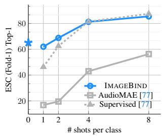

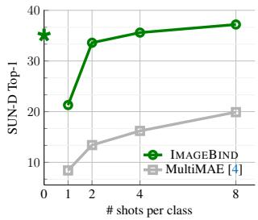  
Figure 3. 音频和深度上的少样本分类。我们报告了在各个基准上的涌现零样本分类性能（由 ⋆ 表示）。对于 $\ge 1$-shot 的情况，我们在固定特征上训练线性分类器。（左图）在所有设置下，IMAGEBIND 均优于自监督 AudioMAE 模型。IMAGEBIND 甚至在多达 4-shot 学习时优于监督 AudioMAE 模型，展现了其强大的泛化能力。（右图）我们与使用图像、深度和语义分割掩码训练的 MultiMAE 模型进行对比。在少样本深度分类中，IMAGEBIND 在所有少样本设置下均优于 MultiMAE。

对于少样本深度分类，我们与在图像、深度和语义分割数据上训练的多模态 MultiMAE [4] ViT-B/16 模型进行了对比。IMAGEBIND 在所有少样本设置下均显著优于 MultiMAE。总之，这些结果表明通过图像对齐训练的 IMAGEBIND 音频和深度特征具有强大的泛化能力。

## 4.4. 分析与应用

多模态嵌入空间算术。我们研究了 IMAGEBIND 的嵌入是否可用于组合跨模态的信息。在 Figure 4 中，我们展示了通过将图像和音频嵌入相加所获得的图像检索结果。联合嵌入空间使我们能够组合两个嵌入：例如，桌上水果的图像 + 鸟鸣声，并检索包含这两个概念的图像，即树上有鸟和水果。这种涌现出的组合性（即来自不同模态的语义内容可以被组合）很可能会赋能丰富多样的组合任务。

无需重新训练，我们就可以将使用 CLIP 嵌入的现有视觉模型“升级”为使用来自其他模态（如音频）的 IMAGEBIND 嵌入。

将基于文本的检测器升级为基于音频的检测器。我们使用预训练的基于文本的检测模型 Detic [88]，并直接用 IMAGEBIND 的音频嵌入替换其基于 CLIP 的“类别”（文本）嵌入。无需训练，即可构建一个基于“音频”的检测器，能够根据音频提示检测并分割目标。如 Figure 5 所示，我们可以用狗吠声提示检测器来定位狗。

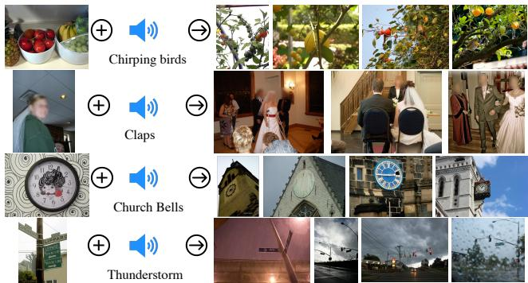

Figure 4. 嵌入空间算术：我们将图像和音频嵌入相加，并将其用于图像检索。组合后的嵌入自然地捕获了来自不同模态的语义。来自水果图像的嵌入 + 鸟鸣声的嵌入检索到了被水果环绕的鸟类图像。  
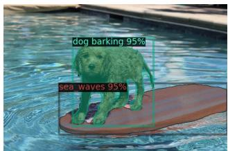

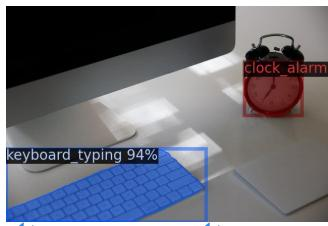  
Figure 5. 使用音频查询的目标检测。仅需用我们的音频嵌入替换 Detic [88] 基于 CLIP 的“类别”嵌入，即可得到一个可通过音频提示的目标检测器。这不需要对任何模型进行重新训练。

将基于文本的扩散模型升级为基于音频的模型。我们使用预训练的 DALLE-2 [61] 扩散模型（私有重实现版本），并用我们的音频嵌入替换其提示嵌入。在 Figure 1 中，我们观察到可以重新调整扩散模型的用途，使用不同类型的声音生成合理的图像。

## 5. 消融实验

我们研究了学习不同模态联合嵌入空间的各种设计选择。由于消融实验设置与 § 4 相似，我们仅指出主要差异（详见附录 C）。我们在 ESC fold-1 上报告消融实验的结果。默认情况下，我们对图像、音频、深度和热成像模态使用 ViT-B 编码器，并将它们训练 16 个 epoch（而在 $\ S ~ 4 )$ 中为 32 个 epoch）。对于 IMU，我们使用轻量级的 6 层编码器，宽度为 512 维，包含 8 个头，并将其训练 8 个 epoch。文本编码器遵循 [60]，是一个宽度为 512 维的 12 层 Transformer。我们使用 CLIP 模型 [60] 初始化图像和文本编码器。

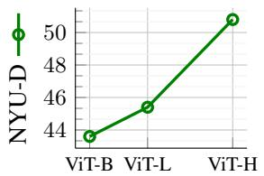

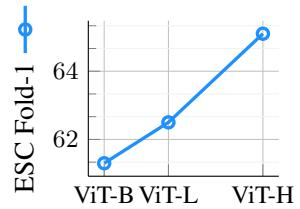

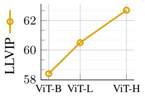

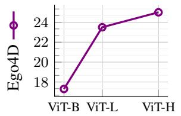  
Figure 6. 在保持其他模态编码器大小固定的情况下，扩展图像编码器的规模。我们测量了在深度、音频、热成像和 IMU 模态上的涌现零样本分类性能。扩展图像编码器显著提升了零样本分类结果，这表明更强的视觉表征改善了模态之间的“绑定”（binding）。

## 5.1. 扩展图像编码器规模

IMAGEBIND 的核心思想是将所有模态的嵌入与图像嵌入对齐。因此，图像嵌入在未见模态的涌现对齐中起着核心作用，我们研究了它们对涌现零样本性能的影响。我们改变图像编码器的大小，并训练深度、音频等模态的编码器以匹配图像表征。为了隔离图像表征的影响，我们固定其他模态编码器的大小。在本实验中，我们使用了预训练的 CLIP（ViT-B 和 ViT-L）以及 OpenCLIP（ViT-H）图像和文本编码器。图 6 中的结果表明，随着视觉特征的改善，IMAGEBIND 在所有模态上的涌现零样本性能均有所提升。对于深度和音频分类，相较于 ViT-B 图像编码器，更强的 ViT-H 图像编码器分别带来了 7% 和 4% 的增益。因此，更强的视觉特征甚至可以提高非视觉模态的识别性能。

## 5.2. 训练损失与架构

我们研究了训练设计选择对涌现零样本分类的影响。我们重点关注具有不同特性的两种模态——属于视觉且具有空间特性的深度模态，以及非视觉且具有时序成分的音频模态。我们发现，对这些多样化模态的研究促成了稳健且可迁移的设计决策。

对比损失温度。我们在表 5a 中研究了温度 $\tau$（式 1）的影响。我们遵循 [60] 实验了初始化为 0.07（以对数尺度参数化）的可学习温度与不同固定温度值的对比。与 [60] 不同，我们观察到固定温度对深度、音频和 IMU 分类效果最好。此外，我们发现较高的温度更适合训练深度、热成像和 IMU 编码器，而较低的温度对音频模态效果最好。

投影头。我们将每个编码器使用的投影头从线性层变为具有 768 个隐藏维度的 MLP。表 5b 中的结果表明，线性投影在两种模态上表现都更好。这与像 SimCLR [10] 这样的标准自监督方法形成对比，后者的性能在使用 MLP 投影头时会有所提升。训练轮数。我们改变了训练轮数，并在表 5c 中报告了分类性能。更长的训练在所有数据集上持续提升了两种模态的涌现零样本性能。

成对图像的数据增强。在 IMAGEBIND 训练期间，我们使用基础增强（裁剪、颜色抖动）或额外应用了 RandAugment [12] 和 RandErase [86] 的强增强来对图像进行处理。我们在附录 C 中详细说明了增强参数。在来自 SUN RGB-D 数据集的少量（图像，深度）对上进行训练时，更强的增强有助于深度分类。然而，对于音频而言，对视频进行强增强会使任务过于困难，导致在 ESC 上的性能大幅下降 34%。

深度特有的设计选择。我们在表 5e 中改变了用于训练的空间裁剪类型。遵循 CMC [70]，我们对比了从对应的图像和深度对中使用两个未对齐的随机裁剪与我们默认使用的空间对齐随机裁剪。与 CMC 相反，我们观察到未对齐的随机裁剪会严重降低性能：在 SUN-D 上下降超过 10%。与传统的自监督学习不同，我们从图像-文本对中学习到的图像表征更具语义性，因此空间上未对齐的裁剪会损害性能。在表 5f 中，我们观察到 RandomErase [86] 提升了深度分类的性能。音频特有的设计选择。我们使用时间对齐的样本或未对齐的样本来训练视频-音频对齐，并在表 5g 中评估最终性能。与深度分类的观察类似，时间对齐的样本能带来更好的性能。表 5h 表明，对音频使用频率掩码增强也会小幅提升性能。

音频和深度编码器的容量及其对分类性能的影响报告在表 6 中。较小的深度编码器提升了性能，这可能是由于（图像，深度）数据集的规模相对较小。相反，我们观察到更大的音频编码器能够提升性能，特别是在与高容量图像编码器搭配使用时。

<table><tr><td>温度 →</td><td>可学习</td><td>0.05</td><td>0.07</td><td>0.2</td><td>1.0</td></tr><tr><td>SUN-D</td><td>24.1</td><td>27.0</td><td>27.3</td><td>26.7</td><td>28.0</td></tr><tr><td>ESC</td><td>54.8</td><td>56.7</td><td>52.4</td><td>45.4</td><td>24.3</td></tr></table>

<table><tr><td>投影头 →</td><td>线性</td><td>MLP</td></tr><tr><td>SUN-D</td><td>26.7</td><td>26.5</td></tr><tr><td>ESC</td><td>56.7</td><td>51.0</td></tr></table>

(a) 损失函数的温度系数。  
(b) 投影头。

<table><tr><td>Epochs →</td><td>16</td><td>32</td><td>64</td></tr><tr><td>SUN-D</td><td>26.7</td><td>27.9</td><td>29.9</td></tr><tr><td>ESC</td><td>56.7</td><td>61.3</td><td>62.9</td></tr></table>

<table><tr><td>数据增强 →</td><td>基础 (Basic)</td><td>强 (Strong)</td></tr><tr><td>SUN-D</td><td>25.4</td><td>26.7</td></tr><tr><td>ESC</td><td>56.7</td><td>22.6</td></tr></table>

(c) 训练轮数。

<table><tr><td>数据增强 →</td><td>无 (None)</td><td>RandErase</td></tr><tr><td>SUN-D</td><td>24.2</td><td>26.7</td></tr></table>

<table><tr><td>空间对齐 →</td><td>无 (None)</td><td>对齐 (Aligned)</td></tr><tr><td>SUN-D</td><td>16.0</td><td>26.7</td></tr></table>

(e) 深度的空间对齐。

(d) 图像数据增强。  
(f) 深度数据增强。

<table><tr><td>时间对齐 →</td><td>无 (None)</td><td>对齐 (Aligned)</td></tr><tr><td>ESC</td><td>55.7</td><td>56.7</td></tr></table>

(g) 音频的时间对齐。

<table><tr><td>数据增强 →</td><td colspan="2">基础 (Basic) + 频率掩码 (+Freq mask)</td></tr><tr><td>ESC</td><td>56.5</td><td>56.7</td></tr></table>

(h) 音频数据增强。

Table 5. 训练损失和架构设计决策及其对涌现零样本分类的影响。§ 4 中结果的设置以灰色高亮显示。(a) 对比损失中的固定温度在所有模态上均优于可学习温度。(b) 用于计算深度或音频嵌入的线性投影头优于 MLP 头。(c) 更长的训练时间提升了两种模态的零样本分类性能。(d) 更强的图像增强提升了深度分类性能，而基础增强则显著改善了音频分类。(e, f) 在训练 IMAGEBIND 时使用空间对齐的图像和深度裁剪可显著提高性能。同样，RandErase 增强对于深度上的良好零样本分类至关重要。(g, h) 时间对齐的音频和视频匹配带来了性能提升，且对音频使用频率增强带来了微小的改善。

<table><tr><td rowspan="2">图像编码器</td><td colspan="2">音频编码器 (ESC)</td><td colspan="2">深度编码器 (SUN)</td></tr><tr><td>ViT-S</td><td>ViT-B</td><td>ViT-S</td><td>ViT-B</td></tr><tr><td>ViT-B</td><td>52.8</td><td>56.7</td><td>30.7</td><td>26.7</td></tr><tr><td>ViT-H</td><td>54.8</td><td>60.3</td><td>33.3</td><td>29.5</td></tr></table>

Table 6. 音频和深度编码器的容量及其对性能的影响。更强的图像编码器提升了音频和深度任务的性能。由于 (图像, 深度) 对的数量较少，较小的编码器能提升深度的性能。对于音频分类，较大的编码器效果更好。

<table><tr><td>批大小 (Batch size) →</td><td>512</td><td>1k</td><td>2k</td><td>4k</td></tr><tr><td>NYU-D</td><td>47.3</td><td>46.5</td><td>43.0</td><td>39.9</td></tr><tr><td>ESC</td><td>39.4</td><td>53.9</td><td>56.7</td><td>53.9</td></tr></table>

<table><tr><td></td><td>IN1K</td><td>VGGS</td><td>ESC</td><td>SUN-D</td><td>NYU-D</td></tr><tr><td>DINO [6]</td><td>64.4</td><td>17.2</td><td>44.7</td><td>26.8</td><td>48.8</td></tr><tr><td>DeiT [72]</td><td> $74.4^†$ </td><td>9.6</td><td>25.0</td><td>25.2</td><td>48.0</td></tr></table>

Table 7. 缩放批大小（batch size）的影响。我们发现对比损失的最佳批大小因模态而异。对于图像-深度任务，较小的批大小效果更好，这可能是由于原始数据集规模较小且多样性有限。对于拥有更多正负音频-视频对的音频-视频任务，使用较大的批大小会带来更好的结果。  
Table 8. IMAGEBIND 作为评估工具。我们使用不同的方法初始化（并固定）图像编码器，并对齐其他模态。IMAGEBIND 衡量了视觉特征对多模态任务的影响。† 使用 IN1K 监督训练。

批大小的影响。在 Table 7 中，我们评估了批大小对所学表征的影响。如表所示，批大小可以根据相应预训练数据集的规模和复杂度因模态而异。

Table 8 中使用 IMAGEBIND 评估预训练视觉模型。我们使用预训练模型初始化视觉编码器并将其固定。我们使用与图像配对的数据来对齐并训练文本、音频和深度编码器（详见附录 B）。与有监督的 DeiT 模型相比，自监督的 DINO 模型在深度和音频模态的新兴零样本（emergent zero-shot）分类上表现更好。此外，新兴零样本性能与 ImageNet 上的纯视觉性能并不相关，这表明这些任务衡量的是不同的特性。IMAGEBIND 可以作为一个有价值的工具，用于衡量视觉模型在多模态应用中的实力。

## 6. 讨论与局限性

IMAGEBIND 是一种仅使用图像对齐来训练联合嵌入空间的简单而实用的方法。我们的方法催生了跨所有模态的涌现对齐（emergent alignment），这可以通过跨模态检索和基于文本的零样本（zero-shot）任务来进行评估。我们实现了跨不同模态的丰富组合式多模态任务，展示了一种评估用于非视觉任务的预训练视觉模型的方法，并“升级”了诸如 Detic 和 DALLE-2 等模型以支持音频输入。进一步改进 IMAGE-BIND 存在多种途径。我们的图像对齐损失可以通过使用其他对齐数据来进一步丰富，例如与其他模态与文本配对，或模态之间相互配对（例如音频与 IMU）。我们的嵌入在训练时并未针对特定的下游任务，因此性能落后于专用模型。进一步研究如何将通用嵌入适配到具体任务（包括目标检测等结构化预测任务）将是大有裨益的。最后，新的基准（例如我们用于衡量多模态模型涌现能力的涌现零样本任务）将有助于开拓令人兴奋的新应用。我们的模型是一个研究原型，无法直接投入现实世界的实际应用（附录 F）。

致谢：作者感谢 Uriel Singer、Adam Polyak 和 Naman Goyal 在 DALLE-2 实验中提供的帮助，并感谢整个 Meta AI 团队进行的诸多富有建设性的讨论。

## 参考文献

[1] Jean-Baptiste Alayrac, Jeff Donahue, Pauline Luc, Antoine Miech, Iain Barr, Yana Hasson, Karel Lenc, Arthur Mensch, Katie Millican, Malcolm Reynolds, Roman Ring, Eliza Rutherford, Serkan Cabi, Tengda Han, Zhitao Gong, Sina Samangooei, Marianne Monteiro, Jacob Menick, Sebastian Borgeaud, Andrew Brock, Aida Nematzadeh, Sahand Sharifzadeh, Mikolaj Binkowski, Ricardo Barreira, Oriol Vinyals, Andrew Zisserman, and Karen Simonyan. Flamingo: a visual language model for few-shot learning. In NeurIPS, 2022. 1, 2

[2] Jean-Baptiste Alayrac, Adria Recasens, Rosalia Schneider, Relja Arandjelovic, Jason Ramapuram, Jeffrey De Fauw, Lucas Smaira, Sander Dieleman, and Andrew Zisserman. Selfsupervised multimodal versatile networks. NeurIPS, 2020. 2

[3] Relja Arandjelovic and Andrew Zisserman. Look, listen and learn. In ICCV, 2017. 1, 2

[4] Roman Bachmann, David Mizrahi, Andrei Atanov, and Amir Zamir. MultiMAE: Multi-modal Multi-task Masked Autoencoders. In ECCV, 2022. 1, 6

[5] Max Bain, Arsha Nagrani, Gul Varol, and Andrew Zisser-¨ man. Frozen in time: A joint video and image encoder for end-to-end retrieval. In ICCV, 2021. 5

[6] Mathilde Caron, Hugo Touvron, Ishan Misra, Herve J´ egou,´ Julien Mairal, Piotr Bojanowski, and Armand Joulin. Emerging properties in self-supervised vision transformers. In ICCV, 2021. 8

[7] Joao Carreira and Andrew Zisserman. Quo vadis, action˜ recognition? A new model and the kinetics dataset. In CVPR, 2017. 3

[8] Honglie Chen, Weidi Xie, Andrea Vedaldi, and Andrew Zisserman. Vggsound: A large-scale audio-visual dataset. In ICASSP, 2020. 4, 12

[9] Ke Chen, Xingjian Du, Bilei Zhu, Zejun Ma, Taylor Berg-Kirkpatrick, and Shlomo Dubnov. Hts-at: A hierarchical token-semantic audio transformer for sound classification and detection. In ICASSP, 2022. 5

[10] Ting Chen, Simon Kornblith, Mohammad Norouzi, and Geoffrey Hinton. A simple framework for contrastive learning of visual representations. In ICML, 2020. 7, 14

[11] Mehdi Cherti, Romain Beaumont, Ross Wightman, Mitchell Wortsman, Gabriel Ilharco, Cade Gordon, Christoph Schuhmann, Ludwig Schmidt, and Jenia Jitsev. Reproducible scaling laws for contrastive language-image learning. In CVPR, 2023. 4

[12] Ekin D Cubuk, Barret Zoph, Jonathon Shlens, and Quoc V Le. Randaugment: Practical automated data augmentation with a reduced search space. In CVPR, 2020. 7

[13] Alexey Dosovitskiy, Lucas Beyer, Alexander Kolesnikov, Dirk Weissenborn, Xiaohua Zhai, Thomas Unterthiner, Mostafa Dehghani, Matthias Minderer, Georg Heigold, Sylvain Gelly, et al. An image is worth 16x16 words: Transformers for image recognition at scale. In ICLR, 2021. 3

[14] Fartash Faghri, David J Fleet, Jamie Ryan Kiros, and Sanja Fidler. VSE++: Improving Visual-Semantic Embeddings with Hard Negatives. In BMVC, 2018. 2

[15] Han Fang, Pengfei Xiong, Luhui Xu, and Yu Chen. Clip2video: Mastering video-text retrieval via image clip.

arXiv preprint arXiv:2106.11097, 2021. 2

[16] Christoph Feichtenhofer, Haoqi Fan, Yanghao Li, and Kaiming He. Masked autoencoders as spatiotemporal learners. In NeurIPS, 2022. 13

[17] Frederic Font, Gerard Roma, and Xavier Serra. Freesound technical demo. In ACM MM, 2013. 4, 12

[18] Andrea Frome, Greg S Corrado, Jon Shlens, Samy Bengio, Jeff Dean, Marc’Aurelio Ranzato, and Tomas Mikolov. Devise: A deep visual-semantic embedding model. NeurIPS, 2013. 2

[19] Jort F. Gemmeke, Daniel P. W. Ellis, Dylan Freedman, Aren Jansen, Wade Lawrence, R. Channing Moore, Manoj Plakal, and Marvin Ritter. Audio set: An ontology and humanlabeled dataset for audio events. In ICASSP, 2017. 4, 12

[20] Rohit Girdhar, Alaaeldin El-Nouby, Mannat Singh, Kalyan Vasudev Alwala, Armand Joulin, and Ishan Misra. OmniMAE: Single Model Masked Pretraining on Images and Videos. In CVPR, 2023. 2, 3

[21] Rohit Girdhar, Mannat Singh, Nikhila Ravi, Laurens van der Maaten, Armand Joulin, and Ishan Misra. Omnivore: A Single Model for Many Visual Modalities. In CVPR, 2022. 2, 4, 5, 12

[22] Yuan Gong, Yu-An Chung, and James Glass. AST: Audio Spectrogram Transformer. In Interspeech, 2021. 3, 4, 13

[23] Kristen Grauman, Andrew Westbury, Eugene Byrne, Zachary Chavis, Antonino Furnari, Rohit Girdhar, Jackson Hamburger, Hao Jiang, Miao Liu, Xingyu Liu, Miguel Martin, Tushar Nagarajan, Ilija Radosavovic, Santhosh Kumar Ramakrishnan, Fiona Ryan, Jayant Sharma, Michael Wray, Mengmeng Xu, Eric Zhongcong Xu, Chen Zhao, Siddhant Bansal, Dhruv Batra, Vincent Cartillier, Sean Crane, Tien Do, Morrie Doulaty, Akshay Erapalli, Christoph Feichtenhofer, Adriano Fragomeni, Qichen Fu, Abrham Gebreselasie, Cristina Gonzalez, James Hillis, Xuhua Huang, Yifei Huang, Wenqi Jia, Weslie Khoo, Jachym Kolar, Satwik Kottur, Anurag Kumar, Federico Landini, Chao Li, Yanghao Li, Zhenqiang Li, Karttikeya Mangalam, Raghava Modhugu, Jonathan Munro, Tullie Murrell, Takumi Nishiyasu, Will Price, Paola Ruiz Puentes, Merey Ramazanova, Leda Sari, Kiran Somasundaram, Audrey Southerland, Yusuke Sugano, Ruijie Tao, Minh Vo, Yuchen Wang, Xindi Wu, Takuma Yagi, Ziwei Zhao, Yunyi Zhu, Pablo Arbelaez, David Crandall, Dima Damen, Giovanni Maria Farinella, Christian Fuegen, Bernard Ghanem, Vamsi Krishna Ithapu, C. V. Jawahar, Hanbyul Joo, Kris Kitani, Haizhou Li, Richard Newcombe, Aude Oliva, Hyun Soo Park, James M. Rehg, Yoichi Sato, Jianbo Shi, Mike Zheng Shou, Antonio Torralba, Lorenzo Torresani, Mingfei Yan, and Jitendra Malik. Ego4d: Around the world in 3,000 hours of egocentric video（Ego4D：3,000小时第一人称视角视频环游世界）. In CVPR, 2022. 4, 12

[24] Xiuye Gu, Tsung-Yi Lin, Weicheng Kuo, and Yin Cui. Open-vocabulary object detection via vision and language knowledge distillation（基于视觉与语言知识蒸馏的开放词表目标检测）. In ICLR, 2022. 2

[25] Saurabh Gupta, Pablo Arbelaez, and Jitendra Malik. Perceptual organization and recognition of indoor scenes from rgb-d images（基于 RGB-D 图像的室内场景感知组织与识别）. In CVPR, 2013. 13

[26] Saurabh Gupta, Ross Girshick, Pablo Arbelaez, and Jitendra´ Malik. Learning rich features from rgb-d images for object detection and segmentation（从 RGB-D 图像中学习丰富特征用于目标检测与分割）. In ECCV, 2014. 13

[27] Andrey Guzhov, Federico Raue, Jorn Hees, and Andreas¨ Dengel. AudioCLIP: Extending CLIP to Image, Text and Audio（AudioCLIP：将 CLIP 拓展至图像、文本与音频）. arXiv preprint arXiv:2106.13043, 2021. 2, 3, 4, 5

[28] Raia Hadsell, Sumit Chopra, and Yann LeCun. Dimensionality reduction by learning an invariant mapping（通过学习不变映射进行降维）. In CVPR, 2006. 3

[29] Gao Huang, Yu Sun, Zhuang Liu, Daniel Sedra, and Kilian Q Weinberger. Deep networks with stochastic depth（具有随机深度的深度网络）. In ECCV, 2016. 14

[30] Gabriel Ilharco, Mitchell Wortsman, Ross Wightman, Cade Gordon, Nicholas Carlini, Rohan Taori, Achal Dave, Vaishaal Shankar, Hongseok Namkoong, John Miller, Hannaneh Hajishirzi, Ali Farhadi, and Ludwig Schmidt. Openclip, 2021. 4, 5

[31] Chao Jia, Yinfei Yang, Ye Xia, Yi-Ting Chen, Zarana Parekh, Hieu Pham, Quoc Le, Yun-Hsuan Sung, Zhen Li, and Tom Duerig. Scaling up visual and vision-language representation learning with noisy text supervision（利用带噪文本监督扩展视觉与视觉-语言表征学习）. In ICML, 2021. 1, 2

[32] Xinyu Jia, Chuang Zhu, Minzhen Li, Wenqi Tang, and Wenli Zhou. Llvip: A visible-infrared paired dataset for low-light vision（LLVIP：用于微光视觉的可见光-红外配对数据集）. In ICCV, 2021. 4, 12, 13

[33] Melvin Johnson, Mike Schuster, Quoc V Le, Maxim Krikun, Yonghui Wu, Zhifeng Chen, Nikhil Thorat, Fernanda Viegas,´ Martin Wattenberg, Greg Corrado, Macduff Hughes, and Jeffrey Dean. Google’s multilingual neural machine translation system: Enabling zero-shot translation. In ACL, 2017. 2

[34] Armand Joulin, Laurens van der Maaten, Allan Jabri, and Nicolas Vasilache. Learning visual features from large weakly supervised data. In ECCV, 2016. 2

[35] Will Kay, Joao Carreira, Karen Simonyan, Brian Zhang, Chloe Hillier, Sudheendra Vijayanarasimhan, Fabio Viola, Tim Green, Trevor Back, Paul Natsev, Mustafa Suleyman, and Andrew Zisserman. The kinetics human action video dataset. arXiv preprint arXiv:1705.06950, 2017. 4

[36] Evangelos Kazakos, Arsha Nagrani, Andrew Zisserman, and Dima Damen. Slow-fast auditory streams for audio recognition. In ICASSP, 2021. 5

[37] Chris Dongjoo Kim, Byeongchang Kim, Hyunmin Lee, and Gunhee Kim. Audiocaps: Generating captions for audios in the wild. In NAACL, 2019. 4, 12

[38] Ryan Kiros, Ruslan Salakhutdinov, and Richard S Zemel. Unifying visual-semantic embeddings with multimodal neural language models. In NeurIPS Workshop, 2014. 2

[39] Khaled Koutini, Jan Schluter, Hamid Eghbal-zadeh, and Ger-¨ hard Widmer. Efficient training of audio transformers with patchout. In Interspeech, 2022. 5

[40] Guillaume Lample, Alexis Conneau, Ludovic Denoyer, and Marc’Aurelio Ranzato. Unsupervised machine translation using monolingual corpora only. In ICLR, 2018. 2

[41] Boyi Li, Kilian Q Weinberger, Serge Belongie, Vladlen Koltun, and Rene Ranftl. Language-driven semantic seg-´ mentation. In ICLR, 2022. 2

[42] Valerii Likhosherstov, Anurag Arnab, Krzysztof Choromanski, Mario Lucic, Yi Tay, Adrian Weller, and Mostafa Dehghani. Polyvit: Co-training vision transformers on images, videos and audio. arXiv preprint arXiv:2111.12993, 2021. 2

[43] Ziyi Lin, Shijie Geng, Renrui Zhang, Peng Gao, Gerard de Melo, Xiaogang Wang, Jifeng Dai, Yu Qiao, and Hongsheng Li. Frozen clip models are efficient video learners. In ECCV,

2022. 2

[44] Xingbin Liu, Jinghao Zhou, Tao Kong, Xianming Lin, and Rongrong Ji. Exploring target representations for masked autoencoders. arXiv preprint arXiv:2209.03917, 2022. 2

[45] Huaishao Luo, Lei Ji, Ming Zhong, Yang Chen, Wen Lei, Nan Duan, and Tianrui Li. CLIP4Clip: An Empirical Study of CLIP for End to End Video Clip Retrieval. arXiv preprint arXiv:2104.08860, 2021. 2

[46] Dhruv Mahajan, Ross Girshick, Vignesh Ramanathan, Kaiming He, Manohar Paluri, Yixuan Li, Ashwin Bharambe, and Laurens Van Der Maaten. Exploring the limits of weakly supervised pretraining. In ECCV, 2018. 1

[47] Antoine Miech, Jean-Baptiste Alayrac, Lucas Smaira, Ivan Laptev, Josef Sivic, and Andrew Zisserman. End-to-end learning of visual representations from uncurated instructional videos. In CVPR, 2020. 2

[48] Antoine Miech, Dimitri Zhukov, Jean-Baptiste Alayrac, Makarand Tapaswi, Ivan Laptev, and Josef Sivic. Howto100m: Learning a text-video embedding by watching hundred million narrated video clips. ICCV, 2019. 2

[49] Antoine Miech, Dimitri Zhukov, Jean-Baptiste Alayrac, Makarand Tapaswi, Ivan Laptev, and Josef Sivic. Howto100m: Learning a text-video embedding by watching hundred million narrated video clips. In ICCV, 2019. 5

[50] Pedro Morgado, Nuno Vasconcelos, and Ishan Misra. Audiovisual instance discrimination with cross-modal agreement. In CVPR, 2021. 1, 2, 3, 5

[51] Arsha Nagrani, Paul Hongsuck Seo, Bryan Seybold, Anja Hauth, Santiago Manen, Chen Sun, and Cordelia Schmid. Learning audio-video modalities from image captions. In ECCV, 2022. 2, 4, 5

[52] Arsha Nagrani, Shan Yang, Anurag Arnab, Aren Jansen, Cordelia Schmid, and Chen Sun. Attention bottlenecks for multimodal fusion. In NeurIPS, 2021. 5

[53] Andreea-Maria Oncescu, A Koepke, Joao F Henriques, Zeynep Akata, and Samuel Albanie. Audio retrieval with natural language queries. In Interspeech, 2021. 5, 12

[54] Aaron van den Oord, Yazhe Li, and Oriol Vinyals. Representation learning with contrastive predictive coding. In NeurIPS, 2018. 3

[55] Andrew Owens and Alexei A Efros. Audio-visual scene analysis with self-supervised multisensory features. In ECCV, 2018. 1

[56] Mandela Patrick, Yuki M Asano, Ruth Fong, Joao F Hen-˜ riques, Geoffrey Zweig, and Andrea Vedaldi. Multi-modal self-supervision from generalized data transformations. In ICCV, 2021. 1

[57] Mandela Patrick, Po-Yao Huang, Yuki Asano, Florian Metze, Alexander Hauptmann, Joao Henriques, and Andrea Vedaldi. Support-set bottlenecks for video-text representation learning. In ICLR, 2021. 5

[58] Zhiliang Peng, Li Dong, Hangbo Bao, Qixiang Ye, and Furu Wei. BEiT v2: Masked image modeling with vector-quantized visual tokenizers. arXiv preprint arXiv:2208.06366, 2022. 2

[59] Karol J Piczak. Esc: Dataset for environmental sound classification. In ACM MM, 2015. 4, 12

[60] Alec Radford, Jong Wook Kim, Chris Hallacy, Aditya Ramesh, Gabriel Goh, Sandhini Agarwal, Girish Sastry,

Amanda Askell, Pamela Mishkin, Jack Clark, et al. Learning transferable visual models from natural language supervision. In ICML, 2021. 1, 2, 3, 4, 5, 7, 13, 14, 15

[61] Aditya Ramesh, Prafulla Dhariwal, Alex Nichol, Casey Chu, and Mark Chen. Hierarchical text-conditional image generation with clip latents. arXiv preprint arXiv:2204.06125, 2022. 1, 6, 13

[62] Rene Ranftl, Katrin Lasinger, David Hafner, Konrad´ Schindler, and Vladlen Koltun. Towards robust monocular depth estimation: Mixing datasets for zero-shot cross-dataset transfer. TPAMI, 2020. 13

[63] Olga Russakovsky, Jia Deng, Hao Su, Jonathan Krause, Sanjeev Satheesh, Sean Ma, Zhiheng Huang, Andrej Karpathy, Aditya Khosla, Michael Bernstein, Alexander C. Berg, and Li Fei-Fei. ImageNet Large Scale Visual Recognition Challenge. IJCV, 2015. 4

[64] Christoph Schuhmann, Romain Beaumont, Richard Vencu, Cade Gordon, Ross Wightman, Mehdi Cherti, Theo Coombes, Aarush Katta, Clayton Mullis, Mitchell Wortsman, Patrick Schramowski, Srivatsa Kundurthy, Katherine Crowson, Ludwig Schmidt, Robert Kaczmarczyk, and Jenia Jitsev. LAION-5B: An open large-scale dataset for training next generation image-text models. In NeurIPS Datasets and Benchmarks, 2022. 1

[65] Christoph Schuhmann, Richard Vencu, Romain Beaumont, Robert Kaczmarczyk, Clayton Mullis, Aarush Katta, Theo Coombes, Jenia Jitsev, and Aran Komatsuzaki. Laion-400m: Open dataset of clip-filtered 400 million image-text pairs. In NeurIPS Workshop, 2021. 1

[66] Nathan Silberman, Derek Hoiem, Pushmeet Kohli, and Rob Fergus. Indoor segmentation and support inference from rgbd images. In ECCV, 2012. 4, 12, 13

[67] Mannat Singh, Laura Gustafson, Aaron Adcock, Vinicius de Freitas Reis, Bugra Gedik, Raj Prateek Kosaraju, Dhruv Mahajan, Ross Girshick, Piotr Dollar, and Laurens van der´ Maaten. Revisiting weakly supervised pre-training of visual perception models. In CVPR, 2022. 5

[68] Richard Socher, Andrej Karpathy, Quoc V Le, Christopher D Manning, and Andrew Y Ng. Grounded compositional semantics for finding and describing images with sentences. ACL, 2014. 2

[69] Shuran Song, Samuel P Lichtenberg, and Jianxiong Xiao. Sun rgb-d: A rgb-d scene understanding benchmark suite. In CVPR, 2015. 4, 12

[70] Yonglong Tian, Dilip Krishnan, and Phillip Isola. Contrastive multiview coding. arXiv preprint arXiv:1906.05849, 2019. 1, 2, 3, 7

[71] Zhan Tong, Yibing Song, Jue Wang, and Limin Wang. Videomae: Masked autoencoders are data-efficient learners for self-supervised video pre-training. In NeurIPS, 2022. 13

[72] Hugo Touvron, Matthieu Cord, Matthijs Douze, Francisco Massa, Alexandre Sablayrolles, and Herve J´ egou. Training´ data-efficient image transformers & distillation through attention. In ICML, 2021. 8

[73] Ashish Vaswani, Noam Shazeer, Niki Parmar, Jakob Uszkoreit, Llion Jones, Aidan N Gomez, Lukasz Kaiser, and Illia Polosukhin. Attention is all you need. In NeurIPS, 2017. 3

[74] Rui Wang, Dongdong Chen, Zuxuan Wu, Yinpeng Chen, Xiyang Dai, Mengchen Liu, Yu-Gang Jiang, Luowei Zhou, and Lu Yuan. BEVT: Bert pretraining of video transformers. In CVPR, 2022. 2

[75] Yixuan Wei, Han Hu, Zhenda Xie, Zheng Zhang, Yue Cao, Jianmin Bao, Dong Chen, and Baining Guo. Contrastive learning rivals masked image modeling in fine-tuning via feature distillation. arXiv preprint arXiv:2205.14141, 2022. 2

[76] Zhirong Wu, Yuanjun Xiong, Stella X Yu, and Dahua Lin. Unsupervised feature learning via non-parametric instance discrimination. In CVPR, 2018. 3

[77] Hu Xu, Juncheng Li, Alexei Baevski, Michael Auli, Wojciech Galuba, Florian Metze, and Christoph Feichtenhofer. Masked autoencoders that listen. In NeurIPS, 2022. 6

[78] Jun Xu, Tao Mei, Ting Yao, and Yong Rui. Msr-vtt: A large video description dataset for bridging video and language. In CVPR, 2016. 4

[79] Hongwei Xue, Yuchong Sun, Bei Liu, Jianlong Fu, Ruihua Song, Houqiang Li, and Jiebo Luo. CLIP-ViP: Adapting Pretrained Image-Text Model to Video-Language Representation Alignment. In ICLR, 2023. 2, 5

[80] Shen Yan, Xuehan Xiong, Anurag Arnab, Zhichao Lu, Mi Zhang, Chen Sun, and Cordelia Schmid. Multiview transformers for video recognition. In CVPR, 2022. 5

[81] Kim Youwang, Kim Ji-Yeon, and Tae-Hyun Oh. Clip-actor: Text-driven recommendation and stylization for animating human meshes. In ECCV, 2022. 2

[82] Jiahui Yu, Zirui Wang, Vijay Vasudevan, Legg Yeung, Mojtaba Seyedhosseini, and Yonghui Wu. Coca: Contrastive captioners are image-text foundation models. TMLR, 2022. 1, 2, 5

[83] Lu Yuan, Dongdong Chen, Yi-Ling Chen, Noel Codella, Xiyang Dai, Jianfeng Gao, Houdong Hu, Xuedong Huang, Boxin Li, Chunyuan Li, Ce Liu, Mengchen Liu, Zicheng Liu, Yumao Lu, Yu Shi, Lijuan Wang, Jianfeng Wang, Bin Xiao, Zhen Xiao, Jianwei Yang, Michael Zeng, Luowei Zhou, and Pengchuan Zhang. Florence: A new foundation model for computer vision. arXiv preprint arXiv:2111.11432, 2021. 1, 2

[84] Xiaohua Zhai, Xiao Wang, Basil Mustafa, Andreas Steiner, Daniel Keysers, Alexander Kolesnikov, and Lucas Beyer. Lit: Zero-shot transfer with locked-image text tuning. In CVPR, 2022. 2

[85] Renrui Zhang, Ziyu Guo, Wei Zhang, Kunchang Li, Xupeng Miao, Bin Cui, Yu Qiao, Peng Gao, and Hongsheng Li. Pointclip: Point cloud understanding by clip. In CVPR, 2022. 2, 3

[86] Zhun Zhong, Liang Zheng, Guoliang Kang, Shaozi Li, and Yi Yang. Random erasing data augmentation. In AAAI, 2020. 7

[87] Bolei Zhou, Agata Lapedriza, Jianxiong Xiao, Antonio Torralba, and Aude Oliva. Learning deep features for scene recognition using places database. In NeurIPS, 2014. 4

[88] Xingyi Zhou, Rohit Girdhar, Armand Joulin, Philipp Krahenb¨ uhl, and Ishan Misra. Detecting twenty-thousand¨ classes using image-level supervision. In ECCV, 2022. 2, 6, 13

## A. 数据集与评估指标

Audioset (AS) [19]。该数据集同时用于训练和评估。它包含来自 YouTube 的 10 秒视频，标注为 527 个类别。它由 3 个预定义划分组成：包含约 20K 个视频的平衡划分（balanced split）、包含 18K 个视频的测试划分（test split），以及包含约 2M 个视频的非平衡训练划分（unbalanced training split）。在训练中，我们使用这 2M 的非平衡集且不使用任何标签，仅将其用于音频-视频匹配。对于 Table 2 中的零样本评估，我们使用测试集，并根据后文 Appendix B.3 中所述的文本类别名称结合模板来计算每个类别的 logits。所使用的评估指标为 Top-1 准确率（top-1 accuracy）。

ESC-50 (ESC) [59]。我们使用该数据集以零样本（zero-shot）方式评估所学习的表征。此处的任务是“环境声音分类”（Environmental Sound Classification，ESC）。它包含 2000 个时长为 5 秒的音频片段，分为 50 个类别。该数据集具有预定义的 5 折评估，每折包含 400 个测试音频片段。在本工作中，我们计算每折评估集上的零样本预测，并报告 5 折平均性能。为了便于计算，在消融实验中我们仅使用第一折。所使用的评价指标是 top-1 准确率。

Clotho (Clotho) [17]。这是一个来自 Freesound 平台并附有文本描述的音频数据集。它包含分别由 2893 个和 1045 个音频片段组成的开发集和测试集，每个片段关联 5 条描述。我们考虑文本到音频检索（text→audio retrieval）任务，并将 5 条关联描述中的每一条都视为单独的测试查询，从音频片段集合中进行检索。所使用的评价指标是 recall@K，即如果在检索到的 top-K 个音频片段中检索出了真实（ground truth）音频，则认为给定的测试查询得到了正确解决。

AudioCaps (AudioCaps) [37]。这是一个来自 YouTube 并附带文本描述的视听片段数据集。它由前文所述的 Audioset 数据集中的片段组成。我们使用 [53] 中提供的数据划分，1 其中移除了与 VGGSound 数据集重叠的片段。我们最终获得了 48198 个训练片段、418 个验证片段和 796 个测试片段。我们仅使用测试集对我们的模型进行零样本评估。任务是文本到音频检索，并使用 recall@K 进行评估。

VGGSound (VGGS) [8]。该数据集包含约 200K 个时长为 10 秒的视频片段，标注有 309 个声音类别，涵盖人类动作、发声物体以及人与物体的交互。我们仅使用测试集中的音频（包含 14073 个片段）进行零样本分类。评估采用 top-1 准确率指标。

SUN RGB-D (SUN)。我们使用 SUN RGB-D [69] 数据集训练集中提供的配准 RGB 图和深度图（约 5K 对）来训练我们的模型。我们遵循 [21] 分两步对深度图进行后处理：1) 使用补全的深度值；2) 将其转换为视差以进行尺度归一化。该数据集仅用于训练，因此我们不使用任何元数据或类别标签。

SUN Depth-only (SUN-D)。我们仅使用来自 SUN RGB-D [69] 数据集验证集划分中的约 5K 张深度图，并将其表示为 SUN Depth-only。该数据集仅用于评估，我们不使用 RGB 图像。我们对深度图的处理方式与 SUN RGB-D 类似（补全深度，转换为视差）。我们使用该数据集中的 19 个场景类别，并使用它们的类别名称来构建零样本分类模板。

NYU-v2 Depth-only (NYU-D)。我们仅使用来自 NYU-v2 Depth-only [66] 数据集验证集中的 794 张深度图进行评估。我们以类似于 SUN Depth-only 的方式对深度进行后处理。我们使用该数据集中的 10 个场景类别名称。第 10 个场景类别被称为“other”（其他），对应 18 个不同的语义类别——[’basement’, ’cafe’, ’computer lab’, ’conference room’, ’dinette’, ’exercise room’, ’foyer’, ’furniture store’, ’home storage’, ’indoor balcony’, ’laundry room’, ’office kitchen’, ’playroom’, ’printer room’, ’reception room’, ’student lounge’, ’study’, ’study room’]。对于零样本评估，我们将这 18 个类别名称中的最大余弦相似度作为第 10 个类别的余弦相似度。

LLVIP (LLVIP)。LLVIP 数据集 [32] 由 RGB 图像和热红外（微光红外）图像对组成。该数据集是在室外环境中使用观测街景的固定摄像机采集的，包含在微光下拍摄的 RGB 图像以及与之配对的红外图像（8∼14um 频段）。RGB-热红外图像对在该数据集发布时已完成配准。在训练中，我们使用包含 12025 对 RGB 图像和热红外图像的训练集。在评估中，我们使用包含 3463 对 RGB 图像和热红外图像的验证集。由于原始数据集是为目标检测设计的，我们对其进行了后处理以用于二元分类任务。我们裁剪出行人边界框和随机边界框（与行人边界框具有相同的宽高比和大小），构建了一个总共包含 15809 个边界框（7931 个“person”框）的平衡数据集。对于零样本分类，我们对“person”类别使用以下类别名称——[’person’, ’man’, ’woman’, ’people’]，对背景类别使用 [’street’, ’road’, ’car’, ’light’, ’tree’]。

Ego4D (Ego4D) [23]。对于 Ego4D 数据集，我们考虑场景分类任务。在 Ego4D 数据集的 9,645 个视频中存在 108 个不同的场景。我们过滤掉所有标注了多个场景的视频，从而得到指定了单一场景的 7,485 个视频。对于每个视频，我们选择包含同步 IMU 信号以及对齐旁白解说的所有时间戳。我们在每个时间戳周围采样 5 秒的片段。数据集经过随机划分，使得我们拥有 510,142 个训练片段和 68,865 个测试片段。在训练期间，我们仅使用视频帧及其对应的 IMU 信号。我们使用测试集划分来评估零样本场景分类性能，其中每个 IMU 信号片段均被分配其视频级场景标签作为真实标注（ground-truth）。

## A.1. 数据表示

我们在图像和视频上使用标准的 RGB 和 RGBT 表示。对于视频，受近期关于 ViT 风格视频架构研究 [16, 71] 的启发，我们使用 2 帧的片段，其中视频 patch（图块）大小为 $2 { \times } 1 6 { \times } 1 6 \left( T { \times } H { \times } W \right)$。我们对视觉编码器的权重进行膨胀（inflate），以适配时空 patch，并在推理阶段聚合多个 2 帧片段的特征。因此，我们可以将基于图文数据训练的模型直接应用于视频。

对于热成像数据，我们使用单通道图像，因为这是当前红外热传感器返回数据的自然形式 [32]。对于单视角深度，我们尝试了不同的编码方式——如 Kinect 等传感器返回的绝对深度 [66]、逆深度 [62]、视差 [62] 以及 HHA [25, 26]。总体而言，我们发现视差表示（一种单通道图像）效果最好。对于音频，正如正文所述，我们使用由原始波形处理得到的梅尔频谱图（mel-spectrograms）[22]。对于 IMU，我们使用一个 $6 \times T$ 的张量来表示 IMU 传感器随时间变化的读数序列。

## B. 评估细节

下面我们将描述本工作中所使用的评估设置。

## B.1. 推理实现细节

音频/视频：对于这两种时序模态（无论是在预训练期间一起处理，还是在推理期间分别处理），我们均采样固定长度的片段来进行操作。在训练期间，我们随机采样一个片段，长度通常为 2 秒。在推理阶段，我们均匀采样多个片段以覆盖输入样本的完整长度。例如，对于 5 秒的 ESC 视频，我们会采样 $\lceil \frac { 5 } { 2 } \bar { \rceil } = 3$ 个片段。对于视频片段，我们从每个片段中采样固定数量的帧。对于音频，我们对每个原始音频波形以 16KHz 进行采样，随后使用窗长 25ms、步长 10ms 的汉明窗（Hamming window）提取具有 128 个频带的对数梅尔频谱图。因此，对于一个 $t$ 秒的音频，我们得到一个 $1 2 8 \times 1 0 0 t$ 维的输入。

IMU：对于 IMU，我们采样长度为 5 秒的固定片段，其以与旁白（narrations）对齐的时间戳为中心。对于每个片段，我们得到一个 6×2000 维的输入，并将每个片段作为独立的测试样本来评估场景分类的零样本（zero-shot）性能。

## B.2. 少样本评估细节

对于图 3 中使用 ESC 和 SUN 数据集的少样本（few-shot）结果，我们在每个类别中采样了 $k$ 个训练样本，其中 $k \in \{ 1 , 2 , 4 , 8 \}$。我们固定了这 $k$ 个样本，以确保我们的模型与基线在训练过程中使用完全相同的样本。对于所有少样本评估（包括基线在内），我们冻结编码器参数，仅训练一个线性分类器。

音频：对于使用 ESC 进行音频少样本（few-shot）训练，我们的模型和基线模型均使用 AdamW 优化器进行训练，学习率为 $1 . 6 \times 1 0 ^ { - 3 }$，权重衰减为 0.05，共训练 50 个 epoch。深度：对于使用 SUN 进行深度少样本训练，我们的模型和基线模型使用 AdamW 训练，学习率为 $1 0 ^ { - 2 }$，无权重衰减，共训练 60 个 epoch。

## B.3. 零样本评估细节

查询模板。对于所有评估，我们使用来自 CLIP [60] 的默认模板集。2 注意，对于音频和深度等非视觉模态，我们也使用相同的模板，因为我们仅使用与图像相关的语义/文本监督。

## B.4. 定性评估细节

跨模态最近邻。我们在温度缩放（temperature scaling）后的嵌入特征上执行检索。最近邻使用余弦距离进行计算。在 Figure 1 中，我们展示了来自 ESC 的音频检索、来自 IN1K 和 COCO 的图像检索、来自 SUN-D 的深度检索以及来自 AudioCaps 的文本检索。

嵌入算术。对于算术运算，我们同样使用温度缩放后的嵌入特征。我们对特征进行 $\ell _ { 2 }$ 归一化，并在按 0.5 缩放嵌入后求和。我们使用组合后的特征通过余弦距离执行最近邻检索，如前所述。在 Figure 1 中，我们展示了来自 IN1K 和 ESC 的图像与音频的组合，并展示了来自 IN1K 的检索结果。音频→图像生成。为了从音频片段生成图像，我们依赖 DALLE-2 [61] 的内部复现实现。在 DALLE-2 中，为了从文本提示生成图像，图像生成模型依赖于预训练 CLIP-L/14 文本编码器生成的文本嵌入。由于 IMAGEBIND 自然地将 CLIP 的嵌入空间与本文提出的其他模态对齐，我们可以通过使用这些未见过的新模态作为提示来升级 DALLE-2 模型以生成图像。我们通过直接使用 IMAGEBIND 音频编码器生成的经过温度缩放的音频嵌入，作为 DALLE-2 图像生成模型中 CLIP 文本嵌入的替代，从而使用 DALLE-2 实现了零样本音频到图像的生成。

使用音频检测物体。我们使用 IMAGE-BIND ViT-B/32 编码器从 ESC 的验证集中提取所有音频描述符，总共生成 400 个描述符。我们使用现成的基于 CLIP 的 Detic [88] 模型，并使用音频描述符替代 CLIP 基于文本的“类别”嵌入作为 Detic 的分类器。对于 Figure 5 中的定性结果，我们使用的得分阈值为 0.9。

## C. 预训练细节

## C.1. 最佳配置

在 Table 9 中，我们详细列出了用于预训练 Table 4 中报告的各个模型的超参数。我们的实验是在 32GB V100 或 40GB A100 GPU 上完成的。

<table><tr><td>配置</td><td>AS</td><td>SUN</td><td>LLVIP</td><td>Ego4D</td></tr><tr><td>视觉编码器</td><td colspan="4">ViT-Huge</td></tr><tr><td>嵌入维度</td><td>768</td><td>384</td><td>768</td><td>512</td></tr><tr><td>注意力头数</td><td>12</td><td>8</td><td>12</td><td>8</td></tr><tr><td>层数</td><td>12</td><td>12</td><td>12</td><td>6</td></tr><tr><td>优化器</td><td colspan="4">AdamW</td></tr><tr><td>优化器动量</td><td colspan="4"> $\beta_1=0.9, \beta_2=0.95$ </td></tr><tr><td>峰值学习率</td><td>1.6e-3</td><td>1.6e-3</td><td>5e-4</td><td>5e-4</td></tr><tr><td>权重衰减</td><td>0.2</td><td>0.2</td><td>0.05</td><td>0.5</td></tr><tr><td>批大小</td><td>2048</td><td>512</td><td>512</td><td>512</td></tr><tr><td>梯度裁剪</td><td>1.0</td><td>1.0</td><td>5.0</td><td>1.0</td></tr><tr><td>预热轮数</td><td colspan="4">2</td></tr><tr><td>样本复制</td><td>1.25</td><td>50</td><td>25</td><td>1.0</td></tr><tr><td>总轮数</td><td>64</td><td>64</td><td>64</td><td>8</td></tr><tr><td>随机深度 [29]</td><td>0.1</td><td>0.0</td><td>0.0</td><td>0.7</td></tr><tr><td>温度系数</td><td>0.05</td><td>0.2</td><td>0.1</td><td>0.2</td></tr><tr><td>数据增强：</td><td></td><td></td><td></td><td></td></tr><tr><td>RandomResizedCrop 尺寸</td><td>-</td><td colspan="2">224px</td><td>-</td></tr><tr><td>插值方式</td><td>-</td><td>双线性 (Bilinear)</td><td>双线性 (Bilinear)</td><td>-</td></tr><tr><td>RandomHorizontalFlip</td><td>-</td><td>p=0.5</td><td>p=0.5</td><td>-</td></tr><tr><td>RandomErase</td><td>-</td><td>p=0.25</td><td>p=0.25</td><td>-</td></tr><tr><td>RandAugment</td><td>-</td><td>9/0.5</td><td>9/0.5</td><td>-</td></tr><tr><td>色彩抖动</td><td>-</td><td>0.4</td><td>0.4</td><td>-</td></tr><tr><td>频率掩码</td><td>12</td><td>-</td><td>-</td><td>-</td></tr></table>

Table 9. 预训练超参数

对比损失批大小与模态。尽管对比损失确实需要较大的批大小，但这种需求并未随着模态数量的增加而增长。如附录 B 中所述，我们的实验（Table 2）每次采样一对模态的小批次（minibatch）：(视频, 音频) 的批大小为 2K，而 (图像, 深度)、(图像, 热成像) 和 (视频, IMU) 的批大小为 512。这些批大小小于先前工作 [10, 60] 中使用的 >32K 的批大小。

模态融合。在 Table 4 中，我们展示了融合音频和视频模态的结果。我们通过为每个样本提取两种模态的嵌入，并计算这些嵌入的线性组合来进行模态融合。在这一组合中，我们为视频分配了 0.95 的权重，为音频分配了 0.05 的权重，该设置被证明性能最佳。

文本查询：”Cooking a meal”  
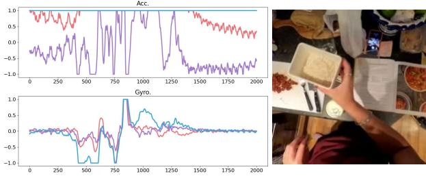  
文本查询：”A person doing gardening work outdoors”

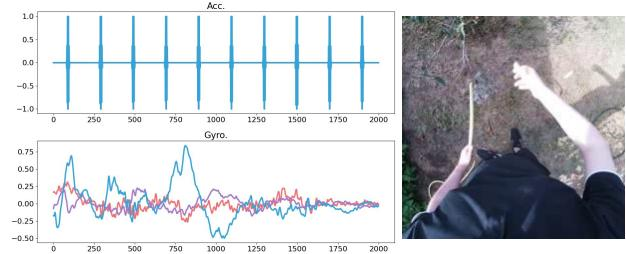  
Figure 7. IMU 检索结果。给定一个文本查询，我们展示了一些 IMU 检索结果以及相应的视频帧。

## C.2. 消融实验设置

我们在第 5 节（§ 5）中的评估使用了以下设置。与最佳设置不同，所有消融实验在视觉和模态特定编码器上均使用 ViT-Base。除非另有说明，模型均训练 16 个 epoch。

对于 Table 5b，线性头与 MLP 头之间的差异详见下文：在我们的实验中，MLP 头并未提高性能。

<table><tr><td>Linear</td><td>Linear(in_dim, out_dim)</td></tr><tr><td>MLP</td><td>Linear(in_dim, in_dim), GELU, Linear(in_dim, out_dim)</td></tr></table>

## D. 额外结果

定性结果。我们在随附的视频中展示了更多结果（包括音频）。

不同模态的实际应用。通常，共享嵌入空间可以实现各种不同的跨模态搜索和检索应用。例如，由于 IMU 传感器无处不在（在手机、AR/VR 头显、健康追踪器中），IMAGEBIND 可以允许用户使用文本查询搜索 IMU 数据库（无需使用 IMU-文本对进行训练）。基于 IMU 的文本搜索在医疗保健/活动搜索中具有应用价值。例如，在 Figure 7 中，我们展示了给定文本搜索查询时检索到的 IMU（及随附视频）示例。检索到的 IMU 样本以 3 通道加速度计（Accelerometer，Acc）和陀螺仪（Gyroscope，Gyro）记录的形式展示，与文本查询相匹配。

## E. 额外消融实验

损失函数的设计选择。由于模态特定编码器经过训练以与冻结的图像编码器对齐，我们尝试使用 $\ell _ { 2 }$ 回归目标。对于 ZS SUN top-1 准确率，我们观察到回归作为唯一目标（25.17%）或与对比学习联合使用（29.04%）时取得了良好的性能。然而，它并未超过仅使用对比学习目标（31.74%）的效果。

## F. 伦理考量

IMAGEBIND 学习了多种模态的联合嵌入。这种嵌入旨在关联来自不同模态的语义相关概念。然而，这种嵌入也可能会产生非预期的关联。因此，必须以衡量此类关联及其影响为视角，仔细研究包括 IMAGEBIND 在内的联合嵌入模型。IMAGEBIND 利用了预训练模型在大型网络数据上学习的图像-文本嵌入，正如不同研究 [60] 中记录的那样，这些数据存在偏差。为了学习音频、热成像（thermal）、深度（depth）和 IMU 等其他模态的联合嵌入，我们利用了附录 A（Appendix A）中提到的数据集。因此，这些联合嵌入局限于数据集中存在的概念。例如，我们使用的热成像数据集仅限于室外街景，而深度数据集则仅限于室内场景。