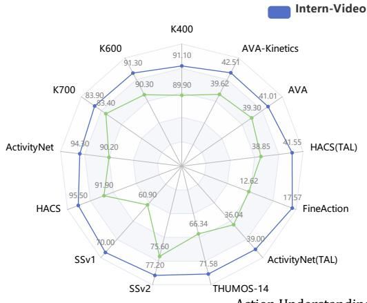
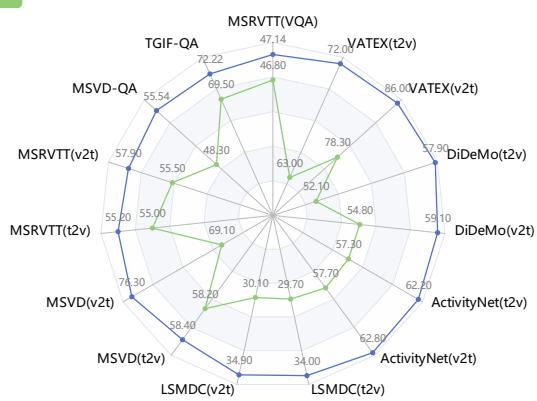
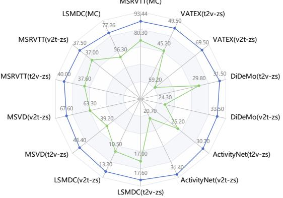
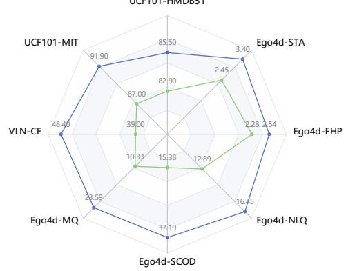
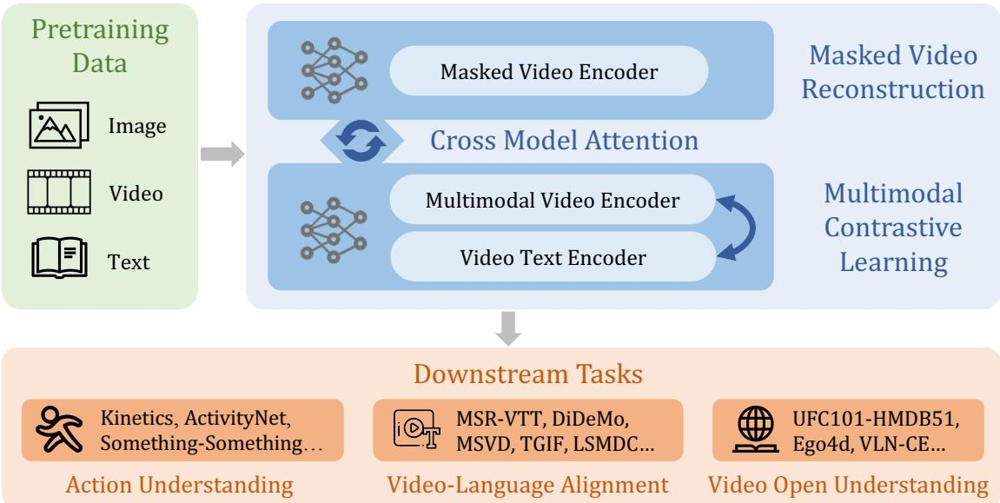
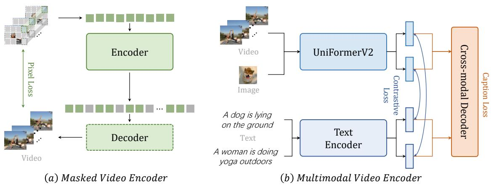
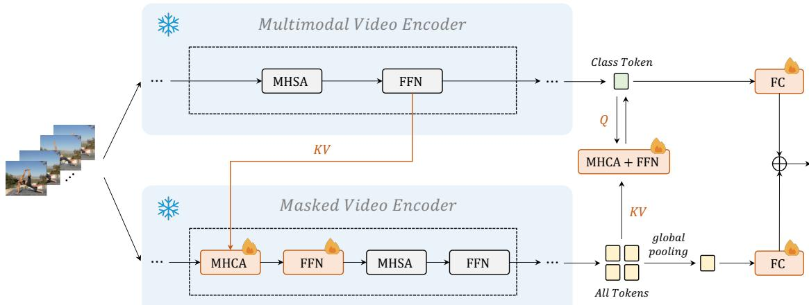

# InternVideo: General Video Foundation Models via Generative and Discriminative Learning

Yi Wang1∗, Kunchang Li5,1∗, Yizhuo Li3,1∗, Yinan He1∗, Bingkun Huang2,1∗, Zhiyu Zhao2,1∗, Hongjie Zhang1∗ Jilan Xu4,1, Yi Liu5,1, Zun Wang8,1, Sen Xing6,1, Guo Chen2,1, Junting Pan7,1, Jiashuo Yu1 Yali Wang5,1∗, Limin Wang2,1∗, Yu Qiao1†

1Shanghai AI Laboratory, 2Nanjing University, 3The University of Hong Kong, 4Fudan University 5Shenzhen Institute of Advanced Technology, Chinese Academy of Sciences 6Tsinghua University, 7The Chinese University of Hong Kong, 8The Australia National University

https://github.com/OpenGVLab/InternVideo

  
Figure 1: InternVideo delivers the best performance on extensive video-related tasks, compared with the state-of-the-art methods (including specialized [1–5] and foundation models [6–9]). Comparison details are given in Section 4.3. v2t and t2v denote video-to-text and text-to-video retrieval respectively. STA, FHP, NLQ, SCOD, and MQ are short for Short-term Object Interaction Anticipation, Future Hand Prediction, Natural Language Queries, State Change Object Detection, and Moment Queries, respectively.

## Abstract

The foundation models have recently shown excellent performance on a variety of downstream tasks in computer vision. However, most existing vision foundation models simply focus on imagelevel pretraining and adpation, which are limited for dynamic and complex video-level understanding tasks. To fill the gap, we present general video foundation models, InternVideo, by taking advantage of both generative and discriminative self-supervised video learning. Specifically, In ternVideo efficiently explores masked video modeling and video-language contrastive learning as the pretraining objectives, and selectively coordinates video representations of these two comple mentary frameworks in a learnable manner to boost various video applications. Without bells and whistles, InternVideo achieves state-of-the-art performance on 39 video datasets from extensive tasks including video action recognition/detection, video-language alignment, and open-world video applications. Especially, our methods can obtain 91.1% and 77.2% top-1 accuracy on the challenging Kinetics-400 and Something-Something V2 benchmarks, respectively. All of these results effec tively show the generality of our InternVideo for video understanding. The code will be released at https://github.com/OpenGVLab/InternVideo.

## 1 Introduction

Foundation models have been gaining increasing attention in the research community [10–12], since they give a practical paradigm for scaling to numerous perception tasks with surprisingly good results. Through simple adaption or zero/few-shot learning, foundation models greatly reduce downstream design and training costs using generic representations learned from web-scale data with a strong backbone of high capacity. It is expected that developing foundation models can cultivate cognition from perception, obtaining general vision capability.

Though a line of vision foundation models is proposed [7, 13–21], video understanding and the corresponding tasks are less explored compared with image ones, mainly used for validating that the visual features from these models are also beneficial to spatiotemporal representations. We conjecture this relatively scarce focus from the academic community is caused by 1) a high computing burden from video processing, and 2) quite a few current video benchmarks can be handled by exploiting appearance features from image backbones with accordingly temporal modeling. Specifically, for efficiency, the additional time dimension in video processing makes at least one order of magnitude higher complexity than image processing when their spatial resolutions are close and the temporal sampling ratio is usually 16. For some current video datasets, image features alone or with lateral temporal modules are sufficient to give decent results, especially with the rise of the multimodal model CLIP [13]. Its various temporal variants yield competitive or state-of-the-art performance in several core tasks [5, 22]. Regarding this, a simultaneous spatiotemporal learner does not seem like a sweet spot between research & development cost and payback.

Moreover, the transferability of current vision foundation models is somewhat narrow considering the wide spectrum of video applications. These models [6, 8, 23, 24] either concentrate on action understanding tasks (e.g. action recognition, spatiotemporal action localization, etc) or video-language alignment ones (e.g. video retrieval, video question answering, etc). We suppose this results from their learning schemes, as well as the lack of a comprehensive benchmark for measuring video understanding capabilities. Thus, these works [6, 8, 23, 24] focalize a few specific tasks to demonstrate their spatiotemporal perceptions. The community desires a general foundation model that enables a broader application domain.

In this paper, we advance video foundation model research with a cost-effective and versatile model InternVideo. To establish a feasible and effective spatiotemporal representation, we study both popular video masked modeling [23, 25] and multimodal contrastive learning [13, 26]. Note that video masking modeling specializes in action understanding, and it is still worth exploring regarding its limited model scale caused by the current decoder. For multimodal contrastive learning, it embeds rich semantics into video representation while ignoring concrete spatiotemporal modeling. To address these challenges, we make these two self-supervised approaches learn at scale efficiently in modular designs. To significantly broaden the generalization of the current video foundation models, we propose a unified representation learning with both two self-supervised training manners. To validate such a generalized representation, we propose a systematic video understanding benchmark. It involves evaluations of action understanding, video-language alignment, and open-world video applications, which we believe are three core abilities of generic video perception. Instead of introducing new data or annotations to this system, we initially choose ten representative video tasks with 39 public datasets, and categorize them into those three types. To our best knowledge, InternVideo is the first video foundation model which demonstrates promising transferability with state-of-the-art performance in all those three different types of video tasks.

In InternVideo, we design a unified video representation (UVR) learning paradigm. It explores both masked video modeling with autoencoders (MAE) and multimodal contrastive learning for two types of representations, strengthens them by supervised action classification, and generates a more general representation based on the cross-representation learning between them. UVR not only empirically shows video representation outperforms image one with temporal capturing significantly on core video tasks, but also is training-efficient. Its MAE exploits high redundancies in videos and trains with only a few visible tokens. Meanwhile, multimodal learning in InternVideo extends existing image-pretrained backbones for video contrastive training. After supervised training these two video encoders, we craft cross-model attention to conduct feature alignments between these two almost frozen encoders.

More than a unified video representation learning paradigm, we also make practices and guidelines for training large-scale video foundation models in a tractable and efficient manner. Our work contains and is not limited to 1) making VideoMAE scalable and exploring its scalability in model and data scale; 2) efficient and effective multimodal architecture design and training receipt about how to leverage existing image-pretrained backbones; 3) empirically finding features from VideoMAE and multimodal models are complementary and studying how to deduce more powerful video representations by coordinating different existing models. Specifically,

• For the scalability study of VideoMAE, we show that the proper diversity and scaling-up size in training videos can improve the scalability of the used video encoder. With a new pretrained dataset in a masked autoencoder training setting, ViT lifts its action recognition performance on Kinetics-400 [27] with finetuning from 81.01% to 85.35% from base to large, and further reaches 86.9% with the huge setup, surpassing the performance reported in [23] with a notable margin. The scalability of VideoMAE enables its usage in video foundation model development.

• For reusing existing foundation models for multimodal learning, we extend an image-pretrained vision transformer [28] to video representation learning. This transfer learning requires substantial structure and optimization customizations or using local and global spatiotemporal modules for multimodal pretraining. The local module disentangles spatiotemporal modeling by consecutive and independent spatial and temporal attention computation. Meanwhile, the global module computes token interaction across space and time. Experiments show that this reuse design is effective in spatiotemporal representation learning.

• More than self-supervised pretraining, we also employ supervised action recognition to further enhance video representation. Results demonstrate action recognition is a fine source task for transferring to various downstream applications.

• To coordinate foundation models, we unify masked video encoder with multimodal one by cross-representation learning, instead of training them jointly in one formulation. Regarding the optimization of MAE and multimodal learning (MML) that may contradict each other, combining them without compromising their merits remains an open question [29]. More importantly, MML with contrastive learning demands huge batches for better contrastive optimization. Adding MAE to it will inevitably lead to numerous headachy implementation issues. Considering their potential training adversaries, we train MAE and MML separately. After their training converges, we then dynamically combine their representations with the proposed cross-model attention (CMA) modules. It implements cross-attention between MAE and MML mid-level features, adaptively fusing their high-level features for prediction. In the model-level representation interaction phase, we freeze backbones trained by MAE and MML separately and only let CMA be updated in supervised learning with a few epochs. Experiments show it is a computationally tractable and efficient means to exploit both MAE and MML features.

We validate our proposed video foundation model in 10 tasks with 39 datasets (including core tasks e.g. action recognition, spatiotemporal action localization, video question answering, video retrieval, etc), and it outperforms all the state-of-the-art methods in each task non-trivially. We suppose these overall superior results obtained by our approach, along with observations and analysis, set up a new baseline for the video understanding community. The empirical evidence in this paper raises the confidence that video perceptive tasks and partial high-order tasks (formulated to perceptive forms) can be well-addressed by video foundation models, serving as a performance-critical method across a spectrum of applications.

In summary, we contribute to video foundation models in the following aspects:

• We explore a general video representation paradigm with both masked and contrastive modeling, and realize this design by unifying their representation by lightweight model interaction learning in supervision. We confirm features learned by generative and contrastive training are complementary to experiments and can deliver better results than either of them trained independently.

• We find masked video encoder can be scalable in model and data size with proper tuning. We devise pluggable local temporal and global spatiotemporal interaction modules to reuse pretrained ViT with image-text data for multimodal learning, easing the training burden and yielding better downstream performance.

• We make a tentative attempt in constructing a systematic video understanding benchmark. Our general video foundation models achieve state-of-the-art performance on 39 datasets with several core tasks in this benchmark, e.g., Kinetics-400 and Something-Something v2 in action recognition. We empirically find our learned video representations outperform their rivals, dominating vision-language tasks by a large margin, especially for some image-based ones. It suggests general video representations will be a central player in video tasks. We believe the openness of our proposed methods and models will provide the research community with handy tools to foundation models and their features with easy access.

## 2 Related Work

Image Foundation Models. Most of the current vision models are only suitable for specific tasks and domains, and they require manually labeled datasets for training. Regarding this, recent works have proposed vision foundation models. CLIP [13] and ALIGN [14] prepare web-scale noisy image-text pairs to train dual-encoder models with contrastive learning, leading to robust image-text representations for powerful zero-shot transfer. INTERN [12] expands the self-supervised pretraining into multiple learning stages, which use a large quantity of image-text pairs as well as manually annotated images. INTERN achieves a better linear probe performance compared with CLIP, and improves data efficiency in the downstream image tasks. Florence [15] extends them with unified contrastive learning [16] and elaborate adaptation models, which support a wide range of vision tasks in different transfer settings. SimVLM [17] and OFA [18] train encoder-decoder models with generative targets and show competitive performances on a series of multimodal tasks. Besides, CoCa [7] unifies contrastive learning as CLIP and generative learning as SimVLM. Recently, BeiT-3 [19] introduces Multiway Transformers with unified BeiT [20] pretraining, achieving state-of-the-art transfer results on several vision and image-language tasks.

Video Foundation Models. Previous image foundation models [7, 15] only show promising performance for video recognition (especially on Kinetics). As for video multimodal tasks, VIOLET [30] combines masked language and masked video modeling, All-in-one [24] proposes unified video-language pretraining with a shared backbone, and LAVENDER [31] unifies the tasks as masked language modeling. Though they perform well in multimodal benchmarks, they are trained with limited video-text data and struggle for video-only tasks, e.g. action recognition. In contrast, MERLOT Reserve [32] collects 20M video-text-audio pairs to train the joint video representations with contrastive span matching, thus setting state-of-the-art video recognition and visual commonsense reasoning. Compared with image foundation models, current video foundation models support limited video and video-language tasks, especially for those fine-grained temporal discrimination tasks such as temporal localization.

Self-supervised Pretraining. Self-supervised learning has developed rapidly recently. It focuses on designing different pretext tasks for pretraining [33–37], which can be mainly divided into contrastive learning and masked modeling. Contrastive learning adopts various data augmentations to generate different views of an image, then pulls together the positive pairs and pushes apart the negative pairs. To maintain enough informative negative samples, previous methods depend on large memory banks or batch size [38–40]. BYOL [41] and SimSiam [42] eliminate the requirement of negative samples, designing elaborate techniques to avoid model collapse. As for masked modeling, it learns rich visual representation via masked prediction based on visible context. iGPT [43] firstly mentions Masked Image Modeling (MIM). BeiT [20] propose visual token prediction with the pretrained tokenizer [44], MaskFeat [6] predicts the hand-crafted image descriptor, and MAE [25] directly reconstructs the raw pixels. For spatiotemporal representation learning, VideoMAE [23] and BEVT [45] respectively extend MAE and BeiT to spatiotemporal space.

Multimodal Pretraining. Starting from the development of image-text pretraining, large-scale video-text pretraining with specific downstream task finetuning has become the standard paradigm in the video-language area [26, 30, 32, 46– 51]. The seminal methods [52, 53] use pretrained visual and language encoders to extract the offline video and text features, while the recent methods [9, 24, 26, 46, 54, 55] have demonstrated the feasibility of end-to-end training. Besides, the popular methods often include two or three pretraining tasks, e.g. masked language modeling [31], video-text matching [24], video-text contrastive learning [47] and video-text masked modeling [30].

## 3 InternVideo

InternVideo is a general video foundation model along with its training and internal cooperation as given in Figure 2. In structure, InternVideo adopts the vision transformer (ViT) [28] and its variant UniformerV2 [56], along with extra local spatiotemporal modeling modules for multi-level representation interaction. In learning, InternVideo improve its representation progressively, integrating both self-supervised (masked modeling and multimodal learning) and supervised training. Moreover, as we explore two types of self-supervised learning, we further integrate their merits InternVideo dynamically derives new features from these two transformers via learnable interactions, getting the best of both worlds from generative and contrastive pertaining. Through the newly aggregated features, InternVideo sets new performance records on 34 benchmarks from 10 mainstream video tasks, and wins championships of five tracks in recent Ego4D competitions [57].

  
Figure 2: The overall framework of InternVideo.

## 3.1 Self-Supervised Video Pretraining

InternVideo conducts both masked and contrastive training without supervision for representation learning. According to [13, 23], video masked modeling produces features that excel at action discrimination, e.g., action recognition and temporal action localization, and video-language contrastive learning is able to understand videos with semantics from text without annotations. We employ two transformers with different structures for better leveraging these two optimization targets. The final representation is constructed by adaptively aggregating these two types of representations.

## 3.1.1 Video Masked Modeling

We follow most rituals from our proposed VideoMAE [23] work to train a vanilla Vision Transformer (ViT) as a video encoder for spatiotemporal modeling, as given in Figure 3 (a). VideoMAE conducts a video reconstruction task with highly masked video inputs, using an asymmetric encoder-decoder architecture. The used encoder and decoder are both ViTs. The channel number of the decoder is half of that of the encoder, with 4 blocks by default. Specifically, we divide the temporal strided downsampled video inputs into non-overlapping 3D patches and project them linearly into cube embeddings. Then we apply tube masking with notably high ratios (e.g. 90%) to these embeddings and input them into the asymmetric encoder-decoder architecture to perform the masked video modeling pretraining. To characterize spatiotemporal interaction globally, we employ joint space-time attention [58, 59] in ViT, making all visible tokens globally interact with each other. It is computationally tractable as only a few tokens are preserved for calculation.

## 3.1.2 Video-Language Contrastive Learning

We conduct both video/image-text contrastive learning and video captioning tasks for pretraining, as given in Figure 3 (b). For training efficiency, we build our multimodal structure based on the pretrained CLIP [13]. Instead of directly employing a vanilla ViT, we use our proposed UniformerV2 [56] as the video encoder for better and more efficient temporal modeling. Moreover, we adopt an extra transformer decoder for cross-modal learning. Specifically, we follow a typical align-before-fuse paradigm as given in [7, 60]. First, video and text are separately encoded. Then a contrastive loss is utilized to align the embedding space of video and text features. In the fusing stage, we apply a caption decoder as a cross-modality fuser, which uses cross attention for a captioning pretext. This align-before-fuse paradigm not only ensures the modalities can be aligned into the same single embedding space, which is beneficial for tasks like retrieval but also gifts the model with the ability to combine different modalities and can be beneficial for tasks like question answering. The introduction of a caption decoder both extends the potential of the original CLIP and improves the robustness of multimodality features.

  
Figure 3: The overall framework of masked learning and multimodal learning in the pretrained stage.

  
Figure 4: The illustration of the model interaction using cross-model attention.

## 3.2 Supervised Video Post-Pretraining

Empirically, action recognition acts well as a meta task in video downstream applications, widely validated in [61, 62]. Thus we train a masked video encoder and a multimodal one with supervised action classification separately as a post-pretraining step for better performance in diverse tasks. To promote the learning capacity of these encoders, we propose a unified video benchmark Kinetics-710 (K710, described in Section 4.1) for finetuning our video encoders.

Masked Video Encoder. We finetune the masked video encoder with 32 GPUs on K710. We adjust the learning rate linearly according to the base learning rate and batch size, lr = base learning rate × batch size . We adopt DeepSpeed1 256 framework to save memory usage and speed up training. We set the base learning rate to 0.001, the drop path rate to 0.2, the head dropout rate to 0.5, the repeated sampling[63] to 2, the layer decay to 0.8, and trained for 40 epochs.

Multimodal Video Encoder. We follow most of the training recipes in UniFormer [64]. For the best result, we adopt CLIP-ViT [13] as the backbone by default, due to its robust representation pretrained by vision-language contrastive learning. We insert the global UniBlocks in the last 4 layers of ViT-B/L to perform the multi-stage fusion. We set the base learning rate to 1e − 5, the repeated sampling to 1, the batch size to 512, and trained for 40 epochs. We adopt sparse sampling [65] with a resolution of 224 for all the datasets. In post-pretraining, we use a UniformerV2 [56] as the visual encoder and initialize additional parameters in a way that the output is identical to the original CLIP model which we find to be essential for good zero-shot performance. The video captioning module is a standard 6-layer transformer decoder with c = 768 followed by a two-layer MLP. Other setting leaves CLIP Large/14 untouched.

Table 1: Summary of datasets used in InternVideo pretraining process. A massive scale database is crucial to general vision pretraining. Our pretraining data is composed of 12 million video clips from 5 different domains.

<table><tr><td>Pretraining Dataset</td><td>Domain</td><td>Sample Clips</td><td>Frames × Sample rate</td></tr><tr><td>Kinetics-400 [27]</td><td>Youtube Video</td><td>240k</td><td>16 × 4</td></tr><tr><td>WebVid2M [55]</td><td>Web Video</td><td>250k</td><td>16 × 4</td></tr><tr><td>WebVid10M [55]</td><td>Web Video</td><td>10M</td><td>16 × 4</td></tr><tr><td>HowTo100M [66]</td><td>Youtube Video</td><td>1.2M</td><td>16 × 4</td></tr><tr><td>AVA [67]</td><td>Movie</td><td>21k</td><td>16 × 4</td></tr><tr><td>Something-Something V2 [68]</td><td>Shot from scripts</td><td>169k</td><td>16 × 2</td></tr><tr><td>Self-collected video</td><td>Youtube, Instagram</td><td>250k</td><td>16 × 4</td></tr><tr><td>Kinetics-710 [56]</td><td>Youtube Video</td><td>680k</td><td>16 × 4</td></tr></table>

## 3.3 Cross-Model Interaction

To learn a unified video representation based on both video masked modeling and video-language contrastive learning, we conduct cross-representation learning with added cross-model attention modules, as shown in Figure 4.

Regarding optimizing both models at the same time is computing-intensive, we freeze both backbones except the classification layers and the query tokens in the multimodal video encoder, only updating newly added components. We add some elaborate learnable modules (cross-model attention) for aligning representations learned in different approaches. Cross-model attention (CMA) is formed by standard Multi-Head Cross Attention (MHCA) along with Feed-Forward Network (FFN). It employs intermediate tokens from a multimodal video encoder as keys and values while using these from a masked video encoder as queries. The new tokens computed from CMA are treated as a gradually aligned representation with that from the multimodal video encoder. This procedure mainly transfers multimodal knowledge to CMAs in the masked video encoder. One design exception is that for the last CMA module, its keys and values are from the tokens of the masked video encoder and the query is from the class token of the multimodal video encoder. Thus, the class token is updated based on tokens from the masked encoder. It transfers single-modal knowledge to CMA in the multimodal video encoder. From this perspective, the features in all stages of the masked video encoder and the ones in the final stage of the multimodal video encoder are enhanced to coordinate with each other, in the supervision by action recognition. Finally, we utilize a learnable linear combination to dynamically fuse the two prediction scores.

## 4 Experiments

We detail our experimental configurations first (Section 4.1), then we present the downstream performance of Intern-Video on the proposed video understanding benchmark with three types of tasks (action understanding, video-language alignment, and open understanding) in Section 4.3.

## 4.1 Data for Pretraining

General video foundation model pretraining requires data from various domains at scale. To achieve a data distribution with diversity, we employ 6 public datasets and our self-collected video clips as shown in Table 1.

Kinetics-710. We adopt a new customized kinetics action dataset Kinetics-710 [56] for supervised training, both separate and joint ones. It has 650K videos with 710 unique action labels. It combines all the unique training data from Kinetics 400/600/700 [27, 69, 70]. To avoid the training leak, some training data existing in the testing set from Kinetics of a specific version are abandoned.

UnlabeledHybrid. The UnlabeledHybrid dataset is used for masked video pretraining, which is consist of Kinetics-710 [56], Something-Something V2 [68], AVA [67], WebVid2M [55], and our self-collected videos. For AVA, we cut the 15-minute training videos by 300 frames and get 21k video clips. We just randomly pick 250k videos from Self-collected videos and WebVid2M respectively. More details can be seen in Table. 1.

Table 2: Action recognition results on Kinetics & Something-Something. We report the top-1 accuracy of the compared methods on each dataset. InternVideo-D indicates it is formed by the model ensemble between a masked video encoder ViT-H and a CLIP-pretrained UniFormerV2-L, while InternVideo-T indicates it is computed based on InternVideo-D and a multimodal-pretrained UniFormerV2-L.

<table><tr><td>Method</td><td>#Params</td><td>K400</td><td>K600</td><td>K700</td></tr><tr><td>MaskFeat-L [6]</td><td>218M</td><td>87.0</td><td>88.3</td><td>80.4</td></tr><tr><td>CoCa [7]</td><td>1B+</td><td>88.9</td><td>89.4</td><td>82.7</td></tr><tr><td>MTV-H [8]</td><td>1B+</td><td>89.9</td><td>90.3</td><td>83.4</td></tr><tr><td>MerlotReserve-L [9]</td><td>644M</td><td>-</td><td>90.1</td><td>-</td></tr><tr><td>MerlotReserve-L (+Audio) [9]</td><td>644M</td><td>-</td><td>91.1</td><td>-</td></tr><tr><td>InternVideo-D</td><td>1.0B</td><td>90.9</td><td>91.1</td><td>83.8</td></tr><tr><td>InternVideo-T</td><td>1.3B</td><td> $\mathbf{91.1}_{(+1.2)}$ </td><td> $\mathbf{91.3}_{(+1.0)}$ </td><td> $\mathbf{84.0}_{(+0.6)}$ </td></tr></table>

Table 3: Action recognition results on Something-Something & ActivityNet & HACS & HMDB51. We report the top-1 accuracy of the compared methods on each dataset.

<table><tr><td>Method</td><td>SthSthV1</td><td>SthSthV2</td><td>ActivityNet</td><td>HACS</td><td>HMDB51</td></tr><tr><td>Previous SOTA</td><td>60.9 [73]</td><td>75.6 [6]</td><td>90.2 [1]</td><td>91.9 [58]</td><td>87.6 [3]</td></tr><tr><td>InternVideo</td><td> $\mathbf{70.0}_{(+9.1)}$ </td><td> $\mathbf{77.2}_{(+1.6)}$ </td><td> $\mathbf{94.3}_{(+4.1)}$ </td><td> $\mathbf{95.5}_{(+3.6)}$ </td><td> $\mathbf{89.3}_{(+1.7)}$ </td></tr></table>

## 4.2 Implementations

## 4.2.1 Multimodal Training

With the initialization from CLIP, we post-pretrain our multi-modal model with WebVid2M, WebVid10M, and HowTo100M. Since the training corpus of video-text datasets is not as rich as CLIP-400M [13], we co-train the video model with image-text datasets, a subset of LAION-400M [71] containing 100M image-text pairs. We alternate images and videos for each iteration. The batch size of video-text is 14,336, and the batch size of image-text is 86,016. We train for 400k steps on 128 NVIDIA A100 GPUs in 2 weeks, with a learning rate of $8 \times 1 0 ^ { - 5 }$ , weight decay of 0.2, cosine annealing schedule, and 4k warm-up steps.

## 4.2.2 Masked Video Training

We train the VideoMAE-Huge for 1200 epochs on the UnlabeledHybrid dataset with 64 80G-A100 GPUs. The model adapts the cosine annealing learning rate schedule and warmup 10% total epochs. The learning rate is set to $2 . 5 e \mathrm { ~ - ~ } 4$ Only MultiScaleCrop is used for data augmentation.

## 4.2.3 Model Interaction

As shown in Figure 4, we freeze both backbones except the classification layers and the query tokens in the multimodal video encoder. To maintain the original output, we add tanh gating layers in the extra MHCA and FFN as in Flamingo [72], and the parameters in dynamic weighted sum are initialized as zero. We train the coordinated models with a batch size of 64, a learning rate of $5 \times 1 0 ^ { 5 } .$ , a weight decay of 0.001, a dropout rate of 0.9, and an EMA rate of 0.9999. Besides, we use a cosine annealing schedule for 5 epochs with 1 warmup epoch. All used data augmentations are the same as in UniFormerV2 [56].

## 4.3 Downstream Tasks

We conduct extensive experiments on a spectrum of downstream tasks to evaluate InternVideo. The employed tasks are of three categories that consider action understanding, video-language alignment, and open understanding. Since InternVideo contains masked video encoder specializing in spatiotemporal variation characterization and fused multimodality video encoder, it can improve action understanding (Section 4.3.1) and video-language alignment (Section 4.3.2) tasks significantly. Its generalization brought by large-scale training data also enables its impressive zero-shot and open-set capabilities on the related tasks (Section 4.3.3). Even transferred to ego-centric tasks, InternVideo still gives an overwhelmingly favorable performance with simple heads [57]. Details are given as follows.

Table 4: Temporal action localization results on THUMOS-14 & ActivityNet-v1.3 & HACS & FineAction. We report the average mAP of the compared methods on each dataset.

<table><tr><td>Backbone</td><td>Head</td><td>THUMOS-14</td><td>ActivityNet-v1.3</td><td>HACS</td><td>FineAction</td></tr><tr><td>I3D [27]</td><td>ActionFormer [4]</td><td>66.80</td><td>-</td><td>-</td><td>13.24</td></tr><tr><td>SlowFast [74]</td><td>TCANet [75]</td><td>-</td><td>-</td><td>38.71</td><td>-</td></tr><tr><td>TSP [76]</td><td>ActionFormer [4]</td><td>-</td><td>36.60</td><td>-</td><td>-</td></tr><tr><td>InternVideo</td><td>ActionFormer [4]</td><td> $71.58_{(+4.78)}$ </td><td> $39.00_{(+2.40)}$ </td><td>41.32</td><td> $17.57_{(+4.33)}$ </td></tr><tr><td>InternVideo</td><td>TCANet [75]</td><td>-</td><td>-</td><td> $41.55_{(+2.84)}$ </td><td>-</td></tr></table>

Table 5: Spatiotemporal action localization results on AVA2.2 & AVA-Kinetics (AK). We report the mAP of the evaluated approaches on datasets.

<table><tr><td>Method</td><td>Head</td><td>AVA2.2</td><td>AVA-Kinetics</td></tr><tr><td>ACAR [77] (ensemble)</td><td>ACAR [77]</td><td>33.30</td><td>40.49</td></tr><tr><td>RM [78] (ensemble)</td><td>RM [78]</td><td>-</td><td>40.97</td></tr><tr><td>MaskFeat [6]</td><td>-</td><td>38.80</td><td>-</td></tr><tr><td>InternVideo</td><td>Linear</td><td> $\mathbf{41.01}_{(+2.21)}$ </td><td> $\mathbf{42.51}_{(+1.54)}$ </td></tr></table>

## 4.3.1 Action Understanding Tasks

Action Recognition. Actions derive spatiotemporal patterns. InternVideo aims to learn the representation of suitable spatiotemporal features, and the modeling of dynamical patterns. We evaluate InternVideo on 8 action recognition benchmarks, including popular Kinetics and Something-Something.

We evaluate VideoMAE and UniFormerV2 in InternVideo on Kinetics-400 [27], Kinetics-600 [69], Kinetics-700 [70], Something-in-Something-V1 [68], Something-in-Something-V2 [68], ActivityNet [79], HACS [80], and HMDB51 [81]. We use the top-1 accuracy as a comparison indicator. In Table 2 and 3, InternVideo demonstrates exceedingly promising performance on all these action recognition benchmarks. Our InternVideo significantly surpasses previous SOTA methods on almost all benchmarks and matches the SOTA result on ActivityNet. The rised accuracy brought by extra fused model (InternVideo-D vs. InternVideo-T) demonstrates it is necessary to explore a broad technical roadmap as different lines benefits each other in performance.

Temporal Action Localization. This task (TAL) aims at localizing the start and end points of action clips from the entire untrimmed video with full observation. We evaluate our InternVideo on four classic TAL datasets: THUMOS-14 [82], ActivityNet-v1.3 [79], HACS Segment [80] and FineAction [83]. In line with the previous temporal action localization tasks, we use mean Average Precision (mAP) for quantitative evaluations. Average Precision (AP) is calculated for each action category, to evaluate the proposals on action categories. It is computed under different tIoU thresholds. We report the performance of the state-of-the-art TAL methods whose codes are publicly available, including ActionFormer [4] method for THUMOS-14, ActivityNet-v1.3, and FineAction and TCANet [75] method for HACS Segment.

We use ViT-H from our InternVideo as backbones for feature extraction. In our experiment, ViT-H models are pretrained from Hybrid datasets. As shown in Table 4, our InternVideo outperforms best than all the preview methods on these four TAL datasets. Note that, our InternVideo achieves huge improvements in temporal action localization, especially in fine-grained TAL datasets such as THUMOS-14 and FineAction.

Spatiotemporal Action Localization. This task (STAL) is to predict the frames and corresponding actions of people in video keyframes. We evaluate InternVideo on two classic STAL datasets AVA2.2 [67] and AVA-Kinetics [84]. In AVA2.2 [67], each video lasts 15 minutes, and it gives a keyframe every second. The annotation is provided for keyframes instead of all frames. Here we use a classic two-stage approach to handle this task. We apply a well-trained (on MS-COCO [85]) Mask-RCNN [86] to detect humans on each keyframe, and the keyframe boxes are provided in the Alphaction [87] project. In the second stage, centering around the key frame, a certain number of frames are extracted and fed into our video backbone. Similarly, in the training, we use the ground truth box for training [87], and the boxes predicted in the first stage for testing.

We used ViT-Huge in InternVideo for experiments. The specific results can be seen in Table 5. The classification head uses a simple linear head, achieving the SOTA performance on both datasets. Note using the ViT-H model, and training with the AVA-Kinetics dataset not only improves the overall mAP, but also significantly improves the mAP obtained by testing on AVA alone. It suggests the introduction of some Kinetics videos to AVA will improve the generalization of the model over AVA; on the other hand, observing the various distributions of the AVA dataset, we find that AVA presents a typical long-tailed distribution. The introduction of Kinetics video will alleviate this issue for better results. Due to the small number of models validated on the AVA-Kinetics dataset, only the results from the paperswithcode website are selected in the Table 5.

Table 6: Results of video retrieval on MSR-VTT, MSVD, LSMDC, ActivityNet, DiDeMo, and VATEX. We report R@1 both on text-to-video (T2V) and video-to-text (V2T) retrieval tasks.

<table><tr><td rowspan="2">Method</td><td colspan="2">MSR-VTT</td><td colspan="2">MSVD</td><td colspan="2">LSMDC</td><td colspan="2">ActivityNet</td><td colspan="2">DiDeMo</td><td colspan="2">VATEX</td></tr><tr><td>T2V</td><td>V2T</td><td>T2V</td><td>V2T</td><td>T2V</td><td>V2T</td><td>T2V</td><td>V2T</td><td>T2V</td><td>V2T</td><td>T2V</td><td>V2T</td></tr><tr><td>CLIP4Clip [5]</td><td>45.6</td><td>45.9</td><td>45.2</td><td>48.4</td><td>24.3</td><td>23.8</td><td>40.3</td><td>41.6</td><td>43.0</td><td>43.6</td><td>63.0</td><td>78.3</td></tr><tr><td>TS2Net [88]</td><td>49.4</td><td>46.6</td><td>-</td><td>-</td><td>23.4</td><td>-</td><td>41.0</td><td>-</td><td>41.8</td><td>-</td><td>59.1</td><td>-</td></tr><tr><td>X-CLIP [22]</td><td>49.3</td><td>48.9</td><td>50.4</td><td>66.8</td><td>26.1</td><td>26.9</td><td>46.2</td><td>46.4</td><td>47.8</td><td>47.8</td><td>-</td><td>-</td></tr><tr><td>InternVideo</td><td>55.2</td><td>57.9</td><td>58.4</td><td>76.3</td><td>34.0</td><td>34.9</td><td>62.2</td><td>62.8</td><td>57.9</td><td>59.1</td><td>71.1</td><td>87.2</td></tr></table>

Table 7: Video question answering on MSRVTT, MSVD, and TGIF. We report top-1 accuracy.

<table><tr><td>Method</td><td>MSRVTT</td><td>MSVD</td><td>TGIF</td></tr><tr><td>ClipBERT [54]</td><td>37.4</td><td>-</td><td>60.3</td></tr><tr><td>All-in-one [24]</td><td>42.9</td><td>46.5</td><td>64.2</td></tr><tr><td>MERLOT [9]</td><td>43.1</td><td>-</td><td>69.5</td></tr><tr><td>VIOLET [30]</td><td>43.9</td><td>47.9</td><td>68.9</td></tr><tr><td>InternVideo</td><td> $\mathbf{47.1}_{(+3.2)}$ </td><td> $\mathbf{55.5}_{(+7.6)}$ </td><td> $\mathbf{72.2}_{(+3.3)}$ </td></tr></table>

## 4.3.2 Video-Language Alignment Tasks

Video Retrieval. We evaluate InternVideoon the video retrieval task. Given a set of videos and related natural language captions, this task requires retrieving the matched video or caption corresponding to its inter-modality counterpart from candidates. We follow the common paradigm to capture visual and text semantics by a visual encoder $f _ { v } ( \cdot )$ and a text encoder $f _ { t } ( \cdot )$ , then calculate the cross-modality similarity matrices as the retrieval guidance. We leverage the multimodal video encoder as $f _ { v } ( \cdot )$ and $f _ { t } ( \cdot )$ with pretrained ViT-L/14 [28] as the basic CLIP [13] architecture and finetune the entire model on each retrieval dataset. The training recipes and most of the hyperparameter settings follow CLIP4Clip [5], including training schedule, learning rate, batch size, video frames, maximum text length, etc. To boost model performance, we also adopt the dual softmax loss [91] as the post-processing operation.

Our model is evaluated on six public benchmarks: MSR-VTT [92], MSVD [93], LSMDC [94], DiDeMo [95], ActivityNet [79], and VATEX [96], where we report the results on the standard split following previous works. We measure the retrieval results under the rank-1 (R@1) metric both on text-to-video and video-to-text tasks, which are shown in Table 6. Results show that our model significantly outperforms all previous methods by a large margin, showing the superiority of InternVideo on video-language related tasks. More detailed retrieval results, including rank-5 (R@5) and rank-10 (R@10), can be found in the supplementary materials.

Video Question Answering. To further demonstrate the vision-language capability of InternVideo , we evaluate InternVideo on video question answering (VQA). Given a video and question pair, VQA is to predict the answer to the question. Unlike the vanilla CLIP model without cross-modality fusion, our multimodal video encoder is able to capture the interaction between modalities with the proposed caption decoder. There are three potential ways to generate features required by the VQA classifier: concatenating the features of the video encoder and text encoder, utilizing the features of the caption decoder only, and concatenating all features from the video encoder, text encoder, and caption decoder. After comparison, we choose to use all three sources of features to boost the performance. The VQA classifier is a three-layer MLP.

We evaluate on three popular public benchmarks: MSR-VTT [92], MSVD [97], and TGIF [98]. We mainly follow the practice in [24]. The results are shown in Table 7 and our model outperforms all previous SOTA, which demonstrates the effectiveness of our cross-modality learner.

Visual Language Navigation. Visual-Language Navigation [99] requires an agent to navigate in unknown photorealistic environments based on its visual perceptions following natural language instructions. Navigation agents should be capable of capturing spatiotemporal information such as the relative motion of objects from navigation histories, especially when the agent navigates with short step size in continuous spaces. To verify the effectiveness of such ability of our model, we conduct our experiments on the VLN-CE benchmark [100], demanding the agent to function in a continuous environment.

Table 8: Results of VLN-CE dataset.

<table><tr><td rowspan="2">Agent</td><td rowspan="2">Backbone</td><td colspan="5">val-unseen</td></tr><tr><td>NE↓</td><td>PL</td><td>SR↑</td><td>NDTW↑</td><td>SPL↑</td></tr><tr><td>CWP-VLNBERT [89]</td><td>ResNet50</td><td>5.52</td><td>11.85</td><td>45.19</td><td>54.20</td><td>39.91</td></tr><tr><td>CWP-HEP [90]</td><td>CLIP-ViT-B/16</td><td>5.21</td><td>10.29</td><td>50.24</td><td>60.39</td><td>45.71</td></tr><tr><td>CWP-HEP [90]</td><td>InternVideo</td><td> $\mathbf{4.95}_{(-0.26)}$ </td><td>10.44</td><td> $\mathbf{52.90}_{(+2.66)}$ </td><td> $\mathbf{61.55}_{(+1.16)}$ </td><td> $\mathbf{47.70}_{(+0.99)}$ </td></tr></table>

Table 9: Results of zero-shot video retrieval on MSR-VTT, MSVD, LSMDC, ActivityNet, DiDeMo, and VATEX. We report R@1 both on text-to-video (T2V) and video-to-text (V2T) retrieval tasks.

<table><tr><td rowspan="2">Methods</td><td colspan="2">MSR-VTT</td><td colspan="2">MSVD</td><td colspan="2">LSMDC</td><td colspan="2">ActivityNet</td><td colspan="2">DiDeMo</td><td colspan="2">VATEX</td></tr><tr><td>T2V</td><td>V2T</td><td>T2V</td><td>V2T</td><td>T2V</td><td>V2T</td><td>T2V</td><td>V2T</td><td>T2V</td><td>V2T</td><td>T2V</td><td>V2T</td></tr><tr><td>CLIP [13]</td><td>35.0</td><td>32.3</td><td>39.2</td><td>63.3</td><td>17.0</td><td>10.5</td><td>25.2</td><td>20.7</td><td>29.8</td><td>24.3</td><td>45.2</td><td>59.2</td></tr><tr><td>InternVideo</td><td>40.7</td><td>39.6</td><td>43.4</td><td>67.6</td><td>17.6</td><td>13.2</td><td>30.7</td><td>31.4</td><td>31.5</td><td>33.5</td><td>49.5</td><td>69.5</td></tr></table>

We conduct our experiments using the method proposed in [90](CWP-HEP). The history-enhanced planner is a customized variant of HAMT [101] which uses a concatenation of depth embedding and RGB embedding as the input embedding. Note that we don’t use the tryout controller here since VLN-CE setting allows sliding. This is a strong baseline that already outperforms the previous state-of-the-art method CWP-VLNBERT [89]. In each decision loop, we collect the latest 16-frame observations to form panoramic navigation videos and then encode the video using ViT-L in InternVideo. The video embedding is concatenated with the RGB embedding and depth embedding as the final image embedding. For evaluation, we refer to [90] for detailed metrics. InternVideo could improved our baseline from 50.2% to 52.9% in Success Rate(SR) (Table 8).

## 4.3.3 Video Open Understanding Tasks

Zero-shot Action Recognition. Zero-shot recognition is one of the extraordinary capabilities of the original CLIP model. With our designed multimodal video encoder, we can also achieve remarkable zero-shot action recognition performance without further optimization. We evaluate our model on Kinetics-400 dataset with 64.25% accuracy, which outperforms the previous SOTA 56.4% [102] by a large margin. Zero-shot Video Retrieval. We compare InternVideo with CLIP on zero-shot text-to-video and video-to-text retrieval. For fair comparisons, we use the ViT-L/14 model with the pretrained weights 1 of CLIP. Wise-finetuning [103] and model ensemble are employed to further boost the model performance on zero-shot video retrieval. We empirically find that the optimal number of video frames for zero-shot retrieval is between 4 and 8, and the best-performed frame on each benchmark dataset is yielded via grid search. As illustrated in Table 9, InternVideo demonstrates superior retrieval ability across all six benchmark datasets. Besides, Florence [15] used 900M image-text pair for pretraining and it achieved 37.6 R@1 text-to-video retrieval accuracy on MSR-VTT. In comparison, our model outperforms Florence by 4.1% with much less training data (14.35M video + 100M image v.s. 900M image). These results reveal the effectiveness of our method in learning the joint video-text feature space during pretraining.

Zero-shot Multiple Choice. Zero-shot multiple choice is another zero-shot task that can demonstrate the model’s generality. Multiple choice task aims to find the correct answer in the given choices, usually a small subset such as 5 words. We find that co-training with image-text pairs, wise-finetuning, and the ensemble is essential for the performance on zero-shot multiple choice. We report the zero-shot multiple-choice results in Table 10 on MSR-VTT and LSMDC datasets. We use the zero-shot performance as a handy indicator for generality in training, and the results show that our model is robust and effective.

Open-set Action Recognition. In open-set action recognition (OSAR), the model is required to recognize the known action samples from training classes and reject the unknown samples that are out of training classes. Compared with images, video actions are more challenging to be recognized in an OSR setting than images due to the uncertain temporal dynamics, and static bias of human actions [109]. Our InternVideo generalizes well to unknown classes that are out of training classes and outperforms the existing method [109] without any model calibration.

Table 10: Zero-shot multiple-choice on MSR-VTT and LSMDC. The gray color indicates those methods with supervised training.

<table><tr><td colspan="2">MSR-VTT</td><td colspan="2">LSMDC</td></tr><tr><td>Method</td><td>Accuracy</td><td>Method</td><td>Accuracy</td></tr><tr><td>JSFusion [104]</td><td>83.4</td><td>JSFusion [104]</td><td>73.5</td></tr><tr><td>ActBERT [53]</td><td>85.7</td><td>MERLOT [9]</td><td>81.7</td></tr><tr><td>ClipBERT [54]</td><td>88.2</td><td>VIOLET [30]</td><td>82.9</td></tr><tr><td>All-in-one [24]</td><td>80.3</td><td>All-in-one [24]</td><td>56.3</td></tr><tr><td>InternVideo</td><td> $\mathbf{93.4}_{(+13.1)}$ </td><td>InternVideo</td><td> $\mathbf{77.3}_{(+21.0)}$ </td></tr></table>

Table 11: Results of open set action recognition on two different open sets where the samples of unknown class are from HMDB-51 and MiT-v2, respectively. We report Open Set AUC at the threshold determined by ensuring 95% training videos (UCF101) are recognized as known.

<table><tr><td rowspan="2">Method</td><td colspan="2">Open Set AUC (%)</td><td rowspan="2">Closed Set Accuracy (%)</td></tr><tr><td>UCF-101 + HMDB-51</td><td>UCF-101 + MiT-v2</td></tr><tr><td>OpenMax [105]</td><td>78.76</td><td>80.62</td><td>62.09</td></tr><tr><td>MC Dropout [106]</td><td>75.41</td><td>78.49</td><td>96.75</td></tr><tr><td>BNN SVI [107]</td><td>74.78</td><td>77.39</td><td>96.43</td></tr><tr><td>SoftMax</td><td>79.16</td><td>82.88</td><td>96.70</td></tr><tr><td>RPL [108]</td><td>74.23</td><td>77.42</td><td>96.93</td></tr><tr><td>DEAR [109]</td><td>82.94</td><td>86.99</td><td>96.48</td></tr><tr><td>InternVideo</td><td> $\mathbf{85.48}_{(+2.54)}$ </td><td> $\mathbf{91.85}_{(+4.86)}$ </td><td> $\mathbf{97.89}_{(+1.41)}$ </td></tr></table>

We use the ViT-H/16 model of InternVideo as a backbone, and finetune it with a simple linear classification head on UCF-101 [110] training set. To enable InternVideo to “know unknown", we follow the method DEAR proposed in [109] and formulate it as an uncertainty estimation problem by leveraging evidential deep learning (EDL), which provides a way to jointly formulate the multiclass classification and uncertainty modeling. Specifically, given a video as input, the Evidential Neural Network (ENN) head on top of a InternVideo backbone predicts the class-wise evidence, which formulates a Dirichlet distribution so that the multi-class probabilities and predictive uncertainty of the input can be determined. During the open-set inference, high-uncertainty videos can be regarded as unknown actions, while low-uncertainty videos are classified by the learned categorical probabilities.

InternVideo can not only recognize known action classes accurately but also identify the unknown. Table 11 reports the results of both closed-set (Closed Set Accuracy) and open-set (Open Set AUC) performance of InternVideo and other baselines. It shows that our InternVideo consistently and significantly outperforms other baselines on both two open-set datasets, where unknown samples are from HMDB-51 [81] and MiT-v2 [111], respectively.

## 5 Concluding Remarks

In this paper, we propose a versatile and training-efficient video foundation model InternVideo. To our best knowledge, InternVideo is the first work to perform best among existing researches on all action understanding, video-language alignment, and video open understanding tasks. Compared with previous related work [6, 8, 9], it greatly lifts the generality of video foundation models to a new level, by achieving state-of-the-art performance on nearly 40 datasets covering 10 different tasks. The model exploits a unified video representation based on the cross-model learning between masked video learning (VideoMAE) and video-language contrastive modeling along with supervised training. Compared with previous foundation models, it is efficient in training. With simple ViT and its corresponding variants, we achieve generalized video representations with 64.5K GPU hours (A100-80G), while CoCa [7] requires 245.76K TPU hours (v4). We validate such generalized spatiotemporal representation on a spectrum of applications. With simple task heads (even linear ones) and proper downstream adaption tuning, our video representation demonstrates record-breaking results in all used datasets. Even for zero-shot and open-set settings, our model spectrum still gives consistent and non-trivial performance increases, further proving its generalization and adaption.

## 5.1 Limitations

Our study shows the effectiveness and feasibility of video foundation models instead of giving brand-new formulations or model designs. It focuses on the current popular video perception tasks and handles videos using clips. Its devise can hardly process long-term video tasks, as well as high-order ones, e.g. anticipating plots from the seen parts of a movie. Gaining the capacity to address these tasks is crucial to further push the generality of video representation learning.

## 5.2 Future Work

To further extend the generality of the video foundation models, we suppose embracing model coordination and cognition is necessary for its studies. Specifically, how to systematically coordinate foundation models trained from different modalities, pretraining tasks, and even varied architectures for a better representation remains open and challenging. There are multiple technical routes to address it, e.g. model distillation, unifying different pretraining objectives, and feature alignment, to name a few. By exploiting previously learned knowledge, we can accelerate video foundation model development sustainably.

In the long run, foundation models are expected to master cognitive capabilities more than perceivable ones. Considering its feasibility, we suppose one of its research trends is to achieve large-scale spatiotemporal analysis (long-term & big scene) from the foundational dynamic perception in the open world, leading to essential cognitive understanding. Moreover, it has raised a tide that combining foundation models with decision-making to form intelligent agents to explore new tasks. In this interaction, data collection and model training are also automated. The whole process enters a closed loop as the interactive results will adjust agent strategies and behaviors. Our initial experiments (Section 4.3.2) on vision-language navigation demonstrate the promising future of integrating video foundation models into Embodied AI.

## 6 Broader Impact

We give a video foundation model spectrum InternVideo. It is able to deliver the state-of-the-art performance on around 40 datasets, capable of action discrimination, video-language alignment, and open understanding. Besides of public data, we also exploit self-collected data from the Internet. The employed queries for gathering data are checked for ethic and legal issues and so are the curated data. The power consumption of training InternVideo is much lower than CoCa [7], only taking up 23.19 % of CoCa. For further impact studies, we need to explore the bias, risks, fairness, equality, and many more social topics.

## References

[1] Boyang Xia, Wenhao Wu, Haoran Wang, Rui Su, Dongliang He, Haosen Yang, Xiaoran Fan, and Wanli Ouyang. Nsnet: Non-saliency suppression sampler for efficient video recognition. In ECCV, 2022.

[2] Alexandros Stergiou and Ronald Poppe. Learn to cycle: Time-consistent feature discovery for action recognition. Pattern Recognition Letters, 141:1–7, 2021.

[3] Lei Wang and Piotr Koniusz. Self-supervising action recognition by statistical moment and subspace descriptors. In ACM International Conference on Multimedia, 2021.

[4] Chenlin Zhang, Jianxin Wu, and Yin Li. Actionformer: Localizing moments of actions with transformers. In eccv, 2022.

[5] Huaishao Luo, Lei Ji, Ming Zhong, Yang Chen, Wen Lei, Nan Duan, and Tianrui Li. Clip4clip: An empirical study of clip for end to end video clip retrieval and captioning. Neurocomputing, 2022.

[6] Chen Wei, Haoqi Fan, Saining Xie, Chao-Yuan Wu, Alan Yuille, and Christoph Feichtenhofer. Masked feature prediction for self-supervised visual pre-training. In CVPR, 2022.

[7] Jiahui Yu, Zirui Wang, Vijay Vasudevan, Legg Yeung, Mojtaba Seyedhosseini, and Yonghui Wu. Coca: Contrastive captioners are image-text foundation models. arXiv preprint arXiv:2205.01917, 2022.

[8] Shen Yan, Xuehan Xiong, Anurag Arnab, Zhichao Lu, Mi Zhang, Chen Sun, and Cordelia Schmid. Multiview transformers for video recognition. In CVPR, 2022.

[9] Rowan Zellers, Ximing Lu, Jack Hessel, Youngjae Yu, Jae Sung Park, Jize Cao, Ali Farhadi, and Yejin Choi. Merlot: Multimodal neural script knowledge models. NeurIPS, 2021.

[10] Rishi Bommasani, Drew A Hudson, Ehsan Adeli, Russ Altman, Simran Arora, Sydney von Arx, Michael S Bernstein, Jeannette Bohg, Antoine Bosselut, Emma Brunskill, et al. On the opportunities and risks of foundation models. arXiv preprint arXiv:2108.07258, 2021.

[11] Hassan Akbari, Liangzhe Yuan, Rui Qian, Wei-Hong Chuang, Shih-Fu Chang, Yin Cui, and Boqing Gong. Vatt: Transformers for multimodal self-supervised learning from raw video, audio and text. NeurIPS, 2021.

[12] Jing Shao, Siyu Chen, Yangguang Li, Kun Wang, Zhenfei Yin, Yinan He, Jianing Teng, Qinghong Sun, Mengya Gao, Jihao Liu, et al. Intern: A new learning paradigm towards general vision. arXiv preprint arXiv:2111.08687, 2021.

[13] Alec Radford, Jong Wook Kim, Chris Hallacy, Aditya Ramesh, Gabriel Goh, Sandhini Agarwal, Girish Sastry, Amanda Askell, Pamela Mishkin, Jack Clark, et al. Learning transferable visual models from natural language supervision. In ICML, 2021.

[14] Chao Jia, Yinfei Yang, Ye Xia, Yi-Ting Chen, Zarana Parekh, Hieu Pham, Quoc Le, Yun-Hsuan Sung, Zhen Li, and Tom Duerig. Scaling up visual and vision-language representation learning with noisy text supervision. In ICML, 2021.

[15] Lu Yuan, Dongdong Chen, Yi-Ling Chen, Noel Codella, Xiyang Dai, Jianfeng Gao, Houdong Hu, Xuedong Huang, Boxin Li, Chunyuan Li, et al. Florence: A new foundation model for computer vision. arXiv preprint arXiv:2111.11432, 2021.

[16] Jianwei Yang, Chunyuan Li, Pengchuan Zhang, Bin Xiao, Ce Liu, Lu Yuan, and Jianfeng Gao. Unified contrastive learning in image-text-label space. In CVPR, 2022.

[17] Zirui Wang, Jiahui Yu, Adams Wei Yu, Zihang Dai, Yulia Tsvetkov, and Yuan Cao. SimVLM: Simple visual language model pretraining with weak supervision. In ICLR, 2022.

[18] Peng Wang, An Yang, Rui Men, Junyang Lin, Shuai Bai, Zhikang Li, Jianxin Ma, Chang Zhou, Jingren Zhou, and Hongxia Yang. Ofa: Unifying architectures, tasks, and modalities through a simple sequence-to-sequence learning framework. In ICML, 2022.

[19] Wenhui Wang, Hangbo Bao, Li Dong, Johan Bjorck, Zhiliang Peng, Qiang Liu, Kriti Aggarwal, Owais Khan Mohammed, Saksham Singhal, Subhojit Som, et al. Image as a foreign language: Beit pretraining for all vision and vision-language tasks. arXiv preprint arXiv:2208.10442, 2022.

[20] Hangbo Bao, Li Dong, Songhao Piao, and Furu Wei. BEit: BERT pre-training of image transformers. In ICLR, 2022.

[21] Paul Barham, Aakanksha Chowdhery, Jeff Dean, Sanjay Ghemawat, Steven Hand, Daniel Hurt, Michael Isard, Hyeontaek Lim, Ruoming Pang, Sudip Roy, et al. Pathways: Asynchronous distributed dataflow for ml. Proceedings ofMachine Learning and Systems, 2022.

[22] Yiwei Ma, Guohai Xu, Xiaoshuai Sun, Ming Yan, Ji Zhang, and Rongrong Ji. X-clip: End-to-end multi-grained contrastive learning for video-text retrieval. In ACM International Conference on Multimedia, 2022.

[23] Zhan Tong, Yibing Song, Jue Wang, and Limin Wang. VideoMAE: Masked autoencoders are data-efficient learners for self-supervised video pre-training. In NeurIPS, 2022.

[24] Alex Jinpeng Wang, Yixiao Ge, Rui Yan, Yuying Ge, Xudong Lin, Guanyu Cai, Jianping Wu, Ying Shan, Xiaohu Qie, and Mike Zheng Shou. All in one: Exploring unified video-language pre-training. arXiv preprint arXiv:2203.07303, 2022.

[25] Kaiming He, Xinlei Chen, Saining Xie, Yanghao Li, Piotr Dollár, and Ross Girshick. Masked autoencoders are scalable vision learners. In CVPR, 2022.

[26] Tianhao Li and Limin Wang. Learning spatiotemporal features via video and text pair discrimination. CoRR, abs/2001.05691, 2020.

[27] Joao Carreira and Andrew Zisserman. Quo vadis, action recognition? a new model and the kinetics dataset. In CVPR, 2017.

[28] Alexey Dosovitskiy, Lucas Beyer, Alexander Kolesnikov, Dirk Weissenborn, Xiaohua Zhai, Thomas Unterthiner, Mostafa Dehghani, Matthias Minderer, Georg Heigold, Sylvain Gelly, Jakob Uszkoreit, and Neil Houlsby. An image is worth 16x16 words: Transformers for image recognition at scale. In ICLR, 2021.

[29] Roman Bachmann, David Mizrahi, Andrei Atanov, and Amir Zamir. Multimae: Multi-modal multi-task masked autoencoders. arXiv preprint arXiv:2204.01678, 2022.

[30] Tsu-Jui Fu, Linjie Li, Zhe Gan, Kevin Lin, William Yang Wang, Lijuan Wang, and Zicheng Liu. Violet: End-to-end video-language transformers with masked visual-token modeling. arXiv preprint arXiv:2111.12681, 2021.

[31] Linjie Li, Zhe Gan, Kevin Lin, Chung-Ching Lin, Zicheng Liu, Ce Liu, and Lijuan Wang. Lavender: Unifying video-language understanding as masked language modeling. arXiv preprint arXiv:2206.07160, 2022.

[32] Rowan Zellers, Jiasen Lu, Ximing Lu, Youngjae Yu, Yanpeng Zhao, Mohammadreza Salehi, Aditya Kusupati, Jack Hessel, Ali Farhadi, and Yejin Choi. Merlot reserve: Neural script knowledge through vision and language and sound. In CVPR, 2022.

[33] Carl Doersch, Abhinav Gupta, and Alexei A Efros. Unsupervised visual representation learning by context prediction. In ICCV, 2015.

[34] Xiaolong Wang and Abhinav Gupta. Unsupervised learning of visual representations using videos. In ICCV, 2015.

[35] Mehdi Noroozi and Paolo Favaro. Unsupervised learning of visual representations by solving jigsaw puzzles. In ECCV, 2016.

[36] Richard Zhang, Phillip Isola, and Alexei A Efros. Colorful image colorization. In ECCV, 2016.

[37] Christoph Feichtenhofer, Haoqi Fan, Yanghao Li, and Kaiming He. Masked autoencoders as spatiotemporal learners. arXiv preprint arXiv:2205.09113, 2022.

[38] Zhirong Wu, Yuanjun Xiong, Stella X Yu, and Dahua Lin. Unsupervised feature learning via non-parametric instance discrimination. In CVPR, 2018.

[39] Kaiming He, Haoqi Fan, Yuxin Wu, Saining Xie, and Ross Girshick. Momentum contrast for unsupervised visual representation learning. In CVPR, 2020.

[40] Ting Chen, Simon Kornblith, Mohammad Norouzi, and Geoffrey Hinton. A simple framework for contrastive learning of visual representations. In ICML, 2020.

[41] Jean-Bastien Grill, Florian Strub, Florent Altché, Corentin Tallec, Pierre Richemond, Elena Buchatskaya, Carl Doersch, Bernardo Avila Pires, Zhaohan Guo, Mohammad Gheshlaghi Azar, et al. Bootstrap your own latent-a new approach to self-supervised learning. NeurIPS, 2020.

[42] Xinlei Chen and Kaiming He. Exploring simple siamese representation learning. In CVPR, 2021.

[43] Mark Chen, Alec Radford, Rewon Child, Jeffrey Wu, Heewoo Jun, David Luan, and Ilya Sutskever. Generative pretraining from pixels. In ICML, 2020.

[44] Aditya Ramesh, Mikhail Pavlov, Gabriel Goh, Scott Gray, Chelsea Voss, Alec Radford, Mark Chen, and Ilya Sutskever. Zero-shot text-to-image generation. In ICML, 2021.

[45] Rui Wang, Dongdong Chen, Zuxuan Wu, Yinpeng Chen, Xiyang Dai, Mengchen Liu, Yu-Gang Jiang, Luowei Zhou, and Lu Yuan. Bevt: Bert pretraining of video transformers. In CVPR, 2022.

[46] Antoine Miech, Jean-Baptiste Alayrac, Lucas Smaira, Ivan Laptev, Josef Sivic, and Andrew Zisserman. End-to-end learning of visual representations from uncurated instructional videos. In CVPR, 2020.

[47] Hu Xu, Gargi Ghosh, Po-Yao Huang, Dmytro Okhonko, Armen Aghajanyan, Florian Metze, Luke Zettlemoyer, and Christoph Feichtenhofer. Videoclip: Contrastive pre-training for zero-shot video-text understanding. arXiv preprint arXiv:2109.14084, 2021.

[48] Xiaowei Hu, Zhe Gan, Jianfeng Wang, Zhengyuan Yang, Zicheng Liu, Yumao Lu, and Lijuan Wang. Scaling up visionlanguage pre-training for image captioning. In CVPR, 2022.

[49] Zi-Yi Dou, Yichong Xu, Zhe Gan, Jianfeng Wang, Shuohang Wang, Lijuan Wang, Chenguang Zhu, Pengchuan Zhang, Lu Yuan, Nanyun Peng, et al. An empirical study of training end-to-end vision-and-language transformers. In CVPR, 2022.

[50] Sheng Shen, Liunian Harold Li, Hao Tan, Mohit Bansal, Anna Rohrbach, Kai-Wei Chang, Zhewei Yao, and Kurt Keutzer. How much can clip benefit vision-and-language tasks? arXiv preprint arXiv:2107.06383, 2021.

[51] Lewei Yao, Runhui Huang, Lu Hou, Guansong Lu, Minzhe Niu, Hang Xu, Xiaodan Liang, Zhenguo Li, Xin Jiang, and Chunjing Xu. Filip: Fine-grained interactive language-image pre-training. arXiv preprint arXiv:2111.07783, 2021.

[52] Chen Sun, Austin Myers, Carl Vondrick, Kevin P. Murphy, and Cordelia Schmid. Videobert: A joint model for video and language representation learning. ICCV, 2019.

[53] Linchao Zhu and Yi Yang. Actbert: Learning global-local video-text representations. CVPR, 2020.

[54] Jie Lei, Linjie Li, Luowei Zhou, Zhe Gan, Tamara L Berg, Mohit Bansal, and Jingjing Liu. Less is more: Clipbert for video-and-language learning via sparse sampling. In CVPR, 2021.

[55] Max Bain, Arsha Nagrani, Gül Varol, and Andrew Zisserman. Frozen in time: A joint video and image encoder for end-to-end retrieval. In ICCV, 2021.

[56] Kunchang Li, Yali Wang, Yinan He, Yizhuo Li, Yi Wang, Limin Wang, and Yu Qiao. Uniformerv2: Spatiotemporal learning by arming image vits with video uniformer. arXiv preprint arXiv:2211.09552, 2022.

[57] Guo Chen, Sen Xing, Zhe Chen, Yi Wang, Kunchang Li, Yizhuo Li, Yi Liu, Jiahao Wang, Yin-Dong Zheng, Bingkun Huang, et al. Internvideo-ego4d: A pack of champion solutions to ego4d challenges. arXiv preprint arXiv:2211.09529, 2022.

[58] Anurag Arnab, Mostafa Dehghani, Georg Heigold, Chen Sun, Mario Luciˇ c, and Cordelia Schmid. Vivit: A video vision´ transformer. In ICCV, 2021.

[59] Ze Liu, Jia Ning, Yue Cao, Yixuan Wei, Zheng Zhang, Stephen Lin, and Han Hu. Video swin transformer. In CVPR, 2022.

[60] Junnan Li, Ramprasaath Selvaraju, Akhilesh Gotmare, Shafiq Joty, Caiming Xiong, and Steven Chu Hong Hoi. Align before fuse: Vision and language representation learning with momentum distillation. NeurIPS, 2021.

[61] Tianwei Lin, Xu Zhao, Haisheng Su, Chongjing Wang, and Ming Yang. Bsn: Boundary sensitive network for temporal action proposal generation. In Proceedings of the European conference on computer vision (ECCV), pages 3–19, 2018.

[62] Tianwei Lin, Xiao Liu, Xin Li, Errui Ding, and Shilei Wen. Bmn: Boundary-matching network for temporal action proposal generation. In ICCV, 2019.

[63] Elad Hoffer, Tal Ben-Nun, Itay Hubara, Niv Giladi, Torsten Hoefler, and Daniel Soudry. Augment your batch: Improving generalization through instance repetition. CVPR, 2020.

[64] Kunchang Li, Yali Wang, Gao Peng, Guanglu Song, Yu Liu, Hongsheng Li, and Yu Qiao. Uniformer: Unified transformer for efficient spatial-temporal representation learning. In ICLR, 2022.

[65] Limin Wang, Yuanjun Xiong, Zhe Wang, Yu Qiao, Dahua Lin, Xiaoou Tang, and Luc Van Gool. Temporal segment networks: Towards good practices for deep action recognition. In ECCV, 2016.

[66] Antoine Miech, Dimitri Zhukov, Jean-Baptiste Alayrac, Makarand Tapaswi, Ivan Laptev, and Josef Sivic. Howto100m: Learning a text-video embedding by watching hundred million narrated video clips. ICCV, 2019.

[67] Chunhui Gu, Chen Sun, David A Ross, Carl Vondrick, Caroline Pantofaru, Yeqing Li, Sudheendra Vijayanarasimhan, George Toderici, Susanna Ricco, Rahul Sukthankar, et al. Ava: A video dataset of spatio-temporally localized atomic visual actions. In CVPR, 2018.

[68] Raghav Goyal, Samira Ebrahimi Kahou, Vincent Michalski, Joanna Materzynska, Susanne Westphal, Heuna Kim, Valentin Haenel, Ingo Fruend, Peter Yianilos, Moritz Mueller-Freitag, et al. The" something something" video database for learning and evaluating visual common sense. In ICCV, 2017.

[69] Joao Carreira, Eric Noland, Andras Banki-Horvath, Chloe Hillier, and Andrew Zisserman. A short note about kinetics-600. arXiv preprint arXiv:1808.01340, 2018.

[70] Joao Carreira, Eric Noland, Chloe Hillier, and Andrew Zisserman. A short note on the kinetics-700 human action dataset. arXiv preprint arXiv:1907.06987, 2019.

[71] Christoph Schuhmann, Richard Vencu, Romain Beaumont, Robert Kaczmarczyk, Clayton Mullis, Aarush Katta, Theo Coombes, Jenia Jitsev, and Aran Komatsuzaki. Laion-400m: Open dataset of clip-filtered 400 million image-text pairs. arXiv preprint arXiv:2111.02114, 2021.

[72] Jean-Baptiste Alayrac, Jeff Donahue, Pauline Luc, Antoine Miech, Iain Barr, Yana Hasson, Karel Lenc, Arthur Mensch, Katie Millican, Malcolm Reynolds, et al. Flamingo: a visual language model for few-shot learning. arXiv preprint arXiv:2204.14198, 2022.

[73] Yuan Tian, Yichao Yan, Guangtao Zhai, Guodong Guo, and Zhiyong Gao. Ean: event adaptive network for enhanced action recognition. IJCV, 2022.

[74] Christoph Feichtenhofer, Haoqi Fan, Jitendra Malik, and Kaiming He. Slowfast networks for video recognition. In ICCV, 2019.

[75] Zhiwu Qing, Haisheng Su, Weihao Gan, Dongliang Wang, Wei Wu, Xiang Wang, Yu Qiao, Junjie Yan, Changxin Gao, and Nong Sang. Temporal context aggregation network for temporal action proposal refinement. In CVPR, 2021.

[76] Humam Alwassel, Silvio Giancola, and Bernard Ghanem. Tsp: Temporally-sensitive pretraining of video encoders for localization tasks. In ICCV, 2021.

[77] Junting Pan, Siyu Chen, Mike Zheng Shou, Yu Liu, Jing Shao, and Hongsheng Li. Actor-context-actor relation network for spatio-temporal action localization. In CVPR, 2021.

[78] Yutong Feng, Jianwen Jiang, Ziyuan Huang, Zhiwu Qing, Xiang Wang, Shiwei Zhang, Mingqian Tang, and Yue Gao. Relation modeling in spatio-temporal action localization. arXiv preprint arXiv:2106.08061, 2021.

[79] Fabian Caba Heilbron, Victor Escorcia, Bernard Ghanem, and Juan Carlos Niebles. Activitynet: A large-scale video benchmark for human activity understanding. In CVPR, 2015.

[80] Hang Zhao, Antonio Torralba, Lorenzo Torresani, and Zhicheng Yan. Hacs: Human action clips and segments dataset for recognition and temporal localization. In ICCV, 2019.

[81] Hildegard Kuehne, Hueihan Jhuang, Estíbaliz Garrote, Tomaso Poggio, and Thomas Serre. Hmdb: a large video database for human motion recognition. In ICCV, 2011.

[82] Haroon Idrees, Amir R Zamir, Yu-Gang Jiang, Alex Gorban, Ivan Laptev, Rahul Sukthankar, and Mubarak Shah. The thumos challenge on action recognition for videos “in the wild”. CVIU, 2017.

[83] Yi Liu, Limin Wang, Yali Wang, Xiao Ma, and Yu Qiao. Fineaction: A fine-grained video dataset for temporal action localization. IEEE Transactions on Image Processing, 2022.

[84] Ang Li, Meghana Thotakuri, David A Ross, João Carreira, Alexander Vostrikov, and Andrew Zisserman. The ava-kinetics localized human actions video dataset. arXiv preprint arXiv:2005.00214, 2020.

[85] Tsung-Yi Lin, Michael Maire, Serge Belongie, James Hays, Pietro Perona, Deva Ramanan, Piotr Dollár, and C Lawrence Zitnick. Microsoft coco: Common objects in context. In ECCV, 2014.

[86] Kaiming He, Georgia Gkioxari, Piotr Dollar, and Ross Girshick. Mask r-cnn. In ICCV, 2017.

[87] Jiajun Tang, Jin Xia, Xinzhi Mu, Bo Pang, and Cewu Lu. Asynchronous interaction aggregation for action detection. In ECCV, 2020.

[88] Yuqi Liu, Pengfei Xiong, Luhui Xu, Shengming Cao, and Qin Jin. Ts2-net: Token shift and selection transformer for text-video retrieval. In ECCV, 2022.

[89] Yicong Hong, Zun Wang, Qi Wu, and Stephen Gould. Bridging the gap between learning in discrete and continuous environments for vision-and-language navigation. In CVPR, 2022.

[90] Dong An, Zun Wang, Yangguang Li, Yi Wang, Yicong Hong, Yan Huang, Liang Wang, and Jing Shao. 1st place solutions for rxr-habitat vision-and-language navigation competition (cvpr 2022). arXiv preprint arXiv:2206.11610, 2022.

[91] Xing Cheng, Hezheng Lin, Xiangyu Wu, Fan Yang, and Dong Shen. Improving video-text retrieval by multi-stream corpus alignment and dual softmax loss. arXiv preprint arXiv:2109.04290, 2021.

[92] Jun Xu, Tao Mei, Ting Yao, and Yong Rui. Msr-vtt: A large video description dataset for bridging video and language. In CVPR, 2016.

[93] Zuxuan Wu, Ting Yao, Yanwei Fu, and Yu-Gang Jiang. Deep learning for video classification and captioning. In Frontiers of Multimedia Research. 2017.

[94] Lisa Anne Hendricks, Oliver Wang, Eli Shechtman, Josef Sivic, Trevor Darrell, and Bryan Russell. Localizing moments in video with natural language. In ICCV, 2017.

[95] Anna Rohrbach, Marcus Rohrbach, Niket Tandon, and Bernt Schiele. A dataset for movie description. In CVPR, 2015.

[96] Xin Wang, Jiawei Wu, Junkun Chen, Lei Li, Yuan-Fang Wang, and William Yang Wang. Vatex: A large-scale, high-quality multilingual dataset for video-and-language research. In ICCV, 2019.

[97] David Chen and William B Dolan. Collecting highly parallel data for paraphrase evaluation. In ACL, 2011.

[98] Yuncheng Li, Yale Song, Liangliang Cao, Joel Tetreault, Larry Goldberg, Alejandro Jaimes, and Jiebo Luo. Tgif: A new dataset and benchmark on animated gif description. In CVPR, 2016.

[99] Peter Anderson, Qi Wu, Damien Teney, Jake Bruce, Mark Johnson, Niko Sünderhauf, Ian Reid, Stephen Gould, and Anton Van Den Hengel. Vision-and-language navigation: Interpreting visually-grounded navigation instructions in real environments. In CVPR, 2018.

[100] Jacob Krantz, Erik Wijmans, Arjun Majumdar, Dhruv Batra, and Stefan Lee. Beyond the nav-graph: Vision-and-language navigation in continuous environments. In ECCV, 2020.

[101] Shizhe Chen, Pierre-Louis Guhur, Cordelia Schmid, and Ivan Laptev. History aware multimodal transformer for vision-andlanguage navigation. NeurIPS, 2021.

[102] Mengmeng Wang, Jiazheng Xing, and Yong Liu. Actionclip: A new paradigm for video action recognition. ArXiv, abs/2109.08472, 2021.

[103] Mitchell Wortsman, Gabriel Ilharco, Jong Wook Kim, Mike Li, Simon Kornblith, Rebecca Roelofs, Raphael Gontijo Lopes, Hannaneh Hajishirzi, Ali Farhadi, Hongseok Namkoong, et al. Robust fine-tuning of zero-shot models. In CVPR, 2022.

[104] Youngjae Yu, Jongseok Kim, and Gunhee Kim. A joint sequence fusion model for video question answering and retrieval. In ECCV, 2018.

[105] Abhijit Bendale and Terrance E Boult. Towards open set deep networks. In CVPR, 2016.

[106] Yarin Gal and Zoubin Ghahramani. Dropout as a bayesian approximation: Representing model uncertainty in deep learning. In ICML, 2016.

[107] Ranganath Krishnan, Mahesh Subedar, and Omesh Tickoo. Bar: Bayesian activity recognition using variational inference. arXiv preprint arXiv:1811.03305, 2018.

[108] Guangyao Chen, Limeng Qiao, Yemin Shi, Peixi Peng, Jia Li, Tiejun Huang, Shiliang Pu, and Yonghong Tian. Learning open set network with discriminative reciprocal points. In ECCV, 2020.

[109] Wentao Bao, Qi Yu, and Yu Kong. Evidential deep learning for open set action recognition. In ICCV, 2021.

[110] Khurram Soomro, Amir Roshan Zamir, and Mubarak Shah. A dataset of 101 human action classes from videos in the wild. Centerfor Research in Computer Vision, 2012.

[111] Mathew Monfort, Bowen Pan, Kandan Ramakrishnan, Alex Andonian, Barry A McNamara, Alex Lascelles, Quanfu Fan, Dan Gutfreund, Rogerio Feris, and Aude Oliva. Multi-moments in time: Learning and interpreting models for multi-action video understanding. TPAMI, 2021.