# MotionAGFormer：利用 Transformer-GCNFormer 网络增强 3D 人体姿态估计

Soroush Mehraban1,2, Vida Adeli1,3, Babak Taati1,2,3

1KITE Research Institute, 2Institute of Biomedical Engineering, University of Toronto, 3Department of Computer Science, University of Toronto

{soroush.mehraban, vida.adeli}@mail.utoronto.ca, babak.taati@uhn.ca

## 摘要

近期基于 Transformer 的方法在 3D 人体姿态估计中展现出了卓越的性能。然而，它们采用全局视角，通过对所有关节之间的全局关系进行编码，未能精确捕捉局部依赖关系。在本文中，我们提出了一种新颖的 Attention-GCNFormer（AGFormer）块，它利用两个并行的 Transformer 和 GCNFormer 流来分割通道数。我们提出的 GCN-Former 模块利用了相邻关节之间的局部关系，输出一种与 Transformer 输出互补的新表征。通过以自适应的方式融合这两种表征，AGFormer 展现出了更好地学习潜在 3D 结构的能力。通过堆叠多个 AGFormer 块，我们提出了四种不同变体的 Motion-AGFormer，可根据速度与精度的权衡进行选择。我们在两个常用的基准数据集 Human3.6M 和 MPI-INF-3DHP 上评估了我们的模型。MotionAGFormer-B 取得了最先进的结果，P1 误差分别为 38.4 mm 和 16.2 mm。值得注意的是，与 Human3.6M 数据集上以往的领先模型相比，它仅使用了四分之一的参数量，且计算效率提高了三倍。代码和模型可在 https://github.com/ TaatiTeam/MotionAGFormer 获取。

## 1. 引言

3D 空间中的人体姿态估计是一个活跃的研究领域，对众多应用具有重大意义，涵盖从增强现实 [21] 和虚拟现实 [26] 到自动驾驶汽车 [2, 9, 43]、人机交互 [27] 等诸多领域。随着这些广泛的应用，对更准确且计算效率更高的姿态估计模型的需求持续增长。在大多数现实场景中，姿态序列是以 2D 形式捕获的，这主要是由于标准 RGB 相机的普遍使用。因此，该领域的关键挑战之一在于如何有效地将这些 2D 序列提升（lift）到 3D 空间中。准确的 3D 人体姿态估计能够提取关于人体运动的丰富时空信息，并对动作和交互产生更深刻的理解。近期的 3D 提升模型利用人体运动固有的空间和时间一致性来提高 3D 姿态预测的精度。尽管取得了显著进展，但仍有若干重大挑战亟待解决。

  
Figure 1. 近期姿态提升（pose uplifting）方法在 Human3.6M [14] 数据集上的对比（越低越好）。MACs/frame 表示每个输出帧的乘加累积操作数（multiply-accumulate operations）。所提出的 MotionAGFormer 提供了不同的变体，在保持计算效率的同时取得了更优异的结果。

最初为 NLP（自然语言处理）任务设计的 Transformer 架构 [41]，已被应用于包括姿态估计在内的多种计算机视觉问题中。其捕捉长距离依赖关系的能力以及先天的自注意力机制，使其成为该领域极具前景的候选模型。然而，仅依赖标准 Transformer 所采用的全局注意力机制，对于姿态估计任务而言可能并非最优。人体运动本质上具有局部空间和时间依赖关系的结构化特征。

一个首要的问题是骨骼关系随时间的建模。现有方法主要依赖于 Transformer 架构或基于图的模型。虽然 Transformer 擅长捕捉长程依赖，但图模型更擅长处理局部依赖。因此，存在一个机会来构建统一的架构，将 Transformer 的全局视角与图模型的局部精度结合起来。

此外，追求达到 SOTA（最先进水平）精度的竞争往往导致了参数量巨大的日益复杂的模型的开发。这类模型尽管精度很高，但对于计算效率和快速响应时间至关重要的实际应用场景而言往往变得不切实际。而且，近期模型中的一种主流方法是仅从序列帧中预测中心帧的单个 3D 姿态。这种方法虽然看似高效，但由于需要对若干重叠序列进行重复处理，会导致计算冗余。因此，我们采用了一种能够充分利用序列数据的简化推理策略。该方法通过在单次前向传播中预测输入的完整 3D 序列，从而最大限度地减少冗余。

在本文中，我们提出了 MotionAGFormer，这是一种专为 3D 人体姿态估计定制的新型 Transformer-图混合架构。MotionAGFormer 的核心在于利用 Transformer 的能力来捕获全局信息，同时采用图卷积网络（GCNs）来整合局部时空关系。我们使用自适应融合来聚合来自 Transformer 分支和图分支的特征。通过这种方式，我们确保了对人体运动平衡且全面的表征，从而提高了 3D 姿态估计的准确度（见 Figure 1）。

总之，本文的主要贡献如下：

• 新颖设计：我们提出了 MotionAGFormer 模型，并在其中引入了一种新的 GCNFormer 模块，该模块擅长表征人体姿态序列中固有的局部依赖关系。

• 高效性与灵活性：i) 与以往的 SOTA 方法相比，我们的 MotionAGFormer 凭借其轻量化的特性、更快的速度以及更少的参数量脱颖而出，且未牺牲准确性。ii) 考虑到多样化的需求，我们提供了 MotionAGFormer 的不同变体，使用户能够根据其具体需求在准确性和速度之间进行灵活权衡与选择。

• SOTA 性能：MotionAGFormer 在两个极具挑战性的数据集 Human3.6M 和 MPI-INF-3DHP 上均取得了 SOTA 表现。

## 2. 相关工作

3D 人体姿态估计。目前解决该问题的方法可以从两个角度来理解。从一个角度来看，模型可以根据输入视频进行分类，输入视频可以是多视角的也可以是单目的。依赖多视角输入的模型 [7, 15, 34, 35, 48] 必须同时使用来自不同角度的多个摄像机，这在现实场景中可行性较低。从另一个角度来看，考虑到其方法论，这些模型可以分为直接 3D 估计方法或 2D-3D 提升（2D-3D lifting）方法。直接 3D 估计方法 [31, 32, 39, 52] 无需任何中间步骤，直接从视频帧中推断 3D 坐标下的关节点。受精准 2D 姿态估计模型的快速发展及可用性的启发，最近的 2D-3D 提升方法首先使用现成的 2D 姿态检测器 [4, 28, 38]，然后将 2D 坐标提升至 3D 空间 [40, 47, 50, 51, 53]。在这项工作中，我们采用单目视频作为输入，并使用 2D-3D 提升方法。

基于 Transformer 的方法。Transformer [41] 在不同的视觉任务中展现出了良好的效果 [10, 37, 45, 54]。在 3D 人体姿态估计领域，Pose-Former [51] 是第一个纯基于 Transformer 的模型。PoseFormerV2 [50] 通过采用频域表示提高了计算效率，同时也使其对噪声数据中的突发运动具有鲁棒性。MHFormer [20] 通过提出一个学习多个合理姿态假设的模块，解决了自遮挡和深度模糊性问题。P-STMO [36] 提出了掩码姿态建模，并通过自监督预训练模型降低了最终误差。Enfalt 等人 [11] 通过利用掩码 Token 建模降低了计算复杂度。StridedFormer [19] 用跨步卷积替换了 Transformer 编码器前馈网络中的全连接层，以逐步缩减序列长度并高效地提升（lift）中心帧。与上述仅估计序列中心帧 3D 姿态的模型不同，MixSTE [47] 为输入序列中的每一帧都提供了 3D 估计。STCFormer [40] 通过将相关性学习分解为空间和时间分量降低了计算复杂度。HSTFormer [33] 提出了分层 Transformer 编码器，以更好地捕获时空相关性。除了常用的关节点-关节点（joint-joint）注意力外，HDFormer [3] 还包含了骨骼-关节点（bone-joint）和超骨骼-关节点（hyperbone-joint）的交互。一些工作利用输出的运动表示来处理各种任务。MotionBERT [53] 将针对 3D 人体姿态估计任务学习到的模型微调用于动作识别和 3D 人体网格恢复等任务，而 UPS [12] 则同时训练了一个用于动作识别、3D 姿态估计和早期动作预测的统一模型。

图卷积网络。基于 GCN 的方法在基于骨架的动作识别领域取得了显著的成功 [5, 18, 22]。尽管它们在 3D 人体姿态估计中具有计算效率优势 [6, 8, 42, 49]，但与基于 Transformer 的对应方法相比，它们通常无法展现出具有竞争力的误差表现。这主要是由于它们仅关注局部关节点。最近，GLA-GCN [44] 引入了一种自适应 GCN 方法来利用全局表示。通过采用跨步设计来缩减其时间范围，他们在保持更轻内存负载的同时，在 3D 人体姿态估计上达到了与各种基于 Transformer 的模型相媲美的效果。然而，所提出的模块在提取全局表示方面的有效性仍不及注意力模块。

混合方法。这些方法利用不同的模块来捕获输入序列的不同方面，目前尚未得到广泛探索。最近，DC-GCT [16] 提出了一种基于 GCN 的局部约束模块（Local Constraint Module）和基于自注意力（self-attention）的全局约束模块（Global Constraint Module），以利用输入序列的局部和全局依赖关系。然而，由于其模型设计为既可以处理单个输入帧也可以处理帧序列，因此未对时间维度和空间维度进行区分。结果，与基于 Transformer 的方法相比，它未能取得具有竞争力的结果。

## 3. 方法

## 3.1. 预备知识

在本节中，我们首先回顾 MetaFormer [46] 的概念，它构成了我们编码器的核心。MetaFormer 可以被描述为 Transformer 架构 [41] 的泛化形式，其中注意力模块被替换为任何能够在 token 之间传递信息的混合器（mixer）。具体而言，对于输入 $\check { X } \in \mathbb { R } ^ { N \times C }$（其中 $N$ 表示 token 数量，$C$ 表示嵌入维度），token 混合器可以形式化地表示为

$$
Y = \operatorname{TokenMixer} (\operatorname{Norm} (X)) + X,\tag{1}
$$

其中 Norm(·) 表示归一化方法，例如批归一化或层归一化 [1,13]，而 TokenMixer(·) 表示在 token 之间融合信息的模块。我们的方法使用了两个并行的 token 混合器：多头自注意力（Multi-head Self-Attention, MHSA）和图卷积网络（Graph Convolutional Networks, GCNs）[17]，二者各自在信息转换过程中发挥独特作用。

## 3.2. 整体架构

我们的目标是将 2D（像素坐标）骨架序列提升为准确的 3D 姿态序列。为此，我们提出了 MotionAGFormer 架构，该架构同时使用注意力（Transformer）和图卷积（GCNFormer）来提升运动序列。该架构的概览如图 Figure 2a 所示。

该模型接收带有置信度分数的 2D 输入序列 $\mathbf { X } \in \mathbb { R } ^ { T \times J \times 3 }$，其中 $T$ 和 $J$ 分别表示帧数和关节点数。然后，模型使用线性投影层将每个时间帧中的每个关节点映射到一个 $d$ 维特征 $\mathbf { F } ^ { ( 0 ) } \in \mathbb { R } ^ { T \times J \times d }$。接着，将空间位置嵌入 $\mathbf { P _ { p o s } ^ { s } } \in \bar { \mathbb { R } ^ { 1 \times J \times d } }$ 添加到 token 中。这里需要强调的是，我们的模型并没有忽略时间 token 顺序，因为该信息已保留在 GCNFormer 流中（在 4.5 节的消融实验中有进一步讨论）。

在位置嵌入（position embedding）之后，我们使用 $N$ 个 AGFormer 块（第 3.3 节）来计算 $\mathbf { F } ^ { ( i ) } ~ \in ~ \mathbb { R } ^ { T \times J }$ ×d $( i \ = \ 1 , . . . , N )$，以有效捕捉骨架序列潜在的 3D 结构。最后，我们通过应用线性层和 tanh 激活函数将 $\bar { \mathbf { F } } ^ { ( N ) }$ 映射到更高维度以计算运动语义 $\mathbf { M } \in \dot { \mathbb { R } } ^ { T \times J \times d ^ { \prime } }$，并使用回归头（regression head）来估计 3D 姿态 $\hat { \textbf { P } } \in \mathbb { R } ^ { T \times J \times 3 }$。提升损失（lifting loss）包含位置项 $\left( L _ { 3 D } \right)$ 和速度项 $( L _ { \Delta \mathbf { P } } )$，定义为

$$
\begin{array}{r} L _ {3 D} = \Sigma_ {t = 1} ^ {T} \Sigma_ {j = 1} ^ {J} \| \hat {\mathbf {P}} _ {t, j} - \mathbf {P} _ {t, j} \|, \\ L _ {\Delta \mathbf {P}} = \Sigma_ {t = 2} ^ {T} \Sigma_ {j = 1} ^ {J} \| \Delta \hat {\mathbf {P}} _ {t, j} - \Delta \mathbf {P} _ {t, j} \|, \end{array}\tag{2}
$$

其中 $\Delta \hat { \mathbf P } _ { t } = \hat { \mathbf P } _ { t } - \hat { \mathbf P } _ { t - 1 } , \Delta \mathbf P _ { t } = \mathbf P _ { t } - \mathbf P _ { t - 1 }$。总提升损失随后定义为

$$
{\cal L} = {\cal L} _ {3 D} + \lambda_ {\Delta {\bf P}} {\cal L} _ {\Delta {\bf P}},\tag{3}
$$

其中常数系数 $\lambda _ { \Delta \mathbf { P } }$ 用于平衡位置精度和运动平滑度。

## 3.3. AGFormer 块

AGFormer 块采用双流架构。每个流由两个组件组成：空间 MetaFormer（Figure 2b），随后是时间 MetaFormer（Figure 2c）。空间 MetaFormer 将各个身体关节作为不同的 token 进行处理，有效捕捉单帧内的帧内关系。另一方面，时间 MetaFormer 将每一帧视为单个 token，从而捕捉随时间变化的帧间关系。这两个流之间的关键区别在于它们的 token 混合器（token mixer）类型。其中一个流采用 Transformer，而另一个流则使用 GCNFormer。

Transformer 流。该流采用空间多头自注意力（Spatial Multi-Head Self-Attention，S-MHSA）来捕捉空间关系，随后采用时间多头自注意力（Temporal Multi-Head Self-Attention，T-MHSA）来捕捉时间关系。S-MHSA 定义为

$$
\begin{array}{r l} & {\mathbf {S - M H S A} (\mathbf {Q _ {s}}, \mathbf {K _ {s}}, \mathbf {V _ {s}}) = \mathrm{Concat} (\mathrm {head_ {i}},..., \mathrm {head_ {h}}) \mathbf {W _ {s}} ^ {(O)},} \\ & {\qquad \mathrm {head_ {i}} = \mathrm{softmax} (\frac {\mathbf {Q _ {s}} ^ {(i)} (\mathbf {K _ {s}} ^ {(i)}) ^ {T}}{\sqrt {d _ {k}}}) \mathbf {V _ {s}} ^ {(i)},} \end{array}\tag{4}
$$

  
Figure 2. (a) MotionAGFormer 是一种新颖的架构，具有 N 个双流时空块（spatio-temporal blocks），其中一个流采用 Transformer，另一个流利用 GCNFormer。(b) 空间 MetaFormer（Spatial MetaFormer）。每个输入 token 代表人体的一个单独关节点。(c) 时间 MetaFormer（Temporal MetaFormer）。输入 token 是姿态序列的帧。

其中 ${ \bf W _ { s } } ^ { ( O ) }$ 是投影参数矩阵，$h$ 是并行注意力头的数量，$d _ { k }$ 是 $\mathbf { K _ { s } }$ 的特征维度。为了计算查询矩阵 $\mathbf { Q _ { s } }$、键矩阵 $\mathbf { K _ { s } }$ 和值矩阵 $\mathbf { V _ { s } }$，我们有

$$
\mathbf {Q _ {s}} ^ {i} = \mathbf {F _ {s}} \mathbf {W _ {s}} ^ {(Q, i)}, \mathbf {K _ {s}} ^ {i} = \mathbf {F _ {s}} \mathbf {W _ {s}} ^ {(K, i)}, \mathbf {V _ {s}} ^ {i} = \mathbf {F _ {s}} \mathbf {W _ {s}} ^ {(V, i)},\tag{5}
$$

其中 $\mathbf { F _ { s } } ~ \in ~ \mathbb { R } ^ { B T \times J \times d }$ 为空间特征，$\mathbf { W _ { s } } ^ { ( Q , i ) }$、$\mathbf { W _ { s } } ^ { ( K , i ) }$、$\mathbf { W _ { s } } ^ { ( V , i ) }$ 为投影矩阵，$B$ 为批次大小（batch size）。随后将 S-MHSA 的输出输入多层感知机（MLP），接着进行残差连接和 LayerNorm。至此完成了第一个 MetaFormer，即空间 Transformer（Spatial Transformer）。

接下来，我们将 $\mathbf { F _ { s } }$ 重塑（reshape）为 $\mathbf { F _ { T } } \in \mathbb { R } ^ { B J \times T \times d }$，以准备每个关节点的时间特征作为 T-MHSA 的输入。在此我们有

$$
\begin{array}{r l r} & & {\mathrm{T-MHSA} (\mathbf {Q _ {T}}, \mathbf {K _ {T}}, \mathbf {V _ {T}}) = \mathrm{Concat} (\mathrm {head_ {i}},..., \mathrm {head_ {h}}) \mathbf {W _ {T}} ^ {(O)},} \\ & & {\mathrm {head_ {i}} = \mathrm{softmax} (\frac {\mathbf {Q _ {T}} ^ {(i)} (\mathbf {K _ {T}} ^ {(i)}) ^ {T}}{\sqrt {d _ {k}}}) \mathbf {V _ {T}} ^ {(i)},} \end{array}\tag{6}
$$

其中 ${ \bf Q _ { T } }$、${ \bf K _ { T } }$ 和 $\mathbf { V _ { T } }$ 的计算方式与公式 (5) 类似。

GCNFormer 流。与聚合全局信息的 Transformer 流不同，GCNFormer 流专注于骨骼序列中存在的局部时空关系。尽管 Transformer 也可以获取局部信息，但引入这一并行流能够让模型更有效地平衡局部与全局信息的整合（见消融分析 4.5）。在我们的 GCNFormer 中使用的定制 GCN 模块 [24] 定义如下：

$$
G C N (\mathbf {F} ^ {(\mathbf {i})}) = \sigma (V ^ {l} + \operatorname{Norm} (\tilde {D} ^ {- \frac {1}{2}} \tilde {A} \tilde {D} ^ {- \frac {1}{2}} \mathbf {F} ^ {(\mathbf {i})} W _ {1} + \mathbf {F} ^ {(\mathbf {i})} W _ {2}).\tag{7}
$$

其中 $\tilde { A } = A + I _ { N }$ 表示添加了自连接的邻接矩阵，$I _ { N }$ 代表单位矩阵，$\tilde { D } i i = \Sigma j \tilde { A } j j$ 定义为 A˜ 对角线上元素的和，而 $W _ { 1 } , W _ { 2 }$ 表示特定于各层的可训练权重矩阵。应用了诸如 ReLU 的激活函数 σ(·) 以及批量归一化（Batch Normalization）[13]。随后，GCN 的输出通过一个 MLP，接着进行残差连接和层归一化（LayerNorm）。

空间 GCNFormer（Spatial GCNFormer）与时间 GCNFormer（Temporal GCNFormer）之间的差异在于它们的邻接矩阵和输入特征。输入特征类似于 Transformer 流的输入特征。在空间 GCNFormer 中，邻接矩阵表示人体拓扑结构（Figure 3a）。另一方面，对于时间 GCNFormer，我们使用 $\begin{array} { r } { { S i m } ( { { \bf \ddot { F } _ { T } } ^ { t _ { i } } } , { \bf F _ { T } } ^ { t _ { j } } ) = ( { \bf \ddot { F } _ { T } } ^ { t _ { i } } ) ^ { T } { \bf F _ { T } } ^ { t _ { j } } } \end{array}$ 计算单个关节点在不同时间帧之间的相似度，并选择 K 个最近邻作为图中的连接节点（Figure 3b）。因此，时间 GCN-Former 中的图拓扑结构是由学习到的节点特征决定的。

自适应融合（Adaptive Fusion）。类似于 MotionBERT [53]，我们使用自适应融合来聚合 Transformer 和 GCNFormer 流提取的特征。其定义为：

$$
\mathbf {F} ^ {(i)} = \alpha_ {T F} ^ {(i)} \circ \mathbf {F} _ {\mathbf {T F}} ^ {(i - 1)} + \alpha_ {G F} ^ {(i)} \circ \mathbf {F} _ {\mathbf {G F}} ^ {(i - 1)},\tag{8}
$$

其中 $\mathbf { F } ^ { ( i ) }$ 表示在深度 i 处提取的特征嵌入，逐元素相乘由 $^ { \mathrm { ~ O ~ } , }$ 表示，而 $\mathbf { F _ { T F } } ^ { \prime } ( i \mathrm { - } 1 ) , ~ \mathbf { F _ { G F } } ^ { ( i \mathrm { - } 1 ) }$ 分别指在深度 $i - 1$ 处提取的 Transformer 流和 GCNFormer 流特征。自适应融合权重 $\alpha _ { T F }$ 和 $\alpha _ { G F }$

  
Figure 3. GCNFormer 模块拓扑结构。(a) 空间 GCN-Former 采用人体骨架作为其底层拓扑结构。(b) 时间 GCNFormer 通过考虑整个时间帧内每个关节点（例如图中的左手腕和右脚踝）的最高相似度，使用 K 近邻（K-NN）来确定连接边。经过 K-NN 后，每一行连接到 K 列。

定义为

$$
\alpha_ {T F} ^ {(i)}, \alpha_ {G F} ^ {(i)} = \operatorname{softmax} (W \cdot \operatorname{Concat} (\mathbf {F} _ {\mathbf {T F}} ^ {(i - 1)}, \mathbf {F} _ {\mathbf {G F}} ^ {(i - 1)})),\tag{9}
$$

其中 W 是可学习的线性变换。

## 4. 实验

我们在两个大规模 3D 人体姿态估计（3D human pose estimation）数据集上评估了所提出的 Motion-AGFormer 的性能，即 Human3.6M [14] 和 MPI-INF-3DHP [25]。

## 4.1. 数据集与评估指标

Human3.6M 是一个广泛用于 3D 人体姿态估计的室内数据集。它包含由 11 个受试者执行 15 种不同日常活动的 360 万个视频帧。为确保公平评估，我们遵循标准方法，使用来自受试者 1、5、6、7 和 8 的数据训练模型，然后在来自受试者 9 和 11 的数据上进行测试。遵循以往的工作 [40, 50]，我们使用两种协议进行评估。第一种协议（称为 P1）使用估计姿态与真实姿态在对齐其根关节（骶骨）后的每关节平均位置误差（Mean Per Joint Position Error, MPJPE，单位为毫米）。第二种协议（称为 P2）衡量 Procrustes-MPJPE，其中真实姿态与估计姿态通过刚性变换进行对齐。

MPI-INF-3DHP 是另一个在三种不同场景下采集的大规模数据集：绿幕、非绿幕和室外环境。遵循以往的工作 [40, 50]，MPJPE、150 mm 范围内的正确关键点百分比（Percentage of Correct Keypoint, PC）以及曲线下面积（Area Under the Curve, AUC）被报告为评估指标。

## 4.2. 实现细节

模型变体。我们构建了模型的四种不同配置，总结在 Table 1 中。我们的基础模型，称为 MotionAGFormer-B，在精确估计和计算成本之间取得了平衡。其余变体根据其参数量和计算需求命名，每个变体的选择可以基于应用的需求，例如在实时处理或更精确的估计之间进行选择。在所有实验中，运动语义维度为 $d ^ { \prime } = 5 1 2$，每个 MLP 的扩展层为 $\alpha = 4$，注意力头的数量为 $h = 8$，GCNformer 流中的时间邻居数为 $k = 2$。

Table 1. MotionAGFormer 模型变体的详细信息。N：层数。d：隐藏层大小。T：输入帧数。

<table><tr><td>方法</td><td>N</td><td>d</td><td>T</td><td>Params</td><td>MACs</td></tr><tr><td>MotionAGFormer-XS</td><td>12</td><td>64</td><td>27</td><td>2.2 M</td><td>1.0 G</td></tr><tr><td>MotionAGFormer-S</td><td>26</td><td>64</td><td>81</td><td>4.8 M</td><td>6.6 G</td></tr><tr><td>MotionAGFormer-B</td><td>16</td><td>128</td><td>243</td><td>11.7 M</td><td>48.3 G</td></tr><tr><td>MotionAGFormer-L</td><td>26</td><td>128</td><td>243</td><td>19.0 M</td><td>78.3 G</td></tr></table>

实验设置。我们的模型使用 PyTorch [30] 实现，并在配备两块 NVIDIA A40 GPU 的设备上运行。遵循 [50, 53]，我们在训练和测试中均采用了水平翻转增强。对于模型训练，我们将每个 mini-batch 设置为 16 个序列。网络参数使用 AdamW [23] 优化器在 90 个 epoch 内进行优化，权重衰减为 0.01。初始学习率设置为 5e-4，采用指数学习率衰减调度，衰减因子为 0.99。遵循 [53]，我们在 Human3.6M 上使用 Stacked Hourglass [29] 2D 姿态检测结果和 2D 真实值（ground truths）。对于 MPI-INF-3DHP，遵循对比基线 [40, 50] 中使用的类似方法，使用真实 2D 检测。

## 4.3. 在 Human3.6M 上的性能对比

我们在 Human3.6M 上将我们的 MotionAGFormer 与其他模型进行了比较。为了公平对比，仅包含未在额外数据上进行额外预训练的模型结果。如 Table 2 所示，结果表明 MotionAGFormer-L 在估计的 2D 姿态上达到了 38.4 mm 的 P1 误差，在真实 2D 姿态上达到了 17.3 mm 的 P1 误差。值得注意的是，与先前的 SOTA（MotionBERT [53]）相比，这是在仅需大约一半的计算需求和参数量的情况下实现的，同时精度分别提高了 0.8 mm 和 0.5 mm。对比 Base 和 Large 变体时，MotionAGFormer-L 在存在噪声数据的情况下与 MotionAGFormer-B 具有相同的 P1 误差，而在使用真实 2D 数据时误差降低了 2.1 mm。此外，

(a)  
(b)  
(c)  
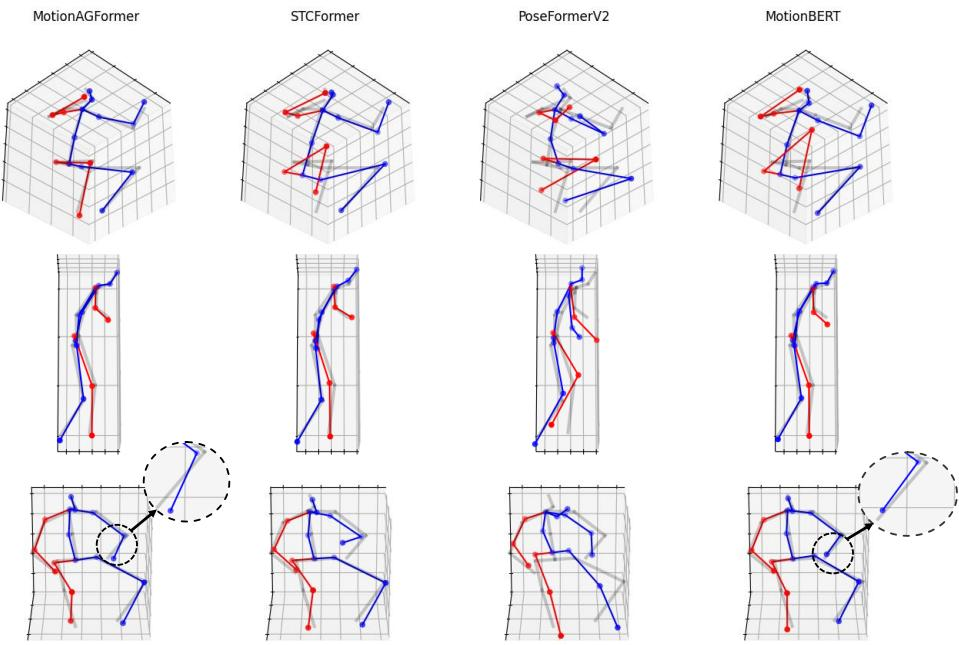  
Figure 4. MotionAGFormer 与 STCformer [40]、PoseFormerV2 [50] 和 MotionBERT [53] 的定性比较。半透明灰色骨架为 3D 姿态真实值。蓝色表示估计人体的躯干和左侧部分，红色表示右侧部分。

Table 2. 在 Human3.6M 上的定量对比。T：输入帧数。CE：仅估计中心帧。P1：MPJPE 误差（mm）。P2：P-MPJPE 误差（mm）。P1†：在 2D 真实值上的 P1 误差。(*) 表示使用 HRNet [38] 进行 2D 姿态估计。最佳和次佳结果分别以粗体和下划线标出。关于各动作的具体结果，请参阅补充材料。

<table><tr><td>方法</td><td>T</td><td>CE</td><td>Param</td><td>MACs</td><td>MACs/frame</td><td>P1↓/P2↓</td><td>P1 $^{\dagger }$ ↓</td></tr><tr><td>*MHFormer [20] CVPR&#x27;22</td><td>351</td><td>√</td><td>30.9 M</td><td>7.0 G</td><td>7,096 M</td><td>43.0/34.4</td><td>30.5</td></tr><tr><td>MixSTE [47] CVPR&#x27;22</td><td>243</td><td>×</td><td>33.6 M</td><td>139.0 G</td><td>572 M</td><td>40.9/32.6</td><td>21.6</td></tr><tr><td>P-STMO [36] ECCV&#x27;22</td><td>243</td><td>√</td><td>6.2 M</td><td>0.7 G</td><td>740 M</td><td>42.8/34.4</td><td>29.3</td></tr><tr><td>Stridedformer [19] TMM&#x27;22</td><td>351</td><td>√</td><td>4.0 M</td><td>0.8 G</td><td>801 M</td><td>43.7/35.2</td><td>28.5</td></tr><tr><td>Einfalt et al. [11] WACV&#x27;23</td><td>351</td><td>√</td><td>10.4 M</td><td>0.5 G</td><td>498 M</td><td>44.2/35.7</td><td>-</td></tr><tr><td>STCFormer [40] CVPR&#x27;23</td><td>243</td><td>×</td><td>4.7 M</td><td>19.6 G</td><td>80 M</td><td>41.0/32.0</td><td>21.3</td></tr><tr><td>STCFormer-L [40] CVPR&#x27;23</td><td>243</td><td>×</td><td>18.9 M</td><td>78.2 G</td><td>321 M</td><td>40.5/31.8</td><td>-</td></tr><tr><td>PoseFormerV2 [50] CVPR&#x27;23</td><td>243</td><td>√</td><td>14.3 M</td><td>0.5 G</td><td>528 M</td><td>45.2/35.6</td><td>-</td></tr><tr><td>UPS [12] CVPR&#x27;23</td><td>243</td><td>√</td><td>-</td><td>-</td><td>-</td><td>40.8/32.5</td><td>-</td></tr><tr><td>GLA-GCN [44] ICCV&#x27;23</td><td>243</td><td>√</td><td>1.3 M</td><td>1.5 G</td><td>1,556 M</td><td>44.4/34.8</td><td>21.0</td></tr><tr><td>MotionBERT [53] ICCV&#x27;23</td><td>243</td><td>×</td><td>42.5 M</td><td>174.7 G</td><td>719 M</td><td>39.2/32.9</td><td>17.8</td></tr><tr><td>HDFormer [3] IJCAI&#x27;23</td><td>96</td><td>×</td><td>3.7 M</td><td>0.6 G</td><td>6 M</td><td>42.6/33.1</td><td>21.6</td></tr><tr><td>HSTFormer [33] arXiv&#x27;23</td><td>81</td><td>×</td><td>22.7 M</td><td>1.0 G</td><td>13 M</td><td>42.7/33.7</td><td>27.8</td></tr><tr><td>DC-GCT [16] arXiv&#x27;23</td><td>81</td><td>√</td><td>3.1 M</td><td>41 M</td><td>41 M</td><td>44.7/-</td><td>-</td></tr><tr><td>MotionAGFormer-XS</td><td>27</td><td>×</td><td>2.2 M</td><td>1.0 G</td><td>37 M</td><td>45.1/36.9</td><td>28.1</td></tr><tr><td>MotionAGFormer-S</td><td>81</td><td>×</td><td>4.8 M</td><td>6.6 G</td><td>81 M</td><td>42.5/35.3</td><td>26.5</td></tr><tr><td>MotionAGFormer-B</td><td>243</td><td>×</td><td>11.7 M</td><td>48.3 G</td><td>198 M</td><td>38.4/32.6</td><td>19.4</td></tr><tr><td>MotionAGFormer-L</td><td>243</td><td>×</td><td>19.0 M</td><td>78.3 G</td><td>322 M</td><td>38.4/32.5</td><td>17.3</td></tr></table>

与基线模型相比，MotionAGFormer-S 仅输入了三分之一的帧数，但仍成功取得了优于大多数基线模型的 P1 误差。类似地，MotionAGFormer-XS 取得了与 PoseTransformerV2 相当的性能，尽管其仅接收了九分之一的输入信息（27 帧对比 243 帧），且参数量少约七倍。

## 4.4. 在 MPI-INF-3DHP 上的性能对比

在 MPI-INF-3DHP 数据集上评估我们的方法时，由于视频序列较短，我们将 base 和 large 变体修改为使用 81 帧。在所有变体中，我们的方法在 MPJPE 方面始终优于其他方法。值得注意的是，我们的 large 变体取得了显著的成果，达到了 85.3% 的 AUC 和 16.2 mm 的 P1 误差。这在 AUC 上比最佳模型大幅高出 1.4%，在 P1 误差上降低了 6.9 mm。然而，它取得了 98.2% 的 PCK，比对比模型的 PCK 性能低 0.5%（Table 3）。

Table 3. MPI-INF-3DHP 上的定量对比。T：输入帧数。最佳和次佳得分分别用粗体和下划线表示。

<table><tr><td>方法</td><td>T</td><td>PCK↑</td><td>AUC↑</td><td>MPJPE↓</td></tr><tr><td>MHFormer [20]</td><td>9</td><td>93.8</td><td>63.3</td><td>58.0</td></tr><tr><td>MixSTE [47]</td><td>27</td><td>94.4</td><td>66.5</td><td>54.9</td></tr><tr><td>P-STMO [36]</td><td>81</td><td>97.9</td><td>75.8</td><td>32.2</td></tr><tr><td>Einfalt et al. [11]</td><td>81</td><td>95.4</td><td>67.6</td><td>46.9</td></tr><tr><td>STCFormer [40]</td><td>81</td><td>98.7</td><td>83.9</td><td>23.1</td></tr><tr><td>PoseFormerV2 [50]</td><td>81</td><td>97.9</td><td>78.8</td><td>27.8</td></tr><tr><td>GLA-GCN [44]</td><td>81</td><td>98.5</td><td>79.1</td><td>27.7</td></tr><tr><td>HSTFormer [33]</td><td>81</td><td>97.3</td><td>71.5</td><td>41.4</td></tr><tr><td>HDFormer [3]</td><td>96</td><td>98.7</td><td>72.9</td><td>37.2</td></tr><tr><td>MotionAGFormer-XS</td><td>27</td><td>98.2</td><td>83.5</td><td>19.2</td></tr><tr><td>MotionAGFormer-S</td><td>81</td><td>98.3</td><td>84.5</td><td>17.1</td></tr><tr><td>MotionAGFormer-B</td><td>81</td><td>98.3</td><td>84.2</td><td>18.2</td></tr><tr><td>MotionAGFormer-L</td><td>81</td><td>98.2</td><td>85.3</td><td>16.2</td></tr></table>

## 4.5. 消融实验

在 Human3.6M 数据集上进行了一系列消融实验，以探索 AGFormer 块的不同设计选择。

初步消融实验研究了侧重增加 AGFormer 块的数量与模型宽度对 P1 误差的影响。如 Table 4 所示，整体趋势倾向于支持更深但更窄的模型。有趣的是，具有 16 个 AGFormer 块且宽度为 128 的模型表现出与具有 12 个 AGFormer 块且宽度为 256 的模型相似的性能，而前一种配置所占用的内存和计算资源减少了约三倍。

消融实验的第二部分探讨了 AGFormer 块内图流（graph stream）的替代模块。结果如 Table 5 所示。从 GCNFormer 块转换为 GCN 块会使 P1 误差恶化 0.7 mm。同样，将 Temporal GCNFormer 替换为 TCN，在使用 GCN 时会使 P1 误差增加 0.2 mm，在使用 GCNFormer 时则增加 0.9 mm。最后，用 CTR-GCN [5] 替换 GCN 会使 P1 误差增加 2.5 mm。我们推测这是因为 CTR-GCN 在训练过程中对每个通道的拓扑结构进行了持续细化。结果，每个关节点不仅从其直接邻接节点获取信息，还从所有其他关节点获取信息。这阻碍了为 Transformer 流生成互补信息。

为了探究位置嵌入对最终性能的影响，我们进行了一系列实验，结果概述于 Table 6 中。令人惊讶的是，在空间位置嵌入的基础上加入时间位置嵌入会导致 P1 误差增加 0.6 mm。如第 3.2 节所述，这一结果源于 GCNFormer 流的非置换等变性（non-permutation equivariant）。与 Transformer 不同，我们的网络本质上保持了帧的时间序列特性。然而，如 Figure 5 所示，相较于使用空间位置嵌入（0.94 mm），添加时间位置嵌入带来了更好的加速度误差（0.88 mm）。

最后，为了验证所提出的 AG-Former 块的有效性，Table 7 给出了替代块的对比。当使用 GCNFormer 时，观察到 P1 误差为 57.5 mm，表明其准确捕获底层 3D 序列结构的能力有限。尽管如此，同时结合 GCNFormer 和 Transformer 的混合方法带来了显著的提升，相比仅使用 Transformer，P1 误差降低了 5.2 mm。此外，这两个模块的串行融合不如它们的并行集成有效。

Table 4. 改变 AG-Former 块数量和通道数时的 P1 误差对比。d：每个 AGFormer 块中的通道数。d′：回归头之前的通道数。在所有实验中 T 均保持为 243。

<table><tr><td>层数</td><td>d</td><td> $d'$ </td><td>Param</td><td>MACs</td><td>P1</td></tr><tr><td>5</td><td>512</td><td>512</td><td>58 M</td><td>252.8 G</td><td>39.2</td></tr><tr><td>4</td><td>256</td><td>512</td><td>11.7 M</td><td>54.G G</td><td>40.2</td></tr><tr><td>6</td><td>256</td><td>512</td><td>17.5 M</td><td>81.64 G</td><td>39.6</td></tr><tr><td>8</td><td>256</td><td>512</td><td>23.3 M</td><td>108.6 G</td><td>39.5</td></tr><tr><td>10</td><td>256</td><td>512</td><td>29.1 M</td><td>135.7 G</td><td>38.6</td></tr><tr><td>12</td><td>256</td><td>512</td><td>34.9 M</td><td>162.7 G</td><td>38.4</td></tr><tr><td>14</td><td>256</td><td>512</td><td>40.7 M</td><td>189.7 G</td><td>38.6</td></tr><tr><td>16</td><td>128</td><td>512</td><td>11.7 M</td><td>64.7 G</td><td>38.4</td></tr><tr><td>16</td><td>128</td><td>256</td><td>11.7 M</td><td>64.5 G</td><td>38.7</td></tr><tr><td>16</td><td>128</td><td>1024</td><td>11.7 M</td><td>64.9 G</td><td>39.2</td></tr><tr><td>26</td><td>64</td><td>512</td><td>4.8 M</td><td>39.5 G</td><td>39.5</td></tr></table>

Table 5. 在 AGFormer 块的图流中使用替代模块时的 P1 误差比较。

<table><tr><td>GCN</td><td>TCN</td><td>GCNFormer</td><td>CTR-GCNFormer</td><td>P1</td></tr><tr><td>√</td><td>-</td><td>-</td><td>-</td><td>39.1</td></tr><tr><td>√</td><td>√</td><td>-</td><td>-</td><td>39.3</td></tr><tr><td>-</td><td>√</td><td>√</td><td>-</td><td>39.7</td></tr><tr><td>-</td><td>-</td><td>-</td><td>√</td><td>40.9</td></tr><tr><td>-</td><td>-</td><td>√</td><td>-</td><td>38.4</td></tr></table>

## 4.6. 定性分析

MotionAGFormer-B 的验证是通过时间 GCNFormer 的邻接矩阵以及 3D 人体姿态估计的可视化来进行的。用于验证的样本均从 Human3.6M 的评估集中随机选取。

  
Figure 5. 使用不同类型位置嵌入时的加速度误差。相比于空间位置嵌入、无嵌入以及同时使用两种嵌入（误差分别达到 0.94 mm、0.90 mm 和 0.97 mm），使用时间位置嵌入能够带来 0.88 mm 的误差以及更快的收敛速度。

定性比较。Figure 4 将 MotionAGFormer-B 与包括 STCFormer [40]、PoseFormerV2 [50] 和 Motion-BERT [53] 在内的近期方法进行了比较。按照设计，2D 检测器的置信度分数仅被引入到了 MotionBERT 和 MotionAGFormer-B 中。总体而言，在所有三个样本上，MotionAGFormer-B 的重建结果均优于 PoseFormerV2 和 STCFormer，同时与 MotionBERT 保持了相当的竞争力。具体而言，在 Figure 4a 中，与其他方法相比，MotionAG-Former 展现出与真实真值（ground truth）更好的对齐效果。在 Figure 4b 中，它展现出略胜一筹的对齐效果，而在 Figure 4c 中，其对齐效果略逊于 Motion-BERT。

时序邻接可视化。时序 GCNFormer 的邻接矩阵可视化如图 6 所示。在初始层中，各个关节表现出不同的邻接矩阵，由于关节位置随时间变化，这些矩阵在不同序列之间应该是有所差异的。然而，随着模型深度的增加，它似乎学习到了一种表征，即每个关节与其在相邻帧中的自身状态最为相似。因此，这导致了与相邻帧之间连接的形成。

## 5. 结论

我们提出了 MotionAGFormer，这是一种利用 GCNFormer 捕捉复杂的局部关节关系，并将其与能够有效捕捉全局关节相互依赖关系的 Transformer 相结合的新颖方法。这种融合增强了模型理解输入 2D 序列中固有 3D 结构的能力。此外，Motion-AGFormer 提供了多种可灵活适配的变体，允许在速度与精度之间寻求最佳平衡。实证评估表明，我们的方法在 Human3.6M 和 MPI-INF-3DHP 数据集上均超越了现有的其他方法。

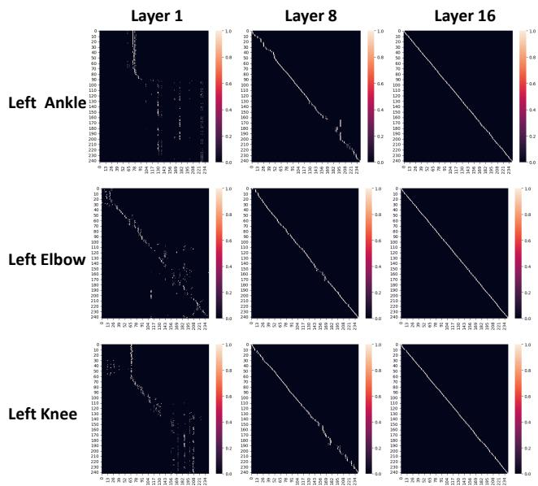  
Figure 6. 来自 Human3.6M 数据集的一个随机序列在三个不同关节上的时序邻接矩阵，分别展示了第一层（左）、中间层（中）和最后一层（右）。K-NN 中的 K 设置为 2。

Table 6. 使用不同位置嵌入时的 P1 误差对比。

<table><tr><td>时序嵌入</td><td>空间嵌入</td><td>P1</td></tr><tr><td>-</td><td>-</td><td>39.3</td></tr><tr><td>-</td><td>√</td><td>38.4</td></tr><tr><td>√</td><td>-</td><td>38.9</td></tr><tr><td>√</td><td>√</td><td>40.5</td></tr></table>

Table 7. 不同 MetaFormer 集成方式的对比。所有模型均在 Human3.6M 上使用我们的 MotionAGFormer-B 设置进行训练。

<table><tr><td>方法</td><td>P1</td></tr><tr><td>仅 GCNFormer</td><td>57.5</td></tr><tr><td>仅 Transformer</td><td>43.6</td></tr><tr><td>GCNFormer → Transformer（串联）</td><td>39.1</td></tr><tr><td>Transformer → GCNFormer（串联）</td><td>38.9</td></tr><tr><td>Transformer - GCNFormer（并联）</td><td>38.4</td></tr></table>

## 参考文献

[1] Jimmy Lei Ba, Jamie Ryan Kiros, and Geoffrey E Hinton. Layer normalization. arXiv preprint arXiv:1607.06450, 2016. 3

[2] Peter Bauer, Arij Bouazizi, Ulrich Kressel, and Fabian B Flohr. Weakly supervised multi-modal 3d human body pose estimation for autonomous driving. In 2023 IEEE Intelligent Vehicles Symposium (IV), pages 1–7. IEEE, 2023. 1

[3] Hanyuan Chen, Jun-Yan He, Wangmeng Xiang, Wei Liu, Zhi-Qi Cheng, Hanbing Liu, Bin Luo, Yifeng Geng, and Xuansong Xie. HDFormer: High-order directed transformer for 3d human pose estimation. arXiv preprint arXiv:2302.01825, 2023. 2, 6, 7, 12

[4] Yilun Chen, Zhicheng Wang, Yuxiang Peng, Zhiqiang Zhang, Gang Yu, and Jian Sun. Cascaded pyramid network for multi-person pose estimation. In Proceedings of the IEEE conference on computer vision and pattern recognition, pages 7103–7112, 2018. 2

[5] Yuxin Chen, Ziqi Zhang, Chunfeng Yuan, Bing Li, Ying Deng, and Weiming Hu. Channel-wise topology refinement graph convolution for skeleton-based action recognition. In Proceedings of the IEEE/CVF international conference on computer vision, pages 13359–13368, 2021. 3, 7

[6] Hongsuk Choi, Gyeongsik Moon, and Kyoung Mu Lee. Pose2Mesh: Graph convolutional network for 3d human pose and mesh recovery from a 2d human pose. In Computer Vision–ECCV 2020: 16th European Conference, Glasgow, UK, August 23–28, 2020, Proceedings, Part VII 16, pages 769–787. Springer, 2020. 3

[7] Sungho Chun, Sungbum Park, and Ju Yong Chang. Learnable human mesh triangulation for 3d human pose and shape estimation. In Proceedings of the IEEE/CVF Winter Conference on Applications ofComputer Vision, pages 2850–2859, 2023. 2

[8] Hai Ci, Chunyu Wang, Xiaoxuan Ma, and Yizhou Wang. Optimizing network structure for 3d human pose estimation. In Proceedings of the IEEE/CVF international conference on computer vision, pages 2262–2271, 2019. 3

[9] Phillip Czech, Markus Braun, Ulrich Kreßel, and Bin Yang. On-board pedestrian trajectory prediction using behavioral features. In 2022 21st IEEE International Conference on Machine Learning and Applications (ICMLA), pages 437– 443. IEEE, 2022. 1

[10] Alexey Dosovitskiy, Lucas Beyer, Alexander Kolesnikov, Dirk Weissenborn, Xiaohua Zhai, Thomas Unterthiner, Mostafa Dehghani, Matthias Minderer, Georg Heigold, Sylvain Gelly, et al. An image is worth 16x16 words: Transformers for image recognition at scale. arXiv preprint arXiv:2010.11929, 2020. 2

[11] Moritz Einfalt, Katja Ludwig, and Rainer Lienhart. Uplift and upsample: Efficient 3d human pose estimation with uplifting transformers. In Proceedings of the IEEE/CVF Winter Conference on Applications ofComputer Vision (WACV), January 2023. 2, 6, 7, 12

[12] Lin Geng Foo, Tianjiao Li, Hossein Rahmani, Qiuhong Ke, and Jun Liu. Unified pose sequence modeling. In Proceed-

ings of the IEEE/CVF Conference on Computer Vision and Pattern Recognition, pages 13019–13030, 2023. 2, 6, 12

[13] Sergey Ioffe and Christian Szegedy. Batch normalization: Accelerating deep network training by reducing internal covariate shift. In International conference on machine learning, pages 448–456. pmlr, 2015. 3, 4

[14] Catalin Ionescu, Dragos Papava, Vlad Olaru, and Cristian Sminchisescu. Human3. 6m: Large scale datasets and predictive methods for 3d human sensing in natural environments. IEEE transactions on pattern analysis and machine intelligence, 36(7):1325–1339, 2013. 1, 5

[15] Karim Iskakov, Egor Burkov, Victor Lempitsky, and Yury Malkov. Learnable triangulation of human pose. In Proceedings ofthe IEEE/CVF international conference on computer vision, pages 7718–7727, 2019. 2

[16] Hongbo Kang, Yong Wang, Mengyuan Liu, Doudou Wu, Peng Liu, and Wenming Yang. Double-chain constraints for 3d human pose estimation in images and videos. arXiv preprint arXiv:2308.05298, 2023. 3, 6

[17] Thomas N Kipf and Max Welling. Semi-supervised classification with graph convolutional networks. arXiv preprint arXiv:1609.02907, 2016. 3

[18] Jungho Lee, Minhyeok Lee, Dogyoon Lee, and Sangyoun Lee. Hierarchically decomposed graph convolutional networks for skeleton-based action recognition. arXiv preprint arXiv:2208.10741, 2022. 3

[19] Wenhao Li, Hong Liu, Runwei Ding, Mengyuan Liu, Pichao Wang, and Wenming Yang. Exploiting temporal contexts with strided transformer for 3d human pose estimation. IEEE Transactions on Multimedia, 25:1282–1293, 2022. 2, 6, 12

[20] Wenhao Li, Hong Liu, Hao Tang, Pichao Wang, and Luc Van Gool. MHFormer: Multi-hypothesis transformer for 3d human pose estimation. In Proceedings of the IEEE/CVF Conference on Computer Vision and Pattern Recognition (CVPR), pages 13147–13156, 2022. 2, 6, 7, 12

[21] Huei-Yung Lin and Ting-Wen Chen. Augmented reality with human body interaction based on monocular 3d pose estimation. In International Conference on Advanced Conceptsfor Intelligent Vision Systems, pages 321–331. Springer, 2010. 1

[22] Ziyu Liu, Hongwen Zhang, Zhenghao Chen, Zhiyong Wang, and Wanli Ouyang. Disentangling and unifying graph convolutions for skeleton-based action recognition. In Proceedings of the IEEE/CVF conference on computer vision and pattern recognition, pages 143–152, 2020. 3

[23] Ilya Loshchilov and Frank Hutter. Decoupled weight decay regularization. arXiv preprint arXiv:1711.05101, 2017. 5

[24] Cheng Luo, Siyang Song, Weicheng Xie, Linlin Shen, and Hatice Gunes. Learning multi-dimensional edge featurebased au relation graph for facial action unit recognition. arXiv preprint arXiv:2205.01782, 2022. 4

[25] Dushyant Mehta, Helge Rhodin, Dan Casas, Pascal Fua, Oleksandr Sotnychenko, Weipeng Xu, and Christian Theobalt. Monocular 3d human pose estimation in the wild using improved cnn supervision. In 2017 international conference on 3D vision (3DV), pages 506–516. IEEE, 2017. 5

[26] Dushyant Mehta, Srinath Sridhar, Oleksandr Sotnychenko, Helge Rhodin, Mohammad Shafiei, Hans-Peter Seidel,

Weipeng Xu, Dan Casas, and Christian Theobalt. VNect: Real-time 3d human pose estimation with a single rgb camera. Acm transactions on graphics (tog), 36(4):1–14, 2017. 1

[27] Tewodros Legesse Munea, Yalew Zelalem Jembre, Halefom Tekle Weldegebriel, Longbiao Chen, Chenxi Huang, and Chenhui Yang. The progress of human pose estimation: A survey and taxonomy of models applied in 2d human pose estimation. IEEE Access, 8:133330–133348, 2020. 1

[28] Alejandro Newell, Kaiyu Yang, and Jia Deng. Stacked hourglass networks for human pose estimation. In Computer Vision–ECCV 2016: 14th European Conference, Amsterdam, The Netherlands, October 11-14, 2016, Proceedings, Part VIII 14, pages 483–499. Springer, 2016. 2

[29] Alejandro Newell, Kaiyu Yang, and Jia Deng. Stacked hourglass networks for human pose estimation. In Computer Vision–ECCV 2016: 14th European Conference, Amsterdam, The Netherlands, October 11-14, 2016, Proceedings, Part VIII 14, pages 483–499. Springer, 2016. 5

[30] Adam Paszke, Sam Gross, Soumith Chintala, Gregory Chanan, Edward Yang, Zachary DeVito, Zeming Lin, Alban Desmaison, Luca Antiga, and Adam Lerer. Automatic differentiation in pytorch. 2017. 5

[31] Georgios Pavlakos, Xiaowei Zhou, and Kostas Daniilidis. Ordinal depth supervision for 3d human pose estimation. In Proceedings ofthe IEEE conference on computer vision and pattern recognition, pages 7307–7316, 2018. 2

[32] Georgios Pavlakos, Xiaowei Zhou, Konstantinos G Derpanis, and Kostas Daniilidis. Coarse-to-fine volumetric prediction for single-image 3d human pose. In Proceedings of the IEEE conference on computer vision and pattern recognition, pages 7025–7034, 2017. 2

[33] Xiaoye Qian, Youbao Tang, Ning Zhang, Mei Han, Jing Xiao, Ming-Chun Huang, and Ruei-Sung Lin. HSTFormer: Hierarchical spatial-temporal transformers for 3d human pose estimation. arXiv preprint arXiv:2301.07322, 2023. 2, 6, 7, 12

[34] N Dinesh Reddy, Laurent Guigues, Leonid Pishchulin, Jayan Eledath, and Srinivasa G Narasimhan. TesseTrack: End-toend learnable multi-person articulated 3d pose tracking. In Proceedings of the IEEE/CVF Conference on Computer Vision and Pattern Recognition, pages 15190–15200, 2021. 2

[35] Edoardo Remelli, Shangchen Han, Sina Honari, Pascal Fua, and Robert Wang. Lightweight multi-view 3d pose estimation through camera-disentangled representation. In Proceedings of the IEEE/CVF conference on computer vision and pattern recognition, pages 6040–6049, 2020. 2

[36] Wenkang Shan, Zhenhua Liu, Xinfeng Zhang, Shanshe Wang, Siwei Ma, and Wen Gao. P-STMO: Pre-trained spatial temporal many-to-one model for 3d human pose estimation. In Computer Vision–ECCV 2022: 17th European Conference, Tel Aviv, Israel, October 23–27, 2022, Proceedings, Part V, pages 461–478. Springer, 2022. 2, 6, 7, 12

[37] Weijie Su, Xizhou Zhu, Chenxin Tao, Lewei Lu, Bin Li, Gao Huang, Yu Qiao, Xiaogang Wang, Jie Zhou, and Jifeng Dai. Towards all-in-one pre-training via maximizing multi-modal mutual information. In Proceedings of the IEEE/CVF Con-

ference on Computer Vision and Pattern Recognition, pages 15888–15899, 2023. 2

[38] Ke Sun, Bin Xiao, Dong Liu, and Jingdong Wang. Deep high-resolution representation learning for human pose estimation. In Proceedings of the IEEE/CVF conference on computer vision and pattern recognition, pages 5693–5703, 2019. 2, 6, 12

[39] Xiao Sun, Bin Xiao, Fangyin Wei, Shuang Liang, and Yichen Wei. Integral human pose regression. In Proceedings of the European conference on computer vision (ECCV), pages 529–545, 2018. 2

[40] Zhenhua Tang, Zhaofan Qiu, Yanbin Hao, Richang Hong, and Ting Yao. 3D human pose estimation with spatiotemporal criss-cross attention. In Proceedings of the IEEE/CVF Conference on Computer Vision and Pattern Recognition, pages 4790–4799, 2023. 2, 5, 6, 7, 8, 12, 13

[41] Ashish Vaswani, Noam Shazeer, Niki Parmar, Jakob Uszkoreit, Llion Jones, Aidan N Gomez, Łukasz Kaiser, and Illia Polosukhin. Attention is all you need. Advances in neural information processing systems, 30, 2017. 1, 2, 3

[42] Jingbo Wang, Sijie Yan, Yuanjun Xiong, and Dahua Lin. Motion guided 3d pose estimation from videos. In European Conference on Computer Vision, pages 764–780. Springer, 2020. 3

[43] Julian Wiederer, Arij Bouazizi, Ulrich Kressel, and Vasileios Belagiannis. Traffic control gesture recognition for autonomous vehicles. In 2020 IEEE/RSJ International Conference on Intelligent Robots and Systems (IROS), pages 10676–10683. IEEE, 2020. 1

[44] Bruce X. B. Yu, Zhi Zhang, Yongxu Liu, Sheng hua Zhong, Yan Liu, and Chang Wen Chen. GLA-GCN: Global-local adaptive graph convolutional network for 3d human pose estimation from monocular video, 2023. 3, 6, 7, 12

[45] Jiahui Yu, Zirui Wang, Vijay Vasudevan, Legg Yeung, Mojtaba Seyedhosseini, and Yonghui Wu. CoCa: Contrastive captioners are image-text foundation models. arXiv preprint arXiv:2205.01917, 2022. 2

[46] Weihao Yu, Mi Luo, Pan Zhou, Chenyang Si, Yichen Zhou, Xinchao Wang, Jiashi Feng, and Shuicheng Yan. MetaFormer is actually what you need for vision. In Proceedings of the IEEE/CVF Conference on Computer Vision and Pattern Recognition, pages 10819–10829, 2022. 3

[47] Jinlu Zhang, Zhigang Tu, Jianyu Yang, Yujin Chen, and Junsong Yuan. MixSTE: Seq2seq mixed spatio-temporal encoder for 3d human pose estimation in video. In Proceedings of the IEEE/CVF Conference on Computer Vision and Pattern Recognition (CVPR), pages 13232–13242, June 2022. 2, 6, 7, 12

[48] Zhe Zhang, Chunyu Wang, Weichao Qiu, Wenhu Qin, and Wenjun Zeng. Adafuse: Adaptive multiview fusion for accurate human pose estimation in the wild. International Journal ofComputer Vision, 129:703–718, 2021. 2

[49] Long Zhao, Xi Peng, Yu Tian, Mubbasir Kapadia, and Dimitris N Metaxas. Semantic graph convolutional networks for 3d human pose regression. In Proceedings of the IEEE/CVF conference on computer vision and pattern recognition, pages 3425–3435, 2019. 3

  
Figure 7. 在 Human3.6M 数据集上以 MPJPE (mm) 计量的与其他模型的各关节误差对比。“L”和“R”分别表示左侧和右侧。

[50] Qitao Zhao, Ce Zheng, Mengyuan Liu, Pichao Wang, and Chen Chen. PoseFormerV2: Exploring frequency domain for efficient and robust 3d human pose estimation. In Proceedings of the IEEE/CVF Conference on Computer Vision and Pattern Recognition (CVPR), pages 8877–8886, June 2023. 2, 5, 6, 7, 8, 13

[51] Ce Zheng, Sijie Zhu, Matias Mendieta, Taojiannan Yang, Chen Chen, and Zhengming Ding. 3d human pose estimation with spatial and temporal transformers. In Proceedings ofthe IEEE/CVF International Conference on Computer Vision, pages 11656–11665, 2021. 2

[52] Kun Zhou, Xiaoguang Han, Nianjuan Jiang, Kui Jia, and Jiangbo Lu. HEMlets pose: Learning part-centric heatmap triplets for accurate 3d human pose estimation. In Proceedings ofthe IEEE/CVF international conference on computer vision, pages 2344–2353, 2019. 2

[53] Wentao Zhu, Xiaoxuan Ma, Zhaoyang Liu, Libin Liu, Wayne Wu, and Yizhou Wang. MotionBERT: A unified perspective on learning human motion representations. In Proceedings ofthe IEEE/CVF International Conference on Computer Vision, 2023. 2, 4, 5, 6, 8, 12, 13

[54] Zhuofan Zong, Guanglu Song, and Yu Liu. DETRs with collaborative hybrid assignments training. arXiv preprint arXiv:2211.12860, 2022. 2

## 附录

## A. 在 Human3.6M 上的额外结果

## A.1. 单个动作的结果

为了评估我们提出的方法在每个动作上的有效性，Table 8 提供了我们的方法与其他备选方法在 Human3.6M 数据集上的 P1 和 P2 误差比较。与其他现有方法相比，我们提出的方法在 Direction（指示方向）、Discuss（讨论）、Eating（进食）、Greet（问候）、Purchase（购物）、Sitting（坐着）、Sitting Down（坐下）、Smoke（吸烟）、Wait（等待）和 Walk Dog（遛狗）等多种动作的 P1 误差方面展现出了更优异的性能。对于其余动作，我们的方法取得了次优的结果。

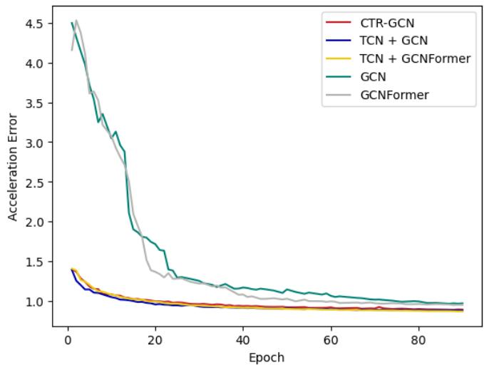  
Figure 8. 旨在捕获局部时间依赖性的不同备选模块之间的加速度误差比较。

## A.2. 逐关节误差比较

Figure 7 展示了 MotionAGFormer-B、MotionBERT、STCFormer 和 StridedFormer 在 Human3.6M 基准数据集上的逐关节比较。STC-Former 在髋部展现出微弱的性能优势，而在肩部，MotionAGFormer 略优于 MotionBERT，并显著优于其他模型。在自由度（degree of freedom, DoF）为 2 的关节（包括膝盖和手肘）上，MotionBERT 通常优于 MotionAGFormer，且它们与其他模型之间存在显著差距。然而，对于自由度为 3 的关节（如脚踝和手腕），MotionAGFormer 始终优于所有其他模型，这一点尤为重要，因为这些关节对整体误差的贡献更大，且在手/物体交互和步态分析等应用中具有重要意义。

## B. Temporal GCNFormer 的消融实验

在主论文中，我们检验了用于时序 GCNFormer 的各种替代方案，并报告了它们相应的 P1 误差。然而，我们尚未研究与这些替代方案各自相关的加速度误差。加速度误差定义如下：

$$
\begin{array}{r} A c c (\mathbf {P}, \hat {\mathbf {P}}) = \Sigma_ {t = 1} ^ {T - 1} L (\mathbf {P}, t) - L (\hat {\mathbf {P}}, t), \\ L (\mathbf {X}, t) = \mathbf {X} _ {t - 1} - 2 \mathbf {X} _ {t} + \mathbf {X} _ {t + 1}, \end{array}\tag{10}
$$

其中 P 和 $\hat { \mathbf { P } }$ 分别表示真实 3D 姿态和估计 3D 姿态。

Figure 8 展示了不同模型在用于捕获时序局部依赖时的加速度误差。有趣的是，尽管 CTR-GCN 和 TCN 导致了更高的 P1 误差（如主论文中所述），但它们在训练期间的加速度误差收敛速度更快。此外，它最终带来了约 0.1 mm 的加速度误差改善。

Table 8. Human3.6M 上各动作 3D 人体姿态估计的定量比较。（上）使用检测到的 2D 姿态序列的 MPJPE（mm）。（下）使用检测到的 2D 姿态序列的 P-MPJPE（mm）。（\*）表示使用 HRNet [38] 进行 2D 姿态估计。（†）表示使用其提供的评估代码进行手动评估。

<table><tr><td>MPJPE</td><td>T</td><td>指引</td><td>讨论</td><td>就餐</td><td>问候</td><td>通话</td><td>拍照</td><td>姿势</td><td>购物</td><td>坐</td><td>坐下</td><td>吸烟</td><td>等待</td><td>遛狗</td><td>行走</td><td>结伴行走</td><td>平均</td></tr><tr><td>*MHFormer [20]</td><td>351</td><td>39.2</td><td>43.1</td><td>40.1</td><td>40.9</td><td>44.9</td><td>51.2</td><td>40.6</td><td>41.3</td><td>53.5</td><td>60.3</td><td>43.7</td><td>41.1</td><td>43.8</td><td>29.8</td><td>30.6</td><td>43.0</td></tr><tr><td>MixSTE [47]</td><td>243</td><td>37.6</td><td>40.9</td><td>37.3</td><td>39.7</td><td>42.3</td><td>49.9</td><td>40.1</td><td>39.8</td><td>51.7</td><td>55.0</td><td>42.1</td><td>39.8</td><td>41.0</td><td>27.9</td><td>27.9</td><td>40.9</td></tr><tr><td>P-STMO [36]</td><td>243</td><td>38.9</td><td>42.7</td><td>40.4</td><td>41.1</td><td>45.6</td><td>49.7</td><td>40.9</td><td>39.9</td><td>55.5</td><td>59.4</td><td>44.9</td><td>42.2</td><td>42.7</td><td>29.4</td><td>29.4</td><td>42.8</td></tr><tr><td>StridedFormer [19]</td><td>351</td><td>40.3</td><td>43.3</td><td>40.2</td><td>42.3</td><td>45.6</td><td>52.3</td><td>41.8</td><td>40.5</td><td>55.9</td><td>60.6</td><td>44.2</td><td>43.0</td><td>44.2</td><td>30.0</td><td>30.2</td><td>43.7</td></tr><tr><td>Einfalt et al. [11]</td><td>351</td><td>39.6</td><td>43.8</td><td>40.2</td><td>42.4</td><td>46.5</td><td>53.9</td><td>42.3</td><td>42.5</td><td>55.7</td><td>62.3</td><td>45.1</td><td>43.0</td><td>44.7</td><td>30.1</td><td>30.8</td><td>44.2</td></tr><tr><td>STCFormer [40]</td><td>243</td><td>39.6</td><td>41.6</td><td>37.4</td><td>38.8</td><td>43.1</td><td>51.1</td><td>39.1</td><td>39.7</td><td>51.4</td><td>57.4</td><td>41.8</td><td>38.5</td><td>40.7</td><td>27.1</td><td>28.6</td><td>41.0</td></tr><tr><td>STCFormer-L [40]</td><td>243</td><td>38.4</td><td>41.2</td><td>36.8</td><td>38.0</td><td>42.7</td><td>50.5</td><td>38.7</td><td>38.2</td><td>52.5</td><td>56.8</td><td>41.8</td><td>38.4</td><td>40.2</td><td>26.2</td><td>27.7</td><td>40.5</td></tr><tr><td>UPS [12]</td><td>243</td><td>37.5</td><td>39.2</td><td>36.9</td><td>40.6</td><td>39.3</td><td>46.8</td><td>39.0</td><td>41.7</td><td>50.6</td><td>63.5</td><td>40.4</td><td>37.8</td><td>44.2</td><td>26.7</td><td>29.1</td><td>40.8</td></tr><tr><td>GLA-GCN [44]</td><td>243</td><td>41.3</td><td>44.3</td><td>40.8</td><td>41.8</td><td>45.9</td><td>54.1</td><td>42.1</td><td>41.5</td><td>57.8</td><td>62.9</td><td>45.0</td><td>42.8</td><td>45.9</td><td>29.4</td><td>29.9</td><td>44.4</td></tr><tr><td>† MotionBERT [53]</td><td>243</td><td>36.6</td><td>39.3</td><td>37.8</td><td>33.5</td><td>41.4</td><td>49.9</td><td>37.0</td><td>35.5</td><td>50.4</td><td>56.5</td><td>41.4</td><td>38.2</td><td>37.3</td><td>26.2</td><td>26.9</td><td>39.2</td></tr><tr><td>HDFormer [3]</td><td>96</td><td>38.1</td><td>43.1</td><td>39.3</td><td>39.4</td><td>44.3</td><td>49.1</td><td>41.3</td><td>40.8</td><td>53.1</td><td>62.1</td><td>43.3</td><td>41.8</td><td>43.1</td><td>31.0</td><td>29.7</td><td>42.6</td></tr><tr><td>HSTFormer [33]</td><td>81</td><td>39.5</td><td>42.0</td><td>39.9</td><td>40.8</td><td>44.4</td><td>50.9</td><td>40.9</td><td>41.3</td><td>54.7</td><td>58.8</td><td>43.6</td><td>40.7</td><td>43.4</td><td>30.1</td><td>30.4</td><td>42.7</td></tr><tr><td>MotionAGFormer-XS</td><td>27</td><td>42.7</td><td>46.7</td><td>41.1</td><td>39.4</td><td>47.0</td><td>56.3</td><td>44.4</td><td>41.0</td><td>52.4</td><td>66.3</td><td>46.7</td><td>43.2</td><td>43.4</td><td>32.4</td><td>34.0</td><td>45.1</td></tr><tr><td>MotionAGFormer-S</td><td>81</td><td>41.9</td><td>42.7</td><td>40.4</td><td>37.6</td><td>45.6</td><td>51.3</td><td>41.0</td><td>38.0</td><td>54.1</td><td>58.8</td><td>45.5</td><td>40.4</td><td>39.8</td><td>29.4</td><td>31.0</td><td>42.5</td></tr><tr><td>MotionAGFormer-B</td><td>243</td><td>36.4</td><td>38.4</td><td>36.8</td><td>32.9</td><td>40.9</td><td>48.5</td><td>36.6</td><td>34.6</td><td>51.7</td><td>52.8</td><td>41.0</td><td>36.4</td><td>36.5</td><td>26.7</td><td>27.0</td><td>38.4</td></tr><tr><td>MotionAGFormer-L</td><td>243</td><td>36.8</td><td>38.5</td><td>35.9</td><td>33.0</td><td>41.1</td><td>48.6</td><td>38.0</td><td>34.8</td><td>49.0</td><td>51.4</td><td>40.3</td><td>37.4</td><td>36.3</td><td>27.2</td><td>27.2</td><td>38.4</td></tr><tr><td>P-MPJPE</td><td>T</td><td>指引</td><td>讨论</td><td>就餐</td><td>问候</td><td>通话</td><td>拍照</td><td>姿势</td><td>购物</td><td>坐</td><td>坐下</td><td>吸烟</td><td>等待</td><td>遛狗</td><td>行走</td><td>结伴行走</td><td>平均</td></tr><tr><td>*MHFormer [20]</td><td>351</td><td>31.5</td><td>34.9</td><td>32.8</td><td>33.6</td><td>35.3</td><td>39.6</td><td>32.0</td><td>32.2</td><td>43.5</td><td>48.7</td><td>36.4</td><td>32.6</td><td>34.3</td><td>23.9</td><td>25.1</td><td>34.4</td></tr><tr><td>MixSTE [47]</td><td>243</td><td>30.8</td><td>33.1</td><td>30.3</td><td>31.8</td><td>33.1</td><td>39.1</td><td>31.1</td><td>30.5</td><td>42.5</td><td>44.5</td><td>34.0</td><td>30.8</td><td>32.7</td><td>22.1</td><td>22.9</td><td>32.6</td></tr><tr><td>P-STMO [36]</td><td>243</td><td>31.3</td><td>35.2</td><td>32.9</td><td>33.9</td><td>35.4</td><td>39.3</td><td>32.5</td><td>31.5</td><td>44.6</td><td>48.2</td><td>36.3</td><td>32.9</td><td>34.4</td><td>23.8</td><td>23.9</td><td>34.4</td></tr><tr><td>StridedFormer [19]</td><td>351</td><td>32.7</td><td>35.5</td><td>32.5</td><td>35.4</td><td>35.9</td><td>41.6</td><td>33.0</td><td>31.9</td><td>45.1</td><td>50.1</td><td>36.3</td><td>33.5</td><td>35.1</td><td>23.9</td><td>25.0</td><td>35.2</td></tr><tr><td>Einfalt et al. [11]</td><td>351</td><td>32.7</td><td>36.1</td><td>33.4</td><td>36.0</td><td>36.1</td><td>42.0</td><td>33.3</td><td>33.1</td><td>45.4</td><td>50.7</td><td>37.0</td><td>34.1</td><td>35.9</td><td>24.4</td><td>25.4</td><td>35.7</td></tr><tr><td>STCFormer [40]</td><td>243</td><td>29.5</td><td>33.2</td><td>30.6</td><td>31.0</td><td>33.0</td><td>38.0</td><td>30.4</td><td>29.4</td><td>41.8</td><td>45.2</td><td>33.6</td><td>29.5</td><td>31.6</td><td>21.3</td><td>22.6</td><td>32.0</td></tr><tr><td>STCFormer-L [40]</td><td>243</td><td>29.3</td><td>33.0</td><td>30.7</td><td>30.6</td><td>32.7</td><td>38.2</td><td>29.7</td><td>28.8</td><td>42.2</td><td>45.0</td><td>33.3</td><td>29.4</td><td>31.5</td><td>20.9</td><td>22.3</td><td>31.8</td></tr><tr><td>UPS [12]</td><td>243</td><td>30.3</td><td>32.2</td><td>30.8</td><td>33.1</td><td>31.1</td><td>35.2</td><td>30.3</td><td>32.1</td><td>39.4</td><td>49.6</td><td>32.9</td><td>29.2</td><td>33.9</td><td>21.6</td><td>24.5</td><td>32.5</td></tr><tr><td>GLA-GCN [44]</td><td>243</td><td>32.4</td><td>35.3</td><td>32.6</td><td>34.2</td><td>35.0</td><td>42.1</td><td>32.1</td><td>31.9</td><td>45.5</td><td>49.5</td><td>36.1</td><td>32.4</td><td>35.6</td><td>23.5</td><td>24.7</td><td>34.8</td></tr><tr><td>† MotionBERT [53]</td><td>243</td><td>30.8</td><td>32.8</td><td>32.4</td><td>28.7</td><td>34.3</td><td>38.9</td><td>30.1</td><td>30.0</td><td>42.5</td><td>49.7</td><td>36.0</td><td>30.8</td><td>22.0</td><td>31.7</td><td>23.0</td><td>32.9</td></tr><tr><td>HDFormer [3]</td><td>96</td><td>29.6</td><td>33.8</td><td>31.7</td><td>31.3</td><td>33.7</td><td>37.7</td><td>30.6</td><td>31.0</td><td>41.4</td><td>47.6</td><td>35.0</td><td>30.9</td><td>33.7</td><td>25.3</td><td>23.6</td><td>33.1</td></tr><tr><td>HSTFormer [33]</td><td>81</td><td>31.1</td><td>33.7</td><td>33.0</td><td>33.2</td><td>33.6</td><td>38.8</td><td>31.9</td><td>31.5</td><td>43.7</td><td>46.3</td><td>35.7</td><td>31.5</td><td>33.1</td><td>24.2</td><td>24.5</td><td>33.7</td></tr><tr><td>MotionAGFormer-XS</td><td>27</td><td>34.4</td><td>37.6</td><td>34.7</td><td>33.0</td><td>38.4</td><td>43.4</td><td>34.7</td><td>33.8</td><td>44.6</td><td>53.6</td><td>39.4</td><td>34.5</td><td>36.2</td><td>26.4</td><td>28.5</td><td>36.9</td></tr><tr><td>MotionAGFormer-S</td><td>81</td><td>33.7</td><td>35.0</td><td>34.8</td><td>31.2</td><td>37.9</td><td>40.8</td><td>33.2</td><td>32.6</td><td>45.3</td><td>50.5</td><td>38.7</td><td>32.7</td><td>33.4</td><td>24.1</td><td>25.7</td><td>35.3</td></tr><tr><td>MotionAGFormer-B</td><td>243</td><td>30.6</td><td>32.6</td><td>32.2</td><td>28.2</td><td>33.8</td><td>38.6</td><td>30.5</td><td>29.9</td><td>43.3</td><td>47.0</td><td>35.2</td><td>29.8</td><td>31.4</td><td>22.7</td><td>23.5</td><td>32.6</td></tr><tr><td>MotionAGFormer-L</td><td>243</td><td>31.0</td><td>32.6</td><td>31.0</td><td>27.9</td><td>34.0</td><td>38.7</td><td>31.5</td><td>30.0</td><td>41.4</td><td>45.4</td><td>34.8</td><td>30.8</td><td>31.3</td><td>22.8</td><td>23.2</td><td>32.5</td></tr></table>

## C. 序列的定性比较

除了使用来自 Human3.6M 数据集的随机单帧进行定性比较外，我们还分析了单个序列中的连续帧。这使我们能够观察对比模型在整个序列上的表现，而不是仅基于单帧进行定性评估。Figure 9 将 MotionAGFormer-B 与 STCFormer、PoseFormerV2 以及 MotionBERT 进行了比较。总体而言，与其他两个模型相比，MotionAGFormer 和 Motion-BERT 与真实标注（ground truth）表现出更好的一致性。在对比 MotionAGFormer 与 MotionBERT 时，与 MotionBERT 相比，MotionAGFormer 在具有自由度（DoF）的关节（如手腕和脚踝）上表现出略微更好的性能。但也存在一些具有挑战性的序列（见 Figure 10），所有模型均无法准确估计这些序列中的关节。

## D. 自然场景（In-the-wild）评估

为了验证所提出的 MotionAG-Former 的泛化能力，我们在一些未见过的自然场景视频上测试了我们的基础变体。我们的估计结果表明，即使在推断出的 2D 姿态存在某些噪声的场景中（如 Figure 11 所示第二个示例的最后一帧中所观察到的），相应的 3D 姿态估计仍然保持合理，并对 2D 序列中的突发噪声运动具有鲁棒性。此外，当拍摄对象距离相机较远时，3D 姿态估计仍表现出高度的准确性（如 Figure 11 的最后一个示例所示）。

  
MotionAGFormer

时间

STCFormer

PoseFormerV2

MotionBERT

MotionAGFormer

Figure 9. MotionAGFormer 与 STCformer [40]、PoseFormerV2 [50] 和 MotionBERT [53] 在 Human3.6M 数据集随机序列上的定性比较。  
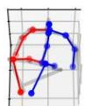

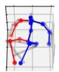

时间

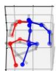

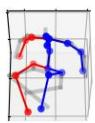

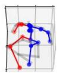

STCFormer

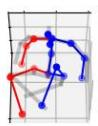

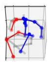

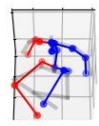

PoseFormerV2

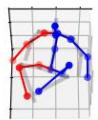

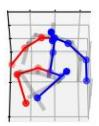

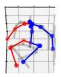

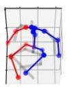

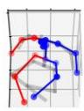

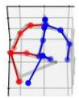

MotionBERT

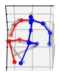

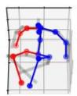

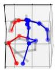

  
Figure 10. 各模型在 Human3.6M 数据集随机序列上的失败案例。

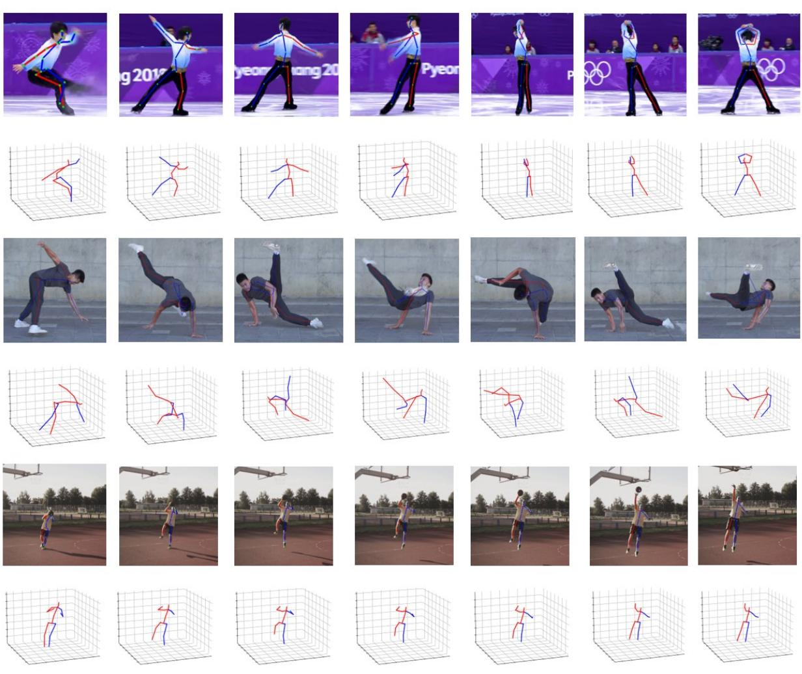  
Figure 11. MotionAGFormer 在真实自然场景（in-the-wild）视频中的评估。估计结果基于我们的 base 变体。