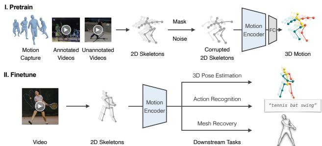
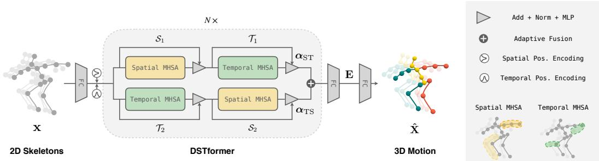
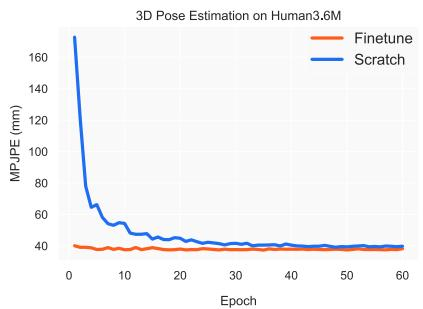
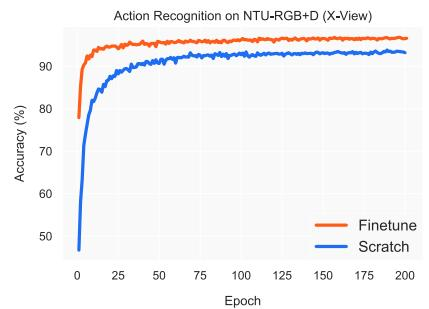
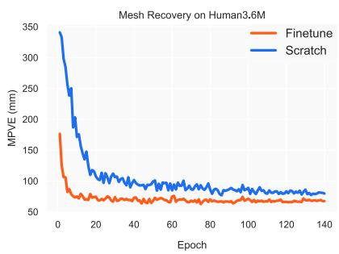
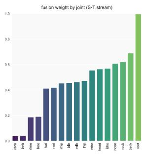
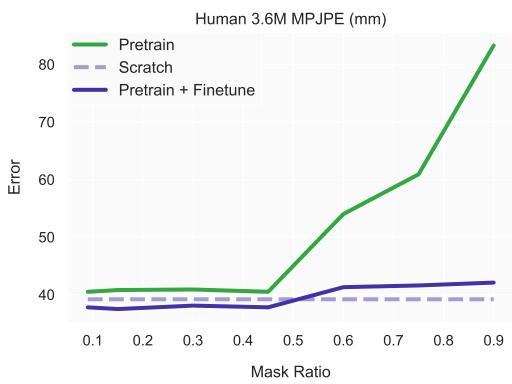

# MotionBERT：学习人体动作表征的统一视角

Wentao Zhu1 Xiaoxuan Ma1 Zhaoyang Liu2 Libin Liu1 Wayne Wu2 Yizhou Wang1†

1 Peking University 2 Shanghai AI Laboratory

{wtzhu,maxiaoxuan,libin.liu,yizhou.wang}@pku.edu.cn

{zyliumy,wuwenyan0503}@gmail.com

## 摘要

我们提出了一个统一的视角，通过从大规模异构数据资源中学习人体动作表征（human motion representations）来解决各种以人体为中心的视频任务。具体而言，我们提出了一个预训练阶段，其中运动编码器（motion encoder）被训练用于从含噪且不完整的 2D 观测中恢复潜在的 3D 动作。通过这种方式获取的动作表征融合了关于人体运动的几何、运动学和物理知识，能够轻松迁移到多个下游任务中。我们使用双流时空 Transformer（Dual-stream Spatio-temporal Transformer，DSTformer）神经网络实现了该运动编码器。它能够全面且自适应地捕捉骨骼关节点之间的长程时空关系，其在从头训练时取得了迄今为止最低的 3D 姿态估计误差便证明了这一点。此外，我们提出的框架只需使用一个简单的回归头（1-2 层）微调预训练的运动编码器，即可在所有三个下游任务上均取得最先进的性能（state-of-the-art），这证明了所学习到的动作表征的通用性。代码和模型已开源在 https://motionbert.github.io/

## 1. 引言

感知和理解人类活动长期以来一直是机器智能的核心追求。为此，研究人员定义了各种任务以从视频中估计以人体为中心的语义标签，例如骨骼关键点 [14, 35]、动作类别 [64, 123] 和表面网格 [46, 71]。尽管在这些任务中各自都取得了显著进展，但它们往往被孤立地建模，而非作为相互关联的问题来处理。例如，时空图卷积网络（Spatial Temporal Graph Convolutional Networks，ST-GCN）已被应用于 3D 姿态估计 [13, 116] 和动作识别 [96, 123] 中对人体关节点的时空关系进行建模，但它们之间的联系尚未得到充分探索。直观上，尽管这些模型是针对不同问题设计的，但它们理应都学会了识别典型的人体动作模式。然而，现有方法未能挖掘并利用跨任务的这些共性。理想情况下，我们可以开发出一种统一的以人体为中心的视频表征，并可在所有相关任务之间共享。

  
Figure 1. 框架概览。我们利用运动编码器通过从受损的 2D 骨骼序列中恢复 3D 人体动作来学习人体动作表征。为了适应不同的下游任务，我们使用线性层或简单的 MLP 对预训练的动作表征进行微调。

构建这种表征的一个重大挑战是可用数据资源的异构性。动作捕捉（Motion capture，简称 Mocap）系统 [38, 76] 提供了通过标记点和传感器获取的高保真 3D 动作数据，但采集视频的外观通常局限于简单的室内场景。动作识别数据集提供了动作语义的标注，但它们要么不包含人体姿态标签 [16, 95]，要么仅具有日常活动的有限动作 [63, 64, 93]。相比之下，真实场景（in-the-wild）人体视频提供了庞大且多样化的外观与动作。然而，获取精确的 2D 姿态标注需要耗费大量精力 [3]，而获取真值（ground-truth，简称 GT）3D 关节点位置几乎是不可能的。因此，大多数现有研究都侧重于使用单一类型的人体动作数据来处理特定任务，无法充分利用其他数据资源的优势。

在这项工作中，我们为学习人体动作表征提供了一个新的视角。其核心思想是，我们能够以统一的方式从异构数据资源中学习通用的多功能人体动作表征，并以统一的方式利用该表征来处理不同的下游任务。我们提出了一种由预训练和微调组成的两阶段框架，如图 Figure 1 所示。在预训练阶段，我们从多样化的动作数据源中提取 2D 骨架序列，并通过随机掩码和噪声对其进行破坏。随后，我们训练动作编码器以从受损的 2D 骨架中恢复 3D 动作。这项具有挑战性的前置任务（pretext task）本质上要求动作编码器：i) 从时序运动中推断出潜在的 3D 人体结构；ii) 恢复错误和缺失的观测值。通过这种方式，动作编码器隐式地捕获了人体动作常识，例如关节连接、解剖学约束以及时序动力学。在实践中，我们提出了双流时空 Transformer（Dual-stream Spatio-temporal Transformer，简称 DSTformer）作为动作编码器，以捕获骨架关键点之间的长程关系。我们假设从大规模且多样化的数据资源中学习到的动作表征可以跨不同的下游任务共享，并有益于提升它们的性能。因此，对于每个下游任务，我们使用特定任务的训练数据和监督信号，并通过一个简单的回归头来适配预训练的动作表征。

总结而言，本工作的贡献主要体现在三个方面：1）我们提供了一个全新的视角，通过一个学习人体运动表征的共享框架来解决各种以人为中心的视频任务。2）我们提出了一种预训练方法，以利用大规模但异构的人体运动资源，并学习具备良好泛化性的人体运动表征。我们的方法能够同时兼顾 3D 动作捕捉（mocap）数据的精确性与真实自然场景（in-the-wild）RGB 视频的多样性。3）我们设计了一种带有级联时空自注意力模块的双流 Transformer 网络，该网络可作为人体运动建模的通用骨干网络。实验表明，上述设计能够实现通用的人体运动表征，该表征可迁移至多个下游任务中，且性能优于针对特定任务的最先进方法。

## 2. 相关工作

学习人体运动表征。早期的工作使用隐马尔可夫模型（Hidden Markov Models）[53, 108] 和图模型（graphical models）[51, 99] 对人体运动进行建模。Kanazawa 等人 [42] 设计了一个时序编码器和一个幻觉器（hallucinator）来学习 3D 人体动力学表征。Zhang 等人 [132] 以自监督方式预测未来的 3D 动力学。Sun 等人 [102] 进一步结合了动作记忆库与动作标签。从动作识别的角度来看，研究者们设计了各种前置任务（pretext tasks）以自监督方式学习运动表征，包括未来预测 [100]、拼图 [60]、骨架对比 [107]、速度变化 [101]、跨视角一致性 [62] 以及对比重构 [117]。类似的技术也在动作评估 [33, 85] 和动作重定向（motion retargeting）[126, 139] 等任务中得到了探索。这些方法利用同质运动数据，设计相应的前置任务，并将其应用于特定的下游任务。在本工作中，我们提出了一个统一的“预训练-微调”框架来整合异构数据资源，并在多种下游任务中展示了其通用性。

3D 人体姿态估计。从单目 RGB 视频中恢复 3D 人体姿态是一个经典问题，现有方法可以分为两类。第一类是利用 CNN 直接从图像中估计 3D 姿态 [82, 104, 136]。然而，受限于当前的数据采集技术，这些方法的一个局限在于 3D 姿态精度与外观多样性之间存在权衡取舍。第二类是先提取 2D 姿态，然后通过一个单独的神经网络将估计的 2D 姿态提升到 3D。这种提升可以通过全连接网络（Fully Connected Network）[29, 78]、时间卷积网络（Temporal Convolutional Network，TCN）[22, 89]、GCN [13, 28, 116] 和 Transformer [56, 94, 134, 135] 来实现。我们的框架建立在第二类方法之上，使用所提出的 DSTformer 来完成 2D 到 3D 的提升。

基于骨架的动作识别（Skeleton-based Action Recognition）。开创性工作 [74, 115, 127] 指出了动作识别与人体姿态估计之间的内在联系。为了对人体关节之间的时空关系进行建模，先前的研究主要采用 LSTM [98, 138] 和 GCN [21, 55, 68, 96, 123]。最近，PoseConv3D [32] 提出在堆叠的 2D 关节热图上应用 3D-CNN，并取得了更优异的结果。除了全监督动作识别任务外，NTU-RGB+D-120 [64] 还引发了对具有挑战性的单样本（one-shot）动作识别问题的关注。为此，SL-DML [81] 将深度度量学习应用于多模态信号。Sabater 等人 [92] 利用 TCN 探索了治疗场景中的单样本识别。我们证明了预训练的运动表征可以很好地泛化到动作识别任务中，并且“预训练-微调”框架是应对单样本挑战的合适解决方案。

人体网格恢复（Human Mesh Recovery）。基于诸如 SMPL [71] 等参数化人体模型，许多研究工作 [41, 75, 83, 122, 133] 专注于从单张图像回归人体网格。SPIN [48] 还在训练循环中加入了将人体

  
Figure 2. 模型架构。我们提出了双流时空 Transformer（Dual-stream Spatio-temporal Transformer，DSTformer）作为人体运动建模的通用骨干网络。DSTformer 由 N 个双流融合模块组成。每个模块包含空间或时间 MHSA 与 MLP 两个分支。空间 MHSA 建模同一时间步内不同关节之间的连接，而时间 MHSA 建模单个关节的运动。

## 3.2. 网络架构

模型拟合到 2D 关节的过程。尽管它们在单帧上取得了不错的结果，但当应用于视频时，这些方法会产生抖动且不稳定的结果 [46, 130]。为了提高它们的时间一致性，PoseBERT [8] 和 SmoothNet [130] 提出对单帧预测结果应用去噪和平滑模块。一些工作 [24, 42, 46, 106] 以视频片段作为输入以利用时间线索。另一个常见的问题是，成对的图像和真值（GT）网格大多是在受限场景下采集的，这限制了上述方法的泛化能力。为此，Pose2Mesh [25] 提出首先使用现成的姿态估计器提取 2D 骨架，然后将其提升为 3D 网格顶点。我们的方法与最先进的人体网格恢复方法互补，并且可以通过预训练的运动表征进一步提高它们的时间一致性。

## 3. 方法

## 3.1. 概述

如第 1 节所述，我们的方法包含两个阶段，即统一预训练和特定任务微调。在第一阶段，我们训练一个动作编码器来完成 2D 到 3D 提升（2D-to-3D lifting）任务，其中我们使用所提出的 DSTformer 作为骨干网络。在第二阶段，我们在下游任务上微调预训练的动作编码器和若干新层。我们在预训练和微调中均使用 2D 骨架序列作为输入，因为它们可以可靠地从各种动作源中提取 [3, 10, 76, 86, 103]，并且对各种变化更具鲁棒性 [19, 32]。现有研究表明，针对不同的下游任务使用 2D 骨架序列是有效的 [25, 32, 89, 109]。我们将首先介绍 DSTformer 的架构，然后详细描述训练方案。

Figure 2 展示了用于 2D 到 3D 提升的网络架构。给定输入的 2D 骨架序列 $\mathbf { x } \in \mathbb { R } ^ { T \times J \times C _ { \mathrm { i n } } }$ ，我们首先将其投影到高维特征 ${ \bf F } ^ { 0 } \in  { }$ $\mathbb { R } ^ { T \times J \times C _ { 1 } }$ f，然后向其添加可学习的空间位置编码 $\mathbf { P } _ { \mathrm { p o s } } ^ { \mathrm { S } } \in \mathbb { R } ^ { 1 \times J \times C _ { \mathrm { f } } }$ 和时间位置编码 $\mathbf { P } _ { \mathrm { p o s } } ^ { \mathrm { T } } \bar { \in }$ $\mathbb { R } ^ { \sum _ { T \times 1 \times C _ { \mathrm { f } } } }$ 。然后，我们使用序列到序列（sequence-to-sequence）模型 DSTformer 计算 $\mathbf { F } ^ { i } \in \bar { \mathbb { R } } ^ { T \times J \times C _ { \mathrm { f } } } ( i \mathbf { \theta } = 1 , \dots , N )$，其中 $N$ 是网络深度。我们对 $\mathbf { F } ^ { N }$ 应用带有 tanh 激活函数的线性层 [30] 以计算动作表示 $\mathbf { E } \in \mathbb { R } ^ { \bar { T } \times J \times C _ { \mathrm { e } } }$ 。最后，我们对 $\mathbf{E}$ 应用线性变换以估计 3D 动作 $\hat { \hat { \mathbf { X } } } \in \mathbb { R } ^ { T \times J \times C _ { \mathrm { o u t } } }$ 。在此，$T$ 表示序列长度，$J$ 表示人体关节点数量。$C _ { \mathrm { i n } } , C _ { \mathrm { f } } , C _ { \mathrm { e } } ,$ 和 $C _ { \mathrm { { o u t } } }$ 分别表示输入、特征、嵌入和输出的通道数。我们首先介绍 DSTformer 的基本构建块，即具有多头自注意力（Multi-Head Self-Attention, MHSA）的空间块和时间块，然后解释 DSTformer 的架构设计。

空间块（Spatial Block）。空间多头自注意力（Spatial MHSA, S-MHSA）旨在对同一时间步内的关节点之间的关系进行建模。其定义为

$$
\begin{array}{c} \text {S - MHSA} (\mathbf {Q} _ {\mathrm{S}}, \mathbf {K} _ {\mathrm{S}}, \mathbf {V} _ {\mathrm{S}}) = [ \text {head} _ {1};...; \text {head} _ {h} ] \mathbf {W} _ {\mathrm{S}} ^ {P}, \\ \text {head} _ {i} = \text {softmax} (\frac {\mathbf {Q} _ {\mathrm{S}} ^ {i} (\mathbf {K} _ {\mathrm{S}} ^ {i}) ^ {\prime}}{\sqrt {d _ {K}}}) \mathbf {V} _ {\mathrm{S}} ^ {i}, \end{array}\tag{1}
$$

其中 $\mathbf { W } _ { \mathrm { S } } ^ { P }$ 为投影参数矩阵，$h$ 为注意力头数，$i \in { 1 , \dots , h } ,$，且 ′ 表示矩阵转置。我们利用自注意力机制（self-attention）从输入的每帧空间特征 $\mathbf { F } _ { \mathrm { S } } ^ { \mathrm { } } \in \mathbb { R } ^ { J \times C _ { \mathrm { e } } }$ 中为每个头获取查询（query）$\mathbf { Q } _ { \mathrm { S } }$、键（key）$\mathbf { K } _ { \mathrm { S } } .$ 和值（value）${ \bf V } _ { \mathrm { S } }$，

$$
\mathbf {Q} _ {\mathrm{S}} ^ {i} = \mathbf {F} _ {\mathrm{S}} \mathbf {W} _ {\mathrm{S}} ^ {(Q, i)}, \mathbf {K} _ {\mathrm{S}} ^ {i} = \mathbf {F} _ {\mathrm{S}} \mathbf {W} _ {\mathrm{S}} ^ {(K, i)}, \mathbf {V} _ {\mathrm{S}} ^ {i} = \mathbf {F} _ {\mathrm{S}} \mathbf {W} _ {\mathrm{S}} ^ {(V, i)},\tag{2}
$$

其中 $\mathbf { W } _ { \mathrm { S } } ^ { ( Q , i ) } , \mathbf { W } _ { \mathrm { S } } ^ { ( K , i ) } , \mathbf { W } _ { \mathrm { S } } ^ { ( V , i ) }$ 为投影矩阵，$d _ { K }$ 为 $\mathbf { K } _ { \mathrm { S } }$ 的特征维度。我们并行地将 S-MHSA 应用于不同时间步的特征。S-MHSA 的输出应用了残差连接和层归一化（LayerNorm），随后按照 [112] 送入多层感知机（MLP），并接着进行残差连接和 LayerNorm。我们将包含 MHSA、LayerNorm、MLP 和残差连接的整个空间块表示为 。

时间块（Temporal Block）。时间 MHSA（T-MHSA）旨在对人体关节点在不同时间步之间的关系进行建模。其计算过程与 S-MHSA 类似，不同之处在于 MHSA 是应用于每个关节点的时间特征 $\mathbf { F } _ { \mathrm { T } } \in \mathbb { R } ^ { T \times C _ { \mathrm { e } } }$ 并在空间维度上进行并行计算。

$$
\begin{array}{c} \text {T - MHSA} (\mathbf {Q} _ {\mathrm{T}}, \mathbf {K} _ {\mathrm{T}}, \mathbf {V} _ {\mathrm{T}}) = [ \text {head} _ {1}; \dots ; \text {head} _ {h} ] \mathbf {W} _ {\mathrm{T}} ^ {P}, \\ \text {head} _ {i} = \text {softmax} (\frac {\mathbf {Q} _ {\mathrm{T}} ^ {i} (\mathbf {K} _ {\mathrm{T}} ^ {i}) ^ {\prime}}{\sqrt {d _ {K}}}) \mathbf {V} _ {\mathrm{T}} ^ {i}, \end{array}\tag{3}
$$

其中 $i \in { 1 , \ldots , h , \mathbf { Q } _ { \mathrm { { T } } } , \mathbf { K } _ { \mathrm { { T } } } , \mathbf { V } _ { \mathrm { { T } } } }$ 的计算方式与公式 (2) 类似。我们将整个时间块表示为 $\tau$。

双流时空 Transformer（Dual-stream Spatio-temporal Transformer）。在分别捕获帧内和帧间人体关节交互的空间与时间 MHSA 的基础上，我们组装这些基础构建块以在流程中融合空间和时间信息。我们设计了一种双流架构，其基于以下假设：1）两个流都应能够对全面的时空上下文进行建模。2）每个流应专长于不同的时空维度。3）这两个流应融合在一起，且融合权重根据输入的时空特征进行动态平衡。

因此，我们以不同的顺序堆叠空间和时间 MHSA 块，形成两个并行的计算分支。这两个分支的输出特征使用由注意力回归器预测的自适应权重进行融合。双流融合模块随后重复 N 次：

$$
\mathbf {F} ^ {i} = \boldsymbol {\alpha} _ {\mathrm{ST}} ^ {i} \circ \mathcal {T} _ {1} ^ {i} (\mathcal {S} _ {1} ^ {i} (\mathbf {F} ^ {i - 1})) + \boldsymbol {\alpha} _ {\mathrm{TS}} ^ {i} \circ \mathcal {S} _ {2} ^ {i} (\mathcal {T} _ {2} ^ {i} (\mathbf {F} ^ {i - 1})), \quad i \in 1, \dots , N,\tag{4}
$$

其中 $\mathbf { F } ^ { i }$ 表示深度 $i$ 处的特征嵌入， 表示逐元素相乘。 和 $\tau$ 块的顺序如图 $^ { 2 , }$ 所示，且不同块之间不共享权重。自适应融合权重 αST, $\alpha _ { \mathrm { T S } } \in \mathbb { R } ^ { N \times T \times J }$ 由下式给出：

$$
\boldsymbol {\alpha} _ {\mathrm{ST}} ^ {i}, \boldsymbol {\alpha} _ {\mathrm{TS}} ^ {i} = \operatorname{softmax} (\mathcal {W} ([ \mathcal {T} _ {1} ^ {i} (\mathcal {S} _ {1} ^ {i} (\mathbf {F} ^ {i - 1})), \mathcal {S} _ {2} ^ {i} (\mathcal {T} _ {2} ^ {i} (\mathbf {F} ^ {i - 1})) ])),\tag{5}
$$

其中  是一个可学习的线性变换。[, ] 表示拼接。

## 3.3. 统一预训练

在设计统一预训练框架时，我们解决了两个关键挑战：1）如何通过通用的借口任务（pretext task）学习强大的动作表征。2）如何利用各种格式的大规模但异构的人体动作数据。

针对第一个挑战，我们遵循语言 [12, 30, 90] 和视觉 [7, 36] 建模中的成功实践来构建监督信号，即掩码部分输入并利用编码后的表征来重建完整输入。值得注意的是，这种“完形填空”（cloze）任务在人体动作分析中天然存在，即从 2D 视觉观测中恢复丢失的深度信息，也就是 3D 人体姿态估计。受此启发，我们利用大规模 3D 动作捕捉（mocap）数据 [76]，设计了一个 2D 到 3D 提升（2D-to-3D lifting）的代理任务。我们首先通过对 3D 动作进行正交投影来提取 2D 骨架序列 x。接着，我们通过随机掩码和添加噪声来破坏 x，从而生成损坏的 2D 骨架序列，由于其包含遮挡、检测失败和误差，因而也与 2D 检测结果相似。以特定概率同时应用关节点级别和帧级别的掩码。我们使用前述的动作编码器获得动作表征 E，并重建 3D 动作 Xˆ。随后，我们计算 $\hat { \mathbf X }$ 与真实（GT）3D 动作 X 之间的关节点损失 $\mathcal { L } _ { 3 \mathrm { D } }$。遵循以往的工作 [89, 134]，我们还添加了速度损失 $\mathcal { L } _ { 0 }$。因此，3D 重建损失由下式给出：

$$
\mathcal {L} _ {\mathrm{3D}} = \sum_ {t = 1} ^ {T} \sum_ {j = 1} ^ {J} \| \hat {\mathbf {X}} _ {t, j} - \mathbf {X} _ {t, j} \| _ {2}, \quad \mathcal {L} _ {\mathrm{O}} = \sum_ {t = 2} ^ {T} \sum_ {j = 1} ^ {J} \| \hat {\mathbf {O}} _ {t, j} - \mathbf {O} _ {t, j} \| _ {2},
$$

其中 $\begin{array} { r } { \hat { \mathbf { O } } _ { t } = \hat { \mathbf { X } } _ { t } - \hat { \mathbf { X } } _ { t - 1 } , \mathbf { O } _ { t } = \mathbf { X } _ { t } - \mathbf { X } _ { t - 1 } . } \end{array}$

(6)

针对第二个挑战，我们注意到 2D 骨架可以作为一种通用介质，因为它们可以从各种动作数据源中提取。我们进一步将真实场景（in-the-wild）RGB 视频纳入 2D 到 3D 提升框架中，以进行统一预训练。对于 RGB 视频，2D 骨架 x 可以由人工标注 [3] 或 2D 姿态估计器 [14, 103] 提供，并且提取出的 2D 骨架的深度通道在本质上是“被掩码”的。类似地，我们添加额外的掩码和噪声来退化 x（如果 x 已经包含检测噪声，则仅应用掩码）。由于这些数据不具备 3D 动作 GT X，我们采用了加权 2D 重投影损失，其计算公式为

$$
\mathcal {L} _ {\mathrm{2D}} = \sum_ {t = 1} ^ {T} \sum_ {j = 1} ^ {J} \boldsymbol {\delta} _ {t, j} \| \hat {\mathbf {x}} _ {t, j} - \mathbf {x} _ {t, j} \| _ {2},\tag{7}
$$

其中 $\hat { \bf x }$ 是估计的 3D 动作 $\hat { \bf X }$ 的 2D 正交投影，$\pmb { \delta } \in \mathbf { \bar { \mathbb { R } } } ^ { \bar { T } \times J }$ 由可见性标注或 2D 检测置信度给出。

总预训练损失计算如下：

$$
\mathcal {L} = \underbrace {\mathcal {L} _ {\mathrm{3D}} + \lambda_ {\mathrm{O}} \mathcal {L} _ {\mathrm{O}}} _ {\text { for   3D   data }} + \underbrace {\mathcal {L} _ {\mathrm{2D}}} _ {\text { for   2D   data }},\tag{8}
$$

其中 $\lambda _ { 0 }$ 是用于平衡损失的常数系数。

## 3.4. 面向特定任务的微调

学习到的特征嵌入 E 作为一种具备 3D 感知和时序感知的人体动作表征。对于下游任务，我们采用极简设计原则，即实现一个浅层下游网络并在没有多余花哨技巧的情况下进行训练。在实践中，我们使用一个额外的线性层或具有一个隐藏层的 MLP。随后我们端到端地微调整个网络。

3D 姿态估计。由于我们利用 2D 到 3D 提升（2D-to-3D lifting）作为前置任务，我们直接复用整个预训练网络。在微调期间，输入的 2D 骨架是从视频中估计得出的，不包含额外的掩码或噪声。

基于骨架的动作识别。我们直接在不同人员和时间步上应用全局平均池化。然后将结果输入到一个具有一个隐藏层的 MLP 中。该网络使用交叉熵分类损失进行训练。对于单样本学习（one-shot learning），我们在池化特征之后应用一个线性层来提取片段级动作表征。我们在第 4.4 节中介绍了单样本学习的详细设置。

人体网格恢复。我们使用 SMPL [71] 模型来表示人体网格并回归其参数。SMPL 模型由姿态参数 $\theta \ \in \ \mathbb { R } ^ { 7 2 }$ 和形状参数 $\beta \in \mathbb { R } ^ { 1 0 }$ 组成，并计算 3D 网格为 $\mathcal { M } ( \boldsymbol { \theta } , \bar { \boldsymbol { \beta } } ) \in \mathbb { R } ^ { 6 8 9 0 \times 3 }$ 。为了回归每一帧的姿态参数，我们将动作嵌入 E 输入到一个具有一个隐藏层的 MLP 中，并获得 $\pmb { \hat { \theta } } \in \mathbb { R } ^ { T \times \breve { 7 } 2 }$ 。为了估计形状参数，考虑到视频序列中的人体形状应当是一致的，我们首先在时间维度上对 E 执行平均池化，然后将其输入到另一个 MLP 中以回归单个 $\hat { \beta }$，随后将其扩展至整个序列作为 $\hat { \beta } \in \mathbb { R } ^ { \bar { T } \times 1 0 }$ 。形状 MLP 与姿态回归 MLP 具有相同的架构，并且按照 [46] 中的方法分别使用均值形状和均值姿态进行初始化。总损失计算如下：

$$
\mathcal {L} = \lambda_ {\mathrm{3D}} ^ {\mathrm{m}} \mathcal {L} _ {\mathrm{3D}} ^ {\mathrm{m}} + \lambda_ {\theta} \mathcal {L} _ {\theta} + \lambda_ {\beta} \mathcal {L} _ {\beta} + \lambda_ {\mathrm{n}} \mathcal {L} _ {\mathrm{norm}} + \lambda_ {\mathrm{O}} ^ {\mathrm{m}} \mathcal {L} _ {\mathrm{O}} ^ {\mathrm{m}},\tag{9}
$$

其中各项计算如下：

$$
\begin{array}{l} \mathcal {L} _ {\mathrm{3D}} ^ {\mathrm{m}} = \| \hat {\mathbf {X}} ^ {\mathrm{m}} - \mathbf {X} ^ {\mathrm{m}} \| _ {1}, \quad \mathcal {L} _ {\theta} = \| \hat {\boldsymbol {\theta}} - \boldsymbol {\theta} \| _ {1}, \quad \mathcal {L} _ {\beta} = \| \hat {\boldsymbol {\beta}} - \boldsymbol {\beta} \| _ {1}, \\ \mathcal {L} _ {\mathrm{norm}} = \| \hat {\boldsymbol {\theta}} \| _ {2} + \| \hat {\boldsymbol {\beta}} \| _ {2}, \quad \mathcal {L} _ {\mathrm{O}} ^ {\mathrm{m}} = \| \hat {\mathbf {O}} ^ {\mathrm{m}} - \mathbf {O} ^ {\mathrm{m}} \| _ {2}. \end{array}\tag{10}
$$

请注意，运动 $\mathbf { X } ^ { \mathrm { m } }$ 在第 t 帧的每个 3D 姿态均通过 $\mathbf { X } _ { t } ^ { \mathrm { m } } = \mathbf { J } \mathcal { M } ( \theta _ { t } , \beta _ { t } )$ 从网格顶点回归得到，其中 J RJ×6890 是一个预定义矩阵 [10]。${ \bf O } ^ { \mathrm { m } } = { \bf X } _ { t + 1 } ^ { \mathrm { m } } - { \bf X } _ { t } ^ { \mathrm { m } }$，$\hat { \mathbf { O } } ^ { \mathrm { m } } = \hat { \mathbf { X } } _ { t + 1 } ^ { \mathrm { m } } - \hat { \mathbf { X } } _ { t } ^ { \mathrm { m } } $。$\lambda _ { 3 \mathrm { D } } ^ { \mathrm { m } } , \lambda _ { \theta } , \lambda _ { \beta } , \lambda _ { \mathrm { n } }$ 和 $\lambda _ { 0 } ^ { \mathrm { m } }$ 是用于平衡训练损失的常数系数。

## 4. 实验

## 4.1. 实现细节

我们实现了所提出的运动编码器 DSTformer，其深度 $N = 5 .$，注意力头数 $h = 8 ,$，特征维度 $C _ { \mathrm { f } } = 5 1 2$，嵌入维度 $C _ { \mathrm { e } } = 5 1 2$。对于预训练，我们使用的序列长度为 $T = 2 4 3$。得益于基于 Transformer 的骨干网络，预训练模型能够处理不同的输入长度。在微调期间，我们将骨干网络学习率设置为新层学习率的 0.1×。我们在以下各节中分别介绍实验数据集。更多实验细节请参阅附录。

## 4.2. 预训练

我们从两个数据集 Human3.6M [38] 和 AMASS [76] 中收集多样且逼真的 3D 人体动作。Human3.6M [38] 是用于 3D 人体姿态估计的常用室内数据集，包含专业演员进行日常动作的 360 万帧视频。遵循以往的工作 [78, 89]，我们使用受试者 1、5、6、7、8 进行训练，受试者 9、11 进行测试。AMASS [76] 整合了大多数现有的基于标记点的动捕（Mocap）数据集 [1,2,5,11,15,18,34,37,52,69,72,77,84,97,110,111]，并使用统一的表征对其进行参数化。在预训练期间，我们不使用这两个数据集的图像或 2D 检测结果，因为 Mocap 数据集通常不提供原始视频。相反，我们使用正交投影来获取未损坏的 2D 骨架。为了获得更高的动作多样性，我们进一步引入了两个自然场景（in-the-wild）RGB 视频数据集 PoseTrack [3]（有标注）和 InstaVariety [42]（无标注）。我们将身体关键点定义与 Human3.6M 对齐，并按照 [27] 将相机坐标校准为像素坐标。我们随机将 15% 的关节点置零，并从高斯分布和均匀分布的混合分布中采样噪声 [17]。遵循课程学习（curriculum learning）的做法 [9, 118]，我们首先仅在 3D 数据上训练 30 个 epoch，随后在 3D 数据和 2D 数据上联合训练 60 个 epoch。

## 4.3. 3D 姿态估计

我们在 Human3.6M [38] 数据集上评估了 3D 姿态估计性能，并以毫米为单位报告了每关节平均位置误差（mean per joint position error, MPJPE），该指标衡量在对齐根关节后预测关节位置与 GT 之间的平均距离。遵循先前的工作 [134, 135]，我们还计算了每关节平均速度误差（mean per-joint velocity error, MPJVE）来评估时间平滑度。我们使用 Stacked Hourglass (SH) 网络 [86] 从视频中提取 2D 骨骼，并在 Human3.6M [38] 训练集上微调整个网络。此外，我们使用相同的架构训练了一个单独的模型，但采用随机初始化而非预训练权重。如 Table 1（顶部）所示，从头开始训练的模型优于先前的方法，包括其他采用时空建模的基于 Transformer 的设计。这表明所提出的 DSTformer 在学习 3D 几何结构和时间动态方面的有效性。为了进一步评估模型能力的上限，我们对比了使用 2D GT 姿态序列作为输入时的性能，从而消除了不同 2D 检测器的影响。如 Table 1（中部）所示，我们的模型显著优于所有先前的方法。Table 1（底部）显示，我们的两个模型在 MPJVE 方面也均超越了先前的工作，这意味着更好的时间连贯性。我们将从头训练模型的性能优势归功于所提出的 DSTformer 设计。我们在第 4.6 节和补充材料中包含了更多对比和分析，以展示 DSTformer 相较于其他时空架构的优势。此外，结合所提出的预训练阶段，我们的方法取得了更低的误差。

<table><tr><td>方法</td><td>T</td><td>指向</td><td>讨论</td><td>进食</td><td>问候</td><td>打电话</td><td>拍照</td><td>姿势</td><td>购买</td><td>坐</td><td>坐下</td><td>抽烟</td><td>等待</td><td>遛狗</td><td>行走</td><td>同行</td><td>平均</td></tr><tr><td>Martinez et al. [78] ICCV&#x27;17</td><td>1</td><td>51.8</td><td>56.2</td><td>58.1</td><td>59.0</td><td>69.5</td><td>78.4</td><td>55.2</td><td>58.1</td><td>74.0</td><td>94.6</td><td>62.3</td><td>59.1</td><td>65.1</td><td>49.5</td><td>52.4</td><td>62.9</td></tr><tr><td>Pavlakos et al. [88] CVPR&#x27;18</td><td>1</td><td>48.5</td><td>54.4</td><td>54.4</td><td>52.0</td><td>59.4</td><td>65.3</td><td>49.9</td><td>52.9</td><td>65.8</td><td>71.1</td><td>56.6</td><td>52.9</td><td>60.9</td><td>44.7</td><td>47.8</td><td>56.2</td></tr><tr><td>LCN [28] ICCV&#x27;19</td><td>1</td><td>46.8</td><td>52.3</td><td>44.7</td><td>50.4</td><td>52.9</td><td>68.9</td><td>49.6</td><td>46.4</td><td>60.2</td><td>78.9</td><td>51.2</td><td>50.0</td><td>54.8</td><td>40.4</td><td>43.3</td><td>52.7</td></tr><tr><td>Xu et al. [121] CVPR&#x27;21</td><td>1</td><td>45.2</td><td>49.9</td><td>47.5</td><td>50.9</td><td>54.9</td><td>66.1</td><td>48.5</td><td>46.3</td><td>59.7</td><td>71.5</td><td>51.4</td><td>48.6</td><td>53.9</td><td>39.9</td><td>44.1</td><td>51.9</td></tr><tr><td>VideoPose3D [89] CVPR&#x27;19</td><td>243</td><td>45.2</td><td>46.7</td><td>43.3</td><td>45.6</td><td>48.1</td><td>55.1</td><td>44.6</td><td>44.3</td><td>57.3</td><td>65.8</td><td>47.1</td><td>44.0</td><td>49.0</td><td>32.8</td><td>33.9</td><td>46.8</td></tr><tr><td>Cai et al. [13] ICCV&#x27;19</td><td>7</td><td>44.6</td><td>47.4</td><td>45.6</td><td>48.8</td><td>50.8</td><td>59.0</td><td>47.2</td><td>43.9</td><td>57.9</td><td>61.9</td><td>49.7</td><td>46.6</td><td>51.3</td><td>37.1</td><td>39.4</td><td>48.8</td></tr><tr><td>Yeh et al. [129] NeurIPS&#x27;19</td><td>243</td><td>44.8</td><td>46.1</td><td>43.3</td><td>46.4</td><td>49.0</td><td>55.2</td><td>44.6</td><td>44.0</td><td>58.3</td><td>62.7</td><td>47.1</td><td>43.9</td><td>48.6</td><td>32.7</td><td>33.3</td><td>46.7</td></tr><tr><td>Liu et al. [67] CVPR&#x27;20</td><td>243</td><td>41.8</td><td>44.8</td><td>41.1</td><td>44.9</td><td>47.4</td><td>54.1</td><td>43.4</td><td>42.2</td><td>56.2</td><td>63.6</td><td>45.3</td><td>43.5</td><td>45.3</td><td>31.3</td><td>32.2</td><td>45.1</td></tr><tr><td>* Cheng et al. [22] AAAI&#x27;20</td><td>128</td><td>36.2</td><td>38.1</td><td>42.7</td><td>35.9</td><td>38.2</td><td>45.7</td><td>36.8</td><td>42.0</td><td>45.9</td><td>51.3</td><td>41.8</td><td>41.5</td><td>43.8</td><td>33.1</td><td>28.6</td><td>40.1</td></tr><tr><td>* UGCN [116] ECCV&#x27;20</td><td>96</td><td>38.2</td><td>41.0</td><td>45.9</td><td>39.7</td><td>41.4</td><td>51.4</td><td>41.6</td><td>41.4</td><td>52.0</td><td>57.4</td><td>41.8</td><td>44.4</td><td>41.6</td><td>33.1</td><td>30.0</td><td>42.6</td></tr><tr><td>† PoseFormer [135] ICCV&#x27;21</td><td>81</td><td>41.5</td><td>44.8</td><td>39.8</td><td>42.5</td><td>46.5</td><td>51.6</td><td>42.1</td><td>42.0</td><td>53.3</td><td>60.7</td><td>45.5</td><td>43.3</td><td>46.1</td><td>31.8</td><td>32.2</td><td>44.3</td></tr><tr><td>* Wehrbein et al. [119] ICCV&#x27;21</td><td>200</td><td>38.5</td><td>42.5</td><td>39.9</td><td>41.7</td><td>46.5</td><td>51.6</td><td>39.9</td><td>40.8</td><td>49.5</td><td>56.8</td><td>45.3</td><td>46.4</td><td>46.8</td><td>37.8</td><td>40.4</td><td>44.3</td></tr><tr><td>† MHFormer [56] CVPR&#x27;22</td><td>351</td><td>39.2</td><td>43.1</td><td>40.1</td><td>40.9</td><td>44.9</td><td>51.2</td><td>40.6</td><td>41.3</td><td>53.5</td><td>60.3</td><td>43.7</td><td>41.1</td><td>43.8</td><td>29.8</td><td>30.6</td><td>43.0</td></tr><tr><td>*† MixSTE [134] CVPR&#x27;22</td><td>243</td><td>36.7</td><td>39.0</td><td>36.5</td><td>39.4</td><td>40.2</td><td>44.9</td><td>39.8</td><td>36.9</td><td>47.9</td><td>54.8</td><td>39.6</td><td>37.8</td><td>39.3</td><td>29.7</td><td>30.6</td><td>39.8</td></tr><tr><td>† P-STMO [94] ECCV&#x27;22</td><td>243</td><td>38.4</td><td>42.1</td><td>39.8</td><td>40.2</td><td>45.2</td><td>48.9</td><td>40.4</td><td>38.3</td><td>53.8</td><td>57.3</td><td>43.9</td><td>41.6</td><td>42.2</td><td>29.3</td><td>29.3</td><td>42.1</td></tr><tr><td>† Ours (从头训练)</td><td>243</td><td>36.3</td><td>38.7</td><td>38.6</td><td>33.6</td><td>42.1</td><td>50.1</td><td>36.2</td><td>35.7</td><td>50.1</td><td>56.6</td><td>41.3</td><td>37.4</td><td>37.7</td><td>25.6</td><td>26.5</td><td>39.2</td></tr><tr><td>† Ours (微调)</td><td>243</td><td>36.1</td><td>37.5</td><td>35.8</td><td>32.1</td><td>40.3</td><td>46.3</td><td>36.1</td><td>35.3</td><td>46.9</td><td>53.9</td><td>39.5</td><td>36.3</td><td>35.8</td><td>25.1</td><td>25.3</td><td>37.5</td></tr><tr><td>方法</td><td>T</td><td>指向</td><td>讨论</td><td>进食</td><td>问候</td><td>打电话</td><td>拍照</td><td>姿势</td><td>购买</td><td>坐</td><td>坐下</td><td>抽烟</td><td>等待</td><td>遛狗</td><td>行走</td><td>同行</td><td>平均</td></tr><tr><td>Martinez et al. [78] ICCV&#x27;17</td><td>1</td><td>37.7</td><td>44.4</td><td>40.3</td><td>42.1</td><td>48.2</td><td>54.9</td><td>44.4</td><td>42.1</td><td>54.6</td><td>58.0</td><td>45.1</td><td>46.4</td><td>47.6</td><td>36.4</td><td>40.4</td><td>45.5</td></tr><tr><td>LCN [28] ICCV&#x27;19</td><td>1</td><td>36.3</td><td>38.8</td><td>29.7</td><td>37.8</td><td>34.6</td><td>42.5</td><td>39.8</td><td>32.5</td><td>36.2</td><td>39.5</td><td>34.4</td><td>38.4</td><td>38.2</td><td>31.3</td><td>34.2</td><td>36.3</td></tr><tr><td>Xu et al. [121] CVPR&#x27;21</td><td>1</td><td>35.8</td><td>38.1</td><td>31.0</td><td>35.3</td><td>35.8</td><td>43.2</td><td>37.3</td><td>31.7</td><td>38.4</td><td>45.5</td><td>35.4</td><td>36.7</td><td>36.8</td><td>27.9</td><td>30.7</td><td>35.8</td></tr><tr><td>UGCN [116] ECCV&#x27;20</td><td>96</td><td>23.0</td><td>25.7</td><td>22.8</td><td>22.6</td><td>24.1</td><td>30.6</td><td>24.9</td><td>24.5</td><td>31.1</td><td>35.0</td><td>25.6</td><td>24.3</td><td>25.1</td><td>19.8</td><td>18.4</td><td>25.6</td></tr><tr><td>† PoseFormer [135] ICCV&#x27;21</td><td>81</td><td>30.0</td><td>33.6</td><td>29.9</td><td>31.0</td><td>30.2</td><td>33.3</td><td>34.8</td><td>31.4</td><td>37.8</td><td>38.6</td><td>31.7</td><td>31.5</td><td>29.0</td><td>23.3</td><td>23.1</td><td>31.3</td></tr><tr><td>† MHFormer [56] CVPR&#x27;22</td><td>351</td><td>27.7</td><td>32.1</td><td>29.1</td><td>28.9</td><td>30.0</td><td>33.9</td><td>33.0</td><td>31.2</td><td>37.0</td><td>39.3</td><td>30.0</td><td>31.0</td><td>29.4</td><td>22.2</td><td>23.0</td><td>30.5</td></tr><tr><td>† MixSTE [134] CVPR&#x27;22</td><td>243</td><td>21.6</td><td>22.0</td><td>20.4</td><td>21.0</td><td>20.8</td><td>24.3</td><td>24.7</td><td>21.9</td><td>26.9</td><td>24.9</td><td>21.2</td><td>21.5</td><td>20.8</td><td>14.7</td><td>15.6</td><td>21.6</td></tr><tr><td>† P-STMO [94] ECCV&#x27;22</td><td>243</td><td>28.5</td><td>30.1</td><td>28.6</td><td>27.9</td><td>29.8</td><td>33.2</td><td>31.3</td><td>27.8</td><td>36.0</td><td>37.4</td><td>29.7</td><td>29.5</td><td>28.1</td><td>21.0</td><td>21.0</td><td>29.3</td></tr><tr><td>† Ours (从头训练)</td><td>243</td><td>16.7</td><td>19.9</td><td>17.1</td><td>16.5</td><td>17.4</td><td>18.8</td><td>19.3</td><td>20.5</td><td>24.0</td><td>22.1</td><td>18.6</td><td>16.8</td><td>16.7</td><td>10.8</td><td>11.5</td><td>17.8</td></tr><tr><td>† Ours (微调)</td><td>243</td><td>15.9</td><td>17.3</td><td>16.9</td><td>14.6</td><td>16.8</td><td>18.6</td><td>18.6</td><td>18.4</td><td>22.0</td><td>21.8</td><td>17.3</td><td>16.9</td><td>16.1</td><td>10.5</td><td>11.4</td><td>16.9</td></tr><tr><td>方法</td><td>T</td><td>指向</td><td>讨论</td><td>进食</td><td>问候</td><td>打电话</td><td>拍照</td><td>姿势</td><td>购买</td><td>坐</td><td>坐下</td><td>抽烟</td><td>等待</td><td>遛狗</td><td>行走</td><td>同行</td><td>平均</td></tr><tr><td>VideoPose3D [89] CVPR&#x27;19</td><td>243</td><td>3.0</td><td>3.1</td><td>2.2</td><td>3.4</td><td>2.3</td><td>2.7</td><td>2.7</td><td>3.1</td><td>2.1</td><td>2.9</td><td>2.3</td><td>2.4</td><td>3.7</td><td>3.1</td><td>2.8</td><td>2.8</td></tr><tr><td>† PoseFormer [135] ICCV&#x27;21</td><td>81</td><td>3.2</td><td>3.4</td><td>2.6</td><td>3.6</td><td>2.6</td><td>3.0</td><td>2.9</td><td>3.2</td><td>2.6</td><td>3.3</td><td>2.7</td><td>2.7</td><td>3.8</td><td>3.2</td><td>2.9</td><td>3.1</td></tr><tr><td>*† MixSTE [134] CVPR&#x27;22</td><td>243</td><td>2.5</td><td>2.7</td><td>1.9</td><td>2.8</td><td>1.9</td><td>2.2</td><td>2.3</td><td>2.6</td><td>1.6</td><td>2.2</td><td>1.9</td><td>2.0</td><td>3.1</td><td>2.6</td><td>2.2</td><td>2.3</td></tr><tr><td>† Ours (从头训练)</td><td>243</td><td>1.8</td><td>2.1</td><td>1.5</td><td>2.0</td><td>1.5</td><td>1.9</td><td>1.8</td><td>2.1</td><td>1.2</td><td>1.8</td><td>1.5</td><td>1.4</td><td>2.6</td><td>2.0</td><td>1.7</td><td>1.8</td></tr><tr><td>† Ours (微调)</td><td>243</td><td>1.7</td><td>1.9</td><td>1.4</td><td>1.9</td><td>1.4</td><td>1.7</td><td>1.7</td><td>1.9</td><td>1.1</td><td>1.6</td><td>1.4</td><td>1.3</td><td>2.4</td><td>1.9</td><td>1.6</td><td>1.7</td></tr></table>

表 1. Human3.6M 数据集上 3D 人体姿态估计的定量比较。（上）使用检测到的 2D 姿态序列的 MPJPE (mm)。（中）使用 GT（真实值）2D 姿态序列的 MPJPE (mm)。（下）使用检测到的 2D 姿态序列的 MPJVE (mm)。T 表示该方法所使用的片段长度。我们选取了各项工作报告的最佳结果。∗ 表示使用 HRNet [103] 进行 2D 检测。† 表示采用时空 Transformer 设计实现。最佳和次佳结果分别以粗体和下划线格式突出显示。

## 4.4. 基于骨骼的动作识别

我们进一步探索了利用预训练的人体运动表征来学习动作语义的可能性。我们使用了人体动作数据集 NTU-RGB+D [93]，该数据集包含 60 个动作类别的 5.7 万个视频，并且我们遵循跨受试者（Cross-subject, X-Sub）和跨视角（Cross-view, X-View）的数据划分方式。该数据集有一个扩展版本 NTU-RGB+D-120 [64]，包含 120 个动作类别的 11.4 万个视频。我们在 NTU-RGB+D-120 上遵循建议的单样本（One-shot）动作识别协议。对于这两个数据集，我们均遵循 [32] 使用 HRNet [103] 提取 2D 骨骼。类似地，我们训练了一个带有随机初始化的从头训练（scratch）模型以进行对比。如表 2（左）所示，我们的方法与最先进的方法相当或更优。值得注意的是，预训练阶段带来了显著的性能提升。

此外，我们深入探讨了具有重要实际意义的单样本设置。现实世界的应用往往需要在教育、体育和医疗保健等特定领域进行细粒度的动作识别。不幸的是，这些场景中的动作类别通常未在公开数据集中定义。因此，这些新动作类别的可用标注十分有限，使得准确识别成为一项极具挑战性的任务。按照 [64] 中的提议，我们报告了在 20 个新类别的评估集上的结果

<table><tr><td>方法</td><td>X-Sub</td><td>X-View</td></tr><tr><td>ST-GCN [123] AAAI&#x27;18</td><td>81.5</td><td>88.3</td></tr><tr><td>2s-AGCN [96] CVPR&#x27;19</td><td>88.5</td><td>95.1</td></tr><tr><td>MS-G3D [68] CVPR&#x27;20</td><td>91.5</td><td>96.2</td></tr><tr><td>Shift-GCN [21] CVPR&#x27;20</td><td>90.7</td><td>96.5</td></tr><tr><td>CrosSCLR [62] CVPR&#x27;21</td><td>86.2</td><td>92.5</td></tr><tr><td>MCC (finetune) [101] ICCV&#x27;21</td><td>89.7</td><td>96.3</td></tr><tr><td>SCC (finetune) [125] ICCV&#x27;21</td><td>88.0</td><td>94.9</td></tr><tr><td>UNIK (finetune) [124] BMVC&#x27;21</td><td>86.8</td><td>94.4</td></tr><tr><td>CTR-GCN [20] ICCV&#x27;21</td><td>92.4</td><td>96.8</td></tr><tr><td>PoseConv3D [32] CVPR&#x27;22</td><td>93.1</td><td>95.7</td></tr><tr><td>Ours (scratch)</td><td>87.7</td><td>94.1</td></tr><tr><td>Ours (finetune)</td><td>93.0</td><td>97.2</td></tr></table>

<table><tr><td>方法</td><td>准确率</td></tr><tr><td>ST-LSTM + AvgPool [65]</td><td>42.9</td></tr><tr><td>ST-LSTM + FC [66]</td><td>42.1</td></tr><tr><td>ST-LSTM + Attention [66]</td><td>41.0</td></tr><tr><td>APSR [64]</td><td>45.3</td></tr><tr><td>TCN OneShot [92]</td><td>46.5</td></tr><tr><td>SL-DML [81]</td><td>50.9</td></tr><tr><td>Skeleton-DML [80]</td><td>54.2</td></tr><tr><td>Ours (scratch)</td><td>61.0</td></tr><tr><td>Ours (finetune)</td><td>67.4</td></tr></table>

Table 2. 基于骨骼的动作识别准确率定量对比。（左）NTU-RGB+D 上的跨受试者（cross-subject）与跨视角（cross-view）识别准确率。为公平起见，所有方法均仅使用单片段（1-clip）采样的“关节”（joint）模态进行评估。（右）NTU-RGB+D-120 上的单样本（one-shot）识别准确率。所有结果均为 Top-1 准确率（%）。

<table><tr><td rowspan="2">方法</td><td rowspan="2">输入</td><td rowspan="2">T</td><td colspan="3">Human3.6M</td><td colspan="3">3DPW</td></tr><tr><td>MPVE↓</td><td>MPJPE↓</td><td>PA-MPJPE↓</td><td>MPVE↓</td><td>MPJPE↓</td><td>PA-MPJPE↓</td></tr><tr><td>HMR [41] CVPR&#x27;18</td><td>图像</td><td>1</td><td>-</td><td>88.0</td><td>56.8</td><td>-</td><td>130.0</td><td>81.3</td></tr><tr><td> $^\dagger$ SPIN [48] ICCV&#x27;19</td><td>图像</td><td>1</td><td>82.3</td><td>59.4</td><td>39.3</td><td>129.1</td><td>100.9</td><td>59.1</td></tr><tr><td>Pose2Mesh [25] ECCV&#x27;20</td><td>2D姿态</td><td>1</td><td>85.3</td><td>64.9</td><td>48.7</td><td>109.3</td><td>91.4</td><td>60.1</td></tr><tr><td>I2L-MeshNet [83] ECCV&#x27;20</td><td>图像</td><td>1</td><td>-</td><td>55.7</td><td>41.7</td><td>110.1</td><td>93.2</td><td>58.6</td></tr><tr><td> $^\dagger$ HybrIK [54] CVPR&#x27;21</td><td>图像</td><td>1</td><td>58.1</td><td>47.4</td><td>30.1</td><td>82.4</td><td>71.3</td><td>41.9</td></tr><tr><td>METRO [58] CVPR&#x27;21</td><td>图像</td><td>1</td><td>-</td><td>54.0</td><td>36.7</td><td>88.2</td><td>77.1</td><td>47.9</td></tr><tr><td>Mesh Graphormer [59] ICCV&#x27;21</td><td>图像</td><td>1</td><td>-</td><td>51.2</td><td>34.5</td><td>87.7</td><td>74.7</td><td>45.6</td></tr><tr><td>PARE [47] ICCV&#x27;21</td><td>图像</td><td>1</td><td>-</td><td>-</td><td>-</td><td>88.6</td><td>74.5</td><td>46.5</td></tr><tr><td>ROMP [105] ICCV&#x27;21</td><td>图像</td><td>1</td><td>-</td><td>-</td><td>-</td><td>108.3</td><td>91.3</td><td>54.9</td></tr><tr><td>PyMAF [133] ICCV&#x27;21</td><td>图像</td><td>1</td><td>-</td><td>57.7</td><td>40.5</td><td>110.1</td><td>92.8</td><td>58.9</td></tr><tr><td>ProHMR [50] ICCV&#x27;21</td><td>图像</td><td>1</td><td>-</td><td>-</td><td>41.2</td><td>-</td><td>-</td><td>59.8</td></tr><tr><td>OCHMR [43] CVPR&#x27;22</td><td>图像</td><td>1</td><td>-</td><td>-</td><td>-</td><td>107.1</td><td>89.7</td><td>58.3</td></tr><tr><td>3DCrowdNet [26] CVPR&#x27;22</td><td>图像</td><td>1</td><td>-</td><td>-</td><td>-</td><td>98.3</td><td>81.7</td><td>51.5</td></tr><tr><td>CLIFF [57] ECCV&#x27;22</td><td>图像</td><td>1</td><td>-</td><td>47.1</td><td>32.7</td><td>81.2</td><td>69.0</td><td>43.0</td></tr><tr><td>FastMETRO [23] ECCV&#x27;22</td><td>图像</td><td>1</td><td>-</td><td>52.2</td><td>33.7</td><td>84.1</td><td>73.5</td><td>44.6</td></tr><tr><td>VisDB [128] ECCV&#x27;22</td><td>图像</td><td>1</td><td>-</td><td>51.0</td><td>34.5</td><td>85.5</td><td>73.5</td><td>44.9</td></tr><tr><td>TemporalContext [6] CVPR&#x27;19</td><td>视频</td><td>32</td><td>-</td><td>77.8</td><td>54.3</td><td>-</td><td>-</td><td>72.2</td></tr><tr><td>HMMR [42] CVPR&#x27;19</td><td>视频</td><td>20</td><td>-</td><td>-</td><td>56.9</td><td>139.3</td><td>116.5</td><td>72.6</td></tr><tr><td>DSD-SATN [106] ICCV&#x27;19</td><td>视频</td><td>9</td><td>-</td><td>59.1</td><td>42.4</td><td>-</td><td>-</td><td>69.5</td></tr><tr><td>VIBE [46] CVPR&#x27;20</td><td>视频</td><td>16</td><td>-</td><td>65.6</td><td>41.4</td><td>99.1</td><td>82.9</td><td>51.9</td></tr><tr><td>TCMR [24] CVPR&#x27;21</td><td>视频</td><td>16</td><td>-</td><td>62.3</td><td>41.1</td><td>102.9</td><td>86.5</td><td>52.7</td></tr><tr><td> $^\dagger$ MAED [114] ICCV&#x27;21</td><td>视频</td><td>16</td><td>84.1</td><td>60.4</td><td>38.3</td><td>93.3</td><td>79.0</td><td>45.7</td></tr><tr><td>MPS-Net [120] CVPR&#x27;22</td><td>视频</td><td>16</td><td>-</td><td>69.4</td><td>47.4</td><td>99.7</td><td>84.3</td><td>52.1</td></tr><tr><td>* PoseBERT [8] TPAMI&#x27;22 (+SPIN [48])</td><td>视频</td><td>16</td><td>-</td><td>-</td><td>-</td><td>-</td><td>-</td><td>57.3 ↓ 2.3</td></tr><tr><td>* SmoothNet [130] ECCV&#x27;22 (+SPIN [48])</td><td>视频</td><td>32</td><td>-</td><td>67.5 ↓ 1.0</td><td>46.3 ↓ 0.2</td><td>-</td><td>86.7 ↓ 0.9</td><td>52.7 ↓ 0.6</td></tr><tr><td>我们的方法 (从头训练)</td><td>2D运动</td><td>16</td><td>75.7</td><td>62.8</td><td>41.0</td><td>99.1</td><td>85.5</td><td>50.2</td></tr><tr><td>我们的方法 (微调)</td><td>2D运动</td><td>16</td><td>65.5</td><td>53.8</td><td>34.9</td><td>88.1</td><td>76.9</td><td>47.2</td></tr><tr><td>我们的方法 (微调) + SPIN [48]</td><td>视频</td><td>16</td><td>63.7 ↓ 18.6</td><td>52.2 ↓ 7.2</td><td>35.7 ↓ 3.6</td><td>92.8 ↓ 36.3</td><td>79.6 ↓ 21.3</td><td>48.2 ↓ 10.9</td></tr><tr><td>我们的方法 (微调) + MAED [114]</td><td>视频</td><td>16</td><td>66.8 ↓ 17.3</td><td>54.8 ↓ 5.6</td><td>36.4 ↓ 1.9</td><td>84.4 ↓ 8.9</td><td>72.3 ↓ 6.7</td><td>42.3 ↓ 3.4</td></tr><tr><td>我们的方法 (微调) + HybrIK [54]</td><td>视频</td><td>16</td><td>52.6 ↓ 5.5</td><td>43.1 ↓ 4.3</td><td>27.8 ↓ 2.3</td><td>79.4 ↓ 3.0</td><td>68.8 ↓ 2.5</td><td>40.6 ↓ 1.3</td></tr></table>

Table 3. 在 Human3.6M 和 3DPW 数据集上的人体网格恢复定量对比。T 表示该方法使用的片段长度。† 表示使用官方模型权重获得的结果。其余均为官方报告的结果。∗ 中的增益对应于不同的重新实现的 SPIN [48] 结果。

每个类别仅使用 1 个有标签的视频。辅助集包含其他 100 个类别，且这些类别的所有样本均可使用。我们使用有监督对比学习技术 [44] 在辅助集上训练模型。对于一批辅助数据，在动作嵌入空间中拉近同类样本，同时推开不同类别的样本。在评估期间，我们计算测试样本与范例之间的余弦距离，并使用 1-最近邻（1-nearest neighbor）确定类别。Table 2（右）表明，所提出的模型以相当大的优势超越了当前最先进水平。此外，值得注意的是，我们的预训练模型仅需微调 1-2 个轮次（epoch）即可达到最佳性能。我们的结果表明，预训练阶段能有效学习到鲁棒的动作表征，即使在数据标注有限的情况下，也能很好地泛化到全新的下游任务。

## 4.5. 人体网格恢复 (Human Mesh Recovery)

遵循 [46, 58, 114]，我们在 Human3.6M [38] 和 3DPW [113] 数据集上进行实验，并在训练期间额外添加了 COCO [61] 数据集。我们对这两个数据集保持与 [78]（第 4.2 节）相同的训练和测试划分。

  
Figure 3. 微调与从头训练的学习曲线。

<table><tr><td>骨干网络（冻结）</td><td>MPJPE ↓（3D 姿态）</td><td>MPVE ↓（网格）</td><td>准确率 ↑（动作跨视角）</td><td>准确率 ↑（动作 1-shot）</td></tr><tr><td>Random</td><td>404.4mm</td><td>114.4mm</td><td>47.6%</td><td>46.8%</td></tr><tr><td>Pretrained</td><td>40.3mm</td><td>72.1mm</td><td>87.3%</td><td>60.7%</td></tr></table>

Table 4. 部分微调对比。

和 [46, 58, 114]。遵循通用做法 [41,46,49,114]，我们报告了通过 J (θ, β) 获得的 14 个关节点的 MPJPE (mm) 和 PA-MPJPE (mm)。PA-MPJPE 计算在平移、旋转和尺度上与 GT 对齐后的 MPJPE。我们进一步报告了网格 (θ, β) 的平均每顶点误差（MPVE）(mm)，该指标衡量了对齐根关节点后估计顶点与 GT 顶点之间的平均距离。请注意，大多数先前的工作 [24, 41, 46, 48, 54, 58, 73, 114] 在训练期间除了 COCO [61] 之外还使用了更多的数据集，例如 LSP [39]、MPI-INF-3DHP [79] 等，而我们没有使用。Table 3 表明，我们的微调模型在 Human3.6M 和 3DPW 数据集上均取得了具有竞争力的结果，超越了所有最先进的基于视频的方法，包括 MAED [114]，尤其是在 MPVE 误差上。尽管如此，我们注意到仅从稀疏 2D 关键点估计全身网格 [10,25] 是一个病态问题（ill-posed problem），因为其缺乏人体体型信息。鉴于此，我们提出了一种混合方法，充分利用了我们框架（连贯的动作）和基于 RGB 的方法（准确的体型）两者的优势。我们引入了一个精炼模块（refiner module），该模块可以轻松地与现有的基于图像/视频的方法相集成，类似于 [8,130]。具体而言，我们的精炼模块是一个 MLP，接收我们预训练的动作表征与初始预测的组合，回归关节点旋转的残差。我们的方法有效地改进了最先进的方法 [48,54,114]，并取得了迄今为止最低的误差。

## 4.6. 消融实验

微调 vs. 从头训练（Finetune vs. Scratch）。我们对比了微调预训练模型与从头开始训练的训练过程。如 Figure 3 所示，使用预训练权重初始化的模型在所有三个任务上均展现出更优越的性能和更快的收敛速度。这一观察表明，预训练模型学习到了关于人体动作的可迁移知识，从而促进了多个下游任务的学习。

<table><tr><td>预训练</td><td>噪声</td><td>掩码</td><td>2D</td><td>MPJPE↓(3D 姿态)</td><td>MPVE↓(网格)</td><td>准确率↑(动作 x-sub)</td></tr><tr><td>-</td><td>-</td><td>-</td><td>-</td><td>39.2mm</td><td>75.7mm</td><td>87.7%</td></tr><tr><td>√</td><td>-</td><td>-</td><td>-</td><td>38.8mm</td><td>70.6mm</td><td>89.4%</td></tr><tr><td>√</td><td>√</td><td>-</td><td>-</td><td>38.1mm</td><td>68.4mm</td><td>90.7%</td></tr><tr><td>√</td><td>√</td><td>√</td><td>-</td><td>37.4mm</td><td>67.8mm</td><td>91.9%</td></tr><tr><td>√</td><td>√</td><td>√</td><td>√</td><td>37.5mm</td><td>65.5mm</td><td>93.0%</td></tr></table>

Table 5. 预训练策略对比。

部分微调（Partial Finetuning）。除了端到端微调外，我们冻结动作编码器骨干网络并仅针对每个下游任务训练回归头。为了验证预训练动作表征的有效性，我们将预训练的动作编码器与随机初始化的动作编码器进行了对比。我们报告了 Human3.6M 上的 3D 姿态与网格（mesh）结果，以及 NTU-RGB+D 和 NTU RGB+D-120 上的动作识别结果（下表同）。从 Table 4 可以看出，基于冻结的预训练动作表征，我们的方法在多个下游任务上仍然取得了具有竞争力的性能，并且相比于基线展现出显著的提升。预训练和部分微调使得所有下游任务共享同一个骨干网络成为可能，从而显著降低了需要多任务推理的应用的计算开销。

预训练策略（Pretraining Strategies）。我们评估了不同的预训练策略如何影响下游任务的性能。从从头训练（scratch）的基线出发，我们逐一应用所提出的策略。如 Table 5 所示，基础的 2D-to-3D 预训练阶段为所有下游任务都带来了收益。引入数据损坏（corruptions）进一步改善了学到的动作嵌入。使用自然场景视频（in-the-wild videos，带 2D）的统一预训练具有更高的动作多样性，从而进一步提升了若干下游任务的性能。

使用不同骨干网络进行预训练（Pretraining with Different Backbones）。我们进一步研究了所提出预训练方法的通用性。我们将动作编码器骨干网络替换为两种变体：TCN [89] 和 PoseFormer [135]。这些模型被略微修改为 seq2seq 版本，同时直接沿用所有的预训练和微调配置。Table 6 显示，所提出的方法在不同任务上均能持续使不同的骨干网络模型受益。

<table><tr><td>设置</td><td>MPJPE ↓ (3D 姿态)</td><td>MPVE ↓ (网格)</td><td>准确率 ↑ (动作 x-view)</td><td>准确率 ↑ (动作 1-shot)</td></tr><tr><td>TCN (从头训练)</td><td>50.1mm</td><td>92.6mm</td><td>91.5%</td><td>52.4%</td></tr><tr><td>TCN (微调)</td><td>47.9mm</td><td>86.3mm</td><td>92.8%</td><td>59.9%</td></tr><tr><td>PoseFormer (从头训练)</td><td>44.8mm</td><td>85.9mm</td><td>94.2%</td><td>57.4%</td></tr><tr><td>PoseFormer (微调)</td><td>41.5mm</td><td>80.5mm</td><td>95.9%</td><td>60.7%</td></tr></table>

Table 6. 不同骨干网络的对比。

<table><tr><td>架构设计</td><td>(a) S-T</td><td>(b) T-S</td><td>(c) S + T</td><td>(d) ST-MHSA</td><td>(e) S-T + T-S (平均)</td><td>(f) S-T + T-S (自适应)</td></tr><tr><td>MPJPE ↓</td><td> $40.58_{\pm 0.31}$ </td><td> $41.05_{\pm 0.24}$ </td><td> $41.76_{\pm 0.22}$ </td><td> $41.54_{\pm 0.35}$ </td><td> $39.87_{\pm 0.32}$ </td><td> $39.25_{\pm 0.27}$ </td></tr></table>

Table 7. 模型架构变体的对比。所有方法均在 Human3.6M 上从头训练并运行 5 次，以 MPJPE (mm) 及其均值和标准差进行度量。

模型架构。最后，我们研究了 DSTformer 的设计选择。从表 8（Table 8）中的 (a) 到 (f)，我们对比了基础 Transformer 模块的不同结构设计。(a) 和 (b) 是具有不同顺序的单流版本。(a) 在概念上类似于 PoseFormer [135]、MH-Former [56] 和 MixSTE [134]。(c) 在融合前将每个流限制为仅进行时间或空间建模，类似于 MAED [114]。(d) 直接连接 S-MHSA 和 T-MHSA，且中间没有 MLP，类似于 MAED [114] 中的 MSA-T 变体。(e) 将自适应融合替换为在两个流上进行平均池化。(f) 是提出的 DSTformer 设计。如第 3.2 节所介绍的，实验结果在统计上证实了我们的设计原则，即两个流都应当具备足够的能力且同时互补。此外，我们发现将每个自注意力块与一个 MLP 配对至关重要，因为它可以投影学到的特征交互并引入非线性。总体而言，我们针对 3D 姿态估计任务设计了该模型架构，并在无需额外调整的情况下将其应用于所有其他任务。

## 5. 结论

在这项工作中，我们为解决各种以人为中心的视频任务提供了一个统一的视角。我们开发了一种预训练方法，从大规模且异构的数据源中学习人体动作表征。我们还提出了 DSTformer 作为通用的动作编码器。在多个基准测试上的实验结果证明了所学习的动作表征的多功能性。未来的工作可以探索将学到的动作表征作为以人为中心的语义特征与通用视频架构相融合，并将其应用于更多任务（例如动作评估、分割）。

致谢 本项工作得到了 MOST-2022ZD0114900 的部分资助。我们谨对 Hai Ci 和 Jiefeng Li 给予的大力支持表示感谢。

## 参考文献

[1] Advanced Computing Center for the Arts and Design. ACCAD MoCap Dataset. 5

[2] Ijaz Akhter and Michael J. Black. Pose-conditioned joint angle limits for 3D human pose reconstruction. In CVPR, pages 1446–1455, June 2015. 5

[3] Mykhaylo Andriluka, Umar Iqbal, Eldar Insafutdinov, Leonid Pishchulin, Anton Milan, Juergen Gall, and Bernt Schiele. Posetrack: A benchmark for human pose estimation and tracking. In CVPR, pages 5167– 5176, 2018. 1, 3, 4, 5, 16

[4] Mykhaylo Andriluka, Leonid Pishchulin, Peter Gehler, and Bernt Schiele. Human pose estimation: New benchmark and state of the art analysis. In CVPR, 2014. 16

[5] Andreas Aristidou, Ariel Shamir, and Yiorgos Chrysanthou. Digital dance ethnography: Organizing large dance collections. JOCCH, 12(4):1–27, 2019. 5

[6] Anurag Arnab, Carl Doersch, and Andrew Zisserman. Exploiting temporal context for 3d human pose estimation in the wild. In CVPR, pages 3395–3404, 2019. 7

[7] Hangbo Bao, Li Dong, Songhao Piao, and Furu Wei. BEit: BERT pre-training of image transformers. In ICLR, 2022. 4

[8] Fabien Baradel, Romain Brégier, Thibault Groueix, Philippe Weinzaepfel, Yannis Kalantidis, and Grégory Rogez. Posebert: A generic transformer module for temporal 3d human modeling. IEEE Transactions on Pattern Analysis and Machine Intelligence, 2022. 3, 7, 8

[9] Yoshua Bengio, Jérôme Louradour, Ronan Collobert, and Jason Weston. Curriculum learning. In ICML, page 41–48, 2009. 5

[10] Federica Bogo, Angjoo Kanazawa, Christoph Lassner, Peter Gehler, Javier Romero, and Michael J Black. Keep it smpl: Automatic estimation of 3d human pose and shape from a single image. In ECCV, pages 561–578, 2016. 3, 5, 8, 16

[11] Federica Bogo, Javier Romero, Gerard Pons-Moll, and Michael J Black. Dynamic faust: Registering human bodies in motion. In CVPR, pages 6233–6242, 2017. 5

[12] Tom Brown, Benjamin Mann, Nick Ryder, Melanie Subbiah, Jared D Kaplan, Prafulla Dhariwal, Arvind Neelakantan, Pranav Shyam, Girish Sastry, Amanda Askell, et al. Language models are few-shot learners. NeurIPS, 33:1877–1901, 2020. 4

[13] Yujun Cai, Liuhao Ge, Jun Liu, Jianfei Cai, Tat-Jen Cham, Junsong Yuan, and Nadia Magnenat Thalmann.

Exploiting spatial-temporal relationships for 3d pose estimation via graph convolutional networks. In ICCV, pages 2272–2281, 2019. 1, 2, 6

[14] Zhe Cao, Tomas Simon, Shih-En Wei, and Yaser Sheikh. Realtime multi-person 2d pose estimation using part affinity fields. In CVPR, pages 7291–7299, 2017. 1, 4, 16

[15] Carnegie Mellon University. CMU MoCap Dataset. 5

[16] Joao Carreira and Andrew Zisserman. Quo vadis, action recognition? a new model and the kinetics dataset. In CVPR, pages 6299–6308, 2017. 1

[17] Ju Yong Chang, Gyeongsik Moon, and Kyoung Mu Lee. Poselifter: Absolute 3d human pose lifting network from a single noisy 2d human pose. arXiv preprint arXiv:1910.12029, 2019. 5, 16

[18] Anargyros Chatzitofis, Leonidas Saroglou, Prodromos Boutis, Petros Drakoulis, Nikolaos Zioulis, Shishir Subramanyam, Bart Kevelham, Caecilia Char bonnier, Pablo Cesar, Dimitrios Zarpalas, et al. Human4d: A human-centric multimodal dataset for motions and immersive media. IEEE Access, 8:176241– 176262, 2020. 5

[19] Xipeng Chen, Kwan-Yee Lin, Wentao Liu, Chen Qian, and Liang Lin. Weakly-supervised discovery of geometry-aware representation for 3d human pose estimation. In CVPR, 2019. 3

[20] Yuxin Chen, Ziqi Zhang, Chunfeng Yuan, Bing Li, Ying Deng, and Weiming Hu. Channel-wise topology refinement graph convolution for skeleton-based action recognition. In ICCV, 2021. 7

[21] Ke Cheng, Yifan Zhang, Xiangyu He, Weihan Chen, Jian Cheng, and Hanqing Lu. Skeleton-based action recognition with shift graph convolutional network. In CVPR, 2020. 2, 7

[22] Yu Cheng, Bo Yang, Bo Wang, and Robby T Tan. 3d human pose estimation using spatio-temporal networks with explicit occlusion training. In AAAI, 2020. 2, 6

[23] Junhyeong Cho, Kim Youwang, and Tae-Hyun Oh. 基于 Transformer 的解耦模态交叉注意力用于 3D 人体网格恢复. In European Conference on Computer Vision (ECCV), 2022. 7

[24] Hongsuk Choi, Gyeongsik Moon, Ju Yong Chang, and Kyoung Mu Lee. 超越静态特征：从视频中估计时间一致的 3D 人体姿态与形状. In CVPR, pages 1964–1973, 2021. 3, 7, 8

[25] Hongsuk Choi, Gyeongsik Moon, and Kyoung Mu Lee. Pose2mesh：基于图卷积网络从 2D 人体姿态恢复 3D 人体姿态与网格. In ECCV, pages 769–787, 2020. 3, 7, 8, 16

[26] Hongsuk Choi, Gyeongsik Moon, JoonKyu Park, and Kyoung Mu Lee. 学习从自然拥挤场景中估计鲁棒的 3D 人体网格. In CVPR, pages 1475–1484, June 2022. 7

[27] Hai Ci, Xiaoxuan Ma, Chunyu Wang, and Yizhou Wang. 用于单目 3D 人体姿态估计的局部连接网络. IEEE TPAMI, pages 1–1, 2020. 5, 16

[28] Hai Ci, Chunyu Wang, Xiaoxuan Ma, and Yizhou Wang. 优化用于 3D 人体姿态估计的网络结构. In ICCV, pages 2262–2271, 2019. 2, 6

[29] Hai Ci, Mingdong Wu, Wentao Zhu, Xiaoxuan Ma, Hao Dong, Fangwei Zhong, and Yizhou Wang. Gfpose：利用梯度场学习 3D 人体姿态先验. CVPR, 2023. 2

[30] Jacob Devlin, Ming-Wei Chang, Kenton Lee, and Kristina Toutanova. BERT：用于语言理解的深度双向 Transformer 预训练. In NAACL, 2019. 3, 4, 16

[31] Haodong Duan, Jiaqi Wang, Kai Chen, and Dahua Lin. Pyskl：迈向基于骨骼动作识别的最佳实践, 2022. 16

[32] Haodong Duan, Yue Zhao, Kai Chen, Dian Shao, Dahua Lin, and Bo Dai. 重新审视基于骨骼的动作识别. In CVPR, 2022. 2, 3, 6, 7, 16

[33] Mark Endo, Kathleen L. Poston, Edith V. Sullivan, Li Fei-Fei, Kilian M. Pohl, and Ehsan Adeli. Gaitforemer：通过人体运动预测进行 Transformer 自监督预训练以实现少样本步态损伤严重程度评估. In MICCAI, pages 130–139, 2022. 2

[34] Saeed Ghorbani, Kimia Mahdaviani, Anne Thaler, Konrad Kording, Douglas James Cook, Gunnar Blohm, and Nikolaus F. Troje. MoVi：一个大型多用途动作与视频数据集, 2020. 5

[35] Rıza Alp Güler, Natalia Neverova, and Iasonas Kokkinos. Densepose：自然场景下的密集人体姿态估计. In CVPR, pages 7297–7306, 2018. 1

[36] Kaiming He, Xinlei Chen, Saining Xie, Yanghao Li, Piotr Dollár, and Ross B. Girshick. 掩码自编码器是可扩展的视觉学习器. In CVPR, 2022. 4, 18

[37] Ludovic Hoyet, Kenneth Ryall, Rachel McDonnell, and Carol O’Sullivan. 障眼法：基于缩减标记点集的手指动作感知. In Proceedings ofthe ACM SIGGRAPH Symposium on Interactive 3D Graphics and Games, 2012. 5

[38] Catalin Ionescu, Dragos Papava, Vlad Olaru, and Cristian Sminchisescu. Human3.6m：大规模数据集

以及自然环境中 3D 人体感知的预测方法. IEEE TPAMI, 2014. 1, 5, 7, 16

[39] Sam Johnson and Mark Everingham. Clustered pose and nonlinear appearance models for human pose estimation. In BMVC, volume 2, page 5, 2010. 8

[40] Hanbyul Joo, Natalia Neverova, and Andrea Vedaldi. Exemplar fine-tuning for 3d human model fitting towards in-the-wild 3d human pose estimation. In 3DV, pages 42–52. IEEE, 2021. 16

[41] Angjoo Kanazawa, Michael J Black, David W Jacobs, and Jitendra Malik. End-to-end recovery of human shape and pose. In CVPR, pages 7122–7131, 2018. 2, 7, 8, 16

[42] Angjoo Kanazawa, Jason Y Zhang, Panna Felsen, and Jitendra Malik. Learning 3d human dynamics from video. In CVPR, pages 5614–5623, 2019. 2, 3, 5, 7, 16

[43] Rawal Khirodkar, Shashank Tripathi, and Kris Kitani. Occluded human mesh recovery. In CVPR, pages 1715–1725, June 2022. 7

[44] Prannay Khosla, Piotr Teterwak, Chen Wang, Aaron Sarna, Yonglong Tian, Phillip Isola, Aaron Maschinot, Ce Liu, and Dilip Krishnan. Supervised contrastive learning. In NeurIPS, 2020. 7, 16

[45] Diederik P Kingma and Jimmy Ba. Adam: A method for stochastic optimization. arXiv preprint, arXiv:1412.6980, 2014. 16

[46] Muhammed Kocabas, Nikos Athanasiou, and Michael J Black. Vibe: Video inference for human body pose and shape estimation. In CVPR, pages 5253–5263, 2020. 1, 3, 5, 7, 8, 16

[47] Muhammed Kocabas, Chun-Hao P. Huang, Otmar Hilliges, and Michael J. Black. Pare: Part attention regressor for 3d human body estimation. In Proceedings of the IEEE/CVF International Conference on Computer Vision (ICCV), pages 11127–11137, October 2021. 7

[48] Nikos Kolotouros, Georgios Pavlakos, Michael J Black, and Kostas Daniilidis. Learning to reconstruct 3d human pose and shape via model-fitting in the loop. In ICCV, pages 2252–2261, 2019. 2, 7, 8, 16

[49] Nikos Kolotouros, Georgios Pavlakos, and Kostas Daniilidis. Convolutional mesh regression for single image human shape reconstruction. In CVPR, pages 4501–4510, 2019. 8

[50] Nikos Kolotouros, Georgios Pavlakos, Dinesh Jayaraman, and Kostas Daniilidis. Probabilistic modeling for human mesh recovery. In ICCV, pages 11605– 11614, October 2021. 7

[51] Björn Krüger, Anna Vögele, Tobias Willig, Angela Yao, Reinhard Klein, and Andreas Weber. Efficient unsupervised temporal segmentation of motion data. IEEE Transactions on Multimedia, 2017. 2

[52] Bio Motion Lab. BMLhandball Motion Capture Database. 5

[53] Andreas Lehrmann, Peter V. Gehler, and Sebastian Nowozin. Efficient non-linear markov models for human motion. In CVPR, 2014. 2

[54] Jiefeng Li, Chao Xu, Zhicun Chen, Siyuan Bian, Lixin Yang, and Cewu Lu. Hybrik: A hybrid analytical-neural inverse kinematics solution for 3d human pose and shape estimation. In CVPR, pages 3383–3393, 2021. 7, 8

[55] Maosen Li, Siheng Chen, Xu Chen, Ya Zhang, Yanfeng Wang, and Qi Tian. Actional-structural graph convolutional networks for skeleton-based action recognition. In CVPR, 2019. 2

[56] Wenhao Li, Hong Liu, Hao Tang, Pichao Wang, 和 Luc Van Gool. Mhformer: Multi-hypothesis transformer for 3d human pose estimation（MHFormer：用于 3D 人体姿态估计的多假设 Transformer）. In Proceedings of the IEEE/CVF Conference on Computer Vision and Pattern Recognition (CVPR), pages 13147–13156, 2022. 2, 6, 9, 16

[57] Zhihao Li, Jianzhuang Liu, Zhensong Zhang, Songcen Xu, 和 Youliang Yan. Cliff: Carrying location information in full frames into human pose and shape estimation（CLIFF：将全帧中的位置信息引入人体姿态与体型估计）. In ECCV, 2022. 7

[58] Kevin Lin, Lijuan Wang, 和 Zicheng Liu. End-to-end human pose and mesh reconstruction with transformers（基于 Transformer 的端到端人体姿态与网格重建）. In CVPR, pages 1954–1963, 2021. 7, 8

[59] Kevin Lin, Lijuan Wang, 和 Zicheng Liu. Mesh graphormer. In ICCV, pages 12939–12948, 2021. 7

[60] Lilang Lin, Sijie Song, Wenhan Yang, 和 Jiaying Liu. Ms2l: Multi-task self-supervised learning for skeleton based action recognition（MS2L：用于基于骨骼的动作识别的多任务自监督学习）. In ACM International Conference on Multimedia, pages 2490–2498, 2020. 2, 17

[61] Tsung-Yi Lin, Michael Maire, Serge Belongie, James Hays, Pietro Perona, Deva Ramanan, Piotr Dollár, 和 C Lawrence Zitnick. Microsoft coco: Common objects in context（Microsoft COCO：上下文中的常见目标）. In ECCV, pages 740–755, 2014. 7, 8, 16

[62] Li Linguo, Wang Minsi, Ni Bingbing, Wang Hang, Yang Jiancheng, 和 Zhang Wenjun. 3d human action representation learning via cross-view consistency pursuit（通过跨视角一致性追求的 3D 人体动作表示学习）. In CVPR, 2021. 2, 7, 17

[63] Chunhui Liu, Yueyu Hu, Yanghao Li, Sijie Song, 和 Jiaying Liu. Pku-mmd: A large scale benchmark for continuous multi-modal human action understanding（PKU-MMD：用于连续多模态人体动作理解的大规模基准）. arXiv preprint arXiv:1703.07475, 2017. 1

[64] Jun Liu, Amir Shahroudy, Mauricio Perez, Gang Wang, Ling-Yu Duan, 和 Alex C Kot. Ntu rgb+ d 120: A large-scale benchmark for 3d human activity understanding（NTU RGB+D 120：用于 3D 人体活动理解的大规模基准）. IEEE TPAMI, 42(10):2684–2701, 2019. 1, 2, 6, 7

[65] Jun Liu, Amir Shahroudy, Dong Xu, Alex C Kot, 和 Gang Wang. Skeleton-based action recognition using spatio-temporal lstm network with trust gates（基于带信任门的时空 LSTM 网络的骨骼动作识别）. IEEE TPAMI, 40(12):3007–3021, 2017. 7

[66] Jun Liu, Gang Wang, Ping Hu, Ling-Yu Duan, 和 Alex C Kot. Global context-aware attention lstm networks for 3d action recognition（用于 3D 动作识别的全局上下文感知注意力 LSTM 网络）. In CVPR, pages 1647–1656, 2017. 7

[67] Ruixu Liu, Ju Shen, He Wang, Chen Chen, Sen-ching Cheung, 和 Vijayan Asari. Attention mechanism exploits temporal contexts: Real-time 3d human pose reconstruction（注意力机制利用时间上下文：实时 3D 人体姿态重建）. In CVPR, 2020. 6

[68] Ziyu Liu, Hongwen Zhang, Zhenghao Chen, Zhiyong Wang, 和 Wanli Ouyang. Disentangling and unifying graph convolutions for skeleton-based action recognition（用于基于骨骼动作识别的解耦与统一图卷积）. In CVPR, pages 143–152, 2020. 2, 7

[69] Matthew Loper, Naureen Mahmood, 和 Michael J. Black. MoSh: Motion and Shape Capture from Sparse Markers（MoSh：基于稀疏标记的动作与体型捕捉）. ACM Transactions on Graphics, 33(6), Nov. 2014. 5

[70] Matthew Loper, Naureen Mahmood, 和 Michael J Black. Mosh: Motion and shape capture from sparse markers（MoSh：基于稀疏标记的动作与体型捕捉）. TOG, 33(6):1–13, 2014. 16

[71] Matthew Loper, Naureen Mahmood, Javier Romero, Gerard Pons-Moll, 和 Michael J Black. Smpl: A skinned multi-person linear model（SMPL：一种蒙皮多人线性模型）. ACM Transactions on Graphics, 34(6):1–16, 2015. 1, 2, 5

[72] Eyes JAPAN Co. Ltd. Eyes Japan MoCap Dataset. 5

[73] Zhengyi Luo, S Alireza Golestaneh, and Kris M Kitani. 3d human motion estimation via motion compression and refinement. In ACCV, 2020. 8

[74] Diogo C. Luvizon, David Picard, and Hedi Tabia. 2d/3d pose estimation and action recognition using multitask deep learning. In CVPR, pages 5137–5146, 2018. 2

[75] Xiaoxuan Ma, Jiajun Su, Chunyu Wang, Wentao Zhu, and Yizhou Wang. 3d human mesh estimation from virtual markers. In Proceedings ofthe IEEE/CVF Con ference on Computer Vision and Pattern Recognition (CVPR), pages 534–543, June 2023. 2

[76] Naureen Mahmood, Nima Ghorbani, Nikolaus F. Troje, Gerard Pons-Moll, and Michael J. Black. AMASS: Archive of motion capture as surface shapes. In ICCV, pages 5441–5450, Oct. 2019. 1, 3, 4, 5, 16

[77] Christian Mandery, Ömer Terlemez, Martin Do, Nikolaus Vahrenkamp, and Tamim Asfour. The kit wholebody human motion database. In ICAR, pages 329– 336. IEEE, 2015. 5

[78] Julieta Martinez, Rayat Hossain, Javier Romero, and James J Little. A simple yet effective baseline for 3d human pose estimation. In ICCV, pages 2640–2649, 2017. 2, 5, 6, 7

[79] Dushyant Mehta, Helge Rhodin, Dan Casas, Pascal Fua, Oleksandr Sotnychenko, Weipeng Xu, and Christian Theobalt. Monocular 3d human pose estimation in the wild using improved cnn supervision. In 3DV, pages 506–516. IEEE, 2017. 8

[80] Raphael Memmesheimer, Simon Häring, Nick Theisen, and Dietrich Paulus. Skeleton-dml: Deep metric learning for skeleton-based one-shot action recognition. In WACV, pages 3702–3710, 2022. 7

[81] Raphael Memmesheimer, Nick Theisen, and Dietrich Paulus. Sl-dml: Signal level deep metric learning for multimodal one-shot action recognition. In ICPR, 2021. 2, 7

[82] Gyeongsik Moon, Juyong Chang, and Kyoung Mu Lee. Camera distance-aware top-down approach for 3d multi-person pose estimation from a single rgb image. In ICCV, 2019. 2

[83] Gyeongsik Moon and Kyoung Mu Lee. I2l-meshnet: Image-to-lixel prediction network for accurate 3d human pose and mesh estimation from a single rgb image. In ECCV, pages 752–768, 2020. 2, 7

[84] Meinard Müller, Tido Röder, Michael Clausen, Bernhard Eberhardt, Björn Krüger, and Andreas Weber. Documentation mocap database HDM05. Technical Report CG-2007-2, Universität Bonn, June 2007. 5

[85] Mahdiar Nekoui and Li Cheng. Enhancing human motion assessment by self-supervised representation learning. In BMVC, 2021. 2

[86] Alejandro Newell, Kaiyu Yang, and Jia Deng. Stacked hourglass networks for human pose estimation. In ECCV, 2016. 3, 5

[87] Adam Paszke, Sam Gross, Francisco Massa, Adam Lerer, James Bradbury, Gregory Chanan, Trevor Killeen, Zeming Lin, Natalia Gimelshein, Luca Antiga, Alban Desmaison, Andreas Kopf, Edward Yang, Zachary DeVito, Martin Raison, Alykhan Tejani, Sasank Chilamkurthy, Benoit Steiner, Lu Fang, Junjie Bai, and Soumith Chintala. Pytorch: An imperative style, high-performance deep learning library. In NeurIPS. 2019. 16

[88] Georgios Pavlakos, Xiaowei Zhou, and Kostas Daniilidis. 用于 3D 人体姿态估计的序数深度监督 (Ordinal depth supervision for 3d human pose estimation). In CVPR, pages 7307–7316, 2018. 6

[89] Dario Pavllo, Christoph Feichtenhofer, David Grangier, and Michael Auli. 基于时间卷积和半监督训练的视频 3D 人体姿态估计 (3d human pose estimation in video with temporal convolutions and semisupervised training). In CVPR, pages 7753–7762, 2019. 2, 3, 4, 5, 6, 9, 16

[90] Colin Raffel, Noam Shazeer, Adam Roberts, Katherine Lee, Sharan Narang, Michael Matena, Yanqi Zhou, Wei Li, and Peter J Liu. 使用统一的文本到文本 Transformer 探索迁移学习的极限 (Exploring the limits of transfer learning with a unified text-to-text transformer). Journal of Machine Learning Research, 2020. 4

[91] Javier Romero, Dimitrios Tzionas, and Michael J. Black. 具身之手：手部与身体的联合建模与捕捉 (Embodied hands: Modeling and capturing hands and bodies together). ACM Transactions on Graphics, (Proc. SIGGRAPH Asia), 2017. 16

[92] Alberto Sabater, Laura Santos, Jose Santos-Victor, Alexandre Bernardino, Luis Montesano, and Ana C. Murillo. 具有挑战性的康复治疗场景下的单样本动作识别 (One-shot action recognition in challenging therapy scenarios). In CVPR Workshop, 2021. 2, 7

[93] Amir Shahroudy, Jun Liu, Tian-Tsong Ng, and Gang Wang. NTU RGB+D：用于 3D 人体活动分析的大规模数据集 (Ntu rgb+ d: A large scale dataset for 3d human activity analysis). In CVPR, pages 1010–1019, 2016. 1, 6

[94] Wenkang Shan, Zhenhua Liu, Xinfeng Zhang, Shanshe Wang, Siwei Ma, and Wen Gao. P-STMO：用于 3D 人体姿态估计的预训练时空多对一模型 (P-stmo: Pretrained spatial temporal many-to-one model for 3d human pose estimation). In Computer Vision–ECCV 2022: 17th European Conference, Tel Aviv, Israel, October 23–27, 2022, Proceedings, Part V, pages 461–478. Springer, 2022. 2, 6

[95] Dian Shao, Yue Zhao, Bo Dai, and Dahua Lin. FineGym：用于细粒度动作理解的分层视频数据集 (Finegym: A hierarchical video dataset for fine-grained action understanding). In CVPR, pages 2616–2625, 2020. 1

[96] Lei Shi, Yifan Zhang, Jian Cheng, and Hanqing Lu. 基于骨骼动作识别的双流自适应图卷积网络 (Two-stream adaptive graph convolutional networks for skeleton-based action recognition). In CVPR, 2019. 1, 2, 7

[97] Leonid Sigal, Alexandru O Balan, and Michael J Black. HumanEva：用于关节点人体运动评估的同步视频与动作捕捉数据集及基线算法 (Humaneva: Synchronized video and motion capture dataset and baseline algorithm for evaluation of articulated human motion). IJCV, 87(1):4–27, 2010. 5

[98] Sijie Song, Cuiling Lan, Junliang Xing, Wenjun Zeng, and Jiaying Liu. 基于骨骼数据的人体动作识别端到端时空注意力模型 (An end-to-end spatio-temporal attention model for human action recognition from skeleton data). In AAAI, page 4263–4270, 2017. 2

[99] Yang Song, Luis Goncalves, and Pietro Perona. 人体运动模型的无监督学习 (Unsupervised learning of human motion models). In T. Dietterich, S. Becker, and Z. Ghahramani, editors, NeurIPS, volume 14. MIT Press, 2001. 2

[100] Kun Su, Xiulong Liu, and Eli Shlizerman. 预测与聚类：基于骨骼的无监督动作识别 (Predict & cluster: Unsupervised skeleton based action recognition). In CVPR, pages 9631–9640, 2020. 2

[101] Yukun Su, Guosheng Lin, and Qingyao Wu. 结合运动一致性与连续性的自监督 3D 骨骼动作表示学习 (Selfsupervised 3d skeleton action representation learning with motion consistency and continuity). In ICCV, 2021. 2, 7, 17

[102] Jiangxin Sun, Zihang Lin, Xintong Han, Jian-Fang Hu, Jia Xu, and Wei-Shi Zheng. 动作引导的 3D 人体运动预测 (Action-guided 3d human motion prediction). In NeurIPS, volume 34, pages 30169–30180. Curran Associates, Inc., 2021. 2

[103] Ke Sun, Bin Xiao, Dong Liu, and Jingdong Wang. Deep high-resolution representation learning for human pose estimation. In CVPR, 2019. 3, 4, 6, 16

[104] Xiao Sun, Bin Xiao, Fangyin Wei, Shuang Liang, and Yichen Wei. Integral human pose regression. In ECCV, 2018. 2

[105] Yu Sun, Qian Bao, Wu Liu, Yili Fu, Michael J Black, and Tao Mei. Monocular, one-stage, regression of multiple 3d people. In ICCV, pages 11179–11188, 2021. 7

[106] Yu Sun, Yun Ye, Wu Liu, Wenpeng Gao, Yili Fu, and Tao Mei. Human mesh recovery from monocular images via a skeleton-disentangled representation. In ICCV, pages 5349–5358, 2019. 3, 7

[107] Fida Mohammad Thoker, Hazel Doughty, and Cees GM Snoek. Skeleton-contrastive 3d action representation learning. In ACM International Conference on Multimedia, pages 1655–1663, 2021. 2, 17

[108] Dorra Trabelsi, Samer Mohammed, Faicel Chamroukhi, Latifa Oukhellou, and Yacine Amirat. An unsupervised approach for automatic activity recognition based on hidden markov model regression. IEEE Transactions on Automation Science and Engineering, 2013. 2

[109] Shashank Tripathi, Siddhant Ranade, Ambrish Tyagi, and Amit K. Agrawal. Posenet3d: Learning temporally consistent 3d human pose via knowledge distillation. In 8th International Conference on 3D Vision, 2020. 3

[110] Nikolaus F. Troje. Decomposing biological motion: A framework for analysis and synthesis of human gait patterns. Journal of Vision, 2(5):2–2, Sept. 2002. 5

[111] Matthew Trumble, Andrew Gilbert, Charles Malleson, Adrian Hilton, and John P. Collomosse. Total capture: 3d human pose estimation fusing video and inertial sensors. In BMVC, 2017. 5

[112] Ashish Vaswani, Noam Shazeer, Niki Parmar, Jakob Uszkoreit, Llion Jones, Aidan N Gomez, Ł ukasz Kaiser, and Illia Polosukhin. Attention is all you need. In NeurIPS, 2017. 4

[113] Timo von Marcard, Roberto Henschel, Michael J Black, Bodo Rosenhahn, and Gerard Pons-Moll. Recovering accurate 3d human pose in the wild using imus and a moving camera. In ECCV, pages 601–617, 2018. 7, 16

[114] Ziniu Wan, Zhengjia Li, Maoqing Tian, Jianbo Liu, Shuai Yi, and Hongsheng Li. Encoder-decoder with multi-level attention for 3d human shape and pose estimation. In ICCV, pages 13033–13042, 2021. 7, 8, 9, 16

[115] Chunyu Wang, Yizhou Wang, and Alan L. Yuille. An approach to pose-based action recognition. In CVPR, pages 915–922, 2013. 2

[116] Jingbo Wang, Sijie Yan, Yuanjun Xiong, and Dahua Lin. Motion guided 3d pose estimation from videos. In European Conference on Computer Vision, pages 764–780. Springer, 2020. 1, 2, 6

[117] Peng Wang, Jun Wen, Chenyang Si, Yuntao Qian, and Liang Wang. Contrast-reconstruction representation learning for self-supervised skeleton-based action recognition. arXiv preprint arXiv:2111.11051, 2021. 2

[118] Xin Wang, Yudong Chen, and Wenwu Zhu. A survey on curriculum learning. IEEE TPAMI, 2022. 5

[119] Tom Wehrbein, Marco Rudolph, Bodo Rosenhahn, and Bastian Wandt. Probabilistic monocular 3d human pose estimation with normalizing flows. In ICCV, 2021. 6

[120] Wen-Li Wei, Jen-Chun Lin, Tyng-Luh Liu, and Hong-Yuan Mark Liao. Capturing humans in motion: Temporal-attentive 3d human pose and shape estimation from monocular video. In The IEEE Conference on Computer Vision and Pattern Recognition (CVPR), June 2022. 7

[121] Tianhan Xu and Wataru Takano. Graph stacked hourglass networks for 3d human pose estimation. In CVPR, 2021. 6

[122] Yuanlu Xu, Song-Chun Zhu, and Tony Tung. Denserac: Joint 3d pose and shape estimation by dense render-and-compare. In ICCV, pages 7760–7770, 2019. 2

[123] Sijie Yan, Yuanjun Xiong, and Dahua Lin. Spatial temporal graph convolutional networks for skeleton-based action recognition. In AAAI, 2018. 1, 2, 7, 16

[124] Di Yang, Yaohui Wang, Antitza Dantcheva, Lorenzo Garattoni, Gianpiero Francesca, and Francois Bremond. Unik: A unified framework for real-world skeleton-based action recognition. In BMVC, 2021. 7

[125] Siyuan Yang, Jun Liu, Shijian Lu, Meng Hwa Er, and Alex C. Kot. Skeleton cloud colorization for unsupervised 3d action representation learning. In ICCV, 2021. 7, 17

[126] Zhuoqian Yang, Wentao Zhu, Wayne Wu, Chen Qian, Qiang Zhou, Bolei Zhou, and Chen Change Loy. Transmomo: Invariance-driven unsupervised video motion retargeting. In CVPR, 2020. 2

[127] Angela Yao, Juergen Gall, and Luc Gool. Coupled action recognition and pose estimation from multiple views. Int. J. Comput. Vision, page 16–37, 2012. 2

[128] Chun-Han Yao, Jimei Yang, Duygu Ceylan, Yi Zhou, Yang Zhou, and Ming-Hsuan Yang. Learning visibility for robust dense human body estimation. In European conference on computer vision (ECCV), 2022. 7

[129] Raymond Yeh, Yuan-Ting Hu, and Alexander Schwing. Chirality nets for human pose regression. In NeurIPS, 2019. 6

[130] Ailing Zeng, Lei Yang, Xuan Ju, Jiefeng Li, Jianyi Wang, and Qiang Xu. Smoothnet: A plug-and-play network for refining human poses in videos. In European Conference on Computer Vision. Springer, 2022. 3, 7, 8

[131] Feng Zhang, Xiatian Zhu, Hanbin Dai, Mao Ye, and Ce Zhu. Distribution-aware coordinate representation for human pose estimation. In CVPR, June 2020. 16

[132] Feng Zhang, Xiatian Zhu, and Mao Ye. Fast human pose estimation. In CVPR, 2019. 2

[133] Hongwen Zhang, Yating Tian, Xinchi Zhou, Wanli Ouyang, Yebin Liu, Limin Wang, and Zhenan Sun. Pymaf: 3d human pose and shape regression with pyramidal mesh alignment feedback loop. In ICCV, pages 11446–11456, 2021. 2, 7

[134] Jinlu Zhang, Zhigang Tu, Jianyu Yang, Yujin Chen, and Junsong Yuan. Mixste: Seq2seq mixed spatiotemporal encoder for 3d human pose estimation in video. In CVPR, 2022. 2, 4, 5, 6, 9, 16

[135] Ce Zheng, Sijie Zhu, Matias Mendieta, Taojiannan Yang, Chen Chen, and Zhengming Ding. 3d human pose estimation with spatial and temporal transformers. ICCV, 2021. 2, 5, 6, 9, 16

[136] Kun Zhou, Xiaoguang Han, Nianjuan Jiang, Kui Jia, and Jiangbo Lu. Hemlets pose: Learning part-centric heatmap triplets for accurate 3d human pose estimation. In ICCV, 2019. 2

[137] Yi Zhou, Connelly Barnes, Jingwan Lu, Jimei Yang, and Hao Li. On the continuity of rotation representations in neural networks. In CVPR, 2019. 16

[138] Wentao Zhu, Cuiling Lan, Junliang Xing, Wenjun Zeng, Yanghao Li, Li Shen, and Xiaohui Xie. Cooccurrence feature learning for skeleton based action

recognition using regularized deep lstm networks. In AAAI, 2016. 2

[139] Wentao Zhu, Zhuoqian Yang, Ziang Di, Wayne Wu, Yizhou Wang, and Chen Change Loy. Mocanet: Motion retargeting in-the-wild via canonicalization networks. In AAAI, 2022. 2

## A. 附录

## A.1. 实验细节

设置。我们使用 $\mathrm { P y } .$ Torch [87] 实现所提出的模型。所有实验均在配备 8 块 NVIDIA V100 GPU 的 Linux 机器上进行，旨在加速预训练。单个 GPU 通常足以用于微调和推理。

预训练。对于 AMASS [76]，我们首先渲染参数化人体模型 SMPL+H [91]，然后使用预定义的回归矩阵 [10] 提取 3D 关键点。我们通过相机投影 [27] 从 Human3.6M [38] 中提取 3D 关键点。对于 3D 动作捕捉数据，我们采样长度为 $T = 2 4 3$ 的动作片段。对于 2D 数据，我们利用 PoseTrack [3] 提供的标注。我们还引入了由 OpenPose [14] 从未标注视频数据集 InstaVariety [42] 中提取的 2D 动作。由于真实场景（in-the-wild）视频的有效序列长度短得多，我们使用 $T = 3 0$（PoseTrack）和 $T = 8 1$（InstaVariety）。遵循先前的工作，我们使用置换和插值将 2D 数据集（COCO 和 OpenPose 格式）的关键点转换为 Human3.6M 格式。遵循 [32, 123]，我们将输入通道设置为 $C _ { \mathrm { i n } } = 3 \ : ( x$ ，y 坐标及置信度）。采用随机水平翻转作为数据增强。整个网络使用 Adam [45] 优化器训练 90 个 epoch，学习率为 0.0005，批大小为 64。损失项的权重为 $\lambda _ { 0 } = 2 0$。我们将 2D 骨骼掩码率（masking rat $\mathrm { i o } = 1 5 \%$ ）设置为与 BERT [30] 相同。更具体地说，我们使用 10% 的帧级掩码和 5% 的关节点级掩码。我们改变这两种掩码的比例，仅观察到微小的差异。我们遵循 [17] 拟合混合分布，并从中采样逐关节点噪声。为了保持噪声平滑并避免严重抖动，我们首先针对 $T _ { K } = 2 7$ 个关键帧采样噪声 $\boldsymbol { z } \in \mathbb { R } ^ { T _ { K } \times J }$，然后将其上采样到 $z ^ { \prime } \in \mathbb { R } ^ { T \times J }$，并添加微小的高斯噪声 $\mathcal { N } ( 0 , 0 . 0 0 2 ^ { 2 } )$ ）。

3D 姿态估计。遵循通用做法 [27, 89]，2D 骨骼由在 MPII [4] 和 Human3.6M [38] 上训练的 2D 姿态估计器提供。对于从头训练，我们以 0.0002 的学习率和 32 的批次大小训练 60 个 epoch。对于微调，我们加载预训练权重并训练 30 个 epoch。

基于骨骼的动作识别。我们使用由 PYSKL [31] 提供的、利用 HRNet [103] 提取的 2D 骨骼序列。然后我们将骨骼序列上采样至统一长度 $T = 2 4 3$。对于 $\mathrm { N T U - R G B + D } _ { \mathrm { ~ \tiny ~  ~ } }$，经过全局平均池化后的 DSTformer 输出被送入一个包含 dropout $p = 0 . 5$、2048 通道的隐藏层、BatchNorm 和 ReLU 的 MLP 中。从头训练时，我们以 0.001 的学习率和 32 的批次大小训练 200 个 epoch。对于微调，我们将主干网络的学习率设置为 0.0001，下游 MLP 的学习率设置为 0.001。对于 NTU-RGB+D-120 上的单样本（one-shot）识别，我们应用 dropout $p = 0 . 1$，并使用一个线性层来获取大小为 2048 的动作表征。我们以 16 的批次大小进行训练，每个批次包含 8 个动作对。来自相同动作类别的样本被设为正样本，批次中其余样本则作为负样本。我们使用温度系数为 0.1 的监督对比损失 [44]。

人体网格恢复。对于 Human3.6M 数据集，我们使用与 3D 姿态估计任务相同的 2D 骨骼序列。SMPL 真实标签（GT）参数通过拟合物理动作捕捉标记点的 MoSh [70] 获得。对于 3DPW 数据集，我们从 [25] 提供的 DarkPose [131] 中获取其检测到的 2D 骨骼序列。3DPW 的 SMPL GT 参数使用 IMU [113] 获取。遵循先前的工作 [41, 46, 114]，我们按照 [25] 添加 COCO [61] 数据集进行训练。COCO 的伪真实标签（pseudo-GT）SMPL 参数由 EFT [40] 提供。遵循 [46, 48]，我们在估计姿态参数时使用 6D 连续旋转表征 [137] 代替原始轴角。形状和姿态 MLP 结构相同，均包含一个 512 通道的隐藏层、BatchNorm 和 ReLU。对于这两个数据集，我们采样的动作片段长度为 $T = 1 6$，步长为 8。各损失项的权重分别为 $\lambda _ { \mathrm { 3 D } } ^ { \mathrm { m } } = 0 . 5 , \lambda _ { \theta } = 1 0 0 0 , \lambda _ { \beta } = 1 , \lambda _ { \mathrm { n } } = 2 0$ 和 $\lambda _ { 0 } ^ { \mathrm { m } } = 1 0$。我们以 128 的批次大小端到端训练整个网络 60 个 epoch，主干网络和下游网络的学习率分别为 0.00005 和 0.0005。

## A.2. 额外实验

我们首先对所提出的模型架构进行更深入的分析，然后展示在基于骨骼的动作识别上的更多结果。我们还包括了针对预训练掩码率的消融实验以及定性结果。

## A.2.1 DSTformer 分析

我们对提出的 DSTformer 模型进行探究，以解释其性能提升并重新评估第 3.2 节中的设计假设。DSTformer 与现有工作 [56,134,135] 之间的主要区别在于双流设计和自适应融合机制。因此，我们探究由注意力回归器生成的融合权重 $\alpha _ {  { \mathrm { S } } \mathrm { T } }$ 和 $\alpha _ { \mathrm { T S } }$，以理解 DSTformer 如何平衡这两个流并适应不同的输入。

我们首先检验不同输入动作如何影响双流融合权重，结果如图 4（左）所示。注意 $\alpha _ { \mathrm { S T } } + \alpha _ { \mathrm { T S } } = 1$，因此为简便起见，我们仅分析 $\pmb { \alpha } _ {  { \mathrm { S T } } }$。我们发现运动幅度较大的动作（例如行走）会导致 S-T 流的融合权重变小，这意味着模型更倾向于 $T . S$ 流。相反，当输入来自更静态的动作（例如坐着和进食）时，模型倾向于增加 S-T 流的权重。这些结果与我们的假设一致，即这两个流可以聚焦于特征的不同时空方面，且模型能够根据输入特征重新调整这两个流的权重。直观来说，S-T 分支更擅长空间建模，而 T-S 分支更侧重于时间建模。

  
Figure 4. 按动作（左）和关节点（右）分组的融合权重统计。我们在 Human3.6M 测试集上绘制了 S-T 流的平均融合权重。探究使用的是在 Human3.6M 上从头训练的 3D 姿态估计模型的第三层。

<table><tr><td>深度(N)</td><td>头数(h)</td><td>通道数( $C_e$ )</td><td>MPJPE</td></tr><tr><td>4</td><td>8</td><td>512</td><td>39.7</td></tr><tr><td>6</td><td>8</td><td>512</td><td>40.4</td></tr><tr><td>5</td><td>6</td><td>512</td><td>39.6</td></tr><tr><td>5</td><td>10</td><td>512</td><td>39.5</td></tr><tr><td>5</td><td>8</td><td>256</td><td>40.4</td></tr><tr><td>5</td><td>8</td><td>512</td><td>39.2</td></tr></table>

Table 8. 模型架构设计比较。所有方法均在 Human3.6M 上从头开始训练，并以 MPJPE (mm) 进行衡量。

我们进一步研究了融合权重在身体关节点上的分布。如图 4（右）所示，不同身体关节点之间的融合权重差异显著。具体而言，对于时间变化较大的关键点（四肢关节点），模型更倾向于 T-S 分支，而对于更稳定的关键点（躯干关节点），模型则赋予 S-T 分支更高的重要性。该结果也契合了我们对双流的“分工与协作”设计。此外，我们分析了不同身体关节点的融合权重相关性。图 5 表明，来自同一功能部位（例如手臂、腿部、头部、躯干）的关节点的融合权重自然相关，这表明模型隐式地学习了关节点连接，并针对输入变化以相互关联的方式调整它们的权重。

  
Figure 5. 关节点级别融合权重的相关矩阵。结果在 Human3.6M 测试集上计算得出。我们使用在 Human3.6M 上从头训练的 3D 姿态估计模型的第三层进行探测。

## A.2.2 架构超参数分析

我们探讨了不同架构超参数对 DSTformer 性能的影响。在表 8 中，我们改变了堆叠模块数量（深度）、自注意力头数（头数）以及嵌入大小（通道数），并评估了它们在 3D 人体姿态估计任务上的性能。随后，我们选择了最佳组合，并将该设计应用到所有任务中，未作额外调整。

<table><tr><td rowspan="2">方法</td><td colspan="3">X-Sub</td><td colspan="3">X-View</td></tr><tr><td>从头训练</td><td>微调</td><td>差异</td><td>从头训练</td><td>微调</td><td>差异</td></tr><tr><td> $MS^{2}L$  [60]</td><td>78.4</td><td>78.6</td><td>+0.2</td><td>-</td><td>-</td><td>-</td></tr><tr><td>CrosSCLR [62]</td><td>85.2</td><td>86.2</td><td>+1.0</td><td>91.4</td><td>92.5</td><td>+1.1</td></tr><tr><td>Skel-Con [107]</td><td>72.9</td><td>79.3</td><td>+6.4</td><td>87.8</td><td>90.4</td><td>+2.6</td></tr><tr><td>MCC [101]</td><td>88.5</td><td>89.7</td><td>+1.2</td><td>95.1</td><td>96.3</td><td>+1.2</td></tr><tr><td>SCC [125]</td><td>-</td><td>88.0</td><td>-</td><td>-</td><td>94.9</td><td>-</td></tr><tr><td>Ours</td><td>87.7</td><td>93.0</td><td>+5.3</td><td>94.1</td><td>97.2</td><td>+3.1</td></tr></table>

Table 9. 与自监督动作识别方法的定量对比。我们在 NTU RGB+D 上测量 Top-1 准确率。diff 衡量从头训练与微调之间的性能差距。

## A.2.3 与自监督动作识别方法的对比

我们的框架与自监督基于骨架的动作识别（self-supervised skeleton-based action recognition）的研究方向 [60, 62, 101, 107, 125] 也有一些共通之处。这些方法在 3D 骨架序列上设计了各种前置任务（pretext tasks），并在无需动作标签的情况下学习 3D 运动表征（即自监督学习）。据我们所知，我们的方法是首个将 2D 到 3D 提升（2D-to-3D lifting）作为基于骨架的动作识别的前置任务的方法。通过这种方式，它在 2D 骨架序列上学习到了具有 3D 感知能力的运动表征。

  
Figure 6. 用于单样本识别的动作表征可视化。我们展示了在其他 100 个辅助类别上进行对比学习训练后，20 个新类别的动作表征。我们计算成对余弦距离并应用 t-SNE。菱形表示用于单样本识别的有标签样本（exemplars）。

以往的方法学习需要 3D 骨架序列作为输入（通常由 Azure Kinect 等 RGB-D 设备获取）的 3D 运动表征，而 2D 运动表征可以更容易地应用于自然场景视频（来自移动设备或互联网）。我们进行了定量比较，并在 Table 9 中展示了结果。微调（finetune）相比从头训练（scratch）所获得的准确率增益可以被视为所学运动表征的贡献。尽管我们的网络并非专门针对动作识别任务设计（scratch），但它在微调性能（finetune）上超越了以往的方法，并展现出显著的性能提升（diff）。

## A.2.4 单样本动作识别（One-shot Action Recognition）

Figure 6 展示了使用我们微调后的模型针对新类别所学到的动作表征。我们可以看到，尽管模型此前从未见过这些动作，但仍涌现出了有意义的聚类。我们使用带样本的 1-最近邻分类器进行单样本动作识别，并取得了 67.4% 的 top-1 准确率。

## A.2.5 掩码率分析（Mask Ratio Analysis）

我们研究了不同遮盖率对预训练和下游微调的影响。我们在 Human3.6M 测试集上通过 MPJPE 来衡量性能。帧级遮盖与关节点级遮盖的比例固定为 2 : 1。如图 7 所示，当遮盖率小于 45% 时，预训练模型能够很好地学习 2D 到 3D 提升（2D-to-3D lifting），并且预训练提升了微调性能（优于从头训练的 baseline）。随着我们继续增加遮盖率，预训练模型在 2D 到 3D 提升上的表现显著变差，且预训练不再对微调性能有益。我们的观察结果与 MAE [36] 略有不同，在 MAE 中高遮盖率（75%）表现良好。一种可能的解释是，骨骼是人体动作的高度抽象表示。高遮盖率留下的线索过少，不足以补全整个序列，因此模型容易出现过拟合。同样值得注意的是，在我们的预训练任务（2D 到 3D 提升）中，深度通道（原始数据的 $( \frac 1 3$ ）本质上已被遮盖。

  
Figure 7. 预训练遮盖率的消融实验。针对每个遮盖率，我们分别测试了预训练模型在经过/未经过微调情况下的 Human3.6M MPJPE。

## A.3. 局限性

本工作的主要局限性在于其专注于单人骨骼序列，这导致动作表示对外观、周围环境以及交互等因素不敏感。为了克服这些局限，未来的工作可以探索将学习到的动作表示与通用视频特征或场景表示相结合。