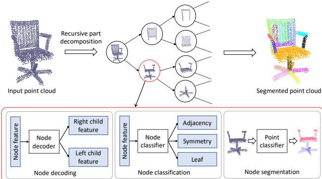
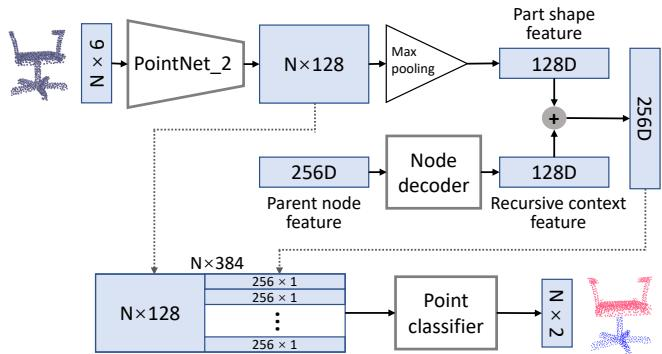
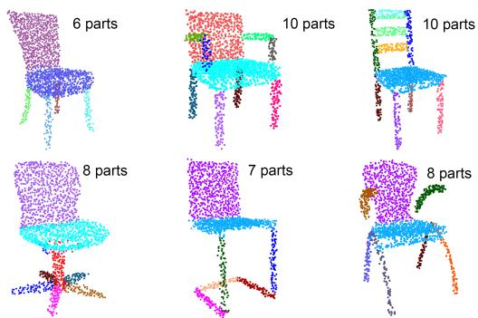
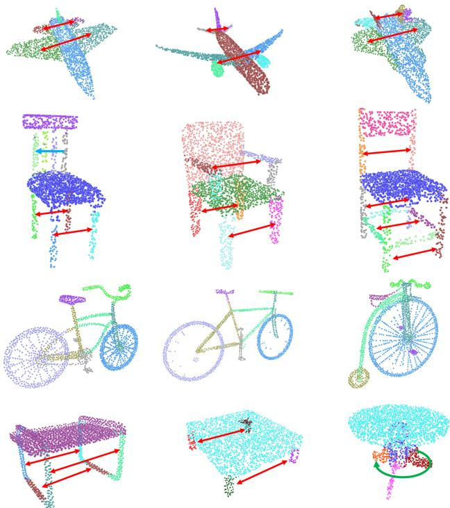

# PartNet：用于细粒度和分层形状分割的递归部件分解网络

Fenggen Yu1∗ Kun Liu1\* Yan Zhang1 Chenyang Zhu2 Kai Xu2† 1南京大学 2国防科技大学

## 摘要

三维形状分割的深度学习方法通常被表述为多类别标注问题。现有模型针对固定的标签集进行训练，这极大地限制了它们的灵活性和自适应性。我们选择自顶向下的递归分解，并基于递归神经网络开发了首个用于三维形状分层分割的深度学习模型。从表示为点云的完整形状开始，我们的模型执行递归二叉分解，其中层次结构中所有节点处的分解网络共享权重。在每个节点处，训练一个节点分类器来确定其分解的类型（邻接或对称）以及停止准则。在较高层级节点中提取的特征被递归地传播到较低层级的节点。因此，较高层级中有意义的分解提供了强有力的上下文线索，用以约束较低层级的分割。同时，为了提高每个节点处的分割精度，我们使用为对应部件提取的形状特征来增强递归上下文特征。我们的方法根据形状的复杂度，将点云中的三维形状分割成非固定数量的部件，表现出强大的通用性和灵活性。在公开基准以及本工作提出的细粒度分割新基准上，无论是在细粒度分割还是语义分割任务中，该方法均取得了最先进的性能。我们还展示了其在图像到形状重建中用于细粒度部件细化的应用。

## 1. 引言

分割是三维形状分析中一个长期存在的问题，在该问题上，数据驱动方法相比传统几何方法展现出明显的优势 [38]。随着深度学习技术的迅速发展，研究人员一直在探索利用深度神经网络强大的特征学习能力，以取代以往数据驱动方法中使用的手工特征。在这些工作中，深度网络被训练用于多类别标注任务，为每个几何基元（例如体素 [23] 或点 [20]）输出一个语义标签。

  
Figure 1. PartNet 以自顶向下的递归方式分割三维点云，从而生成细粒度部件的层次结构。针对椅子（Chair）类别训练的同一个模型，可以根据输入形状的结构复杂度，将不同的椅子模型分割成不同数量的部件。

这些现有模型存在两个问题。首先，这些模型的训练目标是固定的标签集，这极大地限制了其灵活性和自适应性。例如，一个训练用于将椅子分割为三个语义部件的模型，无法用来正确分割具有四个部件的椅子，即使它们都属于同一个形状族。针对不同的目标标签集训练不同的模型既不通用也不高效。其次，同时标记所有图元无法利用形状分解的层次化特性。分层形状分割通过将多类别标记问题转化为级联的二值标记问题，降低了形状分割的难度 [1, 39]。另一方面，分层分割可以利用跨越不同层级的结构约束：较高层级的分割提供了强线索来约束较低层级的分割。这使得将形状准确分割到非常细粒度的层级成为可能（Figure 1）。

在这项工作中，我们选择了自顶向下的分解策略，并提出了首个基于递归神经网络（RvNN）将三维形状分层分割为细粒度部件的深度学习模型。从以点云表示的完整形状出发，我们的模型执行递归二叉分解，其中层次结构中所有节点处的分解网络共享权重。在每个节点处，训练一个节点分类器来确定其分解类型（邻接节点或对称节点）以及分解是否应该停止（叶节点）。在较高层级节点中提取的特征通过树状结构递归地传播到较低层级节点，我们将其称为递归上下文特征。因此，较高层级中有意义的分解约束了较低层级的分割。同时，为了提高每个节点处的分割精度，我们利用为相应点云提取的部件形状特征来增强递归上下文特征。

该网络使用来自 ShapeNet [3] 的点采样三维模型进行训练，这些模型通常由带有语义标记的部件组成。对于每个形状，使用现有的基于规则的方法 [36] 构建层次结构。这种规范的训练层次结构有助于训练更快收敛。损失在每个节点处计算，包括节点分类损失和二值点标记损失。

得益于基于动态 RvNN 架构的灵活性，我们的方法能够实现精确的分割，即使是针对分解为任意数量部件的高度细粒度分割也是如此。此外，它还能恢复部件之间的关系（邻接或对称），从而进一步提高标注精度，例如，可以识别出对称部件并据此进行正确标注（Figure 1）。无论是在公开基准测试还是在本文提出的细粒度分割新基准测试上，我们的方法都取得了最先进（state-of-the-art）的性能。我们还展示了该方法在具有细粒度结构恢复的图像到形状重建中的实用性。

我们的贡献包括：

• 一种基于动态 RvNN 架构的深度学习模型，用于 3D 形状自顶向下的分层细粒度分割。

• 一种融合了上下文信息与单个部件形状几何特征的部件特征学习方案。

• 一个用于 3D 形状细粒度部件实例分割的基准数据集。

• 将我们的细粒度结构恢复方法应用于高质量的图像到形状重建。

## 2. 相关工作

学习 3D 形状分割。得益于机器学习技术的进步 [10, 24, 35, 37, 42]，3D 形状的语义分割近年来取得了显著的研究进展。关于基于学习的 3D 形状分割的全面综述可参见 [38]。这些方法的基本思想是基于形状图元（例如三角形、点或体素）的几何特征，学习一个形状图元分类器。

最近，针对不同表示形式（包括体素网格 [23, 32]、点云 [20, 11, 7]、多视角渲染 [9] 或表面网格 [41, 31]）的 3D 形状监督分割，已经开发了若干深度学习模型。其核心思想是用数据驱动学习到的特征替代传统方法中采用的手工设计几何特征。然而，所有这些模型的训练都针对一组固定的语义标签。一旦给定一组不同的目标标签，就必须使用标注了新标签的训练数据集对模型进行重新训练。

3D 形状的分层分割（Hierarchical segmentation of 3D shapes）。3D 形状通常是以分层构建的方式由部件建模而成的。这一点部分体现在由人工创建的物体或场景的 3D 模型中广泛存在的场景图中，以及著名的构造实体几何（Constructive Solid Geometry，CSG）[21] 的分层建模范式中。这自然引出了 3D 形状分层分解的思想。分层形状分割既可以通过自底向上的分组方法 [1, 34] 实现，也可以基于全局拓扑分析以自顶向下的方式 [22, 8, 43] 实现。给定一个预先分割的 3D 形状，Wang 等人 [36] 根据邻近性和对称性关系推断出部件的分层组织结构。随后，这种启发式方法通过无监督学习方法 [30] 得到了改进。Yi 等人 [39] 提出了一种用于 3D 形状分层分割的监督学习方法。然而，他们的模型同样是针对一组固定的语义标签进行训练的。这些标签集是在部件标签分析的预处理中确定的，并按照预定义的规范层次结构进行组织。相比之下，由于采用了递归训练的节点分类，我们的方法不需要预设的规范层次结构，而是以数据驱动的方式学习分解层次结构。据我们所知，我们的方法是首个用于分层形状分割的端到端可训练模型。

递归神经网络（Recursive neural networks）。递归神经网络（RvNN）由 Socher 等人 [25] 开发，用于文本和图像理解 [27] 以及 3D 形状分类 [26]。最近，Li 等人 [12] 引入了一种生成式递归自编码器，用于生成 3D 形状结构。给定一组预先分割的 3D 形状，通过基于 RvNN 的部件结构编码和解码来学习变分自编码器（VAE）模型。此后，基于 RvNN 的 VAE 还被用于训练 3D 场景生成 [13]、结构感知的单视图 3D 重建 [18] 以及用于部件组构成的子结构先验学习 [44]。我们尚未发现此前有将 RvNN 用于分层 3D 形状分割的工作。

## 3. 方法

我们首先介绍 PartNet 的整体架构，它是一个递归部件分解网络。随后将介绍网络中的几个关键设计。

  
Figure 2. PartNet 的架构。在每个节点处，分别设计了三个用于上下文传播、层次结构构建和点云分割的模块。作为一个递归网络，这些模块被层次结构中的所有节点共享。

## 3.1. 递归部件分解网络

Figure 2 展示了 PartNet 的架构。PartNet 以 3D 形状的点云作为输入，执行自顶向下的分解，并在部件实例级别输出分割后的点云。在每个节点处，设计了三个模块：

• 节点解码模块：用于将全局上下文信息从当前节点传递给其子节点。此类信息利用更高级别的上下文来约束节点的分割。

• 节点分类模块：旨在构建分解层级结构的拓扑结构。这通过学习预测节点类型来实现，该节点类型决定了如何分解节点以及何时停止分解。

• 节点分割模块：用于对当前节点的点云执行实际分割。这通过学习一个在所有节点间共享的点分类网络来实现。

下面我们将对这些模块进行详细阐述。

节点解码模块。作为初始化，我们首先为完整形状点云提取一个 128D PointNet [19] 特征，然后对其进行复制并拼接，形成一个 256D 的根节点特征。接着，该 256D 特征被解码为两个 128D 特征，分别对应其两个子节点，我们称之为递归上下文特征（recursive context feature）。在每个非根节点处，我们还会为该节点对应的局部点云提取一个 128D PointNet 特征，称为部件形状特征（part shape feature）。随后，将该 128D 部件形状特征与从父节点传递下来的 128D 递归上下文特征进行拼接，形成当前节点特征。关于这些特征的直观解释请参见 Figure 3。该解码模块由带有 tanh 非线性激活函数的双层全连接网络实现。该模块中使用的 PointNet 被称为 Point-Net 1，以与节点分割模块中使用的网络（见下文）相区分。

  
Figure 3. 节点解码模块和节点分类模块的网络设计。递归上下文特征与部件形状特征拼接后输入到节点分类器中。

节点分类模块。在给定节点处，节点分类模块以当前节点特征作为输入，将其节点类型预测为以下三种之一：邻接（adjacency）、对称（symmetry）或叶节点（leaf）。通过确定节点如何拆分以及是否进行拆分，该模块构建了层级结构的拓扑结构。该节点分类模块由带有 tanh 非线性激活函数的双层全连接层实现。它可以利用点云的真实（ground-truth）层级分割进行训练。

需要注意的是，当一个节点被分类为对称节点时，类似于 [12]，我们将其左子节点解释为对称生成元（表示一个部件），并将其右子节点解释为对称参数。将对称参数应用于对称生成元部件即可获得该对称节点的完整点云。例如，转椅腿部部件中对应轮辐的节点（Figure 1，左）是一个旋转对称节点。它的左子节点表示其中一个轮辐的点云，右子节点则编码了对称轴和对称折次。

节点分割模块。该模块基于当前节点特征和逐点 PointNet 特征进行点标注。具体而言，我们使用另一个 Point-

  
Figure 4. 节点分割模块的网络设计。递归上下文特征与部件形状特征的拼接通过逐点 PointNet 特征进行增强，以用于点标签预测（点云分割）。

Net（记作 PointNet 2）来提取逐点特征，从而得到一个 N × 128 的特征矩阵，其中 N 为当前节点的点数。然后，对于每一行（点特征），我们通过拼接 256D 当前节点特征来进行增强。这产生了一个 N×384 的特征矩阵，将其送入点分类网络以生成逐点二进制标签。该点分类器通过 PointNet 的最后五层实现。需要注意的是，这些层不与 PointNet 1 或 PointNet 2 共享权重。

对于对称节点，仅需对其左子节点（即对称生成元）进行分割。在分割之后，基于预测的对称参数，将点标签传递给所有其他对称对应部分。

## 3.2. 损失函数

对于每个训练点云，PartNet 的总损失函数 $L _ { \mathrm { p a r t n e t } } ,$ 由所有相关节点上的平均节点分类损失和平均节点分割损失组成：

$$
L _ {\text { partnet }} = \frac {1}{| \mathcal {H} |} \sum_ {n \in \mathcal {H}} L _ {\text { class }} (n) + \frac {1}{| \mathcal {T} |} \sum_ {n \in \mathcal {T}} L _ {\text { seg }} (n)\tag{1}
$$

其中 $L _ { \mathrm { c l a s s } } ( n )$ 和 $L _ { \mathrm { s e g } } ( n )$ 分别为节点 n 的分类损失和分割损失。两种损失均定义为交叉熵损失。H 为层级结构中所有节点的集合，而 T 为所有非叶节点的集合。

## 3.3. 训练细节

用于节点分类的 PointNet 1（Figure 3）使用了六个点卷积层，滤波器数量分别为 64、128、128、256、256 和 128。用于节点分割的 PointNet 2（Figure 4）使用了四个点卷积层，滤波器数量分别为 64、64、128 和 128。Figure 4 中的点云分割网络由四个点卷积层组成，滤波器数量分别为 512、256、128 和 128，外加一个带有 2 个滤波器用于二元标签预测的输出层。在所有这些网络中，最后三层中每两层之间都使用了 20% 的随机特征丢弃（dropout）。每两层之间均使用批归一化（Batch normalization）。我们使用 Adam 优化器进行训练，批大小为 10，初始学习率为 0.001。

输入点云的大小为 2048。训练点云是通过对 3D 模型进行点采样获得的。添加高斯噪声以进行数据增强。所有 PointNet 都使用点法向量来提升细粒度部件分割性能。因此，PartNet 输入张量的维度为 2048 × 6。

## 4. Results and evaluations

## 4.1. Benchmark

细粒度分割基准（Fine-grained Segmentation Benchmark, FineSeg）。随着基于深度学习的 3D 形状分割技术的发展，亟需一个用于细粒度部件实例分割的基准测试。近期一项同期工作 [17] 中提出了一个用于评估细粒度形状分割的优秀基准。在本工作中，我们提出了 FineSeg。该数据集包含六个形状类别的约 3000 个 3D 形状：椅子（1000）、桌子（500）、飞机（600）、沙发（600）、直升机（100）和自行车（140）。这些模型收集自 Sung 等人 [29] 的工作中所使用的 ShapeNet [3] 子集。这些模型均经过一致对齐和统一缩放。对于那些分割不够细粒度的模型（例如缺少实例部件分割），我们对模型进行了手动分割。随后，我们使用 [36] 中提出的方法为每个形状构建部件层次结构。我们对每个 3D 模型进行点采样，从而生成对应 3D 点云的真实（ground-truth）细粒度分割。这些层次结构可用于训练我们的递归部件分解网络。该基准可基于用于部件检测的平均精度（Average Precision, AP，要求其与真实标签的 IoU 大于某一阈值），定量评估 3D 点云的细粒度分割。该基准公开可在以下网址获取：www.kevinkaixu.net/ projects/partnet.html。

## 4.2. Segmentation results and evaluation

我们的 PartNet 模型使用 Fine-Seg 中 80% 的模型进行训练，其余 20% 用于测试。关于复杂度和运行时间（包括训练与测试）的讨论可在补充材料中找到。

FineSeg 上的可视化结果。我们首先在 Figure 5 中展示了由 PartNet 获得的细粒度点云分割的一些可视化示例。为了进行并排对比，我们还展示了每个示例的真实标注（ground-truth）分割。我们的方法在具有复杂部件结构的含噪点云上生成了精确的细粒度分割。此外，一旦训练完成，同一个模型可用于将测试（未见过的）点云分割成不同数量的部件，展示了其灵活性和通用性。Figure 6 展示了同一个 PartNet 模型如何根据结构复杂度，将某一类别中的不同形状分割为任意数量的目标部件。更多结果可在补充材料中查阅。在补充材料中，我们还展示了与两种传统（非学习型）基线方法在分层分割方面的可视化对比。

包含消融实验的定量评估。在 FineSeg 上的定量评估中，我们与作为本方法消融版本的两个基线进行了对比。具体而言，我们关注 PartNet 中使用的两个重要节点特征的作用：递归上下文特征（recursive context feature, RCF）和部件形状特征（part shape feature, PSF）。

  
Figure 5. PartNet 的细粒度点云分割。为了进行对比，我们展示了每个形状的细粒度分割结果（下）和对应的 ground-truth（上）。

  
Figure 6. 在 Chair 数据集上训练的同一个 PartNet 模型，可以根据输入形状的结构复杂度，将不同的椅子模型分割成不同数量的部件。

在第一个基线（w/o RCF）中，递归上下文特征从节点分类（参见 Figure 3）和节点分割（参见 Figure 4）中均被移除。为了弥补递归上下文特征的缺失，128D 的部件形状特征被复制扩充为 256D 特征。消融后的网络使用 FineSeg 的训练集进行了重新训练。在第二个基线（w/o PSF）中，PSF 仅从节点分类模块中被移除。

<table><tr><td colspan="2"></td><td>平均</td><td>飞机</td><td>自行车</td><td>椅子</td><td>直升机</td><td>沙发</td><td>桌子</td></tr><tr><td rowspan="3">IoU &gt;0.25</td><td>Full</td><td>84.8</td><td>95.2</td><td>97.0</td><td>91.1</td><td>83.0</td><td>65.4</td><td>77.2</td></tr><tr><td>w/o RCF</td><td>79.2</td><td>92.8</td><td>92.0</td><td>87.1</td><td>71.1</td><td>61.6</td><td>70.8</td></tr><tr><td>w/o PSF</td><td>77.6</td><td>90.8</td><td>95.1</td><td>83.6</td><td>77.8</td><td>54.1</td><td>64.0</td></tr><tr><td rowspan="3">IoU &gt;0.5</td><td>Full</td><td>72.8</td><td>88.0</td><td>89.4</td><td>80.5</td><td>69.4</td><td>46.7</td><td>62.6</td></tr><tr><td>w/o RCF</td><td>66.0</td><td>85.3</td><td>83.4</td><td>71.8</td><td>56.7</td><td>42.5</td><td>56.4</td></tr><tr><td>w/o PSF</td><td>64.9</td><td>85.2</td><td>88.4</td><td>65.6</td><td>57.5</td><td>36.9</td><td>55.6</td></tr></table>

Table 1. 在 FineSeg 上将我们的完整模型与两个基准（w/o RCF 和 w/o PSF）进行对比。AP(%) 分别在 IoU 阈值为 0.25 和 0.5 条件下测得。

Table 1 报告了测试集所有六个类别上的 AP，IoU 阈值分别为 0.25 和 0.5。

  
Figure 7. 在三种形状类别（Bike、Sofa 和 Airplane）上针对两个关键节点特征（RCF 和 PSF）的消融实验中，训练损失随迭代次数的变化情况。对于每个类别（行），我们分别绘制了节点分割损失（左）和节点分类损失（右）。

我们完整模型始终如一的优越性能证明了这两个特征的重要性。Figure 7 绘制了三种方法在三种形状类别（Bike、Sofa 和 Airplane）上随迭代次数变化的训练损失。结果表明，这两个特征对于节点分类模块和节点分割模块的快速训练都至关重要。这证明了全局上下文信息和局部形状几何对于学习层次化分割的重要性。更多结果见补充材料。

用于细粒度分割的 ShapeNet 挑战赛。此外，我们利用 ShapeNet [3] 细粒度分割挑战进行了一次中等规模的压力测试。我们从 ShapeNet 中随机选取了一组形状，并使用 PartNet 对其进行分割。由于我们没有 ShapeNet 模型的细粒度分割真实标注（ground truth），因此我们采用主观用户调研来评估我们的分割结果。我们要求参与者对细粒度分割的质量进行评分，范围为 1 到 5。用户调研表明，我们的方法在所有测试类别中均获得了 > 4.0 的平均评分，显著高于“w/o RCF”基准的结果。本研究的详细信息和结果见补充材料。在 Figure 8 中，我们展示了几个可视化示例，从中可以看出我们的方法能够对这些具有复杂结构的未见形状生成细粒度分割。此外，我们的方法还获取了分解部件的邻接和对称关系，可用于许多下游结构感知应用 [16]。

  
Figure 8. 来自 ShapeNet 细粒度分割挑战赛的部分结果。除了分割之外，PartNet 还能恢复分割部件之间的关系（邻接与对称）。我们用彩色箭头可视化恢复的对称关系（镜像对称：红色；平移对称：蓝色；旋转对称：绿色）。

## 4.3. 语义分割对比

尽管 PartNet 是为细粒度分割而设计的，但递归分解在语义分割上的表现应当更好，因为后者通常是更粗粒度的分割。我们在 ShapeNet 部件数据集 [40] 上评估了 PartNet 的 3D 点云语义分割性能，并与该任务上的七种最先进（state-of-the-art）方法进行了对比。与 PointNet [19] 类似，我们将每个形状的点云重新采样为 2048 个点。我们采用与这些最先进方法相同的训练/测试划分设置，并计算部件级平均 IoU 作为评估指标。

需要注意的是，PartNet 不会为点生成语义标签，因此它不能直接执行带标签的分割。为了能够进行比较，我们在 PartNet 中添加了一个额外的模块，用于为其分解出的每个部件预测语义标签。部件标签预测模块将叶节点的节点特征作为输入，并为该叶节点中包含的所有点输出一个语义标签。该模块由三个全连接层实现，并使用交叉熵损失进行训练。

<table><tr><td>方法</td><td>均值</td><td>飞机</td><td>包</td><td>帽子</td><td>汽车</td><td>椅子</td><td>耳机</td><td>吉他</td><td>刀</td><td>灯</td><td>笔记本</td><td>摩托车</td><td>马克杯</td><td>手枪</td><td>火箭</td><td>滑板</td><td>桌子</td></tr><tr><td>PointNet [19]</td><td>83.7</td><td>83.4</td><td>78.7</td><td>82.5</td><td>74.9</td><td>89.6</td><td>73.0</td><td>91.5</td><td>85.9</td><td>80.8</td><td>95.3</td><td>65.2</td><td>93.0</td><td>81.2</td><td>57.9</td><td>72.8</td><td>80.6</td></tr><tr><td>PointNet++ [20]</td><td>85.1</td><td>82.4</td><td>79.0</td><td>87.7</td><td>77.3</td><td>90.8</td><td>71.8</td><td>91.0</td><td>85.9</td><td>83.7</td><td>95.3</td><td>71.6</td><td>94.1</td><td>81.3</td><td>58.7</td><td>76.4</td><td>82.6</td></tr><tr><td>O-CNN [32]</td><td>85.9</td><td>85.5</td><td>87.1</td><td>84.7</td><td>77.0</td><td>91.1</td><td>85.1</td><td>91.9</td><td>87.4</td><td>83.3</td><td>95.4</td><td>56.9</td><td>96.2</td><td>81.6</td><td>53.5</td><td>74.1</td><td>84.4</td></tr><tr><td>SSCN [6]</td><td>86.0</td><td>84.1</td><td>83.0</td><td>84.0</td><td>80.8</td><td>91.4</td><td>78.2</td><td>91.6</td><td>89.1</td><td>85.0</td><td>95.8</td><td>73.7</td><td>95.2</td><td>84.0</td><td>58.5</td><td>76.0</td><td>82.7</td></tr><tr><td>PCNN [2]</td><td>85.1</td><td>82.4</td><td>80.1</td><td>85.5</td><td>79.5</td><td>90.8</td><td>73.2</td><td>91.3</td><td>86.0</td><td>85.0</td><td>95.7</td><td>73.2</td><td>94.8</td><td>83.3</td><td>51.0</td><td>75.0</td><td>81.8</td></tr><tr><td>SPLATNet [28]</td><td>85.4</td><td>83.2</td><td>84.3</td><td>89.1</td><td>80.3</td><td>90.7</td><td>75.5</td><td>92.1</td><td>87.1</td><td>83.9</td><td>96.3</td><td>75.6</td><td>95.8</td><td>83.8</td><td>64.0</td><td>75.5</td><td>81.8</td></tr><tr><td>PointCNN [14]</td><td>86.1</td><td>84.1</td><td>86.4</td><td>86.0</td><td>80.8</td><td>90.6</td><td>79.7</td><td>92.3</td><td>88.4</td><td>85.3</td><td>96.1</td><td>77.2</td><td>95.3</td><td>84.2</td><td>64.2</td><td>80.0</td><td>83.0</td></tr><tr><td>本文方法</td><td>87.4</td><td>87.8</td><td>86.7</td><td>89.7</td><td>80.5</td><td>91.9</td><td>75.7</td><td>91.8</td><td>85.9</td><td>83.6</td><td>97.0</td><td>74.6</td><td>97.3</td><td>83.6</td><td>64.6</td><td>78.4</td><td>85.8</td></tr></table>

Table 2. ShapeNet 部件数据集 [40] 上的语义分割对比。评估指标为部件级 IoU（%）。

结果汇报于 Table 2 中。在增加了部件标签预测模块后，PartNet 在大多数类别中均取得了更好的性能，并在所有类别上获得了最高的平均准确率。此外，我们的方法对于诸如椅子（chair）、桌子（table）和飞机（aeroplane）等具有复杂结构的类别表现尤为突出。我们认为，递归分解的分治特性确实有助于降低分割学习的难度。递归分解的另一个关键优势在于，较高层级的分割为较低层级的分割提供了约束性的上下文线索。在 Princeton Segmentation Benchmark [4] 上测试我们训练好的模型时，也可以观察到类似的结果（见补充材料）。

对于语义分割，PartNet 可以针对某一类别中的所有形状使用一致的层次结构进行训练。只要该层次结构在所有训练形状中保持一致，就可以进行训练。因此，我们不需要额外的过程（例如 [36] 在细粒度分割中所使用的过程）来进行层次结构构建。以某个训练形状的任意层次结构作为“模板”，我们根据语义部件标签统一所有其他形状的层次结构。因此，PartNet 在进行语义分割训练时不需要部件层次结构的额外监督。因此，正文 Table 2 中汇报的对比是公平的。

## 4.4. 实例分割对比

SGPN [33] 是首个在 3D 点云上学习实例分割的深度学习模型。它能够分割物体实例并预测每个实例的类别标签，这与我们的方法（增加了标签预测模块）非常相似，不同之处在于 SGPN 无法像我们的方法那样获取部件关系。我们在 FineSeg 数据集上与 SGPN 进行了对比，同样使用了 IoU 阈值为 0.25 和 0.5 的 AP 指标。

Figure 9 展示了一些视觉对比，其中错误分割的区域已被标记出。Table 3 给出了在我们数据集上的定量对比。我们将相较于 SGPN 的持续改进归因于两个因素。首先，SGPN 的实例分组学习基于点聚类。这种在整个形状上进行单次点分组的方式很难学习。另一方面，我们的方法执行自顶向下的递归分解，将完整形状的分割分解为一系列级联的局部形状分割。其次，SGPN 使用的点特征仅仅是点卷积特征 [19]，而我们的特征同时考虑了局部部件形状和全局上下文。

  
Figure 9. 与 SGPN [33] 在细粒度部件实例分割上的视觉对比。左：真实值（Ground-truths）。中：PartNet 的分割结果。右：SGPN 的结果。错误分割（相对于真实值）用红圈标出。

<table><tr><td colspan="2"></td><td>mean</td><td>aero</td><td>bike</td><td>chair</td><td>heli.</td><td>sofa</td><td>table</td></tr><tr><td>IoU</td><td>SGPN [12]</td><td>62.2</td><td>67.8</td><td>75.8</td><td>66.2</td><td>59.4</td><td>50.4</td><td>53.6</td></tr><tr><td>&gt;0.25</td><td>Ours</td><td>84.8</td><td>95.2</td><td>97.0</td><td>91.1</td><td>83.0</td><td>65.4</td><td>77.2</td></tr><tr><td>IoU</td><td>SGPN [12]</td><td>47.0</td><td>56.7</td><td>63.7</td><td>54.6</td><td>38.9</td><td>29.5</td><td>38.4</td></tr><tr><td>&gt;0.5</td><td>Ours</td><td>72.8</td><td>88.0</td><td>89.4</td><td>80.5</td><td>69.4</td><td>46.7</td><td>62.6</td></tr></table>

Table 3. 在 FineSeg 数据集上与 SGPN [33] 进行细粒度实例分割的对比。评价指标为 AP (%)，IoU 阈值分别为 0.25 和 0.5。

## 5. 应用

我们展示了 PartNet 细粒度分割在优化从单视角图像重建的 3D 点云中的一项应用。其基本思想是一个“分割-优化”（segment-and-refine）过程。给定一个以整体方式重建的 3D 点云（例如使用 Fan 等人 [5] 的方法），我们首先对该点云执行递归分解，从而得到部件点云的层次化组织。然后，我们训练一个网络来优化每个叶节点处的部件点云，生成该部件的高质量点云。这些优化后的部件点云共同构成了整个形状的优化点云。

每个叶节点使用的部件优化网络由两个 PointNet 通道组成，分别用于对部件和完整形状的点云进行编码。将得到的两个特征拼接后输入到一个四层全连接网络中，以生成优化后的部件点云。为了训练该优化网络，我们使用计算为点云间 Chamfer 距离和推土机距离（earth mover’s distance）[5] 的重建损失。为了获得更多的训练信号，我们选择使用层次化重建损失来训练优化器，通过遵循 PartNet 分割所获得的层次结构，自底向上组合优化后的部件点云。通过这种方式，我们可以在层次结构的每个节点处计算重建损失，其对应的点云由其子树内的部件点云组合而成。关于网络架构的更多细节，请参阅补充材料。

Figure 10 展示了在 PartNet 的细粒度层次化分割指导下进行点云优化的几个示例。尽管与输入图像相比，优化有时可能会丢失部分部件保真度，但得益于 Part-Net 的细粒度部件分解，它确实生成了具有合理部件结构的高细节度点云。更多示例请参见补充材料。

## 6. 结论

我们提出了一种用于三维点云细粒度分割的自顶向下递归分解网络。通过层次化分解方案，我们的模型即使对于高度复杂的形状也能获得细粒度且精确的分割。与大多数现有的基于深度学习的分割模型不同，我们的方法根据形状的结构复杂度将其分割为任意数量的部件，而不是生成具有固定标签集的带标签分割。即使对于语义分割，得益于我们的分而治之分割学习策略，我们的模型也取得了优越的性能。

局限性与未来工作。我们当前的方法存在一些局限性。首先，尽管 PartNet 以层次化方式分割形状，但生成的分割层次结构并不一定像专门针对形状 [30, 39] 或场景 [15] 学习的层次结构那样富有意义。其次，尽管我们的模型可用于将不同的形状分割成不同数量的部件，而不是针对固定的部件标签集，但它仍需要针对每个形状类别分别进行训练。学习一个用于多类别形状递归分解的更通用的模型将是一个非常有趣的未来研究方向。第三，PartNet 是使用由文献 [36] 中的方法构建的合理真实值（ground-truth）层次结构进行训练的。使用完全随机的层次结构进行训练会导致性能下降。我们在补充材料中展示了这一影响。因此，另一个未来方向是以无监督的方式学习层次化分割，而无需构建真实值层次结构。

  
Figure 10. 在 PartNet 细粒度分割的指导下，优化从单视图图像重建的点云的一些示例。在每一行中，我们从左到右依次展示了输入图像、整体重建结果、重建的细粒度分割以及我们方法的最终优化结果。

## 致谢

我们感谢匿名审稿人的宝贵意见。我们也非常感谢 Hao (Richard) Zhang 进行的有益讨论，以及 Yuan Gan 和 Pengyu Wang 在数据准备方面的巨大帮助。本项工作得到了 NSFC (61572507, 61532003, 61622212) 和湖南省杰出青年基金项目 (2017JJ1002) 的部分资助。

## 参考文献

[1] M. Attene, B. Falcidieno, and M. Spagnuolo. Hierarchical mesh segmentation based on fitting primitives. The Visual Computer, 22(3):181–193, 2006. 1, 2

[2] M. Atzmon, H. Maron, and Y. Lipman. Point convolutional neural networks by extension operators. ACM SIGGRAPH, 2018. 7

[3] A. X. Chang, T. Funkhouser, L. Guibas, P. Hanrahan, Q. Huang, Z. Li, S. Savarese, M. Savva, S. Song, H. Su, et al. Shapenet: An information-rich 3d model repository. arXiv preprint arXiv:1512.03012, 2015. 2, 4, 6

[4] X. Chen, A. Golovinskiy, and T. Funkhouser. A benchmark for 3D mesh segmentation. ACM Transactions on Graphics (Proc. SIGGRAPH), 28(3), Aug. 2009. 7

[5] H. Fan, H. Su, and L. Guibas. A point set generation network for 3d object reconstruction from a single image. In IEEE Conference on Computer Vision and Pattern Recognition, pages 2463–2471, 2017. 8

[6] B. Graham, M. Engelcke, and L. van der Maaten. 3d semantic segmentation with submanifold sparse convolutional networks. In Proc. CVPR, pages 9224–9232, 2018. 7

[7] Q. Huang, W. Wang, and U. Neumann. Recurrent slice networks for 3d segmentation of point clouds. In Proceedings of the IEEE Conference on Computer Vision and Pattern Recognition, pages 2626–2635, 2018. 2

[8] Q.-X. Huang, M. Wicke, B. Adams, and L. Guibas. Shape decomposition using modal analysis. Computer Graphics Forum, 28(2):407–416, 2009. 2

[9] E. Kalogerakis, M. Averkiou, S. Maji, and S. Chaudhuri. 3d shape segmentation with projective convolutional networks. In Proc. CVPR, volume 1, page 8, 2017. 2

[10] E. Kalogerakis, A. Hertzmann, and K. Singh. Learning 3d mesh segmentation and labeling. ACM Transactions on Graphics (Proc. SIGGRAPH), 29(4):102:1–102:12, 2010. 2

[11] R. Klokov and V. Lempitsky. Escape from cells: Deep kdnetworks for the recognition of 3d point cloud models. In Computer Vision (ICCV), 2017 IEEE International Conference on, pages 863–872. IEEE, 2017. 2

[12] J. Li, K. Xu, S. Chaudhuri, E. Yumer, H. Zhang, and L. Guibas. GRASS: Generative recursive autoencoders for shape structures. ACM Transactions on Graphics (TOG), 36(4):52, 2017. 2, 3, 7

[13] M. Li, A. G. Patil, K. Xu, S. Chaudhuri, O. Khan, A. Shamir, C. Tu, B. Chen, D. Cohen-Or, and H. Zhang. Grains: Generative recursive autoencoders for indoor scenes. arXiv preprint arXiv:1807.09193, 2018. 2

[14] Y. Li, R. Bu, M. Sun, W. Wu, X. Di, and B. Chen. Pointcnn: Convolution on x-transformed points. In S. Bengio, H. Wallach, H. Larochelle, K. Grauman, N. Cesa-Bianchi, and R. Garnett, editors, Advances in Neural Information Processing Systems 31, pages 820–830. Curran Associates, Inc., 2018. 7

[15] T. Liu, S. Chaudhuri, V. G. Kim, Q. Huang, N. J. Mitra, and T. Funkhouser. Creating consistent scene graphs using a probabilistic grammar. ACM Transactions on Graphics (TOG), 33(6):211, 2014. 8

[16] N. Mitra, M. Wand, H. R. Zhang, D. Cohen-Or, V. Kim, and Q.-X. Huang. Structure-aware shape processing. In SIG-GRAPH Asia 2013 Courses, page 1. ACM, 2013. 6

[17] K. Mo, S. Zhu, A. X. Chang, L. Yi, S. Tripathi, L. J. Guibas, and H. Su. Partnet: A large-scale benchmark for fine-grained and hierarchical part-level 3d object understanding. arXiv preprint arXiv:1812.02713, 2018. 4

[18] C. Niu, J. Li, and K. Xu. Im2struct: Recovering 3d shape structure from a single rgb image. In Proc. CVPR, pages 4521–4529, 2018. 2

[19] C. R. Qi, H. Su, K. Mo, and L. J. Guibas. Pointnet: Deep learning on point sets for 3d classification and segmentation. arXiv preprint arXiv:1612.00593, 2016. 3, 6, 7

[20] C. R. Qi, L. Yi, H. Su, and L. J. Guibas. Pointnet++: Deep hierarchical feature learning on point sets in a metric space. In Advances in Neural Information Processing Systems, pages 5099–5108, 2017. 1, 2, 7

[21] A. A. Requicha and H. B. Voelcker. Constructive solid geometry. 1977. 2

[22] M. Reuter. Hierarchical shape segmentation and registration via topological features of laplace-beltrami eigenfunctions. International Journal of Computer Vision, 89(2-3):287–308, 2010. 2

[23] G. Riegler, A. O. Ulusoy, and A. Geiger. Octnet: Learning deep 3d representations at high resolutions. In Proceedings ofthe IEEE Conference on Computer Vision and Pattern Recognition, volume 3, 2017. 1, 2

[24] O. Sidi, O. van Kaick, Y. Kleiman, H. Zhang, and D. Cohen-Or. Unsupervised co-segmentation of a set of shapes via descriptor-space spectral clustering. ACM Trans. on Graph. (SIGGRAPH Asia), 30(6), 2011. 2

[25] R. Socher. Recursive deep learning for natural language processing and computer vision. PhD thesis, Citeseer, 2014. 2

[26] R. Socher, B. Huval, B. Bath, C. D. Manning, and A. Y. Ng. Convolutional-recursive deep learning for 3d object classification. In Advances in neural information processing systems, pages 656–664, 2012. 2

[27] R. Socher, C. C. Lin, C. Manning, and A. Y. Ng. Parsing natural scenes and natural language with recursive neural networks. In Proceedings of the 28th international conference on machine learning (ICML-11), pages 129–136, 2011. 2

[28] H. Su, V. Jampani, D. Sun, S. Maji, E. Kalogerakis, M.-H. Yang, and J. Kautz. SPLATNet: Sparse lattice networks for point cloud processing. In Proceedings of the IEEE Conference on Computer Vision and Pattern Recognition, pages 2530–2539, 2018. 7

[29] M. Sung, H. Su, V. G. Kim, S. Chaudhuri, and L. Guibas. ComplementMe: Weakly-supervised component suggestions for 3D modeling. ACM Trans. on Graph. (SIGGRAPH Asia), 2017. 4

[30] O. Van Kaick, K. Xu, H. Zhang, Y. Wang, S. Sun, A. Shamir, and D. Cohen-Or. Co-hierarchical analysis of shape structures. ACM Trans. on Graph. (SIGGRAPH), 32(4):69, 2013. 2, 8

[31] P. Wang, Y. Gan, P. Shui, F. Yu, Y. Zhang, S. Chen, and Z. Sun. 3d shape segmentation via shape fully convolutional networks. Computers & Graphics, 70:128–139, 2018. 2

[32] P.-S. Wang, Y. Liu, Y.-X. Guo, C.-Y. Sun, and X. Tong. O-cnn: Octree-based convolutional neural networks for 3d shape analysis. ACM Transactions on Graphics (SIG-GRAPH), 36(4), 2017. 2, 7

[33] W. Wang, R. Yu, Q. Huang, and U. Neumann. Sgpn: Similarity group proposal network for 3d point cloud instance segmentation. 2017. 7

[34] X. Wang, B. Zhou, H. Fang, X. Chen, Q. Zhao, and K. Xu. Learning to group and label fine-grained shape components. In SIGGRAPH Asia 2018 Technical Papers, page 210. ACM, 2018. 2

[35] Y. Wang, M. Gong, T. Wang, D. Cohen-Or, H. Zhang, and B. Chen. Projective analysis for 3d shape segmentation. ACM Transactions on Graphics (TOG), 32(6):192, 2013. 2

[36] Y. Wang, K. Xu, J. Li, H. Zhang, A. Shamir, L. Liu, Z. Cheng, and Y. Xiong. Symmetry hierarchy of man-made objects. Computer Graphics Forum, 30(2):287–296, 2011. 2, 4, 7, 8

[37] Z. Xie, K. Xu, and L. L. abd Yueshan Xiong. 3d shape segmentation and labeling via extreme learning machine. Computer Graphics Forum (Proc. SGP), 33(5):85–95, 2014. 2

[38] K. Xu, V. G. Kim, Q. Huang, N. Mitra, and E. Kalogerakis. Data-driven shape analysis and processing. In SIGGRAPH ASIA 2016 Courses, page 4. ACM, 2016. 1, 2

[39] L. Yi, L. Guibas, A. Hertzmann, V. G. Kim, H. Su, and E. Yumer. Learning hierarchical shape segmentation and labeling from online repositories. ACM Trans. on Graph. (SIGGRAPH), 2017. 1, 2, 8

[40] L. Yi, V. G. Kim, D. Ceylan, I.-C. Shen, M. Yan, H. Su, C. Lu, Q. Huang, A. Sheffer, and L. Guibas. A scalable active framework for region annotation in 3d shape collections. SIGGRAPH Asia, 2016. 6, 7

[41] L. Yi, H. Su, X. Guo, and L. J. Guibas. Syncspeccnn: Synchronized spectral cnn for 3d shape segmentation. In CVPR, pages 6584–6592, 2017. 2

[42] Y. Zhao, K. Xu, E. Zhu, X. Liu, X. Zhu, and J. Yin. Triangle lasso for simultaneous clustering and optimization in graph datasets. IEEE Transactions on Knowledge and Data Engineering, 31(8):1610–1623, 2018. 2

[43] Y. Zhou, K. Yin, H. Huang, H. Zhang, M. Gong, and D. Cohen-Or. Generalized cylinder decomposition. ACM Trans. on Graph. (SIGGRAPH Asia), 34(6):171–1, 2015. 2

[44] C. Zhu, K. Xu, S. Chaudhuri, R. Yi, and H. Zhang. Scores: Shape composition with recursive substructure priors. ACM Transactions on Graphics (TOG), 37(6):1–14, 2018. 2