# PoseFormerV2：探索用于高效且鲁棒的 3D 人体姿态估计的频域

Qitao Zhao1\* Ce Zheng2 Mengyuan Liu3 Pichao Wang4 Chen Chen2

1Shandong University 2Center for Research in Computer Vision, University of Central Florida 4Amazon Prime Video

3Key Laboratory of Machine Perception, Peking University, Shenzhen Graduate School

qitaozhao@mail.sdu.edu.cn cezheng@knights.ucf.edu nkliuyifang@gmail.com

pichaowang@gmail.com

chen.chen@crcv.ucf.edu

## 摘要

近期，基于 Transformer 的方法在序列化 2D 到 3D 提升（2D-to-3D lifting）人体姿态估计中取得了显著成功。作为一项开创性工作，PoseFormer 通过级联 Transformer 层捕获每个视频帧中人体关节点的空间关系以及跨帧的人体动态，取得了令人瞩目的性能。然而，在真实场景中，PoseFormer 及其后续方法的性能受到两个因素的限制：(a) 输入关节点序列的长度；(b) 2D 关节点检测的质量。现有方法通常对输入序列的所有帧应用自注意力机制，当为了获得更高的估计精度而增加帧数时，会带来巨大的计算负担，并且它们对于 2D 关节点检测器有限能力所自然带来的噪声不够鲁棒。在本文中，我们提出了 PoseFormerV2，它利用频域中长骨骼序列的紧凑表示来高效扩大感受野，并提高对带有噪声的 2D 关节点检测的鲁棒性。在对 PoseFormer 进行最小改动的情况下，所提方法有效地融合了时域和频域的特征，获得了比其前身更好的速度与精度权衡。在两个基准数据集（即 Human3.6M 和 MPI-INF-3DHP）上的大量实验表明，所提出的方法显著优于原始的 PoseFormer 和其他基于 Transformer 的变体。代码已发布在 https://github.com/QitaoZhao/PoseFormerV2。

## 1. 引言

3D 人体姿态估计（HPE）旨在基于单目视频（无中间 2D 表示）[25,28] 或 2D 人体关节点序列（称为 2D 到 3D 提升方法）[5,18,37,43] 定位 3 维空间中的人体关节点。随着 2D 人体姿态检测器 [6, 26] 的广泛可用性，加上人体 2D 骨骼表示的轻量级特性，基于提升（lifting）的方法目前在 3D 人体姿态估计中占据主导地位。与原始单目视频相比，每个视频帧中人体关节点的 2D 坐标对内存友好得多，这使得基于提升的方法能够利用长关节点序列来提高姿态估计精度。

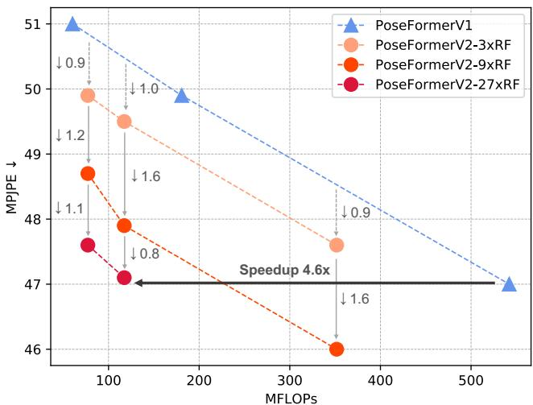  
Figure 1. PoseFormerV2 与 PoseFormerV1 [46] 在 Human3.6M [13] 上的对比。RF 表示感受野（Receptive Field），$k\times\text{RF}$ 表示完整序列长度与输入到 PoseFormerV2 空间编码器的帧数之比为 $k$，即通过完整序列的少量低频系数将空间编码器的 RF 扩大了 $k\times$。所提出的方法在速度与精度的权衡方面大幅超越了 PoseFormerV1，且更大的 $k$ 带来了更显著的提升，例如在 $k$ 为 27 时实现了 4.6 倍加速。

Transformer [36] 首先在自然语言处理（NLP）领域 [3, 8] 取得了巨大成功，随后将其能力扩展到计算机视觉领域，成为若干视觉任务的事实标准方法，例如图像分类 [9, 19, 35]、目标检测 [4, 47] 和视频识别 [1, 2, 42]。人体关节表示的离散性以及骨骼序列中对长距离时间依赖建模的需求，使得 Transformer 非常适合基于升维（lifting-based）的人体姿态估计。以往的研究工作 [15, 16, 32, 44, 46] 已采用 Transformer 作为 3D 人体姿态估计的骨干网络，并展示出了极具前景的结果。

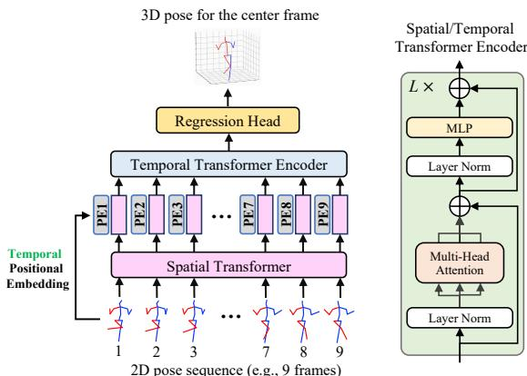  
Figure 2. PoseFormerV1 概览。PoseFormerV1 主要由两个模块组成：空间 Transformer 编码器和时间 Transformer 编码器。PoseFormerV1 的时间编码器在给定 2D 关节序列的情况下对所有帧应用自注意力机制以进行人体运动建模。

Table 1. SOTA 基于 Transformer 的方法在使用 CPN [6] 2D 姿态检测替代真实值（ground-truth）2D 检测时带来的计算成本和性能下降。性能下降在 Human3.6M 数据集（Protocol 1）[13] 上进行报告。RF：感受野（Receptive Field），含义与图 1 相同。

<table><tr><td colspan="2">方法</td><td>序列长度</td><td>GFLOPs</td><td>性能下降 (mm)</td></tr><tr><td>PoseFormerV1 [46]</td><td>ICCV&#x27;21</td><td>81</td><td>1.36</td><td>13.0</td></tr><tr><td>StridedTransformer [15]</td><td>TMM&#x27;22</td><td>243</td><td>1.37</td><td>15.2</td></tr><tr><td>MixSTE [44]</td><td>CVPR&#x27;22</td><td>81</td><td>92.46</td><td>16.5</td></tr><tr><td>MHFormer [16]</td><td>CVPR&#x27;22</td><td>81</td><td>3.12</td><td>11.8</td></tr><tr><td>P-STMO [32]</td><td>ECCV&#x27;22</td><td>243</td><td>1.74</td><td>13.5</td></tr><tr><td colspan="2">PoseFormerV2 (9×RF)</td><td>81</td><td>0.35</td><td>8.2</td></tr><tr><td colspan="2">PoseFormerV2 (27×RF)</td><td>81</td><td>0.12</td><td>9.7</td></tr></table>

作为基于 Transformer 方法的开创性工作，PoseFormer [46] 将关节序列特征提取分解为两个阶段（见 Fig. 2），其表现优于传统的基于卷积的方法。首先，每一帧内的所有关节都被线性投影为高维向量（即关节 Token），作为空间 Transformer 编码器的输入。空间编码器通过自注意力（self-attention）机制在单帧内建立关节间的依赖关系。在第二阶段，每一帧的关节 Token 被组合为一个帧 Token，作为时间编码器的输入，以对序列中所有帧的人体运动进行建模。更多细节包含在 Sec. 3.1 中。

尽管能力出众，PoseFormer（以及其他基于 Transformer 的方法）的性能仍受到两个关键因素的限制。(a) 输入 2D 骨架序列的长度（帧数）。最先进的基于 Transformer 的方法通常使用极长的序列来获得优异的性能，例如 Pose-Former [46] 采用 81 帧、P-STMO [15] 采用 243 帧，以及 MHFormer [16] 采用 351 帧。然而，对此类长序列密集应用自注意力计算开销极高，例如，在 RTX 3090 GPU 上，3 帧 PoseFormer 的单轮（single-epoch）挂钟训练时间成本约为 5 分钟，而 81 帧 PoseFormer 的成本激增至约 1.5 小时。(b) 2D 关节检测的质量。由于训练数据集中的偏差以及单帧估计范式带来的时间不一致性，2D 关节检测器不可避免地会引入噪声。例如，在 Human3.6M 数据集 [13] 上使用真实标注（ground-truth）2D 检测时，Pose-Former 实现了 31.3mm 的 MPJPE（每关节平均位置误差，Mean Per Joint Position Error）。当干净的输入被 CPN [6] 2D 姿态检测替换时，该结果显著恶化至 44.3mm。在实际应用中，长序列推理对于 AR/VR 头显等资源受限设备上的硬件部署而言可能难以负担，且高质量的 2D 检测往往难以获取。有关现有基于 Transformer 的方法处理长序列的效率以及对噪声 2D 关节检测的鲁棒性的更多定量结果见 Table 1。

受这些实际问题的驱动，我们提出了两个重要的研究问题：

• Q1：如何高效利用长关节序列以获得更好的估计精度？

• Q2：如何提高模型对不可靠 2D 姿态检测的鲁棒性？

很少有工作尝试通过引入手工设计的模块来回答这两个问题中的任何一个，例如：仅处理部分视频帧以提高效率的降采样-上采样（downsampling-and-uplifting）模块 [10]，用于对身体部位的深度多义性和 2D 检测器不确定性进行建模的多假设（multi-hypothesis）模块 [16]。然而，没有一个方法能够同时找到针对这两个问题的单一解决方案；更糟糕的是，上述问题的解决方案之间似乎存在着矛盾，例如，多假设 [16] 提高了鲁棒性，但带来了额外的计算开销（另见 Table 1）。

在本文中，我们提出了“一石二鸟”的初步尝试。通过对现有先进方法 PoseFormer 进行克制的修改，我们表明输入序列的合适表示形式可能是同时解决这些问题的关键。具体来说，我们探索了 3D HPE（3D 人体姿态估计）文献中鲜有研究的频域，并提出将输入的骨骼序列编码为低频系数。这种表示背后的直觉出奇地简单：一方面，低频分量足以表示整个视觉身份 [38, 41]（例如图像压缩中的 2D 图像，以及本例中的关节点轨迹），从而无需进行开销昂贵的全帧自注意力计算；另一方面，骨骼序列本身的低频表示滤除了检测到的关节点轨迹中所包含的高频噪声（抖动和异常值）[21, 22]。

我们继承了 Pose-Former 的时空架构，但强制空间 Transformer 编码器仅“观察”长序列中的少数中心帧。然后，我们利用来自完整序列低频分量的全局特征，来补充“短视”的帧级特征（空间编码器的输出）。在无需对所有时间步使用开销昂贵的帧间自注意力的前提下，时间 Transformer 编码器被重新构建为时频特征融合（Time-Frequency Feature Fusion）模块。

在两个 3D 人体姿态估计基准数据集（即 Human3.6M [13] 和 MPI-INF-3DHP [23]）上的大量实验表明，所提出的名为 PoseFormerV2 的方法在速度与精度的权衡以及对 2D 关节点检测噪声的鲁棒性方面，均显著优于其前身（见 Fig. 1）和其他基于 Transformer 的变体。我们的贡献主要有三点：

• 据我们所知，我们是首个将输入关节点序列的频域表示应用于 2D 到 3D 提升（2D-to-3D lifting）HPE 的工作。我们发现这种表示非常适合同时解决该领域的两个重要问题（即处理长序列的效率问题和对不可靠关节点检测的鲁棒性问题），并且实验证据表明该方法可以轻松推广到其他模型。

• 我们设计了一个有效的时频特征融合（Time-Frequency Feature Fusion）模块来缩小特征在时域与频域之间的差距，使我们能够在速度和精度之间取得灵活的平衡。

• 我们的 PoseFormerV2 在 Human3.6M 上在速度与精度的权衡以及鲁棒性方面优于其他基于 Transformer 的方法，并在 MPI-INF-3DHP 上达到了最先进水平（state-of-the-art）。

## 2. 相关工作

我们的方法建立在概念简洁的 PoseFormer [46] 之上，旨在从频域视角提高其处理长序列的效率以及对噪声关节点检测的鲁棒性。因此，在这里我们主要关注 2D 到 3D 提升（2D-to-3D lifting）HPE 领域的这一系列工作（基于 Transformer 的方法），并介绍频域表征在计算机视觉文献中的应用，特别是在与基于提升的 3D HPE 最相关的基于骨架的任务中的应用。

## 2.1. 基于 Transformer 的 3D 人体姿态估计

PoseFormer [46] 是首个在基于提升的 3D 人体姿态估计中采用 Vision Transformer 作为主干网络的工作，其表现大幅优于以往基于 CNN 的方法。尽管极具竞争力，Zhang 等人 [44] 指出 PoseFormer 的“先空间后时间”范式可能会忽略每个关节点独特的时序模式，并提议采用交替的时空 Transformer 层来进行细粒度的特定关节点特征提取。MHFormer [16] 进一步将任务相关的先验知识融入用于 3D HPE 的 Transformer 中。具体而言，2D 到 3D 提升是一个存在多个合理解的逆问题，因此他们生成多个假设来建模模糊的身体部位和关节点检测器中的不确定性，取得了先进的性能。受图像分类中掩码图像建模（Masked Image Modeling, MIM）[12, 39, 40] 进展的启发，P-STMO [32] 通过自监督学习将掩码关节点建模（Masked Joint Modeling）应用于 3D HPE。

另一类工作 [10, 15] 则致力于提高基于 Transformer 的方法的效率。利用 2D 关节点序列中的时序冗余，StridedTransformer [15] 用跨步卷积（strided convolutions）替换了参数量庞大的全连接层。Einfalt 等人 [10] 认为逐帧的 2D 关节点检测在计算上甚至比提升模型本身更为昂贵，因此提议以固定间隔对输入视频帧进行下采样，并仅在这些采样帧上应用 2D 关节点检测器和提升模型。虽然比以往的工作更高效，但上述方法 [10, 15] 仅利用相邻视频帧的一致性而非从全局视角来减少沿时间维度参与自注意力的元素，因此它们可能会出现较大幅度的性能下降。

## 2.2. 视觉中的频域表征

由于人类视觉系统对图像的低频分量更为敏感，传统的图像压缩算法，例如 JPEG [30] 和 JPEG 2000 [33]，通过将更多的存储预算分配给图像的低频离散余弦变换（Discrete Cosine Transform, DCT）系数，来降低存储 2D 图像的内存开销。遵循相同的逻辑，[41] 提出自适应地去除 2D 图像 DCT 分量中无信息的通道，以提高图像分类效率。最近，一些研究 [11, 31] 提出用可通过快速算法加速的频率变换来取代昂贵的自注意力（self-attention）机制。GFN [31] 提出使用可学习的频率滤波器来高效混合视觉 token，而 AFNO [11] 则通过算子学习（operator learning）进一步提升了频域中 token 混合器（token mixer）的性能。此外，Wang 等人 [38] 利用低频快速傅里叶变换（Fast Fourier Transform, FFT）分量来压缩 Vision Transformer。

基于骨架的任务与以 2D 骨架序列作为输入的本工作更为相关。在人体动作预测文献中，先前的研究 [21, 22] 将骨架序列从时域转换到 DCT 系数，相较于静态关节点坐标以编码人体动态。他们观察到，丢弃少量高频系数不仅不一定会导致性能下降，甚至还能提高预测未来动作的平滑度。然而，在基于提升（lifting-based）的 3D 人体姿态估计中，2D 关节点序列的频域表征尚未得到探索。

我们的方法受到了这些将频率变换应用于视觉任务的前期尝试的启发，但采用了不同的视角。我们在第 3.2.1 节中提供了选择 DCT 系数表征的更多动机细节。

## 3. 方法

PoseFormer [46] 通过将序列特征提取分解为两个阶段（即空间编码器和时间编码器）来推进 3D 人体姿态估计，这已被证明是有效的。然而，当输入序列的长度增加时，它承受着巨大的计算负担，并且对带有噪声的关节点检测较为敏感。在本节中，我们介绍了 PoseFormerV2 的详细信息，该方法利用输入序列的频域表征来克服上述两个问题。

## 3.1. PoseFormerV1 [46] 预备知识

我们首先简要概述 PoseFormerV1（见 Fig. 2），为后续讨论其改进奠定基础。PoseFormerV1 由两个主要模块组成：用于单帧关节点相关性建模的空间编码器（spatial encoder），以及用于跨帧人体运动建模的时间编码器（temporal encoder）。给定输入的 2D 骨架序列 $\mathbf { x } \in \mathbb { R } ^ { F \times J \times 2 }$，其中 $F$ 表示序列长度，$J$ 表示人体表征的关节点数量。首先，每一帧中人物的所有关节点坐标被线性投影为一个 $c$ 维向量（即关节点嵌入，joint embedding），记作 ${ \bf z } _ { 0 } \in \mathbb { R } ^ { F \times J \times c }$。将一个可学习的空间位置嵌入 $\mathbf { E } _ { S P o s } \in \mathbb { R } ^ { 1 \times J \times c }$ [9] 加到 $\mathbf { z } _ { 0 }$ 中，以编码与关节点相关的信息。

空间 Transformer 编码器利用自注意力机制，单独为每一帧的关节点嵌入 $\mathbf { z } _ { 0 } ^ { i } \in \mathbb { R } ^ { 1 \times J \times c }$ 构建空间依赖关系。在这一阶段，输入到每个 Transformer 块中的 token 数量为 $J$。第 $i$ 帧经过 $L$ 层空间 Transformer 编码器后的输出记作 $\mathbf { z } _ { L } ^ { i } \in \mathbb { R } ^ { 1 \times J \times c }$。随后，将每帧的表征展平并拼接，作为输入 $\mathbf { Z } _ { 0 } \in \bar { \mathbb { R } } ^ { F \times ( J \cdot c ) }$ 送入时间 Transformer 编码器。

时间 Transformer 编码器。类似地，输入 $\mathbf { Z } _ { 0 }$ 会加上一个可学习的时间位置嵌入 $\mathbf { E } _ { T P o s } \in \mathbb { R } ^ { F \times ( J \cdot c ) }$，以编码每帧与索引相关的信息。具有 $M$ 个 Transformer 层的时间编码器对整个序列中帧与帧之间的依赖关系进行密集建模，其输出记作 $\mathbf { Z } _ { M } \in \mathbb { R } ^ { F \times ( J \cdot c ) }$。在这一阶段，每个 Transformer 层的 token 数量为 $F$，即输入序列的长度。

回归头。为了估计序列中心帧的 3D 姿态，使用一个简单的 1D 卷积来聚合时间信息，并通过线性投影输出最终的姿态表征 $\mathbf { y } \in \mathbb { R } ^ { 1 \times ( J \cdot 3 ) }$。

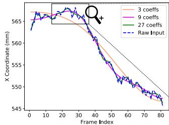

  
Figure 3. Human3.6M [13] 中由 CPN [6] 检测出的关节点轨迹随机采样示例，以及使用前 3、9 和 27 个 DCT 系数（共 81 个）的重构结果。请注意，即使仅使用前 3 个系数，重构出的（橙色）曲线也能捕捉原始输入的总体特征，并且更加平滑。

PoseFormerV1 的局限性。利用 Transformer 层对每帧内的关节点依赖性以及跨帧的人体运动进行建模是直接有效的。尽管这种密集建模带来了先进的估计精度，但由于自注意力机制的计算量随着 token 数量（即空间编码器中的关节点数量和时间编码器中的序列长度）呈二次方增长，特别是在输入序列长度增加时，其计算开销极不友好。虽然空间 Transformer 层的 token 数量（即关节点数量）与帧数无关，但值得注意的是，由于 GPU 并行能力的限制，在实际场景中序列长度会隐式影响空间编码器的计算预算。除了效率问题之外，PoseFormerV1 对输入 2D 关节点检测的质量也很敏感（实验证据见 Table 1 和 Sec. 4.3）。

在下文中，我们提出了一种替代解决方案，通过输入序列的频域表示来克服 PoseFormerV1 的局限性。

## 3.2. PoseFormerV2

## 3.2.1 骨骼序列的频域表示

动机。我们提出使用离散余弦变换（Discrete Cosine Transform, DCT）将输入的骨骼序列转换到频域，并且仅利用一部分低频系数。DCT 系数为输入时间序列编码了多尺度的时间信息。具体而言，低频系数编码其粗略轮廓，而高频系数编码其细节，例如抖动或突变。为了更好地说明我们选择这种表示的动机，我们在 Human3.6M [13] 数据集中提供了一个由 CPN 检测 [6] 的动作“Directions”的 81 帧关节点轨迹示例，以及分别使用前 3、9 和 27 个 DCT 系数对其进行重构的结果（见 Fig. 3）。随着保留的 DCT 系数数量的增加，重构的轨迹越来越接近原始输入，但平滑度降低。需要注意的是，仅使用 3 个 DCT 系数（由橙色曲线表示），就能捕捉到原始轨迹的总体趋势，而在使用 9 和 27 个系数（粉色和绿色曲线）时，原始序列的特征得到了更好的保留，同时高频噪声（锯齿）被消除。这些观察促使我们在工作中利用输入关节点序列中少数高信息量的低频 DCT 分量，作为紧凑且去噪的序列表示。通过这种表示，我们显著减少了作为输入的序列有效长度，并提升了模型对 2D 关节点检测中包含的噪声的鲁棒性。我们在补充材料中提供了对 DCT 的正式介绍。

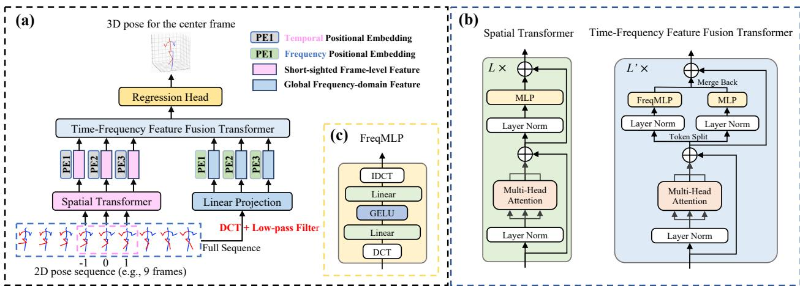  
Figure 4. (a) PoseFormerV2 概览。(b) 空间 Transformer（Spatial Transformer）与时频特征融合 Transformer（Time-Frequency Feature Fusion Transformer）。(c) FreqMLP（频域多层感知机，Frequency Multi-Layer Perceptron）。作为示例，在 (a) 中我们使用 3 个中心帧（索引为 -1、0 和 1）来进行细粒度的帧级特征提取，并使用完整的 9 帧序列的前 3 个 DCT 系数来进行全局频域特征提取。因此，与 PoseFormerV1 相比，作为空间编码器和时间编码器输入的有效帧数减少了（3, 6 对比 9, 9）。

## 3.2.2 架构

在本部分中，我们介绍了所提出方法 PoseFormerV2 的架构（概览见 Fig. 4）。

空间 Transformer 编码器。给定一个 2D 骨架序列 $\mathbf { x } ~ \in ~ \mathbb { R } ^ { F \times J \times 2 }$（最好是一个长序列，例如 $F$ 为 81），我们首先在序列中心（Fig. 4 (a) 中的索引 0 帧）周围采样 $F ^ { \prime }$ 帧（通常 $F ^ { \prime } \ll F$），表示为 $\mathbf { x } ^ { \prime } \in \mathbb { R } ^ { F ^ { \prime } \times J \times 2 }$，作为空间编码器的输入。空间编码器的输出表示为 $\mathbf { z } ^ { T i m e } \in \mathbb { R } ^ { F ^ { \prime } \times ( \bar { J ` } c ) }$（时域中的帧级特征）。空间编码器的设计直接沿用 PoseFormerV1。

低频 DCT 系数。$\mathbf { z } ^ { T i m e }$ 被称为“短视的”，因为与其整个序列长度 (F) 相比，它的感受野 $( F ^ { \prime } )$ 是受限的。为了高效利用原始序列的长程人体动态，我们求助于其频域表示。我们首先将完整序列 $\textbf { x } \in$ $\mathbb { R } ^ { \sum _ { F \times J \times 2 } ^ { \star } }$ 转换为 DCT 系数，记为 $\dot { \mathbf { C } } \in \mathbb { R } ^ { F \times J \times 2 }$。然后，我们对每个关节轨迹使用低通滤波器，仅保留前 $N \ ( \ll \ F )$ 个系数 ${ \bf C } ^ { \prime } \in  { \bf \Sigma }$ $\mathbb { R } ^ { N \times J \times 2 }$，此时原始序列的时间信息在很大程度上得以保留，而高频噪声则被消除。

低频系数 $\mathbf { C ^ { \prime } }$ 被展平并线性投影到 $\mathbf { \bar { z } } ^ { F r e q } ~ \in ~ \mathbb { R } ^ { N \times ( J \cdot c ) }$（频域系数的嵌入）。${ \mathbf z } ^ { F r e q }$ 与一个可学习的频域位置嵌入 $\mathbf { E } _ { F P o s }$（类似于 Pose-FormerV1 中的 $\mathbf { E } _ { T P o s }$）相加。来自时域和频域的特征被拼接在一起，表示为

$$
\mathbf {z} = [ \mathbf {z} ^ {T i m e}; \mathbf {z} ^ {F r e q} ],\tag{1}
$$

随后输入至时频特征融合（Time-Frequency Feature Fusion）模块。

时频特征融合。与 PoseFormerV1 类似，我们采用 Transformer 层进行跨帧时间依赖性建模。与完全在时域提取特征的 PoseFormerV1 相比，所提出的方法融合了来自时域和频域的特征。为了缩小两个域之间的差距，我们对原始 Transformer 层进行了简单的修改。(1) 时域和频域特征共享自注意力，但使用独立的前馈网络；(2) 我们在时域特征 $\mathbf { z } ^ { T i m e }$ 的前馈网络中应用了 FreqMLP（频域多层感知机，Frequency Multi-Layer Perceptron）（参见图 4 (b)(c)）。在我们的 FreqMLP 中，我们在原始 MLP 之前和之后分别使用 DCT 和 IDCT。该方法背后的直觉是：频域特征中的高频噪声被低通滤波器滤除，但精细的人体运动特征（例如快速局部运动）也可能作为噪声被丢失。为了解决这个问题，FreqMLP 充当可训练的频域滤波器，使我们能够自适应地调整 2D 关节点坐标嵌入（即时域特征）中每个频率分量的权重，从而作为频域特征的补充。这些模块公式化为：

$$
\mathbf {z} _ {k} ^ {\prime} = \mathrm{MSA} (\mathbf {z} _ {k}),\tag{2}
$$

$$
\mathbf {z} _ {k} ^ {T i m e}, \mathbf {z} _ {k} ^ {F r e q} = \mathbf {z} _ {k} ^ {'} [: F ^ {\prime} ], \mathbf {z} _ {k} ^ {'} [ F ^ {\prime}: ],\tag{3}
$$

$$
\mathbf {z} _ {k + 1} = \operatorname{Concat} (\text { FreqMLP } (\mathbf {z} _ {k} ^ {\text { Time }}), \text { MLP } (\mathbf {z} _ {k} ^ {\text { Freq }})),\tag{4}
$$

其中 MSA 表示多头自注意力（Multi-head Self-Attention），$F ^ { \prime }$ 为采样的中心帧数量。上述修改的有效性在第 4.4 节中得到了验证。需要注意的是，拼接操作会导致 Transformer 的 token 数量增加。然而，通过限制空间编码器仅观察有限数量的中心帧，并结合小比例的低频 DCT 系数来扩大其感受野，我们能够以灵活的方式减少整体计算量。与 PoseFormerV1 相比，该方法不仅降低了计算成本，还增强了模型的抗噪能力。

回归头与损失函数。遵循 Pose-FormerV1，我们使用 1D 卷积层来汇聚时序信息，并使用线性投影来获得序列中心帧的最终 3D 姿态 $\mathbf { y } \in \mathbb { R } ^ { 1 \times ( J \cdot 3 ) }$。我们与 PoseFormerV1 一样使用标准的 MPJPE（平均每个关节点位置误差，Mean Per Joint Position Error）损失来训练我们的模型。

## 4. 实验

## 4.1. 数据集与评估指标

我们在两个三维人体姿态估计数据集上进行了实验，即 Human3.6M [13] 和 MPI-INF-3DHP [23]，以证明我们方法的有效性。关于这两个数据集及其各自评估指标的更详细描述见补充材料。

## 4.2. 实现细节与分析

所提出的方法包含三个特定于实验设置的重要超参数。其中包括空间编码器输入所使用的帧数（f）、表示扩大感受野的完整输入序列长度（F），以及用于融入长程时间信息所保留的 DCT 系数数量（n）。若无特殊说明，为简便起见，我们直接设定 $n = f$。在实践中，可以进一步调整它们以实现灵活的速度与精度权衡。当 f 等于 1 时，n 设置为 3，因为单个 DCT 系数可能不足以编码较长输入序列的时间信息。由于 $f$ 和 n 是固定的，模型的计算复杂度已被预先确定（即空间编码器的 token 数量以及特征融合模块的 token 数量是固定的）。我们可以改变 $F$，从而在不带来额外计算开销的情况下，有效地将模型的感受野从有限的 f 扩展到任意值。这使我们能够高效地利用长序列来提升精度。我们在补充材料中提供了模型架构和训练超参数的详细信息。

## 4.3. 与最先进方法的对比

Human3.6M。我们在 Human3.6M 上将我们的方法与 Pose-FormerV1 以及其他基于 Transformer 的方法进行了对比（Table 2）。我们通过改变 $f$ 的值和序列长度展示了我们模型的灵活性。当扩展比率（$( i . e . ,$ 即完整序列长度与 f 的比值）较大时，我们的方法尤为高效。例如，在扩展比率为 81 的情况下，它仅需 77.2 MFLOPs 便达到了 47.6mm MPJPE，相比之下 MHFormer [16] 的 MPJPE 为 47.8mm 且计算量为 342.9 MFLOPs（慢 4.4 倍）。此外，在相似的计算预算（约 350 MFLOPs）和相同的完整序列长度（81）下，我们的方法达到了 46.0mm MPJPE，而 StridedTransformer [15] 获得了 47.5mm MPJPE（提升 3.2%↑）。Fig. 5 给出了更清晰的对比，表明所提出的方法在速度与精度的权衡方面优于其他基于 Transformer 的方法。注意，此处未包含带有额外预训练阶段的方法以及计算繁重的 MixSTE [44]（仅 3 帧输入就需要 3420 MFLOPs）。Pose-FormerV2 相比于 PoseFormerV1 的改进见 Fig. 1。

Table 2. 在 Human3.6M 上与以往基于 Transformer 方法的定量对比（单位：mm）。$f \colon$ 输入到模型的帧数，Seq. Len.：完整输入序列的长度（$( i . e .$ 即有效感受野）。最优结果以粗体标出。(\*) 表示使用了额外的预训练阶段，(†) 表示我们的重新实现。

<table><tr><td>方法</td><td>f</td><td>序列长度</td><td>MFLOPs</td><td>MPJPE ↓ / P-MPJPE ↓</td></tr><tr><td>PoseFormerV1 [46] ICCV&#x27;21</td><td>27</td><td>27</td><td>542.1</td><td>47.0/-</td></tr><tr><td>StridedTrans. [15] TMM&#x27;22</td><td>81</td><td>81</td><td>342.5</td><td>47.5/-</td></tr><tr><td>MixSTE [44](†) CVPR&#x27;22</td><td>3</td><td>3</td><td>3420</td><td>49.6/38.9</td></tr><tr><td>MHFormer [16] CVPR&#x27;22</td><td>9</td><td>9</td><td>342.9</td><td>47.8/-</td></tr><tr><td>MHFormer [16] CVPR&#x27;22</td><td>27</td><td>27</td><td>1031.8</td><td>45.9/-</td></tr><tr><td>P-STMO [32](*) ECCV&#x27;22</td><td>27</td><td>81</td><td>163</td><td>46.8/-</td></tr><tr><td>P-STMO [32](*) ECCV&#x27;22</td><td>81</td><td>81</td><td>493</td><td>45.6/-</td></tr><tr><td>Einfalt et al. [10] WACV&#x27;23</td><td>9</td><td>81</td><td>543</td><td>47.9/-</td></tr><tr><td>PoseFormerV2</td><td>1</td><td>9</td><td>77.2</td><td>49.9/38.7</td></tr><tr><td>PoseFormerV2</td><td>1</td><td>27</td><td>77.2</td><td>48.7/37.8</td></tr><tr><td>PoseFormerV2</td><td>1</td><td>81</td><td>77.2</td><td>47.6/37.3</td></tr><tr><td>PoseFormerV2</td><td>3</td><td>9</td><td>117.3</td><td>49.5/38.5</td></tr><tr><td>PoseFormerV2</td><td>3</td><td>27</td><td>117.3</td><td>47.9/37.4</td></tr><tr><td>PoseFormerV2</td><td>3</td><td>81</td><td>117.3</td><td>47.1/37.3</td></tr><tr><td>PoseFormerV2</td><td>9</td><td>27</td><td>351.7</td><td>47.6/37.1</td></tr><tr><td>PoseFormerV2</td><td>9</td><td>81</td><td>351.7</td><td>46.0/36.1</td></tr><tr><td>PoseFormerV2</td><td>27</td><td>243</td><td>1054.8</td><td>45.2/35.6</td></tr></table>

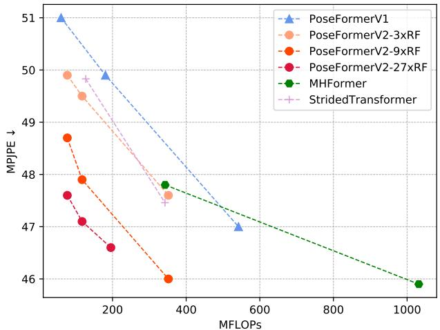  
Figure 5. PoseFormerV2 与其他最先进的基于 Transformer 的方法在 Human3.6M 上的对比（单位：mm）。RF：感受野（Receptive Field），$k { \times } \mathrm { R F }$ 表示 PoseFormerV2 的感受野通过完整序列的少量低频 DCT 系数扩展了 $k \times$ 倍。所提出的方法在速度与精度的权衡方面优于其他方法，且 $k$ 越大，相比其他方法的提升越显著。（彩色显示效果最佳）

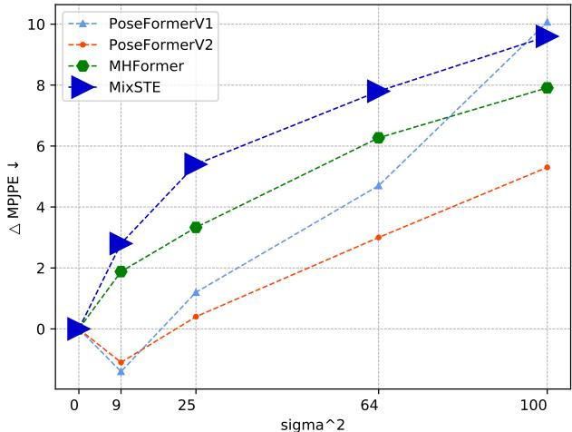  
Figure 6. PoseFormerV2 与其他基于 Transformer 的方法 [16, 44, 46] 在 Human3.6M 上的噪声鲁棒性对比。在真实 2D 检测中加入了标准差为 sigma 的零均值高斯噪声，我们展示了随着 sigma 的增加它们性能下降的情况（△MPJPE，单位：mm）。标记的大小表示模型的计算开销。

Table 3. 在 MPI-INF-3DHP 数据集上与以往方法的定量对比。T：完整序列长度，默认为 1。最优结果以粗体标出。(\*) 表示使用了额外的预训练阶段，(†) 表示我们的复现结果。

<table><tr><td>方法</td><td></td><td>PCK ↑</td><td>AUC ↑</td><td>MPJPE ↓</td></tr><tr><td>Mehta et al. [23]</td><td>3DV&#x27;17</td><td>75.7</td><td>39.3</td><td>117.6</td></tr><tr><td>Mehta et al. [24]</td><td>ACM ToG&#x27;17</td><td>76.6</td><td>40.4</td><td>124.7</td></tr><tr><td>Pavllo et al. [29] (T=81)</td><td>CVPR&#x27;19</td><td>86.0</td><td>51.9</td><td>84.0</td></tr><tr><td>Pavllo et al. [29] (T=243)</td><td>CVPR&#x27;19</td><td>85.5</td><td>51.5</td><td>84.8</td></tr><tr><td>Lin et al. [17] (T=25)</td><td>BMVC&#x27;19</td><td>83.6</td><td>51.4</td><td>79.8</td></tr><tr><td>Li et al. [14]</td><td>CVPR&#x27;20</td><td>81.2</td><td>46.1</td><td>99.7</td></tr><tr><td>Chen et al. [5] (T=81)</td><td>TCSVT&#x27;21</td><td>87.9</td><td>54.0</td><td>78.8</td></tr><tr><td>PoseFormerV1 [46] (T=9)(†)</td><td>ICCV&#x27;21</td><td>95.4</td><td>63.2</td><td>57.7</td></tr><tr><td>MHFormer [16] (T=9)</td><td>CVPR&#x27;22</td><td>93.8</td><td>63.3</td><td>58.0</td></tr><tr><td>MixSTE [44] (T=27)</td><td>CVPR&#x27;22</td><td>94.4</td><td>66.5</td><td>54.9</td></tr><tr><td>P-STMO [32] (T=81)(*)</td><td>ECCV&#x27;22</td><td>97.9</td><td>75.8</td><td>32.2</td></tr><tr><td>PoseFormerV2 (T=81)</td><td></td><td>97.9</td><td>78.8</td><td>27.8</td></tr></table>

为了证明引入低频 DCT 系数有助于提高所提方法的鲁棒性，我们通过在 Human3.6M 数据集 [13] 的真实 2D 检测上添加零均值高斯噪声，使基于提升（lifting-based）的姿态估计任务更具挑战性（Fig. 6）。为了确保公平比较，我们对所有方法保持相同的输入序列长度（在此情况下为 27 帧）。对于我们的方法，$f = n = 3 .$ 实验证据表明，随着高斯噪声标准差（sigma）的增加，PoseFormerV2 的性能下降幅度更小，同时具备更高的效率。我们观察到，当 sigma 从 8 增加到 10 时，PoseFormerV1 的性能急剧下降。相比之下，所提方法表现出更稳定的趋势。此外，我们的方法甚至优于将 2D 检测器不确定性融入模型设计的 MHFormer [16]。有趣的是，我们发现微小的噪声反而可能提高 3D 姿态估计的准确率（sigma = 3）。

Table 4. 对 PoseFormerV1 的若干修改进行的消融实验。我们逐步展示了如何将 9 帧的 PoseFormerV1 转换为 PoseFormerV2（采用来自 81 帧序列的 9 个 DCT 系数）。评估在 Human3.6M（Protocol 1，单位：mm）上进行。RF 表示感受野（Receptive Field）。

<table><tr><td>步骤</td><td>描述</td><td>RF</td><td>MPJPE ↓</td></tr><tr><td>(0)</td><td>原始 9 帧 PoseFormerV1。</td><td>9</td><td>49.9</td></tr><tr><td>(1)</td><td>帧是从更长的序列中采样的。</td><td>9</td><td>49.9</td></tr><tr><td>(2)</td><td>附加 DCT 系数的嵌入。</td><td>81</td><td>47.1 (2.8↓)</td></tr><tr><td>(3)</td><td>用 FreqMLP 替换普通 MLP。</td><td>81</td><td>46.0 (3.9↓)</td></tr></table>

Table 5. 关于用作 PoseFormerV2 输入的帧数和 DCT 系数数量的消融实验。评估在 Human3.6M 上进行（协议 1，单位：mm）。

<table><tr><td>帧数 (f)</td><td>系数数量 (n)</td><td>全长</td><td>MFLOPs</td><td>MPJPE</td></tr><tr><td>1</td><td>1</td><td>27</td><td>39.2</td><td>51.1</td></tr><tr><td>1</td><td>3</td><td>27</td><td>77.2</td><td>48.7 (2.4↓)</td></tr><tr><td>3</td><td>1</td><td>27</td><td>79.4</td><td>50.1 (1.0↓)</td></tr><tr><td>3</td><td>3</td><td>27</td><td>117.3</td><td>47.9 (3.2↓)</td></tr><tr><td>9</td><td>9</td><td>27</td><td>351.7</td><td>47.6 (3.5↓)</td></tr></table>

MPI-INF-3DHP。我们还在 MPI-INF-3DHP [23] 数据集上将我们的方法与其他方法进行了比较（表 3）。我们使用输入 81 帧序列中的 9 个中心帧和前 9 个 DCT 系数。所提出的方法优于包括使用掩码关节点预训练的 P-STMO [32] 在内的其他方法。这一结果验证了我们方法的有效性。我们的实现遵循 [32]。

定性比较。我们在图 7 中提供了我们的方法与极具竞争力的 MHFormer [16] 和 PoseFormerV1 [46] 的定性比较。所有方法均使用 81 帧 2D 关节点序列作为输入。为了进一步说明我们方法的鲁棒性，我们通过向随机选择的关节点（例如“左手腕”、“右脚”）的连续 2D 检测添加高斯噪声，从而增加了姿态估计任务的难度。所提出的方法即使在高度偏差的 2D 检测下也能获得可靠的 3D 人体姿态（由浅黄色箭头指示）。请注意，我们的模型比 MHFormer 的计算效率高出约 9 倍（3.12 GFLOPs 对比 0.35 GFLOPs），与 Pose-FormerV1 相比效率高出约 4 倍（1.36 GFLOPs 对比 0.35 GFLOPs）。

## 4.4. 消融实验

在本节中，我们将逐步展示对 PoseFormerV1 的几项修改是如何带来显著改进的。此外，为了深入探究输入序列的频域表示，我们揭示了输入帧数以及保留的 DCT 系数数量对我们方法的影响。

将 PoseFormerV1 转换为 PoseFormerV2。我们继承了 Pose-FormerV1 的整体时空架构，并对其时间 Transformer 进行了克制的修改，以实现更好的多域特征融合。举例来说，我们逐步说明如何将 9 帧的 PoseFormerV1 转换为 PoseFormerV2：(1) 输入（即 9 帧）是从更长序列（例如 81 帧）的序列中心采样得到的。由于模型的输入实际上并未改变，该步骤既不会带来性能提升，也不会增加感受野。(2) PoseFormerV1 空间编码器的输出 zT ime，与完整序列（在此例中为 81 帧）的前 n 个 DCT 系数的嵌入（记为 zF req）拼接在一起，作为时间编码器的输入。为方便起见，我们将 n 设为 9。(3) 我们将时间编码器中用于 zT ime 的原生 MLP（在替换前，zT ime 和 zF req 已经分别使用独立的原生 MLP）替换为 FreqMLP（详见第 3.2.2 节）。经过这些步骤后，PoseFormerV1 被转换为 Pose-FormerV2，感受野也得以扩大（从 9 扩大到 81）。我们在 Table 4 中展示了每一步带来的提升。值得注意的是，通过引入来自更长序列（即 81 帧）的 9 个 DCT 系数，9 帧 PoseFormerV1 的 MPJPE 降低了 7.8%（49.9mm 对比 46.0mm），这验证了所提出的输入关节序列 DCT 表示的有效性。

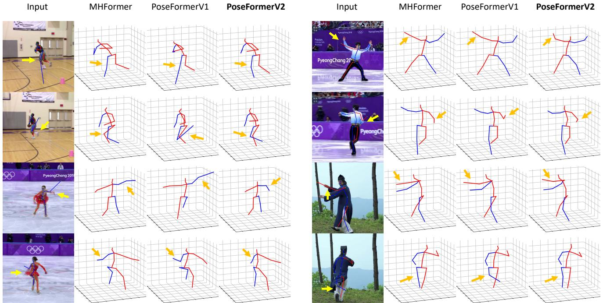  
Figure 7. PoseFormerV2 与 MHFormer [16] 和 PoseFormerV1 [46] 的定性对比。我们随机向特定关节的 2D 检测添加高斯噪声。我们用浅黄色箭头高亮显示偏离的 2D 检测，用橙色箭头高亮显示对应的 3D 姿态估计。与现有方法相比，PoseFormerV2 对高噪声输入表现出更强的鲁棒性。

输入帧数与 DCT 系数数量。在 Table 5 中，我们探究了作为空间编码器输入的帧数 (f) 以及保留的 DCT 系数数量 (n) 的影响。在此，我们将整个关节序列的长度固定为 27。基线模型仅使用一个中心帧和一个 DCT 系数 $( f = n =$

1)。增加这两个参数均能带来一致的性能提升，且增加 n 会带来更大的误差降低（n = 3 时下降 2.4↓，而 f = 3 时下降 1.0↓），这是因为仅需少数 DCT 系数便有助于捕获整个序列的全局特征。我们通过经验发现，扩展比为 9 的匹配 f 和 n（即 f = n = 3）能够取得令人满意的速度与精度之间的权衡。

## 4.5. 泛化能力

所提出的频域方法可以推广到其他方法，例如 MixSTE [44] 和 MHFormer [16]，因为它们也使用 Transformer 进行时序建模。我们通过整合低频 DCT 系数对这两种方法进行了改进。详细内容见补充材料。

## 5. 结论

我们提出了一种解决方案，从一个鲜有探索的频域视角，同时调和了基于提升（lifting-based）的 3D 人体姿态估计中两个看似无关甚至相互矛盾的问题——处理长序列输入的效率以及对噪声关节检测的鲁棒性。所提出的方法 PoseFormerV2 利用长 2D 关节序列的紧凑频域表示，在提高模型鲁棒性的同时，有效地扩大了模型的感受野。实验结果表明，我们的方法在 Human3.6M 和 MPI-INF-3DHP 数据集上优于以往基于 Transformer 的方法。

## 补充材料

## A. 概述

补充材料包括以下几个部分：

• 章节 B：离散余弦变换（Discrete Cosine Transform）的形式化介绍。

• 章节 C：数据集与评估指标。

• 章节 D：更多实现细节。

• 章节 E：PoseFormerV2 与纯频域简单基线模型的比较。

• 章节 F：我们方法向更多模型的推广。

• 章节 G：可视化与分析。

• 章节 H：更广泛的影响与局限性。

## B. 离散余弦变换

我们现在对 DCT 进行形式化介绍。给定一个表示为 $\mathbf { x } \in \mathbb { R } ^ { F \times J \times 2 }$ 的 2D 关节序列，其中 F 为序列长度，J 为每帧中的关节数量，第 j 个关节的 x（或 y）坐标轨迹表示为 $\mathbf { x } _ { j , 0 } \in \mathbb { R } ^ { F } \left( \operatorname { 或 } \mathbf { x } _ { j , 1 } \in \mathbb { R } ^ { F } \right.$ ，为方便起见均记作 $\hat { \mathbf { x } } _ { j }$ ）是一个一维时间序列，我们分别对每条轨迹（共 $J * 2$ 条轨迹）应用 DCT。

对于轨迹 ${ \hat { \mathbf { x } } } _ { j } ,$ 第 i 个 DCT 系数的计算公式为

$$
C _ {j, i} = \sqrt {\frac {2}{F}} \sum_ {f = 1} ^ {F} x _ {j, f} \frac {1}{\sqrt {1 + \delta_ {i 1}}} \cos \left(\frac {\pi}{2 F} (2 f - 1) (i - 1)\right)\tag{5}
$$

其中当 $i \ = \ 1$ 时 $\delta _ { i 1 } = 1$ ，否则 $\delta _ { i 1 } = 0$ 。轨迹中的每个时间步生成一个 DCT 系数，即 $i \in$ $\{ 1 , 2 , \cdots , F \}$ 。DCT 系数对输入时间序列中多层次的时序信息进行编码。具体而言，低频系数（即当 i 较小时）编码输入序列的粗略轮廓，而高频系数（即对应较大的 i）编码细节，例如输入序列中的抖动或剧烈变化。时域中的原始输入序列可以使用离散余弦逆变换（IDCT）进行恢复，其公式为

$$
x _ {j, f} = \sqrt {\frac {2}{F}} \sum_ {i = 1} ^ {F} C _ {j, i} \frac {1}{\sqrt {1 + \delta_ {i 1}}} \cos \left(\frac {\pi}{2 F} (2 f - 1) (i - 1)\right)\tag{6}
$$

其中 $f \in \{ 1 , 2 , \cdots , F \}$。如果我们保留其所有系数不变，DCT 是无损的。在实践中，我们仅使用少数低频系数并将其他系数置零，即可对输入序列进行微有损的恢复。值得注意的是，由于我们舍弃了部分高频系数，恢复出的曲线相比原始曲线会更加平滑。DCT 的这一特性非常理想——仅需一小部分 DCT 系数就足以表示整个输入序列，甚至能以更干净的方式进行表示。这激励我们使用这种表示来高效处理长序列，同时提高模型对常出现高频噪声的低质量 2D 检测的鲁棒性。

## C. 数据集与评估指标

Human3.6M 是 3D 人体姿态估计中最广泛使用的基准数据集。它包含由位于不同位置的 4 个相机在室内采集的超过 360 万个视频帧。该数据集包含 11 个受试者执行的 15 种不同动作，例如“Walking”（行走）和“Phoning”（打电话）。遵循 [5, 18, 29, 46]，我们在 5 个受试者（S1、S5、S6、S7、S8）上训练模型，并使用另外 2 个受试者（S9、S11）进行测试。

MPI-INF-3DHP 采集于受控的室内环境和具有挑战性的室外环境。与 Human3.6M 类似，它也提供了来自多个相机视角的关于不同受试者和动作的数据。

评估指标。我们在 Human3.6M 上汇报了两种常用指标：MPJPE 和 P-MPJPE [45]。MPJPE（Mean Per Joint Position Error，平均关节点位置误差，称为协议 1/Protocol 1）测量估计的 3D 姿态与真实 3D 姿态之间的平均欧氏距离。P-MPJPE（协议 2/Protocol 2）对估计的 3D 姿态应用刚体变换，并在对齐后的估计 3D 姿态与真实 3D 姿态之间计算距离。

对于 MPI-INF-3DHP 数据集，遵循 [5, 17, 37]，我们汇报了 MPJPE、150mm 范围内的正确关键点百分比（Percentage of Correct Keypoint, PCK）以及曲线下面积（Area Under Curve, AUC）。

## D. 更多实现细节

我们的方法构建在 PoseFormerV1 [46] 之上。为了更好地展示我们对输入序列的 DCT 系数表示的有效性，并与 PoseFormerV1 进行公平比较，我们直接采用了 Pose-FormerV1 中模型架构的最优超参数，尽管进一步的研究可能会带来额外的提升。

模型架构超参数。遵循 [46]，空间 Transformer 中的嵌入特征维度 c 为 32，空间 Transformer 和特征融合 Transformer 的层数为 4。此外，时空位置嵌入（Spatial-Temporal Positional Embedding）的设计也沿用了 [46]。

实验设置。我们的实验基于 Pytorch [27] 在单张 NVIDIA RTX 3090 上进行。在训练和测试阶段，我们遵循 [5, 18, 29, 46] 采用了水平翻转数据增强。我们使用 AdamW [20] 优化器对模型进行 80 个 epoch 的训练，权重衰减设置为 0.1。初始学习率设置为 8e-4，并采用指数学习率衰减调度策略，衰减因子为 0.99。在 Human3.6M 数据集上，我们遵循 [5, 18, 29] 采用 CPN [7] 2D 姿态检测结果。对于 MPI-INF-3DHP 数据集，我们遵循 [17, 24] 使用真实的 2D 检测。

## E. 简单基线

在我们的方法中，PoseFormerV1 [46] 的时间编码器被重新表述为时频特征融合（Time-Frequency Feature Fusion）模块，我们证明了输入序列的低频系数有助于提高模型处理长序列的效率及其对噪声关节检测的鲁棒性。鉴于该表示的有效性，读者可能会提出一个问题：为什么不完全从输入序列的 DCT 系数中提取特征，而是还要额外将其与时域中的特征相结合？在此，我们设计了一个基线模型，该模型仅将 PoseFormerV1 [46] 的输入（时域中的关节坐标）替换为输入序列的低频 DCT 系数。基线模型与我们的方法保持了相同的完整序列长度以及保留的 DCT 系数数量（记为 n）。为方便起见，输入到 PoseFormerV2 空间编码器的帧数（f）被设置为 n。我们提供了定量结果，以证明这种简单直接的方法效果并不理想，尤其是当完整序列长度与 n 之间的比值增加时（见 Table 6）。仅序列中几个中心帧的特征就能显著提高准确率，$e . g .$ ，对于长度为 81 的完整输入序列，仅引入 3 个中心帧，MPJPE 就从 49.7mm 降低到 47.1mm（下降 5.2%，见 Table 6 第 3 行）。

Table 6. PoseFormerV2 与简单基线的比较。评估在 Human3.6M（Protocol 1, MPJPE）[13] 上进行，帧数 (f) 仅适用于 PoseFormerV2。

<table><tr><td>帧数 (f)</td><td>系数数量 (n)</td><td>完整长度</td><td>基线</td><td>PoseFormerV2</td></tr><tr><td>3</td><td>3</td><td>9</td><td>50.2</td><td>49.5 (0.7↓)</td></tr><tr><td>3</td><td>3</td><td>27</td><td>48.7</td><td>47.9 (0.8↓)</td></tr><tr><td>3</td><td>3</td><td>81</td><td>49.7</td><td>47.1 (2.6↓)</td></tr><tr><td>9</td><td>9</td><td>27</td><td>48.8</td><td>47.6 (1.2↓)</td></tr><tr><td>9</td><td>9</td><td>81</td><td>47.8</td><td>46.0 (1.8↓)</td></tr></table>

直观上，PoseFormerV2 在时域中编码少数中心帧关节点坐标的空间编码器有助于捕捉细粒度的人体运动，从而有利于序列中心帧的 3D 姿态估计。相比之下，输入序列的低频系数滤除了高频噪声以及可能对人体姿态估计包含有用信息的人体运动细节（$e . g .$，快速运动）（$i . e .$，过度平滑问题）。因此，来自时域和频域的特征，即中心帧的关节点坐标和序列的低频系数，携带着互补的语义信息。这些考量体现了我们提出的时频特征融合（Time-Frequency Feature Fusion）设计的必要性。

## F. 推广至更多模型

在正文中，我们侧重于从鲜有探索的频域视角改进 PoseFormerV1 [46]。在这一部分中，我们展示了所提出的频域方法也能很好地泛化到其他现有的最先进（state-of-the-art）方法，例如 MixSTE [44] 和 MHFormer [16]。由于这些方法 [16, 44] 与 PoseFormerV1 [46] 一样，都是沿时间维度对所有帧应用自注意力机制，因此所提出的方法可以轻松集成到它们模型中，而无需对模型架构进行复杂的重新设计。为了公平比较，我们直接采用这些原始方法的最优超参数（$e . g .$，层数、通道维度）。进一步调优超参数可能会带来额外的提升。

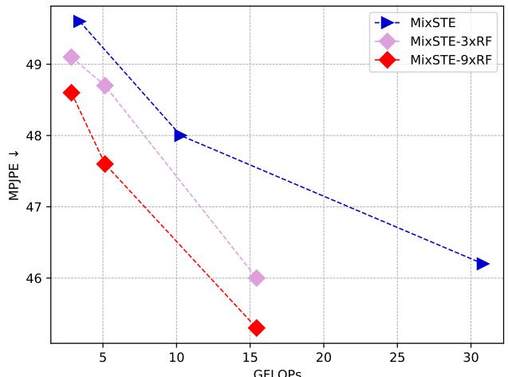  
Figure 8. 在 Human3.6M [13] 上 MixSTE [44] 与其采用序列频域表示的改进版本的比较。RF：感受野（Receptive Field），k×RF 表示通过使用完整序列的少量低频 DCT 系数将 MixSTE 的 RF 扩大了 k 倍。所提出的方法帮助 MixSTE 获得了更好的速度-精度权衡。（彩色显示效果最佳）

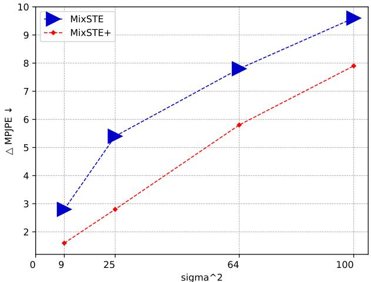  
Figure 9. 在 Human3.6M [13] 上 MixSTE [44] 与其使用序列低频 DCT 系数的改进版本在抗噪鲁棒性方面的比较。在真实 2D 检测（ground truth 2D detection）中加入标准差为 sigma 的零均值高斯噪声，我们展示了随着 sigma 增大它们的性能下降幅度（△MPJPE）。标记点的大小表示模型的计算开销。

MixSTE [44] 采用了与 PoseFormerV1 [46] 相同的时空架构。与 PoseFormerV1 的“先空间后时间”范式相比，MixSTE 交替使用空间和时间 Transformer 编码器。类似地，我们从较长的序列中中心采样少数几帧视频，作为 MixSTE 空间编码器的输入。对于时间编码器，我们将时域特征（空间编码器的输出）与完整输入序列的低频系数嵌入拼接在一起。MixSTE 及其改进版本的对比结果展示在 Fig. 8 和 9 中。原始 MixSTE 的计算开销非常大，而我们的方法同时提升了其效率和准确率，例如，MixSTE 达到了 46.2mm MPJPE 并消耗 30.8 GFLOPs，而其改进版本以 15.4 GFLOPs 实现了 45.3mm MPJPE（速度提升 2 倍且误差降低 1.9%↑，见 Fig. 8 中的亮红色曲线）。我们还表明，我们的方法提高了 MixSTE 对含噪 2D 关节点检测的鲁棒性（Fig. 9）。具体而言，我们在 Human3.6M [13] 上的 27 帧真实 2D 关节点序列中加入了零均值高斯噪声。改进后的 MixSTE（记为 MixSTE+）使用 3 个中心帧作为其空间编码器的输入，并使用前 3 个 DCT 系数作为完整序列更纯净的全局表示。MixSTE+ 的性能下降更小，同时效率提升了 6 倍（30.8 GFLOPs 对比 5.1 GFLOPs，由标记大小表示）。

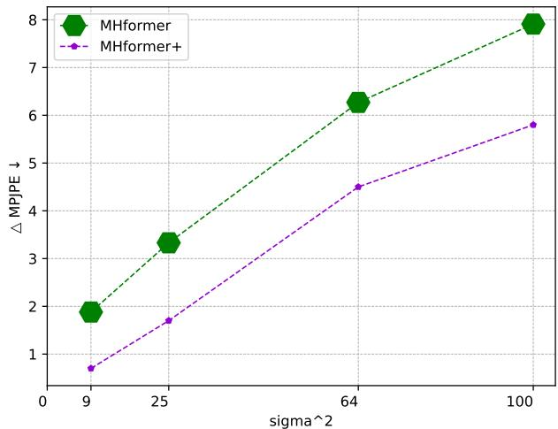  
Figure 10. MHFormer [16] 及其使用序列低频 DCT 系数的改进版本在 Human3.6M [13] 上的噪声鲁棒性对比。实验设置与 Fig. 9 相同。标记的大小表示模型的计算开销。

MHFormer [16] 在其架构中引入了多重假设，以对身体部位的深度多义性和关节点检测器的不确定性进行建模，因此具有相对较好的鲁棒性（实验结果见正文）。此外，MHFormer 还包含如 PoseFormerV1 [46] 中的时空 Transformer 模块。为了进一步验证我们方法的普适性，我们按照 MixSTE+ 的方式对 MHFormer 进行了类似的改进。实验证据表明，所提出的方法在降低 MHFormer 计算开销的同时提升了其鲁棒性（见 Fig. 10），尽管该模型本身已经具备了关于含噪关节点检测的先验知识。因此，这一结果表明，在提高模型鲁棒性方面，我们的方法与其他方法具有良好的兼容性。

到目前为止，我们已将该方法推广到其他两种基于 Transformer 的方法，即 MixSTE [44] 和 MH-Former [16]。未来，我们可以探索将所提出的方法推广到更广泛的模型架构中，例如 3D 人体姿态估计中基于 CNN 和基于 GNN 的方法。此外，我们相信该方法也可以应用于其他任务，特别是基于骨骼的任务，在这些任务中，长序列处理的计算开销和人体骨骼表征的质量可能会成为棘手的问题。

## G. 可视化与分析

在本节中，我们提供了一系列在具有挑战性的真实场景图像上的定性结果，以展示 PoseFormerV2 在实际场景中的鲁棒性。

图 11 展示了使用 HRNet [34] 进行 2D 关节点检测的若干代表性困难案例：(a) 关节点相互重叠的遮挡；(b)(c) 关节点缺失；(d) 关节点混淆错位。具体而言，(b) 中第 4 张图像中人物的右臂以及 (c) 中第 3 张图像中人物的左臂发生了缺失。此外，在 (d) 的第 2 张图像中，人物的两条腿发生了互换（用浅黄色圆圈高亮标出）。尽管 2D 关节点输入存在缺陷，Pose-FormerV2 仍然在 3D 空间中推断出了这些关节点的正确位置（用橙色圆圈标记）。

分析。PoseFormerV2 的鲁棒性归功于对输入关节点序列采用了恰当的表征——低频 DCT（离散余弦变换）系数，而不是采用可能带来额外计算开销的手工设计模块（例如 [16] 中的多假设生成模块）。低频 DCT 系数提供了输入序列的全局视角，因此单个视频帧中包含的噪声被淡化削弱。这种对 DCT 系数的利用还为 PoseFormerV2 带来了额外的优势，即相邻帧之间估计出的 3D 姿态的时间一致性。我们提供了一个视频演示，以说明所提出的方法在极端损坏的 2D 关节点检测下仍能保持出色的一致性（即时间稳定性）。

## H. 更广泛的影响与局限性

更广泛的影响。在本文中，我们试图调和 3D HPE 实际应用中的两个关键问题，即模型处理长序列以提高精度的效率，以及由于难以获取高质量关节点序列而应对带噪 2D 检测的鲁棒性。为了促进更多的现实应用，我们或许可以将研究重点从在严格控制的数据集上获得微小提升，转向克服现有方法在实际应用中的缺陷。我们期待能有更多的研究遵循这一技术路线。

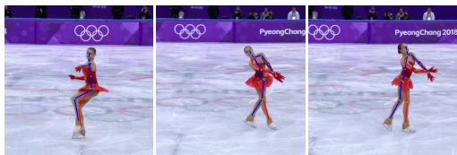

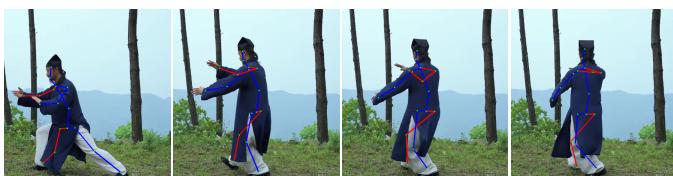

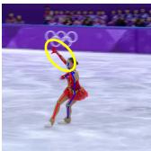

  
(a)

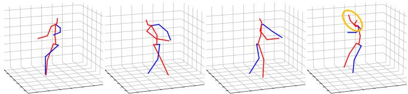  
(b)

  
(c)  
(d)  
Figure 11. PoseFormerV2 在具有挑战性的真实场景图像下的定性结果：(a) 遮挡；(b)(c) 漏检的 2D 关节点；(d) 错位的 2D 关节点。我们用浅黄色圆圈标出不可靠的 2D 检测结果，并用橙色圆圈标出对应的 3D 姿态估计结果。PoseFormerV2 对不完善的 2D 关节点检测展现出了极强的鲁棒性。

另一方面，本工作是基于一种鲜有研究的频域方法完成的，即离散余弦变换（Discrete Cosine Transform，DCT），它在传统的图像压缩算法中扮演着重要角色。我们希望本研究能启发更多工作重新审视传统信号处理技术，因为我们在深度学习时代所处理的各类数据本质上都是不同形式的信号。将这些经过精心设计的技术与最新发展的深度学习方法进行恰当结合，可能会带来意想不到的优势。

局限性。我们的方法包含两个重要的超参数——采样的中心帧数量以及完整输入序列中保留的 DCT 系数数量。目前，为了在速度和精度之间进行权衡，它们是基于实验结果或人工经验来选取的。未来，我们可能会将它们重构为可以从输入数据中自动学习的可学习参数，或者从理论上进一步推导它们的最优选取公式，从而免去参数搜索的需要。

## 参考文献

[1] Anurag Arnab, Mostafa Dehghani, Georg Heigold, Chen Sun, Mario Luciˇ c, and Cordelia Schmid. Vivit: A video vi-´ sion transformer. In Proceedings of the IEEE/CVF International Conference on Computer Vision (ICCV), pages 6836– 6846, October 2021. 1

[2] Gedas Bertasius, Heng Wang, and Lorenzo Torresani. Is space-time attention all you need for video understanding? In Proceedings of the International Conference on Machine Learning (ICML), July 2021. 1

[3] Tom Brown, Benjamin Mann, Nick Ryder, Melanie Subbiah, Jared D Kaplan, Prafulla Dhariwal, Arvind Neelakantan, Pranav Shyam, Girish Sastry, Amanda Askell, et al. Language models are few-shot learners. Advances in neural information processing systems, 33:1877–1901, 2020. 1

[4] Nicolas Carion, Francisco Massa, Gabriel Synnaeve, Nicolas Usunier, Alexander Kirillov, and Sergey Zagoruyko. End-toend object detection with transformers. In European conference on computer vision, pages 213–229. Springer, 2020. 1

[5] Tianlang Chen, Chen Fang, Xiaohui Shen, Yiheng Zhu, Zhili Chen, and Jiebo Luo. Anatomy-aware 3d human pose estimation with bone-based pose decomposition. IEEE Transactions on Circuits and Systemsfor Video Technology, 2021. 1, 7, 9

[6] Yilun Chen, Zhicheng Wang, Yuxiang Peng, Zhiqiang Zhang, Gang Yu, and Jian Sun. Cascaded pyramid network for multi-person pose estimation. In CVPR, 2018. 1, 2, 4

[7] Yilun Chen, Zhicheng Wang, Yuxiang Peng, Zhiqiang Zhang, Gang Yu, and Jian Sun. Cascaded pyramid network for multi-person pose estimation. In Proceedings of the IEEE conference on computer vision and pattern recognition, pages 7103–7112, 2018. 9

[8] Jacob Devlin, Ming-Wei Chang, Kenton Lee, and Kristina Toutanova. Bert: Pre-training of deep bidirectional transformers for language understanding. arXiv preprint arXiv:1810.04805, 2018. 1

[9] Alexey Dosovitskiy, Lucas Beyer, Alexander Kolesnikov, Dirk Weissenborn, Xiaohua Zhai, Thomas Unterthiner, Mostafa Dehghani, Matthias Minderer, Georg Heigold, Sylvain Gelly, Jakob Uszkoreit, and Neil Houlsby. An image is worth 16x16 words: Transformers for image recognition at scale. ICLR, 2021. 1, 4

[10] Moritz Einfalt, Katja Ludwig, and Rainer Lienhart. Uplift and upsample: Efficient 3d human pose estimation with uplifting transformers. In Proceedings of the IEEE/CVF Winter Conference on Applications of Computer Vision (WACV), January 2023. 2, 3, 6

[11] John Guibas, Morteza Mardani, Zongyi Li, Andrew Tao, Anima Anandkumar, and Bryan Catanzaro. Adaptive fourier neural operators: Efficient token mixers for transformers. arXiv preprint arXiv:2111.13587, 2021. 3

[12] Kaiming He, Xinlei Chen, Saining Xie, Yanghao Li, Piotr Dollar, and Ross Girshick. Masked autoencoders are scalable´ vision learners. In Proceedings of the IEEE/CVF Conference on Computer Vision and Pattern Recognition, pages 16000– 16009, 2022. 3

[13] C. Ionescu, D. Papava, V. Olaru, and C. Sminchisescu. Human3.6m: Large scale datasets and predictive methods for 3d human sensing in natural environments. IEEE TPAMI, 2014. 1, 2, 3, 4, 6, 7, 10, 11

[14] Shichao Li, Lei Ke, Kevin Pratama, Yu-Wing Tai, Chi-Keung Tang, and Kwang-Ting Cheng. Cascaded deep monocular 3d human pose estimation with evolutionary training data. In Proceedings of the IEEE/CVF Conference on Computer Vision and Pattern Recognition (CVPR), June 2020. 7

[15] Wenhao Li, Hong Liu, Runwei Ding, Mengyuan Liu, Pichao Wang, and Wenming Yang. Exploiting temporal contexts with strided transformer for 3d human pose estimation. IEEE Transactions on Multimedia, 2022. 2, 3, 6

[16] Wenhao Li, Hong Liu, Hao Tang, Pichao Wang, and Luc Van Gool. Mhformer: Multi-hypothesis transformer for 3d human pose estimation. In Proceedings of the IEEE/CVF Conference on Computer Vision and Pattern Recognition (CVPR), pages 13147–13156, June 2022. 2, 3, 6, 7, 8, 10, 11

[17] Jiahao Lin and Gim Hee Lee. Trajectory space factorization for deep video-based 3d human pose estimation. In BMVC, 2019. 7, 9

[18] Ruixu Liu, Ju Shen, He Wang, Chen Chen, Sen-ching Cheung, and Vijayan Asari. Attention mechanism exploits temporal contexts: Real-time 3d human pose reconstruction. In CVPR, 2020. 1, 9

[19] Ze Liu, Yutong Lin, Yue Cao, Han Hu, Yixuan Wei, Zheng Zhang, Stephen Lin, and Baining Guo. Swin transformer: Hierarchical vision transformer using shifted windows. In

Proceedings of the IEEE/CVF International Conference on Computer Vision, pages 10012–10022, 2021. 1

[20] Ilya Loshchilov and Frank Hutter. 解耦权重衰减正则化（Decoupled weight decay regularization）. arXiv preprint arXiv:1711.05101, 2017. 9

[21] Wei Mao, Miaomiao Liu, and Mathieu Salzmann. 历史重演：基于动作注意力的人体动作预测（History repeats itself: Human motion prediction via motion attention）. In European Conference on Computer Vision, pages 474–489. Springer, 2020. 2, 3

[22] Wei Mao, Miaomiao Liu, Mathieu Salzmann, and Hongdong Li. 学习人体动作预测的轨迹依赖性（Learning trajectory dependencies for human motion prediction）. In Proceedings of the IEEE/CVF International Conference on Computer Vision, pages 9489–9497, 2019. 2, 3

[23] Dushyant Mehta, Helge Rhodin, Dan Casas, Pascal Fua, Oleksandr Sotnychenko, Weipeng Xu, and Christian Theobalt. 利用改进的 CNN 监督进行自然环境下的单目 3D 人体姿态估计（Monocular 3d human pose estimation in the wild using improved cnn supervision）. In 2017 international conference on 3D vision (3DV), pages 506–516. IEEE, 2017. 3, 6, 7

[24] Dushyant Mehta, Srinath Sridhar, Oleksandr Sotnychenko, Helge Rhodin, Mohammad Shafiei, Hans-Peter Seidel, Weipeng Xu, Dan Casas, and Christian Theobalt. VNect：基于单张 RGB 相机的实时 3D 人体姿态估计（VNect: Real-time 3d human pose estimation with a single rgb camera）. ACM Transactions on Graphics (TOG), 36(4):1–14, 2017. 7, 9

[25] Gyeongsik Moon and Kyoung Mu Lee. I2L-MeshNet：用于从单张 RGB 图像进行精确 3D 人体姿态与网格估计的图像到像素预测网络（I2L-MeshNet: Image-to-lixel prediction network for accurate 3d human pose and mesh estimation from a single rgb image）. In ECCV, 2020. 1

[26] Alejandro Newell, Kaiyu Yang, and Jia Deng. 用于人体姿态估计的堆叠沙漏网络（Stacked hourglass networks for human pose estimation）. In European conference on computer vision, pages 483–499. Springer, 2016. 1

[27] Adam Paszke, Sam Gross, Soumith Chintala, Gregory Chanan, Edward Yang, Zachary DeVito, Zeming Lin, Alban Desmaison, Luca Antiga, and Adam Lerer. PyTorch 中的自动微分（Automatic differentiation in PyTorch）. 2017. 9

[28] Georgios Pavlakos, Xiaowei Zhou, and Kostas Daniilidis. 用于 3D 人体姿态估计的序数深度监督（Ordinal depth supervision for 3D human pose estimation）. In CVPR, 2018. 1

[29] Dario Pavllo, Christoph Feichtenhofer, David Grangier, and Michael Auli. 基于时序卷积和半监督训练的视频 3D 人体姿态估计（3d human pose estimation in video with temporal convolutions and semi-supervised training）. In CVPR, 2019. 7, 9

[30] William B Pennebaker and Joan L Mitchell. JPEG：静止图像数据压缩标准（JPEG: Still image data compression standard）. Springer Science & Business Media, 1992. 3

[31] Yongming Rao, Wenliang Zhao, Zheng Zhu, Jiwen Lu, and Jie Zhou. 用于图像分类的全局滤波网络（Global filter networks for image classification）. Advances in Neural Information Processing Systems, 34:980–993, 2021. 3

[32] Wenkang Shan, Zhenhua Liu, Xinfeng Zhang, Shanshe Wang, Siwei Ma, and Wen Gao. P-STMO：用于 3D 人体姿态估计的预训练时空多对一模型（P-STMO: Pre-trained spatial temporal many-to-one model for 3d human pose estimation）. arXiv preprint arXiv:2203.07628, 2022. 2, 3, 6, 7

[33] Athanassios Skodras, Charilaos Christopoulos, and Touradj Ebrahimi. JPEG 2000 静止图像压缩标准（The jpeg 2000 still image compression standard）. IEEE Signal processing magazine, 18(5):36–58, 2001. 3

[34] Ke Sun, Bin Xiao, Dong Liu, and Jingdong Wang. 用于人体姿态估计的深度高分辨率表征学习（Deep high-resolution representation learning for human pose estimation）. In CVPR, 2019. 11

[35] Hugo Touvron, Matthieu Cord, Matthijs Douze, Francisco Massa, Alexandre Sablayrolles, and Herve J ´ egou. Training´ data-efficient image transformers & distillation through attention. arXiv preprint arXiv:2012.12877, 2020. 1

[36] Ashish Vaswani, Noam Shazeer, Niki Parmar, Jakob Uszkoreit, Llion Jones, Aidan N. Gomez, Lukasz Kaiser, and Illia Polosukhin. Attention is all you need. 2017. 1

[37] Jingbo Wang, Sijie Yan, Yuanjun Xiong, and Dahua Lin. Motion guided 3d pose estimation from videos. In European Conference on Computer Vision, pages 764–780. Springer, 2020. 1, 9

[38] Zhenyu Wang, Hao Luo, Pichao WANG, Feng Ding, Fan Wang, and Hao Li. VTC-LFC: Vision transformer compression with low-frequency components. In Thirty-Sixth Conference on Neural Information Processing Systems, 2022. 2, 3

[39] Chen Wei, Haoqi Fan, Saining Xie, Chao-Yuan Wu, Alan Yuille, and Christoph Feichtenhofer. Masked feature prediction for self-supervised visual pre-training. In Proceedings of the IEEE/CVF Conference on Computer Vision and Pattern Recognition, pages 14668–14678, 2022. 3

[40] Zhenda Xie, Zheng Zhang, Yue Cao, Yutong Lin, Jianmin Bao, Zhuliang Yao, Qi Dai, and Han Hu. Simmim: A simple framework for masked image modeling. In Proceedings of the IEEE/CVF Conference on Computer Vision and Pattern Recognition, pages 9653–9663, 2022. 3

[41] Kai Xu, Minghai Qin, Fei Sun, Yuhao Wang, Yen-Kuang Chen, and Fengbo Ren. Learning in the frequency domain. In Proceedings of the IEEE/CVF Conference on Computer Vision and Pattern Recognition (CVPR), June 2020. 2, 3

[42] Shen Yan, Xuehan Xiong, Anurag Arnab, Zhichao Lu, Mi Zhang, Chen Sun, and Cordelia Schmid. Multiview transformers for video recognition. In Proceedings of the IEEE/CVF Conference on Computer Vision and Pattern Recognition, pages 3333–3343, 2022. 1

[43] Ailing Zeng, Xiao Sun, Fuyang Huang, Minhao Liu, Qiang Xu, and Stephen Lin. Srnet: Improving generalization in 3d human pose estimation with a split-and-recombine approach. In ECCV, 2020. 1

[44] Jinlu Zhang, Zhigang Tu, Jianyu Yang, Yujin Chen, and Junsong Yuan. Mixste: Seq2seq mixed spatio-temporal encoder for 3d human pose estimation in video. In Proceedings of the IEEE/CVF Conference on Computer Vision and Pattern Recognition, pages 13232–13242, 2022. 2, 3, 6, 7, 8, 10, 11

[45] Ce Zheng, Wenhan Wu, Taojiannan Yang, Sijie Zhu, Chen Chen, Ruixu Liu, Ju Shen, Nasser Kehtarnavaz, and Mubarak Shah. Deep learning-based human pose estimation: A survey, 2020. 9

[46] Ce Zheng, Sijie Zhu, Matias Mendieta, Taojiannan Yang, Chen Chen, and Zhengming Ding. 3d human pose estimation with spatial and temporal transformers. In Proceedings ofthe IEEE/CVF International Conference on Computer Vision (ICCV), pages 11656–11665, October 2021. 1, 2, 3, 4, 6, 7, 8, 9, 10, 11

[47] Xizhou Zhu, Weijie Su, Lewei Lu, Bin Li, Xiaogang Wang, and Jifeng Dai. Deformable detr: Deformable transformers for end-to-end object detection. arXiv preprint arXiv:2010.04159, 2020. 1