# SAM 2：图像与视频中的任意分割（Segment Anything in Images and Videos）

Nikhila Ravi∗,†, Valentin Gabeur∗, Yuan-Ting Hu∗, Ronghang Hu∗, Chaitanya Ryali∗, Tengyu Ma∗, Haitham Khedr∗, Roman Rädle∗, Chloe Rolland, Laura Gustafson, Eric Mintun, Junting Pan, Kalyan Vasudev Alwala, Nicolas Carion, Chao-Yuan Wu, Ross Girshick, Piotr Dollár†, Christoph Feichtenhofer∗,†

Meta FAIR

∗核心贡献者，†项目负责人

我们提出了 Segment Anything Model 2（SAM 2），这是一个旨在解决图像和视频中可提示视觉分割（promptable visual segmentation）的基础模型。我们构建了一个数据引擎，通过用户交互来改进模型和数据，从而收集了迄今为止最大的视频分割数据集。我们的模型采用了一种带有流式记忆（streaming memory）的简单 Transformer 架构，用于实时视频处理。在我们的数据上训练的 SAM 2 在广泛的任务中表现出强大的性能。在视频分割方面，与以往的方法相比，我们使用少 3 倍的交互即可获得更高的准确率。在图像分割方面，我们的模型比 Segment Anything Model（SAM）更准确，速度快 6 倍。我们相信，我们的数据、模型和见解将成为视频分割及相关感知任务的重要里程碑。我们开源了我们的主要模型、数据集，以及模型训练代码和演示 demo。

Demo: https://sam2.metademolab.com Code: https://github.com/facebookresearch/sam2 Website: https://ai.meta.com/sam2

0Meta

## 1 引言

Segment Anything（SA）引入了用于图像中可提示分割的基础模型（Kirillov et al., 2023）。然而，图像只是真实世界的静态快照，在真实世界中视觉分段可能会表现出复杂的运动，并且随着多媒体内容的快速增长，很大一部分内容现在都带有时间维度，特别是在视频数据中。AR/VR、机器人、自动驾驶汽车和视频编辑中的许多重要应用都需要超越图像级分割的时间定位能力。我们认为，一个通用的视觉分割系统应当同时适用于图像和视频。

视频分割旨在确定实体的时空范围，这带来了超越图像分割的独特挑战。由于运动、形变、遮挡、光照变化等因素，实体的外观可能会发生显著变化。由于相机运动、模糊和较低的分辨率，视频的质量通常低于图像。此外，高效处理大量帧是一个关键挑战。尽管 SA 成功解决了图像分割问题，但现有的视频分割模型和数据集仍无法提供相当的“在视频中分割一切”的能力。

我们推出了 Segment Anything Model 2（SAM 2），这是一个用于视频和图像分割的统一模型（我们将图像视为单帧视频）。我们的工作包括一个任务、一个模型和一个数据集（见 Fig. 1）。

我们专注于可提示视觉分割（Promptable Visual Segmentation，PVS）任务，该任务将图像分割推广到视频领域。该任务以视频任意帧上的点、框或掩码作为输入，以定义感兴趣的目标片段，并预测其时空掩码（即“masklet”）。一旦预测出 masklet，就可以通过在其他帧中提供提示来对其进行迭代细化。

我们的模型（§4）可以在单张图像和跨视频帧中生成感兴趣目标的分割掩码。SAM 2 配备了一个记忆机制（memory），用于存储关于目标和先前交互的信息，这使其能够在整个视频中生成 masklet 预测，并根据从先前观察到的帧中存储的目标记忆上下文有效地纠正这些预测。我们的流式架构是 SAM 在视频领域的自然泛化，它一次处理一帧视频，并配备了一个记忆注意力模块（memory attention module）以关注目标对象的先前记忆。当应用于图像时，记忆为空，模型的行为与 SAM 类似。

  
(a) 任务：可提示视觉分割 (b) 模型：Segment Anything Model 2 (c) 数据：数据引擎与数据集  
Figure 1 我们推出了 Segment Anything Model 2（SAM 2），旨在通过我们的基础模型 (b) 解决可提示视觉分割任务 (a)，该模型在通过我们的数据引擎 (c) 收集的大规模 SA-V 数据集上进行了训练。SAM 2 能够利用存储先前提示和预测的流式记忆，通过在一个或多个视频帧上的提示（点击、框或掩码）交互式地分割区域。

我们采用数据引擎（§5），通过将我们的模型与标注人员置于循环（in the loop）中交互式标注新的且具有挑战性的数据来生成训练数据。与大多数现有的视频分割数据集不同，我们的数据引擎不局限于特定类别的对象，而是旨在提供用于分割具有有效边界的任何对象（包括部件和子部件）的训练数据。与现有的模型辅助方法相比，SAM 2 参与循环的数据引擎在达到可比质量的同时速度快了 8.4 倍。我们最终的 Segment Anything Video (SA-V) 数据集（§5.2）包含分布在 50.9K 个视频中的 35.5M 个掩码，比任何现有视频分割数据集的掩码数量多 53 倍。SA-V 极具挑战性，包含在整个视频中被遮挡并重新出现的小物体和部件。我们的 SA-V 数据集具有地理多样性，对 SAM 2 的公平性评估表明，基于感知性别在视频分割中的性能差异极小，并且在我们评估的三个感知年龄组之间差异很小。

我们的实验（§6）表明，SAM 2 为视频分割体验带来了飞跃式的提升。与先前的方案相比，SAM 2 在交互次数减少 3 倍的情况下，仍能获得更优的分割精度。此外，SAM 2 在多种评估设置下的现有经典视频对象分割基准测试中均超越了以往的工作；在图像分割基准测试中，其性能优于 SAM，同时运行速度提升了 6 倍。通过包含 17 个视频分割基准和 37 个单图像分割基准在内的众多零样本（zero-shot）基准测试，证实了 SAM 2 在多种不同的视频和图像分布上均具备出色的有效性。

我们在宽松的开源许可证下发布我们的成果，包括 SA-V 数据集（CC by 4.0）、SAM 2 模型权重（checkpoint）1、训练代码（Apache 2.0）以及交互式在线演示（demo）代码（Apache 2.0）。

## 2 相关工作

图像分割。Segment Anything（Kirillov et al., 2023）引入了一项可提示的图像分割任务，其目标是在给定指代感兴趣对象的输入提示（如边界框或点）的情况下输出有效的分割掩码。在 SA-1B 数据集上训练的 SAM 支持零样本分割，这促成了其在广泛领域的应用落地。近期的工作对 SAM 进行了拓展，例如通过引入高质量（High-Quality）输出 token 在细粒度掩码上进行训练（Ke et al., 2024），或提升 SAM 的效率（Xiong et al., 2023; Zhang et al., 2023a; Zhao et al., 2023）。在更广泛的层面上，SAM 被应用于众多场景，包括医学成像（Ma et al., 2024; Deng et al., 2023; Mazurowski et al., 2023; Wu et al., 2023a）、遥感（Chen et al., 2024; Ren et al., 2024）、运动分割（Xie et al., 2024）以及伪装目标检测（Tang et al., 2023）。

交互式视频对象分割（Interactive Video Object Segmentation, iVOS）。交互式视频对象分割已成为在用户引导（通常表现为涂鸦、点击或边界框形式）下高效获取视频中目标分割序列（masklet）的关键任务。一些早期方法（Wang et al., 2005; Bai & Sapiro, 2007; Fan et al., 2015）利用基于图的优化来指导分割标注过程。较新的方法（Heo et al., 2020; Cheng et al., 2021b; Delatolas et al., 2024）通常采用模块化设计，先将用户输入转换为单帧上的掩码表示，随后再将其传播至其他帧。

基于点击的输入在交互式视频分割中更容易收集 (Homayounfar et al., 2021)。最近的研究将图像上的 SAM 与基于掩码 (Cheng et al., 2023b; Yang et al., 2023; Cheng et al., 2023c) 或基于点 (Rajič et al., 2023) 的视频跟踪器相结合。然而，这些方法存在局限性：跟踪器可能不适用于所有对象，SAM 在视频帧上的表现可能不够理想，并且除了在每一帧中使用 SAM 重新标注并从该处重新开始跟踪之外，没有其他机制可以交互式地修正模型的错误。

我们的工作与这些研究有着相似的目标，即在整个视频中交互式地分割对象，为了实现这一目标，我们构建了一个直接接收提示以进行交互式视频分割的强大统一模型，并建立了一个庞大且多样化的数据集。

视频对象分割（Video Object Segmentation，VOS）。VOS 任务以第一帧中的对象掩码作为输入，且必须在整个视频中对其进行精准跟踪 (Pont-Tuset et al., 2017)。该任务被称为“半监督 VOS”，因为输入掩码可以被视为仅在第一帧中可用的对象监督信号。由于在视频编辑或机器人等应用中的重要性，该任务引起了极大的关注。

早期基于深度学习的方法通常在视频第一帧 (Caelles et al., 2016; Perazzi et al., 2016; Yoon et al., 2017; Maninis et al., 2017; Hu et al., 2018a; Bhat et al., 2020; Robinson et al., 2020) 或所有帧 (Voigtlaender & Leibe, 2017) 上使用在线微调，以使模型适应目标对象。通过离线训练的模型实现了更快的推理，这些模型要么仅以第一帧为条件 (Hu et al., 2018b; Chen et al., 2018)，要么还整合了前一帧 (Oh et al., 2018; Yang et al., 2018, 2020)。这种多条件设定已通过 RNN (Xu et al., 2018a) 和 Transformer (Oh et al., 2019; Cheng et al., 2021a; Li et al., 2022a; Yang et al., 2021b, 2024; Cheng & Schwing, 2022; Yang & Yang, 2022; Wang et al., 2022; Cheng et al., 2023a; Goyal et al., 2023; Zhang et al., 2023b; Wu et al., 2023b) 扩展到所有帧。

半监督 VOS 可以被视为我们提出的可提示视觉分割（Promptable Visual Segmentation，PVS）任务的一个特例，即仅在视频第一帧提供掩码提示。值得注意的是，在实际应用中，为 VOS 在第一帧标注所需的高质量对象掩码具有很大难度，且在推理阶段非常耗时。

视频分割数据集。已有许多数据集被提出以支持 VOS（视频目标分割）任务。早期的 VOS 数据集（Prest et al., 2012; Li et al., 2013; Ochs et al., 2014; Fan et al., 2015），例如 DAVIS（Pont-Tuset et al., 2017; Caelles et al., 2019），包含高质量的标注，但其规模限制了基于深度学习的方法。YouTube-VOS（Xu et al., 2018b）是首个用于 VOS 的大规模数据集。随着算法不断改进以及基准性能趋于饱和，研究人员开始通过专门聚焦于遮挡（Qi et al., 2022; Ding et al., 2023）、长视频（Hong et al., 2023, 2024）、极端形变（Tokmakov et al., 2022）、目标多样性（Wang et al., 2021b, 2023）或场景多样性（Athar et al., 2022）来增加 VOS 任务的难度。

我们发现当前的视频分割数据集缺乏足够的覆盖范围，难以实现“在视频中分割一切”的能力。它们的标注通常覆盖完整物体（而非局部），且数据集往往围绕特定物体类别展开，如人、车辆和动物。与这些数据集相比，我们发布的 SA-V 数据集不仅关注完整物体，还广泛覆盖了物体局部，并且包含多出一个数量级以上的掩码。

## 3 任务：可提示视觉分割

我们的 PVS（可提示视觉分割，Promptable Visual Segmentation）任务允许在视频的任意帧上向模型提供提示。提示可以是正向/负向点击、边界框或掩码，既可用于定义待分割的目标，也可用于细化模型预测的目标。为了提供交互式体验，在特定帧上接收到提示后，模型应立即响应并给出该帧上目标的有效分割掩码。在接收到初始提示后（无论是在同一帧还是不同帧上），模型应传播这些提示以获取目标在整个视频中的掩码片段（masklet），从而在每个视频帧上定位目标的分割掩码。此外，还可以在任意帧上向模型提供追加提示，以细化整个视频中的分割结果（示例见 Fig. 2）。有关该任务的详细信息，请参阅 §B。

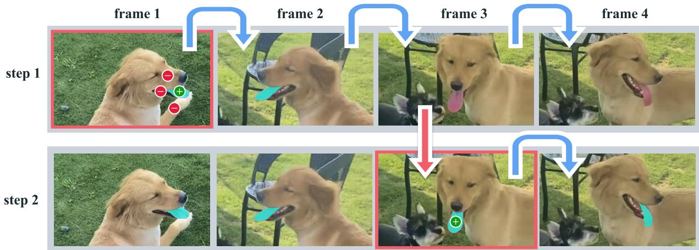  
Figure 2 使用 SAM 2 进行交互式分割。步骤 1（选择）：我们在第 1 帧中对 SAM 2 进行提示以获得目标对象（舌头）的分割。绿点/红点分别表示正向/负向提示。SAM 2 自动将该分割传播到后续帧（蓝色箭头）以形成掩码段（masklet）。如果 SAM 2 丢失了目标对象（在第 2 帧之后），我们可以通过在一个新帧中提供额外的提示（红色箭头）来修正掩码段。步骤 2（细化）：在第 3 帧中单次点击就足以恢复该对象并进行传播以获得正确的掩码段。解耦的 SAM + 视频跟踪器方法将需要在第 3 帧中进行多次点击（如在第 1 帧中一样）来正确地重新标注该对象，因为分割是从头重新开始的。借助 SAM 2 的记忆功能，单次点击即可恢复舌头。

SAM 2（§4）作为数据收集工具应用于 PVS 任务，以构建我们的 SA-V 数据集（§5）。我们通过模拟跨多帧的交互式视频分割场景、在标注仅限于第一帧的传统半监督 VOS 设置中、以及在 SA 基准上的图像分割中对该模型进行评估（§6）。

## 4 模型

SAM 2（图 3）可以看作是 SAM 在视频（和图像）领域的泛化，它在各个单帧上接收点、框和掩码提示，以定义要在时空上进行分割的对象空间范围。在空间维度上，该模型的行为与 SAM 类似。一个可提示且轻量级的掩码解码器接收图像嵌入和提示（如果有），并输出该帧的分割掩码。可以在单帧上迭代添加提示，以细化掩码。

SAM 2 解码器使用的帧嵌入并非直接来自图像编码器，而是以过去预测的记忆和被提示帧为条件。相对于当前帧，被提示帧也可能来自“未来”。帧的记忆由记忆编码器根据当前预测创建，并放置在记忆库中以供后续帧使用。记忆注意力操作获取来自图像编码器的逐帧嵌入，并在掩码解码器接收其以生成预测之前，将其以记忆库为条件进行处理。

我们在下文中描述各个组件和训练过程，并在附录 D 中提供更多细节。

图像编码器。为了实时处理任意长度的视频，我们采用流式方法，在视频帧可用时逐一输入处理。图像编码器在整个交互过程中仅运行一次，其作用是提供代表每一帧的无条件标记（token，即特征嵌入）。我们使用了一个经 MAE（He et al., 2022）预训练的 Hiera（Ryali et al., 2023; Bolya et al., 2023）图像编码器，该编码器是分层的，允许我们在解码过程中使用多尺度特征。

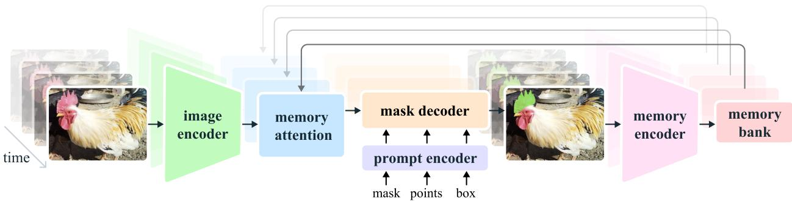

Figure 3 SAM 2 架构。对于给定的帧，分割预测以当前提示和/或先前观察到的记忆（memory）为条件。视频以流式方式进行处理，图像编码器一次处理一帧，并与来自先前帧的目标对象记忆进行交叉注意力计算。掩码解码器（同样可选地接收输入提示）预测该帧的分割掩码。最后，记忆编码器转换该预测和图像编码器嵌入（未在图中显示），以供未来帧使用。

记忆注意力（Memory attention）。记忆注意力的作用是以过去帧的特征和预测以及任何新提示为条件来调节当前帧的特征。我们堆叠了 $L$ 个 Transformer 块，其中第一个块以来自当前帧的图像编码作为输入。每个块执行自注意力，然后对存储在记忆库（见下文）中的（有提示/无提示）帧记忆和对象指针（见下文）执行交叉注意力，随后是一个 MLP。我们对自注意力和交叉注意力使用标准的注意力操作，这使我们能够受益于高效注意力核函数的最新进展（Dao, 2023）。

提示编码器与掩码解码器。我们的提示编码器与 SAM 的相同，可以通过点击（正向或负向）、边界框或掩码来进行提示，以定义给定帧中对象的范围。稀疏提示通过位置编码与每种提示类型的可学习嵌入相加来表示，而掩码则使用卷积进行嵌入并与帧嵌入相加。

我们的解码器设计很大程度上沿用了 SAM。我们堆叠了用于更新提示和帧嵌入的“双向”Transformer 块。与 SAM 中一样，对于可能存在多个兼容目标掩码的模棱两可的提示（即单次点击），我们会预测多个掩码。这种设计对于确保模型输出有效掩码非常重要。在视频中，这种歧义可能会延伸到多个视频帧，模型会在每一帧上预测多个掩码。如果没有后续提示来消除歧义，模型将仅传播当前帧中预测 IoU 最高的掩码。

在 SAM 中，只要给出正向提示，就总能分割出有效对象，但与 SAM 不同的是，在 PVS 任务中，某些帧上可能不存在有效对象（例如由于遮挡）。为了支持这种新的输出模式，我们添加了一个额外的预测头，用于预测感兴趣的对象是否存在于当前帧中。另一项创新是来自我们分层图像编码器的跳跃连接（绕过记忆注意力），以引入高分辨率嵌入用于掩码解码（见 §D）。

记忆编码器。记忆编码器通过使用卷积模块对输出掩码进行下采样，并将其与来自图像编码器的无条件帧嵌入（未在 Fig. 3 中显示）进行逐元素相加来生成记忆，随后通过轻量级卷积层来融合信息。

记忆库（Memory bank）。记忆库通过维护一个包含最多 $N$ 个最近帧记忆的先进先出（FIFO）队列来保留视频中目标过去预测的信息，并通过一个包含最多 $M$ 个带提示帧的 FIFO 队列来存储来自提示的信息。例如，在初始掩码作为唯一提示的 VOS 任务中，记忆库会持续保留第一帧的记忆以及最多 $N$ 个最近（无提示）帧的记忆。这两组记忆均以空间特征图的形式存储。

除了空间记忆之外，我们还基于每帧的掩码解码器输出词元（tokens），将目标指针（object pointers）列表存储为轻量级向量，以提供待分割目标的高级语义信息。我们的记忆注意力机制会同时对空间记忆特征和这些目标指针进行交叉注意力计算。

我们将时间位置信息嵌入到 $N$ 个最近帧的记忆中，使模型能够表征目标的短期运动，但未将其嵌入到带提示帧的记忆中，因为来自带提示帧的训练信号更稀疏，且更难泛化到推理设置——在推理设置中，带提示帧所在的时间范围可能与训练时所见的截然不同。

训练。该模型在图像和视频数据上进行联合训练。与以往的工作（Kirillov et al., 2023; Sofiiuk et al., 2022）类似，我们模拟了模型的交互式提示过程。我们采样 8 帧的序列，并随机选择最多 2 帧进行提示，以一定概率接收在训练期间使用真实掩码小序列（ground-truth masklet）和模型预测所采样的修正点击。训练任务是按时序（且“交互式地”）预测真实掩码小序列。给模型的初始提示可以是以 0.5 概率给出的真实掩码、以 0.25 概率从真实掩码中采样的正点击，或以 0.25 概率给出的边界框输入。更多细节见 §D。

## 5 数据

为了开发视频中“分割一切”的能力，我们构建了一个数据引擎来收集庞大且多样化的视频分割数据集。我们采用了人工标注员与模型在环（model in the loop）的交互式设置。与 Kirillov et al. (2023) 类似，我们不对标注的掩码小序列施加语义约束，既关注完整目标（例如一个人），也关注局部（例如一个人的帽子）。我们的数据引擎经历了三个阶段，各阶段根据向标注员提供的模型辅助水平进行划分。接下来，我们将介绍数据引擎的各个阶段以及我们的 SA-V 数据集。

## 5.1 数据引擎

阶段 1：逐帧 SAM。初始阶段使用基于图像的交互式 SAM (Kirillov et al., 2023) 来辅助人工标注。标注人员的任务是在视频中以每秒 6 帧（FPS）的速率，使用 SAM 以及像素级精度的手动编辑工具（如“画笔”和“橡皮擦”）对每一帧的目标对象掩码进行标注。该阶段没有跟踪模型参与来辅助掩码向其他帧的时间传播。由于这是一种逐帧方法，且所有帧都需要从零开始进行掩码标注，因此过程非常缓慢，在我们的实验中平均每帧标注时间为 37.8 秒。然而，这产生了高质量的单帧空间标注。在该阶段，我们从 1.4K 个视频中收集了 16K 个 masklet。我们进一步使用这种方法来标注 SA-V 验证集和测试集，以减轻评估过程中 SAM 2 可能产生的潜在偏差。

阶段 2：SAM + SAM 2 Mask。第二阶段将 SAM 2 引入闭环，此时 SAM 2 仅接受掩码作为提示（prompts）。我们将此版本称为 SAM 2 Mask。标注人员像阶段 1 一样使用 SAM 和其他工具在第一帧中生成空间掩码，然后使用 SAM 2 Mask 将标注好的掩码沿时间维度传播到其他帧，以获得完整的时空 masklet。在后续的任何视频帧中，标注人员可以通过使用 SAM、“画笔”和/或“橡皮擦”从零开始标注一个掩码，对 SAM 2 Mask 给出的预测进行空间上的修改，并使用 SAM 2 Mask 重新传播，重复此过程直至 masklet 正确为止。SAM 2 Mask 最初是在阶段 1 数据和公开数据集上训练的。在阶段 2 期间，我们利用收集到的数据对标注循环中的 SAM 2 Mask 进行了两次重新训练和更新。在阶段 2 中，我们收集了 63.5K 个 masklet。标注时间下降至 7.4 秒/帧，比阶段 1 提速约 5.1 倍。

尽管标注时间有所改善，但该方法仍需要从零开始标注中间帧的掩码，而无法利用先前的记忆。随后我们进一步开发了全功能的 SAM 2，能够在统一模型中同时实现交互式分割与掩码传播。

阶段 3：SAM 2。在最终阶段，我们利用了全功能的 SAM 2，它接受各种类型的提示，包括点和掩码。SAM 2 受益于跨时间维度的目标记忆来生成掩码预测。这意味着标注人员只需偶尔向 SAM 2 提供细化点击即可在中间帧中编辑预测的 masklet，而无需像使用缺乏这种记忆上下文的空间 SAM 那样从零开始标注。在阶段 3 期间，我们使用收集到的标注数据对 SAM 2 进行了五次重新训练和更新。将 SAM 2 引入闭环后，每帧标注时间降至 4.5 秒，比阶段 1 提速约 8.4 倍。在阶段 3 中，我们收集了 197.0K 个 masklet。

质量验证。为了保持高标准的标注质量，我们引入了验证环节。一组独立的标注员负责验证每个已标注 masklet 的质量，将其标记为“满意”（在所有帧中正确且一致地跟踪目标对象）或“不满意”（目标对象定义明确且边界清晰，但 masklet 不正确或不一致）。不满意的 masklet 会被送回标注流程进行修正。任何跟踪定义不明确对象的 masklet 都将被直接废弃。

<table><tr><td rowspan="2"></td><td rowspan="2">闭环模型 (Model in the Loop)</td><td rowspan="2">每帧耗时</td><td rowspan="2">编辑帧比例</td><td rowspan="2">被点击帧的点击次数</td><td colspan="4">阶段 1 掩码对齐得分 (IoU&gt;0.75)</td></tr><tr><td>全部</td><td>小型</td><td>中型</td><td>大型</td></tr><tr><td>阶段 1</td><td>SAM only</td><td>37.8 s</td><td>100.00 %</td><td>4.80</td><td>-</td><td>-</td><td>-</td><td>-</td></tr><tr><td>阶段 2</td><td>SAM + SAM 2 Mask</td><td>7.4 s</td><td>23.25 %</td><td>3.61</td><td>86.4 %</td><td>71.3 %</td><td>80.4 %</td><td>97.9 %</td></tr><tr><td>阶段 3</td><td>SAM 2</td><td>4.5 s</td><td>19.04 %</td><td>2.68</td><td>89.1 %</td><td>72.8 %</td><td>81.8 %</td><td>100.0 %</td></tr></table>

Table 1 数据引擎各阶段的演进，展示了每帧平均标注时间、每个 masklet 中被编辑帧的平均百分比、每个被点击帧的手动点击次数，以及按掩码尺寸划分的与阶段 1 的掩码对齐程度（Mask Alignment）。

自动 masklet 生成。确保标注的多样性对于实现我们模型的“分割一切”（anything）能力至关重要。由于人类标注员通常更倾向于关注显著对象，我们使用自动生成的 masklet（称为“Auto”）来扩充标注。这具有双重目的：既扩大了标注的覆盖范围，又有助于识别模型的失败案例。为了生成自动 masklet，我们在第一帧中使用规则点网格对 SAM 2 进行提示，并生成候选 masklet。随后，这些候选结果会被送往 masklet 验证环节进行过滤。被标记为“满意”的自动 masklet 会被添加到 SA-V 数据集中。被识别为“不满意”的 masklet（即模型失败案例）会被抽样并提供给标注员，在 SAM 2 闭环辅助下进行修正（数据引擎的阶段 3）。这些自动 masklet 不仅覆盖了中心位置的大型显著对象，还覆盖了背景中各种尺寸和位置的对象。

分析。表 1 通过对照实验（详见 §E.2.2）展示了各数据引擎阶段标注协议的对比。我们对比了每帧平均标注时间、每个 masklet 手动编辑帧的平均百分比，以及每个被点击帧的平均点击次数。为了评估质量，我们将阶段 1 掩码对齐得分（Phase 1 Mask Alignment Score）定义为与阶段 1 中对应掩码相比 IoU 超过 0.75 的掩码百分比。选择阶段 1 数据作为参考，是因为它具有逐帧高质量的手动标注。SAM 2 参与循环的阶段 3 带来了效率的提升和可媲美的质量：它比阶段 1 快 8.4 倍，编辑帧比例和每帧点击次数最低，并带来了更好的对齐效果。

在表 2 中，我们展示了在保持迭代次数固定的情况下，在每个阶段结束时的可用数据上训练的 SAM 2 的性能对比，从而纯粹衡量额外数据的影响。在第一帧使用 3 次点击进行提示时，我们在自己的 SA-V 验证集以及 9 个 zero-shot 基准（详见 §F.1）上使用标准 J&F 准确率指标（越高越好）进行评估。我们注意到，在迭代地纳入每个阶段的数据后，不仅在域内 SA-V 验证集上，而且在 9 个 zero-shot 基准上都获得了持续的提升。

<table><tr><td>训练数据</td><td>SA-V val</td><td>9 zero-shot</td></tr><tr><td>VOS + SA-1B</td><td>50.0</td><td>62.5</td></tr><tr><td>+ Phase 1</td><td>53.0</td><td>66.9</td></tr><tr><td>+ Phase 2</td><td>58.8</td><td>70.9</td></tr><tr><td>+ Phase 3</td><td>62.5</td><td>71.2</td></tr><tr><td>+ Auto</td><td>63.2</td><td>71.5</td></tr></table>

Table 2 添加来自各数据引擎阶段的数据所带来的分割准确率（J&F 指标）提升。“VOS”是指一组视频对象分割数据集。详情见 §F。

## 5.2 SA-V 数据集

使用我们的数据引擎收集的 SA-V 数据集包含 50.9K 个视频和 642.6K 个 masklet。在表 3 中，我们从视频数量、masklet 数量以及掩码数量方面将 SA-V 的构成与常见 VOS 数据集进行了对比。值得注意的是，已标注掩码的数量比任何现有的 VOS 数据集多 53 倍（不含自动标注则为 15 倍），为未来的工作提供了丰富的资源。我们正以宽松的许可证发布 SA-V。

视频。我们收集了一组由众包人员拍摄的包含 50.9K 个视频的新数据集。视频包含 54% 的室内场景和 46% 的室外场景，平均时长为 14 秒。视频以“真实自然环境”（in-the-wild）的多样化场景为特色，涵盖了各种日常场景。

Masklet。标注包括 190.9K 个手动 masklet 标注以及使用我们的数据引擎收集的 451.7K 个自动 masklet。覆盖有 masklet（手动和自动）的示例视频如图 4 所示。SA-V 的掩码数量比最大的 VOS 数据集多 53 倍（不含自动标注时为 15 倍）。SA-V Manual 中的消失率（Ding et al., 2023）（即在至少一帧中消失随后又重新出现的已标注 masklet 所占的百分比）为 42.5%，在现有数据集中极具竞争力。

  
Figure 4 来自 SA-V 数据集覆盖有 masklet（手动和自动）的示例视频。每个 masklet 具有唯一的颜色，每一行代表来自同一个视频的帧，帧之间间隔 1 秒。

<table><tr><td></td><td>视频数</td><td>时长</td><td>Masklet 数量</td><td>掩码数</td><td>帧数</td><td>消失率</td></tr><tr><td>DAVIS 2017 (Pont-Tuset et al., 2017)</td><td>0.2K</td><td>0.1 hr</td><td>0.4K</td><td>27.1K</td><td>10.7K</td><td>16.1 %</td></tr><tr><td>YouTube-VOS (Xu et al., 2018b)</td><td>4.5K</td><td>5.6 hr</td><td>8.6K</td><td>197.3K</td><td>123.3K</td><td>13.0 %</td></tr><tr><td>UVO-dense (Wang et al., 2021b)</td><td>1.0K</td><td>0.9 hr</td><td>10.2K</td><td>667.1K</td><td>68.3K</td><td>9.2 %</td></tr><tr><td>VOST (Tokmakov et al., 2022)</td><td>0.7K</td><td>4.2 hr</td><td>1.5K</td><td>175.0K</td><td>75.5K</td><td>41.7 %</td></tr><tr><td>BURST (Athar et al., 2022)</td><td>2.9K</td><td>28.9 hr</td><td>16.1K</td><td>600.2K</td><td>195.7K</td><td>37.7 %</td></tr><tr><td>MOSE (Ding et al., 2023)</td><td>2.1K</td><td>7.4 hr</td><td>5.2K</td><td>431.7K</td><td>638.8K</td><td>41.5 %</td></tr><tr><td>Internal</td><td>62.9K</td><td>281.8 hr</td><td>69.6K</td><td>5.4M</td><td>6.0M</td><td>36.4 %</td></tr><tr><td>SA-V Manual</td><td>50.9K</td><td>196.0 hr</td><td>190.9K</td><td>10.0M</td><td>4.2M</td><td>42.5 %</td></tr><tr><td>SA-V Manual+Auto</td><td>50.9K</td><td>196.0 hr</td><td>642.6K</td><td>35.5M</td><td>4.2M</td><td>27.7 %</td></tr></table>

Table 3 我们的数据集与开源 VOS 数据集在视频数量、时长、masklet 数量、掩码数、帧数和消失率方面的比较。SA-V Manual 仅包含手动标注的标签。SA-V Manual+Auto 将手动标注的标签与自动生成的 masklet 相结合。

SA-V 训练集、验证集和测试集划分。我们基于视频创作者（及其地理位置）划分 SA-V，以确保相似物体的重叠最小化。为了构建 SA-V val 和 SA-V test 集，我们在挑选视频时侧重于具有挑战性的场景，并要求标注人员识别具有快速移动、被其他物体复杂遮挡以及消失/重现模式的具有挑战性的目标。这些目标使用 §5.1 中的数据引擎阶段 1 设置以 6 FPS 进行标注。SA-V val 划分中包含 293 个 masklet 和 155 个视频，SA-V test 划分中包含 278 个 masklet 和 150 个视频。

内部数据集。我们还使用了内部可用的授权视频数据来进一步扩充我们的训练集。我们的内部数据集包含在阶段 2 和阶段 3（见 §5.1）中标注的 62.9K 个视频和 69.6K 个 masklets 用于训练，以及使用阶段 1 标注的 96 个视频和 189 个 masklets 用于测试（Internal-test）。

有关数据引擎和 SA-V 数据集的更多详细信息（包括公平性评估），请参见附录 E。

## 6 零样本实验

在此，我们将 SAM 2 与以往在零样本视频和图像任务上的工作进行对比。我们汇报视频任务的标准 $\mathcal { T } \& \mathcal { F }$ 指标（Pont-Tuset et al., 2017）以及图像任务的 mIoU 指标。除非另有说明，本节中的结果均遵循我们的默认设置，即使用分辨率为 1024 的 Hiera-B+ 图像编码器并在完整的数据集组合上进行训练，即表 6 中的 SAM 2 (Hiera-B+)（详见 §D.2）。

## 6.1 可提示视频分割

我们首先评估可提示视频分割（promptable video segmentation），这涉及模拟类似于用户体验的交互式环境。我们设置了两种评估方式：离线评估（ofline evaluation），即对视频进行多次遍历，并根据模型最大误差选择要交互的帧；以及在线评估（online evaluation），即在单次向前遍历视频的过程中对帧进行标注。这些评估是在 9 个密集标注的零样本视频数据集上进行的，每帧使用 $N _ { \mathrm { c l i c k } } = 3$ 次点击（详见 §F.1）。

我们基于视频对象分割的两种最先进模型 XMem++ (Bekuzarov et al., 2023) 和 Cutie (Cheng et al., 2023a) 构建了两个强基线：SAM+XMem++ 和 SAM+Cutie。

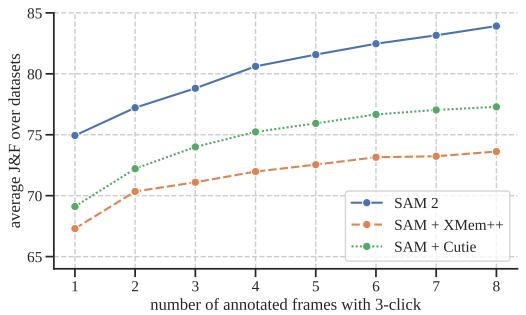  
(a) 跨数据集的离线平均 $\mathcal { I } \& \mathcal { F }$（3 次点击）

  
(b) 跨数据集的在线平均 $\mathcal { I } \& \mathcal { F }$（3 次点击）  
Figure 5 在交互式离线和在线评估设置下 9 个数据集上的零样本准确率。

我们使用 XMem++ 基于单帧或多帧上的掩码输入生成视频分割。SAM 用于提供初始掩码或优化输出（通过将当前分割作为掩码提示输入给 SAM）。对于 SAM+Cutie 基线，我们对 Cutie 进行了修改，使其能够接收多帧上的掩码输入。

在图 5 中，我们汇报了在 $N _ { \mathrm { f r a m e } } = 1 , \ldots , 8$ 个交互帧上的平均 $\mathcal { T } \& \mathcal { F }$ 准确率。在离线和在线评估设置下，SAM 2 的表现均优于 SAM+XMem++ 和 SAM+Cutie。在所有 9 个数据集上（各数据集的结果见 §F.1），SAM 2 全面超越了这两种方法，仅需数次点击即可生成高质量的视频分割，同时允许使用提示进行持续优化。总体而言，SAM 2 可以生成更高的分割准确率，且交互次数减少了 3 倍以上。

## 6.2 半监督视频目标分割

<table><tr><td>方法</td><td>1次点击</td><td>3次点击</td><td>5次点击</td><td>边界框</td><td>真实标注掩码‡</td></tr><tr><td>SAM+XMem++</td><td>56.9</td><td>68.4</td><td>70.6</td><td>67.6</td><td>72.7</td></tr><tr><td>SAM+Cutie</td><td>56.7</td><td>70.1</td><td>72.2</td><td>69.4</td><td>74.1</td></tr><tr><td>SAM 2</td><td>64.7</td><td>75.3</td><td>77.6</td><td>74.4</td><td>79.3</td></tr></table>

Table 4 在 17 个视频数据集上使用不同提示的零样本准确率。我们报告了在视频第一帧中使用各类提示（1 次、3 次或 5 次点击，边界框，或真实标注掩码）的平均准确率（‡：此情况直接将掩码作为 XMem++ 或 Cutie 的输入，未使用 SAM）。

我们在仅在视频第一帧提供点击、边界框或掩码提示的半监督视频目标分割（VOS）设定（Pont-Tuset et al., 2017）下进行了评估。当使用点击提示时，我们在视频第一帧中以交互方式采样 1 次、3 次或 5 次点击。

类似于 §6.1 中的交互式设定，我们将 SAM 2 与 XMem++ 和 Cutie 进行了对比，在点击和边界框提示下使用 SAM，而在掩码提示下使用它们的默认设定。我们报告了标准的 $\mathcal { I } \& \mathcal { F }$ 准确率（Pont-Tuset et al., 2017），除了在 VOST（Tokmakov et al., 2022）上遵循其评测协议报告 J 指标。结果见 Table 4。SAM 2 在这 17 个数据集上均优于这两种方法。这些结果表明，SAM 2 在以掩码作为输入的传统非交互式 VOS 任务上也表现出色，而其他这些工作正是专门为此任务设计的。详情见 §F.1.3。

## 6.3 图像分割

我们在 37 个零样本数据集上对 SAM 2 在 Segment Anything 任务上的表现进行了评估，其中包括 SAM 先前用于评估的 23 个数据集。Table 5 中报告了 1 次点击和 5 次点击的 mIoU，我们还展示了按数据集领域分类的平均 mIoU 以及在单张 A100 GPU 上的模型速度（以每秒帧数 FPS 计）。

第一列（SA-23 All）展示了在来自 SAM 的 23 个数据集上的准确率。SAM 2 在不使用任何额外数据且速度提升 6 倍的情况下，取得了比 SAM（1 次点击 58.1 mIoU）更高的准确率（1 次点击 58.9 mIoU）。这主要归功于 SAM 2 中更小但更高效的 Hiera 图像编码器。

最后一行展示了在我们的 SA-1B 与视频数据混合集上进行训练，如何将这 23 个数据集上的平均准确率进一步提升至 61.4%。我们还在来自 SA-23 的视频基准测试（视频数据集作为图像进行评估，与 Kirillov et al. (2023) 相同）以及我们新增的 14 个视频数据集上看到了显著的提升。包括按数据集细分的更详细结果见 §F.3。

## 7 与半监督 VOS 最先进方法的比较

我们的主要关注点是通用的交互式 PVS（可提示视频分割）任务，但我们也探讨了特定的半监督 VOS（视频目标分割）设定（其中提示为第一帧的真实掩码），因为这是一个历史上常见的评测协议。我们评估了具有不同图像编码器大小（Hiera-B+/-L）的两个版本 SAM 2，它们具有不同的速度与精度权衡。我们在单张 A100 GPU 上使用大小为 1 的批次（batch-size）测量每秒帧率（FPS）。基于 Hiera-B+ 和 Hiera-L 的 SAM 2 分别以 43.8 和 30.2 FPS 的实时速度运行。

我们在 Table 6 中展示了与现有最先进技术的对比，报告了使用标准协议评测的精度。SAM 2 相比于现有的最佳方法表现出显著的改进。我们观察到，使用更大的图像编码器可以在各方面带来显著的精度提升。

1 次（5 次）点击 mIoU

<table><tr><td>模型</td><td>数据</td><td>SA-23 全部</td><td>SA-23 图像</td><td>SA-23 视频</td><td>14 个新增视频</td><td>FPS</td></tr><tr><td>SAM</td><td>SA-1B</td><td>58.1 (81.3)</td><td>60.8 (82.1)</td><td>54.5 (80.3)</td><td>59.1 (83.4)</td><td>21.7</td></tr><tr><td>SAM 2</td><td>SA-1B</td><td>58.9 (81.7)</td><td>60.8 (82.1)</td><td>56.4 (81.2)</td><td>56.6 (83.7)</td><td>130.1</td></tr><tr><td>SAM 2</td><td>our mix</td><td>61.9 (83.5)</td><td>63.3 (83.8)</td><td>60.1 (83.2)</td><td>69.6 (85.8)</td><td>130.1</td></tr></table>

Table 5 跨 37 个数据集在 Segment Anything (SA) 任务上的零样本精度。该表展示了 SAM 2 与 SAM 按领域（图像/视频）划分的平均 1 次和 5 次点击 mIoU 对比。我们报告了 SAM 所使用的 23 个数据集（SA-23）上的平均指标，以及 14 个新增零样本视频数据集上的平均指标（详见 §F.3）。

<table><tr><td rowspan="2">方法</td><td colspan="5">J&amp;F</td><td>G</td></tr><tr><td>MOSE val</td><td>DAVIS 2017 val</td><td>LVOS val</td><td>SA-V val</td><td>SA-V test</td><td>YTVOS 2019 val</td></tr><tr><td>STCN (Cheng et al., 2021a)</td><td>52.5</td><td>85.4</td><td>-</td><td>61.0</td><td>62.5</td><td>82.7</td></tr><tr><td>SwinB-AOT (Yang et al., 2021b)</td><td>59.4</td><td>85.4</td><td>-</td><td>51.1</td><td>50.3</td><td>84.5</td></tr><tr><td>SwinB-DeAOT (Yang &amp; Yang, 2022)</td><td>59.9</td><td>86.2</td><td>-</td><td>61.4</td><td>61.8</td><td>86.1</td></tr><tr><td>RDE (Li et al., 2022a)</td><td>46.8</td><td>84.2</td><td>-</td><td>51.8</td><td>53.9</td><td>81.9</td></tr><tr><td>XMem (Cheng &amp; Schwing, 2022)</td><td>59.6</td><td>86.0</td><td>-</td><td>60.1</td><td>62.3</td><td>85.6</td></tr><tr><td>SimVOS-B (Wu et al., 2023b)</td><td>-</td><td>88.0</td><td>-</td><td>44.2</td><td>44.1</td><td>84.2</td></tr><tr><td>JointFormer (Zhang et al., 2023b)</td><td>-</td><td>90.1</td><td>-</td><td>-</td><td>-</td><td>87.4</td></tr><tr><td>ISVOS (Wang et al., 2022)</td><td>-</td><td>88.2</td><td>-</td><td>-</td><td>-</td><td>86.3</td></tr><tr><td>DEVA (Cheng et al., 2023b)</td><td>66.0</td><td>87.0</td><td>55.9</td><td>55.4</td><td>56.2</td><td>85.4</td></tr><tr><td>Cutie-base (Cheng et al., 2023a)</td><td>69.9</td><td>87.9</td><td>66.0</td><td>60.7</td><td>62.7</td><td>87.0</td></tr><tr><td>Cutie-base+ (Cheng et al., 2023a)</td><td>71.7</td><td>88.1</td><td>-</td><td>61.3</td><td>62.8</td><td>87.5</td></tr><tr><td>SAM 2 (Hiera-B+)</td><td>76.6</td><td>90.2</td><td>78.0</td><td>76.8</td><td>77.0</td><td>88.6</td></tr><tr><td>SAM 2 (Hiera-L)</td><td>77.9</td><td>90.7</td><td>78.0</td><td>77.9</td><td>78.4</td><td>89.3</td></tr></table>

Table 6 与先前工作的 VOS 对比。SAM 2 在基于首帧真值掩码提示（ground-truth mask prompts）的视频分割准确率（J&F, G）方面表现优异。SAM 2 在 SA-V 验证集/测试集上的性能显著更优。

我们还在 SA-V 验证集和测试集上评估了现有工作，这些测试集用于衡量针对“任意”物体类别的开放世界分割性能。在此基准上进行比较时，我们可以看到大多数先前方法的准确率都在大致相同的水平见顶。先前工作在 SA-V 验证集和 SA-V 测试集上的最佳表现明显更低，这表明其与“在视频中分割一切”（segment anything in videos）的能力之间存在差距。最后，正如在 LVOS 基准结果中所观察到的那样，SAM 2 在长程视频目标分割中也带来了显著的提升。有关数据和模型的消融实验，请参见 §A。

## 8 结论

我们展示了 Segment Anything 向视频领域的自然演化，这基于三个关键方面：(i) 将可提示分割任务拓展到视频，(ii) 为 SAM 架构配备记忆机制以应用于视频，以及 (iii) 用于视频分割训练和基准测试的多样化 SA-V 数据集。我们相信 SAM 2 标志着视觉感知领域的一项重大进展，我们的贡献将成为推动进一步研究和应用的里程碑。

致谢。我们感谢 Alexander Kirillov 和 Jitendra Malik 在项目方向上的讨论。感谢 Andrew Huang、Sahir Gomez、Miguel Martin、Devansh Kukreja 和 Somya Jain 在演示系统（demo）方面的工作，以及 Aohan Lin 和 Meng Wang 创建数据集可视化工具。我们感谢 Shoubhik Debnath 和 Sagar Vaze 在数据集准备方面的工作。还要感谢 William Ngan 和 Sasha Mitts 提供的设计专业支持，以及 Grant Gardner 和 George Orlin 领导产品管理。我们衷心感谢 Joelle Pineau、Daniel Bolya、Kate Saenko、Pengchuan Zhang 和 Christopher Chedeau 进行的有价值的讨论。感谢 Rene Martinez Doehner 和 Baishan Guo 的数据支持，以及我们的标注工程和管理合作伙伴：Robert Kuo、Rishi Godugu、Bob Kamma、Ida Cheng、Claudette Ward、Kai Brown、Jake Kinney、Jenny Truong 和 Karen Bergan。感谢 Vispi Cassod、Parth Malani、Shiva Koduvayur、Alexander Miller 和 Caleb Ho 在计算和基础设施方面的支持。最后，我们感谢 Azita Shokrpour、Mallika Malhotra、Rodrick Shepard、Jonathan Torres、Luc Dahlin、David Soofian、Alex Bosenberg 和 Amanda Kallet 提供的项目级支持。

## 附录

## 目录：

• §A: 数据与模型消融实验

• §B: 任务细节

• §C: 局限性

• §D: 模型细节

• §E: 数据集细节

• §E.2.1: 标注指南

• §F: 零样本实验细节

• §H: 数据集、标注与模型卡片

## A 数据与模型消融实验

本节展示了为 SAM 2 的设计决策提供依据的消融实验。我们在 SA-V val、Internal-test、我们的 MOSE 开发集（“MOSE dev”，包含从 MOSE 训练集中随机抽取的 200 个视频，且已从我们的训练数据中排除）以及 9 个零样本视频数据集的平均表现上进行评估。作为对比指标，我们报告了在首帧进行 3 次点击（3-click）输入下的 J&F，以此在 1 次点击（1-click）设定与 VOS 风格的掩码提示之间取得平衡。此外，我们还报告了 SAM 用于图像 SA 任务的 23 个数据集基准上的平均 1-click mIoU。除非另有说明，我们的消融实验均在 5122 空间分辨率下进行，并使用 SA-V manual 和 SA-1B 的 10% 子集进行训练。更多细节见 §D.2。

## A.1 数据消融实验

<table><tr><td rowspan="2"></td><td colspan="4">训练数据</td><td colspan="4"> $\mathcal{J}\&\mathcal{F}$ </td><td>mIoU</td></tr><tr><td>VOS</td><td>Internal</td><td>SA-V</td><td>SA-1B</td><td>SA-V val</td><td>Internal-test</td><td>MOSE dev</td><td>9 zero-shot</td><td>SA-23</td></tr><tr><td>1</td><td>√</td><td></td><td></td><td></td><td>48.1</td><td>60.2</td><td>76.9</td><td>59.7</td><td>45.4</td></tr><tr><td>2</td><td></td><td>√</td><td></td><td></td><td>57.0</td><td>72.2</td><td>70.6</td><td>70.0</td><td>54.4</td></tr><tr><td>3</td><td></td><td></td><td>√</td><td></td><td>63.0</td><td>72.6</td><td>72.8</td><td>69.7</td><td>53.0</td></tr><tr><td>4</td><td></td><td></td><td>√</td><td>√</td><td>62.9</td><td>73.2</td><td>73.6</td><td>69.7</td><td>58.6</td></tr><tr><td>5</td><td></td><td>√</td><td>√</td><td></td><td>63.0</td><td>73.2</td><td>73.3</td><td>70.9</td><td>55.8</td></tr><tr><td>6</td><td></td><td>√</td><td>√</td><td>√</td><td>63.6</td><td>75.0</td><td>74.4</td><td>71.6</td><td>58.6</td></tr><tr><td>7</td><td>√</td><td></td><td></td><td>√</td><td>50.0</td><td>63.2</td><td>77.6</td><td>62.5</td><td>54.8</td></tr><tr><td>8</td><td>√</td><td>√</td><td></td><td></td><td>54.9</td><td>71.5</td><td>77.9</td><td>70.6</td><td>55.1</td></tr><tr><td>9</td><td>√</td><td></td><td>√</td><td></td><td>61.6</td><td>72.8</td><td>78.3</td><td>69.9</td><td>51.0</td></tr><tr><td>10</td><td>√</td><td></td><td>√</td><td>√</td><td>62.2</td><td>74.1</td><td>78.5</td><td>70.3</td><td>57.3</td></tr><tr><td>11</td><td>√</td><td>√</td><td>√</td><td></td><td>61.8</td><td>74.4</td><td>78.5</td><td>71.8</td><td>55.7</td></tr><tr><td>12</td><td>√</td><td>√</td><td>√</td><td>√</td><td>63.1</td><td>73.7</td><td>79.0</td><td>71.6</td><td>58.9</td></tr></table>

Table 7 我们在不同的数据混合上训练我们的模型，包括 VOS（DAVIS、MOSE、YouTubeVOS）以及 Internal-train、SA-V 和 SA-1B 的子集。我们报告了在 SA-V val、Internal-test、MOSE 和 9 个 zero-shot 数据集上首帧使用 3 次点击提示时的 J&F 准确率，以及在 SA-23 数据集上的平均 1 次点击 mIoU。

数据混合消融实验。在 Table 7 中，我们比较了 SAM 2 在不同数据混合上训练时的准确率。我们在 SA-1B 上进行预训练，然后为每种设置训练一个单独的模型。我们固定迭代次数（200k）和批次大小（128），实验之间仅改变训练数据。我们报告了在 SA-V val 和 Internal 集、MOSE、9 个 zero-shot 视频基准以及 SA-23 任务（§6.3）上的准确率。

第 1 行显示，仅在现有 VOS 数据集（DAVIS、MOSE、YouTubeVOS）上训练的模型在域内 MOSE dev 上表现良好，但在所有其他数据集上表现较差，包括 9 个零样本（zero-shot）VOS 数据集 $\left( 5 9 . 7 ~ \mathcal { I } \& \mathcal { F } \right)$。我们观察到将我们的数据引擎数据加入训练组合中带来了巨大的收益，包括在 9 个零样本数据集上平均性能提升了 +12.1%（第 11 行对比第 1 行）。这可以归因于 VOS 数据集有限的覆盖范围和规模。添加 SA-1B 图像提升了在图像分割任务上的性能（第 3 行对比第 4 行，第 5 行对比第 6 行，第 9 行对比第 10 行，第 11 行对比第 12 行），同时没有降低 VOS 能力。仅在 SA-V 和 SA-1B 上进行训练（第 4 行）就足以在除 MOSE（特定对象类别）之外的所有基准上获得强劲的性能。总体而言，当混合所有数据集（VOS、SA-1B 以及我们的数据引擎数据）时，我们获得了最佳结果（第 12 行）。

数据量消融实验。接下来，我们研究扩展训练数据规模的效果。SAM 2 在不同规模的 SA-V 上训练之前先在 SA-1B 上进行预训练。我们报告了在 3 个基准（SA-V val、zero-shot 和 MOSE dev）上的平均 $\mathcal { T } \& \mathcal { F }$ 分数（在第一帧中用 3 次点击进行提示）。图 6 显示，在所有基准上，训练数据量与视频分割准确率之间均存在一致的幂律关系。

  
Figure 6 作为 SA-V 数据量函数的 SAM 2 准确率。我们报告了在第一帧中使用 3 次点击提示时，SA-V val（左）、9 个零样本数据集（中）和 MOSE dev（右）上的 J&F 准确率。

数据质量消融实验。在表 8 中，我们尝试了针对质量的过滤策略。我们从 SA-V 中子采样 50k 个掩码片段（masklet），采样方式分为随机采样或选取标注员编辑次数最多的掩码片段。仅使用 25% 的数据，基于编辑帧数的过滤便能带来强大的性能，且优于随机采样，但劣于使用全部 190k 个 SA-V 掩码片段。

<table><tr><td rowspan="2">设置</td><td colspan="4">J&amp;F</td><td>mIoU</td></tr><tr><td>SA-V val</td><td>Internal-test</td><td>MOSE dev</td><td>9 zero-shot</td><td>SA-23</td></tr><tr><td>SA-1B + SA-V 50k 随机</td><td>63.7</td><td>70.3</td><td>72.3</td><td>68.7</td><td>59.1</td></tr><tr><td>SA-1B + SA-V 50k 编辑最多</td><td>66.2</td><td>73.0</td><td>72.5</td><td>69.2</td><td>58.6</td></tr><tr><td>SA-1B + SA-V</td><td>69.9</td><td>73.8</td><td>73.9</td><td>70.8</td><td>59.8</td></tr></table>

Table 8 我们在 SA-V Manual 数据的不同子集上训练模型：50k 个随机采样的掩码片段（masklet）、50k 个包含最多编辑帧的掩码片段，以及完整的 SA-V 数据集（190k 个掩码片段）。

## A.2 模型架构消融实验

在本节中，我们展示了指导设计决策的模型消融实验（model ablations），这些实验默认在 512 输入分辨率的较小模式设置下进行。对于每种消融设置，我们报告了视频 $( \mathcal { I } \& \mathcal { F } )$ 和图像（mIoU）任务的分割精度，以及其相对视频分割速度（相对于灰色显示的消融默认设置的最大推理吞吐量）。我们发现图像和视频组件的设计选择在很大程度上是解耦的——这可以归因于我们的模块化设计和训练策略。

## A.2.1 容量消融实验

输入尺寸。在训练期间，我们采样固定分辨率和固定长度（此处记为 # frames）的帧序列。我们在表 9a、9b 中消融了它们的影响。更高的分辨率在图像和视频任务上均带来了显著的改进，我们在最终模型中使用了 $1 0 2 4 ^ { 2 }$ 的空间输入分辨率。增加帧数在视频基准测试上带来了显著的收益，我们默认使用 8 帧以平衡速度和精度。

<table><tr><td rowspan="2">res.</td><td colspan="3">J&amp;F</td><td colspan="2">mIoU</td></tr><tr><td>MOSE dev</td><td>SA-V val</td><td>9 zero-shot</td><td>速度</td><td>SA-23</td></tr><tr><td>512</td><td>73.0</td><td>68.3</td><td>70.7</td><td>1.00×</td><td>59.7</td></tr><tr><td>768</td><td>76.1</td><td>71.1</td><td>72.5</td><td>0.43×</td><td>61.0</td></tr><tr><td>1024</td><td>77.0</td><td>70.1</td><td>72.3</td><td>0.22×</td><td>61.5</td></tr></table>

Table 9 我们沿输入尺寸（分辨率，#frames）、记忆大小（#memories，记忆通道维度）和模型大小（记忆注意力机制，图像编码器）对模型容量进行了消融实验。消融默认设置以灰色显示。

记忆大小。增加（最大）记忆数量 N 通常有助于提高性能，尽管可能会存在一些方差，如表 9c 所示。我们默认使用 6 帧过去帧，以在时间上下文长度和计算成本之间取得平衡。如表 9d 所示，对记忆使用更少的通道并不会导致太多的性能退化，同时使存储所需的内存减少了 4×。

模型大小。如表 9e、9f 所示，图像编码器或记忆注意力机制（#self-/#cross-attention blocks）中更大的容量通常会带来性能的提升。缩放图像编码器在图像和视频指标上均带来了收益，而缩放记忆注意力机制仅提升了视频指标。我们默认使用 B+ 图像编码器，这在速度和精度之间提供了合理的平衡。

## A.2.2 相对位置编码

<table><tr><td rowspan="2">RPB</td><td rowspan="2">2d-RoPE</td><td colspan="4"> $\mathcal{J}\&\mathcal{F}$ </td><td rowspan="2">速度</td><td>mIoU</td></tr><tr><td>MOSE dev</td><td>SA-V val</td><td>LVOSv2 val</td><td>9 zero-shot</td><td>SA-23</td></tr><tr><td></td><td>√</td><td>73.0</td><td>68.3</td><td>71.6</td><td>70.7</td><td>1.00×</td><td>59.7</td></tr><tr><td>√</td><td>√</td><td>73.6</td><td>67.9</td><td>71.0</td><td>71.5</td><td>0.93×</td><td>60.0</td></tr><tr><td></td><td></td><td>72.8</td><td>67.1</td><td>70.3</td><td>70.3</td><td>1.04×</td><td>59.9</td></tr></table>

Table 10 我们在记忆注意力中默认使用 2d-RoPE 位置编码，同时从图像编码器中移除了 RPB（灰色）。移除 RPB 还使我们能够启用 FlashAttention-2（Dao, 2023），这在 (10242) 分辨率下带来了显著的速度提升。在如此更高的分辨率下，2d-RoPE（第 1 行）与无 RoPE 基线（第 3 行）之间的速度差距变得很小（4%）。

默认情况下，我们在图像编码器和记忆注意力中始终使用绝对位置编码。在 Table 10 中，我们研究了相对位置编码的设计选择。在此，我们还在 LVOSv2（Hong et al., 2024）上进行评估（在第 1 帧上进行 3 次点击），作为长视频目标分割（long-term video object segmentation）的基准。

虽然 SAM（Kirillov et al., 2023）遵循 Li et al. (2022b) 的做法，向所有图像编码器层添加相对位置偏置（RPB），但 Bolya et al. (2023) 对此进行了改进，移除了除全局注意力层之外的所有 RPB，同时采用“absolute-win”位置编码，带来了大幅的速度提升。我们在此基础上进一步改进，从图像编码器中移除了所有 RPB，在 SA-23 上没有性能下降，在视频基准上的性能下降也极小（见 Table 10），同时在 1024 分辨率下提供了显著的速度提升。我们还发现在记忆注意力中使用 2d-RoPE（Su et al., 2021; Heo et al., 2024）是有益的。

## A.2.3 记忆架构消融实验

循环记忆（Recurrent memory）。我们研究了在将记忆特征添加到记忆库（memory bank）之前将其输入到 GRU 中的有效性。与 §A.2.2 类似，我们还在 LVOSv2 上进行了评估，作为长时目标分割的额外基准。虽然先前的研究通常采用 GRU（Cho et al., 2014）状态作为将记忆纳入跟踪过程的方法，但我们在 Table 11 中的发现表明这种方法并没有带来改进（除了在 LVOSv2 上有微弱提升）。相反，我们发现直接将记忆特征存储在记忆库中就足够了，这种方法既更简单又更高效。

目标指针（Object pointers）。我们消融了对来自其他帧中掩码解码器（mask decoder）输出的目标指针向量进行交叉注意力（cross-attending）的影响（参见 §4）。表 11 中呈现的结果表明，虽然对目标指针进行交叉注意力并没有提升 9 个 zero-shot 数据集的平均性能，但它显著提升了在 SA-V val 数据集以及极具挑战性的 LVOSv2 基准（验证集划分）上的表现。因此，我们默认在对来自记忆编码器（memory encoder）的记忆库嵌入进行交叉注意力的同时，也对目标指针进行交叉注意力。

<table><tr><td rowspan="2">目标指针</td><td rowspan="2">GRU</td><td colspan="4"> $\mathcal{J}\&\mathcal{F}$ </td><td rowspan="2">速度</td><td>mIoU</td></tr><tr><td>MOSE dev</td><td>SA-V val</td><td>LVOSv2 val</td><td>9 zero-shot</td><td>SA-23</td></tr><tr><td></td><td></td><td>73.1</td><td>64.5</td><td>67.0</td><td>70.9</td><td>1.00×</td><td>59.9</td></tr><tr><td></td><td>√</td><td>72.3</td><td>65.3</td><td>68.9</td><td>70.5</td><td>0.97×</td><td>60.0</td></tr><tr><td>√</td><td></td><td>73.0</td><td>68.3</td><td>71.6</td><td>70.7</td><td>1.00×</td><td>59.7</td></tr></table>

Table 11 记忆设计的消融实验。我们默认使用目标指针（灰色行），并同时研究了循环 GRU 记忆。

## B PVS 任务细节

可提示视觉分割（Promptable Visual Segmentation, PVS）任务可以看作是将 Segment Anything（SA）任务从静态图像扩展到视频。在 PVS 设定下，给定一个输入视频，模型可以在视频中的任意帧上通过不同类型的输入（包括点击、框或掩码）进行交互式提示，其目标是在整个视频中分割（并跟踪）一个有效目标。在与视频交互时，模型会在被提示的帧上提供即时响应（类似于 SAM 在图像上的交互体验），并以近实时的方式返回该目标在整个视频中的分割结果。与 SAM 类似，其重点是具有明确定义边界的有效目标，我们不考虑没有视觉边界的区域（例如 Bekuzarov et al. (2023)）。图 7 展示了该任务。

  
Figure 7 可提示视觉分割任务（PVS）示意图。先前研究的任务，如 Segment Anything（SA）和半监督视频目标分割（Video Object Segmentation, VOS），均可被视为 PVS 任务的特例。

PVS 与图像和视频领域的任务相关。对于图像，SA 任务可被视为 PVS 在视频退化为单帧时的子集。类似地，传统的半监督和交互式 VOS（Pont-Tuset et al., 2017）任务是 PVS 的特例，分别局限于仅在第一帧提供掩码提示，以及在多个帧上提供涂鸦以分割整个视频中的目标。在 PVS 中，提示可以是点击、掩码或边界框，其重点在于增强交互体验，从而能够以最少的交互精细化分割结果。

## C 局限性

SAM 2 在静态图像和视频领域均表现出强大的性能，但在某些场景下仍会遇到困难。该模型可能无法在镜头切换时分割目标，并且在拥挤场景、长时间遮挡后或在较长视频中可能会丢失目标轨迹或混淆目标。为了缓解这一问题，我们设计了在任意帧对 SAM 2 进行提示的能力：如果模型丢失了目标或出现错误，在额外帧上的精细化点击在大多数情况下可以快速恢复正确的预测。SAM 2 在精确跟踪具有极细或精细细节的目标时也存在困难，尤其是在它们快速移动时。另一个具有挑战性的场景是存在外观相似的临近目标时（例如，多个完全相同的杂耍球）。在 SAM 2 中引入更显式的运动建模可以减少此类情况下的错误。

尽管 SAM 2 可以同时跟踪视频中的多个目标，但 SAM 2 会分别处理每个目标，仅利用共享的逐帧嵌入而没有目标间的通信。虽然这种方法很简单，但结合共享的目标级上下文信息有助于提高效率。

我们的数据引擎依赖人工标注员来验证 masklet 质量并选择需要修正的帧。未来的发展可以包括将该过程自动化以提高效率。

## D SAM 2 细节

## D.1 架构

在此我们讨论进一步的架构细节，对 §4 中的模型描述进行扩展。

图像编码器（Image encoder）。我们使用特征金字塔网络（feature pyramid network，Lin et al., 2017）分别融合来自 Hiera 图像编码器第 3 阶段和第 4 阶段的步长为 16 和 32 的特征，以生成每一帧的图像嵌入。此外，第 1 阶段和第 2 阶段步长为 4 和 8 的特征未用于记忆注意力（memory attention），而是如图 Figure 8 所示添加到掩码解码器（mask decoder）的上采样层中，这有助于生成高分辨率的分割细节。我们遵循 Bolya et al. (2023) 的做法，在 Hiera 图像编码器中使用窗口化绝对位置嵌入。在 Bolya et al. (2023) 中，RPB 在图像编码器中提供了跨越窗口的位置信息，与之不同的是，我们采用了一种更简单的方法，即通过插值全局位置嵌入来跨越窗口。我们不使用任何相对位置编码。我们训练了不同图像编码器尺寸的模型——T、S、B+ 和 L。我们遵循 Li et al. (2022b) 的方法，仅在图像编码器层的一个子集中使用全局注意力（参见 Table 12）。

记忆注意力（Memory attention）。除了正弦绝对位置嵌入外，我们还在自注意力层和交叉注意力层中使用了 2D 空间旋转位置嵌入（Rotary Positional Embedding, RoPE）（Su et al., 2021; Heo et al., 2024）。目标指针标记（object pointer tokens）不包含在 RoPE 中，因为它们没有特定的空间对应关系。默认情况下，记忆注意力使用 $L = 4$ 层。

提示编码器与掩码解码器（Prompt encoder and mask decoder）。提示编码器的设计遵循 SAM，接下来我们将讨论掩码解码器设计变更的更多细节。我们将对应于输出掩码的掩码标记（mask token）用作该帧的目标指针标记，并将其放入记忆库（memory bank）中。正如 §4 中所讨论的，我们还引入了一个遮挡预测头（occlusion prediction head）。这是通过在掩码和 IoU 输出标记之外引入一个额外的标记来实现的。在该新标记上应用一个额外的 MLP 头，以生成一个表示感兴趣目标在当前帧中可见可能性的分数（如图 Figure 8 所示）。在记忆库中，我们还会向那些被遮挡预测头预测为被遮挡（不可见）的帧的记忆特征中添加一个可学习的遮挡嵌入。

SAM 引入了在面对图像中被分割目标的歧义时输出多个有效掩码（mask）的能力。例如，当有人点击自行车的轮胎时，模型可以将该点击理解为仅指代轮胎或指代整辆自行车，并输出多个预测。在视频中，这种歧义可能会跨越视频帧延伸。例如，如果某一帧中只有轮胎可见，那么在轮胎上的点击可能仅与轮胎相关；或者随着自行车在后续帧中更多部分变得可见，该点击可能原本意在指代整辆自行车。为了处理这种歧义，SAM 2 在视频的每一步都会预测多个掩码。如果进一步的提示未能消除歧义，模型会为当前帧选择具有最高预测 IoU 的掩码，以便在视频中进一步传播。

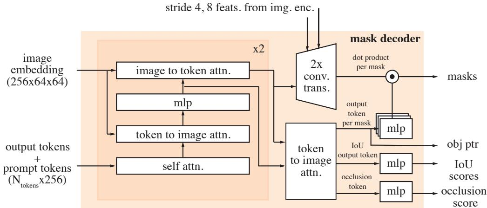  
Figure 8 掩码解码器架构。设计基本遵循 SAM，我们还在上采样过程中额外加入了来自图像编码器的步长为 4 和 8 的特征。我们还将对应于输出掩码的掩码 token 作为目标指针（object pointer），并生成一个遮挡分数，指示感兴趣目标在当前帧中是否可见。

记忆编码器与记忆库。我们的记忆编码器不使用额外的图像编码器，而是复用由 Hiera 编码器生成的图像嵌入（image embedding），并将其与预测的掩码信息融合以生成记忆特征（如第 4 节所述）。该设计使记忆特征能够受益于图像编码器生成的强大表征（尤其是当我们将图像编码器扩展到更大尺寸时）。此外，我们将记忆库中的记忆特征投影到 64 维，并将 256 维的目标指针拆分为 4 个 64 维的 token，以便对记忆库进行交叉注意力计算。

处理视频中的多个目标。当应用 SAM 2 分割同一视频中的多个目标时（例如半监督视频目标分割（VOS）评估中的多目标跟踪），我们对每个目标独立执行推理。更具体地说，我们在视频中的所有目标之间共享来自图像编码器的视觉特征，但对每个目标单独运行所有其他模型组件（例如记忆库和掩码解码器）。

## D.2 训练

## D.2.1 预训练

我们首先在 SA-1B 数据集的静态图像上对 SAM 2 进行预训练。表 12a 详细列出了在 SA-1B 上预训练期间使用的设置——此处未提及的其他设置均遵循 Kirillov 等人（2023）。图像编码器由 MAE 预训练的 Hiera（Ryali 等人，2023）初始化。与 SAM 类似，我们过滤掉了覆盖图像 90% 以上的掩码，并将训练限制为每张图像随机采样 64 个掩码。

与 SAM 不同，我们发现使用 $\ell _ { 1 }$ 损失来更积极地监督 IoU 预测，并对 IoU logits 应用 sigmoid 激活以将输出限制在 0 到 1 的范围内是有益的。对于多掩码预测（在第一次点击时），我们监督所有掩码的 IoU 预测，以促进更好地学习掩码何时可能较差，但仅监督具有最低分割损失（focal 损失和 dice 损失的线性组合）的掩码 logits。在 SAM 中，在点的迭代采样期间，插入了两个没有额外提示的迭代（仅送入先前的掩码 logits）——在我们的训练中没有添加此类迭代，并使用 $7$ 次校正点击（而不是 SAM 中的 8 次）。我们还在训练期间采用水平翻转增强，并将图像调整为 1024×1024 的正方形尺寸。

我们使用 AdamW (Loshchilov & Hutter, 2019)，并在图像编码器上应用层衰减（layer decay）(Clark et al., 2020)，并遵循反平方根调度（reciprocal square-root schedule）(Zhai et al., 2022)。预训练阶段的超参数参见 Table 12 (a)。

## D.2.2 全量训练

预训练后，我们在我们引入的数据集 SA-V + Internal（第 §5.2 节）、SA-1B 的 10% 子集，以及包括 DAVIS (Pont-Tuset et al., 2017; Caelles et al., 2019)、MOSE (Ding et al., 2023) 和 YouTubeVOS (Xu et al., 2018b) 在内的开源视频数据集的混合数据上训练 SAM 2。我们发布的模型是在 SA-V manual + Internal 和 SA-1B 上训练的。

SAM 2 专为两项任务设计：PVS 任务（针对视频）和 SA 任务（针对图像）。训练是在图像和视频数据上联合进行的。为了在训练期间优化我们的数据使用和计算资源，我们在视频数据（多帧）和静态图像（单帧）之间采用交替训练策略。具体来说，在每次训练迭代中，我们从图像或视频数据集中采样一个完整的批次，其采样概率与每个数据源的大小成正比。这种方法使得对两项任务的接触达到平衡，并为每个数据源使用不同的批次大小以最大化计算利用率。此处未明确提及的图像任务设置遵循预训练阶段的设置。全量训练阶段的超参数参见 Table 12 (b)。训练数据混合包含约 15.2% SA-1B、约 70% SA-V 和约 14.8% Internal。包含开源数据集时采用相同的设置，区别在于包含了额外的数据（约 1.3% DAVIS、约 9.4% MOSE、约 9.2% YouTubeVOS、约 15.5% SA-1B、约 49.5% SA-V、约 15.1% Internal）。在 SA-V 和其他视频数据集上训练时，我们仅使用那些人工标注的掩码序列（masklets）（不添加自动生成的），根据我们的分析，这足以取得强劲的性能。

我们对训练视频应用了一系列数据增强（详见 Table 12），包括随机水平翻转、随机仿射变换、随机颜色抖动和随机灰度变换，如 Table 12 所示。我们还采用了一种马赛克变换（mosaic transform）来模拟包含多个外观相似物体的挑战性场景——以 10% 的概率，我们将同一个训练视频平铺成 2×2 的网格，并从 4 个象限中选择一个 masklet 作为要分割的目标物体。在这种情况下，模型必须专注于运动或时间连续性等其他线索，以将目标物体与其他象限中外观相同的对应物体区分开来。此外，在经过这种马赛克变换后，每个象限中的视频和物体尺寸都变小了（仅为原始宽度和高度的一半），这也有利于学习分割小物体。

我们通过模拟交互式设置进行训练，采样 8 帧序列，并随机选择最多 2 帧（包括第一帧）用于纠错点击（corrective clicks）。在训练期间，我们使用真实 masklet 和模型预测来采样提示，初始提示为真实掩码（50% 概率）、来自真实掩码的正向点击（25%）或边界框输入（25%）。

我们将每个 8 帧序列的最大 masklet 数量限制为随机选择的 3 个。我们以 50% 的概率反转时间顺序，以帮助泛化到双向传播。在采样纠错点击时，我们以 10% 的小概率不论模型预测如何，直接从真实掩码中随机采样点击，以在掩码细化中提供额外的灵活性。

使用 16 帧序列进行微调。上述流程的一个潜在缺点是，模型在训练期间仅看到采样的 8 帧序列，与推理期间的完整视频长度相比相对较短。为了缓解这个问题并进一步提高长视频上的分割质量，我们引入了一个额外的微调阶段，在具有挑战性的视频（编辑帧数最多的视频，如 §E.2.1 中所述）上采样 16 帧序列。更具体地说，我们按编辑帧数对 masklet 进行排序，对于 SA-V 和 Internal 数据集，仅考虑编辑次数最多的前 50% 的 masklet 用于训练。我们仍在训练组合中保留 OSS 数据集（DAVIS、MOSE 和 YouTubeVOS）的完整版本。我们使用原始学习率的一半微调 50k 次迭代（原始计划的 1/3），并冻结图像编码器以将 16 帧序列容纳在 A100 GPU 的 80 GB 显存中。

损失函数与优化。我们使用针对掩码预测的 focal 损失和 dice 损失的线性组合、针对 IoU 预测的平均绝对误差（MAE）损失以及针对目标预测的交叉熵损失来监督模型的预测，其比例分别为 20:1:1:1。与预训练期间一样，对于多掩码预测，我们仅监督具有最低分割损失的掩码。如果真实标注（ground-truth）在某一帧中不包含掩码，我们不对任何掩码输出进行监督（但始终监督预测该帧中是否存在掩码的遮挡预测头）。

<table><tr><td>配置</td><td>数值</td></tr><tr><td>数据</td><td>SA-1B, Internal, SA-V</td></tr><tr><td>步数</td><td> $\sim 150k$ </td></tr><tr><td>分辨率</td><td>1024</td></tr><tr><td>精度</td><td>bfloat16</td></tr><tr><td>优化器</td><td>AdamW</td></tr><tr><td>优化器动量</td><td> $\beta_1, \beta_2=0.9, 0.999$ </td></tr><tr><td>梯度裁剪</td><td>类型:  $\ell_2$ , 最大值: 0.1</td></tr><tr><td>权重衰减</td><td>0.1</td></tr><tr><td>学习率 (lr)</td><td>图像编码器: 6e-5, 其他: 3.0e-4</td></tr><tr><td>学习率调度</td><td>余弦退火 (cosine)</td></tr><tr><td>预热</td><td>线性, 7.5k 次迭代</td></tr><tr><td>逐层衰减</td><td>0.8 (T, S), 0.9 (B+), 0.925 (L)</td></tr><tr><td>图像增强</td><td>水平翻转, 缩放至 1024 (正方形)</td></tr><tr><td>视频增强</td><td>水平翻转, 仿射变换 (deg: 25, shear: 20), 颜色抖动 (b: 0.1, c: 0.03, s: 0.03, h: null), 灰度化 (0.05), 逐帧颜色抖动 (b: 0.1, c: 0.05, s: 0.05, h: null), mosaic-2×2 (0.1)</td></tr><tr><td>批大小</td><td>256</td></tr><tr><td>drop path</td><td>0.1 (T, S), 0.2 (B+), 0.3 (L)</td></tr><tr><td>掩码损失 (权重)</td><td>focal (20), dice (1)</td></tr><tr><td>IoU 损失 (权重)</td><td> $\ell_1$  (1)</td></tr><tr><td>遮挡损失 (权重)</td><td>交叉熵 (1)</td></tr><tr><td>每帧最大掩码数</td><td>图像: 64, 视频: 3</td></tr><tr><td>修正点数量</td><td>7</td></tr><tr><td>全局注意力块</td><td>5-7-9 (T), 7-10-13 (S), 12-16-20 (B+), 23-33-43 (L)</td></tr></table>

(b) 完整训练

<table><tr><td>配置</td><td>数值</td></tr><tr><td>数据</td><td>SA-1B</td></tr><tr><td>步数</td><td> $\sim 90k$ </td></tr><tr><td>分辨率</td><td>1024</td></tr><tr><td>精度</td><td>bfloat16</td></tr><tr><td>优化器</td><td>AdamW</td></tr><tr><td>优化器动量</td><td> $\beta_1, \beta_2=0.9, 0.999$ </td></tr><tr><td>梯度裁剪</td><td>类型： $\ell_2$ ，最大值：0.1</td></tr><tr><td>权重衰减</td><td>0.1</td></tr><tr><td>学习率 (lr)</td><td>4e-4</td></tr><tr><td>学习率调度</td><td>倒数平方根，时间尺度=1000</td></tr><tr><td>预热</td><td>线性，1k 次迭代</td></tr><tr><td>冷却</td><td>线性，5k 次迭代</td></tr><tr><td>逐层衰减</td><td>0.8 (T, S), 0.9 (B+), 0.925 (L)</td></tr><tr><td>数据增强</td><td>水平翻转，调整为 1024（正方形）</td></tr><tr><td>批大小</td><td>256</td></tr><tr><td>随机深度 (drop path)</td><td>0.1 (T, S), 0.2 (B+), 0.3 (L)</td></tr><tr><td>掩码损失（权重）</td><td>focal (20), dice (1)</td></tr><tr><td>IoU 损失（权重）</td><td> $\ell_1$  (1)</td></tr><tr><td>每张图像最大掩码数</td><td>64</td></tr><tr><td>校正点数</td><td>7</td></tr><tr><td>全局注意力块</td><td>5-7-9 (T), 7-10-13 (S), 12-16-20 (B+), 23-33-43 (L)</td></tr></table>

(a) 预训练  
Table 12 SAM 2 预训练和完整训练的超参数及细节。请注意，部分设置随图像编码器大小（T, S, B+, L）而变化。

## D.3 速度基准测试

我们在单张 A100 GPU 上使用 PyTorch 2.3.1 和 CUDA 12.1，在采用 bfloat16 的自动混合精度下进行所有基准测试实验。我们对所有 SAM 2 模型的图像编码器使用 torch.compile 进行编译，并对 SAM 和 HQ-SAM 进行同样的操作，以便在 SA 任务上进行直接比较（表 5 和表 15）。SA 任务的 FPS 测量采用 10 张图像的批大小进行，该批大小在所有三种模型类型中均取得了最高的 FPS。对于视频任务，我们遵循视频分割中的通用协议，使用大小为 1 的批大小。

## E 数据细节

## E.1 SA-V 数据集细节

视频。分辨率从 240p 到 4K 不等，平均为 $1 , 4 0 1 \times 1 , 0 3 7$。时长从 4 秒到 2.3 分钟不等，平均为 13.8 秒，总计 420 万帧和 196 小时。

数据集多样性。如图 10 所示，SA-V 视频由多元化的参与者（图 10c 中的自述人口统计信息）在 47 个国家（图 10b）录制。图 10a 展示了与 DAVIS、MOSE 和 YouTubeVOS 相比的掩码大小分布（按视频分辨率归一化）。超过 88% 的 SA-V 掩码的归一化掩码面积小于 0.1。

  
(a) 仅人工标注  
(b) 包含自动标注  
Figure 9 叠加在第一帧上的标注：(a) 仅人工标注（ML），(b) 包含自动标注（Auto）。自动标注增加了多样性和覆盖范围。

自动 masklet。与 Kirillov et al. (2023) 描述的方法类似，自动 masklet 是通过使用规则网格提示模型来生成的。我们在第一帧上使用 $3 2 \times 3 2$ 的网格提示模型，此外，我们在第一帧的 4 个放大图像裁剪区域（源自 $\mathrm { ~ \ i ~ 2 ~ \times ~ 2 ~ }$ 重叠窗口）上使用 $1 6 \times 1 6$ 网格，并在第一帧的 16 个放大图像裁剪区域（源自 $4 \times 4$ 重叠窗口）上使用 $4 \times 4$ 网格。我们对所有帧应用了两个后处理步骤。首先，我们移除了面积小于 200 像素的微小不连通分支。其次，如果分割掩码中的孔洞面积小于 200 像素，我们将其填补。通过将这些自动生成的 masklet 与人工创建的 masklet 相结合，我们增强了 SA-V 数据集中标注的覆盖范围，如图 Fig. 9 所示。

## E.1.1 公平性评估

我们评估了 SAM 2 在不同人口统计学群体之间的公平性。我们收集了 Ego-Exo4D (Grauman et al., 2023) 数据集中人物（people）类别的标注，该数据集包含由视频主体自行报告的人口统计学信息。我们采用了与 SA-V 验证集和测试集相同的标注设置，并将其应用于来自第三人称（exo）视频的 20 秒片段中。我们在第一帧上使用 1 次点击、3 次点击以及真实标注（ground-truth）掩码在该数据上对 SAM 2 进行评估。

<table><tr><td></td><td>1-click</td><td>3-click</td><td>mask</td></tr><tr><td colspan="4">性别</td></tr><tr><td>男性</td><td>81.9</td><td>95.1</td><td>95.9</td></tr><tr><td>女性</td><td>75.1</td><td>94.1</td><td>95.2</td></tr><tr><td colspan="4">年龄</td></tr><tr><td>18-26</td><td>77.2</td><td>95.0</td><td>95.7</td></tr><tr><td>26-50</td><td>76.7</td><td>94.7</td><td>95.8</td></tr><tr><td>50+</td><td>81.4</td><td>95.1</td><td>96.2</td></tr></table>

Table 13 SAM 2 在受保护人口统计学群体上的公平性评估（基于 $\mathcal { I } \& \mathcal { F }$ 指标）。

Table 13 展示了 SAM 2 在跨性别和年龄段进行人体分割时的 $\mathcal { T } \& \mathcal { F }$ 准确率对比。在 3 次点击以及使用真实标注掩码提示时，差异极小。我们人工检查了 1 次点击的预测结果，发现模型经常预测出某个部位的掩码而非整个人体。当将对比限制在人体被正确分割的视频片段时，1 次点击的差距大幅缩小（$\mathcal { I } \& \mathcal { F }$ 男性 94.3，女性 92.7），这表明该差异在一定程度上可归因于提示的歧义性。

在附录 H 中，我们提供了 SA-V 的模型卡、数据卡和标注卡。

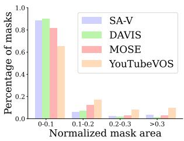  
(a) 尺寸

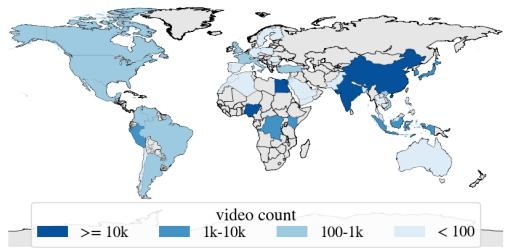  
(b) 地理分布

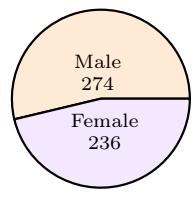  
(i) 性别

  
(ii) 年龄  
(c) 众包人员人口统计数据  
Figure 10 数据集分布：(a) masklets 尺寸分布（按视频分辨率归一化），(b) 视频的地理多样性，以及 (c) 录制视频的众包人员自述人口统计数据。

## E.2 数据引擎细节

## E.2.1 标注协议

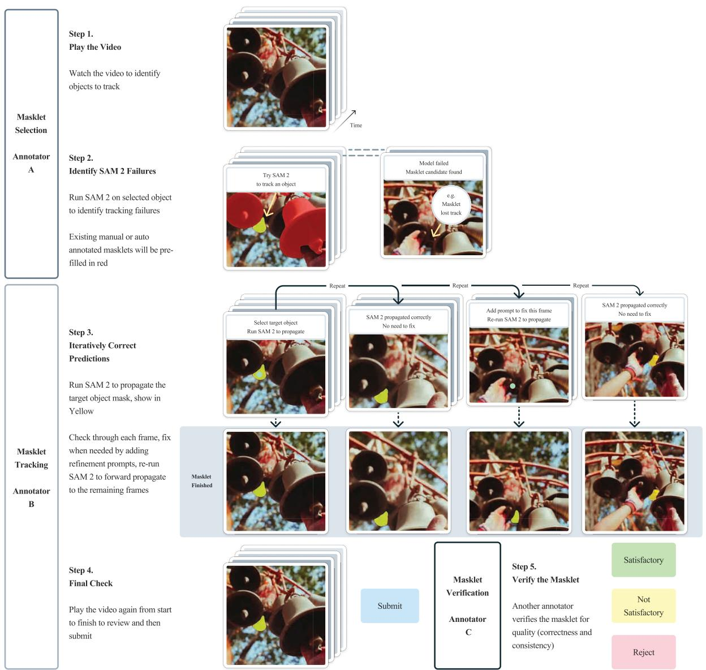  
Figure 11 标注指南概览。主要包含 3 个标注任务：masklet 选择、masklet 跟踪和 masklet 验证。每个任务由不同组的标注人员负责。

我们数据引擎中使用的标注协议流程图如图 Fig. 11 所示。标注任务被分解为若干步骤，每一步由不同的标注人员执行：步骤 1 和步骤 2 侧重于目标选择，步骤 3 和步骤 4 侧重于 masklet 跟踪，步骤 5 侧重于质量验证。SAM 2 作为 API 部署在 GPU 上，并内置到标注工具中以实现交互式使用。

与图像分割标注相比，大规模视频分割标注带来了独特的挑战，需要在标注任务设计和协议方面进行创新。为了提高我们模型“分割一切”（segment anything）的能力，重点标注 SAM 2 难以处理的具有挑战性的目标至关重要。我们利用在线模型在环（model-in-the-loop）设置来实现这一点，要求标注人员交互式地使用 SAM 2 来识别失败模式并进行纠正。

如 Table 8 所示，我们发现编辑帧的数量可以作为目标“挑战难度”的代理指标。因此，我们要求标注人员标注那些在 SAM 2 在环情况下需要至少编辑 2 帧的目标。为了将标注重点放在不太显眼且更具挑战性的情况上，系统会向标注人员呈现已预填充了经过验证且令人满意的自动 masklet 的视频，并要求他们寻找未标注的具有挑战性的目标。我们进一步将目标选择任务与标注任务解耦：在选择任务中，标注人员专注于在单帧中挑选出具有挑战性的目标；而在标注任务中，标注人员会面对一个具有挑战性的目标对象，并被要求在整个视频中一致地标注该 masklet。

## E.2.2 数据引擎阶段对比

Table 1 中展示的数据引擎各阶段对比是使用 169 个视频和 452 个 masklet 进行的对照实验。我们要求三组不同的标注人员使用对应阶段的标注协议标注相同的一组目标。我们根据第一帧中的掩码面积将 masklet 分为三档（小：1 至 322，中：$3 2 ^ { 2 } \ \mathrm { t o \ 9 6 ^ { 2 } }$，大：等于或大于 962）。由于使用 SAM 进行逐帧人工标注生成的掩码质量极高，阶段 1 的数据被用作质量参考基准。

## F 零样本迁移实验细节

在本节中，我们详细介绍了零样本（zero-shot）实验（§6）的更多细节。除非另有说明，本节报告的结果均采用我们的默认设置，即使用分辨率为 1024 的 Hiera-B+ 图像编码器，并在完整的数据集组合上进行训练，即 Table 6 中的 SAM 2 (Hiera-B+)。

## F.1 零样本视频任务

## F.1.1 视频数据集细节

我们在包含 17 个零样本数据集的多样化基准上对 SAM 2 进行了评估：EndoVis 2018 (Allan et al., 2020) 包含带有机器人手术器械的医疗手术视频。ESD (Huang et al., 2023) 包含来自机器人机械臂摄像头的视频，通常伴有运动模糊。LVOSv2 (Hong et al., 2024) 是长时视频目标分割（long-term video object segmentation）的基准。LV-VIS (Wang et al., 2023) 包含来自多样化开放词表目标类别的视频。UVO (Wang et al., 2021b) 包含用于开放世界目标分割的视频，而 VOST (Tokmakov et al., 2022) 包含经历剧烈形变（如鸡蛋破碎或纸张撕裂）物体的视频。PUMaVOS (Bekuzarov et al., 2023) 包含针对物体部件（如人的面颊）进行分割的视频。Virtual KITTI 2 (Cabon et al., 2020) 是包含驾驶场景的合成视频数据集。VIPSeg (Miao et al., 2022) 提供了全景视频中的目标分割。Wildfires (Toulouse et al., 2017) 包含来自 Corsican Fire Database 的不同环境下的野火视频。VISOR (Darkhalil et al., 2022) 包含厨房场景下的第一人称视角（egocentric）视频，带有手部和正在交互的物体的分割。FBMS (Brox et al., 2010) 提供了视频中运动物体的运动分割。Ego-Exo4D (Grauman et al., 2023) 是一个大型数据集，包含围绕各种人类活动的第一人称视角视频。Cityscapes (Cordts et al., 2016) 包含用于城市驾驶场景的视频。Lindenthal Camera (Haucke & Steinhage, 2021) 包含野生动物园中的视频，带有对观察到的动物（如鸟类和哺乳动物）的分割。HT1080WT Cells (Gómez-de Mariscal et al., 2021) 包含带有细胞分割的显微镜视频。Drosophila Heart (Fishman et al., 2023) 包含果蝇心脏的显微镜视频。

在上述 17 个零样本视频数据集中，有 9 个数据集（EndoVis、ESD、LVOSv2、LV-VIS、UVO、VOST、PUMaVOS、Virtual KITTI 2 和 VIPSeg）对每一帧视频都进行了密集的目标分割标注。在其余 8 个数据集（Wildfires、VISOR、FBMS、Ego-Exo4D、Cityscapes、Lindenthal Camera、HT1080WT Cells 和 Drosophila Heart）中，目标分割仅在视频帧的子集上进行了稀疏标注，我们在具有真实分割掩码（ground-truth segmentation masks）的帧上计算各项指标。在本文的大多数评估中，我们仅在 9 个密集标注的数据集上评估零样本性能，而在我们的半监督 VOS 评估（§6.2）中，我们对上面列出的所有 17 个数据集均进行了评估。

## F.1.2 交互式离线与在线评估细节

离线评估（Offline evaluation）涉及对整个视频进行多次遍历（passes）。我们首先在第一帧上使用点击提示（click prompts），分割整个视频中的目标对象；然后在下一轮中，选择相对于真实标注（ground-truth）分割 IoU 最低的一帧作为新的提示帧。接着，模型基于先前接收到的所有提示，再次对整个视频中的目标进行分割，直到达到最大 $N _ { \mathrm { f r a m e } }$ 轮（每轮增加一个新提示帧）。

在线评估（Online evaluation）仅对整个视频进行一次遍历。我们从第一帧上的点击提示开始，并在视频中传播这些提示；当遇到预测质量较低的帧（与真实标注的 $\mathrm { I o U < 0 . 7 5 }$）时暂停传播。然后，我们在暂停的帧上添加额外的点击提示以修正该帧上的分割，并继续向前恢复传播，直到遇到另一个 $\mathrm { I o U } < 0 . 7 5$ 的低质量帧。只要提示帧的数量小于最大值 $N _ { \mathrm { f r a m e } }$，该过程就会重复进行。与前面的离线评估不同，在此设定下，新的提示仅影响当前暂停帧之后的帧，而不影响其之前的帧。

在这两种设定中，我们均在 §F.1.1 中的 9 个密集标注数据集（EndoVis、ESD、LVOSv2、LV-VIS、UVO、VOST、PUMaVOS、Virtual KITTI 2 和 VIPSeg）上进行评估。如果视频的真实标注中包含多个需要分割的目标对象，我们对每个对象独立进行推理。我们通过每帧 $N _ { \mathrm { c l i c k } } = 3$ 次点击来模拟交互式视频分割，假设用户会通过视觉定位目标以对其进行标注（使用初始点击）或优化其当前的分割预测（使用修正点击）。具体而言，在开始第一轮时（此时尚无任何现有预测），我们在第一帧的目标真实掩码中心2放置一个初始点击，然后基于误差区域（真实掩码与第一帧上预测分割之间的区域）的中心交互式地再添加两次点击。随后在后续轮次中（此时已有预测分割），我们基于误差区域（真实掩码与当前提示帧上预测分割之间的区域）的中心交互式地添加三次点击。

我们报告了在 $N _ { \mathrm { f r a m e } } = 1 , \ldots , 8$ 个交互帧上的平均 $\mathcal { T } \& \mathcal { F }$ 指标，以及基于以下假设在视频不同标注时间下的 $\mathcal { T } \& \mathcal { F }$ 指标：

• 遵循 Delatolas et al. (2024)，在每一帧上，标注者通过视觉定位帧中目标需要耗时 $T _ { \mathrm { l o c } } = 1$ 秒，添加每次点击耗时 $T _ { \mathrm { c l i c k } } = 1 . 5$ 秒。

• 在离线模式下，对于一个 300 帧的视频，每轮检查整个视频的结果需要耗时 $T _ { \mathrm { e x a m } } = 3 0$ 秒，这包括寻找分割质量最差的帧以添加修正（对于更长或更短的视频，假设标注员能够以 10 FPS 的速度检查结果，则该时间与视频长度 L 成正比）。

• 在在线模式下，对于一个 300 帧的视频，全程跟踪整个视频的结果总共需要耗时 $T _ { \mathrm { e x a m } } = 3 0$ 秒，包括在质量较低的帧处暂停以进行进一步修正（与离线模式类似，该时间与视频长度 L 成正比）。

• 单个目标的标注时间在离线模式下为 $( T _ { \mathrm { e x a m } } \cdot ( L / 3 0 0 ) + T _ { \mathrm { l o c } } + T _ { \mathrm { c l i c k } } \cdot N _ { \mathrm { c l i c k } } ) \cdot N _ { \mathrm { f r a m e } }$，在在线模式下为 $T _ { \mathrm { e x a m } } \cdot ( L / 3 0 0 ) + ( T _ { \mathrm { l o c } } + T _ { \mathrm { c l i c k } } \cdot N _ { \mathrm { c l i c k } } ) \cdot N _ { \mathrm { f r a m e } }$，其中 L 为视频的总帧数，$N _ { \mathrm { f r a m e } } = 1 , \ldots , 8$ 为标注的帧数（即交互轮数），而 $N _ { \mathrm { c l i c k } } = 3$ 为每帧的点击次数。3

我们在 Fig. 12 和 Fig. 13 中展示了 SAM 2 与两个基线模型（SAM+XMem++ 和 SAM+Cutie，详见下文）在交互式离线和在线评估中按数据集划分的结果。SAM 2 在所有数据集和设置下均以显著优势超越了这两个基线模型。

## F.1.3 半监督 VOS 评估细节

在 §6.2 中，我们还在半监督 VOS（视频目标分割，Video Object Segmentation）设置（Pont-Tuset et al., 2017）下与先前的视频跟踪方法进行了比较，在该设置中，提示（可以是前景/背景点击、边界框或真值目标掩码）仅在视频的第一帧提供。当使用点击提示时，我们在视频第一帧交互式采样 1 次、3 次或 5 次点击，然后基于这些点击跟踪目标。遵循以往工作中基于点击的评估方法（Kirillov et al., 2023; Sofiiuk et al., 2022），初始点击放置在目标中心，随后的点击从误差区域的中心获取。

  
(a) 各数据集在不同交互帧数下的 J&F 性能（3 次点击）

<table><tr><td rowspan="2">方法</td><td colspan="7">EndoVis</td><td colspan="3">Virtual</td></tr><tr><td>2018</td><td>ESD</td><td>LVOSv2</td><td>LV-VIS</td><td>PUMaVOS</td><td>UVO</td><td>VIPSeg</td><td>KITTI 2</td><td>VOST</td><td>（平均）</td></tr><tr><td>SAM + XMem++</td><td>68.9</td><td>88.2</td><td>72.1</td><td>86.4</td><td>60.2</td><td>74.5</td><td>84.2</td><td>63.8</td><td>46.6</td><td>71.7</td></tr><tr><td>SAM + Cutie</td><td>71.8</td><td>87.6</td><td>82.1</td><td>87.1</td><td>59.4</td><td>75.2</td><td>84.4</td><td>70.3</td><td>54.3</td><td>74.7</td></tr><tr><td>SAM 2</td><td>77.0</td><td>90.2</td><td>87.9</td><td>90.3</td><td>68.5</td><td>79.2</td><td>88.3</td><td>74.1</td><td>67.5</td><td>80.3</td></tr></table>

(b) 在 8 个交互帧上每个数据集的平均 J &F（3次点击）  
Figure 12 在不同交互帧数下，SAM 2 与基线模型（SAM+XMem++ 和 SAM+Cutie）在交互式离线评估中的零样本性能对比（每个交互帧使用 3 次点击）。详情参见 §F.1.2。

与交互式设置类似，这里我们也使用 SAM+XMem++ 和 SAM+Cutie 作为两个基线模型。对于点击或边界框提示，首先使用 SAM 处理点击或边界框输入，然后将其输出掩码用作 XMem++ 或 Cutie 的输入。对于掩码提示，直接将第一帧上的真实目标掩码用作 XMem++ 和 Cutie 的输入——这是标准的半监督 VOS 设置，并且在不使用 SAM 的情况下评估 XMem++ 和 Cutie。

在此设置下，我们在 §F.1.1 中的所有 17 个零样本视频数据集上进行评估。如果某个数据集不遵循标准的 VOS 格式，我们会将其预处理为类似于 MOSE（Ding et al., 2023）的格式。在处理过程中，我们确保每个视频中的所有目标在第一帧上都有一个有效的非空分割掩码，以便与半监督 VOS 评估兼容。如果某个目标未出现在第一帧中，我们会从该目标首次出现的帧开始为其创建一个单独的视频。

我们报告了用于此评估的标准 J&F 指标（Pont-Tuset et al., 2017）。如果数据集提供了官方评估工具包，我们则使用它进行评估（在 VOST 数据集上，按照其官方协议（Tokmakov et al., 2022），我们报告 J 指标）。结果如 Table 4 所示，在不同类型的提示下，SAM 2 在 17 个数据集中的大多数数据集上均优于两个基线模型。

我们在 Fig. 14 中展示了 SAM 2 与两个基线模型（SAM+XMem++ 和 SAM+Cutie，详见下文）在半监督 VOS 评估中的各数据集结果。在不同类型的提示下，SAM 2 在这些数据集中的大多数数据集上均优于两个基线模型。

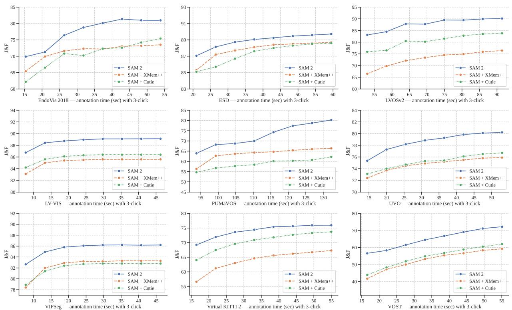  
(a) 不同交互帧数下各数据集上的 J &F 性能（3次点击）

<table><tr><td rowspan="2">方法</td><td colspan="7">EndoVis</td><td colspan="3">Virtual</td></tr><tr><td>2018</td><td>ESD</td><td>LVOSv2</td><td>LV-VIS</td><td>PUMaVOS</td><td>UVO</td><td>VIPSeg</td><td>KITTI 2</td><td>VOST</td><td>(平均)</td></tr><tr><td>SAM + XMem++</td><td>71.4</td><td>87.8</td><td>72.9</td><td>85.2</td><td>63.7</td><td>74.7</td><td>82.5</td><td>63.9</td><td>52.7</td><td>72.8</td></tr><tr><td>SAM + Cutie</td><td>70.5</td><td>87.3</td><td>80.6</td><td>86.0</td><td>58.9</td><td>75.2</td><td>82.1</td><td>70.4</td><td>54.6</td><td>74.0</td></tr><tr><td>SAM 2</td><td>77.5</td><td>88.9</td><td>87.8</td><td>88.7</td><td>72.7</td><td>78.6</td><td>85.5</td><td>74.0</td><td>65.0</td><td>79.8</td></tr></table>

(b) 在 8 个交互帧（3 次点击）上各数据集的平均 J&F  
Figure 13 在不同交互帧数下，使用每交互帧 3 次点击的交互式在线评估中，SAM 2 与基线模型（SAM+XMem++ 和 SAM+Cutie）的零样本（zero-shot）性能对比。详见 §F.1.2。

## F.1.4 SAM+XMem++ 和 SAM+Cutie 基准细节

我们将 SAM+XMem++ 和 SAM+Cutie 作为提示式视频分割的两个基准模型，其中点击（或框）提示首先由 SAM 处理以获得目标掩码，然后 XMem++ / Cutie 模型在整个视频中跟踪该 SAM 掩码以获得最终的掩码序列（masklet）。在这两个基准模型中，SAM 既可用于在第一帧上提供初始目标掩码，也可用于修正 XMem++ 或 Cutie 输出的已有目标掩码。这用于交互式离线和在线评估期间后续的交互帧，其中新的正向和负向点击作为对现有掩码的修正。

在给定帧中使用 SAM 对已有掩码预测进行修正时，我们遵循 EVA-VOS (Delatolas et al., 2024) 中的策略，在结合新的修正点击之前，首先使用 XMem++ 或 Cutie 的输出掩码对 SAM 进行初始化。具体而言，我们首先通过从 XMem++ 或 Cutie 输出掩码中采样点击并将其作为输入送入 SAM，以在 SAM 中重构该掩码，直到 SAM 中重构的掩码与 XMem++ 或 Cutie 输出掩码的 IoU > 0.8。然后，为了结合用于修正的新正向和负向点击，我们将这些额外的修正点击与掩码构建期间采样的初始点击拼接在一起，并将该联合拼接列表作为输入送入 SAM，以获得最终修正后的掩码。我们发现该策略优于其他几种备选方案（例如将 XMem++ 或 Cutie 输出掩码作为掩码提示与新的修正点击一同送入 SAM，或者在忽略 XMem++ 或 Cutie 输出掩码的同时仅将修正点击作为 SAM 的输入）。

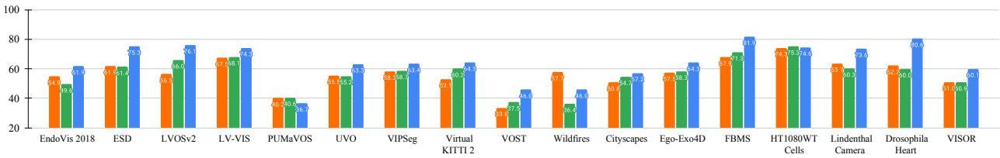

SAM + XMem++（第1帧3次点击） SAM + Cutie（第1帧3次点击） SAM 2（第1帧3次点击）  

SAM + XMem++（第1帧5次点击） SAM + Cutie（第1帧5次点击） SAM 2（第1帧5次点击）  

SAM + XMem++（第1帧边界框） SAM + Cutie（第1帧边界框） SAM 2（第1帧边界框）  
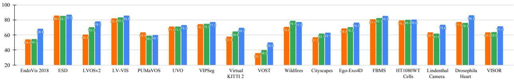

XMem++（第1帧真实掩码） Cutie（第1帧真实掩码） SAM 2（第1帧真实掩码）  
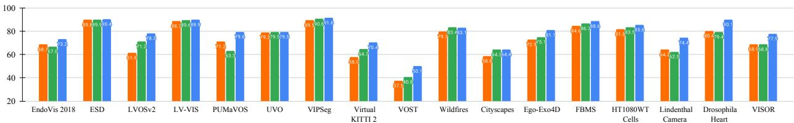

Figure 14 在17个视频数据集上，SAM 2 与两个基线模型（SAM+XMem++ 和 SAM+Cutie）在使用不同提示（视频第1帧上的1次、3次或5次点击、边界框或真实掩码）的半监督 VOS 评估下的零样本性能，每种提示类型在各数据集上的平均性能见正文中的 Table 4。详见 §F.1.3。

## F.2 DAVIS 交互式基准

我们还在 DAVIS 交互式基准（Caelles et al., 2018）上进行了评估，该基准类似于我们在 §6.1 中的交互式离线评估，在每轮交互中，评估服务器都会在分割性能最差的帧上提供新的标注。官方 DAVIS 评估工具包在交互期间提供涂鸦（scribble）提示，而诸如 CiVOS（Vujasinović et al., 2022）等其他工作也已将其扩展到涵盖点击提示。

在此我们遵循 CiVOS 的做法，使用正向和负向点击作为输入提示，并采用相同的点击采样策略。我们报告了该基准评估器提供的 J&F@60s 和 $_ \mathrm { A U C - } \mathcal { I } \& \mathcal { F }$ 指标，并与两个基线模型进行了比较：MiVOS（Cheng et al., 2021b），它通过涂鸦到掩码（scribble-to-mask）模块直接使用提供的涂鸦（并在 Vujasinović et al. (2022) 中也扩展到了点击提示）；以及 CiVOS，它从提供的涂鸦中采样点击。结果如 Table 14 所示，其中 SAM 2（基于点击输入）在点击输入下的表现优于两个基线模型。我们注意到，SAM 2 在第一次点击时往往倾向于分割物体局部（例如人的手臂），而 DAVIS 数据集主要包含完整物体（例如整个人），这可能会在该基准上影响 SAM 2 的 J&F 性能表现。

<table><tr><td>方法</td><td>输入类型</td><td>AUC- $\mathcal{J}\&\mathcal{F}$ </td><td> $\mathcal{J}\&\mathcal{F}@60s$ </td></tr><tr><td>MiVOS (Cheng et al., 2021b)</td><td>scribbles</td><td>0.87</td><td>0.88</td></tr><tr><td>MiVOS ( $Cheng et al., 2021b$ ) $^{\ddagger}$ </td><td>clicks</td><td>0.75</td><td>0.75</td></tr><tr><td>CiVOS (Vujasinović et al., 2022)</td><td>clicks</td><td>0.83</td><td>0.84</td></tr><tr><td>SAM 2</td><td>clicks</td><td>0.86</td><td>0.90</td></tr></table>

Table 14 SAM 2 和其他模型在 DAVIS 交互式基准上的性能。对于 SAM 2，我们遵循 CiVOS (Vujasinović et al., 2022) 的点击采样策略，使用点击作为输入。详见 §F.2（‡：Vujasinović et al. (2022) 中报告的性能）。

## F.3 零样本图像任务

## F.3.1 数据集细节

对于交互式分割任务，我们在由 37 个数据集组成的综合评测套件上评估了 SAM 2。该套件包含了此前 SAM 用于零样本评估的 23 个数据集。为保持完整性，我们列出这 23 个数据集：LVIS (Gupta et al., 2019)、ADE20K (Zhou et al., 2019)、Hypersim (Roberts et al., 2021)、Cityscapes (Cordts et al., 2016)、BBBC038v1 (Caicedo et al., 2019)、DOORS (Pugliatti & Topputo, 2022)、DRAM (Cohen et al., 2022)、EgoHOS (Zhang et al., 2022)、GTEA (Fathi et al., 2011; Li et al., 2015)、iShape (Yang et al., 2021a)、NDD20 (Trotter et al., 2020)、NDISPark (Ciampi et al., 2021, 2022)、OVIS (Qi et al., 2022)、PPDLS (Minervini et al., 2016)、Plittersdorf (Haucke et al., 2022)、STREETS (Snyder & Do, 2019)、TimberSeg (Fortin et al., 2022)、TrashCan (Hong et al., 2020)、VISOR (Darkhalil et al., 2022; Damen et al., 2022)、WoodScape (Yogamani et al., 2019)、PIDRay (Wang et al., 2021a)、ZeroWaste-f (Bashkirova et al., 2022) 以及 IBD (Chen et al., 2022)。有关这些数据集的更多详细信息，读者可参阅 Kirillov et al. (2023)。除这 23 个数据集外，我们还在从 14 个视频数据集中采样的帧上进行了评估，以评估 SAM 2 在视频领域图像上的性能。所使用的视频数据集列表如下：Lindenthal Camera Traps (LCT) (Haucke & Steinhage, 2021)、VOST (Tokmakov et al., 2022)、LV-VIS (Wang et al., 2023)、FBMS (Brox et al., 2010)、Virtual KITTI 2 (Cabon et al., 2020)、Corsican Fire Database (CFD) (Toulouse et al., 2017)、VIPSeg (Miao et al., 2022)、Drosophila Heart OCM (DH OCM) (Fishman et al., 2023)、EndoVis 2018 (Allan et al., 2020)、ESD (Huang et al., 2023)、UVO (Wang et al., 2021b)、Ego-Exo4d (Grauman et al., 2023)、LVOSv2 (Hong et al., 2024) 以及 HT1080WT (Gómez-de Mariscal et al., 2021)。Table 16 对这些数据集进行了更详细的描述。（其中部分数据集与 §F.1.1 中的零样本视频数据集取自相同的数据源。）

## F.3.2 详细的零样本实验

在本节中，我们提供了 §6.3 中实验的更详细版本。我们在 Table 15 中将 SAM 2 与不同模型大小的 SAM 和 HQ-SAM 进行了比较。我们用于评估的主要指标是 1 次和 5 次点击的 mIoU，并按数据集领域对结果进行了分类。

Table 15 首先展示了仅在图像上训练（用于 SA 任务）且具有不同图像编码器大小的模型在 SA-23 基准以及 14 个新引入的视频数据集上的比较。仅在 SA-1B 上训练的 SAM 2 (Hiera-B+) 在 1 次点击准确率上优于 SAM (ViT-H)，且在 5 次点击准确率上同时优于 SAM (ViT-H) 和 HQ-SAM (ViT-H)，同时速度快 6 倍。SAM 2 (Hiera-L) 进一步将 1 次点击准确率平均提高了 1 个点，但牺牲了速度。尽管比 Hiera-B+ 慢，它仍然比 SAM (ViT-H) 快 3.4 倍，比 SAM (ViT-B) 快 1.5 倍。

Table 15 的最后两行展示了使用我们的图像与视频混合数据进行训练的优势，使用 Hiera-B+ 图像编码器时，它将 23 个数据集上的平均准确率提升至 61.4%。此外，我们在 SA-23 的视频基准以及 14 个新引入的视频数据集上观察到了显著提升。我们注意到，我们并未扩展到超过 Hiera-L 的规模，但预计更大的模型会有更好的性能表现。

1 (5) 次点击 mIoU

<table><tr><td>模型</td><td>数据</td><td>SA-23 全部</td><td>SA-23 图像</td><td>SA-23 视频</td><td>14 个新视频</td><td>FPS</td></tr><tr><td>SAM (ViT-B)</td><td>SA-1B</td><td>55.9 (80.9)</td><td>57.4 (81.3)</td><td>54.0 (80.4)</td><td>54.5 (82.6)</td><td>76.7</td></tr><tr><td>SAM (ViT-H)</td><td>SA-1B</td><td>58.1 (81.3)</td><td>60.8 (82.1)</td><td>54.5 (80.3)</td><td>59.1 (83.4)</td><td>21.7</td></tr><tr><td>HQ-SAM (ViT-B)</td><td>HQSEG-44k</td><td>53.9 (72.1)</td><td>56.3 (73.9)</td><td>50.7 (69.9)</td><td>54.5 (75.0)</td><td>73.5</td></tr><tr><td>HQ-SAM (ViT-H)</td><td>HQSEG-44k</td><td>59.1 (79.8)</td><td>61.8 (80.5)</td><td>55.7 (78.9)</td><td>58.9 (81.6)</td><td>21.4</td></tr><tr><td>SAM 2 (Hiera-B+)</td><td>SA-1B</td><td>58.9 (81.7)</td><td>60.8 (82.1)</td><td>56.4 (81.2)</td><td>56.6 (83.7)</td><td>130.1</td></tr><tr><td>SAM 2 (Hiera-L)</td><td>SA-1B</td><td>60.0 (81.8)</td><td>62.0 (82.2)</td><td>57.4 (81.2)</td><td>58.5 (83.8)</td><td>61.4</td></tr><tr><td>SAM 2 (Hiera-B+)</td><td>我们的混合数据</td><td>61.9 (83.5)</td><td>63.3 (83.8)</td><td>60.1 (83.2)</td><td>69.6 (85.8)</td><td>130.1</td></tr><tr><td>SAM 2 (Hiera-L)</td><td>我们的混合数据</td><td>63.6 (83.5)</td><td>64.7 (83.7)</td><td>62.2 (83.2)</td><td>71.1 (85.7)</td><td>61.4</td></tr></table>

Table 15 在涵盖 37 个数据集的套件上针对 Segment Anything (SA) 任务的零样本（zero-shot）性能。该表展示了 SAM 2 与两个基线相比的平均 1 次和 5 次点击 mIoU，并按数据集领域进行了分类。我们报告了 SAM 用于零样本评估的 23 个数据集上的平均指标，以及 14 个新引入的零样本视频基准上的平均指标。

图 15 展示了各数据集上的精度细分情况，其中每个数据集相对于 SAM 的单次点击 mIoU 差值通过颜色编码以指示数据类型（图像或视频）。值得注意的是，尽管使用了较小的 Hiera-B+ 图像编码器，SAM 2 (Hiera-B+) 仍在 29 个数据集4上超越了 SAM，最多高出 53.9 mIoU。

## G 与半监督 VOS 领域最先进技术对比的详细信息

我们提供了与半监督 VOS 中先前的最先进技术（§7）对比的更多详细信息。我们包含了仅在 SA-1B、SA-V 和 Internal 数据上训练的不同编码器尺寸的 SAM 2 结果。

定性对比：在图 16 中，我们展示了在第一帧使用掩码（mask）提示时，基线模型（Cutie-base+，上行）与我们的模型（SAM 2，下行）之间的对比。尽管第一帧中的掩码提示仅覆盖了该人物的衬衫，但基线模型预测的掩码片段（masklet）错误地传播到了整个人物。然而，我们的模型能够将掩码片段限制在目标对象上。

定量对比：在表 17 中，我们在其他半监督 VOS 指标上将我们模型的性能与先前的方法进行了对比。SAM 2 在所有评估的基准测试和所有指标上均优于先前的工作。需要注意的是，与这些先前的方法不同，SAM 2 并非专门针对半监督 VOS 任务设计，而是具备更通用的可提示分割能力。SAM 2 也不受特定目标类别的限制。我们模型在 SA-V 基准测试（表 17a）上的表现证明了其在视频中分割一切（segment anything）的能力。

  
Figure 15 SAM 2 与 SAM 在包含 37 个数据集的套件上的零样本性能。该图展示了 SAM 2 与 SAM 之间中心单次点击 mIoU 1的差值。源自视频分布的数据集以红色高亮显示，而源自图像分布的数据集以蓝色高亮显示。

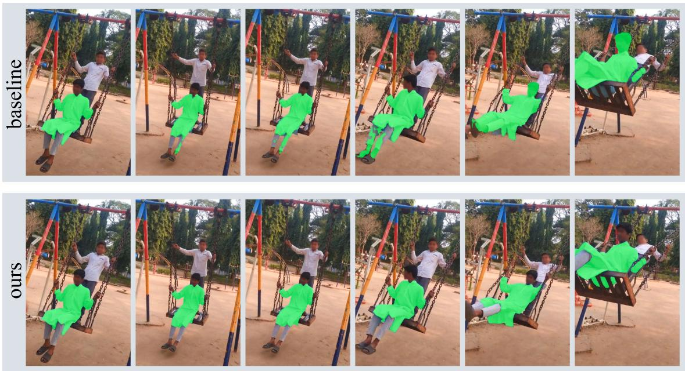  
Figure 16 当在第一帧给出掩码提示时，基线模型（Cutie-base+，上行）与我们的模型（SAM 2，下行）之间的对比。

<table><tr><td>数据集</td><td>缩写与链接</td><td>视频类型</td><td>描述</td><td>标注类型</td><td>来源划分</td><td>采样的视频数量</td><td>采样的 masklet 数量</td><td>采样的帧数量</td><td>采样的掩码数量</td></tr><tr><td>LV-VIS (Wang et al., 2023)</td><td>LV-VIS</td><td>开放词汇</td><td>大规模开放词汇视频实例分割</td><td>密集</td><td>验证集</td><td>690</td><td>2536</td><td>15,604</td><td>54,077</td></tr><tr><td>A Drosophila heart optical coherence microscopy database for automatic video segmentation (Fishman et al., 2023)</td><td>DH OCM</td><td>显微镜；心脏</td><td>光学相干显微镜视频中的果蝇心脏分割</td><td>稀疏</td><td>全部</td><td>213</td><td>213</td><td>608,000</td><td>607,158</td></tr><tr><td>Video Object Segmentation under Transformations (Tokmakov et al., 2022)</td><td>VOST</td><td>形变</td><td>侧重于形状形变的视频对象分割</td><td>密集</td><td>验证集</td><td>635</td><td>882</td><td>67,004</td><td>89,722</td></tr><tr><td>Cityscapes-VPS (Cordts et al., 2016; Kim et al., 2020)</td><td>Cityscapes-VPS</td><td>驾驶</td><td>针对 Cityscapes 驾驶数据集的全景分割</td><td>稀疏</td><td>验证集实例</td><td>209</td><td>1372</td><td>4,259</td><td>4,579</td></tr><tr><td>Corsican Fire Database (Toulouse et al., 2017)</td><td>CFD</td><td>野火</td><td>野火分割</td><td>稀疏</td><td>全部</td><td>5</td><td>5</td><td>541</td><td>541</td></tr><tr><td>Partial and Unusual Masks for Video Object Segmentation (Bekuzarov et al., 2023)</td><td>PUMaVOS</td><td>部件</td><td>关注部件和实际用例的视频对象分割</td><td>密集</td><td>全部</td><td>24</td><td>26</td><td>21,187</td><td>21,485</td></tr><tr><td>EPIC-KITCHENS VISOR (Darkhalil et al., 2022)</td><td>VISOR</td><td>第一人称视角</td><td>包含烹饪第一人称视角视频的视频对象分割基准，侧重于活动对象的分割。</td><td>稀疏</td><td>验证集</td><td>921</td><td>921</td><td>736,030</td><td>4,426</td></tr><tr><td>HT1080WT cells embedded in 3D collagen type I matrices (Gómez-de Mariscal et al., 2021)</td><td>HT1080WT</td><td>显微镜；细胞</td><td>HT1080WT 细胞运动的延时视频</td><td>稀疏</td><td>全部</td><td>60</td><td>150</td><td>1,010</td><td>2,694</td></tr><tr><td>Freiburg-Berkeley Motion Segmentation Dataset (Brox et al., 2010)</td><td>FBMS</td><td>运动对象</td><td>运动对象的精确分割</td><td>稀疏</td><td>全部</td><td>45</td><td>70</td><td>9734</td><td>755</td></tr><tr><td>Virtual KITTI 2 (Cabon et al., 2020)</td><td>Virtual KITTI 2</td><td>合成；驾驶</td><td>由游戏引擎生成、重现真实世界 KITTI 视频的合成驾驶视频。</td><td>密集</td><td>来自相机角度 Camera_0 的全部数据</td><td>996</td><td>1,638</td><td>109,368</td><td>162,708</td></tr><tr><td>EndoVis 2018 (Allan et al., 2020)</td><td>EndoVis 2018</td><td>内窥镜视频；手术</td><td>内窥镜视频中的医疗器械分割</td><td>密集</td><td>全部</td><td>15</td><td>29</td><td>2,325</td><td>4,314</td></tr><tr><td>Lindenthal Camera Traps (Haucke &amp; Steinhage, 2021)</td><td>LCT</td><td>双目立体</td><td>使用双目相机拍摄的野生动物视频。</td><td>稀疏</td><td>全部</td><td>12</td><td>12</td><td>4,012</td><td>412</td></tr><tr><td>LVOSv2 (Hong et al., 2024)</td><td>LVOSv2</td><td>长视频</td><td>长时视频对象分割基准，平均时长 1.14 分钟</td><td>密集</td><td>验证集</td><td>136</td><td>225</td><td>64,523</td><td>91,510</td></tr><tr><td>UVO (Wang et al., 2021b)</td><td>UVO</td><td>开放世界</td><td>视频中所有对象的开放世界实例分割</td><td>密集</td><td>验证集</td><td>54</td><td>311</td><td>4,860</td><td>26,747</td></tr><tr><td>EgoExo4d (Grauman et al., 2023)</td><td>EgoExo4d</td><td>第一人称视角</td><td>参与者完成技能活动的第一人称视角视频。</td><td>稀疏</td><td>第一人称相机的验证集视频</td><td>1185</td><td>1185</td><td>327,080</td><td>9,035</td></tr><tr><td>VIPSeg (Miao et al., 2022)</td><td>VIPSeg</td><td>全景</td><td>面向视频全景分割的大规模真实世界场景</td><td>密集</td><td>验证集</td><td>152</td><td>1,457</td><td>3,416</td><td>30,408</td></tr><tr><td>Event-based Segmentation Dataset (Huang et al., 2023)</td><td>ESD</td><td>杂乱</td><td>室内杂乱环境中的桌面对象分割</td><td>密集</td><td>全部</td><td>135</td><td>814</td><td>13,325</td><td>78,243</td></tr></table>

Table 16 用于零样本评估的视频分割数据集。

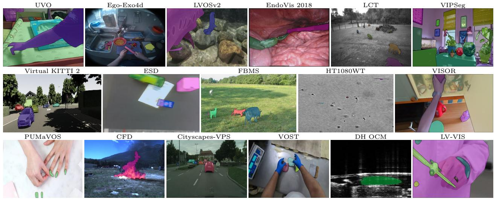  
Figure 17 来自 SAM 2 零样本视频基准套件的示例。

<table><tr><td rowspan="2">方法</td><td colspan="3">SA-V val</td><td colspan="3">SA-V test</td></tr><tr><td>J&amp;F</td><td>J</td><td>F</td><td>J&amp;F</td><td>J</td><td>F</td></tr><tr><td>STCN (Cheng et al., 2021a)</td><td>61.0</td><td>57.4</td><td>64.5</td><td>62.5</td><td>59.0</td><td>66.0</td></tr><tr><td>SwinB-AOT-L (Yang et al., 2021b)</td><td>51.1</td><td>46.4</td><td>55.7</td><td>50.3</td><td>46.0</td><td>54.6</td></tr><tr><td>SwinB-DeAOT-L (Yang &amp; Yang, 2022)</td><td>61.4</td><td>56.6</td><td>66.2</td><td>61.8</td><td>57.2</td><td>66.3</td></tr><tr><td>RDE (Li et al., 2022a)</td><td>51.8</td><td>48.4</td><td>55.2</td><td>53.9</td><td>50.5</td><td>57.3</td></tr><tr><td>XMem (Cheng &amp; Schwing, 2022)</td><td>60.1</td><td>56.3</td><td>63.9</td><td>62.3</td><td>58.9</td><td>65.8</td></tr><tr><td>SimVOS-B (Wu et al., 2023b)</td><td>44.2</td><td>40.0</td><td>48.3</td><td>44.1</td><td>40.5</td><td>47.7</td></tr><tr><td>DEVA (Cheng et al., 2023b)</td><td>55.4</td><td>51.5</td><td>59.2</td><td>56.2</td><td>52.4</td><td>60.1</td></tr><tr><td>Cutie-base (Cheng et al., 2023a)</td><td>60.7</td><td>57.7</td><td>63.7</td><td>62.7</td><td>59.7</td><td>65.7</td></tr><tr><td>Cutie-base+ (Cheng et al., 2023a)</td><td>61.3</td><td>58.3</td><td>64.4</td><td>62.8</td><td>59.8</td><td>65.8</td></tr><tr><td>SAM 2 (Hiera-B+)</td><td>76.8</td><td>73.4</td><td>80.1</td><td>77.0</td><td>73.5</td><td>80.5</td></tr><tr><td>SAM 2 (Hiera-L)</td><td>77.9</td><td>74.5</td><td>81.3</td><td>78.4</td><td>74.9</td><td>82.0</td></tr><tr><td>SAM 2 (Hiera-T) $^{\ddagger}$ </td><td>75.2</td><td>71.7</td><td>78.7</td><td>76.5</td><td>72.9</td><td>80.1</td></tr><tr><td>SAM 2 (Hiera-S) $^{\ddagger}$ </td><td>77.0</td><td>73.6</td><td>80.5</td><td>76.6</td><td>73.0</td><td>80.2</td></tr><tr><td>SAM 2 (Hiera-B+) $^{\ddagger}$ </td><td>77.5</td><td>74.1</td><td>80.9</td><td>78.2</td><td>74.8</td><td>81.7</td></tr><tr><td>SAM 2 (Hiera-L) $^{\ddagger}$ </td><td>78.6</td><td>75.3</td><td>82.0</td><td>79.5</td><td>76.0</td><td>83.0</td></tr></table>

(a) SAM 2 与先前工作在半监督 VOS 任务的 SA-V 基准上的对比。我们使用开源代码和检查点在 SA-V 上评估了先前的工作。

<table><tr><td colspan="4">LVOS val</td></tr><tr><td>方法</td><td>J&amp;F</td><td>J</td><td>F</td></tr><tr><td>DEVA (Cheng et al., 2023b)</td><td>55.9</td><td>51.1</td><td>60.7</td></tr><tr><td>DDMemory (Hong et al., 2023)</td><td>60.7</td><td>55.0</td><td>66.3</td></tr><tr><td>Cutie-base (Cheng et al., 2023a)</td><td>66.0</td><td>61.3</td><td>70.6</td></tr><tr><td>SAM 2 (Hiera-B+)</td><td>78.0</td><td>73.2</td><td>82.7</td></tr><tr><td>SAM 2 (Hiera-L)</td><td>78.0</td><td>73.2</td><td>82.7</td></tr><tr><td>SAM 2 (Hiera-T) $^{\ddagger}$ </td><td>77.5</td><td>73.0</td><td>82.1</td></tr><tr><td>SAM 2 (Hiera-S) $^{\ddagger}$ </td><td>77.3</td><td>72.3</td><td>82.2</td></tr><tr><td>SAM 2 (Hiera-B+) $^{\ddagger}$ </td><td>77.7</td><td>73.1</td><td>82.4</td></tr><tr><td>SAM 2 (Hiera-L) $^{\ddagger}$ </td><td>80.1</td><td>75.4</td><td>84.9</td></tr></table>

<table><tr><td>方法</td><td> $\mathcal{J}\&\mathcal{F}$ </td><td> $\mathcal{J}_{s}$ </td><td> $\mathcal{F}_{s}$ </td><td> $\mathcal{J}_{u}$ </td><td> $\mathcal{F}_{u}$ </td></tr><tr><td>STCN (Cheng et al., 2021a)</td><td>60.6</td><td>57.2</td><td>64.0</td><td>57.5</td><td>63.8</td></tr><tr><td>RDE (Li et al., 2022a)</td><td>62.2</td><td>56.7</td><td>64.1</td><td>60.8</td><td>67.2</td></tr><tr><td>SwinB-DeAOT-L (Yang &amp; Yang, 2022)</td><td>63.9</td><td>61.5</td><td>69.0</td><td>58.4</td><td>66.6</td></tr><tr><td>XMem (Cheng &amp; Schwing, 2022)</td><td>64.5</td><td>62.6</td><td>69.1</td><td>60.6</td><td>65.6</td></tr><tr><td>SAM 2 (Hiera-B+)</td><td>78.7</td><td>80.6</td><td>87.2</td><td>69.0</td><td>77.8</td></tr><tr><td>SAM 2 (Hiera-L)</td><td>79.6</td><td>81.0</td><td>87.4</td><td>70.4</td><td>79.8</td></tr><tr><td>SAM 2 (Hiera-T) $^{\ddagger}$ </td><td>77.3</td><td>79.9</td><td>86.9</td><td>67.1</td><td>75.4</td></tr><tr><td>SAM 2 (Hiera-S) $^{\ddagger}$ </td><td>78.3</td><td>79.2</td><td>85.9</td><td>69.0</td><td>79.0</td></tr><tr><td>SAM 2 (Hiera-B+) $^{\ddagger}$ </td><td>78.2</td><td>80.5</td><td>87.2</td><td>68.1</td><td>76.9</td></tr><tr><td>SAM 2 (Hiera-L) $^{\ddagger}$ </td><td>80.6</td><td>81.7</td><td>88.2</td><td>71.4</td><td>81.0</td></tr></table>

(c) SAM 2 与先前工作在 LVOSv2 (Hong et al., 2024) 基准上的对比。我们报告了由 LVOSv2 作者评估的先前工作的性能。

<table><tr><td rowspan="2">方法</td><td colspan="3">MOSE val</td><td colspan="3">DAVIS17 val</td><td colspan="3">DAVIS17 test</td><td colspan="5">YTVOS19 val</td></tr><tr><td>J&amp;F</td><td>J</td><td>F</td><td>J&amp;F</td><td>J</td><td>F</td><td>J&amp;F</td><td>J</td><td>F</td><td>G</td><td>Js</td><td>Fs</td><td>Ju</td><td>Fu</td></tr><tr><td>STCN (Cheng et al., 2021a)</td><td>52.5</td><td>48.5</td><td>56.6</td><td>85.4</td><td>82.2</td><td>88.6</td><td>76.1</td><td>72.7</td><td>79.6</td><td>82.7</td><td>81.1</td><td>85.4</td><td>78.2</td><td>85.9</td></tr><tr><td>SwinB-AOT-L (Yang et al., 2021b)</td><td>59.4</td><td>55.5</td><td>63.2</td><td>85.4</td><td>82.4</td><td>88.4</td><td>81.2</td><td>77.3</td><td>85.1</td><td>84.5</td><td>84.0</td><td>88.8</td><td>78.4</td><td>86.7</td></tr><tr><td>SwinB-DeAOT-L (Yang &amp; Yang, 2022)</td><td>59.9</td><td>55.7</td><td>64.0</td><td>86.2</td><td>83.1</td><td>89.2</td><td>82.8</td><td>78.9</td><td>86.7</td><td>86.1</td><td>85.3</td><td>90.2</td><td>80.4</td><td>88.6</td></tr><tr><td>RDE (Li et al., 2022a)</td><td>46.8</td><td>42.4</td><td>51.3</td><td>84.2</td><td>80.8</td><td>87.5</td><td>77.4</td><td>73.6</td><td>81.2</td><td>81.9</td><td>81.1</td><td>85.5</td><td>76.2</td><td>84.8</td></tr><tr><td>XMem (Cheng &amp; Schwing, 2022)</td><td>59.6</td><td>55.4</td><td>63.7</td><td>86.0</td><td>82.8</td><td>89.2</td><td>79.6</td><td>76.1</td><td>83.0</td><td>85.6</td><td>84.1</td><td>88.5</td><td>81.0</td><td>88.9</td></tr><tr><td>SimVOS-B (Wu et al., 2023b)</td><td>-</td><td>-</td><td>-</td><td>88.0</td><td>85.0</td><td>91.0</td><td>80.4</td><td>76.1</td><td>84.6</td><td>84.2</td><td>83.1</td><td>-</td><td>79.1</td><td>-</td></tr><tr><td>JointFormer (Zhang et al., 2023b)</td><td>-</td><td>-</td><td>-</td><td>90.1</td><td>87.0</td><td>93.2</td><td>88.1</td><td>84.7</td><td>91.6</td><td>87.4</td><td>86.5</td><td>90.9</td><td>82.0</td><td>90.3</td></tr><tr><td>ISVOS (Wang et al., 2022)</td><td>-</td><td>-</td><td>-</td><td>88.2</td><td>84.5</td><td>91.9</td><td>84.0</td><td>80.1</td><td>87.8</td><td>86.3</td><td>85.2</td><td>89.7</td><td>81.0</td><td>89.1</td></tr><tr><td>DEVA (Cheng et al., 2023b)</td><td>66.0</td><td>61.8</td><td>70.3</td><td>87.0</td><td>83.8</td><td>90.2</td><td>82.6</td><td>78.9</td><td>86.4</td><td>85.4</td><td>84.9</td><td>89.4</td><td>79.6</td><td>87.8</td></tr><tr><td>Cutie-base (Cheng et al., 2023a)</td><td>69.9</td><td>65.8</td><td>74.1</td><td>87.9</td><td>84.6</td><td>91.1</td><td>86.1</td><td>82.4</td><td>89.9</td><td>87.0</td><td>86.0</td><td>90.5</td><td>82.0</td><td>89.6</td></tr><tr><td>Cutie-base+ (Cheng et al., 2023a)</td><td>71.7</td><td>67.6</td><td>75.8</td><td>88.1</td><td>85.5</td><td>90.8</td><td>88.1</td><td>84.7</td><td>91.4</td><td>87.5</td><td>86.3</td><td>90.6</td><td>82.7</td><td>90.5</td></tr><tr><td>SAM 2 (Hiera-B+)</td><td>76.6</td><td>72.6</td><td>80.6</td><td>90.2</td><td>87.0</td><td>93.4</td><td>87.9</td><td>84.7</td><td>91.1</td><td>88.6</td><td>87.1</td><td>91.6</td><td>83.9</td><td>91.9</td></tr><tr><td>SAM 2 (Hiera-L)</td><td>77.9</td><td>73.9</td><td>81.9</td><td>90.7</td><td>87.5</td><td>94.0</td><td>87.7</td><td>84.6</td><td>90.9</td><td>89.3</td><td>87.5</td><td>92.0</td><td>84.8</td><td>92.8</td></tr><tr><td>SAM 2 (Hiera-T)‡</td><td>71.8</td><td>67.4</td><td>76.1</td><td>89.4</td><td>85.8</td><td>92.9</td><td>86.9</td><td>83.4</td><td>90.3</td><td>87.4</td><td>85.7</td><td>90.1</td><td>82.7</td><td>91.1</td></tr><tr><td>SAM 2 (Hiera-S)‡</td><td>73.5</td><td>69.2</td><td>77.7</td><td>89.6</td><td>86.3</td><td>92.9</td><td>87.6</td><td>84.1</td><td>91.1</td><td>88.0</td><td>85.9</td><td>90.2</td><td>83.9</td><td>91.9</td></tr><tr><td>SAM 2 (Hiera-B+)‡</td><td>73.8</td><td>69.7</td><td>77.9</td><td>90.0</td><td>86.8</td><td>93.1</td><td>86.6</td><td>83.3</td><td>89.8</td><td>88.2</td><td>86.1</td><td>90.6</td><td>84.0</td><td>92.1</td></tr><tr><td>SAM 2 (Hiera-L)‡</td><td>74.6</td><td>70.6</td><td>78.6</td><td>90.2</td><td>86.9</td><td>93.4</td><td>88.9</td><td>85.3</td><td>92.5</td><td>88.8</td><td>86.5</td><td>91.0</td><td>84.7</td><td>92.8</td></tr></table>

(d) SAM 2 与先前工作在半监督 VOS 任务上的对比。  
Table 17 SAM 2 与先前工作在各类基准上的详细对比（‡：如 §5.2 中所述，在 SA-1B、SA-V 及我们的内部数据集上训练的模型版本）。

## H 模型、数据和标注卡片

## H.1 模型卡片

<table><tr><td colspan="2">模型概述</td></tr><tr><td>名称</td><td>SAM 2 (Segment Anything Model 2)</td></tr><tr><td>版本</td><td>1.0</td></tr><tr><td>日期</td><td>2024</td></tr><tr><td>机构</td><td>Meta FAIR</td></tr><tr><td>模型类型</td><td>可提示分割模型</td></tr><tr><td>架构</td><td>参见第 4 节</td></tr><tr><td>仓库</td><td>https://github.com/facebookresearch/sam2</td></tr><tr><td>许可证</td><td>Apache 2.0</td></tr><tr><td colspan="2">预期用途</td></tr><tr><td>主要目标用户</td><td>SAM 2 被设计为用于可提示视频和图像分割任务的统一模型。该模型主要面向研究用例开发。SAM 2 基于 Apache 2.0 许可证发布。</td></tr><tr><td>超出范围的用例</td><td>限制条件请参见伦理考量与许可证。</td></tr><tr><td>注意事项与建议</td><td>局限性请参见附录 C。</td></tr><tr><td colspan="2">相关因素</td></tr><tr><td>类别属性</td><td>SAM 2 是类别无关（class agnostic）的，专为可提示图像和视频分割而设计。它可以分割并跟踪任何目标物体。</td></tr><tr><td>测试环境与领域</td><td>SAM 2 在多种类型的视频和图像数据上进行了评估。视频基准测试套件涵盖了驾驶数据、显微镜成像、第一人称视角视频、机器人手术等领域。基准描述参见表 16，示例帧参见图 17。SAM 2 在与 Kirillov et al. (2023) 相同的图像基准套件上进行了评估，该套件涵盖水下图像、绘画、鱼眼图像等领域。</td></tr><tr><td colspan="2">评估指标</td></tr><tr><td></td><td>我们使用以下指标评估 SAM 2 的性能：J&amp;F：对于可提示视频分割和半监督 VOS 任务，我们使用 J&amp;F (Pont-Tuset et al., 2017) 评估性能。G：对于半监督 VOS 任务，我们在 YTVOS 2019 上使用 G 进行评估。mIoU：对于可提示图像分割任务，我们使用 mIoU 评估性能。</td></tr><tr><td colspan="2">评估数据</td></tr><tr><td>数据来源</td><td>参见附录 F</td></tr><tr><td colspan="2">训练数据</td></tr><tr><td>数据来源</td><td>SAM 2 是在 SA-V 数据集以及内部可用的授权许可视频数据上进行训练的。更多细节参见正文第 5 节，SA-V 数据集数据卡参见附录 H.2。</td></tr><tr><td colspan="2">伦理考量</td></tr><tr><td>数据</td><td>有关 SAM 2 训练数据的更多细节请参见第 5 节。在第 E.1 节中，我们展示了 SA-V 数据集中视频的地理分布以及采集视频的众包人员的人口统计学分布。</td></tr><tr><td>计算成本与影响</td><td>发布的 SAM 2 在 256 块 A100 GPU 上训练了 108 小时。这相当于 12165.12 kWh 的能耗以及约 3.89 公吨的 CO2e 估算排放量 (Patterson et al., 2021; Lacoste et al., 2019)。训练发布的 SAM 2 所产生的碳排放相当于一辆普通燃油乘用车行驶约 10k 英里的排放量 (Agency, 2022)。</td></tr><tr><td>风险与危害</td><td>在正文第 E.1.1 节中，我们分析了 SAM 2 在不同人口统计学群体中的表现。在新的场景中使用 SAM 2 时，我们建议研究人员针对其具体用例对 SAM 2 进行独立的公平性评估。</td></tr><tr><td>用例考量</td><td>我们恳请用户自行做出明智的判断。</td></tr></table>

Table 18 遵循 Mitchell et al. (2019) 结构的 SAM 2 模型卡

## H.2 SA-V 数据集的数据集卡

## 动机

1. 该数据集是出于何种目的创建的？是否有特定的任务目标？是否有需要填补的特定空白？请提供描述。该数据集专为 PVS 任务设计。我们数据集对视觉社区的贡献在于：(1) 数据集由 50.9K 个视频和 642.6K 个 masklet 组成，是目前公开可用的最大视频分割数据集（与当前 VOS 数据集的对比见 5.2 节）；(2) 数据集在知识共享署名 4.0 国际公共许可证（Creative Commons Attribution 4.0 International Public License）下发布于 https://ai.meta.com/datasets/segment-anything-video/；(3) 与以往数据集相比，该数据是一个地理分布更多样化的公开可用视频分割数据集。

2. 谁创建了该数据集（例如，哪个团队、研究小组），代表哪个实体（例如，公司、机构、组织）？该数据集由 Meta FAIR 创建。基础视频是通过签约的第三方公司采集的。

3. 谁资助了该数据集的创建？该数据集由 Meta FAIR 资助。

4. 还有其他评论吗？无。

## 组成

1. 构成该数据集的实例代表什么（例如，文档、照片、人物、国家）？是否存在多种类型的实例（例如，电影、用户和评分；人物及其之间的互动；节点和边）？请提供描述。数据集中的所有实例均为视频。在视频采集过程中鼓励题材多样性，未设定特定主题。视频的常见主题包括：地点、物体、场景。所有视频均不相同，但有部分视频组拍摄的是同一题材对象。

2. 总共有多少个实例（如果适用，按每种类型划分）？共有 50.9K 个视频。

3. 该数据集是包含所有可能实例，还是来自更大集合的实例样本（不一定是随机样本）？如果数据集是样本，那么更大的集合是什么？该样本是否代表更大的集合（例如，地理覆盖范围）？如果是，请描述如何验证/核实这种代表性。如果不能代表更大的集合，请说明原因（例如，为了覆盖更多样化的实例范围，因为某些实例被保留或不可用）。虽然该数据集包含所有可能实例，但审核员被建议拒绝标注包含露骨图像的内容。

4. 每个实例由什么数据组成？“原始”数据（例如，未处理的文本或图像）还是特征？无论哪种情况，请提供描述。每个实例都是一段视频。

5. 每个实例是否有相关联的标签或目标？如果是，请提供描述。每个视频都标注了在整个视频中跟踪对象的 masklet。这些 masklet 没有关联的类别或文本。数据以 6 FPS 的速率进行标注。平均每个视频包含 3.8 个人工 masklet 和 8.9 个自动 masklet，总共有 642.6K 个 masklet。

6. 单个实例中是否存在缺失信息？如果是，请提供描述，并解释该信息缺失的原因（例如，因为无法获取）。这不包括故意删除的信息，但可能包括例如被遮盖的文本。否。

7. 单个实例之间的关系是否明确（例如，用户的电影评分、社交网络链接）？如果是，请描述这些关系是如何明确的。否。

8. 数据集中是否存在任何错误、噪声源或冗余？如果是，请提供描述。对于人工 masklet，可能存在人为错误；例如，标注员在需要时可能会遗漏某帧的检查或修正。对于自动 masklet，由于使用 SAM 2 生成，可能存在模型错误，例如 masklet 中的不一致性。

9. 数据集是自包含的，还是链接到或依赖外部资源（例如网站、推文、其他数据集）？如果它链接到或依赖外部资源，a) 是否保证它们会长期存在并保持不变；b) 是否有完整数据集的官方存档版本（例如，包括数据集创建时存在的外部资源）；c) 是否存在可能适用于数据集使用者的与任何外部资源相关的限制（例如许可证、费用）？请根据情况提供所有外部资源及其相关限制的描述，以及链接或其他访问点。该数据集是自包含的。

10. 数据集是否包含可能被视为机密的数据（例如受法律特权或医患保密协议保护的数据、包含个人非公开通信内容的数据）？如果是，请提供描述。否。

11. 数据集是否包含如果直接查看可能会令人反感、侮辱性、威胁性或可能引起焦虑的数据？如果是，请说明原因。我们采取了三项安全措施来防止不良内容：(1) 收集视频的众包人员收到了相关指引，不得录制可能包含不良内容（例如血腥、裸露或不当内容）的视频。(2) 标注视频的专家标注员收到了相关指引，如果出现不良内容，需标记并拒绝该视频。(3) 有关数据集中视频的反馈/报告可提交至 segment-anything@meta.com。

12. 该数据集是否识别了任何亚群体（例如按年龄、性别划分）？如果是，请描述这些亚群体是如何被识别的，并说明它们在数据集中的各自分布情况。该数据集没有识别视频中人物的任何亚群体。收集数据集中视频的众包工人的统计学特征展示在 5.2 节中。

13. 是否有可能从数据集中直接或间接（即与其他数据相结合）识别出个人（即一个或多个自然人）？如果是，请描述如何识别。视频已经过人脸模糊模型处理。关于数据集中视频的报告可提交至 segment-anything@meta.com。

14. 数据集是否包含任何可能被视为敏感的数据（例如揭示种族或民族血统、性取向、宗教信仰、政治观点或工会成员身份的数据，或地理位置；财务或健康数据；生物识别或基因数据；政府身份证明形式，如社会保障号码；犯罪历史）？如果是，请提供描述。该数据集并未聚焦于可能被视为敏感的数据。关于数据集中视频的报告可提交至 segment-anything@meta.com。

15. 是否有其他意见？无。

## 收集过程

1. 与每个实例相关联的数据是如何获取的？数据是可直接观察到的（例如原始文本、电影评分）、由受试者报告的（例如问卷回复），还是从其他数据间接推断/衍生的（例如词性标注、基于模型的年龄或语言猜测）？如果数据是由受试者报告或间接推断/衍生的，数据是否经过验证/核实？如果是，请描述如何进行的。与每个视频相关联的已发布 masklets 是通过两种方法收集的：(1) SAM 2 辅助的人工标注；(2) 由 SAM 2 自动生成并由标注员进行验证。

2. 使用了哪些机制或程序来收集数据（例如硬件设备或传感器、人工整理、软件程序、软件 API）？这些机制或程序是如何验证的？数据集中的视频是通过签约的第三方供应商收集的。它们是由众包工人使用未知设备拍摄的视频。

3. 如果数据集是来自更大集合的样本，抽样策略是什么（例如确定性抽样、具有特定抽样概率的概率抽样）？不适用（N/A）。

4. 谁参与了数据收集过程（例如学生、众包工人、合同工），他们是如何获得报酬的（例如众包工人获得了多少报酬）？(1) 数据集中的视频是通过签约的第三方供应商收集的。它们是由众包工人拍摄的视频，工人按供应商设定的时薪获得报酬。(2) 数据集中人工收集的 masklets 是由标注员通过另一家第三方供应商收集的。标注员按供应商设定的时薪获得报酬。

5. 数据是在什么时间范围内收集的？该时间范围是否与实例相关联的数据创建时间范围一致（例如，最近抓取旧新闻文章）？如果不一致，请描述与实例相关联的数据的创建时间范围。视频拍摄于2023年11月至2024年3月之间。掩码小片段（masklet）标注是在2024年4月至2024年7月之间收集的。

6. 是否进行了任何伦理审查流程（例如，由机构审查委员会进行）？如果是，请提供这些审查流程的描述，包括结果，以及指向任何支持性文件的链接或其他访问入口。如果数据集与人无关，您可以跳过本节中的其余问题。该项目经过了内部审查流程。

7. 您是直接从相关个人处收集数据，还是通过第三方或其他来源（例如网站）获取的？我们与第三方供应商签订了合同，由其收集视频并生成或审查标注。

8. 相关个人是否收到了有关数据收集的通知？如果是，请描述（或使用截图或其他信息展示）通知是如何提供的，并提供指向通知本身确切用语的链接或其他访问入口，或以其他方式复现该用语。视频是由众包工人通过签约的第三方供应商收集的。众包工人同意了知情同意书。

9. 相关个人是否同意收集和使用其数据？如果是，请描述（或使用截图或其他信息展示）同意是如何请求和提供的，并提供指向个人同意的确切用语的链接或其他访问入口，或以其他方式复现该用语。视频是通过签约的第三方收集的，该第三方根据需要对从个人处收集任何通知和同意作出了适当的陈述。

10. 如果获得了同意，同意的个人是否获得了在未来或针对某些用途撤回其同意的机制？如果是，请提供描述，以及指向该机制的链接或其他访问入口（如适用）。根据合同，签约第三方收集了同意，并提供了撤回同意的机会。

11. 是否对数据集及其使用对数据主体的潜在影响进行了分析（例如数据保护影响分析）？如果是，请提供该分析的描述，包括结果，以及指向任何支持性文件的链接或其他访问入口。详见 E.1.1。

12. 还有其他意见吗？没有。

## 预处理 / 清洗 / 标注

1. 是否对数据进行了任何预处理/清洗/标注（例如，离散化或分箱、分词、词性标注、SIFT 特征提取、实例移除、缺失值处理）？如果是，请提供说明。如果否，您可以跳过本节的其余问题。 视频被重新采样至 24 fps 并转换为 mp4 格式。

2. 除了预处理/清洗/标注后的数据外，是否还保存了“原始”数据（例如，为了支持未预见的未来用途）？如果是，请提供访问“原始”数据的链接或其他入口。 否。

## 用途

1. 该数据集是否已经用于任何任务？如果是，请提供说明。 该数据集已用于训练和评估 SAM 2。

2. 该数据集还可以用于哪些（其他）任务？ 该数据可用于 VOS、iVOS 或 PVS 任务。如果从视频中采样帧，该数据集还可用于图像分割任务。

3. 数据集的构成或其收集、预处理/清洗/标注的方式是否存在可能影响未来用途的因素？例如，数据集使用者是否需要了解某些情况以避免导致对个人或群体的不公对待（例如刻板印象、服务质量问题）或其他风险或危害（例如法律风险、经济损失）的使用？如果是，请提供说明。数据集使用者可以采取什么措施来减轻这些风险或危害？ 我们在 5.2 节中对数据集的地理分布和众包标注人员的人口统计特征进行了分析。虽然我们认为在这些因素上，我们的数据集比目前现有的大多数同类公开数据集更具代表性，但我们承认并未在所有地理和人口统计群体之间实现均等，因此我们鼓励数据集使用者注意模型使用该数据集可能学到的任何潜在偏差。

4. 是否存在不应使用该数据集的任务？如果是，请提供说明。 否。该数据集的完整使用条款可在 https://ai.meta.com/datasets/segment-anything-video-downloads/ 查看。

5. 是否有其他评论？ 否。

## 分发

1. 数据集是否会分发给创建该数据集的实体（例如公司、机构、组织）之外的第三方？如果是，请提供说明。 该数据集将在宽松的 Creative Commons Attribution 4.0 International Public License（知识共享署名 4.0 国际公共许可证）下提供。

2. 数据集将如何分发（例如网站上的压缩包、API、GitHub）？数据集是否有数字对象唯一标识符（DOI）？ 该数据集可在 https://ai.meta.com/datasets/segment-anything-video/ 获取。

3. 数据集何时分发？ 该数据集将于 2024 年 7 月分发。

4. 该数据集是否将根据版权或其他知识产权（IP）许可，和/或适用的使用条款（ToU）进行分发？如果是，请描述该许可和/或使用条款，并提供链接或其他访问点，或以其他方式复制任何相关的许可条款或使用条款，以及与这些限制相关的任何费用。是的，该数据集将在 Creative Commons Attribution 4.0 International Public License（知识共享署名 4.0 国际公共许可证）下提供。该数据集的许可协议和使用条款可在 https://ai.meta.com/datasets/segment-anything-video-downloads/ 找到。用户在下载或使用该数据集之前必须同意使用条款。

5. 是否有任何第三方对与样本相关的数据施加了基于知识产权或其他方面的限制？如果是，请描述这些限制，并提供链接或其他访问点，或以其他方式复制任何相关的许可条款，以及与这些限制相关的任何费用。SA-V 数据集的完整使用条款和使用限制可在 https://ai.meta.com/datasets/segment-anything-video-downloads/ 找到。

6. 是否有任何出口管制或其他监管限制适用于该数据集或单个样本？如果是，请描述这些限制，并提供链接或其他访问点，或以其他方式复制任何支持文件。SA-V 数据集的许可和使用限制可在 https://ai.meta.com/datasets/segment-anything-video-downloads/ 找到。

7. 是否有其他意见？无。

## 维护

1. 谁将支持/托管/维护该数据集？该数据集将托管在 https://ai.meta.com/datasets/segment anything-video/，并由 Meta FAIR 维护。

2. 如何联系数据集的所有者/策展人/管理者（例如电子邮箱地址）？请发送电子邮件至 segment-anything@meta.com。

3. 是否存在勘误表？如果是，请提供链接或其他访问点。无。

4. 数据集是否会更新（例如，纠正标注错误、添加新样本、删除样本）？如果是，请描述更新频率、由谁执行，以及如何将更新通知给数据集用户（例如邮件列表、GitHub）？可能会根据发送至 segment-anything@meta.com 的反馈意见进行更新。

5. 如果数据集与人物相关，与样本相关的数据是否有适用的保留期限限制（例如，是否告知相关个人其数据将保留固定期限后删除）？如果是，请描述这些限制并说明将如何执行。数据保留没有限制。

6. 数据集的旧版本是否会继续得到支持/托管/维护？如果是，请说明具体方式。如果否，请说明将如何向数据集用户传达其弃用信息。否。如果数据集进行了更新，以前的版本将不再继续托管。

7. 如果其他人想要扩展/扩充/基于此构建/贡献于该数据集，是否有相应的机制供其进行？如果有，请提供说明。这些贡献是否会被验证/核实？如果是，请描述如何进行。如果不是，原因是什么？是否有将这些贡献传达/分发给数据集使用者的流程？如果有，请提供说明。 我们鼓励对 SA-V 进行进一步的标注，但这些标注将不会由 Meta 进行验证/核实，也不会得到 Meta 的支持/托管/维护。

8. 还有其他意见吗？ 无。

## H.3 数据标注卡

## 任务形式化

1. 从高层次来看，您的任务有哪些主观方面？ 在视频中选择要遮罩和跟踪的目标本质上是一项主观任务，标注人员在决定对哪些目标进行掩码时可能会存在分歧。

2. 您对标注人员做出了哪些假设？ 我们假设我们的标注人员理解 PVS 任务，并且在视频相关任务上接受过良好的培训。我们的标注人员全职从事我们的标注任务。这使得通过定期分享反馈来培训标注人员成为可能。

3. 您是如何选择任务说明的具体用词的？采取了哪些步骤（如果有）来验证标注人员任务说明和用词的清晰度？ (1) 任务说明包含了视觉示例（图像和视频）以确保清晰。(2) 标注人员在进入生产队列工作之前接受了良好的培训。(3) 研究团队每天分享反馈，并每周与标注人员会面进行问答交流。

4. 您的任务对标注人员构成了哪些风险（如果有），在参与任务之前是否已告知他们这些风险？ 标注人员已被告知应拒绝令人反感的视频。

5. 提供给标注人员的具体说明是什么？ 有关标注说明的详细信息，请参见 11。

## 标注筛选

1. 是否有某些视角应该被优先考虑？如果是，您是如何寻找这些视角的？ 我们选择与具有过往视频标注经验的标注人员合作。

2. 是否有某些视角如果纳入会产生有害影响？如果是，您是如何筛除这些视角的？ 否。

3. 是否使用了社会人口统计学特征来为您的任务选择标注人员？如果是，请详细说明该过程。 对于 masklet 标注，未使用社会人口统计学特征来选择标注人员。对于视频采集，我们向第三方供应商强调了众包人员多样性的重要性。虽然这不是硬性要求，但我们鼓励纳入多样化的众包人员群体，以凭借广泛的视角丰富数据采集过程。该方法旨在自然地融入多样性，而不强加基于社会人口统计学因素的严格筛选。

4. 如果您拥有关于标注人员群体的汇总社会人口学统计数据，请予以说明。您是否有理由认为标注人员的社会人口学特征可能影响了他们对数据的标注方式？为什么有或为什么没有？关于采集视频的众包人员的汇总社会人口学统计数据已在 5.2 节中列出。

5. 考虑该数据集的预期使用场景，以及可能受到基于该数据集训练的模型影响的个人和社区。这些社区在您的标注人员群体中是否有代表性？正如 5.2 节中所讨论的，SA-V 数据集是一个具有地理多样性且公开可用的视频分割数据集。此外，正如在 E.1.1 节中所讨论的，我们分析了在该数据集上训练的模型在负责任人工智能（Responsible AI）维度上的表现。

## 平台与基础设施选择

1. 您使用了什么标注平台？从宏观层面来看，是哪些考量促成了您选择该平台的决定？所选平台是否充分满足了您为标注人员群体设定的要求？是否有任何方面未被涵盖？我们使用了一个内部标注平台。

2. 所选平台提供了哪些沟通渠道（如果有的话）以促进与标注人员的沟通？该沟通渠道如何影响了标注流程和/或最终的标注结果？研究团队每日分享反馈，并每周与标注人员开会以统一步调，明确任务说明与预期要求，同时开展答疑（Q&A）环节。在这些会议之外，标注人员可以使用电子表格和聊天群组与研究团队沟通。

3. 标注人员获得了多少报酬？在确定其报酬时，您是否考虑了某些特定的薪酬标准？如果是，请予以说明。(1) 采集视频的众包人员获得了由供应商制定的时薪报酬。(2) 标注人员获得了由供应商制定的时薪报酬。

## 数据集分析与评估

1. 在您的研究背景下，您如何定义标注质量？您又是如何评估所构建数据集的质量的？标注人员在转入正式生产队列前，必须接受培训。标注人员参加了由供应商主持的为期 2 天的培训课程，随后被要求标注来自培训队列的任务。在供应商质检（Q&A）团队或研究团队审核其工作并评估质量后，标注人员方可从培训阶段转入正式生产。平均而言，标注人员在转入正式生产前需要在培训中花费 1 至 2 周的时间。同样，供应商与研究团队的质检（Q&A）人员每日对生产队列的标注进行人工审核，并每日分享反馈。

2. 您是否对意见分歧模式进行了分析？如果是，您采用了哪些分析方法，主要发现是什么？您是否分析了分歧的潜在来源？在每日与每周的反馈及答疑（Q&A）环节中，分歧模式都会被共享与讨论。

3. 单个标注者的响应与数据集中发布的最终标签之间有何关联？最终标签是对单个标注者的响应进行数据清洗和后处理后得到的。

## 数据集发布与维护

1. 您是否有理由认为该数据集中的标注可能会随时间发生变化？您是否有计划更新您的数据集？没有。

2. 是否存在任何条件或定义，如果发生变化，可能会影响您数据集的实用性？没有。

3. 您是否会尝试追踪、限制或以其他方式影响您数据集的使用方式？如果是，具体如何进行？SA-V 数据集是在宽松的 CC BY 4.0 许可证下发布的。

4. 标注者是否获知了数据将如何对外公开？如果数据集发生变更，他们是否会收到通知？没有。

5. 是否存在允许标注者日后选择从数据集中撤回其数据的流程？如果是，请详细说明。没有。

## 参考文献

United States Environmental Protection Agency. Greenhouse gas equivalencies calculator. https://www.epa.gov/energy/greenhouse-gas-equivalencies-calculator, 2022.

Max Allan, Satoshi Kondo, Sebastian Bodenstedt, Stefan Leger, Rahim Kadkhodamohammadi, Imanol Luengo, Felix Fuentes, Evangello Flouty, Ahmed Mohammed, Marius Pedersen, et al. 2018 robotic scene segmentation challenge. arXiv preprint arXiv:2001.11190, 2020.

Ali Athar, Jonathon Luiten, Paul Voigtlaender, Tarasha Khurana, Achal Dave, Bastian Leibe, and Deva Ramanan. Burst: A benchmark for unifying object recognition, segmentation and tracking in video. WACV, pp. 1674–1683, 2022.

Xue Bai and Guillermo Sapiro. A geodesic framework for fast interactive image and video segmentation and matting. In ICCV, 2007.

Dina Bashkirova, Mohamed Abdelfattah, Ziliang Zhu, James Akl, Fadi Alladkani, Ping Hu, Vitaly Ablavsky, Berk Calli, Sarah Adel Bargal, and Kate Saenko. ZeroWaste dataset: Towards deformable object segmentation in cluttered scenes. CVPR, 2022.

Maksym Bekuzarov, Ariana Bermudez, Joon-Young Lee, and Hao Li. Xmem++: Production-level video segmentation from few annotated frames. In ICCV, pp. 635–644, 2023.

Goutam Bhat, Felix Järemo Lawin, Martin Danelljan, Andreas Robinson, Michael Felsberg, Luc Van Gool, and Radu Timofte. Learning what to learn for video object segmentation. ECCV, abs/2003.11540, 2020.

Daniel Bolya, Chaitanya Ryali, Judy Hofman, and Christoph Feichtenhofer. Window attention is bugged: How not to interpolate position embeddings. ICLR, 2023.

T Brox, J Malik, and P Ochs. Freiburg-berkeley motion segmentation dataset (fbms-59). In ECCV, volume 1, pp. 9, 2010.

Yohann Cabon, Naila Murray, and Martin Humenberger. Virtual KITTI 2. arXiv preprint arXiv:2001.10773, 2020.

Sergi Caelles, Kevis-Kokitsi Maninis, Jordi Pont-Tuset, Laura Leal-Taixé, Daniel Cremers, and Luc Van Gool. One-shot video object segmentation. CVPR, pp. 5320–5329, 2016.

Sergi Caelles, Alberto Montes, Kevis-Kokitsi Maninis, Yuhua Chen, Luc Van Gool, Federico Perazzi, and Jord Pont-Tuset. The 2018 davis challenge on video object segmentation. arXiv preprint arXiv:1803.00557, 2018.

Sergi Caelles, Jordi Pont-Tuset, Federico Perazzi, Alberto Montes, Kevis-Kokitsi Maninis, and Luc Van Gool. The 2019 davis challenge on vos: Unsupervised multi-object segmentation. arXiv preprint arXiv:1905.00737, 2019.

Juan C. Caicedo, Allen Goodman, Kyle W. Karhohs, Beth A. Cimini, Jeanelle Ackerman, Marzieh Haghighi, CherKeng Heng, Tim Becker, Minh Doan, Claire McQuin, Mohammad Rohban, Shantanu Singh, and Anne E. Carpenter. Nucleus segmentation across imaging experiments: the 2018 data science bowl. Nature Methods, 2019.

Jiazhou Chen, Yanghui Xu, Shufang Lu, Ronghua Liang, and Liangliang Nan. 3D instance segmentation of MVS buildings. IEEE Transactions on Geoscience and Remote Sensing, 2022.

Keyan Chen, Chenyang Liu, Hao Chen, Haotian Zhang, Wenyuan Li, Zhengxia Zou, and Zhenwei Shi. Rsprompter: Learning to prompt for remote sensing instance segmentation based on visual foundation model. IEEE Transactions on Geoscience and Remote Sensing, 2024.

Yuhua Chen, Jordi Pont-Tuset, Alberto Montes, and Luc Van Gool. Blazingly fast video object segmentation with pixel-wise metric learning. CVPR, pp. 1189–1198, 2018.

Ho Kei Cheng and Alexander G Schwing. Xmem: Long-term video object segmentation with an atkinson-shifrin memory model. In ECCV, pp. 640–658. Springer, 2022.

Ho Kei Cheng, Yu-Wing Tai, and Chi-Keung Tang. Rethinking space-time networks with improved memory coverage for eficient video object segmentation. In NeurIPS, 2021a.

Ho Kei Cheng, Yu-Wing Tai, and Chi-Keung Tang. Modular interactive video object segmentation: Interaction-to-mask, propagation and diference-aware fusion. In CVPR, 2021b.

Ho Kei Cheng, Seoung Wug Oh, Brian Price, Joon-Young Lee, and Alexander Schwing. Putting the object back into video object segmentation. In arXiv, 2023a.

Ho Kei Cheng, Seoung Wug Oh, Brian L. Price, Alexander Schwing, and Joon-Young Lee. Tracking anything with decoupled video segmentation. ICCV, pp. 1316–1326, 2023b.

Yangming Cheng, Liulei Li, Yuanyou Xu, Xiaodi Li, Zongxin Yang, Wenguan Wang, and Yi Yang. Segment and track anything. arXiv preprint arXiv:2305.06558, 2023c.

Kyunghyun Cho, Bart van Merrienboer, Caglar Gulcehre, Dzmitry Bahdanau, Fethi Bougares, Holger Schwenk, and Yoshua Bengio. Learning phrase representations using rnn encoder-decoder for statistical machine translation, 2014. cite arxiv:1406.1078Comment: EMNLP 2014.

Luca Ciampi, Carlos Santiago, Joao Costeira, Claudio Gennaro, and Giuseppe Amato. Domain adaptation for trafic density estimation. International Joint Conference on Computer Vision, Imaging and Computer Graphics Theory and Applications, 2021.

Luca Ciampi, Carlos Santiago, Joao Costeira, Claudio Gennaro, and Giuseppe Amato. 昼夜实例分割停车场（NDISPark）数据集：用于停车场车辆检测、分割和计数的昼夜图像集合。Zenodo, 2022.

Kevin Clark, Minh-Thang Luong, Quoc V Le, and Christopher D Manning. ELECTRA：将文本编码器预训练为判别器而非生成器。In ICLR, 2020.

Nadav Cohen, Yael Newman, and Ariel Shamir. 艺术绘画中的语义分割。Computer Graphics Forum, 2022.

Marius Cordts, Mohamed Omran, Sebastian Ramos, Timo Rehfeld, Markus Enzweiler, Rodrigo Benenson, Uwe Franke, Stefan Roth, and Bernt Schiele. 用于语义城市场景理解的 Cityscapes 数据集。In CVPR, pp. 3213–3223, 2016.

Dima Damen, Hazel Doughty, Giovanni Maria Farinella, Antonino Furnari, Jian Ma, Evangelos Kazakos, Davide Moltisanti, Jonathan Munro, Toby Perrett, Will Price, and Michael Wray. 重新缩放第一人称视角视觉：EPIC-KITCHENS-100 的数据采集、流程与挑战。IJCV, 2022.

Tri Dao. Flashattention-2：具有更优并行性和工作划分的更快注意力机制。arXiv preprint arXiv:2307.08691, 2023.

Ahmad Darkhalil, Dandan Shan, Bin Zhu, Jian Ma, Amlan Kar, Richard Higgins, Sanja Fidler, David Fouhey, and Dima Damen. EPIC-KITCHENS VISOR 基准：视频分割与物体关系。NeurIPS, 35:13745–13758, 2022.

Thanos Delatolas, Vicky Kalogeiton, and Dim P Papadopoulos. 学习视频目标分割中标注的内容与方法。In WACV, pp. 6951–6961, 2024.

Ruining Deng, Can Cui, Quan Liu, Tianyuan Yao, Lucas W Remedios, Shunxing Bao, Bennett A Landman, Lee E Wheless, Lori A Coburn, Keith T Wilson, et al. 用于数字病理学的 Segment Anything Model (SAM)：评估全视野数字切片上的零样本分割。arXiv preprint arXiv:2304.04155, 2023.

Henghui Ding, Chang Liu, Shuting He, Xudong Jiang, Philip H. S. Torr, and Song Bai. MOSE：用于复杂场景下视频目标分割的新数据集。ICCV, pp. 20167–20177, 2023.

Qingnan Fan, Fan Zhong, Dani Lischinski, Daniel Cohen-Or, and Baoquan Chen. Jumpcut：用于视频抠图的非连续掩码迁移与插值。ACM Transactions on Graphics, 2015.

Alireza Fathi, Xiaofeng Ren, and James M. Rehg. 在第一人称活动中学习识别物体。CVPR, 2011.

Matthew Fishman, Abigail Matt, Fei Wang, Elena Gracheva, Jiantao Zhu, Xiangping Ouyang, Andrey Komarov, Yuxuan Wang, Hongwu Liang, and Chao Zhou. 用于自动视频分割的果蝇心脏光学相干显微镜数据集。Scientific Data, 10(1):886, 2023.

Jean-Michel Fortin, Olivier Gamache, Vincent Grondin, François Pomerleau, and Philippe Giguère. 林业作业中自主原木抓取的实例分割。IROS, 2022.

Estibaliz Gómez-de Mariscal, Hasini Jayatilaka, Özgün Çiçek, Thomas Brox, Denis Wirtz, and Arrate Muñoz-Barrutia. Search for temporal cell segmentation robustness in phase-contrast microscopy videos. arXiv preprint arXiv:2112.08817, 2021.

Raghav Goyal, Wan-Cyuan Fan, Mennatullah Siam, and Leonid Sigal. Tam-vt: Transformation-aware multi-scale video transformer for segmentation and tracking. arXiv preprint arXiv:2312.08514, 2023.

Kristen Grauman, Andrew Westbury, Lorenzo Torresani, Kris Kitani, Jitendra Malik, Triantafyllos Afouras, Kumar Ashutosh, Vijay Baiyya, Siddhant Bansal, Bikram Boote, et al. Ego-exo4d: Understanding skilled human activity from first-and third-person perspectives. arXiv preprint arXiv:2311.18259, 2023.

Agrim Gupta, Piotr Dollar, and Ross Girshick. LVIS: A dataset for large vocabulary instance segmentation. CVPR, 2019.

Timm Haucke and Volker Steinhage. Exploiting depth information for wildlife monitoring. arXiv preprint arXiv:2102.05607, 2021.

Timm Haucke, Hjalmar S. Kühl, and Volker Steinhage. SOCRATES: Introducing depth in visual wildlife monitoring using stereo vision. Sensors, 2022.

Kaiming He, Xinlei Chen, Saining Xie, Yanghao Li, Piotr Dollár, and Ross Girshick. Masked autoencoders are scalable vision learners. In CVPR, 2022.

Byeongho Heo, Song Park, Dongyoon Han, and Sangdoo Yun. Rotary position embedding for vision transformer. arXiv preprint arXiv:2403.13298, 2024.

Yuk Heo, Yeong Jun Koh, and Chang-Su Kim. Interactive video object segmentation using global and local transfer modules. In ECCV, 2020.

Namdar Homayounfar, Justin Liang, Wei-Chiu Ma, and Raquel Urtasun. Videoclick: Video Object Segmentation with a Single Click. arXiv preprint arXiv:2101.06545, 2021.

Jungseok Hong, Michael Fulton, and Junaed Sattar. TrashCan: A semantically-segmented dataset towards visual detection of marine debris. arXiv:2007.08097, 2020.

Lingyi Hong, Wenchao Chen, Zhongying Liu, Wei Zhang, Pinxue Guo, Zhaoyu Chen, and Wenqiang Zhang. Lvos: A benchmark for long-term video object segmentation. In ICCV, pp. 13480–13492, 2023.

Lingyi Hong, Zhongying Liu, Wenchao Chen, Chenzhi Tan, Yuang Feng, Xinyu Zhou, Pinxue Guo, Jinglun Li, Zhaoyu Chen, Shuyong Gao, et al. Lvos: A benchmark for large-scale long-term video object segmentation. arXiv preprint arXiv:2404.19326, 2024.

Yuan-Ting Hu, Jia-Bin Huang, and Alexander G. Schwing. MaskRNN: Instance level video object segmentation. In NeurIPS, 2018a.

Yuan-Ting Hu, Jia-Bin Huang, and Alexander G. Schwing. VideoMatch: Matching based video object segmentation. ECCV, abs/1809.01123, 2018b.

Xiaoqian Huang, Kachole Sanket, Abdulla Ayyad, Fariborz Baghaei Naeini, Dimitrios Makris, and Yahya Zweiri. A neuromorphic dataset for object segmentation in indoor cluttered environment. arXiv preprint arXiv:2302.06301, 2023.

Lei Ke, Mingqiao Ye, Martin Danelljan, Yu-Wing Tai, Chi-Keung Tang, Fisher Yu, et al. Segment anything in high quality. NeurIPS, 36, 2024.

Dahun Kim, Sanghyun Woo, Joon-Young Lee, and In So Kweon. 视频全景分割 (Video panoptic segmentation). In CVPR, 2020.

Alexander Kirillov, Eric Mintun, Nikhila Ravi, Hanzi Mao, Chloe Rolland, Laura Gustafson, Tete Xiao, Spencer Whitehead, Alexander C Berg, Wan-Yen Lo, et al. 分割一切 (Segment anything). In ICCV, 2023.

Alexandre Lacoste, Alexandra Luccioni, Victor Schmidt, and Thomas Dandres. 量化机器学习的碳排放 (Quantifying the carbon emissions of machine learning). arXiv preprint arXiv:1910.09700, 2019.

Fuxin Li, Taeyoung Kim, Ahmad Humayun, David Tsai, and James M. Rehg. 通过跟踪多个前景-背景片段进行视频分割 (Video segmentation by tracking many figure-ground segments). CVPR, pp. 2192–2199, 2013.

Mingxing Li, Liucheng Hu, Zhiwei Xiong, Bang Zhang, Pan Pan, and Dong Liu. 用于视频目标分割的循环动态嵌入 (Recurrent dynamic embedding for video object segmentation). CVPR, pp. 1322–1331, 2022a.

Yanghao Li, Hanzi Mao, Ross Girshick, and Kaiming He. 探索用于目标检测的普通 Vision Transformer 骨干网络 (Exploring plain vision transformer backbones for objec detection). In ECCV, 2022b.

Yin Li, Zhefan Ye, and James M. Rehg. 深入探究第一视角动作 (Delving into egocentric actions). CVPR, 2015.

Tsung-Yi Lin, Piotr Dollár, Ross Girshick, Kaiming He, Bharath Hariharan, and Serge Belongie. 用于目标检测的特征金字塔网络 (Feature pyramid networks for object detection). In CVPR, 2017.

Ilya Loshchilov and Frank Hutter. 解耦权重衰减正则化 (Decoupled weight decay regularization). ICLR, 2019.

Jun Ma, Yuting He, Feifei Li, Lin Han, Chenyu You, and Bo Wang. 医学图像中的 Segment Anything (Segment anything in medical images). Nature Communications, 15(1):654, 2024.

Kevis-Kokitsi Maninis, Sergi Caelles, Yuhua Chen, Jordi Pont-Tuset, Laura Leal-Taixé, Daniel Cremers, and Luc Van Gool. 无时序信息的视频目标分割 (Video object segmentation without temporal information). IEEE Transactions on Pattern Analysis and Machine Intelligence, 41:1515–1530, 2017.

Maciej A Mazurowski, Haoyu Dong, Hanxue Gu, Jichen Yang, Nicholas Konz, and Yixin Zhang. 用于医学图像分析的 Segment Anything 模型：一项实验研究 (Segment anything model for medical image analysis: an experimental study). Medical Image Analysis, 89:102918, 2023.

Jiaxu Miao, Xiaohan Wang, Yu Wu, Wei Li, Xu Zhang, Yunchao Wei, and Yi Yang. 自然场景下的大规模视频全景分割：一个基准 (Large-scale video panoptic segmentation in the wild: A benchmark). In CVPR, pp. 21033–21043, 2022.

Massimo Minervini, Andreas Fischbach, Hanno Scharr, and Sotirios A. Tsaftaris. 用于基于图像的植物表型分析的细粒度标注数据集 (Finely-grained annotated datasets for image-based plant phenotyping). Pattern Recognition Letters, 2016.

Margaret Mitchell, Simone Wu, Andrew Zaldivar, Parker Barnes, Lucy Vasserman, Ben Hutchinson, Elena Spitzer, Inioluwa Deborah Raji, and Timnit Gebru. 用于模型报告的模型卡片 (Model cards for model reporting). In Proceedings of the conference on fairness, accountability, and transparency, pp. 220–229, 2019.

Peter Ochs, Jitendra Malik, and Thomas Brox. 基于长期视频分析的运动目标分割 (Segmentation of moving objects by long term video analysis). IEEE Transactions on Pattern Analysis and Machine Intelligence, 36(6):1187–1200, 2014.

Seoung Wug Oh, Joon-Young Lee, Kalyan Sunkavalli, and Seon Joo Kim. 基于参考引导掩码传播的快速视频目标分割 (Fast video object segmentation by reference-guided mask propagation). CVPR, pp. 7376–7385, 2018.

Seoung Wug Oh, Joon-Young Lee, N. Xu, and Seon Joo Kim. 基于时空记忆网络的视频目标分割 (Video object segmentation using space-time memory networks). ICCV, pp. 9225–9234, 2019.

David Patterson, Joseph Gonzalez, Quoc Le, Chen Liang, Lluis-Miquel Munguia, Daniel Rothchild, David So, Maud Texier, and Jef Dean. Carbon emissions and large neural network training. arXiv preprint arXiv:2104.10350, 2021.

Federico Perazzi, Anna Khoreva, Rodrigo Benenson, Bernt Schiele, and Alexander Sorkine-Hornung. Learning video object segmentation from static images. CVPR, pp. 3491–3500, 2016.

Jordi Pont-Tuset, Federico Perazzi, Sergi Caelles, Pablo Arbeláez, Alexander Sorkine-Hornung, and Luc Van Gool. The 2017 davis challenge on video object segmentation. arXiv:1704.00675, 2017.

Alessandro Prest, Christian Leistner, Javier Civera, Cordelia Schmid, and Vittorio Ferrari. Learning object class detectors from weakly annotated video. CVPR, pp. 3282–3289, 2012.

Mattia Pugliatti and Francesco Topputo. DOORS: Dataset fOr bOuldeRs Segmentation. Zenodo, 2022.

Jiyang Qi, Yan Gao, Yao Hu, Xinggang Wang, Xiaoyu Liu, Xiang Bai, Serge Belongie, Alan Yuille, Philip Torr, and Song Bai. Occluded video instance segmentation: A benchmark. IJCV, 2022.

Frano Rajič, Lei Ke, Yu-Wing Tai, Chi-Keung Tang, Martin Danelljan, and Fisher Yu. Segment anything meets point tracking. arXiv:2307.01197, 2023.

Simiao Ren, Francesco Luzi, Saad Lahrichi, Kaleb Kassaw, Leslie M Collins, Kyle Bradbury, and Jordan M Malof. Segment anything, from space? In WACV, pp. 8355–8365, 2024.

Mike Roberts, Jason Ramapuram, Anurag Ranjan, Atulit Kumar, Miguel Angel Bautista, Nathan Paczan, Russ Webb, and Joshua M. Susskind. Hypersim: A photorealistic synthetic dataset for holistic indoor scene understanding. ICCV, 2021.

Andreas Robinson, Felix Järemo Lawin, Martin Danelljan, Fahad Shahbaz Khan, and Michael Felsberg. Learning fast and robust target models for video object segmentation. CVPR, pp. 7404–7413, 2020.

Chaitanya Ryali, Yuan-Ting Hu, Daniel Bolya, Chen Wei, Haoqi Fan, Po-Yao Huang, Vaibhav Aggarwal, Arkabandhu Chowdhury, Omid Poursaeed, Judy Hofman, Jitendra Malik, Yanghao Li, and Christoph Feichtenhofer. Hiera: A hierarchical vision transformer without the bells-and-whistles. ICML, 2023.

Corey Snyder and Minh Do. STREETS: A novel camera network dataset for trafic flow. NeurIPS, 2019.

Konstantin Sofiiuk, Ilya A Petrov, and Anton Konushin. Reviving iterative training with mask guidance for interactive segmentation. In ICIP, pp. 3141–3145. IEEE, 2022.

Jianlin Su, Yu Lu, Shengfeng Pan, Bo Wen, and Yunfeng Liu. Roformer: Enhanced transformer with rotary position embedding. arXiv preprint arXiv:2104.09864, 2021.

Lv Tang, Haoke Xiao, and Bo Li. Can sam segment anything? when sam meets camouflaged object detection. arXiv preprint arXiv:2304.04709, 2023.

Pavel Tokmakov, Jie Li, and Adrien Gaidon. Breaking the “object” in video object segmentation. CVPR, pp. 22836–22845, 2022.

Tom Toulouse, Lucile Rossi, Antoine Campana, Turgay Celik, and Moulay A Akhloufi. Computer vision for wildfire research: An evolving image dataset for processing and analysis. Fire Safety Journal, 92:188–194, 2017.

Cameron Trotter, Georgia Atkinson, Matt Sharpe, Kirsten Richardson, A. Stephen McGough, Nick Wright, Ben Burville, and Per Berggren. NDD20: A large-scale few-shot dolphin dataset for coarse and fine-grained categorisation. arXiv:2005.13359, 2020.

Paul Voigtlaender and B. Leibe. Online adaptation of convolutional neural networks for video object segmentation. ArXiv, abs/1706.09364, 2017.

Stéphane Vujasinović, Sebastian Bullinger, Stefan Becker, Norbert Scherer-Negenborn, Michael Arens, and Rainer Stiefelhagen. Revisiting click-based interactive video object segmentation. In ICIP, pp. 2756–2760. IEEE, 2022.

Boying Wang, Libo Zhang, Longyin Wen, Xianglong Liu, and Yanjun Wu. Towards real-world prohibited item detection: A large-scale x-ray benchmark. CVPR, 2021a.

Haochen Wang, Cilin Yan, Shuai Wang, Xiaolong Jiang, Xu Tang, Yao Hu, Weidi Xie, and Efstratios Gavves. Towards open-vocabulary video instance segmentation. In ICCV, pp. 4057–4066, 2023.

Jue Wang, Pravin Bhat, R Alex Colburn, Maneesh Agrawala, and Michael F Cohen. Interactive video cutout. ACM Transactions on Graphics, 2005.

Junke Wang, Dongdong Chen, Zuxuan Wu, Chong Luo, Chuanxin Tang, Xiyang Dai, Yucheng Zhao, Yujia Xie, Lu Yuan, and Yu-Gang Jiang. Look before you match: Instance understanding matters in video object segmentation. CVPR, pp. 2268–2278, 2022.

Weiyao Wang, Matt Feiszli, Heng Wang, and Du Tran. Unidentified video objects: A benchmark for dense, open-world segmentation. In ICCV, pp. 10776–10785, 2021b.

Junde Wu, Wei Ji, Yuanpei Liu, Huazhu Fu, Min Xu, Yanwu Xu, and Yueming Jin. Medical sam adapter: Adapting segment anything model for medical image segmentation. arXiv preprint arXiv:2304.12620, 2023a.

Qiangqiang Wu, Tianyu Yang, Wei Wu, and Antoni B. Chan. Scalable video object segmentation with simplified framework. In ICCV, 2023b.

Junyu Xie, Charig Yang, Weidi Xie, and Andrew Zisserman. Moving object segmentation: All you need is sam (and flow). arXiv preprint arXiv:2404.12389, 2024.

Yunyang Xiong, Bala Varadarajan, Lemeng Wu, Xiaoyu Xiang, Fanyi Xiao, Chenchen Zhu, Xiaoliang Dai, Dilin Wang, Fei Sun, Forrest Iandola, Raghuraman Krishnamoorthi, and Vikas Chandra. Eficientsam: Leveraged masked image pretraining for eficient segment anything, 2023.

N. Xu, L. Yang, Yuchen Fan, Jianchao Yang, Dingcheng Yue, Yuchen Liang, Brian L. Price, Scott D. Cohen, and Thomas S. Huang. Youtube-vos: Sequence-to-sequence video object segmentation. In ECCV, 2018a.

N. Xu, L. Yang, Yuchen Fan, Dingcheng Yue, Yuchen Liang, Jianchao Yang, and Thomas S. Huang. Youtube-vos: A large-scale video object segmentation benchmark. ArXiv, abs/1809.03327, 2018b.

Jinyu Yang, Mingqi Gao, Zhe Li, Shang Gao, Fangjing Wang, and Feng Zheng. Track Anything: Segment Anything 与视频的结合. arXiv preprint arXiv:2304.11968, 2023.

L. Yang, Yanran Wang, Xuehan Xiong, Jianchao Yang, and Aggelos K. Katsaggelos. 通过网络调制的高效视频目标分割. CVPR, pp. 6499–6507, 2018.

Lei Yang, Yan Zi Wei, Yisheng HE, Wei Sun, Zhenhang Huang, Haibin Huang, and Haoqiang Fan. iShape：迈向不规则形状实例分割的第一步. arXiv:2109.15068, 2021a.

Zongxin Yang and Yi Yang. 视频目标分割中分层传播的特征解耦. In NeurIPS, 2022.

Zongxin Yang, Yunchao Wei, and Yi Yang. 基于前景-背景集成的协同视频目标分割. In ECCV, 2020.

Zongxin Yang, Yunchao Wei, and Yi Yang. 基于 Transformer 关联目标的视频目标分割. In NeurIPS, 2021b.

Zongxin Yang, Jiaxu Miao, Yunchao Wei, Wenguan Wang, Xiaohan Wang, and Yi Yang. 具有识别机制的可扩展视频目标分割. TPAMI, 2024.

Senthil Yogamani, Ciarán Hughes, Jonathan Horgan, Ganesh Sistu, Padraig Varley, Derek O’Dea, Michal Uricár, Stefan Milz, Martin Simon, Karl Amende, et al. WoodScape：用于自动驾驶的多任务、多相机鱼眼数据集. ICCV, 2019.

Jae Shin Yoon, François Rameau, Junsik Kim, Seokju Lee, Seunghak Shin, and In-So Kweon. 使用卷积神经网络进行视频目标分割的像素级匹配. ICCV, pp. 2186–2195, 2017.

Xiaohua Zhai, Alexander Kolesnikov, Neil Houlsby, and Lucas Beyer. 扩展 Vision Transformer. In CVPR, pp. 12104–12113, 2022.

Chaoning Zhang, Dongshen Han, Yu Qiao, Jung Uk Kim, Sung-Ho Bae, Seungkyu Lee, and Choong Seon Hong. 更快的 Segment Anything：迈向移动端轻量级 SAM, 2023a.

Jiaming Zhang, Yutao Cui, Gangshan Wu, and Limin Wang. 视频目标分割中特征、对应关系和压缩记忆的联合建模. ArXiv, abs/2308.13505, 2023b.

Lingzhi Zhang, Shenghao Zhou, Simon Stent, and Jianbo Shi. 细粒度第一视角手-物分割：数据集、模型与应用. ECCV, 2022.

Xu Zhao, Wenchao Ding, Yongqi An, Yinglong Du, Tao Yu, Min Li, Ming Tang, and Jinqiao Wang. Fast Segment Anything, 2023.

Bolei Zhou, Hang Zhao, Xavier Puig, Tete Xiao, Sanja Fidler, Adela Barriuso, and Antonio Torralba. 通过 ADE20K 数据集进行场景语义理解. IJCV, 2019.