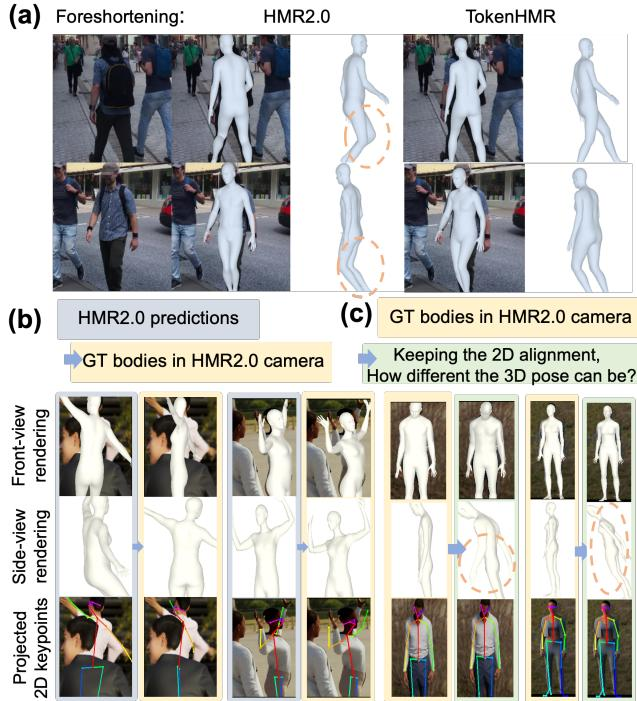
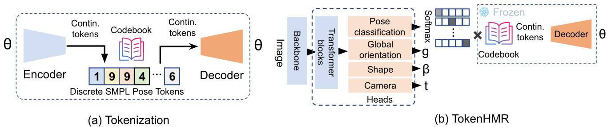
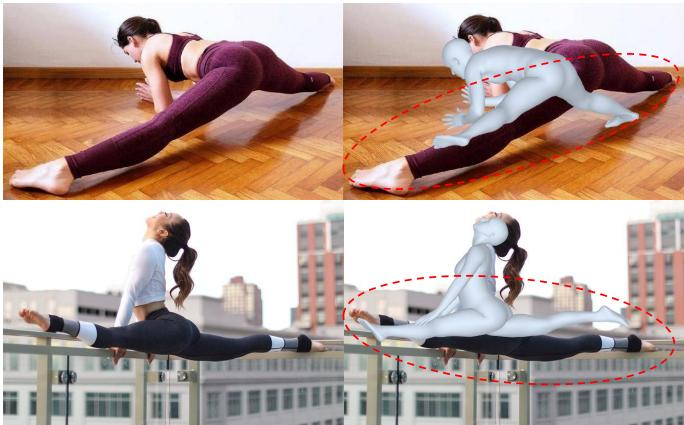

# TokenHMR：利用Token化姿态表征推进人体网格恢复

Sai Kumar Dwivedi1,\* Yu Sun2,∗ Priyanka Patel1 Yao Feng1,2,3 Michael J. Black1 1Max Planck Institute for Intelligent Systems, Tubingen, Germany ¨ 2Meshcapade 3ETH Zurich

  
Figure 1. 现有的从图像回归三维人体姿态与形状（HPS）的方法（如 HMR2.0 [12]）估计出的人体，要么与图像对齐，要么具有准确的三维姿态，但无法二者兼得。我们表明这是现有方法面临的一项根本性权衡。为了解决这一问题，我们的方法 TokenHMR 引入了一种新颖的损失函数——阈值自适应损失缩放（Threshold-Adaptive Loss Scaling，TALS），以及一种基于离散 token 的三维姿态表征。借助这些技术，TokenHMR 在多个野外（in-the-wild）三维基准数据集上均取得了最先进的精度。

## 摘要

我们研究了从单张图像回归三维人体姿态与形状的问题，重点关注三维精度。目前最优的方法利用了大规模的三维伪真值（pseudo-ground-truth，p-GT）和二维关键点数据集，从而取得了稳健的性能。然而，在这些方法中，我们观察到一个矛盾现象：随着二维精度的提高，三维姿态精度反而下降。这是由于 p-GT 中的偏差以及近似相机投影模型的使用造成的。我们量化了当前相机模型引起的误差，并表明精确拟合二维关键点和 p-GT 会导致错误的三维姿态。我们的分析界定了最小化二维和 p-GT 损失反而有害的无效距离范围。基于此，我们构建了一种新的损失函数——“阈值自适应损失缩放”（TALS），该损失函数惩罚显著的二维和 p-GT 误差，但对较小的误差不作惩罚。在采用这种损失函数的情况下，存在许多可以同等解释二维线索的三维姿态。为了消除这种歧义，我们需要对有效的人体姿态引入先验，但此类先验可能会带来不良偏差。为了解决这一问题，我们利用了人体姿态的 token 化表征，并将该问题重新表述为 token 预测任务。这限制了估计的姿态落在有效姿态空间内，有效地提高了对遮挡的鲁棒性。在 EMDB 和 3DPW 数据集上的广泛实验表明，我们重新构建的损失函数和 token 化表征使我们能够利用野外数据进行训练，同时在三维精度上超越了当前最先进水平。我们的模型和代码可在 https://tokenhmr.is.tue.mpg.de 获取，以供学术研究使用。

## 1. 引言

我们研究从单张图像回归三维人体姿态与形状（HPS）的问题。近期的方法 [3, 12, 32, 49] 在这一任务上的精度越来越高。

所谓准确，包含两层含义。一个方法既应该能够正确回归出 3D 姿态，又应该与图像证据对齐。不幸的是，当前的模型无法兼顾两者。我们观察到一个看似矛盾的现象：一个方法拟合 2D 关键点越准确，其预测 3D 姿态的准确度反而越低。我们研究了这一问题，并指出常用的弱透视相机（weak-perspective camera）假设是主要根源。该相机模型与采集图像时所用的真实相机不匹配，从而导致投影的 3D 关节点与检测到的 2D 关节点之间存在不匹配。由于目前尚无可靠的方法能从单张图像中估计相机参数，我们对这一效应进行了研究和量化，并提出了两种解决方案来解决该问题。

具体而言，我们使用了合成数据集 BEDLAM [3]，该数据集具有完美的 3D 和 2D 真实值（groundtruth，GT）。我们使用来自 [12] 的相机模型将 3D 数据投影到 2D，以量化最佳情况下的 2D 误差；该误差很大。随后我们还进行了反向验证，表明较低的 2D 误差可能导致较大的 3D 误差。即使使用像 [32] 这样的完全透视模型也无法解决该问题，因为我们缺乏精确的相机内参和外参。

这一分析突出了使用 2D 关键点损失监督 3D 姿态回归所存在的问题。然而，此类损失使得利用大规模数据集成为可能，从而提供了泛化性和鲁棒性。不幸的是，伪真实值（pseudo ground-truth，p-GT）训练数据也面临同样的问题，因为它是通过使用近似相机模型将 3D 人体拟合到 2D 数据进行优化而生成的。我们该如何在减轻 3D 精度下降的同时，充分利用大规模自然场景（in-the-wild）数据集中存在的丰富信息？我们的答案是 TokenHMR，这是一种新的人体姿态与形状（Human Pose and Shape，HPS）回归方法，它在有效利用 2D 关键点与保持 3D 姿态精度之间取得了平衡，从而能够在未知相机参数的情况下利用当今的互联网数据。

TokenHMR 包含两个主要部分。第一部分基于我们的核心洞见：来自 2D 关键点的监督虽然存在缺陷，但在防止出现严重错误预测方面仍然很有价值。然而，过度依赖 2D 线索会引入偏差。为了解决这个问题，我们定义了一种名为阈值自适应损失缩放（Threshold-Adaptive Loss Scaling，TALS）的新损失函数，它对较大的 2D 和 p-GT 误差进行惩罚，但对较小的误差仅施加极小的惩罚。我们利用 BEDLAM 的分析来定义该损失，从而避免鼓励网络在给定相机模型的情况下对 2D 关键点进行超出合理范围的过度拟合。

然而，这引发了一个新问题。从二维关键点预测三维姿态在本质上具有多义性。当放宽关键点匹配约束时，会有更多的三维姿态与二维数据相吻合。为了控制这一现象，我们需要引入一种先验，引导网络偏向有效姿态。不幸的是，现有的基于高斯混合模型 [4] 或 VAE [42] 的姿态先验往往偏向于在训练数据中频繁出现的姿态。相反，我们寻求一种无偏先验，它限制网络仅输出有效姿态，但不会偏向任何特定姿态。

这就引出了 TokenHMR 的第二个关键组件，该方法也由此得名。具体而言，我们通过对人体姿态进行词元化（tokenizing），将连续姿态回归问题转化为词元预测问题。我们使用矢量量化变分自编码器（Vector Quantized-VAE, VQ-VAE）[53]，通过在 AMASS [37] 和 MOYO [52] 等大规模动作捕捉数据集上进行预训练，将连续的人体姿态离散化。这种词元化表征为回归器提供了一个有效姿态的“词汇表”，有效地将姿态先验表示为一个知识库——码本（codebook）。由于 VQ-VAE 旨在表示均匀先验，我们认为这能够减少以往姿态先验所带来的偏差。

与回归连续姿态不同，TokenHMR 通过分类生成离散词元。当我们采用一种 SOTA 人体姿态与形状估计（HPS）方法，并用我们的词元化姿态方法替换其连续姿态方案时，在保持其他条件不变的情况下，三维精度获得了持续提升。

我们进行了广泛的实验，以评估不同的姿态词元化方式及其对精度的影响。姿态的任何离散化都会带来一定的精度损失。在我们的实验中，它导致约 2.5mm 的三维精度损失，这比最先进的（SOTA）HPS 回归器在真实数据上的误差小 20 倍；换言之，词元化带来的精度损失是微不足道的。

最后，我们将这两个组件结合在一起，发现它们能够发挥协同作用。我们的新损失函数不会为了过拟合关键点或伪真值（p-GT）而扭曲三维姿态，而词元化则防止了网络为了追求二维精度而扭曲三维姿态。通过这种结合，我们在三维精度方面取得了新的当前最佳水平（SOTA）。我们在具有精确三维真值的 EMDB [23] 和 3DPW [55] 数据集上，对 TokenHMR 以及其他近期的先进方法进行了全面评估。在采用相同数据和骨干网络的情况下，TokenHMR 在具有挑战性的 EMDB 数据集上相比 HMR2.0 [12]，三维误差降低了 7.6%。定性结果表明，TokenHMR 对模糊的图像证据具有较强的鲁棒性，且估计出的姿态不会出现使用 p-GT 和二维关键点的方法中常见的“屈膝（bent knees）”偏差（见 Fig. 1）。

总的来说，我们做出了以下主要贡献：(1) 3D 精度退化分析：我们分析并量化了当前 HPS 方法在使用 2D 损失时所面临的 3D 与 2D 精度之间的权衡问题。(2) 阈值自适应损失缩放（Threshold-Adaptive Loss Scaling）：为缓解该问题，我们开发了一种新颖的损失函数，该函数降低了小于因错误相机模型所导致的预期误差的 2D 和 p-GT 误差的影响。(3) 基于分词的姿态表示（Token-Based Pose Representation）：我们引入了一种用于人体姿态的基于分词的表示方法，并证明其能够产生更准确的姿态估计。我们的模型和代码已公开可供研究使用。

## 2. 相关工作

## 2.1. HPS 回归

从单张图像估计 3D 人体姿态和形状已得到极其详尽的研究，涵盖了从基于优化的方法到最新的基于 Transformer 的回归器。优化方法将参数化模型 [36, 42, 59] 拟合到 2D 图像线索，包括但不限于关键点 [4, 42, 59]、轮廓 [41] 以及部位分割 [30]。一些基于学习的方法直接从图像 [6, 8, 9, 21, 25, 32, 48, 49, 61] 和视频 [22, 24] 中估计参数化人体模型，而另一些方法则采用无模型方法将人体估计为顶点 [28, 34, 46] 或隐式形状 [39, 45, 58]。最近的方法 [12, 33] 使用 Transformer 来估计 3D 人体，取得了目前最佳的精度。为了应对泛化性挑战，最近的方法如 EFT [20]、NeuralAnnot [40]、HMR2.0 [12] 和 CLIFF [32] 在训练损失中使用了 2D 关键点和 p-GT，以在投影人体和图像之间产生良好的对齐效果。像 HuManiFlow [47] 和 POCO [9] 这样的方法对概率 HPS 进行建模，以明确解决姿态二义性问题。在追求更好 2D 对齐的过程中导致 3D 精度退化的问题已被注意到，但在我们的工作之前尚未进行过广泛的量化。我们的统计分析突出了现有 HMR 方法中的这种偏差，为该问题的训练策略提供了新的视角。

一些方法 [26, 32, 56] 通过从单张图像估计相机来解决 3D 到 2D 的投影误差。SPEC [26] 使用网络预测相机参数但泛化能力不佳，而 CLIFF [32] 则通过向网络提供图像中人物边界框坐标的信息来进行近似。从单张图像估计相机是一个高度病态（ill-posed）的问题，因此这仍然是一个具有挑战性且未解决的问题。我们的方法减轻了使用错误相机模型的影响，并且可以应用于任何 HPS 回归方法。

## 2.2. 姿态先验

人体姿态先验在诸如将 2D 姿态提升至 3D [4, 42] 以及从图像/视频中估计人体姿态 [20, 29] 等各种应用中发挥着关键作用。早期的姿态先验侧重于学习关节极限 [1]，以避免出现不可能的姿态。高斯混合模型（GMMs）[4] 和生成对抗网络（GANs）[11, 21] 也被用于在训练过程中引入先验知识。一些近期的研究使用 VAE [42] 和归一化流（normalizing flows）[29] 作为先验。这些方法大多偏向于常见姿态，且这种偏差会传递给回归器。像 Pose-NDF [51] 这类方法学习合理姿态的流形，并将其表示为神经隐式函数的零水平集（zero-level set）。将无效姿态映射到有效姿态需要进行梯度下降，这在集成到 HPS 训练中时是一项代价高昂的操作。与以往的工作不同，我们学习了针对有效 SMPL 姿态的基于离散 token 的先验，在减少姿态偏差并提高对遮挡的鲁棒性的同时，易于集成到 HPS 训练中。

  
Figure 2. 相机/姿态偏差问题的可视化。(a) 缺乏正确的焦距意味着像 HMR2.0 这类方法会将透视缩短（foreshortened）的腿部估计为弯曲状态；(b) 将预测的人体姿态替换为真实值（ground truth）揭示了相机偏差；(c) 在保持 2D 对齐的情况下，3D 姿态可能会错得有多离谱？详见第 3 节。

我们使用 VQ-VAE [53]（VAE 的一种变体），通过在称为“Tokenization”（词元化）的过程中对 3D 训练姿态进行量化来学习离散化先验，从而创建一个知识库（即码本 codebook）。Tokenization 广泛应用于图像合成 [44, 53]、文本生成图像 [43]、2D 人体姿态估计 [10] 以及学习动作先验 [18, 62] 等各类应用中。在人体姿态估计领域，尽管 Tokenization 在人体动作生成中已得到广泛应用 [14, 62]，但其仍相对缺乏探索。当然，图像和语言的 token 化表示已在许多视觉和语言问题中得到广泛使用。我们方法的新颖之处在于将回归问题重新表述为姿态 token 分类问题。因此，该方法利用 Tokenization 来表示有效姿态，有效地提供了姿态先验。

## 3. 相机/姿态偏差

估计 3D 人体姿态与形状（3D HPS）的方法通常试图满足两个目标：精确的 3D 姿态以及与 2D 图像特征的精确对齐。不幸的是，我们在所有实验中都观察到一种趋势——某种方法在 2D 误差上的表现越好，在 3D 上的表现就越差，反之亦然。造成这种情况的关键原因在于，当前的方法（包括本文测试的方法）并不估计相机内参（例如焦距）或相机外参（旋转和平移）。相反，当前方法使用弱透视投影（scaled orthographic projection）或带有固定且不正确相机参数的透视投影来估计相机坐标系下的人体。这导致真实的 3D 关节点与其 2D 投影之间存在不匹配。具体而言，由于照片通常是从大约眼睛的高度拍摄的，腿部比上半身距离相机更远。这导致它们产生透视缩短（foreshortening）效应。训练模型以最小化 2D 误差会迫使其生成不正确的 3D 姿态；如图 2 (a) 所示。用于 2D 姿态数据集的伪真值（p-GT）是通过在存在问题的相机参数下最小化 2D 误差获得的。完全信任此类 p-GT 并追求对此类标注的精确学习将使该问题更加突出。注意透视缩短是如何使腿在图像中看起来更短的。使人体与此拟合的唯一方法是在膝盖处弯曲腿部或在 3D 空间中倾斜身体，使腿部距离更远。这会产生不自然或不稳定的姿态。

这是当前所有方法普遍存在的根本问题，在不知道相机参数的情况下，不可能同时在 3D 和 2D 上获得较低的误差。为了量化评估这种不匹配的影响，我们采用了 BEDLAM [3]，这是一个合成数据集，其中 3D 和 2D 数据以及相机参数都是完全已知的。这消除了任何可能的噪声，使我们能够观察到使用错误相机对 2D 投影误差的影响。具体来说，如图 2 (b) 所示，我们获取 BEDLAM 的人体真值，并使用 HMR2.0 [12] 的相机将其投影到图像中。

我们使用正确关键点百分比（PCK）这一标准指标来评估错误相机在 2D 上的影响，我们在 BEDLAM 验证集的一个序列上计算了该指标。HMR2.0b 计算出的 3D 人体在 PCK0.5 上的结果为 0.78，在 PCK1.0 上为 0.88。相比之下，当我们将 HMR2.0b 的相机与 3D 人体真值结合使用时，PCK 分数在 PCK0.5 上下降至 0.66，在 PCK1.0 上下降至 0.86。理想情况下，在拥有正确相机模型的情况下，PCK0.5 和 PCK1.0 都应该达到 1.0。HMR2.0b 比真值获得更低误差（即表现更好）这一事实表明，由于相机偏差，其输出偏离了真实的 3D 姿态和形状。这表明，像 HMR2.0b 这样的方法虽然获得了较高的 PCK 值，但这是以牺牲 3D 精度为代价的。总之，除非拥有正确的相机模型，否则追求高 PCK 值会对 3D 精度适得其反。

我们进一步设计了实验，以探究在保持良好 2D 对齐的同时，3D 误差可能严重到何种程度。我们修改了 SMPLify [4] 的损失函数，以保持预测的 2D 关键点与 GT（真实值）2D 关键点 $\scriptstyle J _ { 2 D _ { g } }$ 之间的距离尽可能小，同时添加了一个新的损失项来增大预测的 3D 关键点 $J _ { 3 D }$ 与真实 3D 关键点 $\ J _ { 3 D _ { g } }$ 之间的距离，如下式所示：

$$
w _ {2 D} | | \Pi (\boldsymbol {J} _ {\boldsymbol {3 D}}, \boldsymbol {T}) - \boldsymbol {J} _ {\boldsymbol {2 D} _ {g}} | | _ {2} - w _ {3 D} | | \boldsymbol {J} _ {\boldsymbol {3 D}} - \boldsymbol {J} _ {\boldsymbol {3 D} _ {g}} | | _ {2} + m\tag{1}
$$

其中 $\Pi$ 表示使用 HMR2.0 的相机进行的 3D 到 2D 投影，$m \ = \ 2 0$ 为边际值（margin），$w _ { 2 D } ~ = ~ 4$ 和 $w _ { 3 D } ~ = ~ 4 0 . 5$ 为标量权重。经过 100 次迭代优化后，每关节平均位置误差（MPJPE）达到了 146mm。如图 Fig. 2 (c) 所示，即使在深度方向存在显著误差，投影后的 3D 姿态仍能保持高度的 2D 对齐。当优化进行到 200 次迭代时，MPJPE 超过了 300mm，并且随着进一步的优化，误差还会继续增加。

鉴于该领域目前尚缺乏从单张图像中估计相机参数的可靠方法，下文我们将探讨我们的新方法（TALS 和 tokenization）在缓解近似相机模型所导致的问题方面的能力。Figure 2 (a) 对比了 HMR2.0 与 TokenHMR 的结果。请注意，透视缩短效应（foreshortening）对 TokenHMR 姿态的影响较小。

## 4. TokenHMR

## 4.1. 预备知识

我们的方法 TokenHMR 输入一张图像 I，并输出人体姿态 $\theta$、体型 $\beta$ 和透视相机参数 T。我们使用 SMPL [36]，这是一种可微分的参数化人体模型。其输入参数包括表示姿态的 $\theta \in \mathbb { R } ^ { 7 2 }$ 和表示体型的 $\beta \in \mathbb { R } ^ { 1 0 }$。作为输出，它生成人体网格 M 和顶点 $V \in \mathbb { R } ^ { N X \bar { 3 } }$，其中 $N = 6 8 9 0$ 为顶点数量。记为 $J _ { 3 D }$ 的 3D 关节点是通过使用预训练的关节点回归器对网格顶点进行线性组合得出的。

## 4.2. 阈值自适应损失缩放：TALS

在第 3 节中，我们的分析揭示了阻碍有效利用伪真值（pseudo-ground-truth）和 2D 关键点进行学习的一个显著障碍——相机/姿态偏差（camera/pose bias）。尽管存在这一挑战，此类标注所提供的数据规模对于实现最佳泛化能力和鲁棒性仍然至关重要。我们认为，如果能够合理利用且不过拟合，这些标注将显著增强模型稳健估计姿态的能力。从我们的观察中得出了一个关键见解：必须建立一个有效阈值，以辨别出哪些误差水平作为训练信号不再产生额外收益。当损失超过该阈值时，传统的学习机制将引导姿态估计。相反，当损失低于该有效阈值时，我们将最小化其影响，以防止对相机/姿态偏差产生过拟合。

为了确定该有效阈值，我们分析了使用真实值（GT）3D 姿态和标准（不正确）相机模型所获得的误差。我们再次利用 3D

  
Figure 3. 框架概述。我们的方法分为两个阶段。(a) 在标记化（tokenization）步骤中，编码器学习将连续姿态映射到离散姿态标记（tokens），解码器尝试重构原始姿态。(b) 为了训练 TokenHMR，我们使用预训练的解码器将回归替换为分类，该解码器提供了一个有效姿态的“词表”。

## 4.3. Tokenization

BEDLAM [3] 中的 GT，这次是为了给 2D 关键点和 SMPL 伪真值建立有效阈值。对于 2D 关键点，我们用 BEDLAM 的真值替换预测的 SMPL 参数，以获取在 HMR2.0 相机下真实 3D 人体的 2D 关键点投影。随后，我们计算这些投影与 GT 2D 关键点之间的平均 L1 范数，并将其用作 2D 关键点监督的阈值 $\varepsilon J _ { 2 D }$。我们将这些 2D 关键点相对于图像宽度进行归一化，并将数值缩放到 -0.5 到 0.5 之间，以减轻与尺度相关的方差。

类似地，为了建立 SMPL p-GT 的有效监督阈值，我们进行了额外的实验。对于 p-GT，我们将姿态损失形式化为关节角误差。为了对这些误差设定合适的阈值，我们评估了 HMR2.0 在 BEDLAM 上的预测与 SMPL 模型中每个关节真值之间的关节角差异。具体而言，我们计算了 HMR2.0 预测的 SO(3) 旋转流形上的 3D 关节旋转与 BEDLAM 中真值旋转之间的平均测地距离\*。具体阈值请参见补充材料中的第 B.2 节。

在确定了 2D 关键点和 SMPL p-GT 的有效阈值后，我们引入了一种名为阈值自适应损失缩放（Threshold-Adaptive Loss Scaling, TALS）的新损失。该方法仅在损失低于阈值时对其进行缩小。具体而言，针对 p-GT 姿态和 2D 关节的 TALS 损失项定义为

$$
\mathcal {L} _ {\boldsymbol {\theta} _ {p G T}} = \left\{ \begin{array}{l l} \| \boldsymbol {\theta} - \boldsymbol {\theta} _ {g} \| ^ {2} & \text { if } \mathcal {L} _ {\boldsymbol {\theta} _ {p G T}} > \varepsilon_ {\boldsymbol {\theta}} \\ \alpha_ {\boldsymbol {\theta}} \cdot \| \boldsymbol {\theta} - \boldsymbol {\theta} _ {g} \| ^ {2} & \text { otherwise } \end{array} \right.\tag{2}
$$

$$
\mathcal {L} _ {J _ {2 D _ {p G T}}} = \left\{ \begin{array}{l l} | J _ {\mathbf {2 D}} - J _ {\mathbf {2 D} _ {g}} | & \text {if \mathcal {L} _{J_{2D_{pGT}}} > \varepsilon_ {J_{2D}}} \\ \alpha_ {J _ {2 D}} \cdot | J _ {\mathbf {2 D}} - J _ {\mathbf {2 D} _ {g}} | & \text {otherwise} \end{array} \right.\tag{3}
$$

其中 $\alpha _ { J _ { 2 D } }$ 和 $\alpha \theta$ 为较小的标量乘子，$\varepsilon _ { \theta }$ 是针对每个姿态参数分别计算的阈值，$\varepsilon J _ { 2 D }$ 是 2D 关节点的阈值。

我们使用 VQ-VAE [53] 来学习 3D 姿态在离散表示中的编码。具体而言，我们学习 SMPL 人体参数 $\theta \ =$ $[ \theta _ { 1 } , \theta _ { 2 } , \ldots , \theta _ { 2 1 } ]$ 的离散表示，其中 $\theta _ { i }$ 表示每个关节点在 $\mathbb { R } ^ { 6 }$ 中的姿态参数。该过程涉及使用自编码器架构和可学习码本（表示为 $C B = \{ c _ { k } \} _ { k = 1 } ^ { K } ,$ ，每个码字 $c _ { k } \ \in \ \mathbb { R } ^ { d _ { c } }$ ，其中 $d _ { c }$ 为码字维度）对姿态参数进行编码和解码。姿态 VQ-VAE 的整体架构如图 3 (a) 所示。自编码器的编码器和解码器分别由 E 和 $D ,$ 表示。编码器负责生成离散姿态 token，而解码器将这些 token 重建回 SMPL 姿态。潜在特征 z 可计算为 $z = E ( \theta )$ ，得到 $z = [ z _ { 1 } , z _ { 2 } , \dots , z _ { M } ]$ ，其中 $z _ { i } \in \mathbb { R } ^ { d _ { c } }$ 且 M 为 token 的数量。每个潜在特征 $z _ { i }$ 通过在码本 CB 中寻找最相似的码字元素进行量化，如下式所示：

$$
\hat {z} _ {i} = \underset {c _ {k} \in \boldsymbol {C B}} {\arg \min} \| z _ {i} - c _ {k} \| _ {2}.\tag{4}
$$

在训练姿态分词器（tokenizer）时，我们采用了与先前工作 [53] 类似的策略，该策略涉及三个主要的损失函数来优化分词器：重建损失 $( \mathcal { L } _ { \mathcal { R } \mathcal { E } } )$ 、嵌入损失 $( \mathcal { L } _ { \mathcal { E } } )$ 以及承诺损失（commitment loss）$( \mathcal { L } _ { \mathcal { C } } )$ 。总损失 $( \mathcal { L } _ { \mathcal { V } \mathcal { Q } } )$ 定义为

$$
\begin{array}{r l} & {\mathcal {L} _ {\mathcal {V Q}} = \lambda_ {\mathcal {R E}} \mathcal {L} _ {\mathcal {R E}} + \lambda_ {\mathcal {E}} \mathcal {L} _ {\mathcal {E}} + \lambda_ {\mathcal {C}} \mathcal {L} _ {\mathcal {C}}} \\ & {\qquad = \lambda_ {\mathcal {R E}} \mathcal {L} _ {\mathcal {R E}} + \lambda_ {\mathcal {E}} | | s g [ z ] - e | | _ {2} + \lambda_ {\mathcal {C}} | | z - s g [ e ] | | _ {2}} \end{array}\tag{5}
$$

其中 $s g$ 是停止梯度算子，e 是来自码本（codebook）的嵌入，$\lambda _ { \mathcal { R } \mathcal { E } } , \lambda _ { \mathcal { E } } , \lambda _ { \mathcal { C } }$ 是各项的超参数。对于重构，我们在真实姿态 $\theta _ { g }$ 与预测姿态 θ 之间使用 $\mathcal { L } _ { 1 }$ 损失，同时也在 SMPL 真实 3D 关节点 $J _ { 3 D _ { g } }$ 与预测关节点 $J _ { 3 D }$ 之间的误差上使用该损失。因此，$\mathcal { L } _ { \mathcal { R } \mathcal { E } }$ 损失定义为

$$
\mathcal {L} _ {\mathcal {R E}} = \mathcal {L} _ {1} (\boldsymbol {\theta} _ {g}, \boldsymbol {\theta}) + \mathcal {L} _ {1} (J _ {3 D _ {g}}, J _ {3 D}).\tag{6}
$$

原始的 VQ-VAE 存在码本坍缩问题，即码本未被充分利用。遵循先前的工作 [62]，我们采用指数移动平均（EMA）和码本重置（Code Reset）的训练策略以提高利用率。

## 4.4. 架构

我们的架构利用了 Vision Transformer (ViT) [7]，类似于 HMR2.0 [12]。输入图像 I 首先被转换为输入 token，随后由 Transformer 进行处理以生成输出 token。这些输出 token 接着在 Transformer 解码器中进行进一步处理。Transformer 解码器具有多头自注意力机制，通过将零输入 token 与图像输出 token 进行交叉注意力计算，从而从 Transformer 块中提取特征。与 HMR2.0 [12] 采用三个线性层将来自 Transformer 块的特征映射到 SMPL 姿态 θ、体型 $\beta$ 和相机 T 不同，我们提出了一种新颖的方法。我们的目标是利用在大规模动作捕捉（mocap）数据上训练的 tokenizer，特别是专注于身体姿态。为了实现这一点，我们将 SMPL 姿态参数划分为身体姿态和全局朝向。我们使用独立的线性层从 tokenizer 预测全局朝向和身体姿态。

分词器（tokenizer）的一种直接整合方式是直接从 ViT Transformer 骨干网络估计编码索引，并根据该编码索引从码本 CB 中选取嵌入 $e$。然而，从码本中选取嵌入的过程是不可微的，这带来了一定挑战。为了解决这一问题，我们采用了一种基于 logit 的方法。我们没有直接估计编码索引，而是为每个 token 输出 logits $Q$。将这些 logits 与码本相乘，即可得到加权嵌入。因此，近似的量化特征 $\hat { z } = [ \hat { z } _ { 1 } , \hat { z } _ { 2 } , . . . , \hat { z } _ { M } ]$ 可以计算为

$$
\bar {z} = \sigma (\pmb {Q} _ {M \times K}) \times \pmb {C B} _ {K \times D} \approx \hat {z}\tag{7}
$$

其中，$Q$ 是骨干网络估计的 logits，$\sigma$ 表示 softmax 操作，CB 是预训练的码本，$M$ 是 token 的数量，$K$ 是码本中的条目数，$D$ 是每个码本条目的维度。该操作使其变得可微。随后，将获得的近似量化特征 z¯ 输入到分词器解码器中。该过程生成最终的人体姿态。在 TokenHMR 的训练过程中，训练好的分词器解码器被冻结，以利用其从动捕数据（mocap data）中学到的先验信息。

## 4.5. 损失函数

遵循先前的工作 [12, 25]，我们分别在 2D 和 3D 关节点以及 SMPL 姿态和形状参数上定义了损失函数，即分别针对 $J _ { 2 D } , J _ { 3 D } , \theta , \beta$。然而，根据第 4.2 节的分析，我们对来自 2D 和 3D 数据集的数据进行了区别处理。对于包含 3D 真值的数据集，我们将标准损失定义为

$$
\begin{array}{r} \mathcal {L} _ {G T} = \lambda_ {\theta} \mathcal {L} _ {\theta} (\pmb {\theta}, \pmb {\theta} _ {g}) + \lambda_ {\beta} \mathcal {L} _ {\beta} (\pmb {\beta}, \pmb {\beta} _ {g}) + \\ \lambda_ {3 D} \mathcal {L} _ {3 D} (\pmb {J} _ {3 D}, \pmb {J} _ {3 D _ {g}}) + \lambda_ {2 D} \mathcal {L} _ {2 D} (\pmb {J} _ {2 D}, \pmb {J} _ {2 D _ {g}}) \end{array}\tag{8}
$$

其中 $\mathcal { L } _ { \beta }$ 是 SMPL 形状损失，$\mathcal { L } _ { J _ { 3 D } }$ 是 3D 关节点损失，$\mathcal { L } _ { J _ { 2 D } }$ 是关节点重投影损失。$\lambda _ { \beta } , \lambda _ { 3 D }$ 和 $\lambda _ { 2 D }$ 是对应各调整项的权重。为了从 SMPL 伪真值中进行学习，我们使用阈值自适应损失缩放（Threshold-Adaptive Loss Scaling, TALS），依据第 4.2 节中计算并在公式 2 和公式 3 中概述的阈值来缩放损失。因此，总损失定义为

$$
\mathcal {L} _ {T o t a l} = \mathcal {L} _ {G T} + \mathcal {L} _ {\theta_ {p G T}} + \mathcal {L} _ {J _ {2 D _ {p G T}}}.\tag{9}
$$

## 5. 实验

## 5.1. 实现细节

TokenHMR 的训练包含两个阶段：首先，我们使用 AMASS [37] 和 MOYO [52] 动作捕捉（mocap）数据训练一个分词器（tokenizer），以学习离散姿态表示。然后，我们使用分词器的预训练解码器作为回归身体姿态的额外头部。在 TokenHMR 的训练过程中，分词器被冻结以利用该先验。

我们的分词器架构灵感来自 T2M-GPT [62]，但不同于学习 3D 关节点的动作 token（motion tokens），我们学习的是 SMPL 姿态参数的姿态 token（pose tokens）。我们在编码器和解码器中均使用 1 个 ResNet [15] 块和 4 个一维卷积（1D convolutions）。引导权重 $\lambda _ { \mathcal { R } \mathcal { E } } , \lambda _ { \mathcal { E } } , \lambda _ { \mathcal { C } }$ 分别设置为 50.0、1.0、1.0。模型训练 150K 次迭代，批大小为 256，学习率为 $2 e ^ { - 4 } .$。为了训练鲁棒的模型，我们从 $1 e ^ { - 3 }$ 的噪声开始对随机关节点进行数据增强，并在每 5K 次迭代后逐步增加噪声。我们根据验证集上的重构误差，为 TokenHMR 选择了包含 160 个 token 和大小为 2048 × 256 的码本（codebook）的最佳分词器模型。

对于 TokenHMR，我们遵循 HMR2.0 [12]，使用 ViT-H/16 [7] 作为骨干网络（backbone），并采用标准 Transformer 解码器 [54]。我们使用 4 个独立的线性层将来自 Transformer 解码器的大小为 1024 的特征映射到 SMPL 的全局朝向、手部姿态、身体形状，以及一个用于相机。然而，对于身体姿态，我们通过 4 个线性层块处理这 1024 维特征，每个块包含 2 个 MLP 和一个 GELU 激活函数 [16]。这产生了大小为 160 × 2048 的最终 logits $Q$，用于与大小为 $2 0 4 8 \times 2 5 6$ 的码本相乘，从而得到近似量化特征 $\bar{z}$；参见 Eq. 4。我们使用 ViT-Pose [60] 作为预训练骨干网络。我们在 4 块 Nvidia RTX 6000 GPU 上训练 100K 次迭代，批大小为 256，学习率为 $1 e ^ { - 5 }$，耗时约一天。引导权重 $\lambda _ { \theta } , \lambda _ { \beta } , \lambda _ { J _ { 2 D } } , \lambda _ { J _ { 3 D } }$ 分别设置为 $1 e ^ { - 3 } , 5 e ^ { - 4 }$ $1 e ^ { - 2 } , \bar { 5 } e ^ { - 2 }$。TALS 的损失权重对于姿态 $\alpha \theta$ 和 2D 关键点 $\alpha _ { J _ { 2 D } }$ 均设置为 1%。

<table><tr><td rowspan="2">训练数据集</td><td rowspan="2">方法</td><td colspan="3">EMDB [23]</td><td colspan="3">3DPW [55]</td></tr><tr><td>MVE</td><td>MPJPE</td><td>PA-MPJPE</td><td>MVE</td><td>MPJPE</td><td>PA-MPJPE</td></tr><tr><td>SD</td><td>HybrIK [31]</td><td>122.2</td><td>103.0</td><td>65.6</td><td>94.5</td><td>80.0</td><td>48.8</td></tr><tr><td>SD</td><td>CLIFF [32]</td><td>122.9</td><td>103.1</td><td>68.8</td><td>81.2</td><td>69.0</td><td>43.0</td></tr><tr><td>SD</td><td>HMR2.0 [12]</td><td>120.1</td><td>97.8</td><td>61.5</td><td>84.1</td><td>70.0</td><td>44.5</td></tr><tr><td>BL</td><td>BEDLAM-CLIFF [3]</td><td>113.2</td><td>97.1</td><td>61.3</td><td>85.0</td><td>72.0</td><td>46.6</td></tr><tr><td>BL</td><td>HMR2.0</td><td>106.6</td><td>90.7</td><td>51.3</td><td>88.4</td><td>72.2</td><td>45.1</td></tr><tr><td>BL</td><td>TokenHMR</td><td>104.2</td><td>88.1</td><td>49.8</td><td>86.0</td><td>70.5</td><td>43.8</td></tr><tr><td>SD + ITW</td><td>HMR2.0 [12]</td><td>140.6</td><td>118.5</td><td>79.3</td><td>94.4</td><td>81.3</td><td>54.3</td></tr><tr><td>SD + ITW</td><td>TokenHMR</td><td>124.4</td><td>102.4</td><td>67.5</td><td>88.1</td><td>76.2</td><td>49.3</td></tr><tr><td>SD + ITW + BL</td><td>HMR2.0</td><td>120.7</td><td>99.3</td><td>62.8</td><td>88.4</td><td>77.4</td><td>47.4</td></tr><tr><td>SD + ITW + BL</td><td>HMR2.0 + TALS</td><td>115.7</td><td>96.7</td><td>58.5</td><td>89.6</td><td>73.5</td><td>46.8</td></tr><tr><td>SD + ITW + BL</td><td>HMR2.0 + Token</td><td>116.1</td><td>95.6</td><td>62.2</td><td>86.6</td><td>75.0</td><td>48.0</td></tr><tr><td>SD + ITW + BL</td><td>HMR2.0 + TALS + VPoser [42]</td><td>116.8</td><td>97.9</td><td>56.4</td><td>87.1</td><td>73.7</td><td>45.7</td></tr><tr><td>SD + ITW + BL</td><td>TokenHMR</td><td>109.4</td><td>91.7</td><td>55.6</td><td>84.6</td><td>71.0</td><td>44.3</td></tr></table>

Table 1. EMDB 和 3DPW 数据集上的 3D 人体网格与姿态误差。详见正文。

<table><tr><td rowspan="2">方法</td><td colspan="3">裁剪 30%</td><td colspan="3">裁剪 50%</td></tr><tr><td>MVE</td><td>MPJPE</td><td>PA-MPJPE</td><td>MVE</td><td>MPJPE</td><td>PA-MPJPE</td></tr><tr><td>HMR2.0 [12]</td><td>135.24 (+14.98)</td><td>113.39 (+14.13)</td><td>70.68 (+7.86)</td><td>166.71 (+46.45)</td><td>137.88 (+38.59)</td><td>90.30 (+27.48)</td></tr><tr><td>TokenHMR</td><td>124.09 (+14.71)</td><td>104.72 (+13.01)</td><td>62.13 (+6.52)</td><td>150.29 (+40.91)</td><td>125.99 (+34.28)</td><td>78.88 (+23.27)</td></tr></table>

Table 2. 从图像边界按不同比例均匀裁剪对 EMDB 数据集上 3D HPS 精度的影响。（括号）内的数字表示相对于未裁剪情况的性能变化；数值越小越好。此处对比的所有模型均采用相同的骨干网络并在相同的数据上进行训练。

<table><tr><td></td><td></td><td colspan="2">AMASS [37]</td><td colspan="2">MOYO [52]</td></tr><tr><td></td><td>方法</td><td>MVE ↓</td><td>MPJPE ↓</td><td>MVE ↓</td><td>MPJPE ↓</td></tr><tr><td rowspan="3">CB</td><td>1024 × 256</td><td>11.5</td><td>4.6</td><td>27.1</td><td>15.7</td></tr><tr><td>2048 × 128</td><td>9.4</td><td>3.1</td><td>22.5</td><td>12.3</td></tr><tr><td>2048 × 256</td><td>8.3</td><td>2.2</td><td>19.9</td><td>10.4</td></tr><tr><td rowspan="3">词元数</td><td>80</td><td>12.5</td><td>4.1</td><td>24.4</td><td>16.7</td></tr><tr><td>160</td><td>8.3</td><td>2.2</td><td>19.9</td><td>10.4</td></tr><tr><td>320</td><td>8.1</td><td>1.9</td><td>19.0</td><td>10.1</td></tr><tr><td rowspan="2">噪声</td><td>是</td><td>8.3</td><td>2.2</td><td>19.9</td><td>10.4</td></tr><tr><td>否</td><td>7.9</td><td>1.9</td><td>21.0</td><td>11.5</td></tr><tr><td colspan="2">AMASS + MOYO*</td><td>8.7</td><td>2.6</td><td>16.5</td><td>7.6</td></tr></table>

Table 3. 分词器（Tokenizer）消融实验。除最后一行⋆使用 MOYO 训练集进行训练外，所有方法均在 AMASS [37] 的标准训练集上进行训练，并在 AMASS 的测试集和 MOYO [52] 的验证集上进行评估。最后一个模型被用作 TokenHMR 中的分词器。

训练数据：为了训练分词器，我们使用了 AMASS [37] 的标准训练划分以及 MOYO [52] 的训练数据。有关训练数据准备的更多详细信息，请参阅补充材料（Sup. Mat.）。遵循以往的方法 [12, 25, 27]，我们使用标准数据集（SD）进行训练，包括 Human3.6M [17]、MPI-INF-3DHP [38]、COCO [35] 和 MPII [2]。此外，与 HMR2.0b 类似，我们还使用了真实场景 2D 数据集（ITW），如 InstaVariety [22]、AVA [13] 和 AI Challenger [57] 数据集及其伪真值（p-GT）进行训练。我们还加入了 BEDLAM (BL) [3]，这是一个具有精确真实 3D 数据的合成数据集。为了公平比较，我们结合 SD、ITW 和 BL 数据集重新训练了 HMR2.0b。我们选择 HMR2.0b 作为基线模型，因为其代码是开源的且我们能够复现其结果。

评估与指标：针对分词器的准确性，我们报告了平均顶点误差（MVE）和每关节平均位置误差（MPJPE），并在 AMASS 的标准测试划分和 MOYO 的验证集上进行评估。对于 TokenHMR，我们报告了预测值与真值之间的平均顶点误差（MVE）、每关节平均位置误差（MPJPE）以及普氏对齐后的每关节平均位置误差（PA-MPJPE）。我们在 3DPW [55] 和 EMDB [23] 数据集的测试集上进行评估。前者是一个标准 3D 数据集，后者是最新发布且更具挑战性的数据集，包含多变的相机运动和丰富的 3D 姿态。

## 5.2. 如何缓解 3D 退化问题？

Table 1 展示了仅使用 SD 数据集训练的 HMR2.0 模型的性能，以及同时使用 SD 和 ITW 数据集训练时的性能。我们观察到，在加入 ITW 数据后，模型在 EMDB 数据集上的 3D 精度显著下降（超过 17%）。与此同时，根据 HMR2.0 [12] 论文中的 Table 2，ITW 数据提升了该方法的 2D 性能。应对这一趋势的一种直接方法是整合更多带有精确 3D 标注的数据，例如 BEDLAM [3]。然而，正如 Table 1 所示，即使加入了 BEDLAM，HMR2.0 (SD+ITW+BL) 仍然存在明显的 3D 指标退化。这一观察构成了我们进一步研究的基准。

  
Figure 4. 在 LSP [19] 数据集的挑战性姿态上的定性比较。

采用我们新颖的损失函数形式（TALS）在 EMDB 和 3DPW 数据集上均取得了显著的性能提升，表明其在防止对带噪声的伪真值（p-GT）数据过拟合方面的有效性。虽然 TALS 带来了性能提升，但我们进一步深入探索姿态先验以弥补监督信号的减弱。我们对 HPS 中常用的 VAE 先验 VPoser [42] 进行了评估，结果仅获得了微弱的改进，这表明需要一种更鲁棒的替代方案。我们基于 VQ-VAE 的姿态标记化（pose tokenization）方法带来了更大的提升。TokenHMR 显著优于 HMR2.0，在 EMDB 上 MVE 改善了 9%、MPJPE 改善了 7.6%，PA-MPJPE 改善了 11.5%。在 3DPW 上也观察到了相同的趋势。

## 5.3. 基于 Token 的先验如何发挥作用？

除了如上文讨论的促进更有效的学习之外，我们还在图像信息模糊的场景（如截断）中检验了离散的基于 token 的先验的有效性。我们在 EMDB 数据集上评估了我们的方法在不同程度图像裁剪下的表现。具体而言，我们从图像边界裁剪了 30% 和 50%。如 Table 2 所示，与 HMR2.0 [12] 相比，我们的方法在具有挑战性的截断设置下（50% 对比 30%）性能下降更少。此外，如 Fig. 4 所示的定性结果突显了嵌入在我们基于 token 的姿态表示中的先验的鲁棒性。这种鲁棒性对于处理图像截断十分常见的现实场景至关重要。

## 5.4. Tokenizer 的消融实验

Table 3 展示了我们在 AMASS 标准测试集和 MOYO 验证集上针对不同分词器（tokenizer）设计方案进行的消融实验。为了了解这些设计方案对分布外（OOD）MOYO 数据的影响，我们仅使用 AMASS 进行训练并开展了各项消融实验。然而，用于 TokenHMR 的最终分词器模型（Table 3 最后一行）则是在 AMASS 和 MOYO 数据集上联合训练的。我们的研究结果表明，码本词条数量（codebook entries）的影响比编码维度更为显著。尽管 token 数量对于准确表征至关重要，但我们观察到了性能平台期，因此在最终模型中选择了 160 个 token。该数值在 TokenHMR 的网络规模与重构精度之间取得了良好平衡。使用噪声对姿态参数进行随机增强可以构建出更具鲁棒性的分词器，尽管这会略微降低分布内数据的性能，但对 OOD 数据具有积极影响。

## 6. 结论

在本文中，我们提出了一种基于单幅图像进行 3D 人体姿态估计的新方法。我们首先指明并量化了因在错误相机模型下使用 2D 关键点损失所导致的问题。这导致当前方法面临一个根本性的权衡——要么具备高 3D 精度，要么具备高 2D 精度，二者不可兼得。我们的方法 TokenHMR 通过两项易于被其他方法采纳的贡献解决了这一问题。TokenHMR 采用了一种基于回归人体姿态离散 token 化表征的姿态估计新范式。我们将其与一种新损失函数 TALS 相结合，在仍然允许使用真实自然场景（in-the-wild）训练数据的前提下，缓解了由相机投影误差和有偏 p-GT 引起的部分偏差。我们在 EMDB 和 3DPW 数据集上的实验表明，即使在存在显著遮挡的情况下，TokenHMR 在 3D 精度方面也显著优于 HMR2.0 等现有模型。

## 7. 致谢

我们衷心感谢 Perceiving Systems 部门以及 Meshcapade GmbH 的机器学习团队提供的深刻讨论与反馈。感谢国际马克斯·普朗克智能系统研究学院（IMPRS-IS）对 Sai Kumar Dwivedi 的资助。感谢 Meshcapade GmbH 对 Yu Sun 的支持并提供 GPU 资源。本项工作得到了德国联邦教育与研究部（BMBF）的部分资助：Tubingen AI Center，FKZ：01IS18039B。利益冲突声明披露：https://files.is.tue.mpg.de/black/CoI CVPR 2024.txt

## 参考文献

[1] Ijaz Akhter and Michael J. Black. Pose-conditioned joint angle limits for 3D human pose reconstruction. In Computer Vision and Pattern Recognition (CVPR), 2015. 3

[2] Mykhaylo Andriluka, Leonid Pishchulin, Peter Gehler, and Bernt Schiele. 2d human pose estimation: New benchmark and state of the art analysis. In Computer Vision and Pattern Recognition (CVPR), 2014. 7, 1

[3] Michael J Black, Priyanka Patel, Joachim Tesch, and Jinlong Yang. Bedlam: A synthetic dataset of bodies exhibiting detailed lifelike animated motion. In CVPR, pages 8726–8737, 2023. 1, 2, 4, 5, 7, 8

[4] Federica Bogo, Angjoo Kanazawa, Christoph Lassner, Peter Gehler, Javier Romero, and Michael J. Black. Keep it SMPL: Automatic estimation of 3D human pose and shape from a single image. In European Conference on Computer Vision (ECCV), 2016. 2, 3, 4

[5] Z. Cao, G. Hidalgo Martinez, T. Simon, S. Wei, and Y. A. Sheikh. Openpose: Realtime multi-person 2d pose estimation using part affinity fields. IEEE Transaction on Pattern Analysis and Machine Intelligence (TPAMI), 2019. 1

[6] Hongsuk Choi, Gyeongsik Moon, JoonKyu Park, and Kyoung Mu Lee. Learning to estimate robust 3d human mesh from in-the-wild crowded scenes. In Computer Vision and Pattern Recognition (CVPR), pages 1475–1484, 2022. 3

[7] Alexey Dosovitskiy, Lucas Beyer, Alexander Kolesnikov, Dirk Weissenborn, Xiaohua Zhai, Thomas Unterthiner, Mostafa Dehghani, Matthias Minderer, Georg Heigold, Sylvain Gelly, Jakob Uszkoreit, and Neil Houlsby. An image is worth 16x16 words: Transformers for image recognition at scale. In International Conference on Learning Representations (ICLR), 2021. 6

[8] Sai Kumar Dwivedi, Nikos Athanasiou, Muhammed Kocabas, and Michael J. Black. Learning to regress bodies from images using differentiable semantic rendering. In International Conference on Computer Vision (ICCV), 2021. 3

[9] Sai Kumar Dwivedi, Cordelia Schmid, Hongwei Yi, Michael J. Black, and Dimitrios Tzionas. POCO: 3D pose and shape estimation using confidence. In International Conference on 3D Vision (3DV), 2024. 3

[10] Zigang Geng, Chunyu Wang, Yixuan Wei, Ze Liu, Houqiang Li, and Han Hu. Human pose as compositional tokens. In Computer Vision and Pattern Recognition (CVPR), 2023. 3

[11] G. Georgakis, Ren Li, S. Karanam, Terrence Chen, J. Kosecka, and Ziyan Wu. Hierarchical kinematic human mesh recovery. European Conference on Computer Vision (ECCV), 2020. 3

[12] Shubham Goel, Georgios Pavlakos, Jathushan Rajasegaran, Angjoo Kanazawa, and Jitendra Malik. Humans in 4D: Reconstructing and tracking humans with transformers. In International Conference on Computer Vision (ICCV), 2023. 1, 2, 3, 4, 6, 7, 8

[13] Chunhui Gu, Chen Sun, David A Ross, Carl Vondrick, Caroline Pantofaru, Yeqing Li, Sudheendra Vijayanarasimhan, George Toderici, Susanna Ricco, Rahul Sukthankar, et al. Ava: A video dataset of spatio-temporally localized atomic

visual actions. In Computer Vision and Pattern Recognition (CVPR), pages 6047–6056, 2018. 7

[14] Chuan Guo, Xinxin Zuo, Sen Wang, and Li Cheng. Tm2t: Stochastic and tokenized modeling for the reciprocal generation of 3d human motions and texts. In European Conference on Computer Vision (ECCV), 2022. 3

[15] Kaiming He, Xiangyu Zhang, Shaoqing Ren, and Jian Sun. Deep residual learning for image recognition. In Computer Vision and Pattern Recognition (CVPR), 2016. 6

[16] Dan Hendrycks and Kevin Gimpel. Gaussian error linear units (gelus). arXiv preprint arXiv: 1606.08415, 2016. 6

[17] Catalin Ionescu, Dragos Papava, Vlad Olaru, and Cristian Sminchisescu. Human3.6M: Large scale datasets and predictive methods for 3D human sensing in natural environments. Transactions on Pattern Analysis and Machine Intelligence (TPAMI), 2014. 7, 1

[18] Biao Jiang, Xin Chen, Wen Liu, Jingyi Yu, Gang Yu, and Tao Chen. Motiongpt: Human motion as a foreign language. arXiv preprint arXiv: 2306.14795, 2023. 3

[19] Sam Johnson and Mark Everingham. Learning effective human pose estimation from inaccurate annotation. In Computer Vision and Pattern Recognition (CVPR), 2011. 8, 1

[20] Hanbyul Joo, Natalia Neverova, and Andrea Vedaldi. Exemplar fine-tuning for 3D human pose fitting towards in-thewild 3D human pose estimation. In International Conference on 3D Vision (3DV), 2020. 3

[21] Angjoo Kanazawa, Michael J. Black, David W. Jacobs, and Jitendra Malik. End-to-end recovery of human shape and pose. In Computer Vision and Pattern Recognition (CVPR), 2018. 3

[22] Angjoo Kanazawa, Jason Y. Zhang, Panna Felsen, and Jitendra Malik. Learning 3D human dynamics from video. In Computer Vision and Pattern Recognition (CVPR), 2019. 3, 7

[23] Manuel Kaufmann, Jie Song, Chen Guo, Kaiyue Shen, Tianjian Jiang, Chengcheng Tang, Juan Jose Z´ arate, and Otmar´ Hilliges. EMDB: The Electromagnetic Database of Global 3D Human Pose and Shape in the Wild. In International Conference on Computer Vision (ICCV), 2023. 2, 7

[24] Muhammed Kocabas, Nikos Athanasiou, and Michael J. Black. VIBE: Video inference for human body pose and shape estimation. In Computer Vision and Pattern Recognition (CVPR), 2020. 3

[25] Muhammed Kocabas, Chun-Hao P. Huang, Otmar Hilliges, and Michael J. Black. PARE: Part attention regressor for 3D human body estimation. In International Conference on Computer Vision (ICCV), 2021. 3, 6, 7

[26] Muhammed Kocabas, Chun-Hao P. Huang, Joachim Tesch, Lea Muller, Otmar Hilliges, and Michael J. Black. SPEC:¨ Seeing people in the wild with an estimated camera. In International Conference on Computer Vision (ICCV), 2021. 3

[27] Nikos Kolotouros, Georgios Pavlakos, Michael J. Black, and Kostas Daniilidis. Learning to reconstruct 3D human pose and shape via model-fitting in the loop. In International Conference on Computer Vision (ICCV), 2019. 7

[28] Nikos Kolotouros, Georgios Pavlakos, and Kostas Daniilidis. Convolutional mesh regression for single-image human shape reconstruction. In Computer Vision and Pattern Recognition (CVPR), 2019. 3

[29] Nikos Kolotouros, Georgios Pavlakos, Dinesh Jayaraman, and Kostas Daniilidis. Probabilistic modeling for human mesh recovery. In International Conference on Computer Vision (ICCV), 2021. 3

[30] Christoph Lassner, Javier Romero, Martin Kiefel, Federica Bogo, Michael J. Black, and Peter Gehler. Unite the people: Closing the loop between 3D and 2D human representations. In Computer Vision and Pattern Recognition (CVPR), 2017. 3

[31] Jiefeng Li, Chao Xu, Zhicun Chen, Siyuan Bian, Lixin Yang, and Cewu Lu. HybrIK: A hybrid analytical-neural inverse kinematics solution for 3D human pose and shape estimation. In Computer Vision and Pattern Recognition (CVPR), 2021. 7

[32] Zhihao Li, Jianzhuang Liu, Zhensong Zhang, Songcen Xu, and Youliang Yan. CLIFF: Carrying location information in full frames into human pose and shape estimation. In European Conference on Computer Vision (ECCV), 2022. 1, 2, 3, 7

[33] Jing Lin, Ailing Zeng, Haoqian Wang, Lei Zhang, and Yu Li. One-stage 3D whole-body mesh recovery with component aware transformer. In Computer Vision and Pattern Recognition (CVPR), 2023. 3

[34] Kevin Lin, Lijuan Wang, and Zicheng Liu. Mesh graphormer. In International Conference on Computer Vision (ICCV), 2021. 3

[35] Tsung-Yi Lin, Michael Maire, Serge J. Belongie, James Hays, Pietro Perona, Deva Ramanan, Piotr Dollar, and´ C. Lawrence Zitnick. Microsoft coco: Common objects in context. In European Conference on Computer Vision (ECCV), 2014. 7

[36] Matthew Loper, Naureen Mahmood, Javier Romero, Gerard Pons-Moll, and Michael J. Black. SMPL: A skinned multiperson linear model. In Transactions on Graphics (TOG), 2015. 3, 4

[37] Naureen Mahmood, Nima Ghorbani, Nikolaus F. Troje, Gerard Pons-Moll, and Michael J. Black. AMASS: Archive of motion capture as surface shapes. In International Conference on Computer Vision (ICCV), 2019. 2, 6, 7, 1

[38] Dushyant Mehta, Helge Rhodin, Dan Casas, Pascal V. Fua, Oleksandr Sotnychenko, Weipeng Xu, and Christian Theobalt. Monocular 3d human pose estimation in the wild using improved cnn supervision. In International Conference on 3D Vision (3DV), 2017. 7

[39] Marko Mihajlovic, Shunsuke Saito, Aayush Bansal, Michael Zollhoefer, and Siyu Tang. COAP: Compositional articulated occupancy of people. In Computer Vision and Pattern Recognition (CVPR), 2022. 3

[40] Gyeongsik Moon, Hongsuk Choi, and Kyoung Mu Lee. Neuralannot: Neural annotator for 3d human mesh training sets. In Proceedings of the IEEE/CVF Conference on Computer Vision and Pattern Recognition, pages 2299–2307, 2022. 3

[41] Mohamed Omran, Christoph Lassner, Gerard Pons-Moll, Peter Gehler, and Bernt Schiele. Neural body fitting: Unifying deep learning and model based human pose and shape estimation. In International Conference on 3D Vision (3DV), 2018. 3

[42] Georgios Pavlakos, Vasileios Choutas, Nima Ghorbani, Timo Bolkart, Ahmed A. A. Osman, Dimitrios Tzionas, and Michael J. Black. Expressive body capture: 3D hands, face, and body from a single image. In Computer Vision and Pattern Recognition (CVPR), 2019. 2, 3, 7, 8, 1

[43] A. Ramesh, Mikhail Pavlov, Gabriel Goh, S. Gray, Chelsea Voss, Alec Radford, Mark Chen, and Ilya Sutskever. 零样本文本到图像生成（Zeroshot text-to-image generation）. International Conference on Machine Learning (ICML), 2021. 3

[44] Ali Razavi, Aaron Van den Oord, and Oriol Vinyals. 利用 VQ-VAE-2 生成多样化高保真图像（Generating diverse high-fidelity images with vq-vae-2）. Conference on Neural Information Processing Systems (NeurIPS), 2019. 3

[45] Shunsuke Saito, Tomas Simon, Jason Saragih, and Hanbyul Joo. PIFuHD：用于高分辨率 3D 人体数字化的多级像素对齐隐式函数（PIFuHD: Multi-level pixel-aligned implicit function for high-resolution 3D human digitization）. In Computer Vision and Pattern Recognition (CVPR), 2020. 3

[46] Istvan Sárándi, Timm Linder, Kai O. Arras, and Bastian Leibe. 用于 3D 人体姿态估计的度量尺度截断鲁棒热图（Metric-scale truncation-robust heatmaps for 3D human pose estimation）. In IEEE Int Conf Automatic Face and Gesture Recognition (FG), 2020. 3

[47] Akash Sengupta, Ignas Budvytis, and Roberto Cipolla. Hu-ManiFlow：在 $SO(3)$ 流形上用于人体姿态和形状分布估计的先验条件归一化流（Hu-ManiFlow: Ancestor-Conditioned Normalising Flows on SO(3) Manifolds for Human Pose and Shape Distribution Estimation）. In Computer Vision and Pattern Recognition (CVPR), 2023. 3

[48] Yu Sun, Qian Bao, Wu Liu, Yili Fu, Black Michael J., and Tao Mei. 单目单阶段多人 3D 人体回归（Monocular, One-stage, Regression of Multiple 3D People）. In International Conference on Computer Vision (ICCV), 2021. 3

[49] Yu Sun, Wu Liu, Qian Bao, Yili Fu, Tao Mei, and Michael J Black. 各得其所：深度中 3D 人体的单目回归（Putting People in their Place: Monocular Regression of 3D People in Depth）. In Computer Vision and Pattern Recognition (CVPR), 2022. 1, 3

[50] Guy Tevet, Sigal Raab, Brian Gordon, Yoni Shafir, Daniel Cohen-or, and Amit Haim Bermano. 人体运动扩散模型（Human motion diffusion model）. In The Eleventh International Conference on Learning Representations, 2023. 2

[51] Garvita Tiwari, Dimitrije Antic, Jan Eric Lenssen, Nikolaos Sarafianos, Tony Tung, and Gerard Pons-Moll. Pose-ndf：利用神经距离场建模人体姿态流形（Pose-ndf: Modeling human pose manifolds with neural distance fields）. In European Conference on Computer Vision (ECCV), 2022. 3

[52] Shashank Tripathi, Lea Muller, Chun-Hao P. Huang, Taheri Omid, Michael J. Black, and Dimitrios Tzionas. 基于直觉物理的 3D 人体姿态估计（3D human pose estimation via intuitive physics）. In Computer Vision and Pattern Recognition (CVPR), 2023. 2, 6, 7, 1

[53] Aaron Van Den Oord, Oriol Vinyals, et al. 神经离散表示学习（Neural discrete representation learning）. Conference on Neural Information Processing Systems (NeurIPS), 2017. 2, 3, 5

[54] Ashish Vaswani, Noam M. Shazeer, Niki Parmar, Jakob Uszkoreit, Llion Jones, Aidan N. Gomez, Lukasz Kaiser, and

Illia Polosukhin. Attention is all you need. Conference on Neural Information Processing Systems (NeurIPS), 2017. 6

[55] Timo von Marcard, Roberto Henschel, Michael J. Black, Bodo Rosenhahn, and Gerard Pons-Moll. 在真实复杂场景下利用 IMU 和移动摄像机恢复精确的 3D 人体姿态（Recovering accurate 3D human pose in the wild using IMUs and a moving camera）. In European Conference on Computer Vision (ECCV), 2018. 2, 7

[56] Wenjia Wang, Yongtao Ge, Haiyi Mei, Zhongang Cai, Qingping Sun, Yanjun Wang, Chunhua Shen, Lei Yang, and Taku Komura. Zolly: Zoom focal length correctly for perspectivedistorted human mesh reconstruction. In International Conference on Computer Vision (ICCV), 2023. 3

[57] Jiahong Wu, He Zheng, Bo Zhao, Yixin Li, Baoming Yan, Rui Liang, Wenjia Wang, Shipei Zhou, Guosen Lin, Yanwei Fu, et al. Ai challenger: A large-scale dataset for going deeper in image understanding. arXiv, 2017. 7

[58] Yuliang Xiu, Jinlong Yang, Xu Cao, Dimitrios Tzionas, and Michael J. Black. ECON: Explicit clothed humans optimized via normal integration. In Computer Vision and Pattern Recognition (CVPR), 2023. 3

[59] Hongyi Xu, Eduard Gabriel Bazavan, Andrei Zanfir, William T. Freeman, Rahul Sukthankar, and Cristian Sminchisescu. GHUM & GHUML: Generative 3D human shape and articulated pose models. In Computer Vision and Pattern Recognition (CVPR), 2020. 3

[60] Yufei Xu, Jing Zhang, Qiming Zhang, and Dacheng Tao. ViTPose: Simple vision transformer baselines for human pose estimation. In Conference on Neural Information Processing Systems (NeurIPS), 2022. 6

[61] Hongwen Zhang, Yating Tian, Xinchi Zhou, Wanli Ouyang, Yebin Liu, Limin Wang, and Zhenan Sun. Pymaf: 3d human pose and shape regression with pyramidal mesh alignment feedback loop. In International Conference on Computer Vision (ICCV), pages 11446–11456, 2021. 3

[62] Jianrong Zhang, Yangsong Zhang, Xiaodong Cun, Shaoli Huang, Yong Zhang, Hongwei Zhao, Hongtao Lu, and X Shen. T2m-gpt: Generating human motion from textual descriptions with discrete representations. In Computer Vision and Pattern Recognition (CVPR), 2023. 3, 6

# TokenHMR：利用标记化姿态表征推进人体网格恢复

补充材料

## A. 引言

在本补充文件中，我们提供了更多实现细节并讨论了 TokenHMR 的局限性。请参阅补充视频以了解论文的简要回顾和更多定性结果。

## B. 更多实现细节

## B.1. Tokenizer 的数据准备

对于姿态标记化（pose tokenization），我们遵循 Vposer [42] 使用了 21 个身体姿态参数。如正文表 3（Tab. 3）所示，我们在两种设定下评估了我们的标记化：分布内（in-distribution）和分布外（out-of-distribution）。对于分布内设定，我们在 AMASS [37] 的训练集上进行训练，并在 AMASS 的测试集上进行评估。为展示标记化的有效性，我们还在一个分布外瑜伽数据集 MOYO [52] 上进行了评估。在训练中，我们使用了以下数据集：{CMU, KIT, BMLrub, DanceDB, BMLmovi, EyesJapan, BMLhandball, TotalCapture, EKUT, ACCAD, TCDHands, MPI-Limits}，其权重分别为 {0.14, 0.14, 0.14, 0.06, 0.06, 0.06, 0.06, 0.06, 0.04, 0.04, 0.04, 0.16}。

## B.2. TALS 的关节级阈值

为了为 TALS（Sec. 4.2）建立有效的逐关节点阈值，我们在 BEDLAM [3] 数据集的 20221018 3- 8 250 batch01hand 6fps 验证子集上进行了详细的统计分析，该子集包含超过 34k 个涵盖多样化人体 3D 姿态、体型和相机视角的样本。Table S.1 给出了 TALS 所使用的各关节点的阈值距离。

## B.3. 数据增强

数据增强在提升 HPS（人体姿态与形状）回归器的鲁棒性和泛化能力方面起着至关重要的作用。因此，遵循 HMR2.0，我们执行了多种数据增强操作。其中包括在 x 和 y 方向上比例为 0.02 的随机平移、比例为 0.3 的缩放以及 30 度的旋转。其他增强操作包括水平翻转和颜色重缩放。我们观察到，极端裁剪（即随机移除部分人体肢体）也能提高对遮挡的鲁棒性。

## C. 讨论

## C.1. 姿态空间分析

我们通过评估训练集中不存在的 OOD（分布外）姿态的重建来分析姿态空间。具体而言，我们在 AMASS 上进行训练并在 MOYO 上进行测试。定性结果如 Fig. S.1 所示，展示了对来自 MOYO [52] 的分布外瑜伽姿态良好的泛化能力。相比之下，我们发现带有噪声的测试姿态未能得到很好的恢复。

<table><tr><td>2D 关节</td><td>阈值</td><td>SMPL 关节</td><td>阈值</td></tr><tr><td>OP 鼻</td><td>0.00850</td><td>骨盆</td><td>0.46</td></tr><tr><td>OP 颈</td><td>0.00649</td><td>左髋</td><td>0.22</td></tr><tr><td>OP 右肩</td><td>0.00748</td><td>右髋</td><td>0.21</td></tr><tr><td>OP 右肘</td><td>0.01103</td><td>脊柱</td><td>0.15</td></tr><tr><td>OP 右手腕</td><td>0.01356</td><td>左膝</td><td>0.33</td></tr><tr><td>OP 左肩</td><td>0.00742</td><td>右膝</td><td>0.30</td></tr><tr><td>OP 左肘</td><td>0.01097</td><td>胸部</td><td>0.17</td></tr><tr><td>OP 左手腕</td><td>0.01414</td><td>左踝</td><td>0.20</td></tr><tr><td>OP 髋中点</td><td>0.00974</td><td>右踝</td><td>0.27</td></tr><tr><td>OP 右髋</td><td>0.01127</td><td>胸部</td><td>0.12</td></tr><tr><td>OP 右膝</td><td>0.01663</td><td>左脚趾</td><td>0.29</td></tr><tr><td>OP 右踝</td><td>0.00565</td><td>右脚趾</td><td>0.28</td></tr><tr><td>OP 左髋</td><td>0.01126</td><td>颈部</td><td>0.24</td></tr><tr><td>OP 左膝</td><td>0.01616</td><td>左锁骨</td><td>0.26</td></tr><tr><td>OP 左踝</td><td>0.00533</td><td>右锁骨</td><td>0.26</td></tr><tr><td>OP 右眼</td><td>0.00830</td><td>下巴</td><td>0.28</td></tr><tr><td>OP 左眼</td><td>0.00831</td><td>左肩</td><td>0.29</td></tr><tr><td>OP 右耳</td><td>0.00737</td><td>右肩</td><td>0.32</td></tr><tr><td>OP 左耳</td><td>0.00743</td><td>左肘</td><td>0.35</td></tr><tr><td>OP 左大脚趾</td><td>0.00544</td><td>右肘</td><td>0.35</td></tr><tr><td>OP 左小脚趾</td><td>0.00551</td><td>左手腕</td><td>0.62</td></tr><tr><td>OP 左脚跟</td><td>0.00536</td><td>右手腕</td><td>0.59</td></tr><tr><td>OP 右大脚趾</td><td>0.00565</td><td>左手</td><td>0.20</td></tr><tr><td>OP 右小脚趾</td><td>0.00582</td><td>右手</td><td>0.20</td></tr><tr><td>OP 右脚跟</td><td>0.00573</td><td></td><td></td></tr><tr><td>LSP 右踝</td><td>0.00554</td><td></td><td></td></tr><tr><td>LSP 右膝</td><td>0.01515</td><td></td><td></td></tr><tr><td>LSP 右髋</td><td>0.00986</td><td></td><td></td></tr><tr><td>LSP 左髋</td><td>0.00998</td><td></td><td></td></tr><tr><td>LSP 左膝</td><td>0.01520</td><td></td><td></td></tr><tr><td>LSP 左踝</td><td>0.00511</td><td></td><td></td></tr><tr><td>LSP 右手腕</td><td>0.01288</td><td></td><td></td></tr><tr><td>LSP 右肘</td><td>0.01106</td><td></td><td></td></tr><tr><td>LSP 右肩</td><td>0.00711</td><td></td><td></td></tr><tr><td>LSP 左肩</td><td>0.00710</td><td></td><td></td></tr><tr><td>LSP 左肘</td><td>0.01092</td><td></td><td></td></tr><tr><td>LSP 左手腕</td><td>0.01388</td><td></td><td></td></tr><tr><td>LSP 颈部</td><td>0.00648</td><td></td><td></td></tr><tr><td>LSP 头顶</td><td>0.00766</td><td></td><td></td></tr><tr><td>MPII 骨盆</td><td>0.00931</td><td></td><td></td></tr><tr><td>MPII 胸部</td><td>0.00647</td><td></td><td></td></tr><tr><td>H36M 脊柱</td><td>0.00677</td><td></td><td></td></tr><tr><td>H36M 下巴</td><td>0.00744</td><td></td><td></td></tr><tr><td>H36M 头部</td><td>0.00752</td><td></td><td></td></tr></table>

Table S.1. 44 个 2D 关节点和 24 个 SMPL 关节点的阈值。2D 关节点名称以骨架来源开头，其中 OP 代表 OpenPose [5]。LSP [19]、MPII [2] 和 H36M [17] 为数据集。

  
Figure S.1. 仅在 AMASS 上训练的分词器（tokenizer）重构的未见姿态（3D 身体关节点）的 t-SNE 可视化。我们能够重构来自 MOYO 的分布外（out-of-distribution）瑜伽姿态。GT 为真实姿态（ground-truth poses），PR 为预测姿态（predicted poses）。

## C.2. TALS 损失与过滤策略对比

与 HMR2.0 类似，我们采用过滤策略来确保伪真实标签（p-GT）的高质量 2D 图像对齐。然而，过滤策略是“非全即无”的；即数据样本要么被剔除，要么被保留。我们的 TALS 损失的不同之处在于，在达到某一阈值之前，它会利用所有经过过滤的伪真实样本，而超过该阈值后，监督信号会被按比例缩小。这超越了标准的过滤和数据清洗流程。

## D. 局限性讨论

## D.1. 弱透视相机模型下的较差 2D 对齐

第 3 节的实验分析表明，使用现存有缺陷的相机投影模型会导致对 2D 关键点的过拟合，进而导致学习到有偏差的姿态。为了避免这一问题，我们设计了一种宽松的 TALS 监督训练策略，并通过基于 token 的姿态表示引入先验知识。如图 S.2 a) 所示，结合使用 TALS 的宽松 2D 监督与表征中的内置先验，TokenHMR 能够估计出合理的 3D 姿态，但在存在透视缩短（foreshortening）时，这些姿态并不总能在 2D 图像上良好对齐。正如在弱透视相机模型下所预期的那样，透视失真越明显，2D 对齐效果就越差。

## D.2. 失败案例

在这项工作中，我们提出了 TokenHMR，以减少相机/姿态偏差，并通过 token 化的姿态先验缓解二义性。然而，TokenHMR 仍有一些局限性，可在未来的工作中进一步探索。

如图 S.2 b) 所示，在没有更好的相机模型的情况下，透视缩短仍然极具挑战性。在诸如图 S.2 c) 所示的情况下，仅考虑身体线索时全局朝向存在二义性。我们可能需要利用更多来自面部和脚部的线索来确定正确的全局朝向。未来的工作可以尝试将 TokenHMR 扩展到全身姿态估计（即 SMPL-X）以解决这一问题。

## E. 未来工作

显而易见，未来的工作应通过恢复更准确的相机估计，直接解决相机投影问题。

a) 由于 TALS 的宽松监督，在弱透视相机下我们的预测在 2D 上对齐效果不佳。  
  
b) 深度方向上的二义性仍然非常具有挑战性。

  
c) 由于未对面部和足部线索进行充分探索，全局朝向估计有时会失败。  
Figure S.2. 2D 对齐问题与失败案例。

即便有了这些改进，我们预计 token（词元）表示仍具有价值，因为它在各种测试场景中始终能够提升性能。一个极具前景的下一步是将 token 化扩展到时间维度。近期关于从文本生成人体动作的研究利用了人体动作的 token 化表示 [50]。进一步展望未来，一个引人注目的研究方向是探索将我们基于 token 的姿态表示应用于大语言模型（Large Language Models, LLMs）。我们为 3D 人体姿态估计设计的姿态 token 具有离散且鲁棒的特性，为弥合计算机视觉与自然语言处理之间的鸿沟提供了契机。