# VideoMAE: 掩码自编码器是用于自监督视频预训练的数据高效学习器 (Masked Autoencoders are Data-Efficient Learners for Self-Supervised Video Pre-Training)

Zhan Tong $^{1,2*}$ Yibing Song $^{2}$ Jue Wang $^{2}$ Limin Wang $^{1,3\dagger}$

$^{1}$ State Key Laboratory for Novel Software Technology, Nanjing University (南京大学计算机软件新技术国家重点实验室)

$^{2}$ Tencent AI Lab $^{3}$ Shanghai AI Lab (上海人工智能实验室)

tongzhan@smail.nju.edu.cn {yibingsong.cv, arphid}@gmail.com lmwang@nju.edu.cn

## 摘要

通常需要在额外的超大规模数据集上预训练视频 Transformer，以在相对较小的数据集上取得优异性能。在本文中，我们证明了视频掩码自编码器（VideoMAE）是用于自监督视频预训练（SSVP）的数据高效学习器。我们受到近期 Image-MAE [31] 的启发，提出了一种定制的极高比例视频管道掩码（video tube masking）策略。这一简单的设计使视频重构成为一个更具挑战性且有意义的自监督任务，从而促使在预训练过程中提取出更有效的视频表征。通过 VideoMAE，我们获得了三个重要发现：（1）极高比例的掩码率（即 90% 到 95%）仍能让 VideoMAE 取得优异性能。时间维度上冗余的视频内容允许采用比图像更高的掩码率。（2）在不使用任何额外数据的情况下，VideoMAE 在极小的数据集（即约 3k-4k 个视频）上取得了令人瞩目的结果。这在一定程度上归功于视频重构这一具有挑战性的任务迫使模型学习高级结构。（3）VideoMAE 表明，对于 SSVP 而言，数据质量比数据数量更为重要。预训练数据集与目标数据集之间的域偏移（domain shift）是一个重要因素。值得注意的是，在不使用任何额外数据的情况下，基于标准 ViT 骨干网络的 VideoMAE 在 Kinects-400 上可达到 87.4%，在 Something-Something V2 上达到 75.4%，在 UCF101 上达到 91.3%，在 HMDB51 上达到 62.6%。代码已开源于 https://github.com/MCG-NJU/VideoMAE 。

## 1 引言

Transformer $[71]$ 在自然语言处理 $[18, 7, 55]$ 领域带来了显著进展。视觉 Transformer（Vision Transformer）$[21]$ 也提升了一系列计算机视觉任务的性能，包括图像分类 $[67, 89]$、目标检测 $[8, 38]$、语义分割 $[81]$、目标跟踪 $[14, 17]$ 以及视频识别 $[6, 3]$。基于线性投影图像/视频 token 的多头自注意力机制能够在空间或时间维度上对视觉内容之间的全局依赖关系进行建模。通过这种灵活的注意力机制，归纳偏置（inductive bias）得到了有效降低。

训练有效的视觉 Transformer（ViTs）通常需要大规模的有监督数据集。最初，预训练的 ViT 通过使用数以亿计的标注图像 $[21]$ 取得了良好的性能。对于视频 Transformer $[3, 6]$，它们通常衍生自基于图像的 Transformer，并严重依赖于在大规模图像数据（例如 ImageNet $[58]$）上的预训练模型。以往从头开始训练视频 Transformer 的尝试 $[3, 6]$ 得到的结果并不尽如人意（具有强归纳偏置的 MViT $[22]$ 除外）。因此，学习到的视频 Transformer 天生受到基于图像的模型的偏置影响，而在不使用任何预训练模型或额外图像数据的情况下，如何在视频数据集本身上高效且有效地训练原生视觉 Transformer，仍然是一个挑战。此外，与图像数据集相比，现有的视频数据集规模相对较小，这进一步增加了从头训练视频 Transformer 的难度。与此同时，利用大规模图像数据集的自监督学习展现出了卓越的性能 $[15, 9]$。在迁移到下游任务时，所学到的表征已经超越了通过有监督学习获得的表征。这种自监督学习范式有望为解决视频 Transformer 的训练挑战提供一种极具前景的方案。

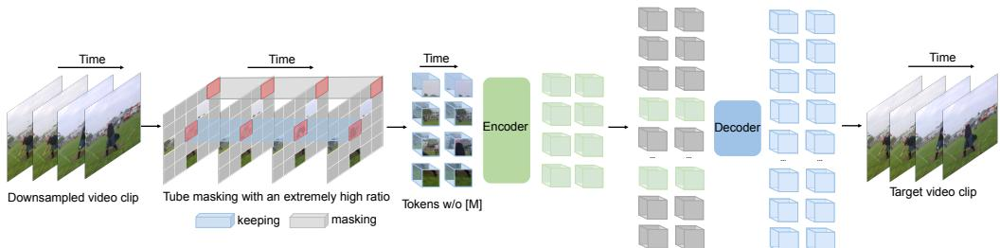  
Figure 1: VideoMAE 采用非对称编解码器架构，执行掩码随机立方体并重建缺失立方体的任务。由于视频中存在高度的冗余性和时间相关性，我们提出了定制化的管道掩码（tube masking）设计，其掩码比例极高（90% 至 95%）。这一简单的设计使我们能够构建一个更具挑战性且更有意义的自监督任务，从而使学到的表征能够捕获更多有用的时空结构。

继掩码自编码在 NLP $[18]$ 和图像 $[31, 4]$ 领域取得成功之后，我们提出了一种新的自监督视频预训练（self-supervised video pre-training，SSVP）方法，称为视频掩码自编码器（Video Masked Autoencoder，VideoMAE）。我们的 VideoMAE 继承了遮蔽随机立方体块并重构缺失部分的简单流程。然而，视频额外的时间维度使得它们在这种掩码建模中与图像有所不同。首先，视频帧通常是密集采集的，其语义随时间的变化较为缓慢 $[88]$。这种时间冗余性会增加在极少高层理解的情况下，仅从时空邻域恢复缺失像素的风险。此外，视频可以被视为静态外观随时间的演化，帧与帧之间存在对应关系。除非考虑特定的掩码策略，否则这种时间相关性可能会在重构过程中导致信息泄漏（即被掩码的时空内容再次出现）。从这个意义上说，对于每个被遮蔽的立方体块，很容易在相邻帧中找到一个对应的且未被遮蔽的副本。这一特性会使学习到的模型识别出一些难以泛化到新场景的“捷径”（shortcut）特征。

为了使视频掩码建模更加有效，在本文中，我们在 VideoMAE 中提出了一种具有极高比例的定制化管道掩码（tube masking）设计。首先，由于时间冗余性，我们采用极高的掩码率从下采样的视频片段中丢弃立方体块。得益于非对称的编码器-解码器架构，这一简单的策略不仅有效提升了预训练性能，还大幅降低了计算成本。其次，考虑到时间相关性，我们设计了一种简单而有效的管道掩码策略，事实证明这有助于缓解重构过程中对于没有运动或运动可忽略不计的立方体块发生信息泄漏的风险。凭借 VideoMAE 中这种简单而有效的设计，我们能够在相对较小规模的视频数据集（如 Something-Something $[26]$、UCF101 $[61]$ 和 HMDB51 $[35]$）上成功训练原始 ViT 骨干网络，且在不使用额外数据的设定下显著优于先前的最先进技术。总而言之，本文的主要贡献有三点：

\- 我们提出了一种简单而有效的视频掩码自编码器，释放了原生视觉 Transformer（vanilla vision transformer）在视频识别方面的潜力。据我们所知，这是首个仅使用普通 ViT 骨干网络的掩码视频预训练框架。为了缓解掩码视频建模中的信息泄漏问题，我们提出了具有极高比例的管道掩码，从而为 VideoMAE 带来了性能提升。

\- 与掩码建模在 NLP 和图像领域的结果一致，我们的 VideoMAE 表明，这种简单的掩码和重建策略为自监督视频预训练（SSVP）提供了一个良好的解决方案。使用我们的 VideoMAE 进行预训练的模型显著优于从头开始训练（train from scratch）或使用对比学习方法进行预训练的模型。

\- 我们在掩码建模方面获得了一些额外的重要发现，这些发现在以往 NLP 和图像领域的研究中可能被忽略了。(1) 我们证明了 VideoMAE 是一个数据高效的学习器，仅使用 3.5k 个视频即可成功训练。(2) 当源数据集与目标数据集之间存在领域偏移（domain shift）时，对于 SSVP 而言，数据质量比数据数量更为重要。

## 2 相关工作

视频表示学习。学习良好的视频表示在文献中已得到广泛研究。监督学习方法 $[59, 76, 70, 10, 6]$ 通常依赖于图像主干网络（backbone）。视频编码器主干首先以监督形式在图像数据上进行预训练。随后，这些主干在视频数据集上进行微调，以分类人类动作。与此同时，一些方法 $[68, 23, 22]$ 直接以监督方式从视频中训练视频主干。除监督学习外，半监督视频表示学习也得到了研究 $[60]$。有标签训练样本的表示被用来为无标签样本生成监督信号。监督或半监督表示学习主要采用自顶向下的训练范式，这在探索视频数据本身的固有结构方面不够有效。与此同时，一些多模态对比学习方法 $[37, 43, 63]$ 被开发出来，用于从噪声文本监督中学习视频表示。

对于自监督学习，时间信息的先验知识已被广泛用于为 SSVP 设计前置任务（pretext tasks）$[79, 45, 83, 5]$。最近，对比学习 $[29, 46, 30, 53, 25, 28]$ 在学习更好的视觉表示方面受到广泛欢迎。然而，这些方法严重依赖强大的数据增强和大批次大小（batch size）$[24]$。在像素空间中使用自编码器预测视频片段已被探索用于表示学习，例如使用 CNN 或 LSTM 主干 $[49, 62]$，或使用自回归 GPT 进行视频生成 $[84]$。与之不同的是，我们的 VideoMAE 旨在利用简单的掩码自编码器结合最新的 ViT 主干来执行数据高效的 SSVP。

掩码视觉建模。掩码视觉建模已被提出用于基于掩码和重构这一简单流程来学习有效的视觉表征。这些工作主要集中在图像领域。早期的工作 $[73]$ 将掩码视为去噪自编码器 $[72]$ 中的一种噪声类型，或使用卷积利用上下文修复缺失区域 $[48]$。iGPT $[11]$ 沿袭了 GPT $[7, 56]$ 在 NLP 领域的成功，对像素序列进行预测操作。原始的 ViT $[21]$ 研究了用于自监督预训练的掩码标记（token）预测。近来，视觉 Transformer 的成功引发了对基于 Transformer 架构的掩码视觉建模的研究 $[4, 20, 31, 80, 82, 90]$。BEiT $[4]$、BEVT $[77]$ 和 VIMPAC $[65]$ 遵循 BERT $[18]$ 的思路，提出通过预测离散标记 $[57]$ 来从图像和视频中学习视觉表征。MAE $[31]$ 引入了一种用于掩码图像建模的非对称编码器-解码器架构。MaskFeat $[80]$ 提出重构被掩码标记的 HOG 特征以在视频中执行自监督预训练。VideoMAE 受到 ImageMAE 的启发，并在自监督视频预训练（SSVP）的实现中引入了特定设计。特别是，与以往的掩码视频建模 $[31, 77, 65]$ 相比，我们通过直接重构像素，提出了一种更简单却更有效的视频掩码自编码器。我们的 VideoMAE 是首个仅使用标准 ViT 骨干网络的掩码视频预训练框架。

## 3 提出的方法

在本节中，我们首先重温 ImageMAE $[31]$。接着我们分析视频数据的特征。最后，我们通过展示我们的 VideoMAE，介绍我们如何在视频数据中探索 MAE。

## 3.1 重温图像掩码自编码器

ImageMAE [31] 采用非对称编码器-解码器架构来执行掩码和重构任务。输入图像 $I \in R^{3 \times H \times W}$ 首先被划分为大小为 $16 \times 16$ 的规则非重叠补丁（patch），每个 patch 都用标记嵌入（token embedding）表示。然后以高掩码率（75%）随机掩码一部分 token，仅将剩余的 token 输入到 Transformer 编码器 $\Phi_{enc}$ 中。最后，在来自编码器的可见 token 和可学习的掩码 token 之上放置一个浅层解码器 $\Phi_{dec}$ 来重构图像。损失函数是像素空间中归一化的被掩码 token 与重构 token 之间的均方误差（MSE）损失：

$$
\mathcal {L} = \frac {1}{\Omega} \sum_ {p \in \Omega} | I (p) - \hat {I} (p) | ^ {2},\tag{1}
$$

其中 $p$ 是 token 索引，$\Omega$ 是被掩码 token 的集合，$I$ 是输入图像，$\hat{I}$ 是重构图像。

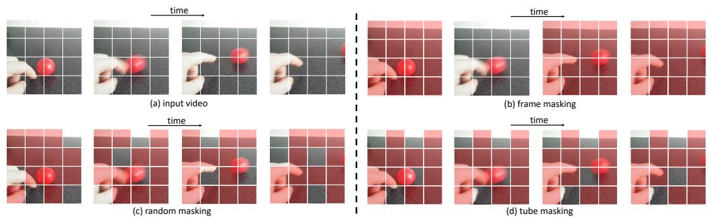  
Figure 2: 缓慢变化是 (a) 视频数据中的一种普遍先验 [88]。这导致了时间维度上的两个重要特征：时间冗余和时间相关性。时间冗余使得在极高的掩码率下恢复像素成为可能。时间相关性使得在普通的 (b) 帧掩码（frame masking）或 (c) 随机掩码（random masking）下，可以通过在相邻帧中找到对应的图像块来轻易重建缺失像素。为了避免这种简单的任务并促进学习具有代表性的表征，我们提出了 (d) 管道掩码（tube masking），其中所有帧的掩码图均相同。

## 3.2 视频数据的特征

与静态图像相比，视频数据包含时序关系。我们通过分析视频特征来阐述 VideoMAE 的动机。

时间冗余。视频中包含高频采集的帧。其语义在时间维度上变化缓慢 $[88]$。如图 2 所示，我们观察到连续帧之间存在高度冗余。这一特性在掩码视频自编码中引发了两个关键问题。首先，在预训练中保持原始的时间采样帧率效率较低，这会使掩码建模更加关注静态或缓慢的运动。其次，时间冗余极大地稀释了运动表征。这会使得在常规掩码率（例如 50% 到 75%）下重建缺失像素的任务并不困难。编码器主干网络无法有效捕获运动表征。

时间相关性。视频可以被视为静态外观在时间上的延伸，因此相邻帧之间存在固有的对应关系。这种时间相关性可能会增加掩码和重建流程中信息泄露的风险。从这个角度来看，如图 2 所示，在普通的随机掩码或帧掩码下，我们可以通过在相邻帧中找到时空对应的未掩码图像块来重建被掩码的图像块。在这种情况下，它可能会引导 VideoMAE 去学习低级的时间对应关系，而非诸如对内容进行时空推理等高级信息。为了缓解这种现象，我们需要提出一种新的掩码策略，以使重建更具挑战性，并促进对时空结构表征的有效学习。

## 3.3 VideoMAE

为了缓解视频掩码建模中的上述问题，我们在 VideoMAE 中进行了定制化设计，整体流程如图 1 所示。我们的 VideoMAE 将下采样后的帧作为输入，并使用立方体嵌入（cube embedding）来获取视频 token。随后，我们提出了高掩码率的管道掩码这一简单设计，以通过非对称的编码器-解码器架构进行 MAE 预训练。我们的主干网络采用了具有联合时空注意力机制的原生 ViT（vanilla ViT）。

时间下采样。根据上述关于连续帧间时间冗余的分析，我们提出使用跨步时间采样策略来进行更高效的视频预训练。形式上，首先从原始视频 $V$ 中随机采样一个由 $t$ 个连续帧组成的视频片段。然后，我们使用时间采样将该片段压缩为 $T$ 帧，每帧包含 $H \times W \times 3$ 个像素。在实验中，在 Kinetics 和 Something-Something 上，步长 $\tau$ 分别设置为 4 和 2。

立方体嵌入。我们在 VideoMAE 中采用了联合时空立方体嵌入（cube embedding）$[3, 22, 39]$，其中我们将每个大小为 $2 \times 16 \times 16$ 的立方体视为一个词元嵌入（token embedding）。因此，立方体嵌入层获得了 $\frac{T}{2} \times \frac{H}{16} \times \frac{W}{16}$ 个 3D 词元，并将每个词元映射到通道维度 $D$。这种设计可以降低输入在空间和时间上的维度，有助于缓解视频中的时空冗余。

极高比例的管状掩码。首先，时间冗余是影响 Video-MAE 设计的一个因素。我们发现，与 ImageMAE 相比，VideoMAE 更倾向于极高的掩码比例（例如 90% 到 95%）。视频的信息密度远低于图像，我们期望通过高比例来增加重建难度。这种高掩码比例有助于减少掩码建模过程中的信息泄漏，并使掩码视频重建成为一个有意义的自监督预训练任务。

其次，时间相关性是我们 VideoMAE 设计中的另一个因素。我们发现在极高掩码比例下，仍可以通过提出时间管状掩码（temporal tube masking）机制来提高掩码效率。时间管状掩码强制掩码沿整个时间轴展开，即不同帧共享相同的掩码图。在数学上，管状掩码机制可以表示为 $\mathbb{I}[p_{x,y,\cdot} \in \Omega] \sim \text{Bernoulli}(\rho_{\text{mask}})$，并且不同的时间 $t$ 共享相同的值。通过这种机制，被掩码立方体的时间邻域立方体也始终被掩码。因此，对于某些无运动或运动极小的立方体（例如 Figure 2 (d) 第 4 行中的手指立方体），我们在所有帧中都无法找到其时空对应内容。通过这种方式，它将促使我们的 VideoMAE 利用高级语义进行推理，以恢复这些完全缺失的立方体。这一简单的策略可以缓解无运动或运动微小的立方体的信息泄漏问题，并且在掩码视频预训练实践中被证明是行之有效的。

主干网络：联合时空注意力（joint space-time attention）。由于上述极高的掩码率，仅有少数 token 留作编码器的输入。为了更好地捕获剩余 token 中的高级时空信息，我们使用原版 ViT 主干网络 $[21]$ 并采用联合时空注意力机制 $[3, 39]$。因此，所有 token 对都可以在多头自注意力层 $[71]$ 中相互交互。编码器和解码器的具体架构设计详见补充材料。联合时空注意力机制的二次方复杂度是一个计算瓶颈，而我们极高掩码率的设计通过在预训练阶段仅将未掩码的 token（例如 10%）输入编码器，从而缓解了这一问题。

## 4 实验

## 4.1 数据集

我们在五个常见的视频数据集上评估了 VideoMAE：Kinetics-400 $[34]$、Something-Something V2 $[26]$、UCF101 $[61]$、HMDB51 $[35]$ 和 AVA $[27]$。Kinetics-400 包含来自 400 个类别的约 240k 条训练视频和 20k 条验证视频，视频时长为 10 秒。Something-Something V2 是另一个大规模视频数据集，拥有约 169k 条训练视频和 20k 条验证视频。与 Kinetics-400 相比，该数据集包含 174 个以动作为中心的动作类别。这两个大规模视频数据集侧重于动作识别的不同视觉线索。UCF101 和 HMDB51 是两个相对较小的视频数据集，分别包含约 9.5k/3.5k 条训练/验证视频以及 3.5k/1.5k 条训练/验证视频。与那些大规模视频数据集相比，这两个小数据集更适合用于验证 VideoMAE 的有效性，因为在小数据集上训练大型 ViT 模型更具挑战性。此外，我们还将通过 VideoMAE 学习到的 ViT 模型迁移到下游动作检测任务中。我们使用了 AVA 数据集，这是一个用于人体动作时空定位的数据集，包含 211k 条训练视频片段和 57k 条验证视频片段。在下游任务的实验中，我们在训练集上微调预训练的 VideoMAE 模型，并在验证集上汇报结果。实现细节见附录 § 7。

## 4.2 消融实验

在本小节中，我们以 16 帧的 ViT-B 作为默认主干网络，在 Something-Something V2 (SSV2) 和 Kinetics-400 (K400) 上对 VideoMAE 的设计进行了深入的消融实验。编码器和解码器的具体架构见附录 § 6。在微调方面，我们在 SSV2 上执行 TSN [76] 均匀采样，在 K400 上执行密集采样（dense sampling）[78, 23]。所有模型均采用相同的推理协议，即在 SSV2 上采用 2 clips × 3 crops，在 K400 上采用 5 clips × 3 crops。

解码器设计。轻量级解码器是我们 VideoMAE 的关键组件之一。我们在表 1a 中针对不同深度进行了实验。与 ImageMAE 不同，在此处较深的解码器对于获得更好的性能非常重要，而较浅的解码器可以降低 GPU 显存消耗。默认情况下，我们为解码器采用 4 个块（blocks）。遵循图像领域的设计，解码器宽度设置为编码器通道数的一半（例如，ViT-B 为 384 维）。

<table><tr><td>块数</td><td>SSV2</td><td>K400</td><td>GPU 显存</td></tr><tr><td>1</td><td>68.5</td><td>79.0</td><td>7.9G</td></tr><tr><td>2</td><td>69.2</td><td>79.2</td><td>10.2G</td></tr><tr><td>4</td><td>69.6</td><td>80.0</td><td>14.7G</td></tr><tr><td>8</td><td>69.3</td><td>79.7</td><td>23.7G</td></tr></table>

(a) 解码器深度。4 个块的解码器实现了最佳权衡。“GPU mem.” 表示预训练期间的 GPU 显存，是在单张 GPU 且批大小为 16 的条件下测得的基准。

<table><tr><td>方案</td><td>比例</td><td>SSV2</td><td>K400</td></tr><tr><td>tube</td><td>75</td><td>68.0</td><td>79.8</td></tr><tr><td>tube</td><td>90</td><td>69.6</td><td>80.0</td></tr><tr><td>random</td><td>90</td><td>68.3</td><td>79.5</td></tr><tr><td>frame</td><td>87.5*</td><td>61.5</td><td>76.5</td></tr></table>

(b) 掩码采样。我们对比了不同的掩码策略。我们提出的具有极高比例的时空管掩码（tube masking）效果最佳。\*“87.5” 表示掩码 14/16 帧。

<table><tr><td>输入</td><td>目标</td><td>SSV2</td><td>K400</td></tr><tr><td> $T \times \tau$ </td><td>center</td><td>63.0</td><td>79.3</td></tr><tr><td> $T \times \frac{\tau}{2}$ </td><td> $T \times \frac{\tau}{2}$ </td><td>68.9</td><td>79.8</td></tr><tr><td> $T \times \tau$ </td><td> $T \times \tau$ </td><td>69.6</td><td>80.0</td></tr><tr><td> $T \times \tau$ </td><td> $2T \times \frac{\tau}{2}$ </td><td>69.2</td><td>80.1</td></tr></table>

(c) 重建目标。$T \times \tau$ 表示“帧数 $\times$ 采样步长”。center 表示输入片段的中心帧。T 默认设置为 16。在 SSV2 和 K400 上，$\tau$ 分别设置为 2 和 4。

<table><tr><td>方案</td><td>SSV2</td><td>K400</td></tr><tr><td>from scratch</td><td>32.6</td><td>68.8</td></tr><tr><td>ImageNet-21k sup.</td><td>61.8</td><td>78.9</td></tr><tr><td>IN-21k+K400 sup.</td><td>65.2</td><td>-</td></tr><tr><td>VideoMAE</td><td>69.6</td><td>80.0</td></tr></table>

(d) 预训练策略。我们的 VideoMAE 在不使用任何额外数据的情况下效果最佳。“sup.” 表示监督训练。

<table><tr><td>数据集</td><td>方法</td><td>SSV2</td><td>K400</td></tr><tr><td>IN-1K</td><td>ImageMAE</td><td>64.8</td><td>78.7</td></tr><tr><td>K400</td><td>VideoMAE</td><td>68.5</td><td>80.0</td></tr><tr><td>SSV2</td><td>VideoMAE</td><td>69.6</td><td>79.6</td></tr></table>

(e) 预训练数据集。当直接在源数据集上预训练模型时，我们的 VideoMAE 表现最佳。

<table><tr><td>情况</td><td>SSV2</td><td>K400</td></tr><tr><td>L1 loss</td><td>69.1</td><td>79.7</td></tr><tr><td>MSE loss</td><td>69.6</td><td>80.0</td></tr><tr><td>Smooth L1 loss</td><td>68.9</td><td>79.6</td></tr></table>

(f) 损失函数。MSE 损失在 VideoMAE 的掩码与重构任务中表现最佳。  
Table 1: 在 Something-Something V2 和 Kinetics-400 上的消融实验。我们的主干网络是 16 帧的原生 ViT-B，所有模型均以 $\rho = 90\%$ 的掩码比例预训练 800 个 epoch，并经过微调后进行评估。我们在 SSV2 上采用 TSN [76] 均匀采样，在 K400 上采用密集采样 [78, 23]。所有模型共享相同的推理协议，即在 SSV2 上采用 2 个 clips $\times$ 3 个 crops，在 K400 上采用 5 个 clips $\times$ 3 个 crops。我们模型的默认选择以灰色标出。

掩码策略。我们在 Table 1b 中比较了不同的掩码策略。当管状掩码（tube masking）的掩码比例从 75% 增加到 90% 时，在 SSV2 上的性能从 68.0% 提升至 69.6%。此外，在极高的比例下，我们发现管状掩码的表现也优于普通的随机掩码和帧掩码。我们将这些有趣的观察归因于视频中的冗余性和时间相关性。K400 上的结论与 SSV2 一致。可能会注意到，K400 上的性能差距小于 SSV2。我们认为这是因为 Kinetics 视频大部分是静止且与场景相关的。时间建模的效果并不明显。总的来说，我们认为默认设计迫使网络捕捉更多有用的时空结构，从而使 VideoMAE 成为一个更具挑战性的任务，而这正是一个优秀的自监督学习器所渴望的。

重构目标。首先，如 Table 1c 所示，如果我们仅采用中心帧作为目标，结果会大幅下降。采样步长（sampling stride）也是敏感的。小采样步长 $\frac{\tau}{2}$ 的结果低于默认采样步长 $\tau$（在 SSV2 上为 68.9% 对比 69.6%）。我们还尝试从下采样的 T 帧中重构出 $2\bar{T}$ 帧，但在 SSV2 上获得了稍差的结果。为简便起见，我们使用输入的下采样视频片段作为默认的重构目标。

预训练策略。我们在 Table 1d 中比较了不同的预训练策略。与以往的尝试 $[3, 6]$ 类似，从头开始训练视频 Transformer 在视频数据集上得到的结果并不令人满意。当在大规模 ImageNet-21K 数据集上预训练时，视频 Transformer 的准确率在 SSV2 上从 32.6% 提升至 61.8%，在 K400 上从 68.8% 提升至 78.9%。使用在 ImageNet-21K 和 Kinetics 上联合预训练的模型，在 SSV2 上的准确率进一步提升至 65.2%。我们的 VideoMAE 可以在不使用任何额外数据的情况下，有效地在视频数据集本身上训练视频 Transformer，并取得最佳性能（在 SSV2 上为 69.6%，在 K400 上为 80.0%）。

预训练数据集。首先，我们遵循 [31] 中的方案，在 ImageNet-1K 上对 ViT-B 进行了 1600 个 epoch 的预训练。接着，我们遵循 [10] 将 2D patch 嵌入层膨胀为我们的立方体嵌入层（cube embedding layer），并在目标视频数据集上对模型进行微调。如 Table 1e 所示，其结果优于从头训练（from scratch）的模型。我们还将 ImageMAE 预训练模型与在视频数据集上预训练的 VideoMAE 模型进行了对比。我们可以看到，我们的 VideoMAE 模型能够取得优于 ImageMAE 的性能。然而，当我们尝试将预训练的 VideoMAE 模型迁移到其他视频数据集时（例如从 Kinetics 迁移到 Something-Something），其结果略逊于直接在其自身目标视频数据集上进行预训练的对应模型。我们认为预训练数据集与目标数据集之间的域偏移（domain shift）可能是一个重要的问题。

<table><tr><td>数据集</td><td>训练数据</td><td>从头训练</td><td>MoCo v3</td><td>VideoMAE</td></tr><tr><td>K400</td><td>240k</td><td>68.8</td><td>74.2</td><td>80.0</td></tr><tr><td>Sth-Sth V2</td><td>169k</td><td>32.6</td><td>54.2</td><td>69.6</td></tr><tr><td>UCF101</td><td>9.5k</td><td>51.4</td><td>81.7</td><td>91.3</td></tr><tr><td>HMDB51</td><td>3.5k</td><td>18.0</td><td>39.2</td><td>62.6</td></tr></table>

Table 2: 在不同数据集上与以往自监督预训练方法的结果对比。我们采用 16 帧 ViT-B 作为默认主干网络。值得注意的是，这里的 MoCo v3 和 VideoMAE 均仅使用各数据集训练集中的未标注数据进行预训练，并均通过微调进行评估。

<table><tr><td>方法</td><td>epoch</td><td>微调准确率</td><td>线性探测准确率</td><td>耗时（小时）</td><td>加速比</td></tr><tr><td>MoCo v3</td><td>300</td><td>54.2</td><td>33.7</td><td>61.7</td><td>-</td></tr><tr><td>VideoMAE</td><td>800</td><td>69.6</td><td>38.9</td><td>19.5</td><td> $3.2 \times$ </td></tr></table>

Table 3: 在 Something-Something V2 上的效率与有效性对比。我们报告了微调（ft）和线性探测（lin）准确率（%）。预训练的物理时间是在 64 块 Tesla V100 GPU 上使用 PyTorch 进行基准测试的。

<table><tr><td>方法</td><td>K400 → SSV2</td><td>K400 → UCF</td><td>K400 → HMDB</td></tr><tr><td>MoCo v3</td><td>62.4</td><td>93.2</td><td>67.9</td></tr><tr><td>VideoMAE</td><td>68.5</td><td>96.1</td><td>73.3</td></tr></table>

Table 4: 在较小数据集上的特征迁移能力对比。我们采用 16 帧 ViT-B 作为默认主干网络。值得注意的是，这里的 MoCo v3 和 VideoMAE 均在 Kinetics-400 上使用训练集中的未标注数据进行预训练。随后将预训练模型在目标数据集上微调以进行评估。

损失函数。Table 1f 包含了损失函数的消融实验。我们发现，与 L1 损失和 smooth L1 损失相比，MSE 损失能够取得更好的结果。因此，我们默认采用 MSE 损失。

## 4.3 主要结果与分析

VideoMAE：数据高效的学习器。自监督视频预训练（self-supervised video pre-training, SSVP）在以往的研究中得到了广泛探讨，但它们主要采用基于 CNN 的主干网络。很少有工作研究 SSVP 中基于 Transformer 的主干网络。因此，为了证明 VideoMAE 在基于 Transformer 的 SSVP 中的有效性，我们对比了由我们自行实现的两种方法：(1) 从头开始训练和 (2) 采用对比学习进行预训练（MoCo v3 [15]）。对于从头训练，我们仔细调优了超参数，以成功在数据集的训练集上训练 ViT-Base。对于采用 MoCo v3 进行预训练，我们严格遵循其在图像领域的训练实践，并小心避免了模式崩溃问题。

识别准确率如 Table 2 所示。我们发现，VideoMAE 的表现明显优于另外两种训练设置。例如，在最大的数据集 Kinetics-400 上，我们的 VideoMAE 比从头训练高出约 10%，比 MoCo v3 预训练高出约 5%。这种优异的性能表明，掩码自编码器为视频 Transformer 提供了有效的预训练机制。我们还观察到，随着训练集的变小，VideoMAE 与其他两种方法之间的性能差距变得更大。值得注意的是，即使在 HMDB51 上仅有 3.5k 个训练视频片段，我们的 VideoMAE 预训练仍能获得令人满意的准确率（约 61%）。这一新结果表明 VideoMAE 是用于 SSVP 的一种数据利用效率更高的学习器。这一特性对于可用数据有限的场景尤为重要，并且与对比学习方法有所不同。

我们在 Table 3 中对比了 VideoMAE 预训练和 MoCo v3 预训练的效率。高掩码率的掩码自编码任务更具挑战性，因此需要更多的训练轮数（800 对比 300）。得益于 VideoMAE 中的非对称编码器-解码器设计以及极高的掩码率，我们的预训练时间比 MoCo v3 短得多（19.5 对比 61.7 小时）。

高掩码率。在 VideoMAE 中，一个核心设计就是极高的掩码率。我们在 Kinetics-400 和 Something-Something V2 数据集上对这一设计进行了探究。结果如 Figure 3 所示。我们发现最佳掩码率极高，甚至达到 $95\%$ 时在两个数据集上都能取得良好的性能。这一结果与 NLP 中的 BERT [18] 以及图像领域的 MAE [31] 有所不同。我们分析认为，视频中的时间冗余性和相关性使得 VideoMAE 在如此高的掩码率下仍能学习并产生合理的输出。

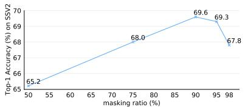  
(a) 在 SSV2 上的性能

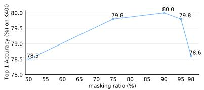  
(b) 在 Kinetics-400 上的性能

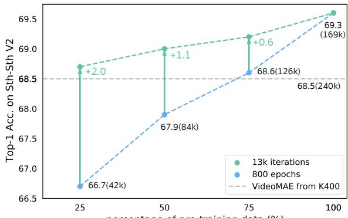  
预训练数据百分比 (%)  
Figure 3：掩码比例在 (a) Something-Something V2 和 (b) Kinetics-400 上的影响。我们默认采用 16 帧的标准 ViT-B。结果表明，极高的掩码比例（90%）在两个视频数据集上均实现了效率与有效性之间的最佳权衡。  
Figure 4：VideoMAE 表征的数据效率。我们的默认骨干网络是 16 帧的标准 ViT-B。● 表示所有模型均训练了相同的 132k 次迭代，而 ● 表示所有模型均训练了相同的 800 个 epoch。请注意，在 Something-Something V2 的完整训练集上预训练模型 800 个 epoch 需要 132k 次迭代。

我们还在附录 § 10 中展示了重建示例的可视化结果。我们可以看到，即使在极高的掩码比例下，VideoMAE 也能生成令人满意的重建结果。这表明 VideoMAE 能够学习到捕捉视频中整体时空结构的有用表征。

迁移学习：质量与数量。为了进一步探究 VideoMAE 在表征学习中的泛化能力，我们将学得的 VideoMAE 从 Kinetics-400 迁移到 Something-Something V2、UCF101 和 HMDB51。结果如 Table 4 所示，并与 MoCo v3 预训练进行了对比。通过 VideoMAE 预训练的模型优于通过 MoCo v3 预训练的模型，这表明我们的 VideoMAE 学习到了更具迁移性的表征。

对比 Table 2 和 Table 4，迁移后的表征在 UCF101 和 HMDB51 上的表现优于直接在各自数据集上训练的原始 VideoMAE 模型。相反，迁移后的表征在 Something-Something V2 上的表现则更差。为了查明这一不一致的结果是否由 Something-Something V2 的大规模所导致，我们通过减少预训练视频数量进一步进行了详细调查。在这项研究中，我们进行了两组实验：(1) 在相同的 epoch 数下进行预训练，以及 (2) 在相同的时间预算下进行预训练。结果如 Figure 4 所示。我们发现，当减少预训练集的规模时，更多的训练迭代次数有助于获得更好的性能。令人惊讶的是，即使仅使用 42k 个预训练视频，我们仍然可以获得比使用 240k 个视频的 Kinetics 预训练模型更高的准确率（68.7% 对比 68.5%）。这一结果表明领域漂移（domain shift）是另一个重要因素，并且当预训练数据集与目标数据集之间存在差异时，在自监督视频预训练（SSVP）中数据质量比数据数量更为重要。这也证明了 VideoMAE 是一个用于 SSVP 的高数据效率学习器。

迁移学习：下游动作检测。我们还将 Kinetics-400 上学到的 VideoMAE 迁移到下游动作检测数据集 AVA 上。遵循标准设置 $[27]$，我们在 IoU 阈值为 0.5 的条件下，以平均精度均值（mean Average Precision，mAP）为评价指标在出现频率最高的前 60 个常见类别上进行评估。结果如 Table 5 所示。在 Kinetics-400 上进行自监督预训练后，配备原始 ViT-B 的 VideoMAE 在 AVA 上可以达到 26.7 mAP，这证明了我们 VideoMAE 强大的可迁移性。如果将预训练的 ViT-B 在带有标签的 Kinetics-400 上额外进行微调，迁移学习性能可以进一步提升约 5 mAP（从 26.7 提升至 31.8）。更值得注意的是，当我们使用更大的视频数据集（例如 Kinetics-700）或更强大的主干网络（例如 ViT-Large 和 ViT-Huge）来扩展预训练配置时，VideoMAE 最终可以取得更好的性能。例如，我们在 Kinetics-700 上预训练的 ViT-L VideoMAE 达到了 39.3 mAP，而在 Kinetics-400 上预训练的 ViT-H VideoMAE 则达到了 39.5 mAP。这些结果表明，自监督预训练模型不仅在动作分类任务上具有良好的迁移能力，在更复杂的动作检测任务上也同样表现优异。

<table><tr><td>方法</td><td>主干网络</td><td>预训练数据集</td><td>额外标签</td><td> $T \times \tau$ </td><td>GFLOPs</td><td>参数量</td><td>mAP</td></tr><tr><td>有监督 [23]</td><td>SlowFast-R101</td><td>Kinetics-400</td><td>✓</td><td> $8 \times 8$ </td><td>138</td><td>53</td><td>23.8</td></tr><tr><td>CVRL [54]</td><td>SlowOnly-R50</td><td>Kinetics-400</td><td>✘</td><td> $32 \times 2$ </td><td>42</td><td>32</td><td>16.3</td></tr><tr><td> $\rho \text{BYOL}_{\rho=3}$  [24]</td><td>SlowOnly-R50</td><td>Kinetics-400</td><td>✘</td><td> $8 \times 8$ </td><td>42</td><td>32</td><td>23.4</td></tr><tr><td> $\rho \text{MoCo}_{\rho=3}$  [24]</td><td>SlowOnly-R50</td><td>Kinetics-400</td><td>✘</td><td> $8 \times 8$ </td><td>42</td><td>32</td><td>20.3</td></tr><tr><td>MaskFeat↑312 [80]</td><td>MViT-L</td><td>Kinetics-400</td><td>✓</td><td> $40 \times 3$ </td><td>2828</td><td>218</td><td>37.5</td></tr><tr><td>MaskFeat↑312 [80]</td><td>MViT-L</td><td>Kinetics-600</td><td>✓</td><td> $40 \times 3$ </td><td>2828</td><td>218</td><td>38.8</td></tr><tr><td>VideoMAE</td><td>ViT-S</td><td>Kinetics-400</td><td>✘</td><td> $16 \times 4$ </td><td>57</td><td>22</td><td>22.5</td></tr><tr><td>VideoMAE</td><td>ViT-S</td><td>Kinetics-400</td><td>✓</td><td> $16 \times 4$ </td><td>57</td><td>22</td><td>28.4</td></tr><tr><td>VideoMAE</td><td>ViT-B</td><td>Kinetics-400</td><td>✘</td><td> $16 \times 4$ </td><td>180</td><td>87</td><td>26.7</td></tr><tr><td>VideoMAE</td><td>ViT-B</td><td>Kinetics-400</td><td>✓</td><td> $16 \times 4$ </td><td>180</td><td>87</td><td>31.8</td></tr><tr><td>VideoMAE</td><td>ViT-L</td><td>Kinetics-400</td><td>✘</td><td> $16 \times 4$ </td><td>597</td><td>305</td><td>34.3</td></tr><tr><td>VideoMAE</td><td>ViT-L</td><td>Kinetics-400</td><td>✓</td><td> $16 \times 4$ </td><td>597</td><td>305</td><td>37.0</td></tr><tr><td>VideoMAE</td><td>ViT-H</td><td>Kinetics-400</td><td>✘</td><td> $16 \times 4$ </td><td>1192</td><td>633</td><td>36.5</td></tr><tr><td>VideoMAE</td><td>ViT-H</td><td>Kinetics-400</td><td>✓</td><td> $16 \times 4$ </td><td>1192</td><td>633</td><td>39.5</td></tr><tr><td>VideoMAE</td><td>ViT-L</td><td>Kinetics-700</td><td>✘</td><td> $16 \times 4$ </td><td>597</td><td>305</td><td>36.1</td></tr><tr><td>VideoMAE</td><td>ViT-L</td><td>Kinetics-700</td><td>✓</td><td> $16 \times 4$ </td><td>597</td><td>305</td><td>39.3</td></tr></table>

Table 5: AVA v2.2 上与最先进方法的对比。所有模型均在图像大小 $224^{2}$ 下进行预训练和微调。我们报告了验证集上的平均精度均值（mAP）。“额外标签 ✘”表示预训练阶段仅使用无标签数据，且预训练模型直接迁移到 AVA。“额外标签 ✓”表示预训练模型在迁移到 AVA 之前，先在带有标签的预训练数据集上进行了额外的微调。$T \times \tau$ 表示帧数以及相应的采样率。

<table><tr><td>方法</td><td>骨干网络</td><td>额外数据</td><td>额外标签</td><td>帧数</td><td>GFLOPs</td><td>参数量</td><td>Top-1</td><td>Top-5</td></tr><tr><td>TEINetEn[40]</td><td>ResNet50 $_{×2}$ </td><td rowspan="3">ImageNet-1K</td><td>√</td><td>8+16</td><td>99 $\times$ 10 $\times$ 3</td><td>50</td><td>66.5</td><td>N/A</td></tr><tr><td>TANetEn[41]</td><td>ResNet50 $_{×2}$ </td><td>√</td><td>8+16</td><td>99 $\times$ 2 $\times$ 3</td><td>51</td><td>66.0</td><td>90.1</td></tr><tr><td>TDNEn[75]</td><td>ResNet101 $_{×2}$ </td><td>√</td><td>8+16</td><td>198 $\times$ 1 $\times$ 3</td><td>88</td><td>69.6</td><td>92.2</td></tr><tr><td>SlowFast [23]</td><td>ResNet101</td><td rowspan="2">Kinetics-400</td><td>√</td><td>8+32</td><td>106 $\times$ 1 $\times$ 3</td><td>53</td><td>63.1</td><td>87.6</td></tr><tr><td>MViTv1 [22]</td><td>MViTv1-B</td><td>√</td><td>64</td><td>455 $\times$ 1 $\times$ 3</td><td>37</td><td>67.7</td><td>90.9</td></tr><tr><td>TimeSformer [6]</td><td>ViT-B</td><td rowspan="2">ImageNet-21K</td><td>√</td><td>8</td><td>196 $\times$ 1 $\times$ 3</td><td>121</td><td>59.5</td><td>N/A</td></tr><tr><td>TimeSformer [6]</td><td>ViT-L</td><td>√</td><td>64</td><td>5549 $\times$ 1 $\times$ 3</td><td>430</td><td>62.4</td><td>N/A</td></tr><tr><td>ViViT FE [3]</td><td>ViT-L</td><td rowspan="4">IN-21K+K400</td><td>√</td><td>32</td><td>995 $\times$ 4 $\times$ 3</td><td>N/A</td><td>65.9</td><td>89.9</td></tr><tr><td>Motionformer [51]</td><td>ViT-B</td><td>√</td><td>16</td><td>370 $\times$ 1 $\times$ 3</td><td>109</td><td>66.5</td><td>90.1</td></tr><tr><td>Motionformer [51]</td><td>ViT-L</td><td>√</td><td>32</td><td>1185 $\times$ 1 $\times$ 3</td><td>382</td><td>68.1</td><td>91.2</td></tr><tr><td>Video Swin [39]</td><td>Swin-B</td><td>√</td><td>32</td><td>321 $\times$ 1 $\times$ 3</td><td>88</td><td>69.6</td><td>92.7</td></tr><tr><td>VIMPAC [65]</td><td>ViT-L</td><td>HowTo100M+DALLE</td><td>✗</td><td>10</td><td>N/A $\times$ 10 $\times$ 3</td><td>307</td><td>68.1</td><td>N/A</td></tr><tr><td>BEVT [77]</td><td>Swin-B</td><td>IN-1K+K400+DALLE</td><td>✗</td><td>32</td><td>321 $\times$ 1 $\times$ 3</td><td>88</td><td>70.6</td><td>N/A</td></tr><tr><td>MaskFeat↑312 [80]</td><td>MViT-L</td><td>Kinetics-600</td><td>√</td><td>40</td><td>2828 $\times$ 1 $\times$ 3</td><td>218</td><td>75.0</td><td>95.0</td></tr><tr><td>VideoMAE</td><td>ViT-B</td><td>Kinetics-400</td><td>✗</td><td>16</td><td>180 $\times$ 2 $\times$ 3</td><td>87</td><td>69.7</td><td>92.3</td></tr><tr><td>VideoMAE</td><td>ViT-L</td><td>Kinetics-400</td><td>✗</td><td>16</td><td>597 $\times$ 2 $\times$ 3</td><td>305</td><td>74.0</td><td>94.6</td></tr><tr><td>VideoMAE</td><td>ViT-S</td><td rowspan="4">无外部数据</td><td>✗</td><td>16</td><td>57 $\times$ 2 $\times$ 3</td><td>22</td><td>66.8</td><td>90.3</td></tr><tr><td>VideoMAE</td><td>ViT-B</td><td>✗</td><td>16</td><td>180 $\times$ 2 $\times$ 3</td><td>87</td><td>70.8</td><td>92.4</td></tr><tr><td>VideoMAE</td><td>ViT-L</td><td>✗</td><td>16</td><td>597 $\times$ 2 $\times$ 3</td><td>305</td><td>74.3</td><td>94.6</td></tr><tr><td>VideoMAE</td><td>ViT-L</td><td>✗</td><td>32</td><td>1436 $\times$ 1 $\times$ 3</td><td>305</td><td>75.4</td><td>95.2</td></tr></table>

Table 6：在 Something-Something V2 上与最先进（SOTA）方法的比较。我们的 Video-MAE 重构归一化的立方体像素，并在 90% 的掩码比例下预训练 2400 个周期（epoch）。“Ex. labels X”表示在预训练阶段仅使用未标注数据。“N/A”表示我们无法获取该数据。

## 4.4 与最先进技术的比较

我们将本文方法与 Kinetics-400 和 Something-Something V2 数据集上以往的最先进性能进行了比较。结果如 Table 6 和 Table 7 所示。我们的 VideoMAE 可以轻松扩展到更强大的骨干网络（例如 ViT-Large 和 ViT-Huge）以及更多帧数（例如 32 帧）。在不使用任何额外数据的情况下，我们的 VideoMAE 在 Something-Something V2 上实现了 $75.4\%$ 的 Top-1 准确率，在 Kinetics-400 上实现了 $87.4\%$ 的 Top-1 准确率。我们发现，现有的最先进方法在 Something-Something V2 数据集上预训练时均依赖于外部数据。相反，我们的 VideoMAE 在不使用任何外部数据的情况下，在相同输入分辨率下明显优于以往方法约 $5\%$。我们的 ViT-H VideoMAE 在不使用任何额外数据的情况下，也在 Kinetics-400 数据集上取得了极具竞争力的性能，甚至优于采用额外数据的 ViViT-H

<table><tr><td>方法</td><td>骨干网络</td><td>额外数据</td><td>额外标签</td><td>帧数</td><td>GFLOPs</td><td>参数量</td><td>Top-1</td><td>Top-5</td></tr><tr><td>NL I3D [78]</td><td>ResNet101</td><td rowspan="3">ImageNet-1K</td><td>√</td><td>128</td><td> $359 \times 10 \times 3$ </td><td>62</td><td>77.3</td><td>93.3</td></tr><tr><td>TANet [41]</td><td>ResNet152</td><td>√</td><td>16</td><td> $242 \times 4 \times 3$ </td><td>59</td><td>79.3</td><td>94.1</td></tr><tr><td>TDNEn[75]</td><td>ResNet101</td><td>√</td><td>8+16</td><td> $198 \times 10 \times 3$ </td><td>88</td><td>79.4</td><td>94.4</td></tr><tr><td>TimeSformer [6]</td><td>ViT-L</td><td rowspan="4">ImageNet-21K</td><td>√</td><td>96</td><td> $8353 \times 1 \times 3$ </td><td>430</td><td>80.7</td><td>94.7</td></tr><tr><td>ViViT FE [3]</td><td>ViT-L</td><td>√</td><td>128</td><td> $3980 \times 1 \times 3$ </td><td>N/A</td><td>81.7</td><td>93.8</td></tr><tr><td>Motionformer [51]</td><td>ViT-L</td><td>√</td><td>32</td><td> $1185 \times 10 \times 3$ </td><td>382</td><td>80.2</td><td>94.8</td></tr><tr><td>Video Swin [39]</td><td>Swin-L</td><td>√</td><td>32</td><td> $604 \times 4 \times 3$ </td><td>197</td><td>83.1</td><td>95.9</td></tr><tr><td>ViViT FE [3]</td><td>ViT-L</td><td>JFT-300M</td><td>√</td><td>128</td><td> $3980 \times 1 \times 3$ </td><td>N/A</td><td>83.5</td><td>94.3</td></tr><tr><td>ViViT [3]</td><td>ViT-H</td><td>JFT-300M</td><td>√</td><td>32</td><td> $3981 \times 4 \times 3$ </td><td>N/A</td><td>84.9</td><td>95.8</td></tr><tr><td>VIMPAC [65]</td><td>ViT-L</td><td>HowTo100M+DALLE</td><td>✕</td><td>10</td><td>N/A×10×3</td><td>307</td><td>77.4</td><td>N/A</td></tr><tr><td>BEVT [77]</td><td>Swin-B</td><td>IN-1K+DALLE</td><td>✕</td><td>32</td><td> $282 \times 4 \times 3$ </td><td>88</td><td>80.6</td><td>N/A</td></tr><tr><td>MaskFeat↑352 [80]</td><td>MViT-L</td><td>Kinetics-600</td><td>✕</td><td>40</td><td> $3790 \times 4 \times 3$ </td><td>218</td><td>87.0</td><td>97.4</td></tr><tr><td>ip-CSN [69]</td><td>ResNet152</td><td rowspan="4">无外部数据</td><td>✕</td><td>32</td><td> $109 \times 10 \times 3$ </td><td>33</td><td>77.8</td><td>92.8</td></tr><tr><td>SlowFast [23]</td><td>R101+NL</td><td>✕</td><td>16+64</td><td> $234 \times 10 \times 3$ </td><td>60</td><td>79.8</td><td>93.9</td></tr><tr><td>MViTv1 [22]</td><td>MViTv1-B</td><td>✕</td><td>32</td><td> $170 \times 5 \times 1$ </td><td>37</td><td>80.2</td><td>94.4</td></tr><tr><td>MaskFeat [80]</td><td>MViT-L</td><td>✕</td><td>16</td><td> $377 \times 10 \times 1$ </td><td>218</td><td>84.3</td><td>96.3</td></tr><tr><td>VideoMAE</td><td>ViT-S</td><td rowspan="4">无外部数据</td><td>✕</td><td>16</td><td> $57 \times 5 \times 3$ </td><td>22</td><td>79.0</td><td>93.8</td></tr><tr><td>VideoMAE</td><td>ViT-B</td><td>✕</td><td>16</td><td> $180 \times 5 \times 3$ </td><td>87</td><td>81.5</td><td>95.1</td></tr><tr><td>VideoMAE</td><td>ViT-L</td><td>✕</td><td>16</td><td> $597 \times 5 \times 3$ </td><td>305</td><td>85.2</td><td>96.8</td></tr><tr><td>VideoMAE</td><td>ViT-H</td><td>✕</td><td>16</td><td> $1192 \times 5 \times 3$ </td><td>633</td><td>86.6</td><td>97.1</td></tr><tr><td>VideoMAE↑320</td><td>ViT-L</td><td rowspan="2">无外部数据</td><td>✕</td><td>32</td><td> $3958 \times 4 \times 3$ </td><td>305</td><td>86.1</td><td>97.3</td></tr><tr><td>VideoMAE↑320</td><td>ViT-H</td><td>✕</td><td>32</td><td> $7397 \times 4 \times 3$ </td><td>633</td><td>87.4</td><td>97.6</td></tr></table>

Table 7: 在 Kinetics-400 上与最先进（SOTA）方法的比较。我们的 VideoMAE 重建归一化的立方体像素。此处的模型在 Kinetics-400 上以 90% 的掩码率进行了 1600 个轮次的自监督预训练。VideoMAE $^{\uparrow320}$ 是从其 $224^{2}$ 分辨率的版本初始化，随后进行微调评估。“Ex. labels X”表示预训练阶段仅使用未标注数据。“N/A”表示我们无法获取对应数值。

JFT-300M 预训练（86.6% 对比 84.9%）。当采用更大的空间分辨率和输入视频帧进行微调时，我们的 ViT-H VideoMAE 的性能可进一步从 86.6% 提升至 87.4%。

## 5 结论

在本文中，我们提出了一种用于视频 Transformer 预训练的简单且数据高效的自监督学习方法（VideoMAE）。我们的 VideoMAE 引入了极高掩码率和管道掩码（tube masking）策略这两项关键设计，使视频重建任务更具挑战性。这一更困难的任务促使 VideoMAE 学习到更具代表性的特征，并缓解了信息泄露问题。实证结果表明，这种简单的算法在不同规模的视频数据集上均表现良好。特别是，我们仅利用数千个视频片段就能训练出有效的 VideoMAE，这对于可用数据有限的场景具有重要的实际价值。

未来工作 VideoMAE 可以通过使用更大的网络规模数据集、更大的模型（例如 ViT-G）以及更大的输入视频空间分辨率（例如 $384^{2}$）来进一步改进。VideoMAE 仅利用了 RGB 视频流，未利用额外的音频或文本流。我们期望来自视频数据的音频和文本能够为自监督预训练提供更多信息。

更广泛的影响 VideoMAE 潜在的负面社会影响主要与能耗有关。预训练阶段可能会产生大量的碳排放。尽管预训练消耗能量，但我们只需对模型进行一次预训练。不同的下游任务随后可以通过额外的微调共享同一个预训练模型。我们的 VideoMAE 释放了原生 Vision Transformer 用于视频分析的巨大潜力，这可能会增加视频理解模型或其输出被不当使用的风险，例如用于未经授权的监控。

致谢与资金资助披露 感谢 Ziteng Gao、Lei Chen 和 Chongjian Ge 的帮助。本工作得到了国家自然科学基金（National Natural Science Foundation of China，No. 62076119, No. 61921006）、中央高校基本科研业务费专项资金（Fundamental Research Funds for the Central Universities，No. 020214380091）、腾讯 AI Lab 犀牛鸟专项研究计划（Tencent AI Lab Rhino-Bird Focused Research Program，No. JR202125）以及江苏新型软件技术与产业化协同创新中心（Collaborative Innovation Center of Novel Software Technology and Industrialization）的支持。

## 参考文献

[1] Jean-Baptiste Alayrac, Adria Recasens, Rosalia Schneider, Relja Arandjelovic, Jason Ramapuram, Jeffrey De Fauw, Lucas Smaira, Sander Dieleman, and Andrew Zisserman. Self-supervised multimodal versatile networks. In Advances in Neural Information Processing Systems, 2020.

[2] Humam Alwassel, Dhruv Mahajan, Bruno Korbar, Lorenzo Torresani, Bernard Ghanem, and Du Tran. Self-supervised learning by cross-modal audio-video clustering. In Advances in Neural Information Processing Systems, 2020.

[3] Anurag Arnab, Mostafa Dehghani, Georg Heigold, Chen Sun, Mario Lučić, and Cordelia Schmid. Vivit: A video vision transformer. In IEEE/CVF International Conference on Computer Vision, 2021.

[4] Hangbo Bao, Li Dong, Songhao Piao, and Furu Wei. BEit: BERT pre-training of image transformers. In International Conference on Learning Representations, 2022.

[5] Sagie Benaim, Ariel Ephrat, Oran Lang, Inbar Mosseri, William T. Freeman, Michael Rubinstein, Michal Irani, and Tali Dekel. Speednet: Learning the speediness in videos. In IEEE/CVF Conference on Computer Vision and Pattern Recognition, 2020.

[6] Gedas Bertasius, Heng Wang, and Lorenzo Torresani. Is space-time attention all you need for video understanding? In International Conference on Machine Learning, 2021.

[7] Tom Brown, Benjamin Mann, Nick Ryder, Melanie Subbiah, Jared D Kaplan, Prafulla Dhariwal, Arvind Neelakantan, Pranav Shyam, Girish Sastry, Amanda Askell, Sandhini Agarwal, Ariel Herbert-Voss, Gretchen Krueger, Tom Henighan, Rewon Child, Aditya Ramesh, Daniel Ziegler, Jeffrey Wu, Clemens Winter, Chris Hesse, Mark Chen, Eric Sigler, Mateusz Litwin, Scott Gray, Benjamin Chess, Jack Clark, Christopher Berner, Sam McCandlish, Alec Radford, Ilya Sutskever, and Dario Amodei. Language models are few-shot learners. In Advances in Neural Information Processing Systems, 2020.

[8] Nicolas Carion, Francisco Massa, Gabriel Synnaeve, Nicolas Usunier, Alexander Kirillov, and Sergey Zagoruyko. End-to-end object detection with transformers. In European Conference on Computer Vision, 2020.

[9] Mathilde Caron, Hugo Touvron, Ishan Misra, Hervé Jégou, Julien Mairal, Piotr Bojanowski, and Armand Joulin. Emerging properties in self-supervised vision transformers. In IEEE/CVF International Conference on Computer Vision, 2021.

[10] João Carreira and Andrew Zisserman. Quo vadis, action recognition? A new model and the kinetics dataset. In IEEE/CVF Conference on Computer Vision and Pattern Recognition, 2017.

[11] Mark Chen, Alec Radford, Rewon Child, Jeffrey Wu, Heewoo Jun, David Luan, and Ilya Sutskever. Generative pretraining from pixels. In International Conference on Machine Learning, 2020.

[12] Mark Chen, Alec Radford, Rewon Child, Jeffrey Wu, Heewoo Jun, David Luan, and Ilya Sutskever. Generative pretraining from pixels. In International Conference on Machine Learning, 2020.

[13] Peihao Chen, Deng Huang, Dongliang He, Xiang Long, Runhao Zeng, Shilei Wen, Mingkui Tan, and Chuang Gan. Rspnet: Relative speed perception for unsupervised video representation learning. In Proceedings of the AAAI Conference on Artificial Intelligence, 2021.

[14] Xin Chen, Bin Yan, Jiawen Zhu, Dong Wang, Xiaoyun Yang, and Huchuan Lu. Transformer tracking. In CVPR, 2021.

[15] Xinlei Chen, Saining Xie, and Kaiming He. An empirical study of training self-supervised vision transformers. In IEEE/CVF International Conference on Computer Vision, 2021.

[16] Ekin D Cubuk, Barret Zoph, Jonathon Shlens, and Quoc V Le. Randaugment: Practical automated data augmentation with a reduced search space. In Proceedings of the IEEE/CVF Conference on Computer Vision and Pattern Recognition Workshops, 2020.

[17] Yutao Cui, Cheng Jiang, Limin Wang, and Gangshan Wu. Mixformer: End-to-end tracking with iterative mixed attention. In IEEE/CVF Conference on Computer Vision and Pattern Recognition, 2022.

[18] Jacob Devlin, Ming-Wei Chang, Kenton Lee, and Kristina Toutanova. Bert: Pre-training of deep bidirectional transformers for language understanding. In North American Chapter of the Association for Computational Linguistics, 2019.

[19] Ali Diba, Vivek Sharma, Reza Safdari, Dariush Lotfi, Saquib Sarfraz, Rainer Stiefelhagen, and Luc Van Gool. Vi2clr: Video and image for visual contrastive learning of representation. In IEEE/CVF International Conference on Computer Vision, 2021.

[20] Xiaoyi Dong, Jianmin Bao, Ting Zhang, Dongdong Chen, Weiming Zhang, Lu Yuan, Dong Chen, Fang Wen, and Nenghai Yu. Peco: Perceptual codebook for bert pre-training of vision transformers. arXiv preprint arXiv:2111.12710, 2021.

[21] Alexey Dosovitskiy, Lucas Beyer, Alexander Kolesnikov, Dirk Weissenborn, Xiaohua Zhai, Thomas Unterthiner, Mostafa Dehghani, Matthias Minderer, Georg Heigold, Sylvain Gelly, et al. An image is worth 16x16 words: Transformers for image recognition at scale. In International Conference on Learning Representations, 2021.

[22] Haoqi Fan, Bo Xiong, Karttikeya Mangalam, Yanghao Li, Zhicheng Yan, Jitendra Malik, and Christoph Feichtenhofer. Multiscale vision transformers. In IEEE/CVF International Conference on Computer Vision, 2021.

[23] Christoph Feichtenhofer, Haoqi Fan, Jitendra Malik, and Kaiming He. Slowfast networks for video recognition. In IEEE/CVF International Conference on Computer Vision, 2019.

[24] Christoph Feichtenhofer, Haoqi Fan, Bo Xiong, Ross Girshick, and Kaiming He. A large-scale study on unsupervised spatiotemporal representation learning. In IEEE/CVF Conference on Computer Vision and Pattern Recognition, 2021.

[25] Chongjian Ge, Youwei Liang, Yibing Song, Jianbo Jiao, Jue Wang, and Ping Luo. Revitalizing cnn attentions via transformers in self-supervised visual representation learning. In Advances in Neural Information Processing Systems, 2021.

[26] Raghav Goyal, Samira Ebrahimi Kahou, Vincent Michalski, Joanna Materzynska, Susanne Westphal, Heuna Kim, Valentin Haenel, Ingo Fründ, Peter Yianilos, Moritz Mueller-Freitag, Florian Hoppe, Christian Thurau, Ingo Bax, and Roland Memisevic. The "something something" video database for learning and evaluating visual common sense. In IEEE/CVF International Conference on Computer Vision, 2017.

[27] Chunhui Gu, Chen Sun, David A Ross, Carl Vondrick, Caroline Pantofaru, Yeqing Li, Sudheendra Vijayanarasimhan, George Toderici, Susanna Ricco, Rahul Sukthankar, et al. Ava: A video dataset of spatio-temporally localized atomic visual actions. In IEEE/CVF Conference on Computer Vision and Pattern Recognition, 2018.

[28] Sheng Guo, Zihua Xiong, Yujie Zhong, Limin Wang, Xiaobo Guo, Bing Han, and Weilin Huang. Cross-architecture self-supervised video representation learning. In CVPR, 2022.

[29] Tengda Han, Weidi Xie, and Andrew Zisserman. Memory-augmented dense predictive coding for video representation learning. In European Conference on Computer Vision, 2020.

[30] Tengda Han, Weidi Xie, and Andrew Zisserman. Self-supervised co-training for video representation learning. In Advances in Neural Information Processing Systems, 2020.

[31] Kaiming He, Xinlei Chen, Saining Xie, Yanghao Li, Piotr Dollár, and Ross Girshick. Masked autoencoders are scalable vision learners. In IEEE/CVF Conference on Computer Vision and Pattern Recognition, 2022.

[32] Elad Hoffer, Tal Ben-Nun, Itay Hubara, Niv Giladi, Torsten Hoefler, and Daniel Soudry. Augment your batch: Improving generalization through instance repetition. In IEEE/CVF Conference on Computer Vision and Pattern Recognition, 2020.

[33] Kai Hu, Jie Shao, Yuan Liu, Bhiksha Raj, Marios Savvides, and Zhiqiang Shen. Contrast and order representations for video self-supervised learning. In IEEE/CVF International Conference on Computer Vision, 2021.

[34] Will Kay, Joao Carreira, Karen Simonyan, Brian Zhang, Chloe Hillier, Sudheendra Vijayanarasimhan, Fabio Viola, Tim Green, Trevor Back, Paul Natsev, Mustafa Suleyman, and Andrew Zisserman. The kinetics human action video dataset. arXiv preprint arXiv:1705.06950, 2017.

[35] Hildegard Kuehne, Hueihan Jhuang, Estíbaliz Garrote, Tomaso Poggio, and Thomas Serre. Hmdb: a large video database for human motion recognition. In IEEE/CVF International Conference on Computer Vision, 2011.

[36] Hsin-Ying Lee, Jia-Bin Huang, Maneesh Singh, and Ming-Hsuan Yang. Unsupervised representation learning by sorting sequence. In IEEE/CVF International Conference on Computer Vision, 2017.

[37] Tianhao Li and Limin Wang. Learning spatiotemporal features via video and text pair discrimination. arXiv preprint arXiv:2001.05691, 2020.

[38] Ze Liu, Yutong Lin, Yue Cao, Han Hu, Yixuan Wei, Zheng Zhang, Stephen Lin, and Baining Guo. Swin transformer: Hierarchical vision transformer using shifted windows. In IEEE/CVF International Conference on Computer Vision, 2021.

[39] Ze Liu, Jia Ning, Yue Cao, Yixuan Wei, Zheng Zhang, Stephen Lin, and Han Hu. Video swin transformer. In IEEE/CVF Conference on Computer Vision and Pattern Recognition, 2022.

[40] Zhaoyang Liu, Donghao Luo, Yabiao Wang, Limin Wang, Ying Tai, Chengjie Wang, Jilin Li, Feiyue Huang, and Tong Lu. TEINet: Towards an efficient architecture for video recognition. In Proceedings of the AAAI Conference on Artificial Intelligence, 2020.

[41] Zhaoyang Liu, Limin Wang, Wayne Wu, Chen Qian, and Tong Lu. Tam: Temporal adaptive module for video recognition. In IEEE/CVF International Conference on Computer Vision, 2021.

[42] Ilya Loshchilov and Frank Hutter. Sgdr: Stochastic gradient descent with warm restarts. arXiv preprint arXiv:1608.03983, 2016.

[43] Antoine Miech, Jean-Baptiste Alayrac, Lucas Smaira, Ivan Laptev, Josef Sivic, and Andrew Zisserman. End-to-end learning of visual representations from uncurated instructional videos. In IEEE/CVF Conference on Computer Vision and Pattern Recognition, 2020.

[44] Antoine Miech, Jean-Baptiste Alayrac, Lucas Smaira, Ivan Laptev, Josef Sivic, and Andrew Zisserman. End-to-End Learning of Visual Representations from Uncurated Instructional Videos. In IEEE/CVF Conference on Computer Vision and Pattern Recognition, 2020.

[45] Ishan Misra, C Lawrence Zitnick, and Martial Hebert. Shuffle and learn: unsupervised learning using temporal order verification. In European Conference on Computer Vision, 2016.

[46] Tian Pan, Yibing Song, Tianyu Yang, Wenhao Jiang, and Wei Liu. Videomoco: Contrastive video representation learning with temporally adversarial examples. In IEEE/CVF Conference on Computer Vision and Pattern Recognition, 2021.

[47] Adam Paszke, Sam Gross, Francisco Massa, Adam Lerer, James Bradbury, Gregory Chanan, Trevor Killeen, Zeming Lin, Natalia Gimelshein, Luca Antiga, Alban Desmaison, Andreas Kopf, Edward Yang, Zachary DeVito, Martin Raison, Alykhan Tejani, Sasank Chilamkurthy, Benoit Steiner, Lu Fang, Junjie Bai, and Soumith Chintala. Pytorch: An imperative style, high-performance deep learning library. In H. Wallach, H. Larochelle, A. Beygelzimer, F. d'Alché-Buc, E. Fox, and R. Garnett, editors, Advances in Neural Information Processing Systems, 2019.

[48] Deepak Pathak, Philipp Krähenbühl, Jeff Donahue, Trevor Darrell, and Alexei A. Efros. Context encoders: Feature learning by inpainting. In IEEE/CVF Conference on Computer Vision and Pattern Recognition, 2016.

[49] Viorica Patraucean, Ankur Handa, and Roberto Cipolla. Spatio-temporal video autoencoder with differentiable memory. arXiv preprint arXiv:1511.06309, 2015.

[50] Mandela Patrick, Yuki M. Asano, Polina Kuznetsova, Ruth Fong, João F. Henriques, Geoffrey Zweig, and Andrea Vedaldi. Multi-modal self-supervision from generalized data transformations. In IEEE/CVF International Conference on Computer Vision, 2021.

[51] Mandela Patrick, Dylan Campbell, Yuki Asano, Ishan Misra, Florian Metze, Christoph Feichtenhofer, Andrea Vedaldi, and Joao F. Henriques. Keeping your eye on the ball: Trajectory attention in video transformers. In Advances in Neural Information Processing Systems, 2021.

[52] AJ Piergiovanni, Anelia Angelova, and Michael S Ryoo. Evolving losses for unsupervised video representation learning. In IEEE/CVF Conference on Computer Vision and Pattern Recognition, 2020.

[53] Rui Qian, Tianjian Meng, Boqing Gong, Ming-Hsuan Yang, Huisheng Wang, Serge Belongie, and Yin Cui. Spatiotemporal contrastive video representation learning. In IEEE/CVF Conference on Computer Vision and Pattern Recognition, 2021.

[54] Rui Qian, Tianjian Meng, Boqing Gong, Ming-Hsuan Yang, Huisheng Wang, Serge J. Belongie, and Yin Cui. Spatiotemporal contrastive video representation learning. In IEEE/CVF Conference on Computer Vision and Pattern Recognition, 2021.

[55] Alec Radford, Karthik Narasimhan, Tim Salimans, and Ilya Sutskever. Improving language understanding by generative pre-training. OpenAI blog, 2018.

[56] Alec Radford, Jeff Wu, Rewon Child, David Luan, Dario Amodei, and Ilya Sutskever. Language models are unsupervised multitask learners. OpenAI blog, 2019.

[57] Aditya Ramesh, Mikhail Pavlov, Gabriel Goh, Scott Gray, Chelsea Voss, Alec Radford, Mark Chen, and Ilya Sutskever. Zero-shot text-to-image generation. In International Conference on Machine Learning, 2021.

[58] Olga Russakovsky, Jia Deng, Hao Su, Jonathan Krause, Sanjeev Satheesh, Sean Ma, Zhiheng Huang, Andrej Karpathy, Aditya Khosla, Michael Bernstein, et al. Imagenet large scale visual recognition challenge. International Journal of Computer Vision, 2015.

[59] Karen Simonyan and Andrew Zisserman. Two-stream convolutional networks for action recognition in videos. Advances in Neural Information Processing Systems, 2014.

[60] Ankit Singh, Omprakash Chakraborty, Ashutosh Varshney, Rameswar Panda, Rogerio Feris, Kate Saenko, and Abir Das. Semi-supervised action recognition with temporal contrastive learning. In IEEE/CVF Conference on Computer Vision and Pattern Recognition, 2021.

[61] Khurram Soomro, Amir Roshan Zamir, and Mubarak Shah. Ucf101: A dataset of 101 human actions classes from videos in the wild. arXiv preprint arXiv:1212.0402, 2012.

[62] Nitish Srivastava, Elman Mansimov, and Ruslan Salakhutdinov. Unsupervised learning of video representations using lstms. International Conference on Machine Learning, 2015.

[63] Jonathan C. Stroud, David A. Ross, Chen Sun, Jia Deng, Rahul Sukthankar, and Cordelia Schmid. Learning video representations from textual web supervision. CoRR, abs/2007.14937, 2020.

[64] Christian Szegedy, Vincent Vanhoucke, Sergey Ioffe, Jon Shlens, and Zbigniew Wojna. Rethinking the inception architecture for computer vision. In IEEE/CVF Conference on Computer Vision and Pattern Recognition, 2016.

[65] Hao Tan, Jie Lei, Thomas Wolf, and Mohit Bansal. Vimpac: Video pre-training via masked token prediction and contrastive learning. arXiv preprint arXiv:2106.11250, 2021.

[66] Jiajun Tang, Jin Xia, Xinzhi Mu, Bo Pang, and Cewu Lu. Asynchronous interaction aggregation for action detection. In European Conference on Computer Vision, 2020.

[67] Hugo Touvron, Matthieu Cord, Matthijs Douze, Francisco Massa, Alexandre Sablayrolles, and Hervé Jégou. Training data-efficient image transformers & distillation through attention. In International Conference on Machine Learning, 2021.

[68] Du Tran, Lubomir Bourdev, Rob Fergus, Lorenzo Torresani, and Manohar Paluri. Learning spatiotemporal features with 3d convolutional networks. In IEEE/CVF Conference on Computer Vision and Pattern Recognition, 2015.

[69] Du Tran, Heng Wang, Matt Feiszli, and Lorenzo Torresani. Video classification with channel-separated convolutional networks. In IEEE/CVF International Conference on Computer Vision, 2019.

[70] Du Tran, Heng Wang, Lorenzo Torresani, Jamie Ray, Yann LeCun, and Manohar Paluri. A closer look at spatiotemporal convolutions for action recognition. In IEEE/CVF Conference on Computer Vision and Pattern Recognition, 2018.

[71] Ashish Vaswani, Noam Shazeer, Niki Parmar, Jakob Uszkoreit, Llion Jones, Aidan N Gomez, Łukasz Kaiser, and Illia Polosukhin. Attention is all you need. In Advances in Neural Information Processing Systems, 2017.

[72] Pascal Vincent, Hugo Larochelle, Yoshua Bengio, and Pierre-Antoine Manzagol. Extracting and composing robust features with denoising autoencoders. In International Conference on Machine Learning, 2008.

[73] Pascal Vincent, Hugo Larochelle, Isabelle Lajoie, Yoshua Bengio, and Pierre-Antoine Manzagol. Stacked denoising autoencoders: Learning useful representations in a deep network with a local denoising criterion. Journal of Machine Learning Research, 2010.

[74] Jiangliu Wang, Jianbo Jiao, and Yun-Hui Liu. Self-supervised video representation learning by pace prediction. In European Conference on Computer Vision, 2020.

[75] Limin Wang, Zhan Tong, Bin Ji, and Gangshan Wu. TDN: Temporal difference networks for efficient action recognition. In IEEE/CVF Conference on Computer Vision and Pattern Recognition, 2021.

[76] Limin Wang, Yuanjun Xiong, Zhe Wang, Yu Qiao, Dahua Lin, Xiaoou Tang, and Luc Van Gool. Temporal segment networks for action recognition in videos. IEEE Transactions on Pattern Analysis and Machine Intelligence, 2019.

[77] Rui Wang, Dongdong Chen, Zuxuan Wu, Yinpeng Chen, Xiyang Dai, Mengchen Liu, Yu-Gang Jiang, Luowei Zhou, and Lu Yuan. Bevt: Bert pretraining of video transformers. In IEEE/CVF Conference on Computer Vision and Pattern Recognition, 2022.

[78] Xiaolong Wang, Ross Girshick, Abhinav Gupta, and Kaiming He. Non-local neural networks. In IEEE/CVF Conference on Computer Vision and Pattern Recognition, 2018.

[79] Xiaolong Wang and Abhinav Gupta. Unsupervised learning of visual representations using videos. In IEEE/CVF International Conference on Computer Vision, 2015.

[80] Chen Wei, Haoqi Fan, Saining Xie, Chao-Yuan Wu, Alan Yuille, and Christoph Feichtenhofer. Masked feature prediction for self-supervised visual pre-training. In IEEE/CVF Conference on Computer Vision and Pattern Recognition, 2022.

[81] Enze Xie, Wenhai Wang, Zhiding Yu, Anima Anandkumar, Jose M Alvarez, and Ping Luo. Segformer: Simple and efficient design for semantic segmentation with transformers. In Advances in Neural Information Processing Systems, 2021.

[82] Zhenda Xie, Zheng Zhang, Yue Cao, Yutong Lin, Jianmin Bao, Zhuliang Yao, Qi Dai, and Han Hu. Simmim: A simple framework for masked image modeling. In IEEE/CVF Conference on Computer Vision and Pattern Recognition, 2022.

[83] Dejing Xu, Jun Xiao, Zhou Zhao, Jian Shao, Di Xie, and Yueting Zhuang. Self-supervised spatiotemporal learning via video clip order prediction. In IEEE/CVF Conference on Computer Vision and Pattern Recognition, 2019.

[84] Wilson Yan, Yunzhi Zhang, Pieter Abbeel, and Aravind Srinivas. Videogpt: Video generation using VQ-VAE and transformers. arXiv preprint arXiv:2104.10157, 2021.

[85] Ceyuan Yang, Yinghao Xu, Bo Dai, and Bolei Zhou. Video representation learning with visual tempo consistency. arXiv preprint arXiv:2006.15489, 2020.

[86] Sangdoo Yun, Dongyoon Han, Seong Joon Oh, Sanghyuk Chun, Junsuk Choe, and Youngjoon Yoo. Cutmix: Regularization strategy to train strong classifiers with localizable features. In IEEE/CVF International Conference on Computer Vision, 2019.

[87] Hongyi Zhang, Moustapha Cisse, Yann N Dauphin, and David Lopez-Paz. mixup: Beyond empirical risk minimization. arXiv preprint arXiv:1710.09412, 2017.

[88] Zhang Zhang and Dacheng Tao. Slow feature analysis for human action recognition. IEEE Transactions on Pattern Analysis and Machine Intelligence, 2012.

[89] Daquan Zhou, Bingyi Kang, Xiaojie Jin, Linjie Yang, Xiaochen Lian, Qibin Hou, and Jiashi Feng. Deepvit: Towards deeper vision transformer. arXiv preprint arXiv:2103.11886, 2021.

[90] Jinghao Zhou, Chen Wei, Huiyu Wang, Wei Shen, Cihang Xie, Alan Yuille, and Tao Kong. iBOT: Image bert pre-training with online tokenizer. International Conference on Learning Representations, 2022.

## 附录

在本附录中，我们从以下几个方面提供 VideoMAE 的更多细节：

\- 详细的模型架构说明见 § 6。

\- 实现细节见 § 7。

\- 实验结果见 § 8，其中包含在 Something-Something V2 和 Kinetics-400 数据集上的消融实验，以及一项下游评估任务（即动作检测）。此外，还包括在 UCF101 和 HMDB51 数据集上与最先进方法的更多对比。

• 结果分析见 § 9。

\- 重建样本的可视化见 § 10。

\- 数据集许可证见 § 11。

## 6 架构

我们使用非对称的编码器-解码器架构进行视频自监督预训练，并在微调阶段丢弃解码器。我们以 16 帧的原始 ViT-Base 为例，编码器和解码器的具体架构设计如 Table 8 所示。我们采用联合空时注意力（joint space-time attention）$[3, 39]$，以更好地捕获剩余 token 中的高级时空信息。

<table><tr><td>阶段</td><td>Vision Transformer (Base)</td><td>输出尺寸</td></tr><tr><td>数据</td><td>在 K400 上步长为 4×1×1，在 SSV2 上步长为 2×1×1</td><td>3×16×224×224</td></tr><tr><td>体素块 (cube)</td><td>2×16×16, 768 步长 2×16×16</td><td>768×8×196</td></tr><tr><td>掩码 (mask)</td><td>管道掩码 (tube mask) 掩码率 = ρ</td><td>768×8×[196×(1-ρ)]</td></tr><tr><td>编码器</td><td> $\begin{bmatrix} \text{MHA}(768) \\ \text{MLP}(3072) \end{bmatrix} \times 12$ </td><td>768×8×[196×(1-ρ)]</td></tr><tr><td>投影器</td><td>MLP(384) 并拼接可学习 token</td><td>384×8×196</td></tr><tr><td>解码器</td><td> $\begin{bmatrix} \text{MHA}(384) \\ \text{MLP}(1536) \end{bmatrix} \times 4$ </td><td>384×8×196</td></tr><tr><td>投影器</td><td>MLP(1536)</td><td>1536×8×196</td></tr><tr><td>重塑 (reshape)</td><td>从 1536 到 3×2×16×16</td><td>3×16×224×224</td></tr></table>

Table 8: VideoMAE 的架构细节。我们以 16 帧原始 ViT-Base 为例。此处的“MHA”表示联合空时自注意力。输出尺寸用 $\{C\times T\times S\}$ 表示通道数、时间维度和空间维度的尺寸。

## 7 实现细节

在 Something-Something V2 和 Kinetics-400 数据集上，我们使用 64 块 GPU 进行预训练和微调。在较小的 UCF101 和 HMDB51 数据集上的实验使用 8 块 GPU 训练。在 AVA 数据集上的实验使用 32 块 GPU 进行。我们根据总批次大小线性缩放基础学习率，即 lr = 基础学习率 × 批次大小 / 256。我们采用 PyTorch [47] 和 DeepSpeed $^{2}$ 框架以实现更快的训练。我们已将代码 $^{3}$ 和预训练模型 $^{4}$ 开源，以促进视频自监督预训练领域的未来研究。

Something-Something V2。我们的 VideoMAE 默认在 Something-Something V2 上预训练 800 个 epoch。在微调阶段，我们遵循 TSN [76] 进行均匀采样。在评估时，所有模型共享相同的推理协议，即 2 个片段 × 3 个裁剪区域（2 clips × 3 crops）。预训练、微调和线性探测（linear probing）的默认设置如 Table 9、Table 12 和 Table 11 所示。对于监督训练，我们遵循 [22] 中的方案，从头开始训练 100 个 epoch。请注意，我们在预训练和微调阶段均不使用翻转增强（flip augmentation）。在 Table 6 的微调阶段，我们额外采用了重复增强（repeated augmentation）[32]，这可以进一步将 Top-1 准确率提高 $0.1\% - 0.3\%$。

<table><tr><td>配置</td><td>Sth-Sth V2</td><td>Kinetics-400</td></tr><tr><td>优化器</td><td colspan="2">AdamW</td></tr><tr><td>基础学习率</td><td colspan="2">1.5e-4</td></tr><tr><td>权重衰减</td><td colspan="2">0.05</td></tr><tr><td>优化器动量</td><td colspan="2"> $\beta_1, \beta_2=0.9, 0.95 [12]$ </td></tr><tr><td>批大小</td><td colspan="2">1024</td></tr><tr><td>学习率调度策略</td><td colspan="2">余弦衰减 [42]</td></tr><tr><td>预热轮数</td><td colspan="2">40</td></tr><tr><td>翻转增强</td><td>否</td><td>是</td></tr><tr><td>数据增强</td><td colspan="2">MultiScaleCrop [76]</td></tr></table>

Table 9: 预训练设置。

<table><tr><td>配置</td><td>Sth-Sth V2</td><td>Kinetics-400</td></tr><tr><td>优化器</td><td colspan="2">AdamW</td></tr><tr><td>基础学习率</td><td>1e-3(S), 5e-4(B,L)</td><td>1e-3</td></tr><tr><td>权重衰减</td><td colspan="2">0.05</td></tr><tr><td>优化器动量</td><td colspan="2"> $\beta_1, \beta_2=0.9, 0.999$ </td></tr><tr><td>批大小</td><td>512</td><td>512</td></tr><tr><td>学习率调度策略</td><td colspan="2">余弦衰减 [42]</td></tr><tr><td>预热轮数</td><td colspan="2">5</td></tr><tr><td>训练轮数</td><td>40 (S,B), 30 (L)</td><td>150 (S), 75 (B), 50 (L,H)</td></tr><tr><td>重复增强</td><td>2</td><td>2</td></tr><tr><td>翻转增强</td><td>否</td><td>是</td></tr><tr><td>RandAug [16]</td><td>(9, 0.5)</td><td>(9, 0.5)</td></tr><tr><td>标签平滑 [64]</td><td>0.1</td><td>0.1</td></tr><tr><td>mixup [87]</td><td>0.8</td><td>0.8</td></tr><tr><td>cutmix [86]</td><td>1.0</td><td>1.0</td></tr><tr><td>drop path</td><td colspan="2">0.1 (S,B), 0.2 (L,H)</td></tr><tr><td>dropout</td><td>0.5 (L)</td><td>0.5 (L,H)</td></tr><tr><td>逐层学习率衰减 [4]</td><td>0.7 (S),0.75 (B,L)</td><td>0.7 (S),0.75 (B,L,H)</td></tr></table>

Table 10: Table 6 与 Table 7 中的端到端微调设置。

<table><tr><td>配置</td><td>Sth-Sth V2</td></tr><tr><td>优化器</td><td>SGD</td></tr><tr><td>基础学习率</td><td>0.1</td></tr><tr><td>权重衰减</td><td>0</td></tr><tr><td>优化器动量</td><td>0.9</td></tr><tr><td>批大小</td><td>1024</td></tr><tr><td>学习率调度策略</td><td>余弦衰减</td></tr><tr><td>预热轮数</td><td>10</td></tr><tr><td>训练轮数</td><td>100</td></tr><tr><td>数据增强</td><td>MultiScaleCrop</td></tr></table>

Table 11: 线性探测设置。

Kinetics-400。默认情况下，我们的 VideoMAE 在 Kinetics-400 上预训练 800 个 epoch。在微调阶段，我们遵循 Slowfast [23] 进行密集采样。在评估时，所有模型共享相同的推理方案，即 5 clips × 3 crops。预训练和微调的默认设置如 Table 9 和 Table 12 所示。对于从头开始的有监督训练，我们遵循 [22] 中的方案并将模型训练 200 个 epoch。请注意，我们在 Table 7 的微调阶段采用了重复增强（repeated augmentation）[32]，这可以进一步将 Top-1 准确率提高 0.8% - 1.0%。

<table><tr><td>配置</td><td colspan="2">AVA v2.2</td></tr><tr><td>在 Kinetics 上的额外微调</td><td> $\times$ </td><td> $\checkmark$ </td></tr><tr><td>优化器</td><td colspan="2">AdamW</td></tr><tr><td>基础学习率</td><td>1e-3 (S), 2.5e-4 (B, L), 5e-4 (H)</td><td>5e-4</td></tr><tr><td>权重衰减</td><td colspan="2">0.05</td></tr><tr><td>优化器动量</td><td colspan="2"> $\beta_{1}, \beta_{2} = 0.9, 0.999$ </td></tr><tr><td>批次大小</td><td colspan="2">128</td></tr><tr><td>学习率调度</td><td colspan="2">余弦衰减 (cosine decay) [42]</td></tr><tr><td>预热轮数</td><td colspan="2">5</td></tr><tr><td>训练轮数</td><td>30 (S, B, L), 20 (H)</td><td>30 (S, B) 20 (L, H)</td></tr><tr><td>重复增强</td><td colspan="2">否</td></tr><tr><td>翻转增强</td><td colspan="2">是</td></tr><tr><td>drop path</td><td colspan="2">0.2</td></tr><tr><td>分层学习率衰减 [4]</td><td>0.6 (S), 0.75 (B, L), 0.8 (H)</td><td>0.6 (S), 0.75 (B), 0.8 (L, H)</td></tr></table>

Table 12: Table 5 中的端到端微调设置。

UCF101。我们遵循与 Kinetics 上类似的方案进行预训练。我们的 VideoMAE 以 75% 的掩码比例预训练 3200 个 epoch。批次大小和基础学习率分别设置为 192 和 3e-4。此处采样 16 帧，时间步长（temporal stride）为 4。对于微调，模型使用重复增强 $[32]$ 和 128 的批次大小训练 100 个 epoch。基础学习率、分层衰减和 drop path 分别设置为 5e-4、0.7 和 0.2。在评估时，我们采用 5 clips × 3 crops 的推理方案。

HMDB51。我们的 VideoMAE 以 75% 的掩码比例预训练 4800 个 epoch。批次大小和基础学习率分别设置为 192 和 3e-4。此处采样 16 帧，时间步长为 2。对于微调，模型使用重复增强 $[32]$ 和 128 的批次大小训练 50 个 epoch。基础学习率、分层衰减和 drop path 分别设置为 1e-3、0.7 和 0.2。在评估时，我们采用 10 clips × 3 crops 的推理方案。

AVA。我们遵循 Slowfast $[23]$ 中的动作检测架构，并使用来自 AIA $[66]$ 的检测到的人体框。微调的默认设置如 Table 12 所示。在数据增强方面，我们将输入帧的短边调整为 256 像素。在训练期间，我们将输入帧随机裁剪至 $224 \times 224$ 像素并进行随机翻转。我们仅使用真实标注的人体框进行训练，并在推理时使用置信度 $\geq 0.8$ 的检测框。

## 8 附加结果

## 8.1 训练调度

Figure 5 展示了更长的预训练调度对 Something-Something V2 和 Kinetics-400 数据集的影响。我们发现，更长的预训练调度为这两个数据集都带来了细微的收益。在正文中，我们的 VideoMAE 默认预训练 800 个 epoch。

## 8.2 与前沿方法的对比

我们在 Table 13 中展示了在 UCF101 和 HMDB51 上与前沿方法的详细对比。Figure 6 另外表明，我们的 VideoMAE 是一种高数据效率的学习器，使我们能够仅利用有限的视频数据（例如 UCF101 中的 9.5k 个片段和 HMDB51 中的 3.5k 个片段）有效训练视频 Transformer，而无需任何 ImageNet 预训练。在这些小规模视频数据集上，在不使用额外数据的情况下，VideoMAE 显著优于从头开始训练、MoCo v3 预训练 [15] 以及此前来自 $\mathrm{Vi}^2\mathrm{CLR}$ [19] 的最佳性能。与那些大规模视频数据集相比，这两个小型数据集更适合验证 VideoMAE 的有效性，因为在小型数据集上训练大型 ViT 模型更具挑战性。

## 9 模型结果分析

在本节中，我们补充了模型结果的分析。如 Figure 7 和 Figure 8 所示，我们的 VideoMAE 在 SSV2 上的大多数类别中都带来了显著增益，这表明我们的 VideoMAE 相比 ImageMAE 和 ImageNet-21k 有监督预训练模型能够捕获更多的时空结构表征。另一方面，我们还注意到我们的 VideoMAE 在某些类别上的表现略逊于其他两个模型。为了更好地理解模型的工作机制，我们从验证集中选择了一些示例。这些示例如 Figure 9 所示。对于第 1 行中的示例，我们发现 VideoMAE 可能无法捕获来自极小物体的运动信息。我们推测，由于我们采用了极高的掩码率，包含微小运动的 token 可能全部被掩码，因此 VideoMAE 难以重建被掩码的微小运动模式。对于第 2 行中的示例，我们发现 VideoMAE 能够捕获物体的形变以及手部挤压产生的运动，而图像预训练无法对此进行区分。我们将对 VideoMAE 进行更详细的分析留待未来工作。

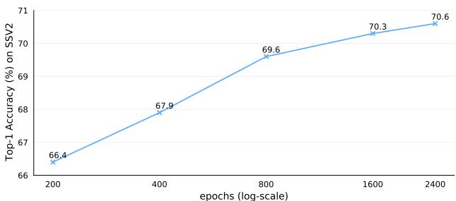

(a) Something-Something V2 上的性能  
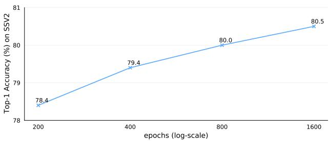  
(b) Kinetics-400 上的性能  
Figure 5: 训练计划对 (a) Something-Something V2 和 (b) Kinetics-400 的影响。此处每个数据点代表一个完整的训练计划。我们默认的 ViT-B 骨干网络如 Table 8 中所述。

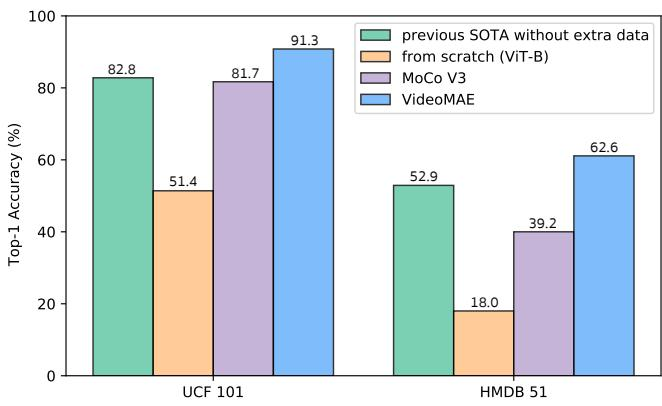  
Figure 6: 在 UCF101 和 HMDB51 上与 VideoMAE、MoCo v3 [15] 以及 Vi $^{2}$ CLR [19] 的比较。

## 10 可视化

我们在 Figure 10 和 Figure 11 中展示了几个重建示例。视频均随机选取自验证集。我们可以看到，即使在极高的掩码率下，VideoMAE 也能生成令人满意的重建结果。这些示例表明，我们的 VideoMAE 能够学习到更具表征性的特征，从而捕捉视频中的整体时空结构。

<table><tr><td>方法</td><td>主干网络</td><td>额外数据</td><td>帧数</td><td>参数量</td><td>模态</td><td>UCF101</td><td>HMDB51</td></tr><tr><td>OPN [36]</td><td>VGG</td><td>UCF101</td><td>N/A</td><td>N/A</td><td>V</td><td>59.6</td><td>23.8</td></tr><tr><td>VCOP [83]</td><td>R(2+1)D</td><td>UCF101</td><td>N/A</td><td>N/A</td><td>V</td><td>72.4</td><td>30.9</td></tr><tr><td>CoCLR [30]</td><td>S3D-G</td><td>UCF101</td><td>32</td><td>9M</td><td>V</td><td>81.4</td><td>52.1</td></tr><tr><td> $Vi^2$ CLR [19]</td><td>S3D</td><td>UCF101</td><td>32</td><td>9M</td><td>V</td><td>82.8</td><td>52.9</td></tr><tr><td>VideoMAE</td><td>ViT-B</td><td>无额外数据</td><td>16</td><td>87M</td><td>V</td><td>91.3</td><td>62.6</td></tr><tr><td>SpeedNet [5]</td><td>S3D-G</td><td>Kinetics-400</td><td>64</td><td>9M</td><td>V</td><td>81.1</td><td>48.8</td></tr><tr><td>VTHCL [85]</td><td>SlowOnly-R50</td><td>Kinetics-400</td><td>8</td><td>32M</td><td>V</td><td>82.1</td><td>49.2</td></tr><tr><td>Pace [74]</td><td>R(2+1)D</td><td>Kinetics-400</td><td>16</td><td>15M</td><td>V</td><td>77.1</td><td>36.6</td></tr><tr><td>MemDPC [29]</td><td>R-2D3D</td><td>Kinetics-400</td><td>40</td><td>32M</td><td>V</td><td>86.1</td><td>54.5</td></tr><tr><td>CoCLR [30]</td><td>S3D-G</td><td>Kinetics-400</td><td>32</td><td>9M</td><td>V</td><td>87.9</td><td>54.6</td></tr><tr><td>RSPNet [13]</td><td>S3D-G</td><td>Kinetics-400</td><td>64</td><td>9M</td><td>V</td><td>93.7</td><td>64.7</td></tr><tr><td>VideoMoCo [46]</td><td>R(2+1)D</td><td>Kinetics-400</td><td>16</td><td>15M</td><td>V</td><td>78.7</td><td>49.2</td></tr><tr><td> $Vi^2$ CLR [19]</td><td>S3D</td><td>Kinetics-400</td><td>32</td><td>9M</td><td>V</td><td>89.1</td><td>55.7</td></tr><tr><td>CVRL [54]</td><td>SlowOnly-R50</td><td>Kinetics-400</td><td>32</td><td>32M</td><td>V</td><td>92.9</td><td>67.9</td></tr><tr><td>CVRL [54]</td><td>SlowOnly-R50</td><td>Kinetics-600</td><td>32</td><td>32M</td><td>V</td><td>93.6</td><td>69.4</td></tr><tr><td>CVRL [54]</td><td>Slow-R152 (2×)</td><td>Kinetics-600</td><td>32</td><td>328M</td><td>V</td><td>94.4</td><td>70.6</td></tr><tr><td> $CORP_f$  [33]</td><td>SlowOnly-R50</td><td>Kinetics-400</td><td>32</td><td>32M</td><td>V</td><td>93.5</td><td>68.0</td></tr><tr><td> $\rho SimCLR_{\rho=2}$  [24]</td><td>SlowOnly-R50</td><td>Kinetics-400</td><td>8</td><td>32M</td><td>V</td><td>88.9</td><td>N/A</td></tr><tr><td> $\rho SwAV_{\rho=2}$  [24]</td><td>SlowOnly-R50</td><td>Kinetics-400</td><td>8</td><td>32M</td><td>V</td><td>87.3</td><td>N/A</td></tr><tr><td> $\rho MoCo_{\rho=2}$  [24]</td><td>SlowOnly-R50</td><td>Kinetics-400</td><td>8</td><td>32M</td><td>V</td><td>91.0</td><td>N/A</td></tr><tr><td> $\rho BYOL_{\rho=2}$  [24]</td><td>SlowOnly-R50</td><td>Kinetics-400</td><td>8</td><td>32M</td><td>V</td><td>92.7</td><td>N/A</td></tr><tr><td> $\rho BYOL_{\rho=4}$  [24]</td><td>SlowOnly-R50</td><td>Kinetics-400</td><td>8</td><td>32M</td><td>V</td><td>94.2</td><td>72.1</td></tr><tr><td>MIL-NCE [44]</td><td>S3D</td><td>HowTo100M</td><td>32</td><td>9M</td><td>V+T</td><td>91.3</td><td>61.0</td></tr><tr><td>MMV [1]</td><td>S3D-G</td><td>AS+HTM</td><td>32</td><td>9M</td><td>V+A+T</td><td>92.5</td><td>69.6</td></tr><tr><td>CPD [37]</td><td>ResNet50</td><td>IG300k</td><td>16</td><td>N/A</td><td>V+T</td><td>92.8</td><td>63.8</td></tr><tr><td>ELO [52]</td><td>R(2+1)D</td><td>Youtube8M-2</td><td>N/A</td><td>N/A</td><td>V+A</td><td>93.8</td><td>67.4</td></tr><tr><td>XDC [2]</td><td>R(2+1)D</td><td>Kinetics-400</td><td>32</td><td>15M</td><td>V+A</td><td>84.2</td><td>47.1</td></tr><tr><td>XDC [2]</td><td>R(2+1)D</td><td>IG65M</td><td>32</td><td>15M</td><td>V+A</td><td>94.2</td><td>67.1</td></tr><tr><td>GDT [50]</td><td>R(2+1)D</td><td>Kinetics-400</td><td>32</td><td>15M</td><td>V+A</td><td>89.3</td><td>60.0</td></tr><tr><td>GDT [50]</td><td>R(2+1)D</td><td>IG65M</td><td>32</td><td>15M</td><td>V+A</td><td>95.2</td><td>72.8</td></tr><tr><td>VideoMAE</td><td>ViT-B</td><td>Kinetics-400</td><td>16</td><td>87M</td><td>V</td><td>96.1</td><td>73.3</td></tr></table>

Table 13: 在 UCF101 和 HMDB51 上与前沿（SOTA）方法的对比。我们的 Video-MAE 重构归一化的立方体像素，分别在 UCF101 上以 75% 的掩蔽率预训练 3200 个 epoch，在 HMDB51 上预训练 4800 个 epoch。我们汇报微调准确率以进行评估。“V”表示仅视觉，“A”表示音频，“T”表示文本叙述。“N/A”表示该数值不可用。

## 11 数据许可

我们使用的所有数据集均为用于学术目的的常用数据集。Something-Something V2 $^{5}$ 和 UCF101 $^{6}$ 数据集的许可是自定义许可（custom）。Kinetics-400 $^{7}$、HMDB51 $^{8}$ 和 AVA $^{9}$ 数据集的许可为 CC BY-NC 4.0 $^{10}$。

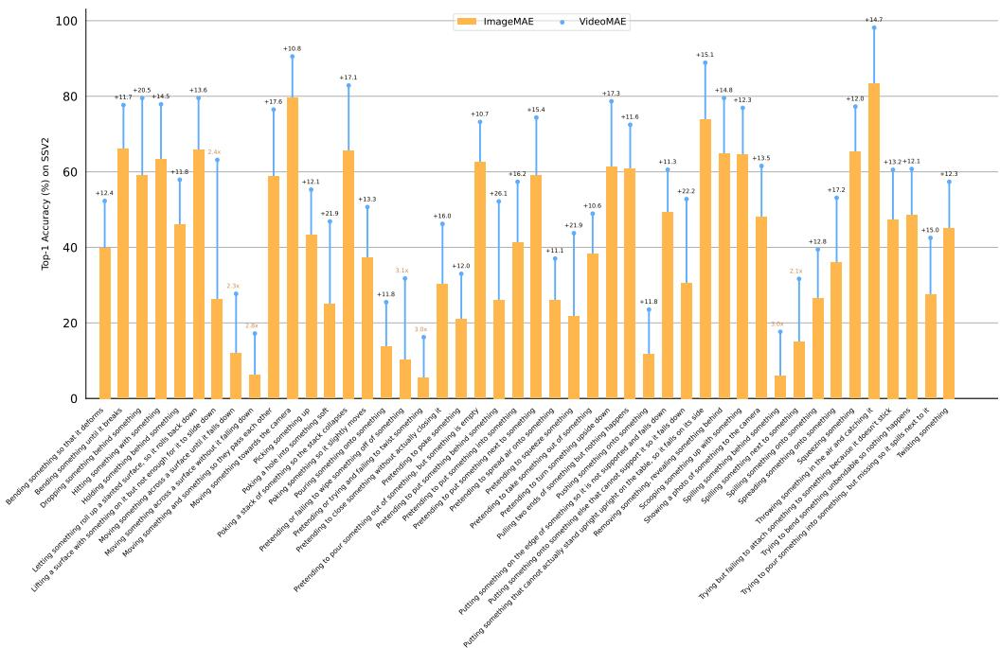

(a) VideoMAE 优于 ImageMAE 的类别。我们仅展示增益大于 10% 的类别。  
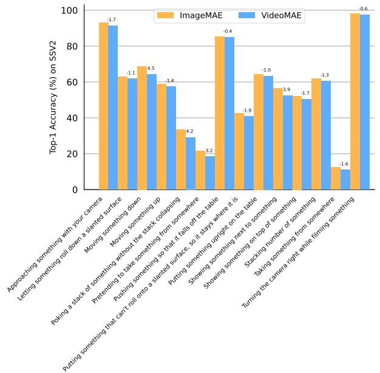  
(b) ImageMAE 优于 VideoMAE 的类别。  
Figure 7: 在 Something-Something V2 上 ImageMAE (64.8%) 与 VideoMAE (69.6%) 的对比。

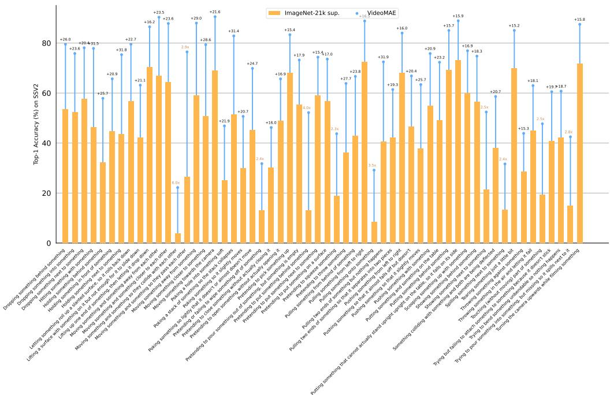

(a) VideoMAE 优于 ImageNet-21k 有监督预训练模型的类别。我们仅展示增益大于 15% 的类别。  
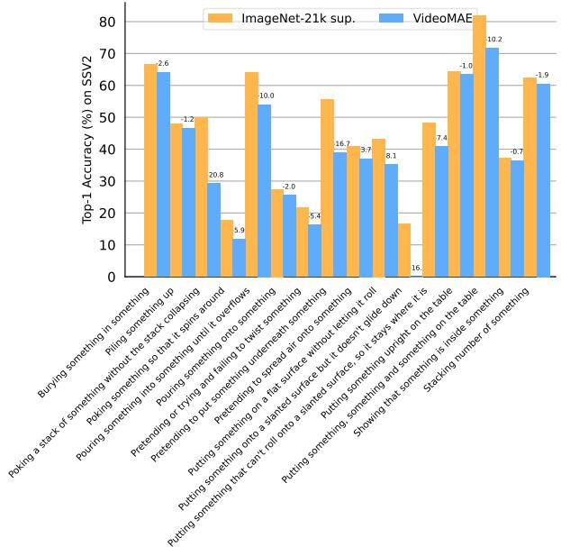  
(b) ImageNet-21k 有监督预训练模型优于 VideoMAE 的类别。  
Figure 8: 在 Something-Something V2 上 ImageNet-21k 有监督预训练模型 (61.8%) 与 VideoMAE (69.6%) 的对比。

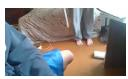

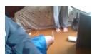

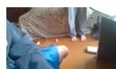  
GT（真实标签）: Something falling like a rock

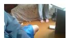  
ImageMAE 预测: Something falling like a rock (√), VideoMAE 预测: Throwing something (✗)

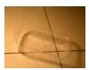

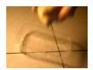

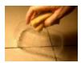

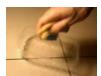

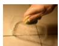  
GT（真实标签）: Squeezing something

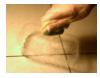

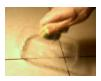

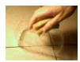  
ImageMAE 预测：Sprinkling something onto something (X)，VideoMAE 预测：Squeezing something (√)

  
GT：Folding something  
ImageNet-21k 监督预测：Folding something (√)，VideoMAE 预测：Closing something (X)

  
GT：Tearing something just a little bit  
ImageNet-21k 监督预测：Tearing something into two pieces (X)，VideoMAE 预测：Tearing something just a little bit (√)

Figure 9：不同模型在 Something-Something V2 上的预测样例。对于从验证集中抽取的每个样例，蓝色文本的预测表示预测正确，红色文本表示预测错误。“GT”表示该样例的真实标签（ground truth）。

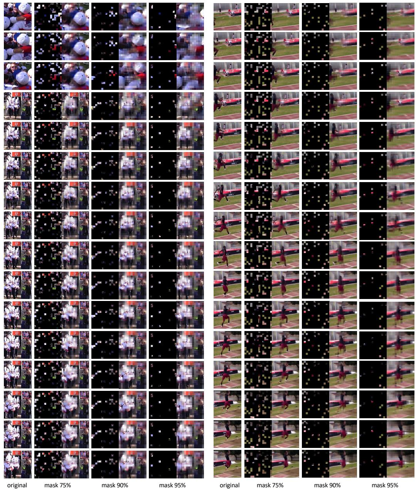  
Figure 10：Kinetics-400 验证集上未经人工挑选的随机视频。我们展示了原始视频序列以及在不同掩码比例下的重建结果。视频重建均由我们以 90% 掩码比例预训练的 VideoMAE 预测生成。

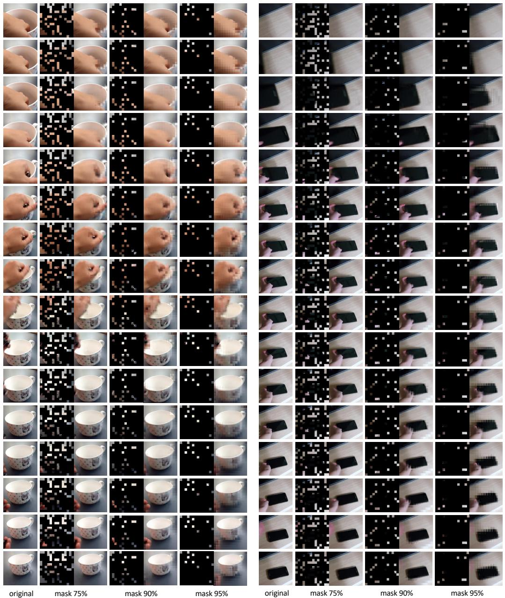  
Figure 11：Something-Something V2 验证集上未经人工挑选的随机视频。我们展示了原始视频序列以及在不同掩码比例下的重建结果。视频重建均由我们以 90% 掩码比例预训练的 VideoMAE 预测生成。