# 一张图像相当于 16x16 个词：用于大规模图像识别的 TRANSFORMER

Alexey Dosovitskiy∗,†, Lucas Beyer∗, Alexander Kolesnikov∗, Dirk Weissenborn∗,

Xiaohua Zhai∗, Thomas Unterthiner, Mostafa Dehghani, Matthias Minderer,

Georg Heigold, Sylvain Gelly, Jakob Uszkoreit, Neil Houlsby∗,†

∗同等技术贡献, †共同指导 Google Research, Brain Team {adosovitskiy, neilhoulsby}@google.com

## 摘要

尽管 Transformer 架构已成为自然语言处理任务的事实标准，但其在计算机视觉领域的应用仍然有限。在视觉领域，注意力机制要么与卷积网络结合使用，要么用于替换卷积网络的某些组件，同时保持其整体结构不变。我们表明，对 CNN 的这种依赖并非必要，直接应用于图像块（patch）序列的纯 Transformer 可以在图像分类任务上表现出色。当在海量数据上进行预训练并迁移到多个中小型图像识别基准（ImageNet、CIFAR-100、VTAB 等）时，与最先进的卷积网络相比，Vision Transformer (ViT) 取得了优异的结果，同时训练所需的计算资源大幅减少。1

## 1 引言

基于自注意力（self-attention）的架构，特别是 Transformer (Vaswani et al., 2017)，已成为自然语言处理（NLP）领域的首选模型。主流方法是在大型文本语料库上进行预训练，然后在较小的特定任务数据集上进行微调 (Devlin et al., 2019)。得益于 Transformer 的计算效率和可扩展性，训练参数量超过 100B 的前所未有规模的模型已成为可能 (Brown et al., 2020; Lepikhin et al., 2020)。随着模型和数据集的不断增长，其性能仍未出现饱和迹象。

然而，在计算机视觉中，卷积架构仍然占据主导地位 (LeCun et al., 1989; Krizhevsky et al., 2012; He et al., 2016)。受 NLP 成功的启发，许多研究尝试将类 CNN 架构与自注意力相结合 (Wang et al., 2018; Carion et al., 2020)，部分研究则完全替代了卷积 (Ramachandran et al., 2019; Wang et al., 2020a)。后一类模型尽管在理论上是高效的，但由于采用了特殊的注意力模式，尚未能在现代硬件加速器上实现有效的规模化扩展。因此，在大规模图像识别中，经典的类 ResNet 架构仍代表着最先进的水平 (Mahajan et al., 2018; Xie et al., 2020; Kolesnikov et al., 2020)。

受 Transformer 在 NLP 领域扩展成功的启发，我们尝试在尽可能少做修改的情况下，将标准 Transformer 直接应用于图像。为此，我们将图像分割为图像块（patches），并将这些图像块的线性嵌入（linear embeddings）序列作为 Transformer 的输入。图像块的处理方式与 NLP 应用中的词元（tokens/words）相同。我们在图像分类任务上以有监督的方式对模型进行训练。

当在如 ImageNet 这样的中等规模数据集上进行训练且没有使用强正则化时，这些模型的准确率表现平平，比同等规模的 ResNets 低几个百分点。这一看似令人沮丧的结果是可以预料的：Transformer 缺乏 CNN 固有的某些归纳偏置（inductive biases），例如平移等变性（translation equivariance）和局部性（locality），因此在训练数据量不足时泛化能力较差。

然而，如果在更大的数据集（14M-300M 张图像）上进行训练，情况就会发生改变。我们发现大规模训练可以胜过归纳偏置。我们的 Vision Transformer (ViT) 在经过充分规模的预训练并迁移到数据点较少的任务上时，取得了优异的结果。当在公开的 ImageNet-21k 数据集或内部的 JFT-300M 数据集上进行预训练时，ViT 在多个图像识别基准上接近或超越了最先进水平（state of the art）。具体而言，表现最佳的模型在 ImageNet 上达到了 88.55% 的准确率，在 ImageNet-ReaL 上达到 90.72%，在 CIFAR-100 上达到 94.55%，在包含 19 项任务的 VTAB 套件上达到 77.63%。

## 2 相关工作

Transformer 由 Vaswani et al. (2017) 提出用于机器翻译，此后已成为许多 NLP 任务中最先进的方法。基于 Transformer 的大型模型通常在大规模语料库上进行预训练，然后针对具体任务进行微调：BERT (Devlin et al., 2019) 采用去噪自监督预训练任务，而 GPT 系列工作则采用语言建模作为其预训练任务 (Radford et al., 2018; 2019; Brown et al., 2020)。

将自注意力（self-attention）朴素地应用于图像，需要每个像素都对其他所有像素进行注意力计算。由于计算复杂度随像素数量呈二次方增长，这无法扩展到实际的输入尺寸。因此，为了在图像处理领域应用 Transformer，以往尝试了几种近似方法。Parmar et al. (2018) 仅在每个查询像素的局部邻域内应用自注意力，而非全局应用。这种局部多头点积自注意力模块可以完全替代卷积（Hu et al., 2019; Ramachandran et al., 2019; Zhao et al., 2020）。在另一项研究路线中，Sparse Transformers（Child et al., 2019）采用全局自注意力的可扩展近似，以便适用于图像。另一种扩展注意力的方法是将其应用于不同大小的块（Weissenborn et al., 2019），在极端情况下仅沿单个轴应用（Ho et al., 2019; Wang et al., 2020a）。许多此类专门设计的注意力架构在计算机视觉任务上展现出了良好的效果，但要在硬件加速器上实现高效运行，需要复杂的工程优化。

与我们最相关的是 Cordonnier et al. (2020) 的模型，该模型从输入图像中提取大小为 2 × 2 的图像块（patches），并在其之上应用完全自注意力。该模型与 ViT 非常相似，但我们的工作进一步证明，大规模预训练可以使原始的（vanilla）Transformer 与最先进的 CNN 媲美（甚至表现更好）。此外，Cordonnier et al. (2020) 使用了 2 × 2 像素的小图像块尺寸，这使得该模型仅适用于低分辨率图像，而我们同样可以处理中等分辨率图像。

将卷积神经网络（CNNs）与各种形式的自注意力相结合也引起了广泛的关注，例如通过增强用于图像分类的特征图（Bello et al., 2019），或利用自注意力进一步处理 CNN 的输出，例如用于目标检测（Hu et al., 2018; Carion et al., 2020）、视频处理（Wang et al., 2018; Sun et al., 2019）、图像分类（Wu et al., 2020）、无监督目标发现（Locatello et al., 2020）或统一文本-视觉任务（Chen et al., 2020c; Lu et al., 2019; Li et al., 2019）。

另一个近期相关的模型是 image GPT (iGPT)（Chen et al., 2020a），它在降低图像分辨率和颜色空间后，将 Transformer 应用于图像像素。该模型作为生成模型以无监督方式进行训练，所得表征随后可进行微调或线性探测以评估分类性能，在 ImageNet 上达到了 72% 的最高准确率。

我们的工作进一步丰富了在比标准 ImageNet 数据集更大规模上探索图像识别的研究。利用额外的数据源能够在标准基准上取得最先进的结果（Mahajan et al., 2018; Touvron et al., 2019; Xie et al., 2020）。此外，Sun et al. (2017) 研究了 CNN 性能如何随数据集规模扩展，而 Kolesnikov et al. (2020); Djolonga et al. (2020) 对从 ImageNet-21k 和 JFT-300M 等大规模数据集进行 CNN 迁移学习开展了实证探索。我们同样专注于后两个数据集，但训练的是 Transformer，而非以往工作中所使用的基于 ResNet 的模型。

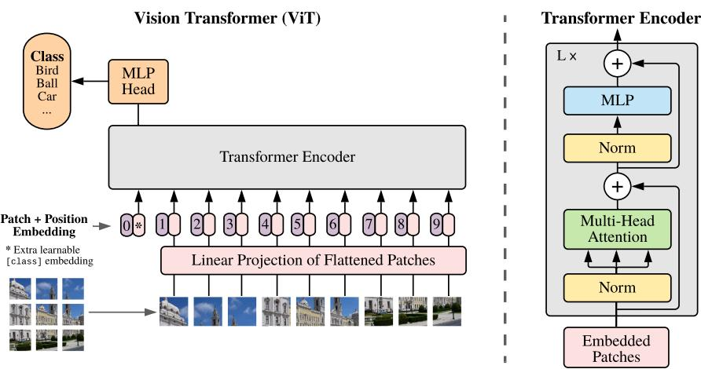  
Figure 1: 模型概览。我们将图像分割为固定大小的图块（patches），对每个图块进行线性嵌入，添加位置嵌入，并将生成的向量序列输入标准 Transformer 编码器。为了进行分类，我们采用了在序列中添加额外可学习“分类标记”（“classification token”）的标准方法。Transformer 编码器的示意图灵感来源于 Vaswani et al. (2017)。

## 3 方法

在模型设计上，我们尽可能紧密地遵循原始 Transformer (Vaswani et al., 2017)。这种刻意保持简单的设置的优势在于，可扩展的 NLP Transformer 架构——及其高效实现——几乎可以开箱即用。

## 3.1 VISION TRANSFORMER (VIT)

模型的概览如图 Figure 1 所示。标准 Transformer 接收一维标记嵌入（token embeddings）序列作为输入。为了处理二维图像，我们将图像 $\mathbf { x } \in \mathbb { R } ^ { H \times W \times \overset { \bullet } { C } }$ 重塑为展平的二维图块序列 $\mathbf { x } _ { p } \in \mathbb { R } ^ { N \times ( P ^ { 2 } \cdot C ) }$ ，其中 $( H , W )$ 为原始图像的分辨率，C 为通道数，$( P , P )$ 为每个图像图块的分辨率，而 $N = H W / P ^ { 2 }$ 为生成的图块数量，它同时也作为 Transformer 的有效输入序列长度。Transformer 在其所有层中使用恒定的隐向量维度 D，因此我们将图块展平并通过可训练的线性投影映射到 D 维 $( \mathrm { E q . ~ } 1 )$ 。我们将该投影的输出称为图块嵌入（patch embeddings）。

类似于 BERT 的 [class] 标记，我们在嵌入图块序列的前面添加一个可学习的嵌入 $( \mathbf { z } _ { 0 } ^ { 0 } = \mathbf { x } _ { \mathrm { c l a s s } } )$ ，其在 Transformer 编码器输出端的状态 $( \mathbf { \bar { z } } _ { L } ^ { 0 } )$ 用作图像表示 y (Eq. 4)。无论在预训练还是微调期间，分类头都会连接到 $\mathbf { z } _ { L } ^ { 0 }$ 。分类头在预训练时由具有一个隐藏层的 MLP 实现，在微调时由单个线性层实现。

位置嵌入（position embeddings）被添加到图像块嵌入（patch embeddings）中以保留位置信息。我们使用标准的课学习一维位置嵌入，因为我们尚未观察到使用更先进的感知二维的位置嵌入（附录 D.4）带来显著的性能提升。所得的嵌入向量序列用作编码器的输入。

Transformer 编码器（Vaswani et al., 2017）由多头自注意力（multiheaded selfattention, MSA，见附录 A）和 MLP 块的交替层组成（公式 2、3）。在每个块之前应用层归一化（Layernorm, LN），在每个块之后应用残差连接（Wang et al., 2019; Baevski & Auli, 2019）。

MLP 包含两个具有 GELU 非线性的层。

$$
\mathbf {z} _ {0} = [ \mathbf {x} _ {\mathrm{class}}; \mathbf {x} _ {p} ^ {1} \mathbf {E}; \mathbf {x} _ {p} ^ {2} \mathbf {E}; \dots ; \mathbf {x} _ {p} ^ {N} \mathbf {E} ] + \mathbf {E} _ {p o s}, \qquad \mathbf {E} \in \mathbb {R} ^ {(P ^ {2} \cdot C) \times D}, \mathbf {E} _ {p o s} \in \mathbb {R} ^ {(N + 1) \times D}\tag{1}
$$

$$
\mathbf {z} _ {\ell} ^ {\prime} = \mathrm{MSA} (\mathrm{LN} (\mathbf {z} _ {\ell - 1})) + \mathbf {z} _ {\ell - 1}, \quad \ell = 1 \dots L\tag{2}
$$

$$
\mathbf {z} _ {\ell} = \mathrm{MLP} (\mathrm{LN} (\mathbf {z ^ {\prime}} _ {\ell})) + \mathbf {z ^ {\prime}} _ {\ell}, \quad \ell = 1 \dots L\tag{3}
$$

$$
\mathbf {y} = \mathrm{LN} (\mathbf {z} _ {L} ^ {0})\tag{4}
$$

归纳偏置（Inductive bias）。我们注意到，与 CNN 相比，Vision Transformer 具有少得多的图像特定归纳偏置。在 CNN 中，局部性、二维邻域结构和平移等变性被贯穿融入整个模型的每一层中。而在 ViT 中，只有 MLP 层具有局部性和平移等变性，自注意力层则是全局的。二维邻域结构的使用非常有限：仅在模型开始时将图像切分成图像块，以及在微调阶段为了调整不同分辨率图像的位置嵌入（如下所述）。除此之外，初始化时的位置嵌入不携带有关图像块二维位置的信息，图像块之间的所有空间关系都必须从头开始学习。

混合架构（Hybrid Architecture）。作为原始图像块的替代方案，输入序列可以由 CNN（LeCun et al., 1989）的特征图构成。在这种混合模型中，图像块嵌入投影 $\mathbf{E}$（公式 1）应用于从 CNN 特征图中提取的块。作为一种特殊情况，这些块的空间尺寸可以为 1x1，这意味着输入序列只需通过展平特征图的空间维度并投影到 Transformer 维度即可获得。分类输入嵌入和位置嵌入如上所述添加。

## 3.2 微调与更高分辨率

通常，我们在大型数据集上对 ViT 进行预训练，并在（较小的）下游任务上进行微调。为此，我们移除预训练的预测头，并附加一个零初始化的 $D \times K$ 前馈层，其中 $K$ 是下游类别的数量。在比预训练更高的分辨率下进行微调通常是有益的（Touvron et al., 2019；Kolesnikov et al., 2020）。当输入更高分辨率的图像时，我们保持图像块（patch）大小不变，这会产生更大的有效序列长度。Vision Transformer 可以处理任意序列长度（受限于内存约束），然而，预训练的位置嵌入可能不再具有意义。因此，我们根据预训练位置嵌入在原始图像中的位置对其执行二维插值。需要注意的是，这种分辨率调整和图像块提取是将关于图像二维结构的归纳偏置手动注入到 Vision Transformer 中的唯二之处。

## 4 实验

我们评估了 ResNet、Vision Transformer (ViT) 以及混合模型的表征学习能力。为了了解每个模型对数据的需求，我们在不同规模的数据集上进行预训练，并评估了多个基准任务。在考虑预训练模型的计算成本时，ViT 的表现非常出色，以更低的预训练成本在大多数识别基准上达到了最先进水平。最后，我们使用自监督进行了一项小型实验，并展示了自监督 ViT 在未来的良好前景。

## 4.1 设置

数据集。为了探索模型的可扩展性，我们使用了包含 1k 个类别和 1.3M 张图像的 ILSVRC-2012 ImageNet 数据集（下文简称为 ImageNet），其包含 21k 个类别和 14M 张图像的超集 ImageNet-21k（Deng et al., 2009），以及包含 18k 个类别和 303M 张高分辨率图像的 JFT（Sun et al., 2017）。按照 Kolesnikov et al. (2020) 的方法，我们针对下游任务的测试集对预训练数据集进行了去重。我们将基于这些数据集训练的模型迁移到多个基准任务：原始验证集标签和清理后的 ReaL 标签上的 ImageNet（Beyer et al., 2020）、CIFAR-10/100（Krizhevsky, 2009）、Oxford-IIIT Pets（Parkhi et al., 2012）以及 Oxford Flowers-102（Nilsback & Zisserman, 2008）。对于这些数据集，预处理遵循 Kolesnikov et al. (2020)。

<table><tr><td>模型</td><td>层数</td><td>隐藏层大小 D</td><td>MLP 大小</td><td>头数</td><td>参数量</td></tr><tr><td>ViT-Base</td><td>12</td><td>768</td><td>3072</td><td>12</td><td>86M</td></tr><tr><td>ViT-Large</td><td>24</td><td>1024</td><td>4096</td><td>16</td><td>307M</td></tr><tr><td>ViT-Huge</td><td>32</td><td>1280</td><td>5120</td><td>16</td><td>632M</td></tr></table>

Table 1: Vision Transformer 模型变体的详细信息。

我们还在包含 19 个任务的 VTAB 分类基准套件（Zhai et al., 2019b）上进行了评估。VTAB 评估在低数据量情况下向多样化任务的迁移能力，每个任务使用 1 000 个训练样本。这些任务分为三组：自然（Natural）—— 如上述任务、Pets、CIFAR 等；专业（Specialized）—— 医学和卫星图像；以及结构化（Structured）—— 需要几何理解（如定位）的任务。

模型变体。我们基于用于 BERT（Devlin et al., 2019）的配置来设定 ViT 配置，如 Table 1 所示。“Base”和“Large”模型直接沿用自 BERT，我们还添加了更大的“Huge”模型。在后文中，我们使用简记法来表示模型大小和输入 patch（图像块）大小：例如，ViT-L/16 表示输入 patch 大小为 16 × 16 的“Large”变体。请注意，Transformer 的序列长度与 patch 大小的平方成反比，因此 patch 大小较小的模型在计算上开销更大。

对于基线 CNN，我们使用 ResNet（He et al., 2016），但将批归一化（Batch Normalization）层（Ioffe & Szegedy, 2015）替换为组归一化（Group Normalization）（Wu & He, 2018），并使用了标准化卷积（standardized convolutions）（Qiao et al., 2019）。这些修改改进了迁移能力（Kolesnikov et al., 2020），我们将修改后的模型记为“ResNet (BiT)”。对于混合模型，我们将中间特征图输入到 patch 大小为一个“像素”的 ViT 中。为了实验不同的序列长度，我们要么 (i) 采用常规 ResNet50 的第 4 阶段（stage 4）的输出，要么 (ii) 移除第 4 阶段，将相同数量的层放置在第 3 阶段（保持总层数不变），并采用该扩展后第 3 阶段的输出。选项 (ii) 会导致 4 倍长的序列长度，以及计算开销更高的 ViT 模型。

训练与微调。我们使用 Adam（Kingma & Ba, 2015）训练包括 ResNet 在内的所有模型，参数设置为 $\beta _ { 1 } = 0 . 9 , \beta _ { 2 } = 0 . 9 9 9$ ，批大小为 4096，并应用了 0.1 的高权重衰减（weight decay），我们发现这有助于所有模型的迁移（Appendix D.1 表明，与常规做法相反，在我们的设置下 Adam 在 ResNet 上的表现略优于 SGD）。我们使用了线性学习率预热（warmup）和衰减，详见 Appendix B.1。对于微调，我们对所有模型均使用带动量（momentum）的 SGD，批大小为 512，详见 Appendix B.1.1。对于 Table 2 中的 ImageNet 结果，我们在更高分辨率下进行了微调：ViT-L/16 为 512，ViT-H/14 为 518，并且还使用了衰减系数为 0.9999 的 Polyak & Juditsky (1992) 平均（Ramachandran et al., 2019; Wang et al., 2020b）。

评估指标（Metrics）。我们通过少样本（few-shot）或微调（fine-tuning）准确率来报告下游数据集上的结果。微调准确率反映了每个模型在相应数据集上微调后的性能。少样本准确率是通过求解正则化最小二乘回归问题获得的，该问题将训练图像子集的（冻结）表征映射到 $\{ - 1 , 1 \} ^ { K }$ 目标向量。这种表述使我们能够获得闭式精确解。尽管我们主要关注微调性能，但在微调成本过高的情况下，我们有时会使用线性少样本准确率进行快速的实时评估。

## 4.2 与现有最先进技术的比较

我们首先将我们最大的模型——ViT-H/14 和 ViT-L/16——与文献中当前最先进的 CNN 进行比较。第一个对比基准是 Big Transfer (BiT) (Kolesnikov et al., 2020)，它使用大型 ResNet 执行有监督迁移学习。第二个是 Noisy Student (Xie et al., 2020)，这是一个大型 EfficientNet，在移除了标签的 ImageNet 和 JFT-300M 上使用半监督学习进行训练。目前，Noisy Student 在 ImageNet 上达到了最优水平（state of the art），而 BiT-L 在本文报告的其他数据集上达到了最优水平。所有模型均在 TPUv3 硬件上进行训练，我们报告了预训练每个模型所需的 TPUv3-core-days（TPUv3 核心·天数），即用于训练的 TPU v3 核心数（每个芯片 2 个）乘以训练天数。

Table 2 展示了实验结果。在 JFT-300M 上预训练的较小模型 ViT-L/16 在所有任务上的表现均优于 BiT-L（在相同数据集上预训练），同时所需的训练计算资源大幅减少。更大的模型 ViT-H/14 进一步提升了性能，尤其是在更具挑战性的数据集上——ImageNet、CIFAR-100 和 VTAB 基准套件。有趣的是，该模型预训练所需的计算量仍然显著低于先前的最先进模型。然而，我们注意到预训练效率不仅可能受到架构选择的影响，还受到其他参数的影响，例如训练调度（training schedule）、优化器、权重衰减（weight decay）等。我们在 Section 4.4 中针对不同架构提供了性能与计算量的受控对照研究。最后，在公开的 ImageNet-21k 数据集上预训练的 ViT-L/16 模型在大多数数据集上也表现良好，同时占用的预训练资源更少：使用包含 8 个核心的标准云端 TPUv3 大约 30 天即可完成训练。

<table><tr><td></td><td>Ours-JFT(ViT-H/14)</td><td>Ours-JFT(ViT-L/16)</td><td>Ours-I21k(ViT-L/16)</td><td>BiT-L(ResNet152x4)</td><td>Noisy Student(EfficientNet-L2)</td></tr><tr><td>ImageNet</td><td> $88.55 \pm 0.04$ </td><td> $87.76 \pm 0.03$ </td><td> $85.30 \pm 0.02$ </td><td> $87.54 \pm 0.02$ </td><td> $88.4/88.5^*$ </td></tr><tr><td>ImageNet Real</td><td> $90.72 \pm 0.05$ </td><td> $90.54 \pm 0.03$ </td><td> $88.62 \pm 0.05$ </td><td>90.54</td><td>90.55</td></tr><tr><td>CIFAR-10</td><td> $99.50 \pm 0.06$ </td><td> $99.42 \pm 0.03$ </td><td> $99.15 \pm 0.03$ </td><td> $99.37 \pm 0.06$ </td><td>—</td></tr><tr><td>CIFAR-100</td><td> $94.55 \pm 0.04$ </td><td> $93.90 \pm 0.05$ </td><td> $93.25 \pm 0.05$ </td><td> $93.51 \pm 0.08$ </td><td>—</td></tr><tr><td>Oxford-IIIT Pets</td><td> $97.56 \pm 0.03$ </td><td> $97.32 \pm 0.11$ </td><td> $94.67 \pm 0.15$ </td><td> $96.62 \pm 0.23$ </td><td>—</td></tr><tr><td>Oxford Flowers-102</td><td> $99.68 \pm 0.02$ </td><td> $99.74 \pm 0.00$ </td><td> $99.61 \pm 0.02$ </td><td> $99.63 \pm 0.03$ </td><td>—</td></tr><tr><td>VTAB (19 tasks)</td><td> $77.63 \pm 0.23$ </td><td> $76.28 \pm 0.46$ </td><td> $72.72 \pm 0.21$ </td><td> $76.29 \pm 1.70$ </td><td>—</td></tr><tr><td>TPUv3-core-days</td><td>2.5k</td><td>0.68k</td><td>0.23k</td><td>9.9k</td><td>12.3k</td></tr></table>

Table 2: 在主流图像分类基准上与当前最优（SOTA）方法的比较。我们报告了三次微调运行后准确率的均值和标准差。在 JFT-300M 数据集上预训练的 Vision Transformer 模型在所有数据集上均优于基于 ResNet 的基线模型，同时预训练所需的计算资源大幅减少。在较小的公开 ImageNet-21k 数据集上预训练的 ViT 同样表现良好。∗在 Touvron 等人（2020）中报告的略有改进的 88.5% 结果。

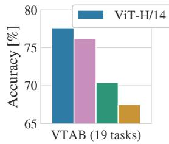

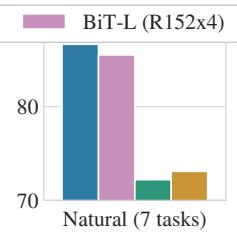

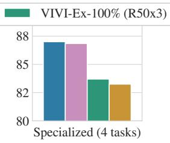

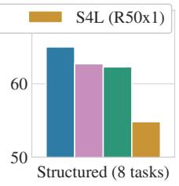  
Figure 2: VTAB 性能在自然（Natural）、专业（Specialized）和结构化（Structured）任务组中的细分表现。

Figure 2 将 VTAB 任务分解为各自对应的任务组，并与该基准上先前的 SOTA 方法进行了比较：BiT、VIVI——在 ImageNet 和 Youtube 上联合训练的 ResNet（Tschannen et al., 2020），以及 S4L——在 ImageNet 上的监督加半监督学习（Zhai et al., 2019a）。ViT-H/14 在自然和结构化任务上优于 BiT-R152x4 及其他方法。在专业任务上，排名前两位的模型性能相近。

## 4.3 预训练数据需求

当在大型 JFT-300M 数据集上进行预训练时，Vision Transformer 表现优异。相比于 ResNet 具有更少的视觉归纳偏置，数据集规模究竟有多关键？我们进行了两组系列实验。

首先，我们在规模递增的数据集（ImageNet、ImageNet-21k 和 JFT-300M）上预训练 ViT 模型。为了提升在较小数据集上的性能，我们优化了三个基本的正则化参数——权重衰减（weight decay）、dropout 和标签平滑（label smoothing）。Figure 3 展示了微调至 ImageNet 后的结果（其他数据集上的结果见 Table $5 ) ^ { 2 }$ ）。当在最小的数据集 ImageNet 上预训练时，尽管进行了（适度的）正则化，ViT-Large 模型的表现仍不如 ViT-Base 模型。在 ImageNet-21k 预训练下，两者的表现相近。只有在 JFT-300M 上，我们才能看到更大模型带来的全部优势。Figure 3 还展示了不同规模 BiT 模型所跨越的性能区间。BiT CNN 在 ImageNet 上优于 ViT，但在更大的数据集上，ViT 实现了反超。

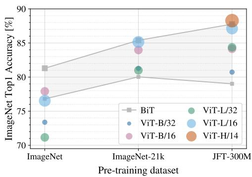

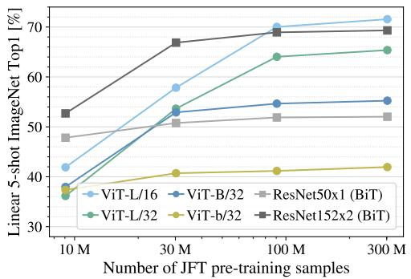  
Figure 4: 在 ImageNet 上的线性少样本评估与预训练规模的关系。ResNet 在较小的预训练数据集上表现更好，但比 ViT 更快达到瓶颈平台期；而在更大的预训练规模下 ViT 表现更好。ViT-b 是将所有隐藏层维度减半后的 ViT-B。

Figure 3: 迁移到 ImageNet。虽然在小数据集上预训练时，大型 ViT 模型的表现不如 BiT ResNet（阴影区域），但它们在更大的数据集上预训练时大放异彩。类似地，随着数据集规模的增长，较大的 ViT 变体超越了较小的变体。  
  
总预训练计算量 [exaFLOPs]  
Figure 5: 不同架构（Vision Transformer、ResNet 和混合模型）的性能与预训练计算量的关系。在相同的计算预算下，Vision Transformer 通常优于 ResNet。对于较小的模型规模，混合模型相比纯 Transformer 有所提升，但对于较大的模型，这种差距逐渐消失。

其次，我们在 9M、30M 和 90M 的随机子集以及完整的 JFT-300M 数据集上训练我们的模型。我们没有对较小的子集进行额外的正则化，并在所有设置中使用相同的超参数。通过这种方式，我们评估的是模型的内在属性，而非正则化的效果。不过，我们确实使用了早停法（early-stopping），并报告训练期间达到的最佳验证准确率。为了节省计算资源，我们报告少样本线性（few-shot linear）准确率，而非完全微调准确率。Figure 4 给出了相关结果。在计算成本相当的情况下，Vision Transformer 在较小数据集上比 ResNet 更容易过拟合。例如，ViT-B/32 比 ResNet50 略快；它在 9M 子集上的表现要差得多，但在 90M+ 子集上表现更好。ResNet152x2 和 ViT-L/16 也是如此。这一结果进一步证实了直觉：卷积的归纳偏置（inductive bias）对较小的数据集很有用，但对于更大的数据集，直接从数据中学习相关模式就足够了，甚至更加有益。

总体而言，ImageNet 上的少样本（few-shot）结果（Figure 4）以及 VTAB 上的低数据量结果（Table 2）在极低数据量迁移方面展现出了良好的前景。进一步分析 ViT 的少样本特性是未来工作中一个令人兴奋的方向。

## 4.4 扩展性研究

我们通过评估从 JFT-300M 迁移的性能，对不同模型进行了受控的扩展性研究。在此设定下，数据规模不会成为模型性能的瓶颈，我们评估了每个模型的性能与预训练成本之间的关系。模型集合包括：7 个 ResNet 模型（R50x1、R50x2、R101x1、R152x1、R152x2 预训练 7 个 epoch，以及 R152x2 和 R200x3 预训练 14 个 epoch）；6 个 Vision Transformer 模型（ViT-B/32、B/16、L/32、L/16 预训练 7 个 epoch，以及 L/16 和 H/14 预训练 14 个 epoch）；以及 5 个混合模型（R50+ViT-B/32、B/16、L/32、L/16 预训练 7 个 epoch，以及 R50+ViT-L/16 预训练 14 个 epoch；对于混合模型，模型名称末尾的数字并不代表 patch 大小，而是代表 ResNet 主干网络中的总下采样率）。

Figure 5 展示了迁移性能与总预训练计算量的关系（计算成本的详细信息参见 Appendix D.5）。每个模型的详细结果见附录中的 Table 6。可以观察到以下几个规律：首先，在性能/计算量权衡方面，Vision Transformer 显著优于 ResNet。ViT 仅需大约少 2 − 4× 的计算量即可达到相同的性能（在 5 个数据集上的平均值）。其次，在计算预算较小时，混合模型略优于 ViT，但随着模型变大，这种差异消失了。这一结果有些出乎意料，因为人们原本可能期望卷积的局部特征处理在任何模型规模下都能为 ViT 提供帮助。第三，Vision Transformer 在所尝试的范围内似乎并未达到饱和，这为未来的规模扩展工作提供了动力。

## 4.5 探究 VISION TRANSFORMER

为了初步理解 Vision Transformer 如何处理图像数据，我们分析了其内部表征。Vision Transformer 的第一层将展平的 patch 线性投影到一个低维空间中（Eq. 1）。Figure 7（左）展示了学习到的嵌入滤波器的主成分。这些成分类似于对每个 patch 内精细结构进行低维表征的合理基函数。

在投影之后，将学习到的位置嵌入添加到 patch 表征中。Figure 7（中）表明，模型通过位置嵌入的相似性学会了对图像内的距离进行编码，即距离更近的 patch 往往具有更相似的位置嵌入。此外，还出现了行列结构：同一行/列中的 patch 具有相似的嵌入。最后，对于更大的网格，正弦结构有时会很明显（Appendix D）。位置嵌入学会了表征 2D 图像拓扑结构，这也解释了为什么人工设计的 2D 感知嵌入变体未能带来性能提升（Appendix D.4）。

  
Figure 6: 从输出 token 到输入空间的注意力代表性示例。详情参见附录 D.7。

自注意力机制使得 ViT 即使在最低层也能够整合整幅图像的信息。我们探究了网络在多大程度上利用了这一能力。具体而言，我们根据注意力权重计算了在图像空间中信息整合的平均距离（Figure 7，右）。这种“注意力距离”类似于 CNN 中的感受野大小。

我们发现，部分注意力头在最低层就已经关注了图像的大部分区域，这表明模型确实利用了全局整合信息的能力。其他注意力头在低层则始终保持较小的注意力距离。在 Transformer 之前应用 ResNet 的混合模型中，这种高度局部化的注意力不太明显（Figure 7，右），这表明它可能具有与 CNN 中早期卷积层类似的功能。此外，注意力距离随着网络深度的增加而增加。在全局层面上，我们发现模型关注了与分类语义相关的图像区域（Figure 6）。

## 4.6 自监督

Transformer 在 NLP 任务上展现出了令人瞩目的性能。然而，其巨大的成功不仅源于其出色的可扩展性，还源于大规模自监督预训练（Devlin et al., 2019; Radford et al., 2018）。我们还对用于自监督的掩码图像块预测（masked patch prediction）进行了初步探索，模仿了 BERT 中使用的掩码语言建模任务。通过自监督预训练，我们较小的 ViT-B/16 模型在 ImageNet 上达到了 79.9% 的准确率，相比从头开始训练（training from scratch）显著提高了 2%，但仍比有监督预训练低 4%。附录 B.1.2 包含更多细节。我们将对比预训练（contrastive pre-training）（Chen et al., 2020b; He et al., 2020; Bachman et al., 2019; Henaff et al., 2020）的探索留待未来工作。

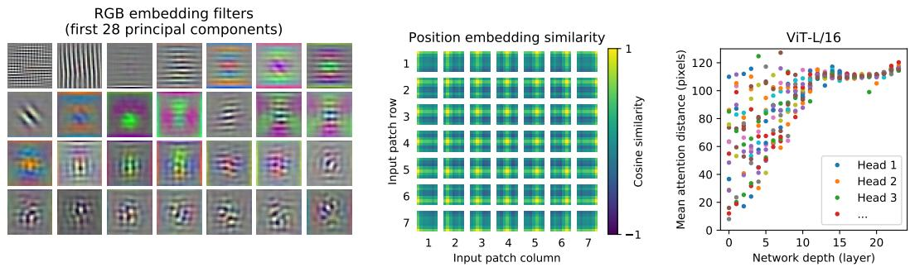

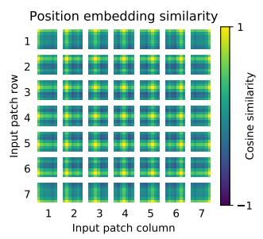

  
Figure 7: 左：ViT-L/32 对 RGB 值的初始线性嵌入滤波器。中：ViT-L/32 的位置嵌入相似度。色块显示了指定行和列的图像块位置嵌入与所有其他图像块位置嵌入之间的余弦相似度。右：按注意力头和网络深度划分的受关注区域大小。每个点代表某一层的 16 个注意力头之一在所有图像上的平均注意力距离。详情参见附录 D.7。

## 5 结论

我们探索了 Transformer 在图像识别中的直接应用。与以往在计算机视觉中使用自注意力（self-attention）的研究不同，除了初始的图像块（patch）提取步骤外，我们没有在架构中引入图像特有的归纳偏置（inductive biases）。相反，我们将图像视为一系列图像块序列，并通过自然语言处理（NLP）中使用的标准 Transformer 编码器对其进行处理。这种简单且可扩展的策略在与大型数据集上的预训练相结合时，取得了出人意料的优异效果。因此，Vision Transformer 在许多图像分类数据集上达到或超越了现有最先进技术水平（state of the art），同时预训练成本相对较低。

尽管这些初步结果令人鼓舞，但仍存在许多挑战。其一是将 ViT 应用于其他计算机视觉任务，例如目标检测和图像分割。我们的结果结合 Carion et al. (2020) 的研究，展现了该方法的前景。另一个挑战是继续探索自监督预训练方法。我们的初步实验表明自监督预训练带来了改进，但自监督与大规模监督预训练之间仍存在较大差距。最后，进一步扩大 ViT 的模型规模可能会带来更优的性能。

## 致谢

该工作在柏林、苏黎世和阿姆斯特丹完成。我们感谢 Google 的许多同事提供的帮助，特别是 Andreas Steiner 在基础设施和代码开源发布方面给予的关键帮助；Joan Puigcerver 和 Maxim Neumann 在大规模训练基础设施方面的帮助；以及 Dmitry Lepikhin、Aravindh Mahendran、Daniel Keysers、Mario Lučić、Noam Shazeer、Ashish Vaswani 和 Colin Raffel 进行的有益讨论。

## 参考文献

Samira Abnar and Willem Zuidema. Quantifying attention flow in transformers. In ACL, 2020.

Philip Bachman, R Devon Hjelm, and William Buchwalter. Learning representations by maximizing mutual information across views. In NeurIPS, 2019.

Alexei Baevski and Michael Auli. Adaptive input representations for neural language modeling. In ICLR, 2019.

I. Bello, B. Zoph, Q. Le, A. Vaswani, and J. Shlens. Attention augmented convolutional networks. In ICCV, 2019.

Lucas Beyer, Olivier J. Henaff, Alexander Kolesnikov, Xiaohua Zhai, and Aäron van den Oord. Are we done with imagenet? arXiv, 2020.

Tom B Brown, Benjamin Mann, Nick Ryder, Melanie Subbiah, Jared Kaplan, Prafulla Dhariwal, Arvind Neelakantan, Pranav Shyam, Girish Sastry, Amanda Askell, et al. Language models are few-shot learners. arXiv, 2020.

Nicolas Carion, Francisco Massa, Gabriel Synnaeve, Nicolas Usunier, Alexander Kirillov, and Sergey Zagoruyko. End-to-end object detection with transformers. In ECCV, 2020.

Mark Chen, Alec Radford, Rewon Child, Jeff Wu, and Heewoo Jun. Generative pretraining from pixels. In ICML, 2020a.

Ting Chen, Simon Kornblith, Mohammad Norouzi, and Geoffrey E. Hinton. A simple framework for contrastive learning of visual representations. In ICML, 2020b.

Yen-Chun Chen, Linjie Li, Licheng Yu, Ahmed El Kholy, Faisal Ahmed, Zhe Gan, Yu Cheng, and Jingjing Liu. UNITER: UNiversal Image-TExt Representation Learning. In ECCV, 2020c.

Rewon Child, Scott Gray, Alec Radford, and Ilya Sutskever. Generating long sequences with sparse transformers. arXiv, 2019.

Jean-Baptiste Cordonnier, Andreas Loukas, and Martin Jaggi. On the relationship between selfattention and convolutional layers. In ICLR, 2020.

J. Deng, W. Dong, R. Socher, L. Li, Kai Li, and Li Fei-Fei. Imagenet: A large-scale hierarchical image database. In CVPR, 2009.

Jacob Devlin, Ming-Wei Chang, Kenton Lee, and Kristina Toutanova. BERT: Pre-training of deep bidirectional transformers for language understanding. In NAACL, 2019.

Josip Djolonga, Jessica Yung, Michael Tschannen, Rob Romijnders, Lucas Beyer, Alexander Kolesnikov, Joan Puigcerver, Matthias Minderer, Alexander D’Amour, Dan Moldovan, Sylvan Gelly, Neil Houlsby, Xiaohua Zhai, and Mario Lucic. On robustness and transferability of convolutional neural networks. arXiv, 2020.

Kaiming He, Xiangyu Zhang, Shaoqing Ren, and Jian Sun. Deep residual learning for image recognition. In CVPR, 2016.

Kaiming He, Haoqi Fan, Yuxin Wu, Saining Xie, and Ross Girshick. Momentum contrast for unsupervised visual representation learning. In CVPR, 2020.

Jonathan Ho, Nal Kalchbrenner, Dirk Weissenborn, and Tim Salimans. Axial attention in multidimensional transformers. arXiv, 2019.

Han Hu, Jiayuan Gu, Zheng Zhang, Jifeng Dai, and Yichen Wei. Relation networks for object detection. In CVPR, 2018.

Han Hu, Zheng Zhang, Zhenda Xie, and Stephen Lin. Local relation networks for image recognition. In ICCV, 2019.

Zilong Huang, Xinggang Wang, Yunchao Wei, Lichao Huang, Humphrey Shi, Wenyu Liu, and Thomas S. Huang. Ccnet: Criss-cross attention for semantic segmentation. In ICCV, 2020.

Olivier J. Henaff, Aravind Srinivas, Jeffrey De Fauw, Ali Razavi, Carl Doersch, S. M. Ali Eslami,´ and Aaron van den Oord. Data-efficient image recognition with contrastive predictive coding. In ICML, 2020.

Sergey Ioffe and Christian Szegedy. Batch normalization: Accelerating deep network training by reducing internal covariate shift. 2015.

Diederik P. Kingma and Jimmy Ba. Adam: A method for stochastic optimization. In ICLR, 2015.

Alexander Kolesnikov, Lucas Beyer, Xiaohua Zhai, Joan Puigcerver, Jessica Yung, Sylvain Gelly, and Neil Houlsby. Big transfer (BiT): General visual representation learning. In ECCV, 2020.

Alex Krizhevsky. Learning multiple layers of features from tiny images. Technical report, 2009.

Alex Krizhevsky, Ilya Sutskever, and Geoffrey E. Hinton. Imagenet classification with deep convolutional neural networks. In NIPS, 2012.

Y. LeCun, B. Boser, J. Denker, D. Henderson, R. Howard, W. Hubbard, and L. Jackel. Backpropagation applied to handwritten zip code recognition. Neural Computation, 1:541–551, 1989.

Dmitry Lepikhin, HyoukJoong Lee, Yuanzhong Xu, Dehao Chen, Orhan Firat, Yanping Huang, Maxim Krikun, Noam Shazeer, and Zhifeng Chen. Gshard: Scaling giant models with conditional computation and automatic sharding. arXiv, 2020.

Liunian Harold Li, Mark Yatskar, Da Yin, Cho-Jui Hsieh, and Kai-Wei Chang. VisualBERT: A Simple and Performant Baseline for Vision and Language. In Arxiv, 2019.

Francesco Locatello, Dirk Weissenborn, Thomas Unterthiner, Aravindh Mahendran, Georg Heigold, Jakob Uszkoreit, Alexey Dosovitskiy, and Thomas Kipf. Object-centric learning with slot attention. arXiv, 2020.

Jiasen Lu, Dhruv Batra, Devi Parikh, and Stefan Lee. ViLBERT: Pretraining Task-Agnostic Visiolinguistic Representations for Vision-and-Language Tasks. In NeurIPS. 2019.

Dhruv Mahajan, Ross Girshick, Vignesh Ramanathan, Kaiming He, Manohar Paluri, Yixuan Li, Ashwin Bharambe, and Laurens van der Maaten. Exploring the limits of weakly supervised pretraining. In ECCV, 2018.

M. Nilsback and A. Zisserman. Automated flower classification over a large number of classes. In ICVGIP, 2008.

Omkar M. Parkhi, Andrea Vedaldi, Andrew Zisserman, and C. V. Jawahar. Cats and dogs. In CVPR, 2012.

Niki Parmar, Ashish Vaswani, Jakob Uszkoreit, Lukasz Kaiser, Noam Shazeer, Alexander Ku, and Dustin Tran. Image transformer. In ICML, 2018.

B. T. Polyak and A. B. Juditsky. Acceleration of stochastic approximation by averaging. SIAM Journal on Control and Optimization, 30(4):838–855, 1992. doi: 10.1137/0330046. URL https://doi.org/10.1137/0330046.

Siyuan Qiao, Huiyu Wang, Chenxi Liu, Wei Shen, and Alan Yuille. Weight standardization. arXiv preprint arXiv:1903.10520, 2019.

Alec Radford, Karthik Narasimhan, Tim Salimans, and Ilya Sutskever. Improving language understanding with unsupervised learning. 技术报告 (Technical Report), 2018.

Alec Radford, Jeff Wu, Rewon Child, David Luan, Dario Amodei, and Ilya Sutskever. Language models are unsupervised multitask learners. 技术报告 (Technical Report), 2019.

Prajit Ramachandran, Niki Parmar, Ashish Vaswani, Irwan Bello, Anselm Levskaya, and Jon Shlens. Stand-alone self-attention in vision models. In NeurIPS, 2019.

Chen Sun, Abhinav Shrivastava, Saurabh Singh, and Abhinav Gupta. Revisiting unreasonable effectiveness of data in deep learning era. In ICCV, 2017.

Chen Sun, Austin Myers, Carl Vondrick, Kevin Murphy, and Cordelia Schmid. Videobert: A joint model for video and language representation learning. In ICCV, 2019.

Hugo Touvron, Andrea Vedaldi, Matthijs Douze, and Herve Jegou. Fixing the train-test resolution discrepancy. In NeurIPS. 2019.

Hugo Touvron, Andrea Vedaldi, Matthijs Douze, and Herve Jegou. Fixing the train-test resolution discrepancy: Fixefficientnet. arXiv preprint arXiv:2003.08237, 2020.

Michael Tschannen, Josip Djolonga, Marvin Ritter, Aravindh Mahendran, Neil Houlsby, Sylvain Gelly, and Mario Lucic. Self-supervised learning of video-induced visual invariances. In Proceedings ofthe IEEE/CVF Conference on Computer Vision and Pattern Recognition (CVPR), June 2020.

Ashish Vaswani, Noam Shazeer, Niki Parmar, Jakob Uszkoreit, Llion Jones, Aidan N Gomez, Łukasz Kaiser, and Illia Polosukhin. Attention is all you need. In NIPS, 2017.

Huiyu Wang, Yukun Zhu, Bradley Green, Hartwig Adam, Alan Yuille, and Liang-Chieh Chen. Axial-deeplab: Stand-alone axial-attention for panoptic segmentation. In ECCV, 2020a.

Huiyu Wang, Yukun Zhu, Bradley Green, Hartwig Adam, Alan Yuille, and Liang-Chieh Chen. Axial-deeplab: Stand-alone axial-attention for panoptic segmentation. arXiv preprint arXiv:2003.07853, 2020b.

Qiang Wang, Bei Li, Tong Xiao, Jingbo Zhu, Changliang Li, Derek F. Wong, and Lidia S. Chao. Learning deep transformer models for machine translation. In ACL, 2019.

Xiaolong Wang, Ross Girshick, Abhinav Gupta, and Kaiming He. Non-local neural networks. In CVPR, 2018.

Dirk Weissenborn, Oscar Tackstr ¨ om, and Jakob Uszkoreit. Scaling autoregressive video models. In ¨ ICLR, 2019.

Bichen Wu, Chenfeng Xu, Xiaoliang Dai, Alvin Wan, Peizhao Zhang, Masayoshi Tomizuka, Kurt Keutzer, and Peter Vajda. Visual transformers: Token-based image representation and processing for computer vision. arxiv, 2020.

Yuxin Wu and Kaiming He. Group normalization. In ECCV, 2018.

Qizhe Xie, Minh-Thang Luong, Eduard Hovy, and Quoc V. Le. Self-training with noisy student improves imagenet classification. In CVPR, 2020.

Xiaohua Zhai, Avital Oliver, Alexander Kolesnikov, and Lucas Beyer. S4L: Self-Supervised Semi-Supervised Learning. In ICCV, 2019a.

Xiaohua Zhai, Joan Puigcerver, Alexander Kolesnikov, Pierre Ruyssen, Carlos Riquelme, Mario Lucic, Josip Djolonga, Andre Susano Pinto, Maxim Neumann, Alexey Dosovitskiy, et al. A large-scale study of representation learning with the visual task adaptation benchmark. arXiv preprint arXiv:1910.04867, 2019b.

Hengshuang Zhao, Jiaya Jia, and Vladlen Koltun. Exploring self-attention for image recognition. In CVPR, 2020.

<table><tr><td>模型</td><td>数据集</td><td>轮数 (Epochs)</td><td>基础学习率</td><td>学习率衰减</td><td>权重衰减</td><td>Dropout</td></tr><tr><td>ViT-B/{16,32}</td><td>JFT-300M</td><td>7</td><td> $8 \cdot 10^{-4}$ </td><td>线性</td><td>0.1</td><td>0.0</td></tr><tr><td>ViT-L/32</td><td>JFT-300M</td><td>7</td><td> $6 \cdot 10^{-4}$ </td><td>线性</td><td>0.1</td><td>0.0</td></tr><tr><td>ViT-L/16</td><td>JFT-300M</td><td>7/14</td><td> $4 \cdot 10^{-4}$ </td><td>线性</td><td>0.1</td><td>0.0</td></tr><tr><td>ViT-H/14</td><td>JFT-300M</td><td>14</td><td> $3 \cdot 10^{-4}$ </td><td>线性</td><td>0.1</td><td>0.0</td></tr><tr><td>R50x{1,2}</td><td>JFT-300M</td><td>7</td><td> $10^{-3}$ </td><td>线性</td><td>0.1</td><td>0.0</td></tr><tr><td>R101x1</td><td>JFT-300M</td><td>7</td><td> $8 \cdot 10^{-4}$ </td><td>线性</td><td>0.1</td><td>0.0</td></tr><tr><td>R152x{1,2}</td><td>JFT-300M</td><td>7</td><td> $6 \cdot 10^{-4}$ </td><td>线性</td><td>0.1</td><td>0.0</td></tr><tr><td>R50+ViT-B/{16,32}</td><td>JFT-300M</td><td>7</td><td> $8 \cdot 10^{-4}$ </td><td>线性</td><td>0.1</td><td>0.0</td></tr><tr><td>R50+ViT-L/32</td><td>JFT-300M</td><td>7</td><td> $2 \cdot 10^{-4}$ </td><td>线性</td><td>0.1</td><td>0.0</td></tr><tr><td>R50+ViT-L/16</td><td>JFT-300M</td><td>7/14</td><td> $4 \cdot 10^{-4}$ </td><td>线性</td><td>0.1</td><td>0.0</td></tr><tr><td>ViT-B/{16,32}</td><td>ImageNet-21k</td><td>90</td><td> $10^{-3}$ </td><td>线性</td><td>0.03</td><td>0.1</td></tr><tr><td>ViT-L/{16,32}</td><td>ImageNet-21k</td><td>30/90</td><td> $10^{-3}$ </td><td>线性</td><td>0.03</td><td>0.1</td></tr><tr><td>ViT-*</td><td>ImageNet</td><td>300</td><td> $3 \cdot 10^{-3}$ </td><td>余弦</td><td>0.3</td><td>0.1</td></tr></table>

Table 3: 训练超参数。所有模型均采用 4096 的批次大小（batch size）和 10k 步的学习率预热（warmup）进行训练。对于 ImageNet，我们发现额外应用全局范数为 1 的梯度裁剪（gradient clipping）是有益的。训练分辨率为 224。

## 附录

## A 多头自注意力

标准 qkv 自注意力（SA，Vaswani et al. (2017)）是神经网络架构中广泛使用的基础模块。对于输入序列 $\mathbf { z } \in \dot { \mathbb { R } } ^ { N \times D }$ 中的每个元素，我们计算序列中所有值 v 的加权和。注意力权重 $A _ { i j }$ 基于序列中两个元素之间的两两相似度及其各自的查询 $\mathbf { q } ^ { i }$ 和键 $\mathbf { k } ^ { j }$ 表示。

$$
[ \mathbf {q}, \mathbf {k}, \mathbf {v} ] = \mathbf {z} \mathbf {U} _ {q k v}
$$

$$
\mathbf {U} _ {q k v} \in \mathbb {R} ^ {D \times 3 D _ {h}},\tag{5}
$$

$$
A = \operatorname{softmax} \left(\mathbf {q k} ^ {\top} / \sqrt {D _ {h}}\right)
$$

$$
A \in \mathbb {R} ^ {N \times N},\tag{6}
$$

$$
\operatorname{SA} (\mathbf {z}) = A \mathbf {v}.\tag{7}
$$

多头自注意力（Multihead self-attention，MSA）是 SA 的一种扩展，其中我们并行运行 $k$ 个被称为“头（heads）”的自注意力操作，并对它们拼接后的输出进行投影。为了在改变 $k$ 时保持计算量和参数量不变，通常将 $D _ { h }$（公式 5）设置为 $D / k$。

$$
\mathrm{MSA} (\mathbf {z}) = [ \mathrm{SA} _ {1} (z); \mathrm{SA} _ {2} (z); \dots ; \mathrm{SA} _ {k} (z) ]   \mathbf {U} _ {m s a} \qquad \mathbf {U} _ {m s a} \in \mathbb {R} ^ {k \cdot D _ {h} \times D}\tag{8}
$$

## B 实验细节

## B.1 训练

Table 3 总结了我们不同模型的训练设置。我们发现在 ImageNet 上从头训练模型时，强正则化是关键所在。若使用 Dropout，则在除 qkv 投影以外的每个全连接层之后，以及在位置嵌入与 patch 嵌入相加之后直接应用。混合模型的训练设置与其对应的 ViT 模型完全相同。最后，所有训练均在 224 分辨率下进行。

## B.1.1 微调

我们使用动量为 0.9 的 SGD 对所有 ViT 模型进行微调。我们在学习率上进行了小范围的网格搜索，学习率范围见 Table 4。为此，我们从训练集中抽取较小的子集（Pets 和 Flowers 为 10%，CIFAR 为 2%，ImageNet 为 1%）作为开发集，并在剩余数据上进行训练。对于最终结果，我们在整个训练集上进行训练，并在相应的测试数据上进行评估。对于 ResNets 和混合模型的微调，我们使用完全相同的设置，唯一的例外是 ImageNet，我们在学习率搜索范围中添加了另一个值 0.06。此外，对于 ResNets，我们还运行了 Kolesnikov et al. (2020) 的设置，并在该运行结果与我们的搜索结果中选择最佳结果。最后，若无特别说明，所有微调实验均在 384 分辨率下运行（以与训练不同的分辨率进行微调是常见做法 (Kolesnikov et al., 2020)）。

<table><tr><td>Dataset</td><td>Steps</td><td>Base LR</td></tr><tr><td>ImageNet</td><td>20 000</td><td>{0.003, 0.01, 0.03, 0.06}</td></tr><tr><td>CIFAR100</td><td>10 000</td><td>{0.001, 0.003, 0.01, 0.03}</td></tr><tr><td>CIFAR10</td><td>10 000</td><td>{0.001, 0.003, 0.01, 0.03}</td></tr><tr><td>Oxford-IIIT Pets</td><td>500</td><td>{0.001, 0.003, 0.01, 0.03}</td></tr><tr><td>Oxford Flowers-102</td><td>500</td><td>{0.001, 0.003, 0.01, 0.03}</td></tr><tr><td>VTAB (19 tasks)</td><td>2 500</td><td>0.01</td></tr></table>

Table 4: 微调的超参数。所有模型均采用余弦学习率衰减、512 的批次大小、无权重衰减以及在全局范数为 1 处的梯度裁剪进行微调。若无特别说明，微调分辨率为 384。

当将 ViT 模型迁移到另一个数据集时，我们移除整个头部（两个线性层），并将其替换为一个单独的、零初始化的线性层，该线性层输出目标数据集所需的类别数。我们发现这比简单地重新初始化最后一层稍微更具鲁棒性。

对于 VTAB，我们遵循 Kolesnikov et al. (2020) 中的方案，并在所有任务上使用相同的超参数设置。我们使用 0.01 的学习率并训练 2500 步（Tab. 4）。我们通过在两个学习率和两个调度策略上进行小范围搜索，并选择在包含 200 个样本的验证集上取得最高 VTAB 得分的设置来确定该参数。我们沿用了 Kolesnikov et al. (2020) 中使用的预处理方式，不同之处在于我们没有针对特定任务采用特定的输入分辨率。相反，我们发现 Vision Transformer 在所有任务中均从高分辨率（384 × 384）中获益最多。

## B.1.2 自监督

我们在初步的自监督实验中采用了掩蔽补丁预测（masked patch prediction）目标。具体而言，我们对 50% 的补丁嵌入（patch embeddings）进行损坏处理：要么将其嵌入替换为可学习的 [mask] 嵌入（80%），要么替换为随机的其他补丁嵌入（10%），要么保持原样不变（10%）。该设置与 Devlin et al. (2019) 在语言模型中使用的设置非常相似。最后，我们利用各个被损坏补丁的表示来预测其 3 比特的平均颜色（即总共 512 种颜色）。

我们在 JFT 上以 4096 的批次大小训练自监督模型 1M 步（约 14 个 epoch）。我们使用 Adam，基础学习率为 $2 \cdot 1 0 ^ { - 4 }$，预热 10k 步，并采用余弦学习率衰减。作为预训练的预测目标，我们尝试了以下设置：1) 仅预测平均的 3 比特颜色（即 1 次预测 512 种颜色），2) 并行预测 $1 6 \times 1 6$ 补丁下采样至 4 × 4 版本的 3 比特颜色（即 16 次预测 512 种颜色），3) 使用 L2 对整个补丁进行回归（即在 3 个 RGB 通道上进行 256 次回归）。令人惊讶的是，我们发现所有设置都表现得相当好，尽管 L2 效果略逊一筹。我们仅报告选项 1) 的最终结果，因为它展现出了最佳的少样本（few-shot）性能。我们还尝试了 Devlin et al. (2019) 所采用的 15% 损坏率，但在我们的少样本指标上结果也略差。

最后，我们想指出的是，我们对掩蔽补丁预测的具体实现并不需要如此海量的预训练，也不需要像 JFT 这样庞大的数据集，就能在 ImageNet 分类任务上获得类似的性能提升。也就是说，我们观察到在预训练 100k 步之后，下游性能的收益递减，并且在 ImageNet 上进行预训练时也能看到类似的增益。

## C 额外结果

我们报告了与论文中所展示图表相对应的详细结果。Table 5 对应论文中的 Figure 3，展示了在规模不断增大的数据集（ImageNet、ImageNet-21k 和 JFT-300M）上预训练的不同 ViT 模型的迁移性能。Table 6 对应于

<table><tr><td colspan="2"></td><td>ViT-B/16</td><td>ViT-B/32</td><td>ViT-L/16</td><td>ViT-L/32</td><td>ViT-H/14</td></tr><tr><td rowspan="6">ImageNet</td><td>CIFAR-10</td><td>98.13</td><td>97.77</td><td>97.86</td><td>97.94</td><td>-</td></tr><tr><td>CIFAR-100</td><td>87.13</td><td>86.31</td><td>86.35</td><td>87.07</td><td>-</td></tr><tr><td>ImageNet</td><td>77.91</td><td>73.38</td><td>76.53</td><td>71.16</td><td>-</td></tr><tr><td>ImageNet Real</td><td>83.57</td><td>79.56</td><td>82.19</td><td>77.83</td><td>-</td></tr><tr><td>Oxford Flowers-102</td><td>89.49</td><td>85.43</td><td>89.66</td><td>86.36</td><td>-</td></tr><tr><td>Oxford-IIIT-Pets</td><td>93.81</td><td>92.04</td><td>93.64</td><td>91.35</td><td>-</td></tr><tr><td rowspan="6">ImageNet-21k</td><td>CIFAR-10</td><td>98.95</td><td>98.79</td><td>99.16</td><td>99.13</td><td>99.27</td></tr><tr><td>CIFAR-100</td><td>91.67</td><td>91.97</td><td>93.44</td><td>93.04</td><td>93.82</td></tr><tr><td>ImageNet</td><td>83.97</td><td>81.28</td><td>85.15</td><td>80.99</td><td>85.13</td></tr><tr><td>ImageNet Real</td><td>88.35</td><td>86.63</td><td>88.40</td><td>85.65</td><td>88.70</td></tr><tr><td>Oxford Flowers-102</td><td>99.38</td><td>99.11</td><td>99.61</td><td>99.19</td><td>99.51</td></tr><tr><td>Oxford-IIIT-Pets</td><td>94.43</td><td>93.02</td><td>94.73</td><td>93.09</td><td>94.82</td></tr><tr><td rowspan="6">JFT-300M</td><td>CIFAR-10</td><td>99.00</td><td>98.61</td><td>99.38</td><td>99.19</td><td>99.50</td></tr><tr><td>CIFAR-100</td><td>91.87</td><td>90.49</td><td>94.04</td><td>92.52</td><td>94.55</td></tr><tr><td>ImageNet</td><td>84.15</td><td>80.73</td><td>87.12</td><td>84.37</td><td>88.04</td></tr><tr><td>ImageNet Real</td><td>88.85</td><td>86.27</td><td>89.99</td><td>88.28</td><td>90.33</td></tr><tr><td>Oxford Flowers-102</td><td>99.56</td><td>99.27</td><td>99.56</td><td>99.45</td><td>99.68</td></tr><tr><td>Oxford-IIIT-Pets</td><td>95.80</td><td>93.40</td><td>97.11</td><td>95.83</td><td>97.56</td></tr></table>

Table 5: 在 ImageNet、ImageNet-21k 或 JFT300M 上预训练时，Vision Transformer 在各数据集上的 Top1 准确率（以 % 计）。这些数值对应正文中的 Figure 3。模型均在 384 分辨率下进行微调。请注意，此处计算 ImageNet 结果时，未采用用于获得 Table 2 结果的额外技术（Polyak 平均和 512 分辨率图像）。

<table><tr><td>名称</td><td>Epochs</td><td>ImageNet</td><td>ImageNet Real</td><td>CIFAR-10</td><td>CIFAR-100</td><td>Pets</td><td>Flowers</td><td>exaFLOPs</td></tr><tr><td>ViT-B/32</td><td>7</td><td>80.73</td><td>86.27</td><td>98.61</td><td>90.49</td><td>93.40</td><td>99.27</td><td>55</td></tr><tr><td>ViT-B/16</td><td>7</td><td>84.15</td><td>88.85</td><td>99.00</td><td>91.87</td><td>95.80</td><td>99.56</td><td>224</td></tr><tr><td>ViT-L/32</td><td>7</td><td>84.37</td><td>88.28</td><td>99.19</td><td>92.52</td><td>95.83</td><td>99.45</td><td>196</td></tr><tr><td>ViT-L/16</td><td>7</td><td>86.30</td><td>89.43</td><td>99.38</td><td>93.46</td><td>96.81</td><td>99.66</td><td>783</td></tr><tr><td>ViT-L/16</td><td>14</td><td>87.12</td><td>89.99</td><td>99.38</td><td>94.04</td><td>97.11</td><td>99.56</td><td>1567</td></tr><tr><td>ViT-H/14</td><td>14</td><td>88.08</td><td>90.36</td><td>99.50</td><td>94.71</td><td>97.11</td><td>99.71</td><td>4262</td></tr><tr><td>ResNet50x1</td><td>7</td><td>77.54</td><td>84.56</td><td>97.67</td><td>86.07</td><td>91.11</td><td>94.26</td><td>50</td></tr><tr><td>ResNet50x2</td><td>7</td><td>82.12</td><td>87.94</td><td>98.29</td><td>89.20</td><td>93.43</td><td>97.02</td><td>199</td></tr><tr><td>ResNet101x1</td><td>7</td><td>80.67</td><td>87.07</td><td>98.48</td><td>89.17</td><td>94.08</td><td>95.95</td><td>96</td></tr><tr><td>ResNet152x1</td><td>7</td><td>81.88</td><td>87.96</td><td>98.82</td><td>90.22</td><td>94.17</td><td>96.94</td><td>141</td></tr><tr><td>ResNet152x2</td><td>7</td><td>84.97</td><td>89.69</td><td>99.06</td><td>92.05</td><td>95.37</td><td>98.62</td><td>563</td></tr><tr><td>ResNet152x2</td><td>14</td><td>85.56</td><td>89.89</td><td>99.24</td><td>91.92</td><td>95.75</td><td>98.75</td><td>1126</td></tr><tr><td>ResNet200x3</td><td>14</td><td>87.22</td><td>90.15</td><td>99.34</td><td>93.53</td><td>96.32</td><td>99.04</td><td>3306</td></tr><tr><td>R50x1+ViT-B/32</td><td>7</td><td>84.90</td><td>89.15</td><td>99.01</td><td>92.24</td><td>95.75</td><td>99.46</td><td>106</td></tr><tr><td>R50x1+ViT-B/16</td><td>7</td><td>85.58</td><td>89.65</td><td>99.14</td><td>92.63</td><td>96.65</td><td>99.40</td><td>274</td></tr><tr><td>R50x1+ViT-L/32</td><td>7</td><td>85.68</td><td>89.04</td><td>99.24</td><td>92.93</td><td>96.97</td><td>99.43</td><td>246</td></tr><tr><td>R50x1+ViT-L/16</td><td>7</td><td>86.60</td><td>89.72</td><td>99.18</td><td>93.64</td><td>97.03</td><td>99.40</td><td>859</td></tr><tr><td>R50x1+ViT-L/16</td><td>14</td><td>87.12</td><td>89.76</td><td>99.31</td><td>93.89</td><td>97.36</td><td>99.11</td><td>1668</td></tr></table>

Table 6: 模型缩放实验的详细结果。这些对应于正文中的 Figure 5。我们展示了在若干数据集上的迁移准确率，以及预训练计算量（以 exaFLOPs 为单位）。

论文中的 Figure 5 展示了不同尺寸的 ViT、ResNet 和混合（hybrid）模型的迁移性能，以及它们预训练的预估计算成本。

## D 附加分析

## D.1 ResNet 中 SGD 与 Adam 的对比

ResNet 通常使用 SGD 进行训练，而我们采用 Adam 作为优化器是相当不寻常的。在此，我们展示促成这一选择的实验。具体而言，我们对比了在 JFT 上分别使用 SGD 和 Adam 预训练的两个 ResNet 模型（50x1 和 152x2）的微调性能。对于 SGD，我们采用了 Kolesnikov et al. (2020) 推荐的超参数。结果如 Table 7 所示。在大多数数据集以及平均水平上，Adam 预训练的表现均优于 SGD 预训练。这证明了选择 Adam 作为在 JFT 上预训练 ResNet 的优化器是合理的。需要注意的是，此处的绝对数值低于 Kolesnikov et al. (2020) 报道的结果，因为我们仅预训练了 7 个 epoch，而非 30 个。

<table><tr><td rowspan="2">数据集</td><td colspan="2">ResNet50</td><td colspan="2">ResNet152x2</td></tr><tr><td>Adam</td><td>SGD</td><td>Adam</td><td>SGD</td></tr><tr><td>ImageNet</td><td>77.54</td><td>78.24</td><td>84.97</td><td>84.37</td></tr><tr><td>CIFAR10</td><td>97.67</td><td>97.46</td><td>99.06</td><td>99.07</td></tr><tr><td>CIFAR100</td><td>86.07</td><td>85.17</td><td>92.05</td><td>91.06</td></tr><tr><td>Oxford-IIIT Pets</td><td>91.11</td><td>91.00</td><td>95.37</td><td>94.79</td></tr><tr><td>Oxford Flowers-102</td><td>94.26</td><td>92.06</td><td>98.62</td><td>99.32</td></tr><tr><td>平均</td><td>89.33</td><td>88.79</td><td>94.01</td><td>93.72</td></tr></table>

Table 7: 使用 Adam 和 SGD 预训练的 ResNet 模型的微调表现。

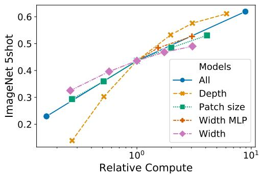

  
Figure 8: 缩放 Vision Transformer 的不同模型维度。

## D.2 Transformer 架构维度

我们对缩放 Transformer 架构的不同维度进行了消融实验，以探究哪些维度最适合扩展到超大模型。Figure 8 展示了不同配置在 ImageNet 上的 5-shot 性能。所有配置均基于一个具有 8 层、$D = { \bar { 1 } } 0 2 4 .$ $D _ { M L P } = 2 0 4 8$ 且 patch 大小为 32 的 ViT 模型（即所有曲线的交点）。我们可以看到，增加深度带来的提升最大，这种提升在达到 64 层之前都清晰可见。然而，在超过 16 层之后收益递减就已经显现。有趣的是，扩展网络宽度带来的变化似乎最小。减小 patch 大小（从而增加有效序列长度）在不引入额外参数的情况下表现出了令人惊讶的稳健提升。这些发现表明，相比参数量，计算量可能是更好的性能预测指标；如果有必要进行缩放，应优先考虑深度而非宽度。总体而言，我们发现按比例同时扩展所有维度能够带来稳健的提升。

## D.3 预测头类型与 C L A S S Token

为了尽可能贴近原始的 Transformer 模型，我们使用了一个额外的 [class] token，并将其作为图像表示。该 token 的输出随后通过一个小型多层感知机（MLP，在单个隐藏层中采用 tanh 作为非线性激活函数）转换为类别预测。

这种设计继承自用于文本的 Transformer 模型，我们在正文的所有实验中均采用了该设计。最初尝试仅使用图像块嵌入（patch embeddings），对其进行全局平均池化（global average pooling, GAP），随后连接一个线性分类器——正如 ResNet 的最终特征图那样——但效果非常差。然而，我们发现这既不是由于额外的 token，也不是由于 GAP 操作。相反，性能上的差异完全可以通过对不同学习率的需求来解释，见 Figure 9。

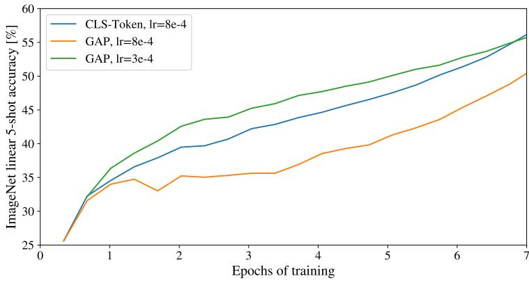

Figure 9: class-token 与全局平均池化（global average pooling）分类器的比较。两者的效果相近，但需要不同的学习率。

<table><tr><td>位置嵌入</td><td>默认/Stem</td><td>每一层</td><td>每一层共享</td></tr><tr><td>无位置嵌入</td><td>0.61382</td><td>N/A</td><td>N/A</td></tr><tr><td>一维位置嵌入</td><td>0.64206</td><td>0.63964</td><td>0.64292</td></tr><tr><td>二维位置嵌入</td><td>0.64001</td><td>0.64046</td><td>0.64022</td></tr><tr><td>相对位置嵌入</td><td>0.64032</td><td>N/A</td><td>N/A</td></tr></table>

Table 8: 在 ImageNet 5-shot 线性评估下使用 ViT-B/16 模型对位置嵌入进行的消融实验结果。

## D.4 位置嵌入

我们对使用位置嵌入编码空间信息的不同方式进行了消融实验。我们尝试了以下几种情况：

• 不提供位置信息：将输入视为图像块集合（bag of patches）。

• 一维位置嵌入：将输入视为按光栅扫描顺序（raster order）排列的 patch 序列（本论文中所有其他实验的默认设置）。

• 二维位置嵌入：将输入视为二维的 patch 网格。在这种情况下，模型会学习两组嵌入，分别对应一个轴（X 嵌入和 Y 嵌入），每个维度大小为 $D / 2 .$ 。然后，根据输入中该 patch 的坐标，将 X 和 Y 嵌入拼接起来，以获得该 patch 的最终位置嵌入。

• 相对位置嵌入（Relative positional embeddings）：考虑图像块（patch）之间的相对距离而不是它们的绝对位置来编码空间信息。为此，我们使用一维相对注意力（1-dimensional Relative Attention），在其中定义所有可能的图像块对之间的相对距离。因此，对于每个给定的图像块对（在注意力机制中一个作为 query，另一个作为 key/value），我们都有一个偏移量 $p _ { q } - p _ { k }$ ，其中每个偏移量都与一个嵌入相关联。然后，我们只需运行额外的注意力计算，其中使用原始 query（query 的内容），但使用相对位置嵌入作为 key。接着，我们将来自相对注意力的 logits 作为偏置项，在应用 softmax 之前将其加到主注意力（基于内容的注意力）的 logits 上。

除了编码空间信息的不同方式之外，我们还尝试了在模型中融合该信息的不同方式。对于一维和二维位置嵌入，我们尝试了三种不同的情况：(1) 在模型的 stem 之后且在将输入送入 Transformer 编码器（Transformer encoder）之前，将位置嵌入添加到输入中（本文所有其他实验中的默认设置）；(2) 在每一层的开头学习并将位置嵌入添加到输入中；(3) 在每一层的开头向输入添加学习到的位置嵌入（各层之间共享）。

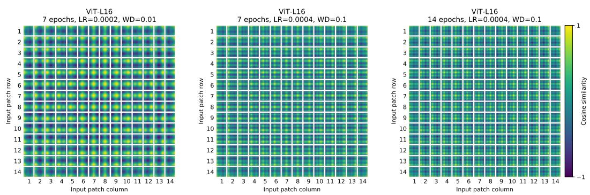

  
Figure 10: 使用不同超参数训练的模型的位置嵌入。

Table 8 总结了在 ViT-B/16 模型上进行该消融实验的结果。正如我们所看到的，虽然无位置嵌入的模型与带有位置嵌入的模型之间存在较大的性能差距，但不同位置信息编码方式之间的差异微乎其微。我们推测，由于我们的 Transformer 编码器是在图像块（patch）级别而非像素级别的输入上操作，因此如何编码空间信息的差异并不那么重要。更准确地说，在图像块级别的输入中，空间维度远小于原始像素级别的输入，例如 14 × 14 对比 $2 2 4 \times 2 2 4$ ，在这一分辨率下学习表示空间关系对于这些不同的位置编码策略而言同样容易。尽管如此，网络学习到的位置嵌入相似度的具体模式仍取决于训练超参数（Figure 10）。

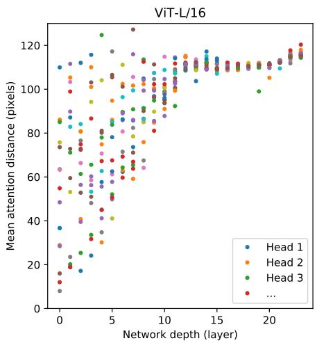

  
Figure 11: 按注意力头和网络深度划分的注意力区域大小。注意力距离是通过对 128 张示例图像计算查询像素与所有其他像素之间的距离，并以注意力权重加权求平均得到的。每个点表示某一层的 16 个头之一在所有图像上的平均注意力距离。图像宽度为 224 像素。

## D.5 经验计算成本

我们也关注这些架构在我们的硬件上的实际运行速度，由于通道宽度和缓存大小等细节问题，理论 FLOPs 并不总能很好地预测这一速度。为此，我们在 TPUv3 加速器上对主要关注的模型进行了推理速度计时；推理与反向传播速度之间的差异是一个与模型无关的恒定常数因子。

Figure 12（左）展示了在不同输入尺寸下，单个核心每秒可以处理的图像数量。每个单独的点代表在广泛的批次大小（batch-sizes）范围内测得的峰值性能。可以看出，ViT 随图像尺寸呈双二次缩放的理论现象，仅在最大模型和最大分辨率下才勉强开始显现。

另一个令人关注的指标是每个模型单个核心所能容纳的最大批次大小，该值越大越有利于扩展到大型数据集。Figure 12（右）展示了同一组模型的这一指标。这表明大型 ViT 模型在内存效率方面相比 ResNet 模型具有明显优势。

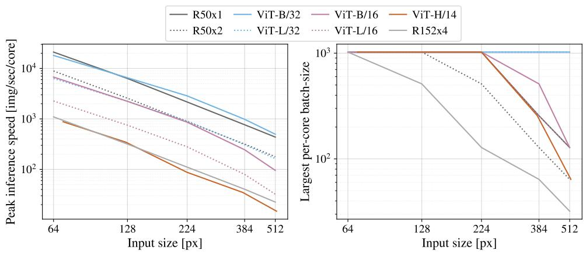  
Figure 12: 左图：不同架构在各种输入尺寸下的实际挂钟计时。ViT 模型与类似的 ResNets 速度相当。右图：不同架构在各种输入尺寸下设备能够容纳的单核心最大批次大小。ViT 模型的内存效率明显更高。

## D.6 轴向注意力

轴向注意力（Axial Attention）（Huang et al., 2020; Ho et al., 2019）是一种简单而有效的技术，用于在组织为多维张量的大型输入上运行自注意力（self-attention）。轴向注意力的总体思路是执行多次注意力操作，每次操作仅沿着输入张量的单个轴进行，而不是对展平后的输入应用一维注意力。在轴向注意力中，每个注意力操作沿着特定轴混合信息，同时保持沿其他轴的信息独立。沿着这一思路，Wang et al. (2020b) 提出了 AxialResNet 模型，其中 ResNet50 中的所有卷积核大小为 3 × 3 的卷积都被轴向自注意力（即行和列注意力）所替代，并辅以相对位置编码。我们已将 AxialResNet 实现为基线模型。3。

此外，我们修改了 ViT 以处理二维形状的输入，而不是一维的 patch 序列，并引入了 Axial Transformer 块；在这些块中，原本的“自注意力后接 MLP”被替换为“行自注意力加 MLP 后接列自注意力加 MLP”。

图 13 展示了在 JFT 数据集上预训练的 Axial ResNet、Axial-ViT-B/32 和 Axial-ViT-B/16 在 ImageNet 5-shot 线性评估上的性能，对比了预训练计算量，包括 FLOPs 数量和推理时间（每秒样本数）两个指标。如我们所见，Axial-ViT-B/32 和 Axial-ViT-B/16 在性能上均优于对应的 ViT-B 模型，但这以更高的计算量为代价。这是因为在 Axial-ViT 模型中，每个具有全局自注意力的 Transformer 块都被替换为两个 Axial Transformer 块（一个具有行自注意力，一个具有列自注意力），尽管在轴向情况下自注意力操作的序列长度更短，但每个 Axial-ViT 块都多出了一个额外的 MLP。对于 AxialResNet，尽管从准确率/计算量权衡来看表现尚可（图 13，左），但其朴素实现在 TPU 上的运行速度极慢（图 13，右）。

  
Figure 13: 基于 Axial-Attention 的模型性能：在 ImageNet 5-shot 线性评估上的 top-1 准确率，对比其以 FLOPs 数量（左）和推理时间（左）衡量的速度。

## D.7 ATTENTION DISTANCE

为了理解 ViT 如何利用自注意力整合整幅图像的信息，我们分析了不同层中注意力权重跨越的平均距离（图 11）。这种“注意力距离”类似于 CNN 中的感受野大小。在较浅层中，不同头之间的平均注意力距离差异很大，某些头关注图像的大部分区域，而其他头则关注查询位置处或附近的小区域。随着深度的增加，所有头的注意力距离都会增大。在网络的后半部分，大多数头都会在所有 token 之间进行大范围的关注。

## D.8 ATTENTION MAPS

为了计算从输出 token 到输入空间的注意力图（图 6 和图 14），我们使用了 Attention Rollout（Abnar & Zuidema, 2020）。简而言之，我们计算了 ViT-L/16 在所有头上的注意力权重的平均值，然后递归地将所有层的权重矩阵相乘。这解释了注意力在所有层中跨 token 混合的过程。

## D.9 OBJECTNET RESULTS

我们还遵循 Kolesnikov et al. (2020) 中的评估设置，在 ObjectNet 基准上评估了我们的旗舰模型 ViT-H/14，取得了 82.1% 的 top-5 准确率和 61.7% 的 top-1 准确率。

## D.10 VTAB BREAKDOWN

Table 9 显示了在各项 VTAB-1k 任务上取得的分数。

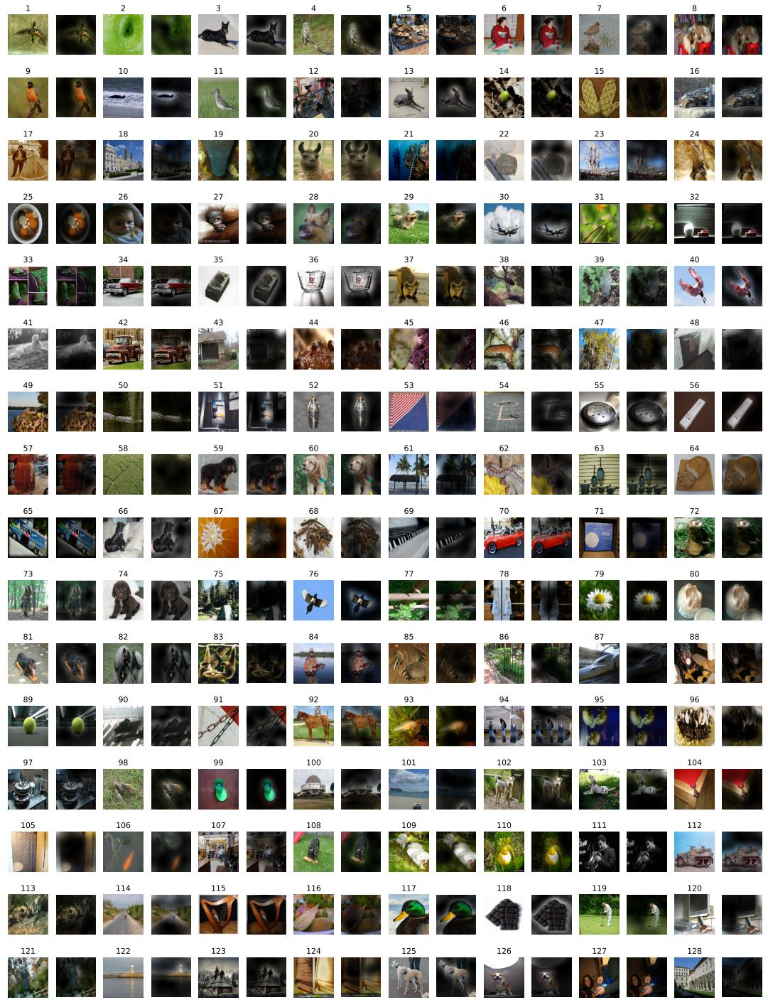  
Figure 14: 如 Figure 6 所示的更多注意力图示例（随机选取）。

Table 9: 各任务上的 VTAB-1k 性能细分。

<table><tr><td></td><td>Caltech101</td><td>CIFAR-100</td><td>DTD</td><td>Flowers102</td><td>Pets</td><td>Sun397</td><td>SVHN</td><td>Camelyon</td><td>EuroSAT</td><td>Resisc45</td><td>Retinopathy</td><td>Clevr-Count</td><td>Clevr-Dist</td><td>DMLab</td><td>dSpr-Loc</td><td>dSpr-Ori</td><td>KITTI-Dist</td><td>sNORB-Azim</td><td>sNORB-Elev</td><td>均值</td></tr><tr><td>ViT-H/14 (JFT)</td><td>95.3</td><td>85.5</td><td>75.2</td><td>99.7</td><td>97.2</td><td>65.0</td><td>88.9</td><td>83.3</td><td>96.7</td><td>91.4</td><td>76.6</td><td>91.7</td><td>63.8</td><td>53.1</td><td>79.4</td><td>63.3</td><td>84.5</td><td>33.2</td><td>51.2</td><td>77.6</td></tr><tr><td>ViT-L/16 (JFT)</td><td>95.4</td><td>81.9</td><td>74.3</td><td>99.7</td><td>96.7</td><td>63.5</td><td>87.4</td><td>83.6</td><td>96.5</td><td>89.7</td><td>77.1</td><td>86.4</td><td>63.1</td><td>49.7</td><td>74.5</td><td>60.5</td><td>82.2</td><td>36.2</td><td>51.1</td><td>76.3</td></tr><tr><td>ViT-L/16 (I21k)</td><td>90.8</td><td>84.1</td><td>74.1</td><td>99.3</td><td>92.7</td><td>61.0</td><td>80.9</td><td>82.5</td><td>95.6</td><td>85.2</td><td>75.3</td><td>70.3</td><td>56.1</td><td>41.9</td><td>74.7</td><td>64.9</td><td>79.9</td><td>30.5</td><td>41.7</td><td>72.7</td></tr></table>