# 从自然语言监督中学习可迁移的视觉模型

Alec Radford <sup>\*</sup> <sup>1</sup> Jong Wook Kim <sup>\*</sup> <sup>1</sup> Chris Hallacy <sup>1</sup> Aditya Ramesh <sup>1</sup> Gabriel Goh <sup>1</sup> Sandhini Agarwal <sup>1</sup> Girish Sastry <sup>1</sup> Amanda Askell <sup>1</sup> Pamela Mishkin <sup>1</sup> Jack Clark <sup>1</sup> Gretchen Krueger <sup>1</sup> Ilya Sutskever <sup>1</sup>

## 摘要

最先进的计算机视觉系统通常被训练来预测一组固定的预定义目标类别。这种受限的监督形式限制了它们的通用性和可用性，因为指定任何其他视觉概念都需要额外的标注数据。直接从关于图像的原始文本中学习是一种极具前景的替代方案，它利用了更广泛的监督来源。我们证明，预测哪段说明文本与哪张图像相匹配这一简单的预训练任务，是在从互联网收集的 4 亿个（图像，文本）对数据集上从头开始学习 SOTA（最先进）图像表征的高效且可扩展的方法。预训练后，自然语言被用来引用已学习的视觉概念（或描述新的概念），从而实现模型向下游任务的零样本迁移（zero-shot transfer）。我们通过在超过 30 个现有的不同计算机视觉数据集上进行基准测试来研究所提方法的性能，涵盖了 OCR、视频中的动作识别、地理定位以及多种类型的细粒度目标分类等任务。该模型能够显著迁移至大多数任务，且通常无需任何特定于数据集的训练就能与全监督基线模型相媲美。例如，我们在 ImageNet 上实现了零样本准确率，与原始 ResNet-50 相当，而无需使用其训练所用的 128 万个训练样本中的任何一个。我们在 https://github.com/OpenAI/CLIP 开源了代码和预训练模型权重。

## 1. 引言与启发性工作

在过去几年中，直接从原始文本中学习的预训练方法彻底改变了 NLP（自然语言处理）（Dai & Le, 2015; Peters et al., 2018; Howard & Ruder, 2018; Radford et al., 2018; Devlin et al., 2018; Raffel et al., 2019）。

自回归和掩码语言建模等任务无关的目标在计算量、模型容量和数据量上扩展了多个数量级，稳步提升了模型能力。将“文本到文本（text-to-text）”作为标准化输入输出接口的发展（McCann et al., 2018; Radford et al., 2019; Raffel et al., 2019），使任务无关的架构能够零样本迁移到下游数据集，从而消除了对专用输出头或数据集特定定制的需求。像 GPT-3（Brown et al., 2020）这样的旗舰系统现在在许多任务上已经可以与定制模型相媲美，同时几乎不需要任何特定于数据集的训练数据。

这些结果表明，在网络规模的文本数据集中，现代预训练方法所能获取的汇总监督信息已经超越了高质量的人工标注 NLP 数据集。然而，在计算机视觉等其他领域，在 ImageNet（Deng et al., 2009）等众包标注数据集上预训练模型仍是标准做法。那么，直接从网络文本中学习的可扩展预训练方法是否能在计算机视觉领域带来类似的突破？先前的研究令人鼓舞。

20 多年前，Mori et al. (1999) 通过训练模型来预测与图像配对的文本文档中的名词和形容词，探索了改进基于内容的图像检索方法。Quattoni et al. (2007) 证明，通过在用于预测图像关联说明中词汇的分类器权重空间中进行流形学习，可以学习到更具数据效率的图像表征。Srivastava & Salakhutdinov (2012) 通过在底层图像和文本标签特征之上训练多模态深度玻尔兹曼机（Deep Boltzmann Machines），探索了深度表征学习。Joulin et al. (2016) 使这一方向的研究现代化，并证明训练用于预测图像说明中词汇的 CNN 能够学习到有用的图像表征。他们将 YFCC100M 数据集（Thomee et al., 2016）中图像的标题、描述和话题标签元数据转化为词袋多标签分类任务，并表明预训练 AlexNet（Krizhevsky et al., 2012）来预测这些标签所学习到的表征，在迁移任务上的表现与基于 ImageNet 的预训练相媲美。随后，Li et al. (2017) 将这种方法扩展到除单个词汇外还预测短语 n-gram，并通过基于所学习的视觉 n-gram 词典对目标类别进行评分并预测得分最高类别的方式，证明了其系统向其他图像分类数据集进行零样本迁移的能力。采用更新的架构和预训练方法，VirTex（Desai & Johnson, 2020）、ICMLM（Bulent Sariyildiz et al., 2020）和 Con-VIRT（Zhang et al., 2020）近期展示了基于 Transformer 的语言建模、掩码语言建模和对比学习目标从文本中学习图像表征的潜力。

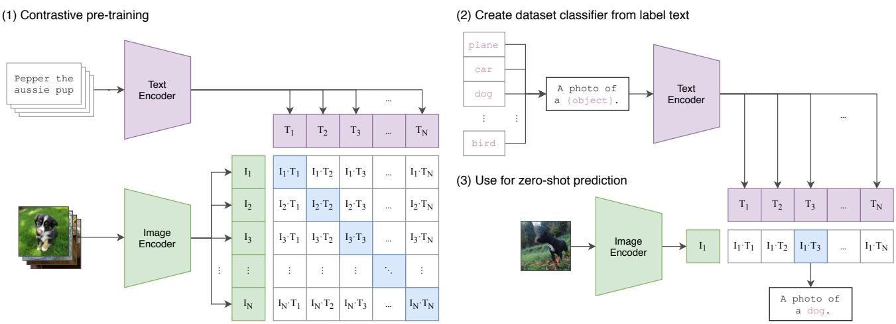  
Figure 1. 方法概述。标准的图像模型联合训练图像特征提取器和线性分类器来预测某个标签，而 CLIP 则联合训练图像编码器和文本编码器，以预测一批（图像，文本）训练样本中的正确配对。在测试时，学习到的文本编码器通过嵌入目标数据集类别的名称或描述，合成一个零样本线性分类器。

尽管作为概念验证令人兴奋，但使用自然语言监督进行图像表征学习仍然很少见。这可能是因为在常用基准测试上所展示的性能远低于其他替代方法。例如，Li et al. (2017) 在零样本（zero-shot）设置下的 ImageNet 上仅达到了 11.5% 的准确率。这远低于当前最先进技术（state of the art）的 88.4% 准确率 (Xie et al., 2020)。它甚至低于经典计算机视觉方法的 50% 准确率 (Deng et al., 2012)。相反，范围更窄但针对性更强的弱监督使用方式提升了性能。Mahajan et al. (2018) 表明，在 Instagram 图像上预测与 ImageNet 相关的标签（hashtag）是一项有效的预训练任务。在针对 ImageNet 进行微调时，这些预训练模型将准确率提高了 5% 以上，并刷新了当时整体的最先进水平。Kolesnikov et al. (2019) 和 Dosovitskiy et al. (2020) 也通过预训练模型来预测带有噪声标签的 JFT-300M 数据集的类别，在更广泛的迁移基准测试集上展示了显著的增益。

这一系列工作代表了从有限数量的受监督“黄金标签（gold-labels）”中学习与从几乎无限量的原始文本中学习之间当前务实的折中方案。然而，这并非没有妥协。上述两项工作都经过精心设计，并在该过程中分别将其监督信号限制在 1000 和 18291 个类别中。而自然语言凭借其通用性，能够表达进而监督更广泛的视觉概念。这两种方法还都使用静态 softmax 分类器来进行预测，缺乏动态输出机制。这严重削弱了它们的灵活性，并限制了它们的“零样本（zero-shot）”能力。

这些弱监督模型与最近直接从自然语言学习图像表征的探索之间的一个关键差异在于规模。虽然 Mahajan et al. (2018) 和 Kolesnikov et al. (2019) 在数百万到数十亿张图像上耗费了数个加速卡年（accelerator years）的时间来训练他们的模型，但 VirTex、ICMLM 和 ConVIRT 仅在十万到二十万张图像上训练了数个加速卡天（accelerator days）。在这项工作中，我们弥合了这一差距，并研究了在大规模自然语言监督下训练的图像分类器的表现行为。得益于互联网上大量此类公开可用的数据，我们创建了一个包含 4 亿个（图像, 文本）对的新数据集，并证明了从头开始训练的 ConVIRT 简化版本——我们称之为 CLIP（对比语言-图像预训练，Contrastive Language-Image Pre-training）——是一种从自然语言监督中学习的高效方法。我们通过训练跨越近 2 个计算量数量级的 8 个模型系列来研究 CLIP 的可扩展性，并观察到迁移性能是计算量的平滑可预测函数 (Hestness et al., 2017; Kaplan et al., 2020)。我们发现 CLIP 与 GPT 系列类似，在预训练期间学会了执行广泛的任务，包括 OCR、地理定位（geo-localization）、动作识别（action recognition）等诸多任务。我们通过在 30 多个现有数据集上对 CLIP 的零样本迁移（zero-shot transfer）性能进行基准测试来评估这一点，并发现它可以与先前针对特定任务的监督模型相媲美。我们还通过线性探测（linear-probe）表征学习分析证实了这些发现，并表明 CLIP 优于目前公开可用的最佳 ImageNet 模型，同时计算效率也更高。此外，我们发现零样本 CLIP 模型比具有同等准确率的监督 ImageNet 模型稳健得多，这表明对任务无关模型的零样本评估更能代表模型的能力。这些结果具有重大的政策和伦理影响，我们将在第 7 节中对此进行讨论。

  
Figure 2. CLIP 在零样本迁移方面的效率远高于我们的图像描述（image caption）基线。尽管基于 Transformer 的语言模型具有很强的表达能力，但我们发现它们在零样本 ImageNet 分类上的表现相对较弱。在这里，我们可以看到它的学习速度比预测文本词袋（BoW）编码的基线 (Joulin et al., 2016) 慢 3 倍。将预测目标替换为 CLIP 的对比目标后，效率又进一步提高了 4 倍。

## 2. 方法

## 2.1. 自然语言监督

我们方法的核心思想是从自然语言中包含的监督信息中学习感知能力。正如在引言中所讨论的，这绝不是一个全新的想法，然而用于描述该领域工作的术语却各不相同，甚至看似相互矛盾，阐述的动机也多种多样。Zhang et al. (2020)、Gomez et al. (2017)、Joulin et al. (2016) 以及 Desai & Johnson (2020) 都提出了从与图像配对的文本中学习视觉表征的方法，但分别将他们的方法描述为无监督、自监督、弱监督和有监督。

我们强调，这一系列工作的共同之处不在于所使用的特定方法的任何细节，而在于对将自然语言作为训练信号的重视。所有这些方法都是从自然语言监督中进行学习。尽管早期工作在使用主题模型（topic model）和 n-gram 表征时难以应对自然语言的复杂性，但深度上下文表征学习的进步表明，我们现在已经拥有能够有效利用这一丰富监督来源的工具（McCann et al., 2017）。

与其他训练方法相比，从自然语言中学习具有几个潜在的优势。与用于图像分类的标准众包标注相比，自然语言监督更容易扩展规模，因为它不需要标注符合经典的“机器学习兼容格式”，例如典型的 N 选 1 多数投票“金标准标签（gold label）”。相反，基于自然语言的方法可以被动地从互联网上海量文本所包含的监督中进行学习。与大多数无监督或自监督学习方法相比，从自然语言中学习还有一个重要的优势，即它不仅“只是”学习一种表征，而且还将该表征与语言联系起来，从而实现灵活的零样本迁移（zero-shot transfer）。在接下来的小节中，我们将详细介绍我们最终确定的具体方法。

## 2.2. 构建足够大的数据集

现有工作主要使用了三个数据集：MS-COCO (Lin et al., 2014)、Visual Genome (Krishna et al., 2017) 和 YFCC100M (Thomee et al., 2016)。虽然 MS-COCO 和 Visual Genome 是高质量的众包标注数据集，但以现代标准来看它们的规模较小，各自仅有约 100,000 张训练照片。相比之下，其他计算机视觉系统是在多达 35 亿张 Instagram 照片上进行训练的 (Mahajan et al., 2018)。包含 1 亿张照片的 YFCC100M 是一个可能的替代方案，但每张图像的元数据稀疏且质量参差不齐。许多图像使用自动生成的文件名（如 20160716 113957.JPG）作为“标题”，或者包含关于相机曝光设置的“描述”。在过滤后仅保留具有英文自然语言标题和/或描述的图像，该数据集缩减为原来的六分之一，仅剩 1500 万张照片。这与 ImageNet 的规模大致相同。

采用自然语言监督的一个主要动机是互联网上公开可用的这种形式的数据量非常庞大。由于现有数据集未能充分体现这种可能性，仅考虑现有数据集上的结果会低估这一研究方向的潜力。为了解决这一问题，我们构建了一个包含 4 亿个（图像，文本）对的新数据集，这些数据收集自互联网上的各种公开来源。为了尽可能覆盖广泛的视觉概念集，作为构建过程的一部分，我们搜索了文本中包含 500,000 个查询词之一的（图像，文本）对。<sup>1</sup>我们通过为每个查询词包含最多 20,000 个（图像，文本）对，对结果进行了近似的类别平衡。最终得到的数据集与用于训练 GPT-2 的 WebText 数据集具有相似的总词数。我们将该数据集称为 WIT（WebImageText）。

## 2.3. 选择高效的预训练方法

最先进的计算机视觉系统需要消耗极大的计算量。Mahajan et al. (2018) 需要 19 个 GPU 年来训练其 ResNeXt101-32x48d，而 Xie et al. (2020) 则需要 33 个 TPUv3 核心年（core-years）来训练其 Noisy Student EfficientNet-L2。考虑到这两个系统训练的目的仅仅是预测 1000 个 ImageNet 类别，从自然语言中学习开放式视觉概念集的任务似乎令人望而生畏。在我们的探索过程中，我们发现训练效率是成功扩展自然语言监督规模的关键，并且我们基于该指标选择了最终的预训练方法。

我们最初的方法与 VirTex 类似，从零开始联合训练图像 CNN 和文本 Transformer，以预测图像的描述（caption）。然而，我们在高效扩展该方法时遇到了困难。在 Figure 2 中，我们展示了一个 6300 万参数的 Transformer 语言模型（其计算量已经是其 ResNet-50 图像编码器的两倍），在学习识别 ImageNet 类别时的速度比预测相同文本词袋（bag-of-words）编码的更简单基线模型慢三倍。

这两种方法都有一个关键的相似之处。它们都试图预测与每张图像相伴随的文本的确切词语。由于与图像共现的描述、评论和相关文本种类繁多，这是一项极其困难的任务。最近在图像对比表征学习方面的研究发现，与同等预测性目标相比，对比性目标可以学习到更好的表征 (Tian et al., 2019)。另有研究发现，尽管图像生成模型能够学习到高质量的图像表征，但要达到与对比模型相同的性能，它们所需的计算量高出一个数量级以上 (Chen et al., 2020a)。注意到这些发现后，我们探索了训练一个系统来解决一个潜在更容易的代理任务：仅预测作为一个整体的哪段文本与哪张图像配对，而不是预测该文本的确切词语。从相同的词袋编码基线出发，我们在 Figure 2 中将预测目标替换为对比目标，并观察到在向 ImageNet 进行零样本迁移（zero-shot transfer）的速率上效率进一步提升了 4 倍。

给定一批包含 N 个（图像，文本）对的批次，CLIP 经过训练以预测在整个批次中 $N \times N$ 个可能的（图像，文本）配对中，哪些是实际发生的。为此，CLIP 通过联合训练图像编码器和文本编码器来学习一个多模态嵌入空间，以最大化批次中 N 个真实配对的图像和文本嵌入的余弦相似度，同时最小化 $N ^ { 2 } - N$ 个不正确配对的嵌入余弦相似度。我们在这些相似度得分上优化对称交叉熵损失。在 Figure 3 中，我们给出了 CLIP 实现的核心伪代码。据我们所知，这种批次构建技术和目标函数最早在深度度量学习领域中作为 multi-class N-pair loss 被引入 Sohn (2016)，随后由 Oord et al. (2018) 作为 InfoNCE loss 在对比表征学习中推广，最近又由 Zhang et al. (2020) 改编用于医学成像领域的对比式（文本，图像）表征学习。

由于我们的预训练数据集规模庞大，过拟合并不是主要问题，且与 Zhang et al. (2020) 的实现相比，训练 CLIP 的细节得到了简化。我们从零开始训练 CLIP，既没有使用 ImageNet 权重初始化图像编码器，也没有使用预训练权重初始化文本编码器。我们没有在表示和对比嵌入空间之间使用非线性投影，这一改动最早由 Bachman et al. (2019) 引入并由 Chen et al. (2020b) 推广。相反，我们仅使用线性投影将每个编码器的表示映射到多模态嵌入空间。我们没有注意到这两个版本在训练效率上的差异，并推测非线性投影可能仅在纯图像的自监督表示学习方法中与当前具体细节产生协同适应。我们还移除了 Zhang et al. (2020) 中从文本中均匀采样单个句子的文本变换函数 $t _ { u }$，因为 CLIP 预训练数据集中的许多（图像，文本）对本身就只有一个单句。我们还简化了图像变换函数 $t _ { v } .$。在调整大小后的图像上进行随机正方形裁剪是训练期间唯一使用的数据增强手段。最后，控制 softmax 中 logits 范围的温度参数 τ 在训练期间作为对数参数化的乘法标量被直接优化，以避免将其作为超参数进行调优。

## 2.4. 模型的选择与缩放

我们为图像编码器考虑了两种不同的架构。对于第一种，由于 ResNet-50 (He et al., 2016a) 的广泛应用和经过验证的性能，我们将其用作图像编码器的基础架构。我们使用 He et al. (2019) 的 ResNet-D 改进以及 Zhang (2019) 的抗锯齿 rect-2 模糊池化（blur pooling）对原始版本进行了几项修改。我们还使用注意力池化（attention pooling）机制替代了全局平均池化层。注意力池化实现为单层“Transformer 风格”的多头 QKV 注意力，其中 query 以图像的全局平均池化表示为条件。对于第二种架构，我们对最近推出的 Vision Transformer (ViT) (Dosovitskiy et al., 2020) 进行了实验。我们紧密遵循了他们的实现，仅做了一处微小的修改，即在 Transformer 之前为合并后的 patch 和位置嵌入添加了额外的层归一化（layer normalization），并采用了略微不同的初始化方案。

```python
# image_encoder - ResNet or Vision Transformer
# text_encoder - CBOW or Text Transformer
# I[n, h, w, c] - minibatch of aligned images
# T[n, l] - minibatch of aligned texts
# W_i[d_i, d_e] - learned proj of image to embed
# W_t[d_t, d_e] - learned proj of text to embed
# t - learned temperature parameter

# extract feature representations of each modality
I_f = image_encoder(I) #[n, d_i]
T_f = text_encoder(T) #[n, d_t]

# joint multimodal embedding [n, d_e]
I_e = l2_normalize(np.dot(I_f, W_i), axis=1)
T_e = l2_normalize(np.dot(T_f, W_t), axis=1)

# scaled pairwise cosine similarities [n, n]
logits = np.dot(I_e, T_e.T) * np.exp(t)

# symmetric loss function
labels = np.arange(n)
loss_i = cross_entropy_loss(logits, labels, axis=0)
loss_t = cross_entropy_loss(logits, labels, axis=1)
loss = (loss_i + loss_t)/2
```  
Figure 3. CLIP 核心实现的类 Numpy 伪代码。

文本编码器是一个 Transformer (Vaswani et al., 2017)，并采用了 Radford et al. (2019) 中描述的架构修改。作为基础大小，我们使用了一个包含 63M 参数、12 层、512 宽度的模型，具有 8 个注意力头。该 Transformer 运行在文本的小写字节对编码（byte pair encoding, BPE）表示上，词表大小为 49,152 (Sennrich et al., 2015)。出于计算效率的考虑，最大序列长度被限制为 76。文本序列两端分别加上 [SOS] 和 [EOS] 标记，Transformer 最高层在 [EOS] 标记处的激活值被视为文本的特征表示，该表示经过层归一化（layer normalized）后线性投影到多模态嵌入空间中。文本编码器中使用了掩码自注意力（masked self-attention），以保留使用预训练语言模型进行初始化或将语言建模作为辅助目标的能力，尽管对此的探索留待未来工作。

尽管以往的计算机视觉研究通常仅通过单独增加宽度 (Mahajan et al., 2018) 或深度 (He et al., 2016a) 来缩放模型，但对于 ResNet 图像编码器，我们采用了 Tan & Le (2019) 的方法，该方法发现将额外的计算量同时分配给宽度、深度和分辨率，其效果优于仅将其分配给模型的单一维度。虽然 Tan & Le (2019) 为其 EfficientNet 架构调整了分配给每个维度的计算量比例，但我们采用了一个简单的基准方案，即将额外的计算量平均分配给增加模型的宽度、深度和分辨率。对于文本编码器，我们仅缩放模型的宽度，使其与计算出的 ResNet 宽度增加成正比，并且完全不缩放深度，因为我们发现 CLIP 的性能对文本编码器的容量较不敏感。

## 2.5. 训练

我们训练了一系列共 5 个 ResNet 和 3 个 Vision Transformer。对于 ResNet，我们训练了一个 ResNet-50、一个 ResNet-101，以及另外 3 个遵循 EfficientNet 风格模型缩放的模型，其计算量大约分别为 ResNet-50 的 4 倍、16 倍和 64 倍。它们分别表示为 RN50x4、RN50x16 和 RN50x64。对于 Vision Transformer，我们训练了 ViT-B/32、ViT-B/16 和 ViT-L/14。我们将所有模型训练 32 个 epoch。我们使用带有解耦权重衰减正则化（Loshchilov & Hutter, 2017）的 Adam 优化器（Kingma & Ba, 2014），该正则化应用于所有非增益或偏置的权重，并使用余弦调度（Loshchilov & Hutter, 2016）对学习率进行衰减。初始超参数是在基线 ResNet-50 模型训练 1 个 epoch 时，结合网格搜索、随机搜索和手动调优确定的。随后由于计算资源的限制，针对更大的模型以启发式方式调整了超参数。可学习的温度参数 τ 初始化为相当于 (Wu et al., 2018) 中的 0.07，并进行了截断以防止对 logits 的缩放超过 100，我们发现这对于防止训练不稳定是必要的。我们使用了 32,768 的超大小批量（minibatch size）。采用混合精度（Micikevicius et al., 2017）来加速训练并节省显存。为了进一步节省显存，我们使用了梯度检查点（gradient checkpointing）（Griewank & Walther, 2000; Chen et al., 2016）、半精度 Adam 统计量（Dhariwal et al., 2020）以及半精度随机舍入的文本编码器权重。嵌入向量相似度的计算也进行了分片，单个 GPU 仅计算其本地批次嵌入所需的成对相似度子集。最大的 ResNet 模型 RN50x64 在 592 块 V100 GPU 上耗时 18 天完成训练，而最大的 Vision Transformer 在 256 块 V100 GPU 上耗时 12 天。对于 ViT-L/14，我们还以更高的 336 像素分辨率额外预训练了 1 个 epoch，以类似于 FixRes（Touvron et al., 2019）的方式提升性能。我们将该模型表示为 ViT-L/14@336px。除非另有说明，本文中所有报告为“CLIP”的结果均使用此模型，我们发现该模型性能最佳。

## 3. 实验

## 3.1. 零样本迁移

## 3.1.1. 动机

在计算机视觉中，零样本学习（zero-shot learning）通常指在图像分类中泛化到未见物体类别的研究 (Lampert et al., 2009)。相反，我们在更广泛的意义上使用这一术语，并研究对未见数据集的泛化能力。正如 Larochelle et al. (2008) 的零数据学习（zero-data learning）论文中所追求的那样，我们将其作为执行未见任务的代理。尽管无监督学习领域的许多研究侧重于机器学习系统的表征学习能力，但我们主张将研究零样本迁移（zero-shot transfer）作为衡量机器学习系统任务学习能力的一种方式。从这个角度来看，数据集评估的是在特定分布上某项任务的性能。然而，研究界创建许多流行的计算机视觉数据集，主要是为了作为基准来指导通用图像分类方法的发展，而不是为了衡量在特定任务上的性能。虽然说 SVHN 数据集衡量的是 Google Street View 照片分布上的门牌号转录任务是合理的，但并不清楚 CIFAR-10 数据集衡量的是什么“真实”任务。然而，很明确的是 CIFAR-10 采自哪个分布——TinyImages (Torralba et al., 2008)。在这些类型的数据集上，零样本迁移更多的是评估 CLIP 对分布偏移和领域泛化的鲁棒性，而不是任务泛化。专注于此的分析请参见第 3.3 节。

据我们所知，Visual N-Grams (Li et al., 2017) 最早以上述方式研究了向现有图像分类数据集的零样本迁移。这也是我们所知唯一一项使用通用预训练模型研究向标准图像分类数据集进行零样本迁移的其他工作，并可作为全面理解 CLIP 的最佳参考基准。他们的方法学习了一个包含 142,806 个视觉 n-gram（跨越 1-gram 至 5-gram）的词典参数，并使用可微版本的 Jelinek-Mercer 平滑来优化这些 n-gram，以最大化给定图像的所有文本 n-gram 的概率。为了执行零样本迁移，他们首先将数据集每个类别名称的文本转换为其 n-gram 表示，然后根据其模型计算其概率，并预测得分最高的那一个。

我们专注于研究零样本迁移（zero-shot transfer）作为任务学习的评估方法，这一构想受到了 NLP 领域中展示任务学习的相关工作的启发。据我们所知，Liu et al. (2018) 首次将任务学习确定为一种“意料之外的副效应（unexpected side-effect）”，当时一个被训练用于生成 Wikipedia 文章的语言模型学会了在不同语言之间可靠地音译名称。尽管 GPT-1 (Radford et al., 2018) 侧重于将预训练作为一种迁移学习方法来改进有监督微调，但它也包含了一项消融实验，证明了四种启发式零样本迁移方法的性能在预训练过程中稳步提升，且无需任何有监督适配。该分析构成了 GPT-2 (Radford et al., 2019) 的基础，后者专门侧重于通过零样本迁移来研究语言模型的任务学习能力。

## 3.1.2. 将 CLIP 用于零样本迁移

CLIP 经过预训练来预测图像和文本片段在其数据集中是否成对出现。为了进行零样本分类，我们复用了这一能力。对于每个数据集，我们将该数据集中所有类别的名称作为潜在文本配对的集合，并根据 CLIP 预测最可能的（图像，文本）对。更具体地说，我们首先通过各自的编码器分别计算图像的特征嵌入以及候选文本集合的特征嵌入。然后计算这些嵌入的余弦相似度，通过温度参数 τ 进行缩放，并通过 softmax 归一化为概率分布。请注意，该预测层是一个具有 L2 归一化输入、L2 归一化权重、无偏置（bias）且带有温度缩放的多项逻辑回归分类器。从这个角度来解释，图像编码器是用于计算图像特征表示的计算机视觉骨干网络（backbone），而文本编码器则是一个超网络（hypernetwork）(Ha et al., 2016)，它根据指定类别所代表视觉概念的文本来生成线性分类器的权重。Lei Ba et al. (2015) 首次引入了这种形式的零样本图像分类器，而从自然语言生成分类器的想法至少可以追溯到 Elhoseiny et al. (2013)。延续这种解释，CLIP 预训练的每一步都可以被看作是在优化一个随机创建的计算机视觉代理数据集上的性能，该数据集每个类别包含 1 个样本，总共有 32,768 个通过自然语言描述定义的类别。对于零样本评估，一旦零样本分类器由文本编码器计算完成，我们就会对其进行缓存并在所有后续预测中复用。这使得生成该分类器的成本可以在数据集的所有预测中进行分摊。

## 3.1.3. 与 VISUAL N-GRAMS 的初步对比

在 Table 1 中，我们将 Visual N-Grams 与 CLIP 进行了对比。最佳的 CLIP 模型将 ImageNet 上的准确率从概念验证阶段的 11.5% 提升至 76.2%，且在未使用该数据集可用的 128 万条众包标注训练样本的情况下，达到了与原始 ResNet-50 相当的性能。此外，CLIP 模型的 top-5 准确率显著高于其 top-1 准确率，该模型的 top-5 准确率达到了 95%，与 Inception-V4（Szegedy et al., 2016）相当。在零样本（zero-shot）设置下达到强全监督基准性能的能力表明

<table><tr><td></td><td>aYahoo</td><td>ImageNet</td><td>SUN</td></tr><tr><td>Visual N-Grams</td><td>72.4</td><td>11.5</td><td>23.0</td></tr><tr><td>CLIP</td><td>98.4</td><td>76.2</td><td>58.5</td></tr></table>

Table 1. 将 CLIP 与先前的零样本迁移图像分类结果进行对比。CLIP 在所有三个数据集上的性能都有大幅提升。这一提升反映了自 Visual N-Grams（Li et al., 2017）提出以来的 4 年间所发生的诸多变化。

CLIP 向灵活且实用的零样本计算机视觉分类器迈出了重要一步。如上所述，与 Visual N-Grams 的对比旨在将 CLIP 的性能置于具体的背景中进行说明，而不应被解释为 CLIP 与 Visual N-Grams 之间直接的方法对比，因为这两个系统之间许多与性能相关的差异并未加以控制。例如，我们的训练数据集规模是其 10 倍，单次预测所使用的视觉模型计算量接近其 100 倍，训练计算量很可能是其 1000 倍以上，并且使用了在 Visual N-Grams 发表时还不存在的基于 Transformer 的模型。为了进行更接近的对比，我们在 Visual N-Grams 训练所用的相同 YFCC100M 数据集上训练了一个 CLIP ResNet-50，发现它在一个 V100 GPU 天之内就达到了其报告的 ImageNet 性能。并且与 Visual N-Grams 从预训练的 ImageNet 权重初始化不同，该基线模型是从头开始训练的。

CLIP 在报告的其他 2 个数据集上也优于 Visual N-Grams。在 aYahoo 上，CLIP 将错误数量减少了 95%，而在 SUN 上，CLIP 的准确率是 Visual N-Grams 的两倍以上。为了进行更全面的分析和压力测试，我们构建了一个规模大得多的评估套件，详见 Appendix A。总体而言，我们从 Visual N-Grams 报告的 3 个数据集扩展到了 30 多个数据集，并与 50 多个现有的计算机视觉系统进行对比，以提供更充分的背景参考。

## 3.1.4. 提示工程与集成

大多数标准的图像分类数据集都将用于命名或描述类别的信息（这些信息能够实现基于自然语言的零样本迁移（zero-shot transfer））视为事后补充的内容。绝大多数数据集仅用标签的数字 ID 来标注图像，并附带一个将这些 ID 映射回其英文名称的文件。某些数据集（如 Flowers102 和 GTSRB）在其发布的版本中似乎完全没有包含这种映射，从而彻底阻碍了零样本迁移。<sup>2</sup> 对于许多数据集，我们观察到这些标签的选择可能有些随意，并未预见到与零样本迁移相关的问题，而零样本迁移正是依赖于任务描述来实现成功迁移的。

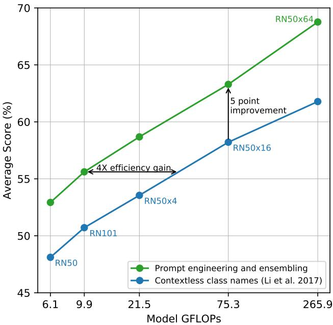  
Figure 4. 提示工程（Prompt engineering）和集成（ensembling）提升了零样本性能。与使用无上下文类别名称的基线相比，提示工程和集成在 36 个数据集上平均将零样本分类性能提升了近 5 个百分点。这一提升与基线零样本方法使用 4 倍计算量所获得的收益相当，但在分摊到多次预测时实际上是“免费”的。

一个常见的问题是一词多义。当类别名称是提供给 CLIP 文本编码器（text encoder）的唯一信息时，由于缺乏上下文，它无法区分具体指的是哪个词义。在某些情况下，同一单词的多种含义甚至可能作为不同的类别包含在同一个数据集中！这种情况就发生在 ImageNet 中，它同时包含了建筑起重机（construction cranes）和飞行的鹤（cranes）。另一个例子出现在 Oxford-IIIT Pet 数据集的类别中，其中单词 boxer 根据上下文显然是指一种犬种（拳师犬），但对于缺乏上下文的文本编码器来说，它同样可能指的是一种运动员（拳击手）。

我们遇到的另一个问题是，在我们的预训练数据集中，与图像配对的文本很少只是单个单词。通常文本是某种描述图像的完整句子。为了弥合这一分布差异，我们发现使用提示模板“A photo of a {label}.”是一个很好的默认选择，它有助于明确文本内容是关于图像的主体。与仅使用标签文本的基线相比，这通常能提高性能。例如，仅仅使用这个提示模板就能将 ImageNet 上的准确率提高 1.3%。

类似于围绕 GPT-3 的“提示工程”（prompt engineering）讨论（Brown et al., 2020; Gao et al., 2020），我们也观察到，通过针对每个任务定制提示文本，可以显著提高零样本（zero-shot）性能。以下列出几个（非详尽的）示例。我们在多个细粒度图像分类数据集上发现，指定类别会有所帮助。例如在 Oxford-IIIT Pets 上，使用“A photo of a {label}, a type of pet.”（一张{label}的照片，一种宠物）来提供上下文效果很好。同样，在 Food101 上指定食物类型，在 FGVC Aircraft 上指定飞机类型也很有帮助。对于 OCR 数据集，我们发现给要识别的文本或数字加上引号可以提高性能。最后，我们发现在卫星图像分类数据集上，指明图像属于此类形式会很有帮助，我们使用了“a satellite photo of a {label}.”（一张{label}的卫星照片）等变体。

我们还尝试了集成（ensembling）多个零样本分类器作为提高性能的另一种方法。这些分类器是通过使用不同的上下文提示来计算的，例如“A photo of a big {label}”（一张大{label}的照片）和“A photo of a small {label}”（一张小{label}的照片）。我们在嵌入空间（embedding space）而非概率空间中构建集成。这使得我们能够缓存一组单一的平均文本嵌入，从而在分摊到多次预测时，集成的计算成本与使用单个分类器相同。我们观察到，集成多个生成的零样本分类器可以可靠地提升性能，并将其应用于大多数数据集。在 ImageNet 上，我们集成了 80 个不同的上下文提示，相比于上述讨论的单一默认提示，性能额外提高了 3.5%。综合来看，提示工程与集成将 ImageNet 的准确率提升了近 5%。在 Figure 4 中，我们直观展示了与 Li et al. (2017) 中直接嵌入类别名称的无上下文基线方法相比，提示工程和集成如何改变一组 CLIP 模型的性能。

## 3.1.5. 零样本 CLIP 性能分析

由于计算机视觉领域中任务无关的零样本分类器尚未得到充分研究，CLIP 为更好地理解此类模型提供了一个极具前景的契机。在本节中，我们对 CLIP 零样本分类器的各种特性进行了研究。作为首要问题，我们简单探究了零样本分类器的表现究竟如何。为了将其置于具体背景中，我们与一个简单的开箱即用基线进行了比较：在标准 ResNet-50 的特征上拟合一个全监督的、正则化的逻辑回归（logistic regression）分类器。在 Figure 5 中，我们展示了在 27 个数据集上的这一对比。关于数据集和设置的详细信息，请参阅 Appendix A。

零样本（Zero-shot）CLIP 在多数情况下略微优于这一基线，并在 27 个数据集中的 16 个上胜出。观察各个具体数据集可以发现一些有趣的现象。在细粒度分类任务上，我们观察到了较大的性能差异。在其中两个数据集 Stanford Cars 和 Food101 上，零样本 CLIP 比基于 ResNet-50 特征的逻辑回归（logistic regression）高出 20% 以上；而在另外两个数据集 Flowers102 和 FGVCAircraft 上，零样本 CLIP 则落后 10% 以上。在 OxfordPets 和 Birdsnap 上，两者的性能要接近得多。我们推测这些差异主要是由于 WIT 和 ImageNet 之间针对每个任务所包含的监督信息量不同所致。在 ImageNet、CIFAR10/100、STL10 和 PascalVOC2007 等“通用”目标分类数据集上，性能相对相近，且在所有这些情况下零样本 CLIP 都略占优势。在 STL10 上，CLIP 总体达到了 99.3% 的准确率，尽管没有使用任何训练样本，这似乎也创下了新的 SOTA（state of the art，当前最优效果）。在两个评估视频动作识别的数据集上，零样本 CLIP 显著优于 ResNet-50。在 Kinetics700 上，CLIP 超过 ResNet-50 达 14.5%。在 UCF101 上，零样本 CLIP 也比 ResNet-50 的特征表现高出 7.7%。我们推测，这是因为与 ImageNet 中以名词为中心的目标监督相比，自然语言为涉及动词的视觉概念提供了更广泛的监督。

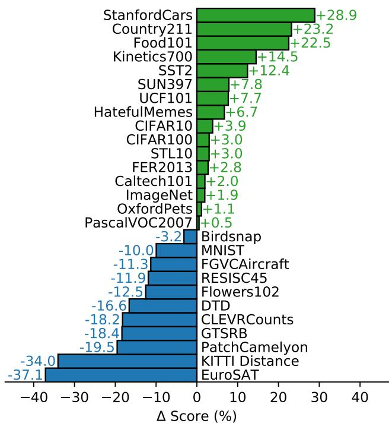  
零样本 CLIP 对比 ResNet50 上的线性探测（Linear Probe）  
Figure 5. 零样本 CLIP 与全监督基线相比具有竞争力。在包含 27 个数据集的评估套件中，零样本 CLIP 分类器在包括 ImageNet 在内的 16 个数据集上，优于拟合在 ResNet-50 特征上的全监督线性分类器。

审视零样本 CLIP 表现明显不佳的地方，我们发现它在一些专业化、复杂或抽象的任务上相当薄弱，例如卫星图像分类（EuroSAT 和 RESISC45）、淋巴结肿瘤检测（PatchCamelyon）、合成场景中的物体计数（CLEVRCounts）、自动驾驶相关任务如德国交通标志识别（GTSRB）、识别到最近车辆的距离（KITTI Distance）。这些结果突显了零样本 CLIP 在更复杂任务上的能力不足。相比之下，非专家人类可以稳健地完成其中几项任务，如计数、卫星图像分类和交通标志识别，这表明仍有很大的提升空间。然而，我们也提醒，对于学习者毫无先验经验的困难任务（例如对于几乎所有人类，以及可能也包括 CLIP 而言的淋巴结肿瘤分类），衡量零样本迁移（而非少样本迁移，few-shot transfer）是否是一种有意义的评估方式尚不明确。

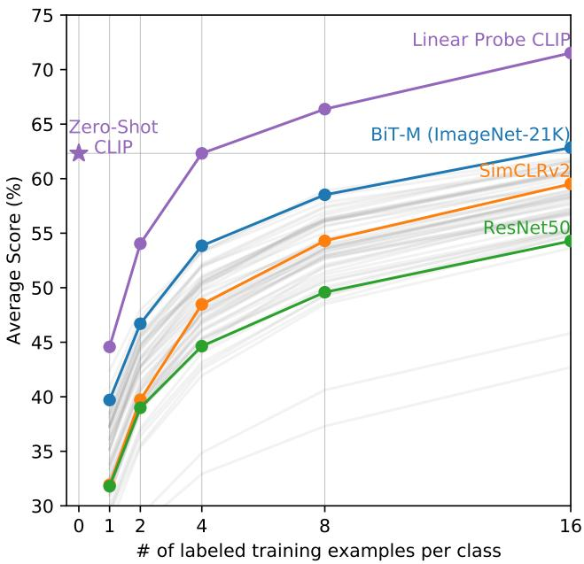  
Figure 6. 零样本（Zero-shot）CLIP 的表现优于少样本（few-shot）线性探测（linear probe）。零样本 CLIP 达到了在同一特征空间上训练的 4-shot 线性分类器的平均性能，并且几乎与公开可用模型中 16-shot 线性分类器的最佳结果相媲美。对于 BiT-M 和 SimCLRv2，均高亮显示了性能最佳的模型。浅灰色线条代表评估套件中的其他模型。本分析采用了每个类别至少包含 16 个样本的 20 个数据集。

虽然将零样本性能与全监督模型进行比较可以直观展现 CLIP 的任务学习能力，但与少样本方法相比则是一种更为直接的对照，因为零样本是少样本的极限情况。在 Figure 6 中，我们展示了零样本 CLIP 与基于众多图像模型（包括公开可用的最佳 ImageNet 模型、自监督学习方法以及 CLIP 自身）特征的少样本逻辑回归（logistic regression）之间的对比。直观上可能会认为零样本的表现不如 1-shot，但我们反而发现零样本 CLIP 的性能与在相同特征空间上进行 4-shot 逻辑回归的表现相当。这很可能是由于零样本和少样本方法之间存在一个重要差异。首先，CLIP 的零样本分类器是通过自然语言生成的，这使得视觉概念可以直接被明确指定（“传达”）。相比之下，“常规”监督学习必须从训练样本中间接推断概念。脱离上下文的、基于样本的学习存在一个缺陷，即许多不同的假设都可能与数据相吻合，在 1-shot 的情况下尤其如此。单张图像通常包含许多不同的视觉概念。尽管能力较强的学习器能够利用视觉线索和启发式策略（例如假设所展示的概念是图像中的主要物体），但这并不能得到保证。

解决零样本与少样本性能之间这种差异的一个潜在方案，是将 CLIP 的零样本分类器作为少样本分类器权重的先验。虽然向生成的权重施加 L2 惩罚是实现这一想法的直接方式，但我们发现超参数优化通常会选择非常大的正则化项数值，以至于最终得到的少样本分类器“仅仅”变成了零样本分类器。研究如何更好地将零样本迁移的优势与少样本学习的灵活性相结合，是未来工作的一个很有前景的方向。

当将零样本（zero-shot）CLIP 与基于其他模型特征的少样本（few-shot）逻辑回归进行比较时，零样本 CLIP 的表现大致相当于我们评估套件中表现最好的 16-shot 分类器，该分类器使用了在 ImageNet-21K 上训练的 BiT-M ResNet-152x2 的特征。我们确信在 JFT-300M 上训练的 BiT-L 模型表现会更好，但这些模型尚未公开发布。BiT-M ResNet-152x2 在 16-shot 设定下表现最好有些令人意外，因为正如 Section 3.2 中所分析的，在完全监督设定下，Noisy Student EfficientNet-L2 在 27 个数据集上的平均表现比它高出近 5%。

除了研究零样本 CLIP 和少样本逻辑回归的平均性能外，我们还考察了在各个单独数据集上的表现。在 Figure 7 中，我们展示了在相同特征空间上的逻辑回归分类器要达到与零样本 CLIP 相当的性能时，每个类别所需的标注样本数量估计值。由于零样本 CLIP 本质上也是一个线性分类器，这在该设定下评估了零样本迁移的有效数据效率。为了避免训练数千个线性分类器，我们基于在每个数据集上训练的 1、2、4、8、16-shot（可行时）以及完全监督线性分类器性能的对数线性插值来估计有效数据效率。我们发现，不同数据集之间的零样本迁移效率差异很大，从每类少于 1 个标注样本到 184 个不等。有两个数据集 Flowers102 和 EuroSAT 的表现不及 1-shot 模型。一半的数据集每类所需的样本数少于 5 个，中位数为 5.4 个。然而，估计的平均数据效率为每类 20.8 个样本。这是由于在 20% 的数据集上，监督分类器需要每类提供大量标注样本才能达到相当的性能。在 ImageNet 上，零样本 CLIP 的表现与在相同特征空间上训练的 16-shot 线性分类器相当。

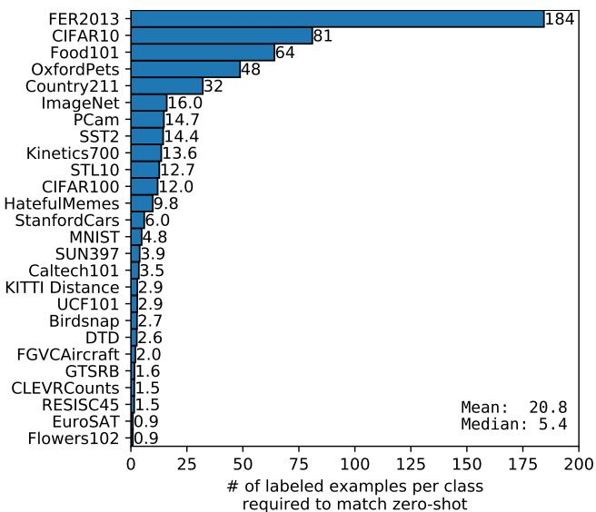  
Figure 7. 零样本迁移的数据效率差异巨大。通过计算在相同 CLIP 特征空间上的线性分类器达到与零样本分类器相当性能时每个类别所需的标注样本数，可以具体展现零样本迁移的有效性。数值基于 1、2、4、8、16-shot 以及完全监督结果的对数线性插值估计得出。各数据集的表现差异极大，从在两个数据集上仍不及单样本（one-shot）分类器，到相当于估计每类需要 184 个标注样本不等。

如果假设评估数据集足够大，以至于在其上训练的线性分类器的参数得到了良好估计，那么，由于 CLIP 的零样本分类器也是一个线性分类器，全监督分类器的性能大致设定了零样本迁移所能达到的上限。在 Figure 8 中，我们跨数据集比较了 CLIP 的零样本性能与全监督线性分类器的性能。虚线 $y = x$ 代表与其全监督对应模型性能相匹配的“最优”零样本分类器。对于大多数数据集，零样本分类器的性能仍比全监督分类器低 10% 到 25%，这表明在提升 CLIP 的任务学习和零样本迁移能力方面仍有很大的提升空间。

零样本性能与全监督性能之间存在 0.82 的正相关（p-value $< 1 0 ^ { - 6 } )$，表明 CLIP 在将底层表征和任务学习与零样本迁移联系起来方面相对一致。然而，零样本 CLIP 仅在 5 个数据集上接近全监督性能：STL10、CI-FAR10、Food101、OxfordPets 和 Caltech101。在这全部 5 个数据集上，零样本准确率和全监督准确率均超过 90%。这表明对于其底层表征同样具有高质量的任务，CLIP 的零样本迁移可能更有效。以全监督性能为自变量预测零样本性能的线性回归模型的斜率估计显示，全监督性能每提高 1%，零样本性能就会提高 1.28%。然而，95% 置信区间仍然包含小于 1 的值（0.93-1.79）。

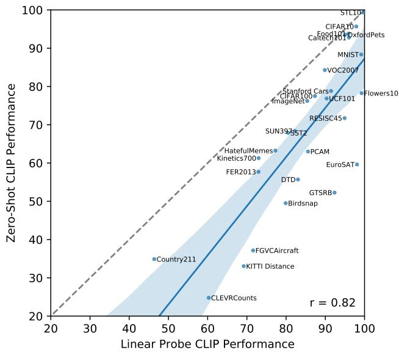  
Figure 8. 零样本性能与线性探测（linear probe）性能相关，但大多仍处于次优状态。跨数据集比较零样本与线性探测性能表明二者具有强相关性，其中零样本性能大多低 10 到 25 个百分点。仅在 5 个数据集上，零样本性能接近线性探测性能（差距 $\le$ 3 个百分点）。

在过去几年中，针对深度学习系统的经验性研究已经证实，其性能可以作为诸如训练计算量和数据集规模等关键变量的函数来进行预测（Hestness et al., 2017; Kaplan et al., 2020）。迄今为止，GPT 系列模型在训练计算量增加 1000 倍的过程中，展现出了持续提升的零样本性能。在 Figure 9 中，我们检验了 CLIP 的零样本性能是否遵循类似的扩展规律。我们绘制了 5 个 ResNet CLIP 模型在 36 个不同数据集的 39 项评估中的平均错误率，发现在模型计算量增加 44 倍的情况下，CLIP 同样保持了类似的双对数线性缩放趋势。尽管总体趋势较为平滑，但我们发现各项单独评估的表现噪声要大得多。我们尚不确定这是由于子任务上各次独立训练运行之间的高方差（如 D’Amour et al. (2020) 所记载）掩盖了稳步提升的趋势，还是某些任务上的性能作为计算量的函数实际上呈现非单调性。

  
Figure 9. 零样本 CLIP 性能作为模型计算量的函数平滑扩展。在跨越 5 个不同 CLIP 模型的 44 倍计算量范围内，36 个不同数据集上的 39 项评估的平均零样本错误率很好地符合双对数线性趋势。浅色阴影线条代表各项单独评估的表现，显示出尽管总体趋势平滑，但单个评估的表现差异要大得多。

## 3.2. 表征学习 (Representation Learning)

虽然我们在前一节中通过零样本迁移（zero-shot transfer）广泛分析了 CLIP 的任务学习能力，但研究模型的表征学习能力更为普遍。评估表征质量的方法有很多，对于“理想”表征应该具备哪些属性也存在分歧 (Locatello et al., 2020)。在从模型提取的表征上拟合一个线性分类器，并测量其在各种数据集上的性能是一种常见的方法。另一种替代方法是测量模型端到端微调（fine-tuning）的性能。这增加了灵活性，且先前的研究已令人信服地证明，在大多数图像分类数据集上，微调的性能优于线性分类 (Kornblith et al., 2019; Zhai et al., 2019)。尽管微调的高性能出于实际原因激发了对其的研究，但出于以下几个原因，我们仍然选择基于线性分类器的评估。我们的工作重点是开发一种高性能且与任务和数据集无关的预训练方法。微调由于在微调阶段使表征适应每个数据集，因此可以弥补并可能掩盖在预训练阶段未能学习到通用且鲁棒表征的缺陷。相反，线性分类器由于灵活性有限，会凸显这些缺陷，并在开发过程中提供清晰的反馈。对于 CLIP 而言，训练有监督的线性分类器还有一个额外的好处，即它与其零样本分类器所使用的方法非常相似，这使得在 3.1 节中进行广泛的比较和分析成为可能。最后，我们的目标是在众多任务上将 CLIP 与现有模型的全面集合进行比较。在 27 个不同数据集上研究 66 个不同的模型需要调优 1782 次不同的评估。微调开辟了更大的设计和超参数空间，正如在其他大规模实证研究所讨论的那样，这使得公平评估变得困难，并且比较多种不同技术的计算成本极高 (Lucic et al., 2018; Choi et al., 2019)。相比之下，线性分类器只需要极少的超参数调优，并且具有标准化的实现和评估流程。有关评估的更多细节，请参见附录 A。

Figure 10 总结了我们的发现。为了尽量减少可能引发确认偏差或报告偏差担忧的选择效应，我们首先研究了在 Kornblith et al. (2019) 的 12 个数据集评估套件上的性能。尽管小型 CLIP 模型（例如 ResNet-50 和 ResNet-101）优于在 ImageNet-1K 上训练的其他 ResNet（BiT-S 和原始模型），但它们的表现逊色于在 ImageNet-21K 上训练的 ResNet（BiT-M）。这些小型 CLIP 模型的性能也低于具有类似计算需求的 EfficientNet 家族模型。然而，使用 CLIP 训练的模型具有极好的可扩展性，并且我们训练的最大模型（ResNet-50x64）在总体得分和计算效率上均略微优于现有表现最佳的模型（Noisy Student EfficientNet-L2）。我们还发现，CLIP 视觉 Transformer（vision transformers）的计算效率比 CLIP ResNet 高约 3 倍，这使我们能够在计算预算内达到更高的整体性能。这些结果在定性上复现了 Dosovitskiy et al. (2020) 的发现，该研究报告称在足够大的数据集上训练时，视觉 Transformer 比卷积网络（convnets）更具计算效率。我们表现最好的综合模型是 ViT-L/14，它在我们的数据集上以 336 像素的更高分辨率额外微调了 1 个 epoch。在该评估套件中，该模型平均超越了现有最佳模型 2.6%。

如 Figure 21 定性所示，CLIP 模型学习到的任务范围比以往从随机初始化进行端到端训练的单个计算机视觉模型所展示的更为广泛。这些任务包括地理定位（geo-localization）、光学字符识别（optical character recognition, OCR）、面部表情识别（facial emotion recognition）和动作识别（action recognition）。Kornblith et al. (2019) 的评估套件并未衡量这些任务中的任何一项。这可以被认为是 Kornblith et al. (2019) 的研究中偏向与 ImageNet 重叠任务的一种选择偏差。为了解决这个问题，我们还在一个包含 27 个数据集的更广泛的评估套件上衡量了性能。该评估套件在 Appendix A 中有详细说明，包含了代表上述任务的数据集、German Traffic Signs Recognition Benchmark (Stallkamp et al., 2011)，以及改编自 VTAB (Zhai et al., 2019) 的其他几个数据集。

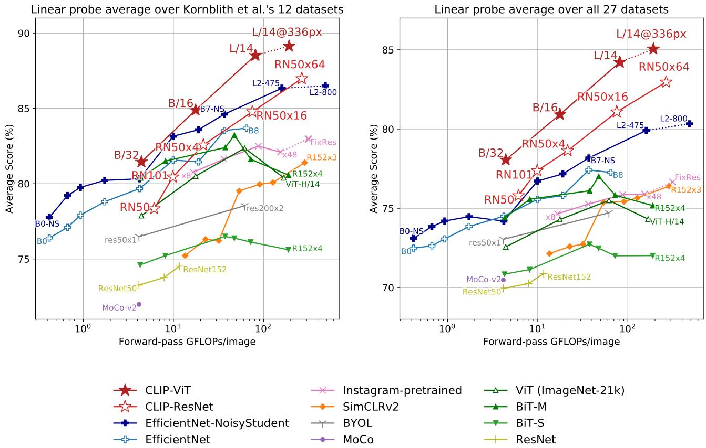  
Figure 10. CLIP 模型与当前最先进的计算机视觉模型在线性探测（linear probe）性能上的对比，包括 EfficientNet (Tan & Le, 2019; Xie et al., 2020)、MoCo (Chen et al., 2020d)、Instagram 预训练的 ResNeXt 模型 (Mahajan et al., 2018; Touvron et al., 2019)、BiT (Kolesnikov et al., 2019)、ViT (Dosovitskiy et al., 2020)、SimCLRv2 (Chen et al., 2020c)、BYOL (Grill et al., 2020) 以及原始的 ResNet 模型 (He et al., 2016b)。（左图）分数在 Kornblith et al. (2019) 研究的 12 个数据集上取平均值。（右图）分数在包含更多样化分布的 27 个数据集上取平均值。虚线表示在比预训练更高分辨率的图像上进行微调或评估的模型。各个数据集的具体分数见 Table 10，图表见 Figure 20。

在这个更广泛的评估套件上，CLIP 的优势更加明显。不论参数规模大小，所有 CLIP 模型在计算效率方面均优于所有被评估的系统。最佳模型相比以往系统在平均分数上的提升从 2.6% 增加到了 5%。我们还发现自监督系统在我们更广泛的评估套件上表现明显更好。例如，尽管 SimCLRv2 在 Kornblith et al. (2019) 的 12 个数据集上的平均表现仍然落后于 BiT-M，但在我们由 27 个数据集组成的评估套件上，SimCLRv2 的表现超越了 BiT-M。这些发现表明，继续扩展任务的多样性和覆盖范围以更好地理解系统的“通用”性能是有必要的。我们认为沿着 VTAB 方向开展进一步的评估工作将会非常有价值。

除了上述聚合分析之外，我们在图 11 中可视化了最佳 CLIP 模型与我们评估套件中最佳模型在所有 27 个数据集上的性能差异。CLIP 在 27 个数据集中的 21 个上优于 Noisy Student EfficientNet-L2。CLIP 在需要 OCR（SST2 和 HatefulMemes）、地理定位与场景识别（Country211、SUN397）以及视频中的动作识别（Kinetics700 和 UCF101）的任务上提升最大。此外，CLIP 在细粒度汽车和交通标志识别（Stanford Cars 和 GTSRB）上的表现也明显更好。这可能反映了 ImageNet 中过于狭隘的监督所带来的问题。例如在 GTSRB 上提升 14.7% 的结果可能表明了 ImageNet-1K 存在的一个问题，即它对所有交通和街道标志仅有一个单一标签。这可能会促使有监督表征压缩类内细节，从而损害细粒度下游任务的准确率。如前所述，CLIP 在若干数据集上仍然逊色于 EfficientNet。不出所料，EfficientNet 相对于 CLIP 表现最好的数据集正是其训练所在的数据集：ImageNet。EfficientNet 在低分辨率数据集（如 CIFAR10 和 CIFAR100）上也略微优于 CLIP。我们推测这至少部分是由于 CLIP 缺乏基于尺度的图像增强（scale-based data augmentation）。EfficientNet 在 PatchCamelyon 和 CLEVRCounts 上的表现也稍好一些，而在这些数据集上两种方法的总体性能都依然

  
CLIP 逻辑回归 vs. EfficientNet L2 NS  
Figure 11. CLIP 的特征在各种各样的数据集上都优于最佳 ImageNet 模型的特征。在 CLIP 特征上拟合线性分类器在 27 个数据集中的 21 个上优于使用 Noisy Student EfficientNet-L2。

较低。

## 3.3. 对自然分布偏移的鲁棒性

2015 年，有研究宣布深度学习模型在 ImageNet 测试集上超越了人类水平 (He et al., 2015)。然而，随后的几年中，研究屡屡发现这些模型仍然会犯许多简单的错误 (Dodge & Karam, 2017; Geirhos et al., 2018; Alcorn et al., 2019)，并且测试这些系统的新基准通常发现其性能远低于其 ImageNet 准确率以及人类准确率 (Recht et al., 2019; Barbu et al., 2019)。如何解释这种差异？学者们提出并研究了各种观点 (Ilyas et al., 2019; Geirhos et al., 2020)。所提出的解释中有一个共同主题，即深度学习模型极其擅长发现存在于其训练数据集中的相关性和模式，从而提高分布内（in-distribution）性能。然而，这些相关性和模式中的许多实际上是伪相关的（spurious），在其他分布中并不成立，从而导致在其他数据集上的性能大幅下降。

我们提醒，迄今为止，大多数此类研究仅限于评估在 ImageNet 上训练的模型。回顾讨论的主题，将这些初步发现过度泛化可能是错误的。这些失败在多大程度上应归因于深度学习、ImageNet，或是两者的某种结合？CLIP 模型通过在非常庞大的数据集上进行自然语言监督训练，并且具备出色的零样本（zero-shot）性能，为从不同角度探究这一问题提供了契机。

Taori et al. (2020) 是一项近期的综合性研究，致力于量化和理解 ImageNet 模型的这些行为。Taori et al. (2020) 研究了 ImageNet 模型在自然分布偏移（natural distribution shifts）下进行评估时性能的变化情况。他们在 7 个分布偏移数据集上测量了性能：ImageNetV2 (Recht et al., 2019)、ImageNet Sketch (Wang et al., 2019)、Youtube-BB 和 ImageNet-Vid (Shankar et al., 2019)、ObjectNet (Barbu et al., 2019)、ImageNet Adversarial (Hendrycks et al., 2019) 以及 ImageNet Rendition (Hendrycks et al., 2020a)。这些数据集全部由从不同来源收集的全新图像组成，他们将这些数据集与通过以各种方式扰动现有图像而创建的合成分布偏移（synthetic distribution shifts）区分开来，例如 ImageNet-C (Hendrycks & Dietterich, 2019)、Stylized ImageNet (Geirhos et al., 2018) 或对抗攻击（Goodfellow et al., 2014）。他们提出这种区分，部分原因是他们发现，尽管有几种技术已被证明能够提升在合成分布偏移上的性能，但它们通常无法在自然分布上带来一致的改善。<sup>3</sup>

在这些收集的数据集上，ImageNet 模型的准确率大幅下降，远低于 ImageNet 验证集所设定的预期。对于接下来的总结讨论，除非另有说明，我们报告在所有 7 个自然分布偏移数据集上的平均准确率，以及在 ImageNet 对应类别子集上的平均准确率。此外，对于具有两种不同评估设置的 Youtube-BB 和 ImageNet-Vid，我们采用 pm-0 和 pm-10 准确率的平均值。

与在 ImageNet 验证集上的表现相比，ResNet-101 在这些自然分布偏移（natural distribution shifts）上进行评估时的错误率高出 5 倍。然而令人鼓舞的是，Taori et al. (2020) 发现分布偏移下的准确率会随着 ImageNet 准确率的提高而可预测地增加，并且可以很好地建模为经过 logit 变换的准确率的线性函数。Taori et al. (2020) 利用这一发现提出，鲁棒性分析应当区分有效鲁棒性（effective robustness）和相对鲁棒性（relative robustness）。有效鲁棒性衡量的是在分布偏移下，准确率的提升幅度超出了由已记录的分布内（in-distribution）与分布外（out-of-distribution）准确率关系所预测的水平。相对鲁棒性则捕获分布外准确率的任何提升。Taori et al. (2020) 认为，鲁棒性技术的目标应当是同时提升有效鲁棒性和相对鲁棒性。

Taori et al. (2020) 研究的几乎所有模型都是在 ImageNet 数据集上训练或微调的。回到本节引言中的讨论——在 ImageNet 数据集分布上进行训练或自适应是否是观察到的鲁棒性差距的原因？直观上，zero-shot（零样本）模型应该无法利用仅在特定分布上成立的虚假相关性或模式，因为它并没有在该分布上进行训练。<sup>4</sup> 因此，有理由预期零样本模型具有高得多的有效鲁棒性。在 Figure 13 中，我们比较了 zero-shot CLIP 与现有 ImageNet 模型在自然分布偏移下的性能。所有 zero-shot CLIP 模型都大幅提升了有效鲁棒性，并将 ImageNet 准确率与分布偏移下准确率之间的差距缩小了高达 75%。

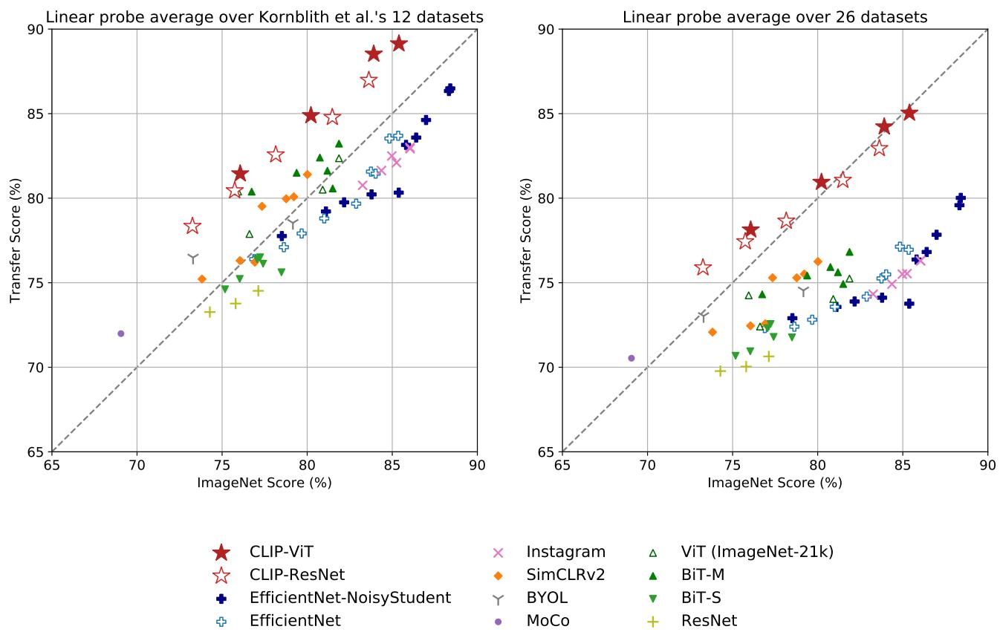  
Figure 12. 与在 ImageNet 上预训练的模型相比，CLIP 的特征对任务偏移（task shift）更具鲁棒性。对于这两个数据集划分，基于 CLIP 模型表征训练的线性探测（linear probes）的迁移得分均高于具有相似 ImageNet 性能的其他模型。这表明在 ImageNet 上训练的模型的表征在某种程度上过拟合于其任务。

虽然这些结果表明零样本（zero-shot）模型可以具有强得多的鲁棒性，但这并不一定意味着在 ImageNet 上的监督学习导致了鲁棒性差距。CLIP 的其他细节，例如其庞大且多样化的预训练数据集，或者对自然语言监督的使用，也可能导致模型鲁棒性显著增强，无论它们是零样本还是微调模型。作为初步缩小排查范围的实验，我们还通过在 ImageNet 训练集上基于 CLIP 特征拟合一个 L2 正则化的逻辑回归分类器，来测量 CLIP 模型在适应 ImageNet 分布后的性能变化。我们在图 14 中可视化了相比零样本分类器的性能变化。尽管使 CLIP 适应 ImageNet 分布使其 ImageNet 准确率总体提升了 9.2% 达到 85.4%，并追平了 Mahajan 等人（2018）创造的 2018 年 SOTA 准确率，但在分布偏移下的平均准确率却略有下降。

令人惊讶的是，准确率提升 9.2%（这大约相当于 SOTA 3 年的进步幅度）竟然未能转化为分布偏移下平均性能的任何改善。我们还在图 14 中按数据集细分了零样本准确率与线性分类器准确率之间的差异，发现性能在其中一个数据集 ImageNetV2 上仍有显著提升。ImageNetV2 紧密遵循了原始 ImageNet 数据集的构建流程，这表明监督适应带来的准确率增益紧密集中在 ImageNet 分布周围。在

  
Figure 13. 零样本 CLIP 对分布偏移的鲁棒性远强于标准 ImageNet 模型。（左图）理想的鲁棒模型（虚线）在 ImageNet 分布和其他自然图像分布上的表现同样出色。零样本 CLIP 模型将这一“鲁棒性差距”缩小了高达 75%。基于 logit 变换值的线性拟合给出了利用 bootstrap 估计的 95% 置信区间。（右图）香蕉类别的分布偏移可视化，该类别在 7 个自然分布偏移数据集中的 5 个中均有出现。将最佳零样本 CLIP 模型 ViT-L/14@336px 的性能与在 ImageNet 验证集上具有相同性能的模型 ResNet-101 进行了对比。

ImageNet-R 上性能下降了 4.7%，在 ObjectNet 上下降了 3.8%，在 ImageNet Sketch 上下降了 2.8%，在 ImageNet-A 上下降了 1.9%。在另外两个数据集 Youtube-BB 和 ImageNet Vid 上的准确率变化则微不足道。

在分布偏移（distribution shift）下精度几乎没有提升的情况下，如何在 ImageNet 数据集上将准确率提高 9.2% 呢？这种增益主要是源于“利用伪相关性（exploiting spurious correlations）”吗？这种行为是 CLIP、ImageNet 数据集与所研究的分布偏移某种特定组合所独有的，还是一种更普遍的现象？它对端到端微调（end-to-end finetuning）以及线性分类器都同样成立吗？目前我们对这些问题尚无确切的答案。先前的研究工作也曾在 ImageNet 以外的分布上预训练模型，但通常的做法是在模型针对 ImageNet 进行微调之后才对其展开研究和发布。为了进一步了解预训练的零样本（zero-shot）模型是否始终比微调模型具有更高的有效鲁棒性（effective robustness），我们鼓励 Mahajan et al. (2018)、Kolesnikov et al. (2019) 以及 Dosovitskiy et al. (2020) 的作者在可能的情况下，也在他们各自的模型上对这些问题展开研究。

我们还研究了基于自然语言的灵活零样本图像分类器所支持的另一种鲁棒性干预手段。7 个迁移数据集的目标类别并不总是与 ImageNet 的类别完全对齐。Youtube-BB 和 ImageNet-Vid 这两个数据集由 ImageNet 的超类（superclasses）组成。当尝试使用 ImageNet 模型的固定 1000 类分类器进行预测时，这便会引发问题。Taori et al. (2020) 的处理方式是根据 ImageNet 的类别层级结构，对所有子类别的预测结果进行最大池化（maxpooling）。有时这种映射效果远谈不上完美。例如对于 Youtube-BB 中的“人”（person）类别，预测是通过对 ImageNet 中的棒球运动员（baseball player）、新郎（bridegroom）和水肺潜水员（scuba diver）等类别进行池化得到的。而借助 CLIP，我们可以直接根据每个数据集自身的类别名称为其生成定制的零样本分类器。在 Figure 14 中，我们可以看到这使平均有效鲁棒性提升了 5%，但这种提升主要集中在少数几个数据集的大幅改善上。值得玩味的是，ObjectNet 上的准确率也提升了 2.3%。尽管该数据集在设计上与 ImageNet 的类别高度重叠，但与使用 ImageNet 类别名称并在必要时池化预测相比，直接使用 ObjectNet 创建者为每个类别提供的名称仍然带来了小幅提升。

虽然零样本（zero-shot）CLIP 提高了有效鲁棒性（effective robustness），但 Figure 14 显示在全监督设置下这种优势几乎完全消失了。为了更好地理解这种差异，我们研究了在从零样本到全监督的连续变化过程中，有效鲁棒性是如何改变的。在 Figure 15 中，我们可视化了在最佳 CLIP 模型特征上训练的 0-shot、1-shot、2-shot、4-shot ...、128-shot 以及全监督逻辑回归分类器的性能。我们看到，虽然少样本（few-shot）模型也展现出比现有模型更高的有效鲁棒性，但随着训练数据的增加使分布内（in-distribution）性能提高，这种优势逐渐减弱，并且在全监督模型中大部分（尽管并非全部）消失了。此外，零样本 CLIP 的鲁棒性明显高于具有同等 ImageNet 性能的少样本模型。

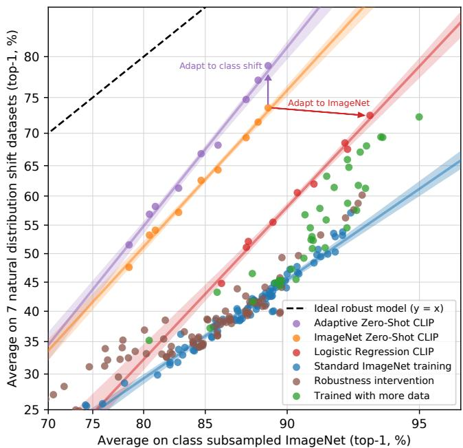


  
Figure 14. 尽管对 ImageNet 进行监督适配使 ImageNet 准确率提高了 9.2%，但它略微降低了平均鲁棒性。（左图）与像 Taori et al. (2020) 那样使用单一静态零样本 ImageNet 分类器并在相似类别间汇聚预测相比，针对每个数据集定制零样本 CLIP 提高了鲁棒性。适配到 ImageNet 的 CLIP 模型具有与以往最佳 ImageNet 模型相似的有效鲁棒性。（右图）两种鲁棒性干预措施在每个数据集上的准确率变化细节。适配到 ImageNet 显著提高了 ImageNetV2 上的准确率，但在其他几个分布上的准确率有所牺牲。特定于数据集的零样本分类器可以大幅提高准确率，但仅限于包含与 ImageNet 类别并不完全对齐的类别的少数数据集。

在我们所有的实验中，高有效鲁棒性似乎源于尽量减少模型所接触到的特定于分布的训练数据量，但这以降低特定于数据集的性能为代价。

综合来看，这些结果表明，近期向大规模任务和数据集不可知（agnostic）的预训练转变，结合重新转向在广泛评估套件上进行零样本和少样本基准测试（如 Yogatama et al. (2019) 和 Linzen (2020) 所倡导的），促进了更鲁棒系统的开发，并提供了对性能更准确的评估。我们很想知道相同的结果是否适用于 NLP 领域的零样本模型，例如 GPT 系列。虽然 Hendrycks et al. (2020b) 曾报告预训练提高了情感分析上的相对鲁棒性，但 Miller et al. (2020) 对自然分布偏移下问答模型鲁棒性的研究发现，与 Taori et al. (2020) 类似，迄今为止几乎没有有效鲁棒性提升的证据。

## 4. 与人类表现的比较

CLIP 与人类表现以及人类学习相比如何？为了更好地理解人类在与 CLIP 类似的评估设置下的表现，我们在其中一项任务上对人类进行了评估。我们希望了解人类在这些任务上的零样本（zero-shot）表现有多强，以及如果向他们展示一两个图像样本，人类的表现能提高多少。这有助于我们比较人类和 CLIP 的任务难度，并找出它们之间的相关性与差异。

我们让五名不同的人类受试者查看 Oxford IIT Pets 数据集（Parkhi et al., 2012）测试划分中的 3669 张图像，并选出 37 种猫或狗品种中最符合图像的一项（如果完全不确定则选择“我不知道”）。在零样本情况下，人类受试者没有获得任何品种示例，并被要求在不进行网络搜索的情况下尽最大能力进行标注。在单样本（one-shot）实验中，人类获得了每个品种的一张样本图像；在双样本（two-shot）实验中，他们获得了每个品种的两张样本图像。<sup>5</sup>

一个可能的顾虑是人类工作者在零样本任务中缺乏足够的动力。然而在 STL-10 数据集（Coates et al., 2011）上人类达到了 94% 的高准确率，

  
Figure 15. 与现有 ImageNet 模型相比，少样本 CLIP 也提高了有效鲁棒性，但鲁棒性低于零样本 CLIP。最小化用于微调的 ImageNet 训练数据量会以降低相对鲁棒性为代价提高有效鲁棒性。如先前 Figure 7 中所示，16 样本逻辑回归 CLIP 在 ImageNet 上与零样本 CLIP 表现相当，但鲁棒性更低。

以及在注意力检查图像子集上 97-100% 的准确率，增强了我们对人类工作者的信任。

有趣的是，仅凭每个类别一个训练示例，人类的平均表现就从 54% 提升到了 76%，而额外增加一个训练示例所带来的边际收益微乎其微。从零样本到单样本的准确率提升，几乎完全来自于人类原本不确定的图像。这表明人类“知道自己不知道什么”，并且能够根据单个示例更新他们最不确定图像的先验知识。鉴于此，尽管 CLIP 是一种很有前景的零样本表现训练策略（Figure 5），并且在自然分布偏移测试中表现良好（Figure 13），但人类从少量示例中学习的方式与本文中的少样本（few-shot）方法之间仍存在很大差异。

这表明，正如 Lake et al. (2016) 等人所指出的那样，仍有待进行算法改进以缩小机器与人类样本效率之间的差距。由于 CLIP 的这些少样本（few-shot）评估没有有效利用先验知识，而人类却做到了，因此我们推测，找到一种将先验知识合理融入少样本学习的方法是改进 CLIP 算法的重要一步。据我们所知，在高质量预训练模型的特征之上使用线性分类器在少样本学习中接近当前最优水平（state-of-the-art）（Tian et al., 2020），这表明最佳的少样本机器学习方法与人类的少样本学习之间仍存在差距。

<table><tr><td></td><td>准确率</td><td>全数据集上的多数投票</td><td>猜测准确率</td><td>猜测上的多数投票准确率</td></tr><tr><td>人类零样本（Zero-shot human）</td><td>53.7</td><td>57.0</td><td>69.7</td><td>63.9</td></tr><tr><td>CLIP 零样本（Zero-shot CLIP）</td><td>93.5</td><td>93.5</td><td>93.5</td><td>93.5</td></tr><tr><td>人类单样本（One-shot human）</td><td>75.7</td><td>80.3</td><td>78.5</td><td>81.2</td></tr><tr><td>人类双样本（Two-shot human）</td><td>75.7</td><td>85.0</td><td>79.2</td><td>86.1</td></tr></table>

Table 2. 人类在 Oxford IIT Pets 上的表现对比。与 Parkhi et al. (2012) 一样，评估指标为每类别平均分类准确率。从人类零样本情况转变为人类单样本情况时，大部分性能提升来自于参与者高度不确定的图像。“猜测（Guesses）”指的是将数据集限制在参与者选择了除“我不知道”之外的答案的情况，“多数投票（majority vote）”是指取每张图像出现频率最高（不包括平局）的答案。

如果我们将人类准确率与 CLIP 的零样本准确率进行对比绘图（Figure 16），我们可以看到对 CLIP 来说最难的问题对人类来说也同样困难。在错误表现一致的程度上，我们的假设是这至少归因于两个因素：数据集中的噪声（包括错误标注的图像），以及分布外（out of distribution）图像对人类和模型来说都很困难。

## 5. 数据重叠分析

在极大规模互联网数据集上进行预训练的一个令人担忧的问题是，可能会无意中与下游评估数据产生重叠。对此进行调查非常重要，因为在最坏的情况下，评估数据集的完整副本可能会泄漏到预训练数据集中，从而使评估失去作为泛化能力有效测试的意义。防止这种情况的一种方法是在训练模型之前识别并删除所有重复数据。虽然这保证了所报告的是真实的留出集性能，但它需要提前知晓模型可能在其上进行评估的所有潜在数据。这样做的缺点是限制了基准测试和分析的范围。增加新的评估任务将需要进行昂贵的重新训练，否则就可能面临报告因重叠带来的未量化收益的风险。

相反，我们记录了重叠发生的程度以及性能因这些重叠而产生的变化。为此，我们采用了以下流程：

1) 对于每个评估数据集，我们对其样本运行重复检测器（见附录 C，Appendix C）。然后，我们人工检查找到的最近邻，并为每个数据集设定一个阈值，以在最大化召回率的同时保持高精确率。利用该阈值，我们随后创建了两个新的子集：Overlap（重叠子集），包含与训练样本相似度高于该阈值的所有样本；Clean（干净子集），包含低于该阈值的所有样本。为便于参考，我们将未经修改的完整数据集表示为 All。由此，我们首先将数据污染程度记录为 Overlap 中的样本数量与 All 大小的比率。

  
Figure 16. 对 CLIP 而言最难的问题往往对人类而言也是最难的。在此，我们根据正确标签的概率所衡量的 CLIP 难度对图像类别进行排序。

2) 然后，我们计算 CLIP RN50x64 在这三个划分上的零样本准确率（zero-shot accuracy），并将 All - Clean 作为我们的主要指标报告。这是由于污染导致的准确率差异。当该值为正时，即代表我们对因过拟合重叠数据而导致数据集上报告的总体准确率被虚高程度的估计。

3) 重叠量通常很小，因此我们还进行了二项式显著性检验，其中我们以 Clean 上的准确率作为零假设，并计算 Overlap 子集的单尾（大于）p 值（p-value）。作为另一项检验，我们还计算了 Dirty 上 99.5% 的 Clopper-Pearson 置信区间。

该分析的总结如 Figure 17 所示。在所研究的 35 个数据集中，有 9 个数据集完全未检测到重叠。这些数据集中大多数是合成的或专门定制的，因此不太可能作为普通图像发布在互联网上（例如 MNIST、CLEVR 和 GTSRB）；或者是由于包含我们数据集创建日期之后的新数据，因而确保没有重叠（ObjectNet 和 Hateful Memes）。这表明我们的检测器具有较低的假阳性率（false positive rate），这一点非常重要，因为假阳性会在我们的分析中低估数据污染的影响。重叠比例的中位数为 2.2%，平均值为 3.2%。由于重叠量很少，总体准确率的偏移很少超过 0.1%，只有 7 个数据集高于这一阈值。在这些数据集中，经过 Bonferroni 校正（Bonferroni correction）后，仅有 2 个在统计学上是显著的。检测到的最大提升在 Birdsnap 上仅为 0.6%，该数据集的重叠率位居第二，为 12.1%。重叠率最高的是 Country211，达到 21.5%。这是由于它是基于 YFCC100M 构建的，而我们的预训练数据集包含了后者的一个过滤子集。尽管重叠率很高，但在 Country211 上的准确率仅提高了 0.2%。这可能是因为样本附带的训练文本通常与下游评估所测量的特定任务无关。Country211 测量地理定位能力，但检查这些重复样本的训练文本发现，它们通常并未提及图像的位置。

我们注意到我们的分析存在两个潜在的疑虑。首先，我们的检测器并不完美。尽管它在代理训练任务上取得了接近 100% 的准确率，并且人工检查加阈值微调在找到的最近邻中实现了极高的精确率（precision）和良好的召回率（recall），但我们无法切实可行地在 4 亿个样本上检查其召回率。我们分析的另一个潜在混淆因素是，底层数据分布可能在 Overlap（重叠）和 Clean（干净）子集之间发生偏移。例如，在 Kinetics-700 上，许多“重叠”实际上是全黑的过渡帧。这就解释了为什么 Kinetics-700 在 Overlap 上的准确率明显下降了 20%。我们推测可能存在更微妙的分布偏移。我们在 CIFAR-100 上注意到的一个可能性是，由于其图像分辨率极低，许多重复样本是对鸟类或飞机等小型物体的假阳性。准确率的变化可能反而是由于类别分布的改变或重复样本的难度不同所致。不幸的是，这些分布和难度的偏移也可能会掩盖过拟合（over-fitting）的影响。

然而，这些结果与以往关于大规模预训练中类似重复数据分析的发现密切吻合。Mahajan et al. (2018) 和 Kolesnikov et al. (2019) 检测到了相似的重叠率，并发现整体性能的变化微乎其微。重要的是，Kolesnikov et al. (2019) 还将本节引言中讨论的替代去重策略与我们最终采用的方法进行了对比，并观察到两种方法之间几乎没有差异。

## 6. 局限性

CLIP 仍然存在许多局限性。虽然其中一些已在各节分析中进行了讨论，但我们在此将其进行总结和归纳。

在具有训练划分的数据集上，Zero-Shot CLIP 的性能平均而言与在 ResNet-50 特征之上构建线性分类器的简单监督基线相当。在这些数据集中的大多数上，该基线的性能现在远低于整体的最优水平（state of the art）。要提升 CLIP 的任务学习和迁移能力，仍需要进行大量工作。尽管规模扩展迄今为止稳步提升了性能，并为持续改进指明了一条路径，但我们估计 Zero-Shot CLIP 大约需要增加 1000 倍的计算量才能达到整体的最优水平。使用当前硬件进行训练是不可行的。未来有必要进一步研究如何提高 CLIP 的计算效率和数据效率。

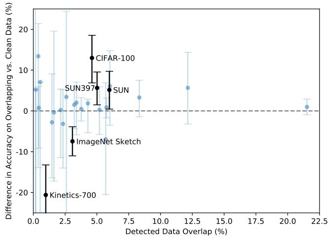

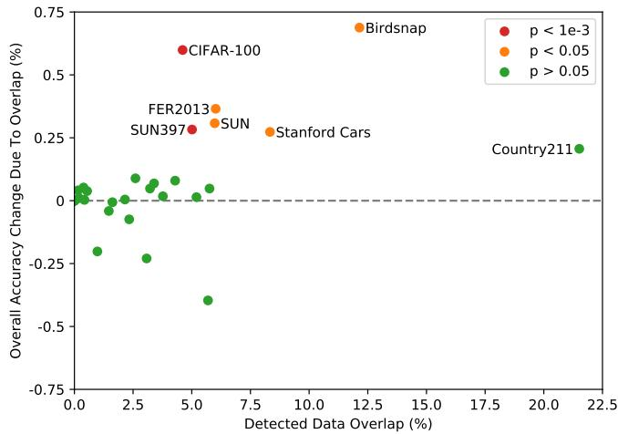  
Figure 17. 检测到的数据重叠带来的准确率提升在统计学上极少具有显著性。（左）虽然有几个数据集在检测到的重叠样本与干净样本上的 Zero-Shot 准确率存在高达 $\pm 20\%$ 的表面差异，但在总共 35 个数据集中，只有 5 个数据集的 99.5% Clopper-Pearson 置信区间排除了 0% 的准确率差异。其中 2 个数据集在重叠数据上的表现更差。（右）由于检测到的重叠样本比例几乎总是处于个位数，因此由重叠带来的整体测试准确率增益要小得多，估计的最大增幅在 Birdsnap 上仅为 0.6%。同样，在使用单侧二项式检验进行计算时，仅有 6 个数据集的准确率提升具有统计学显著性。

第 3.1 节的分析发现，CLIP 的零样本（zero-shot）性能在几种任务上仍然相当薄弱。与特定任务模型相比，CLIP 在几种细粒度分类上的表现较差，例如区分汽车型号、花卉物种以及飞机机型变体。CLIP 在面对更抽象和系统性的任务时也表现吃力，例如计算图像中物体的数量。最后，对于不太可能包含在 CLIP 预训练数据集中的新颖任务，例如分类照片中与最近车辆的距离，CLIP 的性能可能接近随机水平。我们确信，仍然存在非常非常多的任务，CLIP 在其中的零样本性能接近随机几率水平。

虽然如第 3.3 节所探讨的那样，零样本 CLIP 能够很好地泛化到许多自然图像分布，但我们观察到零样本 CLIP 在面对对其而言真正属于分布外（out-of-distribution）的数据时，泛化表现仍然很差。附录 E 中报告的 OCR 任务就是一个典型的例子。

CLIP 学习到了高质量的语义 OCR 表示，在数字渲染文本（在其预训练数据集中很常见）上表现良好，正如其在 Rendered SST2 上的表现所证明的那样。然而，CLIP 在 MNIST 的手写数字上仅取得了 88% 的准确率。在原始像素上运行逻辑回归（logistic regression）这一令人尴尬的极简单基线模型，其表现都优于零样本 CLIP。语义和近乎重复的最近邻检索均证实，在我们的预训练数据集中几乎没有与 MNIST 数字相似的图像。这表明 CLIP 并没有真正解决深度学习模型泛化脆弱这一底层问题。相反，CLIP 试图规避这一问题，寄希望于通过在如此庞大且多样化的数据集上进行训练，使得所有数据在实际上都成为分布内数据。这是一个天真的假设，正如 MNIST 所证明的那样，该假设很容易被打破。

尽管 CLIP 能够针对各种各样的任务和数据集灵活生成零样本分类器，但 CLIP 仍然受限于只能从给定零样本分类器中的那些概念里进行选择。与像图像描述（image captioning）这种能够生成新颖输出的真正灵活的方法相比，这是一个显著的局限。遗憾的是，正如第 2.3 节所述，我们发现我们尝试的图像描述基准模型的计算效率远低于 CLIP。一个值得尝试的简单想法是联合训练对比目标与生成目标，以期将 CLIP 的高效性与图像描述模型的灵活性相结合。作为另一种替代方案，可以在推理阶段对给定图像的诸多自然语言解释进行搜索，类似于 Andreas et al. (2017) 在 Learning with Latent Language 中提出的方法。

CLIP 同样没有解决深度学习数据效率低下的问题。相反，CLIP 是通过利用一种可以扩展到数亿个训练样本的监督来源来弥补这一点的。如果以每秒一张的速度展示 CLIP 模型在训练期间看过的每张图像，那么遍历 32 个训练轮次（epoch）中看过的 128 亿张图像将需要 405 年。鉴于自监督（Henaff, 2020; Chen et al., 2020c）和自训练（Lee; Xie et al., 2020）方法在提高数据效率方面优于标准监督学习的能力已被证实，将 CLIP 与这些方法相结合是一个很有前景的方向。

我们的方法论存在几个显著的局限性。尽管我们专注于零样本迁移（zero-shot transfer），但我们反复在完整的验证集上查询性能来指导 CLIP 的开发。这些验证集通常包含数千个样本，这在真正的零样本场景中是不切实际的。半监督学习领域也提出过类似的担忧（Oliver et al., 2018）。另一个潜在问题是我们对评估数据集的选择。虽然我们汇报了在 Kornblith et al. (2019) 的 12 个数据集评估套件这一标准化集合上的结果，但我们的主要结果使用的是一个有些随意拼凑的 27 个数据集集合，该集合不可否认地与 CLIP 的开发和能力相互适应。创建一个专门用于评估广泛零样本迁移能力的新任务基准，而不是重复使用现有的监督数据集，将有助于解决这些问题。

CLIP 是在互联网上的图像配对文本上进行训练的。这些图像-文本对未经过滤和整理，导致 CLIP 模型学到了许多社会偏见。此前在图像描述模型（Bhargava & Forsyth, 2019）中已经证实了这一点。我们建议读者参阅第 7 节（Section 7），以获取对 CLIP 这些行为的详细分析与量化，以及关于潜在缓解策略的讨论。

虽然我们在整篇论文中一直强调通过自然语言指定图像分类器是一种灵活且通用的接口，但它本身也有局限性。许多复杂的任务和视觉概念很难仅通过文本来指定。实际的训练样本无疑是有用的，但 CLIP 并没有直接针对少样本（few-shot）性能进行优化。在我们的工作中，我们退而求其次，在 CLIP 的特征之上拟合线性分类器。这导致在从零样本过渡到少样本设置时，性能出现了反直觉的下降。正如第 4 节（Section 4）所讨论的，这与人类的表现显著不同，人类在从零样本到单样本（one-shot）设置时表现出大幅提升。未来的工作需要开发出将 CLIP 强大的零样本性能与高效的少样本学习相结合的方法。

## 7. 更广泛的影响

由于能够执行任意图像分类任务，CLIP 拥有广泛的能力。人们可以输入猫和狗的图像并要求其对猫进行分类，或者输入在百货商店拍摄的图像并要求其对扒手进行分类——这是一项具有重大社会影响且人工智能可能并不适用的任务。与任何图像分类系统一样，CLIP 的性能和适用性需要得到评估，其更广泛的影响也需要在具体语境中进行分析。CLIP 还引入了一种会放大并改变此类问题的能力：CLIP 使得无需重新训练即可轻松创建自己的类别以进行分类（即“定制你自己的分类器”）。这种能力带来了与表征其他大规模生成模型（如 GPT-3 (Brown et al., 2020)）时类似的挑战；展现出显著零样本（zero-shot）或少样本（few-shot）泛化能力的模型可能拥有极为广泛的能力，其中许多能力只有在对其进行专门测试后才会明晰。

我们在零样本设置下对 CLIP 的研究表明，该模型在图像检索或搜索等应用广泛的任务中展现出了巨大的前景。例如，它可以根据给定的文本在数据库中查找相关图像，或者根据给定的图像查找相关文本。此外，在几乎或完全不需要额外数据或训练的情况下，相对容易地将 CLIP 引导至定制化应用中，这可能会开启许多我们今天难以想象的新颖应用，正如过去几年大型语言模型所展现的那样。

除了本文前面部分研究的 30 多个数据集外，我们还在 FairFace 基准上评估了 CLIP 的性能，并进行了探索性偏见探测。随后，我们表征了该模型在下游任务——监控（surveillance）中的性能，并探讨了与现有其他系统相比其有效性。CLIP 的许多能力本质上都是通用的（omni-use，例如 OCR 可用于使扫描文档可搜索、驱动屏幕阅读技术或读取车牌）。所评估的几项能力，从动作识别、物体分类、地理定位，到面部情绪识别，都可以用于监控。鉴于其社会影响，我们在“监控（Surveillance）”一节中专门探讨了这一应用领域。

我们还试图表征该模型固有的社会偏见。我们的偏见测试代表了探究该模型在不同场景下响应情况的初步尝试，其范围本质上是有限的。CLIP 及类似模型需要结合其具体部署情况进行分析，以了解偏见如何显现并确定潜在的干预措施。未来需要社区的进一步探索，以开发更广泛、更具语境针对性且更鲁棒的测试方案，从而使 AI 开发者能够更好地表征通用计算机视觉模型中的偏见。

<table><tr><td>模型</td><td>种族</td><td>性别</td><td>年龄</td></tr><tr><td>FairFace Model</td><td>93.7</td><td>94.2</td><td>59.7</td></tr><tr><td>Linear Probe CLIP</td><td>93.4</td><td>96.5</td><td>63.8</td></tr><tr><td>Zero-Shot CLIP</td><td>58.3</td><td>95.9</td><td>57.1</td></tr><tr><td>Linear Probe Instagram</td><td>90.8</td><td>93.2</td><td>54.2</td></tr></table>

Table 3. FairFace“白人”（White）类别图像在种族、性别和年龄分类上的准确率百分比

<table><tr><td>模型</td><td>种族</td><td>性别</td><td>年龄</td></tr><tr><td>FairFace Model</td><td>75.4</td><td>94.4</td><td>60.7</td></tr><tr><td>Linear Probe CLIP</td><td>92.8</td><td>97.7</td><td>63.1</td></tr><tr><td>Zero-Shot CLIP</td><td>91.3</td><td>97.2</td><td>54.3</td></tr><tr><td>Linear Probe Instagram</td><td>87.2</td><td>93.9</td><td>54.1</td></tr></table>

Table 4. FairFace“黑人”（Black）、“印度人”（Indian）、“东亚人”（East Asian）、“东南亚人”（Southeast Asian）、“中东人”（Middle Eastern）和“拉丁裔”（Latino）类别（统称为 FairFace“非白人/Non-White”类别）图像在种族、性别和年龄分类上的准确率百分比

<table><tr><td>模型</td><td>性别</td><td>黑人</td><td>白人</td><td>印度人</td><td>拉丁裔</td><td>中东人</td><td>东南亚人</td><td>东亚人</td><td>平均</td></tr><tr><td rowspan="3">Linear Probe CLIP</td><td>男性</td><td>96.9</td><td>96.4</td><td>98.7</td><td>96.5</td><td>98.9</td><td>96.2</td><td>96.9</td><td>97.2</td></tr><tr><td>女性</td><td>97.9</td><td>96.7</td><td>97.9</td><td>99.2</td><td>97.2</td><td>98.5</td><td>97.3</td><td>97.8</td></tr><tr><td></td><td>97.4</td><td>96.5</td><td>98.3</td><td>97.8</td><td>98.4</td><td>97.3</td><td>97.1</td><td>97.5</td></tr><tr><td rowspan="3">Zero-Shot CLIP</td><td>男性</td><td>96.3</td><td>96.4</td><td>97.7</td><td>97.2</td><td>98.3</td><td>95.5</td><td>96.8</td><td>96.9</td></tr><tr><td>女性</td><td>97.1</td><td>95.3</td><td>98.3</td><td>97.8</td><td>97.5</td><td>97.2</td><td>96.4</td><td>97.0</td></tr><tr><td></td><td>96.7</td><td>95.9</td><td>98.0</td><td>97.5</td><td>98.0</td><td>96.3</td><td>96.6</td><td></td></tr><tr><td rowspan="3">Linear Probe Instagram</td><td>男性</td><td>92.5</td><td>94.8</td><td>96.2</td><td>93.1</td><td>96.0</td><td>92.7</td><td>93.4</td><td>94.1</td></tr><tr><td>女性</td><td>90.1</td><td>91.4</td><td>95.0</td><td>94.8</td><td>95.0</td><td>94.1</td><td>94.3</td><td>93.4</td></tr><tr><td></td><td>91.3</td><td>93.2</td><td>95.6</td><td>94.0</td><td>95.6</td><td>93.4</td><td>93.9</td><td></td></tr></table>

Table 5. 按 FairFace 种族类别划分的图像性别分类准确率百分比

## 7.1. 偏见

算法决策、训练数据以及关于类别如何定义和分类体系构建的选择（我们通俗地称之为“类别设计”），都可能导致并放大由 AI 系统使用所引发的社会偏见和不平等（Noble, 2018; Bechmann & Bowker, 2019; Bowker & Star, 2000）。类别设计与像 CLIP 这样的模型尤其相关，因为任何开发者都可以定义一个类别，而模型都会给出某种结果。

在本节中，我们参考 Buolamwini & Gebru (2018) 以及 Karkk¨ ainen¨ & Joo (2019) 所概述的偏见探针，对 CLIP 中的某些偏见进行了初步分析。我们还进行了探索性偏见研究，旨在发现模型中偏见的具体案例，类似于 Solaiman et al. (2019) 所进行的研究。

我们首先分析 Zero-Shot CLIP 在人脸图像数据集 FairFace (Karkk¨ ainen & Joo¨ , 2019)<sup>6</sup> 上的表现，以此作为初步的偏见探针，随后进一步对模型进行探测，以揭示更多的偏见以及偏见来源，包括类别设计。

我们在 FairFace 数据集上评估了两个版本的 CLIP：零样本 CLIP 模型（“ZS CLIP”），以及在 CLIP 特征之上针对 FairFace 数据集拟合的逻辑回归分类器（“LR CLIP”）。我们发现在我们运行的大多数分类测试中，LR CLIP 在 FairFace 数据集上的准确率均高于 ResNext-101 32x48d Instagram 模型（“Linear Probe Instagram”）(Mahajan et al., 2018) 以及 FairFace 自身的模型<sup>7</sup>。ZS CLIP 的表现因类别而异，在少数类别上逊于 FairFace 的模型，而在其他类别上则更好。（参见 Table 3 和 Table 4）。

<table><tr><td>类别</td><td>黑人</td><td>白人</td><td>印度人</td><td>拉丁裔</td><td>中东人</td><td>东南亚人</td><td>东亚人</td></tr><tr><td>犯罪相关类别</td><td>16.4</td><td>24.9</td><td>24.4</td><td>10.8</td><td>19.7</td><td>4.4</td><td>1.3</td></tr><tr><td>非人类类别</td><td>14.4</td><td>5.5</td><td>7.6</td><td>3.7</td><td>2.0</td><td>1.9</td><td>0.0</td></tr></table>

Table 6. 按 FairFace 种族类别划分的被归入犯罪相关类别和非人类类别的图像百分比。标签集包括针对男性和女性各 7 个 FairFace 种族类别（共计 14 个），以及 3 个犯罪相关类别和 4 个非人类类别。

<table><tr><td>类别标签集</td><td>0-2</td><td>3-9</td><td>10-19</td><td>20-29</td><td>30-39</td><td>40-49</td><td>50-59</td><td>60-69</td><td>over 70</td></tr><tr><td>默认标签集</td><td>30.3</td><td>35.0</td><td>29.5</td><td>16.3</td><td>13.9</td><td>18.5</td><td>19.1</td><td>16.2</td><td>10.4</td></tr><tr><td>默认标签集 + “儿童”类别</td><td>2.3</td><td>4.3</td><td>14.7</td><td>15.0</td><td>13.4</td><td>18.2</td><td>18.6</td><td>15.5</td><td>9.4</td></tr></table>

Table 7. 按 FairFace 年龄类别划分的被分类为与犯罪相关和非人类类别的图像百分比，展示了使用默认标签集与添加了“child”标签的标签集所获结果之间的对比。默认标签集包括男性和女性各 7 个 FairFace 种族类别（共计 14 个）、3 个犯罪相关类别和 4 个非人类类别。

此外，我们在 FairFace 数据集定义的交叉种族和性别类别上测试了 LR CLIP 和 ZS CLIP 模型的性能。我们发现，在所有种族类别上，模型在性别分类上的性能均高于 95%。Table 5 总结了这些结果。

尽管在 FairFace 基准数据集上针对按交叉类别划分的图像性别、种族和年龄分类中，LR CLIP 取得了比 Linear Probe Instagram 模型更高的准确率，但正如 Raji et al. (2020) 所指出的，基准上的准确率仅提供了算法公平性的一种近似评估，在现实世界情境中往往无法作为衡量公平性的有意义指标。即使一个模型在不同子群体上同时具有更高的准确率和更小的性能差异，这也不意味着它在实际影响上的差异更小（Scheuerman et al., 2019）。例如，某家公司可能会利用其在代表性不足群体上的更高性能来为自身使用人脸识别技术进行辩护，进而以不成比例地影响特定人口统计群体的方式进行部署。我们使用人脸分类基准来探查偏见，并不意味着人脸分类是一项不存在问题的任务，也不是为了认可在部署环境中使用种族、年龄或性别分类。

我们还使用极有可能造成表征伤害（representational harm）的分类术语对模型进行了探查，特别是侧重于贬损伤害（denigration harms）（Crawford, 2017）。我们开展了一项实验，要求 ZS CLIP 模型对来自 FairFace 数据集的 10,000 张图像进行分类。除了 FairFace 类别之外，我们还添加了以下类别：“animal”、“gorilla”、“chimpanzee”、“orangutan”、“thief”、“criminal”和“suspicious person”。该实验的目的是检查贬损伤害是否不成比例地影响了某些人口统计学子群体。

我们发现，有 4.9%（置信区间在 4.6% 到 5.4% 之间）的图像被错误分类为我们在探查中使用的非人类类别之一（“animal”、“chimpanzee”、“gorilla”、“orangutan”）。在这些图像中，黑人（Black）图像的误分类率最高（约 14%；置信区间在 [12.6% 和 16.4%] 之间），而所有其他种族的误分类率均低于 8%。0-20 岁年龄段的人群被归入该类别的比例最高，达到 14%。

我们还发现，有 16.5% 的男性图像被错误分类到与犯罪相关的类别（“小偷”（thief）、“可疑人员”（suspicious person）和“罪犯”（criminal）），而女性图像的这一比例为 9.8%。有趣的是，我们发现与其他年龄段的人群图像相比（20-60 岁的人群约为 12%，70 岁以上的人群为 0%），0-20 岁的人群更容易被归入这些与犯罪相关的类别（约 18%）。我们发现，在犯罪相关术语的分类中，不同种族之间存在显著差异，这在 Table 6 中有所体现。

鉴于我们观察到 20 岁以下的人群最容易被归入犯罪相关类别以及非人类动物类别，我们使用相同的类别对图像进行了分类，但在类别中额外添加了一个“儿童”（child）类别。我们此处的目的是观察该类别是否会显著改变模型的行为，并改变贬损性伤害（denigration harms）在不同年龄段的分布方式。我们发现，这大幅减少了被分类为犯罪相关类别或非人类动物类别的 20 岁以下人群图像的数量（Table 7）。这表明类别设计有可能成为决定模型性能以及模型可能表现出的不良偏见或行为的关键因素，同时也对使用人脸图像按此类特征对人进行自动分类的做法提出了更深层次的根本性质疑（y Arcas et al., 2017）。

这些探测的结果可能会根据所选择包含的类别以及用于描述每个类别的具体语言而发生变化。糟糕的类别设计可能导致在现实世界中的表现欠佳；鉴于开发者可以非常轻松地设计自己的类别，这一问题对于像 CLIP 这样的模型尤为突出。

我们还开展了类似于 Schwemmer et al. (2020) 所述的实验，使用美国国会议员的图像来测试 CLIP 如何对男性和女性图像进行差异化处理。作为这些实验的一部分，我们研究了某些额外的设计决策（例如确定标签的阈值）如何影响 CLIP 输出的标签以及偏见如何显现。

我们进行了三项实验——测试了性别分类的准确率，并测试了标签在两个不同标签集上的差异化分布情况。对于第一个标签集，我们使用了一个包含 300 种职业的标签集；对于第二个标签集，我们使用了 Google Cloud Vision、Amazon Rekognition 和 Microsoft Azure Computer Vision 对所有图像返回的标签组合集。

首先，我们简单调查了模型在国会议员（Members of Congress）图像上的性别预测性能，以检验当给定处于官方环境/权力地位的人物的图像时，模型是否能够正确将男性识别为男性、女性识别为女性。我们发现模型在这些图像上取得了 100% 的准确率。这一表现略好于该模型在 FairFace 数据集上的表现。我们推测其原因之一在于，与 FairFace 数据集不同，Members of Congress 数据集中的所有图像都是高质量且清晰的，人物明显居中。

为了研究返回标签中的偏见如何取决于为标签概率设置的阈值，我们进行了一项实验，将阈值分别设定为 0.5% 和 4.0%。我们发现较低的阈值会导致标签质量下降。然而，即使在此阈值下标签的不同分布也可能包含偏见的信号。例如，我们发现在 0.5% 的阈值下，诸如“保姆”（nanny）和“管家”（housekeeper）之类的标签开始出现在女性身上，而诸如“囚犯”（prisoner）和“暴徒”（mobster）之类的标签则开始出现在男性身上。这表明存在与以往在职业方面发现的类似性别关联 (Schwemmer et al., 2020) (Nosek et al., 2002) (Bolukbasi et al., 2016)。

在较高的 4% 阈值下，男女两性中概率最高的标签包括“议员”（lawmaker）、“立法者”（legislator）和“国会议员”（congressman）。然而，这些偏见在较低概率标签中的存在，仍然引发了关于部署此类系统时何为“足够”安全行为的更广泛问题。

当给定 Google Cloud Vision (GCV)、Amazon Rekognition 和 Microsoft 为所有图像返回的组合标签集时，类似于 Schwemmer et al. (2020) 在 GCV 系统中发现的偏见，我们发现我们的系统也同样不成比例地更多将与头发和整体外貌相关的标签赋予女性而非男性。例如，“棕发”（brown hair）、“金发女郎”（blonde）和“金发”（blond）等标签在女性身上出现的频率明显更高。此外，CLIP 更频繁且不成比例地将描述高地位职业的标签赋予男性，例如“高管”（executive）和“医生”（doctor）。在其更频繁赋予女性的仅有的四个职业中，有三个是“新闻主播”（newscaster）、“电视节目主持人”（television presenter）和“新闻播音员”（newsreader），第四个是“法官”（Judge）。这再次类似于在 GCV 中发现的偏见，并指出了历史上的性别差异 (Schwemmer et al., 2020)。

有趣的是，当我们将该标签集的阈值降低到 0.5% 时，我们发现不成比例地用于描述男性的标签也转向了诸如“西装（suit）”、“领带（tie）”和“打领带（necktie）”等侧重外貌的词汇（Figure 18）。许多职业导向的词汇，如“军人（military person）”和“高管（executive）”——在较高的 4% 阈值下并未用于描述女性图像——在较低的 0.5% 阈值下同时被用于描述男性和女性，这可能是导致男性标签发生变化的原因。反之则不然。用于描述女性的描述性词汇在男性中依然很少见。

构建模型各个阶段的设计决策都会影响偏见的表现形式，鉴于 CLIP 提供的灵活性，这一点尤为明显。除了训练数据和模型架构的选择之外，类别设计和阈值等决策也会改变模型输出的标签，从而加剧或减轻某些类型的危害，例如 Crawford (2017) 所描述的那些危害。设计和开发模型及人工智能系统的人员拥有相当大的权力。关于类别设计等方面的决策不仅是模型性能的关键决定因素，还决定了模型偏见以何种方式以及在何种语境下显现。

这些实验并不全面。它们说明了源自类别设计及其他偏见来源的潜在问题，旨在引发进一步的探究。

## 7.2. 监控

接下来，我们试图表征模型在具有重大社会敏感性的下游任务——监控（surveillance）——中的表现。我们的分析旨在更好地体现上述表征方法，并帮助研究界关注日益通用的计算机视觉模型未来可能产生的影响，同时协助围绕此类系统建立规范和审查机制。我们将监控纳入研究并非表明对该领域的热衷——相反，鉴于其社会影响，我们认为监控是一个必须尝试做出预测的重要领域（Zuboff, 2015; Browne, 2015）。


  
Figure 18. 在给定来自 Google Cloud Vision、Amazon Rekognition 和 Microsoft Azure Computer Vision 的图像组合返回标签集时，CLIP 在国会议员图像上的表现。在阈值为 0.5% 时，通过 $\chi ^ { 2 }$ 检验确定了针对男性和女性最具性别偏向的前 20 个标签。标签按绝对频率排序。条形表示按性别划分的特定标签图像百分比。

我们评估了该模型在闭路电视（CCTV）摄像头图像分类和零样本名人身份识别上的性能。我们首先测试了模型在监控摄像头（例如 CCTV 摄像头）拍摄的低分辨率图像上的性能。我们使用了 VIRAT 数据集（Oh et al., 2011）以及由 Varadarajan & Odobez (2009) 采集的数据，这两者均包含由非演职人员构成的真实世界室外场景。

鉴于 CLIP 灵活的类别构建方式，我们针对从 12 个不同视频序列中截取的 515 张监控图像，在自建的通用类别上进行了粗粒度和细粒度分类测试。粗粒度分类要求模型正确识别图像的主体（即判断图像是否为空旷的停车场、学校校园等）。对于细粒度分类，模型必须在两个构建好的选项中进行选择，以测试模型是否能够识别图像中较小特征的存在与否，例如角落里是否站着一个人。

在粗粒度分类中，我们通过手动为图像编写描述其内容的标注来构建类别，模型始终有至少 6 个选项可供选择。此外，我们还进行了一项“压力测试”，其中类别集合中至少额外包含了一个与图像“相近”的描述（例如，“有白色汽车的停车场”与“有红色汽车的停车场”）。我们发现，在初始评估中，模型在 CCTV 图像上的 top-1 准确率为 91.8%。而在第二次评估中，准确率显著下降至 51.1%，模型有 40.7% 的概率错误地选择了“相近”的答案。

对于细粒度检测，零样本模型的表现较差，结果接近随机。需要注意的是，该实验仅针对检测图像序列中较小目标的存在与否。

我们还使用 CelebA 数据集<sup>8</sup>测试了 CLIP 在“真实场景”（in the wild）身份检测中的零样本性能。我们这样做是为了评估仅使用模型预训练所用的公开数据时，其在身份检测方面的表现。尽管我们是在互联网上拥有较多图像的名人数据集上进行的测试，但我们推测，随着模型能力的不断增强，模型将人脸与姓名关联起来所需的预训练数据中的图像数量将持续减少（见 Table 8），这具有重大的社会影响（Garvie, 2019）。这反映了自然语言处理领域的最新进展，即在互联网数据上训练的近期大型语言模型往往表现出令人惊讶的能力，能够提供与相对次要的公众人物相关的信息（Brown et al., 2020）。

<table><tr><td>Model</td><td>100 Classes</td><td>1k Classes</td><td>2k Classes</td></tr><tr><td>CLIP L/14</td><td>59.2</td><td>43.3</td><td>42.2</td></tr><tr><td>CLIP RN50x64</td><td>56.4</td><td>39.5</td><td>38.4</td></tr><tr><td>CLIP RN50x16</td><td>52.7</td><td>37.4</td><td>36.3</td></tr><tr><td>CLIP RN50x4</td><td>52.8</td><td>38.1</td><td>37.3</td></tr></table>

Table 8. CelebA 零样本 Top-1 身份识别准确率

我们发现，在针对“自然场景”（in the wild）的 8k 张名人图像进行测试时，该模型在 100 个候选类别中的 Top-1 准确率为 59.2%。然而，当我们将类别规模扩大到 1k 个名人姓名时，该性能下降到了 43.3%。与诸如 Google 的 Celebrity Recognition (Google) 等生产级模型相比，这种性能并不具备竞争力。然而，这些结果值得关注之处在于，该分析仅使用了基于预训练数据推断出的姓名所具备的零样本识别能力——我们没有使用任何额外的特定任务数据集，因此这些（相对）强劲的结果进一步表明，在部署多模态模型之前，人们需要仔细研究它们在特定语境和领域中的行为表现。

鉴于其零样本能力，CLIP 为数据相对较少的任务带来了显著优势。然而，对于许多需求量大的监控任务（如人脸识别），已经存在大规模数据集和高性能的监督模型。因此，CLIP 在此类用途中的相对吸引力较低。此外，CLIP 并非针对目标检测和语义分割等常见的监控相关任务而设计。这意味着，在诸如 Detectron2 (Wu et al., 2019) 等专门针对此类用途设计的模型已广泛可用的情况下，CLIP 在某些监控任务中的应用是有限的。

然而，由于 CLIP 消除了对训练数据的需求，它确实在可用性的某些方面带来了突破。因此，CLIP 及类似模型可以支持那些不存在量身定制的模型或数据集的定制化、小众监控用例，并可能降低构建此类应用的技术门槛。正如我们的实验所示，ZS CLIP（零样本 CLIP）目前在少数与监控相关的任务中展现出了不可忽视但谈不上卓越的性能。

## 7.3. 未来工作

本初步分析旨在阐释通用计算机视觉模型所带来的一些挑战，并初步展现其偏见与影响。

我们希望这项工作能够激励未来针对此类模型的能力、缺陷和偏见进行表征的研究，并期待与研究界就这些问题展开合作交流。

我们认为，向前迈出的良好一步是开展社区探索，以进一步刻画诸如 CLIP 等模型的能力，并且——至关重要的是——识别出它们具有良好前景的应用领域以及性能可能有所下降的领域<sup>9</sup>。这种特性刻画过程可以通过以下方式帮助研究人员提高模型被有益使用的可能性：

• 在研究过程的早期阶段识别模型潜在的有益下游用途，使其他研究人员能够思考相关应用。

• 揭示具有高度敏感性且涉及广泛社会利益相关者的任务，这些任务可能需要政策制定者的介入。

• 更好地刻画模型中的偏见，提醒其他研究人员关注值得警惕的领域以及需要干预的方向。

• 创建用于评估类似 CLIP 系统的测试套件，以便我们能够在开发周期的更早阶段更好地刻画模型能力。

• 识别潜在的失效模式和需要进一步开展工作的领域。

我们计划为这项工作做出贡献，并希望本分析能为后续研究提供一些启发性的范例。

## 8. 相关工作

任何利用书面语、口语、手语或任何其他形式的人类语言作为其部分训练信号的模型，都可以被认为是在使用自然语言作为监督来源。诚然，这是一个极其广泛的领域，涵盖了分布式语义学（distributional semantics）领域的大多数工作，包括主题模型（Blei et al., 2003）、词向量、句子向量和段落向量（Mikolov et al., 2013; Kiros et al., 2015; Le & Mikolov, 2014）以及语言模型（Bengio et al., 2003）。它还包括更广泛的 NLP（自然语言处理）领域中以某种方式处理预测或建模自然语言序列的大部分工作。在 NLP 领域，针对分类等任务，有意利用解释、反馈、指令和建议等形式的自然语言监督（与通常将监督表示为一组任意编码的离散类别标签相对），已在许多富有创造性和前沿性的方式中得到了探索。基于对话的学习（Weston, 2016; Li et al., 2016; Hancock et al., 2019）开发了从对话中的交互式自然语言反馈中进行学习的技术。有几篇论文利用语义解析将自然语言解释转换为特征（Srivastava et al., 2017）或额外的训练标签（Hancock et al., 2018）。最近，ExpBERT（Murty et al., 2020）利用以自然语言解释和关系描述为条件的深度上下文语言模型所生成的特征表示，提升了在关系抽取任务上的性能。

CLIP 是使用自然语言作为训练信号来学习语言之外其他领域知识的一个范例。在这一背景下，据我们所知，“自然语言监督”（natural language supervision）这一术语的最早使用源自 Ramanathan et al. (2013) 的工作，该工作表明自然语言描述可以与其他监督源协同使用，以提升视频事件理解任务的性能。然而，正如在引言和方法部分所提及的，在计算机视觉中利用自然语言描述的方法远早于这一特定术语的使用，特别是在图像检索（Mori et al., 1999）和目标分类（Wang et al., 2009）方面。其他早期工作则利用与图像关联的标签（但非自然语言）来进行语义分割任务（Barnard et al., 2003）。近期，He & Peng (2017) 以及 Liang et al. (2020) 证明了使用自然语言描述和解释可以改进鸟类的细粒度视觉分类。还有研究者探讨了如何在 ShapeWorld 数据集上利用扎根语言（grounded language）来改进视觉表征和分类器（Kuhnle & Copestake, 2017; Andreas et al., 2017; Mu et al., 2019）。最后，将自然语言与强化学习环境相结合的技术（Narasimhan et al., 2015）展现出了令人兴奋的涌现行为，例如系统性地完成零样本（zero-shot）任务（Hill et al., 2019）。

CLIP 的预训练任务针对文本-图像检索进行优化。该研究领域可以追溯到 90 年代中期，前面提到的 Mori et al. (1999) 就是早期工作的代表。尽管最初的研究主要集中在预测目标上，但随着时间的推移，研究转向了利用核典型相关分析（kernel Canonical Correlation Analysis）和各种排序目标等技术来学习联合多模态嵌入空间（Weston et al., 2010; Socher & Fei-Fei, 2010; Hodosh et al., 2013）。随后，各项工作探索了训练目标、迁移以及更具表达力模型的多种组合，并稳步提升了性能（Frome et al., 2013; Socher et al., 2014; Karpathy et al., 2014; Kiros et al., 2014; Faghri et al., 2017）。

另有其他工作利用自然语言监督来处理图像以外的领域。Stroud et al. (2020) 通过训练系统将描述性文本与视频（而非图像）进行配对，探索了大规模表征学习。一些工作探索了针对视频使用密集的口语自然语言监督（Miech et al., 2019; 2020b）。与 CLIP 结合来看，这些工作表明大规模自然语言监督是在诸多领域学习高质量感知系统的一条极具前景的途径。Alayrac et al. (2020) 通过引入原始音频作为额外的监督源，将这一系列工作拓展到了另一个模态，并展示了结合所有三种监督源所带来的益处。

作为 CLIP 研究工作的一部分，我们还构建了一个新的图像-文本对数据集。现代图像-文本检索工作依赖于一组众包的句子级图像描述评估数据集，如 Pascal1K (Rashtchian et al., 2010)、Flickr8K (Hodosh et al., 2013) 和 Flickr30K (Young et al., 2014)。然而，这些数据集仍然相对较小，限制了可达到的性能。已有若干方法被提出用于自动创建更大的数据集，其中 Ordonez et al. (2011) 是一个著名的早期范例。在深度学习时代，Mithun et al. (2018) 证明了从互联网收集的额外（图像，文本）对可以提高检索性能，并且已经创建了若干新的自动构建数据集，例如 Conceptual Captions (Sharma et al., 2018)、LAIT (Qi et al., 2020) 和 OCR-CC (Yang et al., 2020)。然而，这些数据集仍然使用了明显更为激进的过滤机制，或是针对特定任务（如 OCR）设计的，因此其规模仍然远小于 WIT，仅包含 100 万到 1000 万个训练样本。

与 CLIP 相关的一个思想是网络监督学习（webly supervised learning）。这类工作通过向图像搜索引擎查询特定词项来构建图像数据集，并将查询词作为返回图像的标签 (Fergus et al., 2005)。在这些庞大但带有噪声标签的数据集上训练的分类器，可以与在较小且精细标注的数据集上训练的分类器相媲美。这些图像-查询对也常被用作额外的训练数据，以提高在标准数据集上的性能 (Chen & Gupta, 2015)。CLIP 在其数据集构建过程中也使用了搜索查询。然而，CLIP 仅使用与图像共现的完整文本序列作为监督信号，而不是仅使用查询词（查询词通常仅为单个单词或简短的 n-gram）。我们在 CLIP 中还将此步骤限制为仅针对子字符串匹配的文本查询，而大多数网络监督工作使用的是标准图像搜索引擎，这些引擎具有其自身复杂的检索和过滤流程，通常涉及计算机视觉系统。在这类工作中，《Learning Everything about Anything: Webly-Supervised Visual Concept Learning》(Divvala et al., 2014) 与 CLIP 具有非常相似的抱负和目标。

最后，CLIP 与近期在学习视觉与语言联合模型方面的爆发式研究密切相关（Lu et al., 2019; Tan & Bansal, 2019; Chen et al., 2019; Li et al., 2020b; Yu et al., 2020）。这一系列工作专注于将视觉与语言进行丰富的连接，以解决复杂的下游任务，如视觉问答（visual question answering）、视觉常识推理（visual commonsense reasoning）或多模态蕴涵（multimodal entailment）。这些方法利用了精心设计的工程模型，结合了 3 个（或更多）预训练子系统，通常包括一个图像特征模型、一个区域提议/目标检测模型以及一个如 BERT 的预训练掩码语言模型。随后，这些系统通过图像-文本对上的各种训练目标进行联合微调，并应用于前述任务，取得了令人瞩目的成果。相比之下，CLIP 专注于通过自然语言监督从零开始学习视觉模型，并且没有使用联合注意力模型将这两个领域密集地连接起来。在 CLIP 模型中，图像与文本领域之间的唯一交互是在学习到的联合嵌入空间中的一次点积。我们非常期待看到 CLIP 与这一系列研究方向相结合。

## 9. 结论

我们研究了是否可以将 NLP 中任务无关的网络规模预训练的成功经验迁移到另一个领域。我们发现，采用这种范式在计算机视觉领域也带来了类似行为的涌现，并讨论了该研究方向的社会影响。为了优化其训练目标，CLIP 模型在预训练期间学会了执行各种各样的任务。然后，可以通过自然语言提示（prompting）利用这种任务学习能力，实现对许多现有数据集的零样本迁移（zero-shot transfer）。在规模足够大时，该方法的性能可以与特定任务的监督模型相媲美，尽管仍有很大的改进空间。

## 致谢

我们要感谢数百万参与创建 CLIP 训练数据的人们。我们还要感谢 Susan Zhang 在 OpenAI 期间于图像条件语言模型方面所做的工作，感谢 Ishaan Gulrajani 发现了伪代码中的一个错误，并感谢 Irene Solaiman、Miles Brundage 和 Gillian Hadfield 对论文广泛影响（broader impacts）部分提供的宝贵反馈。我们也非常感谢 OpenAI 的 Acceleration 和 Supercomputing 团队为本项目所使用的软硬件基础设施做出的关键贡献。最后，我们还要感谢整个项目中所使用的众多软件包的开发者，包括但不限于 Numpy (Harris et al., 2020)、SciPy (Virtanen et al., 2020)、ftfy (Speer, 2019)、Tensor-Flow (Abadi et al., 2016)、PyTorch (Paszke et al., 2019)、pandas (pandas development team, 2020) 和 scikit-learn (Pedregosa et al., 2011)。

## 参考文献

Abadi, M., Barham, P., Chen, J., Chen, Z., Davis, A., Dean, J., Devin, M., Ghemawat, S., Irving, G., Isard, M., et al. TensorFlow：大规模机器学习系统（Tensorflow: A system for large-scale machine learning）。收录于第 12 届 {USENIX} 操作系统设计与实现研讨会（{OSDI} 16），第 265–283 页，2016。

Alayrac, J.-B., Recasens, A., Schneider, R., Arandjelovic,´ R., Ramapuram, J., De Fauw, J., Smaira, L., Dieleman, S., and Zisserman, A. 自监督多模态通用网络（Self-supervised multimodal versatile networks）。arXiv 预印本 arXiv:2006.16228，2020。

Alcorn, M. A., Li, Q., Gong, Z., Wang, C., Mai, L., Ku, W.- S., and Nguyen, A. 摆个姿势：神经网络极易被熟悉物体的奇特姿态所愚弄（Strike (with) a pose: Neural networks are easily fooled by strange poses of familiar objects）。收录于 IEEE 计算机视觉与模式识别会议论文集（Proceedings of the IEEE Conference on Computer Vision and Pattern Recognition），第 4845–4854 页，2019。

Andreas, J., Klein, D., and Levine, S. 利用潜在语言进行学习（Learning with latent language）。arXiv 预印本 arXiv:1711.00482，2017。

Assiri, Y. 采用简易方法对朴素卷积神经网络进行随机优化（Stochastic optimization of plain convolutional neural networks with simple methods）。arXiv 预印本 arXiv:2001.08856，2020。

Bachman, P., Hjelm, R. D., and Buchwalter, W. 通过最大化跨视角互信息学习表示（Learning representations by maximizing mutual information across views）。收录于神经信息处理系统进展（Advances in Neural Information Processing Systems），第 15535–15545 页，2019。

Barbu, A., Mayo, D., Alverio, J., Luo, W., Wang, C., Gutfreund, D., Tenenbaum, J., and Katz, B. ObjectNet：用于拓展目标识别模型极限的大规模偏差受控数据集（Objectnet: A large-scale bias-controlled dataset for pushing the limits of object recognition models）。收录于神经信息处理系统进展（Advances in Neural Information Processing Systems），第 9453–9463 页，2019。

Barnard, K., Duygulu, P., Forsyth, D., Freitas, N. d., Blei, D. M., and Jordan, M. I. 匹配词语与图像（Matching words and pictures）。Journal of Machine Learning Research，3(Feb):1107–1135，2003。

Bechmann, A. and Bowker, G. C. 换个名字的无监督：社交媒体人工智能中知识生产的隐藏层（Unsupervised by any other name: Hidden layers of knowledge production in artificial intelligence on social media）。Big Data & Society，6(1):205395171881956，2019年1月。doi: 10.1177/ 2053951718819569。URL https://doi.org/10. 1177/2053951718819569。

Bengio, Y., Ducharme, R., Vincent, P., and Jauvin, C. 神经概率语言模型（A neural probabilistic language model）。Journal of Machine Learning Research，3(Feb):1137–1155，2003。

Bhargava, S. and Forsyth, D. 揭示并纠正图像描述数据集与模型中的性别偏见（Exposing and correcting the gender bias in image captioning datasets and models）。arXiv 预印本 arXiv:1912.00578，2019。

Blei, D. M., Ng, A. Y., and Jordan, M. I. 潜在狄利克雷分配（Latent dirichlet allocation）。Journal of Machine Learning Research，3(Jan): 993–1022，2003。

Bolukbasi, T., Chang, K.-W., Zou, J. Y., Saligrama, V., and Kalai, A. T. 男人对应计算机程序员正如女人对应家庭主妇？消除词嵌入中的偏见（Man is to computer programmer as woman is to homemaker? debiasing word embeddings）。Advances in Neural Information Processing Systems，29:4349–4357，2016。

Bowker, G. C. and Star, S. L. 分门别类：分类及其后果（Sorting things out: Classification and its consequences）。MIT Press，2000。

Brown, T. B., Mann, B., Ryder, N., Subbiah, M., Kaplan, J., Dhariwal, P., Neelakantan, A., Shyam, P., Sastry, G., Askell, A., et al. 语言模型是少样本学习者（Language models are few-shot learners）。arXiv 预印本 arXiv:2005.14165，2020。

Browne, S. Dark Matters: Surveillance ofBlackness. Duke University Press, 2015.

Bulent Sariyildiz, M., Perez, J., and Larlus, D. Learning visual representations with caption annotations. arXiv e-prints, pp. arXiv–2008, 2020.

Buolamwini, J. and Gebru, T. Gender shades: Intersectional accuracy disparities in commercial gender classification. In Conference on fairness, accountability and transparency, pp. 77–91, 2018.

Carreira, J., Noland, E., Hillier, C., and Zisserman, A. A short note on the kinetics-700 human action dataset. arXiv preprint arXiv:1907.06987, 2019.

Chen, M., Radford, A., Child, R., Wu, J., Jun, H., Luan, D., and Sutskever, I. Generative pretraining from pixels. In International Conference on Machine Learning, pp. 1691–1703. PMLR, 2020a.

Chen, T., Xu, B., Zhang, C., and Guestrin, C. Training deep nets with sublinear memory cost. arXiv preprint arXiv:1604.06174, 2016.

Chen, T., Kornblith, S., Norouzi, M., and Hinton, G. A simple framework for contrastive learning of visual representations. arXiv preprint arXiv:2002.05709, 2020b.

Chen, T., Kornblith, S., Swersky, K., Norouzi, M., and Hinton, G. Big self-supervised models are strong semisupervised learners. arXiv preprint arXiv:2006.10029, 2020c.

Chen, X. and Gupta, A. Webly supervised learning of convolutional networks. In Proceedings of the IEEE International Conference on Computer Vision, pp. 1431– 1439, 2015.

Chen, X., Fan, H., Girshick, R., and He, K. Improved baselines with momentum contrastive learning. arXiv preprint arXiv:2003.04297, 2020d.

Chen, Y.-C., Li, L., Yu, L., Kholy, A. E., Ahmed, F., Gan, Z., Cheng, Y., and Liu, J. Uniter: Learning universal imagetext representations. arXiv preprint arXiv:1909.11740, 2019.

Cheng, G., Han, J., and Lu, X. Remote sensing image scene classification: Benchmark and state of the art. Proceedings of the IEEE, 105(10):1865–1883, 2017.

Choi, D., Shallue, C. J., Nado, Z., Lee, J., Maddison, C. J., and Dahl, G. E. On empirical comparisons of optimizers for deep learning. arXiv preprint arXiv:1910.05446, 2019.

Coates, A., Ng, A., and Lee, H. An analysis of singlelayer networks in unsupervised feature learning. In Proceedings of the fourteenth international conference on artificial intelligence and statistics, pp. 215–223, 2011.

Crawford, K. The trouble with bias. NIPS 2017 Keynote, 2017. URL https://www.youtube.com/ watch?v=fMym\_BKWQzk.

Dai, A. M. and Le, Q. V. Semi-supervised sequence learning. In Advances in neural information processing systems, pp. 3079–3087, 2015.

D’Amour, A., Heller, K., Moldovan, D., Adlam, B., Alipanahi, B., Beutel, A., Chen, C., Deaton, J., Eisenstein, J., Hoffman, M. D., et al. Underspecification presents challenges for credibility in modern machine learning. arXiv preprint arXiv:2011.03395, 2020.

Deng, J., Dong, W., Socher, R., Li, L.-J., Li, K., and Fei-Fei, L. ImageNet: A Large-Scale Hierarchical Image Database. In CVPR09, 2009.

Deng, J., Berg, A. C., Satheesh, S., Su, H., Khosla, A., and Fei-Fei, L. Ilsvrc 2012, 2012. URL http://www. image-net.org/challenges/LSVRC/2012/.

Desai, K. and Johnson, J. Virtex: Learning visual representations from textual annotations. arXiv preprint arXiv:2006.06666, 2020.

Devlin, J., Chang, M.-W., Lee, K., and Toutanova, K. Bert: Pre-training of deep bidirectional transformers for language understanding. arXiv preprint arXiv:1810.04805, 2018.

Dhariwal, P., Jun, H., Payne, C., Kim, J. W., Radford, A., and Sutskever, I. Jukebox: A generative model for music. arXiv preprint arXiv:2005.00341, 2020.

Divvala, S. K., Farhadi, A., and Guestrin, C. Learning everything about anything: Webly-supervised visual concept learning. In Proceedings of the IEEE Conference on Computer Vision and Pattern Recognition, pp. 3270– 3277, 2014.

Dodge, S. and Karam, L. A study and comparison of human and deep learning recognition performance under visual distortions. In 2017 26th international conference on computer communication and networks (ICCCN), pp. 1– 7. IEEE, 2017.

Dosovitskiy, A., Beyer, L., Kolesnikov, A., Weissenborn, D., Zhai, X., Unterthiner, T., Dehghani, M., Minderer, M., Heigold, G., Gelly, S., et al. An image is worth 16x16 words: Transformers for image recognition at scale. arXiv preprint arXiv:2010.11929, 2020.

Elhoseiny, M., Saleh, B., and Elgammal, A. Write a classifier: Zero-shot learning using purely textual descriptions. In Proceedings ofthe IEEE International Conference on Computer Vision, pp. 2584–2591, 2013.

Faghri, F., Fleet, D. J., Kiros, J. R., and Fidler, S. Vse++: Improving visual-semantic embeddings with hard negatives. arXiv preprint arXiv:1707.05612, 2017.

Fergus, R., Fei-Fei, L., Perona, P., and Zisserman, A. Learning object categories from google’s image search. In Tenth IEEE International Conference on Computer Vision (ICCV’05) Volume 1, volume 2, pp. 1816–1823. IEEE, 2005.

Frome, A., Corrado, G. S., Shlens, J., Bengio, S., Dean, J., Ranzato, M., and Mikolov, T. Devise: A deep visualsemantic embedding model. In Advances in neural information processing systems, pp. 2121–2129, 2013.

Gan, Z., Chen, Y.-C., Li, L., Zhu, C., Cheng, Y., and Liu, J. Large-scale adversarial training for vision-and-language representation learning. arXiv preprint arXiv:2006.06195, 2020.

Gao, T., Fisch, A., and Chen, D. Making pre-trained language models better few-shot learners. arXiv preprint arXiv:2012.15723, 2020.

Garvie, C., May 2019. URL https://www. flawedfacedata.com/.

Geiger, A., Lenz, P., and Urtasun, R. Are we ready for autonomous driving? the kitti vision benchmark suite. In Conference on Computer Vision and Pattern Recognition (CVPR), 2012.

Geirhos, R., Rubisch, P., Michaelis, C., Bethge, M., Wichmann, F. A., and Brendel, W. Imagenet-trained cnns are

biased towards texture; increasing shape bias improves accuracy and robustness. arXiv preprint arXiv:1811.12231, 2018.

Geirhos, R., Jacobsen, J.-H., Michaelis, C., Zemel, R., Brendel, W., Bethge, M., and Wichmann, F. A. Shortcut learning in deep neural networks. arXiv preprint arXiv:2004.07780, 2020.

Gomez, L., Patel, Y., Rusinol, M., Karatzas, D., and Jawahar,˜ C. Self-supervised learning of visual features through embedding images into text topic spaces. In Proceedings ofthe IEEE Conference on Computer Vision and Pattern Recognition, pp. 4230–4239, 2017.

Goodfellow, I. J., Shlens, J., and Szegedy, C. Explaining and harnessing adversarial examples. arXiv preprint arXiv:1412.6572, 2014.

Goodfellow, I. J., Erhan, D., Carrier, P. L., Courville, A., Mirza, M., Hamner, B., Cukierski, W., Tang, Y., Thaler, D., Lee, D.-H., et al. Challenges in representation learning: A report on three machine learning contests. Neural Networks, 64:59–63, 2015.

Google. Google cloud api: Celebrity recognition. URL https://cloud.google.com/vision/docs/ celebrity-recognition.

Griewank, A. and Walther, A. Algorithm 799: revolve: an implementation of checkpointing for the reverse or adjoint mode of computational differentiation. ACM Transactions on Mathematical Software (TOMS), 26(1):19–45, 2000.

Grill, J.-B., Strub, F., Altche, F., Tallec, C., Richemond,´ P. H., Buchatskaya, E., Doersch, C., Pires, B. A., Guo, Z. D., Azar, M. G., et al. Bootstrap your own latent: A new approach to self-supervised learning. arXiv preprint arXiv:2006.07733, 2020.

Ha, D., Dai, A., and Le, Q. V. Hypernetworks. arXiv preprint arXiv:1609.09106, 2016.

Hancock, B., Bringmann, M., Varma, P., Liang, P., Wang, S., and Re, C. Training classifiers with natural language´ explanations. In Proceedings of the conference. Association for Computational Linguistics. Meeting, volume 2018, pp. 1884. NIH Public Access, 2018.

Hancock, B., Bordes, A., Mazare, P.-E., and Weston, J. Learning from dialogue after deployment: Feed yourself, chatbot! arXiv preprint arXiv:1901.05415, 2019.

Harris, C. R., Millman, K. J., van der Walt, S. J., Gommers, R., Virtanen, P., Cournapeau, D., Wieser, E., Taylor, J., Berg, S., Smith, N. J., Kern, R., Picus, M., Hoyer, S., van Kerkwijk, M. H., Brett, M., Haldane, A., Fernandez del´

R´ıo, J., Wiebe, M., Peterson, P., Gerard-Marchant, P.,´ Sheppard, K., Reddy, T., Weckesser, W., Abbasi, H., Gohlke, C., and Oliphant, T. E. Array programming with NumPy. Nature, 585:357–362, 2020. doi: 10.1038/ s41586-020-2649-2.

Hays, J. and Efros, A. A. Im2gps: estimating geographic information from a single image. In 2008 ieee conference on computer vision and pattern recognition, pp. 1–8. IEEE, 2008.

He, K., Zhang, X., Ren, S., and Sun, J. Delving deep into rectifiers: Surpassing human-level performance on imagenet classification. In Proceedings of the IEEE international conference on computer vision, pp. 1026–1034, 2015.

He, K., Zhang, X., Ren, S., and Sun, J. Deep residual learning for image recognition. In Proceedings of the IEEE conference on computer vision and pattern recognition, pp. 770–778, 2016a.

He, K., Zhang, X., Ren, S., and Sun, J. Deep residual learning for image recognition. In Proceedings of the IEEE conference on computer vision and pattern recognition, pp. 770–778, 2016b.

He, K., Fan, H., Wu, Y., Xie, S., and Girshick, R. Momentum contrast for unsupervised visual representation learning. In Proceedings of the IEEE/CVF Conference on Computer Vision and Pattern Recognition, pp. 9729– 9738, 2020.

He, T., Zhang, Z., Zhang, H., Zhang, Z., Xie, J., and Li, M. Bag of tricks for image classification with convolutional neural networks. In Proceedings of the IEEE Conference on Computer Vision and Pattern Recognition, pp. 558– 567, 2019.

He, X. and Peng, Y. Fine-grained image classification via combining vision and language. In Proceedings of the IEEE Conference on Computer Vision and Pattern Recognition, pp. 5994–6002, 2017.

Helber, P., Bischke, B., Dengel, A., and Borth, D. Eurosat: A novel dataset and deep learning benchmark for land use and land cover classification. IEEE Journal of Selected Topics in Applied Earth Observations and Remote Sensing, 12(7):2217–2226, 2019.

Henaff, O. Data-efficient image recognition with contrastive predictive coding. In International Conference on Machine Learning, pp. 4182–4192. PMLR, 2020.

Hendrycks, D. and Dietterich, T. Benchmarking neural network robustness to common corruptions and perturbations. arXiv preprint arXiv:1903.12261, 2019.

Hendrycks, D. and Gimpel, K. Gaussian error linear units (gelus). arXiv preprint arXiv:1606.08415, 2016.

Hendrycks, D., Zhao, K., Basart, S., Steinhardt, J., and Song, D. Natural adversarial examples. arXiv preprint arXiv:1907.07174, 2019.

Hendrycks, D., Basart, S., Mu, N., Kadavath, S., Wang, F., Dorundo, E., Desai, R., Zhu, T., Parajuli, S., Guo, M., et al. The many faces of robustness: A critical analysis of out-of-distribution generalization. arXiv preprint arXiv:2006.16241, 2020a.

Hendrycks, D., Liu, X., Wallace, E., Dziedzic, A., Krishnan, R., and Song, D. Pretrained transformers improve out-ofdistribution robustness. arXiv preprint arXiv:2004.06100, 2020b.

Hestness, J., Narang, S., Ardalani, N., Diamos, G., Jun, H., Kianinejad, H., Patwary, M., Ali, M., Yang, Y., and Zhou, Y. Deep learning scaling is predictable, empirically. arXiv preprint arXiv:1712.00409, 2017.

Hill, F., Lampinen, A., Schneider, R., Clark, S., Botvinick, M., McClelland, J. L., and Santoro, A. Environmental drivers of systematicity and generalization in a situated agent. In International Conference on Learning Representations, 2019.

Hodosh, M., Young, P., and Hockenmaier, J. Framing image description as a ranking task: Data, models and evaluation metrics. Journal ofArtificial Intelligence Research, 47: 853–899, 2013.

Hongsuck Seo, P., Weyand, T., Sim, J., and Han, B. Cplanet: Enhancing image geolocalization by combinatorial partitioning of maps. In Proceedings ofthe European Conference on Computer Vision (ECCV), pp. 536–551, 2018.

Howard, J. and Ruder, S. Universal language model fine-tuning for text classification. arXiv preprint arXiv:1801.06146, 2018.

Ilyas, A., Santurkar, S., Tsipras, D., Engstrom, L., Tran, B., and Madry, A. Adversarial examples are not bugs, they are features. In Advances in Neural Information Processing Systems, pp. 125–136, 2019.

Ioffe, S. and Szegedy, C. Batch normalization: Accelerating deep network training by reducing internal covariate shift. arXiv preprint arXiv:1502.03167, 2015.

Jaderberg, M., Simonyan, K., Vedaldi, A., and Zisserman, A. Deep structured output learning for unconstrained text recognition. arXiv preprint arXiv:1412.5903, 2014.

Jaderberg, M., Simonyan, K., Zisserman, A., et al. Spatial transformer networks. Advances in neural information processing systems, 28:2017–2025, 2015.

Johnson, J., Hariharan, B., van der Maaten, L., Fei-Fei, L., Lawrence Zitnick, C., and Girshick, R. Clevr: A diagnostic dataset for compositional language and elementary visual reasoning. In Proceedings of the IEEE Conference on Computer Vision and Pattern Recognition, pp. 2901–2910, 2017.

Joulin, A., Van Der Maaten, L., Jabri, A., and Vasilache, N. Learning visual features from large weakly supervised data. In European Conference on Computer Vision, pp. 67–84. Springer, 2016.

Kalfaoglu, M., Kalkan, S., and Alatan, A. A. Late temporal modeling in 3d cnn architectures with bert for action recognition. arXiv preprint arXiv:2008.01232, 2020.

Kaplan, J., McCandlish, S., Henighan, T., Brown, T. B., Chess, B., Child, R., Gray, S., Radford, A., Wu, J., and Amodei, D. Scaling laws for neural language models. arXiv preprint arXiv:2001.08361, 2020.

Karpathy, A., Joulin, A., and Fei-Fei, L. F. Deep fragment embeddings for bidirectional image sentence mapping. In Advances in neural information processing systems, pp. 1889–1897, 2014.

Keyes, O. The misgendering machines: Trans/hci implications of automatic gender recognition. Proceedings ofthe ACM on Human-Computer Interaction, 2(CSCW):1–22, 2018.

Kiela, D., Firooz, H., Mohan, A., Goswami, V., Singh, A., Ringshia, P., and Testuggine, D. The hateful memes challenge: Detecting hate speech in multimodal memes. arXiv preprint arXiv:2005.04790, 2020.

Kingma, D. P. and Ba, J. Adam: A method for stochastic optimization. arXiv preprint arXiv:1412.6980, 2014.

Kiros, R., Salakhutdinov, R., and Zemel, R. S. Unifying visual-semantic embeddings with multimodal neural language models. arXiv preprint arXiv:1411.2539, 2014.

Kiros, R., Zhu, Y., Salakhutdinov, R. R., Zemel, R., Urtasun, R., Torralba, A., and Fidler, S. Skip-thought vectors. Advances in neural information processing systems, 28: 3294–3302, 2015.

Kolesnikov, A., Beyer, L., Zhai, X., Puigcerver, J., Yung, J., Gelly, S., and Houlsby, N. Large scale learning of general visual representations for transfer. arXiv preprint arXiv:1912.11370, 2019.

Kornblith, S., Shlens, J., and Le, Q. V. Do better imagenet models transfer better? In Proceedings of the IEEE conference on computer vision and pattern recognition, pp. 2661–2671, 2019.

Krishna, R., Zhu, Y., Groth, O., Johnson, J., Hata, K., Kravitz, J., Chen, S., Kalantidis, Y., Li, L.-J., Shamma, D. A., et al. Visual genome: Connecting language and vision using crowdsourced dense image annotations. International journal of computer vision, 123(1):32–73, 2017.

Krizhevsky, A., Sutskever, I., and Hinton, G. E. Imagenet classification with deep convolutional neural networks. In Advances in neural information processing systems, pp. 1097–1105, 2012.

Kuhnle, A. and Copestake, A. Shapeworld-a new test methodology for multimodal language understanding. arXiv preprint arXiv:1704.04517, 2017.

Kärkkäinen, K. and Joo, J. Fairface: Face attribute dataset for balanced race, gender, and age, 2019.

Lake, B. M., Ullman, T. D., Tenenbaum, J. B., and Gershman, S. J. Building machines that learn and think like people, 2016.

Lampert, C. H., Nickisch, H., and Harmeling, S. Learning to detect unseen object classes by between-class attribute transfer. In 2009 IEEE Conference on Computer Vision and Pattern Recognition, pp. 951–958. IEEE, 2009.

Larochelle, H., Erhan, D., and Bengio, Y. Zero-data learning of new tasks. 2008.

Le, Q. and Mikolov, T. Distributed representations of sentences and documents. In International conference on machine learning, pp. 1188–1196, 2014.

LeCun, Y. The mnist database of handwritten digits. http://yann. lecun. com/exdb/mnist/.

Lee, D.-H. Pseudo-label: The simple and efficient semisupervised learning method for deep neural networks.

Lei Ba, J., Swersky, K., Fidler, S., et al. Predicting deep zero-shot convolutional neural networks using textual descriptions. In Proceedings of the IEEE International Conference on Computer Vision, pp. 4247–4255, 2015.

Li, A., Jabri, A., Joulin, A., and van der Maaten, L. Learning visual n-grams from web data. In Proceedings of the IEEE International Conference on Computer Vision, pp. 4183–4192, 2017.

Li, G., Duan, N., Fang, Y., Gong, M., and Jiang, D. Unicoder-vl: A universal encoder for vision and language by cross-modal pre-training. 2020a.

Li, J., Miller, A. H., Chopra, S., Ranzato, M., and Weston, J. Learning through dialogue interactions by asking questions. arXiv preprint arXiv:1612.04936, 2016.

Li, X., Yin, X., Li, C., Hu, X., Zhang, P., Zhang, L., Wang, L., Hu, H., Dong, L., Wei, F., et al. Oscar: Objectsemantics aligned pre-training for vision-language tasks. arXiv preprint arXiv:2004.06165, 2020b.

Liang, W., Zou, J., and Yu, Z. Alice: Active learning with contrastive natural language explanations. arXiv preprint arXiv:2009.10259, 2020.

Lin, T.-Y., Maire, M., Belongie, S., Hays, J., Perona, P., Ramanan, D., Dollar, P., and Zitnick, C. L. Microsoft coco:´ Common objects in context. In European conference on computer vision, pp. 740–755. Springer, 2014.

Linzen, T. How can we accelerate progress towards human-like linguistic generalization? arXiv preprint arXiv:2005.00955, 2020.

Lippe, P., Holla, N., Chandra, S., Rajamanickam, S., Antoniou, G., Shutova, E., and Yannakoudakis, H. A multimodal framework for the detection of hateful memes. arXiv preprint arXiv:2012.12871, 2020.

Liu, P. J., Saleh, M., Pot, E., Goodrich, B., Sepassi, R., Kaiser, L., and Shazeer, N. Generating wikipedia by summarizing long sequences. arXiv preprint arXiv:1801.10198, 2018.

Locatello, F., Bauer, S., Lucic, M., Ratsch, G., Gelly, S.,¨ Scholkopf, B., and Bachem, O. A sober look at the¨ unsupervised learning of disentangled representations and their evaluation. arXiv preprint arXiv:2010.14766, 2020.

Loshchilov, I. and Hutter, F. Sgdr: Stochastic gradient descent with warm restarts. arXiv preprint arXiv:1608.03983, 2016.

Loshchilov, I. and Hutter, F. Decoupled weight decay regularization. arXiv preprint arXiv:1711.05101, 2017.

Lu, J., Batra, D., Parikh, D., and Lee, S. Vilbert: Pretraining task-agnostic visiolinguistic representations for visionand-language tasks. In Advances in Neural Information Processing Systems, pp. 13–23, 2019.

Lu, Z., Xiong, X., Li, Y., Stroud, J., and Ross, D. Leveraging weakly supervised data and pose representation for action recognition, 2020. URL https://www.youtube. com/watch?v=KOQFxbPPLOE&t=1390s.

Lucic, M., Kurach, K., Michalski, M., Gelly, S., and Bousquet, O. Are gans created equal? a large-scale study. Advances in neural information processing systems, 31: 700–709, 2018.

Mahajan, D., Girshick, R., Ramanathan, V., He, K., Paluri, M., Li, Y., Bharambe, A., and van der Maaten, L. Exploring the limits of weakly supervised pretraining. In

Proceedings of the European Conference on Computer Vision (ECCV), pp. 181–196, 2018.

McCann, B., Bradbury, J., Xiong, C., and Socher, R. Learned in translation: Contextualized word vectors. In Advances in neural information processing systems, pp. 6294–6305, 2017.

McCann, B., Keskar, N. S., Xiong, C., and Socher, R. The natural language decathlon: Multitask learning as question answering. arXiv preprint arXiv:1806.08730, 2018.

Micikevicius, P., Narang, S., Alben, J., Diamos, G., Elsen, E., Garcia, D., Ginsburg, B., Houston, M., Kuchaiev, O., Venkatesh, G., et al. Mixed precision training. arXiv preprint arXiv:1710.03740, 2017.

Miech, A., Zhukov, D., Alayrac, J.-B., Tapaswi, M., Laptev, I., and Sivic, J. Howto100m: Learning a text-video embedding by watching hundred million narrated video clips. In Proceedings of the IEEE international conference on computer vision, pp. 2630–2640, 2019.

Miech, A., Alayrac, J.-B., Laptev, I., Sivic, J., and Zisserman, A. Rareact: A video dataset of unusual interactions. arXiv preprint arXiv:2008.01018, 2020a.

Miech, A., Alayrac, J.-B., Smaira, L., Laptev, I., Sivic, J., and Zisserman, A. End-to-end learning of visual representations from uncurated instructional videos. In Proceedings of the IEEE/CVF Conference on Computer Vision and Pattern Recognition, pp. 9879–9889, 2020b.

Mikolov, T., Sutskever, I., Chen, K., Corrado, G. S., and Dean, J. Distributed representations of words and phrases and their compositionality. Advances in neural information processing systems, 26:3111–3119, 2013.

Miller, J., Krauth, K., Recht, B., and Schmidt, L. The effect of natural distribution shift on question answering models. arXiv preprint arXiv:2004.14444, 2020.

Mishra, A., Alahari, K., and Jawahar, C. Scene text recognition using higher order language priors. 2012.

Mithun, N. C., Panda, R., Papalexakis, E. E., and Roy-Chowdhury, A. K. Webly supervised joint embedding for cross-modal image-text retrieval. In Proceedings of the 26th ACM international conference on Multimedia, pp. 1856–1864, 2018.

Mori, Y., Takahashi, H., and Oka, R. Image-to-word transformation based on dividing and vector quantizing images with words. Citeseer, 1999.

Mu, J., Liang, P., and Goodman, N. Shaping visual representations with language for few-shot classification. arXiv preprint arXiv:1911.02683, 2019.

Muller-Budack, E., Pustu-Iren, K., and Ewerth, R. Geolocation estimation of photos using a hierarchical model and scene classification. In Proceedings ofthe European Conference on Computer Vision (ECCV), pp. 563–579, 2018.

Murty, S., Koh, P. W., and Liang, P. Expbert: Representation engineering with natural language explanations. arXiv preprint arXiv:2005.01932, 2020.

Narasimhan, K., Kulkarni, T., and Barzilay, R. Language understanding for text-based games using deep reinforcement learning. arXiv preprint arXiv:1506.08941, 2015.

Netzer, Y., Wang, T., Coates, A., Bissacco, A., Wu, B., and Ng, A. Y. Reading digits in natural images with unsupervised feature learning. 2011.

Noble, S. U. Algorithms of oppression: How search engines reinforce racism. 2018.

Nosek, B. A., Banaji, M. R., and Greenwald, A. G. Harvesting implicit group attitudes and beliefs from a demonstration web site. Group Dynamics: Theory, Research, and Practice, 6(1):101, 2002.

Oh, S., Hoogs, A., Perera, A., Cuntoor, N., Chen, C.-C., Lee, J. T., Mukherjee, S., Aggarwal, J., Lee, H., Davis, L., et al. A large-scale benchmark dataset for event recognition in surveillance video. In CVPR 2011, pp. 3153–3160. IEEE, 2011.

Oliver, A., Odena, A., Raffel, C. A., Cubuk, E. D., and Goodfellow, I. Realistic evaluation of deep semi-supervised learning algorithms. Advances in neural information processing systems, 31:3235–3246, 2018.

Oord, A. v. d., Li, Y., and Vinyals, O. Representation learning with contrastive predictive coding. arXiv preprint arXiv:1807.03748, 2018.

Ordonez, V., Kulkarni, G., and Berg, T. Im2text: Describing images using 1 million captioned photographs. Advances in neural information processing systems, 24:1143–1151, 2011.

pandas development team, T. pandas-dev/pandas: Pandas, February 2020. URL https://doi.org/10. 5281/zenodo.3509134.

Parkhi, O. M., Vedaldi, A., Zisserman, A., and Jawahar, C. V. Cats and dogs. In IEEE Conference on Computer Vision and Pattern Recognition, 2012.

Paszke, A., Gross, S., Massa, F., Lerer, A., Bradbury, J., Chanan, G., Killeen, T., Lin, Z., Gimelshein, N., Antiga, L., Desmaison, A., Kopf, A., Yang, E., DeVito, Z., Raison, M., Tejani, A., Chilamkurthy, S., Steiner, B., Fang, L.,

Bai, J., and Chintala, S. Pytorch: An imperative style, high-performance deep learning library. In Advances in Neural Information Processing Systems 32, pp. 8024– 8035, 2019.

Pedregosa, F., Varoquaux, G., Gramfort, A., Michel, V., Thirion, B., Grisel, O., Blondel, M., Prettenhofer, P., Weiss, R., Dubourg, V., Vanderplas, J., Passos, A., Cournapeau, D., Brucher, M., Perrot, M., and Duchesnay, E. Scikit-learn: Machine learning in Python. Journal of Machine Learning Research, 12:2825–2830, 2011.

Pennington, J., Socher, R., and Manning, C. D. Glove: Global vectors for word representation. In Proceedings of the 2014 conference on empirical methods in natural language processing (EMNLP), pp. 1532–1543, 2014.

Peters, M. E., Neumann, M., Iyyer, M., Gardner, M., Clark, C., Lee, K., and Zettlemoyer, L. Deep contextualized word representations. arXiv preprint arXiv:1802.05365, 2018.

Qi, D., Su, L., Song, J., Cui, E., Bharti, T., and Sacheti, A. Imagebert: Cross-modal pre-training with largescale weak-supervised image-text data. arXiv preprint arXiv:2001.07966, 2020.

Quattoni, A., Collins, M., and Darrell, T. Learning visual representations using images with captions. In 2007 IEEE Conference on Computer Vision and Pattern Recognition, pp. 1–8. IEEE, 2007.

Radford, A., Narasimhan, K., Salimans, T., and Sutskever, I. Improving language understanding by generative pretraining, 2018.

Radford, A., Wu, J., Child, R., Luan, D., Amodei, D., and Sutskever, I. Language models are unsupervised multitask learners. 2019.

Raffel, C., Shazeer, N., Roberts, A., Lee, K., Narang, S., Matena, M., Zhou, Y., Li, W., and Liu, P. J. Exploring the limits of transfer learning with a unified text-to-text transformer. arXiv preprint arXiv:1910.10683, 2019.

Raji, I. D., Gebru, T., Mitchell, M., Buolamwini, J., Lee, J., and Denton, E. Saving face: Investigating the ethical concerns of facial recognition auditing, 2020.

Ramanathan, V., Liang, P., and Fei-Fei, L. Video event understanding using natural language descriptions. In Proceedings of the IEEE International Conference on Computer Vision, pp. 905–912, 2013.

Rashtchian, C., Young, P., Hodosh, M., and Hockenmaier, J. Collecting image annotations using amazon’s mechanical turk. In Proceedings ofthe NAACL HLT 2010 Workshop on Creating Speech and Language Data with Amazon’s Mechanical Turk, pp. 139–147, 2010.

Recht, B., Roelofs, R., Schmidt, L., and Shankar, V. Do imagenet classifiers generalize to imagenet? arXiv preprint arXiv:1902.10811, 2019.

Salimans, T. and Kingma, D. P. Weight normalization: A simple reparameterization to accelerate training of deep neural networks. In Advances in neural information processing systems, pp. 901–909, 2016.

Scheuerman, M. K., Paul, J. M., and Brubaker, J. R. How computers see gender: An evaluation of gender classification in commercial facial analysis services. Proceedings ofthe ACM on Human-Computer Interaction, 3(CSCW): 1–33, 2019.

Schwemmer, C., Knight, C., Bello-Pardo, E. D., Oklobdzija, S., Schoonvelde, M., and Lockhart, J. W. Diagnosing gender bias in image recognition systems. Socius, 6: 2378023120967171, 2020.

Sennrich, R., Haddow, B., and Birch, A. Neural machine translation of rare words with subword units. arXiv preprint arXiv:1508.07909, 2015.

Shankar, V., Dave, A., Roelofs, R., Ramanan, D., Recht, B., and Schmidt, L. Do image classifiers generalize across time? arXiv preprint arXiv:1906.02168, 2019.

Sharma, P., Ding, N., Goodman, S., and Soricut, R. Conceptual captions: A cleaned, hypernymed, image alt-text dataset for automatic image captioning. In Proceedings ofthe 56th Annual Meeting ofthe Associationfor Computational Linguistics (Volume 1: Long Papers), pp. 2556– 2565, 2018.

Singh, A., Natarajan, V., Shah, M., Jiang, Y., Chen, X., Batra, D., Parikh, D., and Rohrbach, M. Towards vqa models that can read. In Proceedings of the IEEE Conference on Computer Vision and Pattern Recognition, pp. 8317–8326, 2019.

Socher, R. and Fei-Fei, L. Connecting modalities: Semisupervised segmentation and annotation of images using unaligned text corpora. In 2010 IEEE Computer Society Conference on Computer Vision and Pattern Recognition, pp. 966–973. IEEE, 2010.

Socher, R., Perelygin, A., Wu, J., Chuang, J., Manning, C. D., Ng, A. Y., and Potts, C. Recursive deep models for semantic compositionality over a sentiment treebank. In Proceedings ofthe 2013 conference on empirical methods in natural language processing, pp. 1631–1642, 2013.

Socher, R., Karpathy, A., Le, Q. V., Manning, C. D., and Ng, A. Y. Grounded compositional semantics for finding and describing images with sentences. Transactions of the Association for Computational Linguistics, 2:207–218, 2014.

Sohn, K. Improved deep metric learning with multi-class n-pair loss objective. In Advances in neural information processing systems, pp. 1857–1865, 2016.

Solaiman, I., Brundage, M., Clark, J., Askell, A., Herbert-Voss, A., Wu, J., Radford, A., Krueger, G., Kim, J. W., Kreps, S., McCain, M., Newhouse, A., Blazakis, J., McGuffie, K., and Wang, J. Release strategies and the social impacts of language models, 2019.

Soomro, K., Zamir, A. R., and Shah, M. Ucf101: A dataset of 101 human actions classes from videos in the wild. arXiv preprint arXiv:1212.0402, 2012.

Speer, R. ftfy. Zenodo, 2019. URL https://doi.org/ 10.5281/zenodo.2591652. Version 5.5.

Srivastava, N. and Salakhutdinov, R. Multimodal learning with deep boltzmann machines. In NIPS, 2012.

Srivastava, S., Labutov, I., and Mitchell, T. Joint concept learning and semantic parsing from natural language explanations. In Proceedings of the 2017 conference on empirical methods in natural language processing, pp. 1527–1536, 2017.

Stallkamp, J., Schlipsing, M., Salmen, J., and Igel, C. The German Traffic Sign Recognition Benchmark: A multiclass classification competition. In IEEE International Joint Conference on Neural Networks, pp. 1453–1460, 2011.

Stroud, J. C., Ross, D. A., Sun, C., Deng, J., Sukthankar, R., and Schmid, C. Learning video representations from textual web supervision. arXiv preprint arXiv:2007.14937, 2020.

Szegedy, C., Ioffe, S., Vanhoucke, V., and Alemi, A. Inception-v4, inception-resnet and the impact of residual connections on learning. arXiv preprint arXiv:1602.07261, 2016.

Tan, H. and Bansal, M. Lxmert: Learning cross-modality encoder representations from transformers. arXiv preprint arXiv:1908.07490, 2019.

Tan, M. and Le, Q. V. Efficientnet: Rethinking model scaling for convolutional neural networks. arXiv preprint arXiv:1905.11946, 2019.

Taori, R., Dave, A., Shankar, V., Carlini, N., Recht, B., and Schmidt, L. Measuring robustness to natural distribution shifts in image classification. arXiv preprint arXiv:2007.00644, 2020.

Thomee, B., Shamma, D. A., Friedland, G., Elizalde, B., Ni, K., Poland, D., Borth, D., and Li, L.-J. Yfcc100m: The new data in multimedia research. Communications ofthe ACM, 59(2):64–73, 2016.

Tian, Y., Krishnan, D., and Isola, P. Contrastive multiview coding. arXiv preprint arXiv:1906.05849, 2019.

Tian, Y., Wang, Y., Krishnan, D., Tenenbaum, J. B., and Isola, P. Rethinking few-shot image classification: a good embedding is all you need? arXiv preprint arXiv:2003.11539, 2020.

Torralba, A., Fergus, R., and Freeman, W. T. 80 million tiny images: A large data set for nonparametric object and scene recognition. IEEE transactions on pattern analysis and machine intelligence, 30(11):1958–1970, 2008.

Touvron, H., Vedaldi, A., Douze, M., and Jegou, H. Fix-´ ing the train-test resolution discrepancy. In Advances in neural information processing systems, pp. 8252–8262, 2019.

Varadarajan, J. and Odobez, J.-M. Topic models for scene analysis and abnormality detection. In 2009 IEEE 12th International Conference on Computer Vision Workshops, ICCV Workshops, pp. 1338–1345. IEEE, 2009.

Vaswani, A., Shazeer, N., Parmar, N., Uszkoreit, J., Jones, L., Gomez, A. N., Kaiser, Ł., and Polosukhin, I. Attention is all you need. In Advances in neural information processing systems, pp. 5998–6008, 2017.

Veeling, B. S., Linmans, J., Winkens, J., Cohen, T., and Welling, M. Rotation equivariant CNNs for digital pathology. June 2018.

Virtanen, P., Gommers, R., Oliphant, T. E., Haberland, M., Reddy, T., Cournapeau, D., Burovski, E., Peterson, P., Weckesser, W., Bright, J., van der Walt, S. J., Brett, M., Wilson, J., Millman, K. J., Mayorov, N., Nelson, A. R. J., Jones, E., Kern, R., Larson, E., Carey, C. J., Polat, <sup>˙</sup>I., Feng, Y., Moore, E. W., VanderPlas, J., Laxalde, D., Perktold, J., Cimrman, R., Henriksen, I., Quintero, E. A., Harris, C. R., Archibald, A. M., Ribeiro, A. H., Pedregosa, F., van Mulbregt, P., and SciPy 1.0 Contributors. SciPy 1.0: Fundamental Algorithms for Scientific Computing in Python. Nature Methods, 17:261–272, 2020. doi: 10.1038/s41592-019-0686-2.

Vo, N., Jacobs, N., and Hays, J. Revisiting im2gps in the deep learning era. In Proceedings of the IEEE International Conference on Computer Vision, pp. 2621–2630, 2017.

Wang, A., Singh, A., Michael, J., Hill, F., Levy, O., and Bowman, S. R. Glue: A multi-task benchmark and analysis platform for natural language understanding. arXiv preprint arXiv:1804.07461, 2018.

Wang, H., Ge, S., Lipton, Z., and Xing, E. P. Learning robust global representations by penalizing local predictive power. In Advances in Neural Information Processing Systems, pp. 10506–10518, 2019.

Wang, H., Lu, P., Zhang, H., Yang, M., Bai, X., Xu, Y., He, M., Wang, Y., and Liu, W. All you need is boundary: Toward arbitrary-shaped text spotting. In Proceedings ofthe AAAI Conference on Artificial Intelligence, volume 34, pp. 12160–12167, 2020.

Wang, J., Markert, K., and Everingham, M. Learning models for object recognition from natural language descriptions. In BMVC, volume 1, pp. 2, 2009.

Weston, J., Bengio, S., and Usunier, N. Large scale image annotation: learning to rank with joint word-image embeddings. Machine learning, 81(1):21–35, 2010.

Weston, J. E. Dialog-based language learning. In Advances in Neural Information Processing Systems, pp. 829–837, 2016.

Weyand, T., Kostrikov, I., and Philbin, J. Planet-photo geolocation with convolutional neural networks. In European Conference on Computer Vision, pp. 37–55. Springer, 2016.

Wu, Y., Kirillov, A., Massa, F., Lo, W.-Y., and Girshick, R. Detectron2. https://github.com/ facebookresearch/detectron2, 2019.

Wu, Z., Xiong, Y., Yu, S., and Lin, D. Unsupervised feature learning via non-parametric instance-level discrimination. arXiv preprint arXiv:1805.01978, 2018.

Xie, Q., Luong, M.-T., Hovy, E., and Le, Q. V. Self-training with noisy student improves imagenet classification. In Proceedings ofthe IEEE/CVF Conference on Computer Vision and Pattern Recognition, pp. 10687–10698, 2020.

y Arcas, B. A., Mitchell, M., and Todorov, A. Physiognomy’s new clothes. 2017. URL https://medium.com/@blaisea/ physiognomys-new-clothes-f2d4b59fdd6a.

Yang, Z., Lu, Y., Wang, J., Yin, X., Florencio, D., Wang, L., Zhang, C., Zhang, L., and Luo, J. Tap: Text-aware pre-training for text-vqa and text-caption. arXiv preprint arXiv:2012.04638, 2020.

Yogatama, D., d’Autume, C. d. M., Connor, J., Kocisky, T., Chrzanowski, M., Kong, L., Lazaridou, A., Ling, W., Yu, L., Dyer, C., et al. Learning and evaluating general linguistic intelligence. arXiv preprint arXiv:1901.11373, 2019.

Young, P., Lai, A., Hodosh, M., and Hockenmaier, J. From image descriptions to visual denotations: New similarity metrics for semantic inference over event descriptions. Transactions of the Association for Computational Linguistics, 2:67–78, 2014.

Yu, F., Tang, J., Yin, W., Sun, Y., Tian, H., Wu, H., and Wang, H. Ernie-vil: Knowledge enhanced visionlanguage representations through scene graph. arXiv preprint arXiv:2006.16934, 2020.

Zeiler, M. D. and Fergus, R. Visualizing and understanding convolutional networks. In European conference on computer vision, pp. 818–833. Springer, 2014.

Zhai, X., Puigcerver, J., Kolesnikov, A., Ruyssen, P., Riquelme, C., Lucic, M., Djolonga, J., Pinto, A. S., Neumann, M., Dosovitskiy, A., et al. A large-scale study of representation learning with the visual task adaptation benchmark. arXiv preprint arXiv:1910.04867, 2019.

Zhang, R. Making convolutional networks shift-invariant again. arXiv preprint arXiv:1904.11486, 2019.

Zhang, Y., Jiang, H., Miura, Y., Manning, C. D., and Langlotz, C. P. Contrastive learning of medical visual representations from paired images and text. arXiv preprint arXiv:2010.00747, 2020.

Zuboff, S. Big other: surveillance capitalism and the prospects of an information civilization. Journal of Information Technology, 30(1):75–89, 2015.

## A. 线性探测评估

我们提供了本文中线性探测（linear probe）实验的更多细节，包括用于评估的数据集和模型列表。

## A.1. 数据集

我们使用了来自 (Kornblith et al., 2019) 提出的经过深入研究的评估套件中的 12 个数据集，并额外添加了 15 个数据集，以便在更广泛的分布和任务上评估模型的性能。这些数据集包括 MNIST、Facial Expression Recognition 2013 数据集 (Goodfellow et al., 2015)、STL-10 (Coates et al., 2011)、EuroSAT (Helber et al., 2019)、NWPU-RESISC45 数据集 (Cheng et al., 2017)、German Traffic Sign Recognition Benchmark (GTSRB) 数据集 (Stallkamp et al., 2011)、KITTI 数据集 (Geiger et al., 2012)、PatchCamelyon (Veeling et al., 2018)、UCF101 动作识别数据集 (Soomro et al., 2012)、Kinetics 700 (Carreira et al., 2019)、CLEVR 数据集的 2,500 个随机样本 (Johnson et al., 2017)、Hateful Memes 数据集 (Kiela et al., 2020) 以及 ImageNet-1k 数据集 (Deng et al., 2012)。对于两个视频数据集（UCF101 和 Kinetics700），我们使用每个视频片段的中间帧作为输入图像。STL-10 和 UCF101 分别有 10 个和 3 个预定义的训练/验证/测试划分，我们汇报了所有划分的平均值。有关每个数据集及相应评估指标的详细信息见表 9。

此外，我们创建了两个分别称为 Country211 和 Rendered SST2 的数据集。Country211 数据集旨在评估视觉表示的地理定位能力。我们对 YFCC100m 数据集 (Thomee et al., 2016) 进行了过滤，筛选出拥有至少 300 张带 GPS 坐标照片的 211 个国家（定义为具有 ISO-3166 国家代码），并通过为每个国家采样 200 张照片用于训练、100 张照片用于测试，构建了一个包含 211 个类别的平衡数据集。

Rendered SST2 数据集旨在衡量视觉表示的光学字符识别（OCR）能力。为此，我们使用了来自 Stanford Sentiment Treebank 数据集 (Socher et al., 2013) 的句子，并将它们渲染为白底黑字、分辨率为 448×448 的图像。该数据集的两个示例图像如图 19 所示。

## A.2. 模型

结合上述数据集，我们使用线性探测（linear probes）评估了以下一系列模型。

LM RN50 这是一种使用自回归损失代替对比损失的多模态模型，同时采用了与最小对比模型相同的 ResNet-50 架构。为此，CNN 的输出被投影为四个 token，然后作为前缀输入到自回归预测文本 token 的语言模型中。除训练目标外，该模型在与其他 CLIP 模型相同的数据集上训练了相同的轮数（epochs）。

CLIP-RN 包含了五个基于 ResNet 的对比 CLIP 模型。正如正文中讨论的，前两个模型遵循 ResNet-50 和 ResNet-101，对于接下来的三个模型，我们使用 EfficientNet 风格（Tan & Le, 2019）的缩放方法，同时缩放模型宽度、层数以及输入分辨率，从而获得计算量约为 4x、16x 和 64x 的模型。

CLIP-ViT 我们包含了四个使用 Vision Transformer (Dosovitskiy et al., 2020) 架构作为图像编码器的 CLIP 模型。我们包含了三个在 224×224 像素图像上训练的模型：ViT-B/32、ViT-B/16、ViT-L/14，以及在 336×336 像素输入图像上微调的 ViT-L/14 模型。

EfficietNet 我们使用了原始 EfficientNet 论文（Tan & Le, 2019）中的九个模型（B0-B8），以及 noisy-student 变体（B0-B7、L2-475 和 L2-800）（Tan & Le, 2019）。最大的模型（L2-475 和 L2-800）分别接受 475x475 和 800x800 像素的输入分辨率。

Instagram-pretrained ResNeXt 我们使用了由 (Mahajan et al., 2018) 发布的四个模型（32x8d、32x16d、32x32d、32x48d），以及采用更高输入分辨率的两个 FixRes 变体（Touvron et al., 2019）。

Big Transfer (BiT) 我们使用了在 ImageNet-1k 和 ImageNet-21k 数据集上训练的 BiT-S 和 BiT-M 模型（Kolesnikov et al., 2019）。BiT-L 的模型权重未公开。

Vision Transformer (ViT) 我们还包含了在 ImageNet-21k 数据集上预训练的四个 ViT (Dosovitskiy et al., 2020) 检查点（checkpoints），即 ViT-B/32、ViT-B/16、ViT-L/16 和 ViT-H/14。我们注意到，他们在 JFT-300M 数据集上训练的性能最佳的模型并未公开发布。

SimCLRv2 SimCLRv2 (Chen et al., 2020c) 项目发布了多种设定下的预训练和微调模型。我们使用了带有选择性核（selective kernels）的七个仅预训练（pretrain-only）检查点。

BYOL 我们使用了最近发布的 BYOL (Grill et al., 2020) 模型权重，特别是其 50x1 和 200x2

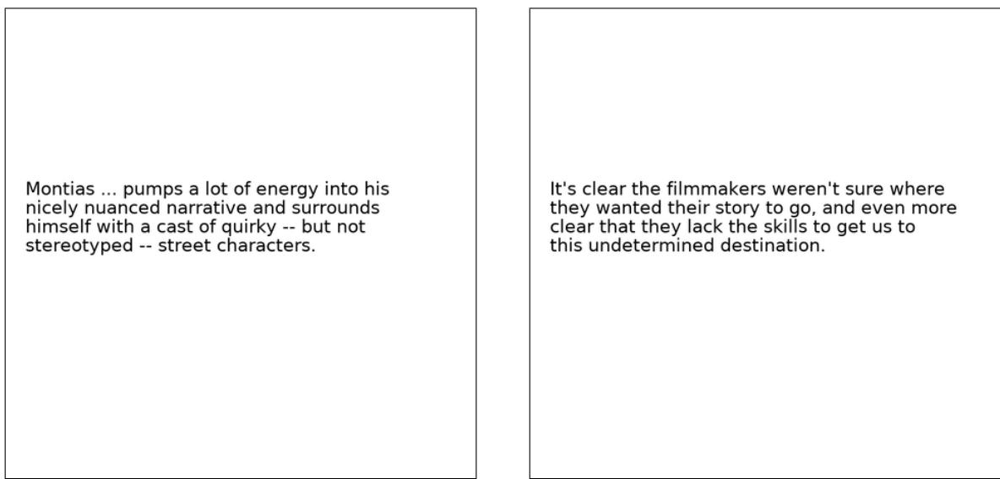  
Figure 19. 来自 Rendered SST2 数据集的两个图像示例

检查点。

Momentum Contrast (MoCo) 我们包含了 MoCo-v1 (He et al., 2020) 和 MoCo-v2 (Chen et al., 2020d) 检查点。

VirTex 我们使用了 VirTex (Desai & Johnson, 2020) 的预训练模型。我们注意到 VirTex 与 CLIP-AR 具有相似的模型设计，但它是在一个规模小 1000 倍的来自 MSCOCO 的高质量标注数据集上训练的。

ResNet 我们添加了由 (He et al., 2016b) 发布的原始 ResNet 检查点，即 ResNet-50、ResNet-101 和 ResNet152。

## A.3. 评估

我们使用从每个模型的倒数第二层提取的图像特征，忽略所提供的任何分类层。对于 CLIP-ViT 模型，我们使用线性投影到嵌入空间之前的特征，这对应于 Figure 3 中的 I f。我们使用 scikit-learn 的 L-BFGS 实现训练逻辑回归（logistic regression）分类器，最大迭代次数为 1,000，并报告每个数据集对应的指标。我们通过在验证集上进行超参数扫描来确定 L2 正则化强度 $\lambda$，扫描范围在 $1 0 ^ { - 6 }$ 到 $1 0 ^ { 6 }$ 之间，共 96 个对数等距步长。为了节省扫描所需的计算量，我们执行参数化二分搜索，从 $\lambda = [ \bar { 1 } 0 ^ { - 6 } , 1 0 ^ { - 4 } , 1 0 ^ { - 2 } , 1 , 1 0 ^ { 2 } , 1 0 ^ { \dot { 4 } } , 1 0 ^ { 6 } ]$ 开始，并在峰值周围迭代折半区间，直到达到每数量级 8 个步长的分辨率。超参数扫描在每个数据集的验证划分上进行。对于除测试划分外还包含验证划分的数据集，我们使用所提供的验证集来进行超参数搜索；对于未提供验证划分或未公开测试数据标签的数据集，我们划分训练数据集来进行超参数搜索。对于最终结果，我们将验证划分与训练划分重新合并，并在未使用的划分上报告性能。

## A.4. 结果

各个线性探测（linear probe）得分如 Table 10 所示，并在 Figure 20 中绘制出。表现最佳的 CLIP 模型（采用 ViT-L/14 架构和 336×336 像素图像）在 27 个数据集中的 21 个上达到了最先进水平（state of the art），即落入每个数据集最高得分的 Clopper-Pearson 99.5% 置信区间内。对于许多数据集，CLIP 的表现明显优于其他模型，证明了自然语言监督相比于基于图像分类的传统预训练方法的优势。有关线性探测结果的更多讨论，请参见 Section 3.2。

<table><tr><td>数据集</td><td>类别数</td><td>训练集大小</td><td>测试集大小</td><td>评估指标</td></tr><tr><td>Food-101</td><td>102</td><td>75,750</td><td>25,250</td><td>准确率（accuracy）</td></tr><tr><td>CIFAR-10</td><td>10</td><td>50,000</td><td>10,000</td><td>准确率（accuracy）</td></tr><tr><td>CIFAR-100</td><td>100</td><td>50,000</td><td>10,000</td><td>准确率（accuracy）</td></tr><tr><td>Birdsnap</td><td>500</td><td>42,283</td><td>2,149</td><td>准确率（accuracy）</td></tr><tr><td>SUN397</td><td>397</td><td>19,850</td><td>19,850</td><td>准确率（accuracy）</td></tr><tr><td>Stanford Cars</td><td>196</td><td>8,144</td><td>8,041</td><td>准确率（accuracy）</td></tr><tr><td>FGVC Aircraft</td><td>100</td><td>6,667</td><td>3,333</td><td>每类平均准确率（mean per class）</td></tr><tr><td>Pascal VOC 2007 Classification</td><td>20</td><td>5,011</td><td>4,952</td><td>11-point mAP</td></tr><tr><td>Describable Textures</td><td>47</td><td>3,760</td><td>1,880</td><td>准确率（accuracy）</td></tr><tr><td>Oxford-IIIT Pets</td><td>37</td><td>3,680</td><td>3,669</td><td>每类平均准确率（mean per class）</td></tr><tr><td>Caltech-101</td><td>102</td><td>3,060</td><td>6,085</td><td>每类平均准确率（mean-per-class）</td></tr><tr><td>Oxford Flowers 102</td><td>102</td><td>2,040</td><td>6,149</td><td>每类平均准确率（mean per class）</td></tr><tr><td>MNIST</td><td>10</td><td>60,000</td><td>10,000</td><td>准确率（accuracy）</td></tr><tr><td>Facial Emotion Recognition 2013</td><td>8</td><td>32,140</td><td>3,574</td><td>准确率（accuracy）</td></tr><tr><td>STL-10</td><td>10</td><td>1000</td><td>8000</td><td>准确率（accuracy）</td></tr><tr><td>EuroSAT</td><td>10</td><td>10,000</td><td>5,000</td><td>准确率（accuracy）</td></tr><tr><td>RESISC45</td><td>45</td><td>3,150</td><td>25,200</td><td>准确率（accuracy）</td></tr><tr><td>GTSRB</td><td>43</td><td>26,640</td><td>12,630</td><td>准确率（accuracy）</td></tr><tr><td>KITTI</td><td>4</td><td>6,770</td><td>711</td><td>准确率（accuracy）</td></tr><tr><td>Country211</td><td>211</td><td>43,200</td><td>21,100</td><td>准确率（accuracy）</td></tr><tr><td>PatchCamelyon</td><td>2</td><td>294,912</td><td>32,768</td><td>准确率（accuracy）</td></tr><tr><td>UCF101</td><td>101</td><td>9,537</td><td>1,794</td><td>准确率（accuracy）</td></tr><tr><td>Kinetics700</td><td>700</td><td>494,801</td><td>31,669</td><td>mean(top1, top5)</td></tr><tr><td>CLEVR Counts</td><td>8</td><td>2,000</td><td>500</td><td>准确率（accuracy）</td></tr><tr><td>Hateful Memes</td><td>2</td><td>8,500</td><td>500</td><td>ROC AUC</td></tr><tr><td>Rendered SST2</td><td>2</td><td>7,792</td><td>1,821</td><td>准确率（accuracy）</td></tr><tr><td>ImageNet</td><td>1000</td><td>1,281,167</td><td>50,000</td><td>准确率（accuracy）</td></tr></table>

Table 9. 用于线性探测（linear probes）评估的数据集。我们注意到，对于 Birdsnap 和 Kinetics700 数据集，我们使用的是撰写本文时网络上可用的资源。

<table><tr><td colspan="2"></td><td>Food101</td><td>CIFAR10</td><td>CIFAR100</td><td>Birdsnap</td><td>SUN397</td><td>Cars</td><td>Aircraft</td><td>VOC2007</td><td>DTD</td><td>Pets</td><td>Caltech101</td><td>Flowers</td><td>MNIST</td><td>FER2013</td><td>STL10*</td><td>EuroSAT</td><td>RESISC45</td><td>GTSRB</td><td>KITTI</td><td>Country211</td><td>PCAM</td><td>UCF101</td><td>Kinetics700</td><td>CLEVR</td><td>HatefulMeme</td><td>SST</td><td>ImageNet</td></tr><tr><td colspan="2">LM RN50</td><td>81.3</td><td>82.8</td><td>61.7</td><td>44.2</td><td>69.6</td><td>74.9</td><td>44.9</td><td>85.5</td><td>71.5</td><td>82.8</td><td>85.5</td><td>91.1</td><td>96.6</td><td>60.1</td><td>95.3</td><td>93.4</td><td>84.0</td><td>73.8</td><td>70.2</td><td>19.0</td><td>82.9</td><td>76.4</td><td>51.9</td><td>51.2</td><td>65.2</td><td>76.8</td><td>65.2</td></tr><tr><td rowspan="5">CLIP-RN</td><td>50</td><td>86.4</td><td>88.7</td><td>70.3</td><td>56.4</td><td>73.3</td><td>78.3</td><td>49.1</td><td>87.1</td><td>76.4</td><td>88.2</td><td>89.6</td><td>96.1</td><td>98.3</td><td>64.2</td><td>96.6</td><td>95.2</td><td>87.5</td><td>82.4</td><td>70.2</td><td>25.3</td><td>82.7</td><td>81.6</td><td>57.2</td><td>53.6</td><td>65.7</td><td>72.6</td><td>73.3</td></tr><tr><td>101</td><td>88.9</td><td>91.1</td><td>73.5</td><td>58.6</td><td>75.1</td><td>84.0</td><td>50.7</td><td>88.0</td><td>76.3</td><td>91.0</td><td>92.0</td><td>96.4</td><td>98.4</td><td>65.2</td><td>97.8</td><td>95.9</td><td>89.3</td><td>82.4</td><td>73.6</td><td>26.6</td><td>82.8</td><td>84.0</td><td>60.3</td><td>50.3</td><td>68.2</td><td>73.3</td><td>75.7</td></tr><tr><td>50x4</td><td>91.3</td><td>90.5</td><td>73.0</td><td>65.7</td><td>77.0</td><td>85.9</td><td>57.3</td><td>88.4</td><td>79.5</td><td>91.9</td><td>92.5</td><td>97.8</td><td>98.5</td><td>68.1</td><td>97.8</td><td>96.4</td><td>89.7</td><td>85.5</td><td>59.4</td><td>30.3</td><td>83.0</td><td>85.7</td><td>62.6</td><td>52.5</td><td>68.0</td><td>76.6</td><td>78.2</td></tr><tr><td>50x16</td><td>93.3</td><td>92.2</td><td>74.9</td><td>72.8</td><td>79.2</td><td>88.7</td><td>62.7</td><td>89.0</td><td>79.1</td><td>93.5</td><td>93.7</td><td>98.3</td><td>98.9</td><td>68.7</td><td>98.6</td><td>97.0</td><td>91.4</td><td>89.0</td><td>69.2</td><td>34.8</td><td>83.5</td><td>88.0</td><td>66.3</td><td>53.8</td><td>71.1</td><td>80.0</td><td>81.5</td></tr><tr><td>50x64</td><td>94.8</td><td>94.1</td><td>78.6</td><td>77.2</td><td>81.1</td><td>90.5</td><td>67.7</td><td>88.9</td><td>82.0</td><td>94.5</td><td>95.4</td><td>98.9</td><td>98.9</td><td>71.3</td><td>99.1</td><td>97.1</td><td>92.8</td><td>90.2</td><td>69.2</td><td>40.7</td><td>83.7</td><td>89.5</td><td>69.1</td><td>55.0</td><td>75.0</td><td>81.2</td><td>83.6</td></tr><tr><td rowspan="4">CLIP-ViT</td><td>B/32</td><td>88.8</td><td>95.1</td><td>80.5</td><td>58.5</td><td>76.6</td><td>81.8</td><td>52.0</td><td>87.7</td><td>76.5</td><td>90.0</td><td>93.0</td><td>96.9</td><td>99.0</td><td>69.2</td><td>98.3</td><td>97.0</td><td>90.5</td><td>85.3</td><td>66.2</td><td>27.8</td><td>83.9</td><td>85.5</td><td>61.7</td><td>52.1</td><td>66.7</td><td>70.8</td><td>76.1</td></tr><tr><td>B/16</td><td>92.8</td><td>96.2</td><td>83.1</td><td>67.8</td><td>78.4</td><td>86.7</td><td>59.5</td><td>89.2</td><td>79.2</td><td>93.1</td><td>94.7</td><td>98.1</td><td>99.0</td><td>69.5</td><td>99.0</td><td>97.1</td><td>92.7</td><td>86.6</td><td>67.8</td><td>33.3</td><td>83.5</td><td>88.4</td><td>66.1</td><td>57.1</td><td>70.3</td><td>75.5</td><td>80.2</td></tr><tr><td>L/14</td><td>95.2</td><td>98.0</td><td>87.5</td><td>77.0</td><td>81.8</td><td>90.9</td><td>69.4</td><td>89.6</td><td>82.1</td><td>95.1</td><td>96.5</td><td>99.2</td><td>99.2</td><td>72.2</td><td>99.7</td><td>98.2</td><td>94.1</td><td>92.5</td><td>64.7</td><td>42.9</td><td>85.8</td><td>91.5</td><td>72.0</td><td>57.8</td><td>76.2</td><td>80.8</td><td>83.9</td></tr><tr><td>L/14-336px</td><td>95.9</td><td>97.9</td><td>87.4</td><td>79.9</td><td>82.2</td><td>91.5</td><td>71.6</td><td>89.9</td><td>83.0</td><td>95.1</td><td>96.0</td><td>99.2</td><td>99.2</td><td>72.9</td><td>99.7</td><td>98.1</td><td>94.9</td><td>92.4</td><td>69.2</td><td>46.4</td><td>85.6</td><td>92.0</td><td>73.0</td><td>60.3</td><td>77.3</td><td>80.5</td><td>85.4</td></tr><tr><td rowspan="9">EfficientNet</td><td>B0</td><td>74.3</td><td>92.5</td><td>76.5</td><td>59.7</td><td>62.0</td><td>62.5</td><td>55.7</td><td>84.4</td><td>71.2</td><td>93.0</td><td>93.3</td><td>91.7</td><td>98.2</td><td>57.2</td><td>97.1</td><td>97.3</td><td>85.5</td><td>80.0</td><td>73.8</td><td>12.4</td><td>83.1</td><td>74.4</td><td>47.6</td><td>47.9</td><td>55.7</td><td>53.4</td><td>76.9</td></tr><tr><td>B1</td><td>74.2</td><td>93.2</td><td>77.2</td><td>61.3</td><td>62.6</td><td>62.5</td><td>56.1</td><td>84.7</td><td>74.2</td><td>93.4</td><td>93.6</td><td>92.4</td><td>98.3</td><td>57.0</td><td>97.5</td><td>96.8</td><td>84.5</td><td>75.9</td><td>75.5</td><td>12.5</td><td>82.7</td><td>74.7</td><td>48.5</td><td>44.3</td><td>54.5</td><td>54.4</td><td>78.6</td></tr><tr><td>B2</td><td>75.8</td><td>93.6</td><td>77.9</td><td>64.4</td><td>64.0</td><td>63.2</td><td>57.0</td><td>85.3</td><td>73.5</td><td>93.9</td><td>93.5</td><td>92.9</td><td>98.5</td><td>56.6</td><td>97.7</td><td>96.9</td><td>84.4</td><td>76.4</td><td>73.1</td><td>12.6</td><td>84.3</td><td>75.1</td><td>49.4</td><td>42.6</td><td>55.4</td><td>55.2</td><td>79.7</td></tr><tr><td>B3</td><td>77.4</td><td>94.0</td><td>78.0</td><td>66.5</td><td>64.4</td><td>66.0</td><td>59.3</td><td>85.8</td><td>73.1</td><td>94.1</td><td>93.7</td><td>93.3</td><td>98.5</td><td>57.1</td><td>98.2</td><td>97.3</td><td>85.0</td><td>75.8</td><td>76.1</td><td>13.4</td><td>83.3</td><td>78.1</td><td>50.9</td><td>45.1</td><td>53.8</td><td>54.8</td><td>81.0</td></tr><tr><td>B4</td><td>79.7</td><td>94.1</td><td>78.7</td><td>70.1</td><td>65.4</td><td>66.4</td><td>60.4</td><td>86.5</td><td>73.4</td><td>94.7</td><td>93.5</td><td>93.2</td><td>98.8</td><td>57.9</td><td>98.6</td><td>96.8</td><td>85.0</td><td>78.3</td><td>72.3</td><td>13.9</td><td>83.1</td><td>79.1</td><td>52.5</td><td>46.5</td><td>54.4</td><td>55.4</td><td>82.9</td></tr><tr><td>B5</td><td>81.5</td><td>93.6</td><td>77.9</td><td>72.4</td><td>67.1</td><td>72.7</td><td>68.9</td><td>86.7</td><td>73.9</td><td>95.0</td><td>94.7</td><td>94.5</td><td>98.4</td><td>58.5</td><td>98.7</td><td>96.8</td><td>86.0</td><td>78.5</td><td>69.6</td><td>14.9</td><td>84.7</td><td>80.9</td><td>54.5</td><td>46.6</td><td>53.3</td><td>56.3</td><td>83.7</td></tr><tr><td>B6</td><td>82.4</td><td>94.0</td><td>78.0</td><td>73.5</td><td>65.8</td><td>71.1</td><td>68.2</td><td>87.6</td><td>73.9</td><td>95.0</td><td>94.1</td><td>93.7</td><td>98.4</td><td>60.2</td><td>98.7</td><td>96.8</td><td>85.4</td><td>78.1</td><td>72.7</td><td>15.3</td><td>84.2</td><td>80.0</td><td>54.1</td><td>51.1</td><td>53.3</td><td>57.0</td><td>84.0</td></tr><tr><td>B7</td><td>84.5</td><td>94.9</td><td>80.1</td><td>74.7</td><td>69.0</td><td>77.1</td><td>72.3</td><td>87.2</td><td>76.8</td><td>95.2</td><td>94.7</td><td>95.9</td><td>98.6</td><td>61.3</td><td>99.1</td><td>96.3</td><td>86.8</td><td>80.8</td><td>75.8</td><td>16.4</td><td>85.2</td><td>81.9</td><td>56.8</td><td>51.9</td><td>54.4</td><td>57.8</td><td>84.8</td></tr><tr><td>B8</td><td>84.5</td><td>95.0</td><td>80.7</td><td>75.2</td><td>69.6</td><td>76.8</td><td>71.5</td><td>87.4</td><td>77.1</td><td>94.9</td><td>95.2</td><td>96.3</td><td>98.6</td><td>61.4</td><td>99.2</td><td>97.0</td><td>87.4</td><td>80.4</td><td>70.9</td><td>17.4</td><td>85.2</td><td>82.4</td><td>57.7</td><td>51.4</td><td>51.7</td><td>55.8</td><td>85.3</td></tr><tr><td rowspan="10">EfficientNet Noisy Student</td><td>B0</td><td>78.1</td><td>94.0</td><td>78.6</td><td>63.5</td><td>65.5</td><td>57.2</td><td>53.7</td><td>85.6</td><td>75.6</td><td>93.8</td><td>93.1</td><td>94.5</td><td>98.1</td><td>55.6</td><td>98.2</td><td>97.0</td><td>84.3</td><td>74.0</td><td>71.6</td><td>14.0</td><td>83.1</td><td>76.7</td><td>51.7</td><td>47.3</td><td>55.7</td><td>55.0</td><td>78.5</td></tr><tr><td>B1</td><td>80.4</td><td>95.1</td><td>80.2</td><td>66.6</td><td>67.6</td><td>59.6</td><td>53.7</td><td>86.2</td><td>77.0</td><td>94.6</td><td>94.4</td><td>95.1</td><td>98.0</td><td>56.1</td><td>98.6</td><td>96.9</td><td>84.3</td><td>73.1</td><td>67.1</td><td>14.5</td><td>83.9</td><td>79.9</td><td>54.5</td><td>46.1</td><td>54.3</td><td>54.9</td><td>81.1</td></tr><tr><td>B2</td><td>80.9</td><td>95.3</td><td>81.3</td><td>67.6</td><td>67.9</td><td>60.9</td><td>55.2</td><td>86.3</td><td>77.7</td><td>95.0</td><td>94.7</td><td>94.4</td><td>98.0</td><td>55.5</td><td>98.8</td><td>97.3</td><td>84.6</td><td>71.7</td><td>70.0</td><td>14.6</td><td>82.9</td><td>80.1</td><td>55.1</td><td>46.1</td><td>54.1</td><td>55.3</td><td>82.2</td></tr><tr><td>B3</td><td>82.6</td><td>95.9</td><td>82.1</td><td>68.6</td><td>68.8</td><td>60.6</td><td>55.4</td><td>86.5</td><td>77.2</td><td>95.0</td><td>94.8</td><td>95.2</td><td>98.1</td><td>56.0</td><td>99.1</td><td>96.5</td><td>85.0</td><td>70.5</td><td>69.5</td><td>15.1</td><td>83.1</td><td>81.8</td><td>56.8</td><td>45.1</td><td>55.7</td><td>52.0</td><td>83.8</td></tr><tr><td>B4</td><td>85.2</td><td>95.6</td><td>81.0</td><td>72.5</td><td>69.7</td><td>56.1</td><td>52.6</td><td>87.0</td><td>78.7</td><td>94.8</td><td>95.2</td><td>95.3</td><td>98.2</td><td>56.0</td><td>99.3</td><td>95.3</td><td>84.8</td><td>61.9</td><td>64.8</td><td>16.0</td><td>82.8</td><td>83.4</td><td>59.8</td><td>43.2</td><td>55.3</td><td>53.0</td><td>85.4</td></tr><tr><td>B5</td><td>87.6</td><td>96.3</td><td>82.4</td><td>75.3</td><td>71.6</td><td>64.7</td><td>64.8</td><td>87.8</td><td>79.6</td><td>95.5</td><td>95.6</td><td>96.6</td><td>98.8</td><td>60.9</td><td>99.4</td><td>96.1</td><td>87.0</td><td>68.5</td><td>73.7</td><td>16.4</td><td>83.5</td><td>86.4</td><td>61.6</td><td>46.3</td><td>53.4</td><td>55.8</td><td>85.8</td></tr><tr><td>B6</td><td>87.3</td><td>97.0</td><td>83.9</td><td>75.8</td><td>71.4</td><td>67.6</td><td>65.6</td><td>87.3</td><td>78.5</td><td>95.2</td><td>96.4</td><td>97.2</td><td>98.6</td><td>61.9</td><td>99.5</td><td>96.6</td><td>86.1</td><td>70.7</td><td>72.4</td><td>17.6</td><td>84.2</td><td>85.5</td><td>61.0</td><td>49.6</td><td>54.6</td><td>55.7</td><td>86.4</td></tr><tr><td>B7</td><td>88.4</td><td>96.0</td><td>82.0</td><td>76.9</td><td>72.6</td><td>72.2</td><td>71.2</td><td>88.1</td><td>80.5</td><td>95.5</td><td>95.5</td><td>96.6</td><td>98.5</td><td>62.7</td><td>99.4</td><td>96.2</td><td>88.5</td><td>73.4</td><td>73.0</td><td>18.5</td><td>83.8</td><td>86.6</td><td>63.2</td><td>50.5</td><td>57.2</td><td>56.7</td><td>87.0</td></tr><tr><td>L2-475</td><td>91.6</td><td>99.0</td><td>91.0</td><td>74.8</td><td>76.4</td><td>75.1</td><td>66.8</td><td>89.5</td><td>81.9</td><td>95.6</td><td>96.5</td><td>97.7</td><td>98.9</td><td>67.5</td><td>99.6</td><td>97.0</td><td>89.5</td><td>73.4</td><td>68.9</td><td>22.2</td><td>86.3</td><td>89.4</td><td>68.2</td><td>58.3</td><td>58.6</td><td>55.2</td><td>88.3</td></tr><tr><td>L2-800</td><td>92.0</td><td>98.7</td><td>89.0</td><td>78.5</td><td>75.7</td><td>75.5</td><td>68.4</td><td>89.4</td><td>82.5</td><td>95.6</td><td>94.7</td><td>97.9</td><td>98.5</td><td>68.4</td><td>99.7</td><td>97.2</td><td>89.9</td><td>77.7</td><td>66.9</td><td>23.7</td><td>86.8</td><td>88.9</td><td>66.7</td><td>62.7</td><td>58.4</td><td>56.9</td><td>88.4</td></tr><tr><td rowspan="6">Instagram</td><td>32x8d</td><td>84.8</td><td>95.9</td><td>80.9</td><td>63.8</td><td>69.0</td><td>74.2</td><td>56.0</td><td>88.0</td><td>75.4</td><td>95.4</td><td>93.9</td><td>91.7</td><td>97.4</td><td>60.7</td><td>99.1</td><td>95.7</td><td>82.1</td><td>72.3</td><td>69.2</td><td>16.7</td><td>82.3</td><td>80.1</td><td>56.8</td><td>42.2</td><td>53.3</td><td>55.2</td><td>83.3</td></tr><tr><td>32x16d</td><td>85.7</td><td>96.5</td><td>80.9</td><td>64.8</td><td>70.5</td><td>77.5</td><td>56.7</td><td>87.9</td><td>76.2</td><td>95.6</td><td>94.9</td><td>92.5</td><td>97.4</td><td>61.6</td><td>99.3</td><td>95.5</td><td>82.8</td><td>73.8</td><td>66.1</td><td>17.5</td><td>83.4</td><td>81.1</td><td>58.2</td><td>41.3</td><td>54.2</td><td>56.1</td><td>84.4</td></tr><tr><td>32x32d</td><td>86.7</td><td>96.8</td><td>82.7</td><td>67.1</td><td>71.5</td><td>77.5</td><td>55.4</td><td>88.3</td><td>78.5</td><td>95.8</td><td>95.3</td><td>94.4</td><td>97.9</td><td>62.4</td><td>99.3</td><td>95.7</td><td>85.4</td><td>71.2</td><td>66.8</td><td>18.0</td><td>83.7</td><td>82.1</td><td>58.8</td><td>39.7</td><td>55.3</td><td>56.7</td><td>85.0</td></tr><tr><td>32x48d</td><td>86.9</td><td>96.8</td><td>83.4</td><td>65.9</td><td>72.2</td><td>76.6</td><td>53.2</td><td>88.0</td><td>77.2</td><td>95.5</td><td>95.8</td><td>93.6</td><td>98.1</td><td>63.7</td><td>99.4</td><td>95.3</td><td>85.4</td><td>73.0</td><td>67.2</td><td>18.5</td><td>82.7</td><td>82.8</td><td>59.2</td><td>41.3</td><td>55.5</td><td>56.7</td><td>85.2</td></tr><tr><td>FixRes-v1</td><td>88.5</td><td>95.7</td><td>81.1</td><td>67.4</td><td>72.9</td><td>80.5</td><td>57.6</td><td>88.0</td><td>77.9</td><td>95.8</td><td>96.1</td><td>94.5</td><td>97.9</td><td>62.2</td><td>99.4</td><td>96.2</td><td>86.6</td><td>76.5</td><td>64.8</td><td>19.3</td><td>82.5</td><td>83.4</td><td>59.8</td><td>43.5</td><td>56.6</td><td>59.0</td><td>86.0</td></tr><tr><td>FixRes-v2</td><td>88.5</td><td>95.7</td><td>81.1</td><td>67.3</td><td>72.9</td><td>80.7</td><td>57.5</td><td>88.0</td><td>77.9</td><td>95.0</td><td>96.0</td><td>94.5</td><td>98.0</td><td>62.1</td><td>99.4</td><td>96.5</td><td>86.6</td><td>76.3</td><td>64.8</td><td>19.5</td><td>82.3</td><td>83.5</td><td>59.8</td><td>44.2</td><td>56.6</td><td>59.0</td><td>86.0</td></tr><tr><td colspan="29"></td></tr><tr><td colspan="29"></td></tr><tr><td colspan="29"></td></tr><tr><td colspan="29"></td></tr><tr><td colspan="4"></td><td></td><td></td><td></td><td></td><td></td><td></td><td></td><td></td><td></td><td></td><td></td><td></td><td></td><td></td><td></td><td></td><td></td><td></td><td></td><td></td><td></td><td></td><td></td><td></td><td></td></tr><tr><td colspan="4"></td><td></td><td></td><td></td><td></td><td></td><td></td><td></td><td></td><td></td><td></td><td></td><td></td><td></td><td></td><td></td><td></td><td></td><td></td><td></td><td></td><td></td><td></td><td></td><td></td><td></td></tr><tr><td colspan="4"></td><td></td><td></td><td></td><td></td><td></td><td></td><td></td><td></td><td></td><td></td><td></td><td></td><td></td><td></td><td></td><td></td><td></td><td></td><td></td><td></td><td></td><td></td><td></td><td></td><td></td></tr><tr><td colspan="4"></td><td rowspan="5"></td><td rowspan="5"></td><td rowspan="5"></td><td rowspan="5"></td><td rowspan="5"></td><td rowspan="5"></td><td rowspan="5"></td><td rowspan="5"></td><td rowspan="5"></td><td rowspan="5"></td><td rowspan="5"></td><td rowspan="5"></td><td rowspan="5"></td><td rowspan="5"></td><td rowspan="5"></td><td rowspan="5"></td><td rowspan="5"></td><td rowspan="5"></td><td rowspan="5"></td><td rowspan="5"></td><td rowspan="5"></td><td rowspan="5"></td><td rowspan="5"></td><td rowspan="5"></td><td rowspan="5"></td></tr><tr><td colspan="4"></td></tr><tr><td colspan="4"></td></tr><tr><td colspan="4"></td></tr><tr><td colspan="4"></td></tr><tr><td colspan="4"></td><td rowspan="3"></td><td rowspan="3"></td><td rowspan="3"></td><td rowspan="3"></td><td rowspan="3"></td><td rowspan="3"></td><td rowspan="3"></td><td rowspan="3"></td><td rowspan="3"></td><td rowspan="3"></td><td rowspan="3"></td><td rowspan="3"></td><td rowspan="3"></td><td rowspan="3"></td><td rowspan="3"></td><td rowspan="3"></td><td rowspan="3"></td><td rowspan="3"></td><td rowspan="3"></td><td rowspan="3"></td><td rowspan="3"></td><td rowspan="3"></td><td rowspan="3"></td><td rowspan="3"></td><td rowspan="3"></td></tr><tr><td colspan="4"></td></tr><tr><td colspan="4"></td></tr><tr><td colspan="4"></td><td></td><td></td><td></td><td></td><td></td><td></td><td></td><td></td><td></td><td></td><td></td><td></td><td></td><td></td><td></td><td></td><td></td><td></td><td></td><td></td><td></td><td></td><td></td><td></td><td></td></tr><tr><td colspan="4"></td><td rowspan="2"></td><td rowspan="2"></td><td rowspan="2"></td><td rowspan="2"></td><td rowspan="2"></td><td rowspan="2"></td><td rowspan="2"></td><td rowspan="2"></td><td rowspan="2"></td><td rowspan="2"></td><td rowspan="2"></td><td rowspan="2"></td><td rowspan="2"></td><td rowspan="2"></td><td rowspan="2"></td><td rowspan="2"></td><td rowspan="2"></td><td rowspan="2"></td><td rowspan="2"></td><td rowspan="2"></td><td rowspan="2"></td><td rowspan="2"></td><td rowspan="2"></td><td rowspan="2"></td><td rowspan="2"></td></tr><tr><td colspan="4"></td></tr><tr><td colspan="4"></td><td rowspan="2"></td><td rowspan="2"></td><td rowspan="2"></td><td rowspan="2"></td><td rowspan="2"></td><td rowspan="2"></td><td rowspan="2"></td><td rowspan="2"></td><td rowspan="2"></td><td rowspan="2"></td><td rowspan="2"></td><td rowspan="2"></td><td rowspan="2"></td><td rowspan="2"></td><td rowspan="2"></td><td rowspan="2"></td><td rowspan="2"></td><td rowspan="2"></td><td rowspan="2"></td><td rowspan="2"></td><td rowspan="2"></td><td rowspan="2"></td><td rowspan="2"></td><td rowspan="2"></td><td rowspan="2"></td></tr><tr><td colspan="4"></td></tr><tr><td colspan="4"></td><td></td><td></td><td></td><td></td><td></td><td></td><td></td><td></td><td></td><td></td><td></td><td></td><td></td><td></td><td></td><td></td><td></td><td></td><td></td><td></td><td></td><td></td><td></td><td></td><td></td></tr><tr><td colspan="4"></td><td></td><td></td><td></td><td></td><td></td><td></td><td></td><td></td><td></td><td></td><td></td><td></td><td></td><td></td><td></td><td></td><td></td><td></td><td></td><td></td><td></td><td></td><td></td><td></td><td></td></tr><tr><td colspan="4"></td><td></td><td></td><td></td><td></td><td></td><td></td><td></td><td></td><td></td><td></td><td></td><td></td><td></td><td></td><td></td><td></td><td></td><td></td><td></td><td></td><td></td><td></td><td></td><td></td><td></td></tr><tr><td colspan="4"></td><td></td><td></td><td></td><td></td><td></td><td></td><td></td><td></td><td></td><td></td><td></td><td></td><td></td><td></td><td></td><td></td><td></td><td></td><td></td><td></td><td></td><td></td><td></td><td></td><td></td></tr></table>

Table 10. 各种预训练模型在 27 个数据集上的线性探测（linear probe）性能。处于每个数据集最高得分 99.5% Clopper-Pearson 置信区间内的分数以粗体显示。  
<sup>?</sup>在修复了一个与 CUDA 相关的 bug 后，我们更新了本论文先前版本中的 STL10 得分。

  
Figure 20. 使用 Table 10 的数据绘制的 27 个数据集各自的线性探测性能。

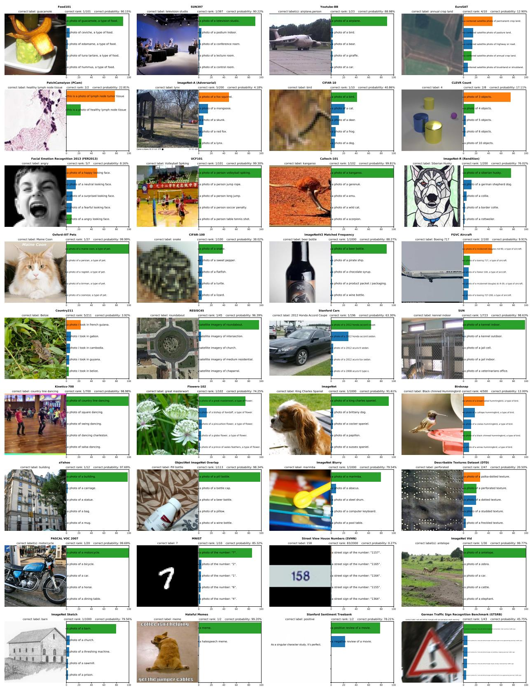  
Figure 21. 36 个 CLIP 零样本（zero-shot）分类器预测的可视化。除为了避免冒犯性内容而对 Hateful Memes 进行重选之外，所有示例均为随机选取。展示了前 5 个类别的预测概率以及用于表示该类别的文本。当使用多个模板时，显示第一个模板。真实标签（ground truth）显示为绿色，错误预测显示为橙色。

<table><tr><td colspan="2"></td><td>Food101</td><td>CIFAR10</td><td>CIFAR100</td><td>Birdsnap</td><td>SUN397</td><td>Stanford Cars</td><td>FGVC Aircraft</td><td>VOC2007</td><td>DTD</td><td>Oxford Pets</td><td>Caltech101</td><td>Flowers102</td><td>MNIST</td><td>FER2013</td><td>STL10</td><td>EuroSAT</td><td>RESISC45</td><td>GTSRB</td><td>KITTI</td><td>Country211</td><td>PCam</td><td>UCF101</td><td>Kinetics700</td><td>CLEVR</td><td>Hateful Memes</td><td>Rendered SST2</td><td>ImageNet</td></tr><tr><td rowspan="5">CLIP-ResNet</td><td>RN50</td><td>81.1</td><td>75.6</td><td>41.6</td><td>32.6</td><td>59.6</td><td>55.8</td><td>19.3</td><td>82.1</td><td>41.7</td><td>85.4</td><td>82.1</td><td>65.9</td><td>66.6</td><td>42.2</td><td>94.3</td><td>41.1</td><td>54.2</td><td>35.2</td><td>42.2</td><td>16.1</td><td>57.6</td><td>63.6</td><td>43.5</td><td>20.3</td><td>59.7</td><td>56.9</td><td>59.6</td></tr><tr><td>RN101</td><td>83.9</td><td>81.0</td><td>49.0</td><td>37.2</td><td>59.9</td><td>62.3</td><td>19.5</td><td>82.4</td><td>43.9</td><td>86.2</td><td>85.1</td><td>65.7</td><td>59.3</td><td>45.6</td><td>96.7</td><td>33.1</td><td>58.5</td><td>38.3</td><td>33.3</td><td>16.9</td><td>55.2</td><td>62.2</td><td>46.7</td><td>28.1</td><td>61.1</td><td>64.2</td><td>62.2</td></tr><tr><td>RN50x4</td><td>86.8</td><td>79.2</td><td>48.9</td><td>41.6</td><td>62.7</td><td>67.9</td><td>24.6</td><td>83.0</td><td>49.3</td><td>88.1</td><td>86.0</td><td>68.0</td><td>75.2</td><td>51.1</td><td>96.4</td><td>35.0</td><td>59.2</td><td>35.7</td><td>26.0</td><td>20.2</td><td>57.5</td><td>65.5</td><td>49.0</td><td>17.0</td><td>58.3</td><td>66.6</td><td>65.8</td></tr><tr><td>RN50x16</td><td>90.5</td><td>82.2</td><td>54.2</td><td>45.9</td><td>65.0</td><td>72.3</td><td>30.3</td><td>82.9</td><td>52.8</td><td>89.7</td><td>87.6</td><td>71.9</td><td>80.0</td><td>56.0</td><td>97.8</td><td>40.3</td><td>64.4</td><td>39.6</td><td>33.9</td><td>24.0</td><td>62.5</td><td>68.7</td><td>53.4</td><td>17.6</td><td>58.9</td><td>67.6</td><td>70.5</td></tr><tr><td>RN50x64</td><td>91.8</td><td>86.8</td><td>61.3</td><td>48.9</td><td>66.9</td><td>76.0</td><td>35.6</td><td>83.8</td><td>53.4</td><td>93.4</td><td>90.6</td><td>77.3</td><td>90.8</td><td>61.0</td><td>98.3</td><td>59.4</td><td>69.7</td><td>47.9</td><td>33.2</td><td>29.6</td><td>65.0</td><td>74.1</td><td>56.8</td><td>27.5</td><td>62.1</td><td>70.7</td><td>73.6</td></tr><tr><td rowspan="4">CLIP-ViT</td><td>B/32</td><td>84.4</td><td>91.3</td><td>65.1</td><td>37.8</td><td>63.2</td><td>59.4</td><td>21.2</td><td>83.1</td><td>44.5</td><td>87.0</td><td>87.9</td><td>66.7</td><td>51.9</td><td>47.3</td><td>97.2</td><td>49.4</td><td>60.3</td><td>32.2</td><td>39.4</td><td>17.8</td><td>58.4</td><td>64.5</td><td>47.8</td><td>24.8</td><td>57.6</td><td>59.6</td><td>63.2</td></tr><tr><td>B/16</td><td>89.2</td><td>91.6</td><td>68.7</td><td>39.1</td><td>65.2</td><td>65.6</td><td>27.1</td><td>83.9</td><td>46.0</td><td>88.9</td><td>89.3</td><td>70.4</td><td>56.0</td><td>52.7</td><td>98.2</td><td>54.1</td><td>65.5</td><td>43.3</td><td>44.0</td><td>23.3</td><td>48.1</td><td>69.8</td><td>52.4</td><td>23.4</td><td>61.7</td><td>59.8</td><td>68.6</td></tr><tr><td>L/14</td><td>92.9</td><td>96.2</td><td>77.9</td><td>48.3</td><td>67.7</td><td>77.3</td><td>36.1</td><td>84.1</td><td>55.3</td><td>93.5</td><td>92.6</td><td>78.7</td><td>87.2</td><td>57.5</td><td>99.3</td><td>59.9</td><td>71.6</td><td>50.3</td><td>23.1</td><td>32.7</td><td>58.8</td><td>76.2</td><td>60.3</td><td>24.3</td><td>63.3</td><td>64.0</td><td>75.3</td></tr><tr><td>L/14-336px</td><td>93.8</td><td>95.7</td><td>77.5</td><td>49.5</td><td>68.4</td><td>78.8</td><td>37.2</td><td>84.3</td><td>55.7</td><td>93.5</td><td>92.8</td><td>78.3</td><td>88.3</td><td>57.7</td><td>99.4</td><td>59.6</td><td>71.7</td><td>52.3</td><td>21.9</td><td>34.9</td><td>63.0</td><td>76.9</td><td>61.3</td><td>24.8</td><td>63.3</td><td>67.9</td><td>76.2</td></tr></table>

Table 11. CLIP 模型在 27 个数据集上的零样本性能。

  
Figure 22. CLIP 的零样本性能与线性探测（linear-probe）ResNet 性能的对比

## B. 零样本预测

为了对 CLIP 的零样本性能进行定性总结/概述，我们在 Figure 21 中可视化了 36 个不同零样本 CLIP 分类器的随机预测结果。此外，Table 11 和 Figure 22 展示了每个数据集的具体零样本性能分数。

## C. 重复样本检测器

我们在重复样本检测和分析方面的早期尝试使用了模型所学习到的嵌入空间中的最近邻方法。尽管使用模型自身的相似性概念非常直观，但我们遇到了许多问题。我们发现该模型的特征空间极度偏向于语义相似度。许多误报之所以出现，是因为描述相似的不同物体（足球、同品种的花等）具有几乎完美的相似度。我们还观察到，该模型在为某些类型的近似重复样本分配高相似度分数方面表现相当差。我们反复注意到，具有高频纹理（例如皮毛或条纹图案）的图像在通过不同的缩放算法（最近邻 vs 双线性）预处理后，相似度可能出奇地低。这导致了许多漏报。

为了解决这一问题，我们构建了自己的近似重复样本检测器。我们创建了一个结合了多种常见图像操作的合成数据增强流水线。该增强流水线结合了随机裁剪和缩放、宽高比失真、缩放至不同分辨率、轻微旋转、JPEG 压缩以及 HSV 颜色抖动。该流水线还在所有相关步骤中随机选择不同的插值算法。然后，我们训练了一个模型，以最大化图像与其变换变体之间的相似度，同时最小化与训练批次中所有其他图像的相似度。我们使用了与 CLIP 相同的 n-pair / InfoNCE 损失，但采用了固定的温度参数 0.07。

我们选择 ResNet-50 作为模型架构。我们利用 (Zhang, 2019) 中的抗锯齿改进对基础 ResNet-50 进行了修改，并使用权重归一化（weight norm）(Salimans & Kingma, 2016) 代替批归一化（batch norm）(Ioffe & Szegedy, 2015)，以避免通过批次统计信息泄露有关重复样本的信息——这是此前在 (Henaff, 2020) 中指出的一个问题。我们还发现 GELU 激活函数 (Hendrycks & Gimpel, 2016) 在此任务中表现更好。我们在从预训练数据集中采样的约 3000 万张图像上训练了该模型，总批大小（batch size）为 1,712。在训练结束时，它在其代理训练任务上达到了近乎 100% 的准确率。

<table><tr><td rowspan="2">数据集</td><td colspan="3">线性分类器</td><td colspan="3">零样本</td></tr><tr><td>YFCC</td><td>WIT</td><td> $\Delta$ </td><td>YFCC</td><td>WIT</td><td> $\Delta$ </td></tr><tr><td>Birdsnap</td><td>47.4</td><td>35.3</td><td>+12.1</td><td>19.9</td><td>4.5</td><td>+15.4</td></tr><tr><td>Country211</td><td>23.1</td><td>17.3</td><td>+5.8</td><td>5.2</td><td>5.3</td><td>+0.1</td></tr><tr><td>Flowers102</td><td>94.4</td><td>89.8</td><td>+4.6</td><td>48.6</td><td>21.7</td><td>+26.9</td></tr><tr><td>GTSRB</td><td>66.8</td><td>72.5</td><td>-5.7</td><td>6.9</td><td>7.0</td><td>-0.1</td></tr><tr><td>UCF101</td><td>69.2</td><td>74.9</td><td>-5.7</td><td>22.9</td><td>32.0</td><td>-9.1</td></tr><tr><td>Stanford Cars</td><td>31.4</td><td>50.3</td><td>-18.9</td><td>3.8</td><td>10.9</td><td>-7.1</td></tr><tr><td>ImageNet</td><td>62.0</td><td>60.8</td><td>+1.2</td><td>31.3</td><td>27.6</td><td>+3.7</td></tr><tr><td>数据集平均值</td><td>65.5</td><td>66.6</td><td>-1.1</td><td>29.6</td><td>30.0</td><td>-0.4</td></tr><tr><td>数据集“胜场数”</td><td>10</td><td>15</td><td>-5</td><td>19</td><td>18</td><td>+1</td></tr></table>

Table 12. 仅在 YFCC100M 上训练时，CLIP 的表现相近。对比仅在 YFCC100M 上训练的 ResNet-50 与在同等规模的 WIT 子集上训练的 ResNet-50，两者在零样本和线性分类器评估中的平均性能和胜场数相近。然而，在特定数据集上的性能存在较大差异。为了突出这一点，我们列出了根据线性探测评估，YFCC 相比 WIT 表现最好和最差的 3 个数据集的性能，以及在所有线性和零样本评估上的总体平均性能和基准 ImageNet 数据集上的性能。

## D. YFCC100M 上的数据集消融实验

为了研究我们的自定义数据集对 CLIP 的性能是否至关重要，我们在 YFCC100M 数据集的过滤子集（细节描述于第 2.2 节）上训练了一个模型，并将其性能与在同等规模 WIT 子集上训练的相同模型进行了比较。我们将每个模型训练 32 个轮次（epoch），此时迁移性能由于过拟合开始趋于平缓。结果如 Table 12 所示。在我们所有的评估套件中，无论是零样本还是线性探测设置，YFCC 和 WIT 的平均表现都相近。然而，在特定细粒度分类数据集上的性能差异可能很大——有时超过 10%。我们的推测是，这些性能差异反映了每个预训练数据集中相关数据的相对密度。例如，在 YFCC100M 上进行预训练（该数据集可能包含许多摄影师常见拍摄对象的鸟类和花卉照片），在 Birdsnap 和 Flowers102 上取得了更好的性能；而在 WIT 上进行预训练则能得到更好的汽车和宠物分类器（这些类别在我们数据集中显得更为常见）。

总体而言，这些结果令人鼓舞，因为它们表明我们的方法可以使用任何经过合理过滤的（文本，图像）配对数据集合。这与最近的一项工作相呼应，该工作报告了在相对不同的医学成像领域使用相同的对比预训练目标所取得的积极成果 (Zhang et al., 2020)。这也与含噪学生自训练（noisy student self-training）的发现相似，该研究报告在 YFCC100M 之上使用其 JFT300M 数据集时仅取得了微弱的提升 (Xie et al., 2020)。我们推测，与现有的 YFCC100M 相比，我们数据集的主要优势在于其规模要大得多。

最后，我们需要指出 WIT 包含了这一经过过滤的 YFCC100M 子集。这可能会导致我们的消融实验低估了 YFCC100M 与 WIT 其余部分之间的性能差异幅度。我们认为这种情况不太可能发生，因为 YFCC100M 仅占整个 WIT 混合数据的 3.7%，并且在创建 WIT 期间将其添加到现有混合数据中时，并未显著改变模型的性能。

## E. 选定任务和数据集的结果

由于本工作涉及的数据集和实验种类繁多，正文侧重于总结和分析总体结果。在以下小节中，我们将报告针对特定任务组、数据集以及评估设置的详细性能。

## E.1. 图像和文本检索

CLIP 在我们的网络规模含噪数据集上针对图文检索任务进行预训练。尽管本文的重点是为了迁移到各种下游数据集而进行的表征学习和任务学习，但验证 CLIP 是否能够在其专门预训练的任务上取得高迁移性能是一个重要的合理性检验 / 概念验证。在 Table 13 中，我们检验了 CLIP 在 Flickr30k 和 MSCOCO 数据集上进行文本和图像检索的零样本（zero-shot）迁移性能。Zero-shot CLIP 在这两个数据集上达到或超越了以往所有的零样本结果。对于 Flickr30k 上的文本检索任务，Zero-shot CLIP 与当前的整体 SOTA 相比也具有竞争力。在图像检索方面，CLIP 相对于整体最先进水平的表现明显偏低。然而，Zero-shot CLIP 与经过微调的 Unicoder-VL 相比仍具有竞争力。在规模更大的 MS-COCO 数据集上，微调显著提升了性能，而 Zero-shot CLIP 与最新的研究成果相比不具竞争力。对于这两个数据集，我们在每张图像的描述前添加提示词“a photo $_ { \mathrm { o f } } \mathfrak { r }$”，我们发现这使 CLIP 的 zero-shot R@1 性能提升了 1 到 2 个百分点。

## E.2. 光学字符识别

尽管可视化分析表明 ImageNet 模型包含对图像中文本做出响应的特征 (Zeiler & Fergus, 2014)，但这些表征在用于光学字符识别（OCR, optical character recognition）任务时粒度还不够细。为了弥补这一点，在需要此项能力的任务中，模型通常会利用定制 OCR 引擎的输出和特征来进行增强，以提升性能 (Singh et al., 2019; Yang et al., 2020)。在 CLIP 的早期研发过程中，我们注意到 CLIP 开始学到原始的 OCR 能力，并且这种能力随着项目的推进似乎在稳步提升。为了评估这种定性观察到的现象，我们在 5 个需要直接和间接使用 OCR 的数据集上评估了性能。其中三个数据集 MNIST (LeCun)、SVHN (Netzer et al., 2011) 和 IIIT5K (Mishra et al., 2012) 直接检验了模型执行底层字符和单词识别的能力，而 Hateful Memes (Kiela et al., 2020) 和 SST-2 (Socher et al., 2013) 则检验了模型利用 OCR 执行语义任务的能力。结果如 Table 14 所示。

CLIP 的性能仍具有很大的波动性，并且似乎对领域（渲染图像或自然图像）与待识别文本类型（数字或单词）的某种组合非常敏感。CLIP 的 OCR 性能在 Hateful Memes 和 SST-2 上表现最强——这两个数据集中的文本是数字化渲染的，且主要由单词构成。在包含单独裁剪出的单词自然图像的数据集 IIIT5K 上，zero-shot CLIP 的表现还算不错，其性能与 Jaderberg et al. (2014) 结合深度学习和结构化预测以执行开放词汇 OCR 的早期工作相当。然而，在涉及手写数字和街景门牌号识别的两个数据集上，性能明显较低。CLIP 在完整数字 SVHN 上的 51% 准确率远低于任何已发表的结果。仔细观察表明，CLIP 难以处理重复字符以及 SVHN 的低分辨率和模糊图像。CLIP 的 zero-shot MNIST 性能同样较差，甚至被基于原始像素的有监督逻辑回归（最简单的机器学习基线之一）所超越。

SST-2 是一个句子级的 NLP 数据集，我们将其渲染成了图像。我们引入 SST-2 是为了检验 CLIP 是否能够将低级的 OCR 能力转化为更高级的表征。在 CLIP 对渲染句子的表征上拟合一个线性分类器，达到了 80.5% 的准确率。这与使用在 840 billion tokens 上预训练的 GloVe 词向量的连续词袋模型（continuous bag of words）基线的 80% 准确率相当（Pennington et al., 2014）。尽管以今天的标准来看这只是一个简单的 NLP 基线，且远低于当前 SOTA 的 97.5%，但看到 CLIP 能够将渲染文本的图像转化为非平凡的句子级表征，依然令人鼓舞。全监督的 CLIP 在 Hateful Memes 检测上也表现出令人惊讶的强劲实力，其中 CLIP 仅比当前单模型 SOTA 落后 0.7 个百分点，并且比原论文中的最佳基线高出几个百分点。与 SST-2 类似，Hateful Memes 上的这些其他结果使用了 CLIP 无法访问的真实文本（ground truth text）。最后，我们注意到 zero-shot CLIP 的表现优于我们评估套件中包含的所有其他 56 个模型使用全监督线性探测（linear probes）所取得的最佳结果。这表明，与现有的自监督和监督表征学习工作相比，CLIP 的 OCR 能力至少在某种程度上是独一无二的。

<table><tr><td rowspan="3" colspan="2"></td><td colspan="6">文本检索</td><td colspan="6">图像检索</td></tr><tr><td colspan="3">Flickr30k</td><td colspan="3">MSCOCO</td><td colspan="3">Flickr30k</td><td colspan="3">MSCOCO</td></tr><tr><td>R@1</td><td>R@5</td><td>R@10</td><td>R@1</td><td>R@5</td><td>R@10</td><td>R@1</td><td>R@5</td><td>R@10</td><td>R@1</td><td>R@5</td><td>R@10</td></tr><tr><td rowspan="5">微调</td><td> $\text{Unicoder-VL}^a$ </td><td>86.2</td><td>96.3</td><td>99.0</td><td>62.3</td><td>87.1</td><td>92.8</td><td>71.5</td><td>90.9</td><td>94.9</td><td>46.7</td><td>76.0</td><td>85.3</td></tr><tr><td> $\text{Uniter}^b$ </td><td>87.3</td><td>98.0</td><td>99.2</td><td>65.7</td><td>88.6</td><td>93.8</td><td>75.6</td><td>94.1</td><td>96.8</td><td>52.9</td><td>79.9</td><td>88.0</td></tr><tr><td> $VILLA^c$ </td><td>87.9</td><td>97.5</td><td>98.8</td><td>-</td><td>-</td><td>-</td><td>76.3</td><td>94.2</td><td>96.8</td><td>-</td><td>-</td><td>-</td></tr><tr><td> $\text{Oscar}^d$ </td><td>-</td><td>-</td><td>-</td><td>73.5</td><td>92.2</td><td>96.0</td><td>-</td><td>-</td><td>-</td><td>57.5</td><td>82.8</td><td>89.8</td></tr><tr><td> $\text{ERNIE-ViL}^e$ </td><td>88.7</td><td>98.0</td><td>99.2</td><td>-</td><td>-</td><td>-</td><td>76.7</td><td>93.6</td><td>96.4</td><td>-</td><td>-</td><td>-</td></tr><tr><td rowspan="5">零样本</td><td> $Visual\ N-Grams^f$ </td><td>15.4</td><td>35.7</td><td>45.1</td><td>8.7</td><td>23.1</td><td>33.3</td><td>8.8</td><td>21.2</td><td>29.9</td><td>5.0</td><td>14.5</td><td>21.9</td></tr><tr><td> $ImageBERT^g$ </td><td>-</td><td>-</td><td>-</td><td>44.0</td><td>71.2</td><td>80.4</td><td>-</td><td>-</td><td>-</td><td>32.3</td><td>59.0</td><td>70.2</td></tr><tr><td> $\text{Unicoder-VL}^a$ </td><td>64.3</td><td>86.8</td><td>92.3</td><td>-</td><td>-</td><td>-</td><td>48.4</td><td>76.0</td><td>85.2</td><td>-</td><td>-</td><td>-</td></tr><tr><td> $\text{Uniter}^b$ </td><td>83.6</td><td>95.7</td><td>97.7</td><td>-</td><td>-</td><td>-</td><td>68.7</td><td>89.2</td><td>93.9</td><td>-</td><td>-</td><td>-</td></tr><tr><td>CLIP</td><td>88.0</td><td>98.7</td><td>99.4</td><td>58.4</td><td>81.5</td><td>88.1</td><td>68.7</td><td>90.6</td><td>95.2</td><td>37.8</td><td>62.4</td><td>72.2</td></tr></table>

Table 13. CLIP 提升了零样本检索性能，并且在 Flickr30k 文本检索上与最佳微调结果具有竞争力。粗体表示总体最佳性能，下划线表示类别内（零样本或微调）最佳性能。对于所有其他模型，无论模型大小/变体如何，均报告原论文中的最佳结果。MSCOCO 性能基于 5k 测试集报告。<sup>a</sup>(Li et al., 2020a) <sup>b</sup>(Chen et al., 2019) <sup>c</sup>(Gan et al., 2020) <sup>d</sup>(Li et al., 2020b) <sup>e</sup>(Yu et al., 2020) <sup>f</sup>(Li et al., 2017) <sup>g</sup>(Qi et al., 2020)

<table><tr><td colspan="2"></td><td>MNIST</td><td>SVHN</td><td>IIIT5K1k</td><td>Hateful Memes</td><td>SST-2</td></tr><tr><td rowspan="3">微调</td><td>SOTA</td><td> $99.8^a$ </td><td> $96.4^b$ </td><td> $98.9^c$ </td><td> $78.0^d$ </td><td> $97.5^e$ </td></tr><tr><td> $JOINT^f$ </td><td>-</td><td>-</td><td>89.6</td><td>-</td><td>-</td></tr><tr><td> $CBoW^g$ </td><td>-</td><td>-</td><td>-</td><td>-</td><td>80.0</td></tr><tr><td rowspan="3">线性</td><td>原始像素</td><td>92.5</td><td>-</td><td>-</td><td>-</td><td>-</td></tr><tr><td>ES 最佳</td><td> $98.9^h$ </td><td>-</td><td>-</td><td> $58.6^h$ </td><td> $59.0^i$ </td></tr><tr><td>CLIP</td><td>99.2</td><td>-</td><td>-</td><td>77.3</td><td>80.5</td></tr><tr><td>零样本</td><td>CLIP</td><td>88.4</td><td>51.0</td><td>90.0</td><td>63.3</td><td>67.9</td></tr></table>

Table 14. 5 个数据集上的 OCR 性能。除 Hateful Memes 报告开发集上的 ROC AUC 外，所有指标均为测试集上的准确率。单模型 SOTA 为据我们所知的最佳结果。ES 最佳报告了我们评估套件中 56 个非 CLIP 模型中的最佳性能。<sup>a</sup>(Assiri, 2020) <sup>b</sup>(Jaderberg et al., 2015) <sup>c</sup>(Wang et al., 2020) <sup>d</sup>(Lippe et al., 2020) <sup>f</sup>(Jaderberg et al., 2014) <sup>g</sup>(Wang et al., 2018) <sup>h</sup>(Xie et al., 2020) <sup>i</sup>(Mahajan et al., 2018)

## E.3. 视频动作识别

就学习目的而言，自然语言一个潜在的重要方面在于其表达并进而监督极其广泛的概念集合的能力。由于 CLIP 模型被训练用于将半任意的文本与图像进行配对，因此它很可能接收到涵盖普通名词、专有名词、动词和形容词等极其广泛的视觉概念的监督。相比之下，ImageNet-1K 仅标注了普通名词。ImageNet 缺乏更广泛的监督是否会导致 ImageNet 模型迁移到涉及识别非名词视觉概念的任务时表现更弱？

为了探讨这一点，我们在几个衡量模型识别动词能力的视频动作分类数据集上，评估并对比了 CLIP 和 ImageNet 模型的性能。在 Table 15 中，我们报告了该任务的两个常用数据集 UCF-101 (Soomro et al., 2012) 和 Kinetics-700 (Carreira et al., 2019) 上的结果。遗憾的是，由于训练帧数量极其庞大，基于 CPU 的线性分类器在视频数据集上评估耗时过长。为了解决这一问题，我们对每个视频进行了大力度下采样，仅提取单一中心帧，从而实际上将其转变为图像分类数据集。因此，我们在线性评估设置下报告的性能可能会在一定程度上被低估。

<table><tr><td rowspan="2" colspan="2"></td><td rowspan="2">UCF101Top-1</td><td rowspan="2">K700AVG</td><td colspan="2">RareAct</td></tr><tr><td>mWAP</td><td>mWSAP</td></tr><tr><td rowspan="4">微调</td><td> $R(2+1)D-BERT^a$ </td><td>98.7</td><td>-</td><td>-</td><td>-</td></tr><tr><td>NS ENet-L2b</td><td>-</td><td>84.8</td><td>-</td><td>-</td></tr><tr><td>HT100M S3Dd</td><td>91.3</td><td>-</td><td>-</td><td>-</td></tr><tr><td>Baseline I3De</td><td>-</td><td>70.2</td><td>-</td><td>-</td></tr><tr><td rowspan="3">线性</td><td>MMV FACf</td><td>91.8</td><td>-</td><td>-</td><td>-</td></tr><tr><td>NS ENet-L2c</td><td>89.4c</td><td>68.2c</td><td>-</td><td>-</td></tr><tr><td>CLIP</td><td>92.0</td><td>73.0</td><td>-</td><td>-</td></tr><tr><td rowspan="2">零样本</td><td>HT100M S3Dd</td><td>-</td><td>-</td><td>30.5</td><td>34.8</td></tr><tr><td>CLIP</td><td>80.3</td><td>69.6</td><td>40.7</td><td>44.8</td></tr></table>

Table 15. 在 3 个视频数据集上的动作识别性能。据我们所知报告了单模型 SOTA。请注意，线性 CLIP 和线性 NS ENet-L2 是在每个数据集的单帧子采样版本上进行训练和评估的，与以往的工作不具有直接可比性。在 Kinetics-700 上，我们报告了 ActivityNet 竞赛指标，即 Top-1 和 Top-5 性能的平均值。<sup>a</sup>(Kalfaoglu et al., 2020) <sup>b</sup>(Lu et al., 2020) <sup>c</sup>(Xie et al., 2020) <sup>d</sup>(Miech et al., 2020b) <sup>e</sup>(Carreira et al., 2019) <sup>f</sup>(Alayrac et al., 2020)

<table><tr><td rowspan="2"></td><td rowspan="2">IN Top-1</td><td rowspan="2">IN-V2 Top-1</td><td rowspan="2">IN-A Top-1</td><td rowspan="2">IN-R Top-1</td><td rowspan="2">ObjectNet Top-1</td><td rowspan="2">IN-Sketch Top-1</td><td colspan="2">IN-Vid</td><td colspan="2">YTBB</td></tr><tr><td>PM0</td><td>PM10</td><td>PM0</td><td>PM10</td></tr><tr><td>NS EfficientNet-L2 $^{a}$ </td><td>88.3</td><td>80.2</td><td>84.9</td><td>74.7</td><td>68.5</td><td>47.6</td><td>88.0</td><td>82.1</td><td>67.7</td><td>63.5</td></tr><tr><td>FixResNeXt101-32x48d V2 $^{b}$ </td><td>86.4</td><td>78.0</td><td>68.4</td><td>80.0</td><td>57.8</td><td>59.1</td><td>85.8</td><td>72.2</td><td>68.9</td><td>57.7</td></tr><tr><td>线性探测 CLIP</td><td>85.4</td><td>75.9</td><td>75.3</td><td>84.2</td><td>66.2</td><td>57.4</td><td>89.1</td><td>77.2</td><td>68.7</td><td>63.1</td></tr><tr><td>零样本 CLIP</td><td>76.2</td><td>70.1</td><td>77.2</td><td>88.9</td><td>72.3</td><td>60.2</td><td>95.3</td><td>89.2</td><td>95.2</td><td>88.5</td></tr></table>

Table 16. 详细的 ImageNet 鲁棒性性能。IN 用作 ImageNet 的缩写。<sup>a</sup>(Xie et al., 2020) <sup>b</sup>(Touvron et al., 2019)

尽管存在这一劣势，CLIP 特征在该任务上的迁移表现却出人意料地好。在线性探测（linear probe）评估设置下，CLIP 在 UCF-101 上达到了先前的最佳水平，并且在我们评估套件中的表现优于所有其他模型。在 Kinetics-700 上，CLIP 的表现也优于原论文中微调的 I3D 基线模型。由于它不需要训练阶段，我们报告了对所有帧的预测取平均时 CLIP 的零样本（zero-shot）性能。CLIP 在该设置下同样表现出色，并且在 Kinetics-700 上，其性能与在 545,000 个标注视频上训练的全监督 I3D 基线模型的差距在 1% 以内。受到这些结果的鼓舞，我们还在最近推出的 RareAct 数据集 (Miech et al., 2020a) 上评估了 CLIP 的性能，该数据集旨在衡量对诸如“锤击手机（hammering a phone）”和“钻鸡蛋（drilling an egg）”等罕见动作的零样本识别能力。CLIP 相比先前的最先进技术（一个在从 1 亿个教学视频中自动提取的字幕上训练的 S3D 模型）提升了 10 个百分点。

尽管 CLIP 在动作识别任务上展现出了令人鼓舞的强劲性能，但我们注意到，被比较的模型之间除了监督形式之外，还存在许多差异，例如模型架构、训练数据分布、数据集规模以及所使用的计算量。需要进一步的工作来更精确地确定哪些具体的设计决策有助于在该任务上实现高性能。

<table><tr><td></td><td>1km</td><td>25km</td><td>200km</td><td>750km</td><td>2500km</td></tr><tr><td> $ISNs^a$ </td><td>16.9</td><td>43.0</td><td>51.9</td><td>66.7</td><td>80.2</td></tr><tr><td> $CPlaNet^b$ </td><td>16.5</td><td>37.1</td><td>46.4</td><td>62.0</td><td>78.5</td></tr><tr><td>CLIP</td><td>13.9</td><td>32.9</td><td>43.0</td><td>62.0</td><td>79.3</td></tr><tr><td> $Deep-Ret+^c$ </td><td>14.4</td><td>33.3</td><td>47.7</td><td>61.6</td><td>73.4</td></tr><tr><td> $PlaNet^d$ </td><td>8.4</td><td>24.5</td><td>37.6</td><td>53.6</td><td>71.3</td></tr></table>

Table 17. 在 IM2GPS 测试集上的地理定位性能。评估指标为在给定半径内定位成功的图像百分比。模型按平均性能排序。<sup>a</sup>(Muller-Budack et al., 2018) <sup>b</sup>(Hongsuck Seo et al., 2018) <sup>c</sup>(Vo et al., 2017) <sup>c</sup>(Weyand et al., 2016)

## E.4. 地理定位 (Geolocalization)

我们在开发 CLIP 期间注意到的另一种行为是它识别许多地点和位置的能力。为了对此进行量化，我们创建了如附录 A 所述的 Country211 数据集，并在整篇论文中报告了其上的结果。然而，这是一个新的基准，因此为了与先前的地理定位工作进行比较，我们还在表 17 中报告了来自 Hays & Efros (2008) 的 IM2GPS 测试集上的结果。由于 IM2GPS 是一个回归基准，我们利用 CLIP 的嵌入空间在一组参考图像中推测最近图像的 GPS 坐标。由于使用了最近邻回归，这并非零样本结果。尽管仅查询了 100 万张图像（远少于先前的研究工作），CLIP 的表现仍与几个特定任务模型相当。然而，它与当前的现有最优表现相比仍不具备竞争力。

## E.5. 对分布偏移的鲁棒性

第 3.3 节对与 ImageNet 相关的鲁棒性结果进行了高层总结和分析。我们在本附录中简要提供了一些额外的数值细节。每个数据集的性能结果见表 16，并与 Taori et al. (2020) 评估套件中报告的当前最优结果进行了比较。零样本 CLIP 在 7 个数据集中的 5 个（ImageNet-R、ObjectNet、ImageNet-Sketch、ImageNet-Vid 和 Youtube-BB）上提升了现有最优性能。得益于其灵活的零样本能力，CLIP 在 ImageNet-Vid 和 Youtube-BB 上的提升最为显著；而在 ImageNet-R 上的提升，可能反映了 CLIP 的预训练分布中包含了大量的创意内容。正如 Taori et al. (2020) 中所讨论的，在 Instagram 预训练的 ResNeXt 模型上也记录到了类似的行为。

## F. 模型超参数

<table><tr><td>超参数</td><td>值</td></tr><tr><td>批次大小</td><td>32768</td></tr><tr><td>词表大小</td><td>49408</td></tr><tr><td>训练轮数</td><td>32</td></tr><tr><td>最大温度</td><td>100.0</td></tr><tr><td>权重衰减</td><td>0.2</td></tr><tr><td>预热迭代次数</td><td>2000</td></tr><tr><td>Adam  $\beta_1$ </td><td>0.9</td></tr><tr><td>Adam  $\beta_2$ </td><td>0.999 (ResNet), 0.98 (ViT)</td></tr><tr><td>Adam  $\epsilon$ </td><td> $10^{-8}$  (ResNet),  $10^{-6}$  (ViT)</td></tr></table>

Table 18. 通用 CLIP 超参数

<table><tr><td>模型</td><td>学习率</td><td>嵌入维度</td><td>输入分辨率</td><td>ResNet 块</td><td>宽度</td><td>文本 Transformer 层数</td><td>宽度</td><td>头数</td></tr><tr><td>RN50</td><td> $5 \times 10^{-4}$ </td><td>1024</td><td>224</td><td>(3, 4, 6, 3)</td><td>2048</td><td>12</td><td>512</td><td>8</td></tr><tr><td>RN101</td><td> $5 \times 10^{-4}$ </td><td>512</td><td>224</td><td>(3, 4, 23, 3)</td><td>2048</td><td>12</td><td>512</td><td>8</td></tr><tr><td>RN50x4</td><td> $5 \times 10^{-4}$ </td><td>640</td><td>288</td><td>(4, 6, 10, 6)</td><td>2560</td><td>12</td><td>640</td><td>10</td></tr><tr><td>RN50x16</td><td> $4 \times 10^{-4}$ </td><td>768</td><td>384</td><td>(6, 8, 18, 8)</td><td>3072</td><td>12</td><td>768</td><td>12</td></tr><tr><td>RN50x64</td><td> $3.6 \times 10^{-4}$ </td><td>1024</td><td>448</td><td>(3, 15, 36, 10)</td><td>4096</td><td>12</td><td>1024</td><td>16</td></tr></table>

Table 19. CLIP-ResNet 超参数

<table><tr><td>模型</td><td>学习率</td><td>嵌入维度</td><td>输入分辨率</td><td colspan="3">视觉 Transformer 层数 宽度 头数</td><td colspan="3">文本 Transformer 层数 宽度 头数</td></tr><tr><td>ViT-B/32</td><td> $5 \times 10^{-4}$ </td><td>512</td><td>224</td><td>12</td><td>768</td><td>12</td><td>12</td><td>512</td><td>8</td></tr><tr><td>ViT-B/16</td><td> $5 \times 10^{-4}$ </td><td>512</td><td>224</td><td>12</td><td>768</td><td>12</td><td>12</td><td>512</td><td>8</td></tr><tr><td>ViT-L/14</td><td> $4 \times 10^{-4}$ </td><td>768</td><td>224</td><td>24</td><td>1024</td><td>16</td><td>12</td><td>768</td><td>12</td></tr><tr><td>ViT-L/14-336px</td><td> $2 \times 10^{-5}$ </td><td>768</td><td>336</td><td>24</td><td>1024</td><td>16</td><td>12</td><td>768</td><td>12</td></tr></table>

Table 20. CLIP-ViT 超参数