# 分割一切（Segment Anything）

Alexander Kirillov1,2,4 Eric Mintun2 Nikhila Ravi1,2 Hanzi Mao2 Chloe Rolland3 Laura Gustafson3 Tete Xiao3 Spencer Whitehead Alexander C. Berg Wan-Yen Lo Piotr Dollar´ 4 Ross Girshick4 1项目负责人 2共同第一作者 3同等贡献 4方向负责人 Meta AI Research, FAIR

(c) 数据：数据引擎（上）与数据集（下）  
(b) 模型：Segment Anything Model (SAM)  
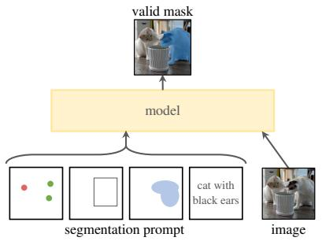

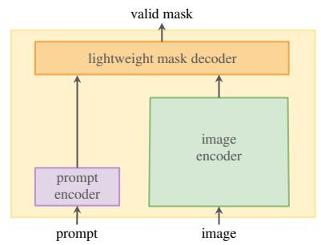

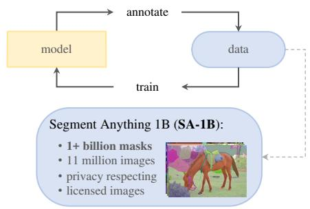  
Figure 1: 我们旨在通过引入三个相互关联的组件来构建用于分割的基础模型（foundation model）：一个可提示的分割任务（promptable segmentation task）、一个用于支持数据标注并通过提示工程（prompt engineering）实现对一系列任务进行零样本迁移的分割模型（SAM），以及一个用于收集包含超过 10 亿个掩码（mask）的数据集 SA-1B 的数据引擎。

## 摘要

我们介绍了 Segment Anything (SA) 项目：一种用于图像分割的新任务、新模型和新数据集。通过在数据收集循环中使用我们高效的模型，我们构建了迄今为止最大（遥遥领先）的分割数据集，在 1100 万张已获许可且尊重隐私的图像上标注了超过 10 亿个掩码。该模型经过设计与训练以具备可提示性，因此可以零样本迁移到新的图像分布和任务中。我们在大量任务上评估了其能力，发现其零样本性能令人瞩目——通常可与先前的全监督结果相媲美甚至更优。我们正在 https://segment-anything.com 开源 Segment Anything Model (SAM) 以及包含 10 亿个掩码和 1100 万张图像的相应数据集 (SA-1B)，以促进计算机视觉领域基础模型的研究。

## 1. 引言

在网络规模数据集上预训练的大型语言模型凭借强大的零样本和少样本泛化能力，正在彻底改变自然语言处理（NLP）领域 [10]。这些“基础模型”（foundation models）[8] 能够泛化到训练期间未见过的任务和数据分布。这种能力通常通过提示工程（prompt engineering）来实现，即使用人工设计的文本来提示语言模型，以针对当前任务生成有效的文本响应。当通过来自网络的海量文本语料库进行扩展和训练时，这些模型的零样本和少样本性能出奇地出色，在某些情况下甚至能与微调模型相媲美 [10, 21]。实证趋势表明，这种表现会随着模型规模、数据集大小和总训练计算量的提升而不断改进 [56, 10, 21, 51]。

基础模型（Foundation models）在计算机视觉领域也得到了探索，尽管程度相对较小。其中最突出的代表是对齐来自网络的成对文本与图像。例如，CLIP [82] 和 ALIGN [55] 使用对比学习来训练文本和图像编码器，从而对齐这两种模态。训练完成后，精心设计的文本提示（text prompts）能够实现对新视觉概念和数据分布的零样本泛化（zero-shot generalization）。此类编码器还可以与其他模块有效组合以赋能下游任务，例如图像生成（如 DALL·E [83]）。尽管在视觉与语言编码器方面取得了巨大进展，但计算机视觉还包含超出此范围的广泛问题，对于其中许多问题，并不存在充足的训练数据。

在这项工作中，我们的目标是构建一个用于图像分割的基础模型。也就是说，我们力求开发一个可提示（promptable）的模型，并通过一个能够赋予其强大泛化能力的任务，在广泛的数据集上对其进行预训练。借助该模型，我们旨在通过提示工程（prompt engineering）解决新数据分布上的一系列下游分割问题。

该方案的成功取决于三个核心要素：任务、模型与数据。为了开发它们，我们探讨了关于图像分割的以下问题：

1. 什么任务能够实现零样本泛化？

2. 对应的模型架构是什么？

3. 哪些数据可以支撑该任务和模型？

这些问题相互交织，需要一个综合性的解决方案。我们首先定义了一个可提示的分割任务，该任务足够通用，既能提供强大的预训练目标，又能支持广泛的下游应用。该任务要求模型支持灵活的提示，并在给出提示时能够实时输出分割掩码，以实现交互式使用。为了训练我们的模型，我们需要一个多样化、大规模的数据来源。不幸的是，目前尚不存在用于分割的网络级规模（web-scale）数据源；为了解决这一问题，我们构建了一个“数据引擎”（data engine），即我们在“使用高效模型辅助数据收集”与“使用新收集的数据改进模型”之间进行迭代。接下来，我们将依次介绍各个相互关联的组成部分，随后介绍我们创建的数据集以及证明我们方法有效性的实验。

任务（§2）。在 NLP 以及近期的计算机视觉领域中，基础模型（foundation models）是一项极具前景的进展，它们通常利用“提示（prompting）”技术对新的数据集和任务执行零样本（zero-shot）和小样本（few-shot）学习。受到此类工作的启发，我们提出了可提示分割任务（promptable segmentation task），其目标是在给定任意分割提示（segmentation prompt）时返回一个有效的分割掩码（见 Fig. 1a）。提示仅用于指定图像中要分割的内容，例如，提示可以包含用于识别物体的空间或文本信息。对有效输出掩码的要求意味着，即使提示存在歧义且可能指代多个物体（例如，衬衫上的一个点既可以表示衬衫，也可以表示穿衬衫的人），输出也应当是其中至少一个物体的合理掩码。我们将可提示分割任务既用作预训练目标，又通过提示工程（prompt engineering）来解决通用的下游分割任务。

模型（§3）。可提示分割任务以及实际应用的目标对模型架构施加了约束。具体而言，该模型必须支持灵活的提示，需要以平摊实时（amortized real-time）的方式计算掩码以支持交互式使用，并且必须具备歧义感知能力（ambiguity-aware）。令人惊讶的是，我们发现一个简单的设计便可满足所有这三项约束：一个强大的图像编码器（image encoder）用于计算图像嵌入（image embedding），一个提示编码器（prompt encoder）用于嵌入提示，然后这两个信息源在一个用于预测分割掩码的轻量级掩码解码器（mask decoder）中进行组合。我们将该模型称为 Segment Anything Model，即 SAM（见 Fig. 1b）。通过将 SAM 解耦为图像编码器和快速提示编码器 / 掩码解码器，相同的图像嵌入可以与不同的提示重复使用（并将其成本平摊）。在给定图像嵌入的情况下，提示编码器和掩码解码器在网络浏览器中只需 ∼50ms 即可根据提示预测出掩码。我们主要关注点（point）、框（box）和掩码（mask）提示，同时也展示了使用自由格式文本提示的初步结果。为了使 SAM 具备歧义感知能力，我们将其设计为针对单个提示预测多个掩码，从而使 SAM 能够自然地处理歧义，例如衬衫与人的示例。

数据引擎（§4）。为了实现对新数据分布的强泛化能力，我们发现有必要在一个庞大且多样化的掩码集合上训练 SAM，其规模超越现有的任何分割数据集。虽然基础模型（foundation models）的典型方法是在线获取数据 [82]，但掩码并非天然丰富，因此我们需要一种替代策略。我们的解决方案是构建一个“数据引擎”，即我们通过模型在回路（model-in-the-loop）的数据集标注来协同开发我们的模型（参见 Fig. 1c）。我们的数据引擎分为三个阶段：辅助手动、半自动和全自动。在第一阶段，SAM 协助标注员标注掩码，类似于经典的交互式分割设置。在第二阶段，通过向 SAM 提示可能的目标位置，SAM 可以为一部分目标自动生成掩码，而标注员则专注于标注剩余的目标，这有助于增加掩码的多样性。在最后阶段，我们用前景点的规则网格提示 SAM，平均每张图像可产生约 100 个高质量掩码。

数据集（§5）。我们最终的数据集 SA-1B 包含来自 11M 张获得许可且保护隐私的图像中的超过 1B 个掩码（参见 Fig. 2）。SA-1B 是使用我们数据引擎的最终阶段全自动收集的，其掩码数量是任何现有分割数据集的 400 倍 [66, 44, 117, 60]，并且正如我们广泛验证的那样，这些掩码具有很高的质量和多样性。除了用于训练 SAM 以使其具备鲁棒性和通用性之外，我们希望 SA-1B 能够成为旨在构建新基础模型的研究的宝贵资源。

负责任的人工智能（§6）。我们研究并报告了使用 SA-1B 和 SAM 时潜在的公平性问题和偏见。SA-1B 中的图像涵盖了地理和经济上多样化的国家，并且我们发现 SAM 在不同人群中的表现相似。总的来说，我们希望这将使我们的工作在现实世界的用例中更加公平。我们在附录中提供了模型卡和数据集卡。

实验（§7）。我们对 SAM 进行了广泛的评估。首先，使用包含 23 个分割数据集的多样化新套件，我们发现 SAM 从单个前景点就能生成高质量的掩码，通常仅略低于人工标注的真实基准（ground truth）。其次，在采用提示工程（prompt engineering）的零样本迁移（zero-shot transfer）协议下，我们在各种下游任务中均获得了一致强劲的定量和定性结果，包括边缘检测、目标候选框生成（object proposal generation）、实例分割以及对文本到掩码（text-to-mask）预测的初步探索。这些结果表明，SAM 可以通过提示工程开箱即用，以解决涉及超出 SAM 训练数据范围的目标和图像分布的各种任务。尽管如此，正如我们在 §8 中所讨论的那样，仍然存在改进空间。

发布。我们出于研究目的发布了 SA-1B 数据集，并在 https://segment-anything.com 上以宽松的开源许可证（Apache 2.0）提供 SAM。我们还通过在线演示展示了 SAM 的功能。

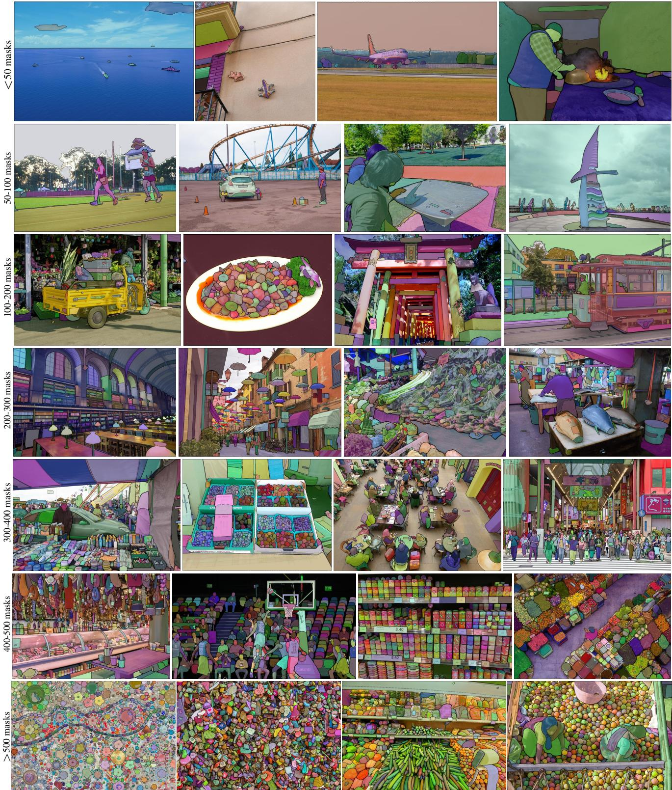  
Figure 2: 来自我们新推出的数据集 SA-1B 的图像叠加掩码示例。SA-1B 包含 1100 万（11M）张多样化、高分辨率、经授权且注重隐私保护的图像，以及 11 亿（1.1B）个高质量分割掩码。这些掩码完全由 SAM 自动标注，且经过人工评分和大量实验验证，具有极高的质量和多样性。为了便于可视化展示，我们按每张图像的掩码数量对图像进行了分组（平均每张图像约有 100 个掩码）。

## 2. Segment Anything 任务

我们从自然语言处理（NLP）中汲取灵感，在 NLP 中，下一个词元（token）预测任务被用于基础模型预训练，并通过提示工程（prompt engineering）来解决各种下游任务 [10]。为了构建用于分割的基础模型，我们的目标是定义一个具有类似能力的任务。

任务。我们首先将“提示”（prompt）的概念从 NLP 转化到分割领域，其中提示可以是一组前景/背景点、一个粗略的边界框或掩码、自由格式的文本，或者在通常情况下，任何指示图像中需要分割何种内容的信息。因此，可提示分割（promptable segmentation）任务就是在给定任意提示的情况下返回一个有效的分割掩码。“有效”掩码的要求仅仅意味着，即使提示存在歧义且可能指代多个对象（例如，回想衬衫与人的示例，参见图 3），输出也应当是针对这些对象中至少一个的合理掩码。这一要求类似于期望语言模型对模棱两可的提示输出连贯的回应。我们之所以选择这一任务，是因为它催生了一种自然的预训练算法，以及一种通过提示向特定下游分割任务进行零样本迁移（zero-shot transfer）的通用方法。

预训练。可提示分割任务启发了一种自然的预训练算法，该算法为每个训练样本模拟一系列提示（例如点、框、掩码），并将模型的掩码预测与真实标注（ground truth）进行对比。我们从交互式分割 [109, 70] 中借鉴了该方法，然而不同于交互式分割旨在经过足够的用户输入后最终预测出有效掩码，我们的目标是针对任何提示（即使提示具有歧义）始终预测出有效掩码。这确保了预训练模型在涉及歧义的用例中依然有效，包括我们数据引擎 §4 所需的自动标注。我们注意到，在该任务上取得优异表现极具挑战性，需要专门的建模和训练损失选择，我们将在 §3 中对此进行讨论。

零样本迁移（Zero-shot transfer）。直观地说，我们的预训练任务赋予了模型在推理时对任何提示做出适当响应的能力，因此下游任务可以通过设计适当的提示来解决。例如，如果拥有一个猫的边界框检测器，则可以通过将该检测器的边界框输出作为提示提供给我们的模型，来解决猫的实例分割问题。总的来说，广泛的实际分割任务都可以被转化为提示的形式。除了自动化数据集标注之外，我们还在 §7 的实验中探索了五个不同的示例任务。

相关任务（Related tasks）。分割是一个广泛的领域：包括交互式分割 [57, 109]、边缘检测 [3]、超像素化 [85]、目标候选区域生成 [2]、前景分割 [94]、语义分割 [90]、实例分割 [66]、全景分割 [59] 等。我们可提示分割任务的目标是产生一个具备广泛能力、能够通过提示工程适应许多（尽管不是全部）现有及新分割任务的模型。这种能力是任务泛化（task generalization）[26] 的一种形式。请注意，这与以往关于多任务分割系统的研究不同。在多任务系统中，单个模型执行一组固定的任务，例如联合语义、实例和全景分割 [114, 19, 54]，但训练和测试任务是相同的。我们工作中的一个重要区别在于，为可提示分割训练的模型可以在推理时作为更大系统中的一个组件来执行全新的、不同的任务，例如，为了执行实例分割，可提示分割模型可以与现有的目标检测器相结合。

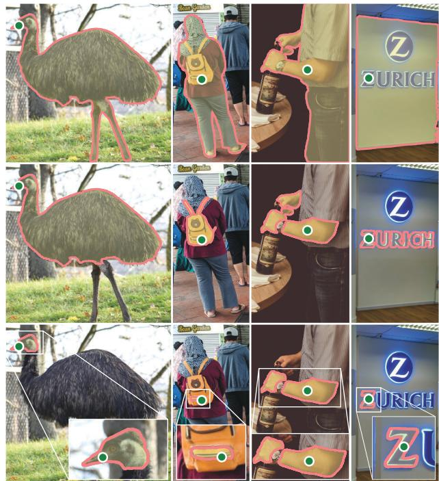  
Figure 3: 每列显示了 SAM 根据单个存在歧义的点提示（绿圈）生成的 3 个有效掩码。

讨论（Discussion）。提示和组合是强大的工具，它们使单个模型能够以可扩展的方式被使用，从而有可能完成在模型设计时未知的任务。这种方法类似于其他基础模型（foundation models）的使用方式，例如 CLIP [82] 是 DALL·E [83] 图像生成系统中的文本-图像对齐组件。我们预计，在提示工程等技术的推动下，可组合的系统设计将比专门针对固定任务集训练的系统支持更广泛的应用。从组合的角度来对比可提示分割和交互式分割也很有意义：虽然交互式分割模型在设计时主要考虑人类用户，但正如我们将要展示的，为可提示分割训练的模型也可以被组合进更大的算法系统中。

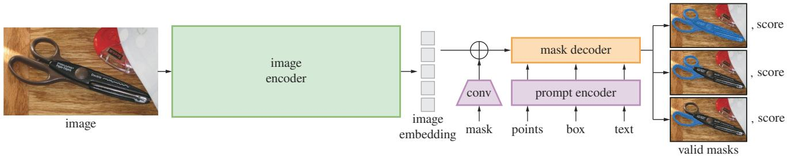  
Figure 4: Segment Anything Model (SAM) 概览。重量级的图像编码器输出图像嵌入，随后可通过多种输入提示对其进行高效查询，以摊销后的实时速度生成目标掩码。对于对应多个目标的歧义性提示，SAM 能够输出多个有效掩码及相关的置信度分数。

## 3. Segment Anything 模型

接下来我们介绍用于可提示分割（promptable segmentation）的 Segment Anything Model (SAM)。SAM 包含三个组件，如图 4 所示：图像编码器、灵活的提示编码器和快速的掩码解码器。我们在 Transformer 视觉模型 [14, 33, 20, 62] 的基础上进行构建，并针对（摊销）实时性能进行了特定的权衡取舍。在此我们对这些组件进行高层概述，细节见 §A。

图像编码器（Image encoder）。出于可扩展性和强大预训练方法的考量，我们使用了经 MAE [47] 预训练的 Vision Transformer (ViT) [33]，并进行了极少量的适配以处理高分辨率输入 [62]。图像编码器对每张图像仅运行一次，且可以在对模型进行提示之前执行。

提示编码器（Prompt encoder）。我们考虑两类提示：稀疏提示（点、框、文本）和密集提示（掩码）。我们通过位置编码 [95] 加上每种提示类型的可学习嵌入来表示点和框，并使用来自 CLIP [82] 的现成文本编码器表示自由格式文本。密集提示（即掩码）使用卷积进行嵌入，并与图像嵌入逐元素相加。

掩码解码器（Mask decoder）。掩码解码器高效地将图像嵌入、提示嵌入和一个输出标记（output token）映射为掩码。该设计受 [14, 20] 启发，采用了修改后的 Transformer 解码器块 [103]，后接一个动态掩码预测头。我们修改后的解码器块使用提示自注意力和双向交叉注意力（提示到图像嵌入以及反之）来更新所有嵌入。在运行两个块之后，我们对图像嵌入进行上采样，并通过一个 MLP 将输出标记映射到一个动态线性分类器，随后该分类器计算图像每个位置的掩码前景概率。

解决歧义性（Resolving ambiguity）。如果仅有一个输出，当给定歧义性提示时，模型会对多个有效掩码进行平均。为解决此问题，我们修改了模型，使其能够针对单个提示预测多个输出掩码（见图 3）。我们发现 3 个掩码输出足以应对大多数常见情况（嵌套掩码通常最多为三层深度：整体、部分和子部分）。在训练期间，我们仅对掩码之间的最小损失 [15, 45, 64] 进行反向传播。为了对掩码进行排序，模型会为每个掩码预测一个置信度分数（即估计的 IoU）。

效率（Efficiency）。整体模型设计在很大程度上是以效率为导向的。在预先计算好图像嵌入的前提下，提示编码器和掩码解码器可在网页浏览器中运行于 CPU 上，耗时 ∼50ms。这种运行时性能使得我们的模型能够实现无缝、实时的交互式提示。

损失与训练。我们采用 [14] 中使用的 focal loss [65] 和 dice loss [73] 的线性组合来监督掩码预测。我们使用几何提示（geometric prompts）的混合形式针对可提示分割任务进行训练（文本提示见 §7.5）。遵循 [92, 37]，我们通过在每个掩码中进行 11 轮随机采样提示来模拟交互式设定，从而使 SAM 能够无缝集成到我们的数据引擎中。

## 4. Segment Anything 数据引擎

由于互联网上的分割掩码并不丰富，我们构建了一个数据引擎，以实现收集包含 1.1B 个掩码的数据集 SA-1B。该数据引擎包含三个阶段：(1) 模型辅助的手动标注阶段，(2) 自动预测掩码与模型辅助标注相结合的半自动阶段，以及 (3) 我们的模型在无需标注人员输入的情况下生成掩码的全自动阶段。接下来我们将详细介绍每个阶段。

辅助手动阶段。在第一阶段中，类似于经典的交互式分割，一组专业标注人员使用由 SAM 驱动的基于浏览器的交互式分割工具，通过点击前景/背景目标点来标注掩码。掩码可以使用像素级精确的“画笔”和“橡皮擦”工具进行微调。我们的模型辅助标注（使用预先计算的图像嵌入）直接在浏览器中实时运行，实现了真正的交互体验。我们没有对标注目标强加语义约束，标注人员可以自由标注“stuff”和“things” [1]。我们建议标注人员标注他们能够命名或描述的目标，但并未收集这些名称或描述。标注人员被要求按显著程度的顺序标注目标，并且如果单个掩码的标注时间超过 30 秒，则鼓励其切换到下一张图像。

在该阶段初期，SAM 是使用通用的公开分割数据集进行训练的。在完成充分的数据标注后，仅使用新标注的掩码对 SAM 进行了重新训练。随着收集到的掩码越来越多，图像编码器从 ViT-B 扩展到了 ViT-H，其他架构细节也得到了演进；我们总共对模型进行了 6 次重新训练。随着模型的改进，每个掩码的平均标注时间从 34 秒减少到 14 秒。我们注意到，14 秒比 COCO [66] 的掩码标注速度快了 6.5 倍，并且仅比使用极值点的边界框标注 [76, 71] 慢 2 倍。随着 SAM 的提升，每张图像的平均掩码数量从 20 个增加到了 44 个。总体而言，我们在该阶段从 120k 张图像中收集了 4.3M 个掩码。

半自动阶段。在这个阶段，我们旨在增加掩码（mask）的多样性，以提高模型分割任何物体的能力。为了让标注员专注于不那么显著的物体，我们首先自动检测高置信度的掩码。然后，我们向标注员展示预先填充了这些掩码的图像，并要求他们标注任何其他未标注的物体。为了检测高置信度掩码，我们使用通用的“物体”类别在所有第一阶段掩码上训练了一个边界框检测器 [84]。在此阶段，我们在 180k 张图像中额外收集了 5.9M 个掩码（总计达到 10.2M 个掩码）。与第一阶段类似，我们根据新收集的数据定期对模型进行重新训练（共 5 次）。每个掩码的平均标注时间回升至 34 秒（不包括自动生成的掩码），因为这些物体更具标注难度。每张图像的平均掩码数量从 44 个增加到 72 个（包括自动生成的掩码）。

全自动阶段。在最后阶段，标注完全自动化。得益于我们对模型的两项重大改进，这成为可能。首先，在这一阶段开始时，我们已经收集了足够的掩码来极大地改进模型，包括来自前一阶段的多样化掩码。其次，到了这个阶段，我们开发出了感知模糊性的模型（ambiguity-aware model），该模型使我们即使在存在歧义的情况下也能够预测出有效的掩码。具体而言，我们使用 32×32 的规则点网格提示（prompt）模型，并为每个点预测一组可能对应于有效物体的掩码。借助感知模糊性的模型，如果一个点落在某个局部或子部件上，我们的模型将返回子部件、局部以及整个物体。我们模型的 IoU 预测模块用于挑选高置信度的掩码；此外，我们只识别并选择稳定的掩码（如果将概率图在 0.5 − δ 和 0.5 + δ 处设定阈值能得到相似的掩码，我们就认为该掩码是稳定的）。最后，在选择高置信度且稳定的掩码之后，我们应用非极大值抑制（NMS）来过滤重复项。为了进一步提高较小掩码的质量，我们还处理了多个重叠的局部放大裁剪图像。有关此阶段的更多详细信息，请参见 §B。我们对数据集中的所有 11M 张图像应用了全自动掩码生成，共生成了 1.1B 个高质量掩码。接下来，我们将对最终生成的数据集 SA-1B 进行描述和分析。

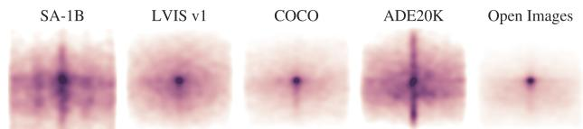  
Figure 5: 图像尺寸归一化的掩码中心分布。

## 5. Segment Anything 数据集

我们的数据集 SA-1B 包含通过我们的数据引擎收集的 11M 张多样化、高分辨率、经许可且受隐私保护的图像，以及 1.1B 个高质量分割掩码。我们将 SA-1B 与现有数据集进行了比较，并分析了掩码的质量与属性。我们发布 SA-1B，以助力计算机视觉基础模型的未来发展。我们指出，SA-1B 将在有利于特定研究用途且对研究人员提供保护的许可协议下发布。

图像。我们从一家直接与摄影师合作的提供商处获得了 1100 万张新图像的授权许可。这些图像分辨率很高（平均为 3300×4950 像素），由此产生的数据体积可能会带来访问和存储方面的挑战。因此，我们发布了降采样后的图像，将其最短边设置为 1500 像素。即使在降采样之后，我们图像的分辨率也显著高于许多现有的视觉数据集（例如，COCO [66] 图像约为 ∼480×640 像素）。请注意，当今大多数模型都在分辨率低得多的输入上运行。在发布的图像中，人脸和机动车号牌已被模糊化处理。

掩码。我们的数据引擎生成了 11 亿个掩码，其中 99.1% 是全自动生成的。因此，自动掩码的质量至关重要。我们将其直接与专业标注进行对比，并观察各种掩码属性与知名分割数据集的对比情况。正如在下文分析以及 §7 的实验中所证实的那样，我们的主要结论是：我们的自动掩码具有很高的质量，并且对训练模型非常有效。基于这些发现，SA-1B 仅包含自动生成的掩码。

掩码质量。为了评估掩码质量，我们随机抽取了 500 张图像（约 5 万个掩码），并要求专业标注人员提高这些图像中所有掩码的质量。标注人员利用我们的模型以及像素级精度的“画笔”和“橡皮擦”编辑工具完成了这一工作。这一流程产生了成对的自动预测掩码和专业修正掩码。我们计算了每对掩码之间的 IoU，发现 94% 的掩码对具有超过 90% 的 IoU（且 97% 的掩码对具有超过 75% 的 IoU）。作为对比，先前的研究估计标注者之间的一致性为 85-91% IoU [44, 60]。我们在 §7 中的实验通过人工评分证实，相对于多种数据集，其掩码质量都很高，并且在自动掩码上训练我们的模型的效果与使用数据引擎生成的所有掩码几乎一样好。

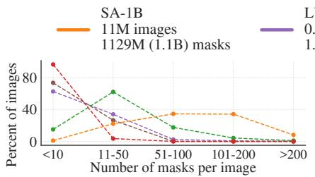

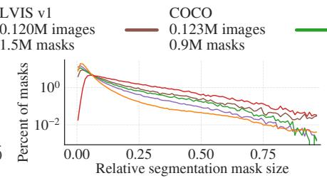

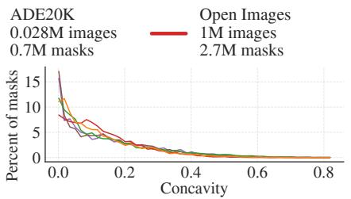  
Figure 6: 数据集掩码属性。图例标注了各个数据集中的图像和掩码数量。请注意，SA-1B 的图像数量是现有最大分割数据集 Open Images [60] 的 11 倍，掩码数量是其 400 倍。

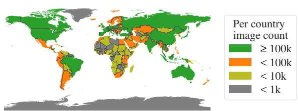

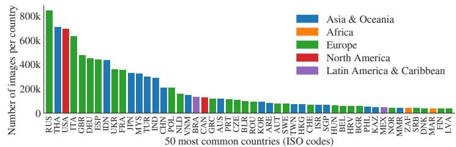  
Figure 7: SA-1B 图像的估计地理分布。世界上大多数国家在 SA-1B 中拥有超过 1000 张图像，并且图像数量最多的三个国家来自世界不同地区。

掩码属性。在图 5 中，我们绘制了 SA-1B 与现有最大的分割数据集相比的对象中心空间分布。所有数据集中都存在常见的拍摄者偏见（photographer biases）。我们观察到，与分布最相似的两个数据集 LVIS v1 [44] 和 ADE20K [117] 相比，SA-1B 对图像角落的覆盖率更高，而 COCO [66] 和 Open Images V5 [60] 则具有更显著的中心偏见。在图 6（图例）中，我们按规模对比了这些数据集。SA-1B 的图像数量是第二大数据集 Open Images 的 11 倍，掩码数量则是其 400 倍。平均而言，其单张图像的掩码数量是 Open Images 的 36 倍。在这方面最接近的数据集 ADE20K，其每张图像的掩码数量仍比 SA-1B 少 3.5 倍。图 6（左）绘制了每张图像掩码数量的分布情况。接下来，我们在图 6（中）中考察了图像相对掩码尺寸（掩码面积除以图像面积的平方根）。正如预期的那样，由于我们的数据集每张图像包含更多掩码，它往往也包含更高比例的中小型相对尺寸掩码。最后，为了分析形状复杂度，我们在图 6（右）中考察了掩码凹度（1 减去掩码面积除以掩码凸包面积）。由于形状复杂度与掩码尺寸相关，我们首先通过对分箱后的掩码尺寸进行分层抽样，以控制各数据集的掩码尺寸分布。我们观察到，我们掩码的凹度分布与其他数据集大致相似。

## 6. Segment Anything 负责任人工智能（RAI）分析

接下来，我们通过调查使用 SA-1B 和 SAM 时潜在的公平性问题和偏见，对我们的工作进行负责任人工智能（RAI）分析。我们重点关注 SA-1B 的地理和收入分布，以及 SAM 在人类受保护属性方面的公平性。我们还在附录 §F 中提供了数据集卡片、数据标注卡片和模型卡片。

<table><tr><td rowspan="2"></td><td rowspan="2">国家数量</td><td colspan="2">SA-1B</td><td colspan="3">图像占比（%）</td></tr><tr><td>图像数量</td><td>掩码数量</td><td>SA-1B</td><td>COCO</td><td>O.I.</td></tr><tr><td>非洲</td><td>54</td><td>300k</td><td>28M</td><td>2.8%</td><td>3.0%</td><td>1.7%</td></tr><tr><td>亚洲与大洋洲</td><td>70</td><td>3.9M</td><td>423M</td><td>36.2%</td><td>11.4%</td><td>14.3%</td></tr><tr><td>欧洲</td><td>47</td><td>5.4M</td><td>540M</td><td>49.8%</td><td>34.2%</td><td>36.2%</td></tr><tr><td>拉丁美洲与加勒比地区</td><td>42</td><td>380k</td><td>36M</td><td>3.5%</td><td>3.1%</td><td>5.0%</td></tr><tr><td>北美洲</td><td>4</td><td>830k</td><td>80M</td><td>7.7%</td><td>48.3%</td><td>42.8%</td></tr><tr><td>高收入国家</td><td>81</td><td>5.8M</td><td>598M</td><td>54.0%</td><td>89.1%</td><td>87.5%</td></tr><tr><td>中等收入国家</td><td>108</td><td>4.9M</td><td>499M</td><td>45.0%</td><td>10.5%</td><td>12.0%</td></tr><tr><td>低收入国家</td><td>28</td><td>100k</td><td>9.4M</td><td>0.9%</td><td>0.4%</td><td>0.5%</td></tr></table>

Table 1: 地理与收入代表性对比。SA-1B 在欧洲、亚洲及大洋洲以及中等收入国家具有更高的代表性。在所有数据集中，来自非洲、拉丁美洲及加勒比海地区以及低收入国家的图像代表性均不足。

地理与收入代表性。我们使用标准方法推断图像的拍摄国家（见 §C）。在 Fig. 7 中，我们可视化了 SA-1B 中每个国家的图像数量（左）以及图像数量最多的 50 个国家（右）。我们注意到排名前三的国家来自世界不同地区。接下来，在 Table 1 中，我们比较了 SA-1B、COCO [66] 和 Open Images [60] 的地理与收入代表性。SA-1B 在欧洲、亚洲及大洋洲以及中等收入国家的图像比例显著更高。所有数据集对非洲以及低收入国家的代表性均不足。我们注意到，在 SA-1B 中，包括非洲在内的所有地区都拥有至少 2800 万个掩码，是以往任何数据集掩码总数的 10 倍以上。最后，我们观察到每张图像的平均掩码数量（未显示）在不同地区和收入之间相当一致（每张图像 94-108 个）。

<table><tr><td rowspan="2"></td><td colspan="2">mIoU（1 点）</td><td colspan="2">mIoU（3 点）</td></tr><tr><td>1 点</td><td>3 点</td><td>1 点</td><td>3 点</td></tr><tr><td colspan="3">感知性别表征</td><td colspan="2">感知肤色</td></tr><tr><td>女性化</td><td> $54.4 \pm 1.7$ </td><td> $90.4 \pm 0.6$ </td><td>1</td><td> $52.9 \pm 2.2$ </td></tr><tr><td>男性化</td><td> $55.7 \pm 1.7$ </td><td> $90.1 \pm 0.6$ </td><td>2</td><td> $51.5 \pm 1.4$ </td></tr><tr><td colspan="3">感知年龄组</td><td>3</td><td> $52.2 \pm 1.9$ </td></tr><tr><td>老年</td><td> $62.9 \pm 6.7$ </td><td> $92.6 \pm 1.3$ </td><td>4</td><td> $51.5 \pm 2.7$ </td></tr><tr><td>中年</td><td> $54.5 \pm 1.3$ </td><td> $90.2 \pm 0.5$ </td><td>5</td><td> $52.4 \pm 4.2$ </td></tr><tr><td>青年</td><td> $54.2 \pm 2.2$ </td><td> $91.2 \pm 0.7$ </td><td>6</td><td> $56.7 \pm 6.3$ </td></tr></table>

Table 2: SAM 在不同感知性别表征、年龄组和肤色下的人群分割性能。展示了 95% 置信区间。在每个分组内，除老年与中年之外，所有置信区间均存在重叠。

人群分割中的公平性。我们通过测量 SAM 在不同群体之间的性能差异，调查了在感知性别表现、感知年龄组和感知肤色方面的潜在公平性问题。我们在性别表现和年龄方面使用了 More Inclusive Annotations for People (MIAP) [87] 数据集，在肤色方面使用了一个专有数据集（参见 §C）。我们的评估采用了随机采样 1 个和 3 个点的模拟交互式分割（参见 §D）。Table 2（左上）展示了感知性别表现的结果。我们注意到女性在检测和分割数据集中已被证明代表性不足 [115]，但观察到 SAM 在各群体之间的表现相近。我们在 Table 2（左下）中对感知年龄重复了该分析，并指出在感知上较年轻和较年长的人群在大规模数据集中已被证明代表性不足 [110]。SAM 在感知上较年长的人群上表现最佳（尽管置信区间较大）。最后，我们在 Table 2（右）中对感知肤色重复了该分析，并指出在大规模数据集中，表观肤色较浅的人群已被证明代表性过高，而肤色较深的人群代表性不足 [110]。由于 MIAP 不包含感知肤色标注，我们使用了一个包含感知 Fitzpatrick 皮肤类型 [36] 标注的专有数据集，其范围从 1（最浅肤色）到 6（最深肤色）。尽管均值存在一定差异，但我们未发现群体之间存在显著差异。我们认为我们的发现源于该任务的本质，并承认当 SAM 作为更大系统的一个组件使用时可能会产生偏见。最后，在 §C 中，我们将分析扩展到衣物分割，在其中我们发现了跨感知性别表现存在偏见的迹象。

## 7. 零样本迁移实验

在本节中，我们展示了 SAM（即 Segment Anything Model）的零样本迁移实验。我们考虑了五项任务，其中四项与用于训练 SAM 的提示式分割任务有显著差异。这些实验在训练期间未见过的任务和数据集上评估 SAM（我们对“零样本迁移”的用法遵循了其在 CLIP [82] 中的用法）。这些数据集可能包含新颖的图像分布，例如据我们所知未在 SA-1B 中出现过的水下或第一人称视角（ego-centric）图像（例如 Fig. 8）。

我们的实验首先测试可提示分割（promptable segmentation）的核心目标：根据任何提示生成有效掩码。我们着重强调单个前景点提示这一具有挑战性的场景，因为相比其他更具针对性的提示，它更容易产生歧义。接下来，我们展示了一系列贯穿低层、中层和高层图像理解的实验，这大致与该领域的历史发展过程相对应。具体而言，我们提示 SAM 进行 (1) 边缘检测，(2) 分割一切（segment everything），即目标提议生成（object proposal generation），(3) 分割检测到的目标，即实例分割，以及 (4) 作为概念验证，根据自由形式的文本分割目标。这四项任务与 SAM 所训练的可提示分割任务显著不同，并且是通过提示工程（prompt engineering）来实现的。我们的实验最后以消融实验（ablation study）作结。

实现细节。除非另有说明：(1) SAM 使用 MAE [47] 预训练的 ViT-H [33] 图像编码器，且 (2) SAM 在 SA-1B 上进行训练，需要注意的是，该数据集仅包含来自我们数据引擎最终阶段自动生成的掩码。关于所有其他模型和训练细节（例如超参数），请参阅 §A。

## 7.1. 零样本单点有效掩码评估

任务。我们评估从单个前景点分割目标。由于一个点可以指代多个目标，因此该任务是一个不适定（ill-posed）问题。大多数数据集中的真实真值掩码（ground truth masks）并未枚举所有可能的掩码，这可能导致自动评估指标不可靠。因此，我们在标准的 mIoU 指标（即预测掩码与真实真值掩码之间所有 IoU 的均值）之外，补充了一项人工评估研究，在研究中，标注员对掩码质量进行从 1（毫无意义）到 10（像素级完美）的评分。有关更多细节，请参见 §D.1、§E 和 §G。

默认情况下，我们遵循交互式分割中的标准评估协议 [92]，从真实真值掩码的“中心”（即掩码内部距离变换的最大值处）采样点。由于 SAM 能够预测多个掩码，默认情况下我们仅评估模型最自信的掩码。所有基准模型（baselines）均为单掩码方法。我们主要与 RITM [92] 进行对比，与其他强基准模型 [67, 18] 相比，这是一种在我们的基准测试中表现最佳的强交互式分割器。

数据集。我们使用了一套新整理的包含 23 个具有多样化图像分布的数据集。Fig. 8 列出了这些数据集并展示了每个数据集的一个样本（更多细节见附录 Table 7）。我们使用全部 23 个数据集进行 mIoU 评估。对于人工研究，由于此类研究所需的资源限制，我们使用了 Fig. 9b 中列出的子集。该子集既包括根据自动指标 SAM 优于 RITM 的数据集，也包括表现劣于 RITM 的数据集。

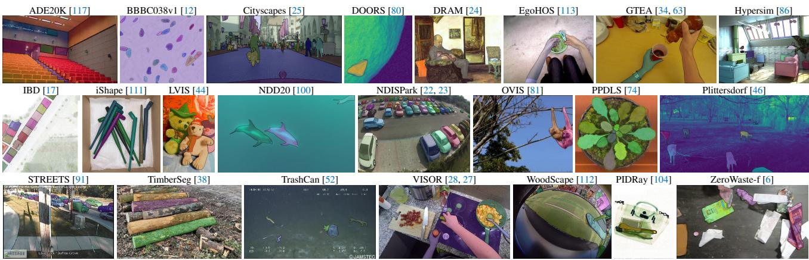  
Figure 8: 用于评估 SAM 零样本迁移能力的 23 个多样化分割数据集的样本。

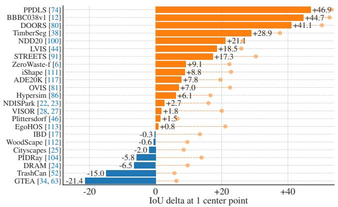  
(a) SAM 与 RITM [92] 在 23 个数据集上的对比

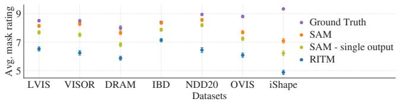  
(b) 人工标注员的掩码质量评分

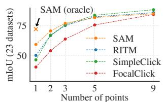  
(c) 中心点（默认）

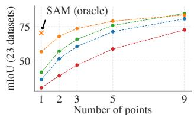  
(d) 随机点  
Figure 9: 在 23 个数据集上的“点到掩码”评估。(a) SAM 与最强单点分割模型 RITM [92] 的平均 IoU。由于歧义性，单个掩码可能与真实标注（ground truth）不匹配；圆圈表示 SAM 的 3 个预测中最相关预测的“oracle”结果。(b) 标注员对掩码质量的逐数据集评分对比，评分范围从 1（最差）到 10（最好）。所有方法均使用真实标注掩码的中心作为提示。(c, d) 不同点数下的 mIoU。在单点情况下，SAM 显著优于先前的交互式分割模型，并在更多点数时表现相当。单点时绝对 mIoU 偏低是歧义性导致的。

结果。首先，我们考察使用 mIoU 在全套 23 个数据集上进行的自动评估。我们在图 9a 中将逐个数据集的结果与 RITM 进行了对比。在 23 个数据集中的 16 个上，SAM 取得了更高的结果，IoU 提升最高达约 47。我们还给出了一个“oracle”结果，即通过将 SAM 的 3 个掩码与真实标注进行比对来选择最相关的掩码，而不是选择置信度最高的掩码。这揭示了歧义性对自动评估的影响。特别是，在借助 oracle 进行歧义消解后，SAM 在所有数据集上均优于 RITM。

人工评估的结果如 图 9b 所示。误差线为掩码平均评分的 95% 置信区间（所有差异均显著；详见 §E）。我们观察到，标注员对 SAM 掩码质量的评分始终大幅高于最强基线 RITM。消融实验中仅输出单个掩码的“无歧义感知（ambiguity-unaware）”版 SAM 评分始终较低，但仍高于 RITM。SAM 的平均评分落在 7 到 9 之间，这对应于定性评分指南：“高分（7-9）：目标可识别，且错误较小且少见（例如，遗漏了较小的、严重受遮挡的不相连组件……）”。这些结果表明，SAM 已经学会了从单个点分割出有效掩码。值得注意的是，对于像 DRAM 和 IBD 这样 SAM 在自动评估指标上表现较差的数据集，其在人工评估中始终获得了更高的评分。

图 9c 展示了其他基线方法 SimpleClick [67] 和 FocalClick [18]，它们获得的单点性能低于 RITM 和 SAM。随着点数从 1 增加到 9，我们观察到方法之间的差距在减小。这是意料之中的，因为任务变得更容易；此外，SAM 并非针对极高 IoU 区间进行优化。最后，在图 9d 中，我们用随机点采样替代了默认的中心点采样。我们观察到 SAM 与基线之间的差距在扩大，并且 SAM 在任一采样方法下都能够取得可比的结果。

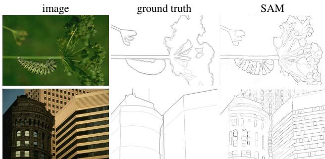  
Figure 10: 在 BSDS500 上的零样本边缘预测。SAM 既没有针对边缘图预测进行训练，在训练期间也无法访问 BSDS 图像或标注。

<table><tr><td>方法</td><td>年份</td><td>ODS</td><td>OIS</td><td>AP</td><td>R50</td></tr><tr><td>HED [108]</td><td>2015</td><td>.788</td><td>.808</td><td>.840</td><td>.923</td></tr><tr><td>EDETR [79]</td><td>2022</td><td>.840</td><td>.858</td><td>.896</td><td>.930</td></tr><tr><td colspan="6">零样本迁移方法：</td></tr><tr><td>Sobel filter</td><td>1968</td><td>.539</td><td>-</td><td>-</td><td>-</td></tr><tr><td>Canny [13]</td><td>1986</td><td>.600</td><td>.640</td><td>.580</td><td>-</td></tr><tr><td>Felz-Hutt [35]</td><td>2004</td><td>.610</td><td>.640</td><td>.560</td><td>-</td></tr><tr><td>SAM</td><td>2023</td><td>.768</td><td>.786</td><td>.794</td><td>.928</td></tr></table>

Table 3: BSDS500 上的边缘检测零样本迁移。

## 7.2. 零样本边缘检测

方法。我们使用 BSDS500 [72, 3] 在边缘检测这一经典底层视觉任务上评估 SAM。我们使用了自动掩码生成流程的简化版本。具体而言，我们用 16×16 的前景点规则网格提示 SAM，产生 768 个预测掩码（每个点 3 个）。通过 NMS 移除冗余掩码。然后，对未阈值化的掩码概率图使用 Sobel 滤波并进行标准轻量级后处理（包括边缘 NMS）以计算边缘图（详见 §D.2）。

结果。我们在图 10 中可视化了代表性的边缘图（更多见图 15）。定性地，我们观察到即使 SAM 未针对边缘检测进行训练，它也能生成合理的边缘图。与真实标注相比，SAM 预测出更多的边缘，包括在 BSDS500 中未被标注的合理边缘。这种偏差定量地反映在表 3 中：以精确度为代价，在 50% 精确度下的召回率（R50）很高。SAM 自然落后于学习了 BSDS500 偏置（即抑制哪些边缘）的最先进方法。尽管如此，与早期开创性的深度学习方法如 HED [108]（同样在 BSDS500 上训练）相比，SAM 表现良好，并且显著优于先前——尽管不可否认已经过时的——零样本迁移方法。

## 7.3. 零样本目标候选区域生成

方法。接下来，我们在中层任务目标候选区域生成（object proposal generation）[2, 102] 上评估 SAM。该任务在目标检测研究中发挥了重要作用，在开创性系统（例如 [102, 41, 84]）中充当中间步骤。为了生成目标候选区域，我们运行了自动掩码生成流程的一个略微修改版本，并将掩码作为候选区域输出（详见 §D.3）。

<table><tr><td rowspan="2">方法</td><td rowspan="2">全部</td><td colspan="6">mask AR@1000</td></tr><tr><td>小</td><td>中</td><td>大</td><td>高频</td><td>常规</td><td>罕见</td></tr><tr><td>ViTDet-H [62]</td><td>63.0</td><td>51.7</td><td>80.8</td><td>87.0</td><td>63.1</td><td>63.3</td><td>58.3</td></tr><tr><td colspan="8">零样本迁移方法：</td></tr><tr><td>SAM – 单输出</td><td>54.9</td><td>42.8</td><td>76.7</td><td>74.4</td><td>54.7</td><td>59.8</td><td>62.0</td></tr><tr><td>SAM</td><td>59.3</td><td>45.5</td><td>81.6</td><td>86.9</td><td>59.1</td><td>63.9</td><td>65.8</td></tr></table>

Table 4: LVIS v1 上的目标候选区域生成。SAM 采用零样本方式应用，即它未针对目标候选区域生成进行训练，也未访问过 LVIS 图像或标注。

我们在 LVIS v1 [44] 上计算标准平均召回率（AR）指标。我们聚焦于 LVIS，是因为其庞大的类别数量构成了具有挑战性的测试。我们与一个强基线进行比较，该基线实现为 ViTDet [62] 检测器（采用 Cascade Mask R-CNN [48, 11] ViT-H）。我们注意到，该“基线”对应于被证明能刷高 AR 的“伪装成候选区域生成器的检测器”（Detector Masquerading as Proposal generator，DMP）方法 [16]，这使其成为一个极其严苛的对比。

结果。在 Table 4 中，不出所料，使用 ViTDet-H 的检测结果作为目标候选区域（即刷高 AR 的 DMP 方法 [16]）在总体上表现最佳。然而，SAM 在若干指标上表现得非常出色。值得注意的是，在中等和大尺度目标，以及罕见和常规目标上，它的表现优于 ViTDet-H。事实上，SAM 仅在小目标和高频目标上落后于 ViTDet-H，而在这些方面，由于 ViTDet-H 在 LVIS 上进行了训练（与 SAM 不同），它可以轻易学到 LVIS 特有的标注偏差。我们还与 SAM 的消融版本——不考虑歧义的版本（“单输出”）进行了比较，该版本在所有 AR 指标上均明显逊于 SAM。

## 7.4. 零样本实例分割

方法。转向更高层次的视觉任务，我们将 SAM 用作实例分割器的分割模块。具体实现非常简单：我们运行一个目标检测器（前文使用的 ViTDet），并用其输出的边界框来提示 SAM。这展示了将 SAM 组合进更大系统中的应用。

结果。我们在 Table 5 中比较了 SAM 和 ViTDet 在 COCO 和 LVIS 上预测的掩码。从掩码 AP 指标来看，我们观察到两个数据集上都存在差距，SAM 相当接近，但确实落后于 ViTDet。通过可视化输出，我们观察到 SAM 掩码在定性上通常优于 ViTDet 的掩码，具有更清晰的边界（见 §D.4 和 Fig. 16）。为了调查这一现象，我们进行了一项额外的人工评估研究，要求标注者按照之前使用的 1 到 10 分质量量表对 ViTDet 掩码和 SAM 掩码进行评分。在 Fig. 11 中，我们观察到 SAM 在人工评估中始终优于 ViTDet。

<table><tr><td rowspan="2">方法</td><td colspan="4">COCO [66]</td><td colspan="4">LVIS v1 [44]</td></tr><tr><td>AP</td><td> $AP^S$ </td><td> $AP^M$ </td><td> $AP^L$ </td><td>AP</td><td> $AP^S$ </td><td> $AP^M$ </td><td> $AP^L$ </td></tr><tr><td>ViTDet-H [62]</td><td>51.0</td><td>32.0</td><td>54.3</td><td>68.9</td><td>46.6</td><td>35.0</td><td>58.0</td><td>66.3</td></tr><tr><td colspan="9">零样本迁移方法（仅分割模块）：</td></tr><tr><td>SAM</td><td>46.5</td><td>30.8</td><td>51.0</td><td>61.7</td><td>44.7</td><td>32.5</td><td>57.6</td><td>65.5</td></tr></table>

Table 5: 实例分割结果。SAM 以 ViTDet 检测框作为提示进行零样本分割。全监督的 ViTDet 表现优于 SAM，但在更高质量的 LVIS 掩码上差距有所缩小。有趣的是，根据人工评分，SAM 优于 ViTDet（见 Fig. 11）。

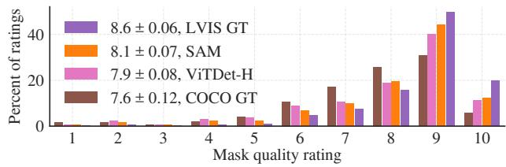  
Figure 11: 来自我们人工评估研究中 ViTDet 和 SAM 的掩码质量评分分布，两者均应用于 LVIS 真实标注边界框（ground truth boxes）。我们还报告了 LVIS 和 COCO 的真实标注质量。图例显示了评分均值和 95% 置信区间。尽管其 AP 较低（Table 5），SAM 的评分却高于 ViTDet，这表明 ViTDet 利用了 COCO 和 LVIS 训练数据中的偏差。

我们推测，在掩码 AP 差距较大且真实标注质量相对较低的 COCO 上（正如人工研究所证实的那样），ViTDet 学习了 COCO 掩码的特定偏差。SAM 作为一种零样本方法，无法利用这些（通常是不期望的）偏差。LVIS 数据集具有更高质量的真实标注，但仍存在特定的特性（例如，掩码不包含孔洞，按构造它们是简单多边形）以及模态（modal）与非模态（amodal）掩码的偏差。同样，SAM 没有经过训练来学习这些偏差，而 ViTDet 则可以利用它们。

## 7.5. 零样本文本到掩码 (Zero-Shot Text-to-Mask)

方法。最后，我们考虑一个更高层级的任务：从自由格式文本中分割目标。该实验是对 SAM 处理文本提示能力的概念验证。尽管我们在先前的所有实验中都使用了完全相同的 SAM，但在该实验中，SAM 的训练流程被修改为具备文本感知能力，且这种修改无需新的文本标注。具体而言，对于每个面积大于 1002 的手动收集掩码，我们提取其 CLIP 图像嵌入（image embedding）。然后，在训练期间，我们使用提取的 CLIP 图像嵌入作为 SAM 的第一次交互提示。这里的核心观察是，由于 CLIP 的图像嵌入在训练时已与其文本嵌入对齐，因此我们可以使用图像嵌入进行训练，而在推理时使用文本嵌入。也就是说，在推理阶段，我们将文本通过 CLIP 的文本编码器运行，然后将生成的文本嵌入作为提示输入给 SAM（详见 §D.5）。

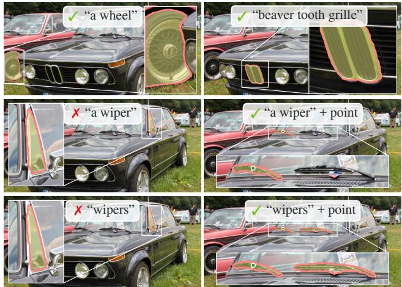  
Figure 12: 零样本文本到掩码（Zero-shot text-to-mask）。SAM 能够处理简单和具有细微差别的文本提示。当 SAM 无法做出正确预测时，额外的点提示可以提供帮助。

结果。我们在图 12（Fig. 12）中展示了定性结果。SAM 既能根据诸如“车轮”（a wheel）之类的简单文本提示分割目标，也能根据诸如“海狸牙式进气格栅”（beaver tooth grille）之类的短语进行分割。当 SAM 仅凭文本提示无法选出正确的目标时，额外的点提示通常可以修正预测结果，这与 [31] 类似。

## 7.6. 消融实验

我们在包含 23 个数据集的测试套件上，采用单中心点提示协议进行了多项消融实验。需要说明的是，单个点可能存在歧义，而真实标注（ground truth）中每个点仅包含单个掩码，可能无法体现这种歧义。由于 SAM 是在零样本迁移设定下运行，SAM 排名最高的掩码与数据标注规范产生的掩码之间可能存在系统性偏差。因此，我们还额外汇报了相对于真实标注而言的最佳掩码（“oracle”）。

图 13（Fig. 13）（左）绘制了 SAM 在使用来自数据引擎各阶段的累积数据进行训练时的性能。我们观察到，每个阶段都提升了 mIoU。当使用全部三个阶段的数据进行训练时，自动生成的掩码数量远远超过手动和半自动掩码。为了解决这一问题，我们发现在训练期间对手动和半自动掩码进行 10 倍过采样可以获得最佳效果。但这种设置使训练复杂化。因此，我们测试了第四种设置，即仅使用自动生成的掩码。使用这些数据时，SAM 的性能仅略低于使用全部数据的情况（约低 0.5 mIoU）。因此，为了简化训练设置，我们默认仅使用自动生成的掩码。

在图 13（中）中，我们考察了数据量的影响。完整的 SA-1B 包含 11M 张图像，我们在本次消融实验中将其均匀下采样至 1M 和 0.1M 张。在 0.1M 张图像时，我们观察到在所有设置下 mIoU 均出现大幅下降。然而，当使用 1M 张图像（约为完整数据集的 10%）时，我们观察到了与使用完整数据集相当的结果。该数据规模仍包含约 100M 个掩码（mask），对于许多应用场景而言可能是一个实用的设置。

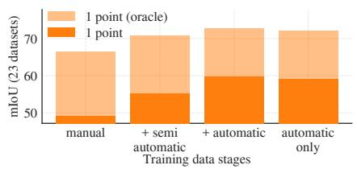

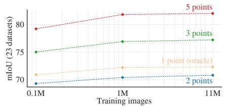

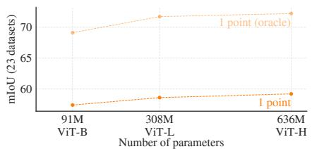  
Figure 13: 我们的数据引擎各阶段、图像编码器扩展以及训练数据扩展的消融研究。（左）数据引擎的每个阶段都在我们的 23 个数据集套件上带来了性能提升，且仅使用自动生成的数据（我们的默认设置）进行训练所取得的结果与使用全部三个阶段的数据相当。（中）使用约 10% 的 SA-1B 训练的 SAM 与使用全部 SA-1B 训练的效果相当。我们默认使用全部 11M 图像进行训练，但使用 1M 图像是一个合理的实用设置。（右）扩展 SAM 的图像编码器带来了显著但趋于饱和的增益。尽管如此，在某些特定场景下，较小的图像编码器可能更受青睐。

最后，图 13（右）展示了使用 ViT-B、ViT-L 和 ViT-H 图像编码器的结果。ViT-H 相比 ViT-B 有实质性的提升，但相比 ViT-L 仅有微弱的增益。目前看来，进一步扩展图像编码器的规模似乎收效甚微。

## 8. 讨论

基础模型（Foundation models）。自机器学习的早期阶段以来，预训练模型就已被适配到下游任务中 [99]。近年来，随着对规模的日益重视，这一范式变得越来越重要，此类模型最近被（重新）定义为“基础模型”（foundation models）：即“在大规模广泛数据上训练并能够适应广泛下游任务的模型”[8]。我们的工作与这一定义高度契合，但我们注意到，用于图像分割的基础模型在范围上本质上是有限的，因为它代表了计算机视觉中一个重要但局部的子集。我们还将我们方法的一个方面与 [8] 进行了对比，后者强调了自监督学习在基础模型中的作用。虽然我们的模型使用自监督技术（MAE [47]）进行初始化，但其绝大部分能力来自于大规模监督训练。在数据引擎能够扩大可用标注规模的情况下（如我们的工作），监督训练提供了一种有效的解决方案。

可组合性。预训练模型能够赋能甚至超越训练阶段所设想的全新能力。一个典型的例子是 CLIP [82] 作为组件在诸如 DALL·E [83] 等更大系统中的应用。我们的目标是通过 SAM 让这种组合变得直接而简单。我们旨在通过要求 SAM 针对广泛的分割提示预测出有效的掩码来实现这一目标。其效果是为 SAM 与其他组件之间创建了一个可靠的接口。例如，MCC [106] 可以轻松利用 SAM 分割出感兴趣的目标，并在从单张 RGB-D 图像进行 3D 重建时，对未见目标实现强大的泛化能力。在另一个例子中，SAM 可以通过可穿戴设备检测到的注视点进行提示，从而赋能新的应用。得益于 SAM 泛化到第一人称视角（ego-centric）图像等新领域的能力，此类系统无需额外训练即可工作。

局限性。尽管 SAM 总体表现良好，但它并不完美。它可能会遗漏精细结构，有时会虚构出细小的不连通成分，并且生成的边界不如“局部放大（zoom-in）”等计算密集型方法（例如 [18]）清晰。总体而言，当提供大量提示点时，我们预计专用的交互式分割方法（例如 [67]）会优于 SAM。与这些方法不同，SAM 是为通用性和广泛应用而设计的，而非为了高 IoU 的交互式分割。此外，尽管 SAM 可以实时处理提示，但在使用重型图像编码器时，SAM 的整体运行速度仍达不到实时水平。我们在文本到掩码（text-to-mask）任务上的尝试是探索性的，并且不够完全鲁棒，不过我们相信通过更多努力可以对其进行改进。虽然 SAM 可以执行许多任务，但目前尚不清楚如何设计简单的提示来实现语义分割和全景分割。最后，还有一些特定领域的工具（例如 [7]），我们预计它们在各自领域内的表现将超越 SAM。

结论。Segment Anything 项目是一项将图像分割提升至基础模型时代的尝试。我们的主要贡献包括一项新任务（可提示分割）、一个模型（SAM）以及一个数据集（SA-1B），正是它们促成了这一飞跃。SAM 是否能取得基础模型的地位，仍有待观察其在社区中的使用情况，但无论如何，我们期望这项工作的视角、超过 1B 掩码的发布以及我们的可提示分割模型将有助于为未来的道路铺平方向。

致谢。我们要感谢 Aaron Adcock 和 Jitendra Malik 提供的有益讨论。感谢 Vaibhav Aggarwal 和 Yanghao Li 在扩展模型方面的帮助。感谢 Cheng-Yang Fu、Jiabo Hu 和 Robert Kuo 在数据标注平台方面的帮助。感谢 Allen Goodman 和 Bram Wasti 在优化我们模型的 Web 版本方面的帮助。最后，感谢 Morteza Behrooz、Ashley Gabriel、Ahuva Goldstand、Sumanth Gurram、Somya Jain、Devansh Kukreja、Joshua Lane、Lilian Luong、Mallika Malhotra、William Ngan、Omkar Parkhi、Nikhil Raina、Dirk Rowe、Neil Sejoor、Vanessa Stark、Bala Varadarajan 以及 Zachary Winstrom 在制作演示（demo）、数据集查看器（dataset viewer）以及其他资产和工具方面的帮助。

## 参考文献

[1] Edward H Adelson. On seeing stuff: the perception of materials by humans and machines. Human vision and electronic imaging VI, 2001. 5

[2] Bogdan Alexe, Thomas Deselaers, and Vittorio Ferrari. What is an object? CVPR, 2010. 4, 10

[3] Pablo Arbelaez, Michael Maire, Charless Fowlkes, and Jitendra´ Malik. Contour detection and hierarchical image segmentation. TPAMI, 2010. 4, 10, 21, 28

[4] Jimmy Lei Ba, Jamie Ryan Kiros, and Geoffrey E Hinton. Layer normalization. arXiv:1607.06450, 2016. 16

[5] Hangbo Bao, Li Dong, and Furu Wei. BEiT: BERT pre-training of image transformers. arXiv:2106.08254, 2021. 17

[6] Dina Bashkirova, Mohamed Abdelfattah, Ziliang Zhu, James Akl, Fadi Alladkani, Ping Hu, Vitaly Ablavsky, Berk Calli, Sarah Adel Bargal, and Kate Saenko. ZeroWaste dataset: Towards deformable object segmentation in cluttered scenes. CVPR, 2022. 9, 20

[7] Stuart Berg, Dominik Kutra, Thorben Kroeger, Christoph N. Straehle, Bernhard X. Kausler, Carsten Haubold, Martin Schiegg, Janez Ales, Thorsten Beier, Markus Rudy, Kemal Eren, Jaime I. Cervantes, Buote Xu, Fynn Beuttenmueller, Adrian Wolny, Chong Zhang, Ullrich Koethe, Fred A. Hamprecht, and Anna Kreshuk. ilastik: interactive machine learning for (bio)image analysis. Nature Methods, 2019. 12

[8] Rishi Bommasani, Drew A Hudson, Ehsan Adeli, Russ Altman, Simran Arora, Sydney von Arx, Michael S Bernstein, Jeannette Bohg, Antoine Bosselut, Emma Brunskill, et al. On the opportunities and risks of foundation models. arXiv:2108.07258, 2021. 1, 12

[9] Gustav Bredell, Christine Tanner, and Ender Konukoglu. Iterative interaction training for segmentation editing networks. MICCAI, 2018. 17

[10] Tom Brown, Benjamin Mann, Nick Ryder, Melanie Subbiah, Jared D Kaplan, Prafulla Dhariwal, Arvind Neelakantan, Pranav Shyam, Girish Sastry, Amanda Askell, Sandhini Agarwal, Ariel Herbert-Voss, Gretchen Krueger, Tom Henighan, Rewon Child, Aditya Ramesh, Daniel Ziegler, Jeffrey Wu, Clemens Winter, Chris Hesse, Mark Chen, Eric Sigler, Mateusz Litwin, Scott Gray, Benjamin Chess, Jack Clark, Christopher Berner, Sam McCandlish, Alec Radford, Ilya Sutskever, and Dario Amodei. Language models are few-shot learners. NeurIPS, 2020. 1, 4

[11] Zhaowei Cai and Nuno Vasconcelos. Cascade R-CNN: 深入探究高质量目标检测. CVPR, 2018. 10

[12] Juan C. Caicedo, Allen Goodman, Kyle W. Karhohs, Beth A. Cimini, Jeanelle Ackerman, Marzieh Haghighi, CherKeng Heng, Tim Becker, Minh Doan, Claire McQuin, Mohammad Rohban, Shantanu Singh, and Anne E. Carpenter. 跨成像实验的细胞核分割：2018 Data Science Bowl. Nature Methods, 2019. 9, 19, 20

[13] John Canny. 一种边缘检测的计算方法. TPAMI, 1986. 10, 21

[14] Nicolas Carion, Francisco Massa, Gabriel Synnaeve, Nicolas Usunier, Alexander Kirillov, and Sergey Zagoruyko. 基于 Transformers 的端到端目标检测. ECCV, 2020. 5, 16, 17

[15] Guillaume Charpiat, Matthias Hofmann, and Bernhard Scholkopf.¨ 基于多模态预测的自动图像着色. ECCV, 2008. 5, 17

[16] Neelima Chavali, Harsh Agrawal, Aroma Mahendru, and Dhruv Batra. 目标候选区域评估协议是“可被操纵的”. CVPR, 2016. 10, 21

[17] Jiazhou Chen, Yanghui Xu, Shufang Lu, Ronghua Liang, and Liangliang Nan. MVS 建筑物的 3D 实例分割. IEEE Transactions on Geoscience and Remote Sensing, 2022. 9, 19, 20, 23, 24

[18] Xi Chen, Zhiyan Zhao, Yilei Zhang, Manni Duan, Donglian Qi, and Hengshuang Zhao. FocalClick：迈向实用的交互式图像分割. CVPR, 2022. 8, 9, 12, 19

[19] Bowen Cheng, Ishan Misra, Alexander G Schwing, Alexander Kirillov, and Rohit Girdhar. 用于通用图像分割的 Masked-attention Mask Transformer. CVPR, 2022. 4

[20] Bowen Cheng, Alex Schwing, and Alexander Kirillov. 语义分割不仅需要逐像素分类. NeurIPS, 2021. 5, 16, 17

[21] Aakanksha Chowdhery, Sharan Narang, Jacob Devlin, Maarten Bosma, Gaurav Mishra, Adam Roberts, Paul Barham, Hyung Won Chung, Charles Sutton, Sebastian Gehrmann, et al. PaLM：利用 Pathways 扩展语言建模. arXiv:2204.02311, 2022. 1

[22] Luca Ciampi, Carlos Santiago, Joao Costeira, Claudio Gennaro, and Giuseppe Amato. 交通密度估计的域自适应. International Joint Conference on Computer Vision, Imaging and Computer Graphics Theory and Applications, 2021. 9, 20

[23] Luca Ciampi, Carlos Santiago, Joao Costeira, Claudio Gennaro, and Giuseppe Amato. 昼夜实例分割停车场（NDIS-Park）数据集：用于停车场车辆检测、分割和计数的昼夜拍摄图像集. Zenodo, 2022. 9, 20

[24] Nadav Cohen, Yael Newman, and Ariel Shamir. 艺术绘画中的语义分割. Computer Graphics Forum, 2022. 9, 19, 20, 23, 24

[25] Marius Cordts, Mohamed Omran, Sebastian Ramos, Timo Rehfeld, Markus Enzweiler, Rodrigo Benenson, Uwe Franke, Stefan Roth, and Bernt Schiele. 用于语义城市场景理解的 Cityscapes 数据集. CVPR, 2016. 9, 19, 20

[26] Bruno da Silva, George Konidaris, and Andrew Barto. 参数化技能学习. ICML, 2012. 4

[27] Dima Damen, Hazel Doughty, Giovanni Maria Farinella, Antonino Furnari, Jian Ma, Evangelos Kazakos, Davide Moltisanti, Jonathan Munro, Toby Perrett, Will Price, and Michael Wray. Rescaling egocentric vision: Collection, pipeline and challenges for EPIC-KITCHENS-100. IJCV, 2022. 9, 20, 23, 24

[28] Ahmad Darkhalil, Dandan Shan, Bin Zhu, Jian Ma, Amlan Kar, Richard Higgins, Sanja Fidler, David Fouhey, and Dima Damen. EPIC-KITCHENS VISOR benchmark: Video segmentations and object relations. NeurIPS, 2022. 9, 19, 20, 23, 24

[29] Terrance De Vries, Ishan Misra, Changhan Wang, and Laurens Van der Maaten. Does object recognition work for everyone? CVPR workshops, 2019. 18

[30] Mark D´ıaz, Ian Kivlichan, Rachel Rosen, Dylan Baker, Razvan Amironesei, Vinodkumar Prabhakaran, and Emily Denton. Crowd-WorkSheets: Accounting for individual and collective identities underlying crowdsourced dataset annotation. ACM Conference on Fairness, Accountability, and Transparency, 2022. 25

[31] Henghui Ding, Scott Cohen, Brian Price, and Xudong Jiang. PhraseClick: toward achieving flexible interactive segmentation by phrase and click. ECCV, 2020. 11

[32] Piotr Dollar and C Lawrence Zitnick. Fast edge detection using´ structured forests. TPAMI, 2014. 21

[33] Alexey Dosovitskiy, Lucas Beyer, Alexander Kolesnikov, Dirk Weissenborn, Xiaohua Zhai, Thomas Unterthiner, Mostafa Dehghani, Matthias Minderer, Georg Heigold, Sylvain Gelly, Jakob Uszkoreit, and Neil Houlsby. An image is worth 16x16 words: Transformers for image recognition at scale. ICLR, 2021. 5, 8, 16

[34] Alireza Fathi, Xiaofeng Ren, and James M. Rehg. Learning to recognize objects in egocentric activities. CVPR, 2011. 9, 19, 20

[35] Pedro F Felzenszwalb and Daniel P Huttenlocher. Efficient graphbased image segmentation. IJCV, 2004. 10

[36] Thomas B. Fitzpatrick. The validity and practicality of sun-reactive skin types i through vi. Archives of Dermatology, 1988. 8

[37] Marco Forte, Brian Price, Scott Cohen, Ning Xu, and Franc¸ois Pitie. Getting to 99% accuracy in interactive segmentation.´ arXiv:2003.07932, 2020. 5, 17

[38] Jean-Michel Fortin, Olivier Gamache, Vincent Grondin, Franc¸ois Pomerleau, and Philippe Giguere. Instance segmentation for au-\` tonomous log grasping in forestry operations. IROS, 2022. 9, 20

[39] Timnit Gebru, Jamie Morgenstern, Briana Vecchione, Jennifer Wortman Vaughan, Hanna Wallach, Hal Daume Iii, and Kate´ Crawford. Datasheets for datasets. Communications of the ACM, 2021. 25

[40] Golnaz Ghiasi, Yin Cui, Aravind Srinivas, Rui Qian, Tsung-Yi Lin, Ekin D Cubuk, Quoc V Le, and Barret Zoph. Simple copy-paste is a strong data augmentation method for instance segmentation. CVPR, 2021. 16, 18, 22

[41] Ross Girshick, Jeff Donahue, Trevor Darrell, and Jitendra Malik. Rich feature hierarchies for accurate object detection and semantic segmentation. CVPR, 2014. 10

[42] Priya Goyal, Piotr Dollar, Ross Girshick, Pieter Noordhuis, Lukasz´ Wesolowski, Aapo Kyrola, Andrew Tulloch, Yangqing Jia, and Kaiming He. Accurate, large minibatch SGD: Training ImageNet in 1 hour. arXiv:1706.02677, 2017. 17

[43] Kristen Grauman, Andrew Westbury, Eugene Byrne, Zachary Chavis, Antonino Furnari, Rohit Girdhar, Jackson Hamburger, Hao Jiang, Miao Liu, Xingyu Liu, Miguel Martin, Tushar Nagarajan, Ilija Radosavovic, Santhosh Kumar Ramakrishnan, Fiona Ryan, Jayant Sharma, Michael Wray, Mengmeng Xu, Eric Zhongcong Xu, Chen Zhao, Siddhant Bansal, Dhruv Batra, Vincent Cartillier, Sean Crane, Tien Do, Morrie Doulaty, Akshay Erapalli, Christoph Feichtenhofer, Adriano Fragomeni, Qichen Fu, Christian Fuegen, Abrham Gebreselasie, Cristina Gonzalez, James Hillis, Xuhua Huang, Yifei Huang, Wenqi Jia, Weslie Khoo, Jachym Kolar, Satwik Kottur, Anurag Kumar, Federico Landini, Chao Li, Yanghao Li, Zhenqiang Li, Karttikeya Mangalam, Raghava Modhugu, Jonathan Munro, Tullie Murrell, Takumi Nishiyasu, Will Price, Paola Ruiz Puentes, Merey Ramazanova, Leda Sari, Kiran Somasundaram, Audrey Southerland, Yusuke Sugano, Ruijie Tao, Minh Vo, Yuchen Wang, Xindi Wu, Takuma Yagi, Yunyi Zhu, Pablo Arbelaez, David Crandall, Dima Damen, Giovanni Maria Farinella, Bernard Ghanem, Vamsi Krishna Ithapu, C. V. Jawahar, Hanbyul Joo, Kris Kitani, Haizhou Li, Richard Newcombe, Aude Oliva, Hyun Soo Park, James M. Rehg, Yoichi Sato, Jianbo Shi, Mike Zheng Shou, Antonio Torralba, Lorenzo Torresani, Mingfei Yan, and Jitendra Malik. Ego4D: Around the World in 3,000 Hours of Egocentric Video. CVPR, 2022. 20

[44] Agrim Gupta, Piotr Dollar, and Ross Girshick. LVIS: A dataset for large vocabulary instance segmentation. CVPR, 2019. 2, 6, 7, 9, 10, 11, 19, 20, 21, 24

[45] Abner Guzman-Rivera, Dhruv Batra, and Pushmeet Kohli. Multiple choice learning: Learning to produce multiple structured outputs. NeurIPS, 2012. 5, 17

[46] Timm Haucke, Hjalmar S. Kuhl, and Volker Steinhage.¨ SOCRATES: Introducing depth in visual wildlife monitoring using stereo vision. Sensors, 2022. 9, 20

[47] Kaiming He, Xinlei Chen, Saining Xie, Yanghao Li, Piotr Dollar,´ and Ross Girshick. Masked autoencoders are scalable vision learners. CVPR, 2022. 5, 8, 12, 16, 17

[48] Kaiming He, Georgia Gkioxari, Piotr Dollar, and Ross Girshick.´ Mask R-CNN. ICCV, 2017. 10

[49] Kaiming He, Xiangyu Zhang, Shaoqing Ren, and Jian Sun. Deep residual learning for image recognition. CVPR, 2016. 16

[50] Dan Hendrycks and Kevin Gimpel. Gaussian error linear units (gelus). arXiv:1606.08415, 2016. 16

[51] Jordan Hoffmann, Sebastian Borgeaud, Arthur Mensch, Elena Buchatskaya, Trevor Cai, Eliza Rutherford, Diego de Las Casas, Lisa Anne Hendricks, Johannes Welbl, Aidan Clark, et al. Training compute-optimal large language models. arXiv:2203.15556, 2022. 1

[52] Jungseok Hong, Michael Fulton, and Junaed Sattar. TrashCan: A semantically-segmented dataset towards visual detection of marine debris. arXiv:2007.08097, 2020. 9, 19, 20

[53] Gao Huang, Yu Sun, Zhuang Liu, Daniel Sedra, and Kilian Q Weinberger. Deep networks with stochastic depth. ECCV, 2016. 17

[54] Jitesh Jain, Jiachen Li, MangTik Chiu, Ali Hassani, Nikita Orlov, and Humphrey Shi. Oneformer: One transformer to rule universal image segmentation. arXiv:2211.06220, 2022. 4

[55] Chao Jia, Yinfei Yang, Ye Xia, Yi-Ting Chen, Zarana Parekh, Hieu Pham, Quoc Le, Yun-Hsuan Sung, Zhen Li, and Tom Duerig. Scaling up visual and vision-language representation learning with noisy text supervision. ICML, 2021. 1

[56] Jared Kaplan, Sam McCandlish, Tom Henighan, Tom B Brown, Benjamin Chess, Rewon Child, Scott Gray, Alec Radford, Jeffrey Wu, and Dario Amodei. Scaling laws for neural language models. arXiv:2001.08361, 2020. 1

[57] Michael Kass, Andrew Witkin, and Demetri Terzopoulos. Snakes: Active contour models. IJCV, 1988. 4

[58] Dahun Kim, Tsung-Yi Lin, Anelia Angelova, In So Kweon, and Weicheng Kuo. Learning open-world object proposals without learning to classify. IEEE Robotics and Automation Letters, 2022. 21

[59] Alexander Kirillov, Kaiming He, Ross Girshick, Carsten Rother, and Piotr Dollar. Panoptic segmentation. CVPR, 2019. 4

[60] Alina Kuznetsova, Hassan Rom, Neil Alldrin, Jasper Uijlings, Ivan Krasin, Jordi Pont-Tuset, Shahab Kamali, Stefan Popov, Matteo Malloci, Alexander Kolesnikov, Tom Duerig, and Vittorio Ferrari. The open images dataset v4: Unified image classification, object detection, and visual relationship detection at scale. IJCV, 2020. 2, 6, 7, 18, 19

[61] Alexandre Lacoste, Alexandra Luccioni, Victor Schmidt, and Thomas Dandres. Quantifying the carbon emissions of machine learning. arXiv:1910.09700, 2019. 28

[62] Yanghao Li, Hanzi Mao, Ross Girshick, and Kaiming He. Exploring plain vision transformer backbones for object detection. ECCV, 2022. 5, 10, 11, 16, 21, 23, 24

[63] Yin Li, Zhefan Ye, and James M. Rehg. Delving into egocentric actions. CVPR, 2015. 9, 20

[64] Zhuwen Li, Qifeng Chen, and Vladlen Koltun. Interactive image segmentation with latent diversity. CVPR, 2018. 5, 17, 19

[65] Tsung-Yi Lin, Priya Goyal, Ross Girshick, Kaiming He, and Piotr Dollar. Focal loss for dense object detection. ICCV, 2017. 5, 17

[66] Tsung-Yi Lin, Michael Maire, Serge Belongie, James Hays, Pietro Perona, Deva Ramanan, Piotr Dollar, and C Lawrence Zitnick. Microsoft COCO: Common objects in context. ECCV, 2014. 2, 4, 6, 7, 11, 18, 19, 20

[67] Qin Liu, Zhenlin Xu, Gedas Bertasius, and Marc Niethammer. SimpleClick: Interactive image segmentation with simple vision transformers. arXiv:2210.11006, 2022. 8, 9, 12, 19

[68] Ilya Loshchilov and Frank Hutter. Decoupled weight decay regularization. ICLR, 2019. 17

[69] Cathy H Lucas, Daniel OB Jones, Catherine J Hollyhead, Robert H Condon, Carlos M Duarte, William M Graham, Kelly L Robinson, Kylie A Pitt, Mark Schildhauer, 以及 Jim Regetz. 全球海洋中的胶状浮游动物生物量：地理变异与环境驱动因素（Gelatinous zooplankton biomass in the global oceans: geographic variation and environmental drivers）. Global Ecology and Biogeography, 2014. 20

[70] Sabarinath Mahadevan, Paul Voigtlaender, 以及 Bastian Leibe. 迭代训练的交互式分割（Iteratively trained interactive segmentation）. BMVC, 2018. 4, 17

[71] Kevis-Kokitsi Maninis, Sergi Caelles, Jordi Pont-Tuset, 以及 Luc Van Gool. Deep extreme cut：从极值点到目标分割（Deep extreme cut: From extreme points to object segmentation）. CVPR, 2018. 6

[72] David Martin, Charless Fowlkes, Doron Tal, 以及 Jitendra Malik. 人工分割自然图像数据库及其在评估分割算法与测量生态统计中的应用（A database of human segmented natural images and its application to evaluating segmentation algorithms and measuring ecological statistics）. ICCV, 2001. 10, 21, 28

[73] Fausto Milletari, Nassir Navab, 以及 Seyed-Ahmad Ahmadi. V-Net：用于三维医学图像分割的全卷积神经网络（V-Net: Fully convolutional neural networks for volumetric medical image segmentation）. 3DV, 2016. 5, 17

[74] Massimo Minervini, Andreas Fischbach, Hanno Scharr, 以及 Sotirios A. Tsaftaris. 用于基于图像的植物表型分析的细粒度标注数据集（Finely-grained annotated datasets for imagebased plant phenotyping）. Pattern Recognition Letters, 2016. 9, 20

[75] Margaret Mitchell, Simone Wu, Andrew Zaldivar, Parker Barnes, Lucy Vasserman, Ben Hutchinson, Elena Spitzer, Inioluwa Deborah Raji, 以及 Timnit Gebru. 用于模型报告的模型卡（Model cards for model reporting）. Proceedings of the conference on fairness, accountability, and transparency, 2019. 25, 28

[76] Dim P Papadopoulos, Jasper RR Uijlings, Frank Keller, 以及 Vittorio Ferrari. 用于高效目标标注的极值点击（Extreme clicking for efficient object annotation）. ICCV, 2017. 6

[77] David Patterson, Joseph Gonzalez, Quoc Le, Chen Liang, Lluis-Miquel Munguia, Daniel Rothchild, David So, Maud Texier, 以及 Jeff Dean. 碳排放与大型神经网络训练（Carbon emissions and large neural network training）. arXiv:2104.10350, 2021. 28

[78] Matthew E Peters, Waleed Ammar, Chandra Bhagavatula, 以及 Russell Power. 基于双向语言模型的半监督序列标注（Semi-supervised sequence tagging with bidirectional language models）. Proceedings of the 55th Annual Meeting of the Associationfor Computational Linguistics, 2017. 18

[79] Mengyang Pu, Yaping Huang, Yuming Liu, Qingji Guan, 以及 Haibin Ling. EDTER：基于 Transformer 的边缘检测（EDTER: Edge detection with transformer）. CVPR, 2022. 10

[80] Mattia Pugliatti 以及 Francesco Topputo. DOORS：巨石分割数据集（DOORS: Dataset fOr bOuldeRs Segmentation）. Zenodo, 2022. 9, 20

[81] Jiyang Qi, Yan Gao, Yao Hu, Xinggang Wang, Xiaoyu Liu, Xiang Bai, Serge Belongie, Alan Yuille, Philip Torr, 以及 Song Bai. 遮挡视频实例分割：一个基准（Occluded video instance segmentation: A benchmark）. ICCV, 2022. 9, 20, 23, 24

[82] Alec Radford, Jong Wook Kim, Chris Hallacy, Aditya Ramesh, Gabriel Goh, Sandhini Agarwal, Girish Sastry, Amanda Askell, Pamela Mishkin, Jack Clark, 等. 从自然语言监督中学习可迁移的视觉模型（Learning transferable visual models from natural language supervision）. ICML, 2021. 1, 2, 4, 5, 8, 12, 16, 22

[83] Aditya Ramesh, Mikhail Pavlov, Gabriel Goh, Scott Gray, Chelsea Voss, Alec Radford, Mark Chen, 以及 Ilya Sutskever. 零样本从文本生成图像（Zero-shot textto-image generation）. ICML, 2021. 1, 4, 12

[84] Shaoqing Ren, Kaiming He, Ross Girshick, and Jian Sun. Faster R-CNN: Towards real-time object detection with region proposal networks. NeurIPS, 2015. 6, 10

[85] Xiaofeng Ren and Jitendra Malik. Learning a classification model for segmentation. ICCV, 2003. 4

[86] Mike Roberts, Jason Ramapuram, Anurag Ranjan, Atulit Kumar, Miguel Angel Bautista, Nathan Paczan, Russ Webb, and Joshua M. Susskind. Hypersim: A photorealistic synthetic dataset for holistic indoor scene understanding. ICCV, 2021. 9, 19, 20

[87] Candice Schumann, Susanna Ricco, Utsav Prabhu, Vittorio Ferrari, and Caroline Pantofaru. A step toward more inclusive people annotations for fairness. Proceedings ofthe 2021 AAAI/ACM Conference on AI, Ethics, and Society, 2021. 8, 19

[88] Sefik Ilkin Serengil and Alper Ozpinar. LightFace: A hybrid deep face recognition framework. ASYU, 2020. 26

[89] Sefik Ilkin Serengil and Alper Ozpinar. HyperExtended LightFace: A facial attribute analysis framework. ICEET, 2021. 26

[90] Jamie Shotton, John Winn, Carsten Rother, and Antonio Criminisi. TextonBoost: Joint appearance, shape and context modeling for mulit-class object recognition and segmentation. ECCV, 2006. 4

[91] Corey Snyder and Minh Do. STREETS: A novel camera network dataset for traffic flow. NeurIPS, 2019. 9, 20

[92] Konstantin Sofiiuk, Ilya A Petrov, and Anton Konushin. Reviving iterative training with mask guidance for interactive segmentation. ICIP, 2022. 5, 8, 9, 17, 19, 23, 24, 28

[93] Nitish Srivastava, Geoffrey Hinton, Alex Krizhevsky, Ilya Sutskever, and Ruslan Salakhutdinov. Dropout: A simple way to prevent neural networks from overfitting. The Journal of Machine Learning Research, 2014. 16

[94] Chris Stauffer and W Eric L Grimson. Adaptive background mixture models for real-time tracking. CVPR, 1999. 4

[95] Matthew Tancik, Pratul Srinivasan, Ben Mildenhall, Sara Fridovich-Keil, Nithin Raghavan, Utkarsh Singhal, Ravi Ramamoorthi, Jonathan Barron, and Ren Ng. Fourier features let net works learn high frequency functions in low dimensional domains. NeurIPS, 2020. 5, 16

[96] Yansong Tang, Yi Tian, Jiwen Lu, Jianjiang Feng, and Jie Zhou. Action recognition in RGB-D egocentric videos. ICIP, 2017. 20

[97] Yansong Tang, Zian Wang, Jiwen Lu, Jianjiang Feng, and Jie Zhou. Multi-stream deep neural networks for RGB-D egocentric action recognition. IEEE Transactions on Circuits and Systems for Video Technology, 2019. 20

[98] The World Bank. The world by income and regions, 2022. https://datatopics.worldbank.org/world-developmentindicators/the-world-by-income-and-region.html. 18

[99] Sebastian Thrun. Is learning the n-th thing any easier than learning the first? NeurIPS, 1995. 12

[100] Cameron Trotter, Georgia Atkinson, Matt Sharpe, Kirsten Richardson, A. Stephen McGough, Nick Wright, Ben Burville, and Per Berggren. NDD20: A large-scale few-shot dolphin dataset for coarse and fine-grained categorisation. arXiv:2005.13359, 2020. 9, 19, 20, 23, 24

[101] United States Environmental Protection Agency. Greenhouse Gas Equivalencies Calculator. https://www.epa.gov/energy/greenhousegas-equivalencies-calculator, 2022. 28

[102] Koen EA van de Sande, Jasper RR Uijlings, Theo Gevers, and Arnold WM Smeulders. Segmentation as selective search for object recognition. ICCV, 2011. 10

[103] Ashish Vaswani, Noam Shazeer, Niki Parmar, Jakob Uszkoreit, Llion Jones, Aidan N Gomez, Lukasz Kaiser, and Illia Polosukhin. Attention is all you need. NeurIPS, 2017. 5, 16

[104] Boying Wang, Libo Zhang, Longyin Wen, Xianglong Liu, and Yanjun Wu. Towards real-world prohibited item detection: A largescale x-ray benchmark. CVPR, 2021. 9, 19, 20

[105] Weiyao Wang, Matt Feiszli, Heng Wang, Jitendra Malik, and Du Tran. Open-world instance segmentation: Exploiting pseudo ground truth from learned pairwise affinity. CVPR, 2022. 21

[106] Chao-Yuan Wu, Justin Johnson, Jitendra Malik, Christoph Feichtenhofer, and Georgia Gkioxari. Multiview compressive coding for 3D reconstruction. CVPR, 2023. 12

[107] Jianxiong Xiao, James Hays, Krista Ehinger, Aude Oliva, and Antonio Torralba. SUN database: Large-scale scene recognition from abbey to zoo. CVPR, 2010. 20

[108] Saining Xie and Zhuowen Tu. Holistically-nested edge detection. ICCV, 2015. 10

[109] Ning Xu, Brian Price, Scott Cohen, Jimei Yang, and Thomas S Huang. Deep interactive object selection. CVPR, 2016. 4, 19

[110] Kaiyu Yang, Klint Qinami, Li Fei-Fei, Jia Deng, and Olga Russakovsky. Towards fairer datasets: Filtering and balancing the distribution of the people subtree in the imagenet hierarchy. Proceedings of the 2020 conference on fairness, accountability, and transparency, 2020. 8

[111] Lei Yang, Yan Zi Wei, Yisheng HE, Wei Sun, Zhenhang Huang, Haibin Huang, and Haoqiang Fan. iShape: A first step towards irregular shape instance segmentation. arXiv:2109.15068, 2021. 9, 20, 23, 24

[112] Senthil Yogamani, Ciaran Hughes, Jonathan Horgan, Ganesh Sistu,´ Padraig Varley, Derek O’Dea, Michal Uricar, Stefan Milz, Mar-´ tin Simon, Karl Amende, et al. WoodScape: A multi-task, multicamera fisheye dataset for autonomous driving. ICCV, 2019. 9, 20

[113] Lingzhi Zhang, Shenghao Zhou, Simon Stent, and Jianbo Shi. Finegrained egocentric hand-object segmentation: Dataset, model, and applications. ECCV, 2022. 9, 19, 20

[114] Wenwei Zhang, Jiangmiao Pang, Kai Chen, and Chen Change Loy. K-Net: Towards unified image segmentation. NeurIPS, 2021. 4

[115] Jieyu Zhao, Tianlu Wang, Mark Yatskar, Vicente Ordonez, and Kai-Wei Chang. Men also like shopping: Reducing gender bias amplification using corpus-level constraints. arXiv:1707.09457, 2017. 8

[116] Bolei Zhou, Agata Lapedriza, Aditya Khosla, Aude Oliva, and Antonio Torralba. Places: A 10 million image database for scene recognition. TPAMI, 2017. 20

[117] Bolei Zhou, Hang Zhao, Xavier Puig, Tete Xiao, Sanja Fidler, Adela Barriuso, and Antonio Torralba. Semantic understanding of scenes through the ADE20K dataset. IJCV, 2019. 2, 7, 9, 20

## 附录

## 目录：

• §A：Segment Anything 模型与任务细节

• §B：自动掩码生成细节

• §C：RAI 附加细节

• §D：实验实现细节

• §E：用户研究实验设计

• §F：数据集、标注与模型卡片（Model Cards）

• §G：标注指南

## A. Segment Anything 模型与任务细节

图像编码器（Image encoder）。通常而言，图像编码器可以是任何输出 $C \times H \times W$ 图像嵌入（embedding）的网络。出于可扩展性和利用强预训练模型的考虑，我们遵循 [62]，使用经过 MAE [47] 预训练的 Vision Transformer (ViT) [33]，并进行了极少量的调整以处理高分辨率输入，具体使用的是带有 14×14 窗口注意力（windowed attention）和四个等间距全局注意力块（global attention blocks）的 ViT-H/16。图像编码器的输出是输入图像下采样 16× 的嵌入。由于我们的运行时间目标是实时处理每个提示（prompt），因此我们可以承受较高的图像编码器 FLOPs，因为对于每张图像它们仅计算一次，而不是针对每个提示都计算一次。

遵循标准做法（例如 [40]），我们采用 1024×1024 的输入分辨率，该分辨率通过缩放图像并填充短边获得。因此图像嵌入为 64×64。为了降低通道维度，遵循 [62]，我们使用 1×1 卷积降至 256 个通道，随后接一个同样为 256 通道的 3×3 卷积。每个卷积后都接一个层归一化（layer normalization）[4]。

提示编码器（Prompt encoder）。稀疏提示（Sparse prompts）映射为 256 维向量嵌入的过程如下。一个点表示为该点位置的位置编码（positional encoding）[95] 与两个用于指示该点属于前景还是背景的可学习嵌入（learned embedding）之一的总和。一个框由一个嵌入对表示：(1) 其左上角的位置编码与表示“左上角”的可学习嵌入之和，以及 (2) 相同的结构但使用指示“右下角”的可学习嵌入。最后，为了表示自由格式的文本，我们使用来自 CLIP [82] 的文本编码器（通常而言任何文本编码器都是可行的）。在本节的其余部分，我们重点关注几何提示，并在 §D.5 中深入讨论文本提示。

密集提示（Dense prompts，即掩码）与图像具有空间对应关系。我们输入的掩码分辨率比输入图像低 4×，然后使用两个输出通道分别为 4 和 $^ { 1 6 , }$ 的 $2 \times 2$ 步长为 2 的卷积进一步下采样 4×。最后的 1×1 卷积将通道维度映射到 256。各层之间由 GELU 激活函数 [50] 和层归一化隔开。然后将掩码和图像嵌入进行逐元素相加。如果没有掩码提示，则在每个图像嵌入位置添加一个表示“无掩码”的可学习嵌入。

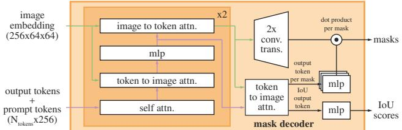  
Figure 14: 轻量级掩码解码器的细节。一个双层解码器通过交叉注意力同时更新图像嵌入（image embedding）和提示词元（prompt tokens）。随后图像嵌入被上采样放大，更新后的输出词元则用于动态预测掩码。（为了图面清晰未画出：在每个注意力层中，位置编码都会被加到图像嵌入中，并且完整的原始提示词元（包括位置编码）会被重新加到词元的 queries 和 keys 中。）

轻量级掩码解码器。该模块高效地将图像嵌入和一组提示嵌入映射为输出掩码。为了结合这些输入，我们从 Transformer 分割模型 [14, 20] 中汲取灵感，并修改了标准 Transformer 解码器 [103]。在应用我们的解码器之前，我们首先在提示嵌入集合中插入一个可学习的输出词元嵌入（output token embedding），该嵌入将用于解码器的输出，类似于 [33] 中的 [class] 词元。为简便起见，我们将这些嵌入（不包括图像嵌入）统称为“词元”（tokens）。

我们的解码器设计如图 Fig. 14 所示。每个解码器层执行 4 个步骤：(1) 对词元进行自注意力计算，(2) 从词元（作为 queries）到图像嵌入的交叉注意力计算，(3) 逐点 MLP 更新每个词元，以及 (4) 从图像嵌入（作为 queries）到词元的交叉注意力计算。最后这一步利用提示信息更新图像嵌入。在交叉注意力期间，图像嵌入被视为由 $6 4 ^ { 2 }$ 个 256 维向量组成的集合。每个自注意力/交叉注意力和 MLP 都包含残差连接 [49]、层归一化（layer normalization）以及训练时为 0.1 的 dropout [93]。下一个解码器层接收来自上一层更新后的词元和更新后的图像嵌入。我们使用双层解码器。

为确保解码器能够获取关键的几何信息，每当图像嵌入参与注意力层时，都会加入位置编码。此外，每当词元参与注意力层时，完整的原始提示词元（包括其位置编码）都会被重新添加到更新后的词元中。这使得模型能够高度依赖提示词元的几何位置和类型。

运行解码器后，我们使用两个转置卷积层将更新后的图像嵌入上采样 4 倍（此时相对于输入图像下采样了 4 倍）。然后，词元再次对图像嵌入进行注意力计算，我们将更新后的输出词元嵌入传递给一个小型 3 层 MLP，该 MLP 输出一个与上采样后图像嵌入通道维度相匹配的向量。最后，我们通过上采样后的图像嵌入与 MLP 输出之间的空间逐点乘积来预测掩码。

Transformer 使用 256 的嵌入维度（embedding dimension）。Transformer 的 MLP 块具有 2048 的较大内部维度，但 MLP 仅应用于提示词 token（prompt tokens），而这些 token 的数量相对较少（很少超过 20 个）。然而，在具有 64×64 图像嵌入的交叉注意力层中，为了计算效率，我们将查询（queries）、键（keys）和值（values）的通道维度缩减了 2 倍，降至 128。所有注意力层均使用 8 个头。

用于上采样输出图像嵌入的转置卷积（transposed convolutions）尺寸为 2×2、步长为 2，输出通道维度分别为 64 和 32，并带有 GELU 激活函数。它们之间通过层归一化（layer normalization）分隔。

使模型具备歧义感知能力（Making the model ambiguity-aware）。如前所述，单个输入提示可能存在歧义，即对应多个有效掩膜（valid masks），模型会倾向于学习对这些掩膜取平均。我们通过一个简单的修改消除了这一问题：不再预测单个掩膜，而是使用少量的输出 token 并同时预测多个掩膜。默认情况下，我们预测三个掩膜，因为我们观察到三个层次（整体、部分和子部分，即 whole, part, and subpart）通常足以描述嵌套掩膜。在训练期间，我们计算真实值（ground truth）与每个预测掩膜之间的损失（稍后描述），但仅从最低损失处进行反向传播。这是用于多输出模型的一种常见技术 [15, 45, 64]。为了在实际应用中使用，我们希望对预测的掩膜进行排序，因此我们添加了一个小型预测头（head，作用于一个额外的输出 token 上），用于估计每个预测掩膜与其所覆盖物体之间的 IoU。

在存在多个提示时，歧义性要罕见得多，并且三个输出掩膜通常会趋于相似。为了在训练时尽量减少退化损失（degenerate losses）的计算，并确保单个无歧义掩膜接收到常规的梯度信号，我们在给出多个提示时仅预测单个掩膜。这是通过添加第四个输出 token 用于额外的掩膜预测来实现的。对于单个提示，绝不返回这第四个掩膜；而对于多个提示，这第四个掩膜是唯一返回的掩膜。

损失函数（Losses）。遵循 [20, 14]，我们使用 focal loss [65] 和 dice loss [73] 的线性组合来监督掩膜预测，其中 focal loss 与 dice loss 的比例为 20:1。与 [20, 14] 不同的是，我们观察到在每个解码器层之后添加辅助深度监督（auxiliary deep supervision）并没有帮助。IoU 预测头使用 IoU 预测值与预测掩膜相对于真实掩膜的 IoU 之间的均方误差损失（mean-square-error loss）进行训练。它以 1.0 的恒定缩放因子添加到掩膜损失中。

训练算法。遵循近期的方法 [92, 37]，我们在训练期间模拟交互式分割设置。首先，以相等的概率为目标掩码随机选择一个前景点或边界框。点从真值掩码（ground truth mask）中均匀采样。边界框取自真值掩码的边界框，并在每个坐标上添加随机噪声，其标准差等于边界框边长的 10%，最大为 20 像素。这种噪声分布是在实例分割（在目标物体周围生成紧密框）和交互式分割（用户可能绘制宽松框）等应用之间的合理折衷。

在根据这第一个提示（prompt）做出预测后，后续的点从上一次掩码预测与真值掩码之间的误差区域中均匀采样。如果误差区域分别是假阴性（false negative）或假阳性（false positive），则每个新点相应地为前景或背景。我们还将上一次迭代的掩码预测作为额外提示提供给模型。为了向后续迭代提供最大量的信息，我们提供未经过阈值处理的掩码 logits（unthresholded mask logits），而不是二值化掩码。当返回多个掩码时，传递给下一次迭代并用于采样下一个点的掩码是预测 IoU 最高的掩码。

我们发现在迭代采样 8 个点之后收益递减（我们测试了多达 16 个点）。此外，为了促使模型从提供的掩码中获益，我们还增加了两次不采样额外点的迭代。其中一次迭代随机插入在 8 个迭代采样点之间，另一次则始终位于最后。这总共构成了 11 次迭代：1 个采样的初始输入提示、8 个迭代采样点，以及 2 次未向模型提供新外部信息的迭代（以便其学习细化自身的掩码预测）。我们注意到，之所以能够使用相对较多的迭代次数，是因为我们的轻量级掩码解码器（mask decoder）所需的计算量不足图像编码器（image encoder）的 1%，因此每次迭代仅增加很小的开销。这与以往在每次优化器更新中仅执行一次或几次交互步骤的交互式方法不同 [70, 9, 37, 92]。

训练方案。我们使用 AdamW [68] 优化器 $( \beta _ { 1 } =$ 0.9, $\beta _ { 2 } = 0 . 9 9 9 )$，并采用 250 次迭代的线性学习率预热（warmup）[42] 和阶梯式学习率衰减调度策略。预热后的初始学习率（lr）为 $\mathrm { 8 e ^ { - 4 } }$。我们训练 90k 次迭代（约 2 个 SA-1B epoch），并在 60k 次迭代和 86666 次迭代时分别将 lr 降低 10 倍。批量大小（batch size）为 256 张图像。为了对 SAM 进行正则化，我们将权重衰减（wd）设为 0.1，并应用比率为 0.4 的丢弃路径（drop path）[53]（dp）。我们使用 0.8 的逐层学习率衰减（layer-wise learning rate decay）[5]（ld）。不应用数据增强。我们使用 MAE [47] 预训练的 ViT-H 来初始化 SAM。由于庞大的图像编码器和 1024×1024 的输入尺寸，我们将训练分布在 256 块 GPU 上。为了限制 GPU 显存占用，我们在每块 GPU 上最多使用 64 个随机采样的掩码进行训练。此外，我们发现对 SA-1B 掩码进行轻度过滤以剔除覆盖图像 90% 以上的掩码，可以在定性上改善结果。

对于消融实验和其他训练变体（例如文本到掩码 §D.5），我们对上述默认方案进行了如下调整。当仅使用来自第一和第二数据引擎阶段的数据进行训练时，我们使用尺度范围为 [0.1, 2.0] 的大规模抖动（large-scale jitter）[40] 来增强输入。直观而言，当训练数据较为有限时，数据增强可能会有所帮助。为了训练 ViT-B 和 ViT-L，我们使用 180k 次迭代，批量大小为 128，分布在 128 块 GPU 上。对于 ViT-B/L，我们分别设置 $l r = \mathrm { 8 e ^ { - 4 } / 4 e ^ { - 4 } }$、ld = 0.6/0.8、wd = 0.1 以及 $d p = 0 . 6 / 0 . 4$。

## B. 自动掩码生成细节

在此我们讨论用于生成公开发布的 SA-1B 的数据引擎全自动阶段的细节。

裁剪。掩码是通过整幅图像上 32×32 的规则点网格，以及来自 2×2 和 4×4 部分重叠窗口的 20 个额外放大图像裁剪块生成的，分别使用 16×16 和 8×8 的规则点网格。原始高分辨率图像用于裁剪（这是我们唯一一次使用它们）。我们移除了接触裁剪块内部边界的掩码。我们分两个阶段应用了标准的基于边界框的贪心 NMS（出于效率考虑使用了边界框）：首先在每个裁剪块内部，其次在跨裁剪块之间。在裁剪块内部应用 NMS 时，我们使用模型预测的 IoU 对掩码进行排序。在跨裁剪块应用 NMS 时，我们根据掩码的来源裁剪块，从最放大的（即来自 4×4 裁剪块）到最少放大的（即原始图像）进行排序。在这两种情况下，我们均使用 0.7 的 NMS 阈值。

过滤。我们使用了三种过滤方式来提高掩码（mask）质量。首先，为了仅保留高置信度的掩码，我们根据模型预测的 IoU 得分进行过滤，阈值设为 88.0。其次，为了仅保留稳定的掩码，我们通过在不同数值下进行阈值化，对比了源自同一底层软掩码（soft mask）的两个二值掩码。仅当在 -1 和 +1 阈值化掩码对之间的 IoU 大于或等于 95.0 时，我们才保留该预测（即对 logits 在 0 处进行阈值化得到的二值掩码）。第三，我们注意到自动生成的掩码偶尔会覆盖整张图像。这些掩码通常没有研究价值，我们通过移除覆盖图像 95% 及以上的掩码来过滤它们。所有过滤阈值的选择，均旨在同时实现大量的掩码和高掩码质量，并由专业标注人员按照 §5 中描述的方法进行评判。

后处理。我们观察到两种可以通过后处理轻松缓解的错误类型。首先，估计有 4% 的掩码包含微小且虚假的连通分量。为解决这一问题，我们移除了面积小于 100 像素的连通分量（如果最大连通分量也低于此阈值，则移除整个掩码）。其次，估计还有 4% 的掩码包含微小且虚假的孔洞。为解决这一问题，我们填补了面积小于 100 像素的孔洞。孔洞被识别为反转掩码（inverted mask）中的连通分量。

自动掩码生成模型。我们训练了一个专门用于全自动掩码生成的 SAM 特别版本，它牺牲了一定的推理速度以换取更好的掩码生成特性。我们在此列出默认 SAM 与用于此处数据生成的 SAM 之间的差异：该模型仅在人工和半自动数据上训练；采用大规模抖动（large-scale jitter）数据增强 [40] 进行了更长时间的训练（177,656 次迭代，而非 90k 次）；模拟交互式训练仅使用点和掩码提示（无边界框），且训练期间每个掩码仅采样 4 个点（从默认的 9 个减少到 4 个加快了训练迭代速度，且对单点性能没有影响，尽管在使用更多点评估时会降低 mIoU）；最后，掩码解码器使用了 3 层而非 2 层。

SA-1B 示例。我们在 Fig. 2 中展示了 SA-1B 样本。更多示例请参阅我们的数据集浏览器（dataset explorer）。

## C. RAI 补充细节

推断 SA-1B 的地理信息。尽管 SA-1B 中的图像没有地理标签，但每张图像都有一段描述其内容和拍摄地点的说明文本（caption）。我们使用基于 Elmo 的命名实体识别模型 [78] 从这些说明文本中推断出图像的大致地理位置。提取出的每个地点实体都会映射到所有匹配的国家、省份和城市。说明文本通过优先考虑匹配的国家、其次是省份、最后是城市的方式映射到单一国家。我们注意到该方法存在歧义和潜在偏差（例如，“Georgia”可能指国家格鲁吉亚，也可能指美国乔治亚州）。因此，我们使用提取出的地点来对数据集进行整体分析，但不会发布推断出的地点。根据图像提供方的要求，说明文本将不会公开发布。

推断 COCO 和 Open Images 的地理信息。COCO [66] 和 Open Images [60] 数据集不提供地理位置。遵循 [29] 的做法，我们使用 Flickr API 检索地理元数据。我们检索了 COCO 训练集中 24% 图像（19,562 张图像）的位置，对于 Open Images 则检索了训练集中 18% 图像（在仅考虑带有掩码的图像后为 493,517 张图像）的位置。我们注意到该地理信息是近似的，且包含该信息的图像样本可能无法完全匹配整个数据集的分布。

推断收入信息。我们使用每张图像推断出的国家，根据世界银行（The World Bank）[98] 定义的等级来查询其收入水平。我们将中高收入和中低收入等级合并为一个中等收入等级。

<table><tr><td rowspan="2"></td><td colspan="2">mIoU（在）</td><td colspan="2">mIoU（在）</td></tr><tr><td>1 个点</td><td>3 个点</td><td>1 个点</td><td>3 个点</td></tr><tr><td colspan="3">感知性别表征</td><td colspan="2">感知年龄组</td></tr><tr><td>女性化</td><td> $76.3 \pm 1.1$ </td><td> $90.7 \pm 0.5$ </td><td>老年</td><td> $81.9 \pm 3.8$ </td></tr><tr><td>男性化</td><td> $81.0 \pm 1.2$ </td><td> $92.3 \pm 0.4$ </td><td>中年</td><td> $78.2 \pm 0.8$ </td></tr><tr><td></td><td></td><td></td><td>青年</td><td> $77.3 \pm 2.7$ </td></tr></table>

Table 6: SAM 在不同感知性别表征和年龄组上分割衣物的性能。感知性别的区间是不相交的，其中男性化的 mIoU 更高。年龄组的置信区间存在重叠。

人群分割的公平性。为了调查 SAM 在分割人群时的公平性，我们使用了针对 Open Images [60] 的 More Inclusive Annotations for People (MIAP) [87] 测试集标注，这使我们能够比较 SAM 在不同感知性别表征和感知年龄组中的性能表现。MIAP 提供了边界框标注，而我们在该分析中需要真实（ground truth）掩码。为了获得真实掩码，如果 Open Images 中的人物类别掩码与其对应的边界框在 MIAP 标注边界框的 1% 边距以内（基于相对边界框边长），我们便选取该掩码，最终获得了 3.9k 个掩码。

服装分割的公平性。我们将 §6 的分析扩展到服装分割。我们考察了 SAM 在服装分割上的性能与着装者属性之间的关系。我们使用了来自 Open Images 的全部 6.5k 个真实掩码，这些掩码的类别属于服装超类且位于 MIAP 的人物框内。在 Table 6 中，我们比较了不同感知性别表征和年龄组的性能表现。我们发现，SAM 在分割主要表现为男性表征的人的服装时表现更好，且两者的 95% 置信区间不重叠。当从 1 点评估增加到 3 点评估时，差距缩小。感知年龄组之间的差异并不显著。我们的结果表明，在使用单点提示时，跨感知性别表征的服装分割存在偏差，我们鼓励 SAM 的用户注意这一局限性。

## D. 实验实现细节

## D.1. 零样本单点有效掩码评估

数据集。我们构建了一个新的分割基准，使用来自先前工作的 23 个多样化分割数据集套件来评估我们模型的零样本迁移能力。每个数据集的描述见 Table 7。示例参见正文 Fig. 8。该套件涵盖了多个领域，包括第一视角（egocentric）[34, 28, 113]、显微镜 [12]、X 射线 [104]、水下 [52, 100]、航拍 [17]、仿真 [86]、驾驶 [25] 以及绘画 [24] 图像。为了高效评估，我们对掩码数量超过 15k 的数据集进行了下采样。具体而言，我们随机抽取图像，使得抽样图像中的掩码总数约为 10k。我们对所有数据集中的人脸进行了模糊处理。

点采样。我们的默认点采样遵循交互式分割中的标准做法 [109, 64, 92]。第一个点以确定性方式选取为距目标边界最远的点。随后的每个点都是距真实标注与先前预测之间误差区域边界最远的点。某些实验（在特别说明处）使用了一种更具挑战性的采样策略，其中第一个点是随机点，而不是确定性选择的“中心”点。随后的每个点均如上所述进行选择。该设置更好地反映了第一个点无法可靠地位于掩码中心附近的使用场景，例如基于视线注视（eye gaze）的提示。

**评估**。我们衡量在给出 $N$ 个点提示后的预测结果与真实标签（ground truth）掩码之间的 IoU，其中 $N =$ {1, 2, 3, 5, 9}，且点是通过上述任一策略迭代采样的。每个数据集的 mIoU 是该数据集中所有物体逐掩码 IoU 的平均值。最后，我们通过对所有 23 个数据集的 mIoU 取平均值来报告总体指标。我们的评估与标准的交互式分割评估协议不同，后者衡量的是达到 X% IoU 所需的平均点数（最多可达 20 个点）。我们关注仅使用一个或可能少数几个点后的预测结果，因为我们的许多用例仅涉及单个或极少数提示。考虑到我们注重实时提示处理的应用场景，我们预期最优秀的交互式分割模型在使用大量点时会超越 SAM。

**基准模型**。我们使用了三个近期强大的交互式基准模型：RITM [92]、FocalClick [18] 和 SimpleClick [67]。对于每个基准，我们均使用作者公开发布的在最广泛数据集上训练的最大模型。对于 RITM，我们使用作者介绍的在 COCO [66] 和 LVIS [44] 组合数据集上训练的 HRNet32 IT-M。对于 FocalClick，我们使用在包含 8 个不同分割数据集的“组合数据集”上训练的 SegFormerB3-S2 [18]。对于 SimpleClick，我们使用在 COCO 和 LVIS 组合数据集上训练的 ViT-H448。我们遵循建议的默认数据预处理策略（即数据增强或图像尺寸调整），并且不针对我们的评估更改或调整任何参数。在实验中，我们观察到在 23 个数据集套件的单点评估中，RITM 优于其他基准模型。因此，我们将 RITM 作为默认基准。在评估更多点时，我们会报告所有基准模型的结果。

**单点歧义性与预言机（Oracle）评估**。除了在 $N$ 个点提示后的 IoU 之外，我们还通过从 SAM 的三个预测掩码中选择与真实标签最匹配的一个进行评估（而不是像默认情况下那样使用 SAM 自身排序第一的掩码），以此报告 SAM 在 1 个点时的“预言机（oracle）”性能。该协议通过放宽必须在多个有效物体中猜出唯一正确掩码的要求，解决了可能存在的单点提示歧义问题。

<table><tr><td>数据集</td><td>缩写与链接</td><td>图像类型</td><td>描述</td><td>掩码类型</td><td>来源子集</td><td>采样图像数量</td><td>采样掩码数量</td></tr><tr><td>Plant Phenotyping Datasets Leaf Segmentation [74]</td><td>PPDLS</td><td>植物</td><td>烟草和拟南芥植物图像的叶片分割。</td><td>Instance</td><td>N/A</td><td>182</td><td>2347</td></tr><tr><td>BBBC038v1 from Broad Bioimage Benchmark Collection [12]</td><td>BBBC038v1</td><td>显微镜图像</td><td>多种场景下细胞的生物图像，用于测试细胞核分割的鲁棒性。</td><td>Instance</td><td>Train</td><td>227</td><td>10506</td></tr><tr><td>Dataset fOr bOuldeRs Segmentation [80]</td><td>DOORS</td><td>巨石</td><td>位于球形网格表面的单个巨石的分割掩码。</td><td>Instance</td><td>DS1</td><td>10000</td><td>10000</td></tr><tr><td>TimberSeg 1.0 [38]</td><td>TimberSeg</td><td>原木</td><td>各种环境和条件下木材堆中单根原木的分割掩码。图像从操作员视角拍摄。</td><td>Instance</td><td>N/A</td><td>220</td><td>2487</td></tr><tr><td>Northumberland Dolphin Dataset 2020 [100]</td><td>NDD20</td><td>水下</td><td>水上和水下拍摄的两种不同海豚物种图像的分割掩码。</td><td>Instance</td><td>N/A</td><td>4402</td><td>6100</td></tr><tr><td>Large Vocabulary Instance Segmentation [44]</td><td>LVIS</td><td>场景</td><td>COCO [66] 数据集的附加标注，用于支持长尾目标检测与分割的研究。</td><td>Instance</td><td>Validation (v0.5)</td><td>945</td><td>9642</td></tr><tr><td>STREETS [91]</td><td>STREETS</td><td>交通摄像头</td><td>交通监控录像中汽车的分割掩码。</td><td>Instance</td><td>N/A</td><td>819</td><td>9854</td></tr><tr><td>ZeroWaste-f [6]</td><td>ZeroWaste-f</td><td>废品回收</td><td>杂乱场景下形状各异的回收废品的分割掩码。</td><td>Instance</td><td>Train</td><td>2947</td><td>6155</td></tr><tr><td>iShape [111]</td><td>iShape</td><td>不规则形状</td><td>天线、原木、栅栏和衣架等不规则形状的分割掩码。</td><td>Instance</td><td>Validation</td><td>754</td><td>9742</td></tr><tr><td>ADE20K [117]</td><td>ADE20K</td><td>场景</td><td>来自 SUN [107] 和 Places [116] 数据集图像的目标及部件分割掩码。</td><td>Instance</td><td>Validation</td><td>302</td><td>10128</td></tr><tr><td>Occluded Video Instance Segmentation [81]</td><td>OVIS</td><td>遮挡</td><td>视频中的实例分割掩码，重点关注被遮挡的目标。</td><td>Instance</td><td>Train</td><td>2044</td><td>10011</td></tr><tr><td>Hypersim [86]</td><td>Hypersim</td><td>仿真</td><td>带有实例掩码的室内场景逼真合成数据集。</td><td>Instance</td><td>Evermotion archinteriors volumes 1-55 excluding 20,25,40,49</td><td>338</td><td>9445</td></tr><tr><td>Night and Day Instance Segmented Park [22, 23]</td><td>NDISPark</td><td>停车场</td><td>在不同天气条件和拍摄角度下，昼夜采集的停车场监控视频图像，用于车辆分割。</td><td>Instance</td><td>Train</td><td>111</td><td>2577</td></tr><tr><td>EPIC-KITCHENS VISOR [28, 27]</td><td>VISOR</td><td>第一人称视角</td><td>烹饪数据集 EPIC-KITCHENS [27] 的第一人称视角视频中手部和交互物体的分割掩码。</td><td>Instance</td><td>Validation</td><td>1864</td><td>10141</td></tr><tr><td>Plittersdorf dataset [46]</td><td>Plittersdorf</td><td>立体图像</td><td>使用 SOCRATES 双目红外触发相机拍摄的野生动物图像分割掩码。</td><td>Instance</td><td>Train, validation, test</td><td>187</td><td>546</td></tr><tr><td>Egocentric Hand-Object Segmentation [113]</td><td>EgoHOS</td><td>第一人称视角</td><td>细粒度第一人称手-物分割数据集。该数据集包含对现有数据集的掩码标注。</td><td>Instance</td><td>Train (including only Ego4D [43] and THU-READ [97, 96])</td><td>2940</td><td>9961</td></tr><tr><td>InstanceBuilding 2D [17]</td><td>IBD</td><td>无人机</td><td>标注有屋顶实例分割掩码的高分辨率无人机（UAV）图像。</td><td>Instance</td><td>Train (2D annotations)</td><td>467</td><td>11953</td></tr><tr><td>WoodScape [112]</td><td>WoodScape</td><td>鱼眼驾驶</td><td>带有分割掩码的鱼眼驾驶数据集。图像由四个环视摄像头拍摄。</td><td>Instance</td><td>Set 1</td><td>107</td><td>10266</td></tr><tr><td>Cityscapes [25]</td><td>Cityscapes</td><td>驾驶</td><td>带有分割掩码的街景立体视频。</td><td>Panoptic</td><td>Validation</td><td>293</td><td>9973</td></tr><tr><td>PIDray [104]</td><td>PIDRay</td><td>X光</td><td>行李 X 光图像中违禁品的分割掩码。</td><td>Instance</td><td>Test (hard)</td><td>3733</td><td>8892</td></tr><tr><td>Diverse Realism in Art Movements [24]</td><td>DRAM</td><td>绘画</td><td>用于艺术绘画语义分割的域适应数据集。</td><td>Semantic</td><td>Test</td><td>718</td><td>1179</td></tr><tr><td>TrashCan [52]</td><td>TrashCan</td><td>水下</td><td>水下无人潜航器（ROV）拍摄图像中垃圾的分割掩码。图像来源于 J-EDI [69] 数据集。</td><td>Instance</td><td>Train (instance task)</td><td>5936</td><td>9540</td></tr><tr><td>Georgia Tech Egocentric Activity Datasets [34, 63]</td><td>GTEA</td><td>第一人称视角</td><td>视频由四名不同受试者执行七类日常活动组成，并包含手部分割掩码。</td><td>Instance</td><td>Train (segmenting hands task)</td><td>652</td><td>1208</td></tr></table>

Table 7：用于评估基于点提示的零样本分割的分割数据集。这 23 个数据集涵盖了广泛的领域；参见“图像类型”（image type）列。为了提高评估效率，我们对掩码数量超过 15k 的数据集进行了子采样。具体而言，我们随机抽取图像，使得图像中的掩码总数约为 10k。

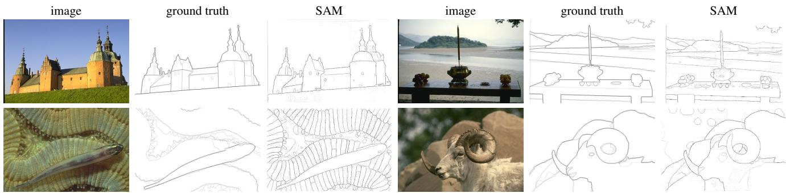  
Figure 15：在 BSDS500 上的零样本边缘预测的补充可视化。需要说明的是，SAM 并未针对预测边缘图进行训练，且在训练期间未接触过 BSDS 的图像及标注。

## D.2. 零样本边缘检测

数据集与评估指标。我们在 BSDS500 [72, 3] 上进行了零样本边缘检测实验。每幅图像的真值（ground truth）来自五个不同测试者的手工标注。我们在包含 200 张图像的测试子集上汇报结果，使用边缘检测的四项标准指标 [3, 32]：最佳数据集尺度（optimal dataset scale, ODS）、最佳图像尺度（optimal image scale, OIS）、平均精度（average precision, AP）以及精度在 50% 时的召回率（recall at 50% precision, R50）。

方法。对于零样本迁移，我们使用了自动掩码生成流程的简化版本。我们使用 16×16 的规则前景点网格提示 SAM，生成 768 个预测掩码（每个点 3 个）。我们没有根据预测的 IoU 或稳定性进行过滤。冗余掩码通过 NMS 去除。然后，我们对剩余掩码的未阈值化概率图应用 Sobel 滤波器，如果像素不与掩码的外边界像素相交，则将其值设为零。最后，我们在所有预测上取逐像素最大值，将结果线性归一化到 [0,1]，并应用边缘 NMS [13] 来细化边缘。

可视化。在 Fig. 15 中，我们展示了 SAM 零样本边缘预测的更多示例。这些定性示例进一步说明了 SAM 倾向于输出合理的边缘图，尽管它并未针对边缘检测进行训练。我们可以看到，边缘能够很好地与人类标注对齐。尽管正如前文所述，由于 SAM 未针对边缘检测进行训练，它没有学习 BSDS500 数据集的偏置，并且通常会输出比真值标注中更多的边缘。

## D.3. 零样本候选目标生成

数据集与评估指标。我们在 LVIS v1 验证集 [44] 上汇报针对 1000 个候选区域的掩码标准平均召回率（average recall, AR）指标。由于 LVIS 具有针对 1203 个目标类别的优质掩码，因此为候选目标生成提供了极具挑战性的测试。我们重点关注 AR@1000，这是因为我们模型具有开放世界特性，很可能会生成超出 LVIS 1203 个类别之外的许多有效掩码。为了衡量在常见（frequent）、普通（common）和罕见（rare）类别上的性能，我们使用 AR@1000，但仅针对包含相应 LVIS 类别的真值集合进行评估。

基线模型。我们使用级联 ViTDet-H 作为基线模型，它是 [62] 中在 LVIS 上按 AP 评估表现最强的模型。正如正文中所指出的，在域内训练的目标检测器可能会“迎合” AR [16] 指标，并且预计会比其他专注于开放世界候选区域生成或分割的模型 [58, 105] 是一个更强的基线。为了生成 1000 个候选区域，我们禁用了三个级联阶段中的分数阈值筛选，并将每个阶段的最大预测数量提高至 1000。

方法。我们使用经过修改的 SAM 自动掩码生成流程来进行零样本迁移。首先，为了使推理时间与 ViTDet 具有可比性，我们不对图像切块进行处理。其次，我们移除了基于预测 IoU 和稳定性的过滤。这样就留下了两个可调参数来在每张图像中获得约 1000 个掩码：输入点网格以及用于重复掩码抑制的 NMS 阈值。我们选择了 64×64 的点网格和 0.9 的 NMS 阈值，这在每张图像上平均生成约 900 个掩码。在评估时，如果单张图像中生成的掩码多于 1000 个，则按照其置信度与稳定性得分的平均值进行排序，然后截取前 1000 个候选区域。

我们推测，SAM 输出多个掩码的能力对于这项任务尤为宝贵，因为召回率应该能从单个输入点生成的多种尺度的候选区域中获益。为了检验这一点，我们与一个仅输出单个掩码而非三个掩码的消融版本 SAM（SAM - single-output）进行了对比。由于该模型生成的掩码较少，我们进一步将采样点数和 NMS 阈值分别提高到 128×128 和 0.95，平均每张图像获得约 950 个掩码。此外，单输出 SAM 不会生成自动掩码生成流程中用于对掩码进行 NMS 排序的 IoU 得分，因此掩码改为随机排序。测试表明，这种方式与更复杂的掩码排序方法（例如使用掩码的最大 logit 值作为模型置信度的替代指标）具有相近的性能。

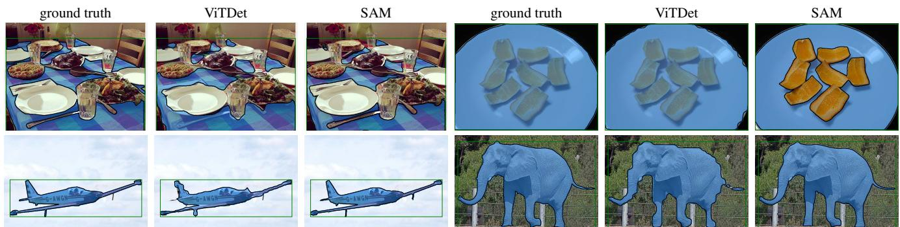  
Figure 16: LVIS v1 上的零样本实例分割。SAM 生成了比 ViTDet 质量更高的掩码。作为一个零样本模型，SAM 没有机会学习特定训练数据的偏差；以右上角为例，SAM 做出了模态（modal，仅可见部分）预测，而由于 LVIS 中的掩码标注不存在孔洞，LVIS 中的真实标注是非模态（amodal）的。

## D.4. 零样本实例分割

方法。对于零样本实例分割（zero-shot instance segmentation），我们使用全监督 ViTDet-H 在 COCO 和 LVIS v1 验证集上输出的边界框作为提示来输入 SAM。我们通过将置信度最高的预测掩码连同边界框提示一起重新输入到掩码解码器中，应用了一次额外的掩码细化迭代，以生成最终预测。我们在图 16（Fig. 16）中展示了在 LVIS 上预测的零样本实例分割结果。与 ViTDet 相比，SAM 倾向于生成具有更清晰边界的高质量掩码。我们在 §7.4 的人工评估中证实了这一观察结果。请注意，作为零样本模型，SAM 无法学习数据集中的标注偏差。例如，我们看到 SAM 对盘子做出了合理的模态（modal）预测，而在设计上 LVIS 掩码不能包含孔洞，因此盘子被标注为非模态（amodal）。

## D.5. 零样本文本到掩码（Zero-Shot Text-to-Mask）

模型与训练。我们使用公开可用的最大 CLIP 模型 [82]（ViT-L/14@336px）来计算文本和图像嵌入，并在使用前对其进行 $\ell ^ { 2 }$ 归一化。为了训练 SAM，我们使用来自数据引擎前两个阶段的掩码。此外，我们丢弃所有面积小于 $1 0 0 ^ { 2 }$ 像素的掩码。我们使用大规模抖动（largescale jitter）[40] 对该模型进行训练，共迭代 120k 次，批大小（batch size）为 128。所有其他训练参数均遵循我们的默认设置。

生成训练提示。为了提取输入提示，我们首先将每个掩码周围的边界框按 1× 到 2× 的随机比例进行扩展，对扩展后的边界框进行正方形裁剪以保持其纵横比，并将其调整为 336×336 像素。在将裁剪区域输入 CLIP 图像编码器之前，我们有 50% 的概率将掩码外部的像素置零。为了确保嵌入聚焦于物体，我们在最后一层使用掩码注意力（masked attention）来限制从输出 token 到掩码内部图像位置的注意力。最终，我们的提示就是输出 token 的嵌入。在训练时，我们首先提供基于 CLIP 的提示，随后提供额外的迭代点提示以细化预测。

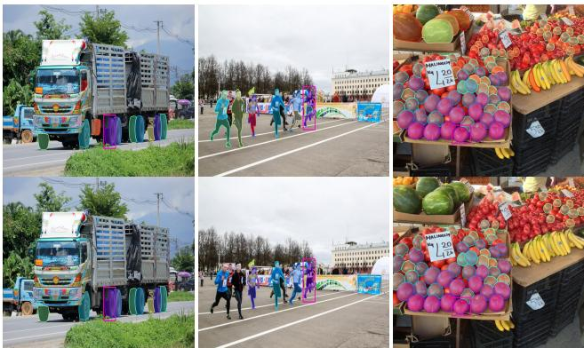  
Figure 17: 对来自 SAM 潜在空间的掩码嵌入相似度进行阈值处理的可视化。查询由洋红色框表示；顶行显示低阈值下的匹配，底行显示高阈值下的匹配。同一图像中最相似的掩码嵌入通常可以在语义上与查询掩码嵌入相似，即使 SAM 在训练时没有接受明确的语义监督。

推理。在推理过程中，我们直接使用未经任何修改的 CLIP 文本编码器为 SAM 创建提示。我们依托于文本和图像嵌入已被 CLIP 对齐的事实，这使我们能够在没有任何显式文本监督的情况下进行训练，同时在推理中使用基于文本的提示。

## D.6. 探索 SAM 的潜在空间（Probing the Latent Space of SAM）

最后，我们进行了一项初步研究，以定性探究 SAM 所学习的潜在空间（latent space）。特别地，尽管 SAM 未经过显式语义监督训练，我们仍对其表征是否能够捕获任何语义信息感兴趣。为此，我们通过从掩码周围的图像裁剪及其水平翻转版本中提取 SAM 的图像嵌入（image embedding），将图像嵌入与二值掩码相乘，并在空间位置上进行平均，从而计算出掩码嵌入。在 Fig. 17 中，我们展示了同一图像中查询掩码以及（在潜在空间中）相似掩码的 3 个示例。我们观察到，每个查询的最近邻都展现出了一定的（尽管并不完美）形状和语义相似性。尽管这些结果是初步的，但它们表明 SAM 的表征可用于多种目的，例如进一步的数据标注、理解数据集内容或作为下游任务的特征。

## E. 人工研究实验设计

在这里，我们详细介绍了在 §7.1 和 §7.4 中用于评估掩码质量的人工研究细节。人工研究的目的是解决使用与真实标注（ground truth）的 IoU 作为预测掩码质量度量标准的两个局限性。第一个局限性在于，对于诸如单点之类的模糊输入，如果模型返回了与真实标注不同但同样有效的对象掩码，可能会受到严厉的惩罚。第二个局限性在于真实掩码可能包含各种偏差，例如边缘质量的系统性误差，或者选择对遮挡对象进行模态（modally）或非模态（amodally）分割的决策。在域内训练的模型可以学习这些偏差并获得更高的 IoU，但并不一定产生更好的掩码。人工审查可以获得一种独立于底层真实掩码的掩码质量衡量标准，以缓解这些问题。

模型。对于单点评估，我们使用 RITM [92]、单输出 SAM 和 SAM 来检验两个假设。首先，我们假设当给定单点时，SAM 比基线交互式分割模型能产生视觉上更高质量的掩码，即使与真实标注的 IoU 等指标未能体现出这一点。其次，我们假设 SAM 消除掩码歧义的能力提高了单点输入的掩码质量，因为单输出 SAM 可能会返回对歧义掩码进行平均后的结果。

对于实例分割实验，我们评估了 cascade ViTDet-H [62] 和 SAM，以检验如下假设：即使 SAM 由于无法学习验证数据集的特定标注偏差而获得较低的 AP，它仍能产生视觉上更高质量的掩码。

数据集（Datasets）。对于单点实验，由于整套数据集规模过大无法进行人工审核，我们从 23 个数据集构成的集合中选择了 7 个数据集。我们选择了 LVIS v0.5 [17]、VISOR [28, 27]、DRAM [24]、IBD [17]、NDD20 [100]、OVIS [81] 和 iShape [111]，它们提供了多样化的图像集合，包括场景级、第一人称视角（ego-centric）、绘制、俯视、水下以及合成图像。此外，该集合既包含了 SAM 在 IoU 指标上优于 RITM 的数据集，也包含了相反情况的数据集。对于实例分割实验，我们使用 LVIS v1 验证集，以便与在 LVIS 上训练的 ViTDet 进行直接比较。

方法（Methodology）。我们将模型生成的掩码呈现给专业标注员，并要求他们根据提供的指南对每个掩码进行评分（完整指南参见 §G）。标注员来自为数据引擎收集手动标注掩码的同一家公司。标注员可以查看图像、单个模型的预测掩码以及模型的输入（单点或单个边界框），并被要求根据三个标准对掩码进行评判：该掩码是否对应一个有效物体？该掩码是否具有清晰的边界？以及该掩码是否与输入相对应？随后他们提交 1-10 分的评分，以表示掩码的整体质量。

1 分表示掩码完全不对应任何物体；低分（2-4 分）表示掩码存在巨大错误，例如包含了其他物体的巨大区域或具有大面积无意义的边界；中等分数（5-6 分）表示掩码大部分合理，但仍存在显著的语义或边界错误；高分（7-9 分）表示掩码仅有轻微的边界错误；10 分则用于没有可见错误的掩码。标注员可以使用五种不同的视图，每种视图都旨在帮助识别不同类型的错误。

对于单点实验，每个数据集随机选取 1000 个掩码，这些掩码来自用于零样本（zero-shot）交互式分割基准测试的相同子集（有关这些子集的详细信息请参见 §D.1）。模型输入是最中心点，计算为距掩码边缘距离变换的最大值。对于实例分割实验，从 LVIS v1 验证集中选择了 1000 个掩码，模型输入为 LVIS 真实标注边界框（ground truth box）。在所有实验中，尺寸小于 242 像素的掩码均被排除在采样之外，以避免向评分员展示因太小而无法准确评判的掩码。出于内存和显示的考虑，在预测掩码之前，大图像被缩放至最大边长为 2000。在所有实验中，向每个模型输入相同的内容以生成预测掩码。

为了进行比较，来自各个数据集的真值掩码（ground truth masks）也被提交进行评分。对于单点实验，这使得每个数据集总共有 4000 个评分任务（RITM、SAM 单输出、SAM 以及真值各 1000 个掩码）；对于实例分割实验，总共有 3000 个任务（ViTDet、SAM 和真值）。

对于每个数据集，这些任务以随机顺序插入到一个队列中，由 30 位标注人员从中领取任务。在审查研究的初步测试中，我们将每个任务分发给 5 位不同的标注人员，并发现评分具有合理的一致性：5 位标注人员评分的平均标准差为 0.83。此外，标注公司还部署了质量保证测试人员，对部分结果进行抽查，以防止严重偏离指南的情况。因此，在我们的实验中，每个任务（即对单张图像中的一个掩码进行评分）仅由一位标注人员完成。每位标注人员在每个任务上花费的平均时间为 90 秒，长于我们最初设定的 30 秒目标，但仍然足够快，从而能够在所选的 7 个数据集上收集大量的评分。

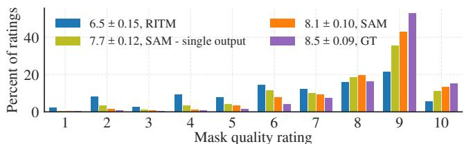  
(a) LVIS v0.5 [17]

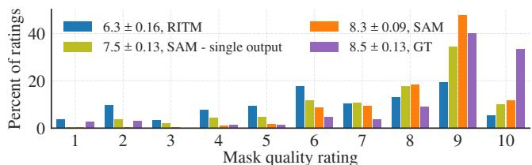  
(b) VISOR [28, 27]

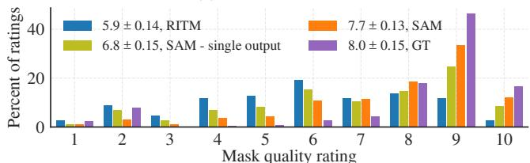  
(c) DRAM [24]

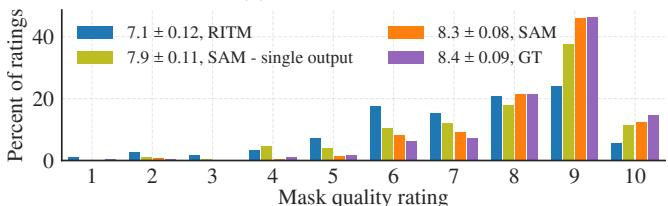

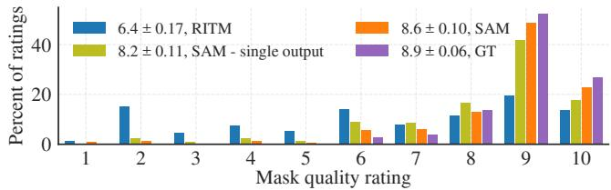  
(e) NDD20 [100]

(d) IBD [17]  
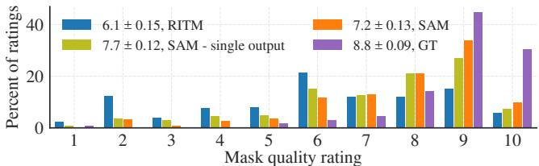  
(f) OVIS [81]

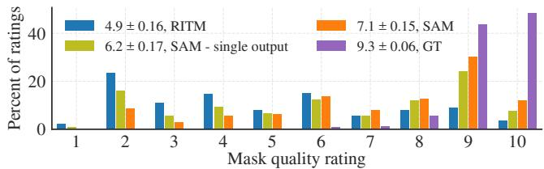  
(g) iShape [111]  
Figure 18: 来自我们人工评估研究的按数据集划分的掩码质量评分分布。

<table><tr><td rowspan="2">数据集</td><td colspan="2">SAM &gt; 基线</td><td colspan="2">SAM &gt; 单输出 SAM</td></tr><tr><td>p-value</td><td>CI99(Δμ)</td><td>p-value</td><td>CI99(Δμ)</td></tr><tr><td colspan="5">点输入（RITM [92] 基线）：</td></tr><tr><td>LVIS v0.5 [44]</td><td>4e-69</td><td>(1.40, 1.84)</td><td>2e-11</td><td>(0.29, 0.64)</td></tr><tr><td>VISOR [28, 27]</td><td>7e-98</td><td>(1.81, 2.24)</td><td>7e-26</td><td>(0.58, 0.94)</td></tr><tr><td>DRAM [24]</td><td>1e-76</td><td>(1.54, 2.00)</td><td>2e-24</td><td>(0.62, 1.03)</td></tr><tr><td>IBD [17]</td><td>2e-57</td><td>(1.03, 1.39)</td><td>1e-15</td><td>(0.32, 0.62)</td></tr><tr><td>NDD20 [100]</td><td>2e-86</td><td>(1.88, 2.37)</td><td>5e-08</td><td>(0.19, 0.55)</td></tr><tr><td>OVIS [81]</td><td>2e-64</td><td>(1.38, 1.84)</td><td>3e-10</td><td>(0.27, 0.63)</td></tr><tr><td>iShape [111]</td><td>2e-88</td><td>(1.97, 2.47)</td><td>7e-23</td><td>(0.65, 1.10)</td></tr><tr><td colspan="5">框输入（ViTDet-H [62] 基线）：</td></tr><tr><td>LVIS v1 [44]</td><td>2e-05</td><td>(0.11, 0.42)</td><td>N/A</td><td>N/A</td></tr></table>

Table 8: 统计检验表明，SAM 的掩码质量评分显著高于基线和单输出 SAM。P 值通过配对 t 检验计算，而均值差异的置信区间通过对 10k 个样本进行配对自举法（bootstrap）计算。所有 p 值均显著，且所有置信区间均不包含零。

结果。Fig. 18 展示了单点实验中各数据集评分的直方图。我们对两个假设进行了统计检验：(1) SAM 获得的分数高于基线模型（RITM 或 ViTDet），以及 (2) SAM 获得的分数高于单输出 SAM。P 值通过对模型得分均值进行配对 t 检验计算，我们还辅以基于 10k 个样本的配对自举检验，以求得均值差异的 99% 置信区间。Table 8 给出了这些检验的 p 值和置信区间。所有统计检验均高度显著，且所有置信区间均不包含零。

对于实例分割，正文中的 Fig. 11 展示了评分的直方图。为了与 COCO 真实标注（ground truth）进行对比，我们额外纳入了在人工审查流程测试期间收集的 794 个 COCO 真实标注掩码的评分。这些掩码以与 LVIS 结果完全相同的设置呈现给评估人员。为了公平对比，Fig. 11 中 LVIS 的结果对每个模型和真实标注都子采样至相同的 794 个输入。在 Table 8 中，使用全部 1000 个评分来进行统计检验，结果表明 SAM 相比 ViTDet 的掩码质量提升具有统计学显著性。

## F. 数据集、标注和模型卡片（Dataset, Annotation, and Model Cards）

在 §F.1 中，我们遵循 [39]，以问答列表的形式提供了 SA-1B 的数据集卡片（Dataset Card）。接下来，在 §F.2 中，我们遵循 CrowdWork-Sheets [30]，同样以问答列表的形式为 §4 中描述的数据引擎前两个阶段提供了数据标注卡片（Data Annotation Card）。我们在 Table 9 中遵循 [75] 提供了模型卡片（Model Card）。

## F.1. SA-1B 数据集卡片

## 动机

1. 创建该数据集的目的是什么？是否有特定的任务目标？是否存在需要填补的特定空白？请提供详细描述。我们的数据集对视觉社区的贡献体现在四个方面：(1) 我们发布了一个包含 1100 万张图像和 11 亿个掩码的数据集，这是迄今为止最大的分割数据集。(2) 我们发布的数据集具有隐私保护性：我们对所有图像中的人脸和车牌进行了模糊处理。(3) 该数据集依据广泛的使用条款进行许可，详情请见 https://ai.facebook.com/datasets/segment-anything 。(4) 该数据在地理分布上比以往的数据集更加多样化，我们希望它能让社区在构建更公平、更公正的模型方面更进一步。

2. 谁创建了该数据集（例如，哪个团队、研究小组），代表哪个实体（例如，公司、机构、组织）？该数据集由 Meta AI 的 FAIR 团队创建。基础图像是从一家第三方摄影公司收集并获得授权许可的。

3. 谁资助了该数据集的创建？如果有关联的资助项目，请提供资助方名称以及资助项目名称和编号。Meta AI 资助了该数据集的创建。

4. 是否有其他意见？无。

## 构成

1. 构成数据集的实例代表什么（例如，文档、照片、人物、国家）？是否存在多种类型的实例（例如，电影、用户和评分；人物及其之间的互动；节点和边）？请提供详细描述。数据集中的所有实例都是照片。照片的主题各不相同；常见的照片主题包括：地点、物体、场景。所有照片都是各不相同的，但存在一些针对同一主题拍摄的照片组。

2. 总共有多少个实例（如果适用，请按每种类型分别说明）？共有 1100 万张图像。

3. 该数据集是否包含所有可能的实例，还是来自更大集合的样本（不一定是随机的）？如果该数据集是一个样本，那么更大的集合是什么？该样本是否对更大的集合具有代表性（例如地理覆盖范围）？如果是，请描述如何验证/核实这种代表性。如果对更大的集合不具代表性，请说明原因（例如为了涵盖更多样化的实例范围，或者因为部分实例被保留或无法获取）。该数据集由从照片提供商处获得许可的图像组成。数据集包含所有获得许可的实例。这些图像是照片，即非艺术作品，不过存在少数例外。数据集包括为数据集中每张图像生成的所有掩码（masks）。我们保留了约 2k 张随机选择的图像用于测试目的。

4. 每个实例由什么数据组成？是“原始”数据（例如未处理的文本或图像）还是特征？无论哪种情况，请提供相关描述。数据集中的每个实例都是一张图像。图像经过处理，对人脸和车牌进行了模糊处理，以保护图像中人物的身份隐私。

5. 每个实例是否有相关联的标签或目标？如果有，请提供相关描述。每张图像都标注有掩码。掩码没有关联的类别或文本。平均每张图像有 ∼100 个掩码，总计约有 ∼1.1B 个掩码。

6. 单个实例是否存在任何信息缺失？如果有，请提供相关描述，并解释该信息缺失的原因（例如因为无法获取）。这不包括故意移除的信息，但可能包括例如被涂黑/隐去的文本。是的。每张图像都附带一段简短的说明文字（caption），以自由文本形式描述照片的内容和地点。根据我们与照片提供商的协议，我们不得公开这些说明文字。然而，我们在论文中使用它们来分析数据集的地理分布。

7. 单个实例之间的关系是否明确给出（例如用户的电影评分、社交网络链接）？如果是，请描述这些关系是如何明确呈现的。否，数据集中实例之间不存在已知的关联关系。

8. 数据集中是否存在任何错误、噪声源或冗余？如果有，请提供相关描述。错误：掩码由分割模型生成，因此掩码中可能存在错误或不一致之处。冗余：虽然没有两张完全相同的图像，但存在拍摄时间相近且针对同一主体的图像实例。

9. 该数据集是自包含的，还是链接到或依赖于外部资源（例如网站、推文、其他数据集）？如果链接到或依赖于外部资源，a) 是否能保证它们随着时间的推移依然存在且保持不变；b) 是否存在完整数据集的官方归档版本（即包括数据集创建时存在的外部资源）；c) 数据集的使用者是否受到与任何外部资源相关的限制（例如许可证、费用）？请酌情提供所有外部资源的描述以及与之相关的任何限制，并提供链接或其他访问接入点。该数据集是自包含的。

10. 数据集中是否包含可能被视为机密的数据（例如受法律特权保护或受医患保密协议保护的数据、包含个人非公开通信内容的数据）？如果是，请提供描述。否。

11. 该数据集是否包含若直接查看可能会令人反感、侮辱性、威胁性或以其他方式引发焦虑的数据？如果是，请说明原因。我们采取了两种安全措施来防止不良内容：(1) 照片均从照片提供商处获得许可，且必须符合该照片提供商的服务条款。我们要求从我们获得许可的图像中过滤掉所有不良内容。(2) 如果用户在数据集中发现不良图像，欢迎发送邮件至 segmentanything@meta.com 进行举报以便移除。尽管采取了这些措施，我们注意到仍有一小部分图像包含抗议或其他集会的场景，这些场景聚焦于不同范围的宗教信仰或政治观点，可能会令人反感。我们未能制定出能够移除所有此类图像的过滤策略，因此需要依靠用户来举报此类内容。

12. 该数据集是否标识了任何亚群体（例如按年龄、性别划分）？如果是，请描述如何识别这些亚群体，并提供它们在数据集中各自的分布情况。该数据集未标识照片中人物的任何亚群体。

13. 是否有可能从该数据集中直接或间接（即与其他数据结合）识别出个人（即一个或多个自然人）？如果是，请描述如何识别。不可能。图像均经过人脸模糊模型处理，以去除任何个人身份信息。如果用户发现任何匿名化问题，欢迎将问题及图像 ID 发送至 segment-anything@meta.com 进行举报。

14. 该数据集是否包含任何可能被视为敏感的数据（例如，揭示种族或族裔血统、性取向、宗教信仰、政治观点或工会成员身份的数据，或位置；财务或健康数据；生物识别或遗传数据；政府身份证明形式，如社会保障号码；犯罪记录）？如果是，请提供描述。该数据集包含抗议或其他集会的场景，这些场景可能暗示宗教信仰、政治观点或工会成员身份。但是，数据集中所有人的面部均已通过面部模糊进行了匿名化处理，因此无法识别数据集中任何人的身份。

15. 还有其他意见吗？没有。

## 收集过程

1. 与每个实例相关联的数据是如何获取的？数据是直接可观察的（例如，原始文本、电影评分），由受试者报告的（例如，调查问卷答复），还是从其他数据中间接推断/衍生的（例如，词性标注、基于模型的年龄或语言推测）？如果数据是由受试者报告的或从其他数据中间接推断/衍生的，数据是否经过了验证/核实？如果是，请描述如何进行的。与每个图像相关联的已发布掩码（mask）由我们的分割模型 SAM 自动推断。使用模型辅助的人工标注收集的掩码将不会发布。质量验证如 §5 所述。

2. 使用了哪些机制或程序来收集数据（例如，硬件设备或传感器、人工筛选、软件程序、软件 API）？这些机制或程序是如何验证的？数据集中的图像已从一家图像提供商处获得授权许可。它们都是摄影师使用不同相机拍摄的照片。

3. 如果数据集是来自更大集合的样本，抽样策略是什么（例如，确定性的、具有特定抽样概率的概率抽样）？出于测试目的，我们保留了约 2k 张随机选择的图像。其余获得许可的图像均包含在该数据集中。

4. 谁参与了数据收集过程（例如，学生、众包人员、外包商），他们是如何获得报酬的（例如，众包人员的薪酬是多少）？发布的掩码由 SAM 自动推断。有关我们模型辅助的人工标注过程的详细信息，请参阅 §E.2 中的数据标注卡（Data Annotation Card）。请注意，这些掩码将不会发布。

5. 数据是在什么时间范围内收集的？该时间范围是否与实例相关数据的创建时间范围一致（例如，近期爬取过去的旧新闻文章）？如果不一致，请描述与实例相关的数据创建的时间范围。获得许可的照片拍摄日期跨越了很长的年份跨度，最晚至 2022 年。

6. 是否进行了任何伦理审查流程（例如，由机构审查委员会进行）？如果是，请提供这些审查流程的描述，包括结果，以及指向任何支持文档的链接或其他访问途径。如果数据集与人无关，您可以跳过本节中的其余问题。我们进行了内部隐私审查，以评估并确定如何减轻与照片中人物隐私相关的任何潜在风险。对人脸和车牌进行模糊处理保护了照片中人物的隐私。

7. 您是直接从相关个人处收集数据，还是通过第三方或其他来源（例如网站）获取的数据？我们从第三方照片提供商处获得了该数据的许可。

8. 相关个人是否收到了关于数据收集的通知？如果是，请描述（或通过屏幕截图或其他信息展示）通知是如何提供的，并提供指向通知本身确切用语的链接或其他访问途径，或以其他方式复现该用语。图像是从第三方许可获得的，该第三方就根据要求从个人处收集任何通知和同意提供了适当的陈述。此外，所有可识别信息（例如人脸、车牌）均已模糊处理。根据数据集许可条款，禁止尝试识别图像或将图像与特定个人关联。

9. 相关个人是否同意收集和使用其数据？如果是，请描述（或通过屏幕截图或其他信息展示）是如何请求并提供同意的，并提供指向个人同意的确切用语的链接或其他访问途径，或以其他方式复现该用语。图像是从第三方许可获得的，该第三方就根据要求从个人处收集任何通知和同意提供了适当的陈述。此外，所有图像中的所有可识别信息（例如人脸、车牌）均已模糊处理。为免生疑问，根据数据集许可条款，禁止尝试识别图像或将图像与特定个人关联。

10. 如果获得了同意，是否向表示同意的个人提供了在未来或针对特定用途撤回其同意的机制？如果是，请提供该机制的描述以及指向该机制的链接或其他访问途径（如适用）。我们欢迎用户通过 segmentanything@meta.com 报告以请求删除图像。

11. 是否对数据集及其使用对数据主体的潜在影响进行了分析（例如数据保护影响分析）？如果是，请提供该分析的描述，包括结果，以及指向任何支持文档的链接或其他访问途径。为了消除对照片包含在数据集中的人物的任何潜在影响，可识别信息（人脸、车牌）均已模糊处理。

12. 还有其他评论吗？没有。

## 预处理 / 清洗 / 标注

1. 是否对数据进行了任何预处理 / 清洗 / 标注（例如，离散化或分桶、分词、词性标注、SIFT 特征提取、实例移除、缺失值处理）？如果是，请提供说明。如果不是，您可以跳过本节剩余的问题。我们对获得许可的高分辨率图像进行了缩放，使其短边为 1500 像素，并且仅对图像进行了处理，以从照片中删除任何可识别的个人信息（人脸、车牌）。

2. 除了预处理/清洗/标注后的数据之外，是否还保存了“原始”数据（例如，为了支持未预料到的未来用途）？如果是，请提供“原始”数据的链接或其他访问点。没有，由于出于安全考虑并尊重隐私，我们移除了这些数据，因此我们不会发布未经修改的照片。

3. 用于预处理/清洗/标注数据的软件是否可用？如果是，请提供链接或其他访问点。我们使用了

RetinaFace [88, 89] 模型 (https://github.com/serengil/retinaface) 来检测人脸。用于模糊车牌的模型尚未公开。

## 用途

1. 该数据集是否已被用于任何任务？如果是，请提供说明。该数据集用于训练我们的分割模型 SAM。

2. 是否存在链接到使用该数据集的任何或所有论文或系统的存储库？如果是，请提供链接或其他访问点。没有。但是，该数据集的所有使用者都必须引用它，因此其使用情况可以通过文献引用检索工具进行追踪。

3. 该数据集还可以用于哪些（其他）任务？我们旨在将该数据集作为一个大规模分割数据集。不过，我们欢迎研究社区为该数据集收集额外的标注。

4. 数据集的构成或其收集和预处理/清洗/标注的方式是否存在任何可能影响未来用途的情况？例如，数据集使用者是否需要了解某些情况以避免导致对个人或群体的不公平对待（例如，刻板印象、服务质量问题）或其他风险或危害（例如，法律风险、经济损失）的使用？如果是，请提供说明。数据集使用者可以采取什么措施来减轻这些风险或危害？我们在 §6 中对数据集的大致地理分布和收入水平覆盖范围进行了分析。虽然我们认为我们的数据集在目前比大多数现存的公开数据集更具代表性，但我们承认我们在所有群体之间并未达到完全均等，我们鼓励使用者注意其模型利用该数据集学到的潜在偏见。

5. 是否存在不应使用该数据集的任务？如果是，请提供说明。该数据集的完整使用条款（包括禁止的使用场景）可在 https://ai.facebook.com/datasets/segment-anything 找到。

6. 还有其他评论吗？没有。

## 分发

1. 该数据集是否会分发给创建该数据集的实体（例如公司、机构、组织）之外的第三方？如果是，请提供说明。该数据集将对研究界开放。

2. 数据集将如何分发（例如网站上的压缩包、API、GitHub）？数据集是否有数字对象标识符（DOI）？数据集可在 https://ai.facebook.com/datasets/segment-anything 获取。

3. 数据集将于何时分发？数据集将于 2023 年发布。

4. 该数据集是否在版权或其他知识产权（IP）许可协议和/或适用的使用条款（ToU）下分发？如果是，请描述该许可协议和/或使用条款，并提供链接或其他访问点，或以其他方式附上任何相关的许可条款或使用条款，以及与这些限制相关的任何费用。是的。数据集的许可协议和使用条款可在 https://ai.facebook.com/datasets/segment-anything 找到。用户在下载或使用数据集之前必须同意使用条款。

5. 是否有任何第三方对与样本实例相关的数据施加了基于知识产权的限制或其他限制？如果是，请描述这些限制，并提供链接或其他访问点，或以其他方式附上任何相关的许可条款，以及与这些限制相关的任何费用。SA-1B 数据集的完整使用条款和使用限制可在 https://ai.facebook.com/datasets/segment-anything 查看。

6. 数据集或单个样本实例是否受到任何出口管制或其他监管限制的约束？如果是，请描述这些限制，并提供链接或其他访问点，或以其他方式附上任何支持性文件。SA-1B 数据集的许可证和使用限制可在 https://ai.facebook.com/datasets/segment-anything 查看。

7. 是否有其他意见或说明？无。

## 维护

1. 谁将支持/托管/维护该数据集？该数据集将托管在 https://ai.facebook.com/datasets/segment-anything，并由 Meta AI 维护。

2. 如何联系数据集的所有者/策展人/管理者（例如电子邮箱地址）？请发送电子邮件至 segment-anything@meta.com。

3. 是否有勘误表？如果是，请提供链接或其他访问点。无。

4. 数据集是否会更新（例如纠正标注错误、添加新实例、删除实例）？如果是，请说明更新频率、由谁更新，以及如何将更新通报给数据集使用者（例如邮件列表、

GitHub）？为了有助于使用 SA-1B 进行研究的可复现性，唯一的更新将是移除被举报的图像。

5. 如果数据集涉及人物，对于与实例相关的数据保留是否存在适用的限制（例如，是否告知相关个人其数据将保留固定期限后予以删除）？如果是，请描述这些限制并解释将如何执行。数据保留没有限制。我们已采取措施从所有人物图像中删除个人身份信息。用户可以通过以下邮箱举报需要核查删除的内容：segment-anything@meta.com。

6. 数据集的旧版本是否会继续得到支持/托管/维护？如果是，请描述方式。如果不是，请说明将如何向数据集使用者传达其废弃信息。不会，因为唯一的更新将是删除潜在有害内容，我们将不会保留包含此类内容的旧版本。

7. 如果其他人希望对该数据集进行扩展/增强/基于此构建/做出贡献，是否有相应的机制？如果是，请提供说明。这些贡献是否会得到验证/核实？如果是，请描述方式。如果不是，原因为何？是否有向数据集使用者传达/分发这些贡献的流程？如果是，请提供说明。我们鼓励用户为 SA-1B 收集更多标注。生成标注的任何用户都需自行负责托管和分发其标注。

8. 是否有其他评论？无。

## F.2. 数据标注卡

## 任务表述

1. 从宏观层面来看，您的任务中有哪些主观方面？分割图像中存在的物体本质上是一项主观任务。例如，一位标注员可能将两只靴子分割为一个掩码（mask），而另一位标注员可能将每只靴子分别分割。根据标注员的技能水平，掩码的质量以及每张图像的掩码数量在不同标注员之间也会有所不同。尽管该任务存在这些主观方面，我们认为高效标注仍然是可行的，因为数据是以逐掩码（per-mask）的方式进行标注的，其主要重点在于数据的多样性而非完备性。

2. 您对标注员有哪些假设？我们的标注员全职从事我们的标注任务，人员流失率极低。这使得我们能够通过定期提供反馈和解答疑问来培训标注员。具体而言：(1) 通过让标注员清晰理解本工作的目标并提供明确的指南（包括任务的可视化图示和视频录像），标注员拥有了充分的背景信息来合理理解并执行任务。(2) 共享目标与关键结果，并每周与标注员开会，增加了标注员随着时间推移不断提高标注质量和数量的可能性。

3. 您是如何选择任务说明的具体用词的？如果采取了措施，采取了哪些步骤来验证任务说明和用词对标注人员的清晰度？由于我们的任务是对图像进行标注，标注指南中包含了视觉示例。我们的研究团队完成了 30 项标注任务，以发现使用标注工具时存在的任何明显挑战，共同决定如何处理复杂情况，并完善指南。研究团队每周与标注人员举行反馈会议。研究团队执行任务的视频会现场分享给标注人员，随后进行问答环节。标注人员可以在反馈会议期间以及异步地对不明确的方面提供反馈。

4. 您的任务对标注人员构成了哪些风险（如果有的话），在参与任务之前是否向他们告知了这些风险？未发现风险。在标注阶段之前，已对图像的不良内容进行了过滤。

5. 向标注人员提供的具体说明是什么？我们仅提供了高层次的说明：给定一张图像，我们的目标是分割每一个可能的目标物体。标注人员为他们能够识别的每一个潜在目标生成掩膜（mask）。可以使用我们的交互式分割工具来分割目标，具体方法是通过前景/背景校正点击来添加/移除掩膜部分，或者围绕目标绘制边界框。掩膜可以使用像素级精细工具进行细化。

## 标注选择

1. 是否有某些特定视角应当优先考虑？如果是，您是如何寻访这些视角的？我们选择与曾参与过其他视觉标注任务的标注人员合作。

2. 是否有某些特定视角如果纳入会产生危害？如果是，您是如何筛选排除这些视角的？没有。

3. 在为您的任务挑选标注人员时，是否使用了社会人口统计学特征？如果是，请详细说明该过程。否。

4. 如果您有关于标注人员库的任何聚合社会人口统计数据，请予以描述。您是否有理由认为标注人员的社会人口统计学特征可能影响了他们对数据的标注方式？为什么有或为什么没有？我们与 130 名标注人员进行了合作。这些标注人员均常驻肯尼亚。我们不认为标注人员的社会人口统计学特征对标注数据产生了实质性影响。

5. 请考虑该数据集的预期使用背景，以及可能受到在此数据集上训练的模型影响的个人和社群。这些社群在您的标注人员库中是否有代表？Segment Anything 1B (SA-1B) 数据集仅用于研究目的。正如 §6 中所讨论的，SA-1B 数据集是地理多样性最丰富的分割数据集之一。此外，我们还在 §6 中分析了在该数据集上训练的模型的负责任人工智能（responsible AI）维度。

## 平台与基础设施选择

1. 您使用了什么标注平台？从宏观层面来看，是什么考量促使您选择该平台？所选平台是否充分满足了您对标注人员池提出的要求？是否有未涵盖的方面？我们使用了专有的标注平台。

2. 您选择的平台提供了哪些沟通渠道（如果有）来促进与标注人员的交流？这种沟通渠道如何影响了标注过程和/或最终的标注结果？我们每周手动审查标注并向标注人员提供反馈。我们沟通了常见错误或不一致之处以及相应的更正。此外，标注人员每天都会收到标注 QA（质量保证）团队提出的改进反馈。在每周的反馈会议之外，标注人员还可以通过电子表格和聊天群组与研究团队进行沟通。该流程极大地提高了标注的平均速度和质量。

3. 标注人员获得了多少报酬？在确定其薪酬时，您是否考虑了任何特定的薪资标准？如果有，请予以说明。标注人员按供应商设定的时薪获得报酬。该供应商是一家共益企业（Certified B Corporation）。

## 数据集分析与评估

1. 在您的语境中，您如何定义标注质量，又是如何评估所构建数据集的质量的？标注人员首先接受培训。他们参加了由供应商主持的为期 1 天的培训课程，随后被要求标注来自培训队列的大量样本。在供应商 QA 团队与研究团队合作手动抽检标注人员的掩码（masks）以确保质量后，标注人员才能从培训结业进入正式生产阶段。平均而言，标注人员在结业前要参加为期一周的培训。正式生产的质量评估采用了类似的流程：供应商 QA 团队和研究团队每周手动审查标注，并每周分享反馈。

2. 您是否对不一致模式（disagreement patterns）进行了任何分析？如果是，您使用了哪些分析方法，主要发现是什么？您是否分析了不一致的潜在来源？我们在与标注人员的每周会议中指出了常见错误。

3. 单个标注人员的响应与数据集中发布的最终标签之间有何关系？这些标注仅用于训练 SAM 模型的早期版本，我们目前没有发布它们的计划。

## 数据集发布与维护

1. 您是否有理由认为该数据集中的标注可能会随时间发生变化？您是否有计划更新您的数据集？没有，除非是为了移除不良图像。

2. 是否存在某些条件或定义，如果发生变化，可能会影响您数据集的实用性？我们认为不会。

3. 您是否会尝试追踪、限制或以其他方式影响您的数据集的使用方式？如果是，如何进行？SA-1B 数据集将根据许可协议发布，允许用于特定的研究目的并为研究人员提供保护。研究人员必须同意许可协议的条款才能访问该数据集。

4. 是否已告知标注人员数据将如何被对外公开？如果数据集发生变更，是否会通知他们？否，我们目前不打算公开人工标注数据。

5. 标注人员日后是否有途径可以选择从数据集中撤回他们的数据？如果是，请详述。否。

<table><tr><td colspan="2">模型概述</td></tr><tr><td>名称</td><td>SAM 或 Segment Anything Model</td></tr><tr><td>版本</td><td>1.0</td></tr><tr><td>日期</td><td>2023</td></tr><tr><td>机构</td><td>Meta AI 的 FAIR 团队</td></tr><tr><td>模型类型</td><td>可提示分割模型（Promptable segmentation model）</td></tr><tr><td>架构</td><td>参见 §3</td></tr><tr><td>代码仓库</td><td>https://github.com/facebookresearch/segment-anything</td></tr><tr><td>引用</td><td>https://research.facebook.com/publications/segment-anything</td></tr><tr><td>许可证</td><td>Apache 2.0</td></tr><tr><td colspan="2">预期用途</td></tr><tr><td>主要预期用途</td><td>SAM 旨在用于任何基于提示的分割任务。我们探索了其在基于单点分割物体（§7.1）、边缘检测（§7.2）、分割所有物体（§7.3）以及分割检测到的物体（§7.4）中的应用。我们还探索了 SAM 如何与其他视觉模型集成以实现基于文本的物体分割（§7.5）。</td></tr><tr><td>主要预期用户</td><td>SAM 主要针对研究开发。SAM 的许可证可在 https://github.com/facebookresearch/segment-anything 查阅。</td></tr><tr><td>超出范围的用例</td><td>参见 https://github.com/facebookresearch/segment-anything 上的 SAM 使用条款。参见“伦理考量”下的用例部分。</td></tr><tr><td>注意事项与建议</td><td>SAM 在广泛的任务中表现出令人印象深刻的零样本（zero-shot）性能。然而，我们注意到，在零样本设置下，对于给定的输入可能存在多个有效的真实标注掩码（ground truth masks）。我们建议用户在将 SAM 用于零样本分割时考虑到这一点。SAM 可能会遗漏细微结构，并可能会幻觉出微小的断开组件。关于局限性的讨论参见 §8。</td></tr><tr><td colspan="2">相关因素</td></tr><tr><td>类别群体</td><td>SAM 旨在分割任何物体。这包括无界材料（stuff）和离散物体（things）。</td></tr><tr><td>工具与环境</td><td>我们在多样化的数据集集合上对 SAM 进行了基准测试，发现 SAM 能够处理各种视觉数据，包括模拟图像、绘画、水下图像、显微镜图像、驾驶数据、立体图像、鱼眼图像。有关所用基准的信息，请参见 §D.1 和 Table 7。</td></tr><tr><td colspan="2">评估指标</td></tr><tr><td rowspan="2">模型性能度量</td><td>在我们的实验中，我们根据下游任务使用多种指标对 SAM 进行了评估。</td></tr><tr><td>mIoU：我们使用在给定提示数量后的平均交并比（mean intersection-over-union）来评估使用点进行提示时的掩码分割质量。人工评估：我们进行了一项人类研究（详见 §E）以评估 SAM 的实际真实性能。我们使用 1 到 10 的感知质量量表，将 SAM 生成的掩码与最先进的交互式分割基线模型 RITM [92] 进行了对比。AP：我们使用平均精度（average precision）来评估给定包围盒的实例分割以及边缘检测。AR@1000：我们使用平均召回率（average recall）来评估物体候选区域生成（object proposal generation）。ODS、OIS、AP、R50：我们使用了来自 BSDS500 [72, 3] 的标准边缘检测评估指标。</td></tr><tr><td colspan="2">评估数据</td></tr><tr><td>数据来源</td><td>参见 §D.1。</td></tr><tr><td colspan="2">训练数据</td></tr><tr><td>数据来源</td><td>参见 §F.1 中的数据卡片。</td></tr><tr><td colspan="2">伦理考量</td></tr><tr><td>数据</td><td>我们在授权图像上训练了 SAM。提供商已对图像进行了不良内容过滤，但我们承认存在漏检的可能。我们在 §6 中对 SA-1B 数据集进行了地理分布分析。尽管 SA-1B 比以往许多数据集更具地理多样性，但我们承认某些地理区域和经济群体代表性不足。</td></tr><tr><td>算力成本与影响</td><td>SAM 在 256 块 A100 GPU 上训练了 68 小时。我们承认训练大规模模型的环境影响与成本。使用 [77] 中描述的计算方法和 ML CO2 Impact 计算器 [61]，鉴于所使用的特定数据中心，训练发布的 SAM 模型对环境的影响约为 6963 kWh，预计产生 2.8 公吨二氧化碳。这相当于美国普通燃油乘用汽车行驶约 7000 英里 [101]。我们发布 SAM 模型既是为了减少重新训练的需求，也是为了降低进入大规模视觉研究的门槛。</td></tr><tr><td>风险与危害</td><td>我们在 §6 中评估了 SAM 的公平性。SAM 的下游用例可能会带来自身潜在的偏见与公平性问题。因此，我们建议用户在针对其特定用例使用 SAM 时运行自己的公平性评估。</td></tr><tr><td>用例</td><td>我们恳请用户在模型的下游使用中运用自身最佳判断力。</td></tr></table>

Table 9: SAM 的模型卡片（Model Card），遵循 [75] 中详述的流程。

我们有几个模型，当提供点击或边界框作为输入时，会输出一个掩码（mask）。我们希望通过在许多示例上对它们的掩码质量进行评分来比较这些模型的质量。

• 每项任务审核单张图像中的一个掩码。

右侧将在两行中显示五个图像缩略图。鼠标悬停在每个缩略图上可以以更大尺寸显示图像。点击缩略图将使其全屏显示，再次点击将返回原始屏幕。

\- 当叠加在图像上时，掩码将显示为红色。

– 当单独显示时，掩码为黄色，背景为紫色。

这些图像以五种不同的视角显示同一个掩码。在顶行中：（左）没有掩码的图像，（中）叠加在图像上的掩码，以及（右）单独的掩码。在底行中：（左）没有掩码的物体的放大视图，以及（右）叠加在图像上的掩码的放大视图。提供这些视角是为了更容易识别不同类型的掩码错误。

每张图像将包含一个蓝点或一个蓝白相间的框。这是给模型的输入，就像您在该位置点击或绘制了这个框一样。

• 左侧有标记为 1-10 的按钮。这用于对所显示的掩码质量进行评分。

目标与设置  
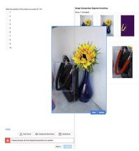  
顶行的第一张图像显示没有掩码的图像。感兴趣的物体上会有一个蓝点，或者由一个蓝白相间的框围绕。

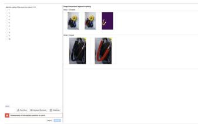  
示例界面页面。右侧将有五张图像，左侧有一个问题框。

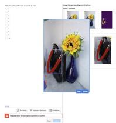  
顶行的第二张图像以红色显示该物体的掩码。

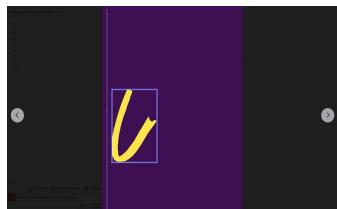  
点击图像可使其全屏显示。箭头将在图像之间循环切换。再次点击可返回上一视图。

底行的第二张图像显示带有掩码的物体的放大视图。掩码为红色。  
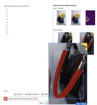

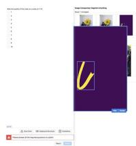

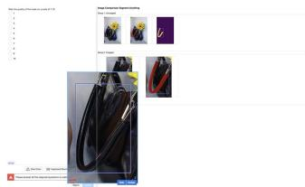  
底行的第一张图像显示没有掩码的物体的放大视图。

## 掩码是否具有良好的边界？

• 边界中的错误可能包括：

– 掩码中存在不正确的空洞

包含了与掩码主体部分分离的不正确像素

边缘质量较差，掩码与物体的边缘不完全匹配

未能一致地处理遮挡的前景物体（覆盖遮挡物体的掩码是合格的，不覆盖遮挡物体的掩码也是合格的，但如果掩码...

小掩码的像素化不属于错误，只要掩码仍然贴合物体的边缘即可。

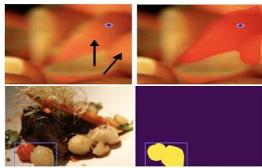  
“包含集合的任意部分”的错误示例：在最上方的图像中，点位于一个橙子皮上，但掩码覆盖了两个橙子皮。这是一个掩码错误：掩码覆盖了集合中任意数量的物体，它应该要么覆盖一个橙子皮，要么覆盖所有的橙子皮。在下方图像中，边界框包围了两种蔬菜。由于这是与边界框的最佳匹配，因此这不算掩码错误。

掩码质量评判（2 / 3）

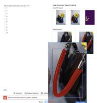

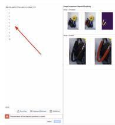  
左侧是用于评估掩码质量的按钮，评分选项为 1-10。

## • 对于点：

## 掩码是否与提供的点或边界框对应？

– 点需要位于掩码上。

物体相对于点的大小或位置无关紧要（某人戴手套的手上的一个点可以对应手套，也可以对应整个人，两者都是有效的掩码）。

• 对于边界框：

物体需要是与边界框尺寸相符的最佳物体（如果边界框围绕着某人的整个头部，但掩码只是其头发，这就是一个错误：头发虽然在框内，但不是正确的物体）

如果边界框明确对应某个给定的物体，但比该物体略小，则掩码稍微超出边界框也是可以的（如果围绕一个人的边界框漏掉了他们伸出的手，即使掩码超出了边界框，它仍然可以包含他们的手）。

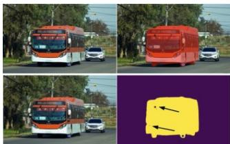  
将鼠标悬停在图像上可显示完整图像。  
掩码质量评判（3 / 3）  
“掩码中存在错误空洞”的错误示例：该掩码在左上方和左侧存在空洞（黑色箭头所示）。在“仅掩码”图像上更容易看清这些空洞。  
顶行的第三张图像仅显示掩码。掩码为黄色，背景为紫色。

## 我们希望您在每项任务中做的工作

• 请尽量在每项任务上花费最多 30 秒

将鼠标悬停或点击右侧的三张掩码图像，以了解掩码的质量。缩略图太小，无法评判掩码，请勿仅凭缩略图做判断。每张图像都可以为可能的掩码错误提供不同的参考信息

未缩放的图像可以提供掩码的上下文环境：此掩码是否对应一个实际的物体？

仅掩码图像可以显示掩码是否存在微小的空洞或分离的错误像素。缩放后的图像可以显示掩码边界是否合理

• 根据三项标准评判掩码的质量。随后将给出示例。

掩码是否对应一个真实的物体？掩码是否具有良好的边界？

掩码是否与提供的点或框相对应？

• 使用左侧的下拉框在 1-10 的范围内对掩码质量进行评分

接下来是根据这三个标准判断掩码质量的详细说明和示例。这些仅为示例，可能还会出现其他情况，在判定某个掩码是否良好时，请运用您的最佳判断。

任务  
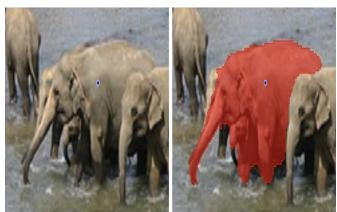  
“包含了另一个物体的一部分”的错误示例：大象的掩码包含了附近另一头大象的一部分

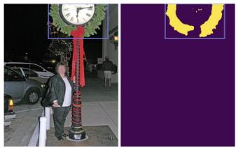  
“包含了与掩码主体分离的错误像素”的错误示例：“仅掩码”视图显示表盘上有几个零散的错误像素。

掩码是否对应一个真实的物体？

• 有效的物体可以包括：

完整的单个物体（例如一个人、一件衬衫或一棵树）

物体的逻辑组成部分（椅腿、车门、桌面）物体的逻辑组成部分（椅腿、车门、桌面）

物体的集合（一堆书、一群人）“Stuff（无定形背景/材质）”（地面、天空）。

• 掩码可能存在的错误示例。这些错误的严重程度可能是轻微的或严重的：

包含了另一个物体的一部分（一个人的掩码包含了附近另一个人的手臂）

遗漏了物体的一部分（掩码仅覆盖了被前景树木遮挡的建筑物的一部分），

合并了两个不相干的事物（单个掩码同时覆盖了桌子上的马克杯和钢笔）对于点输入包含了集合中任意的部分（点位于一个苹果上，但在许多苹果堆成的堆中掩码覆盖了三个苹果）如果框圈出了任意的集合，则为这些物体提供掩码不算错误。

如果您不确定，一个很好的经验法则是：您能说出该物体的名称吗？然而，有些难以命名的东西可能仍然是有效的物体（机器的不寻常部件、图像边缘难以确定是什么的事物）

评判掩码质量（1/3）  
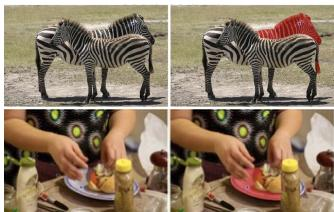  
“遗漏物体的一部分”的错误示例：掩码遗漏了物体的分离部分：斑马的后半部分，以及盘子的右侧部分。

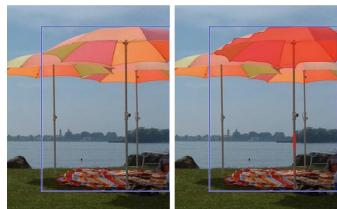  
“边缘质量差”的错误示例：掩码的边缘质量较差，无论是在雨伞的边缘，还是在细杆处。  
Figure 19: 这里我们提供了给予标注员用于掩码质量人工审核的完整指南。部分图像经过轻微编辑，人脸已作模糊处理以便发布。建议放大查看（第 1 部分，共 2 部分）。

## G. 标注指南

我们在 Fig. 19 和 Fig. 20 中提供了给予标注人员用于掩码质量人工复核的完整指南。

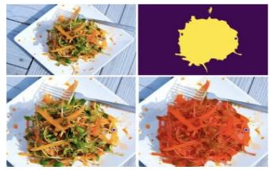

  
“合并两个无关事物”的示例：该点指示蜥蜴，但掩码同时覆盖了蜥蜴和一只鸟。这是一个掩码错误。

  
“未能一致地处理遮挡的前景物体”的错误示例：右侧的杆子（蓝色箭头）被排除在掩码之外，而左侧的杆子则被包含在物体中（黑色箭头）。掩码应当同时包含或排除这两者。

与所提供点的一致性示例：对于该输入点，标志（左）和容器（右）都是有效的物体，因为蓝点同时位于它们两者之上。两个掩码均不存在掩码错误。

  
“小掩码的像素化”示例：该掩码具有不完美的边界，因为它在黑色箭头处延伸到了物体之外。然而，掩码的“块状”图案并不是错误，因为放大到这种程度时，图像本身也以相同的方式呈现块状。

  
与边界框一致性的示例：框包围了整碗橙子，但掩码仅包含单个橙子。这是一个掩码错误。

  
与边界框一致性的示例：框的形状贴合斑马。尽管掩码略微延伸至框外以包含斑马的左腿，但这并不是错误。

  
评分为 1 的掩码示例：不清楚该掩码对应什么物体。

  
低分（2-4）掩码示例：主要物体可识别，但掩码包含另一个物体的大量错误部分。

  
低分掩码示例（2-4分）：主体目标可识别，但缺失了目标很大一部分随机区域。

  
与所提供点一致性的错误示例：掩码与蓝点不一致，因此这是一个掩码错误。

1分：无法辨别该掩码对应什么物体。这包括完全看不到掩码的情况。

掩码的整体质量是主观的，上述每种错误对掩码质量的影响可能轻微也可能严重，具体取决于错误的大小。请在选择掩码评分时运用您的最佳判断，并尽量在各个掩码之间保持一致。以下是不同评分应对应情况的通用指南：

低分（2-4分）：物体基本可识别，但掩码质量极差（例如：掩码的大片区域覆盖了其他物体；物体的大片区域缺失；掩码边界极不平整/斑驳，直接从物体中间穿过）。

中等分（5-6分）：物体可识别且边界大部分正确，但存在重大错误（缺失了物体显著的不连通部分；包含了另一物体的显著部分；物体某一区域的边界质量极差，但并非整个物体都如此）。

• 10分：掩码达到像素级完美；完全没有任何可识别的错误。

高分（7-9分）：物体可识别，错误微小且罕见（缺失了较小的、被严重遮挡的不连通组件；在较小区域内掩码边界与物体边界略有不符）。

掩码评分

  
中低分掩码示例（4-5分）：物体可识别且边缘全部正确，但掩码错误地包含了左侧人物的手。

  
中等分掩码示例（5-6分）：物体易于识别，且大多数边缘合理。然而，存在一个显著的不连通部分（画框内他们的手臂）基本缺失，且该区域存在斑驳的像素。

  
中等分掩码示例（5-6分）：掩码明显对应盘子，但与华夫饼的边界相当差。  
中高分掩码示例（6-8分）：掩码有两处较小的边界较差区域，分别位于掩码顶部和右下角。

  
得分中等偏高（6-8）的掩码示例：花环是一个与边界框尺寸相符的有效物体（整个花环+时钟也是一个有效物体）。然而，时钟上存在错误的零散掩码像素。  
高分（7-9）掩码示例：除后腿右侧外，马的轮廓边缘几乎完全正确。掩码始终包含了马佩戴的所有护具装备，并且边界符合逻辑。

  
极高分（∼9）掩码示例：掩码边缘仅存在细微错误。块状“像素化”并非错误，因为在此尺度下图像本身也呈块状。

  
极高分（9-10）掩码示例：掩码仅在右下角的边缘处存在极细微的错误。

  
极高分（9-10）掩码示例：掩码边缘仅存在细微错误。

Figure 20: 此处提供了在掩码质量人工审核中向标注人员发放的完整指南。部分图像经过了轻微编辑，人脸已被模糊处理以允许公开发布。建议放大查看（第 2 部分，共 2 部分）。