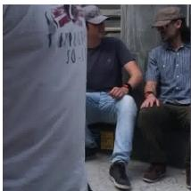
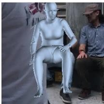
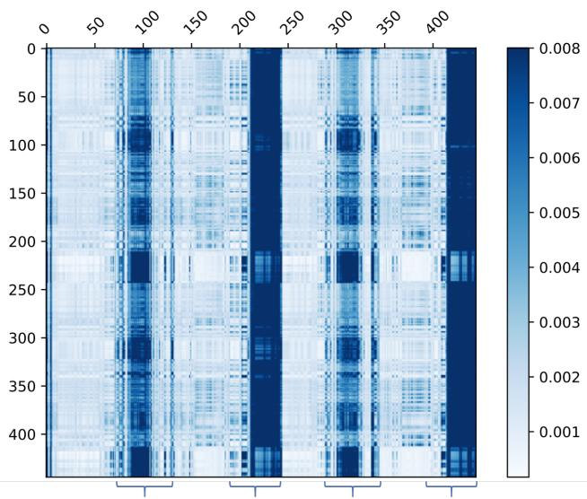
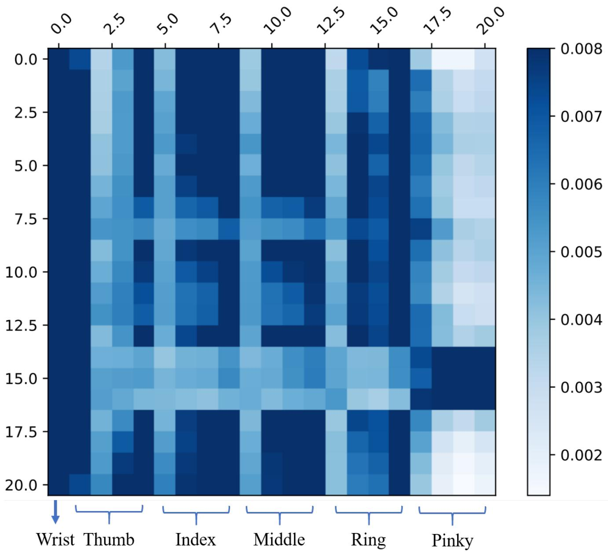

# 基于 Transformer 的端到端人体姿态与网格重建

Kevin Lin Lijuan Wang Zicheng Liu

Microsoft

{keli, lijuanw, zliu}@microsoft.com

## 摘要

我们提出了一种名为 MEsh TRansfOrmer (METRO) 的新方法，用于从单张图像重建三维人体姿态和网格顶点。我们的方法使用 Transformer 编码器联合建模顶点-顶点以及顶点-关节点之间的相互作用，并同时输出三维关节点坐标和网格顶点。与现有的回归姿态和形状参数的技术相比，METRO 不依赖于诸如 SMPL 等任何参数化网格模型，因此可以轻松扩展到手部等其他物体。我们进一步放宽了网格拓扑约束，允许 Transformer 自注意力机制在任意两个顶点之间自由交互，从而能够学习网格顶点和关节点之间的非局部关系。得益于所提出的掩码顶点建模，我们的方法在处理局部遮挡等具有挑战性的情况时更加鲁棒和有效。METRO 在公开的 Human3.6M 和 3DPW 数据集上取得了人体网格重建领域新的最先进（SOTA）结果。此外，我们证明了 METRO 在野外三维手部重建中的泛化能力，在 FreiHAND 数据集上超越了现有的最先进方法。代码和预训练模型可在 https://github.com/microsoft/MeshTransformer 获取。

## 1. 引言

从单张图像进行三维人体姿态和网格重建吸引了大量关注，因为它在虚拟现实、体育运动分析、神经退行性疾病诊断等领域有着广泛的应用。由于复杂的关节运动和遮挡，这是一个极具挑战性的问题。

该领域的近期工作大致可分为两类。第一类方法使用诸如 SMPL [29] 等参数化模型，并学习预测形状和姿态系数 [14, 26, 39, 22, 24, 34, 44, 23]。这种方法取得了巨大的成功。参数化模型中编码的强先验增强了其对环境变化的鲁棒性。这种方法的一个缺点是，姿态和形状空间受限于用于构建参数化模型的有限样本。为了克服这一局限性，第二类方法不使用任何参数化模型 [25, 8, 32]。这些方法要么使用图卷积神经网络来建模邻近顶点间的相互作用 [25, 8]，要么使用一维热图来回归顶点坐标 [32]。这些方法的一个局限性在于，它们在建模非局部顶点间相互作用方面效率不高。

  
(a)

  
(b)

  
(c)  
Figure 1: METRO 学习身体关节点与网格顶点之间的非局部相互作用以用于人体网格重建。给定 (a) 中的输入图像，METRO 通过考虑非局部相互作用来预测人体网格。(b) 展示了被遮挡的手腕关节与网格顶点之间的注意力分布，其中较亮的颜色表示较强的注意力。(c) 为重建的网格。

研究表明，可能属于身体不同部位（例如手和脚）的非局部顶点之间存在强相关性 [55]。在计算机图形学和机器人学中，逆运动学（inverse kinematics）技术 [2] 已被开发用于在给定末端执行器（例如指尖）位置的情况下估计关节模型的内部关节位置。我们认为，学习包括短距离和长距离在内的身体关节与网格顶点之间的相关性，对于在人体体型重建中处理具有挑战性的姿态和遮挡非常有价值。在本文中，我们提出了一个简单而有效的框架来建模全局顶点-顶点相互作用。我们框架的核心组成部分是一个 Transformer。

近期研究表明，Transformer [53] 显著提升了自然语言处理中各项任务的性能 [4, 9, 40, 41]。该成功主要归功于 Transformer 的自注意力机制，该机制在建模输入和输出中不受距离限制的依赖关系（或相互作用）方面尤为有效。在给定依赖关系的情况下，Transformer 能够软搜索相关词元（tokens）并基于重要特征进行预测 [4, 53]。

在这项工作中，我们提出了 METRO，一种具有渐进式降维的多层 Transformer 编码器，用于从给定的输入图像中同时重建 3D 身体关节和网格顶点。我们设计了带有 Transformer 编码器架构的掩码顶点建模（Masked Vertex Modeling）目标，以增强关节与顶点之间的相互作用。如图 1 所示，METRO 能够学习发现身体关节与网格顶点之间的短程和长程相互作用，这有助于在大幅度姿态变化和存在遮挡的情况下更好地重建 3D 人体体型。

在多个公开数据集上的实验结果表明，METRO 在学习顶点-顶点和顶点-关节相互作用方面是有效的，从而在人体网格重建上大幅超越了先前的方法。据我们所知，METRO 是首个利用 Transformer 编码器架构从单张输入图像中联合学习 3D 人体姿态和网格重建的方法。此外，METRO 是一个通用框架，可以很容易地应用于预测不同的 3D 网格，例如从输入图像中重建 3D 手部。

综上所述，我们做出了以下贡献。

• 我们提出了一种名为 METRO 的基于 Transformer 的新方法，用于从单张图像重建三维人体姿态与网格（3D human pose and mesh reconstruction）。

• 我们设计了掩码顶点建模（Masked Vertex Modeling）目标，并结合多层 Transformer 编码器，以同时建模顶点-顶点（vertex-vertex）与顶点-关节点（vertex-joint）之间的交互，从而实现更好的重建效果。

• METRO 在大规模基准数据集 Human3.6M 以及极具挑战性的 3DPW 数据集上取得了新的最先进（state-of-the-art）性能。

• METRO 是一个通用框架，可以轻松推广以预测不同类型的三维网格，例如实验中所展示的三维手部网格。在论文提交时，METRO 在 FreiHAND 排行榜上名列第一。

## 2. 相关工作

人体网格重建（Human Mesh Reconstruction, HMR）：HMR 是一项重建三维人体形状的任务，也是近年来活跃的研究课题。尽管先驱性工作已经展示了利用各种传感器（例如深度传感器 [33, 48] 或惯性测量单元 [20, 54]）实现令人瞩目的重建效果，但研究人员正在探索使用更高效且更便捷的单目相机设置。然而，由于复杂的姿态变化、遮挡以及有限的三维训练数据，从单张图像进行 HMR 极具挑战。

先前的研究提出采用预训练的参数化人体模型，即 SMPL [29]、STAR [35]、MANO [43]，并通过估计参数化模型的姿态和形状系数来进行 HMR。由于直接从输入图像回归姿态和形状系数具有很大挑战，近期的研究进一步提出利用各种人体先验信息，如人体骨架 [26, 39] 或分割图 [34]，并探索不同的优化策略 [24, 22, 51, 14] 和时序信息 [23] 来提高重建质量。

另一方面，除了采用参数化人体模型外，研究人员还提出了直接从输入图像回归三维人体形状的方法。例如，研究人员探索了利用三维网格 [25, 8]、体素空间 [52] 或占用场 [46, 47] 来表示人体。以往的各项工作都针对其目标应用处理了特定的输出表示。在现有文献中，相关的一项研究是 GraphCMR [25]，其旨在利用图卷积神经网络（GCNNs）回归三维网格顶点。此外，近期提出的 Pose2Mesh [8] 是一个采用 GCNN 的级联模型。Pose2Mesh 基于给定的人体姿态表示来重建人体网格。

尽管基于 GCNN 的方法 [8, 25] 旨在基于预定义的网格拓扑结构建模邻域顶点之间的交互，但在建模长距离交互方面效率较低。相比之下，METRO 对关节点和网格顶点之间的全局交互进行建模，而不受任何网格拓扑的限制。此外，我们的方法利用自注意力机制进行学习，这与先前的研究 [8, 25] 有所不同。

注意力机制与 Transformer：近期研究 [36, 28, 53] 表明，注意力机制能够提升各种语言任务的性能。它们的核心见解是学习注意力，以软搜索（soft-search）与预测输出相关的重要输入 [4]。Vaswani 等人 [53] 进一步提出了一种完全基于注意力机制的 Transformer 架构。Transformer 利用多头自注意力（multi-head self-attention）实现高度并行化，以进行高效的训练和推理，并在大规模语言建模中取得了卓越的性能，如 BERT [9] 和 GPT [40, 41, 5] 中所探讨的那样。

受到神经语言领域近期成功的启发，人们对探索将 Transformer 架构应用于各种视觉任务产生了越来越浓厚的兴趣，例如学习用于图像生成 [7, 37] 和分类 [7, 10] 的像素分布，或将目标检测简化为集合预测问题 [6]。然而，在 3D 人体重建方向上，此类探索仍属空白。

  
Figure 2: 所提出框架的概览。给定输入图像，我们使用卷积神经网络（CNN）提取图像特征向量。我们通过将图像特征与每个身体关节 i 的 3D 坐标 $( x _ { i } , y _ { i } , z _ { i } )$ 以及每个顶点 j 的 3D 坐标 $( x _ { j } , y _ { j } , z _ { j } )$ 进行拼接，将模板人体网格添加到图像特征向量中来进行位置编码。给定一组关节查询（joint queries）和顶点查询（vertex queries），我们通过 Transformer 编码器的多个层执行自注意力计算，并并行回归身体关节和网格顶点的 3D 坐标。我们使用渐进式降维架构（右图）逐层逐步减少隐藏嵌入维度。最后一层中的每个 token 输出一个关节或网格顶点的 3D 坐标。每个编码器块包含 4 个层和 4 个注意力头。H 表示图像特征向量的维度。

在本研究中，我们提出了一种具有渐进式降维的多层 Transformer 架构，用于回归关节和顶点的 3D 坐标。

## 3. 方法

Figure 2 是我们提出的框架的概览。它接收大小为 224 × 224 的图像作为输入，并预测一组身体关节 J 和网格顶点 V。所提出的框架由两个模块组成：卷积神经网络（Convolutional Neural Network）和多层 Transformer 编码器（Multi-Layer Transformer Encoder）。首先，我们使用 CNN 从输入图像中提取图像特征向量。接下来，多层 Transformer 编码器以该特征向量为输入，并行输出身体关节和网格顶点的 3D 坐标。我们在下文中详细描述每个模块。

## 3.1. 卷积神经网络

在我们框架的第一个模块中，我们采用卷积神经网络（Convolutional Neural Network，CNN）进行特征提取。该 CNN 在 ImageNet 分类任务 [45] 上进行了预训练。具体来说，我们从最后一个隐藏层提取特征向量 X。提取的特征向量 X 的维度通常为 2048。我们将特征向量 X 输入到 transformer 中以进行回归任务。

通过这种通用设计，它允许对人体姿态和网格重建进行端到端训练。此外，transformer 可以轻松地从大规模预训练 CNN（例如 HRNets [56]）中受益。在我们的实验中，我们对输入特征进行了分析，并发现高分辨率图像特征有利于 transformer 回归身体关节和网格顶点的 3D 坐标。

## 3.2. 具有渐进式降维的多层 Transformer 编码器

由于我们需要输出 3D 坐标，我们无法直接应用现有的 transformer 编码器架构 [10, 6]，因为它们在所有 transformer 层中都使用恒定维度的隐藏嵌入。受 [18] 通过多个块逐步进行降维的启发，我们设计了一种具有渐进式降维方案的新架构。如图 Figure 2 右侧所示，我们在每个编码器层之后使用线性投影来降低隐藏嵌入的维度。通过添加多个编码器层，该模型可被视为以交替方式执行自注意力机制和降维。我们 transformer 编码器的最终输出向量即为关节和网格顶点的 3D 坐标。

如图 Figure 2 左侧所示，transformer 编码器的输入是身体关节和网格顶点查询。本着与位置编码（positional encoding）[53, 25, 13] 相同的精神，我们使用模板人体网格来保留输入序列中每个查询的位置信息。具体而言，我们将图像特征向量 $X \in \mathbb { R } ^ { 2 \bar { 0 } 4 8 \times 1 }$ 与每个身体关节 i 的 3D 坐标 $( x _ { i } , y _ { i } , z _ { i } )$ 进行拼接。这形成了一组关节查询 $\dot { Q _ { J } } = \{ q _ { 1 } ^ { J } , q _ { 2 } ^ { J } , . . . , q _ { n } ^ { J } \}$，其中 $q _ { i } ^ { J } \in \mathbb { R } ^ { 2 0 5 1 \times 1 }$。类似地，我们对每个网格顶点 $j ,$ 进行相同的位置编码，并形成一组顶点查询 $\mathsf { \bar { Q } } _ { V } = \{ q _ { 1 } ^ { \bar { V } } , q _ { 2 } ^ { V } , \dots , q _ { m } ^ { V } \}$，其中 $q _ { j } ^ { V } \in \mathbb { R } ^ { 2 0 5 1 \times 1 }$。

## 3.3. 掩码顶点建模

先前的研究工作 [9, 49] 使用掩码语言建模（Masked Language Modeling，MLM）来学习训练语料库的语言特性。然而，MLM 的目标是恢复输入，这不能直接应用于我们的回归任务。

为了充分激活我们 Transformer 编码器中的双向注意力（bi-directional attentions），我们针对回归任务设计了一种掩蔽顶点建模（Masked Vertex Modeling, MVM）。我们随机掩蔽一定比例的输入查询（queries）。与 MLM [9] 那样恢复被掩蔽的输入不同，我们改为要求 Transformer 回归所有的关节点和顶点。

为了预测对应于缺失查询的输出，模型将不得不求助于其他相关的查询。这在本质上类似于模拟部分身体部位不可见的遮挡情况。因此，MVM 迫使 Transformer 在不考虑距离和网格拓扑结构的情况下，通过综合考虑其他相关顶点和关节点来回归 3D 坐标。这促进了关节点和顶点之间的短程与长程交互，从而实现更好的身体建模。

## 3.4. 训练

为了训练 Transformer 编码器，我们在 Transformer 输出之上应用损失函数，并最小化预测值与真实值（ground truths）之间的误差。给定一个数据集 $D = \{ I ^ { i } , \bar { V } _ { 3 D } ^ { i } , \bar { J } _ { 3 D } ^ { i } , \bar { J } _ { 2 D } ^ { i } \} _ { i = 1 } ^ { T }$，其中 T 是训练图像的总数。$\boldsymbol { I } \in \mathbb { R } ^ { w \times h \times 3 }$ 表示一张 RGB 图像。$\bar { V } _ { 3 D } \in \mathbf { \mathbb { R } } ^ { M \times \bar { 3 } }$ 表示网格顶点的真实 3D 坐标，M 是顶点的数量。$\bar { J } _ { 3 D } \in \mathbb { R } ^ { K \times 3 }$ 表示身体关节点的真实 3D 坐标，K 是一个人的关节点数量。类似地，$\bar { J } _ { 2 D } \in \mathbb { R } ^ { K \times 2 }$ 表示身体关节点的真实 2D 坐标。

设 $V _ { 3 D }$ 表示输出的顶点位置，$J _ { 3 D }$ 为输出的关节点位置，我们使用 $L _ { 1 }$ 损失来最小化预测值与真实值之间的误差：

$$
\mathcal {L} _ {V} = \frac {1}{M} \sum_ {i = 1} ^ {M} \left| \left| V _ {3 D} - \bar {V} _ {3 D} \right| \right| _ {1},\tag{1}
$$

$$
\mathcal {L} _ {J} = \frac {1}{K} \sum_ {i = 1} ^ {K} \left| \left| J _ {3 D} - \bar {J} _ {3 D} \right| \right| _ {1}.\tag{2}
$$

值得注意的是，3D 关节点也可以从预测的网格中计算得出。遵循文献 [8, 22, 25, 24] 中的通用做法，我们使用一个预定义的回归矩阵 $G \in \mathbb { R } ^ { K \times M }$，并通过 $J _ { 3 D } ^ { r e g } = G V _ { 3 D }$ 获得回归出的 3D 关节点。与先前的研究相似，我们使用 $L _ { 1 }$ 损失来优化 ${ { J } _ { 3 D } ^ { r e g } }$

$$
\mathcal {L} _ {J} ^ {r e g} = \frac {1}{K} \sum_ {i = 1} ^ {K} \left| \left| J _ {3 D} ^ {r e g} - \bar {J} _ {3 D} \right| \right| _ {1}.\tag{3}
$$

2D 重投影已被广泛用于增强图像与网格的对齐 [22, 25, 24]。此外，它有助于在图像中可视化重建结果。受先前工作的启发，我们使用估计的相机参数将 3D 关节点投影到 2D 空间，并最小化 2D 投影与 2D 真实值（ground truths）之间的误差：

$$
\mathcal {L} _ {J} ^ {p r o j} = \frac {1}{K} \sum_ {i = 1} ^ {K} \left| \left| J _ {2 D} - \bar {J} _ {2 D} \right| \right| _ {1},\tag{4}
$$

其中相机参数是通过在 transformer 编码器的输出之上使用一个线性层学习得到的。

为了进行大规模训练，非常需要同时利用 2D 和 3D 训练数据集以获得更好的泛化能力。正如文献 [34, 22, 25, 24, 23, 8, 32] 中所探讨的，我们使用了一种混合训练策略，利用了具有或不具有配对图像-网格标注的不同训练数据集。我们的总体目标函数表示为：

$$
\mathcal {L} = \alpha \times (\mathcal {L} _ {V} + \mathcal {L} _ {J} + \mathcal {L} _ {J} ^ {r e g}) + \beta \times \mathcal {L} _ {J} ^ {p r o j},\tag{5}
$$

其中 $\alpha$ 和 $\beta$ 是每个训练样本的二进制标志，分别表示 3D 和 2D 真实值的可用性。

## 3.5. 实现细节

我们的方法能够处理任意大小的网格。然而，由于当前硬件的内存限制，我们的 transformer 处理的是粗糙网格（coarse mesh）：(1) 我们使用粗糙模板网格（431 个顶点）进行位置编码，transformer 输出粗糙网格；(2) 我们使用可学习的多层感知机（MLP）将粗糙网格上采样到原始网格（对于 SMPL 人体网格拓扑为 6890 个顶点）；(3) transformer 和 MLP 进行端到端训练；请注意，粗糙网格是通过使用采样算法 [42] 经过两次下采样到 431 个顶点获得的。如文献 [25] 中所讨论的，采用先学习粗糙网格随后进行上采样的实现方式有助于减少计算量。它还有助于避免原始网格中的冗余（由于顶点的空间局部性），从而使训练更加高效。

## 4. 实验结果

我们首先展示了我们的方法在 Human3.6M 和 3DPW 数据集上优于以往最先进的人体网格重建方法。接着，我们提供了针对非局部交互（non-local interactions）和模型设计的消融实验与深入分析。最后，我们展示了我们的模型在手部重建任务上的泛化能力。

<table><tr><td rowspan="2">方法</td><td colspan="3">3DPW</td><td colspan="2">Human3.6M</td></tr><tr><td>MPVE ↓</td><td>MPJPE ↓</td><td>PA-MPJPE ↓</td><td>MPJPE ↓</td><td>PA-MPJPE ↓</td></tr><tr><td>HMR [22]</td><td>-</td><td>-</td><td>81.3</td><td>88.0</td><td>56.8</td></tr><tr><td>GraphCMR [25]</td><td>-</td><td>-</td><td>70.2</td><td>-</td><td>50.1</td></tr><tr><td>SPIN [24]</td><td>116.4</td><td>-</td><td>59.2</td><td>-</td><td>41.1</td></tr><tr><td>Pose2Mesh [8]</td><td>-</td><td>89.2</td><td>58.9</td><td>64.9</td><td>47.0</td></tr><tr><td>I2LMeshNet [32]</td><td>-</td><td>93.2</td><td>57.7</td><td>55.7</td><td>41.1</td></tr><tr><td>VIBE [23]</td><td>99.1</td><td>82.0</td><td>51.9</td><td>65.6</td><td>41.4</td></tr><tr><td>METRO (Ours)</td><td>88.2</td><td>77.1</td><td>47.9</td><td>54.0</td><td>36.7</td></tr></table>

Table 1: 在 3DPW 和 Human3.6M 数据集上与最先进方法的性能比较。

## 4.1. 数据集

遵循现有文献 [34, 22, 25, 24, 23, 8, 32]，我们使用 3D 和 2D 训练数据进行混合训练。我们在下文中分别介绍各个数据集。

Human3.6M [21] 是一个包含 2D 和 3D 标注的大规模数据集。每张图像中都有一名受试者在执行不同的动作。由于许可证问题，无法直接获取真实（groundtruth）3D 网格（mesh）。因此，我们使用 [8, 32] 中提供的伪 3D 网格进行训练。这些伪标签是通过使用 SMPLify-X [38] 进行模型拟合生成的。为了公平比较，在评估时我们使用 Human3.6M 提供的真实 3D 姿态标签。遵循通用设置 [50, 25, 22]，我们使用受试者 S1、S5、S6、S7 和 S8 训练模型。我们使用受试者 S9 和 S11 测试模型。

3DPW [54] 是一个带有 2D 和 3D 标注的室外图像数据集。训练集包含 22K 张图像，测试集包含 35K 张图像。遵循以往的最先进方法 [23]，我们在 3DPW 上进行实验时使用了 3DPW 训练数据。

UP-3D [26] 是一个室外图像数据集。其 3D 标注是通过模型拟合生成的。训练集包含 7K 张图像。

MuCo-3DHP [31] 是一个基于 MPI-INF-3DHP 数据集 [30] 的合成数据集。它将训练数据与多种真实世界背景图像进行合成。该数据集包含 200K 张训练图像。

COCO [27] 是一个带有 2D 标注的大规模数据集。我们还使用了 [24] 中提供的伪 3D 网格标签，这些标签是通过 SMPLify-X [38] 拟合得到的。

MPII [1] 是一个带有 2D 姿态标签的室外图像数据集。训练集由 14K 张图像组成。

FreiHAND [61] 是一个 3D 手部数据集。训练集包含 130K 张图像，测试集包含 4K 张图像。

我们在此数据集上展示了模型的泛化能力。我们使用提供的数据集进行训练，并在其在线服务器上进行评估。

## 4.2. 评估指标

我们使用以下三个标准指标报告结果。这三个指标的单位均为毫米（mm）。

MPJPE：平均关节点位置误差（Mean-Per-Joint-Position-Error, MPJPE）[21] 是用于评估人体 3D 姿态的指标 [22, 24, 8]。MPJPE 衡量真实关节点与预测关节点之间的欧氏距离。

PA-MPJPE：PA-MPJPE，亦称重建误差（Reconstruction Error）[60]，是该任务的另一项指标。它首先使用普氏分析（Procrustes analysis, PA）[12] 进行 3D 对齐，然后计算 MPJPE。PA-MPJPE 通常用于评估 3D 重建 [60]，因为它在不考虑尺度和刚体姿态（即平移和旋转）的情况下衡量重建结构的误差。

MPVE：平均顶点误差（Mean-Per-Vertex-Error, MPVE）[39] 衡量真实顶点与预测顶点之间的欧氏距离。

## 4.3. 主要结果

我们在 3DPW 和 Human3.6M 数据集上将 METRO 与先前的最先进方法进行了比较。遵循文献 [23, 24, 22, 25] 的做法，我们使用 3D 和 2D 训练数据进行了混合训练。结果如 Table 1 所示。我们的方法在两个数据集上均优于以往的工作。

首先，我们关注 Transformer 在 3DPW 的野外场景重建中的表现。如 Table 1 左侧三列所示，我们的方法优于该数据集上的最先进方法 VIBE [23]。值得注意的是，VIBE 是一种基于视频的方法，而我们的方法是一种基于图像的方法。

此外，我们在 Human3.6M 的室内场景上评估了性能。我们遵循先前技术 [24, 32] 中的设置，在不使用 3DPW 数据的情况下训练我们的模型。

  
Figure 3: 本文方法的定性结果。给定输入图像（左），METRO 在人体网格重建中考虑了关节点与顶点之间的非局部交互（右）。我们可视化了特定关节点与所有其他顶点之间的自注意力，其中较亮的颜色表示更强的注意力。我们观察到 METRO 发现了关节点与顶点之间丰富的、依赖于输入的交互关系。

结果如 Table 1 右侧两列所示。我们的方法取得了更好的重建性能，特别是在 PA-MPJPE 指标上。

Human3.6M 和 3DPW 这两个数据集具有不同的挑战。3DPW 中的场景存在更严重的遮挡。Human3.6 中的场景更简单，其挑战更多在于如何准确估计体型。METRO 在这两个数据集上均表现良好这一事实表明，它既对遮挡具有鲁棒性，又能够进行准确的体型回归。

## 4.4. 消融实验

掩码顶点建模（Masked Vertex Modeling）的有效性：由于我们为 Transformer 设计了掩码顶点建模目标，一个值得探讨的问题是该目标是否有用。Table 2 展示了在 Human3.6M 上的消融研究。我们观察到掩码顶点建模显著改善了结果。此外，我们还研究了应该掩码多大比例的查询标记（query tokens）。我们改变了最大掩码百分比，Table 3 展示了对比结果。随着我们在训练中增加掩码查询的数量，性能有所提升。然而，如果我们掩码超过 30% 的输入查询，这种影响就不再那么显著。这是因为大量缺失的查询会增加训练的难度。

<table><tr><td></td><td>MPJPE ↓</td><td>PA-MPJPE ↓</td></tr><tr><td>w/o MVM</td><td>61.0</td><td>39.1</td></tr><tr><td>w/ MVM</td><td>54.0</td><td>36.7</td></tr></table>

Table 2: 掩码顶点建模（MVM）目标的消融研究，在 Human3.6M 上评估。

<table><tr><td>最大百分比</td><td>0%</td><td>10%</td><td>20%</td><td>30%</td><td>40%</td><td>50%</td></tr><tr><td>PA-MPJPE</td><td>39.1</td><td>37.6</td><td>37.5</td><td>36.7</td><td>38.2</td><td>37.3</td></tr></table>

Table 3: 使用不同掩码查询百分比的掩码顶点建模目标的消融研究，在 Human3.6M 上评估。变量 n% 表示我们随机掩码 0% 到 n% 的输入查询。

<table><tr><td>方法</td><td>PA-MPVPE ↓</td><td>PA-MPJPE ↓</td><td>F@5 mm ↑</td><td>F@15 mm ↑</td></tr><tr><td>Hasson et al [22]</td><td>13.2</td><td>-</td><td>0.436</td><td>0.908</td></tr><tr><td>Boukhayma et al. [25]</td><td>13.0</td><td>-</td><td>0.435</td><td>0.898</td></tr><tr><td>FreiHAND [24]</td><td>10.7</td><td>-</td><td>0.529</td><td>0.935</td></tr><tr><td>Pose2Mesh [8]</td><td>7.8</td><td>7.7</td><td>0.674</td><td>0.969</td></tr><tr><td>I2LMeshNet [32]</td><td>7.6</td><td>7.4</td><td>0.681</td><td>0.973</td></tr><tr><td>METRO (Ours)</td><td>6.3</td><td>6.5</td><td>0.731</td><td>0.984</td></tr></table>

Table 4: 与当前最先进（state-of-the-art）方法的性能对比，在 FreiHAND 在线服务器上评估。METRO 大幅优于以往的最先进方法。

非局部交互（Non-local Interactions）：为了进一步理解 METRO 在学习关节与网格顶点之间相互作用方面的效果，我们对 Transformer 中的自注意力（self-attentions）进行了分析。

Figure 3 展示了自注意力（self-attention）和网格重建的可视化结果。在 Figure 3 的每一行中，我们展示了输入图像以及指定关节点与所有网格顶点之间的自注意力。颜色越亮表示注意力越强。在第一行中，目标主体被严重遮挡，右侧身体部位不可见。当预测右腕的位置时，METRO 关注了相关的非局部（non-local）顶点，尤其是头部和左手上的顶点。在最后一行中，主体严重弯曲。对于头部位置的预测，METRO 关注了脚部和手部（最后一行第 6 列）。从直觉上看这是合理的，因为手部和脚部的位置为身体姿态以及随后的头部位置提供了强烈的线索。此外，我们观察到模型会根据输入图像自适应地执行自注意力机制。如 Figure 3 第二行所示，在预测右腕位置时，METRO 更多地聚焦于右脚，这与其他三行中的注意力分布不同。

我们进一步对非局部交互进行了定量分析。我们从 3DPW 测试集中随机抽取 5000 张图像，并估计了一个整体自注意力图。它是最后一个 Transformer 层中所有注意力头的平均注意力权重。我们在 Figure 4 中可视化了 14 个身体关节点与 431 个网格顶点之间的交互。每个像素显示了自注意力的强度，其中颜色越深表示注意力越强。注意，前 14 列是身体关节点，其余列代表网格顶点。我们观察到 METRO 对小臂和小腿上的顶点给予了强烈的注意力。这与逆运动学（inverse kinematics）文献 [2] 一致，即链接形体的内部关节点可以通过末端执行器的位置进行估计。

Input Representations: 我们通过使用不同的 CNN 主干网络（backbone）来研究我们的 Transformer 架构的行为。我们在该实验中使用了 ResNet50 [16] 和 HRNet [56] 的变体。所有主干网络均在 ImageNet [45] 的 1000 类图像分类任务上进行了预训练。对于每个主干网络，我们提取一个全局图像特征向量 X ∈ R2048×1，并将其输入到 Transformer 中。在 Table 5 中，我们观察到使用 ResNet50 主干网络时，我们的 Transformer 取得了具有竞争力的性能。随着我们增加 HRNet 中高分辨率特征图的通道数，我们观察到了进一步的提升。

Figure 4: 身体关节点与网格顶点之间自注意力的可视化。x 轴和 y 轴分别对应查询（query）和预测输出。从左起前 14 列对应身体关节点。其余列对应网格顶点。每一行显示了第 i 个输出对第 j 个查询的注意力权重 $w _ { i , j }$。颜色越深表示注意力越强。

<table><tr><td>骨干网络</td><td>MPJPE ↓</td><td>PA-MPJPE ↓</td></tr><tr><td>ResNet50</td><td>56.5</td><td>40.6</td></tr><tr><td>HRNet-W40</td><td>55.9</td><td>38.5</td></tr><tr><td>HRNet-W64</td><td>54.0</td><td>36.7</td></tr></table>

Table 5: 在 Human3.6M 上评估的不同骨干网络分析。所有骨干网络均在 ImageNet 上进行预训练。我们观察到，增加 HRNet 高分辨率特征图中的滤波器数量有利于网格回归。

  
Figure 5: 我们的方法在 FreiHAND 测试集上的定性结果。我们可视化了指定关节点与所有网格顶点之间的自注意力（self-attentions），其中较亮的颜色表示更强的注意力。METRO 是一个通用的框架，可以轻松扩展到 3D 手部重建。

自然场景中 3D 手部重建的泛化性：METRO 能够预测任意关节点和顶点，无需依赖邻接矩阵和参数化系数。因此，METRO 在其他物体的网格重建上具有高度的灵活性和通用性。为了展示这一能力，我们在 FreiHAND [61] 上进行了实验。我们在 FreiHAND 上从头训练模型，并在 FreiHAND 在线服务器上评估结果。Table 4 显示了与先前工作的对比。METRO 大幅超越了以往的最先进方法。在不使用任何外部训练数据的情况下，METRO 在论文提交时取得了 FreiHAND 排行榜的第一名1。

Figure 5 展示了具有非局部交互的定性结果。在附录中，我们对 3D 手部关节点提供了进一步的分析，并表明 METRO 中学到的自注意力与逆向运动学（inverse kinematics）[2] 是一致的。

## 5. 结论

我们提出了一个简单而有效的网格 Transformer 框架，用于从单张输入图像重建人体姿态和网格。我们提出了掩码顶点建模（Masked Vertex Modeling）目标，以学习人体关节点与网格顶点之间的非局部交互。实验结果表明，我们的方法在 3DPW、Human3.6M 和 FreiHAND 数据集上刷新了最先进的性能。

详细分析表明，性能的提升主要归因于 METRO 中学到的依赖于输入的非局部交互，这使得预测能够基于重要的关节点和顶点进行，而无需考虑网格拓扑结构。我们进一步证明了所提出方法在 3D 手部重建上的泛化能力。

## 参考文献

[1] Mykhaylo Andriluka, Leonid Pishchulin, Peter Gehler, and Bernt Schiele. 2d human pose estimation: New benchmark and state of the art analysis. In CVPR, 2014. 5

[2] Andreas Aristidou, Joan Lasenby, Yiorgos Chrysanthou, and Ariel Shamir. Inverse kinematics techniques in computer graphics: A survey. In Computer Graphics Forum, 2018. 1, 7, 8, 12

[3] Anurag Arnab, Carl Doersch, and Andrew Zisserman. 利用时序上下文进行野外三维人体姿态估计（Exploiting temporal context for 3d human pose estimation in the wild）. In CVPR, 2019. 11

[4] Dzmitry Bahdanau, Kyunghyun Cho, and Yoshua Bengio. 通过联合学习对齐与翻译的神经机器翻译（Neural machine translation by jointly learning to align and translate）. In ICLR, 2015. 2

[5] Tom B Brown, Benjamin Mann, Nick Ryder, Melanie Subbiah, Jared Kaplan, Prafulla Dhariwal, Arvind Neelakantan, Pranav Shyam, Girish Sastry, Amanda Askell, et al. 语言模型是少样本学习者（Language models are few-shot learners）. arXiv preprint arXiv:2005.14165, 2020. 2

[6] Nicolas Carion, Francisco Massa, Gabriel Synnaeve, Nicolas Usunier, Alexander Kirillov, and Sergey Zagoruyko. 基于 Transformer 的端到端目标检测（End-toend object detection with transformers）. In ECCV, 2020. 3

[7] Mark Chen, Alec Radford, Rewon Child, Jeff Wu, Heewoo Jun, Prafulla Dhariwal, David Luan, and Ilya Sutskever. 基于像素的生成式预训练（Generative pretraining from pixels）. In ICML, 2020. 2

[8] Hongsuk Choi, Gyeongsik Moon, and Kyoung Mu Lee. Pose2Mesh：用于从二维人体姿态恢复三维人体姿态与网格的图卷积网络（Pose2mesh: Graph convolutional network for 3d human pose and mesh recovery from a 2d human pose）. In ECCV, 2020. 1, 2, 4, 5, 7, 11, 1

[9] Jacob Devlin, Ming-Wei Chang, Kenton Lee, and Kristina Toutanova. BERT：用于语言理解的深度双向 Transformer 预训练（Bert: Pre-training of deep bidirectional transformers for language understanding）. In NAACL, 2019. 2, 4, 11

[10] Alexey Dosovitskiy, Lucas Beyer, Alexander Kolesnikov, Dirk Weissenborn, Xiaohua Zhai, Thomas Unterthiner, Mostafa Dehghani, Matthias Minderer, Georg Heigold, Sylvain Gelly, et al. 一张图像相当于 16x16 个单词：用于大规模图像识别的 Transformer（An image is worth 16x16 words: Transformers for image recognition at scale）. arXiv preprint arXiv:2010.11929, 2020. 2, 3

[11] Georgios Georgakis, Ren Li, Srikrishna Karanam, Terrence Chen, Jana Kosecka, and Ziyan Wu. 分层运动学人体网格恢复（Hierarchical kinematic human mesh recovery）. ECCV, 2020. 11

[12] John C Gower. 广义普氏分析（Generalized procrustes analysis）. Psychometrika, 1975. 5, 13

[13] Thibault Groueix, Matthew Fisher, Vladimir G Kim, Bryan C Russell, and Mathieu Aubry. 3D-CODED：通过深度形变获得的三维对应关系（3d-coded: 3d correspondences by deep deformation）. In ECCV, 2018. 3

[14] Peng Guan, Alexander Weiss, Alexandru O Balan, and Michael J Black. 从单张图像估计人体体型与姿态（Estimating human shape and pose from a single image）. In ICCV, 2009. 1, 2

[15] Riza Alp Guler and Iasonas Kokkinos. HoloPose：野外全景三维人体重建（Holopose: Holistic 3d human reconstruction in-the-wild）. In CVPR, 2019. 11

[16] Kaiming He, Xiangyu Zhang, Shaoqing Ren, and Jian Sun. 用于图像识别的深度残差学习（Deep residual learning for image recognition）. In CVPR, 2016. 7

[17] Yihui He, Rui Yan, Katerina Fragkiadaki, and Shoou-I Yu. 对极 Transformer（Epipolar transformers）. In CVPR, 2020. 11

[18] Geoffrey E Hinton and Ruslan R Salakhutdinov. 利用神经网络降低数据维度（Reducing the dimensionality of data with neural networks）. Science, 2006. 3, 12

[19] Lin Huang, Jianchao Tan, Ji Liu, and Junsong Yuan. HandTransformer：用于三维手部姿态估计的非自回归结构化建模（Handtransformer: Non-autoregressive structured modeling for 3d hand pose estimation）. In ECCV, 2020. 11

[20] Yinghao Huang, Manuel Kaufmann, Emre Aksan, Michael J. Black, Otmar Hilliges, and Gerard Pons-Moll. Deep inertial poser learning to reconstruct human pose from sparseinertial measurements in real time. ACM Transactions on Graphics, 37(6):185:1–185:15, Nov. 2018. 2

[21] Catalin Ionescu, Dragos Papava, Vlad Olaru, and Cristian Sminchisescu. Human3. 6m: Large scale datasets and predictive methods for 3d human sensing in natural environments. IEEE Transactions on Pattern Analysis and Machine Intelligence, 36(7):1325–1339, 2014. 5

[22] Angjoo Kanazawa, Michael J Black, David W Jacobs, and Jitendra Malik. End-to-end recovery of human shape and pose. In CVPR, 2018. 1, 2, 4, 5, 7, 11

[23] Muhammed Kocabas, Nikos Athanasiou, and Michael J. Black. Vibe: Video inference for human body pose and shape estimation. In CVPR, 2020. 1, 2, 4, 5, 11

[24] Nikos Kolotouros, Georgios Pavlakos, Michael J Black, and Kostas Daniilidis. Learning to reconstruct 3d human pose and shape via model-fitting in the loop. In ICCV, 2019. 1, 2, 4, 5, 7, 11

[25] Nikos Kolotouros, Georgios Pavlakos, and Kostas Daniilidis. Convolutional mesh regression for single-image human shape reconstruction. In CVPR, 2019. 1, 2, 3, 4, 5, 7, 11, 12, 14

[26] Christoph Lassner, Javier Romero, Martin Kiefel, Federica Bogo, Michael J Black, and Peter V Gehler. Unite the people: Closing the loop between 3d and 2d human representations. In CVPR, 2017. 1, 2, 5

[27] Tsung-Yi Lin, Michael Maire, Serge Belongie, James Hays, Pietro Perona, Deva Ramanan, Piotr Dollar, and C Lawrence´ Zitnick. Microsoft coco: Common objects in context. In ECCV, 2014. 5

[28] Yankai Lin, Shiqi Shen, Zhiyuan Liu, Huanbo Luan, and Maosong Sun. Neural relation extraction with selective attention over instances. In ACL, 2016. 2

[29] Matthew Loper, Naureen Mahmood, Javier Romero, Gerard Pons-Moll, and Michael J Black. Smpl: A skinned multi-person linear model. ACM Transactions on Graphics, 34(6):248, 2015. 1, 2

[30] Dushyant Mehta, Helge Rhodin, Dan Casas, Pascal Fua, Oleksandr Sotnychenko, Weipeng Xu, and Christian Theobalt. Monocular 3d human pose estimation in the wild using improved cnn supervision. In 3DV, 2017. 5

[31] Dushyant Mehta, Oleksandr Sotnychenko, Franziska Mueller, Weipeng Xu, Srinath Sridhar, Gerard Pons-Moll, and Christian Theobalt. Single-shot multi-person 3d pose estimation from monocular rgb. In 3DV, 2018. 5

[32] Gyeongsik Moon and Kyoung Mu Lee. I2l-meshnet: Imageto-lixel prediction network for accurate 3d human pose and mesh estimation from a single rgb image. In ECCV, 2020. 1, 4, 5, 7, 11, 12, 13, 14

[33] Richard A Newcombe, Shahram Izadi, Otmar Hilliges, David Molyneaux, David Kim, Andrew J Davison, Pushmeet Kohli, Jamie Shotton, Steve Hodges, and Andrew W Fitzgibbon. Kinectfusion: Real-time dense surface mapping and tracking. In ISMAR, 2011. 2

[34] Mohamed Omran, Christoph Lassner, Gerard Pons-Moll, Peter Gehler, and Bernt Schiele. Neural body fitting: Unifying deep learning and model based human pose and shape estimation. In 3DV, 2018. 1, 2, 4, 5

[35] Ahmed A A Osman, Timo Bolkart, and Michael J. Black. STAR: A spare trained articulated human body regressor. In ECCV, 2020. 2

[36] Ankur P Parikh, Oscar Tackström, Dipanjan Das, and Jakob Uszkoreit. A decomposable attention model for natural language inference. arXiv preprint arXiv:1606.01933, 2016. 2

[37] Niki Parmar, Ashish Vaswani, Jakob Uszkoreit, Lukasz Kaiser, Noam Shazeer, Alexander Ku, and Dustin Tran. Image transformer. In ICML, 2018. 2

[38] Georgios Pavlakos, Vasileios Choutas, Nima Ghorbani, Timo Bolkart, Ahmed A. A. Osman, Dimitrios Tzionas, and Michael J. Black. Expressive body capture: 3d hands, face, and body from a single image. In CVPR, 2019. 5

[39] Georgios Pavlakos, Luyang Zhu, Xiaowei Zhou, and Kostas Daniilidis. Learning to estimate 3d human pose and shape from a single color image. In CVPR, 2018. 1, 2, 5

[40] Alec Radford, Karthik Narasimhan, Tim Salimans, and Ilya Sutskever. Improving language understanding by generative pre-training. Technical report, 2018. 2

[41] Alec Radford, Jeffrey Wu, Rewon Child, David Luan, Dario Amodei, and Ilya Sutskever. Language models are unsupervised multitask learners. Technical report, 2019. 2

[42] Anurag Ranjan, Timo Bolkart, Soubhik Sanyal, and Michael J Black. Generating 3d faces using convolutional mesh autoencoders. In ECCV, 2018. 4

[43] Javier Romero, Dimitrios Tzionas, and Michael J. Black. Embodied hands: Modeling and capturing hands and bodies together. SIGGRAPH Asia, 2017. 2

[44] Yu Rong, Ziwei Liu, Cheng Li, Kaidi Cao, and Chen Change Loy. Delving deep into hybrid annotations for 3d human recovery in the wild. In ICCV, 2019. 1

[45] Olga Russakovsky, Jia Deng, Hao Su, Jonathan Krause, Sanjeev Satheesh, Sean Ma, Zhiheng Huang, Andrej Karpathy, Aditya Khosla, Michael Bernstein, et al. Imagenet large scale visual recognition challenge. International Journal of Computer Vision, 2015. 3, 8

[46] Shunsuke Saito, Zeng Huang, Ryota Natsume, Shigeo Morishima, Angjoo Kanazawa, and Hao Li. Pifu: Pixel-aligned implicit function for high-resolution clothed human digitization. arXiv preprint arXiv:1905.05172, 2019. 2

[47] Shunsuke Saito, Tomas Simon, Jason Saragih, and Hanbyul Joo. Pifuhd: Multi-level pixel-aligned implicit function for high-resolution 3d human digitization. In CVPR, 2020. 2

[48] Daeyun Shin, Zhile Ren, Erik B Sudderth, and Charless C Fowlkes. 3d scene reconstruction with multi-layer depth and epipolar transformers. In ICCV, 2019. 2

[49] Wilson L Taylor. “cloze procedure”: A new tool for measuring readability. Journalism quarterly, 1953. 4

[50] Bugra Tekin, Artem Rozantsev, Vincent Lepetit, and Pascal Fua. Direct prediction of 3d body poses from motion compensated sequences. In CVPR, 2016. 5

[51] Hsiao-Yu Tung, Hsiao-Wei Tung, Ersin Yumer, and Katerina Fragkiadaki. Self-supervised learning of motion capture. In NeurIPS, 2017. 2

[52] Gul Varol, Duygu Ceylan, Bryan Russell, Jimei Yang, Ersin Yumer, Ivan Laptev, and Cordelia Schmid. Bodynet: Volumetric inference of 3d human body shapes. In ECCV, 2018. 2

[53] Ashish Vaswani, Noam Shazeer, Niki Parmar, Jakob Uszkoreit, Llion Jones, Aidan N Gomez, Łukasz Kaiser, and Illia Polosukhin. Attention is all you need. In NeurIPS, 2017. 1, 2, 3, 12

[54] Timo von Marcard, Roberto Henschel, Michael Black, Bodo Rosenhahn, and Gerard Pons-Moll. Recovering accurate 3d human pose in the wild using imus and a moving camera. In ECCV, 2018. 2, 5

[55] Jiang Wang, Zicheng Liu, Ying Wu, and Junsong Yuan. Mining actionlet ensemble for action recognition with depth cameras. In CVPR, 2012. 1

[56] Jingdong Wang, Ke Sun, Tianheng Cheng, Borui Jiang, Chaorui Deng, Yang Zhao, Dong Liu, Yadong Mu, Mingkui Tan, Xinggang Wang, Wenyu Liu, and Bin Xiao. Deep high-resolution representation learning for visual recognition. IEEE Transactions on Pattern Analysis and Machine Intelligence, 2019. 3, 7

[57] Yuanlu Xu, Song-Chun Zhu, and Tony Tung. Denserac: Joint 3d pose and shape estimation by dense render-and-compare. In ICCV, 2019. 11

[58] Wang Zeng, Wanli Ouyang, Ping Luo, Wentao Liu, and Xiaogang Wang. 3d human mesh regression with dense correspondence. In CVPR, 2020. 11

[59] Tianshu Zhang, Buzhen Huang, and Yangang Wang. Objectoccluded human shape and pose estimation from a single color image. In CVPR, 2020. 11

[60] Xiaowei Zhou, Menglong Zhu, Georgios Pavlakos, Spyridon Leonardos, Konstantinos G Derpanis, and Kostas Daniilidis. Monocap: Monocular human motion capture using a cnn coupled with a geometric prior. IEEE Transactions on Pattern Analysis and Machine Intelligence, 2018. 5

[61] Christian Zimmermann, Duygu Ceylan, Jimei Yang, Bryan Russell, Max Argus, and Thomas Brox. Freihand: A dataset for markerless capture of hand pose and shape from single rgb images. In ICCV, 2019. 5, 8

## 附录

<table><tr><td rowspan="2">方法</td><td colspan="3">3DPW</td><td colspan="2">Human3.6M</td></tr><tr><td>MPVE ↓</td><td>MPJPE ↓</td><td>PA-MPJPE ↓</td><td>MPJPE ↓</td><td>PA-MPJPE ↓</td></tr><tr><td>HMR [22]</td><td>-</td><td>-</td><td>81.3</td><td>88.0</td><td>56.8</td></tr><tr><td>GraphCMR [25]</td><td>-</td><td>-</td><td>70.2</td><td>-</td><td>50.1</td></tr><tr><td>SPIN [24]</td><td>116.4</td><td>-</td><td>59.2</td><td>-</td><td>41.1</td></tr><tr><td>Pose2Mesh [8]</td><td>-</td><td>89.2</td><td>58.9</td><td>64.9</td><td>47.0</td></tr><tr><td>I2LMeshNet [32]</td><td>-</td><td>93.2</td><td>57.7</td><td>55.7</td><td>41.1</td></tr><tr><td>VIBE [23]</td><td>99.1</td><td>82.0</td><td>51.9</td><td>65.6</td><td>41.4</td></tr><tr><td>HoloPose [15]</td><td>-</td><td>-</td><td>-</td><td>60.2</td><td>46.5</td></tr><tr><td>Arnab et al. [3]</td><td>-</td><td>-</td><td>72.2</td><td>77.8</td><td>54.3</td></tr><tr><td>DenseRaC [57]</td><td>-</td><td>-</td><td>-</td><td>-</td><td>48.0</td></tr><tr><td>Zhang et al. [59]</td><td>-</td><td>-</td><td>72.2</td><td>-</td><td>41.7</td></tr><tr><td>Zeng et al. [58]</td><td>-</td><td>-</td><td>-</td><td>60.6</td><td>39.3</td></tr><tr><td>HKMR [11]</td><td>-</td><td>-</td><td>-</td><td>59.6</td><td>43.2</td></tr><tr><td>METRO（本文方法）</td><td>88.2</td><td>77.1</td><td>47.9</td><td>54.0</td><td>36.7</td></tr></table>

Figure 6: 在 3DPW 和 Human 3.6M 数据集的对比中添加参考文献（HKMR [11]、Zeng et al. [58]、Zhang et al. [59]、DenseRaC [57]、Arnab et al. [3]、HoloPose [15]）。

## A. 补充参考文献

我们希望补充额外的参考文献（HKMR [11]、Arnab et al. [3]、Zeng et al. [58]、Zhang et al. [59]、DenseRaC [57]、HoloPose [15]）。在新增的参考文献中，HKMR [11] 利用预先指定的层次运动学结构来回归 SMPL 参数，该结构由一个根链以及对应于 5 个末端执行器（头部、左/右臂、左/右腿）的五个子链组成。Holo-Pose [15] 估计身体关节的旋转角度，并将其作为先验来指导基于部位的人体网格重建。Zeng et al. [58] 设计了连续 UV 映射以保留网格顶点的邻域关系。Zhang et al. [59] 将该任务形式化为 UV 映射修复问题，从而解决了遮挡场景。由于 3DPW 是一个相对较新的基准，大多数文献报告了在 Human3.6M 上的结果，而未报告 3DPW 的结果。我们在 Table 6 中添加了它们在 Human3.6M 上的结果。正如我们所见，我们的方法以较大优势超越了所有先前的研究工作。

近来，研究人员正在探索将 Transformer 模型用于其他 3D 视觉课题，例如多视角人体姿态估计 [17] 和基于点云的手部姿态估计 [19]。我们鼓励读者参考这些研究以进行进一步探索。

## B. 实现细节与计算资源

我们使用 PyTorch 和 Huggingface transformer 库开发了 METRO。我们在配备 8 块 NVIDIA V100 GPU（32GB RAM）的机器上进行训练，批大小（batch size）设置为 32。每个 epoch 耗时 32 分钟，共训练 200 个 epoch。整个训练过程耗时 5 天。我们使用 Adam 优化器和阶梯式学习率衰减。我们将 transformer 和 CNN 主干网络（backbone）的初始学习率均设置为 $1 \times 1 0 ^ { - 4 }$。学习率在第 100 个 epoch 时衰减为原来的 1/10。我们的多层 transformer 编码器采用随机初始化，CNN 主干网络则使用 ImageNet 预训练权重进行初始化。遵循 [25, 24]，我们在训练期间应用了标准数据增强。

我们使用配备单块 NVIDIA P100 GPU（16GB RAM）的机器评估模型的运行速度。在批大小为 1 时，我们的运行速度约为 12 fps。在批大小为 32 时，运行速度可加速至约 24 fps。Table 7 展示了 METRO 中各个模块的详细信息。

对于掩码顶点建模（masked vertex modeling），遵循 BERT [9]，我们通过使用预定义的特殊 [MASK] 标记（在我们的实现中为 2051 维浮点向量）来替换随机选择的输入查询（queries）。

<table><tr><td>模型</td><td>降维方案</td><td>PA-MPJPE ↓</td></tr><tr><td>Transformer [53]</td><td> $(H + 3) \rightarrow 3$ </td><td>208.7</td></tr><tr><td>METRO</td><td> $(H + 3) \rightarrow H/2 \rightarrow 3$ </td><td>192.1</td></tr><tr><td>METRO</td><td> $(H + 3) \rightarrow H/2 \rightarrow H/4 \rightarrow 3$ </td><td>43.8</td></tr><tr><td>METRO</td><td> $(H + 3) \rightarrow H/2 \rightarrow H/4 \rightarrow H/8 \rightarrow 3$ </td><td>36.7</td></tr></table>

Table 6: 不同降维方案的性能比较，在 Human3.6M 验证集上评估。请注意，为了公平比较，所有 transformer 变体都具有相同的隐藏层总数（12层）。$H { = } 2 0 4 8$

<table><tr><td></td><td>CNN (HRNet-W64)</td><td>Transformer</td></tr><tr><td>参数量</td><td>128M</td><td>102M</td></tr><tr><td>推理时间</td><td>52.05 ms</td><td>28.22 ms</td></tr></table>

Table 7: 每张图像的参数量和推理时间。运行速度是在批大小为 1 的情况下估计的。

<table><tr><td>位置编码</td><td>PA-MPJPE ↓</td></tr><tr><td>Sinusoidal [53]</td><td>37.5</td></tr><tr><td>Ours</td><td>36.7</td></tr></table>

Table 8: 不同位置编码方案的比较，在 Human3.6M 验证集上评估。

## C. 渐进式降维 (Progressive Dimensionality Reduction)

由于我们在 Transformer 架构中逐步减小隐藏层维度，一个有趣的问题是，这种渐进式降维方案是否有效。我们对不同的方案进行了消融实验，Table 6 展示了对比结果。在 Table 6 中，“(H+3)→3” 这一行对应于使用一次线性投影将 H + 3 降至 3 的基线。其结果较差。行 ${ } ^ { \cdot \cdot } ( \mathrm { H } + 3 ) {  } \mathrm { H } / 2 {  } 3 ^ { \cdot \cdot }$ 是另一个基线，它在整个网络中保持较小的维度。其结果同样不佳。我们的发现是，大跨度（急剧的）降维对于 3D 网格回归效果并不好。我们的渐进式方案受到了 [18] 的启发，该文献通过多个模块逐步进行降维。

## D. 位置编码

由于我们的位置编码与传统方式不同，人们可能会好奇如果使用正弦函数 [53] 而不是模板网格会怎样。我们将我们的方法与使用正弦函数的传统位置编码进行了比较，Table 8 显示了结果。我们发现使用正弦函数的效果略差。这可能是因为直接对坐标进行编码使学习 3D 坐标回归更加高效。

## E. 定性结果

Figure 8 展示了在具有挑战性的场景下，与以往基于图像的最新方法 [32, 25] 的定性比较。这些方法仅使用单帧作为输入。在第一行中，目标人物严重弯腰。以往的方法难以重建出目标人物的正确体型。相比之下，我们的方法重建出了姿态正确且合理的网格模型。在第二行中，目标人物被车辆遮挡。我们可以看出，以往的方法对遮挡非常敏感，未能生成正确的人体网格。相比之下，我们的方法在此遮挡场景下表现得更加鲁棒。在底行中，目标人物坐在椅子上。与以往的先进方法相比，我们的方法重建出了更好的人体网格。

Figure 9 展示了我们的方法在 3D 手部重建上的定性结果。在不对网络架构做任何修改的情况下，我们的方法在手部重建上表现良好，并且对遮挡具有鲁棒性。这证明了我们方法的优势，即它可以轻松扩展到其他类型的物体。

## F. 手部关节点的非局部交互

我们进一步对模型学习到的手部关节点之间的非局部交互进行定量分析。我们从 FreiHAND 测试集中随机抽取 1000 个样本，并估计出一个整体的自注意力图。Figure 10 展示了 21 个手部关节点之间的交互。图中包含 21 行和 21 列。像素 (i, j) 表示手部关节点 i 对关节点 j 的注意力大小。颜色越深表示注意力越强。我们可以看到腕关节（第 0 列）受到了所有关节点的强烈关注。直观上，腕关节充当了手部运动学树的“根”。此外，第 4、8、12 和 16 列受到了许多其他关节点的强烈关注。这些列分别对应拇指、食指、中指和无名指的指尖。这些指尖是末端执行器（end effectors）[2]，它们可用于在逆运动学中估计内部关节点的位置。另一方面，小指指尖仅受到无名指上关节点的关注。这可能是因为小指不如其他手指活跃，且与其他手指相比，其运动与无名指的相关性更高。

<table><tr><td>Method</td><td>PA-MPVPE ↓</td><td>PA-MPJPE ↓</td><td>F@5 mm ↑</td><td>F@15 mm ↑</td></tr><tr><td>I2LMeshNet [32]</td><td>7.6</td><td>7.4</td><td>0.681</td><td>0.973</td></tr><tr><td>METRO</td><td>6.7</td><td>6.8</td><td>0.717</td><td>0.981</td></tr><tr><td>METRO + Test time augmentation</td><td>6.3</td><td>6.5</td><td>0.731</td><td>0.984</td></tr></table>

Table 9: 测试时增强在 FreiHAND 测试集上的有效性。

## G. FreiHAND 的测试时增强

我们在 FreiHAND 实验中探索了测试时增强（test-time augmentation）。在 Human3.6M 和 3DPW 实验中我们没有使用测试时增强。给定一张测试图像，我们对测试图像应用不同的旋转和缩放。然后，我们将这些变换后的图像输入到我们的模型中，并对结果取平均以获得最终的输出网格。为了计算平均 3D 网格，我们执行 3D 对齐（即普氏分析（Procrustes analysis）[12]）来归一化输出网格。在 Table 9 中，我们通过实验观察到，这种实现方式有助于在 FreiHAND 测试集上将 PA-MPVPE 提升 0.4。

## H. 局限性

由于 METRO 是一种数据驱动的方法，当测试样本与训练数据差异很大时，它的表现可能不佳。我们在 Figure 7 中展示了一些失败案例，其中的测试图像下载自互联网。首先，如图 Figure 7(a) 所示，我们观察到如果目标体型与现有的训练数据（即 SMPL 风格数据）差异很大，我们的方法可能无法忠实地重建出对象的肌肉。其次，如图 Figure 7(b) 所示，由于训练集中没有手套数据，我们的模型无法重建出正确的网格。最后，所提出的方法是一种特定于网格（mesh-specific）的方法。如果我们将预训练的右手模型应用于左手图像，如图 Figure 7(c) 所示，我们的模型将无法正常工作。如何为不同的 3D 物体开发统一模型是一个有趣的未来研究方向。

(a) 示例 1  

(b) 示例 2  

(c) 示例 3  
  
Figure 7: 失败案例。当测试样本与训练数据差异很大时，METRO 的表现可能不佳。

  
输入 (Input)  
GraphCMR [25]  
I2L-M [32]  
本文方法 (Ours)

Figure 8: 我们的方法与其他基于单帧的方法之间的定性比较。我们的方法对具有挑战性的姿态和遮挡更具鲁棒性。

  
Figure 9: 我们的方法在 FreiHAND 测试集上的定性结果。我们的方法可以很容易地扩展到重建 3D 手部网格。

  
Figure 10: 手部关节点之间自注意力（self-attentions）的可视化。共有 21 行和 21 列，对应 21 个手部关节点。像素 $(i, j)$ 表示关节点 $i$ 对关节点 $j$ 的注意力大小。颜色越深表示注意力越强。21 个关节点的定义如 Figure 11 所示。

  
Figure 11: 手部关节点的定义。该插图改编自 [8]。