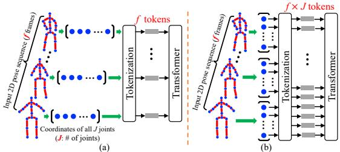
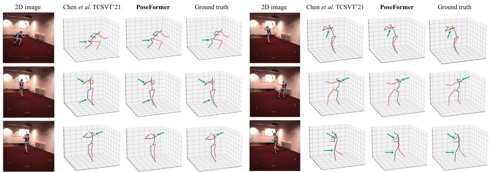
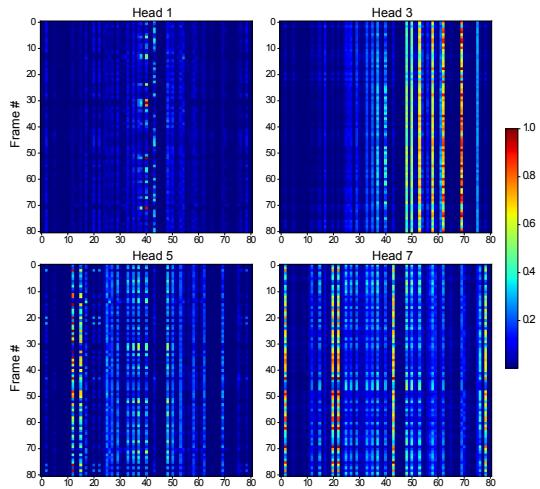
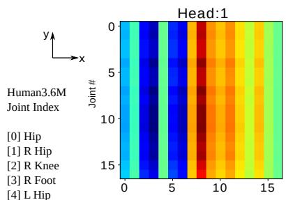
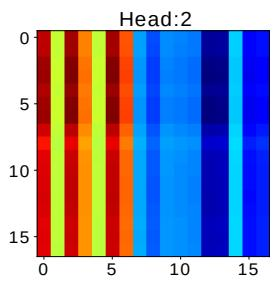
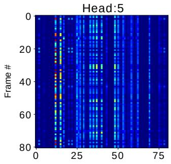
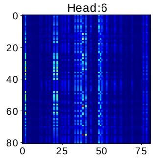
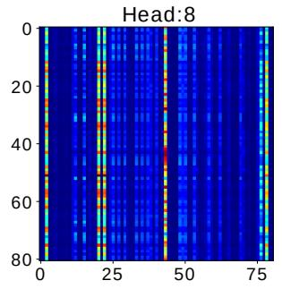

# 基于空间和时间 Transformer 的 3D 人体姿态估计

Ce Zheng1, Sijie Zhu1, Matias Mendieta1, Taojiannan Yang1, Chen Chen1, Zhengming Ding2

1Center for Research in Computer Vision, University of Central Florida, USA

2Department of Computer Science, Tulane University, USA

{cezheng,sizhu,mendieta,taoyang1122}@knights.ucf.edu;

chen.chen@crcv.ucf.edu;zding1@tulane.edu

## 摘要

Transformer 架构已成为自然语言处理领域的首选模型，目前正被引入到图像分类、目标检测和语义分割等计算机视觉任务中。然而，在人体姿态估计领域，卷积架构仍然占据主导地位。在这项工作中，我们提出了 PoseFormer，这是一种纯基于 Transformer 的视频 3D 人体姿态估计方法，不涉及任何卷积架构。受视觉 Transformer（Vision Transformer）最新进展的启发，我们设计了一种时空 Transformer 结构，以全面建模每一帧内的人体关节点关系以及跨帧的时间相关性，进而输出中心帧的高精度 3D 人体姿态。我们在两个通用且标准的基准数据集 Human3.6M 和 MPI-INF-3DHP 上对我们的方法进行了定量和定性评估。大量实验表明，PoseFormer 在这两个数据集上均取得了最先进的（state-of-the-art）性能。代码开源于 https://github.com/zczcwh/PoseFormer

## 1. 引言

人体姿态估计（Human Pose Estimation, HPE）旨在从图像和视频等输入数据中定位关节点并构建身体表征（例如骨架位置）。HPE 提供人体的几何与运动信息，可应用于广泛的领域（例如人机交互、运动分析、医疗保健）。当前的研究通常可分为两类：(1) 直接估计方法，以及 (2) 2D 到 3D 提升（2D-to-3D lifting）方法。直接估计方法 [31, 29] 直接从 2D 图像或视频帧推断 3D 人体姿态，而无需中间估计 2D 姿态表征。2D 到 3D 提升方法 [25, 5, 43, 38] 则从中间估计的 2D 姿态中推断 3D 人体姿态。得益于最先进的 2D 姿态检测器的优异性能，2D 到 3D 提升方法通常优于直接估计方法。然而，将这些 2D 姿态映射到 3D 并非易事；由于深度模糊性和遮挡，同一个 2D 姿态可能会生成多种潜在的 3D 姿态。为了缓解其中一些问题并保持自然的连贯性，近期的许多研究将视频中的时序信息整合到了它们的方法中。例如，[25, 5] 利用时序卷积神经网络（CNN）从相邻帧中捕获全局依赖关系，[33] 则使用循环架构达到了类似的效果。然而，对于这两种架构而言，时序关联窗口都是有限的。基于 CNN 的方法通常依赖空洞卷积技术，其在本质上具有有限的时序连接性，而循环网络主要受限于单纯的序列关联。

近年来，Transformer [37] 凭借其高效性、可扩展性以及强大的建模能力，已成为自然语言处理（NLP）领域的实际标准模型。得益于 Transformer 的自注意力机制，跨长输入序列的全局关联可以被清晰地捕获。这使其成为解决序列数据问题特别适用的架构，因此能够自然地扩展到 3D HPE 中。凭借其全面的连接性和表达能力，Transformer 为学习跨帧的更强时序表征提供了契机。然而，近期的研究 [12, 36] 表明，在视觉任务中，Transformer 需要特定的设计才能达到与对应 CNN 相当的性能。具体而言，它们通常需要极大规模的训练数据集 [12]，或者在应用于较小数据集时需要增强的数据增强和正则化策略 [36]。此外，现有的视觉 Transformer 主要局限于图像分类 [12, 36]、目标检测 [4, 50] 和分割 [41, 47]，而如何将 Transformer 的能力利用于 3D HPE 仍不明确。

为了开始回答这个问题，我们首先直接将 Transformer 应用于从 2D 到 3D 提升的人体姿态估计（2D-to-3D lifting HPE）。在这种情况下，我们将给定序列中每帧的整个 2D 姿态视为一个 token（图 1(a)）。虽然这种基线方法在一定程度上是可行的，但它忽略了空间关系（关节点之间）的自然区别，留下了潜在的改进空间。对该基线的一个自然扩展是，改为将每个 2D 关节点坐标视为一个 token，并输入由序列所有帧中的这些关节点组成的输入（图 1(b)）。然而，在这种情况下，当使用长帧序列时，token 的数量会变得极其庞大（在 3D HPE 中通常高达 243 帧且每帧 17 个关节点，token 数量将达到 $243 \times 17 = 4131$）。由于 Transformer 计算每个 token 之间的直接注意力，模型的内存需求将达到不合理的水平。

  
Figure 1. 两种基线方法。

因此，作为应对这些挑战的有效解决方案，我们提出了 PoseFormer，这是首个用于视频中 2D 到 3D 提升 HPE 的纯 Transformer 网络。PoseFormer 通过针对两个维度的独立 Transformer 模块直接对空间和时间方面进行建模。PoseFormer 不仅能在空间和时间元素上生成强大的表征，而且在处理长输入序列时不会引起巨大的 token 数量。在高层面上，PoseFormer 仅从现成的 2D 姿态估计器中接收检测到的 2D 姿态序列，并输出中心帧的 3D 姿态。更具体地说，我们构建了一个空间 Transformer 模块来编码每帧中 2D 关节点之间的局部关系。空间自注意力层考虑 2D 关节点的位置信息，并返回该帧的潜在特征表示。接下来，我们的时间 Transformer 模块分析各个空间特征表示之间的全局依赖关系，并生成准确的 3D 姿态估计。

在两个流行的 3D HPE 基准数据集 Human3.6M [16] 和 MPI-INF-3DHP [27] 上的实验评估表明，PoseFormer 在这两个数据集上均取得了最先进的性能。我们将估计的 3D 姿态与最先进的方法进行了对比可视化，发现 PoseFormer 能够产生更平滑、更可靠的结果。此外，消融实验中提供了 PoseFormer 注意力图的可视化与分析，以帮助理解我们模型的内部工作机制并证明其有效性。我们的贡献主要有以下三点：

• 我们提出了首个基于纯 Transformer 的模型 PoseFormer，用于 2D 到 3D 提升类别的 3D HPE。

• 我们设计了一种有效的时空 Transformer（Spatial-Temporal Transformer）模型，其中空间 Transformer 模块编码人体关节点之间的局部关系，而时间 Transformer 模块捕获整个序列中跨帧的全局依赖关系。

• 在无需多余复杂设计的情况下，我们的 PoseFormer 模型在 Human3.6M 和 MPI-INF-3DHP 数据集上均取得了最先进的结果。

## 2. 相关工作

在此，我们专门对 3D 单人单视角人体姿态估计（HPE）方法进行总结。直接估计方法无需中间估计 2D 姿态表征，即可直接从 2D 图像推断 3D 人体姿态。2D 到 3D 提升方法（2D-to-3D lifting approaches）利用 2D 姿态作为输入来生成对应的 3D 姿态，这在当前该领域的最优方法中更为流行。任何现成的 2D 姿态估计器都可以有效地与这些方法兼容。我们提出的方法 PoseFormer 同样遵循 2D 到 3D 提升管线，因此我们在本节中将主要关注此类方法。

2D-to-3D 提升 HPE。2D 到 3D 提升方法利用从输入图像或视频帧中估计出的 2D 姿态。OpenPose [3]、CPN [6]、AlphaPose [13] 和 HR-Net [35] 已被广泛用作 2D 姿态检测器。基于这种中间表示，可以通过多种方法生成 3D 姿态。Martinez 等人 [26] 提出了一个简单有效的全连接残差网络，仅基于单帧的 2D 关节点位置来回归 3D 关节点位置。然而，相较于从单目图像估计 3D 人体姿态，视频可以提供时间信息以提高准确性和鲁棒性 [49, 10, 32, 8, 2, 44, 38]。Hossain 和 Little [33] 提出了一种使用长短期记忆（LSTM）单元的循环神经网络，以利用输入序列中的时间信息。一些工作 [10, 2, 21] 利用时空关系以及骨骼长度和左右对称性等约束来提升性能。Pavllo 等人 [32] 引入了时间卷积网络，以根据连续 2D 序列中的 2D 关键点估计 3D 姿态。在 [32] 的基础上，Chen 等人 [5] 增加了骨骼方向模块和骨骼长度模块以确保视频帧间的时间一致性，Liu 等人 [25] 则利用注意力机制来识别关键帧。然而，先前最先进的方法（例如 [25, 5]）依赖于空洞时间卷积来捕获全局依赖性，这在时间连接性上存在固有的局限性。此外，这些工作中的大多数 [25, 5, 33, 32] 仅使用简单的操作将关节点坐标投影到潜在空间，而未考虑人体关节点的运动学相关性。

3D HPE 中的 GNN。很自然地，人体姿态可以表示为一个图，其中关节为节点，骨骼为边。图神经网络（GNNs）也已被应用于 2D 到 3D 姿态提升问题，并展现出了极具前景的性能 [9, 45, 24]。Ci 等人 [9] 提出了一个名为局部连接网络（Locally Connected Networks, LCNs）的框架，该框架同时利用全连接网络和 GNN 操作来编码局部关节邻域之间的关系。Zhao 等人 [45] 解决了图卷积网络 [19]（GCN）操作的一个局限性，具体而言就是权重矩阵如何在节点之间共享的问题。他们引入了语义图卷积操作来学习边的通道级权重。

  
Figure 2. (a) 时序 Transformer 基线。(b) 时空 Transformer（PoseFormer）架构，由三个模块组成。一个空间 Transformer 模块，用于在考虑每个单独骨架关节相关性的情况下提取特征。一个时序 Transformer 模块，用于学习整个序列的全局依赖关系。一个回归头模块，用于回归中心帧的最终 3D 姿态。Transformer 编码器的图解参考了 ViT [12]。

对于我们的 PoseFormer，Transformer 可以被视为一种具有独特的、通常也更具优势的图操作的图神经网络。具体而言，Transformer 编码器模块本质上构建了一个全连接图，其中边的权重是通过以输入为条件的多头自注意力机制计算得出的。该操作还包括节点特征的归一化、跨注意力头输出的前馈聚合器，以及使其能够在多层堆叠时有效扩展的残差连接。与其他图操作相比，这种操作更具优势。例如，节点之间的连接强度是由 Transformer 的自注意力机制决定的，而不是像该任务中采用的典型基于 GCN 的方案那样通过邻接矩阵预先定义。这使得模型能够灵活地根据每个输入姿态自适应调整关节之间的相对重要性。此外，Transformer 全面的缩放和归一化组件在缓解过度平滑（over-smoothing）效应方面可能也具有优势，而在堆叠多层时，该效应往往困扰着许多 GNN 变体操作 [48]。

Vision Transformers（视觉Transformer）。最近，将 Transformer 应用于视觉任务引起了广泛关注 [17, 14]。Carion 等人 [4] 提出了用于目标检测和全景分割的 DEtection TRansformer (DETR)。Dosovitskiy 等人 [12] 提出了一种纯 Transformer 架构——Vision Transformer (ViT)，在图像分类上取得了最先进的（state-of-the-art）性能。然而，ViT 是在需要庞大计算资源的大规模数据集 ImageNet-21k 和 JFT-300M 上训练的。随后，提出了基于 ViT 并结合知识蒸馏的数据高效图像 Transformer (DeiT) [36]。对于诸如 HPE（人体姿态估计）等回归问题，Yang 等人 [40] 提出了一个 Transformer 网络 Transpose，该网络仅从图像中估计 2D 姿态。Lin 等人 [23] 在其方法 METRO (MEsh TRansfOrmer) 中将 CNN 与 Transformer 网络相结合，从单张图像重建 3D 姿态和网格顶点。与我们的方法相比，METRO 属于直接估计的范畴。此外，METRO 忽略了时间一致性，这限制了其估计的鲁棒性。我们的时空 Transformer 架构充分利用了每帧中的关键点相关性，并保留了视频中自然的时间连贯性。

## 3. 方法

我们遵循与 [26, 32, 25, 5] 相同的 2D-to-3D 提升（lifting）流程来进行视频中的 3D HPE。通过现成的 2D 姿态检测器获取每帧的 2D 姿态，然后将连续帧的 2D 姿态序列作为输入，用于估计中心帧的 3D 姿态。与以往基于 CNN 的最先进模型相比，我们构建了一个极具竞争力的无卷积 Transformer 网络。

## 3.1. 时间 Transformer 基线

作为 Transformer 在 2D-to-3D 提升中的基线应用，我们将每个 2D 姿态视为一个输入 token，并使用 Transformer 来捕获输入之间的全局依赖关系，如图 Fig. 2(a) 所示。我们将每个输入 token 称为一个 patch，类似于 ViT [12] 中的术语。对于输入序列 $X \in \mathbb { R } ^ { f \times ( J \cdot 2 ) }$ )，f 是输入序列的帧数，J 是每个 2D 姿态的关节点数量，2 表示关节点在 2D 空间中的坐标。$\{ \mathbf { x } ^ { i } \overset { \cdot } { \in } \mathbb { R } ^ { 1 \times ( J \cdot 2 ) } | i = 1 , 2 , \overset { \cdot } { \dots } f \}$ 表示每帧的输入向量。Patch 嵌入（patch embedding）是一个可训练的线性投影层，用于将每个 patch 嵌入到高维特征中。Transformer 网络利用位置嵌入（positional embeddings）来保留序列的位置信息。该过程可以表示为：

$$
Z _ {0} = [ \mathbf {x} ^ {1} E; \mathbf {x} ^ {2} E; \dots ; \mathbf {x} ^ {f} E ] + E _ {p o s}.\tag{1}
$$

在通过线性投影矩阵 $E \in$ $\mathbb { R } ^ { ( J \cdot 2 ) \times C }$ 进行嵌入并与位置嵌入 $E _ { p o s } \in \mathbb { R } ^ { f \times C }$ 相加后，输入序列 $\overset { \cdot } { X } \in \mathbb { R } ^ { f \times ( J \cdot 2 ) }$ 变为 $\dot { Z _ { 0 } } \in \mathbb { R } ^ { f \times C }$，其中 $C$ 为嵌入维度。$Z _ { 0 }$ 被送入时序 Transformer 编码器（Temporal Transformer Encoder）。

作为 Transformer 的核心功能，自注意力（self-attention）旨在将输入序列的不同位置与嵌入特征关联起来。如 [12] 所示，我们的 Transformer 编码器由多头自注意力（Multi-head Self Attention）块与多层感知机（MLP）块组成。每个块之前应用 LayerNorm，每个块之后应用残差连接 [39, 1]。

缩放点积注意力（Scaled Dot-Product Attention）可以被描述为一个映射函数，将查询矩阵 $Q .$、键矩阵 K 和值矩阵 $V$ 映射到输出注意力矩阵。$Q , K , V \in \mathbb { R } ^ { N \times d }$，其中 N 是序列中的向量数量，d 是维度。该注意力操作中使用了缩放因子 $\textstyle { \frac { 1 } { \sqrt { d } } }$ 进行适当的归一化，以防止当 d 较大导致点积数值过大时出现极小的梯度。因此，缩放点积注意力的输出可以表示为：

$$
\operatorname{Attention} (Q, K, V) = \operatorname{Softmax} (Q K ^ {\top} / \sqrt {d}) V.\tag{2}
$$

在我们的时序 Transformer 中，$d = C$ 且 $N = f .$。$Q , \ K$ 和 $V$ 通过线性变换 $W _ { Q } , \thinspace W _ { K }$ 和 $W _ { V }$ $\in \mathbb { R } ^ { C \times C }$ 由嵌入特征 $Z \in \mathbb { R } ^ { f \times C }$ 计算得到：

$$
Q = Z W _ {Q}, \quad K = Z W _ {K}, \quad V = Z W _ {V}.\tag{3}
$$

多头自注意力层（Multi-head Self Attention Layer, MSA）利用多个头来共同建模来自不同位置的各种表示子空间的信息。每个头并行应用缩放点积注意力。MSA 的输出为 h 个注意力头输出的拼接。

$$
\operatorname{MSA} (Q, K, V) = \operatorname{Concat} \left(H _ {1}, H _ {2}, \dots , H _ {h}\right) W _ {\text { out }}\tag{4}
$$

$$
\text { where } \quad H _ {i} = \operatorname{Attention} (Q _ {i}, K _ {i}, V _ {i}), i \in [ 1,..., h ]\tag{5}
$$

给定嵌入特征 $Z _ { 0 } \in \mathbb { R } ^ { f \times C }$，L 层的时序 Transformer 编码器结构可以表示如下：

$$
Z _ {\ell} ^ {'} = \mathrm{MSA} (\mathrm{LN} (Z _ {\ell - 1})) + Z _ {\ell - 1}, \quad \ell = 1, 2 \dots L\tag{6}
$$

$$
Z _ {\ell} = \mathrm{MLP} (\mathrm{LN} (Z _ {\ell} ^ {'})) + Z _ {\ell} ^ {'}, \qquad \ell = 1, 2, \ldots L\tag{7}
$$

$$
Y = \operatorname{LN} (Z _ {L}),\tag{8}
$$

其中 LN(·) 表示层归一化算子（与 ViT 中相同）。时间 Transformer 编码器由 L 个相同的层组成，编码器输出 $Y \in \mathbb { R } ^ { f \times C }$ 与编码器输入 $Z _ { 0 } \in \bar { \mathbb { R } ^ { f \times C } }$ 保持相同的尺寸。

为了预测中心帧的 3D 姿态，通过在帧维度上取平均，将编码器输出 $\bar { Y } \in \mathbb { R } ^ { f \times C }$ 压缩为向量 y $\in \mathbb { R } ^ { 1 \times C }$。最后，一个 MLP 块将输出回归为 $\mathbf { y } \in \mathbb { R } ^ { 1 \times ( J \cdot 3 ) }$，即中心帧的 3D 姿态。

## 3.2. PoseFormer：时空 Transformer

我们观察到，时间 Transformer 基线主要关注输入序列中各帧之间的全局依赖关系。Patch 嵌入（一种线性变换）被用于将关节坐标投影到隐藏维度。然而，局部关节坐标之间的运动学信息在时间 Transformer 基线中并未得到强有力的表征，因为简单的线性投影层无法学习注意力信息。一种潜在的解决办法是将每个关节坐标视为一个单独的 patch，并将所有帧的关节作为输入馈入 Transformer（见 Fig. 1(b)）。然而，patch 的数量将急剧增加（帧数 f 乘以关节数 J），导致模型的计算复杂度达到 $O ( ( f \cdot J ) ^ { 2 } )$ ）。例如，如果我们使用 81 帧且每个 2D 姿态有 17 个关节，patch 的数量将达到 1377 个（ViT 模型使用 576 个 patch（输入 $\mathrm { s i z e = 3 8 4 \times 3 8 4 }$ ，patch ${ \mathrm { s i z e } } = 1 6 \times 1 6 ) )$ ）。

为了高效地学习局部关节相关性，我们分别采用两个独立的 Transformer 来处理空间和时间信息。如 Fig. 2(b) 所示，PoseFormer 由三个模块组成：空间 Transformer 模块、时间 Transformer 模块以及回归头模块。

空间 Transformer 模块（Spatial Transformer Module）。空间 Transformer 模块旨在从单帧中提取高维特征嵌入。给定具有 $J$ 个关节点的 2D 姿态，我们将每个关节点（即两个坐标）视为一个 patch，并遵循通用的 Vision Transformer 流程在所有 patch 之间执行特征提取。首先，我们通过可训练的线性投影将每个关节点的坐标映射到高维空间，这被称为空间 patch 嵌入（spatial patch embedding）。我们将其与可学习的空间位置嵌入（spatial positional embedding）[12] $E _ { S P o s } ~ \in ~ \mathbb { R } ^ { J \times c }$ 相加，因此第 $i$ 帧的输入 $\mathbf { x } _ { i } \in \mathbb { R } ^ { 1 \times \left( J \cdot 2 \right) }$ 变为 $\boldsymbol { z } _ { 0 } ^ { i } \in \mathbb { R } ^ { J \times c }$，其中 2 表示每帧中的 2D 坐标，$c$ 为空间嵌入维度。由此生成的关节点特征序列 $z _ { 0 } ^ { i }$ 被送入空间 Transformer 编码器中，该编码器应用自注意力机制（self-attention mechanism）来整合所有关节点之间的信息。对于第 $i$ 帧，具有 $L$ 层的空间 Transformer 编码器的输出为 $\boldsymbol { z } _ { L } ^ { i } \in \mathbb { R } ^ { J \times c }$。

时间 Transformer 模块（Temporal Transformer Module）。由于空间 Transformer 模块为每个单独的帧编码高维特征，时间 Transformer 模块的目标是建模跨帧序列的依赖关系。对于第 $i$ 帧，空间 Transformer 的输出 $z _ { L } ^ { i } \in \mathbb { R } ^ { J \times c }$ 被展平为向量 $\mathbf { z } ^ { i } \in \mathbb { R } ^ { 1 \times ( J \cdot c ) }$。然后，我们将来自 $f$ 个输入帧的这些向量 $\{ \mathbf { z } ^ { 1 } , \mathbf { z } ^ { 2 } , \hdots , \mathbf { z } ^ { f } \}$ 拼接为 $Z _ { 0 } ~ \in ~ \mathbb { R } ^ { f \times ( J \cdot c ) }$。在进入时间 Transformer 模块之前，我们添加可学习的时间位置嵌入（temporal positional embedding）[12] $E _ { T P o s } \in \mathbb { R } ^ { f \times ( J \cdot c ) }$ 以保留帧位置信息。对于时间 Transformer 编码器，我们采用与空间 Transformer 编码器相同的架构，该架构由多头自注意力（multihead self-attention）块和 MLP 块组成。时间 Transformer 模块的输出为 $Y \in \mathbb { R } ^ { f \times ( J \cdot c ) }$。

回归头（Regression Head）。由于我们使用连续帧序列来预测中心帧的 3D 姿态，时间 Transformer 模块的输出 $Y \in \mathbb { R } ^ { f \times ( J \cdot c ) }$ 需要降维为 $\mathbf { y } \in \mathbb { R } ^ { 1 \times ( J \cdot c ) }$。我们在帧维度上应用（带有可学习权重的）加权平均操作来实现这一点。最后，一个带有 Layer norm 和一个线性层的简单 MLP 块返回输出 $\mathbf { y } \in \mathbb { R } ^ { 1 \times ( J \cdot 3 ) }$，即中心帧的预测 3D 姿态。

损失函数。为了训练我们的时空 Transformer（spatial-temporal transformer）模型，我们采用标准的 MPJPE（Mean Per Joint Position Error，平均每个关节位置误差）损失，以最小化预测姿态与真实姿态之间的误差，公式如下：

$$
\mathcal {L} = \frac {1}{J} \Sigma_ {k = 1} ^ {J} \| p _ {k} - \hat {p} _ {k} \| _ {2},\tag{9}
$$

其中 $p _ { k }$ 和 $\hat { p } _ { k }$ 分别表示第 k 个关节的真实与估计 3D 关节位置。

## 4. 实验

## 4.1. 数据集与评估指标

我们在两个常用的 3D HPE（3D 人体姿态估计）数据集 Human3.6M [16] 和 MPI-INF-3DHP [27] 上评估了我们的模型。

Human3.6M [16] 是 3D 单人 HPE 中最广泛使用的室内数据集。共有 11 名专业演员表演了 17 种动作，如坐着、行走和打电话。每个受试者的视频均在室内环境中从 4 个不同视角录制。该数据集包含 360 万个视频帧，且拥有由精确的基于标记的动作捕捉系统捕获的 3D 真实值标注。遵循先前的研究 [32, 25, 5]，我们采用相同的实验设置：所有 15 个动作均用于训练和测试，模型在五个部分（S1、S5、S6、S7、S8）上进行训练，并在两个受试者（S9 和 S11）上进行测试。

MPI-INF-3DHP [27] 是一个更具挑战性的 3D 姿态数据集。它既包含受限的室内场景，也包含复杂的室外场景。有 8 名演员在 14 个相机视角下表演 8 种动作，涵盖了更丰富的姿态多样性。MPI-INF-3DHP 提供了一个包含不同场景下 6 名受试者的测试集。我们遵循 [22, 5, 38] 中的设置。

对于 Human3.6M 数据集，我们使用最常用的评估指标（MPJPE 和 P-MPJPE）[46] 来评估我们的估计结果与真实 3D 姿态的性能。MPJPE（Mean Per Joint Position Error，平均每个关节位置误差）计算为估计关节与真实值之间的平均欧几里得距离（以毫米为单位）；我们将 MPJPE 称为协议 1（Protocol 1）。P-MPJPE 是在估计的 3D 姿态与真实值之间通过后处理进行刚性对齐后的 MPJPE，它对单个关节预测失败的情况更为鲁棒。我们将 P-MPJPE 称为协议 2（Protocol 2）。

对于 MPI-INF-3DHP 数据集，我们使用 MPJPE、150mm 范围内的正确关键点百分比（Percentage of Correct Keypoint，PCK）[22, 5, 38] 以及曲线下面积（Area Under Curve，AUC）。

## 4.2. 实现细节

我们使用 Pytorch [30] 实现了所提出的方法。训练和测试使用了两块 NVIDIA RTX 3090 GPU。在进行实验时，我们选择了三种不同的帧序列长度，即 $f = 9 , f = 2 7$ $f = 8 1$。关于帧数及对应结果的详细信息在消融实验（第 4.4 节）中进行讨论。遵循 [32, 25, 5]，我们在训练和测试中均采用水平姿态翻转作为数据增强。我们使用 Adam [18] 优化器训练模型 130 个 epoch，权重衰减（weight decay）为 0.1。我们采用指数学习率衰减策略，初始学习率为 2e-4，每个 epoch 的衰减因子为 0.98。我们将批大小（batch size）设置为 1024，并在 Transformer 编码器层中使用比例为 0.1 的随机深度（stochastic depth）[15]。对于 2D 姿态检测器，遵循 [32, 25, 5]，我们在 Human3.6M 上使用级联金字塔网络（cascaded pyramid network, CPN）[7]；遵循 [28, 22]，我们在 MPI-INF-3DHP 上使用真实 2D 姿态（ground truth 2D pose）作为输入。

## 4.3. 与最先进方法的对比

Human3.6M。我们在 Table 1 中报告了测试集（S9 和 S11）的所有 15 种动作的结果。最后一列提供了在整个测试集上的平均性能。遵循 2D 到 3D 提升（2D-to-3D lifting）方法，我们使用 CPN 网络作为 2D 姿态检测器，然后使用检测到的 2D 姿态作为训练和测试的输入。PoseFormer 在协议 1（protocol 1）和协议 2（protocol 2）下分别大幅度超越了我们的基线模型（即第 3.1 节中的时间 Transformer 基线）（分别提升了 6.1% 和 6.4%）。这清楚地证明了使用空间 Transformer 有效建模每帧内关节点之间相关性的优势。如 Table 1（上）所示，PoseFormer 在协议 1 下取得了最低的平均 MPJPE（44.3mm）。与基于 Transformer 的方法 METRO [23]（该方法由于从单张图像估计 3D 姿态而忽略了时间一致性）相比，PoseFormer 将 MPJPE 降低了约 18%。对于协议 2，如 Table 1（下）所示，我们也取得了最佳的总体结果。此外，PoseFormer 在拍照（Photo）、坐下（SittingDown）、遛狗（WalkDog）和吸烟（Smoke）等困难动作上实现了更准确的姿态预测。与其他简单动作不同，这些动作中的姿态变化更快，且某些长距离帧之间存在强相关性。在这种情况下，全局依赖关系起着重要作用，而 Transformer 的注意力机制尤具优势。

Table 1. 在使用检测到的 2D 姿态作为输入的情况下，Human3.6M 数据集上协议 1 与协议 2 下估计的 3D 姿态与真实 3D 姿态之间每关节平均位置误差（Mean Per Joint Position Error）的定量对比。上表：协议 1（MPJPE）下的结果。下表：协议 2（P-MPJPE）下的结果。$f$ 表示各方法中使用的输入帧数，∗ 表示输入 2D 姿态由级联金字塔网络（CPN）检测，† 表示基于 Transformer 的模型。（红色：最优；蓝色：次优）

<table><tr><td>协议 1</td><td></td><td>Dir.</td><td>Disc.</td><td>Eat.</td><td>Greet</td><td>Phone</td><td>Photo</td><td>Pose</td><td>Purch.</td><td>Sit</td><td>SitD.</td><td>Somke</td><td>Wait</td><td>WalkD.</td><td>Walk</td><td>WalkT.</td><td>平均</td></tr><tr><td>Dabral et al. [11]</td><td>ECCV&#x27;18</td><td>44.8</td><td>50.4</td><td>44.7</td><td>49.0</td><td>52.9</td><td>61.4</td><td>43.5</td><td>45.5</td><td>63.1</td><td>87.3</td><td>51.7</td><td>48.5</td><td>52.2</td><td>37.6</td><td>41.9</td><td>52.1</td></tr><tr><td>Cai et al. [2] (f = 7)</td><td>ICCV&#x27;19</td><td>44.6</td><td>47.4</td><td>45.6</td><td>48.8</td><td>50.8</td><td>59.0</td><td>47.2</td><td>43.9</td><td>57.9</td><td>61.9</td><td>49.7</td><td>46.6</td><td>51.3</td><td>37.1</td><td>39.4</td><td>48.8</td></tr><tr><td>Pavllo et al. [32] (f = 243)*</td><td>CVPR&#x27;19</td><td>45.2</td><td>46.7</td><td>43.3</td><td>45.6</td><td>48.1</td><td>55.1</td><td>44.6</td><td>44.3</td><td>57.3</td><td>65.8</td><td>47.1</td><td>44.0</td><td>49.0</td><td>32.8</td><td>33.9</td><td>46.8</td></tr><tr><td>Lin et al. [22] (f = 50)</td><td>BMVC&#x27;19</td><td>42.5</td><td>44.8</td><td>42.6</td><td>44.2</td><td>48.5</td><td>57.1</td><td>52.6</td><td>41.4</td><td>56.5</td><td>64.5</td><td>47.4</td><td>43.0</td><td>48.1</td><td>33.0</td><td>35.1</td><td>46.6</td></tr><tr><td>Yeh et al. [42]</td><td>NIPS&#x27;19</td><td>44.8</td><td>46.1</td><td>43.3</td><td>46.4</td><td>49.0</td><td>55.2</td><td>44.6</td><td>44.0</td><td>58.3</td><td>62.7</td><td>47.1</td><td>43.9</td><td>48.6</td><td>32.7</td><td>33.3</td><td>46.7</td></tr><tr><td>Liu et al. [25] (f = 243)*</td><td>CVPR&#x27;20</td><td>41.8</td><td>44.8</td><td>41.1</td><td>44.9</td><td>47.4</td><td>54.1</td><td>43.4</td><td>42.2</td><td>56.2</td><td>63.6</td><td>45.3</td><td>43.5</td><td>45.3</td><td>31.3</td><td>32.2</td><td>45.1</td></tr><tr><td>SRNet [43]*</td><td>ECCV&#x27;20</td><td>46.6</td><td>47.1</td><td>43.9</td><td>41.6</td><td>45.8</td><td>49.6</td><td>46.5</td><td>40.0</td><td>53.4</td><td>61.1</td><td>46.1</td><td>42.6</td><td>43.1</td><td>31.5</td><td>32.6</td><td>44.8</td></tr><tr><td>UGCN [38] (f = 96)</td><td>ECCV&#x27;20</td><td>41.3</td><td>43.9</td><td>44.0</td><td>42.2</td><td>48.0</td><td>57.1</td><td>42.2</td><td>43.2</td><td>57.3</td><td>61.3</td><td>47.0</td><td>43.5</td><td>47.0</td><td>32.6</td><td>31.8</td><td>45.6</td></tr><tr><td>Chen et al. [5] (f = 81)*</td><td>TCSVT&#x27;21</td><td>42.1</td><td>43.8</td><td>41.0</td><td>43.8</td><td>46.1</td><td>53.5</td><td>42.4</td><td>43.1</td><td>53.9</td><td>60.5</td><td>45.7</td><td>42.1</td><td>46.2</td><td>32.2</td><td>33.8</td><td>44.6</td></tr><tr><td>METRO [23] (f = 1) †</td><td>CVPR&#x27;21</td><td>-</td><td>-</td><td>-</td><td>-</td><td>-</td><td>-</td><td>-</td><td>-</td><td>-</td><td>-</td><td>-</td><td>-</td><td>-</td><td>-</td><td>-</td><td>54.0</td></tr><tr><td>Baseline (f = 81)*†</td><td></td><td>43.8</td><td>47.9</td><td>43.8</td><td>45.5</td><td>49.7</td><td>55.7</td><td>44.3</td><td>45.8</td><td>57.7</td><td>66.3</td><td>47.4</td><td>45.4</td><td>48.6</td><td>32.5</td><td>33.8</td><td>47.2</td></tr><tr><td>PoseFormer (f = 81)*†</td><td></td><td>41.5</td><td>44.8</td><td>39.8</td><td>42.5</td><td>46.5</td><td>51.6</td><td>42.1</td><td>42.0</td><td>53.3</td><td>60.7</td><td>45.5</td><td>43.3</td><td>46.1</td><td>31.8</td><td>32.2</td><td>44.3</td></tr><tr><td>协议 2</td><td></td><td>Dir.</td><td>Disc.</td><td>Eat.</td><td>Greet</td><td>Phone</td><td>Photo</td><td>Pose</td><td>Purch.</td><td>Sit</td><td>SitD.</td><td>Somke</td><td>Wait</td><td>WalkD.</td><td>Walk</td><td>WalkT.</td><td>平均</td></tr><tr><td>Pavlakos et al. [31]</td><td>CVPR&#x27;18</td><td>34.7</td><td>39.8</td><td>41.8</td><td>38.6</td><td>42.5</td><td>47.5</td><td>38.0</td><td>36.6</td><td>50.7</td><td>56.8</td><td>42.6</td><td>39.6</td><td>43.9</td><td>32.1</td><td>36.5</td><td>41.8</td></tr><tr><td>Hossain et al. [33]</td><td>ECCV&#x27;18</td><td>35.7</td><td>39.3</td><td>44.6</td><td>43.0</td><td>47.2</td><td>54.0</td><td>38.3</td><td>37.5</td><td>51.6</td><td>61.3</td><td>46.5</td><td>41.4</td><td>47.3</td><td>34.2</td><td>39.4</td><td>44.1</td></tr><tr><td>Cai et al. [2] (f = 7)</td><td>ICCV&#x27;19</td><td>35.7</td><td>37.8</td><td>36.9</td><td>40.7</td><td>39.6</td><td>45.2</td><td>37.4</td><td>34.5</td><td>46.9</td><td>50.1</td><td>40.5</td><td>36.1</td><td>41.0</td><td>29.6</td><td>32.3</td><td>39.0</td></tr><tr><td>Lin et al. [22] (f = 50)</td><td>BMVC&#x27;19</td><td>32.5</td><td>35.3</td><td>34.3</td><td>36.2</td><td>37.8</td><td>43.0</td><td>33.0</td><td>32.2</td><td>45.7</td><td>51.8</td><td>38.4</td><td>32.8</td><td>37.5</td><td>25.8</td><td>28.9</td><td>36.8</td></tr><tr><td>Pavllo et al. [32] (f = 243)*</td><td>CVPR&#x27;19</td><td>34.1</td><td>36.1</td><td>34.4</td><td>37.2</td><td>36.4</td><td>42.2</td><td>34.4</td><td>33.6</td><td>45.0</td><td>52.5</td><td>37.4</td><td>33.8</td><td>37.8</td><td>25.6</td><td>27.3</td><td>36.5</td></tr><tr><td>Liu et al. [25] (f = 243)*</td><td>CVPR&#x27;20</td><td>32.3</td><td>35.2</td><td>33.3</td><td>35.8</td><td>35.9</td><td>41.5</td><td>33.2</td><td>32.7</td><td>44.6</td><td>50.9</td><td>37.0</td><td>32.4</td><td>37.0</td><td>25.2</td><td>27.2</td><td>35.6</td></tr><tr><td>UGCN [38] (f = 96)</td><td>ECCV&#x27;20</td><td>32.9</td><td>35.2</td><td>35.6</td><td>34.4</td><td>36.4</td><td>42.7</td><td>31.2</td><td>32.5</td><td>45.6</td><td>50.2</td><td>37.3</td><td>32.8</td><td>36.3</td><td>26.0</td><td>23.9</td><td>35.5</td></tr><tr><td>Chen et al. [5] (f = 81)*</td><td>TCSVT&#x27;21</td><td>33.1</td><td>35.3</td><td>33.4</td><td>35.9</td><td>36.1</td><td>41.7</td><td>32.8</td><td>33.3</td><td>42.6</td><td>49.4</td><td>37.0</td><td>32.7</td><td>36.5</td><td>25.5</td><td>27.9</td><td>35.6</td></tr><tr><td>Baseline (f = 81)*†</td><td></td><td>33.6</td><td>37.1</td><td>35.4</td><td>36.7</td><td>37.8</td><td>42.2</td><td>33.9</td><td>34.7</td><td>47.0</td><td>53.4</td><td>38.2</td><td>34.3</td><td>37.6</td><td>25.3</td><td>27.8</td><td>37.0</td></tr><tr><td>PoseFormer (f = 81)*†</td><td></td><td>32.5</td><td>34.8</td><td>32.6</td><td>34.6</td><td>35.3</td><td>39.5</td><td>32.1</td><td>32.0</td><td>42.8</td><td>48.5</td><td>34.8</td><td>32.4</td><td>35.3</td><td>24.5</td><td>26.0</td><td>34.6</td></tr></table>

为了进一步探究我们方法的性能下界，我们直接使用真实的 2D 姿态（ground truth 2D pose）作为输入，以减轻由带噪声的 2D 姿态数据引起的误差。结果如 Table 2 所示。通过使用干净的 2D 姿态数据，MPJPE 从 44.3mm 降低到 31.3mm，降幅约为 29.7%。PoseFormer 在 9 种动作中取得了最佳成绩，并在 6 种动作中取得了次优成绩。与 SRNet [43] 相比，平均指标提升了约 2%。

在 Fig. 3 中，我们还对比了在 Human3.6M 测试集 S11 的 Photo 动作上误差最大的一些单关节的 MPJPE。PoseFormer 在这些困难关节上的表现优于 [32, 5]。

  
Figure 3. Human3.6M 测试集 S11 在 Photo 动作下所有帧的平均关节误差对比。

MPI-INF-3DHP。Table 3 报告了 PoseFormer 与其他方法在 MPI-INF-3DHP 上的定量结果。与 Human3.6M 相比，该数据集包含的训练样本更少，且部分样本采集自室外场景。由于该数据集的序列长度通常较短，我们使用 9 帧的 2D 姿态作为模型输入。我们的方法在所有三项评估指标（PCK、AUC 和 MPJPE）上均再次取得了最佳性能。

定性结果。我们还提供了 3D 估计姿态与真实值（ground truth）之间的可视化对比。我们在具有极高挑战性的动作之一（所有方法均具有较高的 MPJPE）——Human3.6M 测试集 S11 的 Photo 动作上评估了 PoseFormer。如图 Fig. 4 所示，与最先进的方法 [5] 相比，我们的 PoseFormer 实现了更准确的预测。

## 4.4. 消融实验

为了验证 PoseFormer 各个组件的贡献以及超参数对性能的影响，我们在协议 1（protocol 1）下使用 Human3.6M 数据集进行了广泛的消融实验。

PoseFormer 的设计。我们在 Table 4 中探究了空间 Transformer 以及空间和时间 Transformer 的位置嵌入（positional embeddings）的影响。我们输入由 CPN 检测到的 9 帧 2D 姿态 $( J ~ = ~ 1 7 )$ 来预测 3D 姿态。为了公平比较各模块的影响，所有架构参数均保持固定；空间 Transformer 的嵌入维度为 $1 7 \times 3 2 = 5 4 4$，空间 Transformer 编码器层数为 4。对于时间 Transformer，其嵌入维度与空间 Transformer 一致（即 544），并且我们也采用了 4 层时间 Transformer。为了验证我们时空设计的效果，我们首先与 Sec. 3.1 中最初使用的 Transformer 基线（baseline）进行了比较。Table 4 中的结果表明，由于对关节点之间的相关性进行了更强的建模，我们的时空 Transformer 带来了显著的提升（MPJPE 从 52.5 降至 49.9）。这也与 Table 1 中 $f = 8 1$ 时的结果（Baseline 与 PoseFormer）一致。接下来，我们评估位置嵌入的影响。我们探索了四种可能的组合：无位置嵌入、仅空间位置嵌入、仅时间位置嵌入，以及同时使用空间和时间位置嵌入。比较这些组合的结果可以明显看出，位置嵌入提升了性能。通过在空间和时间模块上同时应用位置嵌入，取得了最佳的综合效果。

Table 2. 在 Human3.6M 数据集上基于 Protocol 1，使用真实 2D 姿态作为输入时，估计的 3D 姿态与真实 3D 姿态之间的每关节平均位置误差（Mean Per Joint Position Error, MPJPE）定量对比。（红色：最优；蓝色：次优）

<table><tr><td>GT 协议 1</td><td></td><td>Dir.</td><td>Disc.</td><td>Eat.</td><td>Greet</td><td>Phone</td><td>Photo</td><td>Pose</td><td>Purch.</td><td>Sit</td><td>SitD.</td><td>Somke</td><td>Wait</td><td>WalkD.</td><td>Walk</td><td>WalkT.</td><td>平均</td></tr><tr><td>Hossain 等人 [33]</td><td>ECCV&#x27;18</td><td>35.2</td><td>40.8</td><td>37.2</td><td>37.4</td><td>43.2</td><td>44.0</td><td>38.9</td><td>35.6</td><td>42.3</td><td>44.6</td><td>39.7</td><td>39.7</td><td>40.2</td><td>32.8</td><td>35.5</td><td>39.2</td></tr><tr><td>Pavllo 等人 [32] (f = 243)</td><td>CVPR&#x27;19</td><td>-</td><td>-</td><td>-</td><td>-</td><td>-</td><td>-</td><td>-</td><td>-</td><td>-</td><td>-</td><td>-</td><td>-</td><td>-</td><td>-</td><td>-</td><td>37.2</td></tr><tr><td>Liu 等人 [25] (f = 243)</td><td>CVPR&#x27;20</td><td>34.5</td><td>37.1</td><td>33.6</td><td>34.2</td><td>32.9</td><td>37.1</td><td>39.6</td><td>35.8</td><td>40.7</td><td>41.4</td><td>33.0</td><td>33.8</td><td>33.0</td><td>26.6</td><td>26.9</td><td>34.7</td></tr><tr><td>SRNet [43]</td><td>ECCV&#x27;20</td><td>34.8</td><td>32.1</td><td>28.5</td><td>30.7</td><td>31.4</td><td>36.9</td><td>35.6</td><td>30.5</td><td>38.9</td><td>40.5</td><td>32.5</td><td>31.0</td><td>29.9</td><td>22.5</td><td>24.5</td><td>32.0</td></tr><tr><td>Chen 等人 [5] (f = 243)</td><td>TCSVT&#x27;21</td><td>-</td><td>-</td><td>-</td><td>-</td><td>-</td><td>-</td><td>-</td><td>-</td><td>-</td><td>-</td><td>-</td><td>-</td><td>-</td><td>-</td><td>-</td><td>32.3</td></tr><tr><td>PoseFormer (f = 81)</td><td></td><td>30.0</td><td>33.6</td><td>29.9</td><td>31.0</td><td>30.2</td><td>33.3</td><td>34.8</td><td>31.4</td><td>37.8</td><td>38.6</td><td>31.7</td><td>31.5</td><td>29.0</td><td>23.3</td><td>23.1</td><td>31.3</td></tr></table>

  
Figure 4. 我们的方法（PoseFormer）与当前最优（SOTA）方法 Chen 等人 [5] 在 Human3.6M 测试集 S11 的拍照（Photo）动作上的定性对比。绿色箭头突出了 PoseFormer 明显获得更佳结果的位置。

Table 3. 在 MPI-INF-3DHP 数据集上与以往方法的定量对比。最佳结果以粗体标出。

<table><tr><td></td><td></td><td>PCK ↑</td><td>AUC ↑</td><td>MPJPE ↓</td></tr><tr><td>Mehta et al. [27]</td><td>3DV&#x27;17</td><td>75.7</td><td>39.3</td><td>117.6</td></tr><tr><td>Mehta et al. [28]</td><td>ACM ToG&#x27;17</td><td>76.6</td><td>40.4</td><td>124.7</td></tr><tr><td>Pavllo et al. [32] (81 帧)</td><td>CVPR&#x27;19</td><td>86.0</td><td>51.9</td><td>84.0</td></tr><tr><td>Pavllo et al. [32] (243 帧)</td><td>CVPR&#x27;19</td><td>85.5</td><td>51.5</td><td>84.8</td></tr><tr><td>Lin et al. [22] (25 帧)</td><td>BMVC&#x27;19</td><td>83.6</td><td>51.4</td><td>79.8</td></tr><tr><td>Li et al. [20]</td><td>CVPR&#x27;20</td><td>81.2</td><td>46.1</td><td>99.7</td></tr><tr><td>Chen et al. [5] (81 帧)</td><td>TCSVT&#x27;21</td><td>87.9</td><td>54.0</td><td>78.8</td></tr><tr><td>PoseFormer (9 帧)</td><td></td><td>88.6</td><td>56.4</td><td>77.1</td></tr></table>

Table 4. PoseFormer 中不同组件的消融实验。评估在 Human3.6M（Protocol 1）上进行，使用检测到的 2D 姿态作为输入。（T：仅时间；S-T：时空）

<table><tr><td>输入长度 (f)</td><td>T</td><td>S-T</td><td>空间位置嵌入</td><td>时间位置嵌入</td><td>MPJPE</td></tr><tr><td>9</td><td>√</td><td>✗</td><td>✗</td><td>√</td><td>52.5</td></tr><tr><td>9</td><td>✗</td><td>√</td><td>✗</td><td>✗</td><td>51.6</td></tr><tr><td>9</td><td>✗</td><td>√</td><td>√</td><td>✗</td><td>50.7</td></tr><tr><td>9</td><td>✗</td><td>√</td><td>✗</td><td>√</td><td>50.5</td></tr><tr><td>9</td><td>✗</td><td>√</td><td>√</td><td>√</td><td>49.9</td></tr></table>

Table 5. PoseFormer 中不同架构参数的消融实验。评估在 Human3.6M（Protocol 1）上进行，使用检测到的 2D 姿态作为输入。c 是空间 Transformer 的 patch 嵌入维度。$L _ { S }$ 和 $L _ { T }$ 分别表示空间和时间 Transformer 中的层数。

<table><tr><td>c</td><td>16</td><td>16</td><td>16</td><td>32</td><td>32</td><td>32</td><td>48</td><td>48</td><td>48</td></tr><tr><td> $L_S$ </td><td>2</td><td>4</td><td>6</td><td>2</td><td>4</td><td>6</td><td>2</td><td>4</td><td>6</td></tr><tr><td> $L_T$ </td><td>2</td><td>4</td><td>6</td><td>2</td><td>4</td><td>6</td><td>2</td><td>4</td><td>6</td></tr><tr><td>MPJPE</td><td>52.8</td><td>51.7</td><td>50.4</td><td>52.4</td><td>49.9</td><td>50.3</td><td>51.7</td><td>50.4</td><td>50.5</td></tr></table>

架构参数分析。我们在表 5 中探索了各种参数组合以寻找最优的网络架构。c 表示空间 Transformer（spatial transformer）中的嵌入特征维度，L 表示 Transformer 编码器中使用的层数。在 Pose-Former 中，空间 Transformer 的输出被展平并与时间位置嵌入（temporal positional embedding）相加，以构成时间 Transformer 编码器的输入。因此时间 Transformer 编码器中的嵌入特征维度为 c × J。我们模型的最优参数为 $c = 3 2 \AA$ $L _ { S } = 4 ,$ 和 $L _ { T } = 4$

Table 6. 计算复杂度、MPJPE 和推理速度（每秒帧数 (FPS)）的对比。评估在 Human3.6M 数据集上按照 Protocol 1 进行，使用检测到的 2D 姿态作为输入。FPS 基于单张 GeForce GTX 2080 Ti GPU 测得。

<table><tr><td></td><td>f</td><td>参数量 (M)</td><td>FLOPs (M)</td><td>MPJPE</td><td>FPS</td></tr><tr><td>Hossain and Little [33]</td><td>-</td><td>16.95</td><td>33.88</td><td>58.3</td><td>-</td></tr><tr><td>Pavllo et al. [32]</td><td>27</td><td>8.56</td><td>17.09</td><td>48.8</td><td>1492</td></tr><tr><td>Pavllo et al. [32]</td><td>81</td><td>12.79</td><td>25.48</td><td>47.7</td><td>1121</td></tr><tr><td>Pavllo et al. [32]</td><td>243</td><td>16.95</td><td>33.87</td><td>46.8</td><td>863</td></tr><tr><td>Chen et al. [5]</td><td>27</td><td>31.88</td><td>61.7</td><td>45.3</td><td>410</td></tr><tr><td>Chen et al. [5]</td><td>81</td><td>45.53</td><td>88.9</td><td>44.6</td><td>315</td></tr><tr><td>Chen et al. [5]</td><td>243</td><td>59.18</td><td>116</td><td>44.1</td><td>264</td></tr><tr><td>PoseFormer</td><td>9</td><td>9.58</td><td>150</td><td>49.9</td><td>320</td></tr><tr><td>PoseFormer</td><td>27</td><td>9.59</td><td>452</td><td>47.0</td><td>297</td></tr><tr><td>PoseFormer</td><td>81</td><td>9.60</td><td>1358</td><td>44.3</td><td>269</td></tr></table>

计算复杂度分析。我们在 Table 6 中报告了在不同输入序列长度（f）下的模型性能、总参数量、每帧估计浮点运算次数（FLOPs）以及输出每秒帧数（FPS）。当序列长度增加时，我们的模型获得了更高的精度，而总参数量并没有明显增加。这是因为帧数仅会影响时序位置嵌入层（temporal positional embedding layer），该层并不需要很多参数。与其他模型相比，我们的模型在保持具有竞争力的性能的同时，所需的总参数量更少。我们遵循 [5] 中的相同设置，在单张 GeForce RTX 2080 Ti GPU 上报告了不同模型的推理 FPS。尽管我们模型的推理速度不是绝对最快的，但该速度对于实时推理而言仍然是可以接受的。对于完整的 3D HPE 处理流程，首先由 2D 姿态检测器检测 2D 姿态，然后由我们的方法估计 3D 姿态。常见的 2D 姿态检测器的 FPS 通常低于 80，这意味着我们模型的推理速度不会成为瓶颈。

  
Figure 5. 空间 Transformer 中自注意力的可视化。x 轴（水平）和 y 轴（垂直）分别对应查询（queries）和预测输出。像素 $w _ { i , j }$（i：行，j：列）表示第 j 个查询对于第 i 个输出的注意力权重。红色表示更强的注意力。注意力输出被归一化到 0 到 1 之间。

  
Figure 6. 时序 Transformer 中自注意力的可视化。x 轴（水平）和 y 轴（垂直）分别对应查询（queries）和预测输出。像素 $w _ { i , j }$（i：行，j：列）表示第 j 个查询对于第 i 个输出的注意力权重。红色表示更强的注意力。注意力输出被归一化到 0 到 1 之间。

注意力可视化。为了阐明通过多头自注意力模块实现的注意力机制，我们在 Human3.6M 测试集 S11 上的特定动作（SittingDown）中评估了我们的模型，并分别对空间和时间 Transformer 的自注意力图进行了可视化，如图 Fig. 5 和 Fig. 6 所示。对于空间自注意力图，x 轴对应 17 个关节点的查询（query），y 轴表示注意力输出。如图 Fig. 5 所示，各注意力头返回了不同的注意力强度，这代表了在输入关节点之间学到的不同局部关系。我们发现 Head 3 专注于关节点 15 和 16，即右肘和右腕。Head 5 建立了左腿与左臂（关节点 4、5、6 与关节点 11、12、13）之间的连接。这些关节点可以归类为身体的左半部分，而 Head 7 则专注于右半部分（关节点 1、2、3 与关节点 12、13、14）。

对于 Fig. 6 中的时间自注意力图，x 轴对应 81 帧的查询，y 轴表示注意力输出。不同的注意力头学习了长期全局依赖关系。Head 3 的注意力与中心帧右侧的某些帧（例如第 58、62 和 69 帧）高度相关。尽管帧间隔很长，Head 7 依然捕捉到了第 1、20、22、42、78 帧之间的依赖关系。空间和时间注意力图表明，PoseFormer 成功地建模了关节点之间的局部关系，并捕捉了整个输入序列的长期全局依赖关系。

Table 7. HumanEva 测试集上的 MPJPE 评估。FT 表示使用在 Human3.6M 上的预训练模型进行微调。

<table><tr><td></td><td colspan="3">步行</td><td colspan="3">慢跑</td></tr><tr><td></td><td>S1</td><td>S2</td><td>S3</td><td>S1</td><td>S2</td><td>S3</td></tr><tr><td>PoseFormer ( $f = 43$ )</td><td>16.3</td><td>11.0</td><td>47.1</td><td>25.0</td><td>15.2</td><td>15.1</td></tr><tr><td>PoseFormer ( $f = 43$ ) FT</td><td>14.4</td><td>10.2</td><td>46.6</td><td>22.7</td><td>13.4</td><td>13.4</td></tr></table>

在小数据集上的泛化能力。先前的工作如 [12] 得出结论，Transformer 在数据量不足的情况下训练时泛化能力较差。我们利用我们的模型进行了一项实验，以探究 Transformer 在小数据集——HumanEva [34] 上的学习能力。与 Human3.6M（>1M 帧）相比，这是一个小得多的数据集（<50K 帧）。Table 7 展示了从头训练以及使用在 Human3.6M 上的预训练模型进行微调的结果。我们发现微调可以显著提高性能，这与先前的观察结果 [12, 36] 一致，即 Transformer 在大规模数据集上预训练时可以取得出色的表现。

## 5. 结论

在本文中，我们提出了 PoseFormer，一种纯基于 Transformer 的从 2D 视频进行 3D 姿态估计的方法。空间 Transformer 模块对 2D 关节点之间的局部关系进行编码，而时间 Transformer 模块则跨越任意帧捕获全局依赖关系，且不受距离限制。大量实验表明，我们的模型在两个常用的 3D 姿态数据集上均取得了最先进的性能（state-of-the-art）。

致谢：本研究部分受到美国国家科学基金会（National Science Foundation）资助（项目批准号：1910844）。

## 参考文献

[1] Alexei Baevski and Michael Auli. Adaptive input representations for neural language modeling. arXiv preprint arXiv:1809.10853, 2018.

[2] Y. Cai, L. Ge, J. Liu, J. Cai, T. Cham, J. Yuan, and N. M. Thalmann. Exploiting spatial-temporal relationships for 3d pose estimation via graph convolutional networks. In ICCV, 2019.

[3] Zhe Cao, Tomas Simon, Shih-En Wei, and Yaser Sheikh. Realtime multi-person 2d pose estimation using part affinity fields. In CVPR, 2017.

[4] Nicolas Carion, Francisco Massa, Gabriel Synnaeve, Nicolas Usunier, Alexander Kirillov, and Sergey Zagoruyko. End-toend object detection with transformers. In European Conference on Computer Vision, pages 213–229. Springer, 2020.

[5] Tianlang Chen, Chen Fang, Xiaohui Shen, Yiheng Zhu, Zhili Chen, and Jiebo Luo. Anatomy-aware 3d human pose estimation with bone-based pose decomposition. IEEE Transactions on Circuits and Systemsfor Video Technology, 2021.

[6] Yilun Chen, Zhicheng Wang, Yuxiang Peng, Zhiqiang Zhang, Gang Yu, and Jian Sun. Cascaded pyramid network for multi-person pose estimation. In CVPR, 2018.

[7] Yilun Chen, Zhicheng Wang, Yuxiang Peng, Zhiqiang Zhang, Gang Yu, and Jian Sun. Cascaded pyramid network for multi-person pose estimation. In Proceedings of the IEEE conference on computer vision and pattern recognition, pages 7103–7112, 2018.

[8] Y. Cheng, B. Yang, B. Wang, Y. Wending, and R. Tan. Occlusion-aware networks for 3d human pose estimation in video. In ICCV, 2019.

[9] H. Ci, C. Wang, X. Ma, and Y. Wang. Optimizing network structure for 3d human pose estimation. In ICCV, 2019.

[10] Rishabh Dabral, Anurag Mundhada, Uday Kusupati, Safeer Afaque, Abhishek Sharma, and Arjun Jain. Learning 3d human pose from structure and motion. In ECCV, 2018.

[11] Rishabh Dabral, Anurag Mundhada, Uday Kusupati, Safeer Afaque, Abhishek Sharma, and Arjun Jain. Learning 3d human pose from structure and motion. In Proceedings of the European Conference on Computer Vision (ECCV), pages 668–683, 2018.

[12] Alexey Dosovitskiy, Lucas Beyer, Alexander Kolesnikov, Dirk Weissenborn, Xiaohua Zhai, Thomas Unterthiner, Mostafa Dehghani, Matthias Minderer, Georg Heigold, Sylvain Gelly, Jakob Uszkoreit, and Neil Houlsby. An image is worth 16x16 words: Transformers for image recognition at scale. ICLR, 2021.

[13] Hao-Shu Fang, Shuqin Xie, Yu-Wing Tai, and Cewu Lu. Rmpe: Regional multi-person pose estimation. In ICCV, 2017.

[14] Kai Han, Yunhe Wang, Hanting Chen, Xinghao Chen, Jianyuan Guo, Zhenhua Liu, Yehui Tang, An Xiao, Chunjing Xu, Yixing Xu, et al. A survey on visual transformer. arXiv preprint arXiv:2012.12556, 2020.

[15] Gao Huang, Yu Sun, Zhuang Liu, Daniel Sedra, and Kilian Q Weinberger. Deep networks with stochastic depth. In European conference on computer vision, pages 646–661. Springer, 2016.

[16] C. Ionescu, D. Papava, V. Olaru, and C. Sminchisescu. Human3.6m: Large scale datasets and predictive methods for 3d human sensing in natural environments. IEEE TPAMI, 2014.

[17] Salman Khan, Muzammal Naseer, Munawar Hayat, Syed Waqas Zamir, Fahad Shahbaz Khan, and Mubarak Shah. Transformers in vision: A survey. arXiv preprint arXiv:2101.01169, 2021.

[18] Diederik P Kingma and Jimmy Ba. Adam: A method for stochastic optimization. arXiv preprint arXiv:1412.6980, 2014.

[19] Thomas N. Kipf and Max Welling. Semi-supervised classification with graph convolutional networks. In International Conference on Learning Representations (ICLR), 2017.

[20] Shichao Li, Lei Ke, Kevin Pratama, Yu-Wing Tai, Chi-Keung Tang, and Kwang-Ting Cheng. Cascaded deep monocular 3d human pose estimation with evolutionary training data. In Proceedings of the IEEE/CVF Conference on Computer Vision and Pattern Recognition (CVPR), June 2020.

[21] Z. Li, X. Wang, F. Wang, and P. Jiang. On boosting singleframe 3d human pose estimation via monocular videos. In ICCV, 2019.

[22] Jiahao Lin and Gim Hee Lee. Trajectory space factorization for deep video-based 3d human pose estimation. In BMVC, 2019.

[23] Kevin Lin, Lijuan Wang, and Zicheng Liu. End-to-end human pose and mesh reconstruction with transformers. arXiv preprint arXiv:2012.09760, 2020.

[24] Kenkun Liu, Rongqi Ding, Zhiming Zou, Le Wang, and Wei Tang. A comprehensive study of weight sharing in graph networks for 3d human pose estimation. In ECCV, 2020.

[25] Ruixu Liu, Ju Shen, He Wang, Chen Chen, Sen-ching Cheung, and Vijayan Asari. Attention mechanism exploits temporal contexts: Real-time 3d human pose reconstruction. In CVPR, 2020.

[26] Julieta Martinez, Rayat Hossain, Javier Romero, and James J. Little. A simple yet effective baseline for 3d human pose estimation. In ICCV, 2017.

[27] Dushyant Mehta, Helge Rhodin, Dan Casas, Pascal Fua, Oleksandr Sotnychenko, Weipeng Xu, and Christian Theobalt. Monocular 3d human pose estimation in the wild using improved cnn supervision. In 2017 international conference on 3D vision (3DV), pages 506–516. IEEE, 2017.

[28] Dushyant Mehta, Srinath Sridhar, Oleksandr Sotnychenko, Helge Rhodin, Mohammad Shafiei, Hans-Peter Seidel, Weipeng Xu, Dan Casas, and Christian Theobalt. Vnect: Real-time 3d human pose estimation with a single rgb camera. ACM Transactions on Graphics (TOG), 36(4):1–14, 2017.

[29] Gyeongsik Moon and Kyoung Mu Lee. I2l-meshnet: Imageto-lixel prediction network for accurate 3d human pose and mesh estimation from a single rgb image. In ECCV, 2020.

[30] Adam Paszke, Sam Gross, Soumith Chintala, Gregory Chanan, Edward Yang, Zachary DeVito, Zeming Lin, Alban Desmaison, Luca Antiga, and Adam Lerer. Automatic differentiation in pytorch. 2017.

[31] Georgios Pavlakos, Xiaowei Zhou, and Kostas Daniilidis. Ordinal depth supervision for 3D human pose estimation. In CVPR, 2018.

[32] Dario Pavllo, Christoph Feichtenhofer, David Grangier, and Michael Auli. 3d human pose estimation in video with temporal convolutions and semi-supervised training. In CVPR, 2019.

[33] Mir Rayat Imtiaz Hossain and James J. Little. Exploiting temporal information for 3d human pose estimation. In The European Conference on Computer Vision (ECCV), 2018.

[34] L. Sigal, A. Balan, and M. J. Black. HumanEva: Synchronized video and motion capture dataset and baseline algorithm for evaluation of articulated human motion. IJCV, 2010.

[35] Ke Sun, Bin Xiao, Dong Liu, and Jingdong Wang. Deep high-resolution representation learning for human pose estimation. In CVPR, 2019.

[36] Hugo Touvron, Matthieu Cord, Matthijs Douze, Francisco Massa, Alexandre Sablayrolles, and Herve J´ egou. Training´ data-efficient image transformers & distillation through attention. arXiv preprint arXiv:2012.12877, 2020.

[37] Ashish Vaswani, Noam Shazeer, Niki Parmar, Jakob Uszkoreit, Llion Jones, Aidan N. Gomez, Lukasz Kaiser, and Illia Polosukhin. Attention is all you need. 2017.

[38] Jingbo Wang, Sijie Yan, Yuanjun Xiong, and Dahua Lin. Motion guided 3d pose estimation from videos. In European Conference on Computer Vision, pages 764–780. Springer, 2020.

[39] Qiang Wang, Bei Li, Tong Xiao, Jingbo Zhu, Changliang Li, Derek F Wong, and Lidia S Chao. Learning deep transformer models for machine translation. arXiv preprint arXiv:1906.01787, 2019.

[40] Sen Yang, Zhibin Quan, Mu Nie, and Wankou Yang. Transpose: Towards explainable human pose estimation by transformer. arXiv preprint arXiv:2012.14214, 2020.

[41] Linwei Ye, Mrigank Rochan, Zhi Liu, and Yang Wang. Cross-modal self-attention network for referring image segmentation. In Proceedings of the IEEE/CVF Conference on Computer Vision and Pattern Recognition, pages 10502– 10511, 2019.

[42] Raymond A Yeh, Yuan-Ting Hu, and Alexander G Schwing. Chirality nets for human pose regression. 2019.

[43] Ailing Zeng, Xiao Sun, Fuyang Huang, Minhao Liu, Qiang Xu, and Stephen Lin. Srnet: Improving generalization in 3d human pose estimation with a split-and-recombine approach. In ECCV, 2020.

[44] Tianshu Zhang, Buzhen Huang, and Yangang Wang. Objectoccluded human shape and pose estimation from a single color image. In CVPR, 2020.

[45] Long Zhao, Xi Peng, Yu Tian, Mubbasir Kapadia, and Dimitris N. Metaxas. Semantic graph convolutional networks for 3d human pose regression. In CVPR, 2019.

[46] Ce Zheng, Wenhan Wu, Taojiannan Yang, Sijie Zhu, Chen Chen, Ruixu Liu, Ju Shen, Nasser Kehtarnavaz, and Mubarak Shah. Deep learning-based human pose estimation: A survey, 2020.

[47] Sixiao Zheng, Jiachen Lu, Hengshuang Zhao, Xiatian Zhu, Zekun Luo, Yabiao Wang, Yanwei Fu, Jianfeng Feng, Tao Xiang, Philip HS Torr, et al. Rethinking semantic segmentation from a sequence-to-sequence perspective with transformers. arXiv preprint arXiv:2012.15840, 2020.

[48] Kaixiong Zhou, Xiao Huang, Yuening Li, Daochen Zha, Rui Chen, and Xia Hu. Towards deeper graph neural networks with differentiable group normalization. In H. Larochelle, M. Ranzato, R. Hadsell, M. F. Balcan, and H. Lin, editors, Advances in Neural Information Processing Systems, volume 33, pages 4917–4928. Curran Associates, Inc., 2020.

[49] Xingyi Zhou, Qixing Huang, Xiao Sun, Xiangyang Xue, and Yichen Wei. Towards 3d human pose estimation in the wild: A weakly-supervised approach. In ICCV, 2017.

[50] Xizhou Zhu, Weijie Su, Lewei Lu, Bin Li, Xiaogang Wang, and Jifeng Dai. Deformable detr: Deformable transformers for end-to-end object detection. arXiv preprint arXiv:2010.04159, 2020.

## 附录

在附录中，我们提供以下内容：

• 空间和时间注意力图的全面可视化。

• 逐帧比较，以追踪跨帧所有关节的平均 MPJPE。

• 估计的 3D 姿态的更多定性比较。

• 在从 YouTube 收集的真实自然（in-the-wild）视频上使用所提出的 PoseFormer 估计的 3D 姿态。

我们还提供了演示视频，以展示我们提出的 PoseFormer 的 3D 人体姿态估计结果。欲了解更多详情，请访问 https://github.com/ zczcwh/PoseFormer

## A. 注意力可视化

我们展示了在带有 SittingDown 动作的 Human3.6M 测试集 S11 上评估 PoseFormer 模型时，所有 8 个头的空间注意力图和时间注意力图的更多可视化示例。对于 Fig. 7 中的空间自注意力图，x 轴对应 17 个关节的查询（query），y 轴表示注意力输出。注意力头返回不同的注意力强度，代表在输入关节之间学到的各种局部关系。对于 Fig. 8 中的时间自注意力图，x 轴对应 81 帧的查询，y 轴表示注意力输出。长期全局依赖性被不同的注意力头捕获。空间和时间注意力图表明，PoseFormer 成功编码了 2D 关节之间的局部关系，并对任意帧之间的全局依赖进行了建模，无论距离远近。

## B. 逐帧分析

我们通过计算每帧中所有估计关节的平均 MPJPE 来进行逐帧估计分析。如 Fig. 9 所示，我们测量了包含 Eating 和 Photo 动作的 Human3.6M [16] 测试集 S11 上的逐帧 MPJPE。与我们的基线（仅时间 Transformer）以及最先进的方法 [5] 相比，我们的 PoseFormer（红线）在两种动作的大多数帧中均取得了更低的 MPJPE。

## C. 更多定性结果

我们提供了更多 3D 估计姿态与真实值（ground truth）之间的视觉对比。我们在包含打招呼（Greeting）和遛狗（Walk-Dog）动作的 Human3.6M 测试集 S11 上评估了 PoseFormer。如图 10 所示，与最先进的方法 [5] 以及我们的基线模型相比，PoseFormer 实现了更准确的估计。

## D. 自然场景视频的表现

我们的模型是在室内数据集 Human3.6M 上训练的，该数据集的背景是静态的，且相机采集设置已知。由于动态环境和未知的相机设置，从自然场景（in-the-wild）视频中估计 3D 人体姿态更具挑战性。在非受限环境中，前景/背景物体的外观通常存在巨大变化，并伴有严重的遮挡。我们还在 YouTube 的一些在线视频上评估了 PoseFormer 的表现，如图 11 所示。我们首先使用 AlphaPose [13] 作为 2D 姿态检测器从视频帧中生成 2D 姿态，然后应用 PoseFormer 进行 3D 姿态估计。我们观察到 PoseFormer 在大多数帧中都取得了可接受的表现，但由于不准确的 2D 姿态检测、遮挡和快速运动，仍然存在一些失败案例（见图 11）。由于 PoseFormer 是一种 2D 到 3D 的提升（lifting）方法，任何检测错误的 2D 姿态都可能导致不准确的 3D 姿态估计。由于信息的缺失，遮挡仍是 3D HPE（3D 人体姿态估计）中的一个关键挑战。此外，极快运动下的估计可能会受到视频帧运动模糊的影响。

  
Figure 7. 空间 Transformer 中自注意力的可视化。x 轴（水平）和 y 轴（垂直）分别对应查询（query）和预测输出。像素 w（i：行，j：列）表示第 j 个查询对第 i 个输出的注意力权重。红色表示更强的注意力。注意力输出被归一化到 0 到 1 之间。

  
Figure 8. 时间 Transformer（temporal transformer）中自注意力（self-attentions）的可视化。x轴（水平）和y轴（垂直）分别对应查询（queries）和预测输出。像素点 $w _ { i , j }$（i：行，$j \colon$ 列）表示第 j 个查询针对第 i 个输出的注意力权重。红色表示更强的注意力。注意力输出被归一化到 0 至 1 之间。

  
Figure 9. 我们的方法（PoseFormer）、基线方法以及 SOTA 方法 Chen et al. [5] 在 Human3.6M 测试集上的逐帧对比。上图：执行 Eating 动作的 S11。下图：执行 Photo 动作的 S11。

  
Figure 10. 我们的方法（PoseFormer）、基线方法以及 SOTA 方法 Chen et al. [5] 在 Human3.6M 测试集 S11 上的 Greeting 和 WalkDog 动作的定性对比。绿色箭头突出了 PoseFormer 明显取得更好结果的位置。

遮挡

合理案例

不准确案例

  
快速运动

Figure 11. 自然场景（in-the-wild）视频上的定性结果：带有检测到的 2D 关节点的原始帧序列以及使用 PoseFormer 恢复出的 3D 姿态。