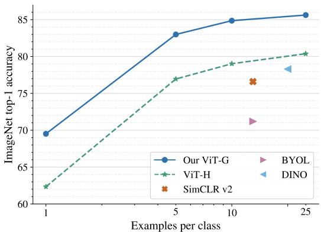
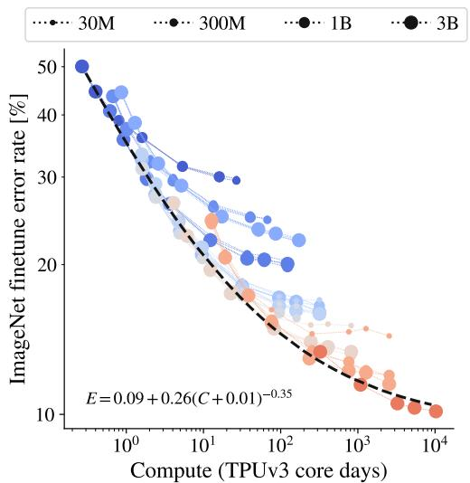
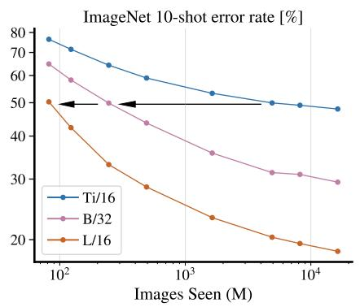
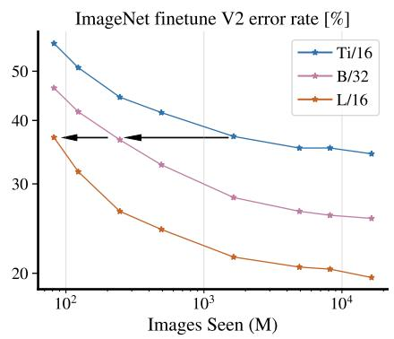
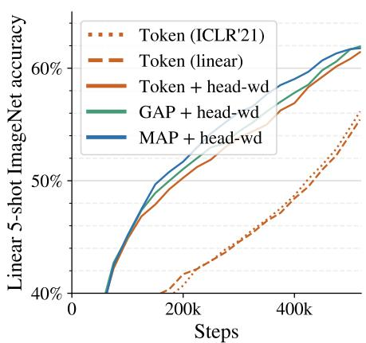
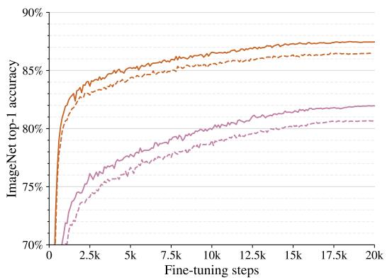
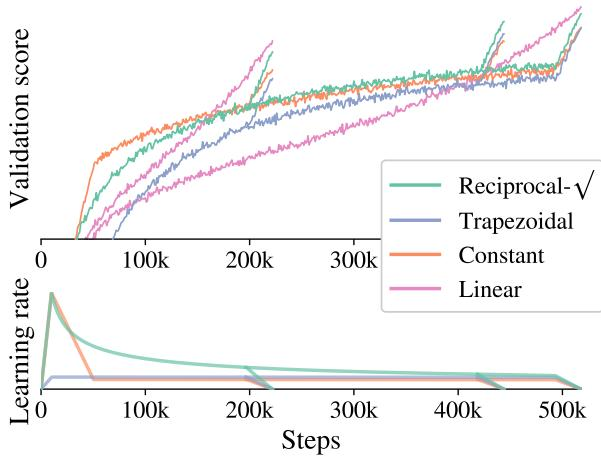
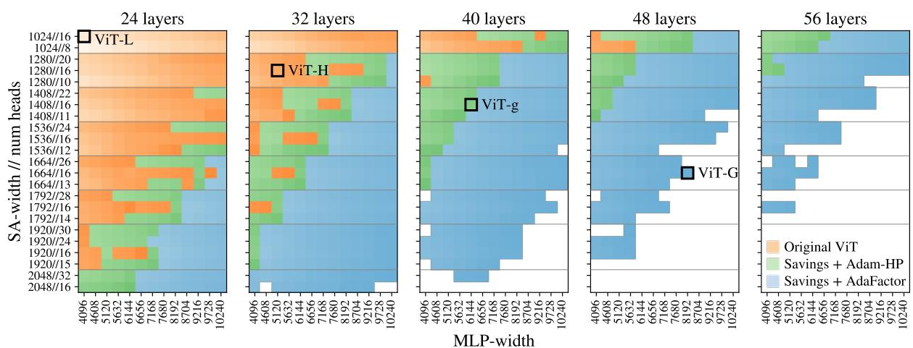

# 扩展 Vision Transformer

Xiaohua Zhai<sup>?</sup>, Alexander Kolesnikov<sup>?</sup>, Neil Houlsby, Lucas Beyer<sup>?</sup>

Google Research, Brain Team, Zürich

{xzhai, akolesnikov, neilhoulsby, lbeyer}@google.com

## 摘要

基于注意力机制的神经网络，例如视觉 Transformer（Vision Transformer，ViT），近期在许多计算机视觉基准测试中取得了最先进的成果。规模（Scale）是取得优异成果的核心要素，因此，理解模型的扩展特性是有效设计下一代模型的关键。尽管针对 Transformer 语言模型的扩展法则已有深入研究，但 Vision Transformer 如何进行扩展仍属未知。为了解决这一问题，我们对 ViT 模型和数据同时进行了放大与缩小，并刻画了错误率、数据量与计算量之间的关系。在此过程中，我们改进了 ViT 的架构和训练方法，从而降低了内存消耗并提高了所得模型的准确率。最终，我们成功训练了一个拥有 20 亿参数的 ViT 模型，该模型在 ImageNet 上取得了 90.45% top-1 准确率的全新最先进结果。该模型在少样本迁移方面同样表现出色，例如，在每个类别仅有 10 个样本的情况下，在 ImageNet 上达到了 84.86% 的 top-1 准确率。

## 1. 引言

基于注意力的 Transformer 架构 [45] 席卷了计算机视觉领域 [8, 16]，并在研究和实践中成为越来越受欢迎的选择。此前，Transformer 已在自然语言处理（NLP）领域得到了广泛应用 [7, 15]。文献 [22] 仔细研究了 NLP 中 Transformer 的最优扩展，其主要结论是大模型不仅表现更好，而且能更高效地利用大量的计算预算。然而，这些发现在多大程度上可以迁移到视觉领域仍不清楚，因为视觉领域存在一些重要的差异。例如，视觉中最成功的预训练方案是有监督的，而 NLP 领域则是无监督预训练。

在本文中，我们重点关注在图像分类任务上预训练的 ViT 模型在迁移性能方面的扩展法则。具体而言，我们实验的模型参数量从 500 万到 20 亿不等，数据集规模从 100 万到 30 亿张训练图像不等，计算预算从 1 个 TPUv3 核心·天以下到超过 10 000 核心·天。我们的主要贡献是在两个数据集上刻画了 ViT 模型的性能-计算量前沿。

  
Figure 1. 少样本迁移结果。我们的 ViT-G 模型在 ImageNet 上通过 10-shot 线性评估达到了 84.86% 的 top-1 准确率。

在此过程中，我们构建了一套改进的大规模训练方案。我们研究了训练超参数，并发现了一些能够显著提升少样本迁移（few-shot transfer）性能的细微选择。少样本迁移评估协议此前也已被 NLP 领域的大规模预训练研究所采用 [6]。具体而言，我们发现仅在最终的线性预测层应用极强的 L2 正则化，即可获得具有极强少样本迁移能力的视觉表征。例如，在 ImageNet 数据集（包含 1 000 个类别）上，每个类别仅提供一个样本时，我们的最佳模型达到了 69.52% 的准确率；而在每个类别提供 10 个样本时，准确率达到了 84.86%。此外，我们大幅降低了 [16] 中提出的原始 ViT 模型的内存占用。我们通过针对硬件的架构改进和使用不同的优化器实现了这一点。因此，我们训练了一个拥有 20 亿（two billion）参数的模型，并在 ImageNet 上取得了创纪录的 90.45% 的最优准确率（state-of-the-art）。


  
Figure 2. 左/中：表征质量（以 ImageNet 微调和线性 10-shot 错误率衡量）随总训练计算量的变化关系。饱和幂律能够相当精确地近似帕累托前沿（Pareto frontier）。注意，较小的模型（蓝色阴影）或在较少图像上训练的模型（较小的标记），在训练更长时间后会达到饱和并脱离前沿。右上：受模型大小瓶颈限制时的表征质量。对于每个模型大小，均使用了大型数据集和大量计算量，因此模型容量是主要瓶颈。浅色阴影标记表示每个模型的次优运行。右下：按数据集大小划分的表征质量。对于每个数据集大小，突出了具有最优大小和计算量的模型，因此数据集大小是主要瓶颈。

## 2. 核心结果

在第 3 节详细介绍架构和训练方案的改进之前，我们首先展示关于扩展趋势的主要结果。在以下实验中，我们在公开的 ImageNet-21k [14] 数据集以及私有收集的图像（最多达 30 亿张弱标签图像）上训练了数个 ViT 模型。我们改变了架构大小、训练图像数量以及训练时长。所有模型均在 TPUv3 上训练，因此总计算量以 TPUv3 核心天（core-days）衡量。为了评估模型所学表征的质量，我们在多个基准任务上分别评估了：(i) 通过在冻结权重上训练线性分类器的少样本迁移，(ii) 通过在所有数据上微调整个模型的迁移。

## 2.1. 算力、模型和数据协同扩展

Figure 2 展示了在 ImageNet [14] 上的 10-shot 线性评估与微调（finetuning）评估结果。其他数据集（Oxford IIIT Pets [28]、CIFAR-100 [24] 和 Caltech-UCSD Birds [47]）上的类似趋势见附录 Figure 9。对于模型大小与数据大小的每种组合，我们都预训练了不同的步数。在 Figure 2 中，相连的点代表使用不同步数训练的同一个模型。我们得到以下观察结果：

第一，同时扩大计算量、模型大小和数据规模可以提高表征质量。在左图和中图中，右下方的点表明具有最大尺寸、最大数据集规模和最大计算量的模型实现了最低的错误率。然而，在最大规模下，模型似乎开始出现饱和，并落后于幂律前沿（即 Figure 2 中双对数坐标图上的线性关系）。

第二，表征质量可能会受到模型大小的瓶颈制约。右上方的图展示了每种模型大小所能达到的最佳性能。由于容量有限，小模型无法从最大的数据集或计算资源中获益。Figure 2 的左图和中图显示，即使在大量图像上进行训练，Ti/16 模型仍趋向于较高的错误率。

第三，大模型能够从额外的数据中获益，甚至在超过 1B（10亿）张图像时依然如此。当扩大模型大小时，表征质量可能会受到较小数据集的限制；即使是 30-300M 张图像也不足以使最大的模型饱和。在 Figure 2 中图中，L/16 模型在 30M 数据集上的错误率无法提升至 27% 以上。而在更大的数据集上，该模型达到了 19%。此外，当增加数据集大小时，我们观察到大模型的性能有所提升，但小模型却没有。当训练集规模从 1B 增加到 3B 张图像时，最大的模型甚至仍能获得性能提升（Figure 2，右下）。然而，对于较小的模型（例如 Ti/16 或 B/32），增加数据集规模并没有帮助。例如，在 Figure 2 的左图和中图中，Ti/16 的所有曲线完全重叠，表明该模型无论数据集大小如何都达到了相同的性能。

## 2.2. 双重饱和幂律

Figure 2 的左图和中图展示了表征质量与训练计算量之间的帕累托前沿（Pareto frontier）。该前沿包含了在模型结构与训练时长之间实现了最佳计算资源分配的模型。

在超过两个数量级的计算量范围内，计算量与性能之间的关系遵循幂律（power-law）$( E = a C ^ { b } )$，在双对数坐标图上表现为一条直线。然而，我们在计算量谱系的两端都观察到了“饱和”现象。在计算量较高的一端，最大的模型并没有趋向于零错误率。如果我们根据观察结果进行外推，一个具有无限容量的模型仍将获得非零的错误率。这一效应在生成模型中也有所观察到 [19]。[19] 的作者将这种残差错误称为任务的“不可约熵”（irreducible entropy）。由于我们绘制的是错误率，信息论的解释并不直接适用，但我们的观察结果支持了 ImageNet 存在根本性性能上限的观点 [4]。从定律的形式来看，这种饱和对应于错误率中的一个加性常数：即 $E = a C ^ { - b } + c$ 中的 $c$。




  
Figure 3. 基于预训练期间所见图像数量的 ImageNet 错误率。大模型的样本效率更高，这在不同设置下均保持一致：在冻结表征上进行少样本迁移、在 ImageNet 上微调网络，以及在 v2 测试集上评估微调后的模型。

在计算量较低的一端，我们观察到了较小模型的饱和现象；最小模型的性能优于幂律所预测的结果。这种饱和之所以发生，是因为即使是平凡解（trivial solutions）也能实现非零错误率。例如，预测多数类（计算量几乎为零）所获得的准确率与该类在测试集中的出现频率相关。这种下界在 [19] 中并未被观察到，原因可能是他们的最小模型足够大而避开了这一区域，抑或是对数损失（log-loss）相比准确率在更差的性能表现下才会饱和（它最终仍会饱和）。这种饱和对应于 x 轴上的平移：即 $E = a ( C + d ) ^ { - b } + c$ 中的 $d$。该常数表明零计算量模型仍能获得非零准确率。

## 2.3. Big models are more sample efficient

Figure 3 展示了表征质量与预训练期间“见过”的总图像数量（批次大小乘以步数）之间的关系。除了在公开验证集上的 ImageNet 微调和线性 10-shot 结果外，我们还报告了 ImageNet 微调模型在 ImageNet-v2 测试集 [33] 上的结果，以此作为鲁棒泛化能力的指标。该图展示了在 30 亿张图像上预训练的三个 ViT 模型。

我们观察到，更大的模型具有更高的样本效率，能够以更少的图像浏览量达到相同的错误率水平。对于 10-shot，Ti/16 模型需要浏览将近 100 倍的图像才能达到 L/16 模型的表征质量。在微调时，这一倍数从 100 降至约 20。我们的结果表明，在数据充足的情况下，用较少的步数训练更大的模型更为理想。这一观察结果与语言建模和机器翻译中的结果相吻合 [22, 26]。

## 2.4. 缩放定律在更少图像上仍然适用吗？

我们将研究扩展到图像数量少得多的情况，在公开的 ImageNet-21k 数据集上涵盖了从 100 万到 1300 万张图像。在 Figure 4 左图中，我们发现在改变模型大小、数据集规模和计算资源时，双饱和幂律（double-saturation power law）仍然适用。这表明该研究得出的结论具有良好的泛化性，并可指导未来视觉 Transformer 架构的设计选择。在 Figure 4 右图中，我们观察到类似的现象，即模型性能受到数据集规模的瓶颈限制。当同时扩展计算量、模型和数据时，可以获得最佳的表征质量。

  
Figure 4. ImageNet-21k 数据集上的结果。左：表征质量（以 ImageNet 线性 10-shot 错误率衡量）作为总训练计算量的函数。双饱和幂律仍然适用。右：不同模型大小和数据集规模下的表征质量。

Table 1. ViT-G/14 的结果，以及与先前最先进（state-of-the-art）模型的对比。

<table><tr><td>Benchmark</td><td>ImageNet</td><td>INet V2</td><td>INet Real</td><td>ObjectNet</td><td>VTAB (light)</td></tr><tr><td>NS (Eff.-L2) [49]</td><td>88.3</td><td>80.2</td><td>-</td><td>68.5</td><td>-</td></tr><tr><td>MPL (Eff.-L2) [29]</td><td>90.2</td><td>-</td><td>91.02</td><td>-</td><td>-</td></tr><tr><td>CLIP (ViT-L/14) [31]</td><td>85.4</td><td>75.9</td><td>-</td><td>72.3</td><td>-</td></tr><tr><td>ALIGN (Eff.-L2) [21]</td><td>88.6</td><td>70.1</td><td>-</td><td>-</td><td>-</td></tr><tr><td>BiT-L (ResNet) [23]</td><td>87.54</td><td>-</td><td>90.54</td><td>58.7</td><td>76.29</td></tr><tr><td>ViT-H/14 [16]</td><td>88.55</td><td>-</td><td>90.72</td><td>-</td><td>77.63</td></tr><tr><td>Our ViT-G/14</td><td> $90.45 \pm 0.03$ </td><td> $83.33 \pm 0.03$ </td><td> $90.81 \pm 0.01$ </td><td> $70.53 \pm 0.52$ </td><td> $78.29 \pm 0.53$ </td></tr></table>

## 2.5. ViT-G/14 结果

我们训练了一个大型视觉 Transformer 模型 ViT-G/14，它包含近 20 亿个参数。第 3.6 节详细介绍了该架构的具体配置。我们在各种下游任务上评估了 ViT-G/14 模型，并将其与近期的最新 SOTA 结果进行了对比。我们在 ImageNet 上进行微调，并报告了 ImageNet [34]、ImageNet-v2 [33]、ReaL [4] 和 ObjectNet [2] 的准确率。此外，我们还报告了在包含 19 个任务的 VTAB-1k 基准上的迁移学习结果 [53]。

Figure 1 展示了在 ImageNet 上的少样本迁移（few-shot transfer）结果。ViT-G/14 大幅超越了此前最佳的 ViT-H/14 模型 [16]（超过 5%），在每类 10 个样本的设置下达到了 84.86% 的准确率。每类 10 张图像少于 ImageNet 数据的 1%（每类 13 个样本），这常用于自监督和半监督学习 [52]。作为参考，Figure 1 展示了三个最先进的自监督学习模型：使用 1% ImageNet 数据的 Sim-CLR v2 [10] 和 BYOL [17]，以及每类使用 20 个样本的 DINO [9]。但需要注意的是，这些方法存在很大差异：ViT-G/14 使用了大量的弱监督数据源，且仅预训练一次便迁移至不同任务；与此同时，自监督学习模型则使用无标注但属于领域内的数据进行预训练，并且仅针对单一任务。

Table 1 展示了在其余基准上的结果。ViT-G/14 在 ImageNet 上取得了 90.45% 的 top-1 准确率，创下了新的最优水平（state-of-the-art）。在 ImageNet-v2 上，ViT-G/14 比基于 EfficientNet-L2 的 Noisy Student 模型 [49] 提升了 3%。在 ReaL 上，ViT-G/14 仅以微弱优势超越了 ViT-H [16] 和 BiT-L [23]，这再次表明 ImageNet 分类任务可能正在达到其饱和点。在 ObjectNet 上，ViT-G/14 大幅优于 BiT-L [23]，比 Noisy Student 高出 2%，但落后 CLIP [31] 约 2%。注意，与其他方法不同的是，CLIP 没有在 ImageNet 上进行微调，而是直接在 ObjectNet 上进行评估，这可能提高了其鲁棒性。最后，将 ViT G/14 模型迁移到 VTAB 时，仅在所有任务上使用单一超参数就持续获得了更好的结果。在 VTAB 上，使用繁重的逐任务超参数搜索所达到的最优表现为 79.99 [21]，我们将对 ViT-G/14 进行大规模超参数搜索留作未来工作。

## 3. 方法细节

我们提出了多项针对 ViT 模型及其训练的改进。这些改进大多易于实现，并且能显著提高内存利用率和模型质量。它们使我们能够仅使用数据并行来训练 ViT-G/14，并将整个模型放入单个 TPUv3 核心中。

## 3.1. 针对“head”的解耦权重衰减

在低数据量情况下，权重衰减对模型自适应具有显著影响。我们在中等规模上对该现象进行了研究。

我们发现，将模型中最终线性层（“head”，头部）和其余权重（“body”，主体）的权重衰减（weight decay）强度进行解耦是有益的。Figure 5 展示了这种效果：我们在 JFT-300M 上训练了一批 ViT-B/32 模型，每个单元格对应于不同头部/主体权重衰减值下的性能表现。对角线对应于两者使用相同的衰减值。可以观察到，最佳性能出现在非对角线上（即对头部和主体采用解耦的权重衰减）。有趣的是，我们观察到头部较高的权重衰减虽然提高了迁移性能，但却降低了预训练（上游）任务的性能（未展示）。

我们对这一现象尚无完整的解释。然而，我们假设头部更强的权重衰减会导致类别之间具有更大间隔（margin）的表征，从而带来更好的少样本（few-shot）自适应能力。这与 SVM [12] 背后的核心思想类似。这种较大的衰减使得在上游预训练期间更难获得高准确率，但我们的主要目标是高质量的迁移。


  
Figure 5. 左图和中图：5-shot ImageNet 准确率和上游性能对权重衰减强度的依赖关系。通常，所有权重都应用单一的权重衰减值（对应热图上的对角线）。我们表明，通过对“头部”和其余权重采用不同的权重衰减值，可以显著提升少样本迁移性能。右图：不同头部类型在 ImageNet 上的少样本性能。头部的高权重衰减对所有类型都同样有效。

## 3.2. 通过移除 [class] token 节省内存

来自 [16] 的最大 ViT 模型在 224 × 224 的图像上使用 14 × 14 的 patch。这会产生 256 个视觉“token”，其中每个 token 对应一个图像 patch。在此之上，ViT 模型还有一个额外的 [class] token，用于生成最终表征，使得 token 总数达到 257 个。

对于 ViT 模型，当前的 TPU 硬件会将 token 维度填充（pad）至 128 的倍数，这可能导致高达 50% 的内存开销。为了克服这个问题，我们研究了替代使用额外 [class] token 的方案。具体而言，我们评估了全局平均池化（global average pooling, GAP）和多头注意力池化（multihead attention pooling, MAP）[25]，以聚合来自所有 patch token 的表征。我们将 MAP 中的头数设置为与模型其余部分的注意力头数相等。为了进一步简化头部设计，我们移除了原始 ViT 论文中最终预测层之前的最终非线性投影。

为了选择最佳的头部（head），我们对 [class] token 与 GAP/MAP 头进行了并排比较。结果总结在 Figure 5（右）中。我们发现所有头部的表现相似，而由于前面提到的填充考虑，GAP 和 MAP 的内存效率要高得多。我们还观察到非线性投影可以被安全地移除。因此，我们选择 MAP 头，因为它具有最强的表达能力，并能带来最统一的架构。[42] 中也对 MAP 头进行了探索，不过是在不同的语境下为了获得更好的质量，而不是为了节省内存。

## 3.3. 扩大数据规模

在这项研究中，我们使用了专有的 JFT-3B 数据集，它是许多先前关于大规模计算机视觉模型的研究中所使用的 JFT-300M 数据集 [16,23,37] 的更大版本。该数据集包含近 30 亿张图像，通过半自动流水线标注了大约 3 万个类别的类别层次结构。因此，数据和相关标签存在噪声。我们遵循 [16, 23]，忽略标签的层次结构方面，仅将分配的标签作为多标签分类的目标，采用 sigmoid 交叉熵损失。

我们按照 [1] 中的描述进行了敏感类别关联分析。我们（针对每个标签）测量了敏感类别在原始数据、清洗后的数据、在这些数据上训练的模型以及由人工评估员验证的标签中的分布。人工评估员还协助从数据集中移除了令人不适的内容。

Figure 6 展示了在未增加模型规模的情况下，从 JFT-300M 更改为 JFT-3B 对模型性能影响的消融实验。Figure 6（左）展示了在整个过程中评估的线性 10-shot ImageNet 性能。我们观察到，即使在模型尚未完成 JFT-300M 的一个 epoch 之前，JFT-3B 就带来了更好的模型。因此，在 JFT-300M 上的过拟合并不是带来性能提升的唯一原因。这种差异甚至在小型 B/32 模型以及更大的 L/16 模型中都可以看到。我们将模型微调至完整的 ImageNet 数据集（右），并确认这些改进可以迁移到完整的微调设置中。总体而言，数据集的变更使小型和大型模型在 ImageNet 上的迁移性能都提高了约 1%。除了性能提升之外，JFT-300M 和 JFT-3B 上的训练行为类似。最重要的是，JFT-3B 使我们能够进一步扩大规模，而较少需要担心过拟合和正则化问题。

去重（Deduplication）。我们从 JFT-3B 数据集中移除了所有与我们评估的数据集的训练集和测试集中的图像高度重复的图像。总体上，我们从 JFT-3B 中识别并移除了 92.7 万张重复图像。


  
Figure 6. 在不进行任何进一步缩放的情况下，从 JFT-300M 切换到 JFT-3B 的效果。无论对于线性少样本（few-shot）评估（左）还是使用完整数据集的迁移（右），小型模型和大型模型都能以大约恒定的比例从这一改变中获益。

## 3.4. 内存高效的优化器

在训练大模型时，存储模型参数所需的空间会成为瓶颈。我们最大的模型 ViT-G 拥有大约 20 亿个参数，占用 8 GiB 的设备内存。更糟糕的是，通常用于训练 Transformer 的 Adam 优化器为每个参数额外存储两个浮点标量，这会导致额外的两倍开销（额外的 16 GiB）。为了解决 Adam 优化器带来的开销，我们探索了两种修改方案。

半精度动量的 Adam。我们通过经验观察到，以半精度（bfloat16 类型）存储动量不会影响训练动态，对最终结果也没有影响。这使得优化器的开销从 2 倍降低到 1.5 倍。值得注意的是，使用半精度存储二阶动量会导致性能显著下降。

Adafactor 优化器。上述优化器仍然带来较大的内存开销。因此，我们将注意力转向 Adafactor 优化器 [35]，它使用秩 1（rank 1）分解来存储二阶动量。从实际角度来看，这带来的内存开销几乎可以忽略不计。然而，Adafactor 优化器并不能开箱即用，因此我们进行了以下修改：

• 我们以半精度重新引入了一阶动量，而推荐的设置则完全不使用一阶动量。

• 我们禁用了相对于权重范数缩放学习率的功能，这是 Adafactor 的内置特性。

• Adafactor 在整个训练过程中逐渐将二阶动量从 0.0 增加到 1.0。在我们的初步实验中，我们发现将二阶动量截断在 0.999（Adam 的默认值）可以获得更好的收敛性，因此我们采用了这种做法。

改进后的优化器在存储模型参数所需空间的基础上，仅引入了 50% 的内存开销。

我们观察到，这两种提出的优化器的表现与原始的 Adam 优化器相当或略好。我们注意到了其他内存高效的优化器 [32, 40]，我们将对它们的探索留给未来的工作。

## 3.5. 学习率调度策略

在我们的研究中，我们希望在几种不同的训练时长下训练各个模型，以便衡量模型大小与训练时长之间的权衡。当使用线性衰减（如 [16] 中所示）时，每个训练时长都需要从头开始进行单独的训练运行，这是一种低效的方案。

受到 [27] 的启发，我们通过探索学习率调度策略来解决这一问题。与开头的预热阶段（warmup phase）类似，该策略在训练结束时包含一个冷却阶段（cooldown phase），在此阶段学习率线性退火至零。在预热阶段和冷却阶段之间，学习率不应过快衰减至零。这可以通过在训练的主要部分使用常数调度或平方根倒数（reciprocal squareroot）调度来实现。图 7（下）展示了其中的几种选择，分别在约 200 k、400 k 和 500 k 步后进行冷却。图 7 的上半部分展示了每种选择及其冷却阶段的验证分数（越高越好），并附带了两个线性调度作为参考。虽然在预先知道训练时长且不打算进一步训练时，线性调度仍然是更优的选择，但所有这三种备选方案的效果都相当接近，并且具有允许无限期训练以及仅通过单次运行即可评估多个训练时长的优势。对于每种调度，我们都优化了学习率和具体形态。我们还简要尝试了周期性学习率调度，但其表现似乎差得多，因此我们未做进一步研究。因此，我们选择采用平方根倒数调度。

  
Figure 7. 各种“无限”学习率调度策略，以及作为参考的有限线性调度策略。

## 3.6. 选择模型维度

ViT 模型具有许多控制模型形态的参数，完整细节请参见原始出版物。简而言之，这些参数包括 patch 大小（patch-size）、编码器块数量（深度）、patch 嵌入和自注意力的维度（宽度）、注意力头的数量以及 MLP 块的隐藏维度（MLP 宽度）。在此基础上，我们依赖 XLA 编译器来优化模型的运行速度和内存占用。在后台，XLA 使用复杂的启发式方法将模型编译为针对特定硬件的代码，以最优方式权衡内存与速度。因此，很难预测哪些模型配置能够容纳在单台设备的内存中。

因此，我们进行了一项广泛的模拟实验：在不考虑质量的情况下，我们实例化了大量不同形态的 ViT，并尝试将它们训练若干步。我们改变了深度、宽度、头数以及 MLP 宽度，但将 patch 大小保持在 14 px。通过这种方式，我们测量了它们的速度以及给定模型是否能够放入设备内存中。Figure 8 总结了该模拟实验的结果。每个方块对应一种模型配置，方块的阴影明暗对应其训练速度（越亮越快）。橙色方块展示了在没有任何修改的情况下能够容纳的原始 ViT 模型。绿色方块则进一步包含了第 3.2 节中描述的内存节省措施，并结合了第 3.4 节中描述的半精度 Adam。最后，蓝色方块采用了我们修改后的 AdaFactor 优化器。白色区域中的形态在任何设置下都无法放入内存。出于篇幅原因，我们在此仅展示与所展示实验相关的模型，但需要指出的是，通过我们的改进，我们能够容纳深度高达 100 个编码器块的较窄 ViT 模型。

Table 2. 模型架构细节。

<table><tr><td rowspan="2">名称</td><td rowspan="2">宽度</td><td rowspan="2">深度</td><td rowspan="2">MLP</td><td rowspan="2">头数</td><td rowspan="2">参数量 (Mio.)</td><td colspan="2">GFLOPs</td></tr><tr><td> $224^2$ </td><td> $384^2$ </td></tr><tr><td>s/28</td><td>256</td><td>6</td><td>1024</td><td>8</td><td>5.4</td><td>0.7</td><td>2.0</td></tr><tr><td>s/16</td><td>256</td><td>6</td><td>1024</td><td>8</td><td>5.0</td><td>2.2</td><td>7.8</td></tr><tr><td>S/32</td><td>384</td><td>12</td><td>1536</td><td>6</td><td>22</td><td>2.3</td><td>6.9</td></tr><tr><td>Ti/16</td><td>192</td><td>12</td><td>768</td><td>3</td><td>5.5</td><td>2.5</td><td>9.5</td></tr><tr><td>B/32</td><td>768</td><td>12</td><td>3072</td><td>12</td><td>87</td><td>8.7</td><td>26.0</td></tr><tr><td>S/16</td><td>384</td><td>12</td><td>1536</td><td>6</td><td>22</td><td>9.2</td><td>31.2</td></tr><tr><td>B/28</td><td>768</td><td>12</td><td>3072</td><td>12</td><td>87</td><td>11.3</td><td>30.5</td></tr><tr><td>B/16</td><td>768</td><td>12</td><td>3072</td><td>12</td><td>86</td><td>35.1</td><td>111.3</td></tr><tr><td>L/16</td><td>1024</td><td>24</td><td>4096</td><td>16</td><td>303</td><td>122.9</td><td>382.8</td></tr><tr><td>g/14</td><td>1408</td><td>40</td><td>6144</td><td>16</td><td>1011</td><td>533.1</td><td>1596.4</td></tr><tr><td>G/14</td><td>1664</td><td>48</td><td>8192</td><td>16</td><td>1843</td><td>965.3</td><td>2859.9</td></tr></table>

最初的 Vision Transformer 论文在附录 D2 中包含了一项关于扩展不同组件之间权衡的研究，得出的结论是：同时且以相似的幅度扩展所有维度（深度、宽度、MLP 宽度和分块大小）是最有效的。我们遵循这一建议，并在内存容纳能力的极限下相应地选择了 ViT-g 和 ViT-G 的架构形态，如图 Figure 8 所示并汇总于 Table 2 中。

## 4. 相关工作

更小型的 Vision Transformers 视觉领域中关于 Transformer 的早期工作主要集中在针对 CIFAR-10 的小型网络 [11]。然而，Vision Transformer [16] 是在最先进的中大规模图像识别背景下提出的；其中最小的模型（ViT-B）包含 86M 个参数。[41] 提出了用于从头训练（from-scratch）的更小尺寸 ViT，最小至包含 5M 参数的 ViT-Ti。ViT 的新变体引入了更小且计算开销更低的架构。例如，T2T-ViT [51] 通过新的分词方式和更窄的网络减少了参数量与计算量。专为密集预测任务设计的 Pyramidal ViTs [46] 遵循类似 CNN 的金字塔结构，这也缩小了模型规模。CNN 与 Transformer 的混合架构通常能让较小的模型表现出色，例如 [16] 中的 ViT-CNN 混合模型、BoTNet [36] 和 HaloNet [44]。然而，另一个方向——增大 ViT 的规模——探索较少。尽管语言 Transformer 仍远大于 Vision Transformer，但理解扩展特性以及本文提出的改进代表了朝这一方向迈出的一步。

扩展定律（Scaling Laws） [22] 对神经语言模型的经验扩展定律进行了深入研究。作者拟合了描述计算量、数据规模、模型大小和性能之间关系的幂律。遵循这些定律，拥有 175B 参数的语言模型 GPT-3 得以成功训练 [7]。[19] 给出了其他模态中自回归生成建模的定律，包括图像生成。我们的论文包含了对图像判别式建模扩展定律的首次研究。

  
Figure 8. “Shapefinder”模拟的综合结果：橙色为原始 ViT，绿色为我们的改进结合半精度 Adam（例如 ViT-g），蓝色为结合我们修改后的 AdaFactor。白色区域表示内存溢出（out of memory）。圆点的亮度对应其相对训练速度。

扩展视觉模型（Scaling-up Vision Models） 许多论文通过扩展 CNN 来提升性能。EfficientNets [38, 39] 提出了一种在深度、宽度和分辨率之间平衡计算量的扩展策略，并将其应用于 MobileNets。这一策略在 [3, 48] 中被重新审视，以进一步提升 ResNets [18] 的性能。大型 CNN 在视觉识别中取得了优异的性能，例如使用 GPipe 流水线并行 [20] 训练的 AmoebaNet-B(18, 512)（557M 参数）、在弱标签 Instagram 图像上预训练的 ResNeXt-101 32×48d（829M 参数）[27]、在 JFT-300M 上使用 ImageNet 伪标签训练的 EfficientNet-L2（480M 参数）[50]，以及在 JFT-300M 上预训练的 BiT-L-ResNet152x4（928M 参数）[23]。最近，[42, 54] 探索了扩展 ViTs 深度的策略。我们是首个将 Vision Transformers 扩展到更大规模并由此取得新 state-of-the-art 结果的工作。同期工作 [13] 则侧重于 CNN 和 ViT 的混合架构。

## 5. 讨论（Discussion）

局限性。本工作使用专有的 JFT-3B 数据集进行缩放定律（scaling laws）研究。为了使我们的见解更可靠且具泛化性，我们验证了缩放定律同样适用于公开的 ImageNet-21k 数据集。

社会影响。这项工作潜在的更广泛成本在于进行缩放研究实验所需的能耗，尤其是在训练最大的 ViT-G 模型时。然而，这种成本可以通过两种方式进行分摊。首先，此类缩放定律研究只需进行一次；我们希望未来的 ViT 模型开发者可以利用我们的结果来设计能以更少计算资源进行训练的模型。其次，所训练的模型主要用于迁移学习。相比于在下游任务上从头开始训练，迁移预训练权重的开销要小得多，并且通常能获得更高的准确率。因此，通过将我们的模型迁移到众多任务中，预训练的计算量得到了进一步分摊。

## 6. 结论（Conclusion）

我们证明了在拥有充足训练数据的情况下，ViT 模型的“性能-计算量边界（performance-compute frontier）”大致遵循（饱和）幂律分布。至关重要的是，为了保持在这一边界上，必须同时扩展计算量和模型规模；也就是说，在获得额外计算资源时若不增加模型规模，将是次优的。我们还证明了更大的模型具有高得多的样本效率，是非常出色的小样本学习器（few-shot learners）。最后，我们提出了一种新的训练方案（training recipe），能够高效训练大规模且高性能的 ViT 模型。需要注意的是，我们的结论不一定能推广到我们所研究的规模之外，也不一定能推广到 ViT 家族之外的模型。

致谢 我们感谢 James Bradbury 和 Vivek Sharma 在使用大规模基础设施方面提供的帮助；感谢 Alexey Dosovitskiy、Joan Puigcerver、Basil Mustafa、Carlos Riquelme 带来的富有见地的讨论；感谢 Tom Duerig、Austin Tarango、Daniel Keysers、Howard Zhou、Wenlei Zhou、Yanan Bao 关于 JFT 的讨论；感谢整个 Google Brain 团队提供了支持性的研究环境。

## 参考文献

[1] Osman Aka, Ken Burke, Alex Bäuerle, Christina Greer, and Margaret Mitchell. Measuring model biases in the absence of ground truth. arXiv preprint arXiv:2103.03417, 2021. 5

[2] Andrei Barbu, D. Mayo, Julian Alverio, William Luo, Christopher Wang, Dan Gutfreund, J. Tenenbaum, and Boris Katz. Objectnet: A large-scale bias-controlled dataset for pushing the limits of object recognition models. In NeurIPS, 2019. 4

[3] Irwan Bello, William Fedus, Xianzhi Du, Ekin D Cubuk, Aravind Srinivas, Tsung-Yi Lin, Jonathon Shlens, and Barret Zoph. Revisiting resnets: Improved training and scaling strategies. arXiv preprint arXiv:2103.07579, 2021. 8

[4] Lucas Beyer, Olivier J. Hénaff, Alexander Kolesnikov, Xiaohua Zhai, and Aäron van den Oord. Are we done with imagenet? arXiv preprint arXiv:2006.07159, 2020. 3, 4

[5] Lucas Beyer, Xiaohua Zhai, and Alexander Kolesnikov. Big vision. https://github.com/google-research/ big\_vision, 2022. 11

[6] Tom Brown, Benjamin Mann, Nick Ryder, Melanie Subbiah, Jared D Kaplan, Prafulla Dhariwal, Arvind Neelakantan, Pranav Shyam, Girish Sastry, Amanda Askell, Sandhini Agarwal, Ariel Herbert-Voss, Gretchen Krueger, Tom Henighan, Rewon Child, Aditya Ramesh, Daniel Ziegler, Jeffrey Wu, Clemens Winter, Chris Hesse, Mark Chen, Eric Sigler, Mateusz Litwin, Scott Gray, Benjamin Chess, Jack Clark, Christopher Berner, Sam McCandlish, Alec Radford, Ilya Sutskever, and Dario Amodei. Language models are few-shot learners. In NeurIPS, 2020. 1

[7] Tom B Brown, Benjamin Mann, Nick Ryder, Melanie Subbiah, Jared Kaplan, Prafulla Dhariwal, Arvind Neelakantan, Pranav Shyam, Girish Sastry, Amanda Askell, et al. Language models are few-shot learners. arXiv preprint arXiv:2005.14165, 2020. 1, 8

[8] Nicolas Carion, Francisco Massa, Gabriel Synnaeve, Nicolas Usunier, Alexander Kirillov, and Sergey Zagoruyko. Endto-end object detection with transformers. arXiv preprint arXiv:2005.12872, 2020. 1

[9] Mathilde Caron, Hugo Touvron, Ishan Misra, Hervé Jégou, Julien Mairal, Piotr Bojanowski, and Armand Joulin. Emerging properties in self-supervised vision transformers. CoRR, abs/2104.14294, 2021. 4

[10] Ting Chen, Simon Kornblith, Kevin Swersky, Mohammad Norouzi, and Geoffrey Hinton. Big self-supervised models are strong semi-supervised learners. arXiv preprint arXiv:2006.10029, 2020. 4

[11] Jean-Baptiste Cordonnier, Andreas Loukas, and Martin Jaggi. On the relationship between self-attention and convolutional layers. In ICLR, 2020. 7

[12] Corinna Cortes and Vladimir Vapnik. Support-vector networks. Machine learning, 1995. 5

[13] Zihang Dai, Hanxiao Liu, Quoc V. Le, and Mingxing Tan. Coatnet: Marrying convolution and attention for all data sizes. CoRR, abs/2106.04803, 2021. 8

[14] J. Deng, W. Dong, R. Socher, L. Li, Kai Li, and Li Fei-Fei. Imagenet: A large-scale hierarchical image database. In CVPR, 2009. 2

[15] Jacob Devlin, Ming-Wei Chang, Kenton Lee, and Kristina Toutanova. Bert: Pre-training of deep bidirectional transformers for language understanding. arXiv preprint arXiv:1810.04805, 2018. 1

[16] Alexey Dosovitskiy, Lucas Beyer, Alexander Kolesnikov, Dirk Weissenborn, Xiaohua Zhai, Thomas Unterthiner, Mostafa Dehghani, Matthias Minderer, Georg Heigold, Sylvain Gelly, Jakob Uszkoreit, and Neil Houlsby. An Image is Worth 16x16 Words: Transformers for Image Recognition at Scale. In ICLR, 2021. 1, 4, 5, 6, 7, 11

[17] Jean-Bastien Grill, Florian Strub, Florent Altché, Corentin Tallec, Pierre H. Richemond, Elena Buchatskaya, Carl Doersch, Bernardo Avila Pires, Zhaohan Daniel Guo, Mohammad Gheshlaghi Azar, Bilal Piot, Koray Kavukcuoglu, Rémi Munos, and Michal Valko. Bootstrap your own latent: A new approach to self-supervised learning. arXiv preprint arXiv:2006.07733, 2020. 4

[18] Kaiming He, Xiangyu Zhang, Shaoqing Ren, and Jian Sun. Deep residual learning for image recognition. In CVPR, 2016. 8

[19] Tom Henighan, Jared Kaplan, Mor Katz, Mark Chen, Christopher Hesse, Jacob Jackson, Heewoo Jun, Tom B Brown, Prafulla Dhariwal, Scott Gray, et al. Scaling laws for autoregressive generative modeling. arXiv preprint arXiv:2010.14701, 2020. 3, 8

[20] Yanping Huang, Youlong Cheng, Ankur Bapna, Orhan Firat, Dehao Chen, Mia Chen, HyoukJoong Lee, Jiquan Ngiam, Quoc V Le, Yonghui Wu, and zhifeng Chen. Gpipe: Efficient training of giant neural networks using pipeline parallelism. In NeurIPS, 2019. 8

[21] Chao Jia, Yinfei Yang, Ye Xia, Yi-Ting Chen, Zarana Parekh, Hieu Pham, Quoc V. Le, Yunhsuan Sung, Zhen Li, and Tom Duerig. Scaling up visual and vision-language representation learning with noisy text supervision. arXiv preprint arXiv:2102.05918, 2021. 4

[22] Jared Kaplan, Sam McCandlish, Tom Henighan, Tom B Brown, Benjamin Chess, Rewon Child, Scott Gray, Alec Radford, Jeffrey Wu, and Dario Amodei. Scaling laws for neural language models. arXiv preprint arXiv:2001.08361, 2020. 1, 3, 7

[23] Alexander Kolesnikov, Lucas Beyer, Xiaohua Zhai, J. Puigcerver, Jessica Yung, S. Gelly, and N. Houlsby. Big Transfer (BiT): General Visual Representation Learning. In ECCV, 2020. 4, 5, 8, 11

[24] Alex Krizhevsky. Learning multiple layers of features from tiny images. Technical report, 2009. 2, 11

[25] Juho Lee, Yoonho Lee, Jungtaek Kim, Adam Kosiorek, Seungjin Choi, and Yee Whye Teh. Set transformer: A framework for attention-based permutation-invariant neural networks. In ICML, 2019. 5

[26] Dmitry Lepikhin, HyoukJoong Lee, Yuanzhong Xu, Dehao Chen, Orhan Firat, Yanping Huang, Maxim Krikun, Noam Shazeer, and Zhifeng Chen. Gshard: Scaling giant models with conditional computation and automatic sharding. arXiv preprint arXiv:2006.16668, 2020. 3

[27] Dhruv Mahajan, Ross Girshick, Vignesh Ramanathan, Kaiming He, Manohar Paluri, Yixuan Li, Ashwin Bharambe, and Laurens van der Maaten. Exploring the limits of weakly supervised pretraining. In ECCV, September 2018. 6, 8

[28] Omkar M. Parkhi, Andrea Vedaldi, Andrew Zisserman, and C. V. Jawahar. Cats and dogs. In CVPR, 2012. 2, 11

[29] Hieu Pham, Zihang Dai, Qizhe Xie, Minh-Thang Luong, and Quoc V. Le. Meta pseudo labels. arXiv preprint arXiv:2003.10580, 2020. 4

[30] B. T. Polyak and A. B. Juditsky. Acceleration of stochastic approximation by averaging. SIAM Journal on Control and Optimization, 30(4):838–855, 1992. 11

[31] Alec Radford, Jong Wook Kim, Chris Hallacy, Aditya Ramesh, Gabriel Goh, Sandhini Agarwal, Girish Sastry, Amanda Askell, Pamela Mishkin, Jack Clark, Gretchen Krueger, and Ilya Sutskever. Learning transferable visual models from natural language supervision. arXiv preprint arXiv:2103.00020, 2021. 4

[32] Samyam Rajbhandari, Jeff Rasley, Olatunji Ruwase, and Yuxiong He. Zero: memory optimizations toward training trillion parameter models. In Christine Cuicchi, Irene Qualters, and William T. Kramer, editors, Proceedings of the International Conference for High Performance Computing, Networking, Storage and Analysis, SC 2020, Virtual Event / Atlanta, Georgia, USA, November 9-19, 2020, page 20. IEEE/ACM, 2020. 6

[33] Benjamin Recht, Rebecca Roelofs, Ludwig Schmidt, and Vaishaal Shankar. Do imagenet classifiers generalize to imagenet? arXiv preprint arXiv:1902.10811, 2019. 3, 4

[34] Olga Russakovsky, Jia Deng, Hao Su, Jonathan Krause, Sanjeev Satheesh, Sean Ma, Zhiheng Huang, Andrej Karpathy, Aditya Khosla, Michael Bernstein, Alexander C. Berg, and Li Fei-Fei. ImageNet Large Scale Visual Recognition Challenge. IJCV, 115(3):211–252, 2015. 4

[35] Noam Shazeer and Mitchell Stern. Adafactor: Adaptive learning rates with sublinear memory cost. In ICML, 2018. 6

[36] Aravind Srinivas, Tsung-Yi Lin, Niki Parmar, Jonathon Shlens, Pieter Abbeel, and Ashish Vaswani. Bottleneck transformers for visual recognition. arXiv preprint arXiv:2101.11605, 2021. 7

[37] Chen Sun, Abhinav Shrivastava, Saurabh Singh, and Abhinav Gupta. Revisiting Unreasonable Effectiveness of Data in Deep Learning Era. ICCV, Oct 2017. 5

[38] Mingxing Tan and Quoc Le. EfficientNet: Rethinking model scaling for convolutional neural networks. In ICML, 2019. 8

[39] Mingxing Tan and Quoc V. Le. Efficientnetv2: Smaller models and faster training. In Marina Meila and Tong Zhang, editors, Proceedings of the 38th International Conference on Machine Learning, ICML 2021, 18-24 July 2021, Virtual Event, volume 139 of Proceedings of Machine Learning Research, pages 10096–10106. PMLR, 2021. 8

[40] Hanlin Tang, Shaoduo Gan, Ammar Ahmad Awan, Samyam Rajbhandari, Conglong Li, Xiangru Lian, Ji Liu, Ce Zhang, and Yuxiong He. 1-bit adam: Communication efficient largescale training with adam’s convergence speed. In Marina Meila and Tong Zhang, editors, Proceedings of the 38th International Conference on Machine Learning, ICML 2021, 18-24 July 2021, Virtual Event, volume 139 of Proceedings of Machine Learning Research, pages 10118–10129. PMLR, 2021. 6

[41] Hugo Touvron, Matthieu Cord, Matthijs Douze, Francisco Massa, Alexandre Sablayrolles, and Hervé Jégou. Training data-efficient image transformers & distillation through attention. arXiv preprint arXiv:2012.12877, 2020. 7

[42] Hugo Touvron, Matthieu Cord, Alexandre Sablayrolles, Gabriel Synnaeve, and Hervé Jégou. Going deeper with image transformers. CoRR, abs/2103.17239, 2021. 5, 8

[43] Hugo Touvron, Andrea Vedaldi, Matthijs Douze, and Hervé Jégou. Fixing the train-test resolution discrepancy. arXiv preprint arXiv:1906.06423, 2020. 11

[44] Ashish Vaswani, Prajit Ramachandran, Aravind Srinivas, Niki Parmar, Blake Hechtman, and Jonathon Shlens. Scaling local self-attention for parameter efficient visual backbones. arXiv preprint arXiv:2103.12731, 2021. 7

[45] Ashish Vaswani, Noam Shazeer, Niki Parmar, Jakob Uszkoreit, Llion Jones, Aidan N. Gomez, Lukasz Kaiser, and Illia Polosukhin. Attention is all you need. arXiv preprint arXiv:1706.03762, 2017. 1

[46] Wenhai Wang, Enze Xie, Xiang Li, Deng-Ping Fan, Kaitao Song, Ding Liang, Tong Lu, Ping Luo, and Ling Shao. Pyramid vision transformer: A versatile backbone for dense predic tion without convolutions. arXiv preprint arXiv:2102.12122, 2021. 7

[47] P. Welinder, S. Branson, T. Mita, C. Wah, F. Schroff, S. Belongie, and P. Perona. Caltech-UCSD Birds 200. Technical Report CNS-TR-2010-001, California Institute of Technology, 2010. 2, 11

[48] Ross Wightman, Hugo Touvron, and Hervé Jégou. Resnet strikes back: An improved training procedure in timm. CoRR, abs/2110.00476, 2021. 8

[49] Qizhe Xie, Minh-Thang Luong, Eduard Hovy, and Quoc V. Le. Self-training with noisy student improves imagenet classification. arXiv preprint arXiv:1911.04252, 2019. 4

[50] Qizhe Xie, Minh-Thang Luong, Eduard Hovy, and Quoc V. Le. Self-training with noisy student improves imagenet classification. In CVPR, June 2020. 8

[51] Li Yuan, Yunpeng Chen, Tao Wang, Weihao Yu, Yujun Shi, Zihang Jiang, Francis EH Tay, Jiashi Feng, and Shuicheng Yan. Tokens-to-token vit: Training vision transformers from scratch on imagenet. arXiv preprint arXiv:2101.11986, 2021. 7

[52] Xiaohua Zhai, Avital Oliver, Alexander Kolesnikov, and Lu cas Beyer. S4l: Self-supervised semi-supervised learning. In ICCV, pages 1476–1485, 2019. 4

[53] Xiaohua Zhai, Joan Puigcerver, Alexander Kolesnikov, Pierre Ruyssen, Carlos Riquelme, Mario Lucic, Josip Djolonga, Andre Susano Pinto, Maxim Neumann, Alexey Dosovitskiy, Lucas Beyer, Olivier Bachem, Michael Tschannen, Marcin Michalski, Olivier Bousquet, Sylvain Gelly, and Neil Houlsby. A large-scale study of representation learning with the visual task adaptation benchmark. arXiv preprint arXiv:1910.04867, 2019. 4

[54] Daquan Zhou, Bingyi Kang, Xiaojie Jin, Linjie Yang, Xi aochen Lian, Qibin Hou, and Jiashi Feng. Deepvit: Towards deeper vision transformer. CoRR, abs/2103.11886, 2021. 8

## A. 更多少样本迁移结果

我们在更多数据集上也观察到了类似的缩放定律（scaling laws），包括 Oxford IIIT Pets [28]、CIFAR-100 [24] 和 Caltech-UCSD Birds [47]。结果展示在图 9（Figure 9）中。

## B. 预训练细节

我们使用带有半精度动量的 adafactor 优化器对所有 ViT 模型进行预训练。对于 adafactor，我们使用默认的 $\beta _ { 1 } = 0 . 9$ 和 $\beta _ { 2 } ~ = ~ 0 . 9 9 9$（裁剪阈值）。对于所有小于 ViT-g 的模型，我们使用 4096 的批次大小（batch size）。对于模型 $W I { - } g$ 和 ViT-G，为了加速训练，我们最大将批次大小扩展到 32 768，并将训练分布到 2048 个 TPUv3 芯片上。我们将“头部”（head）的权重衰减设置为 3.0，“主干”（body）设置为 0.03。所有模型均在 224×224 分辨率下进行预训练，预处理采用 inception crop 以及随后的随机水平翻转。我们使用带有 10k 步线性学习率预热（warmup）的倒数平方根调度（reciprocal square-root schedule）。如 G 节表格中所注，我们在多个步骤对训练进行冷却（cooldown）。

## C. 用于预训练 ViT-g 的配置文件

我们提供了用于训练 ViT-g/14 模型的完整配置。该配置遵循 big\_vision 代码库 [5] 的约定规范。

```python
def get_config():
    config = mlc.ConfigDict()

    config.dataset = 'jft_3b'
    config.val_split = 'val'
    config.train_split = 'train'
    config.num_classes = 29_593
    config.init_head_bias = -10.0

    # Fits 32 images per TPUv3 core with ViT-g/14.
    config.batch_size = 4096*4

    pp_common = '|value_range(-1, 1)'
    pp_common += f'|onehot({config.num_classes}')
    pp_common += '|keep("image", "labels")'
    config.pp_train = 'inception_crop(224)|flip_lr' + pp_common
    config.pp_eval = 'resize_small(256) | central_crop(224)' + pp_common
    config.shuffle_buffer_size = 250_000

    config.log_training_steps = 50
    config.log_eval_steps = 1000

    config.checkpoint_steps = 1000
    config.keep_checkpoint_steps = 10_000

    config.prefetch_to_device = 1
    config.trial = 0

    # Model section
    config.model_name = 'vit'
    config.model = mlc.ConfigDict()
```

```python
config.model.variant = 'g/14'
config.model.pool_type = 'map'

# Optimizer section
config.optax_name = 'big_vision.
scale_by_adafactor'
config.grad_clip_norm = 1.0
config.lr = 8e-4
config.wd = 0.03 * 8e-4
config.wd_mults = [
    ('.*head/kernel', 100.0),
    ('.*/kernel', 1.0),
]
config.schedule = dict(
    decay_type='rsqrt', timescale=10_000,
    warmup_steps=10_000,
    cooldown_steps=50_000)
config.total_steps = 1_000_000

# Few-shot eval section
config.fewshot = get_fewshot()
config.fewshot.log_steps = 10_000

return config
```

## D. 适配细节

我们报告了在多个数据集上的少样本（few-shot）线性回归和微调（finetune）结果。对于少样本线性回归，我们直接使用从 $2 2 4 \times 2 2 4$ 分辨率图像中提取的冻结嵌入（frozen embeddings）来求解 $\text{L}_2$ 正则化线性回归问题。

对于微调评估，我们使用带有动量的 SGD 优化器。我们使用的批大小为 512，并在全局范数 1 处进行梯度裁剪。我们在微调时不使用权重衰减。遵循 [23, 43]，我们在微调时使用更高的分辨率。具体而言，对于小于 ViT-g 的 ViT 模型，我们使用 384 × 384 分辨率；对于 ViT-g 和 ViT-G，我们均使用 518 × 518 分辨率。与 [16] 类似，我们在微调期间仅对 ViT-G 模型使用 Polyak 平均（Polyak averaging）[30]。默认情况下，我们使用 20k 步的余弦学习率调度，但使用 Polyak 平均的 ViT-G 采用恒定学习率除外。我们对学习率进行 500 步的线性预热（warmup）。我们在 {0.03, 0.01} 两个学习率之间进行搜索，并在保留的 2% 训练集划分上选出较优者。在 VTAB 任务上，我们采用固定 0.01 的学习率并配合余弦学习率调度。我们总共训练 2 500 步。

## E. 分辨率和补丁大小的影响

在本节中，我们回答“如果我们在保持 token 数量不变的同时放大分辨率会发生什么？”这一问题。我们通过等比例线性缩放分辨率和补丁大小（patch size），在 ImageNet-21K 上进行实验以验证这一点。我们在 Table 3 中观察到，如果同时增加补丁大小和分辨率，质量差异是非常细微的。对 ViT 架构而言，起决定性作用的是补丁的总数，这已经在 Table 2 中通过不同的补丁大小（32、28、16 和 14）进行了探讨。

  
Figure 9. 表征质量作为总训练计算量的函数。表征质量通过四个数据集上的少样本错误率来衡量。有时（例如在 pets 5/10shot 中），该定律与实验证据并非完美契合，这可能是由于模型并非最优，或者是该定律并不具有普适性。

Table 3. 不同分辨率和补丁大小的结果。

<table><tr><td>模型</td><td>B/32</td><td>B/48</td><td>B/64</td><td>S/16</td><td>S/24</td><td>S/32</td></tr><tr><td>分辨率</td><td>224</td><td>336</td><td>448</td><td>224</td><td>336</td><td>448</td></tr><tr><td>INet10</td><td>64.43</td><td>64.65</td><td>64.67</td><td>63.42</td><td>63.79</td><td>63.50</td></tr></table>

缺少了几行，但这并不影响缩放定律图的趋势。我们展示了每个模型的总步数和冷却（cooldown）步数，以及在 ImageNet 保留的 2% 训练集划分上选出的最佳微调学习率。

## F. 少样本结果完整表格

我们提供了在 Figure 9 的四个数据集上的 5-shot 学习和 10-shot 学习结果。$W T – g / l 4$ 和 ViT-G/14 均汇总在 Table 4 中。请注意，我们对 ViT-g/14 和 ViT-G/14 使用的最大批次大小（batch size）为 32 768。为了提高下表的可读性，我们假设批次大小始终为 4096 来对 Table 4 中的步数进行归一化，即已见图像数/4096（Images Seen/4096）。所有其他较小的 ViT 模型汇总在 Table 5、Table 6、Table 7、Table 8、Table 9、Table 10、Table 11、Table 12、Table 13 中。我们注意到有少数几行缺失，但这并不影响缩放定律（scaling laws）曲线图的趋势。

## G. 微调结果完整表格

我们提供了在 ImageNet 上的微调结果，以及在另外两个测试集划分 ImageNet V2 和 ImageNet ReaL 上的评估结果。所有模型的结果可以在 Table 14、Table 15、Table 16、Table 17、Table 18、Table 19、Table 20、Table 21、Table 22 中找到。我们注意到

Table 4. 模型 ViT-g/14 和 ViT-G/14 的少样本结果（%）表格呈现。

<table><tr><td>数据大小</td><td>步数</td><td>INet5</td><td>INet10</td><td>Cifar5</td><td>Cifar10</td><td>Pets5</td><td>Pets10</td><td>Birds5</td><td>Birds10</td></tr><tr><td colspan="10">ViT-g/14</td></tr><tr><td>3B</td><td>120K</td><td>74.0</td><td>76.4</td><td>75.3</td><td>79.2</td><td>93.4</td><td>94.7</td><td>79.6</td><td>84.0</td></tr><tr><td>3B</td><td>400K</td><td>79.1</td><td>81.3</td><td>79.1</td><td>82.9</td><td>96.1</td><td>96.8</td><td>84.2</td><td>87.7</td></tr><tr><td>3B</td><td>1.2M</td><td>81.3</td><td>83.3</td><td>82.8</td><td>85.3</td><td>97.1</td><td>97.5</td><td>85.6</td><td>88.9</td></tr><tr><td>3B</td><td>2M</td><td>82.0</td><td>83.9</td><td>82.7</td><td>86.1</td><td>97.2</td><td>97.3</td><td>86.6</td><td>89.1</td></tr><tr><td>3B</td><td>4M</td><td>82.4</td><td>84.3</td><td>83.0</td><td>86.5</td><td>97.0</td><td>97.6</td><td>87.0</td><td>89.2</td></tr><tr><td>3B</td><td>6.3M</td><td>82.7</td><td>84.5</td><td>84.6</td><td>86.5</td><td>97.3</td><td>97.7</td><td>86.7</td><td>89.8</td></tr><tr><td colspan="10">ViT-G/14</td></tr><tr><td>3B</td><td>5M</td><td>83.0</td><td>84.9</td><td>84.7</td><td>87.5</td><td>97.0</td><td>97.5</td><td>87.6</td><td>88.8</td></tr></table>

Table 5. 模型 L/16 的少样本结果（%）表格呈现。

<table><tr><td>数据规模</td><td>步数</td><td>INet5</td><td>INet10</td><td>Cifar5</td><td>Cifar10</td><td>Pets5</td><td>Pets10</td><td>Birds5</td><td>Birds10</td></tr><tr><td>30M</td><td>20K</td><td>45.5</td><td>49.6</td><td>52.3</td><td>58.0</td><td>74.4</td><td>81.1</td><td>55.1</td><td>63.0</td></tr><tr><td>30M</td><td>30K</td><td>53.3</td><td>57.4</td><td>58.8</td><td>64.5</td><td>82.8</td><td>87.0</td><td>61.1</td><td>68.3</td></tr><tr><td>30M</td><td>60K</td><td>62.6</td><td>66.0</td><td>66.2</td><td>71.3</td><td>90.3</td><td>91.6</td><td>68.6</td><td>74.6</td></tr><tr><td>30M</td><td>120K</td><td>66.5</td><td>69.3</td><td>67.2</td><td>72.8</td><td>91.2</td><td>92.7</td><td>70.8</td><td>77.1</td></tr><tr><td>30M</td><td>400K</td><td>69.5</td><td>72.2</td><td>70.2</td><td>74.8</td><td>92.8</td><td>93.9</td><td>72.5</td><td>78.6</td></tr><tr><td>30M</td><td>1.2M</td><td>67.1</td><td>70.6</td><td>69.2</td><td>73.6</td><td>91.3</td><td>92.6</td><td>69.8</td><td>75.2</td></tr><tr><td>30M</td><td>2M</td><td>65.1</td><td>68.7</td><td>68.7</td><td>73.9</td><td>88.2</td><td>91.1</td><td>67.7</td><td>73.7</td></tr><tr><td>30M</td><td>4M</td><td>63.1</td><td>67.2</td><td>66.6</td><td>71.7</td><td>88.6</td><td>90.6</td><td>66.0</td><td>72.6</td></tr><tr><td>300M</td><td>20K</td><td>45.0</td><td>49.7</td><td>52.1</td><td>57.3</td><td>74.4</td><td>79.1</td><td>55.5</td><td>63.2</td></tr><tr><td>300M</td><td>30K</td><td>54.0</td><td>57.4</td><td>60.5</td><td>65.5</td><td>83.1</td><td>87.5</td><td>61.3</td><td>68.3</td></tr><tr><td>300M</td><td>60K</td><td>63.0</td><td>66.5</td><td>68.0</td><td>72.8</td><td>90.2</td><td>92.2</td><td>68.7</td><td>74.7</td></tr><tr><td>300M</td><td>120K</td><td>68.5</td><td>71.4</td><td>70.9</td><td>75.4</td><td>92.1</td><td>93.7</td><td>74.1</td><td>79.5</td></tr><tr><td>300M</td><td>400K</td><td>74.6</td><td>77.0</td><td>71.5</td><td>77.1</td><td>94.2</td><td>95.1</td><td>78.8</td><td>83.3</td></tr><tr><td>300M</td><td>1.2M</td><td>76.0</td><td>78.0</td><td>74.8</td><td>79.0</td><td>95.4</td><td>95.2</td><td>79.8</td><td>83.5</td></tr><tr><td>300M</td><td>2M</td><td>77.5</td><td>79.5</td><td>77.0</td><td>81.5</td><td>95.8</td><td>96.3</td><td>82.5</td><td>84.8</td></tr><tr><td>300M</td><td>4M</td><td>77.0</td><td>78.7</td><td>77.4</td><td>81.1</td><td>95.1</td><td>95.9</td><td>80.0</td><td>83.5</td></tr><tr><td>1B</td><td>20K</td><td>45.9</td><td>50.6</td><td>52.6</td><td>58.9</td><td>75.8</td><td>80.2</td><td>55.8</td><td>63.4</td></tr><tr><td>1B</td><td>30K</td><td>54.7</td><td>58.4</td><td>60.8</td><td>66.0</td><td>84.5</td><td>88.0</td><td>62.4</td><td>69.5</td></tr><tr><td>1B</td><td>60K</td><td>63.4</td><td>66.9</td><td>68.2</td><td>72.1</td><td>91.0</td><td>92.3</td><td>69.3</td><td>75.0</td></tr><tr><td>1B</td><td>120K</td><td>68.5</td><td>71.3</td><td>70.7</td><td>75.7</td><td>92.5</td><td>94.2</td><td>73.5</td><td>78.4</td></tr><tr><td>1B</td><td>400K</td><td>74.6</td><td>76.9</td><td>74.7</td><td>77.4</td><td>94.1</td><td>94.9</td><td>78.5</td><td>82.4</td></tr><tr><td>1B</td><td>1.2M</td><td>77.1</td><td>79.2</td><td>76.3</td><td>79.8</td><td>94.6</td><td>95.4</td><td>80.7</td><td>84.5</td></tr><tr><td>1B</td><td>2M</td><td>78.5</td><td>80.0</td><td>77.6</td><td>80.8</td><td>95.7</td><td>96.2</td><td>82.9</td><td>85.8</td></tr><tr><td>1B</td><td>4M</td><td>79.1</td><td>81.0</td><td>77.5</td><td>82.3</td><td>96.5</td><td>96.9</td><td>82.4</td><td>85.0</td></tr><tr><td>3B</td><td>20K</td><td>45.7</td><td>49.7</td><td>51.9</td><td>58.1</td><td>74.6</td><td>79.2</td><td>54.9</td><td>62.6</td></tr><tr><td>3B</td><td>30K</td><td>54.1</td><td>57.7</td><td>59.7</td><td>64.9</td><td>84.0</td><td>87.6</td><td>62.4</td><td>69.4</td></tr><tr><td>3B</td><td>60K</td><td>63.6</td><td>66.9</td><td>67.2</td><td>71.5</td><td>89.8</td><td>92.1</td><td>69.9</td><td>75.5</td></tr><tr><td>3B</td><td>120K</td><td>68.9</td><td>71.5</td><td>70.8</td><td>76.0</td><td>92.0</td><td>93.8</td><td>74.8</td><td>79.2</td></tr><tr><td>3B</td><td>400K</td><td>74.5</td><td>76.8</td><td>74.8</td><td>78.9</td><td>94.4</td><td>95.1</td><td>79.0</td><td>82.6</td></tr><tr><td>3B</td><td>1.2M</td><td>78.0</td><td>79.7</td><td>77.3</td><td>80.8</td><td>95.3</td><td>96.3</td><td>82.8</td><td>86.1</td></tr><tr><td>3B</td><td>2M</td><td>78.6</td><td>80.5</td><td>79.4</td><td>82.4</td><td>95.7</td><td>96.4</td><td>83.6</td><td>86.0</td></tr><tr><td>3B</td><td>4M</td><td>79.8</td><td>81.5</td><td>78.9</td><td>82.2</td><td>96.3</td><td>97.0</td><td>84.7</td><td>87.1</td></tr></table>

Table 6. 模型 B/16 少样本结果（%）的表格展示。

<table><tr><td>数据规模</td><td>步数</td><td>INet5</td><td>INet10</td><td>Cifar5</td><td>Cifar10</td><td>Pets5</td><td>Pets10</td><td>Birds5</td><td>Birds10</td></tr><tr><td>30M</td><td>20K</td><td>40.8</td><td>45.4</td><td>47.2</td><td>53.5</td><td>68.6</td><td>74.8</td><td>49.3</td><td>57.8</td></tr><tr><td>30M</td><td>30K</td><td>48.0</td><td>52.2</td><td>53.1</td><td>58.7</td><td>79.1</td><td>81.4</td><td>56.7</td><td>64.5</td></tr><tr><td>30M</td><td>60K</td><td>56.6</td><td>60.5</td><td>60.1</td><td>64.8</td><td>87.0</td><td>88.6</td><td>64.1</td><td>71.3</td></tr><tr><td>30M</td><td>120K</td><td>61.6</td><td>65.4</td><td>63.4</td><td>68.4</td><td>89.1</td><td>90.8</td><td>69.0</td><td>75.1</td></tr><tr><td>30M</td><td>400K</td><td>67.1</td><td>70.4</td><td>66.0</td><td>70.8</td><td>91.5</td><td>93.3</td><td>72.8</td><td>78.2</td></tr><tr><td>30M</td><td>1.2M</td><td>68.8</td><td>71.4</td><td>65.2</td><td>70.5</td><td>92.0</td><td>93.8</td><td>73.8</td><td>79.4</td></tr><tr><td>30M</td><td>2M</td><td>68.2</td><td>71.1</td><td>65.7</td><td>69.7</td><td>92.5</td><td>93.8</td><td>73.5</td><td>78.4</td></tr><tr><td>30M</td><td>4M</td><td>67.2</td><td>70.5</td><td>64.4</td><td>70.0</td><td>92.7</td><td>93.6</td><td>71.8</td><td>77.7</td></tr><tr><td>300M</td><td>20K</td><td>41.0</td><td>45.6</td><td>48.4</td><td>54.6</td><td>69.7</td><td>76.1</td><td>49.9</td><td>57.6</td></tr><tr><td>300M</td><td>30K</td><td>48.6</td><td>52.6</td><td>53.5</td><td>58.7</td><td>78.5</td><td>83.1</td><td>56.5</td><td>64.2</td></tr><tr><td>300M</td><td>60K</td><td>57.3</td><td>60.6</td><td>60.0</td><td>65.9</td><td>86.8</td><td>89.8</td><td>63.7</td><td>70.8</td></tr><tr><td>300M</td><td>120K</td><td>62.3</td><td>65.5</td><td>63.8</td><td>69.4</td><td>89.3</td><td>91.1</td><td>68.9</td><td>75.3</td></tr><tr><td>300M</td><td>400K</td><td>69.3</td><td>72.1</td><td>68.8</td><td>73.1</td><td>92.3</td><td>94.1</td><td>75.5</td><td>80.5</td></tr><tr><td>300M</td><td>1.2M</td><td>72.3</td><td>74.9</td><td>68.4</td><td>72.2</td><td>93.1</td><td>94.4</td><td>77.7</td><td>81.1</td></tr><tr><td>300M</td><td>2M</td><td>73.3</td><td>76.0</td><td>71.2</td><td>74.7</td><td>94.5</td><td>95.5</td><td>78.4</td><td>82.7</td></tr><tr><td>300M</td><td>4M</td><td>73.6</td><td>76.3</td><td>70.8</td><td>74.9</td><td>94.4</td><td>95.4</td><td>79.2</td><td>82.7</td></tr><tr><td>1B</td><td>20K</td><td>40.9</td><td>45.0</td><td>47.0</td><td>53.0</td><td>69.3</td><td>75.8</td><td>49.4</td><td>58.1</td></tr><tr><td>1B</td><td>30K</td><td>48.5</td><td>52.6</td><td>53.2</td><td>59.1</td><td>78.3</td><td>83.4</td><td>56.6</td><td>63.6</td></tr><tr><td>1B</td><td>60K</td><td>57.3</td><td>61.0</td><td>60.0</td><td>65.2</td><td>87.9</td><td>89.6</td><td>65.0</td><td>71.0</td></tr><tr><td>1B</td><td>120K</td><td>62.3</td><td>65.9</td><td>63.4</td><td>68.8</td><td>89.5</td><td>90.6</td><td>69.8</td><td>75.2</td></tr><tr><td>1B</td><td>400K</td><td>69.2</td><td>72.2</td><td>67.9</td><td>71.1</td><td>93.0</td><td>93.6</td><td>74.6</td><td>80.5</td></tr><tr><td>1B</td><td>1.2M</td><td>71.9</td><td>74.4</td><td>71.5</td><td>75.7</td><td>94.3</td><td>94.8</td><td>77.1</td><td>81.6</td></tr><tr><td>1B</td><td>2M</td><td>73.8</td><td>75.9</td><td>72.2</td><td>76.2</td><td>94.8</td><td>95.2</td><td>79.0</td><td>82.8</td></tr><tr><td>1B</td><td>4M</td><td>74.3</td><td>76.7</td><td>71.1</td><td>75.2</td><td>93.8</td><td>95.3</td><td>79.3</td><td>83.4</td></tr><tr><td>3B</td><td>20K</td><td>41.3</td><td>45.7</td><td>46.4</td><td>53.5</td><td>68.3</td><td>75.4</td><td>50.0</td><td>58.9</td></tr><tr><td>3B</td><td>30K</td><td>49.2</td><td>53.1</td><td>54.0</td><td>59.5</td><td>78.2</td><td>83.6</td><td>57.9</td><td>65.8</td></tr><tr><td>3B</td><td>60K</td><td>57.4</td><td>61.0</td><td>61.0</td><td>65.3</td><td>87.0</td><td>89.6</td><td>65.0</td><td>71.7</td></tr><tr><td>3B</td><td>120K</td><td>62.5</td><td>66.0</td><td>63.8</td><td>68.6</td><td>90.0</td><td>92.0</td><td>68.9</td><td>75.8</td></tr><tr><td>3B</td><td>400K</td><td>69.8</td><td>72.4</td><td>68.2</td><td>72.9</td><td>93.0</td><td>93.8</td><td>75.3</td><td>81.0</td></tr><tr><td>3B</td><td>1.2M</td><td>72.3</td><td>74.9</td><td>71.3</td><td>75.3</td><td>94.3</td><td>94.7</td><td>78.9</td><td>83.2</td></tr><tr><td>3B</td><td>2M</td><td>73.8</td><td>76.3</td><td>72.9</td><td>74.6</td><td>94.7</td><td>95.3</td><td>79.0</td><td>82.9</td></tr><tr><td>3B</td><td>4M</td><td>74.3</td><td>76.8</td><td>71.9</td><td>76.8</td><td>95.1</td><td>95.9</td><td>79.4</td><td>82.8</td></tr></table>

Table 7. 模型 B/28 少样本结果（%）的表格展示。

<table><tr><td>数据规模</td><td>步数</td><td>INet5</td><td>INet10</td><td>Cifar5</td><td>Cifar10</td><td>Pets5</td><td>Pets10</td><td>Birds5</td><td>Birds10</td></tr><tr><td>30M</td><td>20K</td><td>33.9</td><td>37.8</td><td>46.9</td><td>52.3</td><td>60.5</td><td>66.2</td><td>38.7</td><td>46.7</td></tr><tr><td>30M</td><td>30K</td><td>40.1</td><td>44.3</td><td>51.3</td><td>57.1</td><td>70.7</td><td>74.2</td><td>45.1</td><td>51.9</td></tr><tr><td>30M</td><td>60K</td><td>48.6</td><td>52.9</td><td>56.8</td><td>61.9</td><td>80.0</td><td>84.4</td><td>52.3</td><td>60.2</td></tr><tr><td>30M</td><td>120K</td><td>54.2</td><td>58.3</td><td>59.6</td><td>66.0</td><td>84.1</td><td>87.2</td><td>56.7</td><td>64.6</td></tr><tr><td>30M</td><td>400K</td><td>61.4</td><td>64.8</td><td>62.6</td><td>68.4</td><td>90.2</td><td>92.1</td><td>63.6</td><td>70.3</td></tr><tr><td>30M</td><td>1.2M</td><td>64.2</td><td>67.4</td><td>63.9</td><td>69.3</td><td>91.0</td><td>92.2</td><td>66.4</td><td>73.9</td></tr><tr><td>30M</td><td>2M</td><td>64.4</td><td>67.5</td><td>64.0</td><td>69.0</td><td>91.6</td><td>92.2</td><td>68.4</td><td>73.7</td></tr><tr><td>300M</td><td>20K</td><td>33.6</td><td>37.5</td><td>44.7</td><td>51.1</td><td>58.3</td><td>67.2</td><td>38.5</td><td>46.1</td></tr><tr><td>300M</td><td>30K</td><td>40.0</td><td>44.6</td><td>51.7</td><td>57.0</td><td>70.4</td><td>75.1</td><td>44.2</td><td>52.0</td></tr><tr><td>300M</td><td>60K</td><td>48.2</td><td>52.8</td><td>55.9</td><td>61.3</td><td>80.2</td><td>83.8</td><td>52.0</td><td>59.7</td></tr><tr><td>300M</td><td>120K</td><td>54.4</td><td>58.3</td><td>60.9</td><td>65.9</td><td>84.2</td><td>88.6</td><td>57.6</td><td>65.5</td></tr><tr><td>300M</td><td>400K</td><td>63.1</td><td>66.1</td><td>65.8</td><td>70.8</td><td>90.2</td><td>91.4</td><td>64.5</td><td>71.9</td></tr><tr><td>300M</td><td>1.2M</td><td>66.5</td><td>69.6</td><td>68.2</td><td>72.1</td><td>92.3</td><td>92.9</td><td>68.4</td><td>74.7</td></tr><tr><td>300M</td><td>2M</td><td>67.9</td><td>70.9</td><td>68.1</td><td>72.7</td><td>92.7</td><td>92.8</td><td>70.0</td><td>76.2</td></tr><tr><td>1B</td><td>20K</td><td>33.6</td><td>37.9</td><td>45.6</td><td>51.8</td><td>58.9</td><td>64.5</td><td>38.7</td><td>46.0</td></tr><tr><td>1B</td><td>30K</td><td>39.8</td><td>44.6</td><td>50.9</td><td>56.6</td><td>70.5</td><td>75.5</td><td>45.0</td><td>51.4</td></tr><tr><td>1B</td><td>60K</td><td>48.3</td><td>53.1</td><td>56.6</td><td>62.4</td><td>79.6</td><td>84.0</td><td>52.6</td><td>60.1</td></tr><tr><td>1B</td><td>120K</td><td>54.8</td><td>58.5</td><td>61.2</td><td>66.9</td><td>84.9</td><td>88.1</td><td>57.9</td><td>65.0</td></tr><tr><td>1B</td><td>400K</td><td>63.1</td><td>66.6</td><td>65.3</td><td>70.2</td><td>89.9</td><td>91.5</td><td>65.5</td><td>72.4</td></tr><tr><td>1B</td><td>1.2M</td><td>67.1</td><td>69.8</td><td>66.3</td><td>70.8</td><td>92.0</td><td>92.9</td><td>69.2</td><td>75.6</td></tr><tr><td>3B</td><td>20K</td><td>33.3</td><td>37.6</td><td>45.6</td><td>51.9</td><td>58.3</td><td>65.1</td><td>38.5</td><td>46.3</td></tr><tr><td>3B</td><td>30K</td><td>40.0</td><td>44.2</td><td>50.5</td><td>56.4</td><td>69.0</td><td>75.1</td><td>45.4</td><td>52.1</td></tr></table>

Table 8. 模型 B/32 少样本结果（%）的表格展示。

<table><tr><td>数据规模</td><td>步数</td><td>INet5</td><td>INet10</td><td>Cifar5</td><td>Cifar10</td><td>Pets5</td><td>Pets10</td><td>Birds5</td><td>Birds10</td></tr><tr><td>30M</td><td>20K</td><td>30.6</td><td>34.8</td><td>44.2</td><td>50.2</td><td>54.7</td><td>62.6</td><td>34.7</td><td>42.0</td></tr><tr><td>30M</td><td>30K</td><td>37.5</td><td>41.4</td><td>49.5</td><td>55.0</td><td>66.9</td><td>72.0</td><td>41.9</td><td>49.1</td></tr><tr><td>30M</td><td>60K</td><td>46.1</td><td>50.0</td><td>55.9</td><td>60.7</td><td>77.0</td><td>81.0</td><td>48.8</td><td>57.1</td></tr><tr><td>30M</td><td>120K</td><td>51.7</td><td>55.8</td><td>59.7</td><td>64.2</td><td>82.2</td><td>85.2</td><td>54.1</td><td>62.1</td></tr><tr><td>30M</td><td>400K</td><td>59.5</td><td>63.4</td><td>63.3</td><td>68.3</td><td>88.5</td><td>90.6</td><td>62.3</td><td>68.3</td></tr><tr><td>30M</td><td>1.2M</td><td>63.2</td><td>66.7</td><td>64.1</td><td>68.8</td><td>90.8</td><td>91.8</td><td>64.3</td><td>70.7</td></tr><tr><td>30M</td><td>2M</td><td>63.8</td><td>66.7</td><td>63.6</td><td>68.8</td><td>90.6</td><td>91.3</td><td>64.7</td><td>70.9</td></tr><tr><td>30M</td><td>4M</td><td>63.2</td><td>67.3</td><td>62.4</td><td>68.5</td><td>89.9</td><td>91.6</td><td>64.0</td><td>70.6</td></tr><tr><td>300M</td><td>20K</td><td>30.5</td><td>35.2</td><td>45.1</td><td>50.0</td><td>54.7</td><td>60.6</td><td>35.8</td><td>42.7</td></tr><tr><td>300M</td><td>30K</td><td>37.3</td><td>41.0</td><td>50.2</td><td>55.6</td><td>64.4</td><td>70.2</td><td>40.8</td><td>48.0</td></tr><tr><td>300M</td><td>60K</td><td>45.7</td><td>49.9</td><td>56.6</td><td>62.2</td><td>75.6</td><td>80.8</td><td>48.8</td><td>56.1</td></tr><tr><td>300M</td><td>120K</td><td>51.9</td><td>55.8</td><td>61.2</td><td>66.0</td><td>82.3</td><td>86.2</td><td>53.5</td><td>61.2</td></tr><tr><td>300M</td><td>400K</td><td>60.1</td><td>64.1</td><td>65.4</td><td>70.6</td><td>88.9</td><td>90.7</td><td>61.5</td><td>68.1</td></tr><tr><td>300M</td><td>1.2M</td><td>64.0</td><td>67.7</td><td>66.3</td><td>71.4</td><td>90.9</td><td>91.9</td><td>65.1</td><td>71.2</td></tr><tr><td>300M</td><td>2M</td><td>66.4</td><td>69.3</td><td>67.7</td><td>73.1</td><td>91.6</td><td>92.1</td><td>67.5</td><td>73.7</td></tr><tr><td>300M</td><td>4M</td><td>67.5</td><td>70.1</td><td>68.4</td><td>73.1</td><td>91.7</td><td>92.2</td><td>68.3</td><td>74.1</td></tr><tr><td>1B</td><td>20K</td><td>30.6</td><td>35.2</td><td>43.9</td><td>50.4</td><td>57.1</td><td>61.9</td><td>35.1</td><td>41.9</td></tr><tr><td>1B</td><td>30K</td><td>37.1</td><td>41.9</td><td>49.5</td><td>55.4</td><td>65.3</td><td>71.8</td><td>41.6</td><td>48.5</td></tr><tr><td>1B</td><td>60K</td><td>46.3</td><td>50.2</td><td>56.0</td><td>61.3</td><td>76.2</td><td>80.3</td><td>48.3</td><td>56.7</td></tr><tr><td>1B</td><td>120K</td><td>51.9</td><td>55.9</td><td>60.8</td><td>65.2</td><td>81.5</td><td>85.7</td><td>54.6</td><td>62.3</td></tr><tr><td>1B</td><td>400K</td><td>60.8</td><td>64.5</td><td>65.7</td><td>70.3</td><td>88.6</td><td>90.7</td><td>62.5</td><td>69.1</td></tr><tr><td>1B</td><td>1.2M</td><td>65.1</td><td>68.1</td><td>66.6</td><td>72.3</td><td>90.7</td><td>91.7</td><td>66.6</td><td>72.9</td></tr><tr><td>1B</td><td>2M</td><td>66.1</td><td>69.4</td><td>68.1</td><td>71.8</td><td>91.4</td><td>92.7</td><td>66.9</td><td>74.1</td></tr><tr><td>1B</td><td>4M</td><td>67.5</td><td>70.7</td><td>67.4</td><td>73.3</td><td>91.7</td><td>93.1</td><td>68.2</td><td>74.2</td></tr><tr><td>3B</td><td>20K</td><td>31.5</td><td>35.2</td><td>44.9</td><td>51.0</td><td>53.9</td><td>62.7</td><td>35.1</td><td>43.6</td></tr><tr><td>3B</td><td>30K</td><td>37.6</td><td>41.8</td><td>50.1</td><td>55.9</td><td>63.7</td><td>70.0</td><td>42.0</td><td>48.8</td></tr><tr><td>3B</td><td>60K</td><td>46.2</td><td>50.1</td><td>56.7</td><td>62.3</td><td>77.0</td><td>80.7</td><td>49.6</td><td>57.1</td></tr><tr><td>3B</td><td>120K</td><td>52.0</td><td>56.4</td><td>60.5</td><td>66.6</td><td>81.7</td><td>85.6</td><td>55.2</td><td>62.5</td></tr><tr><td>3B</td><td>400K</td><td>61.6</td><td>64.3</td><td>65.7</td><td>70.3</td><td>88.0</td><td>90.9</td><td>62.5</td><td>69.8</td></tr><tr><td>3B</td><td>1.2M</td><td>65.3</td><td>68.7</td><td>67.7</td><td>72.6</td><td>90.6</td><td>92.0</td><td>67.3</td><td>73.0</td></tr><tr><td>3B</td><td>2M</td><td>66.2</td><td>69.1</td><td>68.7</td><td>73.5</td><td>91.9</td><td>92.7</td><td>68.3</td><td>74.0</td></tr><tr><td>3B</td><td>4M</td><td>67.6</td><td>70.6</td><td>70.0</td><td>72.9</td><td>92.7</td><td>93.4</td><td>68.1</td><td>75.1</td></tr></table>

Table 9. 模型 S/16 少样本结果（%）的表格呈现。

<table><tr><td>数据规模</td><td>步数</td><td>INet5</td><td>INet10</td><td>Cifar5</td><td>Cifar10</td><td>Pets5</td><td>Pets10</td><td>Birds5</td><td>Birds10</td></tr><tr><td>30M</td><td>20K</td><td>32.1</td><td>36.4</td><td>39.2</td><td>44.5</td><td>56.1</td><td>62.3</td><td>38.4</td><td>45.8</td></tr><tr><td>30M</td><td>30K</td><td>39.1</td><td>43.3</td><td>46.3</td><td>51.4</td><td>67.2</td><td>74.1</td><td>46.8</td><td>53.7</td></tr><tr><td>30M</td><td>60K</td><td>47.1</td><td>51.2</td><td>50.7</td><td>55.7</td><td>78.4</td><td>83.1</td><td>54.0</td><td>61.6</td></tr><tr><td>30M</td><td>120K</td><td>51.8</td><td>55.4</td><td>53.8</td><td>59.1</td><td>82.2</td><td>86.1</td><td>58.8</td><td>66.3</td></tr><tr><td>30M</td><td>400K</td><td>58.4</td><td>61.8</td><td>57.2</td><td>62.6</td><td>88.3</td><td>90.6</td><td>65.0</td><td>71.6</td></tr><tr><td>30M</td><td>1.2M</td><td>61.1</td><td>64.4</td><td>57.1</td><td>63.2</td><td>90.5</td><td>91.3</td><td>68.4</td><td>73.7</td></tr><tr><td>30M</td><td>2M</td><td>61.9</td><td>65.6</td><td>58.8</td><td>64.1</td><td>91.0</td><td>92.0</td><td>68.0</td><td>74.0</td></tr><tr><td>30M</td><td>4M</td><td>63.2</td><td>66.5</td><td>58.7</td><td>65.2</td><td>91.3</td><td>92.1</td><td>69.7</td><td>74.7</td></tr><tr><td>300M</td><td>20K</td><td>31.3</td><td>36.4</td><td>38.9</td><td>43.9</td><td>57.4</td><td>62.2</td><td>37.4</td><td>45.4</td></tr><tr><td>300M</td><td>60K</td><td>47.4</td><td>51.1</td><td>50.8</td><td>56.6</td><td>78.3</td><td>83.8</td><td>53.4</td><td>62.0</td></tr><tr><td>300M</td><td>120K</td><td>52.6</td><td>56.4</td><td>53.0</td><td>58.1</td><td>83.1</td><td>87.0</td><td>58.7</td><td>66.2</td></tr><tr><td>300M</td><td>400K</td><td>58.9</td><td>62.7</td><td>56.1</td><td>61.5</td><td>88.6</td><td>90.2</td><td>65.6</td><td>72.2</td></tr><tr><td>300M</td><td>1.2M</td><td>62.3</td><td>66.0</td><td>58.2</td><td>63.9</td><td>90.9</td><td>91.8</td><td>69.5</td><td>74.9</td></tr><tr><td>300M</td><td>2M</td><td>63.3</td><td>66.4</td><td>60.1</td><td>64.9</td><td>91.9</td><td>93.0</td><td>69.9</td><td>75.5</td></tr><tr><td>300M</td><td>4M</td><td>64.5</td><td>67.5</td><td>61.1</td><td>65.9</td><td>92.1</td><td>93.3</td><td>70.3</td><td>75.4</td></tr><tr><td>1B</td><td>20K</td><td>31.8</td><td>35.8</td><td>37.1</td><td>42.9</td><td>56.1</td><td>63.3</td><td>38.2</td><td>46.0</td></tr><tr><td>1B</td><td>30K</td><td>39.2</td><td>43.1</td><td>44.2</td><td>50.3</td><td>68.1</td><td>75.1</td><td>44.6</td><td>52.6</td></tr><tr><td>1B</td><td>60K</td><td>47.2</td><td>51.3</td><td>50.6</td><td>55.8</td><td>78.2</td><td>84.5</td><td>53.9</td><td>60.8</td></tr><tr><td>1B</td><td>120K</td><td>51.5</td><td>55.8</td><td>53.6</td><td>59.4</td><td>83.3</td><td>86.8</td><td>59.0</td><td>66.8</td></tr><tr><td>1B</td><td>400K</td><td>58.9</td><td>62.6</td><td>56.7</td><td>62.3</td><td>88.0</td><td>90.6</td><td>65.7</td><td>72.2</td></tr><tr><td>1B</td><td>1.2M</td><td>61.5</td><td>65.2</td><td>59.6</td><td>64.4</td><td>90.7</td><td>92.1</td><td>67.3</td><td>75.0</td></tr><tr><td>1B</td><td>2M</td><td>62.8</td><td>66.6</td><td>60.8</td><td>66.0</td><td>90.7</td><td>92.0</td><td>69.1</td><td>75.5</td></tr><tr><td>1B</td><td>4M</td><td>64.0</td><td>67.4</td><td>61.4</td><td>66.2</td><td>91.2</td><td>92.1</td><td>69.5</td><td>74.9</td></tr><tr><td>3B</td><td>20K</td><td>32.3</td><td>36.5</td><td>38.4</td><td>43.8</td><td>56.2</td><td>59.7</td><td>37.7</td><td>45.4</td></tr><tr><td>3B</td><td>30K</td><td>38.8</td><td>43.1</td><td>43.8</td><td>50.7</td><td>68.8</td><td>75.1</td><td>45.9</td><td>53.9</td></tr><tr><td>3B</td><td>120K</td><td>52.6</td><td>56.3</td><td>53.5</td><td>58.8</td><td>83.8</td><td>87.6</td><td>58.5</td><td>66.0</td></tr><tr><td>3B</td><td>400K</td><td>59.1</td><td>62.7</td><td>56.9</td><td>62.2</td><td>88.7</td><td>90.8</td><td>65.8</td><td>72.1</td></tr><tr><td>3B</td><td>1.2M</td><td>62.1</td><td>65.7</td><td>58.7</td><td>63.6</td><td>91.0</td><td>92.2</td><td>68.6</td><td>74.9</td></tr><tr><td>3B</td><td>2M</td><td>63.7</td><td>66.5</td><td>59.5</td><td>65.3</td><td>91.4</td><td>92.5</td><td>68.8</td><td>75.7</td></tr><tr><td>3B</td><td>4M</td><td>64.1</td><td>67.6</td><td>60.3</td><td>64.6</td><td>91.6</td><td>93.0</td><td>69.7</td><td>75.9</td></tr></table>

Table 10. 模型 Ti/16 少样本结果（%）的表格表示。

<table><tr><td>数据规模</td><td>步数</td><td>INet5</td><td>INet10</td><td>Cifar5</td><td>Cifar10</td><td>Pets5</td><td>Pets10</td><td>Birds5</td><td>Birds10</td></tr><tr><td>30M</td><td>20K</td><td>20.2</td><td>23.5</td><td>26.9</td><td>32.0</td><td>37.8</td><td>44.6</td><td>24.2</td><td>29.2</td></tr><tr><td>30M</td><td>30K</td><td>25.7</td><td>28.6</td><td>31.9</td><td>38.0</td><td>50.1</td><td>54.9</td><td>29.7</td><td>35.5</td></tr><tr><td>30M</td><td>60K</td><td>32.9</td><td>36.0</td><td>36.6</td><td>41.7</td><td>61.9</td><td>65.7</td><td>36.9</td><td>43.1</td></tr><tr><td>30M</td><td>120K</td><td>36.5</td><td>40.6</td><td>39.1</td><td>44.3</td><td>67.2</td><td>74.2</td><td>41.1</td><td>48.0</td></tr><tr><td>30M</td><td>400K</td><td>42.3</td><td>46.7</td><td>41.7</td><td>48.2</td><td>76.1</td><td>82.0</td><td>47.4</td><td>55.2</td></tr><tr><td>30M</td><td>1.2M</td><td>45.6</td><td>49.8</td><td>45.4</td><td>50.6</td><td>80.8</td><td>84.9</td><td>52.3</td><td>58.9</td></tr><tr><td>30M</td><td>2M</td><td>47.4</td><td>50.5</td><td>45.1</td><td>51.0</td><td>81.0</td><td>84.1</td><td>53.6</td><td>59.4</td></tr><tr><td>30M</td><td>4M</td><td>48.2</td><td>51.6</td><td>46.3</td><td>52.7</td><td>82.2</td><td>85.6</td><td>53.3</td><td>59.5</td></tr><tr><td>300M</td><td>20K</td><td>20.7</td><td>23.7</td><td>28.0</td><td>32.6</td><td>43.3</td><td>45.3</td><td>23.8</td><td>30.0</td></tr><tr><td>300M</td><td>30K</td><td>25.8</td><td>28.8</td><td>32.2</td><td>36.8</td><td>49.7</td><td>55.0</td><td>29.6</td><td>35.6</td></tr><tr><td>300M</td><td>60K</td><td>33.1</td><td>36.4</td><td>37.6</td><td>42.7</td><td>62.2</td><td>68.2</td><td>37.3</td><td>44.0</td></tr><tr><td>300M</td><td>120K</td><td>37.3</td><td>41.1</td><td>39.9</td><td>45.4</td><td>67.0</td><td>75.1</td><td>42.6</td><td>48.2</td></tr><tr><td>300M</td><td>400K</td><td>43.2</td><td>47.3</td><td>42.9</td><td>49.3</td><td>74.4</td><td>81.7</td><td>47.7</td><td>55.6</td></tr><tr><td>300M</td><td>1.2M</td><td>46.4</td><td>50.8</td><td>45.6</td><td>51.7</td><td>81.7</td><td>85.4</td><td>51.3</td><td>59.1</td></tr><tr><td>300M</td><td>2M</td><td>48.0</td><td>51.6</td><td>46.1</td><td>51.8</td><td>82.3</td><td>85.7</td><td>53.3</td><td>60.2</td></tr><tr><td>300M</td><td>4M</td><td>49.0</td><td>51.9</td><td>46.6</td><td>52.6</td><td>83.1</td><td>86.3</td><td>54.3</td><td>61.4</td></tr><tr><td>1B</td><td>20K</td><td>20.4</td><td>23.5</td><td>27.7</td><td>32.8</td><td>40.5</td><td>45.3</td><td>24.0</td><td>29.8</td></tr><tr><td>1B</td><td>30K</td><td>26.0</td><td>28.6</td><td>31.7</td><td>37.5</td><td>54.3</td><td>54.9</td><td>29.5</td><td>35.4</td></tr><tr><td>1B</td><td>60K</td><td>32.7</td><td>36.0</td><td>36.1</td><td>42.1</td><td>59.5</td><td>66.7</td><td>36.1</td><td>42.8</td></tr><tr><td>1B</td><td>120K</td><td>36.4</td><td>40.2</td><td>39.2</td><td>45.0</td><td>68.2</td><td>73.1</td><td>41.3</td><td>47.8</td></tr><tr><td>1B</td><td>400K</td><td>42.9</td><td>47.2</td><td>43.9</td><td>49.3</td><td>77.8</td><td>80.8</td><td>47.9</td><td>54.6</td></tr><tr><td>1B</td><td>1.2M</td><td>46.4</td><td>49.9</td><td>44.9</td><td>50.2</td><td>81.9</td><td>85.1</td><td>52.1</td><td>59.1</td></tr><tr><td>1B</td><td>2M</td><td>47.5</td><td>51.8</td><td>46.3</td><td>51.9</td><td>83.7</td><td>86.4</td><td>53.9</td><td>60.2</td></tr><tr><td>1B</td><td>4M</td><td>48.3</td><td>52.2</td><td>47.8</td><td>53.4</td><td>83.5</td><td>85.3</td><td>54.3</td><td>60.2</td></tr><tr><td>3B</td><td>20K</td><td>20.6</td><td>23.6</td><td>26.9</td><td>32.2</td><td>38.2</td><td>43.6</td><td>24.0</td><td>29.0</td></tr><tr><td>3B</td><td>30K</td><td>25.6</td><td>28.5</td><td>31.7</td><td>36.9</td><td>50.6</td><td>53.4</td><td>29.2</td><td>35.3</td></tr><tr><td>3B</td><td>60K</td><td>32.9</td><td>35.7</td><td>37.3</td><td>43.1</td><td>63.1</td><td>66.7</td><td>36.2</td><td>42.5</td></tr><tr><td>3B</td><td>120K</td><td>37.1</td><td>41.0</td><td>40.0</td><td>45.9</td><td>68.8</td><td>74.6</td><td>40.5</td><td>47.0</td></tr><tr><td>3B</td><td>400K</td><td>42.9</td><td>46.7</td><td>42.7</td><td>48.3</td><td>78.0</td><td>80.3</td><td>48.7</td><td>55.4</td></tr><tr><td>3B</td><td>1.2M</td><td>46.0</td><td>50.1</td><td>43.0</td><td>49.8</td><td>78.9</td><td>84.0</td><td>50.9</td><td>58.2</td></tr><tr><td>3B</td><td>2M</td><td>47.1</td><td>50.8</td><td>46.3</td><td>51.6</td><td>82.5</td><td>85.7</td><td>52.3</td><td>60.0</td></tr><tr><td>3B</td><td>4M</td><td>47.6</td><td>52.1</td><td>45.9</td><td>51.3</td><td>83.2</td><td>86.6</td><td>53.4</td><td>60.2</td></tr></table>

Table 11. 模型 s/16 的少样本结果（%）表格展示。

<table><tr><td>数据规模</td><td>步数</td><td>INet5</td><td>INet10</td><td>Cifar5</td><td>Cifar10</td><td>Pets5</td><td>Pets10</td><td>Birds5</td><td>Birds10</td></tr><tr><td>30M</td><td>20K</td><td>20.3</td><td>23.8</td><td>27.2</td><td>32.7</td><td>36.8</td><td>47.1</td><td>24.2</td><td>30.0</td></tr><tr><td>30M</td><td>30K</td><td>26.3</td><td>29.6</td><td>32.3</td><td>37.9</td><td>47.6</td><td>54.4</td><td>30.2</td><td>37.4</td></tr><tr><td>30M</td><td>60K</td><td>32.7</td><td>36.0</td><td>36.9</td><td>43.6</td><td>58.9</td><td>65.3</td><td>36.6</td><td>44.0</td></tr><tr><td>30M</td><td>120K</td><td>36.2</td><td>39.7</td><td>39.0</td><td>45.7</td><td>65.0</td><td>69.9</td><td>42.2</td><td>48.7</td></tr><tr><td>30M</td><td>400K</td><td>40.9</td><td>44.9</td><td>41.9</td><td>48.1</td><td>74.2</td><td>79.0</td><td>48.7</td><td>55.3</td></tr><tr><td>30M</td><td>1.2M</td><td>43.2</td><td>47.6</td><td>43.7</td><td>49.5</td><td>75.9</td><td>78.7</td><td>51.3</td><td>57.3</td></tr><tr><td>30M</td><td>2M</td><td>43.7</td><td>48.2</td><td>43.8</td><td>49.2</td><td>76.3</td><td>81.6</td><td>51.2</td><td>59.0</td></tr><tr><td>300M</td><td>20K</td><td>20.4</td><td>23.7</td><td>28.1</td><td>32.7</td><td>42.3</td><td>43.9</td><td>24.6</td><td>29.7</td></tr><tr><td>300M</td><td>30K</td><td>25.5</td><td>29.3</td><td>33.5</td><td>39.2</td><td>49.6</td><td>55.0</td><td>30.2</td><td>36.1</td></tr><tr><td>300M</td><td>60K</td><td>31.4</td><td>35.3</td><td>37.5</td><td>43.4</td><td>59.3</td><td>66.7</td><td>37.0</td><td>43.8</td></tr><tr><td>300M</td><td>120K</td><td>35.8</td><td>39.4</td><td>38.4</td><td>44.6</td><td>65.3</td><td>71.2</td><td>41.6</td><td>48.9</td></tr><tr><td>300M</td><td>400K</td><td>40.7</td><td>44.7</td><td>42.5</td><td>48.8</td><td>72.6</td><td>79.2</td><td>48.6</td><td>55.6</td></tr><tr><td>300M</td><td>1.2M</td><td>43.5</td><td>47.3</td><td>43.8</td><td>50.1</td><td>77.2</td><td>80.0</td><td>51.8</td><td>57.8</td></tr><tr><td>300M</td><td>2M</td><td>44.3</td><td>48.1</td><td>44.4</td><td>50.2</td><td>77.3</td><td>80.6</td><td>51.2</td><td>57.8</td></tr><tr><td>1B</td><td>20K</td><td>20.6</td><td>24.0</td><td>27.8</td><td>32.8</td><td>38.5</td><td>44.1</td><td>23.7</td><td>30.1</td></tr><tr><td>1B</td><td>30K</td><td>26.1</td><td>29.9</td><td>31.7</td><td>37.7</td><td>49.3</td><td>55.9</td><td>30.3</td><td>37.3</td></tr><tr><td>1B</td><td>60K</td><td>32.1</td><td>36.3</td><td>36.8</td><td>42.6</td><td>60.3</td><td>66.1</td><td>37.0</td><td>43.6</td></tr><tr><td>1B</td><td>120K</td><td>35.5</td><td>40.1</td><td>40.0</td><td>46.1</td><td>66.0</td><td>72.2</td><td>41.6</td><td>48.9</td></tr><tr><td>1B</td><td>400K</td><td>41.0</td><td>45.2</td><td>43.0</td><td>49.4</td><td>73.3</td><td>79.1</td><td>48.8</td><td>55.0</td></tr><tr><td>1B</td><td>1.2M</td><td>42.8</td><td>47.2</td><td>45.0</td><td>51.8</td><td>76.3</td><td>81.5</td><td>50.7</td><td>57.2</td></tr><tr><td>3B</td><td>20K</td><td>20.7</td><td>24.5</td><td>28.4</td><td>33.8</td><td>39.7</td><td>44.9</td><td>24.8</td><td>29.8</td></tr><tr><td>3B</td><td>30K</td><td>26.2</td><td>30.0</td><td>33.5</td><td>39.6</td><td>51.2</td><td>56.2</td><td>29.5</td><td>36.4</td></tr></table>

Table 12. 模型 S/32 的少样本结果（%）表格展示。

<table><tr><td>数据规模</td><td>步数</td><td>INet5</td><td>INet10</td><td>Cifar5</td><td>Cifar10</td><td>Pets5</td><td>Pets10</td><td>Birds5</td><td>Birds10</td></tr><tr><td>30M</td><td>20K</td><td>23.0</td><td>26.7</td><td>34.1</td><td>40.3</td><td>43.3</td><td>48.1</td><td>26.1</td><td>32.2</td></tr><tr><td>30M</td><td>30K</td><td>28.8</td><td>32.6</td><td>40.0</td><td>46.3</td><td>51.9</td><td>59.6</td><td>31.2</td><td>37.1</td></tr><tr><td>30M</td><td>60K</td><td>36.4</td><td>39.9</td><td>45.9</td><td>51.8</td><td>64.5</td><td>71.5</td><td>39.0</td><td>45.2</td></tr><tr><td>30M</td><td>120K</td><td>40.3</td><td>44.4</td><td>49.8</td><td>55.7</td><td>71.0</td><td>76.9</td><td>43.7</td><td>50.7</td></tr><tr><td>30M</td><td>400K</td><td>47.9</td><td>51.7</td><td>54.8</td><td>60.1</td><td>79.5</td><td>83.1</td><td>50.5</td><td>57.6</td></tr><tr><td>30M</td><td>1.2M</td><td>51.6</td><td>55.9</td><td>55.2</td><td>60.7</td><td>84.0</td><td>86.6</td><td>54.3</td><td>60.6</td></tr><tr><td>30M</td><td>2M</td><td>52.5</td><td>56.6</td><td>56.0</td><td>60.1</td><td>84.9</td><td>88.1</td><td>55.7</td><td>62.5</td></tr><tr><td>30M</td><td>4M</td><td>54.5</td><td>57.6</td><td>55.3</td><td>61.3</td><td>86.0</td><td>87.9</td><td>56.7</td><td>63.2</td></tr><tr><td>300M</td><td>20K</td><td>23.1</td><td>27.0</td><td>36.1</td><td>41.5</td><td>42.6</td><td>47.0</td><td>25.8</td><td>32.0</td></tr><tr><td>300M</td><td>30K</td><td>28.4</td><td>31.9</td><td>42.2</td><td>47.1</td><td>48.9</td><td>58.9</td><td>30.3</td><td>36.6</td></tr><tr><td>300M</td><td>60K</td><td>35.0</td><td>39.3</td><td>47.7</td><td>52.5</td><td>62.9</td><td>69.5</td><td>36.9</td><td>44.8</td></tr><tr><td>300M</td><td>120K</td><td>40.8</td><td>44.9</td><td>50.4</td><td>55.4</td><td>71.4</td><td>75.6</td><td>43.4</td><td>50.3</td></tr><tr><td>300M</td><td>400K</td><td>48.4</td><td>52.4</td><td>54.5</td><td>59.9</td><td>79.3</td><td>83.9</td><td>50.6</td><td>57.5</td></tr><tr><td>300M</td><td>1.2M</td><td>52.9</td><td>56.2</td><td>57.3</td><td>62.6</td><td>83.0</td><td>85.5</td><td>54.6</td><td>61.8</td></tr><tr><td>300M</td><td>2M</td><td>53.4</td><td>57.4</td><td>57.1</td><td>62.9</td><td>84.5</td><td>87.7</td><td>55.2</td><td>62.4</td></tr><tr><td>300M</td><td>4M</td><td>55.2</td><td>58.5</td><td>57.6</td><td>62.8</td><td>85.4</td><td>87.1</td><td>55.5</td><td>62.6</td></tr><tr><td>1B</td><td>30K</td><td>28.3</td><td>32.2</td><td>41.4</td><td>47.1</td><td>50.2</td><td>56.2</td><td>29.9</td><td>36.6</td></tr><tr><td>1B</td><td>60K</td><td>35.7</td><td>39.7</td><td>47.1</td><td>53.1</td><td>63.4</td><td>70.0</td><td>36.9</td><td>44.7</td></tr><tr><td>1B</td><td>120K</td><td>40.8</td><td>44.7</td><td>50.7</td><td>56.0</td><td>68.6</td><td>75.3</td><td>43.2</td><td>50.1</td></tr><tr><td>1B</td><td>400K</td><td>48.3</td><td>52.4</td><td>54.0</td><td>59.6</td><td>80.2</td><td>83.4</td><td>50.5</td><td>57.7</td></tr><tr><td>1B</td><td>1.2M</td><td>52.6</td><td>56.7</td><td>55.8</td><td>61.1</td><td>83.2</td><td>86.4</td><td>55.7</td><td>62.4</td></tr><tr><td>1B</td><td>2M</td><td>54.3</td><td>58.0</td><td>56.7</td><td>61.2</td><td>84.9</td><td>86.6</td><td>56.3</td><td>63.7</td></tr><tr><td>1B</td><td>4M</td><td>55.4</td><td>58.8</td><td>56.3</td><td>61.6</td><td>86.4</td><td>88.6</td><td>56.5</td><td>64.0</td></tr><tr><td>3B</td><td>20K</td><td>22.5</td><td>26.3</td><td>36.8</td><td>41.7</td><td>43.4</td><td>46.8</td><td>25.1</td><td>31.5</td></tr><tr><td>3B</td><td>30K</td><td>28.2</td><td>32.0</td><td>40.4</td><td>46.2</td><td>49.6</td><td>56.9</td><td>31.2</td><td>37.2</td></tr><tr><td>3B</td><td>60K</td><td>36.0</td><td>39.6</td><td>46.5</td><td>52.0</td><td>63.1</td><td>71.2</td><td>37.5</td><td>44.8</td></tr><tr><td>3B</td><td>120K</td><td>40.5</td><td>44.5</td><td>50.6</td><td>56.0</td><td>70.0</td><td>75.9</td><td>42.1</td><td>49.1</td></tr><tr><td>3B</td><td>400K</td><td>48.8</td><td>52.8</td><td>53.5</td><td>59.6</td><td>79.1</td><td>83.2</td><td>50.8</td><td>58.2</td></tr><tr><td>3B</td><td>1.2M</td><td>52.9</td><td>56.6</td><td>55.9</td><td>61.6</td><td>83.3</td><td>86.1</td><td>55.7</td><td>62.9</td></tr><tr><td>3B</td><td>2M</td><td>53.6</td><td>57.5</td><td>56.6</td><td>62.0</td><td>84.7</td><td>86.2</td><td>56.4</td><td>63.5</td></tr><tr><td>3B</td><td>4M</td><td>55.6</td><td>59.1</td><td>56.8</td><td>62.2</td><td>85.2</td><td>86.9</td><td>56.8</td><td>63.2</td></tr></table>

Table 13. 模型 s/28 少样本结果（%）的表格呈现。

<table><tr><td>数据规模</td><td>步数</td><td>INet5</td><td>INet10</td><td>Cifar5</td><td>Cifar10</td><td>Pets5</td><td>Pets10</td><td>Birds5</td><td>Birds10</td></tr><tr><td>30M</td><td>20K</td><td>16.0</td><td>18.9</td><td>24.9</td><td>31.9</td><td>37.0</td><td>36.5</td><td>18.6</td><td>24.6</td></tr><tr><td>30M</td><td>30K</td><td>20.3</td><td>23.4</td><td>30.5</td><td>35.9</td><td>40.4</td><td>46.8</td><td>23.0</td><td>28.2</td></tr><tr><td>30M</td><td>60K</td><td>24.6</td><td>28.4</td><td>34.7</td><td>41.1</td><td>48.7</td><td>54.4</td><td>28.2</td><td>34.3</td></tr><tr><td>30M</td><td>120K</td><td>27.7</td><td>32.0</td><td>37.4</td><td>43.3</td><td>51.6</td><td>58.5</td><td>29.7</td><td>37.2</td></tr><tr><td>30M</td><td>400K</td><td>32.0</td><td>36.3</td><td>39.1</td><td>45.2</td><td>62.0</td><td>68.1</td><td>35.7</td><td>42.9</td></tr><tr><td>30M</td><td>1.2M</td><td>34.8</td><td>38.6</td><td>40.8</td><td>46.3</td><td>66.5</td><td>70.1</td><td>40.1</td><td>46.1</td></tr><tr><td>30M</td><td>2M</td><td>35.9</td><td>39.3</td><td>41.9</td><td>47.0</td><td>64.7</td><td>71.3</td><td>39.7</td><td>47.4</td></tr><tr><td>300M</td><td>20K</td><td>16.5</td><td>19.1</td><td>26.8</td><td>31.9</td><td>32.9</td><td>35.8</td><td>19.7</td><td>23.8</td></tr><tr><td>300M</td><td>30K</td><td>19.9</td><td>23.2</td><td>29.9</td><td>36.2</td><td>42.0</td><td>44.0</td><td>23.7</td><td>29.1</td></tr><tr><td>300M</td><td>60K</td><td>24.8</td><td>28.4</td><td>34.9</td><td>41.3</td><td>50.3</td><td>56.0</td><td>28.5</td><td>33.6</td></tr><tr><td>300M</td><td>120K</td><td>27.6</td><td>31.6</td><td>37.0</td><td>43.2</td><td>54.5</td><td>58.4</td><td>32.0</td><td>37.5</td></tr><tr><td>300M</td><td>400K</td><td>32.9</td><td>36.6</td><td>39.4</td><td>45.4</td><td>63.9</td><td>65.5</td><td>37.3</td><td>43.1</td></tr><tr><td>300M</td><td>1.2M</td><td>35.4</td><td>39.3</td><td>41.2</td><td>47.7</td><td>68.2</td><td>69.8</td><td>40.3</td><td>45.9</td></tr><tr><td>300M</td><td>2M</td><td>35.9</td><td>39.5</td><td>41.8</td><td>47.9</td><td>67.4</td><td>72.7</td><td>41.1</td><td>47.5</td></tr><tr><td>1B</td><td>20K</td><td>16.0</td><td>19.0</td><td>27.6</td><td>33.1</td><td>34.3</td><td>37.9</td><td>19.1</td><td>24.1</td></tr><tr><td>1B</td><td>30K</td><td>20.2</td><td>23.3</td><td>30.1</td><td>35.9</td><td>41.3</td><td>45.8</td><td>23.2</td><td>27.3</td></tr><tr><td>1B</td><td>60K</td><td>24.5</td><td>28.2</td><td>33.9</td><td>39.9</td><td>47.1</td><td>53.3</td><td>26.6</td><td>32.8</td></tr><tr><td>1B</td><td>120K</td><td>27.6</td><td>31.8</td><td>36.5</td><td>43.3</td><td>53.6</td><td>60.3</td><td>30.2</td><td>36.6</td></tr><tr><td>1B</td><td>400K</td><td>33.0</td><td>36.3</td><td>39.8</td><td>45.5</td><td>63.1</td><td>66.4</td><td>37.1</td><td>43.0</td></tr><tr><td>1B</td><td>1.2M</td><td>35.2</td><td>38.9</td><td>40.8</td><td>46.3</td><td>65.4</td><td>71.2</td><td>40.2</td><td>46.9</td></tr><tr><td>3B</td><td>20K</td><td>16.0</td><td>18.9</td><td>26.6</td><td>31.8</td><td>32.5</td><td>37.1</td><td>18.6</td><td>23.2</td></tr><tr><td>3B</td><td>30K</td><td>20.4</td><td>23.3</td><td>30.4</td><td>36.0</td><td>43.0</td><td>46.2</td><td>21.7</td><td>27.0</td></tr></table>

Table 14. 模型 ViT-L/16 在 ImageNet、ImageNet V2 测试集和 ImageNet ReaL 测试集上的微调结果（%）表格呈现。

<table><tr><td>数据规模</td><td>步数</td><td>冷却</td><td>LR</td><td>ImageNet</td><td>ImageNet V2</td><td>ImageNet Real</td></tr><tr><td>30M</td><td>20K</td><td>10K</td><td>0.03</td><td>75.4</td><td>63.3</td><td>82.1</td></tr><tr><td>30M</td><td>30K</td><td>10K</td><td>0.03</td><td>78.8</td><td>67.5</td><td>85.0</td></tr><tr><td>30M</td><td>60K</td><td>10K</td><td>0.03</td><td>82.4</td><td>72.5</td><td>87.6</td></tr><tr><td>30M</td><td>120K</td><td>50K</td><td>0.03</td><td>83.8</td><td>74.8</td><td>88.3</td></tr><tr><td>30M</td><td>400K</td><td>50K</td><td>0.03</td><td>85.5</td><td>76.5</td><td>89.0</td></tr><tr><td>30M</td><td>1.2M</td><td>50K</td><td>0.03</td><td>85.3</td><td>76.0</td><td>88.7</td></tr><tr><td>30M</td><td>2M</td><td>50K</td><td>0.03</td><td>85.1</td><td>76.2</td><td>88.7</td></tr><tr><td>30M</td><td>4M</td><td>50K</td><td>0.01</td><td>85.6</td><td>77.0</td><td>89.1</td></tr><tr><td>300M</td><td>20K</td><td>10K</td><td>0.03</td><td>75.1</td><td>63.5</td><td>81.9</td></tr><tr><td>300M</td><td>30K</td><td>10K</td><td>0.03</td><td>79.1</td><td>67.7</td><td>85.2</td></tr><tr><td>300M</td><td>60K</td><td>10K</td><td>0.03</td><td>82.7</td><td>72.9</td><td>87.9</td></tr><tr><td>300M</td><td>120K</td><td>50K</td><td>0.03</td><td>84.7</td><td>75.4</td><td>89.1</td></tr><tr><td>300M</td><td>400K</td><td>50K</td><td>0.03</td><td>86.5</td><td>77.5</td><td>89.8</td></tr><tr><td>300M</td><td>1.2M</td><td>50K</td><td>0.03</td><td>87.3</td><td>78.8</td><td>89.8</td></tr><tr><td>300M</td><td>2M</td><td>50K</td><td>0.03</td><td>87.7</td><td>78.6</td><td>89.8</td></tr><tr><td>300M</td><td>4M</td><td>50K</td><td>0.01</td><td>88.0</td><td>79.5</td><td>90.3</td></tr><tr><td>1B</td><td>20K</td><td>10K</td><td>0.03</td><td>75.9</td><td>63.9</td><td>82.7</td></tr><tr><td>1B</td><td>30K</td><td>10K</td><td>0.03</td><td>79.5</td><td>68.4</td><td>85.5</td></tr><tr><td>1B</td><td>60K</td><td>10K</td><td>0.03</td><td>82.5</td><td>72.6</td><td>87.8</td></tr><tr><td>1B</td><td>120K</td><td>50K</td><td>0.03</td><td>84.5</td><td>75.4</td><td>88.9</td></tr><tr><td>1B</td><td>400K</td><td>50K</td><td>0.03</td><td>86.7</td><td>78.3</td><td>89.8</td></tr><tr><td>1B</td><td>1.2M</td><td>50K</td><td>0.03</td><td>87.2</td><td>78.6</td><td>89.8</td></tr><tr><td>1B</td><td>2M</td><td>50K</td><td>0.03</td><td>87.9</td><td>78.9</td><td>90.0</td></tr><tr><td>1B</td><td>4M</td><td>50K</td><td>0.03</td><td>88.0</td><td>79.5</td><td>90.1</td></tr><tr><td>3B</td><td>20K</td><td>10K</td><td>0.03</td><td>75.5</td><td>63.0</td><td>82.2</td></tr><tr><td>3B</td><td>30K</td><td>10K</td><td>0.03</td><td>79.3</td><td>68.3</td><td>85.4</td></tr><tr><td>3B</td><td>60K</td><td>10K</td><td>0.03</td><td>82.7</td><td>73.5</td><td>87.7</td></tr><tr><td>3B</td><td>120K</td><td>50K</td><td>0.03</td><td>84.7</td><td>75.6</td><td>89.0</td></tr><tr><td>3B</td><td>400K</td><td>50K</td><td>0.03</td><td>87.0</td><td>78.5</td><td>90.1</td></tr><tr><td>3B</td><td>1.2M</td><td>50K</td><td>0.03</td><td>87.8</td><td>79.4</td><td>90.0</td></tr><tr><td>3B</td><td>2M</td><td>50K</td><td>0.03</td><td>87.9</td><td>79.6</td><td>90.0</td></tr><tr><td>3B</td><td>4M</td><td>50K</td><td>0.01</td><td>88.5</td><td>80.4</td><td>90.4</td></tr></table>

Table 15. 模型 ViT-B/16 在 ImageNet、ImageNet V2 测试集和 ImageNet ReaL 测试集上的微调结果（%）表格汇总。

<table><tr><td>数据规模</td><td>步数</td><td>冷却步数</td><td>学习率</td><td>ImageNet</td><td>ImageNet V2</td><td>ImageNet Real</td></tr><tr><td>30M</td><td>20K</td><td>10K</td><td>0.03</td><td>73.0</td><td>60.4</td><td>80.0</td></tr><tr><td>30M</td><td>30K</td><td>10K</td><td>0.03</td><td>76.9</td><td>64.9</td><td>83.4</td></tr><tr><td>30M</td><td>60K</td><td>10K</td><td>0.03</td><td>80.5</td><td>69.5</td><td>86.1</td></tr><tr><td>30M</td><td>120K</td><td>50K</td><td>0.03</td><td>82.2</td><td>72.3</td><td>87.4</td></tr><tr><td>30M</td><td>400K</td><td>50K</td><td>0.03</td><td>84.4</td><td>74.6</td><td>88.5</td></tr><tr><td>30M</td><td>1.2M</td><td>50K</td><td>0.03</td><td>84.9</td><td>75.0</td><td>88.7</td></tr><tr><td>30M</td><td>2M</td><td>50K</td><td>0.03</td><td>84.8</td><td>74.8</td><td>88.6</td></tr><tr><td>30M</td><td>4M</td><td>50K</td><td>0.01</td><td>84.9</td><td>75.3</td><td>88.8</td></tr><tr><td>300M</td><td>20K</td><td>10K</td><td>0.03</td><td>73.5</td><td>61.0</td><td>80.5</td></tr><tr><td>300M</td><td>30K</td><td>10K</td><td>0.03</td><td>77.2</td><td>65.2</td><td>83.8</td></tr><tr><td>300M</td><td>60K</td><td>10K</td><td>0.03</td><td>80.6</td><td>69.9</td><td>86.3</td></tr><tr><td>300M</td><td>120K</td><td>50K</td><td>0.03</td><td>82.3</td><td>72.5</td><td>87.5</td></tr><tr><td>300M</td><td>400K</td><td>50K</td><td>0.03</td><td>84.9</td><td>75.5</td><td>89.0</td></tr><tr><td>300M</td><td>1.2M</td><td>50K</td><td>0.03</td><td>86.0</td><td>76.7</td><td>89.4</td></tr><tr><td>300M</td><td>2M</td><td>50K</td><td>0.01</td><td>86.2</td><td>76.8</td><td>89.5</td></tr><tr><td>300M</td><td>4M</td><td>50K</td><td>0.01</td><td>86.7</td><td>77.6</td><td>89.7</td></tr><tr><td>1B</td><td>20K</td><td>10K</td><td>0.03</td><td>73.2</td><td>60.7</td><td>80.2</td></tr><tr><td>1B</td><td>30K</td><td>10K</td><td>0.03</td><td>77.0</td><td>65.7</td><td>83.6</td></tr><tr><td>1B</td><td>60K</td><td>10K</td><td>0.03</td><td>80.6</td><td>70.7</td><td>86.4</td></tr><tr><td>1B</td><td>120K</td><td>50K</td><td>0.03</td><td>82.3</td><td>72.0</td><td>87.5</td></tr><tr><td>1B</td><td>400K</td><td>50K</td><td>0.03</td><td>85.1</td><td>75.2</td><td>89.1</td></tr><tr><td>1B</td><td>1.2M</td><td>50K</td><td>0.03</td><td>86.0</td><td>77.0</td><td>89.5</td></tr><tr><td>1B</td><td>2M</td><td>50K</td><td>0.03</td><td>86.5</td><td>77.3</td><td>89.6</td></tr><tr><td>1B</td><td>4M</td><td>50K</td><td>0.01</td><td>86.8</td><td>77.5</td><td>89.8</td></tr><tr><td>3B</td><td>20K</td><td>10K</td><td>0.03</td><td>73.4</td><td>61.0</td><td>80.4</td></tr><tr><td>3B</td><td>30K</td><td>10K</td><td>0.03</td><td>77.1</td><td>65.5</td><td>83.7</td></tr><tr><td>3B</td><td>60K</td><td>10K</td><td>0.03</td><td>80.5</td><td>70.0</td><td>86.2</td></tr><tr><td>3B</td><td>120K</td><td>50K</td><td>0.03</td><td>82.5</td><td>72.7</td><td>87.6</td></tr><tr><td>3B</td><td>400K</td><td>50K</td><td>0.03</td><td>85.1</td><td>75.7</td><td>89.1</td></tr><tr><td>3B</td><td>1.2M</td><td>50K</td><td>0.03</td><td>86.0</td><td>77.1</td><td>89.4</td></tr><tr><td>3B</td><td>2M</td><td>50K</td><td>0.03</td><td>86.3</td><td>77.0</td><td>89.6</td></tr><tr><td>3B</td><td>4M</td><td>50K</td><td>0.03</td><td>86.6</td><td>77.4</td><td>89.7</td></tr></table>

Table 16. 模型 ViT-B/28 在 ImageNet、ImageNet V2 测试集和 ImageNet ReaL 测试集上的微调结果（%）表格呈现。

<table><tr><td>数据规模</td><td>步数</td><td>冷却步数</td><td>LR</td><td>ImageNet</td><td>ImageNet V2</td><td>ImageNet Real</td></tr><tr><td>30M</td><td>20K</td><td>10K</td><td>0.03</td><td>68.8</td><td>55.6</td><td>76.1</td></tr><tr><td>30M</td><td>30K</td><td>10K</td><td>0.03</td><td>72.8</td><td>59.6</td><td>79.8</td></tr><tr><td>30M</td><td>60K</td><td>10K</td><td>0.03</td><td>76.7</td><td>64.5</td><td>83.4</td></tr><tr><td>30M</td><td>120K</td><td>50K</td><td>0.03</td><td>79.1</td><td>68.3</td><td>85.3</td></tr><tr><td>30M</td><td>400K</td><td>50K</td><td>0.03</td><td>82.2</td><td>72.1</td><td>87.4</td></tr><tr><td>30M</td><td>1.2M</td><td>50K</td><td>0.03</td><td>83.3</td><td>73.1</td><td>87.8</td></tr><tr><td>30M</td><td>2M</td><td>50K</td><td>0.03</td><td>83.5</td><td>73.4</td><td>87.8</td></tr><tr><td>300M</td><td>20K</td><td>10K</td><td>0.03</td><td>68.9</td><td>56.0</td><td>76.2</td></tr><tr><td>300M</td><td>30K</td><td>10K</td><td>0.03</td><td>72.8</td><td>60.2</td><td>80.0</td></tr><tr><td>300M</td><td>60K</td><td>10K</td><td>0.03</td><td>77.0</td><td>65.0</td><td>83.5</td></tr><tr><td>300M</td><td>120K</td><td>50K</td><td>0.03</td><td>79.4</td><td>68.2</td><td>85.3</td></tr><tr><td>300M</td><td>400K</td><td>50K</td><td>0.03</td><td>82.8</td><td>72.6</td><td>87.7</td></tr><tr><td>300M</td><td>1.2M</td><td>50K</td><td>0.03</td><td>84.1</td><td>74.6</td><td>88.5</td></tr><tr><td>300M</td><td>2M</td><td>50K</td><td>0.03</td><td>84.4</td><td>74.6</td><td>88.5</td></tr><tr><td>1B</td><td>20K</td><td>10K</td><td>0.03</td><td>68.6</td><td>55.5</td><td>75.9</td></tr><tr><td>1B</td><td>30K</td><td>10K</td><td>0.03</td><td>72.8</td><td>60.1</td><td>79.9</td></tr><tr><td>1B</td><td>60K</td><td>10K</td><td>0.03</td><td>76.9</td><td>65.1</td><td>83.6</td></tr><tr><td>1B</td><td>120K</td><td>50K</td><td>0.03</td><td>79.4</td><td>69.0</td><td>85.5</td></tr><tr><td>1B</td><td>400K</td><td>50K</td><td>0.03</td><td>82.7</td><td>73.0</td><td>87.6</td></tr><tr><td>1B</td><td>1.2M</td><td>50K</td><td>0.03</td><td>84.0</td><td>74.4</td><td>88.3</td></tr><tr><td>3B</td><td>20K</td><td>10K</td><td>0.03</td><td>68.8</td><td>55.3</td><td>75.9</td></tr><tr><td>3B</td><td>30K</td><td>10K</td><td>0.03</td><td>72.6</td><td>60.2</td><td>79.7</td></tr></table>

Table 17. 模型 ViT-B/32 在 ImageNet、ImageNet V2 测试集和 ImageNet ReaL 测试集上的微调结果（%）表格呈现。

<table><tr><td>数据规模</td><td>步数</td><td>冷却步数</td><td>学习率</td><td>ImageNet</td><td>ImageNet V2</td><td>ImageNet Real</td></tr><tr><td>30M</td><td>20K</td><td>10K</td><td>0.03</td><td>66.6</td><td>53.8</td><td>73.8</td></tr><tr><td>30M</td><td>30K</td><td>10K</td><td>0.03</td><td>71.0</td><td>57.9</td><td>78.0</td></tr><tr><td>30M</td><td>60K</td><td>10K</td><td>0.03</td><td>75.6</td><td>63.5</td><td>82.3</td></tr><tr><td>30M</td><td>120K</td><td>50K</td><td>0.03</td><td>78.0</td><td>66.4</td><td>84.3</td></tr><tr><td>30M</td><td>400K</td><td>50K</td><td>0.03</td><td>81.4</td><td>70.8</td><td>86.8</td></tr><tr><td>30M</td><td>1.2M</td><td>50K</td><td>0.03</td><td>82.7</td><td>72.4</td><td>87.5</td></tr><tr><td>30M</td><td>2M</td><td>50K</td><td>0.03</td><td>83.1</td><td>72.7</td><td>87.7</td></tr><tr><td>30M</td><td>4M</td><td>50K</td><td>0.01</td><td>83.0</td><td>72.8</td><td>87.7</td></tr><tr><td>300M</td><td>20K</td><td>10K</td><td>0.03</td><td>66.6</td><td>53.4</td><td>73.9</td></tr><tr><td>300M</td><td>30K</td><td>10K</td><td>0.03</td><td>70.8</td><td>58.0</td><td>78.0</td></tr><tr><td>300M</td><td>60K</td><td>10K</td><td>0.03</td><td>75.5</td><td>63.2</td><td>82.2</td></tr><tr><td>300M</td><td>120K</td><td>50K</td><td>0.03</td><td>78.3</td><td>66.7</td><td>84.5</td></tr><tr><td>300M</td><td>400K</td><td>50K</td><td>0.03</td><td>81.8</td><td>71.4</td><td>87.0</td></tr><tr><td>300M</td><td>1.2M</td><td>50K</td><td>0.03</td><td>83.3</td><td>73.4</td><td>87.9</td></tr><tr><td>300M</td><td>2M</td><td>50K</td><td>0.03</td><td>83.7</td><td>73.9</td><td>88.2</td></tr><tr><td>300M</td><td>4M</td><td>50K</td><td>0.01</td><td>83.9</td><td>74.3</td><td>88.3</td></tr><tr><td>1B</td><td>20K</td><td>10K</td><td>0.03</td><td>66.8</td><td>53.7</td><td>74.1</td></tr><tr><td>1B</td><td>30K</td><td>10K</td><td>0.03</td><td>71.1</td><td>58.5</td><td>78.1</td></tr><tr><td>1B</td><td>60K</td><td>10K</td><td>0.03</td><td>75.5</td><td>63.1</td><td>82.2</td></tr><tr><td>1B</td><td>120K</td><td>50K</td><td>0.03</td><td>78.5</td><td>66.9</td><td>84.7</td></tr><tr><td>1B</td><td>400K</td><td>50K</td><td>0.03</td><td>82.0</td><td>71.6</td><td>87.2</td></tr><tr><td>1B</td><td>1.2M</td><td>50K</td><td>0.03</td><td>83.4</td><td>73.5</td><td>87.9</td></tr><tr><td>1B</td><td>2M</td><td>50K</td><td>0.03</td><td>83.7</td><td>73.9</td><td>88.1</td></tr><tr><td>1B</td><td>4M</td><td>50K</td><td>0.03</td><td>84.1</td><td>74.4</td><td>88.4</td></tr><tr><td>3B</td><td>20K</td><td>10K</td><td>0.03</td><td>66.7</td><td>53.7</td><td>73.9</td></tr><tr><td>3B</td><td>30K</td><td>10K</td><td>0.03</td><td>71.0</td><td>58.4</td><td>78.1</td></tr><tr><td>3B</td><td>60K</td><td>10K</td><td>0.03</td><td>75.6</td><td>63.4</td><td>82.3</td></tr><tr><td>3B</td><td>120K</td><td>50K</td><td>0.03</td><td>78.3</td><td>67.3</td><td>84.6</td></tr><tr><td>3B</td><td>400K</td><td>50K</td><td>0.03</td><td>82.2</td><td>71.8</td><td>87.1</td></tr><tr><td>3B</td><td>1.2M</td><td>50K</td><td>0.03</td><td>83.5</td><td>73.5</td><td>87.9</td></tr><tr><td>3B</td><td>2M</td><td>50K</td><td>0.03</td><td>83.8</td><td>74.0</td><td>88.2</td></tr><tr><td>3B</td><td>4M</td><td>50K</td><td>0.03</td><td>84.1</td><td>74.4</td><td>88.2</td></tr></table>

Table 18. 模型 ViT-S/16 在 ImageNet、ImageNet V2 测试集和 ImageNet ReaL 测试集上的微调结果（%）表格展示。

<table><tr><td>数据量</td><td>步数</td><td>冷却步数</td><td>学习率</td><td>ImageNet</td><td>ImageNet V2</td><td>ImageNet Real</td></tr><tr><td>30M</td><td>20K</td><td>10K</td><td>0.03</td><td>67.4</td><td>54.5</td><td>74.7</td></tr><tr><td>30M</td><td>30K</td><td>10K</td><td>0.03</td><td>72.5</td><td>59.9</td><td>79.6</td></tr><tr><td>30M</td><td>60K</td><td>10K</td><td>0.03</td><td>76.8</td><td>65.0</td><td>83.2</td></tr><tr><td>30M</td><td>120K</td><td>50K</td><td>0.03</td><td>78.8</td><td>67.8</td><td>85.1</td></tr><tr><td>30M</td><td>400K</td><td>50K</td><td>0.03</td><td>81.5</td><td>70.9</td><td>87.1</td></tr><tr><td>30M</td><td>1.2M</td><td>50K</td><td>0.03</td><td>82.5</td><td>72.0</td><td>87.7</td></tr><tr><td>30M</td><td>2M</td><td>50K</td><td>0.03</td><td>82.8</td><td>72.2</td><td>87.8</td></tr><tr><td>30M</td><td>4M</td><td>50K</td><td>0.01</td><td>83.5</td><td>72.8</td><td>88.2</td></tr><tr><td>300M</td><td>20K</td><td>10K</td><td>0.03</td><td>67.8</td><td>54.8</td><td>75.0</td></tr><tr><td>300M</td><td>30K</td><td>10K</td><td>0.03</td><td>72.6</td><td>60.3</td><td>79.7</td></tr><tr><td>300M</td><td>60K</td><td>10K</td><td>0.03</td><td>76.8</td><td>65.3</td><td>83.4</td></tr><tr><td>300M</td><td>120K</td><td>50K</td><td>0.03</td><td>79.0</td><td>68.0</td><td>85.3</td></tr><tr><td>300M</td><td>400K</td><td>50K</td><td>0.03</td><td>81.7</td><td>71.2</td><td>87.3</td></tr><tr><td>300M</td><td>1.2M</td><td>50K</td><td>0.03</td><td>82.9</td><td>72.9</td><td>87.9</td></tr><tr><td>300M</td><td>2M</td><td>50K</td><td>0.01</td><td>83.3</td><td>73.4</td><td>88.3</td></tr><tr><td>300M</td><td>4M</td><td>50K</td><td>0.01</td><td>83.9</td><td>74.2</td><td>88.5</td></tr><tr><td>1B</td><td>20K</td><td>10K</td><td>0.03</td><td>67.3</td><td>54.5</td><td>74.6</td></tr><tr><td>1B</td><td>30K</td><td>10K</td><td>0.03</td><td>72.3</td><td>60.0</td><td>79.6</td></tr><tr><td>1B</td><td>60K</td><td>10K</td><td>0.03</td><td>76.6</td><td>64.9</td><td>83.4</td></tr><tr><td>1B</td><td>120K</td><td>50K</td><td>0.03</td><td>78.8</td><td>67.9</td><td>85.2</td></tr><tr><td>1B</td><td>400K</td><td>50K</td><td>0.03</td><td>81.9</td><td>70.6</td><td>87.3</td></tr><tr><td>1B</td><td>1.2M</td><td>50K</td><td>0.03</td><td>82.8</td><td>72.4</td><td>87.8</td></tr><tr><td>1B</td><td>2M</td><td>50K</td><td>0.01</td><td>83.2</td><td>72.8</td><td>88.2</td></tr><tr><td>1B</td><td>4M</td><td>50K</td><td>0.03</td><td>83.5</td><td>72.7</td><td>88.3</td></tr><tr><td>3B</td><td>20K</td><td>10K</td><td>0.03</td><td>67.5</td><td>54.5</td><td>74.9</td></tr><tr><td>3B</td><td>30K</td><td>10K</td><td>0.03</td><td>72.3</td><td>60.0</td><td>79.4</td></tr><tr><td>3B</td><td>60K</td><td>10K</td><td>0.03</td><td>76.7</td><td>64.8</td><td>83.3</td></tr><tr><td>3B</td><td>120K</td><td>50K</td><td>0.03</td><td>79.1</td><td>67.9</td><td>85.4</td></tr><tr><td>3B</td><td>400K</td><td>50K</td><td>0.03</td><td>81.9</td><td>71.1</td><td>87.3</td></tr><tr><td>3B</td><td>1.2M</td><td>50K</td><td>0.01</td><td>82.8</td><td>72.7</td><td>87.9</td></tr><tr><td>3B</td><td>2M</td><td>50K</td><td>0.03</td><td>83.2</td><td>73.2</td><td>88.1</td></tr><tr><td>3B</td><td>4M</td><td>50K</td><td>0.01</td><td>84.0</td><td>73.8</td><td>88.5</td></tr></table>

Table 19. 模型 ViT-Ti/16 在 ImageNet、ImageNet V2 测试集和 ImageNet ReaL 测试集上的微调结果（%）表格呈现。

<table><tr><td>数据规模</td><td>步数</td><td>冷却步数</td><td>LR</td><td>ImageNet</td><td>ImageNet V2</td><td>ImageNet Real</td></tr><tr><td>30M</td><td>20K</td><td>10K</td><td>0.03</td><td>55.5</td><td>43.6</td><td>62.5</td></tr><tr><td>30M</td><td>30K</td><td>10K</td><td>0.03</td><td>61.8</td><td>49.2</td><td>69.2</td></tr><tr><td>30M</td><td>60K</td><td>10K</td><td>0.03</td><td>67.8</td><td>55.2</td><td>75.5</td></tr><tr><td>30M</td><td>120K</td><td>50K</td><td>0.03</td><td>71.2</td><td>58.6</td><td>78.5</td></tr><tr><td>30M</td><td>400K</td><td>50K</td><td>0.03</td><td>74.9</td><td>62.8</td><td>82.1</td></tr><tr><td>30M</td><td>1.2M</td><td>50K</td><td>0.01</td><td>76.5</td><td>64.5</td><td>83.4</td></tr><tr><td>30M</td><td>2M</td><td>50K</td><td>0.03</td><td>76.7</td><td>64.7</td><td>83.4</td></tr><tr><td>30M</td><td>4M</td><td>50K</td><td>0.01</td><td>77.5</td><td>65.6</td><td>84.2</td></tr><tr><td>300M</td><td>20K</td><td>10K</td><td>0.03</td><td>55.9</td><td>43.7</td><td>62.9</td></tr><tr><td>300M</td><td>30K</td><td>10K</td><td>0.03</td><td>61.7</td><td>49.3</td><td>69.0</td></tr><tr><td>300M</td><td>60K</td><td>10K</td><td>0.03</td><td>68.5</td><td>55.7</td><td>76.0</td></tr><tr><td>300M</td><td>120K</td><td>50K</td><td>0.03</td><td>71.4</td><td>58.8</td><td>78.7</td></tr><tr><td>300M</td><td>400K</td><td>50K</td><td>0.03</td><td>75.2</td><td>62.8</td><td>82.2</td></tr><tr><td>300M</td><td>1.2M</td><td>50K</td><td>0.03</td><td>76.7</td><td>64.7</td><td>83.7</td></tr><tr><td>300M</td><td>2M</td><td>50K</td><td>0.01</td><td>77.1</td><td>65.5</td><td>84.1</td></tr><tr><td>300M</td><td>4M</td><td>50K</td><td>0.01</td><td>77.8</td><td>66.1</td><td>84.4</td></tr><tr><td>1B</td><td>20K</td><td>10K</td><td>0.03</td><td>55.8</td><td>43.2</td><td>62.8</td></tr><tr><td>1B</td><td>30K</td><td>10K</td><td>0.03</td><td>61.6</td><td>49.1</td><td>69.0</td></tr><tr><td>1B</td><td>60K</td><td>10K</td><td>0.03</td><td>67.9</td><td>54.8</td><td>75.4</td></tr><tr><td>1B</td><td>120K</td><td>50K</td><td>0.03</td><td>71.1</td><td>58.3</td><td>78.5</td></tr><tr><td>1B</td><td>400K</td><td>50K</td><td>0.03</td><td>74.9</td><td>63.0</td><td>82.1</td></tr><tr><td>1B</td><td>1.2M</td><td>50K</td><td>0.03</td><td>76.7</td><td>64.6</td><td>83.6</td></tr><tr><td>1B</td><td>2M</td><td>50K</td><td>0.01</td><td>77.1</td><td>65.4</td><td>83.8</td></tr><tr><td>1B</td><td>4M</td><td>50K</td><td>0.01</td><td>77.7</td><td>66.2</td><td>84.4</td></tr><tr><td>3B</td><td>20K</td><td>10K</td><td>0.03</td><td>55.6</td><td>43.3</td><td>62.5</td></tr><tr><td>3B</td><td>30K</td><td>10K</td><td>0.03</td><td>61.4</td><td>49.2</td><td>68.7</td></tr><tr><td>3B</td><td>60K</td><td>10K</td><td>0.03</td><td>68.1</td><td>55.5</td><td>75.7</td></tr><tr><td>3B</td><td>120K</td><td>50K</td><td>0.03</td><td>71.2</td><td>58.6</td><td>78.7</td></tr><tr><td>3B</td><td>400K</td><td>50K</td><td>0.03</td><td>75.0</td><td>62.8</td><td>82.1</td></tr><tr><td>3B</td><td>1.2M</td><td>50K</td><td>0.03</td><td>76.4</td><td>64.7</td><td>83.4</td></tr><tr><td>3B</td><td>2M</td><td>50K</td><td>0.03</td><td>76.9</td><td>64.7</td><td>83.7</td></tr><tr><td>3B</td><td>4M</td><td>50K</td><td>0.01</td><td>77.6</td><td>65.6</td><td>84.3</td></tr></table>

Table 20. 模型 ViT-s/16 在 ImageNet、ImageNet V2 测试集和 ImageNet ReaL 测试集上的微调结果（%）表格展示。

<table><tr><td>数据规模</td><td>步数</td><td>冷却步数</td><td>LR</td><td>ImageNet</td><td>ImageNet V2</td><td>ImageNet Real</td></tr><tr><td>30M</td><td>20K</td><td>10K</td><td>0.03</td><td>56.0</td><td>43.2</td><td>63.0</td></tr><tr><td>30M</td><td>30K</td><td>10K</td><td>0.03</td><td>62.2</td><td>49.4</td><td>69.5</td></tr><tr><td>30M</td><td>60K</td><td>10K</td><td>0.03</td><td>67.8</td><td>54.8</td><td>75.3</td></tr><tr><td>30M</td><td>120K</td><td>50K</td><td>0.03</td><td>70.0</td><td>57.5</td><td>77.7</td></tr><tr><td>30M</td><td>400K</td><td>50K</td><td>0.03</td><td>73.7</td><td>60.9</td><td>81.0</td></tr><tr><td>30M</td><td>1.2M</td><td>50K</td><td>0.03</td><td>75.0</td><td>62.4</td><td>82.0</td></tr><tr><td>30M</td><td>2M</td><td>50K</td><td>0.01</td><td>75.2</td><td>63.0</td><td>82.3</td></tr><tr><td>300M</td><td>20K</td><td>10K</td><td>0.03</td><td>56.3</td><td>43.2</td><td>63.3</td></tr><tr><td>300M</td><td>30K</td><td>10K</td><td>0.03</td><td>62.0</td><td>49.5</td><td>69.4</td></tr><tr><td>300M</td><td>60K</td><td>10K</td><td>0.03</td><td>67.4</td><td>54.3</td><td>75.0</td></tr><tr><td>300M</td><td>120K</td><td>50K</td><td>0.03</td><td>70.1</td><td>57.8</td><td>77.6</td></tr><tr><td>300M</td><td>400K</td><td>50K</td><td>0.03</td><td>73.6</td><td>61.2</td><td>80.6</td></tr><tr><td>300M</td><td>1.2M</td><td>50K</td><td>0.03</td><td>74.9</td><td>62.8</td><td>82.0</td></tr><tr><td>300M</td><td>2M</td><td>50K</td><td>0.01</td><td>75.4</td><td>63.4</td><td>82.6</td></tr><tr><td>1B</td><td>20K</td><td>10K</td><td>0.03</td><td>56.2</td><td>44.1</td><td>63.2</td></tr><tr><td>1B</td><td>30K</td><td>10K</td><td>0.03</td><td>62.4</td><td>49.7</td><td>69.8</td></tr><tr><td>1B</td><td>60K</td><td>10K</td><td>0.03</td><td>68.0</td><td>54.9</td><td>75.6</td></tr><tr><td>1B</td><td>120K</td><td>50K</td><td>0.03</td><td>70.5</td><td>57.5</td><td>77.8</td></tr><tr><td>1B</td><td>400K</td><td>50K</td><td>0.03</td><td>73.9</td><td>61.6</td><td>81.1</td></tr><tr><td>1B</td><td>1.2M</td><td>50K</td><td>0.03</td><td>75.1</td><td>63.2</td><td>82.1</td></tr><tr><td>3B</td><td>20K</td><td>10K</td><td>0.03</td><td>56.4</td><td>43.6</td><td>63.3</td></tr><tr><td>3B</td><td>30K</td><td>10K</td><td>0.03</td><td>62.6</td><td>49.9</td><td>70.1</td></tr></table>

Table 21. 模型 ViT-S/32 在 ImageNet、ImageNet V2 测试集和 ImageNet ReaL 测试集上的微调结果（%）表格展示。

<table><tr><td>数据规模</td><td>步数</td><td>冷却步数</td><td>LR</td><td>ImageNet</td><td>ImageNet V2</td><td>ImageNet Real</td></tr><tr><td>30M</td><td>20K</td><td>10K</td><td>0.03</td><td>59.3</td><td>47.1</td><td>66.3</td></tr><tr><td>30M</td><td>30K</td><td>10K</td><td>0.03</td><td>64.3</td><td>51.8</td><td>71.7</td></tr><tr><td>30M</td><td>60K</td><td>10K</td><td>0.03</td><td>70.3</td><td>58.1</td><td>77.5</td></tr><tr><td>30M</td><td>120K</td><td>50K</td><td>0.03</td><td>73.4</td><td>61.2</td><td>80.5</td></tr><tr><td>30M</td><td>400K</td><td>50K</td><td>0.03</td><td>77.1</td><td>65.7</td><td>83.6</td></tr><tr><td>30M</td><td>1.2M</td><td>50K</td><td>0.03</td><td>79.0</td><td>67.3</td><td>84.9</td></tr><tr><td>30M</td><td>2M</td><td>50K</td><td>0.03</td><td>79.1</td><td>67.9</td><td>85.1</td></tr><tr><td>30M</td><td>4M</td><td>50K</td><td>0.01</td><td>79.7</td><td>68.2</td><td>85.6</td></tr><tr><td>300M</td><td>20K</td><td>10K</td><td>0.03</td><td>59.3</td><td>47.1</td><td>66.2</td></tr><tr><td>300M</td><td>30K</td><td>10K</td><td>0.03</td><td>64.2</td><td>51.0</td><td>71.5</td></tr><tr><td>300M</td><td>60K</td><td>10K</td><td>0.03</td><td>70.1</td><td>57.6</td><td>77.4</td></tr><tr><td>300M</td><td>120K</td><td>50K</td><td>0.03</td><td>73.4</td><td>60.5</td><td>80.6</td></tr><tr><td>300M</td><td>400K</td><td>50K</td><td>0.03</td><td>77.5</td><td>66.3</td><td>84.0</td></tr><tr><td>300M</td><td>1.2M</td><td>50K</td><td>0.03</td><td>79.0</td><td>67.9</td><td>85.1</td></tr><tr><td>300M</td><td>2M</td><td>50K</td><td>0.03</td><td>79.6</td><td>67.8</td><td>85.6</td></tr><tr><td>300M</td><td>4M</td><td>50K</td><td>0.03</td><td>79.9</td><td>68.5</td><td>85.8</td></tr><tr><td>1B</td><td>20K</td><td>10K</td><td>0.03</td><td>59.0</td><td>46.2</td><td>66.2</td></tr><tr><td>1B</td><td>30K</td><td>10K</td><td>0.03</td><td>64.0</td><td>51.4</td><td>71.4</td></tr><tr><td>1B</td><td>60K</td><td>10K</td><td>0.03</td><td>70.5</td><td>57.7</td><td>77.7</td></tr><tr><td>1B</td><td>120K</td><td>50K</td><td>0.03</td><td>73.6</td><td>60.8</td><td>80.7</td></tr><tr><td>1B</td><td>400K</td><td>50K</td><td>0.03</td><td>77.6</td><td>65.7</td><td>84.0</td></tr><tr><td>1B</td><td>1.2M</td><td>50K</td><td>0.03</td><td>79.5</td><td>68.0</td><td>85.5</td></tr><tr><td>1B</td><td>2M</td><td>50K</td><td>0.03</td><td>79.7</td><td>68.2</td><td>85.5</td></tr><tr><td>1B</td><td>4M</td><td>50K</td><td>0.03</td><td>80.2</td><td>68.1</td><td>85.9</td></tr><tr><td>3B</td><td>20K</td><td>10K</td><td>0.03</td><td>59.3</td><td>47.3</td><td>66.4</td></tr><tr><td>3B</td><td>30K</td><td>10K</td><td>0.03</td><td>64.3</td><td>51.5</td><td>71.6</td></tr><tr><td>3B</td><td>60K</td><td>10K</td><td>0.03</td><td>70.2</td><td>57.2</td><td>77.6</td></tr><tr><td>3B</td><td>120K</td><td>50K</td><td>0.03</td><td>73.5</td><td>61.3</td><td>80.7</td></tr><tr><td>3B</td><td>400K</td><td>50K</td><td>0.03</td><td>77.6</td><td>65.7</td><td>84.0</td></tr><tr><td>3B</td><td>1.2M</td><td>50K</td><td>0.03</td><td>79.4</td><td>67.4</td><td>85.4</td></tr><tr><td>3B</td><td>2M</td><td>50K</td><td>0.01</td><td>79.5</td><td>68.5</td><td>85.6</td></tr><tr><td>3B</td><td>4M</td><td>50K</td><td>0.01</td><td>79.9</td><td>69.4</td><td>86.0</td></tr></table>

Table 22. 模型 ViT-s/28 在 ImageNet、ImageNet V2 测试集和 ImageNet ReaL 测试集上的微调结果（%）表格呈现。

<table><tr><td>数据规模</td><td>步数</td><td>Cooldown</td><td>LR</td><td>ImageNet</td><td>ImageNet V2</td><td>ImageNet Real</td></tr><tr><td>30M</td><td>20K</td><td>10K</td><td>0.03</td><td>50.3</td><td>38.0</td><td>56.9</td></tr><tr><td>30M</td><td>30K</td><td>10K</td><td>0.03</td><td>55.8</td><td>43.4</td><td>62.8</td></tr><tr><td>30M</td><td>60K</td><td>10K</td><td>0.03</td><td>61.5</td><td>48.5</td><td>68.8</td></tr><tr><td>30M</td><td>120K</td><td>50K</td><td>0.03</td><td>64.1</td><td>51.4</td><td>71.6</td></tr><tr><td>30M</td><td>400K</td><td>50K</td><td>0.03</td><td>68.4</td><td>55.5</td><td>75.7</td></tr><tr><td>30M</td><td>1.2M</td><td>50K</td><td>0.03</td><td>69.8</td><td>57.2</td><td>77.4</td></tr><tr><td>30M</td><td>2M</td><td>50K</td><td>0.01</td><td>70.2</td><td>57.5</td><td>77.8</td></tr><tr><td>300M</td><td>20K</td><td>10K</td><td>0.03</td><td>50.3</td><td>38.2</td><td>56.9</td></tr><tr><td>300M</td><td>30K</td><td>10K</td><td>0.03</td><td>55.7</td><td>43.6</td><td>62.7</td></tr><tr><td>300M</td><td>60K</td><td>10K</td><td>0.03</td><td>61.1</td><td>48.8</td><td>68.5</td></tr><tr><td>300M</td><td>120K</td><td>50K</td><td>0.03</td><td>64.0</td><td>51.1</td><td>71.5</td></tr><tr><td>300M</td><td>400K</td><td>50K</td><td>0.03</td><td>68.6</td><td>55.5</td><td>76.0</td></tr><tr><td>300M</td><td>1.2M</td><td>50K</td><td>0.03</td><td>70.1</td><td>57.1</td><td>77.6</td></tr><tr><td>300M</td><td>2M</td><td>50K</td><td>0.03</td><td>70.5</td><td>57.1</td><td>77.9</td></tr><tr><td>1B</td><td>20K</td><td>10K</td><td>0.03</td><td>49.9</td><td>37.8</td><td>56.5</td></tr><tr><td>1B</td><td>30K</td><td>10K</td><td>0.03</td><td>55.2</td><td>42.8</td><td>62.3</td></tr><tr><td>1B</td><td>60K</td><td>10K</td><td>0.03</td><td>61.0</td><td>47.9</td><td>68.4</td></tr><tr><td>1B</td><td>120K</td><td>50K</td><td>0.03</td><td>64.0</td><td>51.1</td><td>71.5</td></tr><tr><td>1B</td><td>400K</td><td>50K</td><td>0.03</td><td>68.5</td><td>55.7</td><td>75.9</td></tr><tr><td>1B</td><td>1.2M</td><td>50K</td><td>0.03</td><td>70.0</td><td>57.3</td><td>77.3</td></tr><tr><td>3B</td><td>20K</td><td>10K</td><td>0.03</td><td>49.9</td><td>38.0</td><td>56.3</td></tr><tr><td>3B</td><td>30K</td><td>10K</td><td>0.03</td><td>55.4</td><td>43.5</td><td>62.4</td></tr></table>