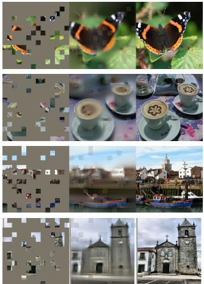
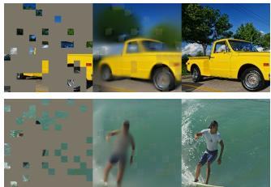
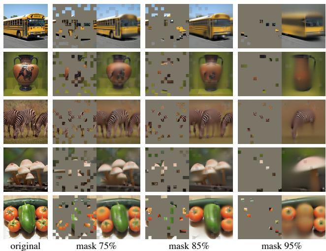
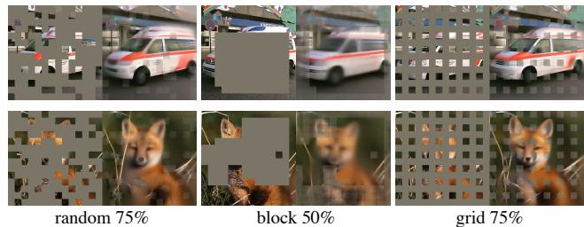
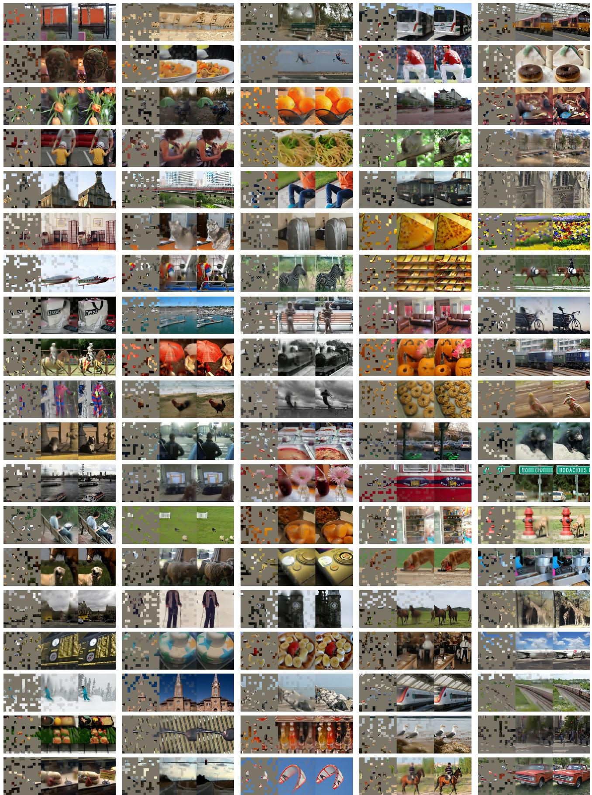

# 掩码自编码器是可扩展的视觉学习器 (Masked Autoencoders Are Scalable Vision Learners)

Kaiming He∗,† Xinlei Chen∗ Saining Xie Yanghao Li Piotr Dollar Ross Girshick ´

同等技术贡献 †项目负责人

Facebook AI Research (FAIR)

## 摘要

本文表明，掩码自编码器（Masked Autoencoders, MAE）是用于计算机视觉的可扩展自监督学习器。我们的 MAE 方法很简单：对输入图像的随机图像块（patch）进行掩码，并重建缺失的像素。它基于两个核心设计。首先，我们开发了一种非对称的编码器-解码器架构，其中编码器仅在可见的图像块子集上运行（不包含掩码标记（mask token）），并配备一个轻量级的解码器，用于从潜在表示（latent representation）和掩码标记中重建原始图像。其次，我们发现对输入图像的高比例（例如 75%）进行掩码，可以产生一个非平凡（nontrivial）且有意义的自监督任务。将这两个设计结合起来，使我们能够高效且有效地训练大模型：我们加速了训练（达到 3 倍或更多）并提高了准确率。我们这种可扩展的方法允许学习泛化能力强的高容量模型：例如，一个原生的 ViT-Huge 模型在仅使用 ImageNet-1K 数据的方法中取得了最佳准确率（87.8%）。在下游任务中的迁移性能优于监督预训练，并展现出了良好的扩展特性（scaling behavior）。

## 1. 引言

深度学习见证了能力与容量不断增长的架构的爆发式发展 [33, 25, 57]。在硬件飞速发展的助力下，如今的模型可以轻松过拟合一百万张图像 [13]，并开始需要数亿张——通常无法公开获取的——标注图像 [16]。

在自然语言处理（NLP）中，这种对数据的渴求已通过自监督预训练得到了成功解决。这些基于 GPT [47, 48, 4] 中的自回归语言建模和 BERT [14] 中的掩码自编码的解决方案在概念上非常简单：它们移除数据的一部分，并学习预测被移除的内容。这些方法现在使得训练包含超过一千亿参数且泛化良好的 NLP 模型成为可能 [4]。

掩码自编码器的思想作为更通用的去噪自编码器（denoising autoencoders）[58] 的一种形式，在计算机视觉中同样是自然且适用的。事实上，视觉领域中密切相关的研究 [59, 46] 甚至早于 BERT。然而，尽管在 BERT 取得成功之后人们对这一思想产生了极大的兴趣，但视觉中自编码方法的进展仍落后于 NLP。我们不禁要问：是什么导致了掩码自编码在视觉与语言之间的差异？我们尝试从以下几个角度来回答这个问题：

  
Figure 1. 我们的 MAE 架构。在预训练期间，图像块（patch）的很大一部分随机子集（例如 75%）被遮蔽。编码器仅应用于可见 patch 的小子集。在编码器之后引入掩码标记（mask token），随后编码后的 patch 和 mask token 的完整集合由一个小型解码器处理，以像素形式重构原始图像。预训练后，解码器被丢弃，编码器应用于未损坏的图像（完整 patch 集合）以进行识别任务。

(i) 直到最近，两者的架构各不相同。在视觉领域，卷积网络 [34] 在过去十年中占据主导地位 [33]。卷积通常在规则网格上操作，将诸如 mask tokens [14] 或位置嵌入（positional embeddings）[57] 等“指示器”集成到卷积网络中并不直观。然而，随着 Vision Transformers (ViT) [16] 的引入，这种架构上的差距已经得到解决，不再构成障碍。

(ii) 语言和视觉之间的信息密度不同。语言是人类产生的信号，具有高度的语义性和密集的信息量。当训练模型预测每个句子中仅缺失的少数词语时，该任务似乎能够引导出复杂的语言理解能力。相反，图像是具有高度空间冗余的自然信号——例如，缺失的 patch 可以根据邻近 patch 恢复出来，而几乎不需要对部件、物体和场景有高层次的理解。为了克服这种差异并促进学习有用的特征，我们证明了一种简单的策略在计算机视觉中非常有效：遮蔽极高比例的随机 patch。该策略大大减少了冗余，并创造了一个具有挑战性的自监督任务，需要超越低级图像统计特性的整体理解。为了对我们的重构任务获得定性的认识，请参见 Figures 2 – 4。

Figure 2. ImageNet 验证集图像上的示例结果。对于每个三元组，我们展示了遮蔽图像（左）、我们的 MAE 重构†（中）以及真实图像（右）。遮蔽率为 80%，在 196 个 patch 中仅保留 39 个。更多示例见附录。†由于未对可见 patch 计算损失，模型在可见 patch 上的输出在定性上较差。只需将可见 patch 覆盖在输出上即可提高视觉质量。我们特意选择不这样做，以便更全面地展示该方法的行为表现  

  
Figure 3. 在 COCO 验证集图像上的示例结果，使用了在 ImageNet 上训练的 MAE（与 Figure 2 中相同的模型权重）。观察最右侧两个示例的重构结果，它们虽然与真实图像不同，但在语义上是合理的。

(iii) 自动编码器的解码器将潜表示映射回输入，在重构文本与重构图像之间扮演着不同的角色。在视觉中，解码器重构的是像素，因此其输出的语义级别低于常见的识别任务。这与语言形成对比，在语言中解码器预测的是包含丰富语义信息的缺失词汇。虽然在 BERT 中解码器可以非常简单（仅为一个 MLP）[14]，但我们发现在图像中，解码器的设计在决定所学习潜表示的语义级别方面起着关键作用。

基于这一分析，我们提出了一种用于视觉表征学习的简单、有效且可扩展的掩码自编码器（Masked Autoencoder，MAE）形式。我们的 MAE 对输入图像随机掩码部分图块，并在像素空间中重构缺失的图块。它采用了非对称的编码器-解码器设计。我们的编码器仅对可见的图块子集进行操作（不包含掩码标记 mask tokens），而解码器是轻量级的，从潜表示以及掩码标记中重构输入（Figure 1）。在非对称编码器-解码器中将掩码标记移至小型解码器中，大大减少了计算量。在这种设计下，极高的掩码率（例如 75%）可以实现双赢局面：既优化了准确率，又允许编码器仅处理一小部分（例如 25%）图块。这可以将整体预训练时间减少 3 倍或更多，并同样减少显存消耗，使我们能够轻松地将 MAE 扩展到大模型。

我们的 MAE 能够学习具有良好泛化能力的高容量模型。通过 MAE 预训练，我们可以在 ImageNet-1K 上训练诸如 ViT-Large/-Huge [16] 这样极度依赖数据的模型，并获得更高的泛化性能。使用一个原生的 ViT-Huge 模型，在 ImageNet-1K 上微调时达到了 87.8% 的准确率。这超越了以往仅使用 ImageNet-1K 数据的所有结果。我们还在目标检测、实例分割和语义分割上评估了迁移学习。在这些任务中，我们的预训练取得了比对应的监督预训练更好的结果，更重要的是，通过扩展模型规模，我们观察到了显著的性能提升。这些观察结果与 NLP 领域自监督预训练中所见到的现象一致 [14, 47, 48, 4]，我们希望这些结果能够促使我们的领域探索类似的轨迹。

  
Figure 4. 使用以 75% 掩码率预训练的 MAE 对 ImageNet 验证集图像进行重建，但应用于具有更高掩码率的输入。预测结果与原始图像存在合理的差异，表明该方法具有泛化能力。

## 2. 相关工作

掩码语言建模（Masked language modeling）及其自回归对应方法，例如 BERT [14] 和 GPT [47, 48, 4]，是 NLP 中非常成功的预训练方法。这些方法保留输入序列的一部分，并训练模型来预测缺失的内容。这些方法已被证明具有极佳的可扩展性 [4]，大量证据表明这些预训练表示能够很好地泛化到各种下游任务。

自编码（Autoencoding）是一种学习表征的经典方法。它包含一个将输入映射到潜在表征的编码器，以及一个重建输入的解码器。例如，PCA 和 k-means 都是自编码器 [29]。去噪自编码器（DAE）[58] 是一类自编码器，它损坏输入信号并学习重建原始的、未损坏的信号。一系列方法可以被视为不同损坏形式下的广义 DAE，例如掩码像素 [59, 46, 6] 或去除颜色通道 [70]。我们的 MAE 是去噪自编码的一种形式，但在许多方面与传统的 DAE 不同。

掩码图像编码（Masked image encoding）方法通过被掩码破坏的图像来学习表征。[59] 的开创性工作将掩码作为 DAE 中的一种噪声类型。Context Encoder [46] 使用卷积网络对大面积缺失区域进行修复。受 NLP 成功的启发，近期相关的方法 [6, 16, 2] 均基于 Transformer [57]。iGPT [6] 对像素序列进行操作并预测未知像素。ViT 论文 [16] 研究了用于自监督学习的掩码图像块预测（masked patch prediction）。最近，BEiT [2] 提出了预测离散 token 的方法 [44, 50]。

自监督学习（Self-supervised learning）方法在计算机视觉中引起了极大的关注，通常侧重于用于预训练的不同前置任务 [15, 61, 42, 70, 45, 17]。最近，对比学习 [3, 22] 非常流行，例如 [62, 43, 23, 7]，它建模两个或多个视角之间的图像相似度和差异性（或仅相似度 [21, 8]）。对比学习及相关方法强烈依赖于数据增强 [7, 21, 8]。自编码则追求一个在概念上不同的方向，并且正如我们将要展示的，它表现出了不同的行为特性。

## 3. 方法

我们的掩码自编码器（Masked Autoencoder，MAE）是一种简单的自编码方法，用于在给定原始信号的部分观察时重建原始信号。与所有自编码器一样，我们的方法包含一个将观察到的信号映射到潜在表示的编码器，以及一个从潜在表示重建原始信号的解码器。与经典自编码器不同的是，我们采用了一种非对称设计，使得编码器仅对部分、观察到的信号（不包含掩码标记 mask token）进行操作，以及一个从潜在表示和掩码标记中重建完整信号的轻量级解码器。Figure 1 展示了这一思路，下文将对此进行介绍。

掩码。遵循 ViT [16]，我们将图像划分为规则的、互不重叠的图像块（patch）。然后我们采样一个图像块子集，并对其余部分进行掩码（即移除）。我们的采样策略非常简单直接：按照均匀分布进行无放回随机采样。我们简称为“随机采样”。

高掩码率（即被移除图像块的比例）的随机采样在很大程度上消除了冗余，从而构建了一个无法通过临近可见图像块轻易外推来解决的任务（参见 Figures 2 – 4）。均匀分布避免了潜在的中心偏差（即图像中心附近有更多被掩码的图像块）。最后，高度稀疏的输入为设计高效的编码器创造了机会，下文将予以介绍。

MAE 编码器。我们的编码器是一个 ViT [16]，但仅应用于可见的、未被掩码的图像块。正如标准 ViT 一样，我们的编码器通过带有位置嵌入（positional embedding）的线性投影来嵌入图像块，然后通过一系列 Transformer 块处理生成的集合。然而，我们的编码器仅在完整集合的一个小子集（例如 25%）上运行。被掩码的图像块被移除；不使用掩码标记。这使我们能够仅使用一小部分计算量和内存来训练非常庞大的编码器。完整集合由一个轻量级解码器处理，下文将对此进行描述。

MAE 解码器。MAE 解码器的输入是由以下内容组成的完整标记集合：(i) 编码后的可见图像块，以及 (ii) 掩码标记。参见 Figure 1。每个掩码标记 [14] 是一个共享的、可学习的向量，表示待预测的缺失图像块的存在。我们为该完整集合中的所有标记添加位置嵌入；若没有该步骤，掩码标记将无法获取其在图像中所在位置的信息。解码器包含另一系列的 Transformer 块。

MAE 解码器仅在预训练期间用于执行图像重建任务（仅编码器用于生成用于识别的图像表征）。因此，解码器架构的设计可以独立于编码器的设计，具有很大的灵活性。我们尝试了非常小的解码器，比编码器更窄、更浅。例如，与编码器相比，我们默认的解码器每个 token 的计算量小于 10%。通过这种非对称设计，完整的 token 集合仅由轻量级解码器处理，从而显著减少了预训练时间。

重建目标。我们的 MAE 通过预测每个被掩码 patch 的像素值来重建输入。解码器输出中的每个元素都是代表一个 patch 的像素值向量。解码器的最后一层是一个线性投影层，其输出通道数等于一个 patch 中的像素值数量。解码器的输出被重塑以形成重建图像。我们的损失函数在像素空间中计算重建图像与原始图像之间的均方误差（MSE）。类似于 BERT [14]，我们仅在被掩码的 patch 上计算损失。1

我们还研究了一种变体，其重建目标是每个被掩码 patch 的归一化像素值。具体而言，我们计算一个 patch 中所有像素的均值和标准差，并用它们对该 patch 进行归一化。在我们的实验中，使用归一化像素作为重建目标提高了表征质量。

简单实现。我们的 MAE 预训练可以高效实现，并且重要的是，不需要任何专门的稀疏操作。首先，我们为每个输入 patch 生成一个 token（通过线性投影加上位置嵌入）。接下来，我们随机打乱（shuffle）token 列表，并根据掩码比例移除列表的后半部分。这个过程为编码器生成了一个较小的 token 子集，相当于不放回地对 patch 进行采样。编码之后，我们将一组掩码 token 追加到编码后的 patch 列表中，并将整个列表反向打乱（unshuffle，即逆转随机打乱操作），以使所有 token 与其目标对齐。解码器应用于这个完整的列表（并加上位置嵌入）。如前所述，不需要任何稀疏操作。由于打乱和反打乱操作非常快速，这种简单的实现带来的开销微乎其微。

  
Figure 5. 掩码比例。高掩码比例（75%）在微调（上图）和线性探测（linear probing，下图）中均表现良好。本文所有图表中的 y 轴均为 ImageNet-1K 验证集准确率（%）。

## 4. ImageNet 实验

我们在 ImageNet-1K (IN1K) [13] 训练集上进行自监督预训练。随后，我们通过以下两种方式进行监督训练以评估所学表示：(i) 端到端微调（fine-tuning）或 (ii) 线性探测（linear probing）。我们报告单一 224×224 裁剪的 top-1 验证准确率。详情见附录 A.1。

基线：ViT-Large。我们在消融研究中使用 ViT-Large (ViT-L/16) [16] 作为主干网络。ViT-L 非常庞大（比 ResNet-50 [25] 大一个数量级），且容易发生过拟合。以下是从头训练的 ViT-L 与基于我们基线 MAE 进行微调的对比：

<table><tr><td>从头训练，原版 [16]</td><td>从头训练，我们的实现</td><td>基线 MAE</td></tr><tr><td>76.5</td><td>82.5</td><td>84.9</td></tr></table>

我们注意到，从头开始进行监督训练 ViT-L 并不简单，需要配合强正则化的优秀训练方案（82.5%，参见附录 A.2）。即便如此，我们的 MAE 预训练依然带来了大幅提升。此处的微调仅进行了 50 个周期（epoch）（相比之下从头训练需要 200 个周期），这表明微调准确率在很大程度上依赖于预训练。

## 4.1. Main Properties

我们使用表 1 中的默认设置（见题注）对 MAE 进行消融实验。观察到了几个有趣的特性。

掩码比例（Masking ratio）。图 5 展示了掩码比例的影响。最优比例高得令人惊讶。75% 的比例对于线性探测和微调都表现良好。这一行为与 BERT [14] 形成了鲜明对比，后者的典型掩码比例为 15%。我们的掩码比例也远高于计算机视觉领域相关工作 [6, 16, 2] 中的比例（20% 至 50%）。

模型通过推断缺失的图像块（patch）来生成不同但合理的输出（图 4）。它能够理解物体和场景的整体构型（gestalt），而这种构型无法仅通过延伸线条或纹理来简单补全。我们推测，这种类似推理的行为与有用表示的学习密切相关。

图 5 还表明，线性探测与微调的结果呈现出不同的趋势。对于线性探测，准确率随着掩码比例的增加稳步上升，直至达到最佳平衡点：准确率差距高达 ∼20%（54.6% vs. 73.5%）。对于微调，结果对比例不太敏感，在较宽的掩码比例范围（40–80%）内均表现良好。图 5 中的所有微调结果均优于从头训练（82.5%）。

<table><tr><td>块数 (blocks)</td><td>微调 (ft)</td><td>线性探测 (lin)</td></tr><tr><td>1</td><td>84.8</td><td>65.5</td></tr><tr><td>2</td><td>84.9</td><td>70.0</td></tr><tr><td>4</td><td>84.9</td><td>71.9</td></tr><tr><td>8</td><td>84.9</td><td>73.5</td></tr><tr><td>12</td><td>84.4</td><td>73.3</td></tr></table>

<table><tr><td>维度 (dim)</td><td>微调 (ft)</td><td>线性探测 (lin)</td></tr><tr><td>128</td><td>84.9</td><td>69.1</td></tr><tr><td>256</td><td>84.8</td><td>71.3</td></tr><tr><td>512</td><td>84.9</td><td>73.5</td></tr><tr><td>768</td><td>84.4</td><td>73.1</td></tr><tr><td>1024</td><td>84.3</td><td>73.1</td></tr></table>

(a) 解码器深度。更深的解码器可以提高线性探测准确率。

<table><tr><td>方案</td><td>ft</td><td>lin</td><td>FLOPs</td></tr><tr><td>含 [M] 的编码器</td><td>84.2</td><td>59.6</td><td>3.3×</td></tr><tr><td>不含 [M] 的编码器</td><td>84.9</td><td>73.5</td><td>1×</td></tr></table>

(c) 掩码标记（Mask token）。不含 mask token 的编码器更准确且速度更快（Table 2）。

(b) 解码器宽度。解码器的宽度可以窄于编码器（1024 维）。

<table><tr><td>方案</td><td>ft</td><td>lin</td></tr><tr><td>像素（无归一化）</td><td>84.9</td><td>73.5</td></tr><tr><td>像素（有归一化）</td><td>85.4</td><td>73.9</td></tr><tr><td>PCA</td><td>84.6</td><td>72.3</td></tr><tr><td>dVAE token</td><td>85.3</td><td>71.6</td></tr></table>

(d) 重建目标。以像素作为重建目标是有效的。

<table><tr><td>方案</td><td>ft</td><td>lin</td></tr><tr><td>无</td><td>84.0</td><td>65.7</td></tr><tr><td>裁剪，固定尺寸</td><td>84.7</td><td>73.1</td></tr><tr><td>裁剪，随机尺寸</td><td>84.9</td><td>73.5</td></tr><tr><td>裁剪 + 颜色抖动</td><td>84.3</td><td>71.9</td></tr></table>

(e) 数据增强。我们的 MAE 在极少或无数据增强的情况下依然有效。

<table><tr><td>方案</td><td>比例</td><td>ft</td><td>lin</td></tr><tr><td>随机</td><td>75</td><td>84.9</td><td>73.5</td></tr><tr><td>块状</td><td>50</td><td>83.9</td><td>72.3</td></tr><tr><td>块状</td><td>75</td><td>82.8</td><td>63.9</td></tr><tr><td>网格</td><td>75</td><td>84.0</td><td>66.0</td></tr></table>

(f) 掩码采样。随机采样效果最好。可视化结果见 Figure 6。  
Table 1. 在 ImageNet-1K 上使用 ViT-L/16 的 MAE 消融实验。我们报告了微调（ft）和线性探测（lin）准确率（%）。若未特别说明，默认设置为：解码器深度为 8 且宽度为 512，重建目标为未归一化的像素，数据增强为随机缩放裁剪，掩码比例为 75%，预训练时长为 800 个 epoch。默认设置以灰色标出

解码器设计。我们的 MAE 解码器可以进行灵活设计，如 Table 1a 和 1b 所研究的那样。

Table 1a 改变了解码器深度（Transformer 块的数量）。足够深的解码器对于线性探测非常重要。这可以通过像素重建任务与识别任务之间的差距来解释：自编码器中的最后几层更专门用于重建，但与识别的相关性较低。一个合理深度的解码器可以承担这种重建特化，从而使潜在表示保持在更抽象的层次。这种设计可以在线性探测中带来高达 8% 的提升（Table 1a，“lin”）。然而，如果采用微调，编码器的最后几层可以被调整以适应识别任务。解码器深度对微调性能提升的影响较小（Table 1a，“ft”）。

有趣的是，采用单块（single-block）解码器的 MAE 在微调时表现强劲（84.8%）。需要注意的是，单个 Transformer 块是将信息从可见 token 传播到 mask token 的最低要求。如此小巧的解码器可以进一步加快训练速度。

在 Table 1b 中，我们研究了解码器宽度（通道数）。我们默认使用 512-d，在微调和线性探测（linear probing）下均表现良好。较窄的解码器在微调中也表现优异。

总体而言，我们默认的 MAE 解码器是轻量级的。它包含 8 个块，宽度为 512-d（Table 1 中的灰色部分）。与 ViT-L（24 块，1024-d）相比，其每个 token 的 FLOPs 仅为其 9%。因此，尽管解码器处理所有 token，它仍然只占总计算量的一小部分。

<table><tr><td>编码器</td><td>解码器深度</td><td>微调准确率</td><td>小时</td><td>加速比</td></tr><tr><td>ViT-L, w/ [M]</td><td>8</td><td>84.2</td><td>42.4</td><td>-</td></tr><tr><td>ViT-L</td><td>8</td><td>84.9</td><td>15.4</td><td> $2.8 \times$ </td></tr><tr><td>ViT-L</td><td>1</td><td>84.8</td><td>11.6</td><td> $\mathbf{3.7} \times$ </td></tr><tr><td>ViT-H, w/ [M]</td><td>8</td><td>-</td><td> $119.6^{\dagger}$ </td><td>-</td></tr><tr><td>ViT-H</td><td>8</td><td>85.8</td><td>34.5</td><td> $3.5 \times$ </td></tr><tr><td>ViT-H</td><td>1</td><td>85.9</td><td>29.3</td><td> $\mathbf{4.1} \times$ </td></tr></table>

Table 2. 我们 MAE 训练的实际耗时（800 个 epoch），在带有 TensorFlow 的 128 个 TPU-v3 核心上进行基准测试。加速比是相对于编码器带有 mask token 的条目（灰色）计算的。解码器宽度为 512，掩码比例为 75%。†：该条目是通过训练 10 个 epoch 估算得出的。

Mask token。我们 MAE 的一个重要设计是在编码器中跳过 mask token [M]，并在随后的轻量级解码器中应用它。Table 1c 研究了这一设计。

如果编码器使用 mask token，其表现更差：在线性探测中准确率下降了 14%。在这种情况下，预训练与部署之间存在差距：该编码器在预训练时输入中包含很大比例的 mask token，而这在未损坏的图像中是不存在的。这种差距可能会降低部署时的准确率。通过从编码器中移除 mask token，我们约束编码器始终只接收真实的图像块（patch），从而提高了准确率。

此外，通过在编码器中跳过 mask token，我们大幅减少了训练计算量。在 Table 1c 中，我们将总训练 FLOPs 减少了 3.3 倍。这在我们的实现中带来了 2.8 倍的实际耗时加速（参见 Table 2）。对于更小的解码器（1 块）、更大的编码器（ViT-H）或两者兼有时，实际耗时加速甚至更显著（3.5–4.1 倍）。请注意，当掩码比例为 75% 时，加速比可达 >4 倍，部分原因是自注意力（self-attention）的计算复杂度是二次方的。此外，显存占用大幅减少，这使得训练超大模型或通过大批量（large-batch）训练进一步提速成为可能。时间和显存效率使得我们的 MAE 非常适合用于训练超大模型。

  
Figure 6. 掩码采样策略决定了代理任务（pretext task）的难度，从而影响重建质量和表征能力（Table 1f）。这里的每个输出均来自使用指定掩码策略训练的 MAE。左图：随机采样（我们的默认设置）。中图：块状采样（block-wise sampling）[2]，移除大块随机区域。右图：网格状采样（grid-wise sampling），每四个 patch 中保留一个。图像均来自验证集。

重建目标。我们在 Table 1d 中比较了不同的重建目标。到目前为止，我们的结果都是基于未经（按 patch）归一化的像素。使用归一化后的像素可以提高准确率。这种按 patch 的归一化增强了局部对比度。在另一种变体中，我们在 patch 空间中执行 PCA（主成分分析），并使用最大的 PCA 系数（此处为 96）作为目标。这样做会降低准确率。两项实验均表明高频分量在我们的方法中是有用的。

我们还对比了预测 token 的 MAE 变体，这是 BEiT [2] 中使用的目标。具体而言，对于该变体，我们遵循 [2] 使用 DALLE 预训练的 dVAE [50] 作为分词器（tokenizer）。此处 MAE 解码器使用交叉熵损失来预测 token 索引。与未归一化的像素相比，这种 tokenization 使微调准确率提高了 0.4%，但与归一化的像素相比没有任何优势。它还会降低线性探测（linear probing）的准确率。在 §5 中，我们进一步展示了在迁移学习中 tokenization 并不是必需的。

我们基于像素的 MAE 比 tokenization 简单得多。dVAE 分词器需要额外的预训练阶段，这可能依赖于额外的数据（250M 图像 [50]）。dVAE 编码器是一个大型卷积网络（FLOPs 达到 ViT-L 的 40%），带来了不可忽视的开销。而直接使用像素则不存在这些问题。

数据增强。Table 1e 研究了数据增强对我们 MAE 预训练的影响。

我们的 MAE 仅使用裁剪增强就能取得很好的效果，无论是固定尺寸还是随机尺寸（两者均包含随机水平翻转）。加入颜色抖动（color jittering）会使结果变差，因此我们在其他实验中未使用该操作。

令人惊讶的是，即使不使用任何数据增强（仅中心裁剪，不翻转），我们的 MAE 表现依然相当不错。这一特性与对比学习及相关方法 [62, 23, 7, 21] 截然不同，后者高度依赖数据增强。据观察 [21]，对于 BYOL [21] 和 SimCLR [7]，仅使用裁剪增强会分别导致准确率下降 13% 和 28%。此外，没有证据表明对比学习可以在没有数据增强的情况下工作：图像的两个视图完全相同，模型很容易满足平凡解（trivial solution）。

  
Figure 7. 训练周期（Training schedules）。更长的训练周期能带来显著的性能提升。此处每个点代表一个完整的训练周期。模型为采用 Table 1 默认设置的 ViT-L。

在 MAE 中，数据增强的作用主要由随机掩码（后续将进行消融实验）来承担。每次迭代中的掩码各不相同，因此无论是否有数据增强，它们都会生成新的训练样本。掩码操作增加了代理任务（pretext task）的难度，从而需要较少的数据增强来正则化训练。

掩码采样策略。在 Table 1f 中，我们比较了不同的掩码采样策略，如图 Figure 6 所示。

在 [2] 中提出的块状掩码策略（block-wise masking strategy）倾向于去除大块区域（Figure 6 中间）。采用块状掩码的 MAE 在 50% 的比例下表现尚可，但在 75% 的比例下性能有所下降。由于观察到更高的训练损失，该任务比随机采样更难。重建结果也更加模糊。

我们还研究了网格采样（grid-wise sampling），即规则地在每四个图像块（patch）中保留一个（Figure 6 右侧）。这是一个更简单的任务，具有更低的训练损失。重建结果更清晰。然而，其表征质量更低。

简单的随机采样对我们的 MAE 效果最好。它允许使用更高的掩码比例，在带来更大加速收益的同时还能保持良好的准确率。

训练周期。截至目前，我们的消融实验均基于 800 个周期的预训练。Figure 7 展示了训练周期长度的影响。随着训练时间的延长，准确率稳步提升。事实上，即使在 1600 个周期时，我们也没有观察到线性探测（linear probing）准确率出现饱和。这种表现与对比学习方法不同，例如 MoCo v3 [9] 在 ViT-L 架构下于 300 个周期时就趋于饱和。需要注意的是，MAE 编码器在每个周期仅看到 25% 的图像块，而在对比学习中，编码器在每个周期能看到 200%（双裁剪，two-crop）甚至更多（多裁剪，multi-crop）的图像块。

<table><tr><td>方法</td><td>预训练数据</td><td>ViT-B</td><td>ViT-L</td><td>ViT-H</td><td> $ViT-H_{448}$ </td></tr><tr><td>从头训练，我们的实现</td><td>-</td><td>82.3</td><td>82.6</td><td>83.1</td><td>-</td></tr><tr><td>DINO [5]</td><td>IN1K</td><td>82.8</td><td>-</td><td>-</td><td>-</td></tr><tr><td>MoCo v3 [9]</td><td>IN1K</td><td>83.2</td><td>84.1</td><td>-</td><td>-</td></tr><tr><td>BEiT [2]</td><td>IN1K+DALLE</td><td>83.2</td><td>85.2</td><td>-</td><td>-</td></tr><tr><td>MAE</td><td>IN1K</td><td>83.6</td><td>85.9</td><td>86.9</td><td>87.8</td></tr></table>

Table 3. 在 ImageNet-1K 上与以往结果的比较。预训练数据为 ImageNet-1K 训练集（除 BEiT 中的 tokenizer 是在 250M DALLE 数据 [50] 上预训练的外）。所有自监督方法均通过端到端微调进行评估。ViT 模型分别为 B/16、L/16、H/14 [16]。每列的最优结果带有下划线。除 ViT-H 在 448 尺寸上有额外结果外，所有结果均基于 224 的图像尺寸。在此，我们的 MAE 重建归一化像素，并预训练了 1600 个周期。

  
Figure 8. MAE 预训练与监督预训练的对比，通过在 ImageNet-1K（224 尺寸）中进行微调来评估。我们与在 IN1K 或 JFT300M 中训练的原始 ViT 结果 [16] 进行了比较。

## 4.2. 与先前结果的比较

与自监督方法的比较。在 Table 3 中，我们比较了自监督 ViT 模型的微调结果。对于 ViT-B，所有方法的表现都很接近。对于 ViT-L，各方法之间的差距更大，这表明更大模型所面临的一个挑战是减少过拟合。

我们的 MAE 可以轻松扩展规模，并且随着模型变大展现出持续的性能提升。使用 ViT-H（224 尺寸），我们获得了 86.9% 的准确率。通过在 448 尺寸下进行微调，仅使用 IN1K 数据，我们达到了 87.8% 的准确率。在所有仅使用 IN1K 数据的方法中，先前的最佳准确率是基于先进网络的 87.1%（512 尺寸）[67]。在极具竞争力的 IN1K 基准测试（无外部数据）中，我们以显著优势超越了当前最先进水平。我们的结果基于标准 ViT，我们预期先进网络会有更好的表现。

与 BEiT [2] 相比，我们的 MAE 在更简单、更快速的同时更加准确。我们的方法重建像素，而 BEiT 则预测 token：BEiT 报告了在使用 ViT-B 重建像素时性能下降了 1.8% [2]2。我们不需要 dVAE 预训练。此外，由于 Table 1c 中所研究的原因，我们的 MAE 比 BEiT 明显更快（每个 epoch 快 3.5×）。

  
Figure 9. 在 Table 1 的默认设置下，ViT-L 关于微调 Transformer 块数量的部分微调结果。微调 0 个块即为线性探测（linear probing）；微调 24 个块即为完全微调。我们的 MAE 表示的线性可分性较低，但如果微调一个或多个块，则始终优于 MoCo v3。

Table 3 中的 MAE 模型预训练了 1600 个 epoch 以获得更高的准确率（Figure 7）。即便如此，在相同硬件上训练时，我们的总预训练时间仍少于其他方法。例如，在 128 个 TPU-v3 核心上训练 ViT-L，我们的 MAE 训练 1600 个 epoch 需要 31 小时，而 MoCo v3 训练 300 个 epoch 需要 36 小时 [9]。

与监督预训练的比较。在原始 ViT 论文 [16] 中，ViT-L 在 IN1K 中训练时性能出现下降。我们的监督训练实现（见 A.2）表现更好，但准确率趋于饱和。参见 Figure 8。

仅使用 IN1K，我们的 MAE 预训练就能取得更好的泛化能力：对于更高容量的模型，相比从头训练带来的收益更大。它呈现出与 [16] 中 JFT-300M 监督预训练相似的趋势。这一比较表明，我们的 MAE 可以助力模型规模的扩展。

## 4.3. 部分微调

表 1 显示线性探测与微调结果在很大程度上是不相关的。线性探测在过去几年中一直是一种流行的评估协议；然而，它错失了追求强大但非线性特征的机会——而这正是深度学习的优势所在。作为一种折中方案，我们研究了一种部分微调（partial fine-tuning）协议：微调最后几层，同时冻结其他层。这种协议在早期的工作中也有所使用，例如 [65, 70, 42]。

图 9 展示了实验结果。值得注意的是，仅微调一个 Transformer 块就能将准确率从 73.5% 显著提升至 81.0%。此外，如果我们仅微调最后一个块的“一半”（即其 MLP 子块），就可以获得 79.1% 的准确率，远优于线性探测。这种变体本质上是在微调一个 MLP 头部。微调少量几个块（例如 4 个或 6 个）即可达到接近全量微调的准确率。

在图 9 中，我们还与 MoCo v3 [9] 进行了对比，这是一种具有 ViT-L 可用结果的对比学习方法。MoCo v3 具有更高的线性探测准确率；然而，其所有部分微调的结果都逊于 MAE。在微调 4 个块时，差距达到了 2.6%。虽然 MAE 的表示线性可分性较弱，但它们具有更强的非线性特征，并且在微调非线性头部时表现出色。

<table><tr><td rowspan="2">方法</td><td rowspan="2">预训练数据</td><td colspan="2"> $AP^{box}$ </td><td colspan="2"> $AP^{mask}$ </td></tr><tr><td>ViT-B</td><td>ViT-L</td><td>ViT-B</td><td>ViT-L</td></tr><tr><td>有监督</td><td>IN1K 带标签</td><td>47.9</td><td>49.3</td><td>42.9</td><td>43.9</td></tr><tr><td>MoCo v3</td><td>IN1K</td><td>47.9</td><td>49.3</td><td>42.7</td><td>44.0</td></tr><tr><td>BEiT</td><td>IN1K+DALLE</td><td>49.8</td><td>53.3</td><td>44.4</td><td>47.1</td></tr><tr><td>MAE</td><td>IN1K</td><td>50.3</td><td>53.3</td><td>44.9</td><td>47.2</td></tr></table>

Table 4. 使用 ViT Mask R-CNN 基线的 COCO 目标检测与分割结果。所有条目均基于我们的实现。自监督条目使用无标签的 IN1K 数据。Mask AP 的趋势与 box AP 相似。

这些观察表明，线性可分性并不是评估表示质量的唯一指标。文献中也观察到（例如 [8]），线性探测与迁移学习性能（例如目标检测）之间的相关性并不高。据我们所知，在 NLP 领域中，线性评估并不常用于基准测试预训练模型。

## 5. 迁移学习实验

我们使用表 3 中的预训练模型来评估下游任务中的迁移学习效果。

目标检测与分割。我们在 COCO [37] 上端到端微调 Mask R-CNN [24]。ViT 主干网络经过适配以与 FPN [36] 结合使用（参见 A.3）。我们将此方法应用于表 4 中的所有条目。我们汇报了用于目标检测的 box AP 以及用于实例分割的 mask AP。

与监督预训练相比，我们的 MAE 在所有配置下表现都更好（Table 4）。在使用较小的 ViT-B 时，我们的 MAE 比监督预训练高出 2.4 个点（50.3 对比 47.9，APbox）。更显著的是，在使用较大的 ViT-L 时，我们的 MAE 预训练比监督预训练高出 4.0 个点（53.3 对比 49.3）。

基于像素的 MAE 优于或等同于基于 token 的 BEiT，同时 MAE 要简单得多且速度更快。MAE 和 BEiT 均优于 MoCo v3，而 MoCo v3 与监督预训练相当。

语义分割。我们在 ADE20K [72] 上使用 UperNet [63] 进行实验（见 A.4）。Table 5 显示，我们的预训练相比监督预训练显著提升了结果，例如在 ViT-L 上提升了 3.7 个点。我们基于像素的 MAE 也优于基于 token 的 BEiT。这些观察结果与在 COCO 上的结果一致。

分类任务。Table 6 研究了在 iNaturalists [56] 和 Places [71] 任务上的迁移学习（见 A.5）。在 iNat 上，我们的方法展现出强大的扩展特性（scaling behavior）：随着模型变大，准确率显著提升。我们的结果大幅超越了先前的最佳结果。在 Places 上，我们的 MAE 优于先前的最佳结果 [19, 40]，而后者是通过在数十亿张图像上进行预训练获得的。

像素 vs. tokens。Table 7 比较了以像素还是以 tokens 作为 MAE 的重构目标。虽然使用 dVAE tokens 优于使用未归一化的像素，但在我们测试的所有情况下，它在统计上与使用归一化的像素相近。这再次表明 token 化对于我们的 MAE 而言并不是必需的。

<table><tr><td>方法</td><td>预训练数据</td><td>ViT-B</td><td>ViT-L</td></tr><tr><td>supervised</td><td>IN1K w/ labels</td><td>47.4</td><td>49.9</td></tr><tr><td>MoCo v3</td><td>IN1K</td><td>47.3</td><td>49.1</td></tr><tr><td>BEiT</td><td>IN1K+DALLE</td><td>47.1</td><td>53.3</td></tr><tr><td>MAE</td><td>IN1K</td><td>48.1</td><td>53.6</td></tr></table>

Table 5. 使用 UperNet 的 ADE20K 语义分割（mIoU）。BEiT 的结果是使用官方代码复现的。其他条目均基于我们的实现。自监督条目使用的是不带标签的 IN1K 数据。

<table><tr><td>数据集</td><td>ViT-B</td><td>ViT-L</td><td>ViT-H</td><td> $ViT-H_{448}$ </td><td>此前最佳</td></tr><tr><td>iNat 2017</td><td>70.5</td><td>75.7</td><td>79.3</td><td>83.4</td><td>75.4 [55]</td></tr><tr><td>iNat 2018</td><td>75.4</td><td>80.1</td><td>83.0</td><td>86.8</td><td>81.2 [54]</td></tr><tr><td>iNat 2019</td><td>80.5</td><td>83.4</td><td>85.7</td><td>88.3</td><td>84.1 [54]</td></tr><tr><td>Places205</td><td>63.9</td><td>65.8</td><td>65.9</td><td>66.8</td><td>66.0 [19] $^{\dagger}$ </td></tr><tr><td>Places365</td><td>57.9</td><td>59.4</td><td>59.8</td><td>60.3</td><td>58.0 [40] $^{\ddagger}$ </td></tr></table>

Table 6. 分类数据集上的迁移学习准确率，使用在 IN1K 上预训练随后进行微调的 MAE。我们提供了与先前最佳结果的系统级比较。†：在 10 亿张图像上预训练。‡：在 35 亿张图像上预训练。

<table><tr><td rowspan="2"></td><td colspan="3">IN1K</td><td colspan="2">COCO</td><td colspan="2">ADE20K</td></tr><tr><td>ViT-B</td><td>ViT-L</td><td>ViT-H</td><td>ViT-B</td><td>ViT-L</td><td>ViT-B</td><td>ViT-L</td></tr><tr><td>像素（无归一化）</td><td>83.3</td><td>85.1</td><td>86.2</td><td>49.5</td><td>52.8</td><td>48.0</td><td>51.8</td></tr><tr><td>像素（带归一化）</td><td>83.6</td><td>85.9</td><td>86.9</td><td>50.3</td><td>53.3</td><td>48.1</td><td>53.6</td></tr><tr><td>dVAE token</td><td>83.6</td><td>85.7</td><td>86.9</td><td>50.3</td><td>53.2</td><td>48.1</td><td>53.4</td></tr><tr><td> $\bigtriangleup$ </td><td>0.0</td><td>-0.2</td><td>0.0</td><td>0.0</td><td>-0.1</td><td>0.0</td><td>-0.2</td></tr></table>

Table 7. 像素对比 token 作为 MAE 重建目标。4 为使用 dVAE token 与使用归一化像素之间的差值。该差异在统计上并不显著。

## 6. 讨论与结论

具有良好扩展性的简单算法是深度学习的核心。在 NLP 中，简单的自监督学习方法（例如 [47, 14, 48, 4]）使得模型能够从指数级扩展中获益。在计算机视觉中，尽管自监督学习取得了进展，但实用的预训练范式仍主要由监督学习主导（例如 [33, 51, 25, 16]）。在本研究中，我们在 ImageNet 上以及迁移学习中观察到，自动编码器——一种类似于 NLP 技术的简单自监督方法——能够带来可扩展的收益。视觉领域的自监督学习现在可能正踏上与 NLP 类似的轨迹。

另一方面，我们注意到图像和语言是具有不同性质的信号，必须审慎对待这种差异。图像仅仅是记录的光线，并没有分解成类似于词语的视觉语义单元。我们没有试图去除目标物体，而是去除了极不可能构成语义片段的随机 patch。同样，我们的 MAE 重建的是像素，它们并非语义实体。尽管如此，我们观察到（例如 Figure 4），我们的 MAE 推断出了复杂而整体的重建结果，这表明它已经学习了大量的视觉概念，即语义。我们推测这种行为是通过 MAE 内部丰富的隐层表示实现的。我们希望这一视角能够启发未来的工作。

更广泛的影响。所提出的方法基于训练数据集学到的统计规律来预测内容，因此会反映这些数据中的偏差，包括具有负面社会影响的偏差。该模型可能会生成不存在的内容。在基于本工作进行图像生成时，这些问题值得进一步研究和考虑。

## 参考文献

[1] Jimmy Lei Ba, Jamie Ryan Kiros, and Geoffrey E Hinton. Layer normalization. arXiv:1607.06450, 2016.

[2] Hangbo Bao, Li Dong, and Furu Wei. BEiT: BERT pre-training of image transformers. arXiv:2106.08254, 2021. Accessed in June 2021.

[3] Suzanna Becker and Geoffrey E Hinton. Self-organizing neural network that discovers surfaces in random-dot stereograms. Nature, 1992.

[4] Tom Brown, Benjamin Mann, Nick Ryder, Melanie Subbiah, Jared D Kaplan, Prafulla Dhariwal, Arvind Neelakantan, Pranav Shyam, Girish Sastry, Amanda Askell, Sandhini Agarwal, Ariel Herbert-Voss, Gretchen Krueger, Tom Henighan, Rewon Child, Aditya Ramesh, Daniel Ziegler, Jeffrey Wu, Clemens Winter, Chris Hesse, Mark Chen, Eric Sigler, Mateusz Litwin, Scott Gray, Benjamin Chess, Jack Clark, Christopher Berner, Sam McCandlish, Alec Radford, Ilya Sutskever, and Dario Amodei. Language models are few-shot learners. In NeurIPS, 2020.

[5] Mathilde Caron, Hugo Touvron, Ishan Misra, Herve Jégou, Julien Mairal, Piotr Bojanowski, and Armand Joulin. Emerging properties in self-supervised vision transformers. In ICCV, 2021.

[6] Mark Chen, Alec Radford, Rewon Child, Jeffrey Wu, Heewoo Jun, David Luan, and Ilya Sutskever. Generative pretraining from pixels. In ICML, 2020.

[7] Ting Chen, Simon Kornblith, Mohammad Norouzi, and Geoffrey Hinton. A simple framework for contrastive learning of visual representations. In ICML, 2020.

[8] Xinlei Chen and Kaiming He. Exploring simple Siamese representation learning. In CVPR, 2021.

[9] Xinlei Chen, Saining Xie, and Kaiming He. An empirical study of training self-supervised Vision Transformers. In ICCV, 2021.

[10] Kevin Clark, Minh-Thang Luong, Quoc V Le, and Christopher D Manning. ELECTRA: Pre-training text encoders as discriminators rather than generators. In ICLR, 2020.

[11] Corinna Cortes and Vladimir Vapnik. Support-vector networks. Machine learning, 1995.

[12] Ekin D Cubuk, Barret Zoph, Jonathon Shlens, and Quoc V Le. Randaugment: Practical automated data augmentation with a reduced search space. In CVPR Workshops, 2020.

[13] Jia Deng, Wei Dong, Richard Socher, Li-Jia Li, Kai Li, and Li Fei-Fei. ImageNet: A large-scale hierarchical image database. In CVPR, 2009.

[14] Jacob Devlin, Ming-Wei Chang, Kenton Lee, and Kristina Toutanova. BERT: Pre-training of deep bidirectional transformers for language understanding. In NAACL, 2019.

[15] Carl Doersch, Abhinav Gupta, and Alexei A Efros. Unsupervised visual representation learning by context prediction. In ICCV, 2015.

[16] Alexey Dosovitskiy, Lucas Beyer, Alexander Kolesnikov, Dirk Weissenborn, Xiaohua Zhai, Thomas Unterthiner, Mostafa Dehghani, Matthias Minderer, Georg Heigold, Sylvain Gelly, Jakob Uszkoreit, and Neil Houlsby. An image is worth 16x16 words: Transformers for image recognition at scale. In ICLR, 2021.

[17] Spyros Gidaris, Praveer Singh, and Nikos Komodakis. Unsupervised representation learning by predicting image rotations. In ICLR, 2018.

[18] Xavier Glorot and Yoshua Bengio. Understanding the difficulty of training deep feedforward neural networks. In AISTATS, 2010.

[19] Priya Goyal, Mathilde Caron, Benjamin Lefaudeux, Min Xu, Pengchao Wang, Vivek Pai, Mannat Singh, Vitaliy Liptchinsky, Ishan Misra, Armand Joulin, and Piotr Bojanowski. Self-supervised pretraining of visual features in the wild. arXiv:2103.01988, 2021.

[20] Priya Goyal, Piotr Dollar, Ross Girshick, Pieter Noordhuis, Lukasz´ Wesolowski, Aapo Kyrola, Andrew Tulloch, Yangqing Jia, and Kaiming He. Accurate, large minibatch SGD: Training ImageNet in 1 hour. arXiv:1706.02677, 2017.

[21] Jean-Bastien Grill, Florian Strub, Florent Altche, Corentin Tallec,´ Pierre Richemond, Elena Buchatskaya, Carl Doersch, Bernardo Avila Pires, Zhaohan Guo, Mohammad Gheshlaghi Azar, Bilal Piot, Koray Kavukcuoglu, Remi Munos, and Michal Valko. Bootstrap your own latent - a new approach to self-supervised learning. In NeurIPS, 2020.

[22] Raia Hadsell, Sumit Chopra, and Yann LeCun. Dimensionality reduction by learning an invariant mapping. In CVPR, 2006.

[23] Kaiming He, Haoqi Fan, Yuxin Wu, Saining Xie, and Ross Girshick. Momentum contrast for unsupervised visual representation learning. In CVPR, 2020.

[24] Kaiming He, Georgia Gkioxari, Piotr Dollar, and Ross Girshick.´ Mask R-CNN. In ICCV, 2017.

[25] Kaiming He, Xiangyu Zhang, Shaoqing Ren, and Jian Sun. Deep residual learning for image recognition. In CVPR, 2016.

[26] Dan Hendrycks, Steven Basart, Norman Mu, Saurav Kadavath, Frank Wang, Evan Dorundo, Rahul Desai, Tyler Zhu, Samyak Parajuli, Mike Guo, et al. The many faces of robustness: A critical analysis of out-of-distribution generalization. In ICCV, 2021.

[27] Dan Hendrycks and Thomas Dietterich. Benchmarking neural network robustness to common corruptions and perturbations. In ICLR, 2019.

[28] Dan Hendrycks, Kevin Zhao, Steven Basart, Jacob Steinhardt, and Dawn Song. Natural adversarial examples. In CVPR, 2021.

[29] Geoffrey E Hinton and Richard S Zemel. Autoencoders, minimum description length, and helmholtz free energy. In NeurIPS, 1994.

[30] Gao Huang, Yu Sun, Zhuang Liu, Daniel Sedra, and Kilian Q Weinberger. Deep networks with stochastic depth. In ECCV, 2016.

[31] Sergey Ioffe and Christian Szegedy. Batch normalization: Accelerating deep network training by reducing internal covariate shift. In ICML, 2015.

[32] Insoo Kim, Seungju Han, Ji-won Baek, Seong-Jin Park, Jae-Joon Han, and Jinwoo Shin. Quality-agnostic image recognition via invertible decoder. In CVPR, 2021.

[33] Alex Krizhevsky, Ilya Sutskever, and Geoff Hinton. Imagenet classification with deep convolutional neural networks. In NeurIPS, 2012.

[34] Yann LeCun, Bernhard Boser, John S Denker, Donnie Henderson, Richard E Howard, Wayne Hubbard, and Lawrence D Jackel. Backpropagation applied to handwritten zip code recognition. Neural computation, 1989.

[35] Yanghao Li, Saining Xie, Xinlei Chen, Piotr Dollar, Kaiming He, and Ross Girshick. Benchmarking detection transfer learning with vision transformers. In preparation, 2021.

[36] Tsung-Yi Lin, Piotr Dollar, Ross Girshick, Kaiming He, Bharath Hariharan, and Serge Belongie. Feature pyramid networks for object detection. In CVPR, 2017.

[37] Tsung-Yi Lin, Michael Maire, Serge Belongie, James Hays, Pietro Perona, Deva Ramanan, Piotr Dollar, and C Lawrence Zitnick. Microsoft COCO: Common objects in context. In ECCV, 2014.

[38] Ilya Loshchilov and Frank Hutter. SGDR: Stochastic gradient descent with warm restarts. In ICLR, 2017.

[39] Ilya Loshchilov and Frank Hutter. Decoupled weight decay regularization. In ICLR, 2019.

[40] Dhruv Mahajan, Ross Girshick, Vignesh Ramanathan, Kaiming He, Manohar Paluri, Yixuan Li, Ashwin Bharambe, and Laurens van der Maaten. Exploring the limits of weakly supervised pretraining. In ECCV, 2018.

[41] Xiaofeng Mao, Gege Qi, Yuefeng Chen, Xiaodan Li, Ranjie Duan, Shaokai Ye, Yuan He, and Hui Xue. Towards robust vision transformer. arXiv:2105.07926, 2021.

[42] Mehdi Noroozi and Paolo Favaro. Unsupervised learning of visual representations by solving jigsaw puzzles. In ECCV, 2016.

[43] Aaron van den Oord, Yazhe Li, and Oriol Vinyals. Representation learning with contrastive predictive coding. arXiv:1807.03748, 2018.

[44] Aaron van den Oord, Oriol Vinyals, and Koray Kavukcuoglu. Neural discrete representation learning. In NeurIPS, 2017.

[45] Deepak Pathak, Ross Girshick, Piotr Dollar, Trevor Darrell, and Bharath Hariharan. Learning features by watching objects move. In CVPR, 2017.

[46] Deepak Pathak, Philipp Krahenbuhl, Jeff Donahue, Trevor Darrell, and Alexei A Efros. Context encoders: Feature learning by inpainting. In CVPR, 2016.

[47] Alec Radford, Karthik Narasimhan, Tim Salimans, and Ilya Sutskever. Improving language understanding by generative pretraining. 2018.

[48] Alec Radford, Jeffrey Wu, Rewon Child, David Luan, Dario Amodei, and Ilya Sutskever. Language models are unsupervised multitask learners. 2019.

[49] Colin Raffel, Noam Shazeer, Adam Roberts, Katherine Lee, Sharan Narang, Michael Matena, Yanqi Zhou, Wei Li, and Peter J. Liu. Exploring the limits of transfer learning with a unified text-to-text transformer. JMLR, 2020.

[50] Aditya Ramesh, Mikhail Pavlov, Gabriel Goh, Scott Gray, Chelsea Voss, Alec Radford, Mark Chen, and Ilya Sutskever. Zero-shot text-to-image generation. In ICML, 2021.

[51] Karen Simonyan and Andrew Zisserman. Very deep convolutional networks for large-scale image recognition. In ICLR, 2015.

[52] Christian Szegedy, Vincent Vanhoucke, Sergey Ioffe, Jonathon Shlens, and Zbigniew Wojna. Rethinking the inception architecture for computer vision. In CVPR, 2016.

[53] Hugo Touvron, Matthieu Cord, Matthijs Douze, Francisco Massa, Alexandre Sablayrolles, and Herve Jegou. Training data-efficient image transformers & distillation through attention. In ICML, 2021.

[54] Hugo Touvron, Alexandre Sablayrolles, Matthijs Douze, Matthieu Cord, and Herve Jégou. Grafit: 利用粗标签学习细粒度图像表征 (Grafit: Learning fine-grained image representations with coarse labels). In ICCV, 2021.

[55] Hugo Touvron, Andrea Vedaldi, Matthijs Douze, and Herve Jégou. 修复训练与测试分辨率差异 (Fixing the train-test resolution discrepancy). arXiv:1906.06423, 2019.

[56] Grant Van Horn, Oisin Mac Aodha, Yang Song, Yin Cui, Chen Sun, Alex Shepard, Hartwig Adam, Pietro Perona, and Serge Belongie. iNaturalist 物种分类与检测数据集 (The iNaturalist species classification and detection dataset). In CVPR, 2018.

[57] Ashish Vaswani, Noam Shazeer, Niki Parmar, Jakob Uszkoreit, Llion Jones, Aidan N Gomez, Lukasz Kaiser, and Illia Polosukhin. 注意力即你所需要的一切 (Attention is all you need). In NeurIPS, 2017.

[58] Pascal Vincent, Hugo Larochelle, Yoshua Bengio, and Pierre-Antoine Manzagol. 利用去噪自编码器提取和组合鲁棒特征 (Extracting and composing robust features with denoising autoencoders). In ICML, 2008.

[59] Pascal Vincent, Hugo Larochelle, Isabelle Lajoie, Yoshua Bengio, Pierre-Antoine Manzagol, and Leon Bottou. 堆叠去噪自编码器：在具有局部去噪准则的深度网络中学习有用表征 (Stacked denoising autoencoders: Learning useful representations in a deep network with a local denoising criterion). JMLR, 2010.

[60] Haohan Wang, Songwei Ge, Zachary Lipton, and Eric P Xing. 通过惩罚局部预测能力学习鲁棒的全局表征 (Learning robust global representations by penalizing local predictive power). In NeurIPS, 2019.

[61] Xiaolong Wang and Abhinav Gupta. 利用视频进行视觉表征的无监督学习 (Unsupervised learning of visual representations using videos). In ICCV, 2015.

[62] Zhirong Wu, Yuanjun Xiong, Stella Yu, and Dahua Lin. 基于非参数实例判别的无监督特征学习 (Unsupervised feature learning via non-parametric instance discrimination). In CVPR, 2018.

[63] Tete Xiao, Yingcheng Liu, Bolei Zhou, Yuning Jiang, and Jian Sun. 用于场景理解的统一感知解析 (Unified perceptual parsing for scene understanding). In ECCV, 2018.

[64] Tete Xiao, Mannat Singh, Eric Mintun, Trevor Darrell, Piotr Dollar, and Ross Girshick. 早期卷积帮助 Transformer 更好地观察 (Early convolutions help transformers see better). In NeurIPS, 2021.

[65] Jason Yosinski, Jeff Clune, Yoshua Bengio, and Hod Lipson. 深度神经网络中的特征可迁移性如何？(How transferable are features in deep neural networks?). In NeurIPS, 2014.

[66] Yang You, Igor Gitman, and Boris Ginsburg. 卷积网络的大批次训练 (Large batch training of convolutional networks). arXiv:1708.03888, 2017.

[67] Li Yuan, Qibin Hou, Zihang Jiang, Jiashi Feng, and Shuicheng Yan. VOLO: 用于视觉识别的 Vision Outlooker (VOLO: Vision outlooker for visual recognition). arXiv:2106.13112, 2021.

[68] Sangdoo Yun, Dongyoon Han, Seong Joon Oh, Sanghyuk Chun, Junsuk Choe, and Youngjoon Yoo. Cutmix: 利用可定位特征训练强分类器的正则化策略 (Cutmix: Regularization strategy to train strong classifiers with localizable features). In ICCV, 2019.

[69] Hongyi Zhang, Moustapha Cisse, Yann N Dauphin, and David Lopez-Paz. mixup: 超越经验风险最小化 (mixup: Beyond empirical risk minimization). In ICLR, 2018.

[70] Richard Zhang, Phillip Isola, and Alexei A Efros. 绚丽的图像着色 (Colorful image colorization). In ECCV, 2016.

[71] Bolei Zhou, Agata Lapedriza, Jianxiong Xiao, Antonio Torralba, and Aude Oliva. 利用 Places 数据库学习用于场景识别的深度特征 (Learning deep features for scene recognition using Places database). In NeurIPS, 2014.

[72] Bolei Zhou, Hang Zhao, Xavier Puig, Tete Xiao, Sanja Fidler, Adela Barriuso, and Antonio Torralba. Semantic understanding of scenes through the ADE20K dataset. IJCV, 2019.

## A. 实现细节

## A.1. ImageNet 实验

ViT 架构。我们遵循标准的 ViT 架构 [16]。它由堆叠的 Transformer 块 [57] 组成，每个块包含一个多头自注意力（multi-head self-attention）块和一个 MLP 块，两者均包含 LayerNorm (LN) [1]。编码器以 LN 结尾。由于 MAE 编码器和解码器的宽度（width）不同，我们在编码器之后采用线性投影层进行匹配。我们的 MAE 在编码器和解码器的输入中均添加了位置嵌入（positional embeddings）[57]（正弦-余弦版本）。我们的 MAE 没有使用相对位置或层缩放（layer scaling，这些在 [2] 的代码中有使用）。

我们从编码器输出中提取特征用于微调（fine-tuning）和线性探测（linear probing）。由于 ViT 具有类别词元（class token）[16]，为了适应这一设计，在 MAE 预训练中，我们在编码器输入中附加了一个辅助虚拟词元（auxiliary dummy token）。该词元在线性探测和微调中将被视为用于训练分类器的类别词元。如果不使用该词元（采用平均池化），我们的 MAE 效果同样很好。

预训练。默认设置如 Table 8 所示。我们不使用颜色抖动（color jittering）、随机深度（drop path）或梯度裁剪（gradient clip）。遵循 ViT 的官方代码 [16]，我们使用 xavier uniform [18] 初始化所有 Transformer 块。我们使用线性学习率缩放规则 [20]：lr = base lr×batchsize / 256。

端到端微调。我们的微调遵循监督 ViT 训练的常规做法。默认设置如 Table 9 所示。遵循 [2]，我们使用了逐层学习率衰减（layer-wise lr decay）[10]。

线性探测。我们的线性分类器训练遵循 [9]。参见 Table 10。我们观察到线性探测所需的训练方案与端到端微调截然不同。特别是，正则化通常对线性探测有害。遵循 [9]，我们停用了许多常见的正则化策略：我们不使用 mixup [69]、cutmix [68]、drop path [30] 或颜色抖动，并将权重衰减（weight decay）设置为零。

在训练经典线性分类器（例如 SVM [11]）时，对分类器输入进行归一化是常见的做法。类似地，在训练线性探测分类器时，对预训练特征进行归一化是有益的。遵循 [15]，我们采用了一个不带仿射变换（affine=False）的额外 BatchNorm 层 [31]。该层应用于编码器生成的预训练特征上，且位于线性分类器之前。我们注意到该层并未破坏线性性质，并且在训练后可以被吸收合并到线性分类器中：它本质上是一个重参数化的线性分类器。3 引入这一层有助于校准我们消融实验中不同变体之间的特征幅值，从而使它们可以使用相同的设置而无需进一步搜索学习率。

<table><tr><td>配置</td><td>数值</td></tr><tr><td>优化器</td><td>AdamW [39]</td></tr><tr><td>基础学习率</td><td>1.5e-4</td></tr><tr><td>权重衰减</td><td>0.05</td></tr><tr><td>优化器动量</td><td> $\beta_{1}, \beta_{2}=0.9, 0.95$  [6]</td></tr><tr><td>批大小</td><td>4096</td></tr><tr><td>学习率调度策略</td><td>余弦衰减 [38]</td></tr><tr><td>预热轮数 [20]</td><td>40</td></tr><tr><td>数据增强</td><td>RandomResizedCrop</td></tr></table>

Table 8. 预训练设置。

<table><tr><td>配置</td><td>数值</td></tr><tr><td>优化器</td><td>AdamW</td></tr><tr><td>基础学习率</td><td>1e-3</td></tr><tr><td>权重衰减</td><td>0.05</td></tr><tr><td>优化器动量</td><td> $\beta_1, \beta_2=0.9, 0.999$ </td></tr><tr><td>分层学习率衰减 [10, 2]</td><td>0.75</td></tr><tr><td>批大小</td><td>1024</td></tr><tr><td>学习率调度策略</td><td>余弦衰减</td></tr><tr><td>预热轮数</td><td>5</td></tr><tr><td>训练轮数</td><td>100 (B), 50 (L/H)</td></tr><tr><td>数据增强</td><td>RandAug (9, 0.5) [12]</td></tr><tr><td>标签平滑 [52]</td><td>0.1</td></tr><tr><td>mixup [69]</td><td>0.8</td></tr><tr><td>cutmix [68]</td><td>1.0</td></tr><tr><td>drop path [30]</td><td>0.1 (B/L) 0.2 (H)</td></tr></table>

Table 9. 端到端微调设置。

<table><tr><td>配置</td><td>数值</td></tr><tr><td>优化器</td><td>LARS [66]</td></tr><tr><td>基础学习率</td><td>0.1</td></tr><tr><td>权重衰减</td><td>0</td></tr><tr><td>优化器动量</td><td>0.9</td></tr><tr><td>批大小</td><td>16384</td></tr><tr><td>学习率调度策略</td><td>余弦衰减</td></tr><tr><td>预热轮数</td><td>10</td></tr><tr><td>训练轮数</td><td>90</td></tr><tr><td>数据增强</td><td>RandomResizedCrop</td></tr></table>

Table 10. 线性探测（linear probing）设置。我们使用带有大批次的 LARS 以实现更快的训练；SGD 在 4096 批大小下效果类似。

部分微调。我们的 MAE 部分微调（§4.3）遵循 Table 9 中的设置，除了我们调整了微调轮数。我们观察到，微调较少的块需要更长的训练周期。我们将微调轮数设置为 {50, 100, 200}，并对每种微调块数采用最优的轮数。

## A.2. 从头开始监督训练 ViT-L/H

我们发现，在 ImageNet-1K 上从头开始监督训练 ViT-L/H 并非易事。训练过程是不稳定的。虽然对于较小的模型已有具有公开实现的强基线 [53]，但针对更大的 ViT-L/H 的训练方案仍未被探索。直接将先前的方案应用于这些更大的模型是行不通的。在训练过程中频繁观察到 NaN 损失。

我们在表 11 中提供了我们的训练方案。遵循原始 ViT [16]，我们使用的权重衰减（wd）为 0.3，采用 4096 的大批大小（batch size）以及较长的预热期（warmup）。遵循 [6]，我们设置 $\beta _ { 2 } { = } 0 . 9 5$。遵循 [64]，我们采用了表 11 中列出的正则化方法并停用了其他正则化。所有这些选择都是为了提高训练稳定性。我们的训练方案在完成训练时不会出现 NaN 损失。

<table><tr><td>配置</td><td>数值</td></tr><tr><td>优化器</td><td>AdamW</td></tr><tr><td>基础学习率</td><td>1e-4</td></tr><tr><td>权重衰减</td><td>0.3</td></tr><tr><td>优化器动量</td><td> $\beta_1, \beta_2=0.9, 0.95$ </td></tr><tr><td>批大小</td><td>4096</td></tr><tr><td>学习率调度</td><td>余弦衰减</td></tr><tr><td>预热轮数</td><td>20</td></tr><tr><td>训练轮数</td><td>300 (B), 200 (L/H)</td></tr><tr><td>数据增强</td><td>RandAug (9, 0.5) [12]</td></tr><tr><td>标签平滑 [52]</td><td>0.1</td></tr><tr><td>mixup [69]</td><td>0.8</td></tr><tr><td>cutmix [68]</td><td>1.0</td></tr><tr><td>drop path [30]</td><td>0.1 (B), 0.2 (L/H)</td></tr><tr><td>指数移动平均 (EMA)</td><td>0.9999</td></tr></table>

Table 11. 从头开始监督训练 ViT。

ViT-L 的准确率为 82.6%（不使用 EMA 时为 81.5%），ViT-H 为 83.1%（不使用 EMA 时为 80.9%）。如果不使用 EMA，ViT-L 和 ViT-H 均表现出过拟合趋势。

作为副产品，我们的方案使 ViT-B 达到了 82.3% 的准确率（不使用 EMA 时为 82.1%），而 [53] 中为 81.8%。

## A.3. COCO 中的目标检测与分割

我们调整了原生 ViT，以便在 Mask R-CNN [24] 中使用 FPN 骨干网络（backbone）[36]。ViT 具有一堆 Transformer 块，它们都在单一尺度（例如步长为 16）下生成特征图。我们将这堆结构均分为 4 个子集，并应用卷积对中间特征图进行上采样或下采样，以生成不同的尺度（步长分别为 4、8、16 或 32，与标准 ResNet [25] 相同）。FPN 构建在这些多尺度特征图之上。

为了在不同方法之间进行公平比较，我们对表 4 中的每个条目（包括所有对比方法）都进行了超参数搜索。我们搜索的超参数包括学习率、权重衰减、drop path 率以及微调轮数。我们将随具体配置一起开源代码。完整的模型和训练细节以及更多实验，请参见 [35]。

## A.4. ADE20K 中的语义分割

遵循 [2] 的语义分割代码，我们使用 UperNet [63]。我们在批大小为 16 的情况下端到端微调 100 轮。我们为表 5 中的每个条目（包括所有对比方法）搜索了最佳学习率（lr）。

[2] 的语义分割代码使用了相对位置偏置（relative position bias）[49]。我们的 MAE 预训练并未采用它。为了公平比较，我们仅在迁移学习期间开启相对位置偏置，并将其初始化为零。我们注意到，根据其代码，我们的 BEiT 复现版本在预训练和微调中均使用了相对位置偏置。

## A.5. 额外分类任务

我们遵循 Table 9 中的设置进行 iNaturalist 和 Places 的微调（Table 6）。我们针对各个数据集分别调整了学习率（lr）和微调轮数。

<table><tr><td>方法</td><td>模型</td><td>参数量</td><td>准确率</td></tr><tr><td>iGPT [6]</td><td>iGPT-L</td><td>1362 M</td><td>69.0</td></tr><tr><td>iGPT [6]</td><td>iGPT-XL</td><td>6801 M</td><td>72.0</td></tr><tr><td>BEiT [2]</td><td>ViT-L</td><td>304 M</td><td> $52.1^†$ </td></tr><tr><td>MAE</td><td>ViT-B</td><td>86 M</td><td>68.0</td></tr><tr><td>MAE</td><td>ViT-L</td><td>304 M</td><td>75.8</td></tr><tr><td>MAE</td><td>ViT-H</td><td>632 M</td><td>76.6</td></tr></table>

Table 12. 掩码编码方法的线性探测（linear probing）结果。我们的微调结果见 Table 3。†：我们的实现。

<table><tr><td>数据集</td><td>ViT-B</td><td>ViT-L</td><td>ViT-H</td><td> $\text{ViT-H}_{448}$ </td><td>以往最佳</td></tr><tr><td>IN-Corruption ↓ [27]</td><td>51.7</td><td>41.8</td><td>33.8</td><td>36.8</td><td>42.5 [32]</td></tr><tr><td>IN-Adversarial [28]</td><td>35.9</td><td>57.1</td><td>68.2</td><td>76.7</td><td>35.8 [41]</td></tr><tr><td>IN-Rendition [26]</td><td>48.3</td><td>59.9</td><td>64.4</td><td>66.5</td><td>48.7 [41]</td></tr><tr><td>IN-Sketch [60]</td><td>34.5</td><td>45.3</td><td>49.6</td><td>50.9</td><td>36.0 [41]</td></tr><tr><td colspan="6">我们的监督训练基线：</td></tr><tr><td>IN-Corruption ↓</td><td>45.8</td><td>42.3</td><td>41.3</td><td></td><td></td></tr><tr><td>IN-Adversarial</td><td>27.2</td><td>29.6</td><td>33.1</td><td></td><td></td></tr><tr><td>IN-Rendition</td><td>49.4</td><td>50.9</td><td>50.3</td><td></td><td></td></tr><tr><td>IN-Sketch</td><td>35.6</td><td>37.5</td><td>38.0</td><td></td><td></td></tr></table>

Table 13. 在 ImageNet 变体上的鲁棒性评估（top-1 准确率，除 IN-C [27] 评估的是平均损坏误差之外）。我们在不同的 ImageNet 验证集上测试了相同的 MAE 模型（Table 3），未进行任何专门的微调。我们提供了与以往最佳结果的系统级比较。

## B. 线性探测结果比较

在 §4.3 中，我们已经表明线性探测准确率与微调准确率在很大程度上是不相关的，并且它们对线性可分性有不同的关注点。我们注意到现有的掩码图像编码方法在线性探测中通常竞争力较弱（例如相比对比学习）。为了完整起见，我们在 Table 12 中将基于掩码的方法进行了线性探测准确率的比较。

我们的 MAE 搭配 ViT-L 取得了 75.8% 的线性探测准确率。这显著优于以往基于掩码的方法。另一方面，在该评测协议下，它仍落后于对比方法：例如，MoCo v3 [9] 的 ViT-L 线性探测准确率为 77.6%（Figure 9）。

## C. ImageNet 上的鲁棒性评估

在 Table 13 中，我们评估了模型在 ImageNet 验证集的不同变体上的鲁棒性。我们使用在原始 ImageNet 上微调过的相同模型（Table 3），仅在不同的验证集上运行推理，未进行任何专门的微调。Table 13 表明我们的方法具有强大的扩展特性（scaling behavior）：增大模型尺寸带来了显著的收益。增大图像尺寸除了在 IN-C 之外的所有数据集上都有所助益。我们的结果大幅超越了以往（专用系统的）最佳结果。

相比之下，监督训练的表现要差得多（Table 13 底部；模型描述见 A.2）。例如，使用 ViT-H 时，我们的 MAE 预训练在 IN-A 上的表现比对应的监督训练模型高出 35%（68.2% 对比 33.1%）。

  
Figure 10. ImageNet 验证图像上未经挑选的随机样本。对于每个三元组，我们展示了掩码图像（左）、我们的 MAE 重建结果（中）以及真实图像（右）。掩码率为 75%。

  
Figure 11. 使用在 ImageNet 上训练的 MAE 在 COCO 验证图像上生成的未经挑选的随机样本。对于每个三元组，我们展示了掩码图像（左）、我们的 MAE 重建结果（中）以及真实图像（右）。掩码率为 75%。