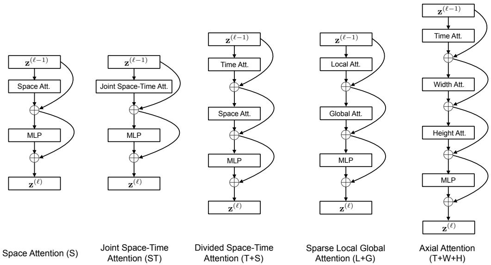
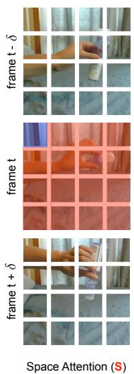
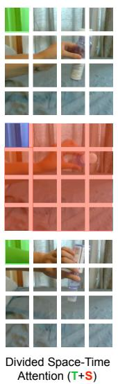
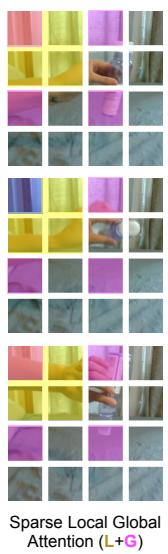
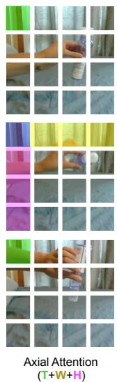
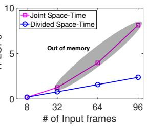
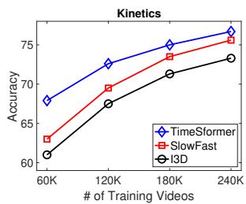
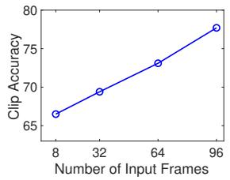
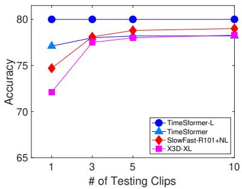
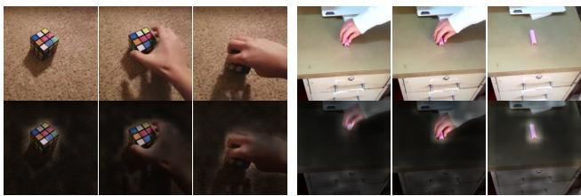

# 时空注意力是视频理解所需的一切吗？

Gedas Bertasius 1 Heng Wang 1 Lorenzo Torresani 1 2

## 摘要

我们提出了一种完全基于空间和时间自注意力的无卷积视频分类方法。我们的方法名为“TimeSformer”，通过直接从帧级补丁（patch）序列中进行时空特征学习，将标准的 Transformer 架构适配到视频领域。我们的实验研究对比了不同的自注意力方案，结果表明在所考虑的设计选择中，在每个块内分别应用时间注意力和空间注意力的“分离注意力”（divided attention）能够取得最佳的视频分类准确率。尽管采用了这种全新的设计，TimeSformer 仍在多个动作识别基准上取得了最先进（state-of-the-art）的结果，包括在 Kinetics-400 和 Kinetics-600 上取得了报道过的最高准确率。最后，与 3D 卷积网络相比，我们的模型训练速度更快，能够实现大幅提高的测试效率（仅有微小的精度下降），并且还可以应用于更长的视频片段（超过一分钟长）。代码和模型已开源：https://github.com/ facebookresearch/TimeSformer。

## 1. 引言

在过去几年中，自然语言处理（NLP）领域因基于自注意力（self-attention）方法的出现而发生了革命性的变化（Vaswani et al., 2017a）。由于其在捕获词语间长距离依赖关系方面的卓越能力以及出色的训练可扩展性，以 Transformer 模型为代表的自注意力架构在广泛的语言任务中均代表了当前最先进的水平，包括机器翻译（Ott et al., 2018; Chen et al., 2018a）、问答（Devlin et al., 2019; Dai et al., 2019）以及自回归词语生成（Radford et al., 2019; Brown et al., 2020）。

视频理解与 NLP 具有若干高层次的相似性。首先，视频和句子都是序列化的。此外，正如一个词的含义通常只有通过将其与句子中的其他词联系起来才能理解一样，短期片段中的原子动作也需要与视频的其余部分进行语境化关联，才能彻底消除歧义。因此，人们自然会预期源自 NLP 的长距离自注意力模型在视频建模中也会非常有效。然而，在视频领域，2D 或 3D 卷积仍然是跨不同视频任务进行时空特征学习的核心算子（Feichtenhofer et al., 2019a; Teed & Deng, 2020; Bertasius & Torresani, 2020）。尽管在卷积层之上应用自注意力已经显示出了优势（Wang et al., 2018a），但据我们所知，目前尚未有将自注意力作为视频识别模型唯一构建块的尝试报道。

在这项工作中，我们提出了这样一个问题：是否有可能通过将卷积算子完全替换为自注意力（self-attention）机制，来构建一个高性能的无卷积视频架构。我们认为，这种设计有望克服卷积模型在视频分析中的一些固有局限性。首先，尽管它们强大的归纳偏置（inductive biases，例如局部连接性和平移等变性）在小型训练集上无疑是有益的，但在拥有充足数据且“一切”都可以从样本中学习的场景下，这些偏置可能会过度限制模型的表达能力。与 CNN 相比，Transformer 施加的归纳偏置更少。这扩大了它们所能表示的函数族（Cordonnier et al., 2020; Zhao et al., 2020），并使它们更适合对强归纳先验需求较低的现代大数据范式。其次，尽管卷积核经过专门设计以捕获短程时空信息，但它们无法对超出感受野的依赖关系进行建模。虽然深层卷积堆叠（Simonyan & Zisserman, 2015; Szegedy et al., 2015; Carreira & Zisserman, 2017）自然地扩展了感受野，但这些策略在通过聚合较短程信息来捕获长程依赖方面本质上是有限的。相反，自注意力机制可以通过直接比较所有时空位置的特征激活来捕获局部以及全局的长程依赖关系，这远远超出了传统卷积滤波器的感受野。最后，尽管 GPU 硬件加速取得了进展，但训练深度 CNN 仍然非常昂贵，尤其是在应用于高分辨率和长视频时。静态图像领域的最新工作（Dosovitskiy et al., 2020; Carion et al., 2020; Zhao et al., 2020）表明，与 CNN 相比，Transformer 具有更快的训练和推理速度，从而使得在相同的计算预算下构建具有更大人类学习容量的模型成为可能。

受这些观察的启发，我们提出了一种完全建立在自注意力机制之上的视频架构。我们通过将自注意力机制从图像空间扩展到时空三维体（space-time 3D volume），将图像模型“Vision Transformer”（ViT）（Dosovitskiy et al., 2020）适配到视频领域。我们提出的模型命名为“TimeSformer”（取自 Time-Space Transformer），它将视频视为从各个独立帧中提取的 patch 序列。与 ViT 中类似，每个 patch 都会被线性映射为一个嵌入向量，并附加上位置信息。这使得将生成的向量序列解释为能够输入到 Transformer 编码器中的 token 嵌入（token embeddings）成为可能，类似于在 NLP 中从词语计算得出的 token 特征。

标准 Transformer 中自注意力机制的一个缺点是，它需要计算所有 token 对之间的相似度度量。在我们的设定中，由于视频中包含大量的 patch，这在计算上是非常昂贵的。为了应对这些挑战，我们在时空体（space-time volume）上提出了几种可扩展的自注意力设计，并在大规模动作分类数据集上对它们进行了实证评估。在所提出的方案中，我们发现最佳设计是一种“分离注意力”（divided attention）架构，该架构在网络的每个块内分别应用时间注意力和空间注意力。与基于卷积的成熟视频架构范式相比，TimeSformer 采用了一种截然不同的设计。然而，它在该领域取得了与最先进技术（state-of-the-art）相当、在某些情况下甚至更优的准确率。我们还表明，我们的模型可用于跨度长达数分钟的视频的长程建模。

## 2. 相关工作

我们的方法受到了近期在图像分类中使用自注意力机制的工作的影响，这些工作要么与卷积算子相结合，要么甚至将其完全取代。在前一类中，Non-Local Networks (Wang et al., 2018b) 采用了非局部均值，有效地泛化了 Transformer (Vaswani et al., 2017b) 的自注意力函数。Bello 等人 (Bello et al., 2019) 提出了一种 2D 自注意力机制，该机制作为 2D 卷积的替代方案具有竞争力，而在用于通过自注意力特征增强卷积特征时能够取得更强的结果。除图像分类外，Relation Networks (Hu et al., 2018) 和 DETR (Carion et al., 2020) 在卷积特征图之上使用自注意力来进行目标检测。

我们的方法与利用自注意力机制（self-attention）替代卷积的图像网络（Parmar et al., 2018; Ramachandran et al., 2019; Cordonnier et al., 2020; Zhao et al., 2020）联系更为紧密。由于这些工作使用单个像素作为查询（queries），为了保持可控的计算成本和较低的内存占用，它们必须将自注意力的范围限制在局部邻域内，或者在大幅缩小的图像版本上使用全局自注意力。将其扩展到完整图像的其他策略包括稀疏键值采样（sparse key-value sampling）（Child et al., 2019），或将自注意力限制在沿空间轴计算（Ho et al., 2019; Huang et al., 2019; Wang et al., 2020b）。我们实验中考虑的少数自注意力算子也采用了类似的稀疏和轴向计算，尽管它们被推广到了时空体（spatiotemporal volume）上。然而，我们方法的高效性主要源于将视频分解为一系列帧级图块（patches），然后将这些图块的线性嵌入作为输入词元嵌入（token embeddings）输入到 Transformer 中。该策略最近在 Vision Transformers (ViT)（Dosovitskiy et al., 2020）中被引入，并被证明在图像分类任务上取得了令人瞩目的性能。在这项工作中，我们基于 ViT 设计，通过提出并在经验上比较几种用于视频的时空自注意力可扩展方案，将其扩展到视频领域。

虽然 Transformers 最近被用于视频生成（Weissenborn et al., 2020），但据我们所知，此前尚无仅以自注意力作为唯一构建块的视频识别架构。然而，我们注意到，已有研究在卷积特征图之上采用 Transformers 来进行动作定位与识别（Girdhar et al., 2019）、视频分类（Wang et al., 2018b; Chen et al., 2018b）以及群体活动识别（Gavrilyuk et al., 2020）。我们还注意到，有大量文献基于文本 Transformers 与视频 CNNs 的结合来解决各种视频-语言任务，如视频描述（captioning）（Zhou et al., 2018）、问答（Yang et al., 2020）和对话（Le et al., 2019）。最后，多模态视频-文本 Transformers（Sun et al., 2019; Li et al., 2020a）也通过采用改编自语言领域的掩码词元（masked-token）预设任务（pretext tasks）（Devlin et al., 2018; Radford et al., 2018），以无监督方式进行了训练或预训练。

## 3. The TimeSformer Model

输入片段。TimeSformer 接收从原始视频中采样的由 F 个大小为 $H \times W$ 的 RGB 帧组成的片段 X RH×W×3×F 作为输入。

分解为图像块（patches）。遵循 ViT（Dosovitskiy et al., 2020），我们将每一帧分解为 $N$ 个不重叠的图像块，每个图像块的大小为 $P \times P ,$ 从而使这 $N$ 个图像块覆盖整个帧，$\mathrm { i . e . , } N = H W / P ^ { 2 }$。我们将这些图像块展平为向量 $\mathbf { x } _ { ( p , t ) } \in \mathbb { R } ^ { 3 P ^ { 2 } }$，其中 $p = 1 , \ldots , N$ 表示空间位置，$t = 1 , \ldots , F$ 表示帧的索引。

  
Figure 1. 本文研究所涉及的视频自注意力块（video self-attention blocks）。每个注意力层在指定的帧级图像块时空邻域上实现自注意力机制（Vaswani et al., 2017b）（邻域的可视化见 Figure 2）。我们使用残差连接来聚合每个块内不同注意力层的信息。在每个块的末尾应用一个包含 1 个隐藏层的 MLP。最终模型通过将这些块反复堆叠构建而成。

线性嵌入。我们通过可学习矩阵 $E \in \breve { \mathbb { R } ^ { D \times 3 P ^ { 2 } } }$ 将每个图像块 $\mathbf { x } _ { ( p , t ) }$ 线性映射为一个嵌入向量 $\mathbf { z } _ { ( p , t ) } ^ { ( 0 ) } \in \check { \mathbb { R } } ^ { D }$：

$$
\mathbf {z} _ {(p, t)} ^ {(0)} = E \mathbf {x} _ {(p, t)} + \mathbf {e} _ {(p, t)} ^ {p o s}\tag{1}
$$

其中 $\mathbf { e } _ { ( p , t ) } ^ { p o s } \in \mathbb { R } ^ { D }$ 表示添加的可学习位置嵌入，用于对每个图像块的时空位置进行编码。所得的嵌入向量序列 $\mathbf { z } _ { ( p , t ) } ^ { ( 0 ) }$（其中 $p = 1 , \ldots , N$，$t = 1 , \ldots , F$）构成了 Transformer 的输入，其作用类似于 NLP 中输入到文本 Transformer 的嵌入词序列。与原始的 BERT Transformer（Devlin et al., 2018）一样，我们在序列的第一个位置添加了一个特殊的可学习向量 $\mathbf { z } _ { ( 0 , 0 ) } ^ { ( 0 ) } \in \mathbb { R } ^ { D }$，代表分类标记（classification token）的嵌入。

Query-Key-Value 计算。我们的 Transformer 由 L 个编码块组成。在每个块 \` 中，根据前一个块编码的表征 $\mathbf { z } _ { ( p , t ) } ^ { ( \ell - 1 ) }$ 为每个图像块计算查询/键/值（query/key/value）向量：

$$
\mathbf {q} _ {(p, t)} ^ {(\ell , a)} = W _ {Q} ^ {(\ell , a)} \mathrm{LN} \left(\mathbf {z} _ {(p, t)} ^ {(\ell - 1)}\right) \in \mathbb {R} ^ {D _ {h}}\tag{2}
$$

$$
\mathbf {k} _ {(p, t)} ^ {(\ell , a)} = W _ {K} ^ {(\ell , a)} \mathrm{LN} \left(\mathbf {z} _ {(p, t)} ^ {(\ell - 1)}\right) \in \mathbb {R} ^ {D _ {h}}\tag{3}
$$

$$
\mathbf {v} _ {(p, t)} ^ {(\ell , a)} = W _ {V} ^ {(\ell , a)} \mathrm{LN} \left(\mathbf {z} _ {(p, t)} ^ {(\ell - 1)}\right) \in \mathbb {R} ^ {D _ {h}}\tag{4}
$$

其中 LN() 表示 LayerNorm (Ba et al., 2016)，$a = 1 , \ldots , A$ 是多个注意力头的索引，表示注意力头的总数。每个注意力头的潜在维度设置为 $D _ { h } = D / \mathcal { A }$。

自注意力计算。自注意力权重通过点积计算。查询 patch $(p, t)$ 的自注意力权重 $\pmb { \alpha } _ { ( p , t ) } ^ { ( \ell , a ) } \in \mathbb { R } ^ { N F + 1 }$ 给出如下：

$$
\boldsymbol{\alpha}_{(p,t)}^{(\ell ,a)} = \text{SM}\left(\frac{\mathbf{q}_{(p,t)}^{(\ell,a)}}{\sqrt{D_{h}}}\right)^{\top}\cdot \left[\mathbf{k}_{(0,0)}^{(\ell ,a)}\left\{\mathbf{k}_{(p^{\prime},t^{\prime})}^{(\ell ,a)}\right\}_{\substack{p^{\prime} = 1,\ldots ,N\\ t^{\prime} = 1,\ldots ,F}}\right]\Bigg)\tag{5}
$$

其中 SM 表示 softmax 激活函数。请注意，当仅在单一维度（例如仅空间或仅时间）上计算注意力时，计算量会显著减少。例如，在空间注意力的情况下，仅进行 $N + 1$ 次查询-键（query-key）比对，且仅使用与查询来自同一帧的键：

$$
\boldsymbol {\alpha} _ {(p, t)} ^ {(\ell , a) \text {space}} = \text {SM} \left(\frac {\mathbf {q} _ {(p , t)} ^ {(\ell , a)}}{\sqrt {D _ {h}}} ^ {\top} \cdot \left[ \mathbf {k} _ {(0, 0)} ^ {(\ell , a)} \left\{\mathbf {k} _ {(p ^ {\prime}, t)} ^ {(\ell , a)} \right\} _ {p ^ {\prime} = 1, \ldots , N} \right]\right)\tag{6}
$$

编码。块 $\ell$ 处的编码 $\mathbf { z } _ { ( p , t ) } ^ { ( \ell ) }$ 是首先使用来自各个注意力头的自注意力系数计算值向量的加权和得到的：

  
Figure 2. 本工作所研究的五种时空自注意力方案的可视化。每个视频片段均被视为一系列尺寸为 16 × 16 像素的帧级 patch。为了便于说明，我们用蓝色表示查询 patch，并用非蓝色显示每种方案下其自注意力时空邻域。无颜色的 patch 不用于蓝色 patch 的自注意力计算。一种方案内的多种颜色表示分别沿不同维度（例如 (T+S) 的空间和时间）或在不同邻域上（例如用于 (L+G)）应用的注意力。请注意，自注意力是针对视频片段中的每一个单独 patch 进行计算的，即每个 patch 都充当查询。我们还注意到，尽管注意力模式仅展示了两个相邻帧，但它以相同的方式扩展到该片段的所有帧。

$$
\mathbf {s} _ {(p, t)} ^ {(\ell , a)} = \alpha_ {(p, t), (0, 0)} ^ {(\ell , a)} \mathbf {v} _ {(0, 0)} ^ {(\ell , a)} + \sum_ {p ^ {\prime} = 1} ^ {N} \sum_ {t ^ {\prime} = 1} ^ {F} \alpha_ {(p, t), (p ^ {\prime}, t ^ {\prime})} ^ {(\ell , a)} \mathbf {v} _ {(p ^ {\prime}, t ^ {\prime})} ^ {(\ell , a)}.\tag{7}
$$

然后，将来自所有注意力头的这些向量拼接后进行投影，并通过一个 MLP，在每次操作后均使用残差连接：

$$
\mathbf {z} _ {(p, t)} ^ {\prime (\ell)} = W _ {O} \left[ \begin{array}{c} \mathbf {s} _ {(p, t)} ^ {(\ell , 1)} \\ \vdots \\ \mathbf {s} _ {(p, t)} ^ {(\ell , \mathcal {A})} \end{array} \right] + \mathbf {z} _ {(p, t)} ^ {(\ell - 1)}\tag{8}
$$

$$
\mathbf {z} _ {(p, t)} ^ {(\ell)} = \mathrm{MLP} \left(\mathrm{LN} \left(\mathbf {z} _ {(p, t)} ^ {\prime (\ell)}\right)\right) + \mathbf {z} _ {(p, t)} ^ {\prime (\ell)}.\tag{9}
$$

分类嵌入（Classification embedding）。最终的视频片段嵌入是从分类标记（classification token）对应的最后一个块中获得的：

$$
\mathbf {y} = \mathrm{LN} \left(\mathbf {z} _ {(0, 0)} ^ {(L)}\right) \in \mathbb {R} ^ {D}.\tag{10}
$$

在该表示之上，我们添加了一个具有 1 个隐藏层的 MLP，用于预测最终的视频类别。

时空自注意力模型（Space-Time Self-Attention Models）。我们可以通过将公式 5 中的时空注意力替换为仅在每帧内部的空间注意力（公式 6）来降低计算成本。然而，这种模型忽略了跨帧时间依赖关系的捕获。正如我们的实验所示，与完全时空注意力相比，该方法会导致分类准确率下降，特别是在需要强时间建模能力的基准测试上。

我们提出了一种更高效的时空注意力架构，称为“分离时空注意力”（Divided Space-Time Attention，记作 T+S），其中时间注意力和空间注意力被依次独立应用。该架构与空间注意力和联合时空注意力的对比见 Fig. 1。Fig. 2 给出了不同注意力模型在一个视频示例上的可视化。对于分离注意力，在每个块 \` 内，我们首先通过将每个 patch $(p, t)$ 与其他帧中同一空间位置的所有 patch 进行比较来计算时间注意力：

$$
\boldsymbol {\alpha} _ {(p, t)} ^ {(\ell , a) \text {time}} = \text {SM} \left(\frac {\mathbf {q} _ {(p , t)} ^ {(\ell , a)}}{\sqrt {D _ {h}}} ^ {\top} \cdot \left[ \mathbf {k} _ {(0, 0)} ^ {(\ell , a)} \left\{\mathbf {k} _ {(p, t ^ {\prime})} ^ {(\ell , a)} \right\} _ {t ^ {\prime} = 1, \ldots , F} \right]\right)\tag{11}
$$

使用时间注意力应用 Eq. 8 所得到的编码 $\mathbf { z } _ { \mathit { \Pi } ( p , t ) } ^ { \prime { ( \ell ) } \mathrm { t i m e } }$ 随后被反馈用于空间注意力计算，而不是传递给 MLP。换言之，从 $\mathbf { z } _ { ( p , t ) } ^ { \prime ( \ell ) \mathrm { t i m e } }$ 中获取新的键/查询/值（key/query/value）向量，然后使用 Eq. 6 计算空间注意力。最后，生成的向量 $\mathbf { z } _ { ( p , t ) } ^ { \prime ( \ell ) \mathrm { s p a c e } }$ 被传递至 Eq. 9 的 MLP，以计算块 \` 处 patch 的最终编码 $\mathbf { z } _ { ( p , t ) } ^ { ( \ell ) }$。对于分离注意力（Divided Attention）模型，我们在时间和空间维度上分别学习不同的查询/键/值矩阵 $\{ W _ { Q ^ { \mathrm { t i m e } } } ^ { ( \ell , a ) } , W _ { K ^ { \mathrm { t i m e } } } ^ { ( \ell , a ) } , W _ { V ^ { \mathrm { t i m e } } } ^ { ( \ell , a ) } \}$ 和 $\{ W _ { Q ^ { \mathrm { s p a c e } } } ^ { ( \ell , a ) } , W _ { K ^ { \mathrm { s p a c e } } } ^ { ( \ell , a ) } , W _ { V ^ { \mathrm { s p a c e } } } ^ { ( \ell , a ) } \}$。需要注意的是，相比于 Eq. 5 的联合时空注意力模型中每个 patch 所需的 $( N F + 1 )$ 次比较，Divided Attention 每个 patch 仅执行 $\left( N { + } F { + } 2 \right)$ 次比较。我们的实验表明，这种时空因式分解不仅更加高效，而且还能带来分类准确率的提升。

<table><tr><td>注意力机制</td><td>参数量</td><td>K400</td><td>SSv2</td></tr><tr><td>空间 (Space)</td><td>85.9M</td><td>76.9</td><td>36.6</td></tr><tr><td>联合时空 (Joint Space-Time)</td><td>85.9M</td><td>77.4</td><td>58.5</td></tr><tr><td>分离时空 (Divided Space-Time)</td><td>121.4M</td><td>78.0</td><td>59.5</td></tr><tr><td>稀疏局部全局 (Sparse Local Global)</td><td>121.4M</td><td>75.9</td><td>56.3</td></tr><tr><td>轴向 (Axial)</td><td>156.8M</td><td>73.5</td><td>56.2</td></tr></table>

Table 1. TimeSformer 中不同时空注意力方案的视频级准确率。我们在 Kinetics-400 (K400) 和 Something-Something-V2 (SSv2) 的验证集上评估了模型。我们观察到，分离时空注意力在两个数据集上均取得了最佳效果。

我们还对“稀疏局部全局”（Sparse Local Global，L+G）和“轴向”（Axial，T+W+H）注意力模型进行了实验。它们的架构如图 1 所示，而图 2 展示了这些模型进行注意力计算所考虑的图像块（patches）。对于每个图像块 $(p, t)$，(L+G) 首先通过考虑相邻的 $F \times H / 2 \times W / 2$ 个图像块来计算局部注意力，然后沿着时间维度以及两个空间维度均以 2 个图像块为步长，在整个视频片段上计算稀疏全局注意力。因此，它可以被视为使用局部-全局分解和稀疏模式对全时空注意力的更快近似，类似于 (Child et al., 2019) 中使用的方法。最后，“轴向”注意力将注意力计算分解为三个不同的步骤：沿时间、宽度和高度。在 (Ho et al., 2019; Huang et al., 2019; Wang et al., 2020b) 中提出了沿图像两个空间轴的分解注意力，而我们的 (T+W+H) 针对视频情况增加了第三个维度（时间）。所有这些模型都是通过为每个注意力步骤学习不同的 query/key/value 矩阵来实现的。

## 4. 实验

我们在四个流行的动作识别数据集上评估了 TimeSformer：Kinetics-400 (Carreira & Zisserman, 2017)、Kinetics-600 (Carreira et al., 2018)、Something-Something-V2 (Goyal et al., 2017b) 和 Diving-48 (Li et al., 2018)。根据每个实验的具体说明，我们采用了在 ImageNet-1K 或 ImageNet-21K (Deng et al., 2009) 上预训练的“Base” ViT 架构 (Dosovitskiy et al., 2020)。除非另有说明，我们使用的视频片段尺寸为 $8 \times 2 2 4 \times 2 2 4$，帧采样率为 $1 / 3 2$。图像块尺寸为 $1 6 \times 1 6$ 像素。在推理过程中，除非另有说明，我们在视频中间采样一个时间片段。我们从该时间片段中提取 3 个空间裁剪区域（左上、中心、右下），并通过平均这 3 个裁剪区域的得分来获得最终预测。

  
Figure 3. 我们比较了联合时空注意力（Joint Space-Time）与分离时空注意力（Divided Space-Time）的视频分类计算成本（以 TFLOPs 为单位）。我们绘制了 TFLOPs 数量关于以像素为单位的空间裁剪尺寸（左图）以及输入帧数（右图）的函数关系。随着我们增加空间分辨率（左图）或视频长度（右图），与联合时空注意力方案相比，我们提出的分离时空注意力带来了显著的计算量节省。

## 4.1. 自注意力机制方案分析

在这第一组实验中，我们从在 ImageNet-21K 上预训练的 ViT 开始。在 Table 1 中，我们展示了在 Kinetics-400 (K400) 和 Something Something-V2 (SSv2) 上采用 TimeSformer 所提出的五种时空注意力方案获得的结果。首先，我们注意到仅采用空间注意力（S）的 TimeSformer 在 K400 上表现良好。这是一个有趣的发现。事实上，先前的研究（Sevilla-Lara et al., 2021）表明，在 K400 上，为了获得较高的准确率，空间线索比时间信息更为重要。在这里，我们证明了在不进行任何时间建模的情况下，在 K400 上也能取得可观的准确率。然而需要注意的是，仅空间注意力在 SSv2 上的表现很差。这突显了时间建模在后一个数据集上的重要性。

此外，我们观察到分离时空注意力（divided space-time attention）在 K400 和 SSv2 上均取得了最佳准确率。这是合乎情理的，因为与联合时空注意力（joint space-time attention）相比，分离时空注意力具有更大的学习容量（见 Table 1），因为它为时间注意力和空间注意力分别包含了独立的学习参数。

在 Figure 3 中，我们还对比了在采用更高空间分辨率（左图）和更长视频（右图）时，联合时空注意力与分离时空注意力的计算开销。我们注意到，分离时空注意力的方案在这两种设定下都能保持良好的扩展性。相比之下，当分辨率或视频长度增加时，联合时空注意力方案会导致计算开销急剧上升。在实际应用中，一旦空间帧分辨率达到 448 像素，或者帧数增加到 32 帧，联合时空注意力就会导致 GPU 显存溢出，因此它实际上不适用于大尺寸图像帧或长视频。因此，尽管参数量更多，但在处理更高空间分辨率或更长视频时，分离时空注意力比联合时空注意力更为高效。因此，在随后的所有实验中，我们都使用由分离时空自注意力模块构建的 TimeSformer。

视频理解只需要时空注意力吗？

<table><tr><td>模型</td><td>预训练</td><td>K400 训练时间（小时）</td><td>K400 准确率</td><td>推理 TFLOPs</td><td>参数量</td></tr><tr><td>I3D 8x8 R50</td><td>ImageNet-1K</td><td>444</td><td>71.0</td><td>1.11</td><td>28.0M</td></tr><tr><td>I3D 8x8 R50</td><td>ImageNet-1K</td><td>1440</td><td>73.4</td><td>1.11</td><td>28.0M</td></tr><tr><td>SlowFast R50</td><td>ImageNet-1K</td><td>448</td><td>70.0</td><td>1.97</td><td>34.6M</td></tr><tr><td>SlowFast R50</td><td>ImageNet-1K</td><td>3840</td><td>75.6</td><td>1.97</td><td>34.6M</td></tr><tr><td>SlowFast R50</td><td>N/A</td><td>6336</td><td>76.4</td><td>1.97</td><td>34.6M</td></tr><tr><td>TimeSformer</td><td>ImageNet-1K</td><td>416</td><td>75.8</td><td>0.59</td><td>121.4M</td></tr><tr><td>TimeSformer</td><td>ImageNet-21K</td><td>416</td><td>78.0</td><td>0.59</td><td>121.4M</td></tr></table>

Table 2. TimeSformer 与 SlowFast 及 I3D 的比较。我们观察到，尽管 TimeSformer 拥有更多的参数量，但其推理成本更低。此外，与 SlowFast 和 I3D 相比，在视频数据上训练 TimeSformer 的成本要低得多，即便所有模型均在 ImageNet-1K 上进行了预训练。

## 4.2. 与 3D CNN 的比较

在本小节中，我们进行了一项实证研究，旨在了解 TimeSformer 相比于 3D 卷积架构的显著特性，而 3D 卷积架构是近年来视频理解领域的主流方法。我们将对比重点放在两个 3D CNN 模型上：1) SlowFast (Feichtenhofer et al., 2019b)，它是视频分类领域的当前最优（SOTA）模型；2) I3D (Carreira & Zisserman, 2017)，与我们的模型类似，该模型已被证明能从基于图像的预训练中获益。我们在 Table 2 中展示了与这两个网络的定量对比，并在下文中重点阐述关键发现。

模型容量。从 Table 2 中，我们首先观察到，尽管 TimeSformer 具有较大的学习容量（参数量为 121.4M），但其推理成本较低（以 TFLOPs 计为 0.59）。相比之下，SlowFast 8x8 R50 尽管仅包含 34.6M 个参数，却具有更高的推理成本（1.97 TFLOPs）。类似地，I3D 8x8 R50 尽管包含更少的参数（28.0M），推理成本也更高（1.11 TFLOPs）。这表明 TimeSformer 更适合涉及大规模学习的场景。相比之下，现代 3D CNN 巨大的计算成本使其难以在兼顾效率的同时进一步提升模型容量。

视频训练时间。ImageNet 预训练的一个显著优势是它使得 TimeSformer 在视频数据上的训练非常高效。相反，最先进的 3D CNN 即使在图像数据集上进行了预训练，其训练成本也要高得多。在 Table 2 中，我们将 TimeSformer 与 SlowFast 和 I3D 在 Kinetics-400 上的视频训练时间（以 Tesla V100 GPU 小时计）进行了比较。从在 ImageNet-1K 上预训练的 ResNet50 开始，SlowFast 8 8 R50 需要 3 840 个 Tesla V100 GPU 小时才能在 Kinetics-400 上达到 75.6% 的准确率。在相似的设置下训练 I3D，需要 1 440 个 Tesla V100 GPU 小时以达到 73.4% 的准确率。相比之下，同样在 ImageNet-1K 上预训练的 TimeSformer 仅需要 416 个 Tesla V100 GPU 小时即可实现更高的 75.8% 准确率（见 Table 2）。此外，如果我们限制 SlowFast 在与 TimeSformer 大致相似的计算预算（即 448 个 GPU 小时）下进行训练，其准确率会下降到 70.0%。同样，使用相似计算预算（即 444 个 GPU 小时）训练 I3D 会导致更低的 71.0% 准确率。这凸显了这样一个事实：一些最新的 3D CNN（Feichtenhofer et al., 2019b; Feichtenhofer, 2020）需要非常长的优化周期才能获得良好的性能（即使使用了 ImageNet 预训练）。相比之下，TimeSformer 为无法使用数百块 GPU 的实验室提供了一种更高效的替代方案。

<table><tr><td>方法</td><td>预训练</td><td>K400</td><td>SSv2</td></tr><tr><td>TimeSformer</td><td>ImageNet-1K</td><td>75.8</td><td>59.5</td></tr><tr><td>TimeSformer</td><td>ImageNet-21K</td><td>78.0</td><td>59.5</td></tr><tr><td>TimeSformer-HR</td><td>ImageNet-1K</td><td>77.8</td><td>62.2</td></tr><tr><td>TimeSformer-HR</td><td>ImageNet-21K</td><td>79.7</td><td>62.5</td></tr><tr><td>TimeSformer-L</td><td>ImageNet-1K</td><td>78.1</td><td>62.4</td></tr><tr><td>TimeSformer-L</td><td>ImageNet-21K</td><td>80.7</td><td>62.3</td></tr></table>

Table 3. 比较 ImageNet-1K 和 ImageNet-21K 预训练在 Kinetics-400 (K400) 和 Something-Something-V2 (SSv2) 上的有效性。在 K400 上，与 ImageNet-1K 预训练相比，ImageNet-21K 预训练始终带来更好的性能。在 SSv2 上，ImageNet-1K 和 ImageNet-21K 预训练则取得了相近的准确率。

预训练的重要性。由于参数量庞大，从头训练我们的模型十分困难。因此，在视频数据上训练 TimeSformer 之前，我们使用从 ImageNet 学习到的权重对其进行初始化。相比之下，SlowFast 可以直接在视频数据上从头训练，尽管这需要极高的训练成本（见 Table 2）。我们还尝试在没有任何 ImageNet 预训练的情况下，直接在 Kinetics-400 上训练 TimeSformer。通过使用更长的训练周期和更多的数据增强，我们发现从头训练该模型是可行的，但视频级准确率要低得多，仅为 64.8%。因此，基于这些结果，在所有后续研究中我们继续使用 ImageNet 进行预训练（Deng et al., 2009）。

在 Table 3 中，我们研究了在 K400 和 SSv2 上 ImageNet-1K 与 ImageNet-21K 预训练的益处。在这些实验中，我们使用了模型的三个变体：(1) TimeSformer，即我们模型的默认版本，作用于 8 224 224 视频片段；(2) TimeSformer-HR，一种高空间分辨率变体，作用于 16 448 448 视频片段；最后是 (3) TimeSformer-L，我们模型的一种长程配置，作用于 96 224 224 视频片段，帧采样率为 1/4。

根据 Table 3 中的结果，我们观察到 ImageNet-21K 预训练对 K400 有益，与 ImageNet-1K 预训练相比，它带来了一致更高的准确率。另一方面，在 SSv2 上，我们观察到 ImageNet-1K 和 ImageNet-21K 预训练带来了相似的准确率。这是合理的，因为 SSv2 需要复杂的时空推理，而 K400 更偏向于空间场景信息，因此它能从在更大预训练数据集上学习到的特征中获益更多。

  
Figure 4. Kinetics-400 (K400) 和 Something-Something-V2 (SSv2) 上的准确率随训练视频数量变化的关系。在 K400 上，TimeSformer 在所有情况下均表现最佳。在需要更复杂时间推理的 SSv2 上，TimeSformer 仅在使用足够多的训练视频时才优于其他模型。所有模型均在 ImageNet-1K 上进行预训练。

视频数据规模的影响。为了了解视频数据规模对性能的影响，我们在 K400 和 SSv2 的不同子集上训练了 TimeSformer：完整数据集的 25%、50%、75%、100%。我们在 Figure 4 中展示了这些结果，其中我们还将我们的方法与在相同子集上训练并使用相同预训练的 SlowFast R50 (Feichtenhofer et al., 2019b) 和 I3D R50 (Carreira & Zisserman, 2017) 进行了比较。由于我们无法获得在 ImageNet-21K 上预训练的 ResNet，因此我们在所有 3 种架构中均使用 ImageNet-1K 预训练。

Figure 4 的结果表明，在 K400 上，TimeSformer 在所有训练子集上的表现均优于其他模型。然而，我们在 SSv2 上观察到了不同的趋势：TimeSformer 仅在基于 75% 或 100% 的完整数据进行训练时才是最强的模型。这可能是因为相比于 K400，SSv2 需要学习更复杂的时序模式，因此 TimeSformer 需要更多的样本才能有效地学习这些模式。

## 4.3. 改变 Token 数量

与大多数 3D CNN 相比，我们模型的可扩展性使其能够在更高的空间分辨率和更长的视频上运行。我们注意到，这两个方面都会影响送入 Transformer 的 token 序列长度。具体而言，增加空间分辨率会导致每帧的 patch 数量（N）增加。使用更多的帧时，输入 token 的数量也会增加。为了探究其益处，我们进行了一项实证研究，分别沿着这两个维度增加 token 数量。

我们在 Figure 5 中报告了研究结果。我们发现，增加空间分辨率（在一定限度内）会带来性能的提升。类似地，我们观察到增加输入片段的长度能够带来持续的准确率增益。由于 GPU 显存的限制，我们无法在超过 96 帧的片段上测试我们的模型。不过，我们仍想指出，使用 96 帧的片段是对当前卷积模型的重大突破，因为卷积模型通常仅限于处理 8 到 32 帧的输入。

  
Figure 5. Kinetics-400 上的片段级准确率随空间裁剪尺寸（以像素为单位，左图）和输入帧数（右图）变化的关系。

<table><tr><td>位置嵌入</td><td>K400</td><td>SSv2</td></tr><tr><td>None</td><td>75.4</td><td>45.8</td></tr><tr><td>Space-only</td><td>77.8</td><td>52.5</td></tr><tr><td>Space-Time</td><td>78.0</td><td>59.5</td></tr></table>

Table 4. 关于位置嵌入的消融实验。采用空时位置嵌入的 TimeSformer 版本在 Kinetics-400 和 SSv2 上均取得了最高的准确率。

## 4.4. 位置嵌入的重要性

为了研究我们学习到的时空位置嵌入（spatiotemporal positional embeddings）的重要性，我们还对 TimeSformer 的几种变体进行了实验，分别使用：(1) 无位置嵌入，(2) 仅空间位置嵌入，以及 (3) 时空位置嵌入。我们在表 4 中汇报了这些结果。基于这些结果，我们观察到使用时空位置嵌入的模型变体在 Kinetics-400 和 Something-Something-V2 上均取得了最佳准确率。有趣的是，我们还观察到仅使用空间位置嵌入在 Kinetics-400 上取得了可靠的结果，但在 Something-Something-V2 上的结果却差得多。这是合理的，因为 Kinetics-400 更偏向空间特征，而 Something-Something-V2 则需要复杂的时间推理。

## 4.5. 与最先进方法的比较

Kinetics-400 与 Kinetics-600。在表 5 中，我们展示了在 K400 验证集上的结果。对于这些实验，我们使用了在 ImageNet-21K 上预训练的 TimeSformer。除了准确率指标外，我们还包含了以 TFLOPs 为单位的推理成本。我们注意到，尽管大多数先前的方法在推理期间使用 10 个时间片段和 3 个空间裁剪（总共 30 个时空视角），TimeSformer 仅用 3 个视角（3 个空间裁剪）就实现了可靠的准确率，从而降低了推理成本。我们的长距离变体 TimeSformer-L 实现了 80.7% 的 top-1 准确率。此外，我们的默认 TimeSformer 在近期的最先进模型中具有最低的推理成本。然而，它仍然提供了 78.0% 的可靠准确率，优于许多计算成本更高的模型。

<table><tr><td>方法</td><td>Top-1</td><td>Top-5</td><td>TFLOPs</td></tr><tr><td>R(2+1)D (Tran et al., 2018)</td><td>72.0</td><td>90.0</td><td>17.5</td></tr><tr><td>bLVNet (Fan et al., 2019)</td><td>73.5</td><td>91.2</td><td>0.84</td></tr><tr><td>TSM (Lin et al., 2019)</td><td>74.7</td><td>N/A</td><td>N/A</td></tr><tr><td>S3D-G (Xie et al., 2018)</td><td>74.7</td><td>93.4</td><td>N/A</td></tr><tr><td>Oct-I3D+NL (Chen et al., 2019)</td><td>75.7</td><td>N/A</td><td>0.84</td></tr><tr><td>D3D (Stroud et al., 2020)</td><td>75.9</td><td>N/A</td><td>N/A</td></tr><tr><td>I3D+NL (Wang et al., 2018b)</td><td>77.7</td><td>93.3</td><td>10.8</td></tr><tr><td>ip-CSN-152 (Tran et al., 2019)</td><td>77.8</td><td>92.8</td><td>3.2</td></tr><tr><td>CorrNet (Wang et al., 2020a)</td><td>79.2</td><td>N/A</td><td>6.7</td></tr><tr><td>LGD-3D-101 (Qiu et al., 2019)</td><td>79.4</td><td>94.4</td><td>N/A</td></tr><tr><td>SlowFast (Feichtenhofer et al., 2019b)</td><td>79.8</td><td>93.9</td><td>7.0</td></tr><tr><td>X3D-XXL (Feichtenhofer, 2020)</td><td>80.4</td><td>94.6</td><td>5.8</td></tr><tr><td>TimeSformer</td><td>78.0</td><td>93.7</td><td>0.59</td></tr><tr><td>TimeSformer-HR</td><td>79.7</td><td>94.4</td><td>5.11</td></tr><tr><td>TimeSformer-L</td><td>80.7</td><td>94.7</td><td>7.14</td></tr></table>

Table 5. Kinetics-400 上的视频级准确率。

<table><tr><td>方法</td><td>Top-1</td><td>Top-5</td></tr><tr><td>I3D-R50+Cell (Wang et al., 2020c)</td><td>79.8</td><td>94.4</td></tr><tr><td>LGD-3D-101 (Qiu et al., 2019)</td><td>81.5</td><td>95.6</td></tr><tr><td>SlowFast (Feichtenhofer et al., 2019b)</td><td>81.8</td><td>95.1</td></tr><tr><td>X3D-XL (Feichtenhofer, 2020)</td><td>81.9</td><td>95.5</td></tr><tr><td>TimeSformer</td><td>79.1</td><td>94.4</td></tr><tr><td>TimeSformer-HR</td><td>81.8</td><td>95.8</td></tr><tr><td>TimeSformer-L</td><td>82.2</td><td>95.6</td></tr></table>

Table 6. Kinetics-600 上的视频级准确率。

  
Figure 6. Kinetics-400 上的视频级准确率与推理期间使用的时间片段（temporal clips）数量的关系。TimeSformer-L 使用少量片段即可实现出色的准确率，从而在较低的推理成本下获得强大的性能。

我们还测量了在 Kinetics-400 的 20K 验证视频上的实际推理运行时间（使用 8 块 Tesla V100 GPU）。SlowFast 需要 14.88 小时完成推理，而 TimeSformer、TimeSformer-HR 和 TimeSformer-L 分别仅需 36 分钟、1.06 小时和 2.6 小时。因此，尽管 SlowFast 和 TimeSformer-L 在 TFLOPs 方面的开销相当，但在实践中，我们所有版本的 TimeSformer 运行时间都要低得多。

在 Table 6 中，我们还展示了在 Kinetics-600 上的结果。正如在 Kinetics-400 上一样，我们观察到 TimeSformer 在该基准上表现出色，超越了所有先前的方法。

最后，在 Figure 6 中，我们研究了推理期间使用多个时间片段（每个片段采用单次空间裁剪）的影响。我们绘制了使用 $K \in \{ 1 , 3 , 5 , 1 0 \}$ 个时间片段进行测试时的准确率。我们将模型与 X3D (Feichtenhofer, 2020) 和 SlowFast (Feichtenhofer et al., 2019b) 进行了比较。X3D 和 SlowFast 需要多个（ 5 个）片段才能接近其最高准确率。相反，我们的长程变体 TimeSformer-L 不需要多个片段即可达到其最佳性能，因为单个片段就能覆盖 Kinetics 视频中约 12 秒的跨度。

<table><tr><td>方法</td><td>SSv2</td><td>Diving-48**</td></tr><tr><td>SlowFast (Feichtenhofer et al., 2019b)</td><td>61.7</td><td>77.6</td></tr><tr><td>TSM (Lin et al., 2019)</td><td>63.4</td><td>N/A</td></tr><tr><td>STM (Jiang et al., 2019)</td><td>64.2</td><td>N/A</td></tr><tr><td>MSNet (Kwon et al., 2020)</td><td>64.7</td><td>N/A</td></tr><tr><td>TEA (Li et al., 2020b)</td><td>65.1</td><td>N/A</td></tr><tr><td>bLVNet (Fan et al., 2019)</td><td>65.2</td><td>N/A</td></tr><tr><td>TimeSformer</td><td>59.5</td><td>74.9</td></tr><tr><td>TimeSformer-HR</td><td>62.2</td><td>78.0</td></tr><tr><td>TimeSformer-L</td><td>62.4</td><td>81.0</td></tr></table>

Table 7. 在 Something-Something-V2 和 Diving-48 上的视频级准确率。∗∗由于先前发表的结果中所使用的 Diving-48 标签存在问题，我们仅将我们的方法与复现的 SlowFast $\mathbf { 1 6 } \times \mathbf { 8 } \mathrm { R 1 0 1 }$ 模型进行比较。所有模型均在 ImageNet-1K 上进行预训练。

Something-Something-V2 & Diving-48。在 Table 7 中，我们还在 SSv2 和 Diving-48 上验证了我们的模型。由于 ImageNet-21K 预训练并未提升在 SSv2 上的准确率（见 Table 3），在这种情况下，我们使用在 ImageNet-1K 上预训练的 TimeSformer。这也使我们能够对本次比较中的所有其他模型应用相同的预训练，即使用在 ImageNet-1K 上预训练的 ResNet。我们的结果表明，TimeSformer 在该数据集上的准确率低于表现最佳的模型。然而，考虑到我们的模型采用了一种完全不同的设计，我们认为这些结果表明 TimeSformer 即便对于像 SSv2 这样具有挑战性的强时序（temporally-heavy）数据集也是一种很有前景的方法。

在 Table 7 中，我们还在另一个“强时序”数据集 Diving-48 上展示了我们的方法。由于最近发现先前版本的 Diving-48 标签存在问题，在此我们仅将我们的方法与复现的 Slow-Fast 16 8 R101 模型进行对比。我们的结果表明，TimeSformer 以显著的优势超越了 SlowFast。

## 4.6. 长期视频建模

最后，我们使用 HowTo100M (Miech et al., 2019) 在长期视频建模任务上对 TimeSformer 进行了评估。HowTo100M 是一个教学视频数据集，包含约 100 万个展示人类执行超过 2.3 万种不同任务（如烹饪、修理、艺术创作等）的教学网络视频。这些视频的平均时长约为 7 分钟，比标准动作识别基准中的视频时长要长几个数量级。每个 HowTo100M 视频都有一个标签，指示视频中展示的任务（2.3 万个类别之一），可用于监督训练。因此，它是评估模型识别在极长时间跨度内展示的活动的能力的一个良好基准。

对于本次评估，我们仅考虑具有至少 100 个视频样本的类别。这得到了 HowTo100M 的一个子集，对应于涵盖 1059 个任务类别的 12 万个视频。我们将该集合随机划分为 8.5 万个训练视频和 3.5 万个测试视频。

<table><tr><td>方法</td><td>输入帧数</td><td>单片段覆盖时长</td><td>测试片段数</td><td>Top-1 准确率</td></tr><tr><td>SlowFast</td><td>8</td><td>8.5s</td><td>48</td><td>48.2</td></tr><tr><td>SlowFast</td><td>32</td><td>34.1s</td><td>12</td><td>50.8</td></tr><tr><td>SlowFast</td><td>64</td><td>68.3s</td><td>6</td><td>51.5</td></tr><tr><td>SlowFast</td><td>96</td><td>102.4s</td><td>4</td><td>51.2</td></tr><tr><td>TimeSformer</td><td>8</td><td>8.5s</td><td>48</td><td>56.8</td></tr><tr><td>TimeSformer</td><td>32</td><td>34.1s</td><td>12</td><td>61.2</td></tr><tr><td>TimeSformer</td><td>64</td><td>68.3s</td><td>6</td><td>62.2</td></tr><tr><td>TimeSformer</td><td>96</td><td>102.4s</td><td>4</td><td>62.6</td></tr></table>

Table 8. HowTo100M 上的长期任务分类。给定一段持续数分钟的视频，目标是预测视频中所展示的长期任务（例如，做早餐、打扫房间等）。我们在此任务上评估了 SlowFast 和 TimeSformer 的几种变体。“单片段覆盖时长”（Single Clip Coverage）表示单个片段跨越的秒数。“测试片段数”（# Test Clips）是在推理过程中覆盖整个视频所需的平均片段数。本对比中的所有模型均在 Kinetics-400 上进行了预训练。

我们在 Table 8 中展示了实验结果。作为基线模型，我们使用了 SlowFast R101 的四种变体，它们均在采样帧率为 1/32 的视频片段上运行，但输入帧数不同：8、32、64 和 96。对于 TimeSformer，我们使用相同的四种配置，以在 ImageNet-21K 上预训练的 ViT 作为起点。在 HowTo100M 上进行微调之前，本次对比中的所有模型均在 Kinetics-400 上进行了预训练。

在推理阶段，对于每种方法，我们根据需要采样尽可能多的非重叠时间片段以覆盖视频的完整时间跨度，例如，如果单个片段跨越 8.5 秒，我们将采样 48 个测试片段来覆盖时长为 410 秒的视频。视频级别的分类是通过平均片段预测结果来完成的。

从 Table 8 的结果中，我们首先注意到，在相同的单片段覆盖时长下，TimeSformer 以 8–11% 的显著优势大幅超越了对应的 SlowFast。我们还观察到覆盖范围更长的 TimeSformer 表现更好，即我们覆盖范围最长的变体取得了最佳的视频级分类准确率。这些结果表明，我们的模型非常适合需要长期视频建模的任务。

我们还尝试了直接从在 ImageNet-1K 和 ImageNet-21K 上预训练的 ViT 微调 TimeSformer（跳过 Kinetics-400 训练）。结果表明，当仅在 ImageNet-1K 上预训练时，我们的模型对于 8、32、64、96 帧输入分别取得了 52.8、58.4、59.2、59.4 的 Top-1 准确率。当采用 ImageNet-21K 预训练时，TimeSformer 对于 8、32、64、96 帧输入分别取得了 56.0、59.2、60.2、62.1 的 Top-1 准确率。这些结果表明，无论我们使用何种预训练数据集，我们的模型都能有效利用长程时间依赖关系。

## 4.7. 附加消融实验

更小与更大的 Transformer。除了“Base” ViT 模型（Dosovitskiy et al., 2020）之外，我们还对“Large” ViT 进行了实验。我们报告称，这在 Kinetics-400 和 Something-Something-V2 上的结果均差了 1%。鉴于我们的“Base”模型已经拥有 121M 参数，我们推测当前的数据集不够大，无法支持进一步增加模型容量。我们还尝试了“Small” ViT 变体，其准确率比我们默认的“Base” ViT 模型差了约 5%。

  
Figure 7. 在 Something-Something-V2 上从输出 token 到输入空间的时空注意力可视化。我们的模型学会了聚焦于视频中的相关部分，以进行时空推理。

  
Figure 8. 在 Something-Something-V2 上使用 t-SNE（van der Maaten & Hinton, 2008）的特征可视化。每个视频都被可视化为一个点。属于相同动作类别的视频具有相同的颜色。与仅使用空间注意力的 TimeSformer 或 ViT（Dosovitskiy et al., 2020）相比，采用分离时空注意力的 TimeSformer 学习到了在语义上更具可分性的特征。

更大的 Patch 大小。我们还尝试了不同的 patch 大小，即 $P = 32$。我们报告称，我们模型的该变体得到的结果比使用 $P = 16$ 的默认变体差了约 3%。我们推测 $P = 32$ 带来的性能下降是由于空间粒度降低所致。我们没有训练任何 $P$ 值低于 16 的模型，因为这些模型的计算成本要高得多。

空间和时间自注意力的顺序。我们提出的“分离时空注意力”（Divided Space-Time Attention）方案依次应用时间注意力和空间注意力。在这里，我们探究反转时空注意力的顺序（即先应用空间注意力，再应用时间注意力）是否会对我们的结果产生影响。我们报告称，先应用空间注意力、随后应用时间注意力会导致在 Kinetics-400 和 Something-Something-V2 上的准确率均下降 0.5%。我们还尝试了并行时空自注意力。我们报告称，与我们采用的“分离时空注意力”方案相比，它的准确率低了 0.4%。

## 4.8. 定性结果

可视化学习到的时空注意力。在 Figure 7 中，我们展示了将 TimeSformer 应用于 Something-Something-V2 视频所获得的时空注意力可视化结果。为了可视化学习到的注意力，我们使用了 (Abnar & Zuidema, 2020) 中提出的 Attention Rollout 方案。我们的结果表明，TimeSformer 学会了关注视频中的相关区域，以执行复杂的时空推理。例如，我们可以观察到，模型在手部可见时聚焦于手的构型，而在手部不可见时仅聚焦于物体。

学习特征嵌入的可视化。在 Figure 8 中，我们还可视化了 TimeSformer 在 Something-Something-V2 上学习到的特征。可视化是通过 t-SNE (van der Maaten & Hinton, 2008) 完成的，其中每个点代表一个视频，不同颜色描绘了不同的动作类别。基于此图示，我们观察到具有分离时空注意力（divided space-time attention）的 TimeSformer 相比仅具有空间注意力的 TimeSformer 或 ViT (Dosovitskiy et al., 2020) 学习到了在语义上更具可分性的特征。

## 5. 结论

在这项工作中，我们介绍了 TimeSformer，与现有的基于卷积的视频网络范式相比，这是一种从根本上不同的视频建模方法。我们展示了完全基于时空自注意力（space-time self-attention）构建有效且可扩展的视频架构是可行的。我们的方法 (1) 概念简单，(2) 在主流动作识别基准上取得了最先进（state-of-the-art）的结果，(3) 具有较低的训练和推理成本，以及 (4) 可以应用于超过一分钟的视频片段，从而实现长期视频建模。未来，我们计划将我们的方法扩展到其他视频分析任务中，例如动作定位（action localization）、视频描述（video captioning）和问答（question-answering）。

## 附录

## A. 实现细节

我们的 TimeSformer 实现是使用 PySlow-Fast (Fan et al., 2020) 和 pytorch-image-models (Wightman, 2019) 软件包构建的。下面，我们将描述有关我们模型训练和推理过程的具体实现细节。

训练。我们对模型进行 15 个 epoch 的训练，初始学习率为 0.005，在第 11 和第 14 个 epoch 时除以 10。在训练期间，我们首先将视频的较短边调整为 [256, 320] 中的随机值。然后，我们从调整大小后的视频中随机采样一个 224 × 224 的裁剪区域。对于我们的高分辨率模型 TimeSformer-HR，我们将视频的较短边调整为 [448, 512] 中的随机值，然后随机采样一个 448 × 448 的裁剪区域。我们以 1/32 的帧率从完整长度的视频中随机采样视频片段。批处理大小（batch size）设置为 16。我们使用跨 32 个 GPU 的同步 SGD 训练所有模型。动量（momentum）设置为 0.9，权重衰减（weight decay）设置为 0.0001。

除非另有说明，在我们的实验中均使用“Base” ViT 模型 (Dosovitskiy et al., 2020)。每个块中的时间与空间注意力层均使用相同的权重进行初始化，这些权重是从 ViT 中相应的注意力层获取的。

推理。正如正文中所讨论的，在推理过程中，我们在视频中间采样单个时间片段。我们将视频较短的空间边缩放到 224 像素（TimeSformer-HR 为 448 像素），并提取 3 个大小为 224 × 224（TimeSformer-HR 为 448 × 448）的裁剪区域，以覆盖片段内更大的空间范围。最终预测是通过对这 3 个预测的 softmax 分数求平均来获得的。

对比中的其他模型。为了训练 I3D (Carreira & Zisserman, 2017) 和 SlowFast (Feichtenhofer et al., 2019b)，我们采用了原论文中使用的训练方案。对于 I3D，我们使用 2D ImageNet CNN 对其进行初始化，然后以 0.01 的基础学习率训练 118 个周期（epochs），并在第 44 和第 88 个周期将学习率除以 10。我们遵循 Goyal et al. (2017a) 的线性缩放策略，在 32 块 GPU 上使用同步 SGD。我们将动量（momentum）设置为 0.9，权重衰减（weight decay）设置为 0.0001。批次大小（batch size）设置为 64。对于从 ImageNet 权重初始化的 SlowFast 模型，我们采用完全相同的训练方案。当从头开始（from scratch）训练 SlowFast 时，我们采用作者描述的训练方案 (Feichtenhofer et al., 2019b)。具体而言，在该情况下，模型使用余弦学习率调度（cosine learning rate schedule）训练 196 个周期，初始学习率设置为 0.1。我们在前 34 个周期使用线性预热（linear warm-up），起始学习率为 0.01。在最终分类层之前使用了 0.5 的 dropout。动量设置为 0.9，权重衰减为 0.0001，批次大小设置为 64。与之前一样，我们采用了线性缩放策略 (Goyal et al., 2017a)。

数据集。Kinetics-400 (Carreira & Zisserman, 2017) 包含涵盖 400 个人类动作类别的 24 万个训练视频和 2 万个验证视频。Kinetics-600 (Carreira et al., 2018) 包含涵盖 600 个动作类别的 39.2 万个训练视频和 3 万个验证视频。Something-Something-V2 (Goyal et al., 2017b) 包含涵盖 174 个动作类别的 17 万个训练视频和 2.5 万个验证视频。最后，Diving-48 (Li et al., 2018) 包含涵盖 48 个细粒度跳水类别的 1.6 万个训练视频和 3 千个测试视频。对于所有这些数据集，我们均采用标准分类准确率作为主要性能评估指标。

## 参考文献

Abnar, S. and Zuidema, W. Quantifying attention flow in transformers, 2020.

Ba, L. J., Kiros, J. R., and Hinton, G. E. Layer normalization. CoRR, 2016.

Bello, I., Zoph, B., Le, Q., Vaswani, A., and Shlens, J. Attention augmented convolutional networks. In 2019 IEEE/CVF International Conference on Computer Vision, ICCV, 2019.

Bertasius, G. and Torresani, L. Classifying, segmenting, and tracking object instances in video with mask propagation. In The IEEE Conference on Computer Vision and Pattern Recognition (CVPR), June 2020.

Brown, T. B., Mann, B., Ryder, N., Subbiah, M., Kaplan, J., Dhariwal, P., Neelakantan, A., Shyam, P., Sastry, G., Askell, A., Agarwal, S., Herbert-Voss, A., Krueger, G., Henighan, T., Child, R., Ramesh, A., Ziegler, D. M., Wu, J., Winter, C., Hesse, C., Chen, M., Sigler, E., Litwin, M., Gray, S., Chess, B., Clark, J., Berner, C., McCandlish, S., Radford, A., Sutskever, I., and Amodei, D. Language models are few-shot learners. 2020.

Carion, N., Massa, F., Synnaeve, G., Usunier, N., Kirillov, A., and Zagoruyko, S. End-to-end object detection with transformers. In European Conference Computer Vision (ECCV), 2020.

Carreira, J. and Zisserman, A. Quo vadis, action recognition? A new model and the kinetics dataset. In 2017 IEEE Conference on Computer Vision and Pattern Recognition, CVPR 2017, Honolulu, HI, USA, July 21-26, 2017, 2017.

Carreira, J., Noland, E., Banki-Horvath, A., Hillier, C., and Zisserman, A. A short note about kinetics-600. CoRR, 2018.

Chen, M. X., Firat, O., Bapna, A., Johnson, M., Macherey, W., Foster, G., Jones, L., Schuster, M., Shazeer, N., Parmar, N., Vaswani, A., Uszkoreit, J., Kaiser, L., Chen, Z., Wu, Y., and Hughes, M. The best of both worlds: Combining recent advances in neural machine translation. In Proceedings of the 56th Annual Meeting of the Association for Computational Linguistics. Association for Computational Linguistics, 2018a.

Chen, Y., Kalantidis, Y., Li, J., Yan, S., and Feng, J. Aˆ2- nets: Double attention networks. In Advances in Neural Information Processing Systems 31, 2018b.

Chen, Y., Fan, H., Xu, B., Yan, Z., Kalantidis, Y., Rohrbach, M., Yan, S., and Feng, J. Drop an octave: Reducing spatial redundancy in convolutional neural networks with octave convolution. In Proceedings of the IEEE/CVF

International Conference on Computer Vision (ICCV), October 2019.

Child, R., Gray, S., Radford, A., and Sutskever, I. Generating long sequences with sparse transformers. CoRR, 2019.

Cordonnier, J., Loukas, A., and Jaggi, M. On the relationship between self-attention and convolutional layers. In 8th International Conference on Learning Representations, ICLR 2020, Addis Ababa, Ethiopia, April 26-30, 2020, 2020.

Dai, Z., Yang, Z., Yang, Y., Carbonell, J., Le, Q., and Salakhutdinov, R. Transformer-XL: Attentive language models beyond a fixed-length context. In Proceedings of the 57th Annual Meeting ofthe Associationfor Computational Linguistics, 2019.

Deng, J., Dong, W., Socher, R., Li, L., Kai Li, and Li Fei-Fei. Imagenet: A large-scale hierarchical image database. In 2009 IEEE Conference on Computer Vision and Pattern Recognition, pp. 248–255, 2009. doi: 10.1109/CVPR. 2009.5206848.

Devlin, J., Chang, M.-W., Lee, K., and Toutanova, K. Bert: Pre-training of deep bidirectional transformers for language understanding. arXiv preprint arXiv:1810.04805, 2018.

Devlin, J., Chang, M.-W., Lee, K., and Toutanova, K. BERT: Pre-training of deep bidirectional transformers for language understanding. In Proceedings of the 2019 Conference ofthe North American Chapter ofthe Association for Computational Linguistics: Human Language Technologies, Volume 1 (Long and Short Papers), 2019.

Dosovitskiy, A., Beyer, L., Kolesnikov, A., Weissenborn, D., Zhai, X., Unterthiner, T., Dehghani, M., Minderer, M., Heigold, G., Gelly, S., Uszkoreit, J., and Houlsby, N. An image is worth 16x16 words: Transformers for image recognition at scale. CoRR, 2020.

Fan, H., Li, Y., Xiong, B., Lo, W.-Y., and Feichtenhofer, C. Pyslowfast. https://github.com/ facebookresearch/slowfast, 2020.

Fan, Q., Chen, C.-F. R., Kuehne, H., Pistoia, M., and Cox, D. More is less: Learning efficient video representations by big-little network and depthwise temporal aggregation. In Advances in Neural Information Processing Systems, volume 32, 2019.

Feichtenhofer, C. X3d: Expanding architectures for efficient video recognition. CVPR, pp. 200–210, 2020.

Feichtenhofer, C., Fan, H., Malik, J., and He, K. Slowfast networks for video recognition. In Proceedings of the

IEEE/CVF International Conference on Computer Vision (ICCV), 2019a.

Feichtenhofer, C., Fan, H., Malik, J., and He, K. Slowfast networks for video recognition. In 2019 IEEE/CVF International Conference on Computer Vision, ICCV, 2019b.

Gavrilyuk, K., Sanford, R., Javan, M., and Snoek, C. G. M. Actor-transformers for group activity recognition. In 2020 IEEE/CVF Conference on Computer Vision and Pattern Recognition, CVPR, 2020.

Girdhar, R., Carreira, J., Doersch, C., and Zisserman, A. Video action transformer network. In IEEE Conference on Computer Vision and Pattern Recognition, CVPR, 2019.

Goyal, P., Dollár, P., Girshick, R., Noordhuis, P., Wesolowski, L., Kyrola, A., Tulloch, A., Jia, Y., and He, K. Accurate, large minibatch sgd: Training imagenet in 1 hour. arXiv preprint arXiv:1706.02677, 2017a.

Goyal, R., Kahou, S. E., Michalski, V., Materzynska, J., Westphal, S., Kim, H., Haenel, V., Fründ, I., Yianilos, P., Mueller-Freitag, M., Hoppe, F., Thurau, C., Bax, I., and Memisevic, R. The "something something" video database for learning and evaluating visual common sense. CoRR, 2017b.

Ho, J., Kalchbrenner, N., Weissenborn, D., and Salimans, T. Axial attention in multidimensional transformers. CoRR, 2019.

Hu, H., Gu, J., Zhang, Z., Dai, J., and Wei, Y. Relation networks for object detection. In 2018 IEEE Conference on Computer Vision and Pattern Recognition, CVPR, 2018.

Huang, Z., Wang, X., Huang, L., Huang, C., Wei, Y., and Liu, W. Ccnet: Criss-cross attention for semantic segmentation. 2019.

Jiang, B., Wang, M., Gan, W., Wu, W., and Yan, J. Stm: Spatiotemporal and motion encoding for action recognition. In Proceedings of the IEEE/CVF International Conference on Computer Vision (ICCV), October 2019.

Kwon, H., Kim, M., Kwak, S., and Cho, M. Motionsqueeze: Neural motion feature learning for video understanding. In ECCV, 2020.

Le, H., Sahoo, D., Chen, N., and Hoi, S. Multimodal transformer networks for end-to-end video-grounded dialogue systems. In Proceedings of the 57th Annual Meeting of the Associationfor Computational Linguistics, 2019.

Li, L., Chen, Y.-C., Cheng, Y., Gan, Z., Yu, L., and Liu, J. Hero: Hierarchical encoder for video+ language omni-representation pre-training. arXiv preprint arXiv:2005.00200, 2020a.

Li, Y., Li, Y., and Vasconcelos, N. Resound: 迈向无表征偏差的动作识别（Resound: Towards action recognition without representation bias）. In The European Conference on Computer Vision (ECCV), September 2018.

Li, Y., Ji, B., Shi, X., Zhang, J., Kang, B., and Wang, L. Tea: 用于动作识别的时序激励与聚合（Tea: Temporal excitation and aggregation for action recognition）. In Proceedings of the IEEE/CVF Conference on Computer Vision and Pattern Recognition (CVPR), June 2020b.

Lin, J., Gan, C., and Han, S. Tsm: 用于高效视频理解的时序位移模块（Tsm: Temporal shift module for efficient video understanding）. In Proceedings of the IEEE International Conference on Computer Vision, 2019.

Miech, A., Zhukov, D., Alayrac, J.-B., Tapaswi, M., Laptev, I., and Sivic, J. HowTo100M: 通过观看一亿个带旁白的视频片段学习文本-视频嵌入（HowTo100M: Learning a Text-Video Embedding by Watching Hundred Million Narrated Video Clips）. In ICCV, 2019.

Ott, M., Edunov, S., Grangier, D., and Auli, M. 扩展神经机器翻译（Scaling neural machine translation）. In Proceedings of the Third Conference on Machine Translation: Research Papers, 2018.

Parmar, N., Vaswani, A., Uszkoreit, J., Kaiser, L., Shazeer, N., Ku, A., and Tran, D. Image transformer. In Dy, J. G. and Krause, A. (eds.), Proceedings of the 35th International Conference on Machine Learning, ICML, 2018.

Qiu, Z., Yao, T., Ngo, C.-W., Tian, X., and Mei, T. 通过局部与全局扩散学习时空表征（Learning spatio-temporal representation with local and global diffusion）. In CVPR, 2019.

Radford, A., Narasimhan, K., Salimans, T., and Sutskever, I. 通过生成式预训练提升语言理解能力（Improving language understanding by generative pretraining）. 2018.

Radford, A., Wu, J., Child, R., Luan, D., Amodei, D., and Sutskever, I. 语言模型是无监督多任务学习者（Language models are unsupervised multitask learners）. 2019.

Ramachandran, P., Parmar, N., Vaswani, A., Bello, I., Levskaya, A., and Shlens, J. 视觉模型中的独立自注意力机制（Stand-alone self-attention in vision models）. In Advances in Neural Information Processing Systems, pp. 68–80, 2019.

Sevilla-Lara, L., Zha, S., Yan, Z., Goswami, V., Feiszli, M., and Torresani, L. 唯有时间能说明一切：发现用于时序建模的时序数据（Only time can tell: Discovering temporal data for temporal modeling）. In Proceedings of the IEEE/CVF Winter Conference on Applications of Computer Vision (WACV), pp. 535–544, January 2021.

Simonyan, K. and Zisserman, A. 用于大规模图像识别的超深度卷积网络（Very deep convolutional networks for large-scale image recognition）. In ICLR, 2015.

Stroud, J., Ross, D., Sun, C., Deng, J., and Sukthankar, R. D3d: 用于视频动作识别的蒸馏3D网络（D3d: Distilled 3d networks for video action recognition）. In Proceedings of the IEEE/CVF Winter Conference on Applications of Computer Vision (WACV), March 2020.

Sun, C., Myers, A., Vondrick, C., Murphy, K., and Schmid, C. Videobert: 用于视频和语言表征学习的联合模型（Videobert: A joint model for video and language representation learning）, 2019.

Szegedy, C., Liu, W., Jia, Y., Sermanet, P., Reed, S., Anguelov, D., Erhan, D., Vanhoucke, V., and Rabinovich, A. 深入卷积（Going deeper with convolutions）. In Computer Vision and Pattern Recognition (CVPR), 2015.

Teed, Z. and Deng, J. RAFT: 用于光流的循环全对场变换（RAFT: recurrent all-pairs field transforms for optical flow）. In Computer Vision - ECCV 2020 - 16th European Conference, Glasgow, UK, August 23-28, 2020, Proceedings, Part II, 2020.

Tran, D., Wang, H., Torresani, L., Ray, J., LeCun, Y., and Paluri, M. A closer look at spatiotemporal convolutions for action recognition. In 2018 IEEE Conference on Computer Vision and Pattern Recognition, Salt Lake City, USA, 2018, 2018.

Tran, D., Wang, H., Feiszli, M., and Torresani, L. Video classification with channel-separated convolutional networks. ICCV, pp. 5551–5560, 2019.

van der Maaten, L. and Hinton, G. Visualizing data using t-SNE. Journal of Machine Learning Research, 9: 2579–2605, 2008. URL http://www.jmlr.org/ papers/v9/vandermaaten08a.html.

Vaswani, A., Shazeer, N., Parmar, N., Uszkoreit, J., Jones, L., Gomez, A. N., Kaiser, L. u., and Polosukhin, I. Attention is all you need. In Advances in Neural Information Processing Systems, 2017a.

Vaswani, A., Shazeer, N., Parmar, N., Uszkoreit, J., Jones, L., Gomez, A. N., Kaiser, L. u., and Polosukhin, I. Attention is all you need. In Advances in Neural Information Processing Systems 30. 2017b.

Wang, H., Tran, D., Torresani, L., and Feiszli, M. Video modeling with correlation networks. In Proceedings of the IEEE/CVF Conference on Computer Vision and Pattern Recognition (CVPR), June 2020a.

Wang, H., Zhu, Y., Green, B., Adam, H., Yuille, A. L., and Chen, L. Axial-deeplab: Stand-alone axial-attention for panoptic segmentation. In Computer Vision - ECCV 2020 - 16th European Conference, 2020b.

Wang, X., Girshick, R., Gupta, A., and He, K. Non-local neural networks. In Proceedings of the IEEE Conference on Computer Vision and Pattern Recognition (CVPR), June 2018a.

Wang, X., Girshick, R. B., Gupta, A., and He, K. Non-local neural networks. In 2018 IEEE Conference on Computer Vision and Pattern Recognition, CVPR 2018, Salt Lake City, UT, USA, June 18-22, 2018, 2018b.

Wang, X., Xiong, X., Neumann, M., Piergiovanni, A. J., Ryoo, M. S., Angelova, A., Kitani, K. M., and Hua, W. Attentionnas: Spatiotemporal attention cell search for video classification. In Computer Vision - ECCV 2020 - 16th European Conference, Glasgow, UK, August 23-28, 2020, Proceedings, Part VIII, 2020c.

Weissenborn, D., Täckström, O., and Uszkoreit, J. Scaling autoregressive video models. In 8th International Conference on Learning Representations, ICLR, 2020.

Wightman, R. Pytorch image models. https://github. com/rwightman/pytorch-image-models, 2019.

Xie, S., Sun, C., Huang, J., Tu, Z., and Murphy, K. Rethinking spatiotemporal feature learning: Speedaccuracy trade-offs in video classification. In Computer Vision - ECCV 2018 - 15th European Conference, Munich, Germany, September 8-14, 2018, Proceedings, Part XV, pp. 318–335, 2018. doi: 10.1007/ 978-3-030-01267-0\_19. URL https://doi.org/ 10.1007/978-3-030-01267-0\_19.

Yang, Z., Garcia, N., Chu, C., Otani, M., Nakashima, Y., and Takemura, H. Bert representations for video question answering. In The IEEE Winter Conference on Applications ofComputer Vision, 2020.

Zhao, H., Jia, J., and Koltun, V. 探索用于图像识别的自注意力机制 (Exploring self-attention for image recognition). In 2020 IEEE/CVF Conference on Computer Vision and Pattern Recognition, CVPR, 2020.

Zhou, L., Zhou, Y., Corso, J. J., Socher, R., and Xiong, C. 基于掩码 Transformer 的端到端密集视频描述 (End-to-end dense video captioning with masked transformer). In Proceedings of the IEEE Conference on Computer Vision and Pattern Recognition, 2018.