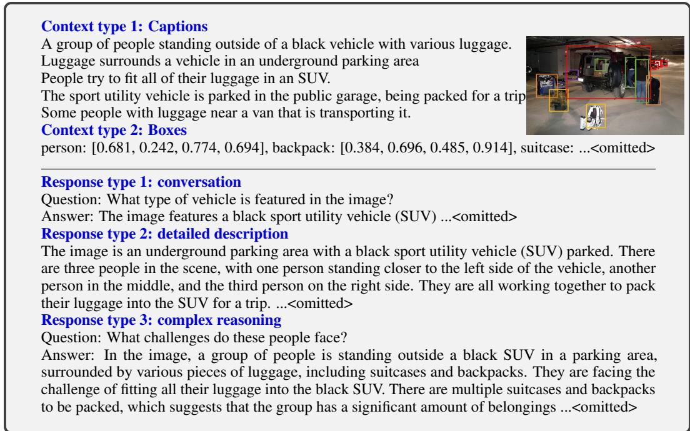
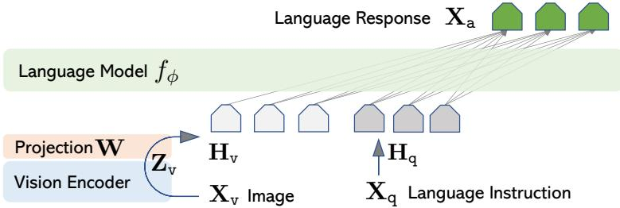
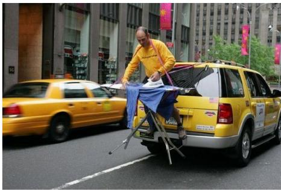
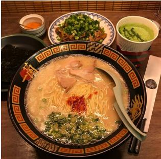
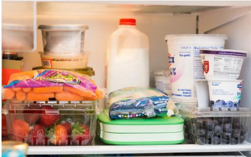
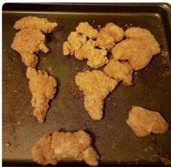
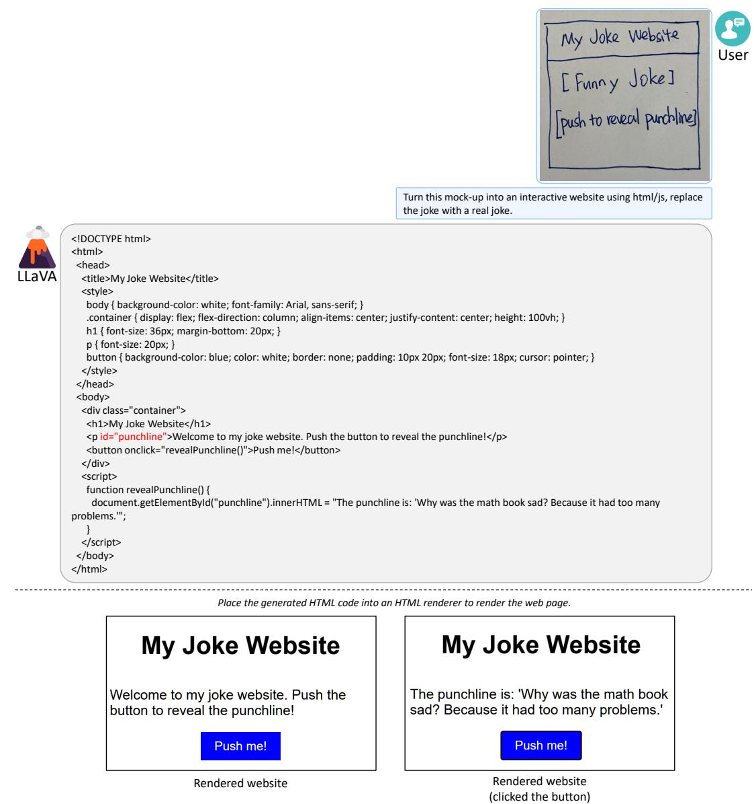
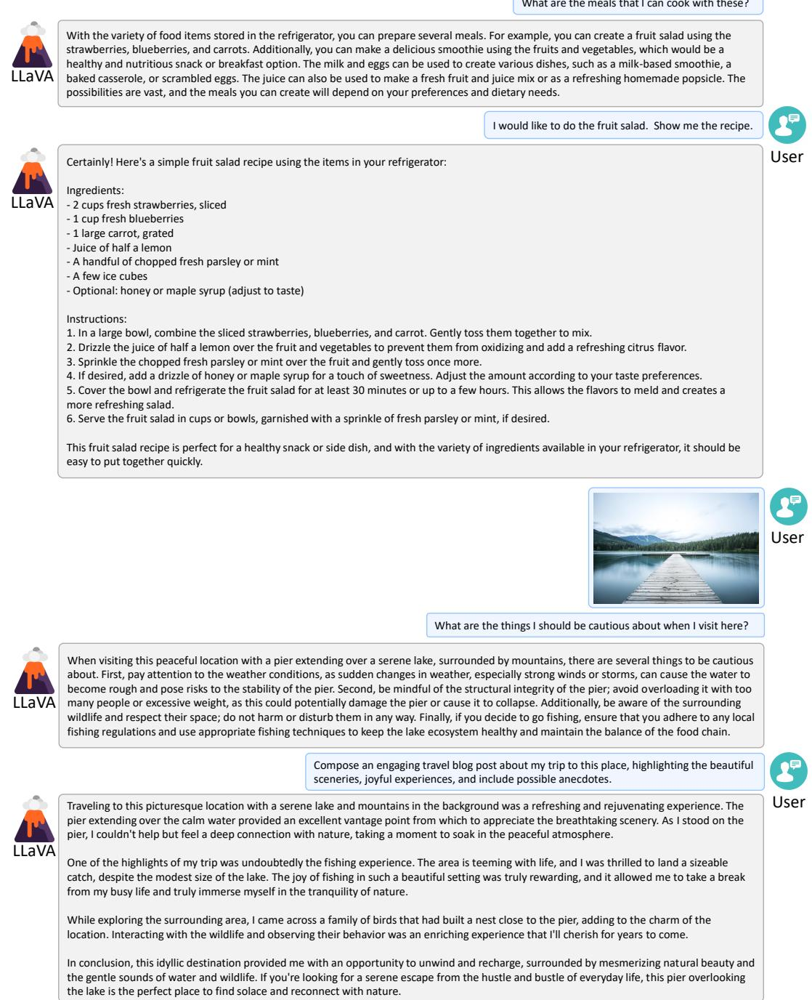
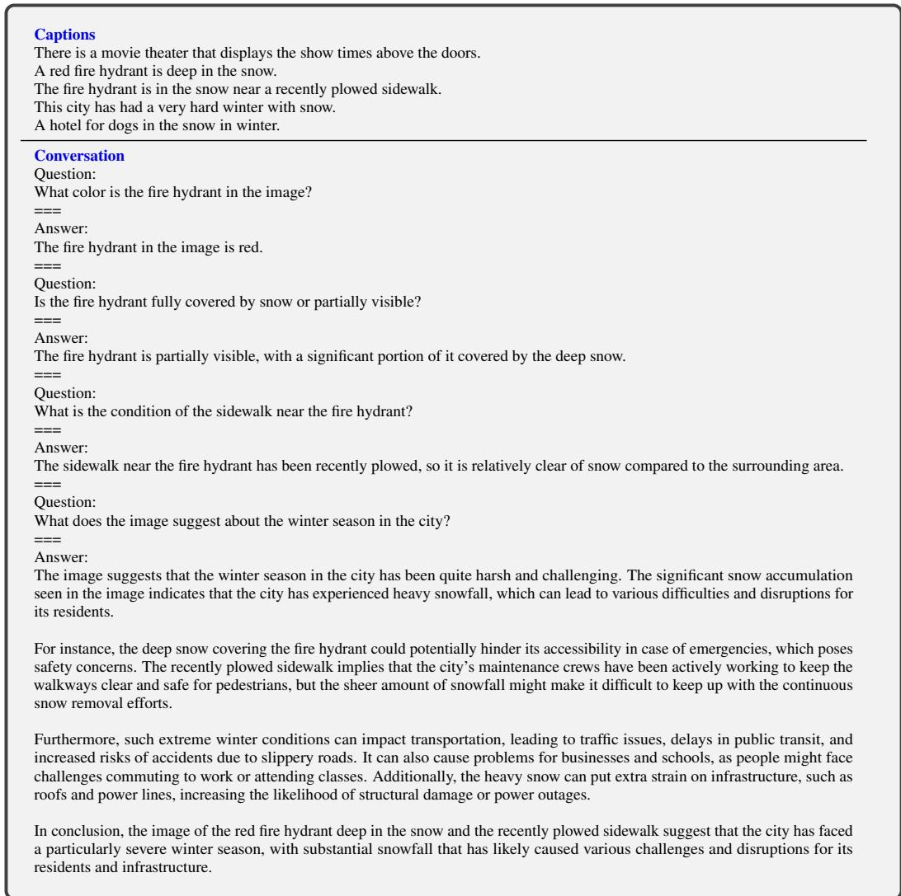

# 视觉指令微调 (Visual Instruction Tuning)

Haotian Liu<sup>1∗</sup>, Chunyuan Li<sup>2∗</sup>, Qingyang Wu<sup>3</sup>, Yong Jae Lee<sup>1</sup> <sup>1</sup>University of Wisconsin–Madison <sup>2</sup>Microsoft Research <sup>3</sup>Columbia University https://llava-vl.github.io

## 摘要

使用机器生成的指令遵循数据对大语言模型（LLMs）进行指令微调，已被证明能够提升在全新任务上的零样本能力，但这一思路在多模态领域尚未得到充分探索。我们首次尝试利用纯文本 GPT-4 来生成多模态语言-图像指令遵循数据。通过在这类生成的数据上进行指令微调，我们提出了 LLaVA：大型语言与视觉助手（Large Language and Vision Assistant），这是一个端到端训练的大型多模态模型，它将视觉编码器与 LLM 连接起来，用于通用的视觉和语言理解。为了促进未来对视觉指令遵循的研究，我们构建了两个具有多样化和挑战性、面向应用任务的评估基准。我们的实验表明，LLaVA 展现出了令人印象深刻的多模态对话能力，在未见过的图像/指令上有时会表现出多模态 GPT-4 的行为，并且在合成的多模态指令遵循数据集上，相比 GPT-4 取得了 85.1% 的相对得分。当在 Science QA 上进行微调时，LLaVA 与 GPT-4 的协同作用取得了 92.53% 的全新最先进（state-of-the-art）准确率。我们已将 GPT-4 生成的视觉指令微调数据、模型和代码公开发布。

## 1 引言

人类通过视觉和语言等多种渠道与世界进行交互，因为每个单独的渠道在表征和传达特定概念方面都具有独特的优势，从而有助于更好地理解世界。人工智能的核心愿景之一是开发一个通用助手，它能够有效地遵循多模态视觉和语言指令，并与人类意图对齐，以在开放的真实环境中完成各种实际任务 [4, 27, 26]。

为此，学术界对开发语言增强的基础视觉模型 [27, 16] 表现出了日益浓厚的兴趣，这些模型在开放世界视觉理解方面具有强大的能力，例如分类 [40, 21, 57, 54, 39]、检测 [29, 62, 33]、分割 [25, 63, 58] 和图像描述（captioning）[50, 28]，以及视觉生成和编辑 [42, 43, 56, 15, 44, 30]。我们建议读者参阅 Computer Vision in the Wild 阅读清单以获取更新的文献汇编 [12]。在这一系列工作中，每个任务都由单个大型视觉模型独立解决，任务指令隐含在模型设计中。此外，语言仅被用于描述图像内容。尽管这使得语言在将视觉信号映射到语言语义（人类交流的常见渠道）方面发挥了重要作用，但它导致模型通常具有固定的接口，与用户指令的交互性和适应性有限。

另一方面，大语言模型（LLM）表明语言可以发挥更广泛的作用：作为通用助手的通用接口，其中各种任务指令可以用语言显式表示，并引导端到端训练的神经助手切换到目标任务并予以解决。例如，ChatGPT [35] 和 GPT-4 [36] 最近的成功证明了对齐的 LLM 在遵循人类指令方面的强大能力，并激发了开发开源 LLM 的巨大兴趣。其中，LLaMA [49] 是一个性能可与 GPT-3 相媲美的开源 LLM。Alpaca [48]、Vicuna [9]、GPT-4-LLM [38] 利用各种机器生成的高质量指令遵循样本来提升 LLM 的对齐能力，与专有 LLM 相比表现出了令人瞩目的性能。重要的是，这一系列工作仅限于纯文本。

在本文中，我们提出了视觉指令微调（visual instruction-tuning），这是将指令微调扩展到语言-图像多模态空间的首次尝试，旨在为构建通用视觉助手铺平道路。具体而言，本文的主要贡献如下：

• 多模态指令遵循数据。一个关键挑战是缺乏视觉-语言指令遵循数据。我们提出了一种数据重构视角和流水线，利用 ChatGPT/GPT-4 将图像-文本对转换为适当的指令遵循格式。

• 大多模态模型。我们通过将 CLIP [40] 的开集视觉编码器与语言解码器 Vicuna [9] 相连接，并在我们生成的指令性视觉-语言数据上进行端到端微调，开发了一个大多模态模型（LMM）。我们的实证研究验证了使用生成数据进行 LMM 指令微调的有效性，并为构建通用的遵循指令的视觉智能体（visual agent）提供了实用建议。在与 GPT-4 集成时，我们的方法在 Science QA [34] 多模态推理数据集上取得了最先进的性能（SoTA）。

• 多模态指令遵循基准。我们提出了包含两个极具挑战性基准的 LLaVA-Bench，涵盖了多样化的图像、指令配对以及详尽的标注。

• 开源。我们向公众公开发布了以下资产：生成的多模态指令数据、代码库、模型权重（checkpoints）以及视觉对话演示（visual chat demo）。

## 2 相关工作

多模态指令遵循智能体。在计算机视觉领域，构建指令遵循智能体的现有工作大致可分为两类：(i) 端到端训练的模型，针对各个特定的研究课题分别展开探索。例如，视觉-语言导航任务 [3, 19] 和 Habitat [47] 要求具身智能（embodied AI）智能体遵循自然语言指令，并在视觉环境中执行一系列动作以完成目标。在图像编辑领域，给定输入图像和告知智能体操作要求的书面指令，InstructPix2Pix [6] 通过遵循人类指令来进行图像编辑。(ii) 通过 LangChain [1] / LLMs [35] 协调各种模型的系统，例如 Visual ChatGPT [53]、X-GPT [63]、MM-REACT [55]、VisProg [18] 和 ViperGPT [46]。尽管在构建指令遵循智能体方面具有相同的目标，我们则侧重于开发一种面向多种任务、端到端训练的语言-视觉多模态模型。

**指令微调**。在自然语言处理（NLP）领域，为了使 GPT-3 [7]、T5 [41]、PaLM [10] 和 OPT [60] 等大型语言模型（LLM）能够遵循自然语言指令并完成现实世界任务，研究人员探索了 LLM 指令微调方法 [37, 52, 51]，从而分别催生了对应经过指令微调的模型，如 InstructGPT [37]/ChatGPT [35]、FLAN-T5 [11]、FLAN-PaLM [11] 和 OPT-IML [22]。事实证明，这种简单的方法可以有效提高 LLM 的零样本和少样本泛化能力。因此，很自然地将这一思想从 NLP 借鉴到计算机视觉领域。更广泛地讲，基于基础模型的教师-学生蒸馏思想也已在图像分类等其他课题中得到了研究 [14]。鉴于 Flamingo [2] 在零样本任务迁移和上下文学习（in-context learning）方面的强大表现，它可以被视为多模态领域的“GPT-3 时刻”。在图像-文本对上训练的其他大型多模态模型（LMM）包括 BLIP-2 [28]、FROMAGe [24] 和 KOSMOS-1 [20]。PaLM-E [13] 是一个用于具身智能（embodied AI）的 LMM。基于近期“最佳”的开源 LLM LLaMA，OpenFlamingo [5] 和 LLaMA-Adapter [59] 是使 LLaMA 能够利用图像输入的开源工作，为构建开源多模态 LLM 铺平了道路。尽管这些模型展现出了具有前景的任务迁移泛化性能，但它们并没有使用视觉-语言指令数据进行显式微调，且它们在多模态任务中的表现通常逊色于纯语言任务。在本文中，我们旨在填补这一空白并研究其有效性。最后需要指出的是，视觉指令微调（visual instruction tuning）与视觉提示微调（visual prompt tuning）[23] 不同：前者旨在提高模型遵循指令的能力，而后者旨在提高模型适配中的参数效率。

## 3 GPT 辅助的视觉指令数据生成

学术界见证了公开多模态数据（如图像-文本对）数量的激增，涵盖了从 CC [8] 到 LAION [45] 的多种数据集。然而，在多模态指令遵循数据方面，可用数量却十分有限，部分原因是在考虑人工众包时，创建此类数据的过程非常耗时且定义不够明确。受近期 GPT 模型在文本标注任务中取得成功的启发 [17]，我们提出基于广泛存在的图像对数据，利用 ChatGPT/GPT-4 来收集多模态指令遵循数据。

  
Table 1: 用于说明指令遵循数据的一个示例。顶部区块展示了用于提示 GPT 的上下文（例如图像描述和边界框），底部区块展示了三种类型的响应。请注意，视觉图像并未用于提示 GPT，在此展示仅供参考。

对于图像 $\mathbf { X } _ { \mathbb { v } }$ 及其关联的描述文本 $\mathbf { X } _ { \mathsf { c } } ,$ 自然可以创建一组问题 $\mathbf { X } _ { \mathtt { q } }$，旨在指示助手描述图像内容。我们通过提示词引导 GPT-4 来整理出这样一份问题列表（详见附录）。因此，将图像-文本对扩展为其指令遵循（instruction-following）版本的一种简单方法是 Human : $\mathbf { X } _ { \mathfrak { q } } \mathbf { X } _ { \mathfrak { r } }$ <STOP> Assistant : $\mathbf { \bar { X } } _ { \mathbf { c } } .$ <STOP>。尽管构建成本低廉，但这种简单的扩展版本在指令和回答的多样性以及深度推理方面均有所欠缺。

为了缓解这个问题，我们利用仅处理语言的 GPT-4 或 ChatGPT 作为强教师模型（两者均仅接收文本作为输入），来创建涉及视觉内容的指令遵循数据。具体而言，为了将图像编码为其视觉特征以提示纯文本 GPT，我们使用了两种类型的符号表示：（i）描述文本（Caption）通常从不同视角描述视觉场景；（ii）边界框（Bounding box）通常对场景中的物体进行定位，每个边界框编码了物体概念及其空间位置。Table 14 顶部区域展示了一个示例。

这种符号表示使我们能够将图像编码为 LLM（大语言模型）可识别的序列。我们使用 COCO 图像 [31] 并生成三种类型的指令遵循数据。Table 14 底部区域展示了每种类型的一个示例。对于每种类型，我们首先手动设计几个示例。它们是我们在数据收集过程中仅有的人工标注数据，并作为上下文学习（in-context-learning）中的种子示例用于向 GPT-4 提问。

• 对话（Conversation）。我们设计了助手与询问有关该照片问题的人之间的对话。回答的语气就好像助手正看着图像并回答问题一样。围绕图像的视觉内容提出了丰富多样的问题，包括物体类型、物体计数、物体动作、物体位置以及物体之间的相对位置。只考虑具有明确答案的问题。详细提示词请参见附录。

• 详细描述（Detailed description）。为了让图像包含丰富而全面的描述，我们创建了一份具有此类意图的问题列表。我们提示 GPT-4 并对该列表进行了整理（详细提示词和整理流程见附录）。对于每张图像，我们从列表中随机抽取一个问题，要求 GPT-4 生成详细描述。

• 复杂推理（Complex reasoning）。上述两种类型侧重于视觉内容本身，在此基础上我们进一步创建了深度推理问题。这些回答通常需要遵循严格逻辑的逐步推理过程。

我们总共收集了 158K 个独特的图文指令遵循样本，分别包括 58K 个对话样本、23K 个详细描述样本和 77K 个复杂推理样本。我们在早期实验中对 ChatGPT 和 GPT-4 的使用进行了消融实验，发现 GPT-4 始终能够提供更高质量的指令遵循数据，例如空间推理。

## 4 视觉指令微调

## 4.1 架构

主要目标是有效利用预训练 LLM 和视觉模型的能力。网络架构如图 1 所示。我们选择由 $\phi$ 参数化的 Vicuna [9] 作为我们的 LLM $f _ { \phi } ( \cdot )$，因为在公开可用的模型权重中，它在语言任务上具有最佳的指令遵循能力 [48, 9, 38]。

  
Figure 1: LLaVA 网络架构。

对于输入图像 $\mathbf { X } _ { \mathbb { v } }$，我们采用预训练的 CLIP 视觉编码器 ViT-L/14 [40]，该编码器提供视觉特征 $\mathbf { Z } _ { \mathsf { v } } = g ( \mathbf { X } _ { \mathsf { v } } )$。在我们的实验中，考虑了最后一个 Transformer 层之前和之后的网格特征。我们考虑使用一个简单的线性层将图像特征连接到词嵌入空间。具体而言，我们应用一个可训练的投影矩阵 W 将 $\mathbf { Z } _ { \mathbf { \bar { v } } }$ 转换为语言嵌入 token $\mathbf { H } _ { \mathbf { v } }$，其维度与语言模型中的词嵌入空间相同：

$$
\mathbf {H} _ {\mathrm{v}} = \mathbf {W} \cdot \mathbf {Z} _ {\mathrm{v}}, \text {   with   } \mathbf {Z} _ {\mathrm{v}} = g (\mathbf {X} _ {\mathrm{v}})\tag{1}
$$

因此，我们获得了一个视觉 token 序列 $\mathbf { H } _ { \mathbb { v } }$。需要注意的是，我们简单的投影方案非常轻量，这使我们能够快速进行以数据为中心的实验迭代。也可以考虑采用更复杂的方案来连接图像和语言表征，例如 Flamingo [2] 中的门控交叉注意力机制（gated cross-attention）以及 BLIP-2 [28] 中的 Q-former。我们将探索可能更有效且更精细的 LLaVA 架构设计留作未来工作。

## 4.2 训练

对于每张图像 $\mathbf { X } _ { \mathtt { V } } .$，我们生成多轮对话数据 $( \mathbf { X _ { q } ^ { 1 } } , \mathbf { X _ { a } ^ { 1 } } , \cdots , \mathbf { X _ { q } ^ { \cal T } } , \mathbf { X _ { a } ^ { \cal T } } )$，其中 $T$ 为总轮数。我们将其组织为一个序列，将所有回答视为助手的响应，并将第 t 轮的指令 $\mathbf { X } _ { \mathrm { i n s t r u c t } } ^ { t ^ { - } }$ 处理为：

$$
\mathbf {X} _ {\text { instruct }} ^ {t} = \left\{ \begin{array}{l l} & \text { Randomly   choose } [ \mathbf {X} _ {\mathrm{q}} ^ {1}, \mathbf {X} _ {\mathrm{v}} ] \text { or } [ \mathbf {X} _ {\mathrm{v}}, \mathbf {X} _ {\mathrm{q}} ^ {1} ], \text { the   first   turn } t = 1 \\ & \mathbf {X} _ {\mathrm{q}} ^ {t}, \quad \text { the   remaining   turns } t > 1 \end{array} \right.\tag{2}
$$

这得出了 Table 2 所示的多模态指令遵循序列的统一格式。我们利用 LLM（大型语言模型）原有的自回归训练目标，在预测标记（tokens）上对其进行指令微调（instruction-tuning）。

具体而言，对于长度为 $L ,$ 的序列，我们通过下式计算目标回答 $\mathbf { X } _ { \mathsf { a } }$ 的概率：

$$
p (\mathbf {X} _ {\mathrm{a}} | \mathbf {X} _ {\mathrm{v}}, \mathbf {X} _ {\mathrm{instruct}}) = \prod_ {i = 1} ^ {L} p _ {\boldsymbol {\theta}} (\boldsymbol {x} _ {i} | \mathbf {X} _ {\mathrm{v}}, \mathbf {X} _ {\mathrm{instruct}, <   i}, \mathbf {X} _ {\mathrm{a}, <   i}),\tag{3}
$$

<div class="mineru-algorithm" style="white-space: pre-wrap; font-family:monospace;">
$X_{system-message} &lt; STOP&gt;$ 

Human :  $X_{instruct}^{1} &lt; STOP&gt;$  Assistant:  $X_{a}^{1} &lt; STOP&gt;$ 

Human :  $X_{instruct}^{2} &lt; STOP&gt;$  Assistant:  $X_{a}^{2} &lt; STOP&gt;$  …
</div>

Table 2: 用于训练模型的输入序列。此处仅展示了两个对话轮次；在实际情况中，轮次数会根据指令遵循数据而变化。在我们当前的实现中，我们遵循 Vicuna-v0 [9] 来设置系统消息 $\bf { X _ { s y s t e m - m e s s a g e } }$，并将 $\langle \mathsf { S T O P } \rangle = \# \# \#$。模型被训练用于预测助手的回答以及在何处停止，因此在自回归模型中仅使用绿色序列/标记来计算损失。

其中 $\theta$ 是可训练参数，$\mathbf { X } _ { \mathrm { i n s t r u c t } , < i }$ 和 $\mathbf { X } _ { \mathsf { a } , < i }$ 分别是当前预测标记 $x _ { i } ,$ 之前所有轮次中的指令和回答标记。有关预测标记的图示，请参见 Table 2。对于公式 (3) 中的条件项，我们显式添加了 $\mathbf { X } _ { \mathbb { v } }$ 以强调图像作为所有回答依据的事实，并且为了提高可读性，我们省略了 X<sub>system-message</sub> 以及所有先前的 <STOP>。对于 LLaVA 模型训练，我们考虑采用两阶段指令微调流程。

阶段 1：用于特征对齐的预训练。为了在概念覆盖率和训练效率之间取得平衡，我们将 CC3M 过滤至 595K 个图像-文本对。过滤过程的详细信息请参见附录。使用第 3 节中描述的简单扩展方法，将这些对转换为指令遵循数据。每个样本都可以视为一次单轮对话。为了构建 (2) 中的输入 $\mathbf { X } _ { \mathrm { i n s t r u c t } }$，对于图像 $\bar { \mathbf { X } } _ { \mathrm { v } } ,$ 会随机采样一个问题 $\mathbf { X } _ { \mathtt { q } }$，该问题是要求助手简要描述该图像的语言指令。真实标签预测答案 $\mathbf { X } _ { \mathsf { a } }$ 为原始说明文本。在训练中，我们保持视觉编码器（visual encoder）和 LLM 的权重均处于冻结状态，仅通过可训练参数 $\mathbf { \nabla } \theta = \mathbf { W }$（投影矩阵）最大化 (3) 的似然。通过这种方式，图像特征 H 可以与预训练 LLM 的词嵌入对齐。该阶段可以理解为为冻结的 LLM 训练一个兼容的视觉分词器（visual tokenizer）。

阶段 2：端到端微调。我们始终保持视觉编码器权重冻结，并继续更新 LLaVA 中投影层和 LLM 的预训练权重；即 (3) 中的可训练参数为 $\pmb { \theta } = \{ \mathbf { W } , \phi \}$。我们考虑了两种具体的应用场景：

• 多模态聊天机器人。我们通过在第 3 节中的 158K 语言-图像指令遵循数据上进行微调来开发一个聊天机器人。在这三种响应类型中，对话是多轮的，而另外两种是单轮的。它们在训练中被均匀采样。

• 科学问答（Science QA）。我们在 ScienceQA 基准 [34] 上研究了我们的方法，这是第一个使用详细讲解和解释标注答案的大规模多模态科学问题数据集。每个问题都以自然语言或图像的形式提供上下文。助手以自然语言提供推理过程，并在多项选择中选出答案。对于 (2) 中的训练，我们将数据组织为单轮对话，问题与上下文作为 $\mathbf { X } _ { \mathrm { i n s t r u c t } }$，推理与答案作为 $\mathbf { X } _ { \mathsf { a } }$。

## 5 实验

我们分别在两个主要的实验设置下评估 LLaVA 在指令遵循和视觉推理能力方面的表现：多模态聊天机器人和 ScienceQA 数据集。我们遵循 Vicuna 的超参数 [9]，使用 8× A100 训练所有模型。我们在过滤后的 CC-595K 子集上预训练模型 1 个 epoch，学习率为 2e-3，批大小（batch size）为 128；并在提出的 LLaVA-Instruct-158K 数据集上微调 3 个 epoch，学习率为 2e-5，批大小为 32。更多训练细节请参见附录。

## 5.1 多模态聊天机器人

我们开发了一个聊天机器人演示（chatbot demo），以展示 LLaVA 的图像理解和对话能力，并研究 LLaVA 理解视觉输入以及展现遵循指令能力的效果。我们首先使用原始 GPT-4 论文 [36] 中需要深入图像理解的示例，如表 3 所示（附录中提供了更多示例）。为了进行对比，我们引用了其论文中多模态 GPT-4 的提示词和回答，并查询了 BLIP-2 和 OpenFlamingo 模型检查点以获取它们的回答。

视觉输入示例，极限熨烫（Extreme Ironing）：

<table><tr><td colspan="2"></td></tr><tr><td>User</td><td>Source: https://www.barnorama.com/wp-content/uploads/2016/12/03-Confusing-Pictures.jpg</td></tr><tr><td>LLaVA</td><td>What is unusual about this image?这张图片不寻常的地方在于一名男子在一辆小型客货车或面包车的后部熨衣服。这不是进行该活动的典型场所，因为人们通常会在更固定、更安全的地方（如家里），使用常规熨衣板来熨衣服。图片中描绘的场景很奇特，因为它涉及到在车辆上临时搭建的熨烫设置，这既不安全也不合常规。此外，并不清楚该男子在如此不稳定的环境中熨衣服时是如何保持平衡和稳定的。[开始新对话，并清除历史记录]</td></tr><tr><td>User</td><td>场景中正在发生什么？</td></tr><tr><td>LLaVA</td><td>该图片描绘了一名男子站在繁忙城市街道上的一辆黄色 SUV 车顶上。他拿着一个便携式梯子，似乎站在车上熨衣服。场景周围有其他汽车、交通信号灯和一个消火栓。此外，附近还有另外两个人，一个靠近车上的男子，另一个在较远处。梯子上的男子似乎因其在移动的汽车上熨衣服的非常规举动而引起了注意。他周围的城市街道熙熙攘攘，增添了该场景的独特性。</td></tr><tr><td>User</td><td>这张图片有什么不寻常之处？</td></tr><tr><td>GPT-4 [36]</td><td>这张图片的不寻常之处在于一名男子正在固定于行驶中的出租车车顶的熨衣板上熨衣服。</td></tr><tr><td>User</td><td>这张图片有什么不寻常之处？</td></tr><tr><td>BLIP-2</td><td>一名男子坐在黄色出租车后部</td></tr><tr><td>User</td><td>这张图片有什么不寻常之处？</td></tr><tr><td>OpenFlamingo</td><td>这名男子正在车引擎盖上晾衣服。</td></tr></table>

Table 3：来自 GPT-4 论文 [36] 用于比较视觉推理和对话能力的示例提示词。与 BLIP-2 [28] 和 OpenFlamingo [5] 相比，LLaVA 能够准确遵循用户的指令，而不是简单地描述场景。LLaVA 提供了比 GPT-4 更全面的回答。即使仅仅被要求描述图像，LLaVA 也能识别出图像中的非典型特征。

令人惊讶的是，尽管 LLaVA 仅使用小规模的多模态指令遵循数据集（约 80K 张独立图像）进行训练，但它在这些示例上展现出了与多模态 GPT-4 非常相似的推理结果。需要注意的是，虽然这些图像对于 LLaVA 来说属于域外（out-of-domain）数据，但 LLaVA 仍然能够理解场景并遵循问题指令给出合理的回答。相比之下，BLIP-2 和 OpenFlamingo 侧重于描述图像，未能遵循用户指令以恰当的方式作答。

定量评估。为了系统地了解 LLaVA 的性能，我们提出了一种定量指标来衡量模型在多模态数据上的指令遵循能力。受 [9] 的启发，我们利用 GPT-4 来评估生成回答的质量。具体而言，我们构建了由图像、真实文本描述和问题组成的三元组。候选模型（例如 LLaVA）根据问题和图像预测答案。为了提供一个近似的理论上限，我们利用纯文本 GPT-4 基于问题和真实文本描述创建参考预测。在获取两个模型的回答后，我们将问题、视觉信息（以文本描述的形式）以及两个助手生成的回答输入给裁判（即纯文本 GPT-4）。它会评估助手回答的有用性、相关性、准确性和详细程度，并在 1 到 10 分的范围内给出总体评分，分数越高表示整体性能越好。它还会被要求为评估提供全面的解释，以便我们更好地理解模型。我们汇报了相对于使用文本真实描述作为视觉输入的纯文本 GPT-4 模型的相对得分。我们构建了两个基准来评估模型的性能。

<table><tr><td></td><td>对话</td><td>详细描述</td><td>复杂推理</td><td>全部</td></tr><tr><td>全量数据</td><td>83.1</td><td>75.3</td><td>96.5</td><td>85.1</td></tr><tr><td>详细 + 复杂</td><td>81.5 (-1.6)</td><td>73.3 (-2.0)</td><td>90.8 (-5.7)</td><td>81.9 (-3.2)</td></tr><tr><td>对话 + 5% 详细 + 10% 复杂</td><td>81.0 (-2.1)</td><td>68.4 (-7.1)</td><td>91.5 (-5.0)</td><td>80.5 (-4.4)</td></tr><tr><td>对话</td><td>76.5 (-6.6)</td><td>59.8 (-16.2)</td><td>84.9 (-12.4)</td><td>73.8 (-11.3)</td></tr><tr><td>无指令微调</td><td>22.0 (-61.1)</td><td>24.0 (-51.3)</td><td>18.5 (-78.0)</td><td>21.5 (-63.6)</td></tr></table>

Table 4：使用不同训练数据在 LLaVA-Bench (COCO) 上的消融实验。我们报告了相对于纯文本 GPT-4 模型（使用真实图像描述和边界框作为视觉输入）的相对得分。我们将模型输出的答案与 GPT-4（纯文本）的答案一起提供给 GPT-4，让其对比两种回答并给出评分及解释。

<table><tr><td></td><td>对话</td><td>详细描述</td><td>复杂推理</td><td>全部</td></tr><tr><td>OpenFlamingo [5]</td><td>19.3 ± 0.5</td><td>19.0 ± 0.5</td><td>19.1 ± 0.7</td><td>19.1 ± 0.4</td></tr><tr><td>BLIP-2 [28]</td><td>54.6 ± 1.4</td><td>29.1 ± 1.2</td><td>32.9 ± 0.7</td><td>38.1 ± 1.0</td></tr><tr><td>LLaVA</td><td>57.3 ± 1.9</td><td>52.5 ± 6.3</td><td>81.7 ± 1.8</td><td>67.3 ± 2.0</td></tr><tr><td> $LLaVA^†$ </td><td>58.8 ± 0.6</td><td>49.2 ± 0.8</td><td>81.4 ± 0.3</td><td>66.7 ± 0.3</td></tr></table>

Table 5：在 LLaVA-Bench (In-the-Wild) 上使用相对得分进行指令遵循能力的比较。结果以 $m e a n \pm s t d .$ 的格式报告。前三行报告了三次推理运行的结果。LLaVA 的表现明显优于其他模型。<sup>†</sup> 对于给定的 LLaVA 解码序列集合，我们通过查询 GPT-4 三次来进行评估；GPT-4 给出了高度一致的评估结果。

LLaVA-Bench (COCO)。我们从 COCO-Val-2014 中随机选择 30 张图像，并使用第 3 节中提出的数据生成流程，针对每张图像生成三类问题（对话、详细描述、复杂推理），共计 90 个问题。该基准测试在一致的视觉输入下研究模型的对齐行为和能力。我们改变训练数据集以研究不同类型指令遵循数据的有效性，并在 Table 4 中展示了结果。首先，通过指令微调，模型遵循用户指令的能力显著提升了 50 多分。其次，添加少量的详细描述和复杂推理问题使模型的综合能力大幅提升了 7 分。此外，它还提升了模型在对话问题上的表现，这表明推理能力的提升对对话能力起到了互补促进作用。最后，我们表明同时使用全部三类数据可以取得最佳性能，达到 85.1%。

LLaVA-Bench (In-the-Wild)。为了评估模型在更具挑战性的任务中的能力以及对新领域的泛化性，我们收集了一个包含 24 张图像和共计 60 个问题的多样化数据集，涵盖室内和室外场景、表情包（memes）、绘画、素描等，并为每张图像关联了高度详细且经人工精选的描述以及适当挑选的问题。我们在 Table 5 中对比了 LLaVA、BLIP 和 OpenFlamingo。得益于视觉指令微调（visual instruction tuning），LLaVA 相比于 BLIP-2（+29%）和 OpenFlamingo（+48%）取得了显著更优的性能。与能够访问真实标注（ground-truth labels）的纯文本 GPT-4 相比，LLaVA 在复杂推理问题上达到了令人瞩目的 81.7% 的相对性能，综合得分为 67.3%。

局限性（Limitations）。该 LLaVA-Bench (In-the-Wild) 旨在具有挑战性并揭示模型的弱点。我们在 Table 6 中提供了两个附带描述和问题的示例。对于拉面示例（左），要正确回答餐厅名称，需要模型具备广泛的知识覆盖面和多语言理解能力；要正确描述配菜，模型可能需要从互联网检索相关的多模态信息。对于冰箱示例（右），感知酸奶的正确品牌需要模型能够处理高分辨率图像并具备广泛的知识覆盖面。我们还观察到了 LLaVA 的一个有趣的错误案例：当被问及是否存在草莓味酸奶时，尽管冰箱里只有酸奶和草莓，它却回答“是”。这表明，LLaVA 有时会将图像感知为“图块包”（bag of patches），未能理解图像中复杂的语义关系。我们希望 LLaVA 能作为这些基准上的坚实基准线（baseline），我们的发现能为未来开发能力更强的 LMMs（大型多模态模型）带来启发。

来自 LLaVA-Bench (In-the-Wild) 的具有挑战性的示例：

<table><tr><td rowspan="2"></td><td></td><td></td></tr><tr><td>一兰拉面（ICHIRAN Ramen）[来源]</td><td>装满的冰箱 [来源]</td></tr><tr><td>标注</td><td>一张在 ICHIRAN 用餐的特写照片。中央摆放着一碗配有汤匙的叉烧拉面。拉面以辣椒酱、葱花调味，并配有两片叉烧。筷子放在碗的右侧，仍装在纸包装套内，尚未拆封。拉面左侧还配有海苔。上方从左至右摆放着以下配菜：一碗橙色调料（可能是蒜泥酱）、一盘撒有葱花的烟熏风味炖猪肉，以及一杯抹茶绿茶。</td><td>一个敞开的冰箱，里面装满了各种各样的食物。冷藏室左侧靠前的位置有一盒装在塑料盒中的草莓，上面放着一小袋小胡萝卜。靠后的位置叠放着几个酱料盒。冷藏室中间靠前的位置有一个绿色塑料盒，上面放着一个未识别的塑料袋。靠后的位置有一盒牛奶。冷藏室右侧靠前的位置有一盒蓝莓，上面叠放着三盒酸奶。大瓶酸奶是 Fage 无脂酸奶，较小杯的其中一杯是 Fage 蓝莓酸奶。另一小杯的品牌和口味未知。靠后的位置有一个内容物未知的容器。</td></tr><tr><td>问题 1</td><td>这家餐厅的名字是什么？</td><td>蓝莓味酸奶的品牌是什么？</td></tr><tr><td>问题 2</td><td>详细描述这张照片。</td><td>冰箱里有草莓味的酸奶吗？</td></tr></table>

Table 6: 来自 LLaVA-Bench (In-the-Wild) 的具有挑战性的示例，我们为每张图像提供了极其详细的标注以实现准确评估。某些问题要求模型从高分辨率图像中提取细节并具备广泛的知识覆盖面。

## 5.2 ScienceQA

ScienceQA [34] 包含 21k 道多模态选择题，涵盖 3 个学科、26 个主题、127 个类别和 379 项技能，具有丰富的领域多样性。该基准数据集被划分为训练集、验证集和测试集，分别包含 12726、4241 和 4241 个样本。我们考虑了两种具有代表性的方法，包括采用和未采用思维链（Chain-of-Thought, CoT）的 GPT-3.5 模型（text-davinci-002）、LLaMA-Adapter [59]，以及多模态思维链（Multimodal Chain-of-Thought, MM-CoT）[61]——它是该数据集上当前的 SoTA 方法。有关更多基线数据，请参见 [34]。

结果如 Table 7 所示。对于 LLaVA，我们使用最后一层之前的视觉特征，要求模型先预测理由然后再预测答案，并对其进行了 12 个 epoch 的训练。它取得了 90.92% 的准确率，与 SoTA 的 91.68% 非常接近。为了探索 LLMs 的极限，我们还使用 2-shot 上下文学习（in-context-learning）对 GPT-4 进行了提示，并获得了 82.69% 的准确率，相比于 GPT-3.5 的 75.17% 实现了 7.52% 的绝对增益。对于相当数量的问题，我们注意到 GPT-4 之所以失败，仅仅是因为它报告缺少上下文（例如图像或图表）。我们考虑了两种结合我们模型与 GPT-4 输出结果的方案。(i) GPT-4 互补（A GPT-4 complement）。每当 GPT-4 无法提供答案时，我们就使用我们方法的预测结果。该方案获得了 90.97% 的准确率，与单独应用我们的方法几乎相同。(ii) GPT-4 作为裁判（GPT-4 as the judge）。每当 GPT-4 和 LLaVA 产生不同的答案时，我们再次提示 GPT-4，要求它根据问题以及这两个结果给出自己的最终答案。其核心思想与 CoT（思维链，Chain-of-Thought）相似，但融合了来自另一个模型的外部知识。令人惊讶的是，该方案能够在所有问题类别上带来持续的提升，并达到了 92.53% 的全新 SoTA 准确率。有趣的是，纯文本的 GPT-4 虽然无法处理图像，但在以图像作为上下文的问题上却提升了模型的整体表现。这是因为其中一些问题实际上并不需要图像上下文即可得出正确答案。作为裁判的 GPT-4 能够识别出这些情况，并纠正 LLaVA 所犯的部分错误。参见 Appendix 中的示例。据我们所知，

<table><tr><td rowspan="2">方法</td><td colspan="3">学科</td><td colspan="3">上下文模态</td><td colspan="2">年级</td><td rowspan="2">平均</td></tr><tr><td>NAT</td><td>SOC</td><td>LAN</td><td>TXT</td><td>IMG</td><td>NO</td><td>G1-6</td><td>G7-12</td></tr><tr><td colspan="10">文献中报道数据的代表性及 SoTA 方法</td></tr><tr><td>人类 [34]</td><td>90.23</td><td>84.97</td><td>87.48</td><td>89.60</td><td>87.50</td><td>88.10</td><td>91.59</td><td>82.42</td><td>88.40</td></tr><tr><td>GPT-3.5 [34]</td><td>74.64</td><td>69.74</td><td>76.00</td><td>74.44</td><td>67.28</td><td>77.42</td><td>76.80</td><td>68.89</td><td>73.97</td></tr><tr><td>GPT-3.5 w/ CoT [34]</td><td>75.44</td><td>70.87</td><td>78.09</td><td>74.68</td><td>67.43</td><td>79.93</td><td>78.23</td><td>69.68</td><td>75.17</td></tr><tr><td>LLaMA-Adapter [59]</td><td>84.37</td><td>88.30</td><td>84.36</td><td>83.72</td><td>80.32</td><td>86.90</td><td>85.83</td><td>84.05</td><td>85.19</td></tr><tr><td>MM-CoT $_{Base}$  [61]</td><td>87.52</td><td>77.17</td><td>85.82</td><td>87.88</td><td>82.90</td><td>86.83</td><td>84.65</td><td>85.37</td><td>84.91</td></tr><tr><td>MM-CoT $_{Large}$  [61]</td><td>95.91</td><td>82.00</td><td>90.82</td><td>95.26</td><td>88.80</td><td>92.89</td><td>92.44</td><td>90.31</td><td>91.68</td></tr><tr><td colspan="10">我们自身实验运行的结果</td></tr><tr><td>GPT-4 $^{\dagger}$ </td><td>84.06</td><td>73.45</td><td>87.36</td><td>81.87</td><td>70.75</td><td>90.73</td><td>84.69</td><td>79.10</td><td>82.69</td></tr><tr><td>LLaVA</td><td>90.36</td><td>95.95</td><td>88.00</td><td>89.49</td><td>88.00</td><td>90.66</td><td>90.93</td><td>90.90</td><td>90.92</td></tr><tr><td>LLaVA+GPT-4 $^{\dagger}$ （互补）</td><td>90.36</td><td>95.50</td><td>88.55</td><td>89.05</td><td>87.80</td><td>91.08</td><td>92.22</td><td>88.73</td><td>90.97</td></tr><tr><td>LLaVA+GPT-4 $^{\dagger}$ （评判）</td><td>91.56</td><td>96.74</td><td>91.09</td><td>90.62</td><td>88.99</td><td>93.52</td><td>92.73</td><td>92.16</td><td>92.53</td></tr></table>

Table 7: Science QA 数据集上的准确率（%）。问题类别：NAT = 自然科学，SOC = 社会科学，LAN = 语言科学，TXT = 文本上下文，IMG = 图像上下文，NO = 无上下文，G1-6 = 1-6 年级，G7-12 = 7-12 年级。<sup>†</sup>仅文本的 GPT-4，我们的评测结果。我们提出的与仅文本 GPT-4 进行模型集成的新方法在所有类别下均持续提升了模型性能，创下了新的 SoTA 表现。  
这是首次将 GPT-4 用于模型集成。我们希望这一发现能够鼓励未来的研究探索更有效的方法，以利用 LLM 进行模型集成。

消融实验。我们在 Table 8 中对 ScienceQA 上的几种设计选择进行了消融研究。(i) 视觉特征（Visual features）。我们尝试使用来自 CLIP 视觉编码器最后一层的特征，得到了 89.96% 的准确率，比最后一层之前的特征低 0.96%。我们推测这是因为与前一层相比，CLIP 最后一层的特征可能更侧重于全局和抽象的图像属性，而前一层则可以更侧重于有助于理

<table><tr><td>视觉特征</td><td>最后一层前</td><td>最后一层</td></tr><tr><td>最佳变体</td><td>90.92</td><td>89.96 (-0.96)</td></tr><tr><td>先预测答案</td><td>-</td><td>89.77 (-1.15)</td></tr><tr><td>从头训练</td><td>85.81 (-5.11)</td><td>-</td></tr><tr><td>7B 模型大小</td><td>89.84 (-1.08)</td><td>-</td></tr></table>

Table 8: 设计选择消融实验（%）。与最佳变体的差异以红色文本标出。

解具体图像细节的局部属性。(ii) 思维链（Chain-of-thought）。为了确定模型预测中答案与推理过程的先后顺序，我们对这两种变体都进行了测试，观察到“先答案”策略在 12 个 epoch 内取得了 89.77% 的最高准确率，而“先推理”策略可以在 6 个 epoch 内快速达到 89.77% 的准确率，但在进一步训练后未见提升。将模型训练 24 个 epoch 并没有提升性能。我们得出结论，类 CoT 的“先推理”策略可以极大改善收敛速度，但对最终性能的贡献相对较小。(iii) 预训练（Pre-training）。我们跳过预训练阶段，直接在 ScienceQA 上从头训练——性能下降至 85.81% 的准确率。5.11% 的绝对降幅表明了我们预训练阶段的重要性，即在对齐多模态特征的同时保留了庞大的预训练知识。(iv) 模型大小（Model size）。我们保持所有配置与最佳的 13B 模型一致，训练了一个 7B 模型。其准确率为 89.84%，比 90.92% 低 1.08%，证明了模型规模的重要性。

## 6 结论

本文展示了视觉指令微调（visual instruction tuning）的有效性。我们提出了一个用于构建图文指令遵循数据的自动化流程，并以此训练了 LLaVA——一个能够遵循人类意图完成视觉任务的多模态模型。在 ScienceQA 上进行微调时，它取得了新的 SoTA 准确率；在多模态对话数据上微调时，展现了卓越的视觉对话能力。此外，我们提出了首个用于研究多模态指令遵循能力的基准。本文是视觉指令微调的初步探索，主要侧重于现实生活中的任务。有关 LLaVA 在学术基准上的更多定量结果，请参阅视觉指令微调的改进基线 [32]。我们希望我们的工作能够启发未来关于构建更强大能力多模态模型的研究。

致谢。我们感谢 Baolin Peng 和 Pan Lu 分别在语言模型指令微调（instruction-tuning）和 Science QA 方面进行的宝贵讨论。我们感谢 LLaMA 团队为我们提供其模型的使用权限，以及包括 Alpaca 和 Vicuna 在内的开源项目。本工作部分得到了 NSF CAREER IIS2150012 以及由韩国政府（MSIT）资助的信息与通信技术规划与评估研究所（IITP）基金的支持（编号 2022-0-00871，Development of AI Autonomy and Knowledge Enhancement for AI Agent Collaboration）和（编号 RS-2022-00187238，Development of Large Korean Language Model Technology for Efficient Pre-training）。

## 参考文献

[1] Langchain. https://github.com/hwchase17/langchain, 2022. 2

[2] Jean-Baptiste Alayrac, Jeff Donahue, Pauline Luc, Antoine Miech, Iain Barr, Yana Hasson, Karel Lenc, Arthur Mensch, Katie Millican, Malcolm Reynolds, et al. Flamingo: a visual language model for few-shot learning. arXiv preprint arXiv:2204.14198, 2022. 2, 4

[3] Peter Anderson, Qi Wu, Damien Teney, Jake Bruce, Mark Johnson, Niko Sünderhauf, Ian Reid, Stephen Gould, and Anton Van Den Hengel. Vision-and-language navigation: Interpreting visually-grounded navigation instructions in real environments. In Proceedings of the IEEE conference on computer vision and pattern recognition, 2018. 2

[4] Amanda Askell, Yuntao Bai, Anna Chen, Dawn Drain, Deep Ganguli, Tom Henighan, Andy Jones, Nicholas Joseph, Ben Mann, Nova DasSarma, et al. A general language assistant as a laboratory for alignment. arXiv preprint arXiv:2112.00861, 2021. 1

[5] Anas Awadalla, Irena Gao, Joshua Gardner, Jack Hessel, Yusuf Hanafy, Wanrong Zhu, Kalyani Marathe, Yonatan Bitton, Samir Gadre, Jenia Jitsev, Simon Kornblith, Pang Wei Koh, Gabriel Ilharco, Mitchell Wortsman, and Ludwig Schmidt. Openflamingo, March 2023. 2, 6, 7

[6] Tim Brooks, Aleksander Holynski, and Alexei A Efros. Instruct pix2pix: Learning to follow image editing instructions. arXiv preprint arXiv:2211.09800, 2022. 2

[7] Tom Brown, Benjamin Mann, Nick Ryder, Melanie Subbiah, Jared D Kaplan, Prafulla Dhariwal, Arvind Neelakantan, Pranav Shyam, Girish Sastry, Amanda Askell, et al. Language models are few-shot learners. Advances in neural information processing systems, 33:1877–1901, 2020. 2

[8] Soravit Changpinyo, Piyush Sharma, Nan Ding, and Radu Soricut. Conceptual 12m: Pushing web-scale image-text pre-training to recognize long-tail visual concepts. In CVPR, 2021. 2

[9] Wei-Lin Chiang, Zhuohan Li, Zi Lin, Ying Sheng, Zhanghao Wu, Hao Zhang, Lianmin Zheng, Siyuan Zhuang, Yonghao Zhuang, Joseph E. Gonzalez, Ion Stoica, and Eric P. Xing. Vicuna: An open-source chatbot impressing gpt-4 with 90%\* chatgpt quality, March 2023. 1, 2, 4, 5, 6

[10] Aakanksha Chowdhery, Sharan Narang, Jacob Devlin, Maarten Bosma, Gaurav Mishra, Adam Roberts, Paul Barham, Hyung Won Chung, Charles Sutton, Sebastian Gehrmann, et al. Palm: Scaling language modeling with pathways. arXiv preprint arXiv:2204.02311, 2022. 2

[11] Hyung Won Chung, Le Hou, Shayne Longpre, Barret Zoph, Yi Tay, William Fedus, Eric Li, Xuezhi Wang, Mostafa Dehghani, Siddhartha Brahma, et al. Scaling instruction-finetuned language models. arXiv preprint arXiv:2210.11416, 2022. 2

[12] CVinW. Computer vision in the wild. https://github.com/ Computer-Vision-in-the-Wild/CVinW\_Readings, 2022. 1

[13] Danny Driess, Fei Xia, Mehdi SM Sajjadi, Corey Lynch, Aakanksha Chowdhery, Brian Ichter, Ayzaan Wahid, Jonathan Tompson, Quan Vuong, Tianhe Yu, et al. PaLM-E: An embodied multimodal language model. arXiv preprint arXiv:2303.03378, 2023. 2

[14] Fartash Faghri, Hadi Pouransari, Sachin Mehta, Mehrdad Farajtabar, Ali Farhadi, Mohammad Rastegari, and Oncel Tuzel. Reinforce data, multiply impact: Improved model accuracy and robustness with dataset reinforcement. arXiv preprint arXiv:2303.08983, 2023. 2

[15] Oran Gafni, Adam Polyak, Oron Ashual, Shelly Sheynin, Devi Parikh, and Yaniv Taigman. Make-a-scene: Scene-based text-to-image generation with human priors. ArXiv, abs/2203.13131, 2022. 1

[16] Zhe Gan, Linjie Li, Chunyuan Li, Lijuan Wang, Zicheng Liu, Jianfeng Gao, et al. Visionlanguage pre-training: Basics, recent advances, and future trends. Foundations and Trends® in Computer Graphics and Vision, 2022. 1

[17] Fabrizio Gilardi, Meysam Alizadeh, and Maël Kubli. Chatgpt outperforms crowd-workers for text-annotation tasks. arXiv preprint arXiv:2303.15056, 2023. 3

[18] Tanmay Gupta and Aniruddha Kembhavi. Visual programming: Compositional visual reasoning without training. arXiv preprint arXiv:2211.11559, 2022. 2

[19] Weituo Hao, Chunyuan Li, Xiujun Li, Lawrence Carin, and Jianfeng Gao. Towards learning a generic agent for vision-and-language navigation via pre-training. In CVPR, 2020. 2

[20] Shaohan Huang, Li Dong, Wenhui Wang, Yaru Hao, Saksham Singhal, Shuming Ma, Tengchao Lv, Lei Cui, Owais Khan Mohammed, Qiang Liu, et al. Language is not all you need: Aligning perception with language models. arXiv preprint arXiv:2302.14045, 2023. 2

[21] Gabriel Ilharco, Mitchell Wortsman, Ross Wightman, Cade Gordon, Nicholas Carlini, Rohan Taori, Achal Dave, Vaishaal Shankar, Hongseok Namkoong, John Miller, Hannaneh Hajishirzi, Ali Farhadi, and Ludwig Schmidt. Openclip. July 2021. If you use this software, please cite it as below. 1

[22] Srinivasan Iyer, Xi Victoria Lin, Ramakanth Pasunuru, Todor Mihaylov, Dániel Simig, Ping Yu, Kurt Shuster, Tianlu Wang, Qing Liu, Punit Singh Koura, et al. Opt-iml: Scaling language model instruction meta learning through the lens of generalization. arXiv preprint arXiv:2212.12017, 2022. 2

[23] Menglin Jia, Luming Tang, Bor-Chun Chen, Claire Cardie, Serge Belongie, Bharath Hariharan, and Ser-Nam Lim. Visual prompt tuning. In ECCV, 2022. 2

[24] Jing Yu Koh, Ruslan Salakhutdinov, and Daniel Fried. Grounding language models to images for multimodal generation. arXiv preprint arXiv:2301.13823, 2023. 2

[25] Boyi Li, Kilian Q Weinberger, Serge Belongie, Vladlen Koltun, and René Ranftl. Languagedriven semantic segmentation. ICLR, 2022. 1

[26] Chunyuan Li, Zhe Gan, Zhengyuan Yang, Jianwei Yang, Linjie Li, Lijuan Wang, and Jianfeng Gao. Multimodal foundation models: From specialists to general-purpose assistants. arXiv preprint arXiv:2309.10020, 2023. 1

[27] Chunyuan Li, Haotian Liu, Liunian Harold Li, Pengchuan Zhang, Jyoti Aneja, Jianwei Yang, Ping Jin, Houdong Hu, Zicheng Liu, Yong Jae Lee, and Jianfeng Gao. ELEVATER: A benchmark and toolkit for evaluating language-augmented visual models. In NeurIPS Track on Datasets and Benchmarks, 2022. 1

[28] Junnan Li, Dongxu Li, Silvio Savarese, and Steven Hoi. Blip-2: Bootstrapping languageimage pre-training with frozen image encoders and large language models. arXiv preprint arXiv:2301.12597, 2023. 1, 2, 4, 6, 7

[29] Liunian Harold Li, Pengchuan Zhang, Haotian Zhang, Jianwei Yang, Chunyuan Li, Yiwu Zhong, Lijuan Wang, Lu Yuan, Lei Zhang, Jenq-Neng Hwang, et al. Grounded language-image pre-training. In CVPR, 2022. 1

[30] Yuheng Li, Haotian Liu, Qingyang Wu, Fangzhou Mu, Jianwei Yang, Jianfeng Gao, Chunyuan Li, and Yong Jae Lee. Gligen: Open-set grounded text-to-image generation. arXiv preprint arXiv:2301.07093, 2023. 1

[31] Tsung-Yi Lin, Michael Maire, Serge Belongie, James Hays, Pietro Perona, Deva Ramanan, Piotr Dollár, and C Lawrence Zitnick. Microsoft COCO: Common objects in context. In ECCV, 2014. 3

[32] Haotian Liu, Chunyuan Li, Yuheng Li, and Yong Jae Lee. Improved baselines with visual instruction tuning, 2023. 9, 14

[33] Shilong Liu, Zhaoyang Zeng, Tianhe Ren, Feng Li, Hao Zhang, Jie Yang, Chunyuan Li, Jianwei Yang, Hang Su, Jun Zhu, et al. Grounding dino: Marrying dino with grounded pre-training for open-set object detection. arXiv preprint arXiv:2303.05499, 2023. 1

[34] Pan Lu, Swaroop Mishra, Tanglin Xia, Liang Qiu, Kai-Wei Chang, Song-Chun Zhu, Oyvind Tafjord, Peter Clark, and Ashwin Kalyan. Learn to explain: Multimodal reasoning via thought chains for science question answering. Advances in Neural Information Processing Systems, 2022. 2, 5, 8, 9

[35] OpenAI. ChatGPT. https://openai.com/blog/chatgpt/, 2023. 1, 2

[36] OpenAI. Gpt-4 technical report, 2023. 1, 5, 6, 15

[37] Long Ouyang, Jeffrey Wu, Xu Jiang, Diogo Almeida, Carroll Wainwright, Pamela Mishkin, Chong Zhang, Sandhini Agarwal, Katarina Slama, Alex Ray, et al. Training language models to follow instructions with human feedback. Advances in Neural Information Processing Systems, 35:27730–27744, 2022. 2

[38] Baolin Peng, Chunyuan Li, Pengcheng He, Michel Galley, and Jianfeng Gao. Instruction tuning with GPT-4. arXiv preprint arXiv:2304.03277, 2023. 1, 4

[39] Hieu Pham, Zihang Dai, Golnaz Ghiasi, Kenji Kawaguchi, Hanxiao Liu, Adams Wei Yu, Jiahui Yu, Yi-Ting Chen, Minh-Thang Luong, Yonghui Wu, et al. Combined scaling for open-vocabulary image classification. arXiv preprint arXiv: 2111.10050, 2021. 1

[40] Alec Radford, Jong Wook Kim, Chris Hallacy, Aditya Ramesh, Gabriel Goh, Sandhini Agarwal, Girish Sastry, Amanda Askell, Pamela Mishkin, Jack Clark, et al. Learning transferable visual models from natural language supervision. arXiv preprint arXiv:2103.00020, 2021. 1, 2, 4

[41] Colin Raffel, Noam Shazeer, Adam Roberts, Katherine Lee, Sharan Narang, Michael Matena, Yanqi Zhou, Wei Li, and Peter J Liu. Exploring the limits of transfer learning with a unified text-to-text transformer. The Journal of Machine Learning Research, 2020. 2

[42] Aditya Ramesh, Prafulla Dhariwal, Alex Nichol, Casey Chu, and Mark Chen. Hierarchical text-conditional image generation with clip latents. ArXiv, abs/2204.06125, 2022. 1

[43] Robin Rombach, A. Blattmann, Dominik Lorenz, Patrick Esser, and Björn Ommer. Highresolution image synthesis with latent diffusion models. CVPR, pages 10674–10685, 2022. 1

[44] Chitwan Saharia, William Chan, Saurabh Saxena, Lala Li, Jay Whang, Emily L. Denton, Seyed Kamyar Seyed Ghasemipour, Burcu Karagol Ayan, Seyedeh Sara Mahdavi, Raphael Gontijo Lopes, Tim Salimans, Jonathan Ho, David J. Fleet, and Mohammad Norouzi. Photorealistic text-to-image diffusion models with deep language understanding. ArXiv, abs/2205.11487, 2022. 1

[45] Christoph Schuhmann, Romain Beaumont, Richard Vencu, Cade Gordon, Ross Wightman, Mehdi Cherti, Theo Coombes, Aarush Katta, Clayton Mullis, Mitchell Wortsman, et al. Laion-5b: An open large-scale dataset for training next generation image-text models. arXiv preprint arXiv:2210.08402, 2022. 2

[46] Dídac Surís, Sachit Menon, and Carl Vondrick. Vipergpt: Visual inference via python execution for reasoning. arXiv preprint arXiv:2303.08128, 2023. 2

[47] Andrew Szot, Alex Clegg, Eric Undersander, Erik Wijmans, Yili Zhao, John Turner, Noah Maestre, Mustafa Mukadam, Devendra Chaplot, Oleksandr Maksymets, Aaron Gokaslan, Vladimir Vondrus, Sameer Dharur, Franziska Meier, Wojciech Galuba, Angel Chang, Zsolt Kira, Vladlen Koltun, Jitendra Malik, Manolis Savva, and Dhruv Batra. Habitat 2.0: Training home assistants to rearrange their habitat. In Advances in Neural Information Processing Systems (NeurIPS), 2021. 2

[48] Rohan Taori, Ishaan Gulrajani, Tianyi Zhang, Yann Dubois, Xuechen Li, Carlos Guestrin, Percy Liang, and Tatsunori B. Hashimoto. Stanford alpaca: An instruction-following llama model. https://github.com/tatsu-lab/stanford\_alpaca, 2023. 1, 4

[49] Hugo Touvron, Thibaut Lavril, Gautier Izacard, Xavier Martinet, Marie-Anne Lachaux, Timothée Lacroix, Baptiste Rozière, Naman Goyal, Eric Hambro, Faisal Azhar, et al. Llama: Open and efficient foundation language models. arXiv preprint arXiv:2302.13971, 2023. 1

[50] Jianfeng Wang, Zhengyuan Yang, Xiaowei Hu, Linjie Li, Kevin Lin, Zhe Gan, Zicheng Liu, Ce Liu, and Lijuan Wang. Git: A generative image-to-text transformer for vision and language. arXiv preprint arXiv:2205.14100, 2022. 1

[51] Yizhong Wang, Yeganeh Kordi, Swaroop Mishra, Alisa Liu, Noah A Smith, Daniel Khashabi, and Hannaneh Hajishirzi. Self-instruct: Aligning language model with self generated instructions. arXiv preprint arXiv:2212.10560, 2022. 2

[52] Yizhong Wang, Swaroop Mishra, Pegah Alipoormolabashi, Yeganeh Kordi, Amirreza Mirzaei, Anjana Arunkumar, Arjun Ashok, Arut Selvan Dhanasekaran, Atharva Naik, David Stap, et al. Benchmarking generalization via in-context instructions on 1,600+ language tasks. arXiv preprint arXiv:2204.07705, 2022. 2

[53] Chenfei Wu, Shengming Yin, Weizhen Qi, Xiaodong Wang, Zecheng Tang, and Nan Duan. Visual chatgpt: Talking, drawing and editing with visual foundation models. arXiv preprint arXiv:2303.04671, 2023. 2

[54] Jianwei Yang, Chunyuan Li, Pengchuan Zhang, Bin Xiao, Lu Yuan, Ce Liu, and Jianfeng Gao. Unified contrastive learning in image-text-label space. CVPR, 2022. 1

[55] Zhengyuan Yang, Linjie Li, Jianfeng Wang, Kevin Lin, Ehsan Azarnasab, Faisal Ahmed, Zicheng Liu, Ce Liu, Michael Zeng, and Lijuan Wang. Mm-react: Prompting chatgpt for multimodal reasoning and action. arXiv preprint arXiv:2303.11381, 2023. 2

[56] Jiahui Yu, Yuanzhong Xu, Jing Yu Koh, Thang Luong, Gunjan Baid, Zirui Wang, Vijay Vasudevan, Alexander Ku, Yinfei Yang, Burcu Karagol Ayan, Benton C. Hutchinson, Wei Han, Zarana Parekh, Xin Li, Han Zhang, Jason Baldridge, and Yonghui Wu. Scaling autoregressive models for content-rich text-to-image generation. ArXiv, abs/2206.10789, 2022. 1

[57] Lu Yuan, Dongdong Chen, Yi-Ling Chen, Noel Codella, Xiyang Dai, Jianfeng Gao, Houdong Hu, Xuedong Huang, Boxin Li, Chunyuan Li, et al. Florence: A new foundation model for computer vision. arXiv preprint arXiv:2111.11432, 2021. 1

[58] Hao Zhang, Feng Li, Xueyan Zou, Shilong Liu, Chunyuan Li, Jianfeng Gao, Jianwei Yang, and Lei Zhang. A simple framework for open-vocabulary segmentation and detection. arXiv preprint arXiv:2303.08131, 2023. 1

[59] Renrui Zhang, Jiaming Han, Aojun Zhou, Xiangfei Hu, Shilin Yan, Pan Lu, Hongsheng Li, Peng Gao, and Yu Qiao. Llama-adapter: Efficient fine-tuning of language models with zero-init attention. arXiv preprint arXiv:2303.16199, 2023. 2, 8, 9

[60] Susan Zhang, Stephen Roller, Naman Goyal, Mikel Artetxe, Moya Chen, Shuohui Chen, Christopher Dewan, Mona Diab, Xian Li, Xi Victoria Lin, et al. OPT: Open pre-trained transformer language models. arXiv preprint arXiv:2205.01068, 2022. 2

[61] Zhuosheng Zhang, Aston Zhang, Mu Li, Hai Zhao, George Karypis, and Alex Smola. Multimodal chain-of-thought reasoning in language models. arXiv preprint arXiv:2302.00923, 2023. 8, 9

[62] Yiwu Zhong, Jianwei Yang, Pengchuan Zhang, Chunyuan Li, Noel Codella, Liunian Harold Li, Luowei Zhou, Xiyang Dai, Lu Yuan, Yin Li, et al. Regionclip: Region-based language-image pretraining. In Proceedings of the IEEE/CVF Conference on Computer Vision and Pattern Recognition, pages 16793–16803, 2022. 1

[63] Xueyan Zou, Zi-Yi Dou, Jianwei Yang, Zhe Gan, Linjie Li, Chunyuan Li, Xiyang Dai, Harkirat Behl, Jianfeng Wang, Lu Yuan, et al. Generalized decoding for pixel, image, and language. arXiv preprint arXiv:2212.11270, 2022. 1, 2

## A 更广泛的影响

LLaVA 作为通用视觉助手，其更广泛的影响涉及与其部署和发布相关的潜在收益与风险。由于其视觉特性，某些考量是 LLaVA 所独有的，而另一些考量则与现有的指令遵循大语言模型（LLM，例如 Alpaca、Vicuna 等）具有相似之处。由于 LLaVA 构建于 LLaMA、Vicuna 和 CLIP 之上，它继承了与大语言模型和视觉编码器相关的部分问题。在下文中，我们概述了该模型发布所涉及的风险以及现有的缓解策略。

恶意输入。为了最大限度地减少潜在的滥用和有害后果，我们针对 LLaVA 采取了两项预防措施：(1) 针对用户输入的文本使用 OpenAI Filter API，以防止有害或不当的文本指令被模型处理；(2) 针对用户上传的图像使用 NSFW Filter，以检测并拦截不宜在工作场所查看（NSFW）的内容或任何其他潜在有害的图像输入。

幻觉。与大语言模型类似，LLaVA 可能会生成脱离事实或输入数据的输出。这引发了对模型推断结果的担忧，尤其是在关键应用领域（例如医疗）。

偏见。偏见可能会从基础模型传递到 LLaVA，包括视觉编码器（CLIP）和语言解码器（LLaMA/Vicuna）。这可能导致产生有偏见的结果或对多元化内容的不公平表征。

能耗。尽管由于预训练数据集规模较小（详见 Sec. C），能耗并非 LLaVA 的主要问题，但在扩大预训练数据集规模或增加模型大小（例如扩展到像 65B 模型这样更大的 LLaMA 版本）时，能耗可能会成为一个需要关注的问题。

评估复杂性。评估 LLaVA 的性能极具挑战性，因为它同时涉及语言和视觉任务。我们的评估基准涵盖了多个方面，包括准确性、概念覆盖率、推理能力和创造力。然而，还有其他方面需要考虑，例如视觉内容幻觉的程度以及对视觉内容的细粒度理解。尽管基于纯文本 GPT-4 的多模态评估在我们的研究中表现出一贯性且准确，但其在不同情况下的鲁棒性以及评估其他未探索方面的能力仍是未来工作的课题。

尽管存在这些风险，我们相信将 LLaVA 发布给研究界的好处大于潜在的危害。它使得对该模型的持续研究和改进成为可能，并促使社区参与制定更好的缓解策略以解决这些问题。此外，LLaVA 的发布可以促进新应用和研究方向的发展，最终有助于视觉-语言任务中基础模型的进步和负责任部署。

## B 更多结果

我们展示了 LLaVA 的更多定性结果，以分析其涌现行为和观察到的弱点。关于 LLaVA 在学术基准上的更多定量结果，请参考带有视觉指令微调的改进基线 [32]。在 Table 9 中，LLaVA 在其论文中的另一个示例中展示了与 GPT-4 相似的行为。类似于 OpenAI 的 GPT-4 现场演示，尽管存在一个微小的错误，LLaVA 能够根据 Fig. 2 中简化的用户输入草图生成交互式笑话网站的 HTML/JS/CSS 代码。如 Fig. 3 所示，LLaVA 能够以对话风格遵循用户的指令，并提供详细的回复或创意写作。此外，如 Fig. 4 和 Fig. 5 所示，LLaVA 能够将视觉内容与来自预训练 LLM 的文本知识联系起来。

LLaVA 一个有趣的涌现行为是它能够理解训练中未涵盖的视觉内容。例如，在 Fig. 6 中，无论是在大头照中还是在他被打扮成柴犬（doge）的幽默梗图（meme）中，它都能够认出 Elon Musk，尽管 Elon Musk 从未出现在

LLaVA 视觉特征对齐或视觉指令微调阶段的训练数据中。LLaVA 在 Table 9 和 Fig. 2 中还展示了令人瞩目的 OCR（光学字符识别，optical character recognition）能力，而这在我们的训练数据中很少涵盖。

我们希望这些额外的结果和观察能够展示 LLaVA 在各个应用领域的潜力。在未来的工作中，更深入地研究这些涌现行为并理解促使 LLaVA 表现出这种泛化能力的潜在机制非常重要。这将为构建更好的大型多模态模型（LMM）铺平道路，包括增强鲁棒性、减少偏见，以及改善所学习到的视觉-语言表征的对齐和范围。

<table><tr><td colspan="2">视觉输入示例，炸鸡块地图：</td></tr><tr><td rowspan="2"></td><td>有时候我看着从太空拍摄的地球照片，惊叹于这一切是多么美丽。</td></tr><tr><td></td></tr><tr><td>用户 LLaVA</td><td>你能详细解释一下这个梗图吗？图中的梗图是对食物的一种富有创意且幽默的表达，将炸鸡块作为宇宙的中心。该梗图以一句话开头：“有时候我看着从太空拍摄的地球照片，惊叹于这一切是多么美丽……”主要图像展示了一盘炸好的鸡块，这些鸡块摆放的位置与世界地图上的大洲和岛屿相似。该梗图开玩笑地暗示炸鸡块代表地球，照片中描绘的各个位置实际上是不同地方的炸鸡块版本。该梗图的点睛之笔出现在底部较小的文字中，写着“我的意思是，这不是真正的地球，但这一切是多么美丽啊。”这个轻松有趣的梗图结合了美食与幽默，利用炸鸡块的图像创造出一种滑稽而富有想象力的世界呈现方式。</td></tr><tr><td>用户 GPT-4 [36]</td><td>你能解释一下这个梗图吗？这个梗图是一个将两件不相关的事物结合在一起的笑话：从太空拍摄的地球照片和炸鸡块。梗图中的文字表明下面的图片是从太空拍摄的美丽地球照片。然而，这张图片实际上是摆放得隐约像世界地图的炸鸡块。这个梗图的幽默来自于文字与图像意想不到的并置。文字建立起对地球宏伟形象的期待，但图像实际上却是一些平淡无奇且愚蠢滑稽的东西。</td></tr><tr><td>用户 BLIP-2</td><td>你能详细解释一下这个梗图吗？有时候我看着从太空拍摄的地球照片，惊叹于它是多么美丽</td></tr><tr><td>用户 OpenFlamingo</td><td>你能详细解释一下这个梗图吗？这是一张国际空间站上炸鸡块的照片。</td></tr></table>

Table 9: 比较 LLaVA、GPT-4、BLIP-2 和 OpenFlamingo 在理解幽默方面的视觉推理能力的提示词示例。BLIP-2 和 OpenFlamingo 未能遵循用户的指令。LLaVA 和 GPT-4 都解释了该梗图及其幽默之处，而 GPT-4 的回答更为简洁。

  
Figure 2: LLaVA 根据用户输入的草图生成用于交互式网站的 HTML/JS 代码。在修复生成输出中的一个微小错误（红色标出）后，该交互界面即可正常运行。LLaVA 的输出仍有改进空间，例如将笑话铺垫与笑点拆分成两行，并且仅在点击按钮时才显示笑点，以更好地契合用户的意图。

  
Figure 3: LLaVA 能够根据用户的意图识别视觉内容，而无需直接提示进行视觉识别。当被要求提供后续回复时，它还能给出详细的回答，且生成的回复与所提供的视觉内容密切相关。

  
Figure 4: LLaVA 将电影场景与来自预训练 LLM 的文本知识联系起来。

  
Figure 5: LLaVA 能够识别列奥纳多·达·芬奇（Leonardo da Vinci）的名作《蒙娜丽莎》（Mona Lisa）。当我们开启新对话时，它还能解释网络上模仿《蒙娜丽莎》创作的幽默艺术作品。


Figure 6: LLaVA 的一个有趣的涌现行为是它既能识别肖像照中的埃隆·马斯克（Elon Musk），也能识别他在扮成 doge 的幽默表情包（meme）中的形象。这表明预训练的 CLIP 视觉编码器可能见过埃隆·马斯克的图像。然而，这仍然令人惊讶，因为埃隆·马斯克从未出现在 LLaVA 的视觉特征对齐或视觉指令微调阶段的训练数据中，这表明基础语言模型能够泛化到未见过的视觉概念。  
  
Table 10: 纯文本 GPT-4 作为裁判集成来自 LLaVA 和纯文本 GPT-4 的预测并给出正确最终答案的一个示例。

## C 训练细节

我们在过滤后的 CC-595K 子集上对模型进行 1 个 epoch 的预训练，学习率为 2e-3，批大小（batch size）为 128；并在提出的 LLaVA-Instruct-158K 数据集上微调 3 个 epoch，学习率为 2e-5，批大小为 32。参考 Vicuna，我们使用不带权重衰减（weight decay）的 Adam 优化器，以及预热比例（warmup ratio）为 3% 的余弦学习率调度。在微调过程中，使用 FSDP（全分片数据并行，Full Shard Data Parallel）和梯度检查点（gradient checkpointing）来节省 GPU 显存，且未使用卸载（offloading）。启用 BF16 和 TF32 以实现速度与精度之间的平衡。

我们使用 8× A100 训练所有模型。在 CC-595K 上的预训练在 4 小时内完成。在 Instruct-158K 上的微调在 10 小时内完成。在 ScienceQA 上的微调在 4 小时内完成。

## D 资产

我们的源代码、生成的指令微调数据以及提出的基准已上传至匿名 GitHub 仓库：LLaVA-Annonymous/LLaVA。

1. 源代码：link

2. README：link

3. 启动 Demo 的说明：link

4. 用于查询 GPT-4 的所有 prompt 和 few-shot 示例：link

5. LLaVA-Instruct-158K：link

6. LLaVA-Bench：COCO, In-The-Wild

7. 模型检查点（Model checkpoints）。压缩后的模型检查点大小为 25GB，超过了 GitHub LFS（Large File Storage）5GB 的限制。我们将向公众公开发布该检查点，或在本次投稿的审稿人提出要求时提供。

## E 数据

简要图像描述的指令。用于简要描述图像内容的指令列表如 Table 11 所示。它们以自然语言的多样性表达了相同的含义。

  
Table 11: 简要图像描述的指令列表。

详细图像描述的指令。用于详细描述图像内容的指令列表如 Table 12 所示。它们以自然语言的多样性表达了相同的含义。

CC3M。我们使用 Spacy 提取整个 CC3M 数据集中每个标注的名词短语，并统计每个唯一名词短语的频次。我们跳过了频次小于 3 的名词短语，因为它们通常是已被其他标注覆盖的罕见概念和属性组合。然后，我们从剩余频次最低的名词短语开始，将包含该名词短语的标注添加到候选池中。如果该名词短语的频次大于 100，我们从其所有标注中随机选择一个大小为 100 的子集。这最终产生了约 595K 个图像-文本对。

  
Table 12: 详细图像描述的指令列表。

过滤 CC3M 前后名词短语统计数据的对比见 Figure 7。过滤后的数据集对频次高于 3 的概念展现了良好的覆盖度，同时图像-文本对的数量更少。

  
Figure 7: 过滤 CC3M 前后名词短语统计数据的对比。图例中报告了唯一名词短语的总数。

## F 提示词

用于从 ChatGPT/GPT-4 生成基于图像的对话的提示词如 Table 13 所示。

```python
messages = [ { "role": "system", "content": f"""You are an AI visual assistant, and you are seeing a single image. What you see are provided with five sentences, describing the same image you are looking at. Answer all questions as you are seeing the image.

Design a conversation between you and a person asking about this photo. The answers should be in a tone that a visual AI assistant is seeing the image and answering the question. Ask diverse questions and give corresponding answers.

Include questions asking about the visual content of the image, including the object types, counting the objects, object actions, object locations, relative positions between objects, etc. Only include questions that have definite answers:
(1) one can see the content in the image that the question asks about and can answer confidently;
(2) one can determine confidently from the image that it is not in the image. Do not ask any question that cannot be answered confidently.

Also include complex questions that are relevant to the content in the image, for example, asking about background knowledge of the objects in the image, asking to discuss about events happening in the image, etc. Again, do not ask about uncertain details. Provide detailed answers when answering complex questions. For example, give detailed examples or reasoning steps to make the content more convincing and well-organized. You can include multiple paragraphs if necessary."""
]
for sample in fewshot_samples:
    messages.append({ "role": "user", "content": sample['context']})
    messages.append({ "role": "assistant", "content": sample['response'] })
messages.append({ "role": "user", "content": '\n'.join(query)})
```  
Table 13: 对于每个查询，我们展示了使用少样本上下文学习（few-shot in-context-learning）让 ChatGPT/GPT-4 从 query[‘context’] 收集 query[‘response’] 的提示词构建过程，其中示例来自 fewshot\_samples，每个示例包括输入 sample[‘context’] 和输出 sample[‘response’]。请注意，messages 是最终的提示词。在本例中，我们提供了用于生成对话回复的提示词，详情亦请参见 Table 15 和 Table 16 中的上下文学习示例。我们建议读者查看代码库以获取用于生成另外两种类型回复（包括详细描述和复杂推理）的提示词。

  
Table 14: 说明遵循指令数据的一个示例。顶部区块展示了用于提示 GPT 的上下文（如图像描述和边界框），底部区块展示了三种类型的回复。请注意，视觉图像并未用于提示 GPT，在此展示仅供参考。

  
Table 15: 在上下文学习（in-context-learning）中用于构建视觉对话数据的一个示例。

  
Table 16: 在上下文学习（in-context-learning）中用于构建视觉对话数据的一个示例。