# 去噪扩散概率模型

Jonathan Ho UC Berkeley jonathanho@berkeley.edu

Ajay Jain UC Berkeley ajayj@berkeley.edu

Pieter Abbeel UC Berkeley pabbeel@cs.berkeley.edu

## 摘要

我们使用扩散概率模型（diffusion probabilistic models，一类受非平衡热力学启发的潜变量模型）得到了高质量的图像合成结果。我们的最佳结果通过对一个加权变分界进行训练而获得，该加权变分界依据扩散概率模型与朗之万动力学（Langevin dynamics）下的去噪分数匹配（denoising score matching）之间一种全新的联系而设计，并且我们的模型天然具备一种渐进式有损解压缩方案，可被解释为自回归解码的推广。在无条件 CIFAR10 数据集上，我们取得了 9.46 的 Inception 分数（Inception Score）和 3.17 的当前最优 FID 分数（FID Score）。在 256x256 的 LSUN 数据集上，我们得到的样本质量与 ProgressiveGAN 相当。我们的代码已开源，地址为 https://github.com/hojonathanho/diffusion。

## 1 引言

近年来，各类深度生成模型已在多种数据模态上展现出了高质量的样本生成能力。生成对抗网络（Generative Adversarial Networks, GANs）、自回归模型、流模型以及变分自编码器（Variational Autoencoders, VAEs）已经合成了令人瞩目的图像和音频样本 [14, 27, 3, 58, 38, 25, 10, 32, 44, 57, 26, 33, 45]，与此同时，能量建模与分数匹配方面也取得了显著进展，所生成的图像已可与 GANs 相媲美 [11, 55]。

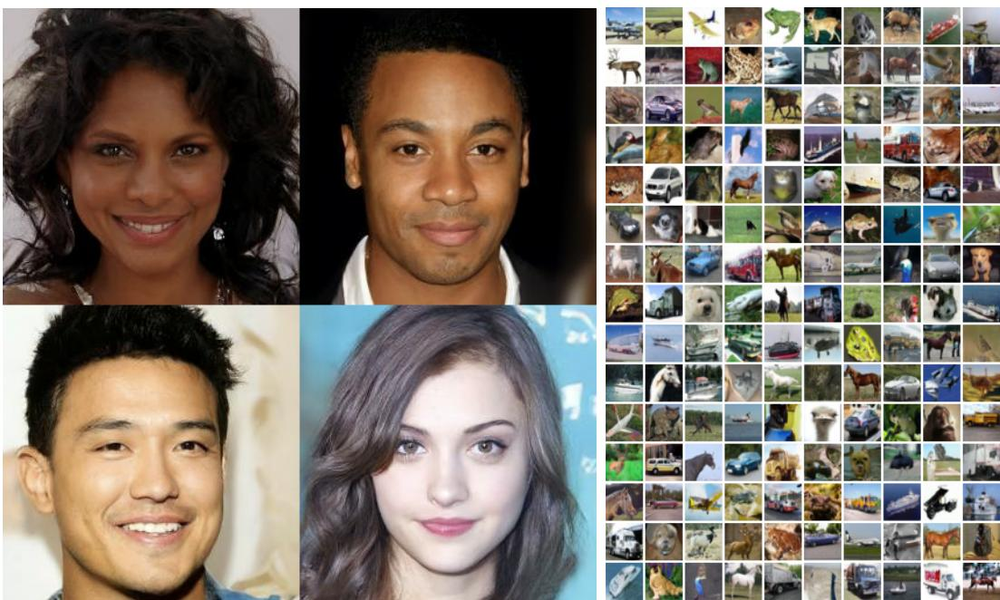  

图 1：在 CelebA-HQ 256 × 256（左）和无条件 CIFAR10（右）上生成的样本

第 34 届神经信息处理系统大会（NeurIPS 2020），加拿大温哥华。

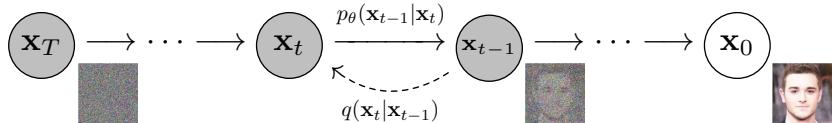  

图 2：本研究采用的有向图模型（directed graphical model）。

本文介绍了在扩散概率模型（Diffusion Probabilistic Models）[53]方面的研究进展。扩散概率模型（为简洁起见，我们称之为「扩散模型」（Diffusion Model））是一个参数化的马尔可夫链，使用变分推断进行训练，以在有限时间后产生与数据匹配的样本。该链的转移过程通过学习来逆转一个扩散过程——扩散过程是一个马尔可夫链，它以与采样相反的方向逐渐向数据添加噪声，直至信号被破坏。当扩散过程由少量高斯噪声构成时，只需将采样链的转移也设为条件高斯分布即可，从而允许使用一种特别简单的神经网络参数化方法。

扩散模型的定义直观且训练高效，但据我们所知，目前还没有证明它们能够生成高质量的样本。我们表明扩散模型实际上能够生成高质量的样本，其质量有时甚至优于其他类型生成模型上已发表的结果（第 4 节）。此外，我们还表明扩散模型的某种参数化揭示了其在训练期间与多噪声水平下的去噪分数匹配（Denoising Score Matching）以及在采样期间与退火朗之万动力学（Annealed Langevin Dynamics）的等价性（第 3.2 节）[55, 61]。我们使用这种参数化获得了最佳的样本质量结果（第 4.2 节），因此我们认为这一等价关系是我们的主要贡献之一。

尽管样本质量不错，但与其他基于似然的模型相比，我们的模型在对数似然方面并不具有竞争力（然而，我们的模型在对数似然方面优于已报道的退火重要性采样对基于能量的模型和分数匹配所产生的大估计值 [11, 55]）。我们发现模型的无损码长绝大部分被用于描述难以察觉的图像细节（第 4.3 节）。我们以有损压缩的语言对该现象进行了更精细的分析，并表明扩散模型的采样过程是一种渐进式解码，它沿某种比特排序进行类自回归解码，而这种比特排序极大地推广了自回归模型通常所能实现的内容。

## 2 背景

扩散模型 [53] 是形如 $\begin{array} { r } { p _ { \theta } ( \mathbf { x } _ { 0 } ) : = \int p _ { \theta } ( \mathbf { x } _ { 0 : T } ) d \mathbf { x } _ { 1 : T } } \end{array}$ 的潜变量模型，其中 $\mathbf { x } _ { 1 } , \ldots , \mathbf { x } _ { T }$ 是与数据 $\mathbf { x } _ { 0 } \sim q ( \mathbf { x } _ { 0 } )$ 具有相同维度的潜变量。联合分布 $p _ { \theta } ( \mathbf { x } _ { 0 : T } )$ 被称为反向过程（reverse process），它被定义为一个具有学习得到的高斯转移的马尔可夫链，从 $p ( \mathbf { x } _ { T } ) = \mathcal { N } ( \mathbf { x } _ { T } ; \mathbf { 0 } , \mathbf { I } )$ 开始。

$$
p _ {\theta} (\mathbf {x} _ {0: T}) := p (\mathbf {x} _ {T}) \prod_ {t = 1} ^ {T} p _ {\theta} (\mathbf {x} _ {t - 1} | \mathbf {x} _ {t}), \qquad p _ {\theta} (\mathbf {x} _ {t - 1} | \mathbf {x} _ {t}) := \mathcal {N} (\mathbf {x} _ {t - 1}; \boldsymbol {\mu} _ {\theta} (\mathbf {x} _ {t}, t), \boldsymbol {\Sigma} _ {\theta} (\mathbf {x} _ {t}, t))\tag{1}
$$

扩散模型与其他类型的潜变量模型的区别在于，其近似后验 $q \big ( \mathbf { x } _ { 1 : T } | \mathbf { x } _ { 0 } \big )$（称为前向过程或扩散过程）被固定为一个马尔可夫链，该马尔可夫链按照方差调度 $\beta _ { 1 } , \dots , \beta _ { T }$ 逐步向数据添加高斯噪声：

$$
q (\mathbf {x} _ {1: T} | \mathbf {x} _ {0}) := \prod_ {t = 1} ^ {T} q (\mathbf {x} _ {t} | \mathbf {x} _ {t - 1}), \qquad q (\mathbf {x} _ {t} | \mathbf {x} _ {t - 1}) := \mathcal {N} (\mathbf {x} _ {t}; \sqrt {1 - \beta_ {t}} \mathbf {x} _ {t - 1}, \beta_ {t} \mathbf {I})\tag{2}
$$

训练通过优化负对数似然上的常用变分下界来完成：

$$
\mathbb {E} \left[ - \log p _ {\theta} (\mathbf {x} _ {0}) \right] \leq \mathbb {E} _ {q} \left[ - \log \frac {p _ {\theta} (\mathbf {x} _ {0 : T})}{q (\mathbf {x} _ {1 : T} | \mathbf {x} _ {0})} \right] = \mathbb {E} _ {q} \left[ - \log p (\mathbf {x} _ {T}) - \sum_ {t > 1} \log \frac {p _ {\theta} (\mathbf {x} _ {t - 1} | \mathbf {x} _ {t})}{q (\mathbf {x} _ {t} | \mathbf {x} _ {t - 1})} \right] =: L\tag{3}
$$

前向过程方差 $\beta_t$ 可以通过重参数化（reparameterization）[33] 进行学习，也可以作为超参数保持不变；而反向过程的表达能力部分得益于 $p_\theta(\mathbf{x}_{t-1}|\mathbf{x}_t)$ 中高斯条件分布的选择——因为当 $\beta_t$ 较小时，两个过程具有相同的函数形式 [53]。前向过程的一个显著性质是它允许以闭式（closed form）方式对任意时刻 $t$ 采样 $\mathbf{x}_t$：采用记号 $\alpha_t := 1 - \beta_t$ 以及 $\bar{\alpha}_t := \prod_{s=1}^{t} \alpha_s$，可得

$$
q (\mathbf {x} _ {t} | \mathbf {x} _ {0}) = \mathcal {N} (\mathbf {x} _ {t}; \sqrt {\bar {\alpha} _ {t}} \mathbf {x} _ {0}, (1 - \bar {\alpha} _ {t}) \mathbf {I})\tag{4}
$$

因此，通过随机梯度下降优化 $L$ 的随机项即可实现高效训练。通过将 $L \left( 3 \right)$ 改写为如下形式，可借助方差缩减进一步提升性能：

$$
\mathbb {E} _ {q} \bigg [ \underbrace {D _ {\mathrm{KL}} (q (\mathbf {x} _ {T} | \mathbf {x} _ {0}) \parallel p (\mathbf {x} _ {T}))} _ {L _ {T}} + \sum_ {t > 1} \underbrace {D _ {\mathrm{KL}} (q (\mathbf {x} _ {t - 1} | \mathbf {x} _ {t} , \mathbf {x} _ {0}) \parallel p _ {\theta} (\mathbf {x} _ {t - 1} | \mathbf {x} _ {t}))} _ {L _ {t - 1}} \underbrace {- \log p _ {\theta} (\mathbf {x} _ {0} | \mathbf {x} _ {1})} _ {L _ {0}} \bigg ]\tag{5}
$$

（详见附录 A。各项的标签将在第 3 节中使用。）公式 (5) 使用 KL 散度（KL divergence）将 $p _ { \theta } ( \mathbf { x } _ { t - 1 } | \mathbf { x } _ { t } )$ 与前向过程的后验直接进行比较，当以 x 为条件时，这些后验是可计算的：

$$
q (\mathbf {x} _ {t - 1} | \mathbf {x} _ {t}, \mathbf {x} _ {0}) = \mathcal {N} (\mathbf {x} _ {t - 1}; \tilde {\pmb {\mu}} _ {t} (\mathbf {x} _ {t}, \mathbf {x} _ {0}), \tilde {\beta} _ {t} \mathbf {I}),\tag{6}
$$

$$
\text { where } \quad \tilde {\boldsymbol {\mu}} _ {t} (\mathbf {x} _ {t}, \mathbf {x} _ {0}) := \frac {\sqrt {\bar {\alpha} _ {t - 1}} \beta_ {t}}{1 - \bar {\alpha} _ {t}} \mathbf {x} _ {0} + \frac {\sqrt {\alpha_ {t} (1 - \bar {\alpha} _ {t - 1})}}{1 - \bar {\alpha} _ {t}} \mathbf {x} _ {t} \quad \text { and } \quad \tilde {\beta} _ {t} := \frac {1 - \bar {\alpha} _ {t - 1}}{1 - \bar {\alpha} _ {t}} \beta_ {t}\tag{7}
$$

因此，式 (5) 中的所有 KL 散度都是在高斯分布之间进行比较，所以它们可以通过 Rao-Blackwellization 方式以闭式表达式计算，而无需使用高方差的蒙特卡洛估计。

## 3 扩散模型与去噪自编码器

扩散模型表面上似乎是一类受限的潜变量模型，但在实现上允许大量的自由度。必须选择前向过程的方差 $\beta _ { t }$，以及反向过程的模型架构与高斯分布参数化。为了指导我们的选择，我们在扩散模型与去噪分数匹配之间建立了一种新的显式联系（第 3.2 节），由此得到一个简化的、加权的变分下界目标用于扩散模型（第 3.4 节）。最终，我们的模型设计是由简洁性和经验结果（第 4 节）所支持的。我们的讨论按式 (5) 中的各项来组织。

## 3.1 前向过程与 $L _ { T }$

我们忽略可以通过重参数化学习前向过程方差 $\beta _ { t }$ 这一事实，而将它们固定为常数（详见第 4 节）。因此，在我们的实现中，近似后验 $q$ 没有可学习参数，所以 $L _ { T }$ 在训练过程中是一个常数，可以忽略。

## 3.2 反向过程与 $L _ { 1 : T - 1 }$

现在我们讨论在 $p _ { \theta } ( \mathbf { x } _ { t - 1 } | \mathbf { x } _ { t } ) = \mathcal { N } ( \mathbf { x } _ { t - 1 } ; \mu _ { \theta } ( \mathbf { x } _ { t } , t ) , \Sigma _ { \theta } ( \mathbf { x } _ { t } , t ) )$ 中，当 $1 < t \leq T$ 时的选择。首先，我们将 $\begin{array} { r } { \pmb { \Sigma } _ { \theta } ( \mathbf { x } _ { t } , t ) = \sigma _ { t } ^ { 2 } \mathbf { I } } \end{array}$ 设为未经训练的、与时间相关的常数。实验上，$\sigma _ { t } ^ { 2 } = \beta _ { t }$ 与 $\begin{array} { r } { \sigma _ { t } ^ { 2 } = \tilde { \beta } _ { t } = \frac { 1 - \bar { \alpha } _ { t - 1 } } { 1 - \bar { \alpha } _ { t } } \bar { \beta _ { t } } } \end{array}$ 的结果相似。第一个选择对于 $\mathbf { x } _ { 0 } \sim \mathcal { N } ( \mathbf { 0 } , \mathbf { I } )$ 是最优的，而第二个对于 $\mathbf { x } _ { \mathrm { 0 } }$ 被确定性地设定为某一个点时是最优的。这两种选择对应于对各坐标分量为单位方差的数据在反向过程熵上取上界和下界两种极端情形 [53]。

其次，为了表示均值 $\mu _ { \theta } ( \mathbf { x } _ { t } , t )$，我们提出一种特定的参数化方式，其动机来自下面对 $L _ { t }$ 的分析。令 $p _ { \theta } ( \mathbf { x } _ { t - 1 } | \mathbf { x } _ { t } ) = \bar { \mathcal { N } } ( \mathbf { x } _ { t - 1 } ; \bar { \mu } _ { \theta } ( \mathbf { x } _ { t } , t ) , \sigma _ { t } ^ { 2 } \mathbf { I } )$，我们可以写出：

$$
L _ {t - 1} = \mathbb {E} _ {q} \bigg [ \frac {1}{2 \sigma_ {t} ^ {2}} \| \tilde {\pmb {\mu}} _ {t} (\mathbf {x} _ {t}, \mathbf {x} _ {0}) - \pmb {\mu} _ {\theta} (\mathbf {x} _ {t}, t) \| ^ {2} \bigg ] + C\tag{8}
$$

其中 $C$ 是一个不依赖于 $\theta$ 的常数。因此，我们看到 $\mu_\theta$ 最直接的参数化形式是一个预测 $\tilde{\pmb{\mu}}_t$（即前向过程后验均值）的模型。然而，我们可以通过将 Eq. (4) 重参数化为 $\mathbf{x}_t(\mathbf{x}_0, \epsilon) = \sqrt{\bar{\alpha}_t} \mathbf{x}_0 + \sqrt{1 - \bar{\alpha}_t} \epsilon$（其中 $\epsilon \in \sim \mathcal{N}(\mathbf{0}, \mathbf{I})$），并应用前向过程后验公式 (7)，从而进一步展开 Eq. (8)：

$$
L _ {t - 1} - C = \mathbb {E} _ {\mathbf {x} _ {0}, \epsilon} \left[ \frac {1}{2 \sigma_ {t} ^ {2}} \left\| \tilde {\boldsymbol {\mu}} _ {t} \left(\mathbf {x} _ {t} (\mathbf {x} _ {0}, \epsilon), \frac {1}{\sqrt {\bar {\alpha} _ {t}}} \left(\mathbf {x} _ {t} (\mathbf {x} _ {0}, \epsilon) - \sqrt {1 - \bar {\alpha} _ {t}} \epsilon\right)\right) - \boldsymbol {\mu} _ {\theta} \left(\mathbf {x} _ {t} (\mathbf {x} _ {0}, \epsilon), t\right) \right\| ^ {2} \right]\tag{9}
$$

$$
= \mathbb {E} _ {\mathbf {x} _ {0}, \boldsymbol {\epsilon}} \left[ \frac {1}{2 \sigma_ {t} ^ {2}} \left\| \frac {1}{\sqrt {\alpha_ {t}}} \left(\mathbf {x} _ {t} (\mathbf {x} _ {0}, \boldsymbol {\epsilon}) - \frac {\beta_ {t}}{\sqrt {1 - \bar {\alpha} _ {t}}} \boldsymbol {\epsilon}\right) - \boldsymbol {\mu} _ {\theta} (\mathbf {x} _ {t} (\mathbf {x} _ {0}, \boldsymbol {\epsilon}), t) \right\| ^ {2} \right]\tag{10}
$$

<table><tr><td>Algorithm 1 Training</td><td>Algorithm 2 Sampling</td></tr><tr><td>1: repeat</td><td>1:  $\mathbf{x}_T \sim \mathcal{N}(\mathbf{0}, \mathbf{I})$ </td></tr><tr><td>2:  $\mathbf{x}_0 \sim q(\mathbf{x}_0)$ </td><td>2: for  $t = T, \ldots, 1$  do</td></tr><tr><td>3:  $t \sim \text{Uniform}(\{1, \ldots, T\})$ </td><td>3:  $\mathbf{z} \sim \mathcal{N}(\mathbf{0}, \mathbf{I})$  if  $t > 1$ , else  $\mathbf{z} = \mathbf{0}$ </td></tr><tr><td>4:  $\boldsymbol{\epsilon} \sim \mathcal{N}(\mathbf{0}, \mathbf{I})$ </td><td>4:  $\mathbf{x}_{t-1} = \frac{1}{\sqrt{\alpha_t}} \left( \mathbf{x}_t - \frac{1 - \alpha_t}{\sqrt{1 - \bar{\alpha}_t}} \boldsymbol{\epsilon}_\theta(\mathbf{x}_t, t) \right) + \sigma_t \mathbf{z}$ </td></tr><tr><td>5: Take gradient descent step on $\nabla_\theta \left\| \boldsymbol{\epsilon} - \boldsymbol{\epsilon}_\theta (\sqrt{\bar{\alpha}_t} \mathbf{x}_0 + \sqrt{1 - \bar{\alpha}_t} \boldsymbol{\epsilon}, t) \right\|^2$ </td><td>5: end for</td></tr><tr><td>6: until converged</td><td>6: return  $\mathbf{x}_0$ </td></tr></table>

公式 (10) 表明 $\mu _ { \theta }$ 必须根据 $\mathbf { x } _ { t }$ 预测 $\begin{array} { r } { \frac { 1 } { \sqrt { \alpha _ { t } } } \left( \mathbf { x } _ { t } - \frac { \beta _ { t } } { \sqrt { 1 - \bar { \alpha } _ { t } } } \mathbf { \epsilon } \right) } \end{array}$。由于 $\mathbf { x } _ { t }$ 可作为模型的输入，我们可以选择如下参数化形式

$$
\boldsymbol {\mu} _ {\theta} (\mathbf {x} _ {t}, t) = \tilde {\boldsymbol {\mu}} _ {t} \left(\mathbf {x} _ {t}, \frac {1}{\sqrt {\bar {\alpha} _ {t}}} \left(\mathbf {x} _ {t} - \sqrt {1 - \bar {\alpha} _ {t}} \boldsymbol {\epsilon} _ {\theta} (\mathbf {x} _ {t})\right)\right) = \frac {1}{\sqrt {\alpha_ {t}}} \left(\mathbf {x} _ {t} - \frac {\beta_ {t}}{\sqrt {1 - \bar {\alpha} _ {t}}} \boldsymbol {\epsilon} _ {\theta} (\mathbf {x} _ {t}, t)\right)\tag{11}
$$

其中 $\epsilon_{\theta}$ 是一个函数逼近器，用于根据 $\mathbf{x}_{t}$ 预测 $\epsilon$。要从 $p_{\theta}(\mathbf{x}_{t-1}|\mathbf{x}_{t})$ 中采样 $\mathbf{x}_{t-1}$，即计算 $\begin{array}{r}\mathbf{x}_{t-1} = \frac{1}{\sqrt{\alpha_t}}\left(\mathbf{x}_t - \frac{\beta_t}{\sqrt{1-\bar{\alpha}_t}}\boldsymbol{\epsilon}_{\theta}(\mathbf{x}_t, t)\right) + \sigma_t \mathbf{z},\end{array}$ 其中 $\mathbf{z} \sim \mathcal{N}(\mathbf{0}, \mathbf{I})$。完整的采样过程（即算法 2）类似于 Langevin 动力学，其中 $\epsilon_{\theta}$ 作为数据密度的学习梯度。此外，采用参数化方式 (11) 后，式 (10) 可简化为：

$$
\mathbb {E} _ {\mathbf {x} _ {0}, \epsilon} \bigg [ \frac {\beta_ {t} ^ {2}}{2 \sigma_ {t} ^ {2} \alpha_ {t} (1 - \bar {\alpha} _ {t})} \left\| \epsilon - \epsilon_ {\theta} (\sqrt {\bar {\alpha} _ {t}} \mathbf {x} _ {0} + \sqrt {1 - \bar {\alpha} _ {t}} \epsilon , t) \right\| ^ {2} \bigg ]\tag{12}
$$

这类似于在以 $t$ 为索引的多个噪声尺度上的去噪分数匹配（denoising score matching）[55]。由于等式 (12) 等于朗之万（Langevin）类反向过程 (11) 的变分界（的一项），我们可以看到，优化一个类似于去噪分数匹配的目标，等价于使用变分推断来拟合类似于朗之万动力学的采样链的有限时间边缘分布。

总之，我们可以训练反向过程均值函数近似器 $\mu _ { \theta }$ 来预测 $\tilde { \mu } _ { t }$，或者通过修改其参数化方式，训练它来预测 $\epsilon$。（也存在预测 $\mathbf { x } _ { 0 }$ 的可能性，但我们发现在早期实验中这会导致更差的样本质量。）我们已经证明，$\epsilon$-预测参数化既类似于朗之万动力学，又将扩散模型的变分界简化为一个类似于去噪分数匹配的目标。尽管如此，它只是 $p _ { \theta } ( \mathbf { x } _ { t - 1 } | \mathbf { x } _ { t } )$ 的另一种参数化方式，因此我们在第 4 节中通过消融实验验证了其有效性，其中比较了 $\epsilon$-预测与 $\tilde { \boldsymbol { \mu } } _ { t }$-预测。

## 3.3 数据缩放、反向过程解码器与 $L _ { 0 }$

我们假设图像数据由 $\{ 0 , 1 , \ldots , 255 \}$ 中的整数组成，并线性缩放到 $[ - 1 , 1 ]$。这确保了神经网络反向过程从标准正态先验 $p ( \mathbf { x } _ { T } )$ 出发，对一致缩放的输入进行操作。为了获得离散对数似然，我们将反向过程的最后一项设置为由高斯分布 $\mathcal { N } ( \mathbf { x } _ { 0 } ; \boldsymbol { \mu } _ { \theta } ( \mathbf { x } _ { 1 } , 1 ) , \sigma _ { 1 } ^ { 2 } \mathbf { I } )$ 导出的独立离散解码器所对应的似然项。

$$
\begin{array}{c} p _ {\theta} (\mathbf {x} _ {0} | \mathbf {x} _ {1}) = \prod_ {i = 1} ^ {D} \int_ {\delta_ {-} (x _ {0} ^ {i})} ^ {\delta_ {+} (x _ {0} ^ {i})} \mathcal {N} (x; \mu_ {\theta} ^ {i} (\mathbf {x} _ {1}, 1), \sigma_ {1} ^ {2})   d x \\ \delta_ {+} (x) = \left\{ \begin{array}{l l} \infty & \text {if x = 1} \\ x + \frac {1}{2 5 5} & \text {if x <   1} \end{array} \right. \quad \delta_ {-} (x) = \left\{ \begin{array}{l l} - \infty & \text {if x = -1} \\ x - \frac {1}{2 5 5} & \text {if x > -1} \end{array} \right. \end{array}\tag{13}
$$

其中 D 是数据维度，上标 i 表示提取一个坐标。（直接采用更强大的解码器，例如条件自回归模型，是直截了当的，但我们将其留待未来工作。）类似于 VAE 解码器和自回归模型 [34, 52] 中使用的离散化连续分布，我们这里的选择确保了变分界是离散数据的无损码长，无需向数据添加噪声或将缩放操作的雅可比矩阵纳入对数似然中。在采样结束时，我们以无损方式显示 $\mu _ { \theta } ( \mathbf { x } _ { 1 } , 1 )$。

## 3.4 简化训练目标

根据上述定义的逆向过程和解码器，由公式 (12) 和 (13) 推导出的项所组成的变分界关于 θ 显然是可微的，可以直接用于训练。然而，我们发现对以下变分界的变体进行训练对采样质量有益（且更易于实现）：

表 1：CIFAR10 结果。NLL 以 bits/dim 衡量。

<table><tr><td>Model</td><td>IS</td><td>FID</td><td>NLL Test (Train)</td><td colspan="3"></td></tr><tr><td colspan="4">Conditional</td><td rowspan="5" colspan="3">Table 2: Unconditional CIFAR10 reverse process parameterization and training objective ablation. Blank entries were unstable to train and generated poor samples with out-of-range scores.</td></tr><tr><td>EBM [11]</td><td>8.30</td><td>37.9</td><td></td></tr><tr><td>JEM [17]</td><td>8.76</td><td>38.4</td><td></td></tr><tr><td>BigGAN [3]</td><td>9.22</td><td>14.73</td><td></td></tr><tr><td>StyleGAN2 + ADA (v1) [29]</td><td>10.06</td><td>2.67</td><td></td></tr><tr><td colspan="4">Unconditional</td><td>Objective</td><td>IS</td><td>FID</td></tr><tr><td>Diffusion (original) [53]</td><td></td><td></td><td>≤ 5.40</td><td colspan="3">μ prediction (baseline)</td></tr><tr><td>Gated PixelCNN [59]</td><td>4.60</td><td>65.93</td><td>3.03 (2.90)</td><td>L, learned diagonal Σ</td><td>7.28±0.10</td><td>23.69</td></tr><tr><td>Sparse Transformer [7]</td><td></td><td></td><td>2.80</td><td>L, fixed isotropic Σ</td><td>8.06±0.09</td><td>13.22</td></tr><tr><td>PixelIQN [43]</td><td>5.29</td><td>49.46</td><td></td><td>||μ - μθ||2</td><td>-</td><td>-</td></tr><tr><td>EBM [11]</td><td>6.78</td><td>38.2</td><td></td><td></td><td></td><td></td></tr><tr><td>NCSNv2 [56]</td><td></td><td>31.75</td><td></td><td colspan="3">ε prediction (ours)</td></tr><tr><td>NCSN [55]</td><td>8.87±0.12</td><td>25.32</td><td></td><td>L, learned diagonal Σ</td><td>-</td><td>-</td></tr><tr><td>SNGAN [39]</td><td>8.22±0.05</td><td>21.7</td><td></td><td>L, fixed isotropic Σ</td><td>7.67±0.13</td><td>13.51</td></tr><tr><td>SNGAN-DDLS [4]</td><td>9.09±0.10</td><td>15.42</td><td></td><td>||ε - εθ||2(Lsimple)</td><td>9.46±0.11</td><td>3.17</td></tr><tr><td>StyleGAN2 + ADA (v1) [29]</td><td>9.74 ± 0.05</td><td>3.26</td><td></td><td></td><td></td><td></td></tr><tr><td>Ours (L, fixed isotropic Σ)</td><td>7.67±0.13</td><td>13.51</td><td>≤ 3.70 (3.69)</td><td></td><td></td><td></td></tr><tr><td>Ours (Lsimple)</td><td>9.46±0.11</td><td>3.17</td><td>≤ 3.75 (3.72)</td><td></td><td></td><td></td></tr></table>

$$
L _ {\mathrm{simple}} (\theta) := \mathbb {E} _ {t, \mathbf {x} _ {0}, \epsilon} \Big [ \big \| \boldsymbol {\epsilon} - \boldsymbol {\epsilon} _ {\theta} (\sqrt {\bar {\alpha} _ {t}} \mathbf {x} _ {0} + \sqrt {1 - \bar {\alpha} _ {t}} \boldsymbol {\epsilon}, t) \big \| ^ {2} \Big ]\tag{14}
$$

其中 $t$ 在 $1$ 和 $T$ 之间均匀采样。$t=1$ 的情形对应于 $L_0$，其中离散解码器定义式 (13) 中的积分用高斯概率密度函数乘以分箱宽度来近似，忽略 $\sigma_1^2$ 和边界效应。$t>1$ 的情形对应于式 (12) 的一个无加权版本，类似于 NCSN 去噪分数匹配模型 [55] 所使用的损失加权。（$L_T$ 不出现是因为前向过程方差 $\beta_t$ 是固定的。）算法 1 给出了使用该简化目标的完整训练过程。

由于我们的简化目标 (14) 丢弃了式 (12) 中的加权，它是一个加权变分下界，与标准变分下界 [18, 22] 相比，它强调重构的不同方面。具体而言，我们在第 4 节中设置的扩散过程会使简化目标降低对应于较小 $t$ 的损失项的权重。这些项训练网络去噪仅有极小噪声的数据，因此降低其权重是有益的，这样网络就可以专注于处理 $t$ 较大的、更加困难的去噪任务。我们将在实验中看到，这种重新加权带来了更好的样本质量。

## 4 实验

我们对所有实验设置 $T=1000$，使得采样时所需的神经网络评估次数与先前工作 [53, 55] 保持一致。我们将前向过程方差设为常数，从 $\beta_1=10^{-4}$ 到 $\beta_T=0.02$ 线性递增。这些常数相对于缩放到 $[-1,1]$ 的数据而言被选取得较小，以确保反向过程和正向过程具有近似相同的函数形式，同时使 $\mathbf{x}_T$ 处的信噪比尽可能小（在我们实验中 $L_T = D_{\mathrm{KL}}(q(\mathbf{x}_T|\mathbf{x}_0) \parallel \mathcal{N}(\mathbf{0}, \mathbf{I})) \approx 10^{-5}$ bits per dimension）。

为了表示反向过程，我们使用与未掩码 PixelCNN++ [52, 48] 类似的 U-Net 主干网络，并在整个网络中采用组归一化（group normalization）[66]。参数在时间维度上共享，通过 Transformer 的正弦位置嵌入（sinusoidal position embedding）[60] 向网络指定时间。我们还在 $16\times 16$ 特征图分辨率处使用自注意力（self-attention）[63, 60]。详细信息见附录 B。

### 4.1 样本质量

表 1 展示了在 CIFAR10 上的 Inception 分数、FID 分数以及负对数似然（无损编码长度）。凭借 3.17 的 FID 分数，我们的无条件模型在样本质量上优于文献中的大多数模型，包括类别条件模型。我们的 FID 分数相对于训练集计算，这是标准做法；当相对于测试集计算时，分数为 5.24，仍然优于文献中许多训练集 FID 分数。

  

图 3：LSUN Church 样本。FID=7.89

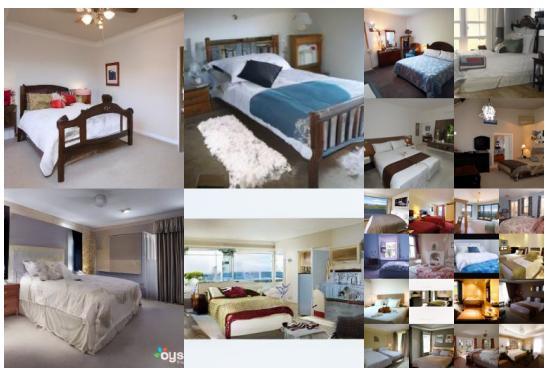  

图 4：LSUN Bedroom 样本。FID=4.90

Algorithm 3 发送 $\mathbf{x}_0$   Algorithm 4 接收  
1: 使用 $p(\mathbf{x}_T)$ 发送 $\mathbf{x}_T \sim q(\mathbf{x}_T | \mathbf{x}_0)$  
2: for $t = T - 1, \ldots, 2, 1$ do  
3:   使用 $p_\theta(\mathbf{x}_t | \mathbf{x}_{t+1})$ 发送 $\mathbf{x}_t \sim q(\mathbf{x}_t | \mathbf{x}_{t+1}, \mathbf{x}_0)$  
4: end for  
5: 使用 $p_\theta(\mathbf{x}_0 | \mathbf{x}_1)$ 发送 $\mathbf{x}_0$  
1: 使用 $p(\mathbf{x}_T)$ 接收 $\mathbf{x}_T$  
2: for $t = T - 1, \ldots, 1, 0$ do  
3:   使用 $p_\theta(\mathbf{x}_t | \mathbf{x}_{t+1})$ 接收 $\mathbf{x}_t$  
4: end for  
5: 返回 $\mathbf{x}_0$

我们发现，如预期那样，在真实变分界（variational bound）上训练模型能够获得比在简化目标上训练更优的码长，但后者能够产生最佳的样本质量。CIFAR10 与 CelebA-HQ 256×256 的样本见图 1，LSUN 256×256 的样本见图 3 与图 4 [71]，更多内容见附录 D。

## 4.2 反向过程参数化与训练目标消融

在表 2 中，我们展示了反向过程参数化与训练目标（第 3.2 节）对样本质量的影响。我们发现，预测 $\tilde{\mu}$ 的基线选项仅在基于真实变分界进行训练、而非使用无加权均方误差（一种类似于公式 (14) 的简化目标）训练时才表现良好。我们还观察到，学习反向过程方差（通过将参数化的对角矩阵 $\pmb{\Sigma}_\theta(\mathbf{x}_t)$ 纳入变分界中）会导致训练不稳定，并且相较于固定方差所得的样本质量更差。正如我们所提出的，预测 $\epsilon$ 在使用固定方差的变分界训练时表现与预测 $\tilde{\mu}$ 大致相当，但在使用我们的简化目标训练时则明显更佳。

## 4.3 渐进编码

表 1 还展示了我们的 CIFAR10 模型的码长。训练集与测试集之间的差距最多为每个维度 0.03 比特，这与基于似然（likelihood）的其他模型所报告的差距相当，表明我们的扩散模型并未过拟合（最近邻可视化见附录 D）。然而，尽管我们的无损码长优于基于能量的模型和使用退火重要性采样（annealed importance sampling）[11] 的分数匹配（score matching）所报告的较大估计值，但它们仍无法与其他类型的基于似然的生成模型 [7] 相竞争。

由于我们的样本仍然具有高质量，我们得出结论：扩散模型具有一种归纳偏置（inductive bias），使其成为出色的有损压缩器。将变分界项 $L_1 + \cdots + L_T$ 视为比特率（rate），将 $L_0$ 视为失真（distortion），我们具有最高质量样本的 CIFAR10 模型具有 1.78 bits/dim 的比特率与 1.97 bits/dim 的失真，在 0 到 255 的尺度上相当于均方根误差为 0.95。超过一半的无损码长描述了难以察觉的失真。

渐进有损压缩 我们可以进一步探究我们模型的率失真行为，通过引入一种渐进有损编码，其形式与 $\operatorname { E q . } ( 5 ) { \mathrm { : } }$ 相对应：见算法 3 和 4，它们假设可以访问一种过程，例如最小随机编码 [19, 20]，该过程能够使用大约 $D _ { \mathrm { K L } } ( q ( \mathbf { x } ) \parallel p ( \mathbf { x } ) )$ 比特平均传输样本 $\mathbf { x } \sim q ( \mathbf { x } )$，对于任意分布 p 和 $q ,$ 其中只有 p 事先对接收端可用。当应用于 $\mathbf { x } _ { 0 } \sim q ( \mathbf { x } _ { 0 } )$ 时，算法 3 和 4 依次传输 $\mathbf { x } _ { T } , \ldots , \mathbf { x } _ { 0 }$，总期望编码长度等于公式 (5)。接收端在任何时刻 t，拥有部分信息 $\mathbf { x } _ { t }$ 完整可用，并且可以渐进地估计：

$$
\mathbf {x} _ {0} \approx \hat {\mathbf {x}} _ {0} = \left(\mathbf {x} _ {t} - \sqrt {1 - \bar {\alpha} _ {t}} \boldsymbol {\epsilon} _ {\theta} (\mathbf {x} _ {t})\right) / \sqrt {\bar {\alpha} _ {t}}\tag{15}
$$

由公式 (4) 所得。（随机重构 $\mathbf { x } _ { 0 } \sim p _ { \theta } ( \mathbf { x } _ { 0 } | \mathbf { x } _ { t } )$ 同样是可行的，但此处不予考虑，因为它使失真更难评估。）图 5 展示了在 CIFAR10 测试集上得到的速率-失真曲线。在每个时刻 t，失真通过均方根误差 $\sqrt { \| \mathbf { x } _ { 0 } - \hat { \mathbf { x } } _ { 0 } \| ^ { 2 } / D } .$ 计算，速率则定义为截至时刻 t 为止已收到的累积比特数。在速率-失真曲线的低速率区域，失真急剧下降，表明绝大多数比特确实被分配到不可感知的失真上。

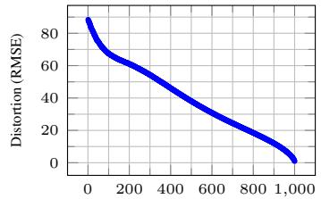  

Reverse process steps (T − t) → 反向过程步骤 (T − t)

  

反向过程步骤（T − t）

  

速率（比特/维度）

图 5：无条件 CIFAR10 测试集率-失真与时间的关系。失真以 [0, 255] 范围内的均方根误差度量。详见表 4。

渐进式生成 我们同样运行了一个渐进式无条件生成过程，该过程通过从随机比特开始的逐步解压实现。也就是说，我们在使用算法 2 从反向过程采样的同时，预测反向过程的结果 $\hat { \mathbf { x } } _ { 0 }$。图 6 和图 10 展示了在反向过程推进过程中 $\hat { \mathbf { x } } _ { 0 }$ 的样本质量：大尺度图像特征先出现，细节后出现。图 7 展示了在不同 $t$ 下冻结 $\mathbf { x } _ { t }$ 时的随机预测 $\mathbf { x } _ { 0 } \sim p _ { \theta } ( \mathbf { x } _ { 0 } | \mathbf { x } _ { t } )$。当 $t$ 较小时，除精细细节之外的所有内容都被保留；当 $t$ 较大时，仅保留大尺度特征。这些或许可视为概念压缩（conceptual compression）[18] 的暗示。

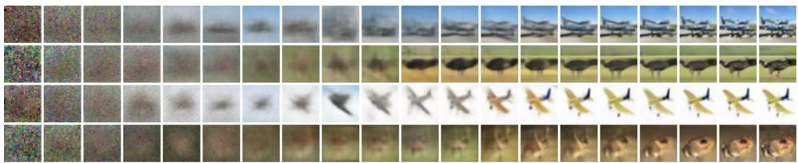

  

图 6：无条件 CIFAR10 渐进生成（$\hat{\mathbf{x}}_0$ 随时间的变化，从左到右）。扩展样本以及随时间变化的样本质量指标见附录（图 10 和图 14）。

图 7：当以相同的潜变量为条件时，CelebA-HQ $256\times256$ 样本共享高层属性。右下象限为 $\mathbf{x}_t$，其他象限为来自 $p_\theta(\mathbf{x}_0|\mathbf{x}_t)$ 的样本。

与自回归解码的联系

注意，变分界（式 (5)）可以重写为：

$$
L = D _ {\mathrm{KL}} (q (\mathbf {x} _ {T}) \parallel p (\mathbf {x} _ {T})) + \mathbb {E} _ {q} \left[ \sum_ {t \geq 1} D _ {\mathrm{KL}} (q (\mathbf {x} _ {t - 1} | \mathbf {x} _ {t}) \parallel p _ {\theta} (\mathbf {x} _ {t - 1} | \mathbf {x} _ {t})) \right] + H (\mathbf {x} _ {0})\tag{16}
$$

（见附录A的推导。）现在考虑将扩散过程长度 $T$ 设为数据的维度，定义前向过程使得 $q ( \mathbf { x } _ { t } | \mathbf { x } _ { 0 } )$ 将所有概率质量都放在将前 $t$ 个坐标遮蔽掉后的 $\mathbf { x } _ { 0 }$ 上（即 $d ( \mathbf { x } _ { t } | \mathbf { x } _ { t - 1 } )$ 遮蔽掉第 $t$ 个坐标），将 $p ( \mathbf { x } _ { T } )$ 设为将所有质量放在一张空白图像上，并且为方便论证，取 $p _ { \theta } ( \mathbf { x } _ { t - 1 } | \mathbf { x } _ { t } )$ 为一个完全表达的条件分布。在这些选择下，$D _ { \mathrm { K L } } ( q ( \mathbf { x } _ { T } ) \parallel p ( \mathbf { x } _ { T } ) ) = 0$，最小化 $D _ { \mathrm { K L } } ( q ( \mathbf { x } _ { t - 1 } | \mathbf { x } _ { t } ) \Vert p _ { \theta } ( \mathbf { x } _ { t - 1 } | \mathbf { x } _ { t } ) )$ 会训练 $p _ { \theta }$ 原样复制坐标 $t + 1 , \dots , T$，并在给定 $t + 1 , \dots , T$ 的条件下预测第 $t$ 个坐标。因此，用这种特定的扩散过程来训练 $p _ { \theta }$ 就是在训练一个自回归模型。

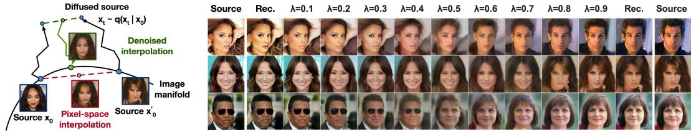  

图 8：CelebA-HQ 256×256 图像在 500 个扩散时间步下的插值。

因此，我们可以将高斯扩散模型 (2) 解释为一种具有广义比特序的自回归模型，这种比特序无法通过重新排列数据坐标来表达。先前的研究 [38] 表明，这种重新排序会引入影响样本质量的归纳偏置，因此我们推测高斯扩散起到了类似的作用，效果可能更为显著，因为相比掩码噪声，向图像中添加高斯噪声可能更为自然。此外，高斯扩散的长度并不要求等于数据维度；例如，我们使用 $T = 1 0 0 0$，这小于我们实验中 $3 2 \times 3 2 \times 3$ 或 $2 5 6 \times 2 5 6 \times 3$ 图像的维度。高斯扩散可以设置得更短以加速采样，或设置得更长以增强模型表达能力。

## 4.4 插值

我们可以在潜空间中对源图像 $\mathbf { x } _ { 0 } , \mathbf { x } _ { 0 } ^ { \prime } \sim q ( \mathbf { x } _ { 0 } )$ 进行插值，将 $q$ 作为随机编码器，得到 $\mathbf { x } _ { t } , \mathbf { x } _ { t } ^ { \prime } \sim q ( \mathbf { x } _ { t } | \mathbf { x } _ { 0 } )$，然后通过反向过程将线性插值后的潜变量 $\bar { \mathbf { x } } _ { t } = ( 1 - \lambda ) \mathbf { x } _ { 0 } + \lambda \mathbf { x } _ { 0 } ^ { \prime }$ 解码到图像空间，得到 $\bar { \mathbf { x } } _ { 0 } \sim p ( \mathbf { x } _ { 0 } | \bar { \mathbf { x } } _ { t } )$。实际上，我们使用反向过程来消除对源图像被噪声污染的版本进行线性插值所产生的伪影，如图 8（左）所示。我们针对不同的 $\lambda$ 值固定了噪声，从而使 $\mathbf { x } _ { t }$ 和 $\mathbf { x } _ { t } ^ { \prime }$ 保持不变。图 8（右）展示了原始 CelebA-HQ 256 256 图像的插值与重建 $( t = 5 0 0 )$。反向过程能够生成高质量的重建结果，以及在姿势、肤色、发型、表情和背景等属性上平滑变化的合理插值，但不包括眼镜。较大的 $t$ 会产生更粗糙、更具多样性的插值，并在 $t = 1 0 0 0$ 时生成新颖样本（附录图 9）。

## 5 相关工作

虽然扩散模型可能与流模型 [9, 46, 10, 32, 5, 16, 23] 以及变分自编码器（VAEs）[33, 47, 37] 类似，但扩散模型的设计使得 q 没有参数，且顶层潜变量 $\mathbf { x } _ { T }$ 与数据 $\mathbf { x } _ { 0 }$ 几乎零互信息。我们的 ε 预测反向过程参数化在扩散模型与跨多个噪声水平的去噪分数匹配以及用于采样的退火朗之万动力学之间建立了联系 [55, 56]。然而，扩散模型支持直接的对数似然评估，并且训练过程通过变分推断显式地训练朗之万动力学采样器（详见附录 C）。该联系还具有反向含义：某种加权形式的去噪分数匹配等价于训练朗之万类采样器的变分推断。学习马尔可夫链转移算子的其他方法包括 infusion training [2]、variational walkback [15]、generative stochastic networks [1] 以及其他方法 [50, 54, 36, 42, 35, 65]。

借助分数匹配与基于能量的建模之间已知的联系，我们的工作可能对其他近期关于基于能量的模型的工作产生影响 [67–69, 12, 70, 13, 11, 41, 17, 8]。我们的率失真曲线是在变分界的一次评估中随时间计算的，类似于率失真曲线可以在一次退火重要性采样运行中跨失真惩罚进行计算 [24]。我们的渐进解码论证可在卷积 DRAW 及相关模型中看到 [18, 40]，并且还可能导致自回归模型中更一般的子尺度排序或采样策略设计 [38, 64]。

## 6 结论

我们已经使用扩散模型展示了高质量的图像样本，并且我们发现了扩散模型与用于训练马尔可夫链的变分推断、去噪分数匹配及退火朗之万动力学（以及扩展意义上的基于能量的模型）、自回归模型和渐进有损压缩方法之间的联系。由于扩散模型似乎对图像数据具有出色的归纳偏置，我们期待研究它们在其他数据模态中的用途，以及作为其他类型生成模型和机器学习系统组件的应用价值。

## 更广泛的影响

我们的扩散模型工作与其他类型深度生成模型（如改进 GAN、流模型、自回归模型等样本质量的工作）具有相似的范围。我们的论文代表了将扩散模型推进为这一技术家族中通用有用工具的进展，因此它可能会放大生成模型已经（以及将会）对更广阔世界产生的任何影响。

遗憾的是，生成模型存在诸多广为人知的恶意用途。样本生成技术可被用于制作政治目的的公众人物伪造图像和视频。尽管早在软件工具出现之前，伪造图像就已通过手工方式制作完成，但像我们这样的生成模型使这一过程变得更加容易。所幸的是，目前由 CNN（Convolutional Neural Network，卷积神经网络）生成的图像存在一些细微缺陷，使其能够被检测出来 [62]，然而随着生成模型的不断改进，这一检测任务可能会变得更加困难。生成模型还会反映出其训练数据集中存在的偏差。由于许多大型数据集是通过自动化系统从互联网上收集而来，因此要消除这些偏差往往十分困难，尤其当图像未被打上标签时。如果使用这些数据集训练得到的生成模型所产生的样本在互联网上大量传播，那么这些偏差只会被进一步强化。

另一方面，扩散模型可能有助于数据压缩，随着数据分辨率不断提高以及全球互联网流量日益增长，对于确保广大受众能够无障碍访问互联网而言，数据压缩或许至关重要。我们的工作有望推动针对无标签原始数据的表示学习，从而服务于从图像分类到强化学习等一系列下游任务，同时扩散模型也可能成为艺术、摄影和音乐创作中的可行工具。

## 致谢与资助声明

本工作得到了 ONR PECASE 以及授予编号为 DGE-1752814 的 NSF Graduate Research Fellowship 的资助。Google 的 TensorFlow Research Cloud（TFRC）提供了 Cloud TPU 计算资源。

## 参考文献

[2] Florian Bordes, Sina Honari, and Pascal Vincent. 通过注入训练从噪声中学习生成样本（Learning to generate samples from noise through infusion training）。载于《国际学习表征会议论文集》（International Conference on Learning Representations），2017。

[3] Andrew Brock, Jeff Donahue, and Karen Simonyan. 用于高保真自然图像合成的大规模 GAN 训练（Large scale GAN training for high fidelity natural image synthesis）。载于《国际学习表征会议论文集》（International Conference on Learning Representations），2019。

[4] Tong Che, Ruixiang Zhang, Jascha Sohl-Dickstein, Hugo Larochelle, Liam Paull, Yuan Cao, and Yoshua Bengio. 你的 GAN 实际上是一个基于能量的模型，应当使用判别器驱动的隐变量采样（Your GAN is secretly an energy-based model and you should use discriminator driven latent sampling）。arXiv 预印本 arXiv:2003.06060，2020。

[5] Tian Qi Chen, Yulia Rubanova, Jesse Bettencourt, and David K Duvenaud. 神经常微分方程（Neural ordinary differential equations）。载于《神经信息处理系统进展》（Advances in Neural Information Processing Systems），第 6571–6583 页，2018。

[6] Xi Chen, Nikhil Mishra, Mostafa Rohaninejad, and Pieter Abbeel. PixelSNAIL：一种改进的自回归生成模型（PixelSNAIL: An improved autoregressive generative model）。载于《国际机器学习会议论文集》（International Conference on Machine Learning），第 863–871 页，2018。

[7] Rewon Child、Scott Gray、Alec Radford 和 Ilya Sutskever。使用稀疏 Transformer 生成长序列（Generating long sequences with sparse transformers）。arXiv 预印本 arXiv:1904.10509，2019。

[8] Yuntian Deng, Anton Bakhtin, Myle Ott, Arthur Szlam, and Marc'Aurelio Ranzato. Residual energy-based models for text generation. arXiv preprint arXiv:2004.11714, 2020.

[8] Yuntian Deng、Anton Bakhtin、Myle Ott、Arthur Szlam 和 Marc'Aurelio Ranzato。基于残差能量的文本生成模型（Residual energy-based models for text generation）。arXiv 预印本 arXiv:2004.11714，2020。

[9] Laurent Dinh、David Krueger 和 Yoshua Bengio。NICE：非线性独立成分估计（NICE: Non-linear independent components estimation）。arXiv 预印本 arXiv:1410.8516，2014。

[10] Laurent Dinh、Jascha Sohl-Dickstein 和 Samy Bengio。使用 Real NVP 进行密度估计（Density estimation using Real NVP）。arXiv 预印本 arXiv:1605.08803，2016。

[11] Yilun Du 和 Igor Mordatch。基于能量模型的隐式生成与建模（Implicit generation and modeling with energy based models）。载于：神经信息处理系统进展大会（Advances in Neural Information Processing Systems），第 3603–3613 页，2019。

[12] Ruiqi Gao、Yang Lu、Junpei Zhou、Song-Chun Zhu 和 Ying Nian Wu。通过多网格建模与采样学习生成式卷积网络（Learning generative ConvNets via multi-grid modeling and sampling）。载于：IEEE 计算机视觉与模式识别会议论文集（Proceedings of the IEEE Conference on Computer Vision and Pattern Recognition），第 9155–9164 页，2018。

[13] Ruiqi Gao、Erik Nijkamp、Diederik P Kingma、Zhen Xu、Andrew M Dai 和 Ying Nian Wu。基于能量模型流式对比估计（Flow contrastive estimation of energy-based models）。载于：IEEE/CVF 计算机视觉与模式识别会议论文集（Proceedings of the IEEE/CVF Conference on Computer Vision and Pattern Recognition），第 7518–7528 页，2020。

[14] Ian Goodfellow、Jean Pouget-Abadie、Mehdi Mirza、Bing Xu、David Warde-Farley、Sherjil Ozair、Aaron Courville 和 Yoshua Bengio。生成对抗网络（Generative adversarial nets）。载于：神经信息处理系统进展大会（Advances in Neural Information Processing Systems），第 2672–2680 页，2014。

[15] Anirudh Goyal、Nan Rosemary Ke、Surya Ganguli 和 Yoshua Bengio。变分回溯：作为随机循环网络学习转移算子（Variational walkback: Learning a transition operator as a stochastic recurrent net）。载于：神经信息处理系统进展大会（Advances in Neural Information Processing Systems），第 4392–4402 页，2017。

[16] Will Grathwohl、Ricky T. Q. Chen、Jesse Bettencourt 和 David Duvenaud。FFJORD：面向可扩展可逆生成模型的自由形式连续动力学（FFJORD: Free-form continuous dynamics for scalable reversible generative models）。载于：国际学习表征会议（International Conference on Learning Representations），2019。

[17] Will Grathwohl、Kuan-Chieh Wang、Joern-Henrik Jacobsen、David Duvenaud、Mohammad Norouzi 和 Kevin Swersky。你的分类器其实是一个基于能量的模型，而且你应该这样对待它（Your classifier is secretly an energy based model and you should treat it like one）。载于：国际学习表征会议（International Conference on Learning Representations），2020。

[18] Karol Gregor、Frederic Besse、Danilo Jimenez Rezende、Ivo Danihelka 和 Daan Wierstra。迈向概念压缩（Towards conceptual compression）。载于：神经信息处理系统进展大会（Advances In Neural Information Processing Systems），第 3549–3557 页，2016。

[19] Prahladh Harsha、Rahul Jain、David McAllester 和 Jaikumar Radhakrishnan。相关性的通信复杂度（The communication complexity of correlation）。载于：第二十二届 IEEE 计算复杂性年会（Twenty-Second Annual IEEE Conference on Computational Complexity, CCC'07），第 10–23 页。IEEE，2007。

[20] Marton Havasi、Robert Peharz 和 José Miguel Hernández-Lobato。最小随机编码学习：从压缩模型参数中回收比特（Minimal random code learning: Getting bits back from compressed model parameters）。载于：国际学习表征会议（International Conference on Learning Representations），2019。

[21] Martin Heusel, Hubert Ramsauer, Thomas Unterthiner, Bernhard Nessler, and Sepp Hochreiter. 由双时间尺度更新规则训练的 GAN 收敛到局部纳什均衡. 发表于《神经信息处理系统进展》, 2017 年, 第 6626–6637 页.

[22] Irina Higgins, Loic Matthey, Arka Pal, Christopher Burgess, Xavier Glorot, Matthew Botvinick, Shakir Mohamed, and Alexander Lerchner. beta-VAE：基于受限变分框架学习基本视觉概念. 发表于国际学习表征会议, 2017 年.

[23] Jonathan Ho, Xi Chen, Aravind Srinivas, Yan Duan, and Pieter Abbeel. Flow++：通过变分去量化和架构设计改进基于流的生成模型. 发表于国际机器学习大会, 2019 年.

[24] Sicong Huang, Alireza Makhzani, Yanshuai Cao, and Roger Grosse. 深度生成模型有损压缩率的评估. 发表于国际机器学习大会, 2020 年.

[25] Nal Kalchbrenner, Aaron van den Oord, Karen Simonyan, Ivo Danihelka, Oriol Vinyals, Alex Graves, and Koray Kavukcuoglu. 视频像素网络. 发表于国际机器学习大会, 2017 年, 第 1771–1779 页.

[26] Nal Kalchbrenner, Erich Elsen, Karen Simonyan, Seb Noury, Norman Casagrande, Edward Lockhart, Florian Stimberg, Aaron van den Oord, Sander Dieleman, and Koray Kavukcuoglu. 高效神经音频合成. 发表于国际机器学习大会, 2018 年, 第 2410–2419 页.

[27] Tero Karras, Timo Aila, Samuli Laine, and Jaakko Lehtinen. 渐进式增长 GAN 以提升质量、稳定性和多样性. 发表于国际学习表征会议, 2018 年.

[28] Tero Karras, Samuli Laine, and Timo Aila. 生成对抗网络的基于样式的生成器架构. 发表于 IEEE 计算机视觉与模式识别大会论文集, 2019 年, 第 4401–4410 页.

[29] Tero Karras, Miika Aittala, Janne Hellsten, Samuli Laine, Jaakko Lehtinen, and Timo Aila. 在有限数据下训练生成对抗网络. arXiv 预印本 arXiv:2006.06676v1, 2020 年.

[30] Tero Karras, Samuli Laine, Miika Aittala, Janne Hellsten, Jaakko Lehtinen, and Timo Aila. StyleGAN 图像质量的分析与改进. 发表于 IEEE/CVF 计算机视觉与模式识别大会论文集, 2020 年, 第 8110–8119 页.

[31] Diederik P Kingma and Jimmy Ba. Adam：一种随机优化方法. 发表于国际学习表征会议, 2015 年.

[32] Diederik P Kingma and Prafulla Dhariwal. Glow：基于可逆 1×1 卷积的生成流. 发表于《神经信息处理系统进展》, 2018 年, 第 10215–10224 页.

[33] Diederik P Kingma and Max Welling. 自编码变分贝叶斯. arXiv 预印本 arXiv:1312.6114, 2013 年.

[34] Diederik P Kingma, Tim Salimans, Rafal Jozefowicz, Xi Chen, Ilya Sutskever, and Max Welling. 通过逆自回归流改进变分推断. 载于：神经信息处理系统进展, 4743–4751 页, 2016.

[35] John Lawson, George Tucker, Bo Dai, and Rajesh Ranganath. 能量启发模型：通过采样器诱导分布进行学习. 载于：神经信息处理系统进展, 8501–8513 页, 2019.

[36] Daniel Levy, Matt D. Hoffman, and Jascha Sohl-Dickstein. 利用神经网络推广哈密顿蒙特卡洛. 载于：国际学习表征会议, 2018.

[37] Lars Maaløe, Marco Fraccaro, Valentin Liévin, and Ole Winther. BIVA：用于生成建模的极深潜变量层次结构. 载于：神经信息处理系统进展, 6548–6558 页, 2019.

[38] Jacob Menick and Nal Kalchbrenner. 使用亚尺度像素网络和多维上采样生成高保真图像. 载于：国际学习表征会议, 2019.

[39] Takeru Miyato, Toshiki Kataoka, Masanori Koyama, and Yuichi Yoshida. 生成对抗网络的谱归一化. 载于：国际学习表征会议, 2018.

[40] Alex Nichol. VQ-DRAW：一种序列离散 VAE. arXiv 预印本 arXiv:2003.01599, 2020.

[41] Erik Nijkamp, Mitch Hill, Tian Han, Song-Chun Zhu, and Ying Nian Wu. 基于 MCMC 的能量模型最大似然学习解析. arXiv 预印本 arXiv:1903.12370, 2019.

[42] Erik Nijkamp, Mitch Hill, Song-Chun Zhu, and Ying Nian Wu. 面向能量模型的非收敛非持久短程 MCMC 学习. 载于：神经信息处理系统进展, 5233–5243 页, 2019.

[43] Georg Ostrovski, Will Dabney, and Remi Munos. 用于生成建模的自回归分位数网络. 载于：国际机器学习会议, 3936–3945 页, 2018.

[44] Ryan Prenger, Rafael Valle, and Bryan Catanzaro. WaveGlow：用于语音合成的基于流的生成网络. 载于：ICASSP 2019-2019 IEEE 声学、语音与信号处理国际会议 (ICASSP), 3617–3621 页. IEEE, 2019.

[45] Ali Razavi, Aaron van den Oord, and Oriol Vinyals. 使用 VQ-VAE-2 生成多样化的高保真图像. 载于：神经信息处理系统进展, 14837–14847 页, 2019.

[46] Danilo Rezende and Shakir Mohamed. 使用归一化流进行变分推断. 载于：国际机器学习会议, 1530–1538 页, 2015.

[47] Danilo Jimenez Rezende, Shakir Mohamed, and Daan Wierstra. 深度生成模型中的随机反向传播与近似推断. 载于：国际机器学习会议, 1278–1286 页, 2014.

[48] Olaf Ronneberger、Philipp Fischer、Thomas Brox。U-Net：用于生物医学图像分割的卷积网络。发表于：医学图像计算与计算机辅助干预国际会议（International Conference on Medical Image Computing and Computer-Assisted Intervention），第 234–241 页，Springer，2015 年。

[49] Tim Salimans、Durk P Kingma。权重归一化（Weight Normalization）：一种加速深度神经网络训练的简单重参数化方法。发表于：神经信息处理系统进展（Advances in Neural Information Processing Systems），第 901–909 页，2016 年。

[50] Tim Salimans、Diederik Kingma、Max Welling。马尔可夫链蒙特卡洛与变分推断：弥合鸿沟。发表于：国际机器学习大会（International Conference on Machine Learning），第 1218–1226 页，2015 年。

[51] Tim Salimans、Ian Goodfellow、Wojciech Zaremba、Vicki Cheung、Alec Radford、Xi Chen。训练生成对抗网络（GAN）的改进技术。发表于：神经信息处理系统进展（Advances in Neural Information Processing Systems），第 2234–2242 页，2016 年。

[52] Tim Salimans、Andrej Karpathy、Xi Chen、Diederik P Kingma。PixelCNN++：使用离散化逻辑斯蒂混合似然及其他改进对 PixelCNN 的改进。发表于：国际学习表征会议（International Conference on Learning Representations），2017 年。

[53] Jascha Sohl-Dickstein、Eric Weiss、Niru Maheswaranathan、Surya Ganguli。使用非平衡热力学的深度无监督学习。发表于：国际机器学习大会（International Conference on Machine Learning），第 2256–2265 页，2015 年。

[54] Jiaming Song、Shengjia Zhao、Stefano Ermon。A-NICE-MC：用于 MCMC 的对抗训练。发表于：神经信息处理系统进展（Advances in Neural Information Processing Systems），第 5140–5150 页，2017 年。

[55] Yang Song、Stefano Ermon。通过估计数据分布梯度进行生成建模。发表于：神经信息处理系统进展（Advances in Neural Information Processing Systems），第 11895–11907 页，2019 年。

[56] Yang Song、Stefano Ermon。训练基于分数的生成模型的改进技术。arXiv 预印本 arXiv:2006.09011，2020 年。

[57] Aaron van den Oord、Sander Dieleman、Heiga Zen、Karen Simonyan、Oriol Vinyals、Alex Graves、Nal Kalchbrenner、Andrew Senior、Koray Kavukcuoglu。WaveNet：一种用于原始音频的生成模型。arXiv 预印本 arXiv:1609.03499，2016 年。

[58] Aaron van den Oord、Nal Kalchbrenner、Koray Kavukcuoglu。像素循环神经网络。发表于：国际机器学习大会（International Conference on Machine Learning），2016 年。

[59] Aaron van den Oord、Nal Kalchbrenner、Oriol Vinyals、Lasse Espeholt、Alex Graves、Koray Kavukcuoglu。使用 PixelCNN 解码器的条件图像生成。发表于：神经信息处理系统进展（Advances in Neural Information Processing Systems），第 4790–4798 页，2016 年。

[60] Ashish Vaswani、Noam Shazeer、Niki Parmar、Jakob Uszkoreit、Llion Jones、Aidan N Gomez、Łukasz Kaiser、Illia Polosukhin。注意力即所需。发表于：神经信息处理系统进展（Advances in Neural Information Processing Systems），第 5998–6008 页，2017 年。

[61] Pascal Vincent. A connection between score matching and denoising autoencoders. Neural Computation, 23(7):1661–1674, 2011.

[61] Pascal Vincent。分数匹配与去噪自编码器之间的联系。发表于：神经计算（Neural Computation），第 23 卷第 7 期，第 1661–1674 页，2011 年。

[62] Sheng-Yu Wang, Oliver Wang, Richard Zhang, Andrew Owens, and Alexei A Efros. Cnn-generated images are surprisingly easy to spot...for now. In Proceedings of the IEEE Conference on Computer Vision and Pattern Recognition, 2020.
译：Sheng-Yu Wang、Oliver Wang、Richard Zhang、Andrew Owens 和 Alexei A Efros。CNN 生成图像目前出奇地容易被识别……（目前如此）。发表于：IEEE 计算机视觉与模式识别会议论文集，2020 年。

[63] Xiaolong Wang, Ross Girshick, Abhinav Gupta, and Kaiming He. Non-local neural networks. In Proceedings of the IEEE Conference on Computer Vision and Pattern Recognition, pages 7794–7803, 2018.
译：Xiaolong Wang、Ross Girshick、Abhinav Gupta 和 Kaiming He。非局部神经网络。发表于：IEEE 计算机视觉与模式识别会议论文集，第 7794–7803 页，2018 年。

[64] Auke J Wiggers and Emiel Hoogeboom. Predictive sampling with forecasting autoregressive models. arXiv preprint arXiv:2002.09928, 2020.
译：Auke J Wiggers 和 Emiel Hoogeboom。基于预测自回归模型的预测采样。arXiv 预印本 arXiv:2002.09928，2020 年。

[65] Hao Wu, Jonas Köhler, and Frank Noé. Stochastic normalizing flows. arXiv preprint arXiv:2002.06707, 2020.
译：Hao Wu、Jonas Köhler 和 Frank Noé。随机正则化流。arXiv 预印本 arXiv:2002.06707，2020 年。

[66] Yuxin Wu and Kaiming He. Group normalization. In Proceedings of the European Conference on Computer Vision (ECCV), pages 3–19, 2018.
译：Yuxin Wu 和 Kaiming He。组归一化。发表于：欧洲计算机视觉国际会议（ECCV）论文集，第 3–19 页，2018 年。

[67] Jianwen Xie, Yang Lu, Song-Chun Zhu, and Yingnian Wu. A theory of generative convnet. In International Conference on Machine Learning, pages 2635–2644, 2016.
译：Jianwen Xie、Yang Lu、Song-Chun Zhu 和 Yingnian Wu。生成式卷积网络理论。发表于：国际机器学习大会，第 2635–2644 页，2016 年。

[68] Jianwen Xie, Song-Chun Zhu, and Ying Nian Wu. Synthesizing dynamic patterns by spatial-temporal generative convnet. In Proceedings of the IEEE Conference on Computer Vision and Pattern Recognition, pages 7093–7101, 2017.
译：Jianwen Xie、Song-Chun Zhu 和 Ying Nian Wu。通过时空生成式卷积网络合成动态模式。发表于：IEEE 计算机视觉与模式识别会议论文集，第 7093–7101 页，2017 年。

[69] Jianwen Xie, Zilong Zheng, Ruiqi Gao, Wenguan Wang, Song-Chun Zhu, and Ying Nian Wu. Learning descriptor networks for 3d shape synthesis and analysis. In Proceedings of the IEEE Conference on Computer Vision and Pattern Recognition, pages 8629–8638, 2018.
译：Jianwen Xie、Zilong Zheng、Ruiqi Gao、Wenguan Wang、Song-Chun Zhu 和 Ying Nian Wu。学习用于三维形状合成与分析的描述子网络。发表于：IEEE 计算机视觉与模式识别会议论文集，第 8629–8638 页，2018 年。

[70] Jianwen Xie, Song-Chun Zhu, and Ying Nian Wu. Learning energy-based spatial-temporal generative convnets for dynamic patterns. IEEE Transactions on Pattern Analysis and Machine Intelligence, 2019.
译：Jianwen Xie、Song-Chun Zhu 和 Ying Nian Wu。学习基于能量的时空生成式卷积网络以建模动态模式。IEEE 模式分析与机器智能汇刊，2019 年。

[71] Fisher Yu, Yinda Zhang, Shuran Song, Ari Seff, and Jianxiong Xiao. LSUN: Construction of a large-scale image dataset using deep learning with humans in the loop. arXiv preprint arXiv:1506.03365, 2015.
译：Fisher Yu、Yinda Zhang、Shuran Song、Ari Seff 和 Jianxiong Xiao。LSUN：使用深度学习并结合人在回路构建大规模图像数据集。arXiv 预印本 arXiv:1506.03365，2015 年。

[72] Sergey Zagoruyko and Nikos Komodakis. Wide residual networks. arXiv preprint arXiv:1605.07146, 2016.
译：Sergey Zagoruyko 和 Nikos Komodakis。宽残差网络。arXiv 预印本 arXiv:1605.07146，2016 年。

## Extra information

LSUN FID scores for LSUN datasets are included in Table 3. Scores marked with ∗ are reported by StyleGAN2 as baselines, and other scores are reported by their respective authors.
译：表 3 列出了 LSUN 数据集的 FID 分数。标有 ∗ 的分数由 StyleGAN2 作为基线报告，其他分数由各自的作者报告。

Table 3: FID scores for LSUN 256 256 datasets
译：表 3：LSUN 256×256 数据集的 FID 分数

<table><tr><td>Model</td><td>LSUN Bedroom</td><td>LSUN Church</td><td>LSUN Cat</td></tr><tr><td>ProgressiveGAN [27]</td><td>8.34</td><td>6.42</td><td>37.52</td></tr><tr><td>StyleGAN [28]</td><td>2.65</td><td>4.21*</td><td>8.53*</td></tr><tr><td>StyleGAN2 [30]</td><td>-</td><td>3.86</td><td>6.93</td></tr><tr><td>Ours ( $L_{simple}$ )</td><td>6.36</td><td>7.89</td><td>19.75</td></tr><tr><td>Ours ( $L_{simple}$ , large)</td><td>4.90</td><td>-</td><td>-</td></tr></table>

## 渐进式压缩

我们在第 4.3 节中关于有损压缩的论证仅是一个概念验证，因为算法 3 和算法 4 依赖于诸如最小随机编码（minimal random coding）[20] 之类的过程，而该过程对于高维数据而言不可处理。这些算法充当了 Sohl-Dickstein 等人 [53] 的变分界（variational bound）(5) 的压缩诠释，但尚不足以构成一套实用的压缩系统。

**表 4**：无条件 CIFAR10 测试集率失真值（对应图 5）

<table><tr><td>Reverse process time (T-t+1)</td><td>Rate (bits/dim)</td><td>Distortion (RMSE [0, 255])</td></tr><tr><td>1000</td><td>1.77581</td><td>0.95136</td></tr><tr><td>900</td><td>0.11994</td><td>12.02277</td></tr><tr><td>800</td><td>0.05415</td><td>18.47482</td></tr><tr><td>700</td><td>0.02866</td><td>24.43656</td></tr><tr><td>600</td><td>0.01507</td><td>30.80948</td></tr><tr><td>500</td><td>0.00716</td><td>38.03236</td></tr><tr><td>400</td><td>0.00282</td><td>46.12765</td></tr><tr><td>300</td><td>0.00081</td><td>54.18826</td></tr><tr><td>200</td><td>0.00013</td><td>60.97170</td></tr><tr><td>100</td><td>0.00000</td><td>67.60125</td></tr></table>

## A 扩展推导

下文给出公式 (5) 的推导，即扩散模型的降方差变分界。此部分内容来自 Sohl-Dickstein 等人 [53]；在此仅出于完整性考虑而收录。

$$
L = \mathbb {E} _ {q} \biggl [ - \log \frac {p _ {\theta} (\mathbf {x} _ {0 : T})}{q (\mathbf {x} _ {1 : T} | \mathbf {x} _ {0})} \biggr ]\tag{17}
$$

$$
= \mathbb {E} _ {q} \left[ - \log p (\mathbf {x} _ {T}) - \sum_ {t \geq 1} \log \frac {p _ {\theta} (\mathbf {x} _ {t - 1} | \mathbf {x} _ {t})}{q (\mathbf {x} _ {t} | \mathbf {x} _ {t - 1})} \right]\tag{18}
$$

$$
= \mathbb {E} _ {q} \Bigg [ - \log p (\mathbf {x} _ {T}) - \sum_ {t > 1} \log \frac {p _ {\theta} (\mathbf {x} _ {t - 1} | \mathbf {x} _ {t})}{q (\mathbf {x} _ {t} | \mathbf {x} _ {t - 1})} - \log \frac {p _ {\theta} (\mathbf {x} _ {0} | \mathbf {x} _ {1})}{q (\mathbf {x} _ {1} | \mathbf {x} _ {0})} \Bigg ]\tag{19}
$$

$$
= \mathbb {E} _ {q} \Biggl [ - \log p (\mathbf {x} _ {T}) - \sum_ {t > 1} \log \frac {p _ {\theta} (\mathbf {x} _ {t - 1} | \mathbf {x} _ {t})}{q (\mathbf {x} _ {t - 1} | \mathbf {x} _ {t} , \mathbf {x} _ {0})} \cdot \frac {q (\mathbf {x} _ {t - 1} | \mathbf {x} _ {0})}{q (\mathbf {x} _ {t} | \mathbf {x} _ {0})} - \log \frac {p _ {\theta} (\mathbf {x} _ {0} | \mathbf {x} _ {1})}{q (\mathbf {x} _ {1} | \mathbf {x} _ {0})} \Biggr ]\tag{20}
$$

$$
= \mathbb {E} _ {q} \Biggl [ - \log \frac {p (\mathbf {x} _ {T})}{q (\mathbf {x} _ {T} | \mathbf {x} _ {0})} - \sum_ {t > 1} \log \frac {p _ {\theta} (\mathbf {x} _ {t - 1} | \mathbf {x} _ {t})}{q (\mathbf {x} _ {t - 1} | \mathbf {x} _ {t} , \mathbf {x} _ {0})} - \log p _ {\theta} (\mathbf {x} _ {0} | \mathbf {x} _ {1}) \Biggr ]\tag{21}
$$

$$
= \mathbb {E} _ {q} \Biggl [ D _ {\mathrm{KL}} (q (\mathbf {x} _ {T} | \mathbf {x} _ {0}) \parallel p (\mathbf {x} _ {T})) + \sum_ {t > 1} D _ {\mathrm{KL}} (q (\mathbf {x} _ {t - 1} | \mathbf {x} _ {t}, \mathbf {x} _ {0}) \parallel p _ {\theta} (\mathbf {x} _ {t - 1} | \mathbf {x} _ {t})) - \log p _ {\theta} (\mathbf {x} _ {0} | \mathbf {x} _ {1}) \Biggr ]\tag{22}
$$

下面是 $L$ 的另一种形式。它不便于估计，但对我们在 4.3 节中的讨论很有用。

$$
L = \mathbb {E} _ {q} \Bigg [ - \log p (\mathbf {x} _ {T}) - \sum_ {t \geq 1} \log \frac {p _ {\theta} (\mathbf {x} _ {t - 1} | \mathbf {x} _ {t})}{q (\mathbf {x} _ {t} | \mathbf {x} _ {t - 1})} \Bigg ]\tag{23}
$$

$$
= \mathbb {E} _ {q} \Bigg [ - \log p (\mathbf {x} _ {T}) - \sum_ {t \geq 1} \log \frac {p _ {\theta} (\mathbf {x} _ {t - 1} | \mathbf {x} _ {t})}{q (\mathbf {x} _ {t - 1} | \mathbf {x} _ {t})} \cdot \frac {q (\mathbf {x} _ {t - 1})}{q (\mathbf {x} _ {t})} \Bigg ]\tag{24}
$$

$$
= \mathbb {E} _ {q} \left[ - \log \frac {p (\mathbf {x} _ {T})}{q (\mathbf {x} _ {T})} - \sum_ {t \geq 1} \log \frac {p _ {\theta} (\mathbf {x} _ {t - 1} | \mathbf {x} _ {t})}{q (\mathbf {x} _ {t - 1} | \mathbf {x} _ {t})} - \log q (\mathbf {x} _ {0}) \right]\tag{25}
$$

$$
= D _ {\mathrm{KL}} (q (\mathbf {x} _ {T}) \parallel p (\mathbf {x} _ {T})) + \mathbb {E} _ {q} \left[ \sum_ {t \geq 1} D _ {\mathrm{KL}} (q (\mathbf {x} _ {t - 1} | \mathbf {x} _ {t}) \parallel p _ {\theta} (\mathbf {x} _ {t - 1} | \mathbf {x} _ {t})) \right] + H (\mathbf {x} _ {0})\tag{26}
$$

## B 实验细节

我们的神经网络架构遵循 PixelCNN++ [52] 的骨干网络，它是一个基于宽残差网络（Wide ResNet）[72] 的 U-Net [48]。我们用组归一化（group normalization）[66] 替换了权重归一化（weight normalization）[49]，以简化实现。我们的 $32 \times 32$ 模型使用四个特征图分辨率（$32 \times 32$ 到 $4 \times 4$），而我们的 $256 \times 256$ 模型使用六个分辨率级别。所有模型在每个分辨率层级都有两个卷积残差块，并在 $16 \times 16$ 分辨率上、卷积块之间使用自注意力块 [6]。扩散时间 $t$ 通过将 Transformer 正弦位置嵌入 [60] 添加到每个残差块中来指定。我们的 CIFAR10 模型有 3570 万参数，而 LSUN 和 CelebA-HQ 模型有 1.14 亿参数。我们还通过增加滤波器数量训练了一个更大的 LSUN Bedroom 模型变体，约有 2.56 亿参数。

所有实验我们都使用了 TPU v3-8（类似于 8 块 V100 GPU）。我们的 CIFAR 模型在批量大小 128 下以每秒 21 步训练（在 80 万步训练完成需要 10.6 小时），对一批 256 张图像采样需要 17 秒。我们的 CelebA-HQ/LSUN $(256^2)$ 模型在批量大小 64 下以每秒 2.2 步训练，对一批 128 张图像采样需要 300 秒。我们在 CelebA-HQ 上训练了 50 万步，LSUN Bedroom 上 240 万步，LSUN Cat 上 180 万步，LSUN Church 上 120 万步。更大的 LSUN Bedroom 模型训练了 115 万步。

除了早期为了使网络规模适配内存限制而对超参数进行的初始选择外，我们大部分超参数搜索都是为了优化 CIFAR10 的样本质量，然后将得到的设置迁移到其他数据集：

• 我们从常数、线性和二次曲线这三类 $\beta_t$ 调度中选取，所有调度均约束使 $L_T \approx 0$。我们未进行扫描就设置了 $T = 1000$，并选择了一个从 $\beta_1 = 10^{-4}$ 到 $\beta_T = 0.02$ 的线性调度。

• 我们通过在 0.1、0.2、0.3、0.4 这些值上进行扫描，将 CIFAR10 的 dropout 率设置为 0.1。在 CIFAR10 上不使用 dropout 时，我们得到的样本较差，让人联想到未正则化的 PixelCNN++ [52] 中的过拟合伪影。我们将其他数据集的 dropout 率设为零，未进行扫描。

• 我们在 CIFAR10 训练期间使用了随机水平翻转；我们尝试了使用和不使用翻转两种训练方式，发现翻转略微提升了样本质量。除了 LSUN Bedroom 之外，所有其他数据集我们也使用了随机水平翻转。

• 我们在实验早期尝试过 Adam [31] 和 RMSProp，并选择了前者。我们将超参数保持为标准值。我们未进行任何扫描就将学习率设为 $2 \times 10^{-4}$，并对 $256 \times 256$ 图像将其降低到 $2 \times 10^{-5}$，因为更大的学习率似乎使训练不稳定。

- 我们将 CIFAR10 的批大小（batch size）设为 128，较大图像的批大小设为 64。我们没有对这些值进行搜索。

- 我们对模型参数使用了 EMA（指数移动平均），衰减因子为 0.9999。我们没有对该值进行搜索。

最终的实验各训练一次，并在整个训练过程中评估样本质量。样本质量得分和对数似然以训练过程中出现的最小 FID 值进行报告。在 CIFAR10 上，我们分别使用 OpenAI [51] 和 TTUR [21] 代码库的原始代码，在 50000 个样本上计算 Inception 分数和 FID 分数。在 LSUN 上，我们使用 StyleGAN2 [30] 代码库的代码，在 50000 个样本上计算 FID 分数。CIFAR10 和 CelebA-HQ 通过 TensorFlow Datasets（https://www.tensorflow.org/datasets）按其提供方式加载，LSUN 使用 StyleGAN 的代码进行准备。数据集的划分（或不划分）遵循最初在生成建模语境中引入这些数据集时所采用的常规做法。所有细节可在源代码发布中找到。

## C 相关工作讨论

我们的模型架构、前向过程定义以及先验与 NCSN [55, 56] 在细微但重要的方面存在差异，这些差异提升了样本质量；值得注意的是，我们直接将采样器训练为潜变量模型，而不是在训练之后以事后方式添加采样器。更详细的对比如下：

1. 我们使用带自注意力的 U-Net，而 NCSN 使用带空洞卷积的 RefineNet。我们通过加入 Transformer 的正弦位置嵌入（sinusoidal position embedding）来使所有层都以 t 为条件，而不是仅在归一化层中（NCSNv1）或者仅在输出层中（v2）加入时间条件。

2. 扩散模型在每一步前向过程中对数据进行缩放（缩放因子为 $\sqrt { 1 - \beta _ { t } }$），使得加入噪声后方差不会增大，从而为神经网络的逆过程提供尺度一致的输入。NCSN 省略了这一缩放因子。

3. 与 NCSN 不同，我们的前向过程会破坏信号 $( D _ { \mathrm { K L } } ( q ( \mathbf { x } _ { T } | \mathbf { x } _ { 0 } ) \parallel \mathcal { N } ( \mathbf { 0 } , \mathbf { I } ) ) \approx 0 )$，从而保证先验与 $\mathbf { x } _ { T }$ 的聚合后验之间高度匹配。同样与 NCSN 不同的是，我们的 $\beta _ { t }$ 非常小，这保证了前向过程可以由条件高斯的马尔可夫链来逆转。这两个因素都防止了采样时出现分布漂移。

4. 我们的类 Langevin 采样器的系数（学习率、噪声尺度等）严格由前向过程中的 $\beta _ { t }$ 推导得到。因此，我们的训练过程直接训练采样器，使其在 T 步之后匹配数据分布：即使用变分推断将采样器作为潜变量模型进行训练。相比之下，NCSN 的采样器系数是事后人工设定的，其训练过程并不能保证直接优化其采样器的某个质量指标。

## D 样本

额外样本 图 11、13、16、17、18 和 19 展示了在 CelebA-HQ、CIFAR10 和 LSUN 数据集上训练的扩散模型未经筛选的样本。

潜在结构与反向过程随机性 在采样过程中，先验 $\mathbf { x } _ { T } \sim$ $\mathcal { N } ( \mathbf { 0 } , \mathbf { I } )$ 和朗之万动力学都是随机的。为了理解第二类噪声的重要性，我们在 CelebA $2 5 6 \times 2 5 6$ 数据集上对相同的中间潜在变量进行条件采样，生成多张图像。图 7 展示了来自反向过程 $\mathbf { x } _ { 0 } \sim p _ { \theta } ( \mathbf { x } _ { 0 } | \mathbf { x } _ { t } )$ 的多次采样结果，这些结果共享潜在变量 $\mathbf { x } _ { t }$，对应 $\bar { t } \in \{ 1 0 0 0 , 7 5 0 , 5 0 0 , 2 5 0 \}$。为实现这一目标，我们从先验的一次初始采样出发，运行单一的反向链。在中间时间步时，该链被分叉以采样多张图像。当链在 ${ \bf x } _ { T = 1 0 0 0 }$ 处的先验采样之后被分叉时，生成的样本差异显著。然而，当链在更多步骤之后被分叉时，样本共享性别、头发颜色、眼镜、饱和度、姿态和面部表情等高层属性。这表明诸如 $\mathbf { x } _ { 7 5 0 }$ 之类的中间潜在变量编码了这些属性，尽管它们难以被直观察觉。

由粗到精的插值 图 9 展示了一对 CelebA $2 5 6 \times 2 5 6$ 源图像之间的插值，其中我们改变潜在空间插值之前的扩散步数。增加扩散步数会破坏源图像中的更多结构，而模型在反向过程中会将其补全。这使得我们能够在精细粒度和粗粒度两个层次上进行插值。在扩散步数为 0 的极限情况下，插值在像素空间内混合源图像。另一方面，在 1000 步扩散之后，源信息丢失，插值结果成为全新的样本。

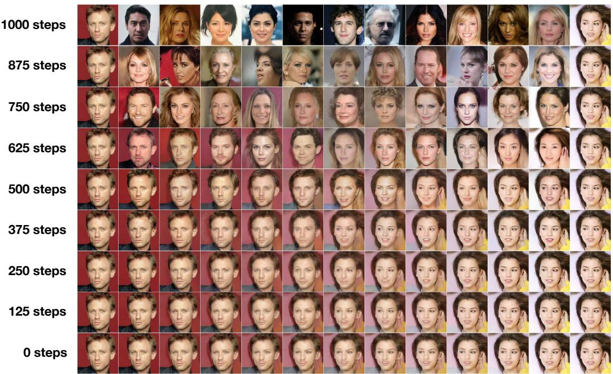  

源（Source） 重建（Rec.） λ=0.1 λ=0.2 λ=0.3 λ=0.4 λ=0.5 λ=0.6 λ=0.7 λ=0.8 λ=0.9 重建（Rec.） 源（Source）

图 9：在潜空间混合之前改变扩散步数的由粗到精插值。

  

反向过程步骤（$T - t$）

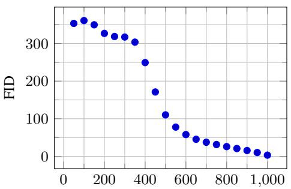  

反向过程步骤（T − t）

图 10：无条件 CIFAR10 随时间的渐进采样质量

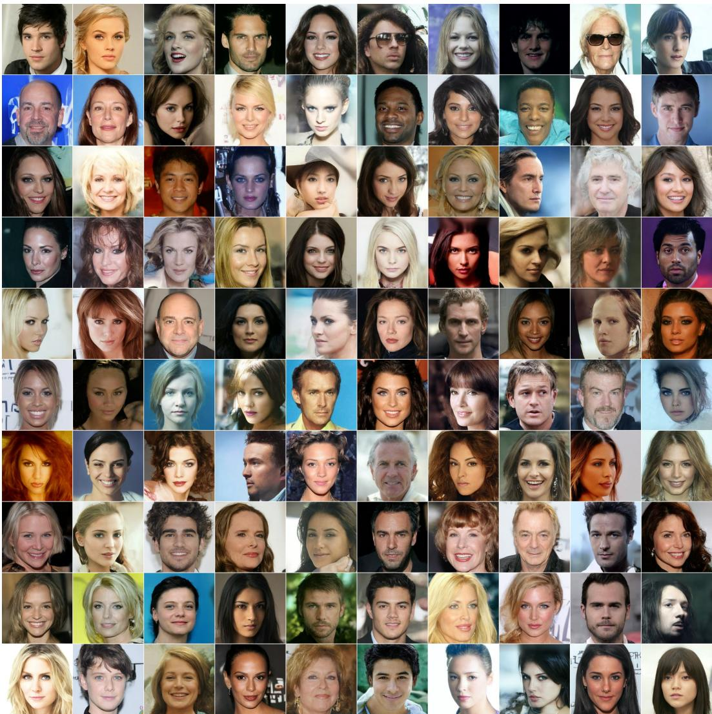  

图 11：CelebA-HQ 256×256 生成样本

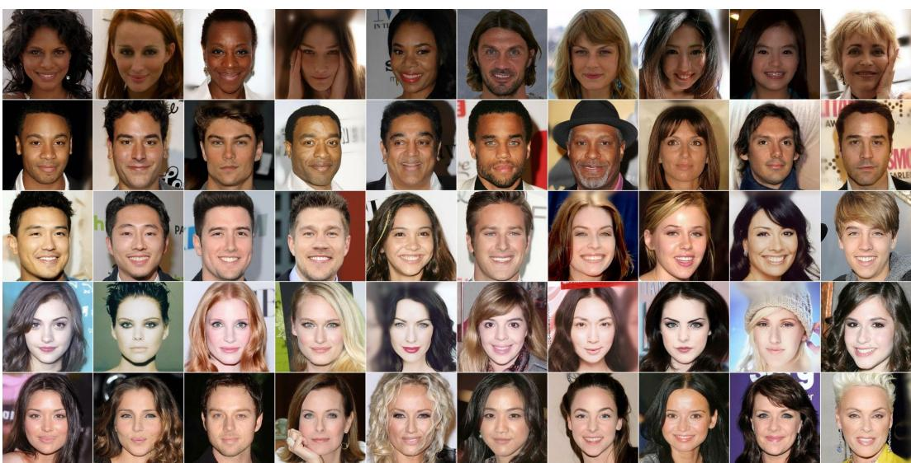

  

(a) 像素空间最近邻  
(b) Inception 特征空间最近邻  
图 12：CelebA-HQ 256×256 最近邻，在围绕面部的 100×100 裁剪区域上计算得到。生成的样本位于最左侧一列，训练集的最近邻位于其余各列。

  

图 13：无条件 CIFAR10 生成样本

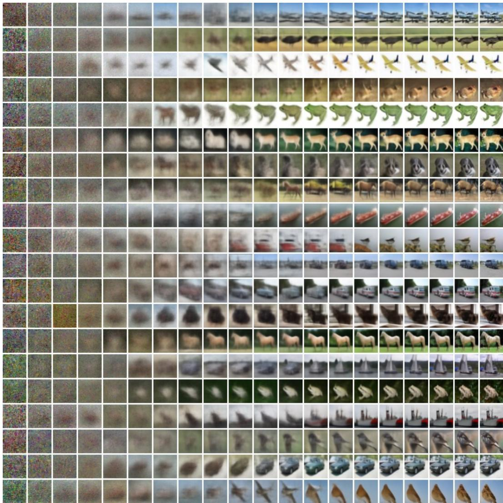  

图 14：无条件 CIFAR10 渐进生成

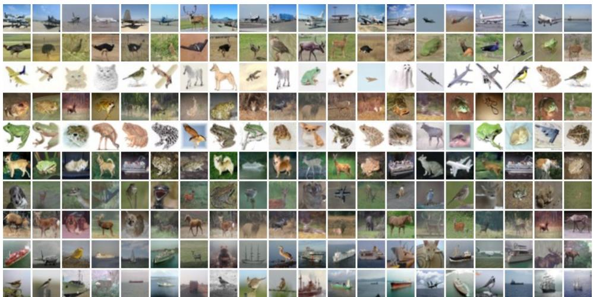

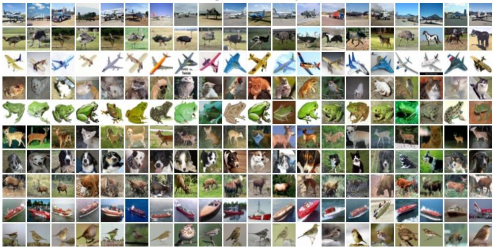  

(a) 像素空间最近邻（Pixel space nearest neighbors）
(b) Inception 特征空间最近邻（Inception feature space nearest neighbors）

Figure 15: 无条件 CIFAR10 最近邻。生成样本位于最左侧一列，训练集最近邻位于其余列。

  

图 16：LSUN Church 生成样本。FID=7.89

  

图 17：LSUN Bedroom 生成样本，大模型。FID=4.90

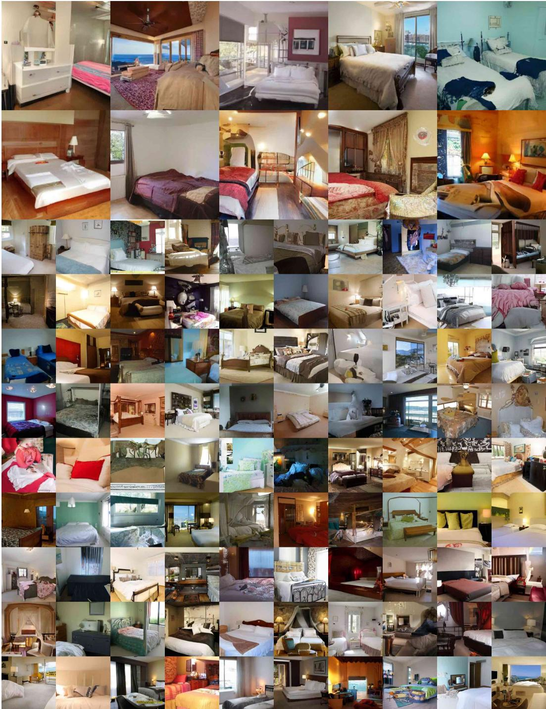  

图 18：LSUN Bedroom 生成样本，小模型使用此格式。FID=6.36

  

图 19：LSUN Cat 生成样本。FID=19.75