# GLIDE: 面向文本引导扩散模型的逼真图像生成与编辑

Alex Nichol \*　　Prafulla Dhariwal \*　　Aditya Ramesh \*　　Pranav Shyam　　Pamela Mishkin　　Bob McGrew　　Ilya Sutskever　　Mark Chen

## 摘要

扩散模型最近被证明能够生成高质量的合成图像，尤其是当与一种引导技术搭配以在多样性与保真度之间进行权衡时。我们针对文本条件图像合成问题，探索了扩散模型，并比较了两种不同的引导策略：CLIP 引导（CLIP guidance）和无分类器引导（classifier-free guidance）。我们发现，人类评估者在照片真实感和标题相似性两方面都更偏好后者，且后者通常能够生成具有照片真实感的样本。一个具有 35 亿参数的文本条件扩散模型在使用无分类器引导时所生成的样本，在人类评估者看来比 DALL-E 的样本更受青睐，即便后者使用了昂贵的 CLIP 重排序（CLIP reranking）。此外，我们发现我们的模型可以被微调以执行图像修复（inpainting），从而实现强大的文本驱动图像编辑。我们在经过筛选的数据集上训练了一个较小的模型，并在 https://github.com/openai/glide-text2im 发布了代码与权重。

## 1. 引言

图像，例如插画、绘画和照片，通常可以用文字轻松地加以描述，却可能需要专门的技能和数小时的劳动才能创作出来。因此，一种能够从自然语言生成真实图像的工具，可以使人类以前所未有的便捷方式创作丰富多样的视觉内容。使用自然语言编辑图像的能力更进一步允许了迭代式的精炼与细粒度的控制，这两者对于现实世界的应用都至关重要。

最近的文本条件图像模型能够从自由形式的文本提示合成图像，并能够以语义上合理的方式组合不相关的物体（Xu 等, 2017; Zhu 等, 2019; Tao 等, 2020; Ramesh 等, 2021; Zhang 等, 2021）。然而，它们尚无法生成能够捕捉相应文本提示所有方面的逼真图像。

另一方面，无条件图像模型能够合成逼真的图像（Brock 等, 2018; Karras 等, 2019a;b; Razavi 等, 2019），有时其保真度之高，以至于人类无法将其与真实图像区分开来（Zhou 等, 2019）。在这一研究方向中，扩散模型（Sohl-Dickstein 等, 2015; Song & Ermon, 2020b）已崭露头角，成为一类前景广阔的生成模型，在多项图像生成基准上取得了最先进的样本质量（Ho 等, 2020; Dhariwal & Nichol, 2021; Ho 等, 2021）。

为了在类别条件设定下实现照片级真实感，Dhariwal 与 Nichol（2021）使用分类器引导（classifier guidance）对扩散模型进行了增强，这是一种允许扩散模型以分类器标签为条件的技术。分类器首先在加噪图像上进行训练，在扩散采样过程中，来自分类器的梯度被用来引导样本趋向目标标签。Ho 与 Salimans（2021）则通过使用无分类器引导（classifier-free guidance）——一种在有标签与无标签扩散模型预测之间进行插值的引导形式——在无需单独训练分类器的情况下取得了类似的效果。

受引导式扩散模型能够生成照片级真实感样本，以及文本到图像模型能够处理自由形式提示的双重启发，我们将引导式扩散应用于文本条件图像合成问题。首先，我们训练了一个 35 亿参数的扩散模型，该模型借助文本编码器以自然语言描述为条件。接着，我们比较了两种将扩散模型引导至文本提示的技术：CLIP 引导（CLIP guidance）和无分类器引导。通过人工评估与自动评估，我们发现无分类器引导能够生成更高质量的图像。

我们发现，使用无分类器引导从我们的模型生成的样本既具有照片级真实感，又反映了广泛的世界知识。由人类评判员进行评估时，在照片级真实感维度上，我们的样本在 87% 的情况下比 DALL-E（Ramesh 等，2021）的样本更受青睐；在标题相似度维度上，这一比例为 69%。

"一只刺猬正在使用计算器"

"一只柯基犬戴着红色领结和紫色派对帽"

"机器人在内观禅修营中冥想"

"一幅秋季风景画，小屋毗邻湖泊"

  

“一幅由萨尔瓦多·达利（Salvador Dalí）创作的梦境般超现实主义油画，描绘一只猫在下国际跳棋”
“一张大峡谷（Grand Canyon）日落的专业摄影作品”
“一幅高质量的迷幻仓鼠龙油画”
“一幅身穿超级英雄服装的阿尔伯特·爱因斯坦（Albert Einstein）插画”
“威尼斯（Venice）运河中的一艘小船”
“一幅星空（Starry Night）画派风格的狐狸画作”
“一个红色立方体放在蓝色立方体上方”
“一扇熊猫吃竹子的彩色玻璃窗画”
“一幅太空电梯的蜡笔画”
“一座合成波（Synthwave）风格的未来城市”
“一幅柯基犬披萨的像素画”
“一团雾气涌入纽约（New York）”

图 1. 使用无分类器引导（classifier-free guidance）的 GLIDE 精选样本。我们观察到，我们的模型能够生成具有阴影和反射的逼真图像，能够以正确的方式组合多个概念，并能够对新概念进行艺术化渲染。随机样本网格请见图 17 和图 18。

尽管我们的模型能够零样本（zero-shot）渲染各种各样的文本提示，但对于复杂的提示，它仍可能在生成逼真图像方面存在困难。因此，除了零样本生成能力之外，我们还为模型提供了编辑能力，使人类能够迭代地改进模型生成的样本，直至其匹配更复杂的提示。具体而言，我们对模型进行了微调以执行图像修复（inpainting），发现它能够使用自然语言提示对现有图像进行逼真的编辑。模型生成的编辑结果能够与周围上下文的风格和光照相匹配，包括令人信服的阴影和反射。这些模型未来的应用可能以前所未有的速度和便捷性帮助人类创作引人注目的定制图像。

  

斑马在旷野中漫步

  

一个红头发的男人

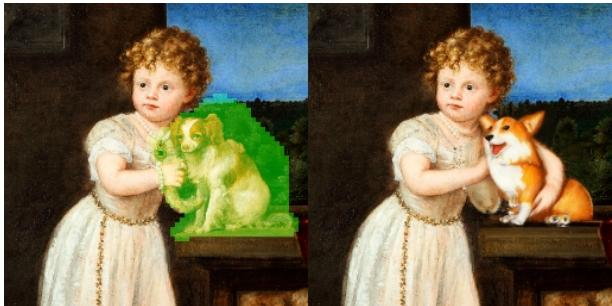  

一个女孩在台座上抱着一只柯基犬

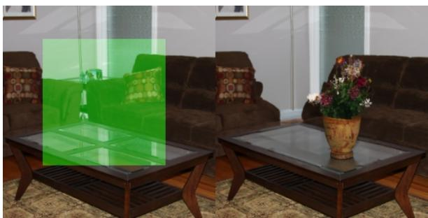  

一花瓶花

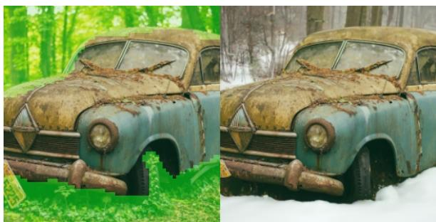  

雪林中的一辆旧车

  

图 2. GLIDE 的文本条件图像修复（Text-conditional image inpainting）示例。绿色区域被擦除，模型根据给定的提示进行填充。我们的模型能够匹配周围上下文的风格与光照，从而生成逼真的补全结果。

我们观察到，我们得到的模型可以显著降低制作有说服力的虚假信息或 Deepfakes 所需的工作量。为了防范这些用例并促进未来研究，我们发布了一个在经过筛选的数据集上训练的更小的扩散模型和一个加入噪声的 CLIP 模型。

我们将我们的系统称为 GLIDE，即「用于生成与编辑的引导式语言到图像扩散（Guided Language to Image Diffusion for Generation and Editing）」。我们将我们的小型筛选模型称为 GLIDE (filtered)。

## 2. 背景

在以下小节中，我们概述了我们将要评估的最终模型的组成部分：扩散、无分类器引导和 CLIP 引导。

## 2.1. 扩散模型

我们考虑了 Sohl-Dickstein 等人（2015）提出，并由 Song & Ermon (2020b); Ho 等人（2020）改进的高斯扩散模型。给定来自数据分布 $x _ { 0 } \sim q ( x _ { 0 } )$ 的一个样本，我们通过逐步向样本添加高斯噪声来产生潜变量的马尔可夫链 $x _ { 1 } , . . . , x _ { T }$：

$$
q (x _ {t} | x _ {t - 1}) := \mathcal {N} (x _ {t}; \sqrt {\alpha_ {t}} x _ {t - 1}, (1 - \alpha_ {t}) \mathcal {I})
$$

如果每一步所添加噪声的幅度 $1 \ - \ \alpha _ { t }$ 足够小，则后验 $q ( x _ { t - 1 } | x _ { t } )$ 可由对角高斯良好近似。此外，如果整个链过程中所添加总噪声的幅度 $1 - \alpha _ { 1 } . . . \alpha _ { T }$ 足够大，则 $x _ { T }$ 可由 $\mathcal { N } ( 0 , \mathcal { T } )$ 良好近似。这些性质启发我们去学习一个模型 $p _ { \theta } ( x _ { t - 1 } | x _ { t } )$ 来近似真实后验：

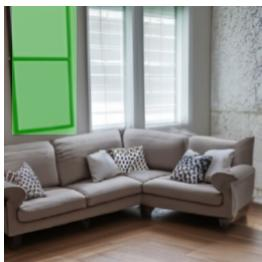  

一个温馨的客厅

  

一幅柯基犬的画作，挂在沙发正上方的墙上

  

沙发前面的一张圆形茶几

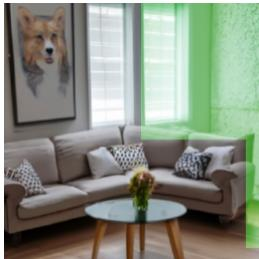  

茶几上的一瓶花

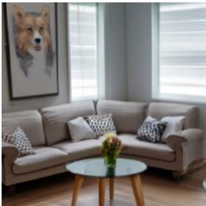  

房间角落里的沙发

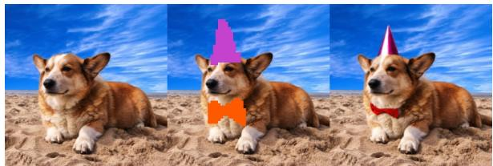  

图 3. 使用 GLIDE 迭代式地创建复杂场景。首先，我们根据提示词「a cozy living room」生成一张图像，然后使用所示的修复（inpainting）掩码和后续的文本提示，在墙上添加一幅画、一张咖啡桌，以及咖啡桌上的一瓶花，最后将墙面上移至沙发处。

「a corgi wearing a bow tie and a birthday hat」

  

背景中的一团火

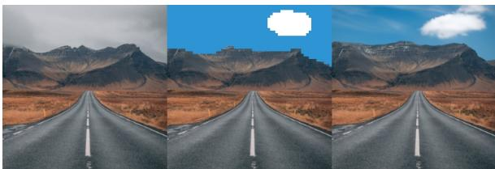  

“今天天空中只有一朵云”  
图 4. 结合文本条件的 SDEdit（Meng et al., 2021）与 GLIDE 的示例，用户将草图与文本提示相结合，以对图像进行更可控的修改。

$$
p _ {\theta} (x _ {t - 1} | x _ {t}) := \mathcal {N} (\mu_ {\theta} (x _ {t}), \Sigma_ {\theta} (x _ {t}))
$$

可以通过从高斯噪声 $x_T \sim \mathcal{N}(0, \mathcal{T})$ 出发，并在 $x_{T-1}, x_{T-2}, \ldots, x_0$ 这一序列步骤中逐步降低噪声，从而生成样本 $x_0 \sim p_\theta(x_0)$。

虽然对 log $p_\theta(x_0)$ 存在一个可处理的变分下界（VLB），但通过对 VLB 中的各项进行重新加权的替代目标（surrogate objective）进行优化，可以获得更好的结果。为了计算该替代目标，我们通过对 $x_0$ 施加高斯噪声来生成样本 $x_t \sim q(x_t \mid x_0)$，然后训练模型 $\epsilon_\theta$ 使用标准的均方误差损失来预测所添加的噪声：

$$
L _ {\text { simple }} := E _ {t \sim [ 1, T ], x _ {0} \sim q (x _ {0}), \epsilon \sim \mathcal {N} (0, \mathbf {I})} [ | | \epsilon - \epsilon_ {\theta} (x _ {t}, t) | | ^ {2} ]
$$

Ho 等人（2020）展示了如何由 $\epsilon _ { \theta } ( x _ { t } , t )$ 推导出 $\mu _ { \theta } ( x _ { t } )$，并将 $\Sigma _ { \theta }$ 固定为常数。他们还证明了与先前基于去噪得分匹配（denoising score-matching）的模型（Song & Ermon, 2020b;a）之间的等价性，其中得分函数 $\nabla _ { x _ { t } } \log { p ( x _ { t } ) }$ ∝ $\epsilon _ { \theta } ( x _ { t } , t )$。在后续工作中，Nichol 与 Dhariwal（2021）提出了一种学习 $\Sigma _ { \theta } ,$ 的策略，使模型能够以更少的扩散步数生成高质量样本。我们在本文训练模型时采用了这一技术。

扩散模型也已成功应用于图像超分辨率（image super-resolution）任务（Nichol & Dhariwal, 2021; Saharia 等人, 2021b）。按照扩散的标准形式，高分辨率图像 $y _ { 0 }$ 在一系列步骤中被逐步加噪。然而，$p _ { \theta } \big ( y _ { t - 1 } | y _ { t } , x \big )$ 还会额外以经过下采样的输入 $x$ 为条件；该输入通过在通道维度上拼接经双三次上采样（bicubic upsampled）的 x 送入模型。这些模型在 FID、IS 以及人工对比评分上均优于以往的方法。

## 2.2. 引导式扩散（Guided Diffusion）

Dhariwal 与 Nichol（2021）发现，类别条件扩散模型（class-conditional diffusion model）的样本质量常常可以通过分类器引导（classifier guidance）得到改善。具体而言，对一个均值 $\mu _ { \boldsymbol { \theta } } ( \boldsymbol { x } _ { t } | \boldsymbol { y } )$、方差 $\Sigma _ { \theta } ( x _ { t } | y )$ 的类别条件扩散模型，用分类器所预测的目标类别 $y$ 的对数概率 $\log p _ { \phi } ( \boldsymbol { y } | \boldsymbol { x } _ { t } )$ 的梯度对其进行加性扰动。所得的扰动后均值 $\hat { \mu } _ { \boldsymbol { \theta } } ( \boldsymbol { x } _ { t } | \boldsymbol { y } )$ 由下式给出

$$
\hat {\mu} _ {\theta} (x _ {t} | y) = \mu_ {\theta} (x _ {t} | y) + s \cdot \Sigma_ {\theta} (x _ {t} | y) \nabla_ {x _ {t}} \log p _ {\phi} (y | x _ {t})
$$

系数 s 被称为引导尺度（guidance scale），Dhariwal 与 Nichol（2021）发现，增大 s 可以提升样本质量，但会以牺牲多样性为代价。

## 2.3. 无分类器引导（Classifier-free Guidance）

Ho 与 Salimans（2021）近期提出了无分类器引导（classifier-free guidance），这是一种无需训练单独分类器模型即可引导扩散模型的技术。对于无分类器引导，类别条件扩散模型 $\epsilon _ { \theta } ( x _ { t } | y )$ 中的标签 y 在训练过程中会以固定概率被替换为空标签 ∅。在采样过程中，模型的输出会沿 $\epsilon _ { \theta } ( x _ { t } | y )$ 方向进一步外推，并远离 $\epsilon _ { \theta } ( x _ { t } | \emptyset )$，具体如下：

$$
\hat {\epsilon} _ {\theta} (x _ {t} | y) = \epsilon_ {\theta} (x _ {t} | \emptyset) + s \cdot (\epsilon_ {\theta} (x _ {t} | y) - \epsilon_ {\theta} (x _ {t} | \emptyset))
$$

此处 $s \geq 1$ 为引导尺度（guidance scale）。该函数形式受隐式分类器（implicit classifier）的启发。

$$
p ^ {i} (y | x _ {t}) \propto \frac {p (x _ {t} | y)}{p (x _ {t})}
$$

其梯度可以写成真实分数 $\epsilon ^ { * }$ 的形式

$$
\begin{array}{r} \nabla_ {x _ {t}} \log p ^ {i} (x _ {t} | y) \propto \nabla_ {x _ {t}} \log p (x _ {t} | y) - \nabla_ {x _ {t}} \log p (x _ {t}) \\ \propto \epsilon^ {*} (x _ {t} | y) - \epsilon^ {*} (x _ {t}) \end{array}
$$

为了实现使用通用文本提示的无分类器引导（classifier-free guidance），我们在训练中有时会将文本描述替换为一个空序列（我们也将其记作 ∅）。然后，我们利用修正后的预测 $\hat{\varepsilon}$ 朝向描述 $c$ 进行引导：

$$
\hat {\epsilon} _ {\theta} (x _ {t} | c) = \epsilon_ {\theta} (x _ {t} | \emptyset) + s \cdot (\epsilon_ {\theta} (x _ {t} | c) - \epsilon_ {\theta} (x _ {t} | \emptyset))
$$

无分类器引导具有两个吸引人的特性。首先，它允许单个模型在引导过程中利用其自身的知识，而不是依赖于一个独立的（有时更小的）分类模型的知识。其次，当条件信息难以用分类器预测时（例如文本），它还能简化引导过程。

## 2.4. CLIP 引导

Radford 等人（2021）将 CLIP 引入作为一种可扩展的、用于学习文本与图像之间联合表示（Joint Representations）的方法。一个 CLIP 模型由两个独立的部分组成：一个图像编码器 $f ( x )$ 和一个标题编码器 $g ( c )$ 。在训练期间，从一个大型数据集中采样成批的 $( x , c )$ 对，并对模型优化一个对比交叉熵损失，该损失鼓励在图像 $x$ 与给定标题 $c$ 配对时具有较高的点积 $f ( x ) \cdot g ( c )$，或者在图像与标题对应于训练数据中不同对时具有较低的点积。

由于 CLIP 提供了一个衡量图像与标题接近程度的评分，已有若干研究利用它将 GAN 等生成模型引导向用户定义的文本标题（Galatolo 等，2021；Patashnik 等，2021；Murdock，2021；Gal 等，2021）。为了将同样的思路应用于扩散模型，我们可以在分类器引导中用 CLIP 模型替换分类器。具体而言，我们用图像和标题编码相对于图像的点积梯度来扰动反向过程的均值：

$$
\hat {\mu} _ {\theta} (x _ {t} | c) = \mu_ {\theta} (x _ {t} | c) + s \cdot \Sigma_ {\theta} (x _ {t} | c) \nabla_ {x _ {t}} \left(f (x _ {t}) \cdot g (c)\right)
$$

与分类器引导类似，我们必须在加噪图像 $x _ { t }$ 上训练 CLIP，以便在反向过程中获得正确的梯度。在我们的全部实验中，我们使用的都是显式针对噪声训练的 CLIP 模型，我们称之为加噪 CLIP 模型。

先前的工作 Crowson (2021a;b) 已表明，在没有针对加噪图像训练过的公开 CLIP 模型，仍然可以用于引导扩散模型。在附录 D 中，我们展示了我们的加噪 CLIP 引导无需借助数据增强或感知损失等额外技巧便优于上述方法。我们假设，使用公开 CLIP 模型进行引导之所以会损害样本质量，是因为采样过程中遇到的加噪中间图像对该模型而言是分布外样本。

## 3. 相关工作

许多工作已对文本条件图像生成这一问题展开过探讨。Xu et al. (2017); Zhu et al. (2019); Tao et al. (2020); Zhang et al. (2021); Ye et al. (2021) 使用公开的图像描述数据集训练带文本条件的 GAN。Ramesh et al. (2021) 基于 van den Oord et al. (2017) 的方法合成以文本为条件的图像，其中在离散潜在编码之上训练自回归生成模型。与我们的工作同期，Gu et al. (2021) 在离散潜在编码之上训练文本条件的离散扩散模型，并发现所得系统能够生成具有竞争力的图像样本。

若干工作已探索使用扩散模型进行图像修复（inpainting）。Meng et al. (2021) 发现扩散模型不仅可以修复图像区域，还可以以图像的粗略草图（或一组颜色）作为条件进行修复。Saharia et al. (2021a) 发现，当直接针对修复任务进行训练时，扩散模型能够平滑地修复图像区域而不会出现边缘伪影。

CLIP 此前已被用于引导图像生成。Galatolo et al. (2021); Patashnik et al. (2021); Murdock (2021); Gal et al. (2021) 使用 CLIP 将 GAN 生成引导至文本提示方向。在线的 AI 生成艺术社区已使用未加噪的 CLIP 引导扩散（Crowson, 2021a;b）产出了颇有前景的早期成果。Kim & Ye (2021) 通过微调扩散模型，使其在面向 CLIP 损失的同时重建原始图像的 DDIM（Song et al., 2020a）潜在表示，从而使用文本提示编辑图像。Zhou et al. (2021) 训练以受扰动的 CLIP 图像嵌入为条件的 GAN 模型，由此得到一种能够以 CLIP 文本嵌入为图像条件的模型。上述工作均未探索加噪 CLIP 模型，并且通常因而依赖于数据增强和感知损失。

一些工作探索了基于文本的图像编辑。Zhang 等人（2020）提出了一种双重注意力机制，用于利用文本嵌入来修复图像中缺失的区域。Stap 等人（2020）提出了一种使用基于文本的特征向量来编辑人脸图像的方法。Bau 等人（2021）将 CLIP 与最先进的 GAN 模型结合，使用文本目标来修复图像。与我们的工作同期，Avrahami 等人（2021）使用 CLIP 引导的扩散来修复以文本为条件的图像区域。

## 4. 训练

在我们的主要实验中，我们训练了一个 35 亿参数的文本条件扩散模型，分辨率为 64 × 64，并训练了另一个 15 亿参数的文本条件上采样扩散模型以将分辨率提升至 $2 5 6 \times 2 5 6$。对于 CLIP 引导，我们还训练了一个加噪的 64 × 64 ViT-L CLIP 模型（Dosovitskiy 等人，2020）。

### 4.1. 文本条件扩散模型

我们采用了 Dhariwal & Nichol（2021）提出的 ADM 模型架构，但增加了文本条件信息。对于每个加噪图像 $x _ { t }$ 和对应的文本描述 $c$，我们的模型预测 $p ( x _ { t - 1 } | x _ { t } , c )$。为了以文本为条件，我们首先将其编码为 K 个标记的序列，并将这些标记馈送入一个 Transformer 模型（Vaswani 等人，2017）。该 Transformer 的输出以两种方式使用：首先，最终的标记嵌入被用于替代 ADM 模型中的类别嵌入；其次，最后一层的标记嵌入（K 个特征向量的序列）被分别投影到 ADM 模型中每个注意力层的维度，然后在每一层与注意力上下文拼接。

我们在与 DALL-E（Ramesh 等人，2021）相同的数据集上训练我们的模型。我们使用与 Dhariwal & Nichol（2021）的 ImageNet 64 × 64 模型相同的模型架构，但将模型宽度扩展到 512 个通道，导致模型视觉部分约 23 亿参数。对于文本编码 Transformer，我们使用宽度为 2048 的 24 个残差块，导致约 12 亿参数。

此外，我们训练了一个 15 亿参数的上采样扩散模型，用于将分辨率从 $6 4 \times 6 4$ 提升到 256 × 256。

该模型以与基础模型相同的方式以文本为条件，但使用宽度为 1024 而非 2048 的较小文本编码器。除此之外，架构与 Dhariwal & Nichol（2021）的 ImageNet 上采样器相同，只是我们将基础通道数增加到 384。

我们以 2048 的批量大小训练基础模型 250 万次迭代。我们以 512 的批量大小训练上采样模型 160 万次迭代。我们发现这些模型在 16 位精度和传统损失缩放下训练稳定（Micikevicius 等人，2017）。总训练算力大致等于训练 DALL-E 所用的算力。

### 4.2. 用于无分类器引导的微调

在初始训练运行之后，我们对基础模型进行了微调，以支持无条件图像生成。这个训练过程与预训练完全相同，只是有 20% 的文本标记序列被替换为空序列。通过这种方式，模型保留了生成文本条件输出的能力，同时也可以无条件地生成图像。

## 4.3. 图像修复（Image Inpainting）

大多数先前使用扩散模型进行修复的工作并没有针对该任务显式训练扩散模型（Sohl-Dickstein 等人，2015；Song 等人，2020b；Meng 等人，2021）。特别是，扩散模型修复可以通过照常从扩散模型中采样，但在每个采样步骤之后将已知区域替换为来自 $q ( x _ { t } | x _ { 0 } )$ 的样本来执行。这有一个缺点：在采样过程中模型无法看到完整的上下文（只能看到其加噪版本），这在我们早期的实验中有时会导致不希望出现的边缘伪影。

为了获得更好的结果，我们显式地对模型进行微调以执行修复，类似于 Saharia 等人（2021a）。在微调过程中，训练样本的随机区域被擦除，剩余部分连同一个掩码通道作为额外的条件信息一起输入到模型中。我们修改了模型架构，使其具有四个额外的输入通道：第二组 RGB 通道，以及一个掩码通道。在微调之前，我们将这些新通道对应的输入权重初始化为零。对于上采样模型，我们始终提供完整的低分辨率图像，但只提供未被掩码的高分辨率图像区域。

## 4.4. 加噪 CLIP 模型

为了更好地匹配 Dhariwal 与 Nichol（2021）的分类器引导技术，我们训练了加噪 CLIP 模型，其图像编码器 $f ( x _ { t } , t )$ 接收加噪图像 $x _ { t }$，除此之外以与原始 CLIP 模型相同的目标进行训练。我们在 $6 4 \times 6 4$ 分辨率下训练这些模型

"a small kitchen with a low ceiling"（一个天花板很低的小厨房）

  

图 5. 在 MS-COCO 提示词上的随机图像样本。对于 XMC-GAN，我们从 Zhang et al. (2021) 中获取样本。对于 DALL-E，我们在温度（temperature）为 0.85 的条件下生成样本，并使用 CLIP 重排序（reranking）从 256 个样本中选出最佳。对于 GLIDE，我们使用 CLIP 引导（guidance），尺度（scale）为 2.0，以及无分类器引导（classifier-free guidance），尺度为 3.0。我们不对 GLIDE 进行任何 CLIP 重排序或精挑细选（cherry-picking）。

与我们的基础模型使用相同的噪声调度。

## 5. 结果

## 5.1. 定性结果

在视觉上对比图 5 中的 CLIP 引导（CLIP guidance）和无分类器引导（classifier-free guidance）时，我们发现无分类器引导生成的样本通常比使用 CLIP 引导生成的样本看起来更加真实。本文中其余样本均使用无分类器引导生成，我们将在下一节中为这一选择提供理由。

在图 1 中，我们观察到，采用无分类器引导的 GLIDE（Guided Language to Image Diffusion for Generation and Editing，引导式语言到图像扩散生成与编辑模型）能够泛化到各种各样的提示词。该模型常常能生成逼真的阴影和反射，以及高质量的纹理。它还能够以多种风格生成插画，例如特定艺术家或绘画作品的风格，或诸如像素艺术（pixel art）这样的一般风格。最后，该模型能够组合多种概念（例如柯基犬、领结和生日帽），同时将属性（例如颜色）正确绑定到这些对象上。

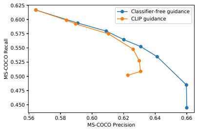  

(a) 精确率/召回率

  

(b) IS/FID

  

(c) CLIP 分数（CLIP score）/ FID

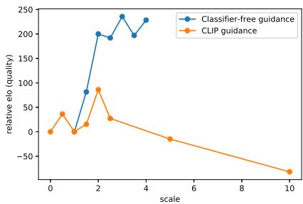  

图 6. 在 MS-COCO 64 × 64 上对无分类器引导（classifier-free guidance）和 CLIP 引导（CLIP guidance）的多样性-保真度权衡的比较。(a) 真实感

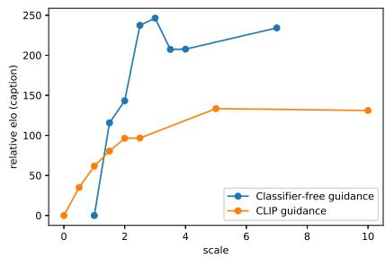  

(b) 标题相似度（Caption Similarity）
图 7. 通过人类评估得到的 Elo 分数，用于寻找无分类器引导（classifier-free guidance）和 CLIP 引导（CLIP guidance）的最优引导尺度。无分类器引导与 CLIP 引导的对比是分开进行的，但可以通过对无引导采样的 Elo 分数进行归一化，将二者叠加到同一张图上。

在图像修复（inpainting）任务上，我们发现 GLIDE 能够利用文本提示对已有图像进行逼真的修改，必要时可插入新的物体、阴影与反射（图 2）。该模型在将物体编辑进绘画作品时甚至能够匹配风格。我们还在图 4 中实验了 SDEdit（Meng et al., 2021），发现我们的模型能够将草图转化为逼真的图像编辑效果。在图 3 中，我们展示了如何迭代地使用 GLIDE 来生成复杂场景：先进行零样本生成，再进行一系列修复编辑。

在图 5 中，我们将我们的模型与之前在 MS-COCO 字幕上的最先进文本条件图像生成模型进行比较，发现在不使用 CLIP 重排序或人工挑选的情况下，我们的模型能够生成更加逼真的图像。

更多定性比较见附录 C、D、E。

## 5.2. 定量结果

我们首先通过考察质量-保真度权衡的帕累托（Pareto）前沿，来评估无分类器引导（classifier-free guidance）与 CLIP 引导（CLIP guidance）之间的差异。在图 6 中，我们在 64 × 64 分辨率下对 MS-COCO 的零样本生成任务评估了这两种方法。我们考察了精确率/召回率（Precision/Recall）（Kynkäänniemi et al., 2019）、FID（Heusel et al., 2017）、Inception Score（Salimans et al., 2016）以及 CLIP 得分1（Radford et al., 2021）。随着两种引导尺度的增大，我们在 FID 与 IS 之间、精确率与召回率之间、CLIP 得分与 FID 之间都观察到了清晰的权衡关系。在前两条曲线上，我们发现无分类器引导（几乎）是帕累托最优的。而当我们将 CLIP 得分与 FID 一起绘制时，则观察到了完全相反的趋势；特别是，CLIP 引导似乎能够比无分类器引导更大程度地提升 CLIP 得分。

我们假设 CLIP 引导是在为评估用的 CLIP 模型寻找对抗样本，而非在匹配提示词方面真正优于无分类器引导。为了验证这一假设，我们雇用了人类评估者来评判生成图像的样本质量。在此设置中，人类评估者会看到两张 256 × 256 的图像，并必须选择其中哪一个样本：1）与给定的字幕匹配得更好，或 2）看起来更加逼真。人类评估者也可以指出两张图像均没有显著优于对方，此时则给两个模型各记半胜。

使用我们的人类评估协议，我们首先对两种方法分别扫描其引导尺度（图 7），然后使用前一阶段得到的最佳尺度对两种方法进行比较（表 1）。我们发现人类评估者的判断与 CLIP 得分不一致，他们认为无分类器引导能够产生更高质量的样本，且样本与对应提示词的吻合度更高。

表 1. 在 256 × 256 分辨率下，针对 MS-COCO 验证集提示词，对无引导扩散采样、无分类器引导（classifier-free guidance）以及 CLIP 引导（CLIP guidance）进行人工评估所得到的 Elo 分数（Elo scores）。对于无分类器引导，我们使用引导强度 3.0；对于 CLIP 引导，使用引导强度 2.0。有关 Elo 分数计算方式的更多细节，请参阅附录 A.1。

<table><tr><td>Guidance</td><td>Photorealism</td><td>Caption</td></tr><tr><td>Unguided</td><td>-88.6</td><td>-106.2</td></tr><tr><td>CLIP guidance</td><td>-73.2</td><td>29.3</td></tr><tr><td>Classifier-free guidance</td><td>82.7</td><td>110.9</td></tr></table>

表 2. 在 MS-COCO 256 × 256 上的 FID 对比。与先前工作类似，我们为模型采样 30k 个描述，并与整个验证集进行比较。对于我们的模型，我们报告无分类器引导（classifier-free guidance）缩放因子为 1.5 时的结果，因为该设置能够取得最佳的 FID。

<table><tr><td>Model</td><td>FID</td><td>Zero-shot FID</td></tr><tr><td>AttnGAN (Xu et al., 2017)</td><td>35.49</td><td></td></tr><tr><td>DM-GAN (Zhu et al., 2019)</td><td>32.64</td><td></td></tr><tr><td>DF-GAN (Tao et al., 2020)</td><td>21.42</td><td></td></tr><tr><td>DM-GAN + CL (Ye et al., 2021)</td><td>20.79</td><td></td></tr><tr><td>XMC-GAN (Zhang et al., 2021)</td><td>9.33</td><td></td></tr><tr><td>LAFITE (Zhou et al., 2021)</td><td>8.12</td><td></td></tr><tr><td>DALL-E (Ramesh et al., 2021)</td><td></td><td> $\sim 28$ </td></tr><tr><td>LAFITE (Zhou et al., 2021)</td><td></td><td>26.94</td></tr><tr><td>GLIDE</td><td></td><td>12.24</td></tr><tr><td>GLIDE (Validation filtered)</td><td></td><td>12.89</td></tr></table>

我们还将 GLIDE 与其他文本条件生成图像模型进行了比较。我们在表 2 中发现，我们的模型在 MS-COCO 上获得了具有竞争力的 FID 分数，尽管从未在该数据集上进行过显式训练。我们还参照 Ramesh 等人（2021）的方法，在从 MS-COCO 验证集中剔除所有与训练集图像相似的图像后计算了 FID。这使得验证批次减少了 21%。我们发现，在这种情况下，我们的 FID 仅从 12.24 略微上升到 12.89，这主要可以归因于在使用较小的参考批次时 FID 偏差的变化。

最后，我们使用人类评估协议将 GLIDE 与 DALL-E 进行了比较（表 3）。需要注意的是，GLIDE 的训练算力与 DALL-E 大致相当，但模型规模要小得多（35 亿参数 vs. 120 亿参数）。此外，GLIDE 的采样延迟更低，并且不需要 CLIP 重排序。

我们在 DALL-E 和 GLIDE 之间进行了三组比较。首先，我们在不使用 CLIP 重排序的情况下比较两个模型。其次，我们仅对 DALL-E 使用 CLIP 重排序。最后，我们对 DALL-E 使用 CLIP 重排序，同时将 GLIDE 样本通过 DALL-E 使用的离散 VAE 进行投影。后者允许我们评估 DALL-E 的模糊样本如何影响人类判断。我们对 DALL-E 模型在两种温度设置下进行了所有评估。在所有设置中，我们的模型都更受人类评估者的青睐，即使在那些严重有利于 DALL-E 的配置下也是如此——这些配置允许 DALL-E 通过 CLIP 重排序使用更多的测试时算力，并以 VAE 模糊的方式降低 GLIDE 的样本质量。

表 3. GLIDE 与 DALL-E 的人类评估结果。我们报告了我们的模型在照片真实感和标题相似性两个方面的胜率。在最后一行中，我们将 DALL-E 使用的 dVAE 应用于 GLIDE 的输出。

<table><tr><td></td><td>DALL-ETemp.</td><td>Photo-realism</td><td>CaptionSimilarity</td></tr><tr><td rowspan="2">No reranking</td><td>1.0</td><td>91%</td><td>83%</td></tr><tr><td>0.85</td><td>84%</td><td>80%</td></tr><tr><td rowspan="2">DALL-E reranked</td><td>1.0</td><td>89%</td><td>71%</td></tr><tr><td>0.85</td><td>87%</td><td>69%</td></tr><tr><td rowspan="2">DALL-E reranked+ GLIDE blurred</td><td>1.0</td><td>72%</td><td>63%</td></tr><tr><td>0.85</td><td>66%</td><td>61%</td></tr></table>

关于 DALL-E 结合 CLIP 重排序以及 GLIDE 采用不同引导策略的样本网格，请参见附录 G。

## 6. 安全考量

我们的模型能够生成逼真的虚假图像，并使缺乏专业技能的用户能够快速对已有图像进行具有说服力的编辑。因此，如果在没有任何防护措施的情况下发布我们的模型，将大幅降低制作具有说服力的虚假信息或深度伪造（Deepfake）内容的技术门槛。此外，由于模型的样本反映了数据集中存在的各种偏见，应用该模型可能在无意间延续有害的社会偏见。

为了减轻发布这些模型可能带来的有害影响，我们在训练待发布的模型之前对训练图像进行了过滤。首先，我们从互联网上收集了包含数亿张图像的数据集，该数据集在很大程度上与用于训练 CLIP 和 DALL-E 的数据集不相交，然后对这些数据应用了若干过滤措施。我们过滤掉了包含人物的训练图像，以降低模型在许多以人物为中心的问题性用例中的能力。我们还担心模型被用于生成暴力图像和仇恨符号，因此也过滤掉了其中的若干此类内容。有关数据过滤流程的更多细节，请参见附录 F.1。

我们训练了一个仅 3 亿参数的小型模型，该模型

  

“一辆用连续履带代替轮子的自行车”
“一只捕猎狮子的老鼠”
“一辆装有三角形轮子的汽车”

图 8. GLIDE 在被要求生成某些不寻常物体或场景时的失败案例。

我们将此版本称为 GLIDE (filtered)，它基于我们过滤后的数据集进行了训练。然后，我们研究了如果模型权重被开源，GLIDE (filtered) 如何降低被滥用的风险。在这项涉及使用一组对抗性提示对模型进行红队测试的调查中，我们没有发现模型能够生成可识别的人类图像的任何实例，这表明我们的数据过滤器具有足够低的假阴性率。我们还探测了 GLIDE (filtered) 的某些形式的偏差，发现它保留并可能放大了数据集中的偏差。例如，当被要求生成"女孩的玩具"时，我们的模型生成的粉色玩具和毛绒动物多于"男孩的玩具"提示下生成的。另外，我们还发现，当被提示生成"宗教场所"等通用文化意象时，我们的模型经常强化西方刻板印象。我们还观察到，在使用无分类器引导（classifier-free guidance）时，模型的偏差会被放大。最后，虽然我们已经阻碍了模型在特定类别中生成图像的能力，但它保留了图像修复（inpainting）能力，其滥用潜力是跨学科研究的一个重要领域。详细示例和图像请参见附录 F.2。

上述调查单独研究了 GLIDE (filtered)，但没有任何模型是孤立存在的。例如，通常可以将多个模型组合起来获得一组新的能力。为了探索这个问题，我们将 GLIDE (filtered) 替换到一个公开可用的 CLIP 引导扩散（CLIP-guided Diffusion）程序 (Crowson, 2021a) 中，并研究了由此产生的模型组合的生成能力。我们总体上发现，虽然 CLIP 模型（基于未过滤的数据训练）允许我们的模型产生一些可识别的面部表情或仇恨图像，但同一个 CLIP 模型在与公开可用的 ImageNet 扩散模型配对时，产生的图像质量大致相当。更多详细信息请参见附录 F.2。

为了促进对 CLIP 引导扩散的进一步研究，我们还训练并发布了一个在过滤数据集上训练的噪声化 ViT-B CLIP 模型。我们将用于训练 GLIDE (filtered) 的数据集与原始 CLIP 数据集的过滤版本进行了合并。为了对此模型进行红队测试，我们使用它同时引导 GLIDE (filtered) 和一个公开的 64 × 64 ImageNet 模型。在我们尝试的提示中，新的 CLIP 模型并未显著提高暴力图像或人物图像的质量，未超过现有公开 CLIP 模型所产生的此类图像的质量。

我们还测试了 GLIDE（filtered）直接复现训练图像的能力。在该实验中，我们从训练集中选取 30K 条提示词进行图像采样，并在 CLIP 潜空间中计算每张生成图像与原始训练图像之间的距离。随后我们检查了距离最小的图像对。在我们检查的所有图像对中，模型都没有忠实地复现训练图像。

## 7. 局限性

虽然我们的模型常常能够以复杂的方式组合不同的概念，但它有时无法捕捉某些描述高度不寻常的物体或场景的提示词。在图 8 中，我们给出了一些这类失败案例的示例。

我们未优化的模型在单个 A100 GPU 上采样一张图像需要 15 秒。这比相关 GAN 方法的采样要慢得多，因为后者在单次前向传播中即可生成图像，因此更适合用于实时应用。

## 8. 致谢

我们要感谢 Lama Ahmad、Rosie Campbell、Gretchen Krueger、Steven Adler、Miles Brundage 和 Tyna Eloundou 对我们的模型及其社会影响所进行的深入探讨与交流。我们还要感谢 Yura Burda 对本文初稿提供的反馈，以及 Mikhail Pavlov 为文本条件生成模型寻找困难提示词所做的贡献。

## 参考文献

Avrahami, O., Lischinski, D., and Fried, O. Blended diffusion for text-driven editing of natural images. 用于自然图像文本驱动编辑的混合扩散。arXiv:2111.14818, 2021.

Bau, D., Andonian, A., Cui, A., Park, Y., Jahanian, A., Oliva, A., and Torralba, A. Paint by word. 文字绘画。arXiv:2103.10951, 2021.

Brock, A., Donahue, J., and Simonyan, K. Large scale gan training for high fidelity natural image synthesis. 面向高保真自然图像合成的大规模 GAN 训练。arXiv:1809.11096, 2018.

Buolamwini, J. and Gebru, T. Gender shades: Intersectional accuracy disparities in commercial gender classification. 性别阴影：商业性别分类中的交叉性准确率差异。收录于：Friedler, S. A. and Wilson, C.（编），第 1 届公平、问责与透明度会议论文集，《机器学习研究论文集》第 81 卷，第 77–91 页。PMLR，2018 年 2 月 23–24 日。网址 https://proceedings.mlr.press/v81/ buolamwini18a.html。

Crowson, K. Clip guided diffusion hq 256x256. CLIP 引导扩散 HQ 256x256。https: //colab.research.google.com/drive/ 12a\_Wrfi2\_gwwAuN3VvMTwVMz9TfqctNj, 2021a.

Crowson, K. Clip guided diffusion 512x512, secondary model method. CLIP 引导扩散 512x512，辅助模型方法。https: //twitter.com/RiversHaveWings/status/ 1462859669454536711, 2021b.

Dhariwal, P. and Nichol, A. Diffusion models beat gans on image synthesis. 扩散模型在图像合成上击败 GAN。arXiv:2105.05233, 2021.

Gal, R., Patashnik, O., Maron, H., Chechik, G., and Cohen-Or, D. Stylegan-nada: Clip-guided domain adaptation of image generators. StyleGAN-NADA：基于 CLIP 引导的图像生成器域自适应。arXiv:2108.00946, 2021.

Galatolo, F. A., Cimino, M. G. C. A., and Vaglini, G. 通过 CLIP 引导的生成潜在空间搜索从标题生成图像及反向生成（Generating images from caption and vice versa via clip-guided generative latent space search）. arXiv:2102.01645, 2021.

Gu, S., Chen, D., Bao, J., Wen, F., Zhang, B., Chen, D., Yuan, L., and Guo, B. 用于文本到图像合成的向量量化扩散模型（Vector quantized diffusion model for text-to-image synthesis）. arXiv:2111.14822, 2021.

Heusel, M., Ramsauer, H., Unterthiner, T., Nessler, B., and Hochreiter, S. 通过双时间尺度更新规则训练的 GAN 收敛到局部纳什均衡（Gans trained by a two time-scale update rule converge to a local nash equilibrium）. 神经信息处理系统进展 30（NIPS 2017），2017。

Ho, J. and Salimans, T. 无分类器扩散引导（Classifier-free diffusion guidance）. 收录于：NeurIPS 2021 深度生成模型与下游应用研讨会，2021。网址：https:// openreview.net/forum?id=qw8AKxfYbI。

Ho, J., Jain, A., and Abbeel, P. 去噪扩散概率模型（Denoising diffusion probabilistic models）. arXiv:2006.11239, 2020.

Ho, J., Saharia, C., Chan, W., Fleet, D. J., Norouzi, M., and Salimans, T. 用于高保真图像生成的级联扩散模型（Cascaded diffusion models for high fidelity image generation）. arXiv:2106.15282, 2021.

Karras, T., Laine, S., and Aila, T. 一种用于生成对抗网络的基于风格的生成器架构（A style-based generator architecture for generative adversarial networks）. arXiv:arXiv:1812.04948, 2019a.

Karras, T., Laine, S., Aittala, M., Hellsten, J., Lehtinen, J., and Aila, T. 分析并改进 StyleGAN 的图像质量（Analyzing and improving the image quality of stylegan）. arXiv:1912.04958, 2019b.

Kim, G. and Ye, J. C. DiffusionCLIP：使用扩散模型进行文本引导的图像操作（Diffusionclip: Text-guided image manipulation using diffusion models）. arXiv:2110.02711, 2021.

Kynkäänniemi, T., Karras, T., Laine, S., Lehtinen, J., and Aila, T. 用于评估生成模型的改进精确率与召回率指标（Improved precision and recall metric for assessing generative models）. arXiv:1904.06991, 2019.

Meng, C., Song, Y., Song, J., Wu, J., Zhu, J.-Y., and Ermon, S. SDEdit：使用随机微分方程进行图像合成与编辑（Sdedit: Image synthesis and editing with stochastic differential equations）. arXiv:2108.01073, 2021.

Murdock, R. The Big Sleep. https://twitter.com/ advadnoun/status/1351038053033406468, 2021.

Nichol, A. and Dhariwal, P. 改进的去噪扩散概率模型（Improved denoising diffusion probabilistic models）. arXiv:2102.09672, 2021.

Patashnik, O., Wu, Z., Shechtman, E., Cohen-Or, D., and Lischinski, D. StyleCLIP：StyleGAN 图像的文本驱动操作（Styleclip: Text-driven manipulation of stylegan imagery）. arXiv:2103.17249, 2021.

Radford, A., Kim, J. W., Hallacy, C., Ramesh, A., Goh, G., Agarwal, S., Sastry, G., Askell, A., Mishkin, P., Clark, J., Krueger, G., and Sutskever, I. 从自然语言监督中学习可迁移的视觉模型（Learning transferable visual models from natural language supervision）. arXiv:2103.00020, 2021.

Ramesh, A., Pavlov, M., Goh, G., Gray, S., Voss, C., Radford, A., Chen, M., and Sutskever, I. 零样本文本到图像生成（Zero-shot text-toimage generation）. arXiv:2102.12092, 2021.

Razavi, A., van den Oord, A., and Vinyals, O. 使用 VQ-VAE-2 生成多样化的高保真图像（Generating diverse high-fidelity images with VQ-VAE-2）. arXiv:1906.00446, 2019.

Saharia, C., Chan, W., Chang, H., Lee, C. A., Ho, J., Salimans, T., Fleet, D. J., and Norouzi, M. Palette：基于图像到图像的扩散模型。arXiv:2111.05826, 2021a.

Saharia, C., Ho, J., Chan, W., Salimans, T., Fleet, D. J., and Norouzi, M. 通过迭代细化的图像超分辨率。arXiv:arXiv:2104.07636, 2021b.

Salimans, T., Goodfellow, I., Zaremba, W., Cheung, V., Radford, A., and Chen, X. 训练生成对抗网络的改进技术。arXiv:1606.03498, 2016.

Santurkar, S., Tsipras, D., Tran, B., Ilyas, A., Engstrom, L., and Madry, A. 使用单一（鲁棒）分类器进行图像合成。arXiv:1906.09453, 2019.

Sohl-Dickstein, J., Weiss, E. A., Maheswaranathan, N., and Ganguli, S. 使用非平衡热力学的深度无监督学习。arXiv:1503.03585, 2015.

Song, J., Meng, C., and Ermon, S. 去噪扩散隐式模型。arXiv:2010.02502, 2020a.

Song, Y. and Ermon, S. 训练基于分数的生成模型的改进技术。arXiv:2006.09011, 2020a.

Song, Y. and Ermon, S. 通过估计数据分布的梯度进行生成建模。arXiv:arXiv:1907.05600, 2020b.

Song, Y., Sohl-Dickstein, J., Kingma, D. P., Kumar, A., Ermon, S., and Poole, B. 通过随机微分方程进行基于分数的生成建模。arXiv:2011.13456, 2020b.

Stap, D., Bleeker, M., Ibrahimi, S., and ter Hoeve, M. 面向用户指定内容的条件图像生成与操作。arXiv:2005.04909, 2020.

Tao, M., Tang, H., Wu, S., Sebe, N., Jing, X.-Y., Wu, F., and Bao, B. Df-gan：用于文本到图像合成的深度融合生成对抗网络。arXiv:2008.05865, 2020.

van den Oord, A., Vinyals, O., and Kavukcuoglu, K. 神经离散表示学习。arXiv:1711.00937, 2017.

Vaswani, A., Shazeer, N., Parmar, N., Uszkoreit, J., Jones, L., Gomez, A. N., Kaiser, L., and Polosukhin, I. 注意力机制就是你所需要的一切。arXiv:1706.03762, 2017.

Xu, T., Zhang, P., Huang, Q., Zhang, H., Gan, Z., Huang, X., and He, X. Attngan：使用注意力生成对抗网络进行细粒度文本到图像生成。arXiv:1711.10485, 2017.

Ye, H., Yang, X., Takac, M., Sunderraman, R., and Ji, S. 使用对比学习改进文本到图像合成。arXiv:2107.02423, 2021.

Zhang, H., Koh, J. Y., Baldridge, J., Lee, H., and Yang, Y. 用于文本到图像生成的跨模态对比学习。arXiv:2101.04702, 2021.

Zhang, L., Chen, Q., Hu, B., and Jiang, S. 文本引导的神经图像修复。发表于：第28届ACM国际多媒体会议论文集，MM '20，第1302–1310页，纽约，NY，美国，2020年。计算机协会（Association for Computing Machinery）。ISBN 9781450379885。doi: 10.1145/3394171.3414017。URL https://doi.org/10.1145/3394171.3414017。

Zhou, S., Gordon, M. L., Krishna, R., Narcomey, A., Fei-Fei, L., and Bernstein, M. S. Hype：用于人眼感知评估生成模型的基准，2019。

Zhou, Y., Zhang, R., Chen, C., Li, C., Tensmeyer, C., Yu, T., Gu, J., Xu, J., and Sun, T. Lafite：面向无语言训练的文本到图像生成（Lafite: Towards Language-Free Training for Text-to-Image Generation）. arXiv:2111.13792, 2021.

Zhu, M., Pan, P., Chen, W., and Yang, Y. DM-GAN：用于文本到图像合成的动态记忆生成对抗网络（DM-GAN: Dynamic Memory Generative Adversarial Networks for Text-to-Image Synthesis）. arXiv:1904.01310, 2019.

## A. 评估设置

## A.1. 人工评估

在收集人工评估时，我们在评估照片真实感时始终收集 1,000 次成对比较。在评估文本描述相似度时我们也收集 1,000 次比较，但在对引导尺度进行扫描时仅收集 500 次。

在计算胜场数与 Elo 分数时，我们将平局计为每个模型半个胜场。通过这种方式，平局实际上稀释了每个模型的胜场。

为了计算 Elo 分数，我们构建一个矩阵 A，使得条目 $A _ { i j }$ 表示模型 i 击败模型 j 的次数。我们将所有 N 个模型的 Elo 分数初始化为 $\sigma _ { i } = 0 , i \in [ 1 , N ]$。我们通过最小化如下目标来计算 Elo 分数：

$$
L _ {\mathrm{elo}} := - \sum_ {i, j} A _ {i j} \cdot \log \left(\frac {1}{1 + 1 0 ^ {(\sigma_ {i} - \sigma_ {j}) / 4 0 0}}\right)
$$

## A.2. 自动评估

我们使用验证集提示词中的 30,000 个样本来计算 MS-COCO FID（Fréchet Inception Distance）及其他评估指标。除非另有说明，我们使用整个验证集作为参考批次，并对验证图像进行中心裁剪（center-crop）。这种裁剪方式与 Ramesh et al. (2021) 一致，但与大多数此前关于文本条件图像合成（text-conditional image synthesis）的文献有所不同，后者通常是对图像进行拉伸（squeeze）而非中心裁剪。然而，中心裁剪在大多数无条件（unconditional）和类别条件（class-conditional）图像合成的研究中是标准做法，我们希望它在未来也能成为文本条件图像合成中的标准做法。

对于 CLIP 分数，我们采用 Radford et al. (2021) 发布的 CLIP ViT-B/16 模型，并将分数按 CLIP 的 logit 缩放系数（本例中为 100）进行缩放。

## B. 超参数

## B.1. 训练超参数

我们的 noised CLIP 模型使用 ViT（Vision Transformer，Dosovitskiy et al., 2020）处理 64 × 64 的图像，patch 尺寸为 4 × 4。我们在 Radford et al. (2021) 和 Ramesh et al. (2021) 所使用的数据集上以 50%-50% 的混合比例，将 CLIP 模型训练了 390K 次迭代，批处理大小（batch size）为 32K。对于最终的 CLIP 模型，我们训练了一个 ViT-L，权重衰减（weight decay）为 0.0125。训练完成后，我们在更广泛的互联网图像数据集上对最终的 ViT-L 进行了 30K 次迭代的微调。

我们对 GLIDE（filtered）进行了 1.1M 次迭代的预训练，随后又进行了 500K 次迭代的微调，以实现无分类器引导（classifier-free guidance）和图像修复（inpainting）。此外，我们还训练了一个小型 filtered 上采样器模型，其基础通道数为 192，文本编码器通道数为 512，训练了 400K 次迭代。

Table 4. 将我们的小模型与较大模型进行人工评估得到的 Elo 评分

<table><tr><td>Size</td><td>Guide. Scale</td><td>Photorealism</td><td>Caption</td></tr><tr><td>300M</td><td>1.0</td><td>-131.8</td><td>-136.4</td></tr><tr><td>300M</td><td>4.0</td><td>28.2</td><td>70.9</td></tr><tr><td>3.5B</td><td>1.0</td><td>-23.9</td><td>-27.1</td></tr><tr><td>3.5B</td><td>3.0</td><td>133.0</td><td>140.5</td></tr></table>

## B.2. 采样超参数

对于本文展示的样本，我们使用 150 步扩散过程来采样基础模型，但对于修复（inpainting）样本仅使用 100 步。在评测时，我们使用 250 步扩散过程来采样基础模型，因为这会带来轻微的 FID 提升。

对于上采样器，我们采用一种特殊的跨步采样调度，仅用 27 步扩散过程就能获得良好的样本质量。具体而言，我们将采样过程划分为五个段，并在每段内从以下数量的等间隔时间步中采样：10、10、3、2、2。这意味着我们在区间 (800, 1000] 内仅采样两个时间步，但在区间 (0, 200] 内采样 10 个时间步。该调度是在我们的内部验证集上对 FID 进行扫描搜索得到的。

## C. 与较小模型的对比

训练我们的大型 GLIDE 模型是否值得？为了回答这个问题，我们在完整数据集上使用与 GLIDE (filtered) 相同的超参数训练了一个 3 亿参数的另一模型（记为 GLIDE (small)）。我们对比了来自我们大模型、小模型和安全模型（safe model）的样本，以确定在大型、多样的数据集上训练如此巨大的模型能带来哪些能力。

在 Figure 9 中，我们观察到较小的模型常常无法将属性绑定到对象上（例如柯基犬），且在组合任务（例如积木）上表现较差。所有模型通常都能生成逼真的图像，但两个在完整数据集上训练的模型在组合不寻常的概念（例如一只刺猬在用计算器）方面要强得多。

我们还进行了人类评估，比较了在有无无分类器引导（classifier-free guidance）情况下我们的小模型和大模型。我们首先通过人类评估对 3 亿参数模型的引导尺度进行了扫描，发现人类略微偏好尺度 4.0 而不是 3.0 用于该小模型。随后我们运行了一次人类评估，在有引导和无引导条件下对比两个模型（Table 4）。我们发现，无分类器引导带来的 Elo 评分提升大约相当于将模型规模扩大约 10 倍。

  

“一只使用计算器的刺猬”
“一只戴着红色领结和紫色派对帽的柯基犬”
“一个红色立方体叠在蓝色立方体之上”
“一幅高质量油画，描绘一只迷幻风格的仓鼠龙”

图 9. 比较来自我们大模型（第一行）、在相同数据上训练的小版本（第二行）以及我们发布的在更小、经过过滤的数据集上训练的小模型的无分类器引导样本。在最后一行，我们展示了我们的小模型在经过过滤数据训练的 CLIP 模型引导下生成的样本。样本未经过精心挑选。

## D. 与未加噪 CLIP 引导的比较

已有工作曾使用公开可用的 CLIP 模型来引导扩散模型。为了从这种方法中获得可识别的样本，通常需要为生成过程设计一组数据增强和辅助损失。我们推测这主要归因于 CLIP 模型的训练方式：它并未经过训练来识别扩散采样过程中产生的加噪图像或模糊图像。

为了验证这一假设，我们将一个流行的 CLIP 引导扩散程序（Crowson, 2021a）与基于加噪 CLIP 模型的我们方法进行比较（图 10）。我们使用与 Radford 等人（2021）相同的数据集，在 64 × 64 图像上训练了一个加噪的 ViT-B CLIP 模型。然后，我们使用这个加噪的 CLIP 模型以 15.0 的固定梯度尺度，将一个预训练的 ImageNet 模型引导至给定的文本提示。由于 ImageNet 模型是类别条件式的，我们在每个时间步选择一个不同的随机类别标签。随后，我们使用扩散上采样器将生成的 64 × 64 图像上采样到 256 × 256。我们发现，尽管这种方法比该 notebook 中使用的方法简单得多，但生成的图像质量却相当甚至更高，这表明使 CLIP 具备噪声感知能力确实是有帮助的。

无噪声 CLIP（+ 辅助损失）

“一只柯基犬在田野中”

Noised CLIP (+ upsampler)

GLIDE

图 10. GLIDE 与应用于预训练 ImageNet 扩散模型的两种 CLIP 引导策略的比较。左侧，我们使用一个 vanilla CLIP 模型，结合人工设计的感知损失和数据增强（Crowson, 2021a），来引导来自 Dhariwal & Nichol (2021) 的 256 × 256 扩散模型。中间，我们使用我们的噪声化 ViT-B CLIP 模型来引导来自 Dhariwal & Nichol (2021) 的 ImageNet 64 × 64 扩散模型，然后应用扩散上采样器。右侧，我们展示了 GLIDE 在无分类器引导尺度（classifier-free guidance scale）为 3.0 时的随机样本。

## E. 与 Blended Diffusion 的比较

虽然 Blended Diffusion（Avrahami et al., 2021）的代码尚未公开，但我们在该论文中展示的若干提示上对我们的模型进行了评估（图 11）。我们发现，我们微调过的模型有时会选择忽略给定的文本提示，转而生成一幅似乎仅受周围上下文影响的图像。为了缓解这一现象，我们也在上下文被完全遮蔽的设置下评估了我们的模型。这是 Sohl-Dickstein et al. (2015) 首次提出的修复（inpainting）技术，其中模型仅通过被加噪和遮蔽的 xt 接收关于上下文的信息。采用这种方法后，模型似乎能更一致地遵循标题描述，但有时会生成与场景融合得不够平滑的物体。

## F. GLIDE (filtered)

## F.1. 针对 GLIDE (filtered) 的数据过滤

为了从我们的数据集中移除包含人类及类人物体的图像，我们首先在训练集中随机样本上收集了数千个布尔标签。为了训练分类器，我们将每幅图像缩放至较短边为 224 像素，然后在较长边的端点和中点处各取一个裁剪区域，共三个。我们将这三个裁剪区域全部输入一个预训练的 CLIP ViT-B/16，并对得到的特征向量进行均值池化。最后，我们在得到的特征向量上拟合一个带有 RBF 核的 SVM，并通过调整偏置使假阴性率低于 1%。我们在另一批 1024 个样本上测试了该模型，发现它没有产生假阴性（即我们人工目视检查了模型分类为不包含人物的图像，我们自己也没有发现任何包含人物的图像）。

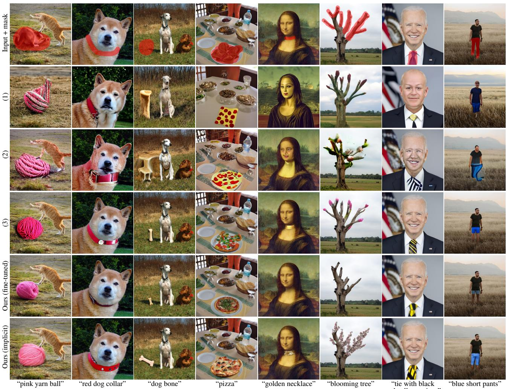  

图 11. 真实图像上的图像修复质量对比。(1) 局部 CLIP 引导扩散（Local CLIP-guided diffusion）（Crowson, 2021a），(2) PaintByWord++（Bau 等, 2021；Avrahami 等, 2021），(3) 混合扩散（Blended Diffusion）（Avrahami 等, 2021）。在我们的结果中，我们遵循 Avrahami 等 (2021) 的方法，使用 CLIP 从 64 个样本中挑选最佳样本。我们微调得到的样本具有更逼真的光照、阴影和纹理，但有时未能聚焦于提示词（例如金色项链），而隐式样本则能更好地捕捉提示词。

在开发人物过滤器时，我们的目标是可靠地检测出所有环境中的所有人——这一任务对于现代人脸检测系统而言往往很困难，尤其是在面对各种人群特征时（Buolamwini & Gebru, 2018; Santurkar et al., 2019）。在我们最初的实验中，我们使用的是 ViT-B/32 而非 ViT-B/16，我们观察到在低光照或遮挡条件下，分类器有时会漏检人物。然而，在改用 ViT-B/16 进行特征提取后（其隐藏状态分辨率高于 ViT-B/32），我们发现之前观察到的所有失败案例都得到了纠正。

为了移除包含暴力物体的图像，我们首先使用 CLIP 在数据集中搜索诸如 "weapon"（武器）、"violence"（暴力）等词汇和短语。在收集了几百个正例和负例之后，我们训练了一个与上述类似的 SVM（支持向量机）。接着，我们对位于该 SVM 决策边界附近的样本进行标注，以获得另外几百个正例和负例。我们对这个过程进行了多次迭代，然后调整最终 SVM 的偏置，使其假阴性率低于 1%。在一个由 1024 个样本组成的独立批次上进行测试时，该分类器未产生任何假阴性。

我们最初以同样的方式处理仇恨符号的移除——使用 CLIP 在数据集中搜索特定的关键词。然而，我们发现这种方法仅返回了极少量相关图像，这表明我们的数据来源已经在某种程度上过滤了此类内容。尽管如此，我们仍使用搜索引擎收集了美国两种常见的仇恨符号——纳粹十字（swastika）和南方邦联旗（Confederate flag）——的图像，并基于这些数据训练了一个 SVM。我们使用上述主动学习流程，在决策边界附近收集更多负例（但未能找到正例），并调整所得 SVM 的偏置，使其在该精选数据集上的假阴性率低于 1%。

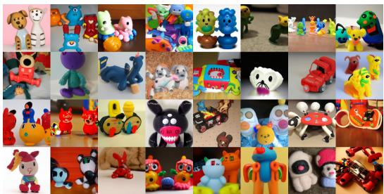  

(a) "男孩的玩具"

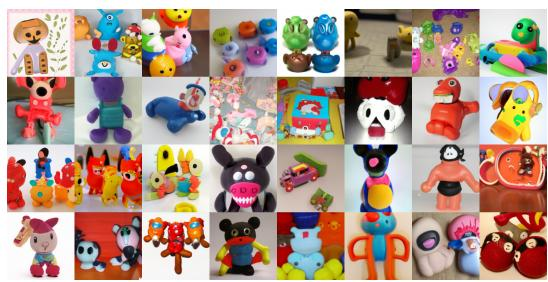  

(b) "toys for girls"

图 12. 在改变提示词中的性别时，使用相同随机种子得到的 GLIDE（filtered）样本。

## F.2. GLIDE (filtered) 的偏差与 CLIP 引导

GLIDE (filtered) 仍然表现出偏差——这既说明了图像数据集中的偏差超出了人物图像中存在的偏差，也指出了我们在筛选过程中所做选择中存在的偏差。例如，当被要求生成男孩玩具和女孩玩具时，模型会产生不同的输出（图 12）。当被要求生成"a religious place"时，模型倾向于生成类似教堂的建筑，而这种偏差通过无分类器引导（classifier-free guidance）被进一步放大（图 13）。

我们预期我们的仇恨符号分类器存在强烈的美国和西方偏差，因为它仅在美国两个常见的仇恨符号上进行了训练。因此，训练数据中很可能仍保留着我们没有主动过滤掉的、描绘仇恨符号的图像。然而，我们确实发现经过筛选的模型在生成非仇恨符号方面的能力有所下降（图 14）。我们推测这可能是由于

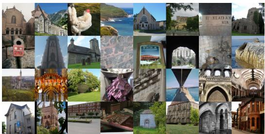  

(a) 无引导

  

(b) 无分类器引导（Classifier-free guidance，缩放系数 3.0）

图 13. 使用相同随机种子但不同引导尺度，针对提示词「a religious place」生成的 GLIDE（filtered）样本。

可供 GLIDE 使用的数据集较小（filtered）。

我们还将 GLIDE（filtered）整合进了一个公开可用的 CLIP 引导扩散程序（Crowson, 2021a）。我们发现，由此得到的组合具备一定的能力来生成类人脸物体（例如图 15）。虽然使用公开可用扩散模型的原版 CLIP 引导扩散程序在响应我们的提示词时通常能生成更具可识别性的图像，但这些发现凸显了我们过滤方法的一个局限性。我们还发现，GLIDE（filtered）在某些情况下仍然表现出强烈的西方偏见，往往超过了现有公开扩散模型所表现出的偏见程度（图 16）。

## G. 补充样本

在图 17 和图 18 中，我们展示了模型在无引导、无分类器引导（classifier-free guidance）以及 CLIP 引导下的 4×4 随机样本网格，所有样本均使用相同的随机种子，同时还展示了来自 DALL·E 的样本。我们发现，无分类器引导能够最可靠地生成高质量的图像。对于 DALL·E，我们为每个提示词采样 512 张图像，并使用 CLIP 重排序选择其中最好的 16 张。对于所有其他样本网格，我们展示的是不进行 CLIP 重排序的 16 张随机样本。

GLIDE（filtered）

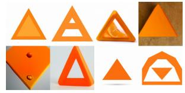  

GLIDE（small）
(a) 针对“橙色三角形”的生成结果

GLIDE（筛选后）

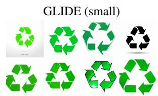  

(b) "recycling symbol" 的生成结果  
图 14. GLIDE（filtered）与 GLIDE（small）样本在提示词 "orange triangle"（左）和 "recycling symbol"（右）下的对比。尽管这些符号并未从模型中过滤掉，但 filtered 模型生成的图像忠实度更低，这可能是因为其可用数据集规模较小。

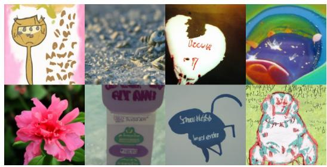  

(a) GLIDE（已过滤）

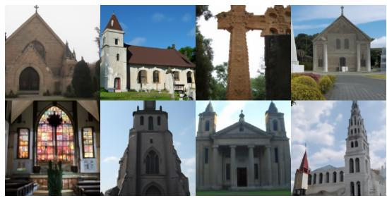  

(a) GLIDE（过滤后）

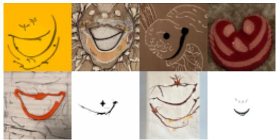

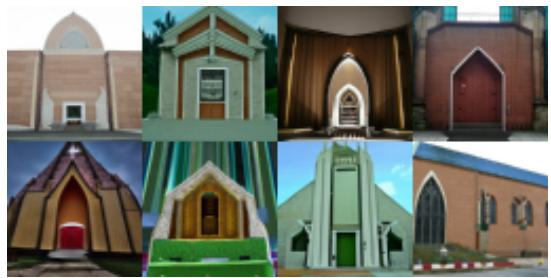  

(b) GLIDE（filtered）+ unfiltered public CLIP

  

(b) GLIDE（已过滤）+ 未过滤的公开 CLIP  
(c) 基线（公开可用的模型）

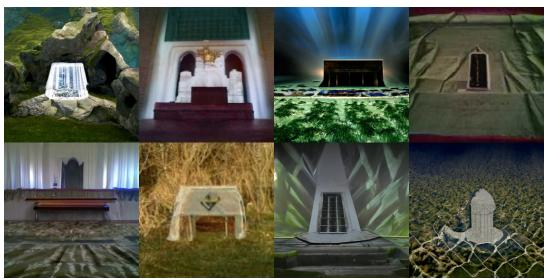  

(c) 基线（公开可用模型）

图 15. 针对提示词 "a happy person" 的生成结果。在 (a) 中，我们展示了采用无分类器引导（classifier-free guidance）尺度 3.0 的 GLIDE（filtered）。在 (b) 中，我们使用一个公开可用的 CLIP 模型来引导 GLIDE（filtered）。在 (c) 中，我们使用一个公开可用的 CLIP 模型来引导一个公开可用的 ImageNet 扩散模型。

图 16. 针对提示词"礼拜场所（a place of worship）"的生成结果。在 (a) 中，我们展示了采用无分类器引导尺度 3.0 的 GLIDE（已过滤版本）。在 (b) 中，我们使用一个公开可用的 CLIP 模型来引导 GLIDE（已过滤版本）。在 (c) 中，我们使用一个公开可用的 CLIP 模型来引导一个公开可用的 ImageNet 扩散模型。

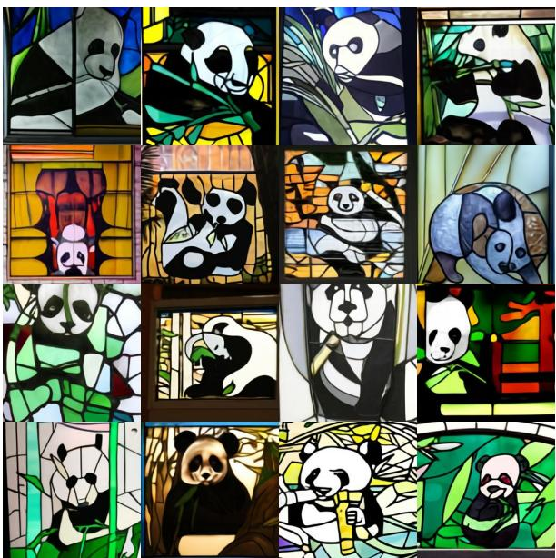  

(a) DALL-E（温度 0.85，从 512 个候选中通过 CLIP 重新排序取前 16）

  

(b) GLIDE（无引导）

  

(c) GLIDE（CLIP 引导，缩放系数 2.0）

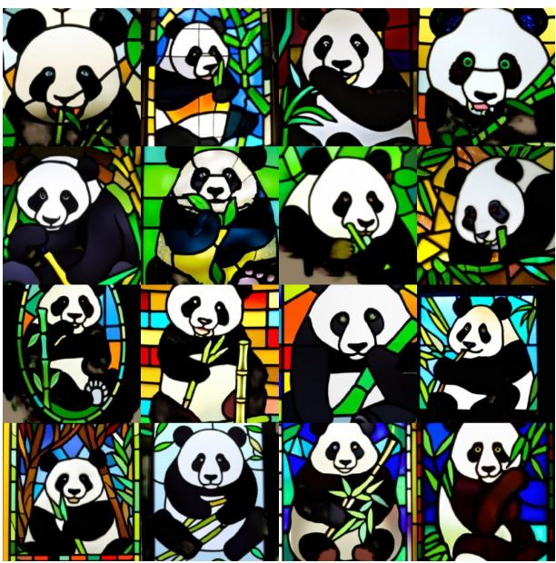  

(d) GLIDE（无分类器引导（Classifier-free guidance），缩放系数 3.0）

图 17. DALL-E 和 GLIDE 在提示词 "a stained glass window of a panda eating bamboo" 上的随机采样样本。我们对 GLIDE 不进行任何 CLIP 重排序（CLIP reranking）。

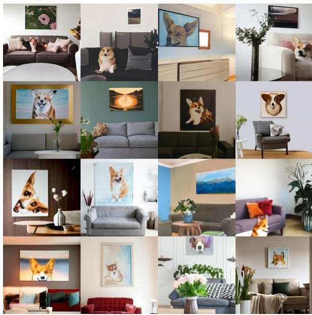  

(a) DALL-E（温度参数 0.85，从 512 个候选中由 CLIP 重排序选出前 16 个）

  

(b) GLIDE（无引导）

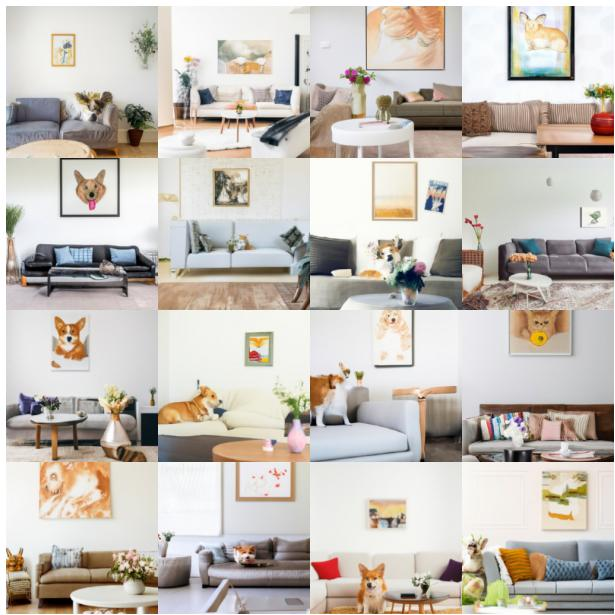  

(c) GLIDE（CLIP 引导，尺度 2.0）

  

(d) GLIDE（无分类器引导（Classifier-free Guidance），尺度 3.0）

图 18. DALL-E 与 GLIDE 针对提示词 "A cozy living room with a painting of a corgi on the wall above a couch and a round coffee table in front of a couch and a vase of flowers on a coffee table" 生成的随机样本。我们未对 GLIDE 进行任何 CLIP 重排序。