# 零样本文本到图像生成（Zero-Shot Text-to-Image Generation）

Aditya Ramesh <sup>1</sup> Mikhail Pavlov <sup>1</sup> Gabriel Goh <sup>1</sup> Scott Gray <sup>1</sup> Chelsea Voss <sup>1</sup> Alec Radford <sup>1</sup> Mark Chen <sup>1</sup> Ilya Sutskever <sup>1</sup>

## 摘要

文本到图像生成（text-to-image generation）任务，传统上聚焦于在固定数据集上寻找更好的建模假设。这些假设可能涉及复杂的架构、辅助损失，或在训练过程中提供的附加信息，如目标部件标签或分割掩码。我们针对该任务提出了一种简单的方法，其基于一个 Transformer，以自回归方式将文本与图像词元（token）建模为单一数据流。在数据与规模都足够充分的情况下，我们的方法在零样本（zero-shot）评估下，能够与此前针对特定领域设计的模型相媲美。

## 1. 引言

将现代机器学习方法用于文本到图像合成，始于 Mansimov 等人（2015）的工作，他们展示了 DRAW（Gregor 等人，2015）生成模型在以图像描述为条件进行扩展后，也能够生成新的视觉场景。Reed 等人（2016b）随后证明，使用生成对抗网络（Goodfellow 等人，2014）而非循环变分自编码器，能够提升图像保真度。Reed 等人（2016b）表明，这一系统不仅能生成具有可识别属性的物体，还能以零样本方式泛化到未在训练中出现的类别。

在接下来的几年里，相关进展以多种方法的组合形式持续推进。这些方法包括：通过引入多尺度生成器等改进来提升生成模型架构（Zhang 等人，2017；2018）、融合注意力机制与辅助损失（Xu 等人，2018），以及利用文本之外的额外条件信息来源（Reed 等人，2016a；Li 等人，2019；Koh 等人，2021）。

另一方面，Nguyen 等人（2017）提出了一种用于条件图像生成的条件能量框架，相对于同期方法在样本质量上取得了大幅提升。他们的方法能够融合预训练的判别模型，并证明当对一个在 MS-COCO 上预训练的图像描述模型应用该方法时，可以完成文本到图像生成任务。近期，Cho 等人（2020）也提出了一种方法，该方法涉及对预训练跨模态掩码语言模型的输入进行优化。尽管自 Mansimov 等人（2015）以来，视觉保真度已显著提升，但样本仍可能存在严重的伪影，例如目标形变、目标位置不合逻辑，或前景与背景元素的不自然融合。

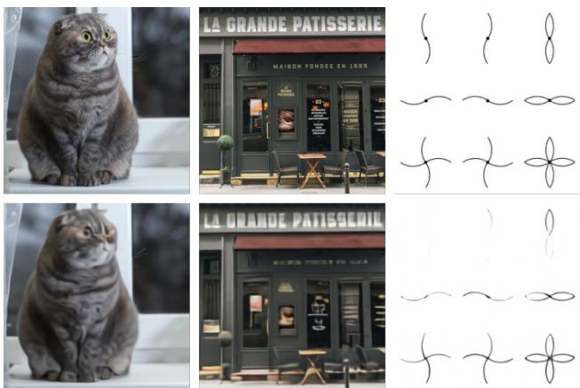  

图 1. 原始图像（顶部）与离散 VAE 重建结果（底部）的对比。编码器将空间分辨率下采样了 8 倍。虽然细节（例如猫毛的纹理、店面上的文字以及插画中的细线）有时会丢失或失真，但图像的主要特征通常仍然可以辨认。我们使用 8192 的大词汇表规模来减轻信息损失。

由大规模生成模型推动的最新进展为进一步的改进提供了一条可能的路径。具体而言，当计算能力、模型规模和数据进行精心扩展时，自回归 Transformer（Vaswani 等，2017）已在文本（Radford 等，2019）、图像（Chen 等，2020）和音频（Dhariwal 等，2020）等多个领域取得了令人瞩目的成果。

相比之下，文本到图像生成通常在 MS-COCO 和 CUB-200（Welinder 等，2010）等相对较小的数据集上进行评估。数据集规模和模型规模是否是当前方法的限制因素？在本研究中，我们展示了在 2.5 亿图像-文本

（c）一个写着"backprop"的霓虹灯招牌。一个写着"backprop"的霓虹灯招牌。backprop 霓虹灯招牌

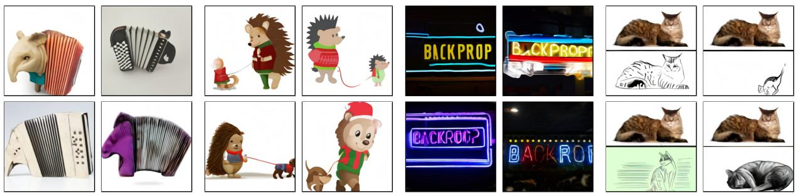  

(a) a tapir made of accordion. (b) an illustration of a baby a tapir with the texture of an hedgehog in a christmas accordion. sweater walking a dog  
(d) the exact same cat on the top as a sketch on the bottom  
图 2. 在不同程度的可靠性下，我们的模型似乎能够以合理的方式组合不同的概念，创建动物的拟人化版本，渲染文本，并执行某些类型的图像到图像翻译。

从互联网上收集的（文本-图像）对，可以得到一个灵活、高保真的图像生成模型，该模型可通过自然语言进行控制。

得到的系统在流行的 MS-COCO 数据集上以零样本方式实现了高质量的图像生成，且未使用任何训练标签。在由人类评估者进行评判时，相比之前在该数据集上训练的方法，其偏好率达到 90%。我们还发现，该系统能够在初步层面上完成诸如图像到图像翻译之类的复杂任务。这在以前需要专门定制的方法（Isola et al., 2017），而如今作为一个单一的、大规模生成模型的能力涌现出来。

## 2. 方法

我们的目标是训练一个 transformer（Vaswani et al., 2017），以自回归方式将文本和图像词符（token）建模为单一数据流。然而，直接将像素用作图像词符，将需要极其庞大的内存来存储高分辨率图像。似然目标倾向于优先建模像素之间的短程依赖（Salimans et al., 2017），因此大量建模能力将被耗费在捕获高频细节上，而不是那些使物体在视觉上可识别的低频结构。

我们借鉴（Oord et al., 2017; Razavi et al., 2019）的方法，通过两阶段训练过程来解决这些问题：

• 阶段一。我们训练一个离散变分自编码器（dVAE）<sup>1</sup>，将每张 256×256 RGB 图像压缩为一个 32×32 的图像词符网格，其中每个元素可以取 8192 个可能的值。这将 transformer 的上下文大小缩减为原来的 1/192，且视觉质量不会出现大幅下降（见图 1）。

• 阶段二。我们将最多 256 个 BPE 编码的文本词符与 $3 2 \times 3 2 = 1 0 2 4$ 个图像词符拼接起来，并训练一个自回归 transformer 来建模文本和图像词符的联合分布。

整个过程可以看作是最大化模型分布在图像 $x$、描述 $y$ 以及编码 RGB 图像所对应词符 $z$ 上的联合似然的证据下界（ELB）（Kingma & Welling, 2013; Rezende et al., 2014）。我们采用如下分解 $p _ { \theta , \psi } ( x , y , z ) = p _ { \theta } ( x | y , z ) p _ { \psi } ( y , z )$ 来建模该分布，由此得到下界

$$
\begin{array}{c}\ln p_{\theta ,\psi}(x,y)\geqslant \mathop{\mathbb{E}}_{z\sim q_{\phi}(z  |  x)}\big(\ln p_{\theta}(x  |  y,z) - \\ \beta   D_{\mathrm{KL}}(q_{\phi}(y,z  |  x),p_{\psi}(y,z))\big), \end{array}\tag{1}
$$

其中：

$q_{\phi}$ 表示给定 RGB 图像 $\overline{x}$ 时由 dVAE 编码器生成的 $32 \times 32$ 图像 token 上的分布；

• $p_{\theta}$ 表示给定图像 token 时由 dVAE 解码器生成的 RGB 图像上的分布；

• $p_{\psi}$ 表示由 transformer 建模的、文本与图像 token 上的联合分布。

注意，该界仅在 $\beta = 1$ 时成立，而在实际应用中我们发现使用更大的 $\beta$ 值是有帮助的（Higgins 等，2016）。下面的小节将进一步详细介绍这两个阶段。<sup>3</sup>

  

图 3. 我们模型与先前方法在 MS-COCO 描述上的样本对比。我们的模型样本均是由对比模型排序的 512 个样本中的最佳者。我们在挑选任何模型的描述或样本时均未进行任何人工筛选。

## 2.1. 第一阶段：学习视觉码本

在训练的第一阶段，我们相对于 $\phi$ 和 θ 最大化证据下界（ELB），这等同于仅在图像上训练一个 dVAE。我们将初始先验 $p _ { \psi }$ 设为码本中 $K = 8 1 9 2$ 个向量上的均匀类别分布，并将 $q _ { \phi }$ 设为由编码器输出的 $3 2 \times 3 2$ 网格中同一空间位置上 8192 个 logits 所参数化的类别分布。

此时 ELB 变得难以优化：由于 $q _ { \psi }$ 是一个离散分布，我们无法使用重参数化梯度来最大化它。Oord 等人（2017）；Razavi 等人（2019）通过在线聚类分配过程结合直通估计器（Bengio 等人，2013）来解决这一问题。我们则使用 gumbel-softmax 松弛（Jang 等人，2016；Maddison 等人，2016），将对 $q _ { \phi }$ 的期望替换为对 $q _ { \phi } ^ { \tau }$ 的期望，随着温度 $\tau  0$，该松弛变得紧致。$p _ { \theta }$ 的似然通过对数拉普拉斯分布来计算（推导见附录 A.3）。

松弛后的 ELB 使用 Adam（Kingma & Ba，2014）并结合指数加权迭代平均来最大化。附录 A.2 给出了超参数的完整描述，但我们发现以下几点对于稳定训练尤为重要：

- 针对松弛温度和步长的特定退火调度。我们发现将 τ 退火至 $1 / 1 6$ 已足以缩小使用 $q _ { \phi }$ 而非 $q _ { \phi } ^ { \tau }$ 时松弛验证 ELB 与真实验证 ELB 之间的差距。

- 在编码器末端和解码器起始处使用 1 × 1 卷积。我们发现减小松弛周围卷积的感受野大小能使其更好地泛化到真实 ELB。

- 将编码器和解码器残差块的输出激活乘以一个小的常数，以确保初始化时训练的稳定性。

我们还发现，将 KL 权重增加至 $\beta = 6 . 6$ 能够促进码本的更充分利用，并最终在训练结束时带来更小的重构误差。<sup>4</sup>

## 2.2. 第二阶段：学习先验

在第二阶段，我们固定 $\phi$ 和 $\theta$，通过相对于 ψ 最大化 ELB 来学习文本和图像 token 上的先验分布。此处，$p _ { \psi }$ 由一个具有 120 亿参数的稀疏 Transformer（Child 等人，2019）来表示。

对于文本-图像对，我们使用 BPE 编码（Sennrich et al., 2015）对转小写后的说明文字进行编码，最多使用 256 个词元，<sup>5</sup>词表大小为 16,384；图像则编码为 $3 2 \times 3 2 = 1 0 2 4$ 个词元，词表大小为 8192。图像词元通过对 dVAE 编码器的 logits 进行 argmax 采样获得，不添加任何 Gumbel 噪声。<sup>6</sup> 最后，将文本词元与图像词元拼接在一起，作为单一数据流进行自回归建模。

该 Transformer 是一个仅解码器（decoder-only）模型，其中每个图像词元在其 64 个自注意力层中的任意一层都可以关注到所有文本词元。完整的网络结构在 $\mathsf { A p - }$ pendix B.1 中描述。模型中共使用了三种不同的自注意力掩码：文本到文本注意力部分使用标准的因果掩码（causal mask），图像到图像注意力部分则使用行、列或卷积注意力掩码之一。<sup>7</sup>

我们将文本说明的长度限制为 256 个词元，不过对最后一个文本词元与起始图像词元之间的「填充」位置该如何处理并不十分明确。一种做法是在自注意力运算中将这些位置对应的 logits 设为 −∞。我们转而选择为这 256 个文本位置中的每个位置分别学习一个特殊的填充词元。该词元仅在没有文本词元可用时才使用。在针对 Conceptual Captions（Sharma et al., 2018）的初步实验中，我们发现这种做法导致验证集上的损失更高，但在分布外说明文字上效果更好。

我们对一批数据中的文本与图像词元分别按各自的总数量对其交叉熵损失进行归一化。由于我们主要关注图像建模，我们将文本的交叉熵损失乘以 $1 / 8$，将图像的交叉熵损失乘以 7/8。优化目标使用 Adam 配合指数加权迭代平均进行优化；训练流程的更多细节见附录 B.2。我们预留了约 606,000 张图像用于验证，并在收敛时未观察到过拟合迹象。

  

图4. 变压器残差块（transformer resblock）逐残差块梯度缩放示意图。实线表示前向传播的操作序列，虚线表示反向传播的操作序列。我们按每个残差块的梯度缩放系数对其输入梯度进行缩放，并在输出梯度被累加到来自后续残差块的梯度总和之前对其取消缩放。沿恒等路径（identity path）的激活值与梯度以32位精度存储。"filter"（过滤）操作将激活梯度里所有的 Inf 和 NaN 值置零。否则，当前残差块中一旦出现非有限事件，就会导致所有前置残差块的梯度缩放系数被不必要地压低，从而引发下溢。

## 2.3. 数据收集

我们针对参数量高达 12 亿的模型所开展的初步实验，是在 Conceptual Captions 数据集上进行的。Conceptual Captions 是一个包含 330 万图文对的数据集，它作为 MS-COCO（Lin et al., 2014）的扩展版本而被开发出来。

为了将模型规模扩展到 120 亿参数，我们构建了一个规模与 JFT-300M（Sun et al., 2017）相当的数据集，通过从互联网收集 2.5 亿个图文对来构建。该数据集不包含 MS-COCO，但包含了 Conceptual Captions 以及 YFCC100M（Thomee et al., 2016）的一个经过筛选的子集。由于 MS-COCO 是基于后者创建的，因此我们的训练数据中包含了 MS-COCO 验证图像中的一小部分（但不包括其对应的标题）。我们在第 3 节展示的定量结果中对这一点进行了控制，发现它对结果没有明显影响。我们在附录 C 中提供了关于数据收集过程的更多细节。

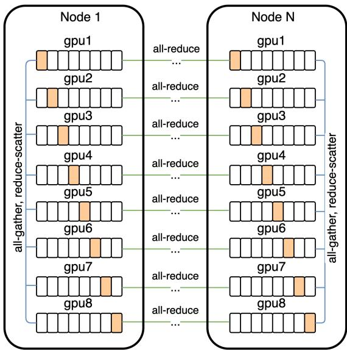  

图 5. 用于分布式训练的通信模式。模型中的每个参数数组在各机器的八块 GPU 上进行分片（shard）。在前向传播过程中，我们在计算当前残差块（resblock）激活值的同时，使用 all-gather 操作预取下一个残差块的参数分片。为了节省显存，来自其他 GPU 的参数分片会立即被丢弃。类似地，在反向传播过程中，我们在计算当前残差块的激活值和梯度的同时，预取上一个残差块的参数分片。在所有 GPU 都完成了相对于某个 all-gathered 参数的梯度计算之后，reduce-scatter 操作使每块 GPU 只保留一个分片——即其自身参数分片对应的梯度，且该梯度在八块 GPU 上取平均。

## 2.4. 混合精度训练（Mixed-Precision Training）

为了节省 GPU 显存并提高吞吐量，大多数参数、Adam 矩以及激活值都以 16 位精度存储。我们还使用了激活检查点（activation checkpointing），并在反向传播过程中对残差块（resblocks）内的激活值进行重计算。让模型在 16 位精度下、参数超过十亿的规模上稳定训练而不发散，是本项目中最具挑战性的部分。

我们认为这种不稳定性的根本原因在于 16 位梯度中的下溢（underflow）。附录 D 给出了一些我们在训练大规模生成模型时为避免下溢而制定的准则。这里，我们描述其中一条准则：逐残差块梯度缩放（per-resblock gradient scaling）。

与先前的工作（Liu et al., 2020）类似，我们发现从较早的残差块到较晚的残差块，激活梯度的范数呈单调递减的趋势。<sup>8</sup> 随着模型变得更深更宽，较晚残差块的激活梯度的真实指数可能会低于 16 位格式所能表示的最小指数，从而被舍入为零，这种现象称为下溢。我们发现，消除下溢可使模型稳定地训练至收敛。

<table><tr><td>Effective Parameter Count</td><td>Compression Rank</td><td>Compression Rate</td></tr><tr><td> $2.8 \cdot 10^{9} (d_{model} = 1920)$ </td><td>512</td><td> $\approx 83\%$ </td></tr><tr><td> $5.6 \cdot 10^{9} (d_{model} = 2688)$ </td><td>640</td><td> $\approx 85\%$ </td></tr><tr><td> $12.0 \cdot 10^{9} (d_{model} = 3968)$ </td><td>896</td><td> $\approx 86\%$ </td></tr></table>

表 1. 我们展示了模型规模与梯度所需的最小压缩秩（不超过 128 的倍数）之间的关系，该最小压缩秩是在训练前 10% 内避免训练损失出现差距所必需的。这些结果表明，在我们的设定下，可以实现约 85% 的压缩率，且该压缩率与模型规模无关。

标准的损失缩放（Micikevicius et al., 2017）能够在最小激活梯度与最大激活梯度（按绝对值计）所跨越的范围落入 16 位格式的指数范围内时，避免下溢的发生。在 NVIDIA V100 GPU 上，该指数范围由 5 位指定。虽然对于训练同规模的标准语言模型来说这已足够，但我们发现对于文生图模型而言，该范围过小。

我们的修正方案如图 4 所示，它为模型中的每个残差块（resblock）使用一个单独的「梯度缩放因子」。这可被视为一种更为通用的混合精度训练框架 Flexpoint（Köster et al., 2017）的实用替代方案，其优点在于无需专用的 GPU 核函数。我们发现 Sun 等人（2020）独立地开发出了用于以 4 位精度训练卷积网络的类似流程。

## 2.5. 分布式优化

我们的 120 亿参数模型以 16 位精度存储时会消耗约 24 GB 的显存，这超过了 16 GB 的 NVIDIA V100 GPU 的内存。我们通过参数分片（Rajbhandari et al., 2019）来解决这一问题。如图 5 所示，参数分片使我们能够通过将机内通信延迟与计算密集型操作重叠，从而几乎完全隐藏机内通信的延迟。

在用于训练该模型的集群上，机器之间的带宽远低于同一台机器上各 GPU 之间的带宽。这使得在机器间对梯度进行平均（all-reduce）的操作成为训练过程中的主要瓶颈。我们发现

一群小便池位于树旁。一群人站在海滩上。

一位女性和一位男性站在灌木丛长凳旁边。

一间浴室，内有两个洗手盆、一个柜子和一个浴缸。

一辆卡车停在设置了施工屏障的十字路口处。

一名男子坐在长凳上，旁边有一只蛞蝓。

一辆汽车上覆盖着各种空牙膏管。

  

图 6. 在 MS-COCO 字幕上增加用于对比重排序（contrastive reranking）过程的图像数量的影响。

能够通过使用 PowerSGD（Vogels 等，2019）压缩梯度来大幅降低这一开销。

在我们的实现中，机器内的每个 GPU 独立计算其参数分片梯度的低秩因子，不依赖于其相邻的 GPU。<sup>9</sup> 一旦计算出低秩因子，每台机器将其误差缓冲区设置为：其八个 GPU 上未压缩梯度（通过 reduce-scatter 获得）的平均值，与从低秩因子解压得到的梯度之间的残差。

PowerSGD 将未压缩参数梯度的一次大型通信操作替换为其低秩因子的两次小得多的通信操作。对于给定的压缩秩 r 和 transformer 激活尺寸 $d _ { \mathrm { m o d e l } }$，压缩率由 $1 − 5 r / ( 8 d _ { \mathrm { m o d e l } } )$ 给出（见附录 E.1）。表 1 显示我们可以实现约 85% 的压缩率，且与模型大小无关。

在附录 E.2 中，我们描述了使 PowerSGD 在大规模下良好运行所需的各种细节。这些细节包括：

• 在反向传播过程中通过将梯度累积到误差缓冲区中来节省内存，而不是分配单独的缓冲区。

<sup>9</sup>对于其他操作仍然存在机器内通信；我们的意思是，各分片上的低秩因子在被拼接后，并不被视为共同近似完整参数矩阵的梯度。

• 尽量减少清零误差缓冲区的情形（例如，由于在混合精度反向传播中遇到非有限值，或从检查点恢复训练时）。

• 通过使用 Householder 正交化代替 Gram-Schmidt，并在输入上加上单位矩阵的微小倍数，来提高数值稳定性。

• 通过对误差缓冲区、其低秩因子以及涉及它们的所有归约（all-reduce）通信操作使用自定义的 16 位浮点格式，来避免下溢。

我们还发现 Vogels 等（2019）中描述的 Q 矩阵的预热启动过程是不必要的：我们能够在训练开始时将 Q 固定为一个随机高斯矩阵，并且从不对其进行更新，从而获得相同的结果。<sup>10</sup>

## 2.6. 样本生成

类似于 Razavi 等人（2019）的方法，我们使用一个预训练的对比模型（Radford 等人，2021）对从 transformer 中采样的样本进行重排序。给定一段字幕（caption）和一张候选图像，对比模型会根据图像与字幕的匹配程度给出一个分数。其方法 6 展示了增加用于选取 top-k 图像的采样数量 N 所带来的效果。该过程可以视为一种语言引导的搜索（Andreas 等人，2017），也类似于 Xu 等人（2018）提出的辅助文本-图像匹配损失。除非另有说明，用于定性和定量结果的所有样本均未进行温度衰减（即使用 t = 1）（其方法 2 除外），并使用 N = 512 进行重排序。

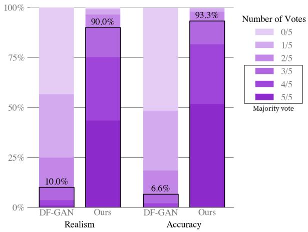  

图 7. 在 MS-COCO 文本描述上，对我们的模型（以零样本方式评估，未降低温度）与先前工作（DF-GAN）进行的人工评估。在五选一投票中，我们的模型样本有 90.0% 的概率被评为最真实的样本，有 93.3% 的概率被评为与给定文本描述最匹配的图像。

## 3. 实验

## 3.1. 定量结果

我们以零样本（zero-shot）方式评估模型，将之与三种已有方法进行比较：AttnGAN（Xu 等人，2018）、DM-GAN（Zhu 等人，2019）和 DF-GAN（Tao 等人，2020），其中 DF-GAN 在 MS-COCO 上报告了最佳的 Inception Score（IS，起始分数；Salimans 等人，2016）和 Fréchet Inception Distance（FID，弗雷歇起始距离；Heusel 等人，2017）。图 3 定性地对比了我们模型与已有工作的样本。

我们还进行了类似于 Koh 等人（2021）所采用的人工评估，将我们的方法与 DF-GAN 进行比较，结果如图 7 所示。给定一段描述，我们模型的样本以多数票在与描述匹配得更好一项上胜出的比例为 93%；在更真实一项上以多数票胜出的比例为 90%。

图 9(a) 显示，尽管我们的模型从未在这些描述上训练过，它在 MS-COCO 上取得的分数与已有最佳方法的 FID 相差在 2 分以内。我们的训练数据使用了 YFCC100M 的一个筛选子集，我们发现该子集通过下一节介绍的去重过程，纳入了 MS-COCO 验证集约 21% 的图像。为了分离这一影响，我们分别计算了验证集包含这些图像（实线）和不包含这些图像（虚线）两种情况下的 FID 统计量，结果发现结果没有显著变化。

  

图 8. 我们的模型在 CUB 数据集上的零样本（zero-shot）样本。

在 dVAE 编码器产生的 token 上训练 transformer，使我们能够把建模能力集中于让图像在我们视觉上可识别的低频信息上。然而，这也会给模型带来不利影响，因为大幅压缩使其无法生成高频细节。为了测试这一点对定量评估的影响，我们对验证图像和模型样本施加半径不同的高斯滤波后，计算了图 9(a) 中的 FID 和 IS。我们的方法在半径为 1 的轻微模糊下，以约 6 个点的优势取得最佳 FID。随着模糊半径的增大，我们的方法与其他方法之间的差距趋于扩大。当模糊半径大于等于 2 时，我们同样取得了最高的 IS。

我们的模型在 CUB 数据集上表现明显较差，其 FID 与当前最佳先前方法相比差了将近 40 个点（图 9(b)）。我们发现该数据集的重叠率为 12%，并且在移除这些图像后再次观察到结果没有显著差异。我们推测，我们的零样本方法在像 CUB 这类专业分布上不太可能取得有竞争力的结果。我们认为微调是一个有前景的改进方向，并将这一研究留待未来工作。该数据集上针对文本描述的模型样本如图 8 所示。

最后，图 9(c) 显示，随着用于对比模型重排序的样本数量的增加，MS-COCO 上的 FID 和 IS 都得到明显改善。这一趋势持续到样本数量为 32 为止，之后我们观察到收益递减

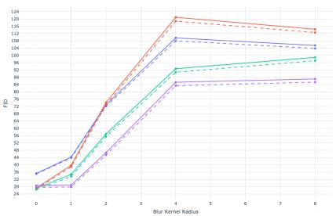

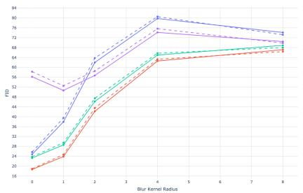

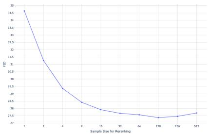

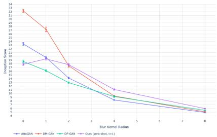  

(a) MS-COCO 上 FID 和 IS 随模糊半径的变化。

  

(b) CUB 数据集上 FID 和 IS 随模糊半径的变化。

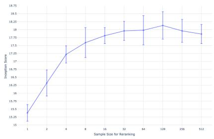  

(c) MS-COCO 上的 FID 和 IS 作为重排序所用样本数量的函数。

图 9. MS-COCO 和 CUB 上的定量结果。实线表示针对原始验证集计算的 FID，虚线表示针对去除重叠图像后的验证集计算的 FID（见第 3.2 节）。对于 MS-COCO，我们在从验证集中采样的 30,000 条标题子集上评估所有模型。对于 CUB，我们在测试集中所有唯一的标题上评估这些模型。我们使用 DM-GAN 代码计算 FID 和 IS，该代码可在 https://github.com/MinfengZhu/DM-GAN 获取。

返回。

## 3.2. 数据重叠分析（Data Overlap Analysis）

我们采用 Radford et al.（2021）所描述的去重流程来确定需要移除的图像。对于每张验证集图像，我们使用一个专门针对此任务训练的对比模型，在训练数据中找出与其最接近的图像。随后，我们按照与训练集中最近邻的接近程度从高到低对图像进行排序。在人工检查结果之后，我们通过手动选择一个旨在最大限度降低假阴性率的保守阈值来确定要移除的图像。

## 3.3. 定性发现（Qualitative Findings）

我们发现，我们的模型具备我们最初并未预料到的泛化能力。当给出「一只由手风琴构成的貘……」（图 2a）这样的描述时，模型似乎会绘制一只身体由手风琴构成的貘，或者绘制一个键盘或低音部分形状类似貘的鼻子或腿的手风琴。这表明它已具备了在高层抽象上组合不寻常概念的初步能力。

我们的模型似乎还具备组合泛化能力，例如在渲染文本时（图 2b），或者在被输入「一幅插画，画的是一只穿着圣诞毛衣的小刺猬在遛狗」（图 2c）这样的句子时。后者这样的提示要求模型执行变量绑定（Smolensky, 1990; Greff et al., 2020）——穿圣诞毛衣的是刺猬，而不是狗。然而我们注意到，模型在此任务上的表现并不稳定，有时会给两只动物都画上圣诞毛衣，或者绘制成一只刺猬在遛一只更小的刺猬。

在有限的可靠性范围内，我们还发现模型能够执行由自然语言控制的零样本图像到图像的翻译（图 2d）。当模型被给予「上方是同一只猫，下方是其素描」这一描述，以及一张猫的照片的图像 token 网格上方 15 × 32 的部分时，它能够在下方画出一只外观相似的猫的素描。

该方法同样适用于若干其他类型的变换，包括图像操作（例如，改变图像颜色、将其转换为灰度图，或将其上下翻转）以及风格迁移（例如，将猫画在贺卡、邮票或手机壳上）。某些变换，例如仅改变动物颜色的变换，表明模型能够执行一种初步的物体分割。我们在第 G 节中提供了更多零样本图像到图像翻译的示例。

## 4. 结论（Conclusion）

我们研究了一种基于自回归 Transformer 的简单文本到图像生成方法，并考察其在规模化执行下的表现。我们发现规模化可以带来更好的泛化能力，无论是在相对于以往领域专用方法的零样本性能方面，还是在单一生成模型所涌现出的能力范围方面。我们的发现表明，将泛化能力作为规模的函数加以改进，可能是推进该任务进展的有效驱动力。

## 致谢

我们感谢 Matthew Knight 审阅了本工作的代码发布，并感谢 Rewon Child、John Schulman、Heewoo Jun 和 Prafulla Dhariwal 对本文提出的有益早期反馈。我们还要感谢 Jong Wook Kim 编写了 Radford 等人（2019）中描述的对比模型的 PyTorch 包，我们使用该包对我们模型生成的样本进行了重排序。

## 参考文献

Abadi, M., Barham, P., Chen, J., Chen, Z., Davis, A., Dean, J., Devin, M., Ghemawat, S., Irving, G., Isard, M., 等. Tensorflow：面向大规模机器学习的系统. 载于：第 12 届 {USENIX} 操作系统设计与实现研讨会（{OSDI} 16），第 265–283 页，2016.

Andreas, J., Klein, D., 和 Levine, S. 使用潜在语言进行学习. arXiv 预印本 arXiv:1711.00482, 2017.

Bengio, Y., Léonard, N., 和 Courville, A. 条件计算中通过随机神经元估计或传播梯度. arXiv 预印本 arXiv:1308.3432, 2013.

Bowman, S. R., Vilnis, L., Vinyals, O., Dai, A. M., Jozefowicz, R., 和 Bengio, S. 从连续空间生成句子. arXiv 预印本 arXiv:1511.06349, 2015.

Chen, M., Radford, A., Child, R., Wu, J., Jun, H., Luan, D., 和 Sutskever, I. 基于像素的生成式预训练. 载于：国际机器学习大会，第 1691–1703 页. PMLR, 2020.

Child, R., Gray, S., Radford, A., 和 Sutskever, I. 使用稀疏 Transformer 生成长序列. arXiv 预印本 arXiv:1904.10509, 2019.

Cho, J., Lu, J., Schwenk, D., Hajishirzi, H., 和 Kembhavi, A. X-lxmert：使用多模态 Transformer 进行绘画、描述与问答. arXiv 预印本 arXiv:2009.11278, 2020.

Deng, J., Dong, W., Socher, R., Li, L.-J., Li, K., 和 Fei-Fei, L. Imagenet：大规模层次化图像数据库. 载于：2009 年 IEEE 计算机视觉与模式识别会议，第 248–255 页. IEEE, 2009.

Dhariwal, P., Jun, H., Payne, C., Kim, J. W., Radford, A., 和 Sutskever, I. Jukebox：面向音乐的生成模型. arXiv 预印本 arXiv:2005.00341, 2020.

Goodfellow, I. J., Pouget-Abadie, J., Mirza, M., Xu, B., Warde-Farley, D., Ozair, S., Courville, A., 和 Bengio, Y. 生成对抗网络. arXiv 预印本 arXiv:1406.2661, 2014.

Greff, K., van Steenkiste, S., 和 Schmidhuber, J. 论人工神经网络中的绑定问题. arXiv 预印本 arXiv:2012.05208, 2020.

Gregor, K., Danihelka, I., Graves, A., Rezende, D., and Wierstra, D. DRAW：一种用于图像生成的循环神经网络（Draw: A recurrent neural network for image generation）。载于：International Conference on Machine Learning，第 1462–1471 页。PMLR，2015 年。

He, K., Zhang, X., Ren, S., and Sun, J. 深度残差网络中的恒等映射（Identity mappings in deep residual networks）。载于：European conference on computer vision，第 630–645 页。Springer，2016 年。

Heusel, M., Ramsauer, H., Unterthiner, T., Nessler, B., and Hochreiter, S. 以两时间尺度更新规则训练的 GAN 收敛于局部纳什均衡（Gans trained by a two time-scale update rule converge to a local nash equilibrium）。arXiv 预印本 arXiv:1706.08500，2017 年。

Higgins, I., Matthey, L., Pal, A., Burgess, C., Glorot, X., Botvinick, M., Mohamed, S., and Lerchner, A. beta-VAE：基于受限变分框架学习基础视觉概念（betavae: Learning basic visual concepts with a constrained variational framework）。2016 年。

Isola, P., Zhu, J.-Y., Zhou, T., and Efros, A. A. 基于条件对抗网络的图像到图像翻译（Image-to-image translation with conditional adversarial networks）。载于：Proceedings of the IEEE conference on computer vision and pattern recognition，第 1125–1134 页，2017 年。

Jang, E., Gu, S., and Poole, B. 基于 Gumbel-Softmax 的类别型重参数化（Categorical reparameterization with gumbel-softmax）。arXiv 预印本 arXiv:1611.01144，2016 年。

Kingma, D. P. and Ba, J. Adam：一种随机优化方法（Adam: A method for stochastic optimization）。arXiv 预印本 arXiv:1412.6980，2014 年。

Kingma, D. P. and Welling, M. 自编码变分贝叶斯（Auto-encoding variational bayes）。arXiv 预印本 arXiv:1312.6114，2013 年。

Koh, J. Y., Baldridge, J., Lee, H., and Yang, Y. 由细粒度用户注意力约束的文本到图像生成（Text-to-image generation grounded by fine-grained user attention）。载于：Proceedings of the IEEE/CVF Winter Conference on Applications of Computer Vision，第 237–246 页，2021 年。

Köster, U., Webb, T. J., Wang, X., Nassar, M., Bansal, A. K., Constable, W. H., Elibol, O. H., Gray, S., Hall, S., Hornof, L., et al. Flexpoint：一种用于深度神经网络高效训练的自适应数值格式（Flexpoint: An adaptive numerical format for efficient training of deep neural networks）。arXiv 预印本 arXiv:1711.02213，2017 年。

LeCun, Y., Bottou, L., Bengio, Y., and Haffner, P. 基于梯度的学习应用于文档识别（Gradient-based learning applied to document recognition）。《Proceedings of the IEEE》，第 86 卷第 11 期：2278–2324，1998 年。

Li, W., Zhang, P., Zhang, L., Huang, Q., He, X., Lyu, S., and Gao, J. 基于对抗训练的目标驱动文本到图像合成（Object-driven text-to-image synthesis via adversarial training）。载于：Proceedings of the IEEE/CVF Conference on Computer Vision and Pattern Recognition，第 12174–12182 页，2019 年。

Lin, T.-Y., Maire, M., Belongie, S., Hays, J., Perona, P., Ramanan, D., Dollár, P., and Zitnick, C. L. Microsoft COCO：上下文中的常见物体（Microsoft coco: Common objects in context）。载于：European conference on computer vision，第 740–755 页。Springer，2014 年。

Liu, L., Liu, X., Gao, J., Chen, W., and Han, J. 理解 Transformer 训练中的困难（Understanding the difficulty of training transformers）。arXiv 预印本 arXiv:2004.08249，2020 年。

Loshchilov, I. and Hutter, F. 解耦的权重衰减正则化（Decoupled weight decay regularization）。arXiv 预印本 arXiv:1711.05101，2017 年。

Maddison, C. J., Mnih, A., and Teh, Y. W. Concrete 分布：离散随机变量的连续松弛（The concrete distribution: A continuous relaxation of discrete random variables）。arXiv 预印本 arXiv:1611.00712，2016 年。

Mansimov, E., Parisotto, E., Ba, J. L., and Salakhutdinov, R. 基于注意力机制从图像描述生成图像（Generating images from captions with attention）。arXiv 预印本 arXiv:1511.02793，2015 年。

Nguyen, A., Clune, J., Bengio, Y., Dosovitskiy, A., 和 Yosinski, J. 即插即用生成网络：潜在空间中的条件迭代图像生成（Plug & play generative networks: Conditional iterative generation of images in latent space）. 载于：IEEE 计算机视觉与模式识别会议论文集（Proceedings of the IEEE Conference on Computer Vision and Pattern Recognition），第 4467–4477 页，2017.

Oord, A. v. d., Vinyals, O., 和 Kavukcuoglu, K. 神经离散表示学习（Neural discrete representation learning）. arXiv 预印本 arXiv:1711.00937, 2017.

Provilkov, I., Emelianenko, D., 和 Voita, E. BPE-dropout：简单有效的子词正则化（BPE-dropout: Simple and effective subword regularization）. arXiv 预印本 arXiv:1910.13267, 2019.

Radford, A., Wu, J., Child, R., Luan, D., Amodei, D., 和 Sutskever, I. 语言模型是无监督的多任务学习者（Language models are unsupervised multitask learners）. 2019.

Radford, A., Kim, J. W., Hallacy, C., Ramesh, A., Goh, G., Agarwal, S., Sastry, G., Askell, A., Mishkin, P., Clark, J., Krueger, G., 和 Sutskever, I. 从自然语言监督中学习可迁移的视觉模型（Learning transferable visual models from natural language supervision）. 2021.

Rajbhandari, S., Rasley, J., Ruwase, O., 和 He, Y. ZeRO：面向训练万亿参数模型的内存优化（ZeRO: Memory optimization towards training a trillion parameter models）. arXiv 预印本 arXiv:1910.02054, 2019.

Razavi, A., Oord, A. v. d., 和 Vinyals, O. 使用 VQ-VAE-2 生成多样化的高保真图像（Generating diverse high-fidelity images with VQ-VAE-2）. arXiv 预印本 arXiv:1906.00446, 2019.

Reed, S., Akata, Z., Mohan, S., Tenka, S., Schiele, B., 和 Lee, H. 学习画什么以及在哪里画（Learning what and where to draw）. arXiv 预印本 arXiv:1610.02454, 2016a.

Reed, S., Akata, Z., Yan, X., Logeswaran, L., Schiele, B., 和 Lee, H. 生成对抗文本到图像合成（Generative adversarial text to image synthesis）. 载于：国际机器学习大会（International Conference on Machine Learning），第 1060–1069 页。PMLR，2016b.

Rezende, D. J., Mohamed, S., 和 Wierstra, D. 深度生成模型中的随机反向传播和近似推断（Stochastic backpropagation and approximate inference in deep generative models）. 载于：国际机器学习大会（International Conference on Machine Learning），第 1278–1286 页。PMLR，2014.

Salimans, T., Goodfellow, I., Zaremba, W., Cheung, V., Radford, A., 和 Chen, X. 改进的 GAN 训练技术（Improved techniques for training GANs）. arXiv 预印本 arXiv:1606.03498, 2016.

Salimans, T., Karpathy, A., Chen, X., 和 Kingma, D. P. PixelCNN++：通过离散化逻辑斯蒂混合似然及其他改进提升 PixelCNN（PixelCNN++: Improving the PixelCNN with discretized logistic mixture likelihood and other modifications）. arXiv 预印本 arXiv:1701.05517, 2017.

Sennrich, R., Haddow, B., 和 Birch, A. 使用子词单元对罕见词进行神经机器翻译（Neural machine translation of rare words with subword units）. arXiv 预印本 arXiv:1508.07909, 2015.

Sharma, P., Ding, N., Goodman, S., 和 Soricut, R. Conceptual Captions：用于自动图像描述的已清理、上位词化的图像替代文本数据集（Conceptual captions: A cleaned, hypernymed, image alt-text dataset for automatic image captioning）. 载于：第 56 届计算语言学协会年会论文集（第 1 卷：长文）（Proceedings of the 56th Annual Meeting of the Association for Computational Linguistics (Volume 1: Long Papers)），第 2556–2565 页，2018.

Smolensky, P. 联结主义系统中的张量积变量绑定与符号结构表示（Tensor product variable binding and the representation of symbolic structures in connectionist systems）. Artificial Intelligence, 46(1-2):159–216, 1990.

Sun, C., Shrivastava, A., Singh, S., and Gupta, A. 深度学习时代数据不合理有效性的再审视（Revisiting unreasonable effectiveness of data in deep learning era）. 发表于：IEEE 国际计算机视觉大会论文集，第 843–852 页，2017 年。

Tao, M., Tang, H., Wu, S., Sebe, N., Wu, F., and Jing, X.-Y. DF-GAN：用于文本到图像合成的深度融合生成对抗网络（Df-gan: Deep fusion generative adversarial networks for text-to-image synthesis）. arXiv 预印本 arXiv:2008.05865，2020 年。

Thomee, B., Shamma, D. A., Friedland, G., Elizalde, B., Ni, K., Poland, D., Borth, D., and Li, L.-J. YFCC100M：多媒体研究中的新数据（Yfcc100m: The new data in multimedia research）. Communications of the ACM，第 59 卷第 2 期，第 64–73 页，2016 年。

Vaswani, A., Shazeer, N., Parmar, N., Uszkoreit, J., Jones, L., Gomez, A. N., Kaiser, L., and Polosukhin, I. 注意力机制就是你需要的全部（Attention is all you need）. arXiv 预印本 arXiv:1706.03762，2017 年。

Vogels, T., Karimireddy, S. P., and Jaggi, M. PowerSGD：面向分布式优化的实用低秩梯度压缩（Powersgd: Practical low-rank gradient compression for distributed optimization）. arXiv 预印本 arXiv:1905.13727，2019 年。

Welinder, P., Branson, S., Mita, T., Wah, C., Schroff, F., Belongie, S., and Perona, P. 加州理工-加州大学圣地亚哥分校鸟类 200 数据集（Caltech-ucsd birds 200）. 2010 年。

Xu, T., Zhang, P., Huang, Q., Zhang, H., Gan, Z., Huang, X., and He, X. AttnGAN：基于注意力生成对抗网络的细粒度文本到图像生成（Attngan: Fine-grained text to image generation with attentional generative adversarial networks）. 发表于：IEEE 计算机视觉与模式识别大会论文集，第 1316–1324 页，2018 年。

Zhang, H., Xu, T., Li, H., Zhang, S., Wang, X., Huang, X., and Metaxas, D. N. StackGAN：基于堆叠生成对抗网络的文本到照片级真实图像合成（Stackgan: Text to photo-realistic image synthesis with stacked generative adversarial networks）. 发表于：IEEE 国际计算机视觉大会论文集，第 5907–5915 页，2017 年。

Zhang, H., Xu, T., Li, H., Zhang, S., Wang, X., Huang, X., and Metaxas, D. N. StackGAN++：基于堆叠生成对抗网络的真实感图像合成（Stackgan++: Realistic image synthesis with stacked generative adversarial networks）. IEEE Transactions on Pattern Analysis and Machine Intelligence，第 41 卷第 8 期，第 1947–1962 页，2018 年。

Zhu, M., Pan, P., Chen, W., and Yang, Y. DM-GAN：用于文本到图像合成的动态记忆生成对抗网络（Dm-gan: Dynamic memory generative adversarial networks for text-to-image synthesis）. 发表于：IEEE/CVF 计算机视觉与模式识别大会论文集，第 5802–5810 页，2019 年。

```python
def preprocess_image(img, target_res):
    h, w = tf.shape(img)[0], tf.shape(img)[1]
    s_min = tf.minimum(h, w)
    img = tf.image.random_crop(img, 2 * [s_min] + [3])

    t_min = tf.minimum(s_min, round(9 / 8 * target_res))
    t_max = tf.minimum(s_min, round(12 / 8 * target_res))
    t = tf.random.uniform([], t_min, t_max + 1, dtype=tf.int32)
    img = tf.image.resize_images(img, [t, t], method=tf.image.ResizeMethod.AREA,
    align_corners=True)
    img = tf.cast(tfrint(tf.clip_by_value(img, 0, 255)), tf.uint8)
    img = tf.image.random_crop(img, 2 * [target_res] + [channel_count])
    return tf.image.random_flip_left_right(img)
```

清单 1. 用于训练 dVAE 的 TensorFlow（Abadi 等人，2016）图像预处理代码。我们使用 target_res = 256 与 channel_count = 3。

## A. 离散 VAE 的细节

## A.1. 架构

dVAE 编码器与解码器是卷积神经网络（LeCun 等人，1998）形式的 ResNets（He 等人，2016），并采用瓶颈式（bottleneck）的残差块结构。模型主体使用 $3 \times 3$ 卷积；当残差块的输入与输出特征图通道数发生变化时，跳连（skip connection）上使用 $1 \times 1$ 卷积。编码器的首层卷积为 $7 \times 7 .$，末层卷积（用于产生 $3 2 \times 3 2 \times 8 1 9 2$ 的输出，作为图像 token 所对应类别分布的 logits）为 $1 \times 1$ 。解码器的首层与末层卷积均为 $1 \times 1$ 。编码器使用最大池化（max-pooling，我们发现其得到的 ELB 优于平均池化）来下采样特征图，解步器使用稀疏最近邻上采样（nearest-neighbor upsampling）。架构的完整细节见代码仓库中的 dvae/encoder.py 与 dvae/decoder.py 文件。

## A.2. 训练

dVAE 在与 Transformer 相同的数据集上训练，使用清单 1 给出的数据增广代码。训练过程中有若干量被衰减，它们均使用余弦（cosine）调度：

1. KL 权重 $\beta$ 在前 5000 次更新中由 0 增大到 6.6。Bowman 等人（2015）使用了类似的基于 sigmoid 函数的调度。

2. 弛豫温度 τ 在前 150,000 次更新中由 1 退火至 1/16。对该量使用线性退火通常会导致发散。

3. 学习率（step size）在 1,200,000 次更新中由 $1 \cdot 1 0 ^ { - 4 } \mathrm { t o } 1 . 2 5 \cdot 1 0 ^ { - 6 }$ 进行退火。

弛豫温度与学习率的衰减调度对训练的稳定与成功优化尤为重要。

我们使用 AdamW（Loshchilov 与 Hutter，2017）更新参数，其中 $\beta _ { 1 } = 0 . 9 , \beta _ { 2 } = 0 . 9 9 9 , { \epsilon } = 1 0 ^ { - 8 }$ ，权重衰减乘子为 $1 0 ^ { - 4 }$ 。我们以衰减系数 0.999 对参数进行指数加权迭代平均（exponentially weighted iterate averaging）。ELB 中的重建项是 $2 5 6 \times 2 5 6 \times 3$ 个图像像素取值上的联合分布，KL 项则是空间网格（由编码器输出） $3 2 \times 3 2$ 个位置上的联合分布。我们将总体损失除以 $2 5 6 \times 2 5 6 \times 3 .$，使 KL 项的权重变为 $\beta / 1 9 2$ ，其中 β 为 KL 权重。训练采用混合精度（mixed-precision）并配合全局（即标准）损失缩放（loss scaling），在 64 块 16 GB 的 NVIDIA V100 GPU 上进行，单卡 batch 大小为 8，总 batch 大小为 512。模型总共训练 3,000,000 次更新。

## A.3. Logit-Laplace 分布

在训练 VAE 时，$\ell _ { 1 }$ 与 $\ell _ { 2 }$ 重建目标是常用的目标函数。这两个目标分别对应于在方程 1 中对 $\ln p _ { \theta } ( x \mid y , z )$ 使用 Laplace 分布和 Gaussian 分布。然而，这一建模选择存在一个奇怪的失配：像素值落在某个有界区间内，但这两个分布却由整个实数轴支撑。因此，总会有一定量的似然被分配到像素值的允许范围之外。

  

图 10. 针对我们 transformer 的一种假设版本的嵌入方案示意图，该版本的最大文本长度为 6 个 token。每个方框表示一个大小为 $d _ { \mathrm { m o d e l } } = 3 9 6 8$ 的向量。在此示意图中，标题长度为 4 个 token，因此使用了 2 个填充 token（如第 2.2 节所述）。每个图像词表嵌入都会与一个行嵌入和一个列嵌入相加。

我们提出了一种拉普拉斯分布（Laplace distribution）的变体，它同样由一个有界区间所支撑。这解决了被建模像素值的取值范围与用于建模的分布支撑集之间的不一致问题。我们考虑将 sigmoid 函数作用于一个服从拉普拉斯分布的随机变量后所得随机变量的概率密度函数（pdf）。该概率密度函数定义在 (0, 1) 上，其表达式如下：

$$
f (x \mid \mu , b) = \frac {1}{2 b x (1 - x)} \exp \left(- \frac {| \log i (x) - \mu |}{b}\right);\tag{2}
$$

我们将其称为 logit-Laplace 分布。我们将公式 2 右式的对数作为 dVAE 训练目标中的重构项。

dVAE 的解码器生成六个特征图，分别表示被重构图像 RGB 通道上 logit-Laplace 分布的充分统计量。前三个特征图表示 RGB 通道的 µ 参数，后三个表示 ln b。在将图像送入 dVAE 编码器之前，我们使用 $\varphi : [ 0 , 2 5 5 ]  ( \epsilon , 1 - \epsilon )$ 对其像素值进行变换，该函数由下式给出

$$
\varphi : x \mapsto \frac {1 - 2 \epsilon}{2 5 5} x + \epsilon .\tag{3}
$$

这将 dVAE 解码器需要建模的像素值范围限制在 $( \epsilon , 1 - \epsilon )$ 内，从而避免了方程 2 中 $x ( 1 - x )$ 带来的数值问题。我们使用 $\epsilon = 0 . 1$。为了重建图像以供人工检查或计算指标，我们忽略 ln b，并计算 $\hat { x } = \varphi ^ { - 1 } ( \mathrm { s i g m o i d } ( \mu ) )$，其中 $\mu$ 由 dVAE 解码器输出的前三个特征图给出。<sup>11</sup>

## B. Transformer 的细节

## B.1. 架构

我们的模型是一个仅解码器的稀疏 Transformer（Decoder-only Sparse Transformer），与 Child 等人（2019）中所描述的同类模型相同，对于图像令牌上下文部分使用了广播的行嵌入和列嵌入。我们模型中使用的嵌入方案的完整描述如图 10 所示。我们使用 64 个注意力层，每个层使用 62 个注意力头，每个头的状态大小为 64。

该模型使用三种稀疏注意力掩码，如图 11 所示。卷积注意力掩码（图 11(d)）仅在最后一个自注意力层中使用。否则，给定自注意力层的索引 i（其中 $i \in [1, 63]$），如果 $i - 2 \bmod 4 = 0$，则使用列注意力掩码（图 11(c)），否则使用行注意力。例如，前四个自注意力层分别使用「行、列、行、行」。除了卷积注意力掩码外（我们发现它在最后的自注意力层中使用时，相比行注意力掩码和密集因果注意力掩码能带来小幅性能提升），这与 Child 等人（2019）使用的配置相同。

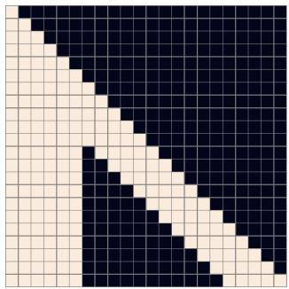  

(a) 行注意力掩码。

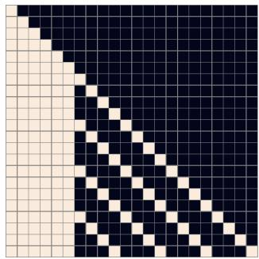  

(b) 列注意力掩码。

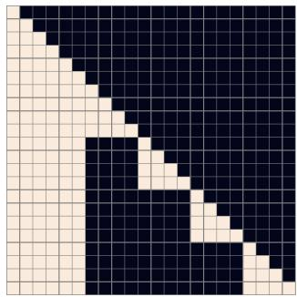  

(c) 转置图像状态下的列注意力掩码（Column attention mask with transposed image states）。

  

(d) 卷积注意力掩码（Convolutional Attention Mask）。

图 11. 三种注意力掩码示意图，针对我们 Transformer 的一个假设配置：最大文本长度为 6 个 token，图像长度为 16 个 token（即对应 $\mathbf { a } 4 \times 4 \mathrm { g r i d }$）。掩码 (a) 对应行注意力（Row Attention），其中每个图像 token 按光栅（raster）顺序关注前 5 个图像 token。范围（extent）选为 5，使得最后一个被关注的 token 是位于前一行同一列的那个 token。为了获得更好的 GPU 利用率，在应用列注意力（Column Attention）时，我们对图像状态的行维与列维进行转置，从而可以使用掩码 (c) 而非掩码 (b)。掩码 (d) 对应一种具有环绕（wraparound）行为的因果卷积注意力模式（Causal Convolutional Attention Pattern，类似于行注意力），其卷积核为 3 × 3。我们的模型使用的是对应 11 × 11 卷积核的掩码。

## B.2. 训练（Training）

在训练 transformer 时，我们先对图像做数据增强，再使用 dVAE 编码器对其进行编码。我们使用的增强方式与训练 dVAE 时所用的略有不同；相关代码见 Listing 2。在对描述文本进行 BPE 编码以用于训练时，我们还施加 10% 的 BPE dropout（随机丢弃）。模型采用按残差块缩放（per-resblock scaling，见 2.4 节）和梯度压缩（gradient compression，见 2.5 节）进行训练，总压缩秩（compression rank）为 896（因此每个 GPU 对其参数分片使用的压缩秩为 112）。如表 1 所示，这带来约 86% 的压缩率，我们将在 E.1 节对其进行分析。

我们使用 AdamW 更新参数，其中 $\beta _ { 1 } = 0 . 9 , \beta _ { 2 } = 0 . 9 6 , { \epsilon } = 1 0 ^ { - 8 }$，权重衰减乘子为 $4 . 5 \cdot 1 0 ^ { - 2 }$。在进行 Adam 更新之前，我们使用阈值 4 对解压缩后的梯度按范数进行裁剪。梯度裁剪仅在训练开头的 warm-up（预热）阶段触发。为了节省显存，大多数 Adam 矩（详见 D 节）以 16 位格式存储，其中运行均值（running mean）使用 1-6-9 格式（即 1 位符号位、6 位指数位、9 位尾数位），运行方差（running variance）使用 0-6-10 格式。在使用运行方差来更新参数或矩之前，我们将其按数值裁剪到 5 以内。最后，我们采用指数加权迭代平均（exponentially weighted iterate averaging），方法是每 25 次更新将 GPU 上的模型参数异步复制到 CPU，衰减系数为 0.99。

我们使用 1024 块 16 GB 的 NVIDIA V100 GPU 训练模型，总批量大小（batch size）为 1024，共训练 430,000 次更新。训练开始时，我们采用线性调度（linear schedule），在 5000 次更新内将步长逐步增大到 $4 . 5 \cdot 1 0 ^ { - 4 }$，并在每次训练损失出现平台期时将步长减半。我们共进行了五次这样的减半，训练结束时最终的步长相比初始步长缩小了 32 倍。我们预留了约 606,000 张图像用于验证，在训练过程中未观察到任何过拟合现象。

## C. 数据采集细节（Details for Data Collection）

为了训练这个 120 亿参数的 transformer，我们构建了一个规模与 JFT-300M 相当的数据集，从互联网上收集了 2.5 亿个文本-图像对。如 2.3 节所述，该数据集整合了 Conceptual Captions、来自 Wikipedia 的文本-图像对以及 YFCC100M 的一个筛选子集。我们使用了 Sharma 等人（2018）所描述的文本、图像以及文本与图像联合筛选器中的一个子集来构建该数据集。这些筛选器包括：丢弃描述文本过短的样本、被 Python 包 cld3 归类为非英语的样本，或主要包含模板化（boilerplate）内容的样本。

```python
def preprocess_image(img, target_res):
    h, w = tf.shape(img)[0], tf.shape(img)[1]
    s_min = tf.minimum(h, w)

    off_h = tf.random.uniform([], 3 * (h - s_min) // 8,
    tf.maximum(3 * (h - s_min) // 8 + 1, 5 * (h - s_min) // 8),
    dtype=tf.int32)
    off_w = tf.random.uniform([], 3 * (w - s_min) // 8,
    tf.maximum(3 * (w - s_min) // 8 + 1, 5 * (w - s_min) // 8),
    dtype=tf.int32)

# Random full square crop.
img = tf.image.crop_to_bounding_box(img, off_h, off_w, s_min, s_min)
t_max = tf.minimum(s_min, round(9 / 8 * target_res))
t = tf.random.uniform([], target_res, t_max + 1, dtype=tf.int32)
img = tf.image.resize_images(img, [t, t], method=tf.image.ResizeMethod.AREA,
    align_corners=True)
img = tf.cast(tfrint(tf.clip_by_value(img, 0, 255)), tf.uint8)

# We don't use hflip aug since the image may contain text.
return tf.image.random_crop(img, 2 * [target_res] + [channel_count])
```

清单 2. 用于训练 Transformer 的 TensorFlow (Abadi 等人，2016) 图像预处理代码。我们使用 target_res = 256 和 channel_count = 3。

诸如 "photographed on <date>" 之类的短语，其中 <date> 匹配我们在数据中发现的多种日期格式。我们还会丢弃图像宽高比不在 [1/2, 2] 范围内的实例。如果我们使用过高或过宽的图像，那么训练中使用的方形裁剪很可能会排除掉标题中提到的物体。

## D. 混合精度训练指南

本项目最具挑战性的部分是让模型在 16 位精度下训练超过十亿参数。我们通过检测训练各部分的数值下溢（underflow），并修改代码以消除它，从而做到了这一点。我们根据这一过程总结出了一套指南，在此呈现。<sup>12</sup>

1. 使用按 resblock 划分的梯度缩放（图 4），而非标准的损失缩放。我们的模型使用 128 个梯度缩放，每个 resblock 对应一个。所有梯度缩放初始化为 M · 2<sup>13</sup>，其中 M 是数据并行副本的数量（即 GPU 数量）。在我们的设置中，当某个 resblock 内所有参数梯度均无非有限（nonfinite）值时，每次参数更新时其对应的 grad scale 乘以 2<sup>1/1000</sup>。否则，我们将 grad scale 除以 √2 并跳过此次更新。我们还禁止在 125 次更新的窗口内对同一个 grad scale 进行连续除法。所有 grad scale 在更新后被限制在 [M · 2<sup>7</sup>, M · 2<sup>24</sup>] 范围内。图 12 展示了一个 28 亿参数模型在训练早期阶段的梯度缩放变化。

2. 仅在性能确实必要时才使用 16 位精度。具体而言，将所有增益（gains）、偏置（biases）、嵌入（embeddings）和反嵌入（unembeddings）以 32 位精度存储，使用 32 位梯度（包括远程通信）以及 32 位 Adam 矩。我们对这些参数禁用梯度压缩（不过对于增益、偏置这类一维参数，PowerSGD 本就不适用）。文本和图像 token 的 logits 以 32 位精度计算和存储。我们发现，将嵌入以 16 位精度存储有时会导致优化初期发散，而使用 16 位 logits 则会使训练曲线出现小幅偏移，因此出于谨慎考虑，我们改用 32 位精度。

3. 避免梯度相除时下溢（underflow）。对于数据并行训练，我们需要将梯度除以数据并行工作进程的总数 M。一种做法是先将损失除以每台机器的批次大小，然后在跨机器求和（使用 all-reduce）之前，将参数梯度除以 M。为了节省时间和空间，梯度通常以 16 位精度进行计算和存储。当 M 较大时，这次除法在梯度被求和之前可能发生下溢。另一方面，如果我们尝试先对梯度求和再进行除法，则在 all-reduce 过程中可能会出现上溢（overflow）。

  

图 12. 一个 28 亿参数的文本到图像 Transformer（无梯度压缩训练）的逐残差块（resblock）梯度尺度（gradient scale）图。横轴为参数更新次数，纵轴为梯度尺度的以 2 为底的对数。最深的紫色对应第一个残差块，最亮的黄色对应最后一个残差块（共 128 个）。第二个 MLP 残差块的梯度尺度大致稳定在 $\overline { { 2 } } ^ { 2 4 }$ 附近，而其他残差块则保持在 4 比特范围内。该范围的大小会随着模型规模的增大而扩大。

我们针对该问题的解决方案试图在 all-reduce 之前的除法中最小化信息损失，同时不存在溢出的风险。为此，我们将损失除以总批量大小（其因子中包含 M）而非单机的批量大小，并将梯度缩放因子乘以 M 以进行补偿，如式 (1) 所述。接着，在 all-reduce 操作之前，我们将梯度除以一个经过手工调谐的常数，以同时避免下溢（underflow）和上溢（overflow）。这一常数是通过检查每参数梯度标量分量绝对值的指数（即以 2 为底的对数）的直方图来确定的。由于梯度缩放使梯度保持在 16 位浮点格式指数范围的右端附近，我们发现对于使用 16 位梯度的模型中的所有参数，同一常数都能取得良好效果。在使用 PowerSGD 时，我们为 P 和 $Q$ 矩阵选择了不同的常数。

## E. 分布式优化细节

我们使用 PowerSGD（Vogels 等，2019）来压缩除 embeddings、unembeddings、gains 和 biases 之外的所有参数的梯度。在第 E.1 节中，我们推导了通信数据量随压缩秩和模型规模变化而缩减的表达式。在第 E.2 节中，我们详细概述了我们对 PowerSGD 的适配以及为修复性能回退所做的修改，其中部分性能回退仅在十亿参数规模下才会显现。

## E.1. 带宽分析

梯度压缩采用分解 $G \approx P Q ^ { t }$，其中 P 和 $Q$ 的秩均为 r。我们不再使用单次 all-reduce 来传输 $G$，而是使用两次规模较小的 all-reduce 来依次传输 P 和 $Q ^ { t }$。因此，压缩比为 P 矩阵与 $Q$ 矩阵的大小之和除以 $G$ 矩阵的大小之和。除了第二个 MLP 矩阵外，我们沿第 1 轴进行分片。我们设置下的压缩比推导如表 2 所示。我们注意到，分片轴的选择会改变 MLP 矩阵的压缩比。最后，该分析不包含 embeddings、unembeddings、gains 和 biases，因为对这些参数我们不使用压缩。这些参数所用带宽在总带宽中所占的份额会随模型规模的增大而减小。

## E.2. PowerSGD 概述

Zero-Shot Text-to-Image Generation

<table><tr><td>Parameter Names</td><td>Parameter Shard Gradient Shape (No Compression)</td><td>P shape</td><td>Q shape</td></tr><tr><td>qkv and post-attention matrices</td><td> $d \times (d/m)$ </td><td> $d \times (r/m)$ </td><td> $(r/m) \times (d/m)$ </td></tr><tr><td>First MLP matrix</td><td> $d \times (4d/m)$ </td><td> $d \times (r/m)$ </td><td> $(r/m) \times (4d/m)$ </td></tr><tr><td>Second MLP matrix</td><td> $(4d/m) \times d$ </td><td> $(4d/m) \times (r/m)$ </td><td> $(r/m) \times d$ </td></tr><tr><td>Total size</td><td> $12d^{2}/m$ </td><td> $(5drm + 4dr)/m^{2}$ </td><td> $(drm + 8dr)/m^{2}$ </td></tr></table>

Table 2. 我们分析了在将参数分片到每台机器上的 m 个 GPU 的情况下，从给定机器上的每个 GPU 发送到其他机器上的 GPU 的数据量。其中 r 表示用于压缩的秩，d 表示 transformer 的隐藏维度。压缩比由最后一行的最后两列之和除以最后一行的第一列得到，结果为 $r ( m + 2 ) / ( 2 d m )$ ，当 $m = 8$ 时为 $5 r / 8 d$ 。

## E.2. 实现细节

我们详细描述了 PowerSGD 实现的各个步骤，因为这些细节对于使其在十亿参数规模下高效且可靠地工作至关重要。

1. 我们的训练设置结合使用了参数分片（parameter sharding）和梯度压缩，如第 2.5 节所述。在反向传播过程中，当重新计算激活并计算当前残差块（resblock）的梯度时，我们使用 all-gather 预取前一个残差块的参数。一旦每个 GPU 计算出对完整参数矩阵的梯度，我们就立即计算与该 GPU 参数分片对应的梯度切片的平均值，并立即丢弃完整梯度以节省内存。该平均值通过 reduce-scatter 在同一台机器上的所有 GPU 之间求得。

2. 如果 reduce-scatter 的结果中没有非有限值（可能由反向传播或 reduce-scatter 中的溢出引起），我们将结果除以该残差块的梯度缩放因子，并将其加到误差缓冲（即用于误差校正的缓冲）中。否则，我们不进行任何操作，继续进行反向传播；梯度中出现单个非有限值意味着整个更新将被跳过，这种情况大约会发生 5% 的时间。误差缓冲使用与 Adam 均值相同的 1-6-9 格式，我们在第 B.2 节中对此进行了描述；更大的指数范围保证了该除法不会导致下溢。直接将梯度加到误差缓冲中，避免了冗余地分配另一组大小等于参数分片梯度的缓冲。

3. 一旦残差块的 reduce-scatter 操作完成，我们就调度从误差缓冲计算 P 矩阵以及 Q 矩阵的操作，其中 Q 矩阵的值在训练开始时是固定的（见第 2.5 节）。P 矩阵和 Q 矩阵都以 1-6-9 格式存储，并且其值按照预定常数进行缩放，如第 D 节所述。

4. 一旦每个 GPU 都已计算出某个残差块（resblock）中各参数分片（parameter shard）的 P 矩阵，便会通过一次分组的（grouped）all-reduce 归约操作，将其与所有其他机器上序号相同的 GPU 上的 P 矩阵取平均。该 all-reduce 以 1-6-9 格式执行，使用的是一个自定义内核。分组提升了带宽利用率，因为它避免了对较小的独立参数调度大量的 all-reduce 调用——每一次这样的调用都会带来一定开销。我们将 all-reduce 结果中出现的所有无穷大值钳制到 1-6-9 格式的最大表示值（略小于 16），同时保留其符号。凭借我们对 P 和 Q 矩阵所选用的缩放因子，这种钳制操作极少发生。

5. 一旦针对某个残差块的 P 矩阵的 all-reduce 操作结束，我们便对所得矩阵的各列进行正交化。我们采用自定义的 Householder 正交化内核，而非 Gram-Schmidt 正交化，因为我们发现后者在数值上不够稳定。我们还在 P 上加上 $\epsilon I _ { m \times r }$，以确保结果不致接近秩亏（rank-deficient），其中 $\epsilon = 1 0 ^ { - 6 }$。这里，$I _ { m \times r }$ 是一个与待加 P 矩阵同尺寸的矩形矩阵；它包含一个 $r \times r$ 单位矩阵，其余位置均为零。正交化后的 P 矩阵以 1-6-9 格式存储，但不再带缩放因子。

6. 一旦某个残差块的 P 矩阵完成正交化，我们即调度相关操作，依据误差缓冲区与 P 矩阵计算新的 Q 矩阵。

7. 一旦某个残差块的新 Q 矩阵计算完成，我们便调度另一次分组的 all-reduce 归约，与对 P 矩阵所做的方式相同。与步骤 (4) 中一样，我们将 all-reduce 结果中所有无穷大值钳制到 1-6-9 格式的最大表示值，并保留其符号。至此，该残差块的误差缓冲区已被分解为低秩因子 P 与 Q<sup>t</sup>。

8. 所有未压缩参数的梯度被合并到一起，进行一次 32 位精度的 all-reduce 归约。第 D 节说明了为什么对这些参数及其梯度采用 32 位精度。

9. 一旦某台机器上的所有 GPU 都已完成对模型中每个残差块的步骤 (7) 和 (8)，那么所有机器上同一参数分片的 P 与 Q 矩阵值便完全一致。随后我们计算全局梯度范数，它等于以下两项之和——(a) 在该机器上所有参数分片的 Q 矩阵的 Frobenius 范数平方之和；以及 (b) 在该机器上所有未采用压缩的参数分片梯度的范数平方之和。我们需要计算该值，以用于梯度裁剪（参见第 B.2 节）。

10. 在计算全局范数的同时，我们还会同步步骤 (2) 中关于在 reduce-scatter 之后哪些参数分片梯度包含非有限值的信息。完成此操作后，我们对每个参数分片拥有两条信息：(a) 其在步骤 (2) 中的误差缓冲区在当前 GPU 上是否包含非有限值，以及 (b) P 或 Q 是否包含非有限值。我们不能依赖 P 和 Q 矩阵的实际取值来判断 (b)，因为我们按照步骤 (4) 的描述对无穷值做了截断（clamp）。如果在某台机器上，任意参数分片的梯度包含非有限值，那么我们将全局范数设为无穷大。

11. 一旦所有 all-reduce 完成且全局范数已被计算出来，我们就可以应用参数更新。与反向传播相同，参数更新也是逐 resblock 进行的。第一步是计算解压缩梯度，对给定 resblock 内所有参数构造乘积 PQ<sup>t</sup>。为避免溢出，这些乘积以 32 位精度计算。随后，我们便可利用解压缩梯度以及步骤 (9) 中计算得到的全局范数，对参数施加 Adam 更新。若全局范数非有限，则跳过对参数及 Adam 矩的更新。需要注意的是，解压缩梯度必须除以 Q 矩阵的缩放因子（P 矩阵在正交化之后不进行缩放存储）。

12. 第二步是对误差缓冲区的更新。首先，我们使用步骤 (10) 的结果检查给定参数分片的 P 和 Q 矩阵是否仅包含有限值。若是，则将解压缩梯度除以机器总数，并从误差缓冲区当前值中减去该解压缩梯度。这会将误差缓冲区设置为使用 reduce-scatter 在本机各 GPU 上平均后的"本地"梯度与"远端"解压缩梯度（即"误差"）之间的差值。若 P 或 Q 中存在非有限值，则检查步骤 (2) 计算得到的误差缓冲区是否仅包含有限值。若是，则保留其当前值，不做任何修改。若否，则将其设为零。这一繁琐处理的目的在于：仅在误差缓冲区已被非有限值污染时，才迫不得已将其置零。我们发现，误差缓冲区因梯度缩放事件被频繁置零会导致性能回退。

13. 梯度未被压缩的那些参数分片单独进行更新。

我们还指出以下几项重要的优化：

1. 在上述流程中，计算与通信之间存在多处可重叠的时机。例如，当我们正在对 resblock *i* 执行步骤 (2) 时，便可以同时推进所有 resblock *j* > *i* 的步骤 (3)–(8)。充分利用这些重叠机会对于取得良好的性能至关重要。

2. 我们对那些可能耗尽所有可用内存的特定操作进行节流（throttle）。例如，我们仅在当前残差块（resblock）的归约-分散（reduce-scatter）操作完成后，才从上一个残差块预取参数。否则，由于持有完整的参数，我们存在耗尽内存的风险。我们同样对 Adam 更新进行节流，以避免一次性解压所有梯度。

3. 在实现中有两处转置（transposition）具有重要影响：(a) MLP 矩阵的分片轴选择，以及 (b) 我们是对梯度还是其转置计算低秩分解。前者会影响带宽分析，我们将在第 E.1 节中展开论述。后者会影响正交化的开销。假设

图片 2


Which image matches with this caption better? Caption: "a man walks across a street with a stop sign in the foreground." O Image 1 matches better OImage 2 matches better O Neither 1 nor 2 match Submit

图 13. 向工作者展示的示例任务界面。

梯度 G 是 m × n 的矩阵，其低秩因子 P 和 $Q ^ { t }$ 分别为 m × r 和 $r \times n$，其中 r ≪ m, n。为了使正交化更廉价，我们适当转置 G，使得 $m \leqslant n$。

乍一看，NCCL all-gather（全收集）和 reduce-scatter（归约分散）原语仅沿第 0 轴分片似乎是一种限制。由于 (a) 和 (b)，我们可能需要在通信操作前后转置一些矩阵，这将需要额外的时间，并可能需要特别注意以避免内存溢出错误。事实上，我们实际上从未需要这样做。这是因为我们将一些参数以其转置格式存储，并利用了前向传播、反向传播以及上述步骤 (1)–(13) 中所用矩阵乘法核的 transpose_a 与 transpose_b 参数。这使我们能够避免显式转置，同时保留选择如何处理 (a) 和 (b) 的自由度。

4. 在上述步骤 (12) 中，我们注意到过于频繁地将误差缓冲区清零会导致性能下降。我们希望避免在从检查点恢复训练时执行此操作，这在较大规模的训练任务中更为常见，因为机器可能会周期性失败。直观地说，这需要将所有机器上的误差缓冲区与模型检查点一起上传。由于我们在训练中总共使用 128 台机器，这将导致存储使用量增加 128 倍，这是极其浪费的。

幸运的是，这是不必要的，因为误差校正仅依赖于误差缓冲区的总和。这一性质源于线性性以及 PowerSGD 所使用的操作序列。因此，只需存储跨所有具有相同序号的 GPU 所取误差缓冲区的总和即可。在从检查点恢复时，我们可以将误差缓冲区除以机器总数并进行广播。

## F. 人工评估实验的细节

我们从一个包含 1000 条文本描述（caption）的清单出发，针对每条文本描述为每个模型各生成一张样本图像。然后，使用这些文本描述和样本图像为每个实验创建 1000 个图像比较任务，并将任务提交到 Amazon Mechanical Turk。每个任务由五位不同的工人作答。我们要求工人比较两张图像并回答两个问题：（1）哪张图像最逼真，以及（2）哪张图像与共享的文本描述最匹配。提供给工人的实验设置如图 13 所示。由于一名工人的作答与其他工人的高度不一致率结合极快的作答速度（多次提交时间低于 4 秒），该工人的作答被判定无效；其余所有工人的作答均予以保留。


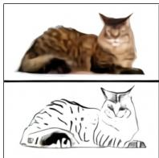

  

(a) "顶部为完全相同的猫，底部为其素描"


  

(b) "顶部为完全相同的照片，底部为其上下翻转后的镜像"

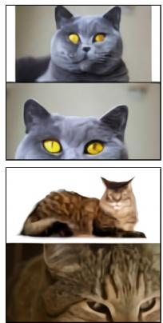

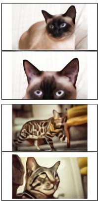  

(c)「同一只猫的两幅分屏图像。上面是该猫的一张照片，下面是照片中这只猫的极近距离特写视图。」


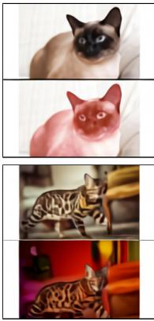  

(d) "与上方完全相同的猫，但底部被涂成红色"

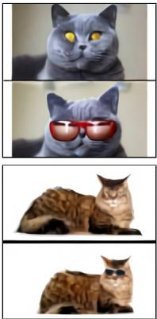

  

(e) "同一只猫的两格图像。上方是猫的照片，下方是戴墨镜的猫。"


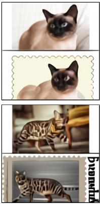  

(f) "顶部为同一只猫，底部为其邮票样式的呈现"

图 14. 零样本图像到图像转换的更多示例。

## G. 零样本图像到图像翻译（Zero-Shot Image-to-Image Translation）

图 14 展示了更多零样本图像到图像翻译的示例，我们在第 3.3 节中讨论过这一能力。我们并未预期这种能力会自发出现，也未对训练流程做任何修改来加以引导。