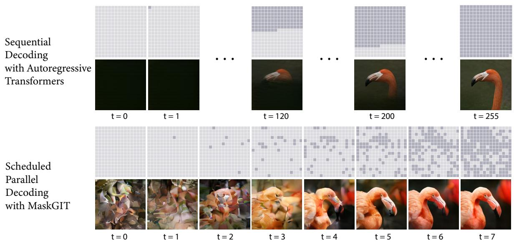
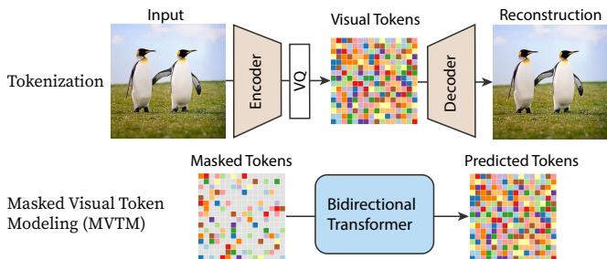
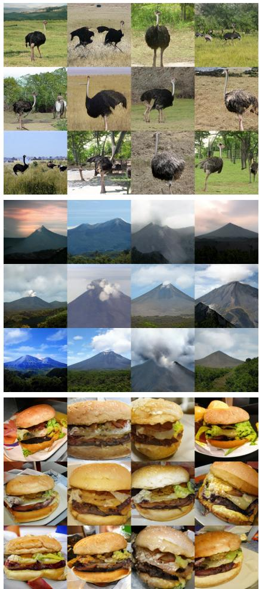
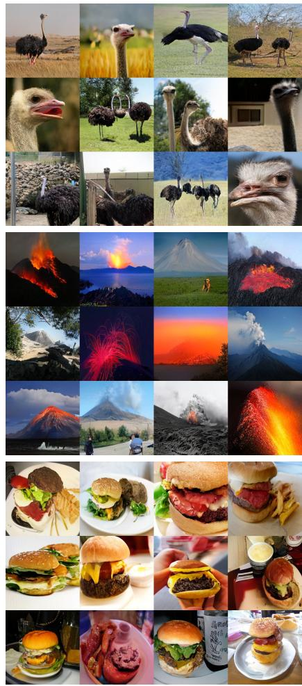
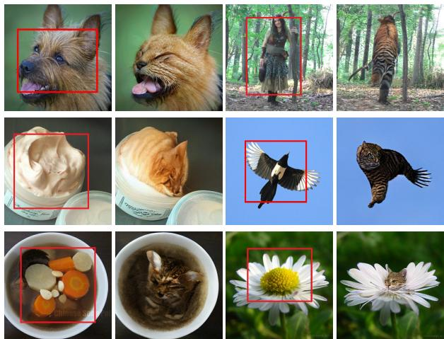
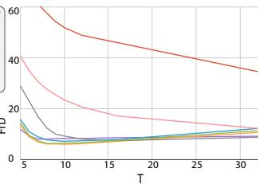
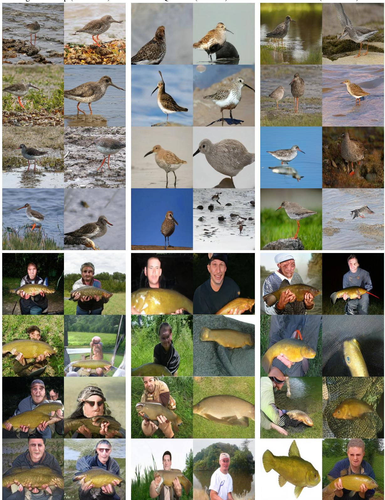
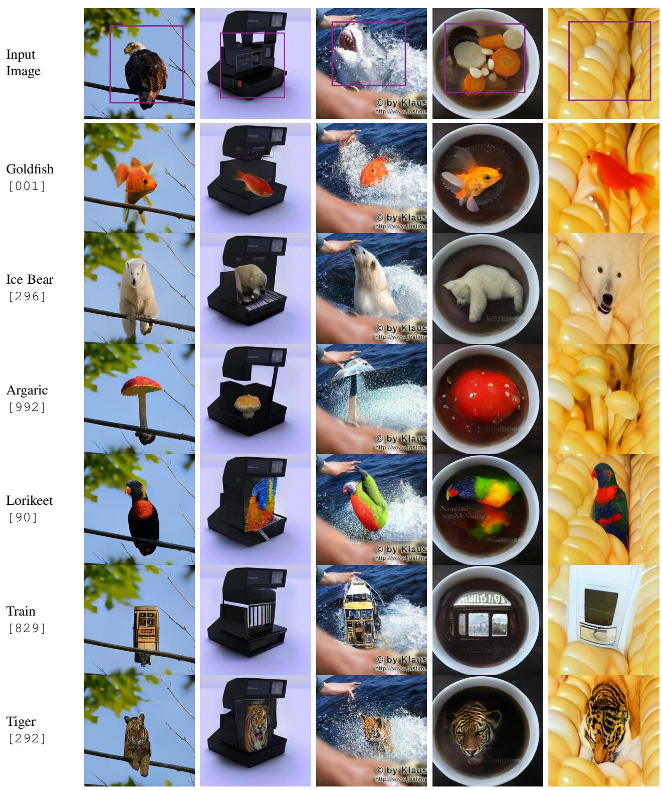
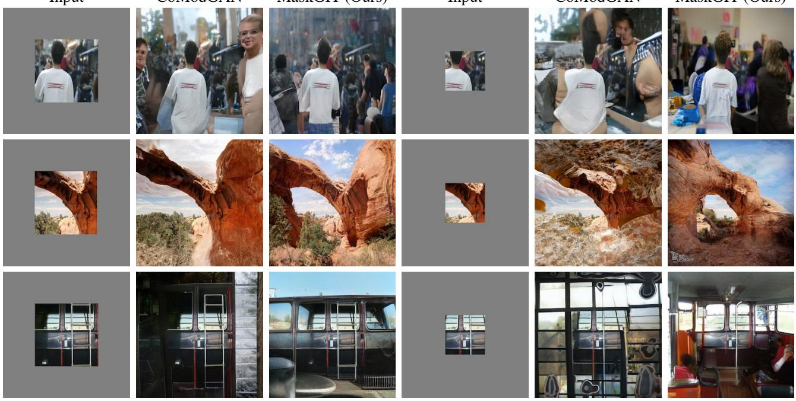
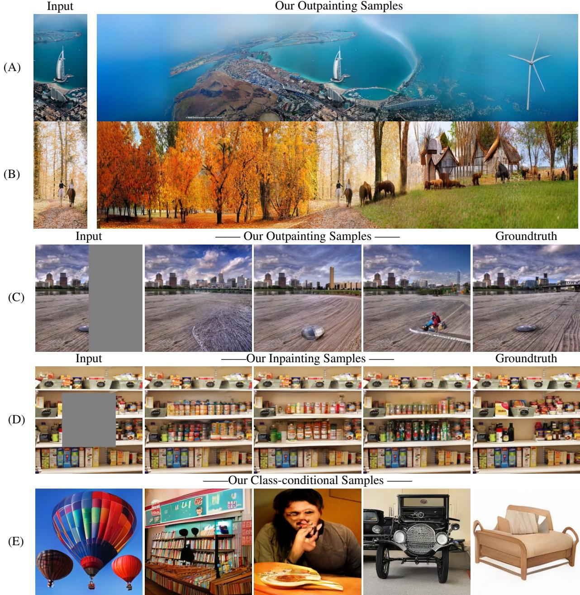

MaskGIT：掩码生成图像变换器

  

图1. MaskGIT 在图像合成与编辑任务上的生成示例。我们展示了 MaskGIT 是一个灵活的模型，能够在以下任务上生成高质量样本：(a) 类别条件生成，(b) 类别条件图像编辑，例如将边界框内选中的物体替换为给定类别的物体，以及 (c) 图像外推。三列所示示例的分辨率分别为 512ˆ512、512ˆ512 和 512ˆ2560。放大查看细节。

近年来，生成式Transformer在计算机视觉领域合成高保真、高分辨率图像方面迅速走红。然而，目前最佳的生成式Transformer模型仍然简单地将图像视为一个token序列，并按照光栅扫描顺序（即逐行方式）依次解码图像。我们发现这种策略既不理想也不高效。本文提出了一种使用双向Transformer解码器的新型图像合成范式，我们称之为MaskGIT。在训练阶段，MaskGIT通过关注所有方向的token来学习预测随机掩码的token。在推理时，模型从同时生成一幅图像的所有token开始，然后基于前一次的生成结果迭代地精炼图像。我们的实验表明，MaskGIT在ImageNet数据集上显著优于当前最先进的Transformer模型，并将自回归解码速度提升多达64倍。此外，我们说明MaskGIT可以轻松扩展到各种图像编辑任务，如图像修复、外推和图像操作。

## 1. 引言

作为研究领域，深度图像合成近年来取得了诸多进展。目前取得最先进成果的是生成对抗网络（Generative Adversarial Networks, GANs），它能够以极快的速度合成高保真图像。然而，它存在着一些众所周知的问题，包括训练不稳定和模式崩溃，这导致样本多样性不足。解决这些问题仍然是开放的研究课题。

受Transformer [48] 和GPT [5] 在自然语言处理中取得成功的启发，生成式Transformer模型在图像合成领域引起了越来越多的关注 [7, 15, 37]。通常，这些方法旨在将图像建模为一个序列，并利用现有的自回归模型来生成图像。图像生成分为两个阶段；第一阶段是将图像量化为一个离散的token（或视觉词）序列。在第二阶段，自回归模型（如Transformer）学习基于先前生成的结果依次生成图像token（即自回归解码）。与GAN中使用的精妙的极小极大优化不同，这些模型通过最大似然估计进行学习。由于设计上的差异，现有研究已经证明了它们相对于GAN的优势，能够提供稳定的训练以及更好的分布覆盖度或多样性。

现有的生成式Transformer研究主要集中在第一阶段，即如何对图像进行量化以最小化信息损失，并共享从NLP借用的相同第二阶段。因此，即使是当前最先进的生成式Transformer [15, 35] 仍然简单地将图像作为一个序列来处理，将图像按照光栅扫描顺序展平为一个一维的token序列——

Figure 2. Comparison between sequential decoding and MaskGIT's scheduled parallel decoding. Rows 1 and 3 are the input latent masks at each iteration, and rows 2 and 4 are samples generated by each model at that iteration. Our decoding starts with all unknown codes (marked in lighter gray), and gradually fills up the latent representation with more and more scattered predictions in parallel (marked in darker gray), where the number of predicted tokens increases sharply over iterations. MaskGIT finishes its decoding in 8 iterations compared to the 256 rounds the sequential method takes.

图 2. 顺序解码与 MaskGIT 调度式并行解码之间的对比。第 1 行和第 3 行是每次迭代时的输入潜变量掩码，第 2 行和第 4 行是每个模型在该迭代生成的样本。我们的解码从所有未知编码（以浅灰色标记）开始，逐步以并行方式用越来越多的分散预测（以深灰色标记）填充潜变量表示，其中预测令牌的数量在迭代过程中急剧增加。MaskGIT 仅需 8 次迭代即可完成解码，而顺序方法则需要 256 轮。

读，即从左到右、逐行进行（参见图 2）。我们发现这种表示方式对图像而言既不是最优的，也不是高效的。与文本不同，图像并非顺序的。试想一幅艺术作品是如何被创作出来的：画家先勾勒草图，然后通过填充或调整细节来逐步完善，这与先前工作 [7, 15] 中使用的逐行打印方式形成鲜明对比。此外，将图像视为扁平序列意味着自回归序列长度呈二次增长，很容易形成极长的序列——比任何自然语言句子都长。这不仅给建模长期相关性带来挑战，也使解码变得难以处理。例如，在 GPU 上以自回归方式用 32×32 个令牌生成单张图像就需要长达 30 秒。

本文提出了一种用于图像合成的新型双向 Transformer，称为掩码生成图像 Transformer（Masked Generative Image Transformer，MaskGIT）。在训练阶段，MaskGIT 在一个与 BERT [11] 中的掩码预测类似的代理任务上进行训练。在推理阶段，MaskGIT 采用一种新颖的非自回归解码方法，以恒定的步数合成图像。具体而言，在每次迭代中，模型并行地同时预测所有令牌，但仅保留其中置信度最高的那些。剩余的令牌被掩码掉，并将在下一次迭代中被重新预测。掩码比率不断降低，直至经过少数几次精炼迭代后所有令牌都被生成。如图 2 所示，MaskGIT 的解码速度比自回归解码快一个数量级，因为它仅需 8 步而非 256 步即可生成一幅图像，且每一步内的预测都可并行化。此外，与仅以光栅扫描顺序依赖先前令牌不同，双向自注意力允许模型从各个方向上的已生成令牌来生成新令牌。我们发现掩码调度（即每次迭代中被掩码的图像比例）对生成质量有显著影响。我们提出使用余弦调度，并在消融研究中验证了其有效性。

在 ImageNet 基准测试上，我们通过实验证明，MaskGIT 在 256ˆ256 和 512ˆ512 分辨率的类别条件生成任务上，速度显著更快（最高可达 64 倍），并且能够生成比当前最优自回归 Transformer（即 VQ-GAN）质量更高的样本。即使与领先的生成对抗网络（GAN）模型 BigGAN 以及扩散模型 ADM [12] 相比，MaskGIT 仍能提供相当的样本质量，同时具有更优的多样性。值得注意的是，我们的模型在分类准确率分数（Classification Accuracy Score, CAS）[36] 和 FID [23] 上，针对 512ˆ512 图像合成均刷新了最先进水平。据我们所知，本文首次在通用 ImageNet 基准上证明了掩码建模在图像生成任务中的有效性。

此外，MaskGIT 的多向性使其能够轻松扩展到那些对自回归模型而言困难的图像操作任务。图 1 展示了一种新的类别条件图像编辑应用，其中 MaskGIT 在保持上下文（边界框外部）不变的前提下，根据给定类别重新生成边界框内的内容。这一任务对自回归模型而言不可行，或对 GAN 模型而言较为困难，但对于我们的模型而言却轻而易举。在定量层面，我们将 MaskGIT 应用于图像修复和任意方向的图像外推，以展示这种灵活性。尽管我们的模型并非针对这些任务而设计，但在每项任务上均取得了与专用模型相当的性能。

## 2. 相关工作

## 2.1. 图像合成

深度生成模型 [12, 17, 29, 34, 41, 45, 46, 53] 已在图像合成任务中取得了大量成功。基于 GAN 的方法在生成高保真样本方面展现了惊人的能力 [4, 17, 27, 44, 53]。相比之下，基于似然的方法，如变分自编码器（Variational Autoencoders, VAEs）[29, 45]、扩散模型 [12, 24, 41] 和自回归模型 [34, 46]，则提供了分布覆盖能力，因此能够生成更具多样性的样本 [41, 45, 46]。

然而，直接在像素空间中最大化似然往往颇具挑战。因此，VQVAE [37, 47] 提出分两个阶段在潜在空间中生成图像。在第一阶段（称为令牌化）中，它尝试将图像压缩到离散潜在空间，主要由三个组件构成：

• 一个编码器 E，将图像 $x \in$ $\mathbb { R } ^ { H \times W \times 3 }$ 令牌化为潜在嵌入 $E ( x )$

• 一个码本 $\mathbf { e } _ { k } \in \mathbb { R } ^ { D } , k \in { 1 , 2 , \cdots , K }$，用于最近邻查找，将嵌入量化为视觉令牌，以及

• 一个解码器 G，根据视觉令牌 e 预测重建图像 xˆ。

在第二阶段，它首先使用深度自回归模型预测视觉标记的潜在先验，然后使用第一阶段的解码器将标记序列映射为图像像素。由于两阶段方法的有效性，许多方法沿用了这一范式。DALL-E [35] 使用 Transformer [48] 来改进第二阶段的标记预测。VQGAN [15] 在第一阶段加入对抗损失和感知损失 [26,54] 以提升图像保真度。与我们同期的工作 VIM [51] 提出使用 ViT 主干网络 [13] 来进一步改进词元化阶段。由于这些方法仍然采用自回归模型，第二阶段的解码时间随标记序列长度线性增长。

## 2.2. 基于双向 Transformer 的掩码建模

Transformer 架构 [48] 最初在 NLP 中提出，近年来已扩展到计算机视觉领域 [6, 13]。Transformer 由多个自注意力层组成，能够捕捉序列中所有元素对之间的交互。特别地，BERT [11] 引入了掩码语言建模（masked language modeling, MLM）任务用于语言表示学习。BERT [11] 中使用的双向自注意力使得 MLM 中的掩码标记能够利用来自两个方向的上下文进行预测。

  

图 3. 流程概览。MaskGIT 采用两阶段设计，包含 1）一个将图像词元化为视觉词元的标记器（tokenizer），以及 2）一个执行 MVTM 的双向 Transformer 模型，即学习预测随机遮蔽的视觉词元。

在视觉领域，BERT [11] 中的掩码建模已被扩展到图像表征学习 [2, 21]，将图像量化为离散标记。然而，由于难以使用双向注意力执行自回归解码，很少有工作成功地将同样的掩码建模应用于图像生成 [56]。据我们所知，本文首次在通用的 ImageNet 基准上提供了掩码建模用于图像生成的有效性证据。我们的工作受 NLP 中双向机器翻译 [16, 19, 20] 的启发，新颖之处在于所提出的新掩码策略和解码算法，实验证明它们对于图像生成至关重要。

## 3. 方法

我们的目标是设计一种利用并行解码和双向生成的新型图像合成范式。

我们遵循 2.1 节中讨论的两阶段方案，如图 3 所示。由于我们的目标是改进第二阶段，因此第一阶段采用与 VQGAN 模型 [15] 相同的设置，并将分词步骤的潜在改进留待未来工作。

在第二阶段，我们提出通过掩码视觉标记建模（Masked Visual Token Modeling，MVTM）来学习一个双向 Transformer。我们在 3.1 节中介绍 MVTM 训练，在 3.2 节中介绍采样过程，然后在 3.3 节中讨论关键的掩码设计技术。

## 3.1. 训练中的 MVTM

设 $\mathbf { Y } = [ y _ { i } ] _ { i = 1 } ^ { N }$ 表示将图像输入 VQ 编码器后得到的潜在标记，其中 N 是重塑后标记矩阵的长度，$\mathbf { M } = [ m _ { i } ] _ { i = { \frac { N } { \alpha } } } ^ { N }$ 是对应的二值掩码。在训练过程中，我们对标记的一个子集进行采样，并将其替换为特殊的 [MASK] 标记。若 $m _ { i } ~ = ~ 1$，则将标记 $y _ { i }$ 替换为 [MASK]；否则当 $m _ { i } = 0$ 时，$y _ { i }$ 将保持不变。

采样过程由掩码调度函数 $\gamma ( r ) \in ( 0 , 1 ]$ 参数化，执行过程如下：我们首先从 0 到 1 之间采样一个比率，然后在 Y 中均匀选取 $\lceil \gamma ( r ) \cdot N \rceil$ 个标记放置掩码，其中 N 是长度。掩码调度显著影响图像生成的质量，将在 3.3 节中讨论。

记 $Y _ { \overline { { \mathbf { M } } } }$ 为将掩码 M 应用于 Y 后的结果。训练目标是最小化被掩码标记的负对数似然：

$$
\mathcal {L} _ {\mathrm{mask}} = - \underset {\mathbf {Y} \in \mathcal {D}} {\mathbb {E}} \bigg [ \sum_ {\forall i \in [ 1, N ], m _ {i} = 1} \log p (y _ {i} | Y _ {\overline {{\mathbf {M}}}}) \bigg ],\tag{1}
$$

具体来说，我们将被掩码的 $Y_{\overline{\mathbf{M}}}$ 输入到一个多层双向 Transformer 中，以预测每个被掩码词元的概率 $P(y_i | Y_{\overline{\mathbf{M}}})$，其中负对数似然通过真实标签的独热词元与预测词元之间的交叉熵来计算。请注意与自回归建模的关键区别：MVTM 中的条件依赖具有两个方向，这使得图像生成能够通过关注图像中的所有词元来利用更丰富的上下文。

## 3.2. 迭代解码

在自回归解码中，词元是基于先前生成的输出按顺序生成的。该过程无法并行化，因此对于图像而言非常缓慢，因为图像词元长度（例如 256 或 1024）通常远大于语言的词元长度。我们提出了一种新颖的解码方法，可以同时并行生成图像中的所有词元。由于 MTVM 的双向自注意力机制，这是可行的。

理论上，我们的模型能够在单次前向传播中推断所有词元并生成整个图像。我们发现由于与训练任务的不一致性，这具有挑战性。下面介绍所提出的迭代解码。为了在推理时生成图像，我们从一个所有词元都被掩码的空白画布开始，即 $Y_{\mathbf{M}}^{(0)}$。对于第 $t$ 次迭代，我们的算法运行如下：

1. 预测（Predict）。给定当前迭代中被掩码的词元 $Y_{\mathbf{M}}^{(t)}$，我们的模型并行地预测所有被掩码位置的概率，记为 $p^{(t)} \in \mathbb{R}^{N \times K}$。

2. 采样（Sample）。在每个被掩码位置 $i$ 处，我们基于该位置在码本所有可能词元上的预测概率 $p_i^{(t)} \in \mathbb{R}^K$ 采样一个词元 $y_i^{(t)}$。在采样到词元 $y_i^{(t)}$ 后，其对应的预测分数被用作「置信度」分数，表示模型对该预测的信任程度。对于 $Y_{\mathbf{M}}^{(t)}$ 中未被掩码的位置，我们简单地将其置信度分数设置为 1.0。

3. 掩码调度（Mask Schedule）。我们根据掩码调度函数 $\gamma$ 通过 $n = \lceil \gamma(\frac{t}{T}) N \rceil$ 计算要掩码的词元数量，其中 $N$ 是输入长度，$T$ 是总迭代次数。

4. 掩码（Mask）。我们通过对 $Y_{\mathbf{M}}^{(t)}$ 中的 $n$ 个词元进行掩码来获得 $Y_{\mathbf{M}}^{(t+1)}$。第 $t+1$ 次迭代的掩码 $\mathbf{M}^{(t+1)}$ 由下式计算：

$$
m _ {i} ^ {(t + 1)} = \left\{ \begin{array}{l l} 1, & \text {if c_{i} <  sorted_{j} (c_{j})[n].} \\ 0, & \text {otherwise.} \end{array} \right.,
$$

其中 $c_i$ 是第 i 个 token 的置信度。

解码算法在 T 步内合成一张图像。在每次迭代中，模型同时预测所有 token，但仅保留最置信的。其余 token 被掩码掉，并在下一次迭代中重新预测。掩码率递减，直至所有 token 在 T 次迭代内生成完毕。在实践中，被掩码的 token 通过温度退火（temperature annealing）随机采样以鼓励更多样性，我们将在 4.4 节讨论其影响。图 2 展示了我们的解码过程的一个示例。它在 $T = 8$ 次迭代中生成一张图像，每次迭代中未掩码的 token 在网格中被高亮，例如当 $t = 1$ 时，我们仅保留 1 个 token 并将其它全部掩码。

## 3.3. 掩码设计（Masking Design）

我们发现图像生成的质量受到掩码设计的显著影响。我们用一个掩码调度函数 $\gamma(\cdot)$ 来建模掩码过程，该函数为给定的潜在 token 计算掩码率。如前所述，函数 $\gamma$ 在训练和推理阶段都会使用。在推理阶段，其输入为 $0/T, 1/T, \cdots, (T-1)/T$，表示解码的进度。在训练阶段，我们从 $[0, 1]$ 中随机采样一个比率 r，以模拟各种解码场景。

BERT 使用固定的 15% 掩码率 [11]，即它始终掩码 15% 的 token，但这对我们的任务并不适用，因为我们的解码器需要从头生成图像。因此需要新的掩码调度。在讨论具体方案之前，我们首先考察掩码调度函数的性质。首先，$\gamma(r)$ 在 $r \in [0, 1]$ 上需要是一个有界于 0 和 1 之间的连续函数。其次，$\gamma(r)$ 应该关于 r（单调地）递减，并且满足 $\gamma(0) \to 1$ 和 $\gamma(1) \to 0$。第二条性质确保我们解码算法的收敛性。

本文考虑了常见函数并进行简单变换以满足这些性质。图 8 展示了这些函数，它们分为三组：

- 线性函数（linear）是一个直接的方案，每次掩码等量的 token。

- 凹函数（concave）捕捉了图像生成遵循由少到多信息流的直觉。在最开始，大部分 token 被掩码，因此模型仅需要做出几个它有把握的正确预测。临近结束时，掩码率急剧下降，迫使模型做出更多的正确预测。在这一过程中有效信息是递增的。凹函数族包括余弦（cosine）、平方（square）、立方（cubic）和指数（exponential）。

- 凸函数（convex）则相反，实现了由多到少的过程。模型需要在最初几次迭代中确定绝大多数 token。该函数族包括平方根（square root）和对数（logarithmic）。

我们在 4.4 节中对上述掩码调度函数进行了实证比较，发现余弦函数在我们所有实验中表现最佳。

## 4. 实验

在本节中，我们从质量、效率和灵活性三个方面对 MaskGIT 在图像生成上的表现进行实证评估。在 4.2 节中，我们在 ImageNet [10] 256ˆ256 和 512ˆ512 上评估 MaskGIT 在标准类别条件图像生成任务上的表现。在 4.3 节中，我们通过展示 MaskGIT 在图像修复（inpainting）、图像外扩（outpainting）和图像编辑三项图像编辑任务上的表现来说明其多功能性。在 4.4 节中，我们验证掩码调度设计的必要性。我们将发布代码和模型以促进可复现研究。

## 4.1. 实验设置

对于每个数据集，我们仅训练单个自编码器、解码器和具有 1024 个标记的码本，所有实验均在裁剪后的 256×256 图像上进行。图像始终按固定倍率 16 进行压缩，即从 $H \times W$ 压缩为大小为 $h \times w$ 的标记网格，其中 $h { = } H / 1 6$，$w { = } W / 1 6$。我们发现该自编码器与码本可被复用以合成 512ˆ512 图像。

本工作中所有模型均采用相同配置：24 层、8 个注意力头、768 维嵌入和 3072 维隐藏层。模型使用可学习位置嵌入 [48]、LayerNorm [1] 以及截断正态初始化（标准差 = 0.02）。我们采用以下训练超参数：标签平滑 = 0.1、Dropout 比率 = 0.1、Adam 优化器 [28]，其 $\beta _ { 1 } { = } 0 . 9$ 且 $\beta _ { 2 } { = } 0 . 9 6$。我们使用 RandomResizeAndCrop 进行数据增强。所有模型在 4×4 TPU 设备上以 256 的批量大小进行训练。ImageNet 模型训练 300 个 epoch，而 Places2 模型训练 200 个 epoch。

## 4.2. 类别条件图像合成

我们在 ImageNet 256ˆ256 和 512ˆ512 上评估模型在类别条件图像合成任务上的表现。主要结果汇总于表 1。

**质量。** 在 ImageNet 256ˆ256 上，无需任何特殊采样策略（如束搜索（beam-search）、top-k 或核采样（nucleus sampling）启发式方法 [25] 或分类器引导（classifier guidance）[37]），我们在 Frechet Inception Distance (FID) [23]（6.18 对 15.78）和 Inception

  

图 4. VQGAN [15] 与本文方法在 Transformer 上的实际运行时间对比。所有结果均在单块 GPU 上运行。

得分（IS）（182.1 对比 78.3）。我们也在附录 B 中报告了使用基于分类器的拒绝采样的结果。

我们还使用与 MaskGIT 相同的分词器和超参数训练了一个 VQGAN 基线，以进一步突出双向 Transformer 与单向 Transformer 之间的差异，发现在两种分辨率下，MaskGIT 仍然以显著优势优于我们实现的基线。

此外，MaskGIT 在两种分辨率上都改善了 BigGAN 的 FID，在 512×512 上以 7.32 的 FID 达到了新的最优水平。

速度。我们通过评估每个模型生成一个样本所需的步数（即前向传播次数）来衡量模型速度。如表 1 所示，MaskGIT 在两种分辨率下都是所有非 GAN 模型中所需步数最少的。

为了进一步验证 MaskGIT 与自回归模型之间的速度差异，我们对 MaskGIT 与 VQGAN 的解码过程进行了运行时比较。如图 4 所示，MaskGIT 将 VQGAN 的速度显著提升了 30-64 倍，并且随着图像分辨率（从而输入 token 长度）的增加，加速比变得更加显著。

多样性。我们将分类准确率得分（CAS）[36] 和精确率/召回率（Precision/Recall）[30] 视为除样本质量之外的另外两个用于评估样本多样性的指标。

CAS 首先仅使用候选模型生成的样本来训练一个 ResNet-50 分类器 [22]，然后在 ImageNet 验证集上测量该分类器的分类准确率。表 1 的最后两列展示了 CAS 结果，其中还包含了在真实 ImageNet 训练数据上训练的分类器的得分作为参考（top-1 和 top-5 准确率分别为 76.6% 和 93.1%）。对于 256×256 图像分辨率，我们遵循通常的做法，使用数据增强 RandAugment [9]，并在附录 B 中报告了不使用增强训练的得分。我们发现 MaskGIT 显著优于之前的 VQVAE-2 和 VQGAN，在两种分辨率的 ImageNet 基准上都建立了新的 CAS 最优水平。

<table><tr><td>Model</td><td>FID ↓</td><td>IS ↑</td><td>Prec ↑</td><td>Rec ↑</td><td># params</td><td># steps</td><td colspan="2">CAS ×100 ↑</td></tr><tr><td>ImageNet 256×256</td><td></td><td></td><td></td><td></td><td></td><td></td><td>Top-1 (76.6)</td><td>Top-5 (93.1)</td></tr><tr><td>DCTransformer [32]°</td><td>36.51</td><td>n/a</td><td>0.36</td><td>0.67</td><td>738M</td><td>&gt;1024</td><td></td><td></td></tr><tr><td>BigGAN-deep [4]</td><td>6.95</td><td>198.2</td><td>0.87</td><td>0.28</td><td>160M</td><td>1</td><td>43.99</td><td>67.89</td></tr><tr><td>Improved DDPM [33]°</td><td>12.26</td><td>n/a</td><td>0.70</td><td>0.62</td><td>280M</td><td>250</td><td></td><td></td></tr><tr><td>ADM [12]°</td><td>10.94</td><td>101.0</td><td>0.69</td><td>0.63</td><td>554M</td><td>250</td><td></td><td></td></tr><tr><td>VQVAE-2 [37]°</td><td>31.11</td><td>~45</td><td>0.36</td><td>0.57</td><td>13.5B†</td><td>5120</td><td>54.83</td><td>77.59</td></tr><tr><td>VQGAN [15]°</td><td>15.78</td><td>78.3</td><td>n/a</td><td>n/a</td><td>1.4B</td><td>256</td><td></td><td></td></tr><tr><td>VQGAN*</td><td>18.65</td><td>80.4</td><td>0.78</td><td>0.26</td><td>227M</td><td>256</td><td>53.10</td><td>76.18</td></tr><tr><td>MaskGIT (Ours)</td><td>6.18</td><td>182.1</td><td>0.80</td><td>0.51</td><td>227M</td><td>8</td><td>63.14</td><td>84.45</td></tr><tr><td colspan="9">ImageNet 512×512</td></tr><tr><td>BigGAN-deep [4]</td><td>8.43</td><td>232.5</td><td>0.88</td><td>0.29</td><td>160M</td><td>1</td><td>44.02</td><td>68.22</td></tr><tr><td>ADM [12]°</td><td>23.24</td><td>58.06</td><td>0.73</td><td>0.60</td><td>559M</td><td>250</td><td></td><td></td></tr><tr><td>VQGAN*</td><td>26.52</td><td>66.8</td><td>0.73</td><td>0.31</td><td>227M</td><td>1024</td><td>51.29</td><td>74.24</td></tr><tr><td>MaskGIT (Ours)</td><td>7.32</td><td>156.0</td><td>0.78</td><td>0.50</td><td>227M</td><td>12</td><td>63.43</td><td>84.79</td></tr></table>

表 1. 在 ImageNet 256ˆ256 和 512ˆ512 上与当前最先进生成模型的定量比较。"# steps" 指生成一个样本所需的神经网络运行次数。˚ 表示使用与本文相同架构和设置训练的模型；˝ 表示数值取自已发表的论文；: 表示基于 pytorch 实现 [39] 估计所得。

  

BigGAN-deep（FID=6.95）

  

MaskGIT（FID=6.18）

  

训练集

图 5. 我们所提出的方法 MaskGIT 与 BigGAN-deep [4] 在 ImageNet 256×256 上的样本多样性对比。从上到下，样本的类别编号分别为 009、980 和 993。更多对比请参见附录。

—— MaskGIT（Our Samples）——

  

图 6. 类别条件图像编辑（Class-conditional image editing）。在每一对图像中，左侧为输入图像，目标类别为"虎斑猫（tiger cat）"，MaskGIT 将边界框选定的区域替换为虎斑猫，这展示了本模型的组合能力。

  

图 7. 修复（Inpainting）与外扩（Outpainting）。给定单一输入图像，MaskGIT 可针对修复任务（第一行）以及不同方向的外扩任务（后两行）合成多样化的结果。

表 1 中的精确率（Precision）/召回率（Recall）结果显示，MaskGIT 在召回率（Recall）所衡量的覆盖度方面优于 BigGAN，在精确率（Precision）所衡量的样本质量方面优于 VQVAE-2 等基于似然的模型以及扩散模型。相较于我们的基线 VQGAN，我们在略微提升其精确率（Precision）的同时，改善了召回率（Recall）所衡量的多样性。

与 BigGAN 的样本相比，MaskGIT 的样本在光照、姿态、尺度和上下文方面更加多样，如图 5 所示，更多对比结果见附录 B。

## 4.3. 图像编辑应用

在本小节中，我们将展示 MaskGIT 在三类图像编辑任务上的直接应用：类别条件图像编辑、图像修复（inpainting）以及图像外推（outpainting）。如第 3.2 节所述，若将任务视为对 MaskGIT 在其迭代解码中所使用的初始二值掩码 M 的一种约束，那么这三类任务几乎都可以被直接转化为 MaskGIT 能够处理的任务。我们证明，在不修改架构或进行任何任务特定训练的情况下，MaskGIT 能够在所有这三类应用上生成非常令人信服的结果。此外，尽管 MaskGIT 并非专门为图像修复或图像外推而设计，但它在这两项任务上仍取得了与专用模型相当的性能。

<table><tr><td>Task</td><td>Model</td><td>FID ↓</td><td>IS ↑</td></tr><tr><td rowspan="5">OutpaintingRight 50%</td><td>Boundless [43] $^{\square}$ </td><td>35.02</td><td>6.15</td></tr><tr><td>In&amp;Out [8] $^{\square}$ </td><td>23.57</td><td>7.18</td></tr><tr><td>InfinityGAN [31]</td><td>10.60</td><td>5.57</td></tr><tr><td>Boundless [43] TF $^{\diamond}$ </td><td>7.80</td><td>5.99</td></tr><tr><td>MaskGIT (Ours) $^{512}$ </td><td>6.78</td><td>11.69</td></tr><tr><td rowspan="5">InpaintingCenter 50% × 50%</td><td>DeepFill [52]</td><td>11.51</td><td>22.55</td></tr><tr><td>ICT [49] $^{\dagger}$ </td><td>13.63</td><td>17.70</td></tr><tr><td>HiFill [50] $^{512}$ </td><td>16.60</td><td>19.93</td></tr><tr><td>CoModGAN [57] $^{512}$ </td><td>7.13</td><td>21.82</td></tr><tr><td>MaskGIT (Ours) $^{512}$ </td><td>7.92</td><td>22.95</td></tr></table>

表 2. Places2 上图像修复与外推的定量比较。512 在 512×512 样本上评估，其他方法在对应的 256×256 样本上评估，与各自的训练设置一致；‡ 取自先前工作；* 使用在 Places2 子集上训练的已发布模型进行评估；◊ 使用 TFHub 模型 [18] 进行评估。

类条件图像编辑（Class-conditional Image Editing）。我们定义了一个新的类条件图像编辑任务，以展示 MaskGIT 的灵活性。在该任务中，模型在给定类别上重新生成由边界框指定的内容，同时保留上下文，即边界框外的内容。由于违反自回归方法的预测顺序，这一任务对自回归方法而言是不可行的。

然而，对于 MaskGIT 而言，如果我们把边界框区域视为送入迭代解码算法的初始掩码，这便是一个平凡的任务。图 6 所示展示了若干示例结果，更多内容可在附录 C 中找到。

在这些例子中，我们观察到 MaskGIT 能够合理地替换所选对象，同时保持，甚至在一定程度上补全背景中的上下文。此外，我们发现 MaskGIT 似乎能够合成在 ImageNet 训练集中未见过的不自然但合理的合成结果，例如飞翔的猫、汤碗中的猫以及花中的猫。这表明 MaskGIT 已经偶然地学到了可用于组合的有用表征，可在相关任务的未来工作中加以进一步利用。

图像修复（Image Inpainting）。图像修复或图像补全是一项基本的图像编辑任务，旨在合成缺失区域中的内容，使补全结果在视觉上显得真实。传统的基于块的方法 [3] 在纹理区域上效果良好，而基于深度学习的方法 [14, 38, 50, 52, 57] 已被证明可以合成需要更好语义一致性的图像。两种方法都在计算机视觉领域得到了广泛研究。

我们通过将遮蔽图像进行 token 化，并将修复掩码解释为我们迭代解码中的初始掩码，从而将 MaskGIT 扩展到此问题。然后，我们按照 [8] 的做法，根据掩码边界将输出图像与输入图像进行线性混合以合成最终图像。为了与基线方法的训练设置相匹配，我们在 Places2 [58] 数据集的 512×512 中心裁剪图像上训练 MaskGIT。所有超参数与在图像处理任务上训练的 MaskGIT 模型保持一致。

我们将 MaskGIT 与常见的基于 GAN 的基线方法进行比较，包括 DeepFillv2 [52] 和 HiFill [50]，在使用中心 $50\% \times 50\%$ 掩码的修复实验中，在 Places2 验证集上进行评估。表 2 总结了定量比较结果。MaskGIT 在 FID 和 IS 指标上以显著优势击败了 DeepFill 和 HiFill，同时取得了接近最先进修复方法 CoModGAN [57] 的分数。我们在附录 E 中展示了与 CoModGAN 的更多定性比较。

图像外绘（Image Outpainting）。外绘，或称图像外推，是一种近年来受到越来越多关注的图像编辑任务。由于周围像素的约束较少，预测区域的不确定性更大，因此它被视为比修复更具挑战性的任务。我们对该问题的适配以及以下评估中使用的模型与修复任务相同。

我们在以 50% 比例向右外推的任务上，与常见的基于 GAN 的基线方法进行比较，包括 Boundless [43]、In&Out [8]、InfinityGAN [31] 和 CoModGAN [57]。我们在 InfinityGAN [31] 和 In&Out [8] 作者慷慨提供的图像集上进行评估。

表 2 总结了定量比较结果。MaskGIT 击败了所有基线方法，并在 FID 和 IS 上达到了最先进水平。正如图 7 中的示例所示，MaskGIT 还能够在给定相同输入的情况下，使用不同的随机种子合成多样化的结果。我们观察到 MaskGIT 特别擅长补全物体和全局结构，并推测这得益于模型通过 Transformer 中的全局注意力学习到了有用的表示。

## 4.4. 消融实验

我们在 ImageNet 256ˆ256 上使用默认设置进行消融实验。

掩码调度。MaskGIT 的一个关键设计是在训练和迭代解码中都使用的掩码调度函数。我们比较了 3.3 节中讨论的函数，在图 8 中将它们可视化，并将结果汇总在表 3 中。

我们观察到，凹函数通常比线性函数获得更好的 FID 和 IS 分数，其次是凸函数。虽然余弦函数和平方函数相对于其他函数的表现相近，但余弦函数在所有指标上都略胜平方函数一筹，因此余弦函数成为我们模型中的默认选择。

<table><tr><td> $\gamma$ </td><td>T</td><td>FID ↓</td><td>IS ↑</td><td>NLL</td></tr><tr><td>Exponential</td><td>8</td><td>7.89</td><td>156.3</td><td>4.83</td></tr><tr><td>Cubic</td><td>9</td><td>7.26</td><td>165.2</td><td>4.63</td></tr><tr><td>Square</td><td>10</td><td>6.35</td><td>179.9</td><td>4.38</td></tr><tr><td>Cosine</td><td>10</td><td>6.06</td><td>181.5</td><td>4.22</td></tr><tr><td>Linear</td><td>16</td><td>7.51</td><td>113.2</td><td>3.75</td></tr><tr><td>Square Root</td><td>32</td><td>12.33</td><td>99.0</td><td>3.34</td></tr><tr><td>Logarithmic</td><td>60</td><td>29.17</td><td>47.9</td><td>3.08</td></tr></table>

表 3. 掩码调度函数的消融结果。我们报告了每个候选调度函数的最佳 FID、IS 和负对数似然（Negative Log-Likelihood）损失。

  

图 8. 掩码调度函数 $\gamma \big ( \frac { t } { T } \big )$ 的选择以及迭代次数 T。左侧展示了为 γ 考虑的七个函数。右侧展示了模型 FID 分数随解码迭代次数 T 变化的折线图。在候选函数中，我们发现余弦函数（cosine）取得了最佳的 FID。

我们假设凹函数之所以表现良好，是因为它们 1) 以更困难的样本（即鼓励更大的遮罩比例）来挑战训练，以及 2) 在整个解码过程中恰当地优先排序从少到多的预测。然而，过度优先排序似乎也是有代价的，正如三次函数的表现不如二次函数、指数函数的表现远差于所有其他凹函数所示。

迭代次数。我们通过使用不同的 T 运行所有候选遮罩函数来研究迭代次数（T）对模型的影响。如图 8 所示，在相同设置下，更多的迭代并不一定更好：随着 T 增加，除了对数函数始终表现不佳之外，所有其他函数都会达到一个「最佳点」，在该点上模型性能达到最高，然后再次变差。随着函数凹性减弱，最佳点也会「延迟」。如图所示，在实现强 FID 的函数中（即余弦、二次和线性），余弦不仅总体得分最强，而且在总共 8 到 12 次迭代时就达到最早的最佳点。我们假设这种最佳点的存在是因为过多的迭代可能会阻止模型保留置信度较低的预测，从而降低标记的多样性。我们认为对遮罩设计的进一步研究将是未来有趣的工作。

## 5. 结论

在本文中，我们提出了 MaskGIT，一种使用双向 Transformer 解码器的新型图像合成范式。MaskGIT 在掩蔽视觉标记建模（Masked Visual Token Modeling）任务上进行训练，学习在恒定次数的迭代内通过迭代解码过程生成样本。实验结果表明，MaskGIT 在条件图像生成方面显著优于最先进的 Transformer 模型，并且我们的模型可以方便地扩展到各种图像操控任务。由于 MaskGIT 与最先进的 GAN 取得了具有竞争力的性能，将我们的方法应用于其他合成任务是未来工作的一个有前景的方向。有关局限性和未来工作，请参见附录 F。

致谢 作者感谢 Xiang Kong 对相关工作的启发以及匿名审稿人提出的有益意见。

## 参考文献

[1] Jimmy Lei Ba, Jamie Ryan Kiros, and Geoffrey E. Hinton. 层归一化, 2016. 5

[2] Hangbo Bao, Li Dong, Songhao Piao, and Furu Wei. BEit：图像变换器的 BERT 预训练. 发表于：International Conference on Learning Representations, 2022. 3

[3] Connelly Barnes, Eli Shechtman, Adam Finkelstein, and Dan B Goldman. PatchMatch：一种用于结构化图像编辑的随机对应算法. ACM Transactions on Graphics (Proc. SIGGRAPH), 28(3), Aug. 2009. 7

[4] Andrew Brock, Jeff Donahue, and Karen Simonyan. 用于高保真自然图像合成的大规模 GAN 训练. 发表于：ICLR, 2019. 3, 6, 13

[6] Mathilde Caron, Hugo Touvron, Ishan Misra, Herve´ Jegou, Julien Mairal, Piotr Bojanowski, and Armand´ Joulin. 自监督视觉 Transformer 中的涌现属性. 载于国际计算机视觉会议论文集（ICCV），2021 年。3

[7] Mark Chen, Alec Radford, Rewon Child, Jeffrey Wu, Heewoo Jun, David Luan, and Ilya Sutskever. 基于像素的生成式预训练. 载于国际机器学习大会，第 1691–1703 页。PMLR，2020 年。1, 2, 13, 19, 20

[8] Yen-Chi Cheng, Chieh Hubert Lin, Hsin-Ying Lee, Jian Ren, Sergey Tulyakov, and Ming-Hsuan Yang. 内与外：通过 GAN 反演实现多样化图像外延. arXiv 预印本 arXiv:2104.00675，2021 年。7, 8

[9] Ekin D. Cubuk, Barret Zoph, Jonathon Shlens, and Quoc V. Le. RandAugment：具有缩减搜索空间的实用自动化数据增强方法，2019 年。5, 13

[10] Jia Deng, Wei Dong, Richard Socher, Li-Jia Li, Kai Li, and Li Fei-Fei. ImageNet：一个大规模分层图像数据库. 载于 2009 年 IEEE 计算机视觉与模式识别会议，第 248–255 页。IEEE，2009 年。5

[11] Jacob Devlin, Ming-Wei Chang, Kenton Lee, and Kristina Toutanova. BERT：用于语言理解的深度双向 Transformer 预训练. 由 Jill Burstein、Christy Doran 和 Thamar Solorio 主编，载于 NAACL-HLT，2019 年。2, 3, 4

[12] Prafulla Dhariwal and Alexander Quinn Nichol. 扩散模型在图像合成上击败 GAN. 由 A. Beygelzimer、Y. Dauphin、P. Liang 和 J. Wortman Vaughan 主编，载于《神经信息处理系统进展》，2021 年。2, 3, 6, 13

[13] Alexey Dosovitskiy, Lucas Beyer, Alexander Kolesnikov, Dirk Weissenborn, Xiaohua Zhai, Thomas Unterthiner, Mostafa Dehghani, Matthias Minderer, Georg Heigold, Sylvain Gelly, Jakob Uszkoreit, and Neil Houlsby. 一张图像相当于 16×16 个词：用于大规模图像识别的 Transformer. 载于 ICLR，2021 年。3

[14] Patrick Esser, Robin Rombach, Andreas Blattmann, and Bjorn Ommer. ImageBART：基于多项式扩散的自回归图像合成双向上下文，2021 年。8

[15] Patrick Esser, Robin Rombach, and Bjorn Ommer.¨ 驯服 Transformer 用于高分辨率图像合成. 载于 CVPR，2021 年。1, 2, 3, 5, 6, 12, 13, 19, 20

[16] Marjan Ghazvininejad, Omer Levy, Yinhan Liu, and Luke Zettlemoyer. Mask-Predict：条件掩码语言模型的并行解码，2019 年。3

[18] Google. Boundless 的 TFHub 模型（Tfhub Model of Boundless）。https://tfhub.dev/google/boundless/half/1，2021 年。7

[19] Jiatao Gu, James Bradbury, Caiming Xiong, Victor OK Li, and Richard Socher. 非自回归神经机器翻译（Non-Autoregressive Neural Machine Translation）。发表于 ICLR，2018 年。3

[20] Jiatao Gu and Xiang Kong. 完全非自回归神经机器翻译：实践技巧（Fully Non-Autoregressive Neural Machine Translation: Tricks of the Trade），2020 年。3

[21] Kaiming He, Xinlei Chen, Saining Xie, Yanghao Li, Piotr Dollar, and Ross Girshick. 掩码自编码器是可扩展的视觉学习器（Masked Autoencoders Are Scalable Vision Learners），2021 年。3, 12

[22] Kaiming He, Xiangyu Zhang, Shaoqing Ren, and Jian Sun. 用于图像识别的深度残差学习（Deep Residual Learning for Image Recognition）。发表于 CVPR，2016 年。5, 13

[23] Martin Heusel, Hubert Ramsauer, Thomas Unterthiner, Bernhard Nessler, and Sepp Hochreiter. 使用双时间尺度更新规则训练的 GAN 收敛至局部纳什均衡（GANs Trained by a Two Time-Scale Update Rule Converge to a Local Nash Equilibrium）。发表于 NeurIPS，2017 年。2, 5

[24] Jonathan Ho, Chitwan Saharia, William Chan, David J Fleet, Mohammad Norouzi, and Tim Salimans. 用于高保真图像生成的级联扩散模型（Cascaded Diffusion Models for High Fidelity Image Generation）。arXiv 预印本 arXiv:2106.15282，2021 年。3

[25] Ari Holtzman, Jan Buys, Li Du, Maxwell Forbes, and Yejin Choi. 神经文本退化的反常案例（The Curious Case of Neural Text Degeneration），2019 年。5

[26] Justin Johnson, Alexandre Alahi, and Li Fei-Fei. 用于实时风格迁移与超分辨率的感知损失（Perceptual Losses for Real-Time Style Transfer and Super-Resolution）。发表于欧洲计算机视觉会议（European Conference on Computer Vision），第 694–711 页。Springer，2016 年。3

[27] Tero Karras, Samuli Laine, Miika Aittala, Janne Hellsten, Jaakko Lehtinen, and Timo Aila. 分析与改进 StyleGAN 的图像质量（Analyzing and Improving the Image Quality of StyleGAN）。发表于 CVPR，2020 年。3

[28] Diederik P Kingma and Jimmy Ba. Adam：一种随机优化方法（Adam: A Method for Stochastic Optimization）。arXiv 预印本 arXiv:1412.6980，2014 年。5

[29] Diederik P. Kingma and Max Welling. 自编码变分贝叶斯（Auto-Encoding Variational Bayes）。发表于 ICLR，2014 年。3

[30] Tuomas Kynkäänniemi, Tero Karras, Samuli Laine, Jaakko Lehtinen, and Timo Aila. 评估生成模型的改进精确率与召回率指标（Improved Precision and Recall Metric for Assessing Generative Models）。发表于 NeurIPS，2019 年。5, 13

[31] Chieh Hubert Lin, Hsin-Ying Lee, Yen-Chi Cheng, Sergey Tulyakov, and Ming-Hsuan Yang. InfinityGAN：迈向无限分辨率图像合成（InfinityGAN: Towards Infinite-Resolution Image Synthesis）。arXiv 预印本 arXiv:2104.03963，2021 年。7, 8, 22

[32] Charlie Nash, Jacob Menick, Sander Dieleman, and Peter W. Battaglia. 使用稀疏表示生成图像（Generating Images with Sparse Representations），2021 年。6

[33] Alex Nichol and Prafulla Dhariwal. 改进的去噪扩散概率模型（Improved Denoising Diffusion Probabilistic Models）。arXiv 预印本 arXiv:2102.09672，2021 年。6

[34] Niki Parmar, Ashish Vaswani, Jakob Uszkoreit, Lukasz Kaiser, Noam Shazeer, Alexander Ku, and Dustin Tran. 图像 Transformer（Image Transformer）。收录于 ICML，Jennifer G. Dy 与 Andreas Krause 主编，2018 年。3

[35] Aditya Ramesh, Mikhail Pavlov, Gabriel Goh, Scott Gray, Chelsea Voss, Alec Radford, Mark Chen, and Ilya Sutskever. 零样本文本到图像生成（Zero-Shot Text-to-Image Generation）。收录于 ICML，Marina Meila 与 Tong Zhang 主编，2021 年。1, 3

[36] Suman V. Ravuri 和 Oriol Vinyals. 条件生成模型的分类准确度得分. 收录于 Hanna M. Wallach, Hugo Larochelle, Alina Beygelzimer, Florence d'Alché-Buc, Emily B. Fox 和 Roman Garnett 编辑的 NeurIPS 论文集, 第 12247–12258 页, 2019. 2, 5

[37] Ali Razavi, Aaron van den Oord 和 Oriol Vinyals. 使用 VQ-VAE-2 生成多样化的高保真图像. 收录于 Hanna M. Wallach, Hugo Larochelle, Alina Beygelzimer, Florence d'Alché-Buc, Emily B. Fox 和 Roman Garnett 编辑的 NeurIPS 论文集, 2019. 1, 3, 5, 6, 12, 14, 15, 16

[38] Chitwan Saharia, William Chan, Huiwen Chang, Chris A. Lee, Jonathan Ho, Tim Salimans, David J. Fleet 和 Mohammad Norouzi. Palette：图像到图像的扩散模型, 2021. 8

[39] Kim Seonghyeon. 在 PyTorch 中实现使用 VQ-VAE-2 生成多样化高保真图像. https://github.com/rosinality/vq-vae-2-pytorch, 2020. 6

[40] Karen Simonyan 和 Andrew Zisserman. 用于大规模图像识别的超深度卷积网络, 2015. 13

[41] Yang Song 和 Stefano Ermon. 通过估计数据分布梯度进行生成建模. 收录于 Hanna M. Wallach, Hugo Larochelle, Alina Beygelzimer, Florence d'Alché-Buc, Emily B. Fox 和 Roman Garnett 编辑的 NeurIPS 论文集, 2019. 3

[42] Christian Szegedy, Vincent Vanhoucke, Sergey Ioffe, Jon Shlens 和 Zbigniew Wojna. 重新思考用于计算机视觉的 Inception 架构. 收录于 2016 年 IEEE 计算机视觉与模式识别会议 (CVPR), 第 2818–2826 页, 2016. 13

[43] Piotr Teterwak, Aaron Sarna, Dilip Krishnan, Aaron Maschinot, David Belanger, Ce Liu 和 William T Freeman. Boundless：用于图像扩展的生成对抗网络. 收录于 IEEE/CVF 国际计算机视觉会议论文集, 第 10521–10530 页, 2019. 7, 8, 22

[44] Hung-Yu Tseng, Lu Jiang, Ce Liu, Ming-Hsuan Yang 和 Weilong Yang. 在有限数据下对生成对抗网络进行正则化. 收录于 CVPR, 2021. 3

[45] Arash Vahdat 和 Jan Kautz. NVAE：一种深度层次变分自编码器. 收录于 Hugo Larochelle, Marc'Aurelio Ranzato, Raia Hadsell, Maria-Florina Balcan 和 Hsuan-Tien Lin 编辑的 NeurIPS 论文集, 2020. 3

[46] Aaron van den Oord, Nal Kalchbrenner, Lasse Espeholt, Koray Kavukcuoglu, Oriol Vinyals 和 Alex Graves. 使用 PixelCNN 解码器的条件图像生成. 收录于 Daniel D. Lee, Masashi Sugiyama, Ulrike von Luxburg, Isabelle Guyon 和 Roman Garnett 编辑的 NeurIPS 论文集, 2016. 3

[47] Aaron van den Oord, Oriol Vinyals 和 Koray Kavukcuoglu. 神经离散表示学习. 收录于 Isabelle Guyon, Ulrike von Luxburg, Samy Bengio, Hanna M. Wallach, Rob Fergus, S. V. N. Vishwanathan 和 Roman Garnett 编辑的 NeurIPS 论文集, 2017. 3

[48] Ashish Vaswani, Noam Shazeer, Niki Parmar, Jakob Uszkoreit, Llion Jones, Aidan N. Gomez, Łukasz Kaiser 和 Illia Polosukhin. 注意力即一切. 收录于 NeurIPS, 2017. 1, 3, 5

[49] Ziyu Wan, Jingbo Zhang, Dongdong Chen, and Jing Liao. 基于Transformer的高保真多样化图像补全. arXiv预印本 arXiv:2103.14031, 2021. 7

[50] Zili Yi, Qiang Tang, Shekoofeh Azizi, Daesik Jang, and Zhan Xu. 用于超高分辨率图像修复的上下文残差聚合. 发表于 IEEE/CVF计算机视觉与模式识别会议论文集, 第7508–7517页, 2020年. 7, 8, 21

[51] Jiahui Yu, Xin Li, Jing Yu Koh, Han Zhang, Ruoming Pang, James Qin, Alexander Ku, Yuanzhong Xu, Jason Baldridge, and Yonghui Wu. 基于改进VQGAN的矢量量化图像建模. arXiv预印本 arXiv:2110.04627, 2021. 3

[52] Jiahui Yu, Zhe Lin, Jimei Yang, Xiaohui Shen, Xin Lu, and Thomas S Huang. 基于门控卷积的自由形式图像修复. 发表于 IEEE/CVF国际计算机视觉会议论文集, 第4471–4480页, 2019年. 7, 8, 21

[53] Han Zhang, Ian J. Goodfellow, Dimitris N. Metaxas, and Augustus Odena. 自注意力生成对抗网络. 发表于 ICML, 2019. 3

[54] Richard Zhang, Phillip Isola, Alexei A Efros, Eli Shechtman, and Oliver Wang. 深度特征作为感知度量的不合理有效性. 发表于 IEEE计算机视觉与模式识别会议论文集, 第586–595页, 2018年. 3

[55] Richard Zhang, Phillip Isola, Alexei A Efros, Eli Shechtman, and Oliver Wang. 深度特征作为感知度量的不合理有效性. 发表于 CVPR, 2018. 12

[56] Zhu Zhang, Jianxin Ma, Chang Zhou, Rui Men, Zhikang Li, Ming Ding, Jie Tang, Jingren Zhou, and Hongxia Yang. UFC-BERT：面向条件图像生成的统一多模态控制. 发表于 A. Beygelzimer, Y. Dauphin, P. Liang 和 J. Wortman Vaughan 主编的《神经信息处理系统进展》, 2021年. 3

[57] Shengyu Zhao, Jonathan Cui, Yilun Sheng, Yue Dong, Xiao Liang, Eric I Chang, and Yan Xu. 基于协同调制生成对抗网络的大规模图像补全. 发表于 国际学习表征会议 (ICLR), 2021年. 7, 8, 21, 22

[58] Bolei Zhou, Agata Lapedriza, Aditya Khosla, Aude Oliva, and Antonio Torralba. Places：用于场景识别的千万级图像数据库. 《IEEE模式分析与机器智能汇刊》, 2017年. 8, 21

  

图9. MaskGIT 在图像重建上的示例。MaskGIT 接收从原始图像（第一行）中提取的掩码 token，以随机输入掩码（第二行，未知 token 用浅灰色标记）作为输入，并输出重建图像（第三行）。随后，我们使用相同的掩码比例随机采样 100 个掩码，并在第四行中展示这 100 个重建样本的中位数。

## A. 图像重建讨论

在 4.2 节中，我们主要在类别条件图像生成任务上评估 MaskGIT。这里我们进一步讨论其在图像重建上的表现。我们首先随机采样输入掩码 M，其中视觉标记（visual tokens）按掩码比率 r 被遮蔽，然后运行 MaskGIT 的迭代解码算法来重建图像。图 10 展示了重建样本的 PSNR 和 LPIPS [55] 随 r 变化的曲线，而图 9 则可视化了该过程中掩码比率 r 从 95% 到 75% 的两个示例。

我们观察到，即使在非常高比例（例如 95%）的标记被遮蔽时，MaskGIT 仍能重建出整体性信息（例如前景物体的姿态和形状）。更重要的是，似乎在 90% 附近存在一个拐点：当掩码比率下降到 90% 之前，重建质量和一致性都急剧提升；而在 90% 之后，进一步的改进速度放缓。图 9 中重建样本与原始图像之间的视觉相似度从 95% 到 90% 的大幅跃升印证了这一观察，例如老虎前面的栅栏和汽车的颜色在掩码比率低于 90% 时能被一致地捕捉到，而在 95% 时则不能。

换言之，我们发现视觉标记是高度冗余的。对于整体性重建而言，只有很小一部分（例如 10%）的标记是必要的；其余的标记仅仅有助于恢复更精细的外观或细节。这呼应了我们在 3.3 节中阐述的掩码设计背后的直觉，即对前几个标记的预测是图像生成的关键。

关于图像空间冗余性的类似观察在同期论文 MAE [21] 中亦有讨论。在该工作中，他们发现对输入图像的高比例遮蔽能够为图像表示学习带来一个非平凡且有意义的自监督任务。

  

图 10. 由 PSNR 和 LPIPS [55] 衡量的重建质量与多样性。

B. 额外的类别条件图像生成结果

在本节中，我们报告类别条件图像生成方面的额外结果。

我们遵循先前基于 Transformer 的方法 [15, 37]，采用基于分类器的拒绝采样来提升样本质量分数。具体而言，我们使用一个预训练的 ResNet 分类器 [22] 根据预测概率对生成的样本进行打分，并以 0.05 的接受率保留样本，与 VQGAN [15] 中的做法一致。如表 4 所示，MaskGIT 相比 VQ-GAN 取得了一致的改进，并与带分类器引导的 ADM [12] 相当。更重要的是，通过加入拒绝采样，MaskGIT 达到了当前最优的 Inception Score（在 256ˆ256 上为 355.6，在 512ˆ512 上为 342.0）。

在表 5 中，我们报告了使用 Inception 特征 [42] 计算的精度（Precision）和召回（Recall）分数。与我们为与先前工作 [12, 30] 进行更直接对比而在表 1 中报告的基于 VGG [40] 特征的分数不同，我们发现基于 Inception 特征的分数更符合我们的定性观察，即 VQGAN 的样本比 BigGAN 的更多样化。在两种度量下，MaskGIT 的召回分数均优于 BigGAN 和 VQGAN。我们还报告了在未使用 RandAugment [9] 增广训练的分类器上评估的 CAS。与我们的主要结果一致，MaskGIT 以较大幅度优于 BigGAN 和我们的基线 VQGAN。

最后，我们在图 11、12 和 13 中展示了 MaskGIT 生成的类别条件样本与 BigGAN-deep 和 VQVAE-2 生成样本的部分对比。

<table><tr><td>Dataset</td><td>Model</td><td>Classifier guidance</td><td>FID</td><td>IS</td></tr><tr><td rowspan="3">ImageNet $256 \times 256$ </td><td>ADM [12]</td><td>1.0 guidance</td><td>4.59</td><td>186.70</td></tr><tr><td>VQGAN [15]</td><td>0.05 acceptance rate</td><td>5.88</td><td>304.8</td></tr><tr><td>MaskGIT</td><td>0.05 acceptance rate</td><td>4.02</td><td>355.6</td></tr><tr><td rowspan="2">ImageNet $512 \times 512$ </td><td>ADM [12]</td><td>1.0 guidance</td><td>7.72</td><td>172.71</td></tr><tr><td>MaskGIT</td><td>0.05 acceptance rate</td><td>4.46</td><td>342.0</td></tr></table>

表 4. 在 ImageNet 上使用分类器引导（classifier guidance）的方法进行类条件图像合成。

<table><tr><td rowspan="2">Model</td><td rowspan="2">Prec ↑</td><td rowspan="2">Rec ↑</td><td colspan="2">CAS ×100 ↑</td></tr><tr><td>Top-1 (73.1)</td><td>Top-5 (91.5)</td></tr><tr><td>BigGAN-deep [4]</td><td>0.82</td><td>0.27</td><td>42.65</td><td>65.92</td></tr><tr><td>VQ-GAN*</td><td>0.61</td><td>0.47</td><td>47.50</td><td>68.90</td></tr><tr><td>MaskGIT (Ours)</td><td>0.78</td><td>0.50</td><td>58.20</td><td>79.65</td></tr></table>

Table 5. 与 BigGAN-deep 以及我们的基线 VQGAN 在 ImageNet 256ˆ256 上的更多定量比较。˚ 表示我们使用与本文相同架构和设置训练的模型。

## C. 类条件图像编辑应用的更多示例

我们在图 14 中展示了更多类条件图像编辑的示例，在图 15 中展示了图像条件全景合成的示例。

## D. 与基于 Transformer 的 SOTA 方法的图像外推（Outpainting）对比

在图 16 和图 17 中，我们展示了 MaskGIT、ImageGPT [7] 和 VQGAN [15] 之间的一些外推对比。在每组图像中，我们分别展示了真值（左侧）、仅使用真值上半部分进行外推采样的结果（中间），以及仅使用真值下半部分进行外推采样的结果（右侧）。

MaskGIT 和 VQGAN 都可以通过利用分词化（tokenization）在更高分辨率上运行，因此能够获得比 ImageGPT 更高的样本保真度，而 ImageGPT 最高仅能在 192ˆ192 的分辨率上运行。同时，MaskGIT 比 ImageGPT 和 VQGAN 展现出更强的灵活性：它可以沿任意方向（例如向上和向下）进行外推，而 ImageGPT 和 VQGAN 由于其自回归性质，单个模型只能处理单一方向的外推。

## E. 与基于 GAN 的 SOTA 方法的图像修复（Inpainting）和外推（Outpainting）对比

在本节中，我们在图 18 和图 19 中展示了与当前最先进的基于 GAN 的图像补全方法的更多定性对比。定量结果已在 4.3 节中讨论。

我们发现，与之前的 GAN-based 方法相比，MaskGIT 展现了更强的连贯地补全结构的能力，其样本包含更少的伪影。在图 19 中，MaskGIT 补全了第二行中的桥梁和倒数第二行中的建筑，而相比之下所有 GAN 方法都难以做到这一点。

此外，我们还在具有较大掩码比例的图像补全任务上与 CoModGAN 进行了比较，即分别以中心 50%ˆ50% 和中心 31.25%ˆ31.25% 为条件，这些是传统 GAN 难以应对的挑战性案例。示例如图 20 所示。

## F. 局限性与失败案例

在图 21 中，我们展示了本文方法的若干局限性和失败案例。(A) 和 (B) 是 MaskGIT 外推结果中出现语义和颜色偏移的示例。由于其注意力范围有限，MaskGIT 在外推一端时可能会"遗忘"已合成的另一端的语义或颜色。(C) 和 (D) 展示了在应用于外推和内推时，本文方法有时会忽略或修改边界处物体的情况。(E) 展示了 MaskGIT 的失败模式，即在复杂结构（如人脸、文本和对称物体）上会造成过度平滑或生成不期望的伪影。针对这些情况的改进仍是未来的研究方向。

  

图 11. 在 ImageNet 上对使用截断阈值 1.0 的 BigGAN-deep、VQVAE-2 [37] 以及我们提出的方法 MaskGIT 之间进行的更多多样性比较。: 表示从原论文中提取的样本。

  

BigGAN-deep (FID=6.95)
VQVAE-2 (FID=31)
MaskGIT (FID=6.18)
Figure 12. 在 ImageNet 上，截断值为 1.0 的 BigGAN-deep、VQVAE-2 [37] 与我们所提出的方法 MaskGIT 之间的更多样性比较。： 表示从论文中提取的样本。

  

BigGAN-deep (FID=6.95)  
VQVAE-2 (FID=31)  
MaskGIT (FID=6.18)  
图 13. 在 ImageNet 上对 BigGAN-deep（截断值为 1.0）、VQVAE-2 [37] 以及我们所提出的方法 MaskGIT 进行更多样性比较。: 表示从论文中提取的样本。

输入图像（Input Image）

  

图14. 类别条件图像编辑的更多示例。在每一列中，下方的图像是使用上方的图像、左侧的 ImageNet 类别标签，以及下采样到潜在空间中的主要对象的边界框（如图第二行所示）合成的。

  

MaskGIT (Ours)

图 15. 水平图像外推的更多样本（从 512ˆ256 到 512ˆ2304）。合成的"全景图"是通过在水平两个方向上反复应用 MaskGIT 的外绘（outpainting）能力生成的。

  

图16. 与基于像素的方法 ImageGPT [7] 以及基于 Transformer 的方法 VQGAN [15] 的外绘（outpainting）对比。

  

图 17. 与基于像素的方法 ImageGPT [7] 以及基于 Transformer 的方法 VQGAN [15] 的外绘（outpainting）结果对比。

  

CoModGAN [57]  
Input  
DeepFillv2 [52]  
HiFill [50]  
MaskGIT (Ours)  
Groundtruth  
图 18. 在 Places2 [58] 数据集上与当前最先进的 GAN 方法在图像修复任务上的更多可视化对比。

  

Boundless [43]  
InfinityGAN [31]✳  
CoModGAN  
MaskGIT（Ours）  
Groundtruth  

图 19. 在图像外绘（image outpainting）任务上与当前最优 GAN 方法的更多视觉对比。✳ 标注的样本由原作者慷慨提供。

  

CoModGAN
MaskGIT（本文）
输入
CoModGAN
MaskGIT（本文）
图 20. 在大幅外绘掩码上与 CoModGAN [57] 的外绘视觉对比。

  

图 21. 局限性与失败案例。