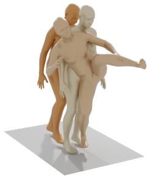
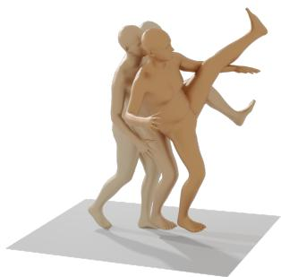
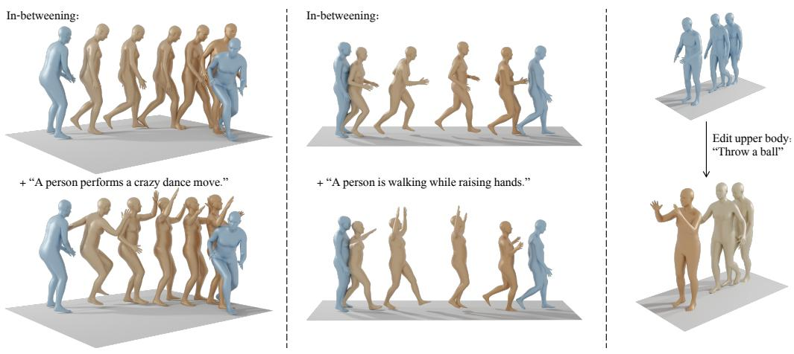

# 人体运动扩散模型（Human Motion Diffusion Model）

Guy Tevet, Sigal Raab, Brian Gordon, Yonatan Shafir,

以色列，特拉维夫大学（Tel Aviv University, Israel）

Daniel Cohen-Or and Amit H. Bermano

guytevet@mail.tau.ac.il

## 摘要

自然且富有表现力的人体运动生成是计算机动画领域的"圣杯"。由于可能动作的多样性、人类对运动的感知敏感性，以及准确描述运动的困难，这是一项极具挑战性的任务。因此，现有的生成式解决方案要么质量不高，要么表现力受限。扩散模型（diffusion models）已在其他领域展现出显著的生成能力，凭借其多对多（many-to-many）的特性，是人体运动生成的有力候选者，但它们通常资源消耗大且难以控制。本文引入运动扩散模型（Motion Diffusion Model, MDM），一种为人体运动领域精心适配的无分类器扩散生成模型（classifier-free diffusion-based generative model）。MDM 基于 Transformer 构建，融合了运动生成文献中的诸多见解。一个值得注意的设计选择是在每一步扩散中预测样本而非噪声，这便于对运动的位置与速度施加既定的几何损失，例如足部接触损失（foot contact loss）。我们将证明，MDM 是一种通用方法，能够支持不同的条件模式与不同的生成任务。我们展示了该模型仅需轻量级资源训练，即可在文本到运动（text-to-motion）和动作到运动（action-to-motion）的主流基准上达到最先进的结果1。https://guytevet.github.io/mdm-page/。

## 1 引言

人体运动生成是计算机动画中的一项基础任务，其应用涵盖从游戏到机器人等多个领域。这是一项充满挑战的领域，原因众多，包括可能动作的广阔跨度，以及获取高质量数据的难度与高昂成本。在近期兴起的文本到运动（text-to-motion）设定下，即从自然语言生成运动，另一个固有问题是数据标注。例如，标签"踢"既可指足球中的踢，也可指空手道中的踢。同时，对于一个特定的踢，存在多种描述方式，从执行方式到所传达的情感，构成了一个多对多的问题。当前方法已在此领域取得成功，展示了从文本到运动的合理映射（Petrovich 等，2022；Tevet 等，2022；Ahuja 与 Morency，2019）。然而，这些方法仍然限制了所学分布，因为它们主要采用自动编码器或 VAE（Kingma 与 Welling，2013）（分别意味着一种一对一映射或正态潜在分布）。在这方面，扩散模型是人体运动生成的更佳候选——它们无需对目标分布作任何假设，并且众所周知能够出色地表达我们前述的多对多分布匹配问题。

扩散模型（Diffusion Models；Sohl-Dickstein 等，2015；Song & Ermon，2020；Ho 等，2020）是一种正在计算机视觉与图形学领域获得显著关注的生成方法。在面向条件生成进行训练时，近期的扩散模型（Ramesh 等，2022；Saharia 等，2022b）在图像质量与语义层面均取得了突破性进展。这些模型的能力也已在其他领域得到验证，包括视频（Ho 等，2022）和三维点云（Luo & Hu，2021）。然而，这类模型的问题在于它们对计算资源的需求极高，且难以进行有效控制。

在本文中，我们提出了运动扩散模型（Motion Diffusion Model，MDM）——一种为人体运动领域精心适配的基于扩散的生成模型。作为基于扩散的方法，MDM 受益于 na-

"一个人用左腿踢。"

  

一个人先向右跑，然后向左跑，再回到中间。

  

图 1：我们的运动扩散模型（Motion Diffusion Model, MDM）通过在给定文本提示下生成多样化的运动，体现了文本到运动映射的多对多特性。我们定制的架构与几何损失有助于产生高质量的运动。颜色越深表示序列中越靠后的帧。

上述对领域多对多表达方式的选择，从生成动作的质量和多样性（图 1）可见一斑。此外，MDM 综合了动作生成领域中已有的成熟见解，使其显著更为轻量且更易于控制。

首先，与当前普遍使用的 U-Net（Ronneberger 等，2015）骨干网络不同，MDM 基于 Transformer。正如我们将展示的，我们的架构（图 2）非常轻量，并且更契合动作数据的时序非空间特性（动作数据被表示为一系列关节）。大量动作生成研究致力于采用几何损失（geometric losses）进行学习（Kocabas 等，2020；Harvey 等，2020；Aberman 等，2020）。例如，一些方法对动作速度加以约束（Petrovich 等，2021）以防止抖动，或通过专门的项专门处理脚部滑移问题（Shi 等，2020）。与这些工作一致，我们证明在扩散设定中应用几何损失能够提升生成效果。

MDM 框架具有通用化的设计，能够支持多种形式的条件输入。我们展示了三种任务：文本到动作（text-to-motion）、动作类别到动作（action-to-motion）以及无条件生成（unconditioned generation）。我们以无分类器方式（classifier-free manner）（Ho & Salimans，2022）训练模型，从而能够在多样性与保真度之间进行权衡，并从同一个模型中进行条件采样和无条件采样。在文本到动作任务中，我们的模型能够生成连贯的动作（图 1），在 HumanML3D（Guo 等，2022a）和 KIT（Plappert 等，2016）基准上取得了当前最优的结果。此外，我们的用户研究表明，人类评估者在 42% 的情况下更偏好我们生成的动作，而非真实动作（图 4(a)）。在动作类别到动作任务中，MDM 在常用的 HumanAct12（Guo 等，2020）和 UESTC（Ji 等，2018）基准上超越了当前最优方法（Guo 等，2020；Petrovich 等，2021），尽管这些方法是为该任务专门设计的。

最后，我们还展示了动作补全（completion）与编辑（editing）。通过借鉴扩散图像修复（diffusion image-inpainting）（Song 等，2020b；Saharia 等，2022a）的思路，我们设定动作的前缀与后缀，并利用模型填补中间的空缺。在文本条件下进行此操作，能够引导 MDM 以保持原始输入语义的方式，用特定动作填补空缺。通过在关节空间（而非时序空间）中进行修复，我们还展示了对特定身体部位进行语义编辑而不改变其他部位的能力（图 3）。

总体而言，我们提出了 Motion Diffusion Model（动作扩散模型），一个在多项动作生成任务中达到当前最优质量的框架，同时仅需在中端 GPU 上训练约三天即可完成。它支持几何损失——这些损失在扩散设定下并非平凡，但对于动作领域至关重要——并将当前最优的生成能力与深思熟虑的领域知识相结合。

## 2 相关工作

## 2.1 人体动作生成

神经网络的动作生成从动作捕捉数据中学习而来，可由任何描述动作的信号进行条件控制。许多工作使用动作自身的部分作为引导。一些方法从其前缀姿态预测动作（Fragkiadaki 等, 2015; Martinez 等, 2017; Hernandez 等, 2019; Guo 等, 2022b）。另一些工作（Harvey & Pal, 2018; Kaufmann 等, 2020; Harvey 等, 2020; Duan 等, 2021）使用双向 GRU（Cho 等, 2014）和 Transformer（Vaswani 等, 2017）架构解决插值与超分辨率任务。Holden 等（2016）使用自编码器来学习动作的潜在表示，然后利用它通过根轨迹、骨长等空间约束来编辑和控制动作。动作可以通过动作类别（Guo 等, 2020; Petrovich 等, 2021; Cervantes 等, 2022）、音频（Li 等, 2021; Aristidou 等, 2022）和自然语言（Ahuja & Morency, 2019; Petrovich 等, 2022）等高层引导来控制。在大多数情况下，作者建议采用一种专用方法将每个条件域映射到动作。

近年来，文本到动作任务（Text-to-Motion Task）的主流方法是学习语言和动作的共享潜在空间。JL2P（Ahuja & Morency, 2019）使用自编码器学习 KIT 动作-语言数据集（Plappert 等, 2016），将文本到动作的映射限制为一对一映射。TEMOS（Petrovich 等, 2022）和 T2M（Guo 等, 2022a）建议使用 VAE（Kingma & Welling, 2013）将文本提示映射到潜在空间中的正态分布。最近，MotionCLIP（Tevet 等, 2022）利用 CLIP（Radford 等, 2021）所学到的共享文本-图像潜在空间，将文本到动作的生成扩展到数据限制之外，并支持潜在空间编辑。

动作流形（human motion manifold）也可以在没有标签的情况下进行学习，如 Holden 等（2016）、V-Poser（Pavlakos 等, 2019），以及最近提出的专用 MoDi 架构（Raab 等, 2022）所示。我们展示了我们的模型也能在这样的无监督设定下工作。

## 2.2 扩散生成模型（DIFFUSION GENERATIVE MODELS）

扩散模型（Diffusion Models）（Sohl-Dickstein 等, 2015; Song & Ermon, 2020）是一类神经生成模型，基于热力学（Thermodynamics）中所建模的随机扩散过程。在该设定中，来自数据分布的样本会被扩散过程逐步加噪。随后，一个神经模型学习其逆过程，即逐步对样本进行去噪。通过对纯初始噪声进行去噪，即可从所学的数据分布中进行采样。Ho 等（2020）与 Song 等（2020a）进一步发展了面向图像生成应用的相关实践。对于条件生成，Dhariwal 与 Nichol（2021）引入了分类器引导扩散（classifier-guided diffusion），后由 GLIDE（Nichol 等, 2021）加以改进，使其能够基于 CLIP 的文本表示进行条件控制。无分类器引导（Classifier-Free Guidance）方法（Ho 与 Salimans, 2022）能够在保真度与多样性之间进行权衡的同时实现条件生成，并取得了更好的效果（Nichol 等, 2021）。在本文中，我们以无分类器方式基于 CLIP 进行条件控制，从而实现文本到动作的合成，类似于文本到图像的合成（Ramesh 等, 2022; Saharia 等, 2022b）。图像的局部编辑通常被定义为一个修复（inpainting）问题，其中图像的一部分保持不变，待修复部分由模型在某种条件下进行去噪（Song 等, 2020b; Saharia 等, 2022a）。我们将该技术加以改造，用于根据可选条件来编辑动作中的特定身体部位或时间区间（即动作补间，in-betweening）。

最近，与本工作同期，Zhang 等（2022）与 Kim 等（2022）提出了用于动作生成的扩散模型。我们的工作所需的 GPU 资源显著更少，并通过若干设计选择使得几何损失得以应用，从而改善了结果。

## 3 动作扩散模型（Motion Diffusion Model）

我们的方法概览如图 2 所示。我们的目标是：给定任意条件 $c$，合成一段长度为 N 的人体动作 $x ^ { 1 : N }$。该条件可以是任何能够决定合成过程的真实世界信号，例如音频（Li 等, 2021; Aristidou 等, 2022）、自然语言（文本到动作，text-to-motion）（Tevet 等, 2022; Guo 等, 2022a）或离散类别（动作到动作，action-to-motion）（Guo 等, 2020; Petrovich 等, 2021）。此外，无条件动作生成也是可行的，我们将其表示为空条件（null condition）$c = \emptyset$。所生成的动作 $\boldsymbol { x } ^ { 1 : N } = \{ x ^ { i } \} _ { i = 1 } ^ { N }$ 是一串人体姿态的序列，由关节旋转或位置进行表示，$\boldsymbol { x } ^ { i } \in \mathbb { R } ^ { J \times D }$，其中 J 为关节数量，D 为关节表示的维度。MDM 可以接受由位置、旋转或两者共同表示的动作（见第 4 节）。

  

图 2：（左）运动扩散模型（Motion Diffusion Model, MDM）概述。该模型在加噪步骤 t 中接收长度为 N 的运动序列 $\boldsymbol { x } _ { t } ^ { 1 : N }$，以及 t 本身和一个条件编码 c。c 在此例中是一个基于 CLIP（Radford 等人，2021 年）的文本嵌入，首先被随机掩码以用于无分类器学习（classifier-free learning），然后与 t 一起被投影为输入令牌 $z _ { t k }$。在每个采样步骤中，Transformer 编码器预测最终的干净运动 $\hat { x } _ { 0 } ^ { 1 : N }$。（右）MDM 采样。给定条件 c，我们在所需运动的维度上采样随机噪声 $x _ { T }$，然后从 T 迭代到 1。在每个步骤 t，MDM 预测干净样本 ${ \hat { x } } _ { 0 }$，并将其扩散回 $x _ { t - 1 }$。

框架。扩散被建模为一个马尔可夫加噪过程，$\{ x _ { t } ^ { 1 : N } \} _ { t = 0 } ^ { T }$，其中 $x _ { 0 } ^ { 1 : N }$ 从数据分布中采样，并且

$$
q (x _ {t} ^ {1: N} | x _ {t - 1} ^ {1: N}) = \mathcal {N} (\sqrt {\alpha_ {t}} x _ {t - 1} ^ {1: N}, (1 - \alpha_ {t}) I),\tag{1}
$$

其中 $\alpha _ { t } \in ( 0 , 1 )$ 为固定超参数。当 $\alpha _ { t }$ 足够小时，我们可以近似得到 $x _ { T } ^ { 1 : N } \sim \dot { \mathcal { N } } ( 0 , \dot { I } )$。此后，我们统一使用 $x _ { t }$ 来表示在加噪步骤 $t$ 处的完整序列。

在我们的语境下，条件运动合成（conditioned motion synthesis）将分布 $p ( x _ { 0 } | c )$ 建模为对 $x _ { T }$ 逐步去噪的反向扩散过程。我们不沿用 Ho 等人（2020）所提出的预测 $\epsilon _ { t }$ 的方式，而是遵循 Ramesh 等人（2022）的方法，直接预测信号本身，即 $\hat { x } _ { 0 } = G ( x _ { t } , t , c )$，并采用 Ho 等人（2020）给出的简洁训练目标，

$$
\mathcal {L} _ {\mathrm{simple}} = E _ {x _ {0} \sim q (x _ {0} | c), t \sim [ 1, T ]} [ \| x _ {0} - G (x _ {t}, t, c) \| _ {2} ^ {2} ]\tag{2}
$$

几何损失。在运动领域，生成网络通常使用几何损失进行正则化（Petrovich et al., 2021; Shi et al., 2020）。这些损失能够强制施加物理属性并防止伪影，从而鼓励生成自然且连贯的运动。在本工作中，我们尝试了三种常见的几何损失，分别用于约束（1）位置（在预测旋转的情况下）、（2）足部接触，以及（3）速度。N

$$
\mathcal {L} _ {\mathrm{pos}} = \frac {1}{N} \sum_ {i = 1} ^ {N} \| F K (x _ {0} ^ {i}) - F K (\hat {x} _ {0} ^ {i}) \| _ {2} ^ {2},\tag{3}
$$

$$
\mathcal {L} _ {\mathrm{foot}} = \frac {1}{N - 1} \sum_ {i = 1} ^ {N - 1} \| (F K (\hat {x} _ {0} ^ {i + 1}) - F K (\hat {x} _ {0} ^ {i})) \cdot f _ {i} \| _ {2} ^ {2},\tag{4}
$$

$$
\mathcal {L} _ {\mathrm{vel}} = \frac {1}{N - 1} \sum_ {i = 1} ^ {N - 1} \| (x _ {0} ^ {i + 1} - x _ {0} ^ {i}) - (\hat {x} _ {0} ^ {i + 1} - \hat {x} _ {0} ^ {i}) \| _ {2} ^ {2}\tag{5}
$$

当我们预测关节旋转时，$F K ( \cdot )$ 表示正运动学函数（forward kinematic function），用于将关节旋转转换为关节位置（否则，该函数表示恒等函数）。$f _ { i } \in \{ 0 , 1 \} ^ { J }$ 是每一帧 i 的二值足部接触掩码（binary foot contact mask）。该掩码仅与足部相关，用于指示足部是否接触地面，并根据二值真值数据（Shi 等人，2020）进行设置。本质上，它通过在足部接触地面时将速度置零来缓解足部滑动效应（foot-sliding effect）。

总体而言，我们的训练损失为

$$
\mathcal {L} = \mathcal {L} _ {\text { simple }} + \lambda_ {\text { pos }} \mathcal {L} _ {\text { pos }} + \lambda_ {\text { vel }} \mathcal {L} _ {\text { vel }} + \lambda_ {\text { foot }} \mathcal {L} _ {\text { foot }}.\tag{6}
$$

模型。我们的模型如图 2 所示。我们采用直接的 Transformer（Vaswani et al., 2017）仅编码器（encoder-only）架构来实现 G。该 Transformer 架构具有时序感知能力，能够学习任意长度的运动，并且在运动领域已得到充分验证（Petrovich et al., 2021; Duan et al., 2021; Aksan et al., 2021）。噪声时间步 t 和条件编码 c 分别通过独立的前馈网络（feed-forward networks）投影到 Transformer 维度，然后相加得到令牌 $z_{tk}$。带噪输入 $x_t$ 的每一帧被线性投影到 Transformer 维度，并与标准的位置编码相加。$z_{tk}$ 和投影后的帧随后被送入编码器。排除第一个输出令牌（对应于 $z_{tk}$），编码器结果被投影回原始运动维度，作为预测结果 $\hat{x}_0$。我们通过使用 CLIP（Radford et al., 2021）文本编码器将文本提示编码为 c 来实现文本到运动（text-to-motion），并通过为每个类别学习嵌入来实现动作到运动（action-to-motion）。

从 $p(x_0|c)$ 采样以迭代方式进行，依据 Ho et al. (2020)。在每个时间步 t，我们预测干净样本 $\hat{x}_0 = G(x_t, t, c)$ 并对其重新添加噪声得到 $x_{t-1}$。该过程从 $t = T$ 开始重复，直到得到 $x_0$（图 2 右侧）。我们使用无分类器引导（classifier-free guidance）（Ho & Salimans, 2022）来训练模型 G。在实践中，G 通过对 10% 的样本随机设置 $c = \emptyset$ 来同时学习有条件分布和无条件分布，使得 $G(x_t, t, \emptyset)$ 近似于 $p(x_0)$。然后，在采样 G 时，我们可以通过插值甚至外推这两种变体来权衡多样性和保真度，使用 s：

$$
G _ {s} (x _ {t}, t, c) = G (x _ {t}, t, \emptyset) + s \cdot (G (x _ {t}, t, c) - G (x _ {t}, t, \emptyset))\tag{7}
$$

编辑。我们通过将扩散修复（diffusion inpainting）技术适配到动作数据上，实现了时间域上的动作插值（motion in-betweening）以及空间域上的身体部位编辑。编辑过程仅在采样阶段进行，无需任何额外训练。当仅给定动作序列输入的一个子集时，在采样模型时（图 2 右），我们在每一次迭代中将 $\scriptstyle { \hat { x } } _ { 0 }$ 的输入部分用原始输入覆盖。这鼓励生成结果在保持与原始输入一致的同时，对缺失部分进行补全。在时间设定下，动作序列的前缀和后缀帧作为输入，我们求解一个动作插值问题（Harvey et al., 2020）。编辑可以条件式或无条件式地进行（通过令 $c = \varnothing$）。在空间设定下，我们证明，通过使用相同的补全技术，身体部位可以根据条件 c 重新合成，同时保持其余部分不变。

## 4 实验

我们为三个动作生成任务实现了 MDM：文本到动作（4.1）、动作到动作（4.2）以及无条件生成（5.2）。每个小节将回顾所用基准的数据和指标，提供实现细节，并展示定性和定量结果。然后，我们展示如何通过将扩散修复适配到动作数据上，来实现动作插值（条件式和无条件式）以及身体部位编辑（5.1）。我们的模型在 $\bar { \boldsymbol { T } } = 1 0 0 0$ 个加噪步数和余弦噪声调度下进行训练。所有模型均在一块 NVIDIA GeForce RTX 2080 Ti GPU 上训练，训练时长约为 3 天。

## 4.1 文本到动作

文本到动作任务是根据输入的文本提示生成动作。生成的动作既要实现文本描述的内容，也要是数据分布中的一个有效样本（即符合一般人类能力和物理规律）。此外，对于每个文本提示，我们期望得到与之匹配的一系列动作分布，而非单一结果。我们使用两个主流基准——KIT（Plappert et al., 2016）和 HumanML3D（Guo et al., 2022a）——以及 Guo et al. (2022a) 提出的指标集来评估我们的模型：R-precision 和 Multimodal-Dist 衡量生成动作与输入提示的相关性，FID 衡量生成分布与真实分布之间的差异性（在潜空间中），Diversity 衡量生成动作分布中的多样性，MultiModality 是给定单一文本提示时的平均方差。关于指标的完整实现细节，请参阅 Guo et al. (2022a)。我们使用 HumanML3D 作为平台来比较模型的不同骨干网络，发现扩散框架对该属性相对不敏感。此外，我们进行了一项用户研究，将我们的模型与当前最先进的方法以及真实动作进行比较。

  

图3：编辑应用。浅蓝色帧表示动作输入，古铜色帧表示生成的动作。动作补间（左+中）可以在有文本条件或无文本条件下由同一模型完成。右侧演示了利用文本进行的特定身体部位编辑：下半身关节固定为输入动作，而上半身则被修改以适配输入文本提示。

数据。HumanML3D 是一个最近的数据集，对来自 AMASS（Mahmood 等人，2019）和 HumanAct12（Guo 等人，2020）集合中的动作捕捉进行了文本重新标注。它包含 14,616 个动作，由 44,970 个文本描述进行标注。此外，它提出了一种冗余的数据表示方法，包括根节点速度、关节位置、关节速度、关节旋转和足部接触二值标签的拼接。本节中我们也使用由相同发布者提供的 KIT 数据集的相同表示。尽管样本数量（3,911）和多样性有限，但大多数文本到动作的研究都基于该数据集，因此我们认为使用它进行评估也很重要。

实现。除了我们的 Transformer 仅编码器骨干网络（第 3 节）之外，我们还使用另外三种骨干网络对 MDM 进行实验：(1) Transformer 解码器通过交叉注意力层注入 z，而不是作为输入 token；(2) Transformer 解码器 + 输入 token，其中 ztk 通过两种方式注入；(3) GRU（Cho 等人，2014）将 z 拼接到每个输入帧（表 1）。我们的模型以批大小 64、8 层（GRU 在 2 层时效果最佳）和潜在维度 512 进行训练。为了对文本进行编码，我们使用冻结的 CLIP-ViT-B/32 模型。每个模型训练了 500K 步，之后选择一个使 FID 指标最小化的检查点进行报告。由于足部接触和关节位置在 HumanML3D 中被显式表示，因此我们在本节中不应用几何损失。我们使用引导尺度 s = 2.5 来评估模型，该尺度提供了多样性与保真度的最佳平衡点（图 4）。

定量评估。我们根据 Guo 等人（2022a）建议的指标评估我们的模型，并与当前最先进的方法（JL2P（Ahuja 和 Morency，2019）、Text2Gesture（Bhattacharya 等人，2021）和 T2M（Guo 等人，2022a））进行比较。可以看出，MDM 在 FID、多样性和多模态性方面取得了最先进的结果，表明对于每个输入文本提示具有高度多样性以及高质量的样本，这在图 1 中也可以从质量上看出来。

用户研究。我们邀请了 31 名用户在并排视图中从 MDM 与最先进方法之间进行选择，两个样本均由从 KIT 测试集随机采样的相同文本提示生成。我们对每个模型重复此过程，每个模型 10 个样本，每个样本重复 10 次。本用户研究使得与最近的 TEMOS 模型（Petrovich 等人，2022）进行比较成为可能，该模型未包含在 HumanML3D 基准测试中。图 4 显示，大多数时候，MDM 比对比模型更受偏好，甚至在 42.3% 的情况下比真实样本更受偏好。

## 4.2 动作到动作（ACTION-TO-MOTION）

动作到运动（Action-to-motion）是指在给定一个以标量表示的输入动作类别的前提下生成相应运动的任务。生成的运动应当忠实地演示该输入动作，同时应当自然，并能够反映模型所训练数据集的分布。常用于评估动作到运动模型的数据集有两个：HumanAct12（Guo 等，2020）和 UESTC（Ji 等，2018）。

<table><tr><td>Method</td><td>R Precision (top 3)↑</td><td>FID↓</td><td>Multimodal Dist↓</td><td>Diversity→</td><td>Multimodality↑</td></tr><tr><td>Real</td><td>0.797±.002</td><td>0.002±.000</td><td>2.974±.008</td><td>9.503±.065</td><td>-</td></tr><tr><td>JL2P</td><td>0.486±.002</td><td>11.02±.046</td><td>5.296±.008</td><td>7.676±.058</td><td>-</td></tr><tr><td>Text2Gesture</td><td>0.345±.002</td><td>7.664±.030</td><td>6.030±.008</td><td>6.409±.071</td><td>-</td></tr><tr><td>T2M</td><td>0.740±.003</td><td>1.067±.002</td><td>3.340±.008</td><td>9.188±.002</td><td>2.090±.083</td></tr><tr><td>MDM (ours)</td><td>0.611±.007</td><td>0.544±.044</td><td>5.566±.027</td><td>9.559±.086</td><td>2.799±.072</td></tr><tr><td>MDM (decoder)</td><td>0.608±.005</td><td>0.767±.085</td><td>5.507±.020</td><td>9.176±.070</td><td>2.927±.125</td></tr><tr><td>+ input token</td><td>0.621±.005</td><td>0.567±.051</td><td>5.424±.022</td><td>9.425±.060</td><td>2.834±.095</td></tr><tr><td>MDM (GRU)</td><td>0.645±.005</td><td>4.569±.150</td><td>5.325±.026</td><td>7.688±.082</td><td>1.2646±.024</td></tr></table>

表 1：在 HumanML3D 测试集上的定量结果。所有方法均使用来自真实标注（ground truth）的真实动作长度。$\cdot _ {  } ,$ 表示当该指标越接近真实分布时，结果越好。我们将所有评估运行 20 次（MultiModality 运行 5 次），其中 ± 表示 95% 置信区间。粗体表示最佳结果。

<table><tr><td>Method</td><td>R Precision (top 3)↑</td><td>FID↓</td><td>Multimodal Dist↓</td><td>Diversity→</td><td>Multimodality↑</td></tr><tr><td>Real</td><td>0.779±.006</td><td>0.031±.004</td><td>2.788±.012</td><td>11.08±.097</td><td>-</td></tr><tr><td>JL2P</td><td>0.483±.005</td><td>6.545±.072</td><td>5.147±.030</td><td>9.073±.100</td><td>-</td></tr><tr><td>Text2Gesture</td><td>0.338±.005</td><td>12.12±.183</td><td>6.964±.029</td><td>9.334±.079</td><td>-</td></tr><tr><td>T2M</td><td>0.693±.007</td><td>2.770±.109</td><td>3.401±.008</td><td>10.91±.119</td><td>1.482±.065</td></tr><tr><td>MDM (ours)</td><td>0.396±.004</td><td>0.497±.021</td><td>9.191±.022</td><td>10.847±.109</td><td>1.907±.214</td></tr></table>

表 2：KIT 测试集上的定量结果。

我们采用 Guo 等人（2020）建议的指标集合来评估我们的模型，包括 Frechet Inception Distance（FID）、动作识别准确率（action recognition accuracy）、多样性（diversity）以及多模态性（multimodality）。这些指标的组合能够很好地衡量生成动作的真实感与多样性。

数据。HumanAct12（Guo 等人，2020）提供了约 1200 个动作片段，组织为 12 个动作类别，每个标签下包含 47 到 218 个样本。UESTC（Ji 等人，2018）包含 40 个动作类别、40 位受试者以及 25K 个样本，并被划分为训练集与测试集。我们遵循当前工作所使用的跨受试者（cross-subject）测试协议，每个动作类别包含 225 至 345 个样本。对于这两个数据集，我们均使用 Petrovich 等人（2021）所提供的序列。

  

(a) KIT 用户研究  
(b) 无分类器尺度扫描  

图 4：(a) KIT 数据集的文本到动作用户研究。每个柱状图表示 MDM 相对于对比模型的偏好率。MDM 在大多数情况下优于其他模型，甚至在 42.3% 的情况下优于真实样本（ground truth）。虚线标记 50%。(b) HumanML3D 数据集上的引导尺度扫描。FID（越低越好）和 R-precision（越高越好）指标作为尺度 $s$ 的函数，在 $s = 2.5$ 附近形成了一个准确性与保真度的最佳平衡点。

<table><tr><td>Method</td><td>FID↓</td><td>Accuracy↑</td><td>Diversity→</td><td>Multimodality→</td></tr><tr><td>Real (INR)</td><td> $0.020^{\pm.010}$ </td><td> $0.997^{\pm.001}$ </td><td> $6.850^{\pm.050}$ </td><td> $2.450^{\pm.040}$ </td></tr><tr><td>Real (ours)</td><td> $0.050^{\pm.000}$ </td><td> $0.990^{\pm.000}$ </td><td> $6.880^{\pm.020}$ </td><td> $2.590^{\pm.010}$ </td></tr><tr><td>Action2Motion (2020)</td><td> $0.338^{\pm.015}$ </td><td> $0.917^{\pm.003}$ </td><td> $6.879^{\pm.066}$ </td><td> $\underline{2.511^{\pm.023}}$ </td></tr><tr><td>ACTOR (2021)</td><td> $0.120^{\pm.000}$ </td><td> $0.955^{\pm.008}$ </td><td> $\underline{6.840^{\pm.030}}$ </td><td> $2.530^{\pm.020}$ </td></tr><tr><td>INR (2022)</td><td> $\underline{0.088^{\pm.004}}$ </td><td> $\underline{0.973^{\pm.001}}$ </td><td> $6.881^{\pm.048}$ </td><td> $2.569^{\pm.040}$ </td></tr><tr><td>MDM (ours)</td><td> $0.100^{\pm.000}$ </td><td> $\underline{0.990^{\pm.000}}$ </td><td> $\underline{6.860^{\pm.050}}$ </td><td> $2.520^{\pm.010}$ </td></tr><tr><td>w/o foot contact</td><td> $\underline{0.080^{\pm.000}}$ </td><td> $\underline{0.990^{\pm.000}}$ </td><td> $\underline{6.810^{\pm.010}}$ </td><td> $\underline{2.580^{\pm.010}}$ </td></tr></table>

表 3：在 HumanAct12 数据集上对动作到动作（action-to-motion）的评估。我们的模型在四项指标中的三项上领先。由于实现差异（例如 Python 包版本），各方法的真实值评估结果略有差异。重要的是应使用各自的真实值结果来评估每个模型的多样性与多模态性，因为这些指标是通过其与真实值之间的距离来衡量的。我们展示了由我们的模型以及领先对比工作 INR（Cervantes 等，2022）所测得的真实值指标。粗体表示最佳结果，下划线表示次佳，± 表示 95% 置信区间，→ 表示越接近真实值越好。

<table><tr><td>Method</td><td> $FID_{train} \downarrow$ </td><td> $FID_{test} \downarrow$ </td><td>Accuracy↑</td><td>Diversity→</td><td>Multimodality→</td></tr><tr><td>Real</td><td>2.92±.26</td><td>2.79±.29</td><td>0.988±.001</td><td>33.34±.320</td><td>14.16±.06</td></tr><tr><td>ACTOR (2021)</td><td>20.49±2.31</td><td>23.43±2.20</td><td>0.911±.003</td><td>31.96±.33</td><td>14.52±.09</td></tr><tr><td>INR (2022) (best variation)</td><td>9.55±.06</td><td>15.00±.09</td><td>0.941±.001</td><td>31.59±.19</td><td>14.68±.07</td></tr><tr><td>MDM (ours)</td><td>9.98±1.33</td><td>12.81±1.46</td><td>0.950±.000</td><td>33.02±.28</td><td>14.26±.12</td></tr><tr><td>w/o foot contact</td><td>9.69±.81</td><td>13.08±2.32</td><td>0.960±.000</td><td>33.10±.29</td><td>14.06±.05</td></tr></table>

表 4：在 UESTC 数据集上对动作到动作（action-to-motion）的评估。我们的模型在性能提升上与最先进方法存在明显差距。**加粗**表示最佳结果，<u>下划线</u>表示次佳结果，± 表示 95% 置信区间，→ 表示越接近真实越好。

实现方式。图 2 所示的实现方式适用于本工作的所有变体。在动作到动作（action-to-motion）的情况下，唯一的变化是用动作嵌入（action embedding）替代文本嵌入。由于动作由标量表示，其嵌入相当简单：每个输入动作类别标量都被转换为一个与 Transformer 维度一致的可学习嵌入向量。

实验中批量大小（batch size）设为 64，潜在维度（latent dimension）设为 512，并采用编码器-Transformer（encoder-transformer）架构。在 HumanAct12 和 UESTC 上分别训练了 750K 和 2M 步。我们在表格中展示的是使 FID 指标最小化的检查点（checkpoint）的评估结果。

定量评估。表 3 和表 4 分别反映了 MDM 在 HumanAct12 和 UESTC 数据集上的表现。我们进行了 20 次评估，每次生成 1000 个样本，并报告其平均值和 95% 置信区间。我们测试了两个变体：有脚部接触损失（foot contact loss）和无脚部接触损失。我们的模型在这两个数据集上都位居榜首。无脚部接触损失的变体取得了稍好的结果；然而，如我们的补充视频所示，脚部接触损失对结果质量的贡献是重要的，去掉它就会出现抖动和不自然姿态等伪影。

## 5 附加应用

## 5.1 动作编辑

在本节中，我们实现了两种动作编辑应用——中间填充（in-betweening）和身体部位编辑（body part editing），分别在时间域和空间域上采用相同的方法。对于中间填充（in-betweening），我们固定动作的前 25% 和后 25%，让模型生成中间剩余的 50%。对于身体部位编辑，我们固定不想编辑的关节，让模型生成其余关节。具体来说，我们仅对上半身关节进行编辑实验。在图 3 中我们展示了，在这两种情况下，使用第 3 节中描述的方法都能生成既平滑、又同时遵循动作固定部分和给定条件（若给定）的动作。

<table><tr><td>Method</td><td>FID↓</td><td>KID↓</td><td>Precision↑Recall↑</td><td>Multimodality↑</td></tr><tr><td>ACTOR (2021)</td><td>48.80</td><td>0.53</td><td>0.72, 0.74</td><td>14.10</td></tr><tr><td>MoDi (2022)</td><td>13.03</td><td>0.12</td><td>0.71, 0.81</td><td>17.57</td></tr><tr><td>MDM (ours)</td><td>31.92</td><td>0.36</td><td>0.66, 0.62</td><td>17.00</td></tr></table>

表 5：在 HumanAct12 数据集上对无约束合成（unconstrained synthesis）的评估。我们在具有挑战性的无约束设定下测试 MDM，并与 MoDi（Raab 等人，2022）进行比较，后者是专门针对该设定设计的工作。我们证明，除了能够支持任意条件之外，我们还可以在无约束设定下取得合理的结果。粗体表示最佳结果。

## 5.2 无约束合成（UNCONSTRAINED SYNTHESIS）

无约束合成（Unconstrained Synthesis）这一具有挑战性的任务仅有少数研究者涉足（Holden 等人，2016；Raab 等人，2022）。在存在数据标注的情况下，例如动作类别或文本描述，标签充当监督因子，便于为训练网络构建结构化的潜空间。缺乏标注会使训练更为困难。人体运动领域拥有大量丰富的未标注数据集（Adobe Systems Inc., 2021），能够在这些数据集之上进行训练是一项优势。我们大胆地在具有挑战性的无约束设定下测试 MDM，并遵循 MoDi（Raab 等人，2022）进行评估。我们采用其所建议的指标（FID、KID、precision/recall 和 multimodality），并在 HumanAct12（Guo 等人，2020）数据集的无约束版本上运行。

**数据（Data）.** 虽然 HumanAct12 是带标注的，但我们以无约束方式使用它，忽略其标签。选择 HumanAct12 而非一个无标签的数据集（例如 Mixamo（Adobe Systems Inc., 2021）），是为了与以往发表的工作保持兼容。

**实现（Implementation）.** 我们的模型在所有形式的条件输入以及无约束设定下均使用相同的架构。对图 2 中所示结构的唯一改动是移除条件输入，使得 ztk 仅由 t 的投影构成。为了模拟无约束行为，ACTOR（Petrovich 等人，2021）已被（Raab 等人，2022）以对所有运动标注为同一类别的方式进行训练。

**定量评估（Quantitative evaluation）.** 我们的评估结果如表 5 所示。我们证明了我们优于那些并非为无约束设定而设计的工作，并且更接近 MoDi（Raab 等人，2022）。MoDi 是针对无约束设定精心定制的，而我们的工作可应用于任意（或无）约束，并且还提供编辑能力。

## 6 讨论（DISCUSSION）

我们提出了 MDM，一种适用于各种人体运动生成任务的方法。MDM 是一种非典型的无分类器扩散（classifier-free diffusion）模型，其特征是采用 Transformer 编码器骨干网络，并直接预测信号而非噪声。这既带来一个轻量化的、易于训练的模型，又使其成为一个精确的模型，充分受益于适用的几何损失。我们的实验显示了在条件生成方面的优越性，同时也表明该方法对架构选择并不十分敏感。

扩散方法的一个显著缺点是推理时间较长，单个结果大约需要 1000 次前向传播。由于我们的运动模型本身体量就小，所使用的维度比图像小一个数量级，因此推理时间从不到一秒增加到了仅约一分钟，这是一个可以接受的折衷。随着扩散模型的持续发展，除了算力的提升之外，我们未来有兴趣探索如何将更好的控制引入生成过程，并进一步拓宽应用的范围。

## 致谢（ACKNOWLEDGEMENTS）

我们感谢 Rinon Gal 提供的宝贵建议与参考文献。本研究部分由以色列科学基金会（资助编号 2492/20 和 3441/21）、Len Blavatnik 及 Blavatnik 家族基金会、以及特拉维夫大学创新实验室（TILabs）资助。

## 参考文献（REFERENCES）

Kfir Aberman, Peizhuo Li, Dani Lischinski, Olga Sorkine-Hornung, Daniel Cohen-Or, and Baoquan Chen. 面向深度运动重定向的骨架感知网络（Skeleton-aware networks for deep motion retargeting）. ACM Transactions on Graphics (TOG), 39(4):62–1, 2020.

Adobe Systems Inc. Mixamo, 2021. URL https://www.mixamo.com. 访问日期：2021-12-25.

Chaitanya Ahuja and Louis-Philippe Morency. Language2pose：基于自然语言 grounding 的姿态预测. 收录于：2019 年国际三维视觉会议（3DV），第 719–728 页。IEEE，2019.

Emre Aksan, Manuel Kaufmann, Peng Cao, and Otmar Hilliges. 用于三维人体运动预测的时空 Transformer. 收录于：2021 年国际三维视觉会议（3DV），第 565–574 页。IEEE，2021.

A Aristidou, A Yiannakidis, K Aberman, D Cohen-Or, A Shamir, and Y Chrysanthou. 节奏即舞者：具有全局结构的音乐驱动运动合成（Rhythm is a dancer: Music-driven motion synthesis with global structure）. IEEE Transactions on Visualization and Computer Graphics, 2022.

Uttaran Bhattacharya, Nicholas Rewkowski, Abhishek Banerjee, Pooja Guhan, Aniket Bera, and Dinesh Manocha. Text2gestures：用于为虚拟角色生成情感化身体手势的 Transformer 网络. 收录于：2021 年 IEEE 虚拟现实与三维用户界面会议（VR），第 1–10 页。IEEE，2021.

Pablo Cervantes, Yusuke Sekikawa, Ikuro Sato, and Koichi Shinoda. 面向可变长度人体运动生成的隐式神经表示. arXiv 预印本 arXiv:2203.13694, 2022.

Kyunghyun Cho, Bart Van Merrienboer, Caglar Gulcehre, Dzmitry Bahdanau, Fethi Bougares, Holger Schwenk, and Yoshua Bengio. 使用 RNN 编码器-解码器学习统计机器翻译的短语表示. arXiv 预印本 arXiv:1406.1078, 2014.

Prafulla Dhariwal and Alexander Nichol. 扩散模型在图像合成任务上击败 GAN. Advances in Neural Information Processing Systems, 34:8780–8794, 2021.

Yinglin Duan, Tianyang Shi, Zhengxia Zou, Yenan Lin, Zhehui Qian, Bohan Zhang, and Yi Yuan. 基于 Transformer 的单步运动补全. arXiv 预印本 arXiv:2103.00776, 2021.

Katerina Fragkiadaki, Sergey Levine, Panna Felsen, and Jitendra Malik. 循环网络模型用于人体动力学（Recurrent network models for human dynamics）。载于：IEEE国际计算机视觉会议论文集，第4346–4354页，2015年。

Chuan Guo, Xinxin Zuo, Sen Wang, Shihao Zou, Qingyao Sun, Annan Deng, Minglun Gong, and Li Cheng. Action2Motion：3D人体动作的条件生成（Action2motion: Conditioned generation of 3d human motions）。载于：第28届ACM国际多媒体会议论文集，第2021–2029页，2020年。

Chuan Guo, Shihao Zou, Xinxin Zuo, Sen Wang, Wei Ji, Xingyu Li, and Li Cheng. 从文本生成多样化且自然的3D人体动作（Generating diverse and natural 3d human motions from text）。载于：IEEE/CVF计算机视觉与模式识别会议论文集，第5152–5161页，2022a。

Wen Guo, Yuming Du, Xi Shen, Vincent Lepetit, Xavier Alameda-Pineda, and Francesc Moreno-Noguer. 回归MLP：用于人体动作预测的简单基线方法（Back to mlp: A simple baseline for human motion prediction）。arXiv预印本 arXiv:2207.01567，2022b。

Felix G Harvey and Christopher Pal. 用于角色运动的循环转换网络（Recurrent transition networks for character locomotion）。载于：SIGGRAPH Asia 2018技术简报，第1–4页，2018年。

Felix G Harvey, Mike Yurick, Derek Nowrouzezahrai, and Christopher Pal. 鲁棒的动作插值（Robust motion in-betweening）。ACM图形学汇刊（TOG），39(4):60–1，2020年。

Alejandro Hernandez, Jurgen Gall, and Francesc Moreno-Noguer. 基于时空修复的人体动作预测（Human motion prediction via spatio-temporal inpainting）。载于：IEEE/CVF国际计算机视觉会议论文集，第7134–7143页，2019年。

Jonathan Ho and Tim Salimans. 无分类器扩散引导（Classifier-free diffusion guidance）。arXiv预印本 arXiv:2207.12598，2022年。

Jonathan Ho, Ajay Jain, and Pieter Abbeel. 去噪扩散概率模型（Denoising diffusion probabilistic models）。神经信息处理系统进展，33:6840–6851，2020年。

Jonathan Ho, Tim Salimans, Alexey Gritsenko, William Chan, Mohammad Norouzi, and David J Fleet. 视频扩散模型（Video diffusion models）。arXiv预印本 arXiv:2204.03458，2022年。

Daniel Holden, Jun Saito, and Taku Komura. 用于角色动作合成与编辑的深度学习框架（A deep learning framework for character motion synthesis and editing）。ACM图形学汇刊（TOG），35(4):1–11，2016年。

Yanli Ji, Feixiang Xu, Yang Yang, Fumin Shen, Heng Tao Shen, and Wei-Shi Zheng. 用于任意视角人体动作识别的大规模RGB-D数据库（A large-scale rgb-d database for arbitrary-view human action recognition）。载于：第26届ACM国际多媒体会议论文集，第1510–1518页，2018年。

Manuel Kaufmann, Emre Aksan, Jie Song, Fabrizio Pece, Remo Ziegler, and Otmar Hilliges. 用于人体动作填充的卷积自编码器（Convolutional autoencoders for human motion infilling）。载于：2020年国际三维视觉会议（3DV），第918–927页。IEEE，2020年。

Jihoon Kim, Jiseob Kim, and Sungjoon Choi. FLAME：基于自由形式语言的运动合成与编辑（Flame: Free-form language-based motion synthesis & editing）。arXiv预印本 arXiv:2209.00349，2022年。

Diederik P Kingma and Max Welling. 自编码变分贝叶斯（Auto-encoding variational bayes）。arXiv预印本 arXiv:1312.6114，2013年。

Muhammed Kocabas, Nikos Athanasiou, and Michael J Black. VIBE：用于人体姿态与形状估计的视频推理（Vibe: Video inference for human body pose and shape estimation）。载于：IEEE/CVF计算机视觉与模式识别会议论文集，第5253–5263页，2020年。

Ruilong Li, Shan Yang, David A. Ross, and Angjoo Kanazawa. AI choreographer: Music conditioned 3D dance generation with AIST++. In The IEEE International Conference on Computer Vision (ICCV), 2021.

Li R、Yang S、Ross DA、Kanazawa A. AI 编排师：以 AIST++ 数据集进行音乐条件下的三维舞蹈生成. 发表于 IEEE 国际计算机视觉大会 (ICCV)，2021 年。

Shitong Luo and Wei Hu. Diffusion probabilistic models for 3D point cloud generation. In Proceedings of the IEEE/CVF Conference on Computer Vision and Pattern Recognition, pp. 2837–2845, 2021.

Luo S、Hu W. 用于三维点云生成的扩散概率模型. 发表于 IEEE/CVF 计算机视觉与模式识别会议论文集，第 2837–2845 页，2021 年。

Mahmood N、Ghorbani N、Troje NF、Pons-Moll G、Black MJ. AMASS：以表面形状形式归档的动作捕捉数据集. 发表于国际计算机视觉大会，第 5442–5451 页，2019 年 10 月。

Martinez J、Black MJ、Romero J. 关于使用循环神经网络进行人体运动预测的研究. 发表于 IEEE 计算机视觉与模式识别会议论文集，第 2891–2900 页，2017 年。

Nichol A、Dhariwal P、Ramesh A、Shyam P、Mishkin P、McGrew B、Sutskever I、Chen M. GLIDE：基于文本引导扩散模型的逼真图像生成与编辑. arXiv 预印本 arXiv:2112.10741，2021 年。

Pavlakos G、Choutas V、Ghorbani N、Bolkart T、Osman AAA、Tzionas D、Black MJ. 富表情人体捕捉：从单张图像重建三维手部、面部与身体. 发表于 IEEE 计算机视觉与模式识别会议论文集 (CVPR)，第 10975–10985 页，2019 年。

Mathis Petrovich, Michael J. Black, and Gul Varol. Action-conditioned 3D human motion synthesis with transformer VAE. In International Conference on Computer Vision (ICCV), pp. 10985–10995, October 2021.

Petrovich M、Black MJ、Varol G. 基于 Transformer VAE 的动作条件三维人体运动合成. 发表于国际计算机视觉大会 (ICCV)，第 10985–10995 页，2021 年 10 月。

Mathis Petrovich, Michael J. Black, and Gul Varol. TEMOS: Generating diverse human motions from textual descriptions. In European Conference on Computer Vision (ECCV), 2022.

Petrovich M、Black MJ、Varol G. TEMOS：从文本描述生成多样化人体运动. 发表于欧洲计算机视觉大会 (ECCV)，2022 年。

Matthias Plappert, Christian Mandery, and Tamim Asfour. The KIT motion-language dataset. Big data, 4(4):236–252, 2016.

Plappert M、Mandery C、Asfour T. KIT 运动-语言数据集. Big Data，4(4)：236–252，2016 年。

Sigal Raab, Inbal Leibovitch, Peizhuo Li, Kfir Aberman, Olga Sorkine-Hornung, and Daniel Cohen-Or. MoDi: Unconditional motion synthesis from diverse data. arXiv preprint arXiv:2206.08010, 2022.

Raab S、Leibovitch I、Li P、Aberman K、Sorkine-Hornung O、Cohen-Or D. MoDi：基于多样化数据的无条件运动合成. arXiv 预印本 arXiv:2206.08010，2022 年。

Radford A、Kim JW、Hallacy C、Ramesh A、Goh G、Agarwal S、Sastry G、Askell A、Mishkin P、Clark J 等. 从自然语言监督中学习可迁移的视觉模型. 发表于国际机器学习大会，第 8748–8763 页. PMLR，2021 年。

Aditya Ramesh, Prafulla Dhariwal, Alex Nichol, Casey Chu, and Mark Chen. Hierarchical text-conditional image generation with CLIP latents. arXiv preprint arXiv:2204.06125, 2022.

Ramesh A、Dhariwal P、Nichol A、Chu C、Chen M. 利用 CLIP 隐变量进行分层文本条件图像生成. arXiv 预印本 arXiv:2204.06125，2022 年。

Olaf Ronneberger, Philipp Fischer, and Thomas Brox. U-Net: Convolutional networks for biomedical image segmentation. In International Conference on Medical image computing and computer-assisted intervention, pp. 234–241. Springer, 2015.

Ronneberger O、Fischer P、Brox T. U-Net：用于生物医学图像分割的卷积网络. 发表于国际医学图像计算与计算机辅助介入会议，第 234–241 页. Springer，2015 年。

Chitwan Saharia, William Chan, Huiwen Chang, Chris Lee, Jonathan Ho, Tim Salimans, David Fleet, 和 Mohammad Norouzi. Palette：基于图像到图像扩散模型的图像翻译（Palette: Image-to-image diffusion models）。发表于：ACM SIGGRAPH 2022 会议论文集，第 1–10 页，2022a。

Mingyi Shi, Kfir Aberman, Andreas Aristidou, Taku Komura, Dani Lischinski, Daniel Cohen-Or, 和 Baoquan Chen. MotioNet：基于骨架一致性的单目视频三维人体运动重建（MotioNet: 3d human motion reconstruction from monocular video with skeleton consistency）。ACM Transactions on Graphics (TOG)，40(1)：1–15，2020。

Jascha Sohl-Dickstein, Eric Weiss, Niru Maheswaranathan, 和 Surya Ganguli. 使用非平衡热力学的深度无监督学习（Deep unsupervised learning using nonequilibrium thermodynamics）。发表于：国际机器学习大会，第 2256–2265 页，PMLR，2015。

Jiaming Song, Chenlin Meng, 和 Stefano Ermon. 去噪扩散隐式模型（Denoising diffusion implicit models）。arXiv 预印本 arXiv:2010.02502，2020a。

Yang Song 和 Stefano Ermon. 训练基于分数的生成模型的改进技术（Improved techniques for training score-based generative models）。神经信息处理系统进展，33：12438–12448，2020。

Yang Song, Jascha Sohl-Dickstein, Diederik P Kingma, Abhishek Kumar, Stefano Ermon, 和 Ben Poole. 通过随机微分方程进行基于分数的生成建模（Score-based generative modeling through stochastic differential equations）。arXiv 预印本 arXiv:2011.13456，2020b。

Guy Tevet, Brian Gordon, Amir Hertz, Amit H Bermano, 和 Daniel Cohen-Or. MotionCLIP：将人体运动生成暴露于 CLIP 空间（MotionCLIP: Exposing human motion generation to clip space）。arXiv 预印本 arXiv:2203.08063，2022。

Ashish Vaswani, Noam Shazeer, Niki Parmar, Jakob Uszkoreit, Llion Jones, Aidan N Gomez, Łukasz Kaiser, 和 Illia Polosukhin. 注意力就是你所需要的一切（Attention is all you need）。神经信息处理系统进展，30，2017。

Mingyuan Zhang, Zhongang Cai, Liang Pan, Fangzhou Hong, Xinying Guo, Lei Yang, 和 Ziwei Liu. MotionDiffuse：基于扩散模型的文本驱动人体运动生成（MotionDiffuse: Text-driven human motion generation with diffusion model）。arXiv 预印本 arXiv:2208.15001，2022。