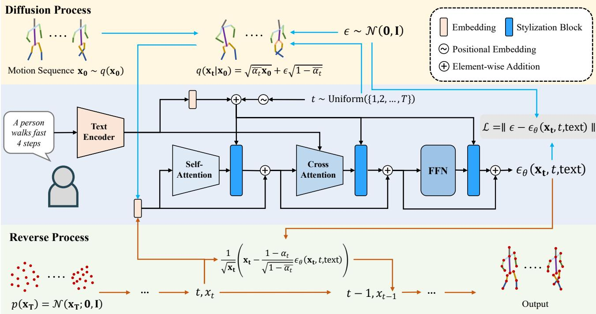
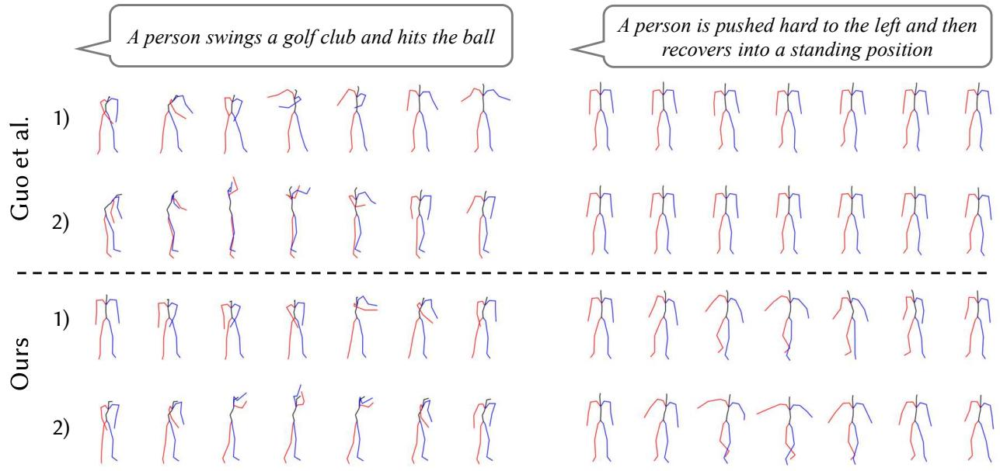
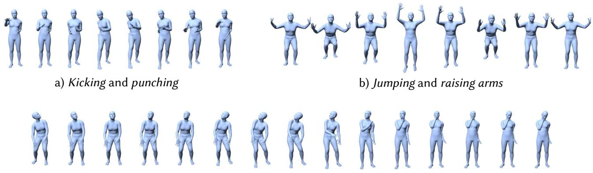

# MotionDifuse：基于扩散模型的文本驱动人体运动生成

Mingyuan Zhang\* · Zhongang Cai\* · Liang Pan · Fangzhou Hong · Xinying Guo · Lei Yang · Ziwei Liu

收稿日期：日期 / 接受日期：日期

**摘要** 人体运动建模对于许多现代图形应用至关重要，而这些应用通常需要专业技能。为了消除非专业用户的使用门槛，近年来出现的运动生成方法可以直接基于自然语言生成人体运动。然而，要实现多样化且细粒度的运动生成以应对各种文本输入，仍然充满挑战。为解决这一问题，我们提出了 MotionDifuse，这是首个基于扩散模型的文本驱动运动生成框架，相较于现有方法展现出了若干期望特性。1) 概率映射。MotionDifuse 并非采用确定性的语言-运动映射，而是通过一系列去噪步骤生成运动，并在其中注入变化。2) 真实合成。MotionDifuse 擅长建模复杂的数据分布，并生成生动的运动序列。3) 多层次操控。MotionDifuse 能够响应针对身体部位的细粒度指令，以及在时变文本提示下合成任意长度的运动。我们的实验表明，MotionDifuse 在文本驱动运动生成和动作条件运动生成任务上，以令人信服的幅度超越了现有的 SoTA 方法。进一步的定性分析还展示了 MotionDiffuse 在综合运动生成中的可控性。项目主页：https://mingyuan-zhang.github. io/projects/MotionDiffuse.html

**关键词** 运动合成 · 条件运动生成 · 扩散模型 · 文本驱动生成

## 1 引言

人体运动建模是使虚拟角色能够模仿生动且丰富的人体动作的关键组成部分，这在电影制作、游戏开发以及虚拟主播动画等众多应用中一直是一个重要课题。为了模仿人体运动，虚拟角色应当能够自然地移动、对环境刺激做出反应，并同时表达复杂的情感。尽管经过数十年的激动技术进展，要制作出栩栩如生且真实可信的人体动作，仍然需要复杂的设备（例如昂贵的运动捕捉系统）和领域专家。为了消除非专业用户的技能门槛，并有望扩展到海量受众，构建一个能够生成多样化且易于操控的运动序列的多功能人体运动生成模型至关重要。

  

图 1 MotionDifuse 是一种基于扩散模型（diffusion model）的文本驱动动作生成方法，其具备以下特点：1）概率映射（Probabilistic Mapping）；2）真实合成（Realistic Synthesis），能够在 a)-d) 所示的动作中产生高多样性（diverse）且高保真度（high-fidelity）的结果；3）多层次操控（Multi-Level Manipulation），能够实现全面的动作生成，例如 c) 中涉及多个身体部位的动作，以及 d) 中随时间变化的提示（time-varied prompts）所对应的动作。

此前的人体运动生成方法已利用了多种条件信号，例如预定义的运动类别（Guo 等, 2020; Petrovich 等, 2021; Cervantes 等, 2022）、音乐片段（Huang 等, 2020; Li 等, 2020, 2021; Zhuang 等, 2020; Siyao 等, 2022）以及自然语言（Lin 等, 2018; Ahuja and Morency, 2019; Ghosh 等, 2021; Petrovich 等, 2022）。其中，自然语言可以说是运动序列合成中最为用户友好、最为便捷的输入形式，因此本文聚焦于文本驱动的运动生成。最近，TEMOS（Petrovich 等, 2022）利用 KIT Motion-Language MoCap 数据集（Plappert 等, 2016）展示了细粒度的轨迹合成。然而，该方法并不支持对所生成运动的风格化处理，因此难以获得较高的多样性。MotionCLIP（Tevet 等, 2022）能够生成风格化的运动，但其仍局限于较短的文本输入，且无法处理复杂的运动描述。此外，上述方法（Petrovich 等, 2022; Tevet 等, 2022）通常仅接受单一的文本提示，这极大地限制了用户的创造力。

为应对上述挑战，我们提出了 MotionDifuse——一个通用且可控的运动生成框架，能够基于综合性文本生成多样化运动。受文本条件图像生成领域最新进展（Dhariwal and Nichol, 2021; Nichol and Dhariwal, 2021; Nichol 等, 2021; Ramesh 等, 2022）的启发，我们提出将「去噪扩散概率模型（Denoising Difusion Probabilistic Models, DDPM）」（Ho 等, 2020）引入运动生成任务中。与仅能生成固定长度结果的经典 DDPM 不同，我们提出了「跨模态线性 Transformer（Cross-Modality Linear Transformer）」，以根据运动时长实现任意长度的运动合成。我们不再学习文本空间与运动空间之间的直接映射（Tevet 等, 2022），而是提出以柔和（soft）的方式利用输入文本来引导生成流程，从而能够显著提升生成结果的多样性。为保留去噪过程中的不确定性，我们在每个去噪步骤中，通过若干 Transformer 解码器层对以输入文本为条件的噪声项进行处理。如此，文本条件便不会以确定性的方式主导运动生成，进而有助于从驱动文本中生成多样化的运动序列。

此外，MotionDifuse 能够通过细粒度文本实现身体部位独立的控制。具体而言，为了适应人体结构，MotionDifuse 将全身运动划分为若干近似独立的部分（例如上半身和下半身）。基于细粒度的身体部位定义，我们提出「噪声插值（noise interpolation）」方法，在考虑各部位之间相关性的同时实现对不同身体部位的独立控制。此外，为了合成任意长度的运动序列，我们提出一种新的采样方法以同时对多个重叠序列进行去噪。具体而言，MotionDifuse 首先独立地从每个序列获得结果，然后利用校正项将它们混合起来。与通常需要许多长运动序列进行训练的自回归推理方案不同，MotionDifuse 能够对连续动作之间的相关性进行建模，而无需引入额外的训练开销。

我们在流行的基准上进行了广泛的定性实验，并在综合运动生成任务上进行了定量评估。首先，我们展示了在 HumanML3D 和 KIT-ML 数据集上，相较于现有最优方法，文本驱动的运动生成取得了显著提升。其次，为了说明 MotionDifuse 的优越性，我们将其直接应用于动作条件运动生成任务，并在 HumanAct12 数据集和 UESTC 数据集上超越了所有现有工作。此外，我们还通过将模型以混合控制信号为条件，展示了 MotionDifuse 的更多可能性，包括身体部位级别的操控和长运动生成。

总之，我们提出的 MotionDifuse 相较于先前的工作具有若干期望的特性：

– **概率映射（Probabilistic Mapping）**。得益于我们所提出的新的运动生成公式——其中融入了 DDPM，MotionDifuse 可以以文本描述为条件，以概率方式生成运动，自然地带来高度的多样性。

– **真实感合成（Realistic Synthesis）**。对架构的精心设计使 MotionDifuse 能够合成高保真度的运动序列，并在两个条件运动生成任务上达到了最先进水平。

– **多层级操控（Multi-Level Manipulation）**。通过扩展的设计，MotionDifuse 能够处理调动整个身体的细粒度文本描述（例如「一个人在走路时喝水」）以及随时间变化的信号（例如「一个人在走路，然后开始跑步」）。

## 2 相关工作

## 2.1 运动生成模型（Motion Generative Model）

运动生成的研究已持续数十年。一些早期工作专注于无条件运动生成（Rose et al., 1998; Ikemoto et al., 2009; Mukai and Kuriyama, 2005）。而另一些工作则尝试在给定初始姿态或起始运动序列的情况下预测未来运动（Futrelle and Speckert, 1978; Gavrila, 1999; O'rourke and Badler, 1980）。统计模型如 PCA（Ormoneit et al., 2005）、运动图（Motion Graph）（Min and Chai, 2012）等被应用于这些目的。

随着深度学习（Deep Learning, DL）技术的快速发展，越来越多的生成式架构不断涌现并蓬勃发展。先前的工作可以大致分为四类：1) 变分自编码器（Variational Auto Encoder, VAE）；2) 生成对抗网络（Generative Adversarial Networks, GAN）；3) 归一化流网络（Normalization Flow Network）；4) 隐式神经表示（Implicit Neural Representations）。

VAE（Kingma and Welling, 2013）是运动合成中最常用的生成模型之一。Yan 等人（2018）和 Aliakbarian 等人（2020）将运动生成任务视为在给定一小段当前运动序列的情况下预测一小段未来运动序列。他们使用 VAE 对当前序列与未来序列的配对进行编码，再重构出未来的序列。ACTOR（Petrovich 等人，2021）提出了一种基于 Transformer 的编码器-解码器架构。Transformer 编码器层与 Transformer 解码器层（Vaswani 等人，2017）是构建运动编码器和运动解码器的基本模块。该架构在后续工作中也得到了采用（Tevet 等人，2022；Hong 等人，2022；Petrovich 等人，2022）。

GAN（Goodfellow 等人，2014）引入了一个辅助模块——判别器网络（discriminator network），用以判定生成样本的质量与有效性。部分研究工作聚焦于为运动生成任务设计合适的判别器网络，以提升合成质量（Barsoum 等人，2018；Harvey 等人，2020；Wang 等人，2020）。HP-GAN（Barsoum 等人，2018）尝试在不使用特定真值（ground truth）的情况下对运动预测结果进行监督。因此，研究中引入了一个数据驱动的判别器来学习运动先验（motion prior），并据此评估预测质量。Harvey 等人（2020）针对运动插值（Motion In-between）任务中预测运动模糊的问题，提出了分别用于短期评判（short-term critic）和长期评判（long-term critic）的两个判别器。Wang 等人（2020）则构建了一个循环式流水线（cyclic pipeline）。借助判别器，所提出的流水线能够同时生成类别特定（class-specific）和类别混合（mixed-class）的运动序列。

归一化流网络（Normalization Flow Network, Dinh 等人，2014）历史悠久，并在图像合成领域得到了广泛研究（Dinh 等人，2016；Kingma and Dhariwal, 2018）。此类架构构建了一个可逆神经网络，并将输入数据映射到一个多维高斯分布。因此，我们可以从该分布中采样得到一个初始随机向量，并将其输入到反转后的网络中以生成运动样本。受 GLOW（Kingma and Dhariwal, 2018）成功的启发，MoGlow（Henter 等人，2020）提出了一种自回归（auto-regressive）归一化网络来建模运动序列。流网络以 LSTM 模型（Hochreiter and Schmidhuber, 1997）所提取的历史特征作为条件，用于预测下一帧姿态。

最近，另一种生成模型因其显著的成果而备受关注，这就是 NeRF（Mildenhall 等，2020；Jain 等，2021）在渲染真实感图像方面的成功。隐式神经表示（Implicit Neural Representations, INR）是一系列通过优化自身参数来拟合单个样本而非整个分布的神经网络。其主要优点之一是，该技术在空间或时间维度上具有出色的泛化能力。例如，Cervantes 等（2022）提出了一种隐式方案，能够同时建模动作类别和时间戳。与原始的 NeRF 类似，该方法使用正弦值来表示时间戳。经过有监督训练后，所提出的方法能够针对每个动作类别生成可变长度的运动序列。

本文提出了一种基于去噪扩散概率模型（Denoising Diffusion Probabilistic Model, DDPM）（Ho 等，2020）的新型运动生成流程。DDPM 的主要优点之一是能够保留原始运动序列的构成形式。这意味着我们可以在去噪过程中方便地施加更多的约束条件。在后续章节中，我们将进一步探索 DDPM 在不同类型条件下的潜力。此外，得益于这一特性，DDPM 能够生成更多样化的样本。

## 2.2 条件运动生成

各种生成模型的日益成熟激发了研究人员对条件运动生成的研究热情。例如，一些工作（Guo 等，2020；Petrovich 等，2021；Cervantes 等，2022）致力于合成若干特定类别的运动序列。Action2Motion（Guo 等，2020）构建了一个用于运动生成的循环条件 VAE。在给定历史记忆的条件下，该模型在动作类别的约束下预测下一帧姿态。ACTOR（Petrovich 等，2021）同样采用 VAE 进行随机采样。与 Action2Motion 不同，ACTOR 将整个运动序列嵌入到潜在空间中。这一设计避免了循环方案中的累积误差。此外，ACTOR 提出了一种基于 Transformer 的运动编码器与解码器架构。该结构显著优于循环方法。Cervantes 等（2022）尝试使用隐式函数来建模运动序列，从而能够生成可变长度的运动序列。

另一项重要的条件运动生成任务是音乐到舞蹈的生成。该任务要求生成的运动与音乐节拍相契合，属于特定种类的舞蹈，或能够表达与音乐相似的内容。许多工作尝试将音乐特征与运动特征嵌入到联合空间中（Lee 等，2019；Sun 等，2020；Li 等，2020，2021）。与直接进行特征嵌入不同，Bailando（Siyao 等，2022）提出了一个两阶段的舞蹈生成器。它首先学习一个有意义的舞蹈片段的量化码本（codebook），然后尝试使用来自码本的一系列元素来生成完整序列。

与音乐到舞蹈类似，文本驱动的动作生成可以看作是对文本特征空间和动作特征空间的联合嵌入学习。这里存在两个主要差异。第一个是语言指令与人体的相关性更强，因此我们期望能够精确控制人体的各个部位。第二个差异是文本驱动的动作生成涵盖了范围极其广泛的动作。某些描述是对特定身体部位的直接指令，例如"touch head"（触摸头部）；另一些则描述任意的概念，如"playing the violin"（拉小提琴）。动作的如此巨大复杂性给架构设计带来了诸多困难。近年来，许多工作提出了文本驱动的动作生成流水线。其中大多数属于确定性生成（Ahuja and Morency, 2019; Ghosh et al., 2021; Tevet et al., 2022），这意味着它们从给定文本只能生成单一结果。TEMOS（Petrovich et al., 2022）将变分自编码器（VAE）架构引入到该任务中，使其能够在给定一段文本描述的情况下生成不同的动作序列。然而，这些方法试图获取动作与自然语言的联合嵌入空间，这种设计显著压缩了来自文本的信息。因此，这些工作很难从详细描述中生成正确的动作序列。Guo 等人（2022）提出了一种自回归流水线，它首先将语言描述编码为特征，然后以文本特征为条件自回归地生成动作帧。然而，受限于自回归机制，该方法难以捕捉全局关系，且生成质量也较差。与此不同，我们提出的 MotionDifuse 将文本特征柔和地融合到生成过程中，并能够同时输出整个序列。实验结果证明了我们设计的优越性。

## 2.3 动作数据集（Motion Datasets）

人体动作建模是计算机视觉和计算机图形学中一个长期存在的研究问题。随着深度学习的兴起，数据对于训练能够感知、理解和生成人体动作的神经网络变得愈发重要。

包含人体视频的数据集通常带有诸如 2D 关键点（Jhuang 等人，2013；Andriluka 等人，2018）、3D 关键点（Ionescu 等人，2013；Joo 等人，2015；Mehta 等人，2017；Trumble 等人，2017；Li 等人，2021）以及统计模型参数（Yu 等人，2020；Patel 等人，2021；Cao 等人，2020；Cai 等人，2021，2022）等标注。动作标签同样是人体动作理解数据集中常见的属性，涵盖了以人为中心的动作（Kuehne 等人，2011；Soomro 等人，2012；Karpathy 等人，2014；Gu 等人，2018；Shao 等人，2020；Chung 等人，2021）、交互（Carreira 等人，2019；Monfort 等人，2019）、细粒度动作理解（Gu 等人，2018；Shao 等人，2020；Chung 等人，2021）以及 3D 数据（Liu 等人，2019）等类型。针对动作条件运动生成任务，HumanAct12（Guo 等人，2020）、UESTC（Ji 等人，2018）和 NTU RGB+D（Liu 等人，2019）是三个常用的基准数据集。然而，上述数据集并未为运动序列提供配对的精细语义标签。

KIT（Plappert 等人，2016）包含了带有详细描述标注的动作捕捉数据。Zhang 等人（2020）招募演员录制表达情绪的肢体动作。最近，BABEL（Punnakkal 等人，2021）和 HumanML3D（Guo 等人，2022）使用英语语言标签对 AMASS（Mahmood 等人，2019）这一大规模动作捕捉数据集进行了重新标注。

在本文中，我们使用 HumanML3D 数据集和 KIT 数据集来评估所提出的方法在文本驱动运动生成任务上的表现。HumanAct12 和 UESTC 用于展示所提流程的广泛适用性。此外，我们使用 BABEL 数据集进行更多应用的展示。

## 3 方法

我们提出了一个基于扩散模型（diffusion model）的 MotionDifuse 框架，用于高保真且可控的文本驱动运动生成。我们首先在第 3.1 节给出问题定义以及原始文本驱动运动生成的相关设置。随后，在第 3.2 节给出所提 MotionDifuse 的整体阐述，接着在第 3.3 节介绍扩散模型，并在第 3.4 节介绍基于 Transformer 的架构。最后，在第 3.5 节给出针对细粒度生成场景的推理策略。

## 3.1 预备知识

运动序列 $\Theta$ 是一个由 $( \theta _ { i } ) , \ i \in$ $\{ 1 , 2 , \ldots , F \}$ 构成的数组，其中 $\theta _ { i } \in \mathbb { R } ^ { D }$ 表示第 $i$ 帧的姿态状态，$F$ 为帧数。在不同的数据集中，每个姿态状态 $\theta _ { i }$ 的表示方式各异，通常包含关节旋转、关节位置、关节速度以及足部接触条件。我们所提出的 MotionDifuse 对不同的运动表示均具有鲁棒性。因此，在本节中我们不具体指定 $\theta _ { i }$ 的组成，相关细节将在第 4 节中给出。

对于标准的文本驱动动作生成（Text-driven Motion Generation），训练数据集由 $(\theta_i, \text{text}_i)$ 对组成，其中 text 是动作序列 $\theta_i$ 的语言描述。在推理阶段，给定一组描述 $\{\text{text}_i\}$，我们需要根据给定的描述生成动作序列。该任务也可以被视为 text-to-motion translation（T2M）任务。下文我们将使用此缩写。

一个相关的任务是动作条件动作生成（Action-conditioned Motion Generation）。给定一个预定义的动作类别集，模型应当拟合数据分布并合成每个类别的动作序列。该任务中的标注数据可以表示为 $(y_i, \theta_i)$，其中 $y_i$ 是第 i 个数据的类别索引，$\theta_i$ 是第 i 个数据的动作序列。在本文中，我们将 $y_i$ 替换为其语义描述 $\text{text}_i$。然后我们可以使用与 T2M 任务相同的流水线。

## 3.2 流水线概述

遵循图像合成领域扩散模型的文献（Ho et al., 2020），我们首先使用 denoising difusion probabilistic model（DDPM）建立了一个文本条件的动作生成流水线。该模型是我们所提出的 MotionDifuse 的基础。对于去噪过程，我们提出了一个跨模态线性 Transformer（Cross-Modality Linear Transformer），用于处理根据给定文本提示条件化的输入序列。除了直接应用文本驱动的动作生成之外，我们更进一步探索了在去噪过程中以动作表示为条件的方法。具体而言，我们实验了两种额外的信号类型：部位感知文本控制（part-aware text controlling）和时变控制（time-varied controlling）。前者将不同的文本条件分配给不同的身体部位，从而我们可以精确控制身体的每个部位，并生成更复杂的动作序列。后者将整个序列划分为若干部分，并为每个时间区间分配独立的文本条件。因此，我们可以合成包含多个动作的任意长度的动作序列。这两种条件显著扩展了 MotionDifuse 的能力。整体流水线如图 2 所示。我们在以下小节中介绍该架构的每个部分。

## 3.3 用于动作生成的扩散模型

生成对抗网络（Generative Adversarial Networks, GANs）引入判别器以对抗方式提升生成质量。GANs 通常难以训练，尤其是在条件运动生成任务中。

隐式函数（Implicit Functions）使用多层感知机（Multi-Layer Perceptron, MLP）来拟合运动序列。这一简洁的架构在小规模数据上易于训练，但在面对复杂条件时泛化能力往往较差。

自编码器（Auto-Encoder, AE）和变分自编码器（Variational Auto-Encoder, VAE）是文本驱动运动生成中最广泛使用的方法（Ghosh et al., 2021; Petrovich et al., 2022）。已有工作学习运动序列与语言的联合嵌入，在确定性的语言-运动映射中显式施加文本条件。然而，高层文本特征通常包含的细粒度细节不足，难以指导生成具有微妙差别的运动。因此，直接将文本嵌入与运动嵌入相连会导致所生成运动的多样性受限。

  

图 2. 所提出的 MotionDifuse 的整体流程。箭头的颜色表示不同的阶段：蓝色代表训练，红色代表推理，黑色代表训练和推理两个阶段。

为解决该问题，我们基于扩散模型（diffusion models）构建了文本驱动的动作生成流程。扩散模型 (Ho et al., 2020; Dhariwal and Nichol, 2021; Nichol and Dhariwal, 2021; Nichol et al., 2021) 是一类新的生成模型。其通过学习一个概率模型，使其能够从高斯噪声中逐步去噪，从而生成目标输出，例如二维图像或三维点云。形式上，扩散模型可表述为 $\begin{array} { r } { p _ { \theta } ( \mathbf { x } _ { 0 } ) : = \int p _ { \theta } ( \mathbf { x } _ { 0 : T } ) d \mathbf { x } _ { 1 : T } } \end{array}$ ，其中 $\mathbf { x } _ { 0 } \sim q ( \mathbf { x } _ { 0 } )$ 为真实数据，$\mathbf { x } _ { 1 } , \cdots , \mathbf { x } _ { T }$ 为潜变量。它们通常包含一个扩散过程和一个逆过程。为近似后验 $q \big ( \mathbf { x } _ { 1 : T } | \mathbf { x } _ { 0 } \big )$ ，扩散过程遵循马尔可夫链（Markov chain），根据 $\beta _ { t }$ 给出的方差调度，逐步向数据添加高斯噪声，直至其分布接近潜变量分布 $\mathcal { N } ( \mathbf { 0 } , \mathbf { I } )$：

$$
\begin{array}{l} q (\mathbf {x} _ {1: T} | \mathbf {x} _ {0}) := \prod_ {t = 1} ^ {T} q (\mathbf {x} _ {t} | \mathbf {x} _ {t - 1}), \\ q (\mathbf {x} _ {t} | \mathbf {x} _ {t - 1}) := \mathcal {N} (\mathbf {x} _ {t}; \sqrt {1 - \beta_ {t}} \mathbf {x} _ {t - 1}, \beta_ {t} \mathbf {I}). \end{array}\tag{1}
$$

反向过程 $p _ { \theta } ( \mathbf { x } _ { 0 : T } )$ 同样是一个马尔可夫链，它通过学习得到的高斯转移来预测并消除噪声，起始于 $p ( \mathbf { x } _ { T } ) = \mathcal { N } ( \mathbf { x } _ { T } ; \mathbf { 0 } , \mathbf { I } )$

$$
\begin{array}{r l} & p _ {\theta} (\mathbf {x} _ {0: T}) := p (\mathbf {x} _ {T}) \prod_ {t = 1} ^ {T} p _ {\theta} (\mathbf {x} _ {t - 1} | \mathbf {x} _ {t}), \\ & p _ {\theta} (\mathbf {x} _ {t - 1} | \mathbf {x} _ {t}) := \mathcal {N} (\mathbf {x} _ {t - 1}; \mu_ {\theta} (\mathbf {x} _ {t}, t), \Sigma_ {\theta} (\mathbf {x} _ {t}, t)). \end{array}\tag{2}
$$

为了完成扩散模型的反向过程，我们需要构建并优化一个神经网络。在训练过程中，我们首先对每个真实动作 $\mathbf { x } _ { \mathrm { 0 } }$ 均匀采样步骤 $t$，然后从 $q ( \mathbf { x } _ { t } | \mathbf { x } _ { 0 } )$ 生成一个样本。Ho 等人（2020）不再反复对 $\mathbf { x } _ { \mathrm { 0 } }$ 添加噪声，而是将扩散过程公式化为

$$
q (\mathbf {x} _ {t} | \mathbf {x} _ {0}) = \sqrt {\bar {\alpha_ {t}}} \mathbf {x} _ {0} + \epsilon \sqrt {1 - \bar {\alpha_ {t}}}, \epsilon \sim \mathcal {N} (\mathbf {0}, \mathbf {I}),\tag{3}
$$

  

图 3 我们线性自注意力（Linear Self-attention）的架构。

其中 $\begin{array}{r} \alpha_t = 1 - \beta_t, \bar{\alpha_t} = \prod_{s=0}^t \alpha_s \end{array}$。因此，我们可以简单地采样一个噪声 𝜖，然后直接通过该公式生成 $\mathbf{x}_t$。这里我们不预测 $\mathbf{x}_{t-1}$，而是遵循 GLIDE（Nichol 等人，2021）的方法来预测噪声项 𝜖。这意味着我们需要构建一个网络来拟合 $\epsilon_\theta(\mathbf{x}_t, t, \mathrm{text})$。我们通过优化模型参数来减小均方误差，即

$$
\mathcal {L} = \mathrm{E} _ {t \in [ 1, T ], \mathbf {x} _ {0} \sim q (\mathbf {x} _ {0}), \epsilon \sim \mathcal {N} (\mathbf {0}, \mathbf {I})} [ \| \epsilon - \epsilon_ {\theta} (\mathbf {x} _ {t}, t, \text { text }) \| ].\tag{4}
$$

这是我们在模型训练中使用的唯一损失函数。为了从给定的文本描述生成样本，我们从 $p ( \mathbf { x } _ { T } ) = \mathcal { N } ( \mathbf { x } _ { T } ; \mathbf { 0 } , \mathbf { I } )$ 对序列进行去噪。公式 2 表明我们需要估计 $\mu _ { \theta } ( \mathbf { x } _ { t } , t ,$ text) 和 $\textstyle \sum _ { \theta } ( \mathbf { x } _ { t } , t , \mathrm { t e x t } )$。为了简化问题，我们将 $\varSigma _ { \theta } ( \mathbf { x } _ { t } , t , \mathrm { t e x t } )$ 设为常数 $\beta _ { t }$。$\mu _ { \theta } ( \mathbf { x } _ { t } , t , \mathrm { t e x t } $ ) 可以估计为

$$
\mu_ {\theta} (\mathbf {x} _ {t}, t, \text {text}) = \frac {1}{\sqrt {\mathbf {x} _ {t}}} (\mathbf {x} _ {t} - \frac {1 - \alpha_ {t}}{\sqrt {1 - \bar {\alpha} _ {t}}} \epsilon_ {\theta} (\mathbf {x} _ {t}, t, \text {text})).\tag{5}
$$

因此我们可以对动作序列进行逐步去噪，最终得到一个以给定文本为条件的干净动作序列。

## 3.4 跨模态线性 Transformer（Cross-Modality Linear Transformer）

在第 3.3 节中，我们将扩散模型描述为动作生成器，并指出一个神经网络 $\epsilon _ { \theta } ( \mathbf { x } _ { t } , t , \mathrm { t e x t } )$ 是去噪步骤的关键。本节将介绍我们在所提出的 MotionDiffuse 中对 $\epsilon _ { \theta } ( \mathbf { x } _ { t } , t , \mathrm { t e x t } )$ 的设计。

以往的工作（Ho et al., 2020; Dhariwal and Nichol, 2021; Nichol and Dhariwal, 2021; Nichol et al., 2021）主要采用类似 UNet 的结构作为去噪模型。然而，在动作生成任务中，目标动作序列是变长的，这使得基于卷积的网络不再适用。因此，我们提出了跨模态线性 Transformer（Cross-Modality Linear Transformer），如图 2 所示。类似于机器翻译任务，我们所提出的模型包含一个文本编码器和一个动作解码器。为了满足扩散模型的需求，我们进一步对动作解码器的每一层进行了定制。

**文本编码器（Text Encoder）** 这里我们直接使用经典的 Transformer（Vaswani et al., 2017）来提取文本特征。具体而言，输入数据首先通过一个嵌入层，从原始文本中获取嵌入特征，然后经过一系列 Transformer 块进一步处理。每个块包含两个组件：一个多头注意力模块（MHA）和一个前馈网络（FFN）。假设输入特征为 $\mathbf { X } \in \mathbb { R } ^ { n \times d }$（其中 n 表示元素个数，d 表示元素特征维度），MHA 按如下方式提取查询特征向量 $\mathbf { Q } \in \mathbb { R } ^ { n \times d }$、键特征向量 $\mathbf{K} \in \mathbb { R } ^ { n \times d }$ 和值特征向量 $\mathbf { V } \in \mathbb { R } ^ { n \times d }$：

$$
\mathbf {Q} = W _ {q} \mathbf {X}, \quad \mathbf {K} = W _ {k} \mathbf {X}, \quad \mathbf {V} = W _ {v} \mathbf {X},\tag{6}
$$

其中 $W_q$、$W_k$ 和 $W_v$ 分别是用于生成 Q、K 和 V 的相应线性投影。随后，值特征与注意力权重 $\mathbf{A} \in \mathbb{R}^{n \times n}$ 进行聚合：

$$
\mathbf {A} = \mathrm{softmax} (\frac {\mathbf {Q} \otimes \mathbf {K} ^ {\top}}{\sqrt {d}}), \quad \mathbf {Y} = \mathbf {A} \otimes \mathbf {V},\tag{7}
$$

其中 $\mathbf { Y } \in \mathbb { R } ^ { n \times d }$ 是 MHA 模块的输出，$d$ 是 $X$ 中每个元素的维度，$\otimes$ 表示矩阵乘法。多头机制将输入向量分成若干部分，它们各自独立地通过公式 6 和 7 的处理过程。各部分的输出被拼接起来，使维度保持不变。在 MHA 模块的输入与输出之间应用残差连接。该特征由前馈网络（Feed-Forward Network, FFN）进一步处理，其中包含三个线性变换以及它们之间的两个 GELU 层（Hendrycks and Gimpel, 2016）。

为了增强泛化能力，我们使用 CLIP（Radford et al., 2021）中的参数权重来初始化前面几层。这部分参数被冻结，在后续训练中不会被优化。

线性自注意力（Linear Self-attention）。该模块旨在通过建模不同帧之间的相关性来增强运动特征。自注意力的主要优势在于能够获得输入序列的全局视图，因而有利于估计注入的噪声。然而，计算注意力权重 $\mathbf { A } \in \mathbb { R } ^ { n \times n }$ 的时间复杂度为 $\mathcal { O } ( n ^ { 2 } d )$。当目标运动序列长度增加时，时间开销呈二次增长。在 T2M 任务中，序列长度可达数百帧，这会导致速度较慢。因此，我们采用 Efficient Attention（高效注意力）（Shen et al., 2021）来加速自注意力模块。高效注意力不计算成对的注意力权重，而是生成全局特征图 $\mathbf { F } _ { g } \in \mathbb { R } ^ { d _ { k } \times d _ { k } }$，其中 $d _ { k }$ 是多头划分后特征的维度：

$$
\mathbf {F} _ {g} = \operatorname{softmax} (\mathbf {K} ^ {\top}) \otimes \mathbf {V}, \quad \mathbf {Y} = \operatorname{softmax} (\mathbf {Q}) \otimes \mathbf {F} _ {g}.\tag{8}
$$

这两个步骤的时间复杂度为 $\mathcal { O } ( d _ { k } ^ { 2 } n k ) =$ $\mathcal { O } ( d d _ { k } n )$，其中 n 是序列中的元素数量，k 是自注意力头的数量。

高效注意力（efficient attention）对扩散模型的另一个优势在于，特征图 $\mathbf { F } _ { g }$ 显式地聚合了全局信息，而经典的自注意力更侧重于两两关系（pair-wise relation）。相比于两两关系，全局信息为运动序列的语义含义提供了更多线索。实验结果也证实了这一结论。

线性交叉注意力（Linear Cross-attention）。交叉注意力在计算 K 和 V 时用文本特征替换 X。其他公式与线性自注意力相同。在该过程中，文本特征被注入运动序列，以生成以给定文本为条件的运动。

风格化块（Stylization Block）。在每个去噪步骤中，输出以给定文本和时间戳 t 为条件。线性交叉注意力将文本特征融合到运动序列中。我们需要另一个风格化块（Stylization Block）组件将时间戳 t 引入生成过程。该块在每个线性自注意力块、线性交叉注意力块和 FFN 块之后应用。

与 GLIDE（Nichol 等，2021）类似，我们首先通过对文本特征的线性变换得到文本嵌入 $e _ { \mathrm { t e x t } }$，并通过位置嵌入（Vaswani 等，2017）得到时间戳嵌入 $\mathbf { e _ { t } }$。这两项被求和为单个向量 e。在给定其他块的原始输出 Y 的情况下，风格化块（Stylization Block）将如下处理该特征：

$$
\mathbf {B} = \psi_ {b} (\phi (\mathbf {e})), \quad \mathbf {W} = \psi_ {w} (\phi (\mathbf {e})), \quad \mathbf {Y} ^ {\prime} = \mathbf {Y} \cdot \mathbf {W} + \mathbf {B},\tag{9}
$$

其中（·）表示 Hadamard 积，$\mathbf{ Y }^{'}$ 是风格化块的输出。$\psi_b, \psi_w, \phi$ 表示三个不同的线性投影。在经典 Transformer 中，每个块的输出作为残差连接被加到原始输入上，如图 2 所示。在 Motion-Difuse 中，这些输出通过风格化块后被加到信息上。这一修改使得我们提出的方法能够感知时间戳 t。

## 3.5 细粒度控制

为了丰富 MotionDifuse 的能力，我们探索了运动表示和 DDPM 去噪过程的特性。与 VAE 不同，生成的运动序列以其显式形式存在，而不是被压缩在潜在空间中。基于 DDPM 的运动生成这一特性允许对该运动序列施加更多操作，以提升可操控性。

身体部件独立控制。由于文本描述缺乏多样性，我们无法仅凭文本描述对每个身体部位实现精确的运动控制。例如，"一个人在跑步并挥动左手"这一提示对模型而言极具挑战性，因为期望的运动序列与训练分布差距甚远。即便我们手动将原始描述拆分为两个独立的部分：用于下肢的"一个人在跑步"和用于上肢的$ { \mathbf { \hat { \rho } } } _ { \mathrm { a } }$ person is waving left hand'，模型仍然难以生成正确的运动。对此情形的一种直观解决方案是分别生成两个运动序列，并将第一个序列的上肢运动与第二个序列的下肢运动组合起来。这种简单方案在一定程度上缓解了该问题。然而，它忽略了两部分之间的相关性。具体到"跑步与挥动左手"的动作，两种运动的频率应当匹配，否则由这种朴素方法生成的运动会显得不自然。为了更好地解决这一问题，我们提出了一种身体部位独立的控制方案。

回想一下，在去噪过程中，我们的扩散模型预测噪声项 $\epsilon _ { \theta } ( \mathbf { x } _ { t } , t , \mathrm { t e x t } ) \ \in$ $\mathbb { R } ^ { F \times D }$，其中 $F$ 表示帧数，$D$ 表示每个姿态状态的维度，其中包含身体关节的平移和旋转。该噪声项决定了全身的去噪方向。

灵感来源于潜码插值（latent code interpolation）的应用，本文我们提出「噪声插值（noise interpolation）」，以对人体不同部位进行分别控制。

假设我们有 $n$ 个文本描述 $\{ \mathrm { t e x t } _ { i } \}$，分别对应不同的身体部位 $\{ s _ { i } \}$。

我们希望计算噪声项 $\epsilon = \{ \epsilon _ { i } ^ { \mathrm { j o i n t } } \} , i \in [ 1 , m ]$，其中 $\epsilon _ { i } ^ { \mathrm { j o i n t } }$ 表示第 $i$ 个身体部位的噪声项，$m$ 表示划分的数量。

我们首先估计噪声 $\epsilon _ { i } ^ { \mathrm { p a r t } } = \epsilon _ { \theta } \big ( \mathbf { x } _ { t } , t , \mathrm { t e x t } _ { i } \big ) , \epsilon _ { i } ^ { \mathrm { p a r t } } \ \in \ \mathbb { R } ^ { F \times D }$。

一种直观的组合方法为 $\begin{array} { r } { \epsilon ^ { \mathrm { p a r t } } = \sum _ { i = 1 } ^ { m } \epsilon _ { i } ^ { \mathrm { p a r t } } \cdot M _ { i } . } \end{array}$，其中 $M _ { i } \in \{ 0 , 1 \} ^ { D }$ 是一个二值向量，用于指示应当聚焦于哪个身体部位。

(·) 表示哈达玛积（Hadamard product），此处为简洁起见我们忽略计算中的广播。

虽然该方法在一定程度上能够奏效，但直接忽略 $\epsilon _ { i } ^ { \mathrm { p a r t } }$ 中某些部位会增加组合难度，并导致生成结果的质量较低。

因此，我们为平滑插值添加一项修正项：

$$
\bar {\epsilon} ^ {\text { part }} = \sum_ {i = 1} ^ {m} \epsilon_ {i} ^ {\text { part }} \cdot M _ {i} + \lambda_ {1} \cdot \nabla (\sum_ {1 \leq i, j \leq m} \| \epsilon_ {i} ^ {\text { part }} - \epsilon_ {j} ^ {\text { part }} \|),\tag{10}
$$

其中 $\nabla$ 表示梯度计算，$\lambda_1$ 是用于平衡这两项的超参数。该修正项促使去噪方向更加平滑，从而使不同身体部位的运动更加自然。

时间变化控制 长期运动生成在实际应用中起着至关重要的作用。以往的研究主要关注单一类型的运动生成。自回归方法（Henter 等人，2020；Guo 等人，2022）已较好地解决了这一问题。然而，这些方法都无法以连续的方式合成不同的动作。得益于 DDPM 的特性，我们在此提出另一种采样方法来满足这一需求。

回顾一下，我们给出一个数组 $\{\text{text}_{i,j}, [l_{i,j}, r_{i,j}]\}$，$i \in [1, m]$，其中 $m$ 是区间数量。与上一段所提方法类似，我们首先独立地为第 $i$ 个区间估计噪声项 $\epsilon_i^{\text{time}}$。假设目标序列的总长度为 $F'$。通过补零，我们将每个噪声项扩展到相同的维度 $F' \times D$。然后，我们用一个修正项对这些噪声进行插值：

$$
\bar {\epsilon} ^ {\text {time}} = \sum_ {i = 1} ^ {m} \bar {\epsilon} _ {i} ^ {\text {time}} + \lambda_ {2} \cdot \nabla (\sum_ {1 \leq i, j \leq m} \| \bar {\epsilon} _ {i} ^ {\text {time}} - \bar {\epsilon} _ {j} ^ {\text {time}} \|),\tag{11}
$$

其中 $\overline{\epsilon}_j^{time}$ 是从 $\epsilon_i^{time}$ 得到的填充项，$\lambda_2$ 是一个超参数。

## 4 实验

我们通过三类实验来评估 MotionDifuse：文本驱动动作生成（第 4.1 节）、动作类别条件动作生成（第 4.2 节）以及动作操控（第 4.3 节）。在所有评估基准上，MotionDifuse 均显著优于先前的 SoTA 方法。

## 4.1 文本驱动动作生成

**数据集。** KIT Motion Language 数据集（Plappert 等，2016）提供了 3911 个动作序列和 6353 条序列级自然语言描述。HumanML3D（Guo 等，2022）对 AMASS 数据集（Mahmood 等，2019）和 HumanAct12 数据集（Guo 等，2020）进行了重新标注。它在 14616 个动作序列上提供了 44970 条标注。KIT 和 HumanML3D 是文本驱动动作生成任务的两大重要基准。遵循 Guo 等（2022）的方法，我们使用预训练的文本-动作对比模型。

**评价指标。** 我们使用五项不同的指标来评估所有方法。1) 弗雷歇 Inception 距离（Frechet Inception Distance，FID）。通过预训练的动作编码器分别从生成结果和真实动作序列中提取特征，并在两个分布之间计算 FID 以衡量相似性。2) R Precision（R 精度）。对于每对生成的序列与对应的描述文本，从测试集中随机选取 31 个其他提示。预训练的对比模型计算平均 top-k 准确率。本节报告 top-1、top-2 和 top-3 准确率。3) Diversity（多样性）。将所有测试文本生成的序列随机两两配对，然后计算每对之间的平均关节差异，以此作为多样性指标。4) Multimodality（多模态性）。对于单个文本描述，我们随机生成 32 个动作序列。多模态性度量这些同类动作序列之间关节位置的差异。5) Multimodal Distance（多模态距离）。借助预训练的对比模型，我们可以计算给定描述的文本特征与生成结果的动作特征之间的差异，称为多模态距离。

在本节中，R Precision 和 FID 是我们得出大部分结论的主要指标。此外，为了公平比较，我们将每次评估运行 20 次，并以 95% 置信度报告统计区间。

实现细节。对于 HumanML3D 和 KIT-ML 数据集，我们构建了一个 8 层 Transformer 作为运动解码器。对于文本编码器，我们首先直接使用 CLIP ViT-B/32 (Radford et al., 2021) 中的文本编码器，然后在其上添加四个 Transformer 编码器层。文本编码器和运动解码器的潜在维度分别为 256 和 512。对于扩散模型，扩散步数为 1000，方差 $\beta_t$ 从 0.0001 到 0.02 线性变化。我们选择 Adam 作为优化器，学习率为 0.0002 来训练模型。我们使用 8 块 Tesla V100 进行训练，每块 GPU 上有 128 个样本，因此总批量大小为 1024。KIT-ML 的总迭代次数为 40K，HumanML3D 的总迭代次数为 100K。

遵循 Guo et al. (2022) 的做法，本系列实验中姿态状态主要包含七个不同的部分：$(r^{va}, r^{vx}, r^{vz}, r^h, \mathbf{j}^p, \mathbf{j}^v, \mathbf{j}^r)$。其中 Y 轴垂直于地面。$r^{va}, r^{vx}, r^{vz} \in \mathbb{R}$ 分别表示根关节沿 Y 轴的角速度、沿 X 轴和 Z 轴的线速度。$r^h \in \mathbb{R}$ 是根关节的高度。$\mathbf{j}^p, \mathbf{j}^v \in \mathbb{R}^{J \times 3}$ 是每个关节的位置和线速度，其中 J 为关节数量。$\mathbf{j}^r \in \mathbb{R}^{J \times 6}$ 是每个关节的 6D 旋转（Zhou et al., 2019）。具体而言，HumanML3D 中 J 为 22，KIT-ML 中 J 为 21。

表 1 HumanML3D 测试集上的定量结果。所有方法均使用来自真值（ground truth）的真实动作长度。"→" 表示该指标越接近真实动作，结果越好。所有评估运行 20 次，± 表示 95% 置信区间。最佳结果以粗体显示。

<table><tr><td rowspan="2">Methods</td><td colspan="3">R Precision↑</td><td rowspan="2">FID↓</td><td rowspan="2">MultiModal Dist↓</td><td rowspan="2">Diversity→</td><td rowspan="2">MultiModality</td></tr><tr><td>Top 1</td><td>Top 2</td><td>Top 3</td></tr><tr><td>Real motions</td><td> $0.511^{\pm .003}$ </td><td> $0.703^{\pm .003}$ </td><td> $0.797^{\pm .002}$ </td><td> $0.002^{\pm .000}$ </td><td> $2.974^{\pm .008}$ </td><td> $9.503^{\pm .065}$ </td><td>-</td></tr><tr><td>Language2Pose</td><td> $0.246^{\pm .002}$ </td><td> $0.387^{\pm .002}$ </td><td> $0.486^{\pm .002}$ </td><td> $11.02^{\pm .046}$ </td><td> $5.296^{\pm .008}$ </td><td> $7.676^{\pm .058}$ </td><td>-</td></tr><tr><td>Text2Gesture</td><td> $0.165^{\pm .001}$ </td><td> $0.267^{\pm .002}$ </td><td> $0.345^{\pm .002}$ </td><td> $7.664^{\pm .030}$ </td><td> $6.030^{\pm .008}$ </td><td> $6.409^{\pm .071}$ </td><td>-</td></tr><tr><td>MoCoGAN</td><td> $0.037^{\pm .000}$ </td><td> $0.072^{\pm .001}$ </td><td> $0.106^{\pm .001}$ </td><td> $94.41^{\pm .021}$ </td><td> $9.643^{\pm .006}$ </td><td> $0.462^{\pm .008}$ </td><td> $0.019^{\pm .000}$ </td></tr><tr><td>Dance2Music</td><td> $0.033^{\pm .000}$ </td><td> $0.065^{\pm .001}$ </td><td> $0.097^{\pm .001}$ </td><td> $66.98^{\pm .016}$ </td><td> $8.116^{\pm .006}$ </td><td> $0.725^{\pm .011}$ </td><td> $0.043^{\pm .001}$ </td></tr><tr><td>Guo et al.</td><td> $0.457^{\pm .002}$ </td><td> $0.639^{\pm .003}$ </td><td> $0.740^{\pm .003}$ </td><td> $1.067^{\pm .002}$ </td><td> $3.340^{\pm .008}$ </td><td> $9.188^{\pm .002}$ </td><td> $2.090^{\pm .083}$ </td></tr><tr><td>Ours</td><td> $0.491^{\pm .001}$ </td><td> $0.681^{\pm .001}$ </td><td> $0.782^{\pm .001}$ </td><td> $0.630^{\pm .001}$ </td><td> $3.113^{\pm .001}$ </td><td> $9.410^{\pm .049}$ </td><td> $1.553^{\pm .042}$ </td></tr></table>

表 2 在 KIT-ML 测试集上的定量结果。所有方法均使用来自真值（ground truth）的真实运动时长。

<table><tr><td rowspan="2">Methods</td><td colspan="3">R Precision↑</td><td rowspan="2">FID↓</td><td rowspan="2">MultiModal Dist↓</td><td rowspan="2">Diversity→</td><td rowspan="2">MultiModality</td></tr><tr><td>Top 1</td><td>Top 2</td><td>Top 3</td></tr><tr><td>Real motions</td><td> $0.424^{\pm .005}$ </td><td> $0.649^{\pm .006}$ </td><td> $0.779^{\pm .006}$ </td><td> $0.031^{\pm .004}$ </td><td> $2.788^{\pm .012}$ </td><td> $11.08^{\pm .097}$ </td><td>-</td></tr><tr><td>Language2Pose</td><td> $0.221^{\pm .005}$ </td><td> $0.373^{\pm .004}$ </td><td> $0.483^{\pm .005}$ </td><td> $6.545^{\pm .072}$ </td><td> $5.147^{\pm .030}$ </td><td> $9.073^{\pm .100}$ </td><td>-</td></tr><tr><td>Text2Gesture</td><td> $0.156^{\pm .004}$ </td><td> $0.255^{\pm .004}$ </td><td> $0.338^{\pm .005}$ </td><td> $12.12^{\pm .183}$ </td><td> $6.964^{\pm .029}$ </td><td> $9.334^{\pm .079}$ </td><td>-</td></tr><tr><td>MoCoGAN</td><td> $0.022^{\pm .002}$ </td><td> $0.042^{\pm .003}$ </td><td> $0.063^{\pm .003}$ </td><td> $82.69^{\pm .242}$ </td><td> $10.47^{\pm .012}$ </td><td> $3.091^{\pm .043}$ </td><td> $0.250^{\pm .009}$ </td></tr><tr><td>Dance2Music</td><td> $0.031^{\pm .002}$ </td><td> $0.058^{\pm .002}$ </td><td> $0.086^{\pm .003}$ </td><td> $115.4^{\pm .240}$ </td><td> $10.40^{\pm .016}$ </td><td> $0.241^{\pm .004}$ </td><td> $0.062^{\pm .002}$ </td></tr><tr><td>Guo et al.</td><td> $0.370^{\pm .005}$ </td><td> $0.569^{\pm .007}$ </td><td> $0.693^{\pm .007}$ </td><td> $2.770^{\pm .109}$ </td><td> $3.401^{\pm .008}$ </td><td> $10.91^{\pm .119}$ </td><td> $1.482^{\pm .065}$ </td></tr><tr><td>Ours</td><td> $0.417^{\pm .004}$ </td><td> $0.621^{\pm .004}$ </td><td> $0.739^{\pm .004}$ </td><td> $1.954^{\pm .062}$ </td><td> $2.958^{\pm .005}$ </td><td> $11.10^{\pm .143}$ </td><td> $0.730^{\pm .013}$ </td></tr></table>

表 3：预训练 CLIP 与高效注意力技术的消融实验。所有结果均在 KIT-ML 测试集上报告。

<table><tr><td rowspan="2">CLIP</td><td rowspan="2">EFF</td><td colspan="3">R Precision↑</td></tr><tr><td>Top 1</td><td>Top 2</td><td>Top 3</td></tr><tr><td>N</td><td>N</td><td> $0.288^{\pm .004}$ </td><td> $0.440^{\pm .004}$ </td><td> $0.539^{\pm .004}$ </td></tr><tr><td>N</td><td>Y</td><td> $0.136^{\pm .003}$ </td><td> $0.233^{\pm .003}$ </td><td> $0.309^{\pm .003}$ </td></tr><tr><td>Y</td><td>N</td><td> $0.357^{\pm .004}$ </td><td> $0.555^{\pm .004}$ </td><td> $0.679^{\pm .005}$ </td></tr><tr><td>Y</td><td>Y</td><td> $0.417^{\pm .004}$ </td><td> $0.621^{\pm .004}$ </td><td> $0.739^{\pm .004}$ </td></tr></table>

定量结果（Quantitative Results）。我们将所提出的 MotionDifuse 与五个基线模型进行比较：Language2Pose（Ahuja and Morency, 2019）、Text2Gesture（Bhattacharya et al., 2021）、MoCo-GAN（Tulyakov et al., 2018）、Dance2Music（Lee et al., 2019）以及 Guo et al.（2022）。所有基线的性能均引自 Guo et al.（2022）。表 1 和表 2 分别展示了在 HumanML3D 数据集和 KIT-ML 数据集上的定量对比。我们提出的 MotionDifuse 在精度、FID、多模态距离（MultiModal Distance）和多样性（Diversity）等方面均以显著优势超越了所有现有工作。MotionDifuse 的精度甚至接近真实运动的精度，这表明我们生成的动作序列具有令人满意的高保真度和真实性。

为了进一步理解 CLIP 初始化和高效注意力（efficient attention）的作用，我们在表 3 中报告了消融实验结果。未使用预训练 CLIP 的模型出现了严重的性能下降，这表明了在 T2M 任务中预训练语言模型的必要性。至于高效注意力，在同时使用 CLIP 时，它带来了显著收益。然而，在不使用 CLIP 时，该模块反而限制了模型的性能。对这种现象的一种可能解释是：在给定文本的语义信息不足时，高效注意力中的全局关系具有误导性。

Guo et al.（2022）指出，多模态性（MultiModality）指标的结果应尽可能越大越好。然而，动作条件化动作生成任务的相关文献（Guo et al., 2020; Petrovich et al., 2021; Cervantes et al., 2022）则认为，该指标应接近真实运动。在 T2M 任务中，难以计算真实运动的这一指标。因此，我们仅报告这些结果，而不进行比较。

我们探索了架构规模对性能的影响。表 4 表明，潜在维度（latent dimension）起着更为重要的作用。潜在维度为 512 的模型显著优于潜在维度为 256 的模型。相反，当潜在维度为 128 或 256 时，增加层数能够提升性能；但当维度为 512 时，增加层数几乎没有效果。

定性结果（Qualitative Results）。图 4 展示了我们方法与 Guo et al.（2022）作为基线的对比。我们强调，MotionDifuse 在多样性和真实性之间取得了平衡。例如，对于提示「A person swings a golf club and hits the ball」，我们生成的动作更忠实地描绘了所描述的运动。相比之下，基线方法以牺牲准确性为代价获得了较高的多模态性。此外，对于诸如「A person is pushed hard to the left and then recovers into a standing position」这样的复杂提示，MotionDifuse 能够生成反映该详细描述的高质量动作，而基线方法则无法产生任何有意义的运动。

  

图 4 在 HumanML3D 数据集上的定性结果。我们将我们的方法与 Guo et al. (2022) 进行比较，并为每个给定提示可视化两个示例。MotionDifuse 能够兼顾准确性与多样性。

表 4 潜在维度与 Transformer 层数的消融实验。所有结果均在 KIT-ML 测试集上报告。

<table><tr><td rowspan="2">#layers</td><td rowspan="2">Dim</td><td colspan="3">R Precision↑</td></tr><tr><td>Top 1</td><td>Top 2</td><td>Top 3</td></tr><tr><td>4</td><td>128</td><td>0.033±.002</td><td>0.066±.003</td><td>0.097±.003</td></tr><tr><td>4</td><td>256</td><td>0.095±.002</td><td>0.166±.003</td><td>0.227±.003</td></tr><tr><td>4</td><td>512</td><td>0.405±.005</td><td>0.620±.005</td><td>0.743±.004</td></tr><tr><td>8</td><td>128</td><td>0.025±.002</td><td>0.053±.002</td><td>0.086±.002</td></tr><tr><td>8</td><td>256</td><td>0.198±.003</td><td>0.335±.004</td><td>0.441±.004</td></tr><tr><td>8</td><td>512</td><td>0.417±.004</td><td>0.621±.004</td><td>0.739±.004</td></tr><tr><td>12</td><td>128</td><td>0.031±.002</td><td>0.063±.003</td><td>0.091±.002</td></tr><tr><td>12</td><td>256</td><td>0.209±.003</td><td>0.348±.004</td><td>0.452±.003</td></tr><tr><td>12</td><td>512</td><td>0.412±.006</td><td>0.616±.004</td><td>0.741±.004</td></tr></table>

## 4.2 动作条件下的运动生成（Action-conditioned Motion Generation）

数据集。HumanAct12 数据集（Guo 等人，2020）提供了 12 类运动序列。该数据集改编自 PHSPD 数据集（Zou 等人，2020），后者包含 1191 个视频。HumanAct12 进一步将这些视频整理为修剪后的运动片段。UESTC 数据集（Ji 等人，2018）也是动作条件运动生成任务的重要基准，其中包含跨 40 个不同动作类别的 25K 个运动序列。Petrovich 等人（2021）进一步使用预训练的 VIBE（Kocabas 等人，2020）从 UESTC 数据集中提取 SMPL（Loper 等人，2015）序列，并提供了用于评估的预训练动作识别模型。

评价指标。该任务采用四个评价指标：FID、准确率（Accuracy）、多样性（Diversity）以及多模态性（Multimodality）。预训练的动作识别模块可以直接计算所有动作类别的平均准确率，无需划分小批量。该指标与 R 精度（R Precision）具有类似的作用。另外三个指标已在第 4.1 节中介绍。HumanAct12 没有官方划分，我们在整个数据集上报告 FID。UESTC 具有测试划分，因此我们在其上报告 FID，这比训练划分更具代表性。在本节中，FID 和准确率是两个主要指标。我们的结论主要基于这两个指标。

表 5 动作条件下运动生成的定量结果。对于 UESTC 数据集，我们报告测试划分上的 FID。MM：多模态性（MultiModality）。

<table><tr><td rowspan="2">Methods</td><td colspan="4">HumanAct12</td><td colspan="4">UESTC</td></tr><tr><td>FID↓</td><td>Accuracy↑</td><td>Diversity→</td><td>MM→</td><td>FID↓</td><td>Accuracy↑</td><td>Diversity→</td><td>MM→</td></tr><tr><td>Real motions</td><td> $0.020^{\pm .010}$ </td><td> $0.997^{\pm .001}$ </td><td> $6.850^{\pm .050}$ </td><td> $2.450^{\pm .040}$ </td><td> $2.79^{\pm .29}$ </td><td> $0.988^{\pm .001}$ </td><td> $33.34^{\pm .320}$ </td><td> $14.16^{\pm .06}$ </td></tr><tr><td>Action2Motion</td><td> $0.338^{\pm .015}$ </td><td> $0.917^{\pm .003}$ </td><td> $6.879^{\pm .066}$ </td><td> $2.511^{\pm .023}$ </td><td>-</td><td>-</td><td>-</td><td>-</td></tr><tr><td>ACTOR</td><td> $0.12^{\pm .00}$ </td><td> $0.955^{\pm .008}$ </td><td> $6.84^{\pm .03}$ </td><td> $2.53^{\pm .02}$ </td><td> $23.43^{\pm 2.20}$ </td><td> $0.911^{\pm .003}$ </td><td> $31.96^{\pm .33}$ </td><td> $14.52^{\pm .09}$ </td></tr><tr><td>INR</td><td> $0.088^{\pm .004}$ </td><td> $0.973^{\pm .001}$ </td><td> $6.881^{\pm .048}$ </td><td> $2.569^{\pm .040}$ </td><td> $15.00^{\pm .09}$ </td><td> $0.941^{\pm .001}$ </td><td> $31.59^{\pm .19}$ </td><td> $14.68^{\pm .07}$ </td></tr><tr><td>Ours</td><td> $0.07^{\pm .00}$ </td><td> $0.992^{\pm .13}$ </td><td> $6.85^{\pm .02}$ </td><td> $2.46^{\pm .02}$ </td><td> $9.10^{\pm .437}$ </td><td> $0.950^{\pm .000}$ </td><td> $32.42^{\pm .214}$ </td><td> $14.74^{\pm .07}$ </td></tr></table>

实现细节。除学习率、迭代次数和动作表示外，所有设置均与文本驱动的动作生成任务相同。在这一系列实验中，我们在 HumanAct12 数据集上训练 100K 次迭代，在 UESTC 数据集上训练 500K 次迭代，两者的学习率均为 0.0001。

本任务中的动作表示与 T2M 任务略有不同。对于 HumanAct12 数据集，每个姿态状态可以表示为 $( \mathbf { j } ^ { x } , \mathbf { j } ^ { y } , \mathbf { j } ^ { z } )$，其中 $\mathbf { j } ^ { x } , \mathbf { j } ^ { y } , \mathbf { j } ^ { z } \in \mathbb { R } ^ { 2 4 \times 3 }$ 是 24 个关节的坐标。我们使用 $( r ^ { x } , r ^ { y } , r ^ { z } , \mathbf { j } ^ { r } )$ 作为 UESTC 数据集的姿态表示，其中 $r ^ { x } , r ^ { y } , r ^ { z } \in \mathbb { R }$ 是根关节的坐标，$\mathbf { j } ^ { r } \in \mathbb { R } ^ { 2 4 \times 6 }$ 是每个关节在 6D 表示下的旋转角度。

定量结果。参考 Cervantes 等人 (2022) 的研究，我们选择了三个基线模型：Action2Motion (Guo 等人，2020)、ACTOR (Petrovich 等人，2021)、INR (Cervantes 等人，2022)。表 5 展示了在 HumanAct12 数据集和 UESTC 数据集上的定量结果。我们提出的 MotionDifuse 在 FID 和准确率（Accuracy）方面均优于其他现有工作。我们想强调的是，我们的方法在 HumanAct12 数据集上的结果在所有四个指标上都显著接近真实动作。

表 6 潜在维度与 Transformer 层数的消融实验。所有结果均在 HumanAct12 数据集上报告。

<table><tr><td>#layers</td><td>Dim</td><td>FID↓</td><td>Accuracy↑</td></tr><tr><td>4</td><td>128</td><td> $0.29^{\pm 0.00}$ </td><td> $0.892^{\pm 1.97}$ </td></tr><tr><td>4</td><td>256</td><td> $0.14^{\pm 0.00}$ </td><td> $0.958^{\pm 0.51}$ </td></tr><tr><td>4</td><td>512</td><td> $0.09^{\pm 0.00}$ </td><td> $0.984^{\pm 0.21}$ </td></tr><tr><td>8</td><td>128</td><td> $0.22^{\pm 0.00}$ </td><td> $0.929^{\pm 1.04}$ </td></tr><tr><td>8</td><td>256</td><td> $0.09^{\pm 0.00}$ </td><td> $0.983^{\pm 0.23}$ </td></tr><tr><td>8</td><td>512</td><td> $\mathbf{0.07^{\pm 0.00}}$ </td><td> $0.992^{\pm 0.13}$ </td></tr><tr><td>12</td><td>128</td><td> $0.11^{\pm 0.00}$ </td><td> $0.954^{\pm 0.67}$ </td></tr><tr><td>12</td><td>256</td><td> $0.10^{\pm 0.00}$ </td><td> $0.988^{\pm 0.21}$ </td></tr><tr><td>12</td><td>512</td><td> $0.08^{\pm 0.00}$ </td><td> $\mathbf{0.996^{\pm 0.08}}$ </td></tr></table>

我们也尝试了不同的隐空间维度（latent dimension）与层数（number of layers）组合，如表 6 所示。与第 4.1 节中的结论类似，隐空间维度比层数更为重要。

## 4.3 运动操控（Motion Manipulation）

为了更好地评估文本驱动运动生成模型的能力，我们设计了两个任务变体。首先，空间多样化的 T2M 任务（T2M-S）。T2M-S 要求生成的运动序列在不同身体部位上包含多个动作（例如 $( e . g . \ ^ { \circ } \mathrm { \dot { a } }$ person is running and drinking water simultaneously'）。具体而言，T2M-S 任务中的第 i 个测试样本可以由一组文本–掩码对（text–mask pairs） $\{ ( \mathrm { t e x t } _ { i , j } , \mathrm { M } _ { i , j } ) \}$ 表示，其中 $\mathrm { M } _ { i , j } \in \{ 0 , 1 \} ^ { D }$ 是一个 D 维的二值向量，它指示在给定文本描述 $\mathrm { t e x t } _ { i , j }$ 时我们应当关注哪些身体部位。其次，时间多样化的 T2M 任务（T2M-T）。T2M-T 期望模型生成一段较长的运动序列，按特定顺序、跨越不同时间区间地包含多个动作（例如"一个人先走路然后跑步"）。第 i 个测试样本是一个由文本–时长对（text–duration pairs）构成的数组 $\{ \mathrm { t e x t } _ { i , j } , [ l _ { i , j } , r _ { i , j } ] \} , l _ { i , j } < r _ { i , j }$ 。其含义是：从第 $l _ { i , j } \mathrm { - t h }$ 帧到第 $r _ { i , j }$ 帧的运动片段应当包含动作 tex $^ { ; } i , j ^ { \cdot }$。

实现细节。我们使用 BABEL 数据集（Punnakkal 等，2021）以 50K 次迭代训练所提出的 MotionDifuse。每个姿态由 $( r ^ { x } , r ^ { y } , r ^ { z } , \mathbf { j } ^ { r } )$ 表示，这与 UESTC 数据集的设置相同。其余设置保持不变。可视化时使用 $\lambda _ { 1 } = \lambda _ { 2 } = 0 . 0 1$。

定性结果。如图 5 所示，MotionDiffuse 具备处理高度复合提示（prompt）的能力——这类提示将不同的运动分配到多个身体部位（例如"Kicking and punching"以及"Jumping and raising arms"，它们需要上下肢的协调配合）。此外，MotionDifuse 能够根据包含多个动作的复杂指令生成长序列（例如"Tying the shoe, standing up and then walking forward"，其中包含一系列截然不同的运动）。

  

系鞋带、站起来然后向前走

图 5 在 BABEL 数据集上的定性结果。MotionDifuse 能够根据涉及多个身体部位或动作的复杂提示生成动态序列。

## 5 结论、局限性与未来工作

我们提出了 MotionDifuse，这是首个基于扩散模型（diffusion model）的文本驱动动作生成方法。MotionDifuse 展现了三大主要优势：概率映射（Probabilistic Mapping）增强了多样性，逼真合成（Realistic Synthesis）确保了动作序列的合理性，以及多层级操控（Multi-Level Manipulation）支持按部位操控和长序列生成。定量与定性评估均表明，MotionDiffuse 在文本驱动动作生成和动作条件动作生成等各类任务上优于现有方法，并展现出卓越的动作操控能力。

尽管 MotionDifuse 推动了动作生成任务的性能边界，但仍存在一些问题。首先，扩散模型在推理时需要大量扩散步，难以实时生成动作序列。其次，当前流程仅接受单一形式的动作表示。一个能同时适配所有数据集的更通用流程将更适用于各种场景。

致谢 本工作得到 NTU NAP、MOE AcRF Tier 2（T2EP20221-0033）以及 RIE2020 产业对齐基金——产业协作项目（IAF-ICP）资助计划的资助，同时也得到了产业合作伙伴的现金与实物贡献。通讯作者：Ziwei Liu（ziwei.liu@ntu.edu.sg）。

## 参考文献

Ahuja C, Morency LP（2019）Language2pose: Natural language grounded pose forecasting. 载于：2019 International Conference on 3D Vision（3DV），IEEE，第 719–728 页

Aliakbarian S, Saleh FS, Salzmann M, Petersson L, Gould S（2020）A stochastic conditioning scheme for diverse human motion prediction. 载于：Proceedings of the IEEE/CVF Conference on Computer Vision and Pattern Recognition，第 5223–5232 页

Andriluka M, Iqbal U, Insafutdinov E, Pishchulin L, Milan A, Gall J, Schiele B（2018）Posetrack: A benchmark for human pose estimation and tracking. 载于：Proceedings of the IEEE conference on computer vision and pattern recognition，第 5167–5176 页

Barsoum E, Kender J, Liu Z（2018）Hp-gan: Probabilistic 3d human motion prediction via gan. 载于：Proceedings of the IEEE conference on computer vision and pattern recognition workshops，第 1418–1427 页

Bhattacharya U, Rewkowski N, Banerjee A, Guhan P, Bera A, Manocha D（2021）Text2gestures: A transformer-based network for generating emotive body gestures for virtual agents. 载于：2021 IEEE Virtual Reality and 3D User Interfaces（VR），IEEE，第 1–10 页

Cai Z, Zhang M, Ren J, Wei C, Ren D, Li J, Lin Z, Zhao H, Yi S, Yang L, 等（2021）Playing for 3d human recovery. arXiv 预印本 arXiv:211007588

Cai Z, Ren D, Zeng A, Lin Z, Yu T, Wang W, Fan X, Gao Y, Yu Y, Pan L, et al.（2022）Humman：用于多功能感知与建模的多模态 4D 人体数据集。arXiv 预印本 arXiv:220413686

Cao Z, Gao H, Mangalam K, Cai QZ, Vo M, Malik J（2020）基于场景上下文的长期人体运动预测。In：欧洲计算机视觉大会，Springer，第 387–404 页

Carreira J, Noland E, Hillier C, Zisserman A（2019）关于 Kinetics-700 人体动作数据集的简短说明。arXiv 预印本 arXiv:190706987

Cervantes P, Sekikawa Y, Sato I, Shinoda K（2022）用于可变长度人体运动生成的隐式神经表示。arXiv 预印本 arXiv:220313694

Chung J, Wuu Ch, Yang Hr, Tai YW, Tang CK（2021）HAA500：以人为中心的、带有精选视频的原子动作数据集。In：IEEE/CVF 国际计算机视觉大会论文集，第 13465–13474 页

Dhariwal P, Nichol A（2021）扩散模型在图像合成上击败 GAN。《神经信息处理系统进展》第 34 卷

Dinh L, Krueger D, Bengio Y（2014）NICE：非线性独立成分估计。arXiv 预印本 arXiv:14108516

Dinh L, Sohl-Dickstein J, Bengio S（2016）使用 Real NVP 进行密度估计。arXiv 预印本 arXiv:160508803

Futrelle R, Speckert G（1978）通过交互式处理提取运动数据。In：1978 年 IEEE 模式识别与图像处理会议论文集，伊利诺伊州芝加哥，第 405–408 页

Gavrila DM（1999）人体运动的视觉分析：一项综述。《计算机视觉与图像理解》第 73 卷第 1 期，第 82–98 页

Ghosh A, Cheema N, Oguz C, Theobalt C, Slusallek P（2021）从文本描述合成组合动画。In：IEEE/CVF 国际计算机视觉大会论文集，第 1396–1406 页

Goodfellow I, Pouget-Abadie J, Mirza M, Xu B, Warde-Farley D, Ozair S, Courville A, Bengio Y（2014）生成对抗网络。《神经信息处理系统进展》第 27 卷

Gu C, Sun C, Ross DA, Vondrick C, Pantofaru C, Li Y, Vijayanarasimhan S, Toderici G, Ricco S, Sukthankar R, et al.（2018）AVA：一个时空定位的原子视觉动作视频数据集。In：IEEE 计算机视觉与模式识别会议论文集，第 6047–6056 页

Guo C, Zuo X, Wang S, Zou S, Sun Q, Deng A, Gong M, Cheng L（2020）Action2Motion：3D 人体运动的条件生成。In：第 28 届 ACM 国际多媒体会议论文集，第 2021–2029 页

Guo C, Zou S, Zuo X, Wang S, Ji W, Li X, Cheng L（2022）从文本生成多样化且自然的 3D 人体运动。In：IEEE/CVF 计算机视觉与模式识别会议论文集，第 5152–5161 页

Harvey FG, Yurick M, Nowrouzezahrai D, Pal C（2020）鲁棒的运动过渡。《ACM 图形学汇刊》（TOG）第 39 卷第 4 期，60–1

Hendrycks D, Gimpel K（2016）高斯误差线性单元（GELUs）。arXiv 预印本 arXiv:160608415

Henter GE, Alexanderson S, Beskow J (2020) Moglow：基于归一化流的概率可控运动合成。ACM Transactions on Graphics (TOG) 39(6):1–14

Ho J, Jain A, Abbeel P (2020) 去噪扩散概率模型。Advances in Neural Information Processing Systems 33:6840–6851

Hochreiter S, Schmidhuber J (1997) 长短期记忆网络。Neural computation 9(8):1735–1780

Hong F, Zhang M, Pan L, Cai Z, Yang L, Liu Z (2022) AvatarCLIP：零样本文本驱动的三维化身生成与动画。arXiv preprint arXiv:220508535

Huang R, Hu H, Wu W, Sawada K, Zhang M, Jiang D (2020) Dance Revolution：通过课程学习实现面向音乐的长期舞蹈生成。arXiv preprint arXiv:200606119

Ikemoto L, Arikan O, Forsyth D (2009) 基于高斯过程泛化的运动编辑。ACM Transactions on Graphics (TOG) 28(1):1–12

Ionescu C, Papava D, Olaru V, Sminchisescu C (2013) Human3.6M：用于自然环境中三维人体感知的大规模数据集与预测方法。IEEE transactions on pattern analysis and machine intelligence 36(7):1325–1339

Jain A, Tancik M, Abbeel P (2021) 把 NeRF 节食：语义一致的小样本视角合成。见：Proceedings of the IEEE/CVF International Conference on Computer Vision，第 5885–5894 页

Jhuang H, Gall J, Zufi S, Schmid C, Black MJ (2013) 迈向理解动作识别。见：Proceedings of the IEEE international conference on computer vision，第 3192–3199 页

Ji Y, Xu F, Yang Y, Shen F, Shen HT, Zheng WS (2018) 用于任意视角人体动作识别的大规模 RGB-D 数据库。见：第 26 届 ACM 国际多媒体会议论文集，第 1510–1518 页

Joo H, Liu H, Tan L, Gui L, Nabbe B, Matthews I, Kanade T, Nobuhara S, Sheikh Y (2015) Panoptic Studio：一个用于社交动作捕捉的大规模多视角系统。见：Proceedings of the IEEE International Conference on Computer Vision，第 3334–3342 页

Karpathy A, Toderici G, Shetty S, Leung T, Sukthankar R, Fei-Fei L (2014) 基于卷积神经网络的大规模视频分类。见：Proceedings of the IEEE conference on Computer Vision and Pattern Recognition，第 1725–1732 页

Kingma DP, Dhariwal P (2018) Glow：具有可逆 1×1 卷积的生成流。Advances in neural information processing systems 31

Kingma DP, Welling M (2013) 自编码变分贝叶斯。arXiv preprint arXiv:13126114

Kocabas M, Athanasiou N, Black MJ (2020) VIBE：人体姿态与形状估计的视频推理。见：Proceedings of the IEEE/CVF conference on computer vision and pattern recognition，第 5253–5263 页

Kuehne H, Jhuang H, Garrote E, Poggio T, Serre T (2011) HMDB：用于人体动作识别的大型视频数据库。见：2011 International conference on computer vision，IEEE，第 2556–2563 页

Lee HY, Yang X, Liu MY, Wang TC, Lu YD, Yang MH, Kautz J (2019) 随音乐起舞。Advances in Neural Information Processing Systems 32

Li J, Yin Y, Chu H, Zhou Y, Wang T, Fidler S, Li H (2020) 学习使用 Transformer 生成多样化舞蹈动作。arXiv 预印本 arXiv:200808171

Li R, Yang S, Ross DA, Kanazawa A (2021) AI Choreographer：基于 AIST++ 的音乐条件 3D 舞蹈生成。发表于：IEEE/CVF 国际计算机视觉会议论文集，第 13401–13412 页

Lin AS, Wu L, Corona R, Tai K, Huang Q, Mooney RJ (2018) 从自然语言描述生成人类活动的动画视频。发表于：NeurIPS 工作坊

Liu J, Shahroudy A, Perez M, Wang G, Duan LY, Kot AC (2019) NTU RGB+D 120：一个用于 3D 人类活动理解的大规模基准。IEEE 模式分析与机器智能汇刊 42(10):2684–2701

Loper M, Mahmood N, Romero J, Pons-Moll G, Black MJ (2015) SMPL：一种蒙皮多人线性模型。ACM 图形学汇刊（TOG）34(6):1–16

Mahmood N, Ghorbani N, Troje NF, Pons-Moll G, Black MJ (2019) AMASS：作为表面形状的运动捕捉档案库。发表于：IEEE/CVF 国际计算机视觉会议论文集，第 5442–5451 页

Mehta D, Rhodin H, Casas D, Fua P, Sotnychenko O, Xu W, Theobalt C (2017) 使用改进 CNN 监督的野外单目 3D 人体姿态估计。发表于：2017 年 3D 视觉国际会议（3DV），IEEE，第 506–516 页

Mildenhall B, Srinivasan PP, Tancik M, Barron JT, Ramamoorthi R, Ng R (2020) NeRF：将场景表示为神经辐射场用于视图合成。发表于：欧洲计算机视觉会议，Springer，第 405–421 页

Min J, Chai J (2012) Motion Graphs++：一种用于语义运动分析与合成的紧凑生成模型。ACM 图形学汇刊（TOG）31(6):1–12

Monfort M, Andonian A, Zhou B, Ramakrishnan K, Bargal SA, Yan T, Brown L, Fan Q, Gutfreund D, Vondrick C, 等 (2019) Moments in Time 数据集：用于事件理解的一百万个视频。IEEE 模式分析与机器智能汇刊 42(2):502–508

Mukai T, Kuriyama S (2005) 地质统计运动插值。发表于：ACM SIGGRAPH 2005 论文集，第 1062–1070 页

Nichol A, Dhariwal P, Ramesh A, Shyam P, Mishkin P, McGrew B, Sutskever I, Chen M (2021) GLIDE：基于文本引导扩散模型的逼真图像生成与编辑。arXiv 预印本 arXiv:211210741

Nichol AQ, Dhariwal P (2021) 改进的去噪扩散概率模型。发表于：国际机器学习会议，PMLR，第 8162–8171 页

Ormoneit D, Black MJ, Hastie T, Kjellström H (2005) 使用函数分析表示周期性人体运动。Image and Vision Computing 23(14):1264–1276

O'rourke J, Badler NI (1980) 基于模型的人体运动图像分析——使用约束传播。IEEE 模式分析与机器智能汇刊 (6):522–536

Patel P, Huang CHP, Tesch J, Hofmann DT, Tripathi S, Black MJ (2021) AGORA：为回归分析优化的地理化身。发表于：IEEE/CVF 计算机视觉与模式识别会议论文集，第 13468–13478 页

Petrovich M, Black MJ, Varol G (2021) 动作条件化的三维人体运动合成与 Transformer VAE。收录于：IEEE/CVF 国际计算机视觉会议论文集，第 10985–10995 页

Petrovich M, Black MJ, Varol G (2022) TEMOS：从文本描述生成多样化人体运动。arXiv 预印本 arXiv:220414109

Plappert M, Mandery C, Asfour T (2016) KIT 运动-语言数据集。Big Data 4(4):236–252

Punnakkal AR, Chandrasekaran A, Athanasiou N, Quiros-Ramirez A, Black MJ (2021) BABEL：带有英文标签的人体、动作与行为。收录于：IEEE/CVF 计算机视觉与模式识别会议论文集，第 722–731 页

Radford A, Kim JW, Hallacy C, Ramesh A, Goh G, Agarwal S, Sastry G, Askell A, Mishkin P, Clark J, 等 (2021) 从自然语言监督中学习可迁移的视觉模型。arXiv 预印本 arXiv:210300020

Ramesh A, Dhariwal P, Nichol A, Chu C, Chen M (2022) 基于 CLIP 潜空间的层次化文本条件图像生成。arXiv 预印本 arXiv:220406125

Rose C, Cohen MF, Bodenheimer B (1998) 动词与副词：多维运动插值。IEEE Computer Graphics and Applications 18(5):32–40

Shao D, Zhao Y, Dai B, Lin D (2020) FineGym：用于细粒度动作理解的层次化视频数据集。收录于：IEEE/CVF 计算机视觉与模式识别会议论文集，第 2616–2625 页

Shen Z, Zhang M, Zhao H, Yi S, Li H (2021) 高效注意力：具有线性复杂度的注意力机制。收录于：IEEE/CVF 冬季计算机视觉应用会议论文集，第 3531–3539 页

Siyao L, Yu W, Gu T, Lin C, Wang Q, Qian C, Loy CC, Liu Z (2022) Bailando：基于演员-评论家 GPT 与编舞记忆的三维舞蹈生成。arXiv 预印本 arXiv:220313055

Soomro K, Zamir AR, Shah M (2012) UCF101：来自野外视频的 101 类人体动作数据集。arXiv 预印本 arXiv:12120402

Sun G, Wong Y, Cheng Z, Kankanhalli MS, Geng W, Li X (2020) DeepDance：基于对抗学习的音乐到舞蹈编排。IEEE Transactions on Multimedia 23:497–509

Tevet G, Gordon B, Hertz A, Bermano AH, Cohen-Or D (2022) MotionCLIP：将人体运动生成暴露于 CLIP 空间。arXiv 预印本 arXiv:220308063

Trumble M, Gilbert A, Malleson C, Hilton A, Collomosse JP (2017) Total Capture：融合视频与惯性传感器的三维人体姿态估计。收录于：BMVC，第 2 卷，第 1–13 页

Tulyakov S, Liu MY, Yang X, Kautz J (2018) MoCoGAN：解耦运动与内容以用于视频生成。收录于：IEEE 计算机视觉与模式识别会议论文集，第 1526–1535 页

Vaswani A, Shazeer N, Parmar N, Uszkoreit J, Jones L, Gomez AN, Kaiser L, Polosukhin I (2017) 注意力即所需。Advances in Neural Information Processing Systems 30

Wang Z、Yu P、Zhao Y、Zhang R、Zhou Y、Yuan J、Chen C (2020) 通过学习平滑潜在过渡来学习多样化随机人体动作生成器。载于：AAAI 人工智能会议论文集，第 34 卷，第 12281–12288 页

Yan X、Rastogi A、Villegas R、Sunkavalli K、Shechtman E、Hadap S、Yumer E、Lee H (2018) MT-VAE：学习运动变换以生成多模态人体动态。载于：欧洲计算机视觉会议论文集（ECCV），第 265–281 页

Yu Z、Yoon JS、Lee I、Venkatesh P、Park J、Yu J、Park H (2020) HUMBI：用于人体表情的大规模多视角数据集。2020 年 IEEE/CVF 计算机视觉与模式识别会议（CVPR），第 2987–2997 页

Zhang M、Yu L、Zhang K、Du B、Zhan B、Chen S、Jiang X、Guo S、Zhao J、Wang Y 等 (2020) 演员表达情感的运动学数据集。Scientific Data 7(1)：1–8

Zhao H、Torralba A、Torresani L、Yan Z (2019) HACS：用于识别和时间定位的人体动作片段数据集。载于：IEEE/CVF 国际计算机视觉会议论文集，第 8668–8678 页

Zhou Y、Barnes C、Lu J、Yang J、Li H (2019) 关于神经网络中旋转表示的连续性。载于：IEEE/CVF 计算机视觉与模式识别会议论文集，第 5745–5753 页

Zhuang W、Wang C、Xia S、Chai J、Wang Y (2020) Music2Dance：用于音乐驱动舞蹈生成的 DanceNet。arXiv 预印本 arXiv:200203761

Zou S、Zuo X、Qian Y、Wang S、Xu C、Gong M、Cheng L (2020) 基于偏振图像的三维人体形状重建。载于：欧洲计算机视觉会议，Springer，第 351–368 页