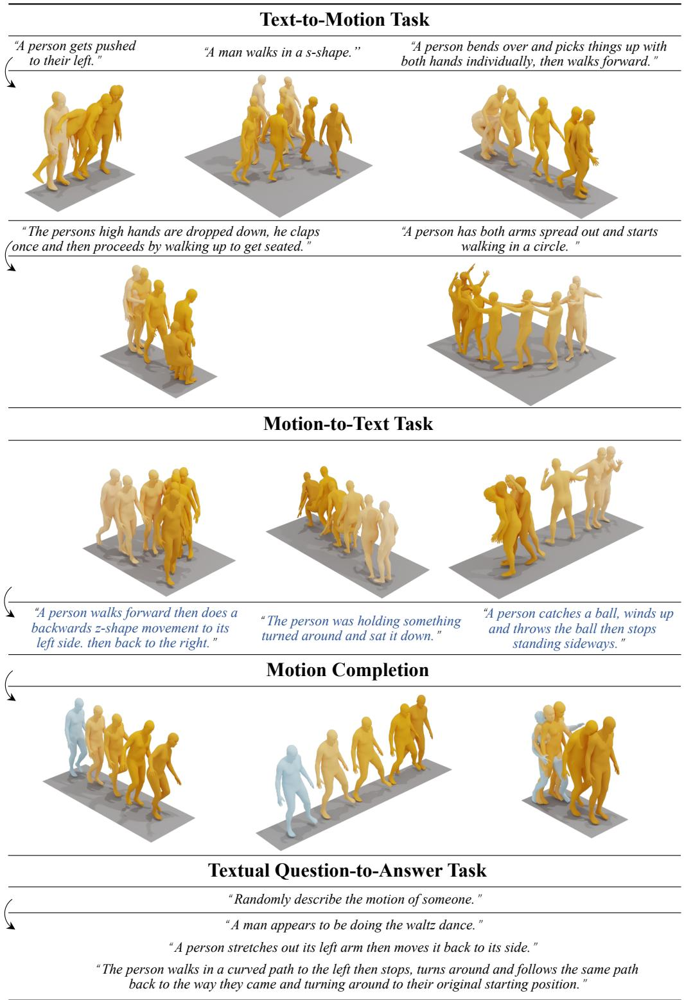
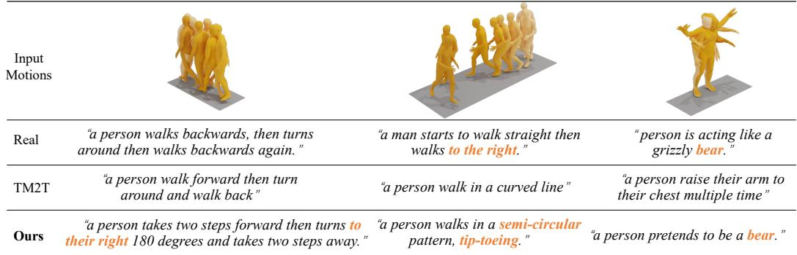
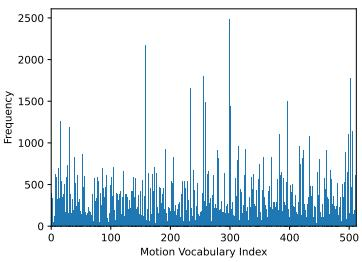
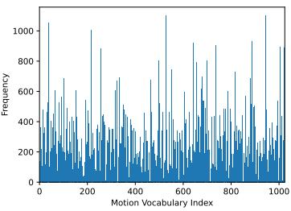
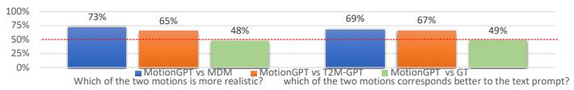

# MotionGPT：将人类动作视为外语

Biao Jiang1,2∗ Xin Chen2∗ Wen Liu2 Jingyi Yu3 Gang Yu2 Tao Chen1†
1Fudan University 2Tencent PCG 3 ShanghaiTech University
https://github.com/OpenMotionLab/MotionGPT

## 摘要

尽管预训练大语言模型持续取得进展，但构建一个能够同时处理语言以及其他多模态数据（如动作）的统一模型的探索仍充满挑战，迄今尚未被充分涉足。幸运的是，人类动作展现出与人类语言类似的语义耦合关系，通常被视为一种肢体语言。通过将语言数据与大规模动作模型相融合，进行能够提升动作相关任务性能的动作-语言预训练变得可行。基于这一洞察，我们提出了 MotionGPT，一个统一、多功能且用户友好的动作-语言模型，用以处理多种与动作相关的任务。具体而言，我们采用离散向量量化方法处理人体动作，并将三维动作转换为动作标记（motion tokens），其过程类似于词标记的生成过程。在这个"动作词表"（motion vocabulary）的基础上，我们以统一的方式对动作和文本进行语言建模，将人体动作视为一种特定的语言。此外，受提示学习（prompt learning）的启发，我们使用动作-语言混合数据对 MotionGPT 进行预训练，并在基于提示的问答任务上对其进行微调。大量实验表明，MotionGPT 在多个动作任务上达到了当前最优的性能，包括文本驱动的动作生成、动作描述、动作预测和动作插值。

## 1 引言

近年来，预训练大语言模型（如 GPT [36, 37, 3, 28]、BERT [7] 和 T5 [38, 5]）取得了重大突破，并推动了语言 [61, 49]、图像 [35, 52, 21]、网格 [57, 27] 以及多模态 [8] 建模的融合发展。然而，一个用于人体动作与语言的通用预训练模型尚未出现。这一能够通过提示支持众多动作相关任务的预训练动作-语言模型，应能惠及游戏、机器人、虚拟助手以及人体行为分析等多个领域。

先前的人体运动研究已探索了多种任务，包括运动生成 [31, 11, 48, 54, 59]、运动描述（motion captioning）[9, 12] 以及运动预测 [58, 63, 25]。近期的文本到运动（text-to-motion）工作 [48, 60, 32, 54] 尝试采用预训练的语言相关模型 [7, 35]。例如，MDM [48] 利用来自 CLIP [35] 的条件文本标记学习运动扩散模型，而 MLD [54] 则整合运动潜空间以提升运动扩散过程的效率。另一方面，MotionCLIP [47] 与 TM2T [12] 着重刻画运动和文本描述之间的耦合关系。然而，上述方法将运动和语言视为相互独立的模态，这通常要求严格配对的运动与文本数据。此外，由于监督信号是任务特定的，这些方法难以有效泛化到未见过的任务或数据，因为它们缺乏对运动与语言之间关系的全面理解。因此，我们聚焦于构建一个预训练的运动-语言模型，使其能够泛化到多种任务，并从更易获取的运动与语言数据中学习到深入的运动-语言关联知识。

  

图 1：MotionGPT 能够根据不同指令统一处理多种与运动相关的任务。我们在文本生成运动（text-to-motion，左上）、运动描述生成（motion captioning，左下）、运动补全（motion completion，右上）以及语言问答（language question-to-answer，右上）任务上展示了结果。运动从左到右表示时间顺序。蓝色运动表示输入，黄色表示生成结果。

训练一个有前景的运动-语言模型（motion-language model）有两个关键挑战亟待解决。第一个是建模语言与运动之间的关系，第二个是构建一个能够泛化到新任务的统一多任务框架。幸运的是，人体运动表现出与人类语言相似的语义耦合关系，常被理解为一种肢体语言。基于这一观察，我们借鉴 BEiT-3 [52] 中的视觉-语言预训练方法，将人体运动视为一种特定的外语。通过将运动与语言数据整合在一起并在同一词表中进行编码，运动与语言之间的关系也变得更加清晰。因此，借助近期规模显著增大的语言数据和模型，运动-语言预训练在提升运动任务性能方面具有巨大潜力。同时，这种基于语言的预训练支持类似 InstructGPT [28] 中的文本指令（prompt），使模型在各种运动任务中更加通用且用户友好。

在本工作中，我们提出了一个统一的运动-语言框架，命名为 MotionGPT，它利用预训练语言模型强大的语言生成能力和零样本迁移能力来完成人体运动相关任务。为了使 MotionGPT 能够理解并生成类人运动，我们首先学习一个运动专属的向量量化变分自编码器（VQ-VAE）模型，以构建"运动词表（motion vocabulary）"，类似于英语词汇表，然后将原始运动数据转换为一系列运动词元（motion tokens）。这些词元随后由一个预训练语言模型 [38, 5] 处理，该模型学习运动语言的底层语法和句法，以及其与相应文本描述之间的关系。为了在 MotionGPT 中有效整合语言与运动，我们设计了一个两阶段训练方案。我们首先在原始运动数据集上对语言模型进行预训练，以学习运动语言的基本语法和句法。在提示微调（prompt tuning）阶段，我们在一个同时包含文本描述和运动数据的指令数据集上对语言模型进行微调，以学习两种模态之间的相关性。大量实验表明，MotionGPT 在文本生成运动（text-to-motion）、运动生成文本（motion-to-text）、运动预测（motion prediction）以及运动插值（motion in-between）任务上均取得了当前最优的性能。

我们将我们的贡献总结如下：(1) 我们提出了一个统一的运动-语言生成预训练模型 MotionGPT，它将人体运动视为一门外语，将自然语言模型引入到与运动相关的生成任务中，并使用单一模型执行多种多样的运动任务。(2) 我们引入了一种带有指令微调的运动-语言训练方案，以从任务反馈中学习，并通过提示词生成具有前景的结果。(3) 我们提出了一个用于多任务评估的通用运动基准，其中 MotionGPT 在多种任务上取得了具有竞争力的表现，包括文本生成运动（text-to-motion）、运动生成文本（motion-to-text）、运动预测（motion prediction）和运动插值（motion in-between），并提供了所有可用的代码和数据。

<table><tr><td>Methods</td><td>Text-to-Motion</td><td>Motion-to-Text</td><td>Motion Prediction</td><td>Motion In-between</td><td>Random Motion</td><td>Random Description</td></tr><tr><td>T2M-GPT [48]</td><td>√</td><td>✗</td><td>✗</td><td>✗</td><td>√</td><td>✗</td></tr><tr><td>MLD [54]</td><td>√</td><td>✗</td><td>✗</td><td>✗</td><td>√</td><td>✗</td></tr><tr><td>TM2T [12]</td><td>√</td><td>√</td><td>✗</td><td>✗</td><td>✗</td><td>✗</td></tr><tr><td>MDM [48]</td><td>√</td><td>✗</td><td>√</td><td>√</td><td>√</td><td>✗</td></tr><tr><td>MotionDiffuse[60]</td><td>√</td><td>✗</td><td>√</td><td>√</td><td>√</td><td>✗</td></tr><tr><td>MotionGPT (Ours)</td><td>√</td><td>√</td><td>√</td><td>√</td><td>√</td><td>√</td></tr></table>

表 1：在多种与运动相关的任务上对近期最先进方法的比较。Random Motion 和 Random Caption 分别表示对运动和运动描述的无约束生成。

## 2 相关工作

人体运动合成（Human Motion Synthesis）旨在利用多模态输入生成多样化且真实的人体运动，这些输入包括文本 [11, 32, 60, 48, 12, 1, 18]、动作 [31, 13, 48, 54] 以及不完整的运动序列 [58, 63, 25, 48]。文本到运动是其中最重要的运动生成任务之一，因为语言输入对用户友好且便捷。MDM [48] 提出了一种基于扩散的生成模型 [15]，针对若干运动任务分别进行训练。MLD [54] 改进了潜空间扩散模型 [45, 40]，使其能够基于不同的条件输入生成运动。T2M-GPT [59] 研究了一种基于 VQ-VAE 与生成式预训练 Transformer（Generative Pre-trained Transformer, GPT）的生成框架用于运动生成。运动补全任务在部分运动序列的条件下生成运动，例如经典的运动预测 [58, 63, 25] 或运动插值 [48]，后者在首尾两端固定的情况下生成中间的运动。尽管上述方法在多种人体运动任务中展现了令人瞩目的效果，但大多数方法受限于使用单一模型处理多个任务。因此，我们提出了一种统一的方法，将人体运动视为一种外语，并利用预训练语言模型强大的语言生成能力与零样本迁移能力。

人体运动描述（Human Motion Captioning）。为了用自然语言描述人体运动，文献 [46] 依赖于两个统计模型来学习从运动到语言的映射。此外，循环神经网络也被用于文献 [56, 34] 中。近期的 TM2T [12] 提出了一种新的运动表示方法，将运动压缩为一段短序列的离散变量，然后使用神经翻译网络建立两种模态之间的映射。虽然 TM2T [12] 等先前研究在其训练流程中加入了描述模块用于运动生成，但这些方法受限于在同一统一框架内实现文本与运动之间的双向翻译。

## 语言模型与多模态

大规模语言模型（Large Language Models, LLMs）[7, 6, 38, 3, 61, 49] 依托海量数据集与庞大的模型规模，展现出令人瞩目的理解与生成能力，将自然语言处理提升至新的高度。BERT [7] 通过预训练得到深度双向的语言表征，可支持多种下游任务。T5 [38] 提出了一个统一框架，将所有基于文本的语言问题转换为文本到文本（text-to-text）的格式。近期研究 [53, 2, 28, 5] 发现，使用由指令及其对应答案构成的输入-输出对来微调预训练模型，可进一步提升其性能。FLAN [5] 提出了一种指令微调（instruction-tuning）技术，在未见过的任务上超越了未微调模型的性能。近期，多模态模型 [21, 16, 20] 的浪潮引人注目，它们能够同时处理文本与其他模态，例如图像 [21, 16, 8]、音频 [14, 8] 和视频 [55]。CLIP [35] 进一步学习了一种语义隐表征，将图像与对应的语言描述耦合在一起。尽管语言模型在多种视觉-语言任务中取得了成功，但能够处理人体动作的多模态语言模型的发展仍然有限。

## 动作语言预训练

现有的文本到动作（text-to-motion）生成方法 [11, 32, 48, 12, 1, 18] 可被刻画为描述到动作（caption-to-motion）任务，即模型接收对目标动作的纯文本描述。尽管这些方法能够从文本描述生成动作，但它们在支持用户指令方面常常受限，例如无法像 InstructGPT [28] 那样响应指令。换言之，它们不允许用户针对特定应用提供具有上下文语境的指令。MotionCLIP [47] 利用 CLIP [35] 的语言与视觉理解能力，将其隐空间与动作自编码器（motion auto-encoder）进行对齐。与此同时，许多语言模型（如 T5 [38] 和 InstructGPT [28]）已被开发用于处理多种语言处理任务，包括翻译、问答和分类。这些模型通常被设计为将给定的文本输入映射到目标输出，例如翻译结果或答案。然而，尽管这些模型在语言任务上表现出色，但它们尚未被广泛应用于动作任务。因此，我们提出 MotionGPT，以实现自然语言模型与人体动作任务的有效集成，为动作合成问题提供统一解决方案。

  

图 2：方法概述：MotionGPT 由一个运动分词器 V（第 3.1 节）和一个运动感知语言模型（第 3.2 节）组成。将由 V 学到的运动标记（Motion Tokens）与文本分词器产生的文本标记（Text Tokens）相结合，我们随后以语言模型为骨干网络，对运动与语言进行联合学习。

## 3 方法

为了将大规模语言数据和模型引入运动生成任务，我们提出了一个名为 MotionGPT 的统一运动-语言框架。如图 2 所示，MotionGPT 由一个负责将原始运动数据转换为离散运动 token 的运动分词器（第 3.1 节）组成，以及一个通过对应文本描述、从大规模语言预训练模型中学习理解运动 token 的运动感知语言模型（第 3.2 节）。为了处理与运动相关的任务，我们为 MotionGPT 引入了一个三阶段训练方案（第 3.3 节），分别用于运动分词器的训练、运动-语言预训练以及指令微调。

我们首先提出由运动编码器 $\mathcal{E}$ 和运动解码器 $\mathcal{D}$ 组成的运动分词器，将 $M$ 帧运动 $m^{1:M} = \{x^i\}_{i=1}^M$ 编码为 $L$ 个运动 token $z^{1:L} = \{z^i\}_{i=1}^L$，$L = M/l$，并将 $z^{1:L}$ 解码回运动 $\hat{m}^{1:M} \tilde{=} \mathcal{D}(z^{1:L}) = \mathcal{D}(\mathcal{E}(m^{1:M}))$，其中 $l$ 表示运动长度上的时间下采样率。然后，给定一个长度为 $N$ 的句子 $\boldsymbol{w^{1:N}} = \{w^i\}_{i=1}^N$，描述一个与运动相关的问题或需求，MotionGPT 的目标是生成其答案，即长度为 $L$ 的 token $\hat{x}^{1:L} = \{\hat{x}^i\}_{i=1}^L$。该答案可以是人运动 token $\hat{x}_m^{1:L}$ 或文本 token $\hat{x}_t^{1:L}$，由此产生一段运动 $\hat{m}^{1:M}$ 或一个类似对给定运动进行描述的句子 $\hat{w}^{1:L}$。

## 3.1 运动分词器

为了将运动表示为离散 token，我们基于文献 [50, 44, 12, 59] 中使用的向量量化变分自编码器（Vector Quantized Variational Autoencoders, VQ-VAE）架构，预训练了一个三维人体运动分词器 $\mathcal{V}$。我们的运动分词器由编码器 $\mathcal{E}$ 和解码器 $\mathcal{D}$ 组成。编码器生成具有高信息密度的离散运动 token，而解码器能够将运动 token 重构为运动序列 $\hat{m}^{1:M}$。这种方法使我们能够将运动高效地表示为一种语言，从而促进运动与语言在各种运动相关任务中的融合。

具体而言，运动编码器 $\mathcal{E}$ 首先沿时间维度对给定的逐帧运动特征 $\dot{m}^{1:M}$ 应用一维卷积，以获得潜向量 $\hat{z}^{1:L} = \mathcal{E}(m^{1:M})$。接下来，我们通过离散量化将 $\hat{z}$ 转换为一系列码本条目 $z$。可学习的码本 $Z = \{z^i\}_{i=1}^K \subset \mathbb{R}^d$ 包含 $K$ 个潜嵌入向量，每个向量的维度为 $d$。量化过程 $Q(\cdot)$ 将每个行向量 $b$ 替换为 $Z$ 中与其最近的码本条目 $b_k$，表示为

$$
z _ {i} = Q (\hat {z} ^ {i}) := \arg \min _ {z _ {k} \in Z} \| \hat {z} _ {i} - z _ {k} \| _ {2}.\tag{1}
$$

量化之后，运动解码器 D 将 $z ^ { 1 : L } = \{ z ^ { i } \} _ { i = 1 } ^ { L }$ 投影回原始运动空间，得到包含 M 帧的运动 $\hat { m } ^ { 1 : M }$。为了训练该运动分词器，我们遵循 [12, 59] 的方法，采用三种不同的损失函数来训练和优化运动分词器：$\mathcal { L } _ { \mathcal { V } } = \mathcal { L } _ { r } + \mathcal { L } _ { e } + \mathcal { L } _ { c }$，其中包括重建损失 ${ \mathcal { L } } _ { r }$、嵌入损失 $\mathcal { L } _ { e }$ 和承诺损失 $\mathcal { L } _ { c }$。为了进一步提升生成运动的质量，我们遵循 [59] 的方法，在重建损失中采用 L1 平滑损失和速度正则化，并使用指数移动平均（Exponential Moving Average, EMA）和码本重置技术 [39] 来提高训练过程中码本的利用率。关于该运动分词器架构和训练过程的更多细节，我们在补充材料中给出。

## 3.2 运动感知语言模型（Motion-aware Language Model）

借助该运动分词器，一个人体运动 $m ^ { 1 : M }$ 可以被映射为一系列运动分词 $\overset { \cdot } { z } { } ^ { 1 : \overline { { L } } }$，从而在语言模型 [19, 38, 28] 中实现与词向量相似的联合表征。通过将它们合并到统一词表中，我们可以联合学习运动和语言。我们首先将运动分词 $z ^ { 1 : L }$ 表示为索引序列 $s ^ { 1 : L } = \{ s ^ { i } \} _ { i = 1 } ^ { L }$，其中 $s^i$ 对应于运动分词 $z ^ { 1 : L }$ 的索引编号。另一方面，以往的语言模型（如 T5 [38]）将文本编码为 WordPiece 分词。它们使用了包含 $K _ { t }$ 个 WordPiece 的词表，并在混合语言数据集上训练了 SentencePiece [19] 模型。

以往大多数文本到运动（text-to-motion）[12, 54, 59] 或运动到文本（motion-to-text）[12] 方法使用不同的模块分别处理文本和运动，而我们旨在以相同的方式对文本和人体运动进行联合建模。为此，我们将原始文本词表 $V _ { t } = \{ v _ { t } ^ { i } \} _ { i = 1 } ^ { K _ { t } }$ 与运动词表 $V _ { m } = \{ v _ { m } ^ { i } \} _ { i = 1 } ^ { K _ { m } }$ 合并，后者与我们的运动码本 $Z$ 保持顺序一致。此外，$V _ { m }$ 还包含若干特殊分词，例如作为边界指示符的 </som> 和 </eom>，分别表示运动的开始与结束。因此，我们采用一个新的统一文本–运动词表 $V = \{ V _ { t } , V _ { m } \}$，并将多种运动相关任务统一表述为同一格式，其中输入"词"和输出"词"均来自同一 $V$。这些"词"可以表示自然语言、人体运动，甚至两者的混合，具体取决于待解决的任务。得益于此，我们的 MotionGPT 能够在单一模型中灵活地表征和生成多种与运动相关的输出。

为了解决条件生成任务，我们采用基于 Transformer 的模型，其架构源自文献 [38]，能够有效地将输入序列映射到输出。源输入由一个词元序列构成 $X_s = \{x_s^i\}_{i=1}^N$，其中 $x_s \in V$，$N$ 表示输入长度。类似地，目标输出为 $X_t = \{x_t^i\}_{i=1}^L$，其中 $x_t \in V$，$L$ 表示输出长度。如图 2 所示，源词元被送入 Transformer 编码器，随后解码器以自回归方式在每一步预测潜在下一个词元的概率分布 $p_\theta(x_t \mid x_s) = \prod_i p_\theta(x_t^i \mid x_t^{<i}, x_s)$。因此，在训练过程中，其目标是最大化数据分布的对数似然：

$$
\mathcal {L} _ {L M} = - \sum_ {i = 0} ^ {L _ {t} - 1} \log p _ {\theta} \left(x _ {t} ^ {i} \mid x _ {t} ^ {<   i}, x _ {s}\right).\tag{2}
$$

通过优化该目标函数，MotionGPT 学习从数据分布中捕获潜在的规律与关系，从而促进对目标"词元（words）"的准确且有意义的生成。在推理过程中，目标标记根据预测分布 $p_{\theta}\left(\hat{x}_{t}^{i} \mid \hat{x}_{t}^{<i}, x_{s}\right)$ 进行递归采样，直至遇到结束标记（即 $</\mathrm{s}>$）。这种采样策略支持以逐步的方式生成目标序列，其中每个标记都基于先前生成的标记和给定的源输入以概率方式确定。

## 3.3 训练策略

由于 T5s 仅接触过以文本词表 $V_{t}$ 表示的语言数据，因此我们通过学习动作词表 $V_{m}$ 来桥接动作与语言，使该语言模型能够理解人体动作概念。如图 3 所示，我们的训练方案包含三个阶段：（1）动作分词器训练，专注于学习动作码本以将人体动作表示为离散标记；（2）动作-语言预训练阶段，包含无监督和有监督目标以学习动作与语言之间的关系；（3）指令微调阶段，基于不同动作相关任务的提示式指令对模型进行微调。

动作分词器训练。我们首先使用公式 3.1 中定义的目标函数来训练动作分词器。该训练过程允许将任意人体动作序列 $\hat{x}^{1:L}$ 表示为动作标记序列，从而实现与文本信息的无缝集成。一旦优化完成，动作分词器在后续流水线阶段中保持不变。

  

图 3：训练方案（Training Scheme）。我们为 MotionGPT 模型（见第 3.3 节）设计了三个训练步骤：首先，学习一个用于离散运动表征的码本（codebook）；然后，在语言与运动数据的混合数据上训练语言模型，以学习文本与运动之间的语义耦合；最后，在带有多任务指令的文本-运动数据集上对模型进行微调。

**动作-语言预训练阶段（Motion-language Pre-training Stage）。** T5 模型 [38, 5] 在自然语言数据集上以基于指令的措辞进行训练和微调 [5, 28]。我们继续使用语言和动作数据的混合，以无监督和监督两种方式对该模型进行预训练：1) 为了泛化到诸如 [7, 37, 38, 28] 等各种下游任务，我们遵循 [38] 设计了一个目标函数，其中输入标记 X 中一定比例（15%）的标记被随机替换为特殊的 sentinel token。在另一侧，相应的目标序列通过提取被丢弃的标记片段来构建，这些片段由输入序列中使用的相同 sentinel token 分隔，并附加一个额外的 sentinel token 以表示目标序列的结束。2) 然后，我们通过配对的文本-动作数据集 [11, 33] 的监督来学习动作-语言关系。我们在有监督的动作-语言翻译上训练 MotionGPT，其中输入是人体动作或文本描述之一。在经过无监督和监督训练过程之后，我们的目标是使模型具备对文本和动作关系的理解。

**指令微调阶段（Instruction Tuning Stage）。** 我们通过将现有的文本到动作数据集（如 HumanML3D [11] 和 KIT [33]）构建为指令形式，构建了一个多任务文本-动作数据集。具体而言，我们定义了 15 个核心动作任务，例如基于文本的动作生成、动作描述（motion captioning）、动作预测等。对于每个任务，我们编写了数十种不同的指令模板，从而产生了超过一千种不同的任务，每种任务都有独特的指令提示。例如，动作生成任务的指令提示可以是"你能生成一个描绘'一个人模仿华尔兹舞蹈动作'的动作序列吗？"。类似地，对于动作描述任务，指令提示可以是"提供一段准确的字幕来描述 <motion\_tokens> 的动作"，其中 <motion\_tokens> 表示由我们的动作分词器（motion tokenizer）生成的一系列动作标记。我们在 4.3 节中展示了指令微调的有效性，它带来了跨各种任务的提升，并增强了模型对未见过的任务或提示的泛化能力。更多提示示例见补充材料。

## 4 实验（Experiments）

通过广泛的比较来评估我们的 MotionGPT 在多个动作相关任务和数据集上的性能。数据集设置、评估指标和实现细节的详细信息将在（4.1 节）中给出。我们首先通过在各种任务上与其它最先进方法（SOTA）进行比较，提出一个统一的基准（4.2 节）。然后，我们分别在文本到动作（4.2 节）、动作到文本（4.2 节）、动作预测和动作中间帧（4.2 节）上进行各项具体比较。补充材料中包括更多的定性结果、用户研究和进一步的实现细节。

## 4.1 实验设置（Experimental Setup）

数据集. 通用运动合成能够支持多样化的任务设定，因此本研究利用先前的数据集以及一个修改后的基准来评估 MotionGPT。本研究主要聚焦于两个文本到运动数据集：HumanML3D [11] 与 KIT [33]。KIT 数据集提供了 $^ { 6 , 3 5 3 }$ 条对应 3,911 个运动序列的文本描述，而 HumanML3D 数据集 [11] 是一个更新的数据集，包含了从 AMASS [26] 获得的 14,616 个运动序列，以及 44,970 条序列级文本描述。为了将 MotionGPT 作为统一框架在运动预测和运动补全（in-between）等任务上进行评估，我们使用了 HumanML3D 中可用的运动序列，该数据集同时也是更大规模 AMASS 数据集的一个子集。遵循先前工作 [11, 54, 48]，我们采用相同的运动表示以进行公平比较，该表示结合了关节速度、位置与旋转。通过使用这种一致的表示，MotionGPT 能够为该领域的进一步研究提供支持。（有关基准细节请参见补充材料。）

<table><tr><td rowspan="2">Methods</td><td colspan="3">Text-to-Motion</td><td colspan="3">Motion-to-Text</td><td colspan="2">Motion Prediction</td><td colspan="2">Motion In-between</td></tr><tr><td>R TOP1↑</td><td>FID↓</td><td>DIV→</td><td>R TOP3↑</td><td>Bleu@4↑</td><td>Cider↑</td><td>FID↓</td><td>DIV→</td><td>FID↓</td><td>DIV→</td></tr><tr><td>Real</td><td> $0.511^{\pm .003}$ </td><td> $0.002^{\pm .000}$ </td><td> $9.503^{\pm .065}$ </td><td>0.828</td><td>-</td><td>-</td><td>0.002</td><td>9.503</td><td>0.002</td><td>9.503</td></tr><tr><td>MLD [54]</td><td> $0.481^{\pm .003}$ </td><td> $0.473^{\pm .013}$ </td><td> $9.724^{\pm .082}$ </td><td>-</td><td>-</td><td>-</td><td>-</td><td>-</td><td>-</td><td>-</td></tr><tr><td>T2M-GPT [48]</td><td> $0.491^{\pm .003}$ </td><td> $0.116^{\pm .004}$ </td><td> $9.761^{\pm .081}$ </td><td>-</td><td>-</td><td>-</td><td>-</td><td>-</td><td>-</td><td>-</td></tr><tr><td>TM2T [12]</td><td> $0.424^{\pm .017}$ </td><td> $1.501^{\pm .003}$ </td><td> $8.589^{\pm .076}$ </td><td>0.823</td><td>7.00</td><td>16.8</td><td>-</td><td>-</td><td>-</td><td>-</td></tr><tr><td>MDM [48]</td><td> $0.320^{\pm 005}$ </td><td> $0.544^{\pm .044}$ </td><td> $9.559^{\pm .086}$ </td><td>-</td><td>-</td><td>-</td><td>6.031</td><td>7.813</td><td>2.698</td><td>8.420</td></tr><tr><td>MotionGPT (Ours)</td><td> $0.492^{\pm .003}$ </td><td> $0.232^{\pm .008}$ </td><td> $9.528^{\pm .071}$ </td><td>0.827</td><td>12.47</td><td>29.2</td><td>0.905</td><td>8.972</td><td>0.214</td><td>9.560</td></tr></table>

表 2：在 HumanML3D [11] 数据集上对四个运动相关任务的比较。评估指标使用 [11] 中介绍的编码器进行计算。此前方法中的空白列表示它们无法处理该任务。箭头 (→) 表示越接近 Real（真实值）越好。加粗和下划线分别表示文本到运动任务上的最佳和次佳结果。

评估指标归纳为四个部分。(1) 运动质量：Frechet Inception Distance（FID，Fréchet Inception 距离）是我们的主要指标，基于 [11] 中的特征提取器，用于评估生成运动与真实运动之间特征分布的距离。对于运动补全任务，我们采用运动预测研究 [58, 63, 25] 中使用的指标，例如 Average Displacement Error（ADE，平均位移误差）和 Final Displacement Error（FDE，最终位移误差），以评估预测运动的准确性。(2) 生成多样性：我们使用 Diversity（DIV，多样性）指标来评估运动的多样性，该指标通过从运动中提取的特征计算方差 [11]。MultiModality（MM，多模态性）衡量同一运动文本描述下生成运动的多样性。(3) 文本匹配：基于 [11] 的特征空间，运动检索精度（R Precision）使用 Top 1/2/3 检索准确率评估文本与运动之间匹配的准确性。Multi-modal Distance（MM Dist，多模态距离）衡量运动与文本之间的距离。(4) 语言质量：我们遵循 [12]，采用自然语言研究中的语言学指标，包括 BLUE [29]、Rouge [24]、Cider [51] 和 BertScore [62]，以评估生成运动描述的质量。

实现细节。在大多数比较中，我们将运动分词器（motion tokenizer）的码本设置为 $K \in \mathbb { R } ^ { 5 1 2 \times 5 1 2 }$。运动编码器 E 采用的时间下采样率 l 为 4。我们采用 T5 [38] 作为语言模型的基础架构，基线模型在 transformer 编码器和解码器中均包含 12 层。前馈网络的输出维度为 $d _ { \mathrm { f f } } = 3 0 7 2$，注意力机制采用的内部维度为 $d _ { \mathrm { k v } } = 6 4$。其余子层和嵌入的维度为 $d _ { \mathrm { m o d e l } } = 7 6 8$。此外，我们所有模型均采用 AdamW 优化器进行训练。运动分词器使用 $1 0 ^ { - 4 }$ 的学习率和 256 的小批量大小进行训练，而我们的语言模型在预训练阶段使用 $\textrm { a 2 } \times 1 0 ^ { - 4 }$ 的学习率，在指令微调阶段使用 $1 0 ^ { - 4 }$ 的学习率，两个阶段均采用 16 的小批量大小。运动分词器经历 150K 次迭代训练，而语言模型在预训练阶段经历 300K 次迭代训练，在指令微调阶段再经历 300K 次迭代训练。所有模型均在 8 块 Tesla V100 GPU 上进行训练。

## 4.2 运动相关任务上的比较

多任务比较。通过引入一个将人体运动视为外语的统一框架，我们开启了对多种运动相关任务的探索。我们采用一个 220M 参数的预训练 Flan-T5-Base[38, 5] 模型作为骨干网络，并在预训练与指令微调阶段（第 3.3 节）对其进行微调，用于以下所有比较。如表 2 所示，我们在文本条件运动生成[54, 59, 12, 48]、运动描述（motion captioning）[12]、运动预测[48]以及运动插值（motion in-between）[48]等关键任务上，将 MotionGPT 与最先进的方法进行比较。尽管我们借鉴了已有文献或基准在文到运动（text-to-motion）和运动到文（motion-to-text）任务上的现有结果，我们针对运动预测任务重新实现了运动扩散模型[48]，并在相同的指标和设定下对其进行了评估。请注意，部分方法专为特定任务设计，因此对于其无法处理的任务，相关指标为空。表 2 所示的结果表明，我们的 MotionGPT 在所有评估任务上均取得了具有竞争力的性能，凸显了其在单一模型内处理多种运动任务的能力。

<table><tr><td rowspan="2">Methods</td><td colspan="3">RPrecision↑</td><td rowspan="2">FID↓</td><td rowspan="2">MMDist↓</td><td rowspan="2">Diversity→</td><td rowspan="2">MModality↑</td></tr><tr><td>Top1</td><td>Top2</td><td>Top3</td></tr><tr><td>Real</td><td> $0.511^{\pm .003}$ </td><td> $0.703^{\pm .003}$ </td><td> $0.797^{\pm .002}$ </td><td> $0.002^{\pm .000}$ </td><td> $2.974^{\pm .008}$ </td><td> $9.503^{\pm .065}$ </td><td>-</td></tr><tr><td>TM2T [12]</td><td> $0.424^{\pm .003}$ </td><td> $0.618^{\pm .003}$ </td><td> $0.729^{\pm .002}$ </td><td> $1.501^{\pm .017}$ </td><td> $3.467^{\pm .011}$ </td><td> $8.589^{\pm .076}$ </td><td> $2.424^{\pm .093}$ </td></tr><tr><td>T2M [11]</td><td> $0.457^{\pm .002}$ </td><td> $0.639^{\pm .003}$ </td><td> $0.740^{\pm .003}$ </td><td> $1.067^{\pm .002}$ </td><td> $3.340^{\pm .008}$ </td><td> $9.188^{\pm .002}$ </td><td> $2.090^{\pm .083}$ </td></tr><tr><td>MotionDiffuse [60]</td><td> $\underline{0.491}^{\pm .001}$ </td><td> $\underline{0.681}^{\pm .001}$ </td><td> $\underline{0.782}^{\pm .001}$ </td><td> $0.630^{\pm .001}$ </td><td> $\underline{3.113}^{\pm .001}$ </td><td> $9.410^{\pm .049}$ </td><td> $1.553^{\pm .042}$ </td></tr><tr><td>MDM [48]</td><td> $0.320^{\pm .005}$ </td><td> $0.498^{\pm .004}$ </td><td> $0.611^{\pm .007}$ </td><td> $0.544^{\pm .044}$ </td><td> $5.566^{\pm .027}$ </td><td> $\underline{9.559}^{\pm .086}$ </td><td> $\underline{2.799}^{\pm .072}$ </td></tr><tr><td>MLD [54]</td><td> $0.481^{\pm .003}$ </td><td> $0.673^{\pm .003}$ </td><td> $0.772^{\pm .002}$ </td><td> $0.473^{\pm .013}$ </td><td> $3.196^{\pm .010}$ </td><td> $9.724^{\pm .082}$ </td><td> $2.413^{\pm .079}$ </td></tr><tr><td>T2M-GPT [59]</td><td> $\underline{0.491}^{\pm .003}$ </td><td> $0.680^{\pm .003}$ </td><td> $0.775^{\pm .002}$ </td><td> $\underline{0.116}^{\pm .004}$ </td><td> $3.118^{\pm .011}$ </td><td> $9.761^{\pm .081}$ </td><td> $1.856^{\pm .011}$ </td></tr><tr><td>MotionGPT (Pre-trained)</td><td> $0.435^{\pm .003}$ </td><td> $0.607^{\pm .002}$ </td><td> $0.700^{\pm .002}$ </td><td> $\underline{0.160}^{\pm .008}$ </td><td> $3.700^{\pm .009}$ </td><td> $9.411^{\pm .081}$ </td><td> $\underline{3.437}^{\pm .091}$ </td></tr><tr><td>MotionGPT (Fine-tuned)</td><td> $\underline{0.492}^{\pm .003}$ </td><td> $\underline{0.681}^{\pm .003}$ </td><td> $\underline{0.778}^{\pm .002}$ </td><td> $0.232^{\pm .008}$ </td><td> $\underline{3.096}^{\pm .008}$ </td><td> $\underline{9.528}^{\pm .071}$ </td><td> $2.008^{\pm .084}$ </td></tr></table>

表 3：在 HumanML3D [11] 上文本到动作（text-to-motion）方法的对比。空白的 MModality 表示真实动作（Real motion）是确定性的。这些方法按 FID 排序。Pre-trained（预训练）和 Fine-tuned（微调）分别表示统一的运动-语言预训练以及针对该任务的特定微调。（符号说明参见表 2。）

<table><tr><td rowspan="2">Methods</td><td colspan="2">RPrecision↑</td><td rowspan="2">MMDist↓</td><td rowspan="2">Lengthavg↑</td><td rowspan="2">Bleu@1↑</td><td rowspan="2">Bleu@4↑</td><td rowspan="2">Rouge↑</td><td rowspan="2">Cider↑</td><td rowspan="2">BertScore↑</td></tr><tr><td>Top1</td><td>Top3</td></tr><tr><td>Real</td><td>0.523</td><td>0.828</td><td>2.901</td><td>12.75</td><td>-</td><td>-</td><td>-</td><td>-</td><td>-</td></tr><tr><td>TM2T[12]</td><td>0.516</td><td>0.823</td><td>2.935</td><td>10.67</td><td>48.9</td><td>7.00</td><td>38.1</td><td>16.8</td><td>32.2</td></tr><tr><td>MotionGPT (Ours)</td><td>0.543</td><td>0.827</td><td>2.821</td><td>13.04</td><td>48.2</td><td>12.47</td><td>37.4</td><td>29.2</td><td>32.4</td></tr></table>

表 4：在 HumanML3D [11] 上的动作描述生成对比。评估指标遵循 [12]，而我们在计算语言学指标时使用未经预处理的真实文本（ground truth texts）。

文本到动作的对比。文本到动作任务涉及根据给定的文本输入生成人体动作序列。我们将所提出的 MotionGPT 模型评估为预训练的 MotionGPT（即 Tab. 2 中使用的同一模型），并针对文本到动作任务对其进行微调。我们将 MotionGPT 与其他当前最优方法 [12, 11, 48, 54, 59] 进行比较，并使用 [11] 中建议的指标在 HumanML3D 和 KIT 数据集上评估性能。所得结果带有 95% 置信区间，由 20 次重复运行得到。所报告的大部分结果直接取自其各自论文或 [11] 所给出的基准。Tab. 3 汇总了对比结果，其中 MotionGPT 在大多数指标上都取得了具有竞争力的性能。

动作到文本的对比。动作到文本任务涉及根据给定的人体动作序列生成文本描述。我们将预训练的 MotionGPT 与近期工作 TM2T [12] 进行对比。我们使用 [12] 中建议的指标在 HumanML3D 上评估性能。此外，我们还测量了平均词数 Lengt $\mathbf { h } _ { \mathrm { a v g } }$ 以供进一步比较。请注意，[12] 中报告的结果使用了经过预处理的真实文本来评估，这忽略了单词的语法时态和复数形式。在 Tab. 4 中，我们直接使用真实文本描述进行更准确的评估。该对比表明，MotionGPT 在给定动作的文本描述方面优于近期工作。

动作预测与动作插值预测的对比。我们将动作预测和动作插值预测统一概括为广义的动作补全。为了评估 MotionGPT 的动作补全能力，我们使用 AMASS 数据集 [26]（一个仅包含动作的数据集）的一部分。对于动作预测任务，我们仅输入大约前 20% 的动作序列作为条件。对于动作插值预测，我们随机遮盖约 50% 的动作以进行补全。我们还针对该任务专门对 MotionGPT 进行了微调，并使用与 Sec. 4.1 相同的 FID、ADE 和 FDE 作为评估指标。此外，我们通过使用 MDM [48] 提供的模型来评估其动作预测能力，该模型同样通过动作遮盖「修复」（in-painting）来支持动作插值预测。真实动作数据被用作我们的基线之一。Tab. 5 报告了我们的 MotionGPT 在动作补全质量和多样性方面均达到最优。

<table><tr><td rowspan="2">Methods</td><td colspan="4">Motion Prediction</td><td colspan="3">Motion In-between</td></tr><tr><td>FID ↓</td><td>Diversity↑</td><td>ADE↓</td><td>FDE↓</td><td>FID ↓</td><td>Diversity↑</td><td>ADE↓</td></tr><tr><td>Real</td><td>0.002</td><td>9.503</td><td>-</td><td>-</td><td>0.002</td><td>9.503</td><td>-</td></tr><tr><td>MDM[48]</td><td>6.031</td><td>7.813</td><td>5.446</td><td>8.561</td><td>2.698</td><td>8.420</td><td>3.787</td></tr><tr><td>MotionGPT (Ours)</td><td>0.905</td><td>8.972</td><td>4.745</td><td>6.040</td><td>0.214</td><td>9.560</td><td>3.762</td></tr></table>

表 5：仅使用运动数据在 AMASSS [26] 数据集的部分数据上对运动预测（motion prediction）与运动中间插帧（motion in-between）的比较。FID 表示运动质量，Diversity（DIV）表示每个条件下的运动多样性。ADE 和 FDE 表示生成结果与真实值（ground truth）之间的关节距离。

<table><tr><td rowspan="2">Size</td><td rowspan="2">Instruction Tuning</td><td colspan="3">Text-to-Motion</td><td colspan="3">Motion-to-Text</td><td colspan="2">Motion Prediction</td><td colspan="2">Motion In-between</td></tr><tr><td>R TOP3 ↑</td><td>FID ↓</td><td>DIV →</td><td>MMDist↓</td><td>Bleu@4↑</td><td>Cider↑</td><td>FID ↓</td><td>DIV →</td><td>FID ↓</td><td>DIV →</td></tr><tr><td>Real</td><td>-</td><td>0.797</td><td>0.002</td><td>9.503</td><td>2.901</td><td>-</td><td>-</td><td>0.002</td><td>9.503</td><td>0.002</td><td>9.503</td></tr><tr><td>Small</td><td></td><td>0.706</td><td>0.727</td><td>9.264</td><td>2.748</td><td>12.02</td><td>24.9</td><td>-</td><td>-</td><td>-</td><td>-</td></tr><tr><td>Small</td><td>√</td><td>0.663</td><td>0.336</td><td>9.239</td><td>2.931</td><td>10.54</td><td>24.3</td><td>0.954</td><td>8.727</td><td>0.326</td><td>9.618</td></tr><tr><td>Base</td><td></td><td>0.722</td><td>0.365</td><td>9.407</td><td>2.821</td><td>12.47</td><td>29.2</td><td>-</td><td>-</td><td>-</td><td>-</td></tr><tr><td>Base</td><td>√</td><td>0.700</td><td>0.160</td><td>9.411</td><td>3.019</td><td>11.42</td><td>28.2</td><td>0.905</td><td>8.972</td><td>0.214</td><td>9.560</td></tr><tr><td>Large</td><td></td><td>0.694</td><td>0.234</td><td>9.310</td><td>2.776</td><td>12.44</td><td>28.5</td><td>-</td><td>-</td><td>-</td><td>-</td></tr><tr><td>Large</td><td>√</td><td>0.708</td><td>0.159</td><td>9.301</td><td>3.011</td><td>11.71</td><td>29.1</td><td>0.556</td><td>8.975</td><td>0.223</td><td>9.358</td></tr></table>

表 6：在 HumanML3D [11] 数据集上，对 MotionGPT 的指令微调（instruction tuning）及不同模型规模在四个运动任务上的评估。（指标详见表 2）

## 4.3 消融实验（Ablation Studies）

MotionGPT 以 T5 [38] 作为运动感知的语言骨干模型（backbone），并通过预训练再进行指令微调来训练这些模型。因此，模型规模与训练策略均会影响 MotionGPT 的性能。我们在此于典型运动任务上对其进行评估。更详细的消融实验见补充材料。

模型规模（Model Sizes）。我们在四个运动任务上评估了不同规模模型的性能。除了第 4.1 节中 220M 的基础版 MotionGPT 外，本节进一步评估了 60M、220M 和 770M 三种规模的 MotionGPT。表 6 表明，相较于更小的 60M 模型，220M 基础模型已取得了显著的性能。然而，单纯增大模型规模在当前运动数据上并未带来明显提升，在少数情形（例如运动插值任务）中甚至导致性能下降。我们认为这可能源于当前运动数据集的体量有限：HumanML3D 仅包含 15k 条运动序列，远小于动辄数十亿规模的语言与图像数据。

指令微调的有效性（Effectiveness of Instruction Tuning）。我们评估了指令微调策略对不同规模模型的影响。表 6 的结果表明，指令微调增强了 MotionGPT 的通用性，使其能够支持更多运动任务（例如运动补全），并提升了文本到运动任务的运动生成质量。然而，对于纯粹的文本生成任务，模型性能有所下降，这可能归因于文本描述与对应运动之间的配对数量有限。

## 5 讨论（Discussion）

据我们所知，这是首次尝试利用语言模型探索人体运动生成的研究，所提出的 MotionGPT 仍存在如下局限性。MotionGPT 仅在铰接式人体（articulated human body）上建模运动，而诸多其他工作聚焦于人脸 [17, 4]、手部 [41, 23, 22] 甚至动物 [42, 64] 的运动。此外，我们的方法仅限于单人建模，未涉及人与人、人与环境的交互 [43]。在运动–语言框架下建模人–人交互场景并生成可控运动 [43] 是一个颇具意义的方向。

我们将所提出的 MotionGPT 总结为一个统一的运动–语言框架，能够基于提示式指令（prompt-based instructions）生成合理的人体运动与自然语言描述。相较于兼容的运动扩散方法 [54, 48]，MotionGPT 仅凭一个预训练生成模型即可在运动生成、运动描述、运动预测和运动插值等任务上取得具有竞争力的结果。随着大语言数据与模型的不断发展 [38, 5]，MotionGPT 同样具备应对自然问答任务的能力。在多个人体运动相关任务上的大量实验验证了 MotionGPT 的有效性与可扩展性。

## 参考文献（References）

[1] Chaitanya Ahuja and Louis-Philippe Morency. Language2pose：以自然语言为依据的姿态预测。载于：2019 年三维视觉国际会议（3DV），第 719–728 页。IEEE，2019。

[2] Stephen H Bach, Victor Sanh, Zheng-Xin Yong, Albert Webson, Colin Raffel, Nihal V Nayak, Abheesht Sharma, Taewoon Kim, M Saiful Bari, Thibault Fevry, et al. PromptSource：面向自然语言提示的集成开发环境与存储库。arXiv 预印本 arXiv:2202.01279，2022。

[3] Tom Brown, Benjamin Mann, Nick Ryder, Melanie Subbiah, Jared D Kaplan, Prafulla Dhariwal, Arvind Neelakantan, Pranav Shyam, Girish Sastry, Amanda Askell, et al. 语言模型即为少样本学习者。《神经信息处理系统进展》，33:1877–1901，2020。

[4] Xuan Cao, Zhang Chen, Anpei Chen, Xin Chen, Shiying Li, and Jingyi Yu. 基于可形变模型引导的稀疏光度三维人脸重建。载于：IEEE 计算机视觉与模式识别会议论文集，第 4635–4644 页，2018。

[5] Hyung Won Chung, Le Hou, Shayne Longpre, Barret Zoph, Yi Tay, William Fedus, Eric Li, Xuezhi Wang, Mostafa Dehghani, Siddhartha Brahma, et al. 指令微调语言模型的规模扩展。arXiv 预印本 arXiv:2210.11416，2022。

[6] Zihang Dai, Zhilin Yang, Yiming Yang, Jaime Carbonell, Quoc V Le, and Ruslan Salakhutdinov. Transformer-XL：突破固定长度上下文的注意力语言模型。arXiv 预印本 arXiv:1901.02860，2019。

[7] Jacob Devlin, Ming-Wei Chang, Kenton Lee, and Kristina Toutanova. BERT：用于语言理解的深度双向变换器预训练。arXiv 预印本 arXiv:1810.04805，2018。

[8] Rohit Girdhar, Alaaeldin El-Nouby, Zhuang Liu, Mannat Singh, Kalyan Vasudev Alwala, Armand Joulin, and Ishan Misra. ImageBind：一个将万物联结起来的嵌入空间。arXiv 预印本 arXiv:2305.05665，2023。

[9] Yusuke Goutsu and Tetsunari Inamura. 基于生成对抗序列到序列学习的人体运动语言描述。载于：2021 年 IEEE 机器人与自动化国际会议（ICRA），第 4281–4287 页。IEEE，2021。

[10] John C Gower. 广义普氏分析。《心理计量学》，40(1):33–51，1975。

[11] Chuan Guo, Shihao Zou, Xinxin Zuo, Sen Wang, Wei Ji, Xingyu Li, and Li Cheng. 从文本生成多样化且自然的三维人体运动。载于：IEEE/CVF 计算机视觉与模式识别会议论文集（CVPR），第 5152–5161 页，2022 年 6 月。

[12] Chuan Guo, Xinxin Zuo, Sen Wang, and Li Cheng. TM2T：用于三维人体运动与文本相互生成的随机化与分词化建模。载于：ECCV，2022。

[13] Chuan Guo, Xinxin Zuo, Sen Wang, Shihao Zou, Qingyao Sun, Annan Deng, Minglun Gong, and Li Cheng. Action2Motion：三维人体运动的条件生成。载于：第 28 届 ACM 国际多媒体会议论文集，第 2021–2029 页，2020。

[14] Andrey Guzhov, Federico Raue, Jörn Hees, 和 Andreas Dengel. AudioCLIP：将 CLIP 扩展到图像、文本与音频。见 ICASSP 2022-2022 年 IEEE 声学、语音与信号处理国际会议（ICASSP），第 976–980 页。IEEE，2022。

[15] Jonathan Ho、Ajay Jain 和 Pieter Abbeel. 去噪扩散概率模型。神经信息处理系统进展，第 33 卷：6840–6851，2020。

[16] Shaohan Huang、Li Dong、Wenhui Wang、Yaru Hao、Saksham Singhal、Shuming Ma、Tengchao Lv、Lei Cui、Owais Khan Mohammed、Qiang Liu 等。语言并非你所需要的一切：将感知与语言模型对齐。arXiv 预印本 arXiv:2302.14045，2023。

[17] Tero Karras、Timo Aila、Samuli Laine、Antti Herva 和 Jaakko Lehtinen. 通过姿态与情感的联合端到端学习实现音频驱动的面部动画。ACM 图形学汇刊（TOG），第 36 卷第 4 期：1–12，2017。

[18] Jihoon Kim、Jiseob Kim 和 Sungjoon Choi. FLAME：基于自由形式语言的运动合成与编辑。arXiv 预印本 arXiv:2209.00349，2022。

[19] Taku Kudo 和 John Richardson. SentencePiece：一种用于神经文本处理的简单且与语言无关的子词分词器与反分词器。arXiv 预印本 arXiv:1808.06226，2018。

[20] Junnan Li、Dongxu Li、Silvio Savarese 和 Steven Hoi. BLIP-2：利用冻结图像编码器与大型语言模型引导语言-图像预训练。arXiv 预印本 arXiv:2301.12597，2023。

[21] Junnan Li、Dongxu Li、Caiming Xiong 和 Steven Hoi. BLIP：用于统一视觉-语言理解与生成的引导式语言-图像预训练。见国际机器学习大会（ICML），第 12888–12900 页。PMLR，2022。

[22] Yuwei Li、Minye Wu、Yuyao Zhang、Lan Xu 和 Jingyi Yu. PIANO：一种基于磁共振成像的参数化手部骨骼模型。arXiv 预印本 arXiv:2106.10893，2021。

[23] Yuwei Li、Longwen Zhang、Zesong Qiu、Yingwenqi Jiang、Nianyi Li、Yuexin Ma、Yuyao Zhang、Lan Xu 和 Jingyi Yu. NIMBLE：一种包含骨骼与肌肉的非刚性手部模型。ACM 图形学汇刊（TOG），第 41 卷第 4 期：1–16，2022。

[24] Chin-Yew Lin. ROUGE：一种用于摘要自动评估的软件包。见文本摘要分支研讨会论文集，第 74–81 页，2004。

[25] Hengbo Ma、Jiachen Li、Ramtin Hosseini、Masayoshi Tomizuka 和 Chiho Choi. 基于知识蒸馏的多目标多样化人体运动预测。见 IEEE/CVF 计算机视觉与模式识别会议论文集，第 8161–8171 页，2022。

[26] Naureen Mahmood、Nima Ghorbani、Nikolaus F. Troje、Gerard Pons-Moll 和 Michael J. Black. AMASS：作为表面形状的人体运动捕捉存档。见 IEEE/CVF 国际计算机视觉会议（ICCV）论文集，2019 年 10 月。

[27] Nasir Mohammad Khalid、Tianhao Xie、Eugene Belilovsky 和 Tiberiu Popa. CLIP-Mesh：利用预训练图像-文本模型从文本生成带纹理的三维网格。见 SIGGRAPH Asia 2022 会议论文，第 1–8 页，2022。

[29] Kishore Papineni, Salim Roukos, Todd Ward, and Wei-Jing Zhu. BLEU：一种机器翻译自动评估方法. 载于：计算语言学协会第40届年会论文集，第311–318页，2002年.

[30] Georgios Pavlakos, Vasileios Choutas, Nima Ghorbani, Timo Bolkart, Ahmed A. A. Osman, Dimitrios Tzionas, and Michael J. Black. 富有表现力的身体捕捉：从单张图像重建三维手部、面部与身体. 载于：IEEE计算机视觉与模式识别会议（CVPR）论文集，2019年.

[31] Mathis Petrovich, Michael J. Black, and Gül Varol. 基于动作条件Transformer VAE的三维人体运动合成. 载于：国际计算机视觉会议（ICCV），2021年.

[32] Mathis Petrovich, Michael J. Black, and Gül Varol. TEMOS：从文本描述生成多样化人体运动. 载于：欧洲计算机视觉会议（ECCV），2022年.

[33] Matthias Plappert, Christian Mandery, and Tamim Asfour. KIT运动-语言数据集. Big Data, 4(4):236–252, 2016年12月.

[34] Matthias Plappert, Christian Mandery, and Tamim Asfour. 利用深度循环神经网络学习人体全身运动与自然语言之间的双向映射. Robotics and Autonomous Systems, 109:13–26, 2018年.

[35] Alec Radford, Jong Wook Kim, Chris Hallacy, Aditya Ramesh, Gabriel Goh, Sandhini Agarwal, Girish Sastry, Amanda Askell, Pamela Mishkin, Jack Clark, et al. 从自然语言监督中学习可迁移的视觉模型. 载于：国际机器学习会议论文集，第8748–8763页. PMLR, 2021年.

[36] Alec Radford, Karthik Narasimhan, Tim Salimans, Ilya Sutskever, et al. 通过生成式预训练提升语言理解能力. 2018年.

[37] Alec Radford, Jeffrey Wu, Rewon Child, David Luan, Dario Amodei, Ilya Sutskever, et al. 语言模型是无监督多任务学习者. OpenAI blog, 1(8):9, 2019年.

[38] Colin Raffel, Noam Shazeer, Adam Roberts, Katherine Lee, Sharan Narang, Michael Matena, Yanqi Zhou, Wei Li, and Peter J Liu. 利用统一的文本到文本Transformer探索迁移学习的极限. The Journal of Machine Learning Research, 21(1):5485–5551, 2020年.

[39] Ali Razavi, Aaron Van den Oord, and Oriol Vinyals. 使用VQ-VAE-2生成多样化的高保真图像. Advances in neural information processing systems, 32, 2019年.

[40] Robin Rombach, Andreas Blattmann, Dominik Lorenz, Patrick Esser, and Björn Ommer. 使用潜在扩散模型进行高分辨率图像合成. 载于：IEEE计算机视觉与模式识别会议（CVPR）论文集，2022年.

[41] Javier Romero, Dimitrios Tzionas, and Michael J Black. 具身之手：联合建模与捕捉手部和身体（Embodied hands: Modeling and capturing hands and bodies together）。arXiv 预印本 arXiv:2201.02610，2022。

[42] Nadine Rueegg, Silvia Zuffi, Konrad Schindler, and Michael J. Black. BARC：通过利用品种信息从图像回归 3D 狗形状（BARC: Learning to regress 3D dog shape from images by exploiting breed information）。收录于：IEEE/CVF 计算机视觉与模式识别会议（CVPR），第 3876–3884 页，2022 年 6 月。

[43] Yonatan Shafir, Guy Tevet, Roy Kapon, and Amit H Bermano. 人体运动扩散作为生成先验（Human motion diffusion as a generative prior）。arXiv 预印本 arXiv:2303.01418，2023。

[44] Li Siyao, Weijiang Yu, Tianpei Gu, Chunze Lin, Quan Wang, Chen Qian, Chen Change Loy, and Ziwei Liu. Bailando：基于具有编舞记忆的 Actor-Critic GPT 的 3D 舞蹈生成（Bailando: 3d dance generation by actor-critic gpt with choreographic memory）。收录于：IEEE/CVF 计算机视觉与模式识别会议论文集，第 11050–11059 页，2022。

[45] Jiaming Song, Chenlin Meng, and Stefano Ermon. 去噪扩散隐式模型（Denoising diffusion implicit models）。arXiv 预印本 arXiv:2010.02502，2020。

[46] Wataru Takano and Yoshihiko Nakamura. 人体运动中全身运动基元与语言句子之间的统计相互转换（Statistical mutual conversion between whole body motion primitives and linguistic sentences for human motions）。《国际机器人研究期刊》（The International Journal of Robotics Research），34(10)：1314–1328，2015。

[47] Guy Tevet, Brian Gordon, Amir Hertz, Amit H Bermano, and Daniel Cohen-Or. MotionCLIP：将人体运动生成暴露于 CLIP 空间（Motionclip: Exposing human motion generation to clip space）。收录于：计算机视觉——ECCV 2022：第十七届欧洲会议，以色列特拉维夫，2022 年 10 月 23–27 日，论文集第 XXII 部分，第 358–374 页。Springer，2022。

[48] Guy Tevet, Sigal Raab, Brian Gordon, Yonatan Shafir, Amit H Bermano, and Daniel Cohen-Or. 人体运动扩散模型（Human motion diffusion model）。arXiv 预印本 arXiv:2209.14916，2022。

[50] Aaron Van Den Oord, Oriol Vinyals, 等。神经离散表示学习（Neural discrete representation learning）。《神经信息处理系统进展》（Advances in Neural Information Processing Systems），第 30 卷，2017。

[51] Ramakrishna Vedantam, C Lawrence Zitnick, and Devi Parikh. CIDEr：基于共识的图像描述评估（Cider: Consensus-based image description evaluation）。收录于：IEEE 计算机视觉与模式识别会议论文集，第 4566–4575 页，2015。

[52] Wenhui Wang, Hangbo Bao, Li Dong, Johan Bjorck, Zhiliang Peng, Qiang Liu, Kriti Aggarwal, Owais Khan Mohammed, Saksham Singhal, Subhojit Som, 等。图像作为外语：面向所有视觉与视觉-语言任务的 BEiT 预训练（Image as a foreign language: Beit pretraining for all vision and vision-language tasks）。arXiv 预印本 arXiv:2208.10442，2022。

[53] Jason Wei, Maarten Bosma, Vincent Y Zhao, Kelvin Guu, Adams Wei Yu, Brian Lester, Nan Du, Andrew M Dai, and Quoc V Le. 微调语言模型是零样本学习器（Finetuned language models are zero-shot learners）。arXiv 预印本 arXiv:2109.01652，2021。

[54] Chen Xin, Biao Jiang, Wen Liu, Zilong Huang, Bin Fu, Tao Chen, Jingyi Yu, and Gang Yu. 在潜空间中通过运动扩散执行你的指令. 发表于：IEEE/CVF 计算机视觉与模式识别会议（CVPR）论文集，2023年6月.

[55] Hu Xu, Gargi Ghosh, Po-Yao Huang, Dmytro Komponko, Armen Aghajanyan, Florian Metze, Luke Zettlemoyer, and Christoph Feichtenhofer. VideoCLIP：面向零样本视频-文本理解的对比预训练. arXiv 预印本 arXiv:2109.14084，2021.

[56] Tatsuro Yamada, Hiroyuki Matsunaga, and Tetsuya Ogata. 用于机器人动作与语言描述之间双向翻译的成对循环自编码器. IEEE 机器人与自动化快报，3(4):3441–3448，2018.

[57] Kim Youwang, Kim Ji-Yeon, and Tae-Hyun Oh. CLIP-Actor：用于人体网格动画的文本驱动推荐与风格化. 发表于：计算机视觉–ECCV 2022：第 17 届欧洲会议，以色列特拉维夫，2022年10月23–27日，论文集，第三部分，第173–191页。Springer出版社，2022年.

[58] Ye Yuan and Kris Kitani. DLow：通过多样化潜流实现多样人体运动预测. 发表于：计算机视觉–ECCV 2020：第 16 届欧洲会议，英国格拉斯哥，2020年8月23–28日，论文集，第九部分 16，第346–364页。Springer出版社，2020年.

[59] Jianrong Zhang, Yangsong Zhang, Xiaodong Cun, Shaoli Huang, Yong Zhang, Hongwei Zhao, Hongtao Lu, and Xi Shen. T2M-GPT：基于离散表示从文本描述生成人体运动. 发表于：IEEE/CVF 计算机视觉与模式识别会议（CVPR）论文集，2023年.

[60] Mingyuan Zhang, Zhongang Cai, Liang Pan, Fangzhou Hong, Xinying Guo, Lei Yang, and Ziwei Liu. MotionDiffuse：基于扩散模型的文本驱动人体运动生成. arXiv 预印本 arXiv:2208.15001，2022.

[62] Tianyi Zhang, Varsha Kishore, Felix Wu, Kilian Q Weinberger, and Yoav Artzi. BERTScore：使用 BERT 评估文本生成. arXiv 预印本 arXiv:1904.09675，2019.

[63] Yan Zhang, Michael J Black, and Siyu Tang. 我们不止于关节：预测 3D 人体如何运动. 发表于：IEEE/CVF 计算机视觉与模式识别会议论文集，第3372–3382页，2021年.

[64] Silvia Zuffi, Angjoo Kanazawa, and Michael J. Black. 狮子、老虎与熊：从图像中捕捉非刚性 3D 关节形状. 发表于：IEEE 计算机视觉与模式识别会议（CVPR），第3955–3963页。IEEE 计算机学会，2018年.

## 附录

本附录提供了定性比较结果（Sec. A）、针对 MotionGPT 模型各组成部分的额外实验（Sec. B）、推理时间（Sec. C）、关于运动词表（motion vocabulary）的统计信息（Sec. D）、关于超参数的评估（Sec. E）、用户研究（Sec. F）、用于统一评估的评估方案（Sec. G）以及 MotionGPT 模型的更多实现细节（Sec. H）。请特别关注以下部分：关于我们训练方案的评估（Sec. B.2）、与 T2M-GPT 差异的详细阐述（Sec. B.4）、运动补全（motion completion）的实现细节（Sec. B.5）以及更多的评估指标定义（Sec. G）。

视频（Video）。我们提供了补充视频以展示我们的结果。在该视频中，我们展示了 1）文本到运动（text-to-motion）的比较结果，2）运动描述生成（motion captioning）的比较结果，以及 3）关于运动预测（motion prediction）及其他任务的更多结果。我们建议观看该视频以了解动态运动结果。

代码随补充材料提供。我们提供了示例代码文件，其中包含 MotionGPT 模型的训练与评估流程，以及若干示例结果。我们难以上传大模型文件，但所有代码、数据与预训练模型都将完整公开。

## A 定性结果（Qualitative Results）

  

图4：文本驱动动作生成的比较。所提供的最先进方法在 HumanML3D [11] 上采用相同的训练和推理设置。红色文字和方框突出显示了未对齐的动作。实验结果表明，我们的动作-语言预训练展现了对动作生成中文本理解的有前景的能力。

  

图 5：我们统一的 MotionGPT 结果展示。更多样本来自我们用于文本到动作合成、动作描述（motion captioning）以及文本问答任务的最佳模型。MotionGPT 的监督依赖于我们基于先前动作数据集 [11, 26] 构建的基于指令的动作-语言数据集（参见第 G 节）。我们建议在补充视频中进行动态可视化查看。

  

图 6：与最先进方法在动作描述（motion captioning）任务上的比较。所有提供的方法均在 HumanML3D [11] 上使用相同的训练和推理设置。结果表明，我们的文本描述与动作的对应性更好，且语法正确。橙色词语表示匹配结果，而红色标记表示语法错误。

## B 附加实验

我们进行了若干实验，以继续对 MotionGPT 模型的评估。我们首先在 KIT 数据集上评估文本到动作的结果（第 B.1 节）。然后评估动作分词器 $V$ 的超参数（第 B.2 节）。之后，我们研究训练方案的有效性（第 B.2 节）。我们还给出了 T2M-GPT 差异的详细阐述（第 B.4 节），以及动作补全（motion completion）的实现细节（第 B.5 节）。

## B.1 KIT 数据集上的文本到动作

遵循在 HumanML3D[11] 数据集上的相同流程，我们在 KIT[33] 数据集上训练了一个参数量为 220M 的 MotionGPT 基座模型，且不进行任何预训练。

我们在 [11] 的相同设置下评估该模型。大部分结果直接沿用自 [11] 的基准论文所给出的报告。

表 7 表明，相比此前的最先进方法，MotionGPT 取得了可比的性能。

<table><tr><td rowspan="2">Methods</td><td colspan="3">RPrecision↑</td><td rowspan="2">FID↓</td><td rowspan="2">MMDist↓</td><td rowspan="2">Diversity→</td><td rowspan="2">MModality↑</td></tr><tr><td>Top1</td><td>Top2</td><td>Top3</td></tr><tr><td>Real</td><td> $0.424^{\pm .005}$ </td><td> $0.649^{\pm .006}$ </td><td> $0.779^{\pm .006}$ </td><td> $0.031^{\pm .004}$ </td><td> $2.788^{\pm .012}$ </td><td> $11.08^{\pm .097}$ </td><td>-</td></tr><tr><td>TM2T[12]</td><td> $0.280^{\pm .005}$ </td><td> $0.463^{\pm .006}$ </td><td> $0.587^{\pm .005}$ </td><td> $3.599^{\pm .153}$ </td><td> $4.591^{\pm .026}$ </td><td> $9.473^{\pm .117}$ </td><td> $3.292^{\pm .081}$ </td></tr><tr><td>MDM[48]</td><td> $0.164^{\pm .004}$ </td><td> $0.291^{\pm .004}$ </td><td> $0.396^{\pm .004}$ </td><td> $0.497^{\pm .021}$ </td><td> $9.191^{\pm .022}$ </td><td> $10.85^{\pm .109}$ </td><td> $1.907^{\pm .214}$ </td></tr><tr><td>MLD[54]</td><td> $0.390^{\pm .008}$ </td><td> $0.609^{\pm .008}$ </td><td> $0.734^{\pm .007}$ </td><td> $0.404^{\pm .027}$ </td><td> $3.204^{\pm .027}$ </td><td> $10.80^{\pm .117}$ </td><td> $2.192^{\pm .071}$ </td></tr><tr><td>T2M-GPT [59]</td><td> $0.416^{\pm .006}$ </td><td> $0.627^{\pm .006}$ </td><td> $0.745^{\pm .006}$ </td><td> $0.514^{\pm .029}$ </td><td> $3.007^{\pm .023}$ </td><td> $10.92^{\pm .108}$ </td><td> $1.570^{\pm .039}$ </td></tr><tr><td>MotionGPT (Ours)</td><td> $0.366^{\pm .005}$ </td><td> $0.558^{\pm .004}$ </td><td> $0.680^{\pm .005}$ </td><td> $0.510^{\pm .016}$ </td><td> $3.527^{\pm .021}$ </td><td> $10.35^{\pm .084}$ </td><td> $2.328^{\pm .117}$ </td></tr></table>

表 7：我们引入 KIT [33] 数据集，并在文本驱动的运动生成任务上评估这些方法。关于评估指标和符号的更多细节，请参见表 3。

## B.2 运动分词器（Motion Tokenizer）的消融实验

我们对 MotionGPT 模型的运动分词器 V 进行消融实验，研究运动码本的大小 K。我们还将该 VQ-VAE 与先前工作 [30, 31, 54] 中的其他 VAE 模型进行比较，如表 8 所示。这一对比证明了 VQ-VAE 在运动重建方面的改进。通过对码本大小 K 的消融实验，我们因此在大多数实验中选择 K = 512。

<table><tr><td rowspan="2">Method</td><td colspan="5">Reconstruction</td></tr><tr><td>MPJPE↓</td><td>PAMPJPE↓</td><td>ACCL↓</td><td>FID↓</td><td>DIV→</td></tr><tr><td>Real</td><td>-</td><td>-</td><td>-</td><td>0.002</td><td>9.503</td></tr><tr><td>VPoser-t [30]</td><td>75.6</td><td>48.6</td><td>9.3</td><td>1.430</td><td>8.336</td></tr><tr><td>ACTOR [31]</td><td>65.3</td><td>41.0</td><td>7.0</td><td>0.341</td><td>9.569</td></tr><tr><td>MLD-1 [54]</td><td>54.4</td><td>41.6</td><td>8.3</td><td>0.247</td><td>9.630</td></tr><tr><td>MotionGPT (Ours)</td><td>55.8</td><td>40.1</td><td>7.5</td><td>0.067</td><td>9.675</td></tr><tr><td>K=256</td><td>76.4</td><td>51.3</td><td>10.0</td><td>0.187</td><td>9.496</td></tr><tr><td>K=512</td><td>55.8</td><td>40.1</td><td>7.5</td><td>0.067</td><td>9.675</td></tr><tr><td>K=1024</td><td>60.3</td><td>44.0</td><td>8.6</td><td>0.086</td><td>9.677</td></tr><tr><td>K=2048</td><td>78.9</td><td>51.4</td><td>10.5</td><td>0.141</td><td>9.597</td></tr></table>

表 8：我们的运动分词器在 HumanML3D [11] 数据集运动部分上的评估。我们遵循 MLD [54] 来评估我们的 VQ-VAE 模型 V：MPJPE 和 PAMPJPE 以毫米为单位测量。ACCL 表示加速度误差。我们以与表 3 相同的方式评估 FID 和 Diversity。VPoser-t [30] 和 ACTOR [31] 的基线结果借用自 MLD。K 表示码本大小，其中 $K=512$ 展示了运动重建的最佳性能。

## B.3 训练方案的有效性

运动-语言预训练与指令微调。我们已经在图 3 中展示了训练方案的示意图，并在表 6 中给出了相应的评估结果。我们进一步在基础 MotionGPT 模型上对该训练方案进行消融实验，分别评估运动-语言预训练（第二步）和指令微调（第三步）。如表 9 所示，我们以相同的 60 万次迭代训练这些模型。与其他训练组合相比，全阶段 MotionGPT 在大多数运动任务上取得了更高的性能。

<table><tr><td rowspan="2">Size</td><td rowspan="2">Pre-training</td><td rowspan="2">Instruction Tuning</td><td colspan="3">Text-to-Motion</td><td colspan="3">Motion-to-Text</td><td colspan="2">Motion Prediction</td><td colspan="2">Motion In-between</td></tr><tr><td>R TOP3 ↑</td><td>FID ↓</td><td>DIV →</td><td>MMDist↓</td><td>Bleu@4↑</td><td>Cider↑</td><td>FID ↓</td><td>DIV →</td><td>FID ↓</td><td>DIV →</td></tr><tr><td>Real</td><td>-</td><td>-</td><td>0.797</td><td>0.002</td><td>9.503</td><td>2.901</td><td>-</td><td>-</td><td>0.002</td><td>9.503</td><td>0.002</td><td>9.503</td></tr><tr><td>Base</td><td>✓</td><td>✕</td><td>0.722</td><td>0.365</td><td>9.407</td><td>2.821</td><td>12.47</td><td>29.2</td><td>-</td><td>-</td><td>-</td><td>-</td></tr><tr><td>Base</td><td>✓</td><td>✓</td><td>0.700</td><td>0.160</td><td>9.411</td><td>3.019</td><td>11.42</td><td>28.2</td><td>0.905</td><td>8.972</td><td>0.214</td><td>9.560</td></tr><tr><td>Base</td><td>✕</td><td>✓</td><td>0.607</td><td>0.324</td><td>9.563</td><td>3.374</td><td>10.92</td><td>27.7</td><td>1.643</td><td>8.829</td><td>0.323</td><td>9.628</td></tr></table>

表 9：基础 MotionGPT 模型训练方案的评估。我们使用 Sec. G 中提出的评估协议对结果进行评估。指标和详细信息请参考 Tab. 2。

**指令微调 vs 任务特定微调（Instructions Tuning vs Task-Specific Tuning）**。尽管我们统一的指令微调 MotionGPT 模型已在各种与动作相关的任务上展示了具有竞争力的性能，但进一步的微调（finetuning）总能进一步提升其在特定任务上的表现。因此，我们聚焦于文本到动作（text-to-motion）任务和动作插值（motion in-between）任务作为示例，展示模型在微调前后的性能。通过比较 Tab. 10 中的结果，我们可以评估微调在提升任务特定性能方面的有效性。

<table><tr><td rowspan="2">Insturct tuned</td><td rowspan="2">Fine tuned</td><td colspan="3">Text-to-Motion</td><td colspan="3">Motion In-between</td></tr><tr><td>R TOP1↑</td><td>FID↓</td><td>DIV→</td><td>FID ↓</td><td>DIV↑</td><td>ADE↓</td></tr><tr><td>✓</td><td>✘</td><td>0.435</td><td>0.160</td><td>9.411</td><td>0.214</td><td>9.560</td><td>3.762</td></tr><tr><td>✓</td><td>✓</td><td>0.492</td><td>0.232</td><td>9.528</td><td>0.209</td><td>9.378</td><td>3.281</td></tr></table>

Table 10: 不同尺寸模型在 HumanML3D [11] 数据集上的新任务微调评估。

## B.4 与 T2M-GPT 的差异

我们介绍 T2M-GPT [59] 与我们的区别，以展示我们的统一框架。T2M-GPT 探索了一个仅基于 VQ-VAE 和 Transformer 用于运动生成的生成框架。他们通过利用 CLIP [35] 提取文本嵌入作为运动生成条件来融合语言信息，这与大多数先前的工作类似，例如 MDM [48]、MLD [54] 和 MotionDiffuse [60]。然而，我们的 MotionGPT 基于预训练语言模型，因此天然地利用了预训练语言模型强大的语言生成和零样本迁移能力。得益于运动-语言词表（motion-language vocabulary），MotionGPT 因此能够在统一模型中同时生成人类语言和人类运动。

## B.5 运动补全（Motion Completion）的实现细节

请注意，MDM [48] 在其论文中通过掩码运动"修补"（masked motion "in-painting"）完成运动插值（motion in-between）任务，该方法固定运动的前 25% 和后 25%，让模型生成中间剩余的 50%。为了用 MDM 实现运动预测任务，我们固定运动的前 20%，然后生成剩余部分。我们所有的结果都通过使用其提供的预训练模型计算得出。为了在表 5 中就运动插值和运动预测任务与 MDM 进行比较，我们在推理时使用相同的设置评估我们的 MotionGPT。

## C 推理时间

下面我们对不同模型尺寸的推理时间进行了详细研究。由于我们的运动生成采用自回归模型，我们使用每秒帧数（Frames Per Second，FPS）来评估时间成本。所有时间成本均在 8 块 Tesla V100 上以 batch size 为 1 进行评估。表 11 显示，任何尺寸的 MotionGPT 都支持实时人体动画，并可达到数百 FPS。

<table><tr><td>Models</td><td>Backbone</td><td>Parameters</td><td>FPS ↑</td></tr><tr><td>MotionGPT</td><td>Small</td><td>60 M</td><td>421.31</td></tr><tr><td>MotionGPT</td><td>Base</td><td>220 M</td><td>222.69</td></tr><tr><td>MotionGPT</td><td>Large</td><td>770 M</td><td>119.75</td></tr></table>

表 11：文本驱动运动生成推理时间成本评估。我们通过对每秒生成的帧取平均值来评估帧率（Frames Per Second, FPS）。我们展示了不同模型规模下的时间成本。在同一块 1 块 Tesla V100 的条件下，模型规模越小，FPS 越快。所有模型均能支持实时运动动画应用。

## D 运动词汇统计

我们可视化展示了由运动分词器 V 生成的动作词汇（motion vocabulary）$V _ { m }$ 中每个"词"的使用情况。我们从 HumanML3D 数据集 [11] 的整个测试集中采样所有动作，并统计每个"词"的出现次数。在图 7 中，可以看到我们的运动码本（codebook）的利用率，它似乎是一个简洁但富含信息的运动词汇表。

  

图 7：不同大小的运动词汇表 $V _ { m }$ 中每个"词"的统计信息。从左到右，词汇表大小分别为 $K = 2 5 6 , 5 1 2$ , 1024。$( c f$ . Tab. 8，$K = 5 1 2$ 时运动质量最佳。)

## E 超参数评估

我们进行实验以研究不同采样策略对生成结果的影响。具体而言，我们比较了贪心搜索（在每一步选择最可能的 token）与从概率分布中采样以及采用束搜索（已在之前的语言模型 [38] 中评估过）的效果。束搜索通过扩展搜索空间以更好地匹配序列概率。表 12 中的结果表明，虽然避免采样并使用束搜索可以略微提升生成质量，但它们也会显著降低从同一文本描述生成的运动多样性。

<table><tr><td>Method</td><td>Sample</td><td>#beams</td><td>R Precision Top 3↑</td><td>FID↓</td><td>MM Dist↓</td><td>Diversity→</td><td>MModality↑</td></tr><tr><td>Real</td><td>-</td><td>-</td><td>0.797±.002</td><td>0.002±.000</td><td>2.974±.008</td><td>9.503±.065</td><td>-</td></tr><tr><td rowspan="4">MotionGPT</td><td></td><td>-</td><td>0.780±.002</td><td>0.224±.009</td><td>3.076±.009</td><td>9.492±.056</td><td>-</td></tr><tr><td></td><td>2</td><td>0.780±.002</td><td>0.199±.008</td><td>3.083±.007</td><td>9.512±.063</td><td>-</td></tr><tr><td></td><td>3</td><td>0.781±.002</td><td>0.179±.008</td><td>3.099±.009</td><td>9.516±.064</td><td>-</td></tr><tr><td></td><td>4</td><td>0.782±.002</td><td>0.160±.007</td><td>3.092±.010</td><td>9.536±.060</td><td>-</td></tr><tr><td rowspan="4">MotionGPT</td><td>✓</td><td>-</td><td>0.778±.002</td><td>0.232±.008</td><td>3.096±.008</td><td>9.528±.071</td><td>2.008±.084</td></tr><tr><td>✓</td><td>2</td><td>0.780±.002</td><td>0.194±.008</td><td>3.091±.010</td><td>9.508±.063</td><td>1.140±.064</td></tr><tr><td>✓</td><td>3</td><td>0.780±.002</td><td>0.190±.008</td><td>3.089±.011</td><td>9.529±.061</td><td>0.929±.055</td></tr><tr><td>✓</td><td>4</td><td>0.780±.002</td><td>0.182±.008</td><td>3.093±.008</td><td>9.537±.059</td><td>0.803±.044</td></tr></table>

表 12：MotionGPT 生成结果的超参数评估。我们研究了两个超参数的影响：sample 表示从分布中采样；#beams 表示束搜索（beam search）的束数，其中空表示不使用束搜索。

## F 用户研究

在 text-to-motion 任务的比较中，我们采用二选一范式（force-choice paradigm），向用户提出"两个动作中哪一个更真实？"以及"两个动作中哪一个与文本提示更相符？"的问题。所提供的动作由 HumanML3D [11] 数据集测试集中的 30 条文本描述生成。在 motion-to-text 任务的比较中，我们让 15 位用户在 GT、TM2T [12] 以及我们的 MotionGPT 所生成的动作描述中进行选择。所用动作来自 HumanML3D [11] 数据集的测试集。如图 8 所示，在两个任务上，我们的 MotionGPT 均优于其它当前最先进的方法，并且即使与真实标注（ground truth）相比也具有竞争力。

  

图 8：用户研究。我们考察了所提方法的动作质量以及与测试描述的对齐情况。左侧为文本到动作（text-to-motion）的用户研究，右侧为动作描述生成（motion captioning）的用户研究。

## G 统一运动-语言生成的评估协议。

我们提出了一个评估协议，用于在多个运动-语言生成任务上评估我们所提出的统一 MotionGPT。在已有数据集 [11, 33, 26] 的基础上，我们构建了一个指令式运动-语言数据集，目前由 14 个核心任务组成（见图 9）。如表 13 所示，每个核心任务都包含数十条指令提示（见表 13）。我们将发布经过预处理的数据集。

  

图 9：多运动-语言任务的协议。对于每个任务，我们按照表 13 将先前的数据集 [26, 11] 处理为基于指令的数据。

<table><tr><td>Task</td><td>Input</td><td>Output</td></tr><tr><td>Text-to-Motion</td><td>Give me a motion that corresponds to [caption].Demonstrate a sequence of movements that depict [caption].I need a human motion that conveys [caption]. Can you generate it for me?</td><td>[motion]</td></tr><tr><td>Text-to-Motion w/ length</td><td>Give me a motion that lasts for approximately [frames] frames. The caption is: [caption].Please create a motion that lasts [seconds] seconds and illustrates [caption].</td><td>[motion]</td></tr><tr><td>Length-to-Motion</td><td>Show me a motion that lasts for no more than [frames] frames.Create a motion that has a duration of [seconds] seconds.</td><td>[motion]</td></tr><tr><td>Radnom Motion</td><td>Give me motions as you like.Produce actions that are not prescribed.</td><td>[motion]</td></tr><tr><td>Motion-to-Text</td><td>Give me a summary of the motion being displayed in [motion] using words.Describe the motion illustrated in [motion] in natural language.</td><td>[caption]</td></tr><tr><td>Motion-to-Text w/ length</td><td>Describe the movement portrayed in [motion]that lasts [frames] frames.What is happening in [motion] for a length of [seconds] seconds?</td><td>[caption]</td></tr><tr><td>Motion-to-Length</td><td>What is the duration of [motion]&#x27;s gestures in frames?What is the total duration of [motion]&#x27;s body movements in seconds?</td><td>There are [frames] frames in the motion.The motion lasts for [seconds] seconds.</td></tr><tr><td>Caption-to-Length</td><td>How many frames are expected for the motion that matches [caption]?Given [caption], provide the anticipated second duration for the corresponding motion.</td><td>The duration is estimated to be around [frames] frames.The motion has a length of [seconds] seconds.</td></tr><tr><td>Length-to-Caption</td><td>What are some possible physical gestures that could be made in [frames] frames?What motion could be performed in [seconds] seconds?</td><td>[caption]</td></tr><tr><td>Random Caption</td><td>Depict a motion as like you have seen it.Describe the motion of someone randomly.</td><td>[caption]</td></tr></table>

表 13：我们统一评估协议中的一些提示模板示例。

Metric Definitions：我们在此提供评估指标的更多细节。我们的评估指标大致可分为五类，包括文本-动作匹配（text-motion matching）、生成多样性（generation diversity）、语言学质量（linguistic quality）、动作质量（motion quality）和时间开销（time cost）。对于前两类，[54] 已经进行了清晰的阐述；对于语言学指标，包括 BLEU [29]、Rouge [24]、CIDEr [51] 和 BertScore [62]，可参考各自的原始文献了解详情。此处我们重点解释其余的指标。

Motion Quality。FID、MPJPE、PAMPJPE [10]、ACCL 已在 [54] 中给出清晰说明。因此本部分重点介绍用于衡量预测动作精度的 Average Displacement Error（ADE）与 Final Displacement Error（FDE）。沿用此前动作预测工作 [58, 63, 25] 的定义，ADE 定义为整段序列中真实动作与预测动作之间的平均 L2 距离，FDE 定义为最后一帧中真实动作与预测动作之间的 L2 距离。

Time Costs。为了评估我们模型的计算效率，尤其是推理效率，我们计算生成动作时的平均每秒帧数（Frames Per Second, FPS）。在我们的设定中，我们在 HumanML3D [11] 的测试集上计算 FPS，将 batch size 设为 1，并忽略模型与数据集加载部分所耗费的时间。

## H MotionGPT 模型细节

## H.1 Implementation Details

除参数规模为 220M 的 MotionGPT 外，我们还实现了一个较小的模型，将模型维度缩减为 $d_{\mathrm{model}} = 512$，$d_{\mathrm{ff}} = 2048$，编码器与解码器均仅含 6 层；同时实现了一个更大的模型，其参数量为 770M，模型维度扩展为 $d_{\mathrm{model}} = 1024$，$d_{\mathrm{ff}} = 4096$，$d_{\mathrm{kv}} = 64$，每个 Transformer 含有 24 层。除了指令微调（instruction tuning）阶段的训练迭代次数不同外，其余设置保持一致。更多细节请参见表 14。

<table><tr><td>MotionGPT</td><td>Small</td><td>Base</td><td>Large</td></tr><tr><td>Backbone</td><td>Flan-T5-Small</td><td>Flan-T5-Base</td><td>Flan-T5-Large</td></tr><tr><td>Training Batch Size</td><td>64</td><td>16</td><td>4</td></tr><tr><td>Model Size</td><td>60M</td><td>220M</td><td>770M</td></tr><tr><td>Pre-training - Iterations</td><td>300K</td><td>300K</td><td>300K</td></tr><tr><td>Pre-training - Learning Rate</td><td>2e-4</td><td>2e-4</td><td>2e-4</td></tr><tr><td>Instruction Tuning - Iterations</td><td>200K</td><td>300K</td><td>400K</td></tr><tr><td>Instruction Tuning - Learning Rate</td><td>1e-4</td><td>1e-4</td><td>1e-4</td></tr><tr><td>Motion Vocabulary Number  $V_m$ </td><td>512</td><td>512</td><td>512</td></tr><tr><td>Motion Codebook Dimension</td><td>512</td><td>512</td><td>512</td></tr></table>

表 14：不同 MotionGPT 的超参数。我们在 64 块 Tesla V100 GPU 上训练这些模型。较小的模型规模降低了计算需求，从而提供更快的推理速度（参见第 C 节）。根据表 6，基础版 MotionGPT 模型在所有任务中表现最佳。然而，我们认为这可能是由于当前运动数据集规模较小所致。当数据量达到百万级甚至十亿级时，大模型有望取得最佳性能。