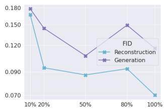
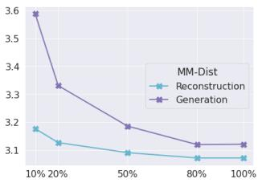
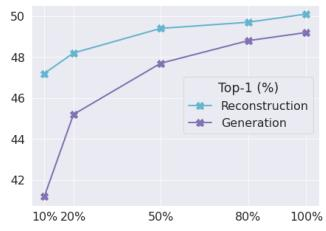
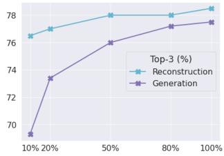

# T2M-GPT：基于离散表征从文本描述生成人体运动

Jianrong Zhang1,3∗, Yangsong Zhang2,3∗, Xiaodong Cun3, Shaoli Huang3, Yong Zhang3 Hongwei Zhao1, Hongtao Lu2, Xi Shen3,†

同等贡献 †通讯作者

1吉林大学 2上海交通大学 3腾讯 AI Lab

## 摘要

在这项工作中，我们研究了一个基于向量量化变分自编码器（Vector Quantised-Variational AutoEncoder，VQ-VAE）和生成式预训练变换器（Generative Pretrained Transformer，GPT）的简单且广为人知的条件生成框架，用于从文本描述生成人体运动。我们表明，采用常用训练策略（EMA 和 Code Reset）的简单基于 CNN 的 VQ-VAE 能够获得高质量的离散表征。对于 GPT，我们在训练过程中引入了一种简单的扰动（corruption）策略，以缓解训练与测试之间的差异。尽管方法简单，我们的 T2M-GPT 在性能上优于现有的竞争方法，包括近期基于扩散模型的方法。例如，在目前最大的数据集 HumanML3D 上，我们在文本与生成运动的一致性（R-Precision）方面取得了可比的性能，但 FID 仅为 0.116，大幅优于 MotionDiffuse 的 0.630。此外，我们在 HumanML3D 上进行了分析，观察到数据集规模是我们方法的一个限制。我们的研究表明，VQ-VAE 仍然是人体运动生成的一种具有竞争力的方法。我们的实现可在项目页面获取：https://mael-zys.github.io/T2M-GPT/。

## 1. 引言

从文本描述生成运动可在游戏行业、电影制作以及机器人动画中得到大量应用。例如，在游戏行业中获取新运动的典型方式是执行动作捕捉，但成本高昂。因此，自动从文本描述生成能够产生有意义运动数据的方法，可以节省时间并更具经济性。

以自然语言为条件的运动生成是具有挑战性的，因为运动和文本来自不同的模态。该模型需要学习从"a person walks quickly and intentionally in a zig-zag pattern forward"（"一个人快速且有意地以前进之字形路线行走"）的精确映射

  

一名男子起始时呈直立姿势，双臂向身体两侧水平伸开；随后他将双臂收回至身体两侧并将双掌合拢拍击；之后他向下并向左方向行走，并最终在该处的一张座椅上坐下。

  

真值标注（ground-truth）

  

我们的生成结果

图 1. 在 HumanML3D [22] 上的可视化结果。我们的方法能够生成与具有挑战性的文本描述一致的高质量、精确的人体运动。更多可视化结果请参见项目页面。

将语言空间映射到动作空间。为此，许多工作提出使用自编码器 [3, 21, 65] 和 VAE [52, 53] 来学习语言与动作的联合嵌入。MotionClip [65] 将动作空间对齐到 CLIP [55] 空间。ACTOR [52] 和 TEMOS [53] 分别提出了基于 Transformer 的 VAE，用于动作到动作（action-to-motion）和文本到动作（text-to-motion）任务。这些工作在简单描述下表现出良好的性能，但在文本描述变长变复杂时，生成高质量动作的能力受限。Guo 等人 [22] 和 TM2T [23] 旨在针对更具挑战性的文本描述生成动作序列。然而，这两种方法都不够直接，涉及文本到动作生成（text-to-motion generation）的三个阶段，并且有时无法生成与文本一致的高质量动作（见图 4 及项目页面上的更多可视化结果）。最近，基于扩散模型（diffusion-based model）[32] 在图像生成 [60] 方面取得了令人瞩目的成果，随后被引入动作生成领域，出现了 MDM [66] 和 MotionDiffuse [74]，并在文本到动作生成任务中占据主导地位。然而，我们发现，与经典方法（如 VQ-VAE [68]）相比，基于扩散模型的方法 [66, 74] 的性能提升可能并不那么显著。在本文中，我们受到学习用于生成的离散表示 [5, 15, 16, 19, 45, 58, 68, 70] 这一最新进展的启发，研究了一种基于向量量化变分自编码器（Vector Quantized Variational Autoencoder, VQ-VAE）[68] 和生成式预训练 Transformer（Generative Pre-trained Transformer, GPT）[56, 69] 的简单而经典的框架，用于文本到动作生成。

具体而言，我们提出了一种从文本描述生成动作的两阶段方法。在第 1 阶段，我们使用标准的 1 维卷积网络（1D convolutional network）将动作序列映射为离散码本索引（code index）。在第 2 阶段，训练一个标准的类 GPT 模型 [56, 69]，从预训练的文本嵌入生成码本索引序列。我们发现，VQ-VAE [68] 的朴素训练存在码本坍塌（code collapse）问题。一个有效的解决方案是在训练期间使用两种标准技巧：EMA（指数移动平均）和码本重置（Code Reset）。我们给出了对不同量化策略的完整分析。对于 GPT，下一标记预测（next token prediction）在训练与推理之间存在不一致性。我们观察到，在训练期间简单地扰动序列即可缓解这种差异。此外，纵观图像生成的发展历程，数据集的规模一直起着重要作用。我们进一步探讨了数据集规模对我们模型性能的影响。实证分析表明，使用更大规模的数据集有望进一步提升我们模型的性能。

尽管方法简单，我们的方案仍能生成与具有挑战性的文本描述相一致的高质量运动序列（见图1及项目页面）。在两个广泛使用的数据集HumanML3D [22]和KIT-ML [54]上，我们的方法经验性地取得了与同期基于扩散的方法MDM [66]和HumanDiffuse [74]相当乃至更优的性能。例如，在目前规模最大的数据集HumanML3D上，我们在文本与生成运动的一致性（R-Precision）方面达到了可比的性能，但FID指标达到0.116，大幅优于MotionDiffuse的0.630。我们进行了全面的实验来探索该领域，并希望这些实验和结论能够对未来的发展有所贡献。

综上所述，我们的贡献包括：

• 我们提出了一种简单而有效的基于文本描述的运动生成方法。我们的方法在HumanML3D [22]和KIT-ML [54]数据集上达到了最先进的性能。

• 我们证明，融合离散表示的类GPT模型仍然是运动生成领域中一种极具竞争力的方法。

• 我们对量化策略与数据集规模的影响进行了详细分析，并展示了更大规模的数据集仍可能为研究界提供有前景的发展机遇。

我们的实现代码已在项目页面公开。

## 2. 相关工作

VQ-VAE。向量量化变分自编码器（Vector Quantized Variational Autoencoders, VQ-VAE）是VAE [36]的一种变体，最早由[68]提出。VQ-VAE由自编码器（AutoEncoder）架构组成，旨在通过离散表示学习重建。最近，VQ-VAE在跨模态的生成任务中取得了出色的表现，包括：图像合成 [19, 70]、文本到图像生成 [58]、语音手势生成 [5]、音乐生成 [15, 16]等。VQ-VAE在生成任务上的成功可能归功于其对离散表示的学习与先验建模的解耦。VQ-VAE的朴素训练会遭受码本坍缩（codebook collapse）问题，即只有少数码字被激活，这严重限制了重建以及生成性能。为缓解该问题，训练时可采用多种技巧，包括通过梯度截断（stop-gradient）配合若干损失函数 [68] 来优化码本、采用指数移动平均（Exponential Moving Average, EMA）更新码本 [70]、在训练过程中重置未被激活的码字（Code Reset [70]）等。

人体运动合成。人体运动合成的研究历史悠久[8]。其中最活跃的研究方向之一是人体运动预测，其目标是基于过去观察到的运动来预测未来的运动序列。现有方法主要聚焦于如何通过不同的模型高效且有效地融合空间与时间信息，从而生成确定性的未来运动：RNN [12,20,50,51]、GAN [9,30]、GCN [49]、Attention [48]，甚至简单的 MLP [11, 17, 25]。一些方法旨在通过 VAE 生成多样化的运动[4, 26, 73]。除了基于过去运动进行条件合成之外，另一个相关主题是生成运动"插值（in-betweening）"，即同时给定过去与未来的姿态，并填充二者之间的运动[18,27,28,35,64]。[51] 考虑从给定轨迹生成简单动作（如行走和跑步）的运动序列。运动也可以与音乐结合以生成三维舞蹈动作[6,13,37,38,40,41]。对于无约束的生成任务，[72] 通过变换从高斯过程采样的潜变量序列，一次性生成一个长序列。在图形学文献中，许多工作聚焦于动画师控制。Holden 等人[34] 学习了一个卷积自编码器（convolutional autoencoder）来重建运动，所学到的潜空间表示可用于合成与编辑运动。[33] 提出了相位函数神经网络（phase functioned neural network）来执行控制任务。[63] 使用深度自回归框架（deep auto-regressive framework）来生成场景交互行为。Starke 等人[62] 提出通过周期性特征重建运动，学到的周期性嵌入提升了运动合成的效果。最近，受用于图像合成的 SinGAN [61] 的启发，Li 等人[39] 提出了一种用于从单个序列生成运动的生成模型方法。

  

图 2. 我们的文本驱动动作生成框架概览。该框架包含两个模块：Motion VQ-VAE（见图 2a）和 T2M-GPT（见图 2b）。在 T2M-GPT 中，额外插入了一个可学习的 End（结束）标记，用于指示生成过程的终止。在推理阶段，我们首先以自回归方式生成码本索引，然后利用 Motion VQ-VAE 中的解码器得到动作。

文本驱动的人体运动生成。文本驱动的人体运动生成旨在根据文本描述生成三维人体运动。Text2Action [2] 训练了一个基于 RNN 的模型，以根据短文本生成运动。Language2Pose [3] 采用课程学习方法，学习文本与姿态的联合嵌入空间；其解码器因此能够接受文本嵌入并生成运动序列。Ghost 等人 [21] 学习上半身与下半身运动的两种流形表示，相比 Language2Pose [3] 取得了更好的性能。类似地，MotionCLIP [65] 同样致力于对齐文本与运动嵌入，但提出使用 CLIP [55] 作为文本编码器，并以渲染图像作为额外监督。该方法具备生成分布外（out-of-distribution）运动以及支持潜码编辑的能力。然而，其生成的运动序列质量不高，且缺乏全局平移。ACTOR [52] 提出了一种基于 Transformer 的 VAE，以非自回归方式从预定义的动作类别生成运动。TEMOS [53] 通过引入额外的文本编码器扩展了 ACTOR [52] 的架构，并能够在给定文本描述时生成多样化的运动序列。TEMOS 在以短句为主的 KIT Motion-Language [54] 上验证了其效果，但仍受到分布外描述的困扰 [53]。TEACH [7] 进一步扩展了 TEMOS，使其能够根据一系列自然语言描述生成时序运动组合。最近，文献 [22] 提出了大规模数据集 HumanML3D。Guo 等人 [22] 还提出将运动长度预测融入模型，以生成长度合理的运动。TM2T [23] 同时考虑文本到运动和运动到文本两个任务，并表明通过对两个任务进行联合训练可以获得进一步的性能提升。作为同期工作，MDM [66] 和 MotionDiffuse [74] 将基于扩散的模型引入文本到运动生成任务。在本工作中，我们证明无需任何精巧设计，仅依靠经典框架配合若干标准训练策略，经典的 VQ-VAE 框架即可取得具有竞争力甚至更优的性能。

## 3. 方法

我们的目标是生成与文本描述一致的高质量运动。如图 2 所示，整体框架由两个模块组成：Motion VQ-VAE 与 T2M-GPT。前者学习运动数据与离散码序列之间的映射，后者根据文本描述生成码索引。借助 Motion VQ-VAE 的解码器，我们能够从码索引恢复出相应的运动。第 3.1 节将介绍 VQ-VAE 模块，T2M-GPT 则在第 3.2 节介绍。

## 3.1. Motion VQ-VAE

VQ-VAE 在文献 [68] 中提出，使模型能够为生成模型学习离散表示。给定一个运动序列 $X = [ x _ { 1 } , x _ { 2 } , \dots , x _ { T } ]$，其中 $\boldsymbol { x } _ { t } \in \mathbb { R } ^ { d }$，T 为帧数，d 为运动维度，我们的目标是通过一个自编码器（autoencoder）和一个包含 K 个码（code）的可学习码本（codebook）来重建该运动序列，记为 $C = \{ c _ { k } \} _ { k = 1 } ^ { K }$，其中 $c _ { k } \in \mathbb { R } ^ { d _ { c } }$，$d _ { c }$ 为码的维度。VQ-VAE 的整体结构如图 2a 所示。设自编码器的编码器（encoder）和解码器（decoder）分别为 E 和 D，潜在特征 $Z$ 可通过 $Z = E ( X )$ 计算得到，其中 $Z = [ z _ { 1 } , z _ { 2 } , . . . , z _ { T / l } ]$，$z _ { i } \in \mathbb { R } ^ { d _ { c }}$，l 表示编码器 E 的时间下采样率。对于第 i 个潜在特征 $z _ { i }$，通过 C 进行的量化是在 $C$ 中寻找最相似的元素，可形式化地写作：

  

图 3. 运动 VQ-VAE 的架构。我们采用基于 CNN 的标准架构，其中包含一维卷积（Conv1D）、残差块（ResBlock）和 ReLU 激活函数。$\cdot _ { L }$ 表示残差块的数量。我们使用步长为 2 的卷积和最近邻插值来进行时间维度的下采样与上采样。

$$
\hat {z} _ {i} = \underset {c _ {k} \in C} {\arg \min} \| z _ {i} - c _ {k} \| _ {2}\tag{1}
$$

优化目标。为了优化 VQ-VAE，标准的优化目标 [68] $\mathcal { L } _ { \mathrm { v q } }$ 包含三个组成部分：重建损失 $\mathcal { L } _ { \mathrm { r e } } .$、嵌入损失 $\mathcal { L } _ { e m b e d }$ 和承诺损失 $\mathcal { L } _ { c o m m i t }$

$$
\mathcal {L} _ {v q} = \mathcal {L} _ {r e} + \underbrace {| | s g [ Z ] - \hat {Z} | | _ {2}} _ {\mathcal {L} _ {e m b e d}} + \beta \underbrace {| | Z - s g [ \hat {Z} ] | | _ {2}} _ {\mathcal {L} _ {c o m m i t}}\tag{2}
$$

其中 $\beta$ 是承诺损失（commitment loss）的超参数，sg 为 stop-gradient 算子。对于重建，我们发现 L1 smooth 损失 $\mathcal{L}_1^{smooth}$ 表现最佳，并且对速度施加额外的正则化能够提升生成质量。

记 $X_{re}$ 为 $X$ 的重建动作，即 $X_{re} = D(\hat{Z})$，记 $V(X)$ 为 $X$ 的速度，其中 $V = [v_1, v_2, \ldots, v_{T-1}]$，且 $v_i = x_{i+1} - x_i$。因此，重建的目标函数如下：

$$
\mathcal {L} _ {r e} = \mathcal {L} _ {1} ^ {s m o o t h} (X, X _ {r e}) + \alpha \mathcal {L} _ {1} ^ {s m o o t h} (V (X), V (X _ {r e}))\tag{3}
$$

其中 α 是一个用于平衡两种损失函数的超参数。我们在附录 B 节中对 $L_1$、$L_1^{smooth}$ 与 $L_2$ 等不同重建损失以及 α 的选择进行了消融实验。

量化策略。对 VQ-VAE 进行朴素训练会遭受码本坍缩（codebook collapse）的问题 [59, 68]。文献中常用两种训练策略 [59] 来改善码本利用率：指数移动平均（Exponential Moving Average，EMA）与码本重置（Code Reset）。EMA 使码本 C 平滑演化：$C^t \gets \lambda C^{t-1} + (1-\lambda) C^t$，其中 $C^t$ 是第 t 次迭代时的码本，λ 是指数移动常数。Code Reset 在训练过程中查找未被激活的码字，并根据输入数据重新分配它们。我们在第 4.3 节中对量化策略进行了消融实验。

网络结构。我们采用一种简单的卷积架构，由一维卷积、残差块（residual block）[29] 与 ReLU 组成。我们的 VQ-VAE 网络结构如图 3 所示。该架构受文献 [19, 41] 的启发。我们分别采用步长为 2 的卷积和最近邻插值来实现时序上的下采样与上采样。因此下采样率为 $l = 2^L$，其中 L 表示残差块的数量。我们在第 4.3 节中对网络结构进行了消融实验。附录 F 节给出了网络结构的细节。

## 3.2. T2M-GPT

在学到动作 VQ-VAE 之后，一个动作序列 $X = [x_1, x_2, \dots, x_T]$ 可以被映射为一段索引序列 $S = [s_1, s_2, \ldots, s_{T/l}, End]$，其中 $s_i \in [1, 2, \ldots, s_{T/l}]$，它们均来自所学到的码本。请注意，我们添加了一个特殊的 End 符号来标识动作的结束，这与文献 [22] 不同——后者使用了一个额外的模块来预测动作长度。通过将 S 投影回它们对应的码本条目，我们得到 $\hat{Z} = [\hat{z}_1, \hat{z}_2, \dots, \hat{z}_{T/l}]$，其中 $\hat{z}_i = c_{s_i}$，并可通过解码器 $D$ 解码为动作 $X_{re}$。因此，文本到动作生成可以被形式化为一个自回归的下一索引预测任务：给定前 $i-1$ 个索引，即 $S_{<i}$，以及文本条件 c，我们的目标是预测可能的下一索引的分布 $p(S_i|c, S_{<i})$，这可以通过 Transformer [69] 来实现。我们所采用的 Transformer 的概览如图 2b 所示。

优化目标。将完整序列的似然记为 $p(S|c) = \prod_{i=1}^{|S|} p(S_i|c, S_{<i})$，我们直接最大化数据分布的对数似然：

$$
\mathcal {L} _ {t r a n s} = \mathbb {E} _ {S \sim p (S)} [ - \log p (S | c) ]\tag{4}
$$

我们利用 CLIP [55] 来提取文本嵌入 $c$，该方法已在相关任务 [14, 57, 65] 中展现出有效性。

因果自注意力（Causal Self-attention）。我们在 T2M-GPT 中应用因果自注意力 [56]。具体而言，因果自注意力的输出按如下方式计算：

$$
\text { Attention } = \text { Softmax } \left(\frac {Q K ^ {T} \times \text { mask }}{\sqrt {d _ {k}}}\right)\tag{5}
$$

<table><tr><td rowspan="2">Methods</td><td colspan="3">R-Precision ↑</td><td rowspan="2">FID ↓</td><td rowspan="2">MM-Dist ↓</td><td rowspan="2">Diversity ↑</td><td rowspan="2">MModality ↑</td></tr><tr><td>Top-1</td><td>Top-2</td><td>Top-3</td></tr><tr><td>Real motion</td><td> $0.511^{\pm.003}$ </td><td> $0.703^{\pm.003}$ </td><td> $0.797^{\pm.002}$ </td><td> $0.002^{\pm.000}$ </td><td> $2.974^{\pm.008}$ </td><td> $9.503^{\pm.065}$ </td><td>-</td></tr><tr><td>Our VQ-VAE (Recons.)</td><td> $0.501^{\pm.002}$ </td><td> $0.692^{\pm.002}$ </td><td> $0.785^{\pm.002}$ </td><td> $0.070^{\pm.001}$ </td><td> $3.072^{\pm.009}$ </td><td> $9.593^{\pm.079}$ </td><td>-</td></tr><tr><td>Seq2Seq [42]</td><td> $0.180^{\pm.002}$ </td><td> $0.300^{\pm.002}$ </td><td> $0.396^{\pm.002}$ </td><td> $11.75^{\pm.035}$ </td><td> $5.529^{\pm.007}$ </td><td> $6.223^{\pm.061}$ </td><td>-</td></tr><tr><td>Language2Pose [3]</td><td> $0.246^{\pm.002}$ </td><td> $0.387^{\pm.002}$ </td><td> $0.486^{\pm.002}$ </td><td> $11.02^{\pm.046}$ </td><td> $5.296^{\pm.008}$ </td><td> $7.676^{\pm.058}$ </td><td>-</td></tr><tr><td>Text2Gesture [10]</td><td> $0.165^{\pm.001}$ </td><td> $0.267^{\pm.002}$ </td><td> $0.345^{\pm.002}$ </td><td> $5.012^{\pm.030}$ </td><td> $6.030^{\pm.008}$ </td><td> $6.409^{\pm.071}$ </td><td>-</td></tr><tr><td>Hier [21]</td><td> $0.301^{\pm.002}$ </td><td> $0.425^{\pm.002}$ </td><td> $0.552^{\pm.004}$ </td><td> $6.532^{\pm.024}$ </td><td> $5.012^{\pm.018}$ </td><td> $8.332^{\pm.042}$ </td><td>-</td></tr><tr><td>MoCoGAN [67]</td><td> $0.037^{\pm.000}$ </td><td> $0.072^{\pm.001}$ </td><td> $0.106^{\pm.001}$ </td><td> $94.41^{\pm.021}$ </td><td> $9.643^{\pm.006}$ </td><td> $0.462^{\pm.008}$ </td><td> $0.019^{\pm.000}$ </td></tr><tr><td>Dance2Music [37]</td><td> $0.033^{\pm.000}$ </td><td> $0.065^{\pm.001}$ </td><td> $0.097^{\pm.001}$ </td><td> $66.98^{\pm.016}$ </td><td> $8.116^{\pm.006}$ </td><td> $0.725^{\pm.011}$ </td><td> $0.043^{\pm.001}$ </td></tr><tr><td>TEMOS§ [53]</td><td> $0.424^{\pm.002}$ </td><td> $0.612^{\pm.002}$ </td><td> $0.722^{\pm.002}$ </td><td> $3.734^{\pm.028}$ </td><td> $3.703^{\pm.008}$ </td><td> $8.973^{\pm.071}$ </td><td> $0.368^{\pm.018}$ </td></tr><tr><td>TM2T [23]</td><td> $0.424^{\pm.003}$ </td><td> $0.618^{\pm.003}$ </td><td> $0.729^{\pm.002}$ </td><td> $1.501^{\pm.017}$ </td><td> $3.467^{\pm.011}$ </td><td> $8.589^{\pm.076}$ </td><td> $2.424^{\pm.093}$ </td></tr><tr><td>Guo et al. [22]</td><td> $0.455^{\pm.003}$ </td><td> $0.636^{\pm.003}$ </td><td> $0.736^{\pm.002}$ </td><td> $1.087^{\pm.021}$ </td><td> $3.347^{\pm.008}$ </td><td> $9.175^{\pm.083}$ </td><td> $2.219^{\pm.074}$ </td></tr><tr><td>MLD§ [71]</td><td> $0.481^{\pm.003}$ </td><td> $0.673^{\pm.003}$ </td><td> $0.772^{\pm.002}$ </td><td> $0.473^{\pm.013}$ </td><td> $3.196^{\pm.010}$ </td><td> $9.724^{\pm.082}$ </td><td> $2.413^{\pm.079}$ </td></tr><tr><td>MDM§ [66]</td><td>-</td><td>-</td><td> $0.611^{\pm.007}$ </td><td> $0.544^{\pm.044}$ </td><td> $5.566^{\pm.027}$ </td><td> $9.559^{\pm.086}$ </td><td> $2.799^{\pm.072}$ </td></tr><tr><td>MotionDiffuse§ [74]</td><td> $0.491^{\pm.001}$ </td><td> $0.681^{\pm.001}$ </td><td> $0.782^{\pm.001}$ </td><td> $0.630^{\pm.001}$ </td><td> $3.113^{\pm.001}$ </td><td> $9.410^{\pm.049}$ </td><td> $1.553^{\pm.042}$ </td></tr><tr><td>Our GPT ( $\tau = 0$ )</td><td> $0.417^{\pm.003}$ </td><td> $0.589^{\pm.002}$ </td><td> $0.685^{\pm.003}$ </td><td> $0.140^{\pm.006}$ </td><td> $3.730^{\pm.009}$ </td><td> $9.844^{\pm.095}$ </td><td> $3.285^{\pm.070}$ </td></tr><tr><td>Our GPT ( $\tau = 0.5$ )</td><td> $0.491^{\pm.003}$ </td><td> $0.680^{\pm.003}$ </td><td> $0.775^{\pm.002}$ </td><td> $0.116^{\pm.004}$ </td><td> $3.118^{\pm.011}$ </td><td> $9.761^{\pm.081}$ </td><td> $1.856^{\pm.011}$ </td></tr><tr><td>Our GPT ( $\tau \in \mathcal{U}[0,1]$ )</td><td> $0.492^{\pm.003}$ </td><td> $0.679^{\pm.002}$ </td><td> $0.775^{\pm.002}$ </td><td> $0.141^{\pm.005}$ </td><td> $3.121^{\pm.009}$ </td><td> $9.722^{\pm.082}$ </td><td> $1.831^{\pm.048}$ </td></tr></table>

表 1. 在 HumanML3D [22] 测试集上与现有最先进方法的对比。我们遵循 Guo 等人 [22] 的方法计算标准指标。对于每个指标，我们重复评估 20 次，并报告 95% 置信区间下的平均值。红色和蓝色分别表示最佳结果和次佳结果。§ 表示使用真实运动长度（ground-truth motion length）的结果。

其中 $Q \in \mathbb { R } ^ { T \times d _ { k } }$ 和 $K \in \mathbb { R } ^ { T \times d _ { k } }$ 分别是查询（query）和键（key），mask 为因果掩码（causal mask），其定义为 $\begin{array} { r } { m a s k _ { i , j } = } \end{array}$ $- \infty \times \mathbf { 1 } \left( i < j \right) + \mathbf { 1 } \left( i \geq j \right)$，其中 1(·) 为指示函数。该因果掩码确保未来信息不会参与当前 token 的计算。在推理阶段，我们从文本嵌入出发，以自回归方式生成索引；若模型预测出 End token，则生成过程停止。值得注意的是，我们能够通过对 Transformer 给出的预测分布进行采样来生成多样化的运动。

讨论见第 4.3 节。

## 4.1. 数据集与评价指标

我们在两个用于文本驱动运动生成的标准数据集上进行实验：HumanML3D [22] 和 KIT Motion-Language (KIT-ML) [54]。这两个数据集均为社区中的常用数据集。我们遵循 [22] 中提出的评估协议。

用于缓解训练-测试差异的损坏序列。训练与测试之间存在差异。在训练阶段，使用前 i − 1 个正确的索引来预测下一个索引。而在推理阶段，作为条件的索引并不能保证是正确的。为解决该问题，我们采用了一种简单的数据增强策略：在训练过程中，将 $\tau \times 1 0 0 \%$ 的真实代码索引替换为随机索引。τ 可以是一个超参数，也可以从 $\tau \in \mathcal { U } [ 0 , 1 ]$ 中随机采样。我们将在附录 C 节中对该策略进行消融研究。

## 4. 实验

本节展示我们的实验结果。第 4.1 节介绍标准数据集以及评价指标。第 4.2 节将我们的结果与竞争方法进行对比。最后，我们提供分析与

KIT Motion-Language (KIT-ML)。KIT-ML [54] 包含 3,911 个人体运动序列和 6,278 条文本标注。词汇总量（即不区分大小写和标点的情况下不同单词的数量）为 1,623。运动序列选自 KIT [47] 和 CMU [1] 数据集，但下采样至每秒 12.5 帧（FPS）。每个运动序列配有 1 到 4 句描述，描述的平均长度约为 8。参照 [22, 23]，数据集按 80%、5%、15% 的比例划分为训练集、验证集和测试集。我们选择在验证集上取得最佳 FID 的模型，并在测试集上报告其性能。

HumanML3D。HumanML3D [22] 是目前最大的、带有文本描述的 3D 人体运动数据集。该数据集包含 14,616 个人体运动和 44,970 条文本描述。所有文本描述共由 5,371 个不同的单词组成。运动序列原本来自 AMASS [46] 和 HumanAct12 [24]，但经过了特定的预处理：运动被缩放为 20 FPS；时长超过 10 秒的运动被随机裁剪为 10 秒长；随后被重新定向到默认的人体骨骼模板，并被适当旋转，使初始朝向为 Z+ 方向。每个运动至少配有 3 条精确的文本描述，描述的平均长度约为 12。根据 [22]，数据集按 80%、5%、15% 的比例划分为训练集、验证集和测试集。我们选择在验证集上取得最佳 FID 的模型，并在测试集上报告其性能。

<table><tr><td rowspan="2">Methods</td><td colspan="3">R-Precision ↑</td><td rowspan="2">FID ↓</td><td rowspan="2">MM-Dist ↓</td><td rowspan="2">Diversity ↑</td><td rowspan="2">MModality ↑</td></tr><tr><td>Top-1</td><td>Top-2</td><td>Top-3</td></tr><tr><td>Real motion</td><td> $0.424^{\pm .005}$ </td><td> $0.649^{\pm .006}$ </td><td> $0.779^{\pm .006}$ </td><td> $0.031^{\pm .004}$ </td><td> $2.788^{\pm .012}$ </td><td> $11.08^{\pm .097}$ </td><td>-</td></tr><tr><td>Our VQ-VAE (Recons.)</td><td> $0.399^{\pm .005}$ </td><td> $0.614^{\pm .005}$ </td><td> $0.740^{\pm .006}$ </td><td> $0.472^{\pm .011}$ </td><td> $2.986^{\pm .027}$ </td><td> $10.994^{\pm .120}$ </td><td>-</td></tr><tr><td>Seq2Seq [42]</td><td> $0.103^{\pm .003}$ </td><td> $0.178^{\pm .005}$ </td><td> $0.241^{\pm .006}$ </td><td> $24.86^{\pm .348}$ </td><td> $7.960^{\pm .031}$ </td><td> $6.744^{\pm .106}$ </td><td>-</td></tr><tr><td>Language2Pose [3]</td><td> $0.221^{\pm .005}$ </td><td> $0.373^{\pm .004}$ </td><td> $0.483^{\pm .005}$ </td><td> $6.545^{\pm .072}$ </td><td> $5.147^{\pm .030}$ </td><td> $9.073^{\pm .100}$ </td><td>-</td></tr><tr><td>Text2Gesture [10]</td><td> $0.156^{\pm .004}$ </td><td> $0.255^{\pm .004}$ </td><td> $0.338^{\pm .005}$ </td><td> $12.12^{\pm .183}$ </td><td> $6.964^{\pm .029}$ </td><td> $9.334^{\pm .079}$ </td><td>-</td></tr><tr><td>Hier [21]</td><td> $0.255^{\pm .006}$ </td><td> $0.432^{\pm .007}$ </td><td> $0.531^{\pm .007}$ </td><td> $5.203^{\pm .107}$ </td><td> $4.986^{\pm .027}$ </td><td> $9.563^{\pm .072}$ </td><td>-</td></tr><tr><td>MoCoGAN [67]</td><td> $0.022^{\pm .002}$ </td><td> $0.042^{\pm .003}$ </td><td> $0.063^{\pm .003}$ </td><td> $82.69^{\pm .242}$ </td><td> $10.47^{\pm .012}$ </td><td> $3.091^{\pm .043}$ </td><td> $0.250^{\pm .009}$ </td></tr><tr><td>Dance2Music [37]</td><td> $0.031^{\pm .002}$ </td><td> $0.058^{\pm .002}$ </td><td> $0.086^{\pm .003}$ </td><td> $115.4^{\pm .240}$ </td><td> $10.40^{\pm .016}$ </td><td> $0.241^{\pm .004}$ </td><td> $0.062^{\pm .002}$ </td></tr><tr><td>TEMOS§ [53,71]</td><td> $0.353^{\pm .002}$ </td><td> $0.561^{\pm .002}$ </td><td> $0.687^{\pm .002}$ </td><td> $3.717^{\pm .028}$ </td><td> $3.417^{\pm .008}$ </td><td> $10.84^{\pm .071}$ </td><td> $0.532^{\pm .018}$ </td></tr><tr><td>TM2T [23]</td><td> $0.280^{\pm .006}$ </td><td> $0.463^{\pm .007}$ </td><td> $0.587^{\pm .005}$ </td><td> $3.599^{\pm .051}$ </td><td> $4.591^{\pm .019}$ </td><td> $9.473^{\pm .100}$ </td><td> $3.292^{\pm .034}$ </td></tr><tr><td>Guo et al. [22]</td><td> $0.361^{\pm .006}$ </td><td> $0.559^{\pm .007}$ </td><td> $0.681^{\pm .007}$ </td><td> $3.022^{\pm .107}$ </td><td> $3.488^{\pm .028}$ </td><td> $10.72^{\pm .145}$ </td><td> $2.052^{\pm .107}$ </td></tr><tr><td>MLD§ [71]</td><td> $0.390^{\pm .008}$ </td><td> $0.609^{\pm .008}$ </td><td> $0.734^{\pm .007}$ </td><td> $0.404^{\pm .027}$ </td><td> $3.204^{\pm .027}$ </td><td> $10.80^{\pm .117}$ </td><td> $2.192^{\pm .071}$ </td></tr><tr><td>MDM§ [66]</td><td>-</td><td>-</td><td> $0.396^{\pm .004}$ </td><td> $0.497^{\pm .021}$ </td><td> $9.191^{\pm .022}$ </td><td> $10.847^{\pm .109}$ </td><td> $1.907^{\pm .214}$ </td></tr><tr><td>MotionDiffuse§ [74]</td><td> $0.417^{\pm .004}$ </td><td> $0.621^{\pm .004}$ </td><td> $0.739^{\pm .004}$ </td><td> $1.954^{\pm .062}$ </td><td> $2.958^{\pm .005}$ </td><td> $11.10^{\pm .143}$ </td><td> $0.730^{\pm .013}$ </td></tr><tr><td>Our GPT ( $\tau = 0$ )</td><td> $0.392^{\pm .007}$ </td><td> $0.600^{\pm .007}$ </td><td> $0.716^{\pm .006}$ </td><td> $0.737^{\pm .049}$ </td><td> $3.237^{\pm .027}$ </td><td> $11.198^{\pm .086}$ </td><td> $2.309^{\pm .055}$ </td></tr><tr><td>Our GPT ( $\tau = 0.5$ )</td><td> $0.402^{\pm .006}$ </td><td> $0.619^{\pm .005}$ </td><td> $0.737^{\pm .006}$ </td><td> $0.717^{\pm .041}$ </td><td> $3.053^{\pm .026}$ </td><td> $10.862^{\pm .094}$ </td><td> $1.912^{\pm .036}$ </td></tr><tr><td>Our GPT ( $\tau \in \mathcal{U}[0,1]$ )</td><td> $0.416^{\pm .006}$ </td><td> $0.627^{\pm .006}$ </td><td> $0.745^{\pm .006}$ </td><td> $0.514^{\pm .029}$ </td><td> $3.007^{\pm .023}$ </td><td> $10.921^{\pm .108}$ </td><td> $1.570^{\pm .039}$ </td></tr></table>

Table 2. 与最先进方法在 KIT-ML [54] 测试集上的对比。我们按照 Guo 等人 [22] 的方式计算标准指标。对于每个指标，我们重复评估 20 次，并报告平均值及 95% 置信区间。红色和蓝色表示最佳和次佳结果。§ 表示使用真实动作长度（ground-truth motion length）所得到的结果。

实现细节（Implementation details）。对于 Motion VQ-VAE，码本（codebook）大小设置为 512 × 512，下采样率 $l$ 为 4。关于码本数量（number of codes）的消融实验见附录 D 部分。对于 HumanML3D [22] 和 KIT-ML [54] 两个数据集，动作序列在训练时被裁剪到 $T = 6 4$。我们使用 AdamW [44] 优化器，其中 $[\beta _1{,}\beta _2] = [0.9{,}0.9 9]$，批量大小（batch size）为 256，指数移动常数 $\lambda = 0.9 9$。前 200K 次迭代以学习率 $2 \mathrm{e} {\cdot} 4$ 训练，后续 100K 次迭代以学习率 $1\mathrm{e}{-5}$ 训练。$\mathcal{L}_{\mathrm{vq}}$ 和 ${\mathcal{L}}_{\mathrm{re}}$ 中的 $\beta$ 和 $\alpha$ 分别设置为 0.02 和 0.5。按照 [22] 的做法，KIT-ML 和 HumanML3D 数据集被提取为维度分别为 251 和 263 的动作特征，这些特征对应根空间下的局部关节位置、速度与旋转，以及全局平移与旋转。这些特征由 SMPL [43] 的 21 个和 22 个关节计算得到。更多关于动作表示的细节见附录 E 部分。

对于 T2M-GPT，我们采用 18 层 Transformer [69]，维度为 1,024，头数为 16。关于不同规模 Transformer 的消融实验见附录 A 部分。按照 Guo 等人 [22] 的设置，两个数据集上动作的最大长度均为 196，HumanML3D [22] 和 KIT-ML [54] 的最小长度分别为 40 和 24。码本索引序列（code index sequence）的最大长度为 $T^{\prime} = 5 0$。我们额外训练一个 End token 作为停止生成索引的信号。Transformer 使用 AdamW [44] 进行优化，其中 $[\beta _1{,}\beta _2] = [0.5{,}0.9 9]$，批量大小为 128。初始学习率在前 150K 次迭代中设置为 $1\mathrm{e}{-4}$，在后 150K 次迭代中衰减至 $5\mathrm{e}{-6}$。在单块 Tesla V100-32G GPU 上，Motion VQ-VAE 和 T2M-GPT 的训练时间分别约为 14 小时和 78 小时。

评估指标（Evaluation metric）。按照 [22] 的做法，首先使用 [22] 中的预训练网络提取动作和文本描述的全局表示（global representations），然后通过以下五个指标进行度量：

- R-Precision。给定一个动作序列和 32 条文本描述（1 条真实描述和 31 条随机选取的不匹配描述），我们对动作与文本嵌入之间的欧氏距离进行排序，并报告动作到文本检索的 Top-1、Top-2 和 Top-3 准确率。

- Frechet Inception Distance（FID）。我们计算生成样本与真实样本在特征空间中的分布距离，"a man steps forward and does a handstand

  

图4. 在 HumanML3D [22] 数据集上的可视化结果。我们将本文方法的生成结果与 Guo 等人 [22]、MotionDiffuse [74] 和 MDM [66] 进行了对比。失真的动作（红色）与脚部滑动（黄色）已高亮标出。更多可视化结果可在项目主页查看。

motion using FID [31] on the extracted motion features.

## 4.2. Comparison to state-of-the-art approaches

• 多模态距离（Multimodal Distance, MM-Dist）。每个文本特征与由该文本生成的运动特征之间的平均欧氏距离。

• 多样性（Diversity）。从一组运动中随机抽取 300 对运动，提取运动特征并计算这些对的平均欧氏距离，以此衡量该组运动的多样性。

• 多模态性（Multimodality, MModality）。对一段文本描述，我们生成 20 个运动序列，构成 10 对运动，提取运动特征并计算这些对的平均欧氏距离，最终报告所有文本描述上的平均值。

关于评估指标的更多细节见附录第 E 节。

## 4.2. 与最先进方法的对比

定量结果。我们在 HumanML3D [22] 测试集和 KIT-ML [54] 测试集上的对比结果分别见表 1 和表 2。在两个数据集上，我们使用 VQ-VAE 的重建性能都接近真实运动，这表明我们的 VQ-VAE 学到了高质量的离散表示。在生成方面，我们的方法在文本-运动一致性（R-Precision 和 MM-Dist）上与最先进的方法 MotionDiffuse [74] 取得了相当的性能，同时在 FID 指标上显著优于 MotionDiffuse。KIT-ML [54] 和 HumanML3D [22] 的数据规模不同，这体现了所提方法的鲁棒性。在 GPT 训练过程中人为扰乱序列带来了一致的性能提升（τ = 0.5 对比 τ = 0）。更详细的分析见附录第 C 节。与 Guo 等人 [22] 使用额外模块来预测运动长度不同，我们通过添加一个额外的 End 标记来隐式地学习运动长度，这种方式更为直接，且被证明更有效。需要注意的是，MDM [66] 和 MotionDiffuse [74] 在评估模型时使用了真实运动长度，这在实际应用中并不现实。

<table><tr><td colspan="2">Quantizer</td><td colspan="2">Reconstruction</td><td colspan="2">Generation</td></tr><tr><td>Code Reset</td><td>EMA</td><td>FID ↓</td><td>Top-1 ↑</td><td>FID ↓</td><td>Top-1 ↑</td></tr><tr><td></td><td></td><td> $0.492^{\pm .004}$ </td><td> $0.436^{\pm .003}$ </td><td> $42.797^{\pm .156}$ </td><td> $0.048^{\pm .001}$ </td></tr><tr><td></td><td>✓</td><td> $0.097^{\pm .001}$ </td><td> $0.499^{\pm .002}$ </td><td> $0.176^{\pm .008}$ </td><td> $0.490^{\pm .002}$ </td></tr><tr><td>✓</td><td></td><td> $0.102^{\pm .001}$ </td><td> $0.494^{\pm .003}$ </td><td> $0.248^{\pm .009}$ </td><td> $0.461^{\pm .002}$ </td></tr><tr><td>✓</td><td>✓</td><td> $0.070^{\pm .001}$ </td><td> $0.501^{\pm .002}$ </td><td> $0.116^{\pm .004}$ </td><td> $0.491^{\pm .003}$ </td></tr></table>

Table 3. VQ-VAE 量化器在 HumanML3D [22] 测试集上的分析。对于所有量化器，我们设定 τ = 0.5，并使用第 4.1 节中描述的相同架构（VQ-VAE 和 GPT）。我们报告重建和生成两个任务上的 FID 和 Top-1。对于每个指标，我们重复评估 20 次，并报告 95% 置信区间下的平均值。

定性比较。图 4 展示了在 HumanML3D [22] 上的可视化结果。我们将我们的生成结果与当前最先进的模型进行比较：Guo 等人 [22]、MDM [66] 和 MotionDiffuse [74]。从图 4 的示例中可以看出，我们的模型生成的运动质量优于其他模型，我们用红色高亮标出了 Guo 等人 [22] 和 Motion-Diffuse [74] 生成的不真实运动。此外，MDM [66] 生成的运动与文本描述不相关。请注意，更多的可视化结果和失败案例已在项目页面上提供。

## 4.3. 讨论

量化策略。我们首先研究第 3.1 节中介绍的不同量化策略的影响。表 3 展示了重建和生成两个任务的结果。我们注意到朴素的 VQ-VAE 训练既无法重建也无法生成高质量的运动。然而，使用 EMA 或 Code Reset 进行训练可以显著提升重建和生成两个任务的性能。

数据集规模的影响。我们进一步分析数据集规模的影响。为了理解最大的数据集 HumanML3D [22] 是否包含足够的数据用于运动生成，我们在不同的训练数据子集上训练我们的运动 VQ-VAE 和 T2M-GPT，这些子集分别包含训练数据的 10%、20%、50%、80% 和 100%。训练后的模型在整个测试集上进行评估。图 5 展示了结果。我们使用四个指标评估运动 VQ-VAE 的重建性能以及 T2M-GPT 的生成性能：FID、MM-Dist、Top-1 和 Top-3 准确率。可以得出以下几点见解：i) 运动质量指标（FID）和运动-文本一致性指标（MM-Dist、Top-1 和 Top-3）应同时考虑。

  

（a）FID

  

(b) MM-Dist
(c) Top-1 准确率
(d) Top-3 准确率

图 5. 数据集规模对 HumanML3D [22] 的影响。我们在 HumanML3D [22] 的子集（分别由 10%、20%、50%、80% 和 100% 的训练集组成）上训练我们的运动 VQ-VAE（重建）和 T2M-GPT（生成）。所有模型均在完整测试集上进行评估。我们报告了所有模型的 FID、MM-Dist、Top-1 和 Top-3 准确率。结果表明，我们的模型可能受益于更多的训练数据。

在仅有 10% 数据的情况下，生成的动作或许质量尚可，但模型无法生成与文本描述相对应的正确动作；ii）随着训练数据量的增加，性能也随之提升。这一趋势表明，额外的训练数据可为重建与生成二者带来不可忽视的改进。

## 5. 结论（Conclusion）

在本工作中，我们研究了一种基于 VQ-VAE 与 GPT 的经典框架，用于从文本描述合成人体动作。我们的方法取得了与同期基于扩散的方法相当乃至更优的性能，这表明该经典框架仍然是动作生成领域中极具竞争力的方法。我们详细探讨了多种量化策略对动作重建与生成的影响。此外，我们还对数据集规模进行了分析。我们的发现表明，更大的数据集仍可为我们的方法带来额外的改进。

致谢（Acknowledgement） 我们感谢 Mathis Petrovich、Yuming Du、Yingyi Chen、Dexiong Chen 和 Xuelin Chen 提出的启发性讨论和宝贵反馈。本论文受中国国家自然科学基金（No. 62176155）及吉林省（20200201037JC）等资助。更多资助信息见附录 H 节。

## 参考文献（References）

[1] CMU graphics lab motion capture database. http://mocap.cs.cmu.edu/. 访问日期：2022-11-11. 5

[2] Hyemin Ahn, Timothy Ha, Yunho Choi, Hwiyeon Yoo, and Songhwai Oh. Text2action：从语言到动作的生成对抗式合成（Text2action: Generative Adversarial Synthesis from Language to Action）。发表于：国际机器人与自动化会议（ICRA），2018 年。3

[3] Chaitanya Ahuja and Louis-Philippe Morency. Language2pose：基于自然语言 grounding 的姿态预测（Language2pose: Natural Language Grounded Pose Forecasting）。发表于：国际三维视觉会议（3DV），2019 年。1, 3, 5, 6

[4] Sadegh Aliakbarian, Fatemeh Sadat Saleh, Mathieu Salzmann, Lars Petersson, and Stephen Gould. 用于多样化人体动作预测的随机条件方案（A Stochastic Conditioning Scheme for Diverse Human Motion Prediction）。发表于：计算机视觉与模式识别会议论文集（CVPR），2020 年。2

[5] Tenglong Ao, Qingzhe Gao, Yuke Lou, Baoquan Chen, and Libin Liu. Rhythmic Gesticulator：基于层次化神经嵌入的节律感知协同语音手势合成（Rhythmic Gesticulator: Rhythm-Aware Co-Speech Gesture Synthesis with Hierarchical Neural Embeddings）。发表于：SIGGRAPH Asia，2022 年。2

[6] Andreas Aristidou, Anastasios Yiannakidis, Kfir Aberman, Daniel Cohen-Or, Ariel Shamir, and Yiorgos Chrysanthou. 节奏即舞者：具有全局结构的音乐驱动动作合成（Rhythm is a Dancer: Music-Driven Motion Synthesis with Global Structure）。arXiv，2021 年。2

[7] Nikos Athanasiou, Mathis Petrovich, Michael J. Black, and Gul Varol. TEACH：三维人体的时序动作构成（TEACH: Temporal Action Compositions for 3D Humans）。发表于：国际三维视觉会议（3DV），2022 年。3

[8] Norman I Badler, Cary B Phillips, and Bonnie Lynn Webber. 模拟人类：计算机图形动画与控制（Simulating Humans: Computer Graphics Animation and Control）。Oxford University Press，1993 年。2

[9] Emad Barsoum, John Kender, and Zicheng Liu. HP-GAN：通过生成对抗网络进行概率性三维人体动作预测（HP-GAN: Probabilistic 3D Human Motion Prediction via GAN）。发表于：计算机视觉与模式识别研讨会论文集（CVPRW），2018 年。2

[10] Uttaran Bhattacharya, Nicholas Rewkowski, Abhishek Banerjee, Pooja Guhan, Aniket Bera, and Dinesh Manocha. Text2gestures：一种基于 Transformer 的网络，用于为虚拟智能体生成带情感的身体手势。发表于《虚拟现实与三维用户界面》（VR），2021年。5, 6

[11] Arij Bouazizi, Adrian Holzbock, Ulrich Kressel, Klaus Dietmayer, and Vasileios Belagiannis. MotionMixer：基于 MLP 的三维人体姿态预测。发表于《国际人工智能联合会议》（IJCAI），2022年。2

[12] Judith Butepage, Michael J Black, Danica Kragic, and Hedvig Kjellstrom. 用于人体运动预测与分类的深度表示学习。发表于《计算机视觉与模式识别会议论文集》（CVPR），2017年。2

[13] Kang Chen, Zhipeng Tan, Jin Lei, Song-Hai Zhang, Yuan-Chen Guo, Weidong Zhang, and Shi-Min Hu. ChoreoMaster：面向舞蹈编排的音乐驱动舞蹈合成。发表于《ACM 图形学汇刊》（TOG），2021年。2

[14] Katherine Crowson, Stella Biderman, Daniel Kornis, Dashiell Stander, Eric Hallahan, Louis Castricato, and Edward Raff. VQGAN-CLIP：基于自然语言引导的开放域图像生成与编辑。发表于《欧洲计算机视觉会议论文集》（ECCV），2022年。4

[15] Prafulla Dhariwal, Heewoo Jun, Christine Payne, Jong Wook Kim, Alec Radford, and Ilya Sutskever. Jukebox：一个音乐生成模型。arXiv 预印本，2020年。2

[16] Sander Dieleman, Aaron van den Oord, and Karen Simonyan. 真实感音乐生成的挑战：大规模建模原始音频。发表于《神经信息处理系统进展》（NeurIPS），2018年。2

[17] Yuming Du, Robin Kips, Albert Pumarola, Sebastian Starke, Ali Thabet, and Artsiom Sanakoyeu. 化身长出双腿：使用扩散模型从稀疏跟踪输入生成平滑的人体运动。发表于《计算机视觉与模式识别会议论文集》（CVPR），2023年。2

[18] Yinglin Duan, Tianyang Shi, Zhengxia Zou, Yenan Lin, Zhehui Qian, Bohan Zhang, and Yi Yuan. 基于 Transformer 的单次运动补全。arXiv 预印本，2021年。2

[19] Patrick Esser, Robin Rombach, and Bjorn Ommer. 驯服 Transformer 以实现高分辨率图像合成。发表于《计算机视觉与模式识别会议论文集》（CVPR），2021年。2, 4

[20] Katerina Fragkiadaki, Sergey Levine, Panna Felsen, and Jitendra Malik. 用于人体动力学的循环网络模型。发表于《国际计算机视觉会议论文集》（ICCV），2015年。2

[21] Anindita Ghosh, Noshaba Cheema, Cennet Oguz, Christian Theobalt, and Philipp Slusallek. 基于文本描述的组合式动画合成。发表于《国际计算机视觉会议论文集》（ICCV），2021年。1, 3, 5, 6

[22] Chuan Guo, Shihao Zou, Xinxin Zuo, Sen Wang, Wei Ji, Xingyu Li, and Li Cheng. 从文本生成多样且自然的三维人体运动。发表于《计算机视觉与模式识别会议论文集》（CVPR），2022年。1, 2, 3, 4, 5, 6, 7, 8, 12, 13

[23] Chuan Guo, Xinxin Zuo, Sen Wang, and Li Cheng. Tm2t：面向三维人体动作与文本相互生成的随机化与标记化建模。In Proceedings of the European Conference on Computer Vision (ECCV), 2022. 1, 3, 5, 6

[24] Chuan Guo, Xinxin Zuo, Sen Wang, Shihao Zou, Qingyao Sun, Annan Deng, Minglun Gong, and Li Cheng. Action2motion：三维人体动作的条件生成。In Proceedings of the ACM International Conference on Multimedia (ACMMM), 2020. 5

[25] Wen Guo, Yuming Du, Xi Shen, Vincent Lepetit, Xavier Alameda-Pineda, and Francesc Moreno-Noguer. Back to MLP：一种简单的人体动作预测基准方法。In Proceedings of the Winter Conference on Applications of Computer Vision (WACV), 2022. 2

[26] Ikhsanul Habibie, Daniel Holden, Jonathan Schwarz, Joe Yearsley, and Taku Komura. 用于人体动作合成的循环变分自编码器。In Proceedings of the British Machine Vision Conference (BMVC), 2017. 2

[27] Felix G Harvey and Christopher Pal. 用于角色运动的循环过渡网络。In SIGGRAPH Asia 2018 Technical Briefs, 2018. 2

[28] Felix G Harvey, Mike Yurick, Derek Nowrouzezahrai, and Christopher Pal. 鲁棒的动作插值。ACM Transactions on Graphics (TOG), 2020. 2

[29] Kaiming He, Xiangyu Zhang, Shaoqing Ren, and Jian Sun. 用于图像识别的深度残差学习。In Proceedings of the Conference on Computer Vision and Pattern Recognition (CVPR), 2016. 4

[30] Alejandro Hernandez, Jurgen Gall, and Francesc Moreno-Noguer. 基于时空修复的人体动作预测。In Proceedings of the Conference on Computer Vision and Pattern Recognition (CVPR), 2019. 2

[31] Martin Heusel, Hubert Ramsauer, Thomas Unterthiner, Bernhard Nessler, and Sepp Hochreiter. 以双时间尺度更新规则训练的 GAN 收敛至局部纳什均衡。In Advances in Neural Information Processing Systems (NeurIPS), 2017. 7

[32] Jonathan Ho, Ajay Jain, and Pieter Abbeel. 去噪扩散概率模型。In Advances in Neural Information Processing Systems (NeurIPS), 2020. 2

[33] Daniel Holden, Taku Komura, and Jun Saito. 用于角色控制的相位函数化神经网络。ACM Transactions on Graphics (TOG), 2017. 3

[34] Daniel Holden, Jun Saito, and Taku Komura. 用于角色动作合成与编辑的深度学习框架。ACM Transactions on Graphics (TOG), 2016. 3

[35] Manuel Kaufmann, Emre Aksan, Jie Song, Fabrizio Pece, Remo Ziegler, and Otmar Hilliges. 用于人体动作填充的卷积自编码器。In International Conference on 3D Vision (3DV), 2020. 2

[36] Diederik P Kingma and Max Welling. 自编码变分贝叶斯。In International Conference on Learning Representations (ICLR), 2014. 2

[37] Hsin-Ying Lee, Xiaodong Yang, Ming-Yu Liu, Ting-Chun Wang, Yu-Ding Lu, Ming-Hsuan Yang, and Jan Kautz. 随音乐起舞。In Advances in Neural Information Processing Systems (NeurIPS), 2019. 2, 5, 6

[40] Ruilong Li, Shan Yang, David A Ross, and Angjoo Kanazawa. Ai choreographer: Music conditioned 3d dance generation with aist++. 发表于 2021 年计算机视觉与模式识别会议（CVPR）论文集。第 2 页

[41] Siyao Li, Weijiang Yu, Tianpei Gu, Chunze Lin, Quan Wang, Chen Qian, Chen Change Loy, and Ziwei Liu. Bailando: 3d dance generation by actor-critic gpt with choreographic memory. 发表于 2022 年计算机视觉与模式识别会议（CVPR）论文集。第 2、4 页

[42] Angela S Lin, Lemeng Wu, Rodolfo Corona, Kevin Tai, Qixing Huang, and Raymond J Mooney. Generating animated videos of human activities from natural language descriptions. 发表于 2018 年神经信息处理系统进展大会（NeurIPS）。第 5、6 页

[44] Ilya Loshchilov and Frank Hutter. Decoupled weight decay regularization. 发表于 2019 年国际学习表征会议（ICLR）。第 6 页

[45] Thomas Lucas, Fabien Baradel, Philippe Weinzaepfel, and Gregory Rogez. Posegpt: Quantization-based 3d human´ motion generation and forecasting. 发表于 2022 年欧洲计算机视觉会议（ECCV）论文集。第 2 页

[46] Naureen Mahmood, Nima Ghorbani, Nikolaus F Troje, Gerard Pons-Moll, and Michael J Black. Amass: Archive of motion capture as surface shapes. 发表于 2019 年国际计算机视觉会议（ICCV）论文集。第 5 页

[47] Christian Mandery, Omer Terlemez, Martin Do, Nikolaus¨ Vahrenkamp, and Tamim Asfour. The kit whole-body human motion database. 发表于 2015 年机器人与自动化国际会议（ICRA）。第 5 页

[48] Wei Mao, Miaomiao Liu, and Mathieu Salzmann. History repeats itself: Human motion prediction via motion attention. 发表于 2020 年欧洲计算机视觉会议（ECCV）论文集。第 2 页

[49] Wei Mao, Miaomiao Liu, Mathieu Salzmann, and Hongdong Li. Learning trajectory dependencies for human motion pre diction. 发表于 2019 年国际计算机视觉会议（ICCV）论文集。第 2 页

[50] Julieta Martinez, Michael J Black, and Javier Romero. On human motion prediction using recurrent neural networks. 发表于 2017 年计算机视觉与模式识别会议（CVPR）论文集。第 2 页

[51] Dario Pavllo, David Grangier, and Michael Auli. Quaternet: A quaternion-based recurrent model for human motion. 发表于 2018 年英国机器视觉会议（BMVC）论文集。第 2 页

[52] Mathis Petrovich, Michael J. Black, and Gul Varol. 基于 Transformer VAE 的动作条件 3D 人体运动合成（Action-conditioned 3D human motion synthesis with transformer VAE）. 发表于：国际计算机视觉大会论文集（ICCV），2021 年. 1, 3

[53] Mathis Petrovich, Michael J. Black, and Gul Varol. TEMOS：从文本描述生成多样化人体运动（TEMOS: Generating diverse human motions from textual descriptions）. 发表于：欧洲计算机视觉大会论文集（ECCV），2022 年. 1, 3, 5, 6

[54] Matthias Plappert, Christian Mandery, and Tamim Asfour. KIT 运动-语言数据集（The kit motion-language dataset）. Big data，2016 年. 2, 3, 5, 6, 7, 13

[55] Alec Radford, Jong Wook Kim, Chris Hallacy, Aditya Ramesh, Gabriel Goh, Sandhini Agarwal, Girish Sastry, Amanda Askell, Pamela Mishkin, Jack Clark, 等人. 从自然语言监督中学习可迁移的视觉模型（Learning transferable visual models from natural language supervision）. 发表于：国际机器学习大会（ICML），2021 年. 1, 3, 4

[56] Alec Radford, Karthik Narasimhan, Tim Salimans, Ilya Sutskever, 等人. 通过生成式预训练提升语言理解（Improving language understanding by generative pre-training）. 发表于：神经信息处理系统进展大会（NeurIPS），2018 年. 2, 4

[57] Aditya Ramesh, Prafulla Dhariwal, Alex Nichol, Casey Chu, and Mark Chen. 使用 CLIP 潜空间进行分层文本条件图像生成（Hierarchical text-conditional image generation with clip latents）. arXiv，2022 年. 4

[58] Aditya Ramesh, Mikhail Pavlov, Gabriel Goh, Scott Gray, Chelsea Voss, Alec Radford, Mark Chen, and Ilya Sutskever. 零样本文本到图像生成（Zero-shot text-to-image generation）. 发表于：国际机器学习大会（ICML），2021 年. 2

[59] Ali Razavi, Aaron Van den Oord, and Oriol Vinyals. 使用 VQ-VAE-2 生成多样化高保真图像（Generating diverse high-fidelity images with vq-vae-2）. 发表于：神经信息处理系统进展大会（NeurIPS），2019 年. 4

[60] Robin Rombach, Andreas Blattmann, Dominik Lorenz, Patrick Esser, and Bjorn Ommer. 使用潜空间扩散模型进行高分辨率图像合成（High-resolution image synthesis with latent diffusion models）. 发表于：计算机视觉与模式识别大会论文集（CVPR），2022 年. 2

[61] Tamar Rott Shaham, Tali Dekel, and Tomer Michaeli. SinGAN：从单幅自然图像学习生成模型（Singan: Learning a generative model from a single natural image）. 发表于：计算机视觉与模式识别大会论文集（CVPR），2019 年. 3

[62] Sebastian Starke, Ian Mason, and Taku Komura. DeepPhase：用于学习运动相位流形的周期自编码器（Deepphase: periodic autoencoders for learning motion phase manifolds）. ACM Transactions on Graphics (TOG)，2022 年. 3

[63] Sebastian Starke, He Zhang, Taku Komura, and Jun Saito. 用于角色-场景交互的神经状态机（Neural state machine for character-scene interactions）. ACM Transactions on Graphics (TOG)，2019 年. 3

[64] Xiangjun Tang, He Wang, Bo Hu, Xu Gong, Ruifan Yi, Qilong Kou, and Xiaogang Jin. 角色的实时可控运动过渡（Real-time controllable motion transition for characters）. ACM Transactions on Graphics (TOG)，2022 年. 2

[65] Guy Tevet, Brian Gordon, Amir Hertz, Amit H Bermano, and Daniel Cohen-Or. MotionCLIP：将人体运动生成暴露于 CLIP 空间（Motionclip: Exposing human motion generation to clip space）. 发表于：欧洲计算机视觉大会论文集（ECCV），2022 年. 1, 3, 4

[66] Guy Tevet, Sigal Raab, Brian Gordon, Yonatan Shafir, Amit H Bermano, and Daniel Cohen-Or. 人体运动扩散模型（Human motion diffusion model）. arXiv，2022 年. 2, 3, 5, 6, 7, 8

[67] Sergey Tulyakov, Ming-Yu Liu, Xiaodong Yang, and Jan Kautz. Mocogan: 将运动与内容分解用于视频生成. 收录于：计算机视觉与模式识别会议论文集（CVPR），2018. 5, 6

[68] Aaron Van Den Oord, Oriol Vinyals, et al. 神经离散表示学习. 收录于：神经信息处理系统进展（NeurIPS），2017. 2, 3, 4

[69] Ashish Vaswani, Noam Shazeer, Niki Parmar, Jakob Uszkoreit, Llion Jones, Aidan N Gomez, Łukasz Kaiser, and Illia Polosukhin. 你只需要注意力. 收录于：神经信息处理系统进展（NeurIPS），2017. 2, 4, 6

[70] Will Williams, Sam Ringer, Tom Ash, David MacLeod, Jamie Dougherty, and John Hughes. 分层量化自编码器. 收录于：神经信息处理系统进展（NeurIPS），2020. 2

[71] Chen Xin, Biao Jiang, Wen Liu, Zilong Huang, Bin Fu, Tao Chen, Jingyi Yu, and Gang Yu. 通过潜在空间中的运动扩散执行你的命令. arXiv, 2022. 5, 6

[72] Sijie Yan, Zhizhong Li, Yuanjun Xiong, Huahan Yan, and Dahua Lin. 基于骨骼的动作合成的卷积序列生成. 收录于：国际计算机视觉会议论文集（ICCV），2019. 2

[73] Xinchen Yan, Akash Rastogi, Ruben Villegas, Kalyan Sunkavalli, Eli Shechtman, Sunil Hadap, Ersin Yumer, and Honglak Lee. Mt-vae: 学习运动变换以生成多模态人体动态. 收录于：欧洲计算机视觉会议论文集（ECCV），2018. 2

[74] Mingyuan Zhang, Zhongang Cai, Liang Pan, Fangzhou Hong, Xinying Guo, Lei Yang, and Ziwei Liu. Motiondiffuse: 基于扩散模型的文本驱动人体运动生成. arXiv, 2022. 2, 3, 5, 6, 7

<table><tr><td>Num. layers</td><td>Num. dim</td><td>Num. heads</td><td>FID ↓</td><td>Top-1 ↑</td><td>Training time (hours).</td></tr><tr><td>4</td><td>512</td><td>8</td><td> $0.469^{\pm .014}$ </td><td> $0.469^{\pm .002}$ </td><td>17</td></tr><tr><td>8</td><td>512</td><td>8</td><td> $0.339^{\pm .010}$ </td><td> $0.481^{\pm .002}$ </td><td>23</td></tr><tr><td>8</td><td>768</td><td>8</td><td> $0.338^{\pm .009}$ </td><td> $0.490^{\pm .003}$ </td><td>30</td></tr><tr><td>8</td><td>768</td><td>12</td><td> $0.296^{\pm .009}$ </td><td> $0.484^{\pm .002}$ </td><td>31</td></tr><tr><td>12</td><td>768</td><td>12</td><td> $0.273^{\pm .007}$ </td><td> $0.487^{\pm .002}$ </td><td>40</td></tr><tr><td>12</td><td>1024</td><td>16</td><td> $0.149^{\pm .007}$ </td><td> $0.489^{\pm .002}$ </td><td>55</td></tr><tr><td>16</td><td>768</td><td>12</td><td> $0.145^{\pm .006}$ </td><td> $0.486^{\pm .003}$ </td><td>47</td></tr><tr><td>16</td><td>1024</td><td>16</td><td> $0.143^{\pm .007}$ </td><td> $0.490^{\pm .004}$ </td><td>59</td></tr><tr><td>18</td><td>768</td><td>12</td><td> $\mathbf{0.130}^{\pm .006}$ </td><td> $0.483^{\pm .003}$ </td><td>51</td></tr><tr><td>18</td><td>1024</td><td>16</td><td> $0.141^{\pm .005}$ </td><td> $\mathbf{0.492}^{\pm .003}$ </td><td>78</td></tr></table>

Table 4. T2M-GPT 架构在 HumanML3D [22] 测试集上的消融实验。对于所有架构，我们使用相同的运动 VQ-VAE。T2M-GPT 采用 $\tau \in \mathcal { U } [ 0 , 1 ]$ 进行训练。训练时间在单块 Tesla V100-32G GPU 上进行评估。

## 附录

在本附录中，我们给出：

• A 节：T2M-GPT 架构的消融实验。

• B 节：运动 VQ-VAE 中重建损失 $( \mathcal { L } _ { r e }$，见公式 [3]) 的消融实验。

• C 节：T2M-GPT 训练中扰动（corruption）策略中 $\tau$ 的消融实验。

• D 节：VQ-VAE 中码本数量的消融实验。

• E 节：评估指标与运动表征的更多细节。

• F 节：运动 VQ-VAE 架构的详细结构。

• G 节：所提方法的局限性。

• H 节：更多资助信息。

## A. T2M-GPT 架构的消融实验

在本节中，我们给出 T2M-GPT 使用不同 Transformer 架构时的实验结果，结果列于 Table 4 中。我们注意到，更大的架构能够带来更好的表现。最终我们采用 18 层、16 头、维度为 1,024 的 Transformer。

## B. 运动 VQ-VAE 中重建损失的影响

在本节中，我们研究重建损失 $( \mathcal { L } _ { r e }$，见公式 [3]) 以及超参数 $\alpha$（公式 [3]）的作用，结果列于 Table 5 中。我们发现 L1 Smooth 损失在重建上取得了最好的性能，而 L1 损失的性能与 L1 Smooth 损失非常接近。对于超参数 $\alpha$，我们发现 $\alpha = 0 . 5$ 时性能最佳。

<table><tr><td rowspan="2"> $\mathcal{L}_{cons}$ </td><td rowspan="2">α</td><td colspan="2">Reconstruction</td></tr><tr><td>FID ↓</td><td>Top-1 (%)</td></tr><tr><td>L1</td><td>0</td><td>0.095±.001</td><td>0.493±.002</td></tr><tr><td>L1</td><td>0.5</td><td>0.144±.001</td><td>0.495±.003</td></tr><tr><td>L1</td><td>1</td><td>0.160±.001</td><td>0.496±.003</td></tr><tr><td>L1Smooth</td><td>0</td><td>0.112±.001</td><td>0.496±.003</td></tr><tr><td>L1Smooth</td><td>0.5</td><td>0.070±.001</td><td>0.501±.002</td></tr><tr><td>L1Smooth</td><td>1</td><td>0.128±.001</td><td>0.499±.003</td></tr><tr><td>L2</td><td>0</td><td>0.321±.002</td><td>0.478±.003</td></tr><tr><td>L2</td><td>0.5</td><td>0.292±.002</td><td>0.483±.002</td></tr><tr><td>L2</td><td>1</td><td>0.213±.002</td><td>0.490±.003</td></tr></table>

表 5. HumanML3D [22] 测试集上 VQ-VAE 损失函数的消融研究。我们报告了训练 300K 次迭代后模型的 FID 和 Top1 指标。

C. $\tau$ 对 T2M-GPT 训练中扰动策略的影响

<table><tr><td>τ</td><td>FID ↓</td><td>Top-1 ↑</td><td>MM-Dist ↓</td></tr><tr><td>0.0</td><td> $0.140^{\pm .006}$ </td><td> $0.417^{\pm .003}$ </td><td> $3.730^{\pm .009}$ </td></tr><tr><td>0.1</td><td> $0.131^{\pm .005}$ </td><td> $0.453^{\pm .002}$ </td><td> $3.357^{\pm .007}$ </td></tr><tr><td>0.3</td><td> $0.147^{\pm .006}$ </td><td> $0.485^{\pm .002}$ </td><td> $3.157^{\pm .007}$ </td></tr><tr><td>0.5</td><td> $\mathbf{0.116}^{\pm .004}$ </td><td> $0.491^{\pm .003}$ </td><td> $\mathbf{3.118}^{\pm .011}$ </td></tr><tr><td>0.7</td><td> $0.155^{\pm .006}$ </td><td> $0.480^{\pm .004}$ </td><td> $3.183^{\pm .011}$ </td></tr><tr><td> $\mathcal{U}[0,1]$ </td><td> $0.141^{\pm .005}$ </td><td> $\mathbf{0.492}^{\pm .003}$ </td><td> $3.121^{\pm .009}$ </td></tr></table>

表 6. 在 HumanML3D [22] 测试集上对 τ 的分析。

在本节中，我们研究 τ，它用于在 T2M-GPT 训练过程中对序列进行扰动。结果如表 6 所示。我们可以看到，与 $\tau = 0,$ 相比，使用 $\tau = 0.5$ 的扰动序列进行训练在 Top-1 准确率和 FID 上均有显著提升。与 $\tau \in \mathcal { U } [ 0 , 1 ]$ 相比，$\tau = 0.5$ 可能更适合 HumanML3D [22]，因为它在取得与 $\tau \in \mathcal { U } [ 0 , 1 ]$ 相当的 Top-1 准确率的同时，获得了显著更优的 FID。

<table><tr><td rowspan="2">Num. code</td><td colspan="2">Reconstruction</td></tr><tr><td>FID ↓</td><td>Top-1 (%)</td></tr><tr><td>256</td><td> $0.145^{\pm .001}$ </td><td> $0.497^{\pm .002}$ </td></tr><tr><td>512</td><td> $\mathbf{0.070}^{\pm .001}$ </td><td> $\mathbf{0.501}^{\pm .002}$ </td></tr><tr><td>1024</td><td> $0.090^{\pm .001}$ </td><td> $0.498^{\pm .003}$ </td></tr></table>

表 7. 码本中码的数量在 HumanML3D [22] 测试集上的研究。

## D. VQ-VAE 中码数量的消融研究

我们在表 7 中研究了码本中码的数量。我们发现 512 个码的性能略优于 1,024 个码。结果表明 256 个码不足以用于重建。

## E. 评估指标与动作表示的更多细节。

## E.1. 评估指标

我们详细说明几个评估指标的计算方法，这些指标在 [22] 中提出。我们将真实动作特征、生成动作特征和文本特征分别记为 $f_{gt}$、$f_{pred}$ 和 $f_{text}$。注意，这些特征是使用 [22] 中的预训练网络提取的。

**FID。** FID 被广泛用于评估生成的整体质量。我们通过以下方式获得 FID

$$
\mathrm{FID} = \left\| \mu_ {g t} - \mu_ {p r e d} \right\| ^ {2} - \mathrm{Tr} (\Sigma_ {g t} + \Sigma_ {p r e d} - 2 (\Sigma_ {g t} \Sigma_ {p r e d}) ^ {\frac {1}{2}})\tag{6}
$$

其中 $\mu_{gt}$ 和 $\mu_{pred}$ 分别是 $f_{gt}$ 和 $f_{pred}$ 的均值。Σ 是协方差矩阵，Tr 表示矩阵的迹。

MM-Dist. MM-Dist 衡量文本嵌入与生成动作特征之间的距离。给定 N 个随机生成的样本，MM-Dist 在特征层面度量动作与文本之间的距离。具体而言，它计算每个文本特征与生成动作特征之间的平均欧氏距离，如下：

$$
\mathrm{MM-Dist} = \frac {1}{N} \sum_ {i = 1} ^ {N} \| f _ {p r e d, i} - f _ {t e x t, i} \|\tag{7}
$$

其中 $f _ { p r e d , i }$ 和 $f _ { t e x t , i }$ 是第 i 个文本-动作对的特征。

<table><tr><td rowspan="2">Dilation rate</td><td colspan="2">Reconstruction</td></tr><tr><td>FID ↓</td><td>Top-1 (%)</td></tr><tr><td>1, 1, 1</td><td>0.145±.001</td><td>0.500±.003</td></tr><tr><td>4, 2, 1</td><td>0.138±.001</td><td>0.502±.002</td></tr><tr><td>9, 3, 1</td><td>0.070±.001</td><td>0.501±.002</td></tr><tr><td>16, 4, 1</td><td>57.016±.084</td><td>0.032±.001</td></tr></table>

表 8. VQ-VAE 中不同膨胀率在 HumanML3D [22] 测试集上的消融研究。

多样性（**Diversity**）。多样性衡量整个数据集中所有运动序列的方差。我们随机采样 $S_{dis}$ 对运动，每对运动特征记为 $f_{pred,i}$ 和 $f'_{pred,i}$。多样性可通过下式计算：

$$
\text { Diversity } = \frac {1}{S _ {d i s}} \sum_ {i = 1} ^ {S _ {d i s}} | | f _ {p r e d, i} - f _ {p r e d, i} ^ {\prime} | |\tag{8}
$$

在我们的实验中，我们按照文献 [22] 将 $S_{dis}$ 设为 300。

MModality。MModality 用于衡量由相同文本描述生成的人体动作的多样性。具体而言，对于第 $i$ 条文本描述，我们生成动作 30 次，然后采样两个各包含 10 个动作的子集。我们将第 $i$ 条文本描述的第 $j$ 对特征记为 $(f_{pred,i,j}, f'_{pred,i,j})$。MModality 的定义如下：

$$
\text { MModality } = \frac {1}{1 0 N} \sum_ {i = 1} ^ {N} \sum_ {j = 1} ^ {1 0} \| f _ {\text { pred }, i, j} - f _ {\text { pred }, i, j} ^ {\prime} \|\tag{9}
$$

## E.2. 运动表示

我们使用与 [22] 相同的运动表示。每个姿态由 $( \dot { r } ^ { a } , \dot { r } ^ { x } , \dot { r } ^ { z } , r ^ { y } , \dot { \jmath } ^ { p } , \dot { \jmath } ^ { v } , \dot { \jmath } ^ { r } , c ^ { f } )$ 表示，其中 ${ \dot { r } } ^ { a } \in \mathbb { R }$ 是全局根节点角速度；$\dot { r } ^ { x } \in \mathbb { R } , \dot { r } ^ { z } \in \mathbb { R }$ 是 X-Z 平面内的全局根节点速度；$j ^ { p } \in \mathbb { R } ^ { 3 j } , j ^ { v } \in$ $\mathbb { R } ^ { 3 j } , j ^ { r } \in \mathbb { R } ^ { 6 j }$ 分别是局部姿态的位置、速度和旋转，其中 j 为关节数量；$c ^ { f } \in \mathbb { R } ^ { 4 }$ 是根据脚跟和脚趾关节速度计算得到的脚部接触特征。

## F. VQ-VAE 架构

我们在表 9 中展示了 VQ-VAE 的详细架构。HumanML3D [22] 和 KIT-ML [54] 数据集的特征维度分别为 263 和 259。

膨胀率（Dilation rate）。我们研究了 VQ-VAE 中卷积层不同膨胀率的影响，重建结果如表 8 所示。我们注意到将膨胀率设置为 (9, 3, 1) 能带来最为有效且稳定的性能。

## G. 局限性

我们的方法存在两个局限性：i) 对于过长的文本，生成的动作可能会遗漏文本描述中的部分细节。需要注意的是，这种典型的失败情况存在于所有具有竞争力的方法中。ii) 部分生成的动作序列在腿部和手部动作上存在轻微抖动，从附录中提供的可视化结果可以观察到这一点。我们认为该问题源自 VQ-VAE 的架构，若能设计出更好的架构，该问题或许可以得到缓解。在实际应用中，可通过使用时序平滑滤波器作为后处理步骤来解决抖动问题。

## H. 资助支持

本工作得到以下资助：

• 国家自然科学基金（No. 62176155）。

• 吉林省自然科学基金（20200201037JC）。

• 吉林省省级科技创新专项资金项目（20190302026GX）

• 上海市科技重大专项（2021SHZDZX0102）

<table><tr><td>Components</td><td>Architecture</td></tr><tr><td>VQ-VAE Encoder</td><td>(0): Conv1D( $D_{in}$ , 512, kernel_size=(3,), stride=(1,), padding=(1,))(1): ReLU()(2): 2 × Sequential( (0): Conv1D(512, 512, kernel_size=(4,), stride=(2,), padding=(1,))(1): Resnet1D( (0): ResConv1DBlock( (activation1): ReLU( (conv1): Conv1D(512, 512, kernel_size=(3,), stride=(1,), padding=(9,), dilation=(9,))(activation2): ReLU( (conv2): Conv1D(512, 512, kernel_size=(1,), stride=(1,)))) (1): ResConv1DBlock( (activation1): ReLU( (conv1): Conv1D(512, 512, kernel_size=(3,), stride=(1,), padding=(3,), dilation=(3,))(activation2): ReLU( (conv2): Conv1D(512, 512, kernel_size=(1,), stride=(1,)))) (2): ResConv1DBlock( (activation1): ReLU( (conv1): Conv1D(512, 512, kernel_size=(3,), stride=(1,), padding=(1,))(activation2): ReLU( (conv2): Conv1D(512, 512, kernel_size=(1,), stride=(1,))))))</td></tr><tr><td>Codebook</td><td>nn.Parameter((512, 512), requires_grad=False)</td></tr><tr><td>VQ-VAE Decoder</td><td>(0): 2 × Sequential( (0): Conv1D(512, 512, kernel_size=(3,), stride=(1,), padding=(1,))(1): Resnet1D( (0): ResConv1DBlock( (activation1): ReLU( (conv1): Conv1D(512, 512, kernel_size=(3,), stride=(1,), padding=(9,), dilation=(9,))(activation2): ReLU( (conv2): Conv1D(512, 512, kernel_size=(1,), stride=(1,)))) (1); ResConv1DBlock( (activation1): ReLU( (conv1): Conv1D(512, 512, kernel_size=(3,), stride=(1,), padding=(3,), dilation=(3,))(activation2): ReLU( (conv2): Conv1D(512, 512, kernel_size=(1,), stride=(1,))) (2): ResConv1DBlock( (activation1): ReLU( (conv1): Conv1D(512, 512, kernel_size=(3,), stride=(1,), padding=(1,))(activation2): ReLU( (conv2): Conv1D(512, 512, kernel_size=(1,), stride=(1,)))))(2): Upsample(scale_factor=2.0, mode=nearest)(3): Conv1D(512, 512, kernel_size=(3,), stride=(1,), padding=(1,))(1): ReLU( (2): Conv1D(512,  $D_{in}$ , kernel_size=(3,), stride=(1,), padding=(1,))</td></tr></table>

表 9. 我们 Motion VQ-VAE 的架构。