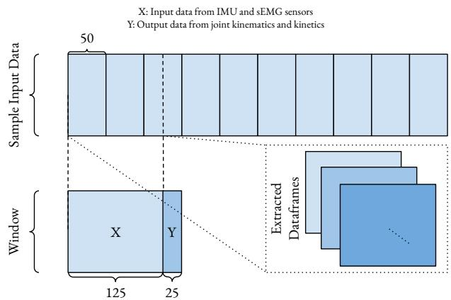
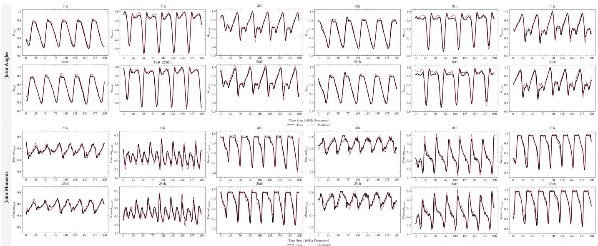

# 基于 Transformer 的新型方法：利用 sEMG 和 IMU 数据预测步态中完整下肢关节角度与关节力矩

F.H. Daryakenari1, T. Farizeh∗2

摘要—本研究提出了一种基于 Transformer 的深度学习框架，用于利用表面肌电图（surface electromyography, sEMG）和惯性测量单元（inertial measurement unit, IMU）信号对完整下肢关节角度和关节力矩进行长时间跨度预测。设计了两个独立的 Transformer 神经网络（Transformer Neural Networks, TNNs）：一个用于运动学预测，另一个用于动力学预测。该模型以实时应用为设计目标，仅使用适用于实验室外场景的可穿戴传感器。研究考虑了两种预测时间跨度，以评估短期和长期性能。网络在两项任务中均取得了高精度，所有关节的 Spearman 相关系数均超过 ρ = 0.96，$R ^ { 2 }$ 分数均高于 0.92。值得注意的是，该模型在关节角度预测中持续优于近期的基准方法，将 RMSE 误差降低了一个数量级。结果证实了 sEMG 和 IMU 信号在捕捉运动学和动力学信息方面的互补作用。本研究展示了基于 Transformer 的模型在可穿戴和机器人应用中实现实时、完整肢体生物力学预测的潜力，未来的研究方向包括输入最小化以及针对特定模态的加权策略，以提升模型的效率和精度。

关键词—Transformer 神经网络、关节角度与力矩预测、sEMG、IMU

## I. 引言

开发真实世界系统——尤其是涉及重复性任务的系统——时，一个至关重要的需求就是优化。若系统未经优化，我们将面临能耗过高、体力或计算负担增加，以及最终运营成本上升等问题，这些都是不可接受的。然而，实现这种优化需要一个基础步骤：分析系统在任务执行过程中的动力学。当系统面向人类使用时——例如康复、运动表现提升或老年人护理——这种分析变得更加关键，因为此类系统具有严格的安全要求，且需要针对个体进行适应性调整。尽管人类能够在无意识的情况下完成广泛的日常动作，但分析这些动作仍然具有挑战性。这主要是由于人体的生物力学复杂性，以及即使在步态这类基本活动中，外部力与运动的估计也十分困难。这些挑战凸显了开发一种可靠的实时方法以提取运动过程中运动学和动力学信息的必要性。

人体运动数据的重要性及其精确提取方法已在众多学科中得到广泛研究 [1]–[3]。早期研究主要致力于解释人体运动的内在机制，例如关节力与关节力矩在肌腱动力学中的作用。这些基础知识已成为康复、骨科评估以及提升运动表现的关键资产 [3]–[7]。此后，人体运动分析在电影、动画和电子游戏等娱乐产业中日益受到重视，因为它能够创造出逼真且富有表现力的角色动作 [8]–[12]。近年来，其相关性已扩展到机器人领域，在该领域中关于关节运动学与动力学的详细信息对于假肢、外骨骼和辅助设备的控制变得至关重要 [11]–[15]。

早期的运动分析方法在很大程度上依赖于数学和统计模型，计算量巨大，因而不适用于实时应用。此外，由于这些模型本身所固有的简化，它们无法准确模拟人体运动。随后，基于红外（infrared, IR）光学运动捕捉系统的方法被开发并不断完善 [9]–[12]。要通过这些系统获得准确的数据采集需要多台红外相机，这使得该方法成本高昂且难以广泛应用。此外，从红外相机记录到的数据需要利用逆运动学与逆动力学求解器进行处理，以计算运动参数。由于这一数据转换过程并非瞬时完成，这些系统不适用于实时应用。它们对实验室环境的依赖进一步将其使用范围限制在受控环境中。尽管存在这些缺点，基于标记点的运动捕捉系统所具有的高精度使其成为真值数据的可靠来源，尤其适用于对其他运动分析方法进行验证。

为克服光学运动捕捉系统的局限性并实现真实场景下的人体运动分析，研究者们开发了基于传感器的方法 [16]–[19]。早期的尝试，例如 [20] 和 [21] 的工作，旨在营造一种自然环境来测量人体运动与表现。他们采用回归神经网络（neural network, NN），利用附着于足部和小腿的运动传感器所提供的角速度与线加速度数据，预测矢状面上髋、膝、踝关节的运动学参数。尽管传统的神经网络回归方法具有开创性意义，但它们此后已被能力更强、能够预测时序数据的更先进模型所取代。为了验证其预测结果，这些早期工作依赖于光学运动捕捉系统作为金标准。

如今，惯性测量单元（Inertial Measurement Units, IMUs）已成为记录运动数据的一种颇具前景的替代方案 [22]–[28]。其便携性以及能够在实验室外环境记录数据的能力，使其成为光学运动捕捉系统的实际替代品。IMU 数据已被证明在提取关节运动学 [24]–[32]、关节动力学 [33]–[35]，或同时提取二者 [36]–[42] 方面是可靠的。这种多功能性与实用性使 IMU 成为运动分析领域中具有变革性意义的工具。IMU 数据在关节动力学的估计与预测方面展现出了良好的效果 [36]–[42]。然而，其固有的运动学特性限制了其独立准确估计关节动力学的能力。为了提高关节动力学估计的精度，可以将 IMU 数据与本身包含动力学信息的其他传感器数据进行融合。这种融合能够提升对动力学数据的预测能力，尤其是在应对非周期性或扰动诱发动作时。

表面肌电图（surface electromyography, sEMG）数据长期以来一直被作为关节动力学与肌肉力估计的补充来源加以研究 [43]–[51]。与运动学相比，它在动力学分析中表现更佳 [52]–[55]，但也被探索用于关节运动学的估计或预测，尽管准确度相对较低 [44]–[50], [56]–[59]。将 IMU 与 sEMG 数据相融合，有望为关节运动学与动力学的估计或预测构建一个全面的数据集。IMU 数据作为运动学的主要来源与动力学的辅助来源，而 sEMG 则正好相反。sEMG 的一个显著优势在于其预激活特性 [60]，它能在实际动作发生之前揭示肌肉的激活情况。这一特性在预测性应用中尤为有利，例如辅助机器人技术或需要快速精确动作的任务。基于这种互补关系，我们假设将 IMU 与 sEMG 信号相结合，能够为关节角度与力矩的准确预测提供充足的信息。要实现这一点，关键在于建立融合后的传感器数据与关节运动学和动力学之间的映射关系，类似于 [20] 和 [21] 使用神经网络所开创的方法。

已提出多种将惯性数据映射到关节运动学或动力学的方法，但其中许多方法在实时性能和泛化能力方面存在困难。基于卡尔曼滤波（Kalman Filter, KF）的方法，包括扩展卡尔曼滤波器（Extended Kalman Filters, EKFs），具有较高的计算效率[30]–[32]、[61]–[64]，但其依赖于线性假设、高斯噪声和较短的时间窗口，使其难以建模人体关节运动的非线性和动态特性。此类方法还需要精确的系统建模和噪声建模，而这通常难以实现且容易出错。类似地，肌肉骨骼模型（musculoskeletal models, MSMs）通过纳入解剖学参数提供了较高的生物力学保真度[27]、[36]，但其针对特定受试者的特性以及计算需求限制了其可扩展性和实时适用性。此类模型的调参和求解复杂性仍是其在人机交互等交互式场景中应用的主要壁垒。

人工智能（Artificial Intelligence, AI）的最新进展，特别是深度学习（Deep Learning, DL），已能够建模人体运动等复杂的非线性系统。神经网络（Neural Networks, NNs），尤其是长短期记忆网络（Long Short-Term Memory, LSTM）和编码器–解码器（encoder–decoder）等序列架构，由于能够捕捉时间依赖关系，非常适合时间序列预测。若干研究已采用深度学习技术，基于惯性测量单元（IMU）[65]–[69] 或表面肌电（sEMG）数据[70]–[78] 来预测关节运动学和动力学。尽管其中大多数方法依赖于单一模态，限制了泛化能力。值得注意的是，Wang 等人[15] 提出了融合 sEMG–IMU 的模型，采用时间卷积网络–双向长短期记忆网络（Temporal Convolution Network–Bidirectional LSTM）进行关节角度预测，但未涉及关节力矩估计。据作者所知，近期唯一一项尝试从融合信号中估计运动学和动力学的工作来自 Mohammadi Moghadam 等人[41]，其研究表明卷积神经网络（Convolutional Neural Networks, CNNs）优于传统机器学习方法。然而，其方法依赖于离线预处理，且 CNN 的时间建模能力有限，使其方法不适合实时部署。这些局限性凸显了对统一多模态方法的需求，该方法应能够实时捕捉空间和时间特征，以准确预测关节角度和力矩。

在序列预测任务中受到广泛关注的基于神经网络的方法之一是 Transformer 神经网络（Transformer Neural Networks，TNNs）[79]。TNN 采用了注意力机制（attention mechanism）[80], [81]，使这些网络能够有效捕捉序列间的关系。TNN 最初是为序列翻译任务设计的，利用自注意力（self-attention）机制来识别和建模序列内元素之间的关系，例如句子中各个词语之间的关系。为了应对实时应用中的预测延迟问题，TNN 引入了多头注意力（Multi-Head Attention）模块。这种并行架构通过同时处理多个注意力机制，显著加快了序列预测速度。就运动学和动力学预测而言，TNN 具有显著优势。它们将神经网络的一般优势与序列数据分析能力相结合，能够捕捉短期和长期依赖关系。在处理运动学和动力学数据时，这一特性尤其有价值，因为这些数据中的模式通常跨越较长的时间序列。

此外，TNN 中的多头注意力结构使它们特别适合涉及融合传感输入数据的任务。该结构根据每个数据源的重要性动态分配权重，使网络能够根据任务需求优先处理某些传感器输入而非其他输入。在诸如 IMU 和 sEMG 信号等传感数据融合对准确预测至关重要的场景中，这一点尤为有益。此外，TNN 的编码器-解码器（encoder-decoder）架构增强了对含噪传感器输出的鲁棒性，减少了在将数据输入网络之前对大量预处理或特征提取的依赖。TNN 最初是为序列翻译任务开发的，但其架构只需稍作修改即可适用于时间序列预测。这种适应性使它们成为需要实时序列预测的应用（例如人体运动建模或机器人控制）中颇具吸引力的选择。

本文的目标是将惯性测量单元（Inertial Measurement Unit, IMU）感知数据与表面肌电图（surface Electromyography, sEMG）感知数据进行融合，以预测步行这一关键日常生活活动（Activities of Daily Living, ADL）中的下肢关节运动学与动力学参数。为评估预测精度，我们将以光学动作捕捉摄像头采集的数据作为金标准。我们假设 IMU 数据可作为运动学信息的主要来源和动力学信息的辅助来源，而 sEMG 数据则可作为动力学信息的主要来源和运动学信息的辅助来源。通过融合这两种互补的数据源，我们力求在步行过程中实现精确的关节角度与力矩预测。对于这一回归任务，我们将采用 Transformer 神经网络（Transformer Neural Networks, TNNs）作为将融合感知数据映射至关节运动学与动力学的模型。TNNs 已被证明能够同时保持序列内与序列间的关联性，因而特别适合捕捉人体运动数据中复杂的时间动态特性。

除标准的下一步预测动作外，我们将聚焦两个预测时间跨度——近期（未来 30 毫秒）与远期（未来 250 毫秒），覆盖双下肢所有主要自由度，以此考察 TNNs 的鲁棒性。此外，我们还将检验网络应对运动速度突变的能力，模拟人体突发动作的场景。本研究将评估所提方法适应真实世界中动态条件的能力。我们相信，所提出的训练模型将成为该领域未来研究的宝贵资源。通过利用大规模数据集，我们的模型可作为迁移学习与元学习应用的基础，使研究者能够在本研究基础上进一步推进人体运动建模与预测的发展。

## II. 方法（METHOD）

## A. 方法概述（Overview of the method）

为了实现我们的目标，我们需要三类数据：IMU、sEMG 和动作捕捉。其中，IMU 和 sEMG 数据将经过处理后用作我们 TNN 的输入，而动作捕捉数据则作为髋关节、膝关节和踝关节角度与力矩的真值，并不直接作为输入使用。这些真值代表髋、膝、踝三个关节的角度与力矩，这正是 TNN 需要预测的目标。具体而言，TNN 的输出将通过多元回归在两个不同的时间尺度上进行预测：30 毫秒的近未来预测和 250 毫秒的远未来预测。此外，作为我们对网络鲁棒性研究的一部分，尤其是在运动发生突变的情形下，输入数据中将包含此类变化以评估网络在动态条件下的表现。后续章节将详细介绍所使用的数据集、预处理步骤、网络输入数据的准备，以及所提出的 TNN 的网络架构。

## B. 数据集

为了训练我们的模型以预测关节运动学与动力学特征，必须拥有包含 sEMG、IMU 和光学动作捕捉数据的综合性数据集。本研究采用 Camargo 等人 [55] 公开的数据集，其中包含来自 22 名健康成年受试者的记录（平均年龄：$2 1 \pm 3 . 4$ 岁，身高：$1 . 7 \pm 0 . 0 7 \mathrm{~ m ~}$，体重：$6 8 \pm 1 0 . 3 9 \mathrm{k g}$）。该数据集包含从右腿 11 块肌肉采集的 sEMG 数据：臀中肌（gluteus medius）、腹外斜肌（external oblique）、半腱肌（semitendinosus）、股薄肌（gracilis）、股二头肌（biceps femoris）、股直肌（rectus femoris）、股外侧肌（vastus lateralis）、股内侧肌（vastus medialis）、比目鱼肌（soleus）、胫骨前肌（tibialis anterior）以及腓肠肌内侧头（gastrocnemius medialis）。原始 sEMG 信号以 1000 Hz 采样，并经数字带通滤波器（20–400 Hz，20 阶巴特沃斯滤波器）处理。IMU 数据采集自躯干以及右下肢的三个环节——大腿、小腿和足部，传感器放置在每个环节约四分之三长度的位置。IMU 信号以 200 Hz 采样，并经数字低通滤波器（截止频率 100 Hz，6 阶巴特沃斯滤波器）滤波。

动作捕捉数据以 200 Hz 的频率从双腿采集，经低通滤波器（截止频率 6 Hz，4 阶零相位巴特沃斯滤波器）处理，并辅以 1000 Hz 的地面反作用力测量数据，后者使用低通滤波器（截止频率 15 Hz，10 阶零相位巴特沃斯滤波器）进行滤波。尽管关节角度也使用测角仪进行了记录，但该数据将不会用于我们的研究。为了基于动作捕捉摄像机所记录的数据提取关节角度和力矩，数据集的作者们使用 OpenSim 来求解逆运动学和逆动力学 [55]。该数据集涵盖了多种运动模式，包括平地行走、跑步机行走、爬楼梯和斜坡行走。本研究中，我们专注于跑步机行走数据，因为它为我们提供了一个研究运动模式变化的机会——这是我们研究的核心目标之一。

在上述数据集中，跑步机行走试验在 28 个速度下进行，速度范围从 0.5 m/s 到 1.85 m/s，增量为 0.05 m/s。速度在七次试验中交错排列，每次试验包含四个速度，排列顺序模拟了运动的渐进变化。例如，一次试验可能包括从静止到慢速，再到中快速和快速，然后减速到中慢速直至停止的过渡（例如，第一次试验的速度为 0.5 m/s、1.2 m/s、1.55 m/s、0.85 m/s，第二次试验为 0.55 m/s、1.25 m/s、1.6 m/s、0.9 m/s）。这种增量式速度变化的模式为研究运动变化对我们模型预测的影响提供了一个受控的实验设置。

## C. 预处理

在拥有数据集之后，下一步是对感觉数据进行预处理以提取有意义的信息。预处理的一个重要方面是确保所采用的方法适合实时应用。如第 II-B 节数据集描述中所述，已发布的数据集已包含 IMU 和动作捕捉数据的预处理，我们认为这些处理对于我们的目的而言是充分的。该预处理在保持实时可行性的同时，确保了信号的清洁和可靠。然而，sEMG 数据本身比 IMU 和动作捕捉数据噪声更大，需要额外的预处理步骤。基于先前研究 [41]、[82] 所建议的方法，sEMG 数据经过以下处理程序：

1) 高通滤波——应用截止频率为 25 Hz 的二阶巴特沃斯滤波器，以去除低频噪声和基线漂移。

2) 整流——对信号进行整流以获取绝对值，确保所有信号值均为正值。

3) 低通滤波——使用截止频率为 6 Hz 的二阶巴特沃斯滤波器提取信号包络。

此预处理将初步处理后的 sEMG 信号转化为一个简化的特征——信号包络（signal envelope），且无需依赖复杂的特征提取方法。该方法的简洁性与高效性确保其在实时应用中仍保持稳健性与适用性。

由于 IMU 与 sEMG 传感器的采样频率不同（IMU 为 200 Hz，sEMG 为 1000 Hz），需要一个最终步骤以调和数据以便融合。IMU 数据与预处理后的 sEMG 数据均被降采样至 100 Hz，与由动作捕捉数据计算所得关节角度与力矩的采样频率保持一致。在该预处理阶段结束时，所有数据流——IMU、已处理的 sEMG，以及来自动作捕捉摄像机的关节运动学与动力学——均完成对齐，并被整形为可供神经网络输入的合适形式。

在将数据输入神经网络之前，必须对其进行正确的结构化组织。我们的数据集包含来自 22 位受试者的 IMU、sEMG 以及真值关节运动学与动力学数据。为确保网络的泛化能力，我们采用留一受试者（leave-one-subject-out）的验证与测试策略。具体而言，使用 20 位受试者的数据用于训练，1 位受试者的数据保留用于验证，剩余 1 位受试者的数据留作测试。为避免网络对特定试验或受试者产生学习偏差，我们在数据准备之前对试验与受试者层面的数据进行随机打乱（shuffle）。该步骤确保网络学习到能够代表整个数据集的模式，而非过拟合于特定的个体或序列。

为将数据准备为网络的输入，我们采用滑动窗口（sliding window）方法将其分割为帧（frame），如图 1 所示。每个窗口包含 125 个采样点，对应于 100 Hz 采样频率下的 1.25 秒。这 125 个 IMU 与 sEMG 数据采样点作为输入，而其后的 25 个（250 毫秒）关节角度与力矩采样点则代表每一帧的目标预测值。随后窗口以 4 个采样点（0.04 秒）的步长滑动以生成下一帧。为在受试者与传感器之间统一数据尺度，我们采用最小-最大归一化（Min-Max Normalization）方法。该归一化方法将所有特征缩放至统一的取值范围，有助于保持训练的一致性并提升学习过程的稳定性。在该步骤结束时，数据集已被分割、归一化，并整理为适合神经网络训练、验证与测试的输入-输出对形式。

## D. 神经网络架构（Neural Network Architecture）

所提出的关节运动学与动力学联合预测模型是一种基于回归的 Transformer 神经网络（Transformer Neural Network，TNN）。由于原始的 Transformer 架构是为序列到序列任务（如句子翻译）而设计的，因此对其进行了一些修改以适配多变量时间序列预测。网络的整体架构如图 2(a) 所示。为了确保最优的权重调整并解决梯度消失或爆炸等问题，我们在 Transformer 模块之前加入了一个双向长短期记忆（Bidirectional LSTM，Bi-LSTM）层。该层以正向和反向两个方向处理输入序列，从而改善梯度流动并缓解序列遗忘问题。处理后的输出随后被送入 Transformer 模块，该模块严格遵循文献 [79] 中定义的结构。Transformer 的一个关键组件是其残差连接，其灵感来自残差块的概念 [83]。如图 2(b) 所示，模型中引入了两种类型的残差块：一种包含多头注意力机制与 dropout，另一种包含全连接层与 dropout。这些残差连接创建了旁路路径，能够缓解梯度消失问题，使网络能够保留更长的时间依赖关系。

  

图 1. 从输入与输出数据中进行数据帧提取的示意图。

在网络图 2(a) 的最终阶段，我们采用了一个 lambda 层（lambda layer），将全连接层（dense layer）的输出重塑为多元回归格式，使其与真实值（ground truth）数据的维度对齐。对于该架构，我们使用了两个并行的 TNN，每个 TNN 专注于一项不同的预测任务：一个用于预测关节角度（joint angles），另一个用于预测关节力矩（joint moments），如图 3 所示。

网络组件的配置如表 I 所示。所有超参数（hyperparameters）均经过大量试错选取，以优化性能。该网络使用 Keras 和 TensorFlow 库 [84] 实现并训练。损失函数采用均方误差（Mean Squared Error, MSE），评估指标选用平均绝对误差（Mean Absolute Error, MAE）。该架构旨在针对不同时间范围稳健地预测未来的关节角度和力矩，从而实现对时间序列（timeseries）数据的精确多元回归。

## III. 实验结果（RESULTS）

所提出的运动学（kinematic）和动力学（kinetic）网络以 128 的批大小（batch size）训练了 40 个 epoch。网络的主要目标是预测 250 毫秒时间范围内的关节角度和力矩。为了评估网络的性能，我们从该时间范围中提取了两个特定样本：一个在 30 毫秒处，另一个在 250 毫秒处。用于性能评估的测试数据来自测试对象（test subject），该对象在预处理和数据准备阶段已被排除。网络预测值与相同输入下的真实值一同显示在图 4 中。为了有效地评估结果，我们从测试对象中随机选取了一段连续的 1000 个数据帧（相当于 10 秒）来计算误差。然而，由于篇幅限制，图 4 的可视化中仅展示了 200 个数据帧（2 秒）的结果。

TABLE I  
神经网络超参数（NEURAL NETWORK HYPERPARAMETERS）

<table><tr><td>Hyperparameter</td><td>value</td></tr><tr><td>Bi-LSTM units</td><td>125</td></tr><tr><td>Embedding dimension</td><td>256</td></tr><tr><td>Multi-Head Attention heads</td><td>8</td></tr><tr><td>Dense layer neurons</td><td>512</td></tr><tr><td>Dropout rate</td><td>0.1</td></tr><tr><td>Layer normalization epsilon</td><td> $10^{-6}$ </td></tr><tr><td>Optimizer- $Adam, \beta_1$ </td><td>0.9</td></tr><tr><td>Optimizer- $Adam, \beta_2$ </td><td>0.999</td></tr><tr><td>Initial learning rate</td><td>0.0008</td></tr><tr><td>AMSGrad</td><td>True</td></tr></table>

  

图 2. 神经网络架构。(a) 网络的整体层结构，(b) Transformer 模块的内部结构。

为了更好地理解网络性能，我们对 10 秒数据上的预测结果进行了定性和定量报告。对于定性评估，我们使用决定系数（Coefficient of Determination）$( R ^ { 2 } )$，以及 Spearman 相关性（基于 Shapiro-Wilk 检验，p-value < 0.05）。这两个统计指标有助于我们理解图 4 中预测曲线与真实曲线之间的相似性和一致性。对于定量评估，我们报告平均绝对误差（Mean Absolute Error, MAE）、均方根误差（Root Mean Squared Error, RMSE）和归一化均方根误差（normalized Root Mean Squared Error, nRMSE）。上述所有指标均经过评估。

  

图 3. 用于关节角度和关节力矩预测的所提网络，同时涵盖近程（Close Horizon, CH）和远程（Distant Horizon, DH）两种情形，结果在表 II 中给出。

## IV. 讨论

本研究的主要目标是预测较长时间跨度内的完整下肢关节角度与关节力矩。为此，我们采用惯性测量单元（Inertial Measurement Unit, IMU）和表面肌电图（surface Electromyography, sEMG）传感器数据作为两个独立设计的变换器神经网络（Transformer Neural Networks, TNNs）的输入：一个专门用于关节角度预测，另一个用于关节力矩预测。我们定义了两个不同的预测时间跨度：一个 30 毫秒的短跨度（近程预测，close-horizon, CH）和一个 250 毫秒的长跨度（远程预测，distant-horizon, DH）。选择这些时间跨度是为了系统地评估网络在即时与未来延长时间范围内的预测性能。我们的基本假设是，IMU 与 sEMG 信号的联合使用能够提供互补的运动学与神经肌肉信息，这对于准确预测关节角度和关节力矩至关重要。

图 4 与表 II 的统计结果均表明，该网络能够准确预测未参与训练的测试对象的运动学与动力学参数。针对运动学预测的 Spearman 相关检验表明，预测值与真实数据之间存在统计学显著的强正相关。具体而言，对于近程预测（CH），最低相关系数值为 $\rho = 0 . 9 7 3 \ ( p < 0 . 0 0 1 )$，而对于远程预测（DH），最低相关系数值为 $\rho = 0 . 9 6 3 \ ( p < 0 . 0 0 1 )$）。在所有关节中，左踝关节的相关系数最低，但仍表现出强正相关关系。

除 Spearman 相关系数外，还使用决定系数 $R ^ { 2 }$ 进一步评估了网络的预测性能。模型在左踝关节取得的最低 $R ^ { 2 }$ 值在 CH 下为 0.963，在 DH 下为 0.949；CH 下均方根误差（Root Mean Square Error, RMSE）为 $0 . 0 4 2 ^ { \circ }$、平均绝对误差（Mean Absolute Error, MAE）为 0.028◦，DH 下 RMSE 为 0.050◦、MAE 为 0.035◦。这些结果表明，对于预测精度最差的关节，模型预测仍可解释其真实关节角度约 95%（CH）和 92%（DH）的方差。这表明，所提出的网络在下肢运动学与动力学的预测方面具有较强的预测能力。

关于预测的动力学结果，斯皮尔曼等级相关检验（Spearman correlation test）表明预测关节力矩与真值关节力矩之间存在统计上显著的相关性。在 CH 中最低的斯皮尔曼等级相关系数出现在左踝关节，为 $\rho = 0 . 9 7 3 \ ( p < 0 . 0 0 1 )$；在 DH 中同样为 $\rho = 0 . 9 7 3 \ ( p < 0 . 0 0 1 )$，出现在左踝关节。所有关节力矩的 $R ^ { 2 }$ 得分均表明模型具有较强的预测能力。CH 中预测关节力矩的最低 $R ^ { 2 }$ 得分出现在左膝关节，为 0.952（MAE = 0.022 N.m/kg，RMSE = 0.03 N.m/kg）；而 DH 中最低的 $R ^ { 2 }$ 得分出现在右膝关节，为 0.924（MAE = 0.025 N.m/kg，$\mathrm{RMSE} = 0 . 0 3 3$ N.m/kg）。同时，关节力矩的最大 MAE 和 RMSE 记录值均出现在 CH 与 DH 的左踝关节，其中 CH 的 MAE = 0.038 N.m/kg、RMSE = 0.051 N.m/kg，DH 的 MAE = 0.041 N.m/kg、RMSE = 0.061 N.m/kg。基于归一化 RMSE（normalized RMSE）的关节力矩预测最大误差出现在 CH 的左踝关节，为 5.46%，以及 DH 的右踝关节，为 6.97%。

  

图 4. 在两个预测时域——30 毫秒（第 3 个值）与 250 毫秒（第 25 个值）——上的下肢关节角度与关节力矩完整预测结果。

表 II
网络在近时域（Close Horizon，30 毫秒）—CH 与远时域（Distant Horizon，250 毫秒）—DH 下，10 秒时间段内预测值的斯皮尔曼等级相关系数 ρ、决定系数 $R^2$、平均绝对误差（MAE）、最大平均绝对误差（Maximum MAE）、均方根误差（RMSE）以及归一化均方根误差（NRMSE）。表中同时包含关节运动学与关节动力学指标。MAE、RMSE 与 NRMSE 数值均以百分比形式报告。

<table><tr><td rowspan="2" colspan="2"></td><td colspan="2"> $\rho$ </td><td colspan="2"> ${R}^{2}$ </td><td colspan="2">MAE*</td><td colspan="2">RMSE*</td><td colspan="2">nRMSE*</td></tr><tr><td>Joint</td><td>CH</td><td>DH</td><td>CH</td><td>DH</td><td>CH</td><td>DH</td><td>CH</td><td>DH</td><td>CH</td></tr><tr><td rowspan="6">Kinematics</td><td>Hip Right</td><td>0.995</td><td>0.992</td><td>0.988</td><td>0.983</td><td>2.59</td><td>3.04</td><td>3.1</td><td>3.7</td><td>3.84</td><td>4.56</td></tr><tr><td>Knee Right</td><td>0.982</td><td>0.974</td><td>0.989</td><td>0.980</td><td>2.64</td><td>3.16</td><td>3.2</td><td>3.9</td><td>3.36</td><td>4.14</td></tr><tr><td>Ankle Right</td><td>0.985</td><td>0.976</td><td>0.971</td><td>0.954</td><td>2.15</td><td>3.47</td><td>2.6</td><td>4.4</td><td>3.08</td><td>4.84</td></tr><tr><td>Hip Left</td><td>0.993</td><td>0.992</td><td>0.986</td><td>0.988</td><td>2.97</td><td>2.53</td><td>3.5</td><td>3.2</td><td>4.16</td><td>3.81</td></tr><tr><td>Knee Left</td><td>0.978</td><td>0.972</td><td>0.979</td><td>0.972</td><td>3.48</td><td>4.04</td><td>4.3</td><td>5</td><td>4.61</td><td>5.61</td></tr><tr><td>Ankle Left</td><td>0.973</td><td>0.963</td><td>0.963</td><td>0.949</td><td>2.86</td><td>3.58</td><td>4.2</td><td>5</td><td>4.62</td><td>5.59</td></tr><tr><td rowspan="6">Kinetics</td><td>Hip Right</td><td>0.985</td><td>0.979</td><td>0.955</td><td>0.933</td><td>2.14</td><td>2.50</td><td>2.7</td><td>3.1</td><td>4.54</td><td>5.35</td></tr><tr><td>Knee Right</td><td>0.983</td><td>0.966</td><td>0.959</td><td>0.924</td><td>2.15</td><td>2.5</td><td>2.6</td><td>3.3</td><td>4.28</td><td>5.35</td></tr><tr><td>Ankle Right</td><td>0.966</td><td>0.937</td><td>0.981</td><td>0.945</td><td>2.40</td><td>4.1</td><td>3.1</td><td>5.9</td><td>3.46</td><td>6.97</td></tr><tr><td>Hip Left</td><td>0.981</td><td>0.979</td><td>0.965</td><td>0.952</td><td>2.5</td><td>2.7</td><td>3.2</td><td>3.5</td><td>4.79</td><td>5.38</td></tr><tr><td>Knee Left</td><td>0.966</td><td>0.956</td><td>0.952</td><td>0.930</td><td>2.2</td><td>2.6</td><td>3.0</td><td>3.8</td><td>4.14</td><td>5.38</td></tr><tr><td>Ankle Left</td><td>0.952</td><td>0.937</td><td>0.962</td><td>0.950</td><td>3.8</td><td>4.1</td><td>5.1</td><td>6.1</td><td>5.46</td><td>6.78</td></tr></table>

\* 表格中报告的 MAE、RMSE、nRMSE 值已乘以 100。

在关节运动学方面，根据 MAE 和 RMSE，CH $( \mathrm { M A E } = 0 . 0 4 8 ^ { \circ }$，RMSE $= \ 0 . 0 4 3 ^ { \circ } )$ 和 DH (MAE = 0.0404◦, RMSE = 0.050◦) 中误差最大的关节均为左膝。然而，DH 中左踝的 RMSE 与左膝相同。根据归一化 RMSE，CH 中误差最大的关节为左踝（4.62%），而 DH 中误差最大的关节为左膝（5.61%）。可以看出，较高的误差值对应于未佩戴传感器的腿，这说明虽然可以使用对侧腿的感知数据来预测一条腿的关节角度和力矩，但要实现同等精度的预测，则需要在两条腿上均佩戴传感器，这与预期相符。此外，在我们研究的六个关节中，预测误差最大的关节通常为左踝，这表明需要更多的感知信息以提高左踝预测的准确性。

与类似研究相比，与我们工作最接近的研究是 Mohammadi-Moghadam 等人 [41] 的研究。他们通过从融合的 sEMG 和 IMU 信号中提取关键特征，并以 CNN 作为预测模型，成功预测了三个运动平面上的关节角度和关节力矩。然而，他们的工作存在一个不足之处：他们的网络虽适用于真实场景，但不支持实时应用。此外，他们的预测范围仅限于单步超前预测，可能不适合机器人控制系统。相比之下，我们提出的方法能够实现实时预测并扩展了预测范围，从而解决了这些局限性，使其更适用于机器人控制。此外，我们的方法改善了关节角度和关节力矩的预测效果，其表现优于他们报告的最佳受试者间 RMSE 值。

对于髋关节角度，我们的结果在右腿 CH 和 DH 预测中的 RMSE 分别为 $0 . 0 3 1 ^ { \circ }$ 和 $0 . 0 3 7 ^ { \circ }$，在左腿 CH 和 DH 中分别为 $0 . 0 3 5 ^ { \circ }$ 和 $0 . 0 3 2 ^ { \circ }$。这些数值表明相较于他们所报告的值 $4 . 7 9 ^ { \circ }$ 有显著改进。对于膝关节角度，我们的结果在右腿 CH 和 DH 中的 RMSE 值分别为 $0 . 0 3 2 ^ { \circ }$ 和 $0 . 0 3 9 ^ { \circ }$，在左腿 CH 和 DH 中分别为 $0 . 0 4 3 ^ { \circ }$ 和 $0 . 0 5 0 ^ { \circ }$。与髋关节角度结果类似，这些数值相较于他们所报告的值 $5 . 4 6 ^ { \circ }$ 同样有所改进。对于踝关节角度，我们的结果在右腿 CH 和 DH 中的 RMSE 值分别为 $0 . 0 2 6 ^ { \circ }$ 和 $0 . 0 4 4 ^ { \circ }$，在左腿 CH 和 DH 中分别为 0.042° 和 $0 . 0 5 0 ^ { \circ }$。与此同时，他们所报告的踝关节角度 RMSE 为 6.52°。这些结果表明，我们所提出的运动学预测模型在三个关节角度上均优于他们所提出的模型。

对于髋关节力矩（hip joint moment），我们的网络在右腿 CH 和 DH 中分别取得了 0.021 N.m/kg 和 0.025 N.m/kg 的 RMSE。对于左髋关节力矩，我们在 CH 和 DH 中分别获得了 0.025 N.m/kg 和 0.027 N.m/kg 的 RMSE。基线研究 [41] 中所报告的受试者间髋关节力矩 RMSE 在论文中并未明确给出。然而，根据箱线图，髋关节屈/伸误差中位数的下限约为 0.15 N.m/kg，这对应于随机森林（Random Forest）方法。对于右膝关节力矩，我们所提出的方法在 CH 和 DH 中分别取得了 0.026 N.m/kg 和 0.033 N.m/kg 的 RMSE 值，而对于左膝关节力矩，CH 和 DH 的值分别为 0.030 N.m/kg 和 0.038 N.m/kg。相比之下，Mohammadi-Moghadam 等人报告的受试者间膝关节力矩 RMSE 为 0.187 N.m/kg。对于踝关节力矩，右腿 CH 和 DH 的 RMSE 分别为 0.031 N.m/kg 和 0.059 N.m/kg，而左腿分别为 0.051 N.m/kg 和 0.061 N.m/kg。文献 [41] 中报告的最佳 RMSE 值为受试者内（intra-subject）预测的 0.066 N.m/kg（通常受试者内预测比受试者间预测更为准确，因为网络能够看到用户的部分数据）。因此，我们可以得出结论：在动力学（kinetic）预测方面，我们的模型同样优于基线模型。

Wang 等人 [78] 最近提出了双 Transformer 网络（Dual Transformer Network, DTN），用于利用 sEMG 信号求解关节运动学与动力学。与所提出的 DTN 方法相比，我们的模型超越了短期预测的范畴，可对未来多步的关节轨迹进行预测，从而实现具有前瞻性的控制策略，这对可穿戴辅助设备尤为有益。相比之下，DTN 模型仅限于固定的 50 ms 预测时域，这可能不足以在动态环境中进行预先调整。此外，我们的框架旨在预测完整的下肢关节运动学与动力学——包括髋、膝和踝——并涵盖双腿。这种整体性建模方法可更深入地理解双侧步态动力学，并支持康复与机器人辅助等多种应用。相比之下，DTN 模型仅局限于单腿的单平面预测，限制了在真实世界应用场景中的通用性。

此外，与 Wang 等人 [78] 所提出的模型相比，我们的模型在所有预测关节角度上表现出更低的均方根误差（RMSE），而 DTN 报告的 RMSE 值高出一个数量级。这突显了我们模型在数值精度方面的优越性，这在涉及实时控制或生物力学评估的应用中尤为关键。然而，值得注意的是，DTN 报告了更高的 $R ^ { 2 }$ 和 Spearman 相关系数，表明其预测信号相对于真值在时间模式与秩次一致性上具有更强的对齐程度。这表明，尽管 DTN 能有效捕捉关节轨迹的形状与趋势，但在幅值精度上存在不足，可能限制其在需要细粒度运动学精度的应用中的使用。尽管我们的运动学模型优于其模型，但我们的模型在右腿的 CH 和 DH 条件下，髋关节与踝关节的预测力矩具有略优的精度，他们报告的数值分别为 0.048 Nm/Kg 和 0.060 Nm/Kg。膝关节力矩在 CH 条件下相同，而在 DH 条件下误差略有增加，其报告的膝关节力矩值为 0.026 Nm/Kg。对于左腿，在 CH 和 DH 条件下，髋关节和膝关节在我们模型中的 RMSE 均更低，而踝关节在 CH 条件下 RMSE 更低，在 DH 条件下 RMSE 略高。此外，我们的模型得益于多模态传感器融合，同时整合了 sEMG 与 IMU 数据，而 DTN 仅依赖 sEMG，后者对信号变异性敏感且缺乏运动状态上下文信息。综上所述，我们的方法为关节角度与力矩预测提供了一种更稳健、更精确的解决方案，尤其在绝对精度至关重要的场景中表现突出。

## V. 结论（CONCLUSION）

本研究的研究目标是在长时间跨度上，基于传感器数据预测下肢完整的关节力矩与关节角度。为实现这一目标，我们开发了一种受 Transformer 神经网络（Transformer Neural Networks, TNNs）启发的回归网络，并使用 IMU 与 sEMG 数据对该模型进行训练。我们的假设是：IMU 和 sEMG 信号可作为运动学预测与动力学预测的互补信息源。结果表明，所提出的网络能够准确预测关节力矩与关节角度，相较于基线模型展现出更优的性能。此外，我们认为所提模型可有效部署于实时应用，原因在于其并行式神经网络结构提升了计算效率，从而非常适用于实时场景。

## VI. 未来工作

作为未来研究的一个潜在方向，可以探索通过对输入数据进行优化来提升网络的计算效率。具体而言，研究能否通过减少 IMU 信号或 sEMG 信号的输入数量来获得准确的预测结果将是十分有益的。此外，在本研究中，无论是关节角度预测网络还是关节力矩预测网络，sEMG 与 IMU 信号均被同等对待。然而，根据具体预测任务（无论是运动学任务还是动力学任务），在 IMU 与 sEMG 输入之间引入动态加权机制，有望进一步提升预测精度。

## 参考文献

[1] T. S. Buchanan, D. G. Lloyd, K. Manal 和 T. F. Besier, "基于前向-逆向动力学模型的肌肉力与关节力矩估计," 载于 Medicine and Science in Sports and Exercise, vol. 37, pp. 1911–1916, 2005 年 11 月。

[2] P. Crenna 和 C. Frigo, "通过力矩-角度环对人体行走过程中踝关节动力学进行分析：性别与年龄的影响," Human Movement Science, vol. 30, pp. 1185–1198, 2011 年 12 月。

[3] S. Chowdhury 和 N. Kumar, "基于运动学数据与人体惯性属性利用逆向动力学方法估计下肢关节的力与力矩," 2013 年。

[4] M. G. Hoy, F. E. Zajac 和 M. E. Gordon, "人体下肢的肌肉骨骼模型：肌肉、肌腱与力臂对髋、膝、踝关节肌肉-肌腱驱动器力矩-角度关系的影响," Journal of biomechanics, 1990 年。

[5] C. N. Maganaris, "人体骨骼肌力矩-角度特性的预测模型：在踝关节周围肌肉中的应用与验证," Journal of Theoretical Biology, vol. 230, pp. 89–98, 2004 年 9 月。

[6] E. Ceseracciu, Z. Sawacha 和 C. Cobelli, "无标记点与基于标记点的运动捕捉技术在步态同步数据采集下的对比：概念验证," PLoS ONE, vol. 9, 2014 年 3 月。

[7] R. M. Kanko, E. K. Laende, E. M. Davis, W. S. Selbie, and K. J. Deluzio, "使用基于标记和无标记的动作捕获对步态运动学进行同步评估," *Journal of Biomechanics*, vol. 127, 2021 年 10 月.

[8] D. Thalmann and M. Panne, 《计算机动画与仿真 '97》（Computer Animation and Simulation '97），第 VIII 卷。Springer Vienna，第 1 版，1997 年 9 月。

[9] L. Herda, P. Fua, R. Plankers, R. Boulic, and D. Thalmann, "用于人体运动稳健重建的基于骨架的动作捕获," IEEE, 2000 年 5 月.

[10] G. Liu and L. McMillan, "人体动作捕获中缺失标记的估计," *Visual Computer*, vol. 22, pp. 721–728, 2006 年 9 月.

[11] A. Aristidou, J. Cameron, and J. Lasenby, "人体动作捕获中缺失标记的实时估计," IEEE, 2008 年 5 月.

[12] A. Aristidou and J. Lasenby, "光学动作捕获中的实时标记预测与旋转中心估计," *Visual Computer*, vol. 29, pp. 7–26, 2013.

[13] T. S. Buchanan, D. G. Lloyd, K. Manal, and T. F. Besier, "神经肌肉骨骼建模：从神经命令测量估计肌肉力、关节力矩与运动," 2004.

[14] B. Gabbasov, I. Danilov, I. M. Afanasyev, and E. Magid, "迈向类人双足机器人步态：基于 Kinect 动作捕获系统的人体运动生物力学分析," *IEEE International Symposium on Mechatronics and its Applications*, 2015 年 12 月.

[15] J. ping Wang, S. hua Wang, Y. qing Wang, H. Hu, J. wei Yu, X. Zhao, J. lai Liu, X. Chen, and Y. Li, "基于动作捕获测量的人体膝关节运动学数据处理," *BMC Medical Informatics and Decision Making*, vol. 21, 2021 年 12 月.

[16] A. Willemsen, J. V. Alste, and H. Boom, "利用新型加速度测量方法的实时步态评估."

[17] R. Moe-Nilssen and J. L. Helbostad, "基于躯干加速度测量的步态周期特征估计," *Journal of Biomechanics*, vol. 37, pp. 121–126, 2004.

[18] R. W. Selles, M. A. Formanoy, J. B. Bussmann, P. J. Janssens, and H. J. Stam, "使用加速度计自动估计初始与终止接触时机：在经胫骨截肢患者与对照人群中的开发与验证," *IEEE Transactions on Neural Systems and Rehabilitation Engineering*, vol. 13, pp. 81–88, 2005 年 3 月.

[19] P. Picerno, "使用惯性与磁性传感器研究下肢关节运动学的 25 年：方法学综述," 2017 年 1 月.

[20] J. Y. Goulermas, D. Howard, C. J. Nester, R. K. Jones, and L. Ren, "用于下肢运动学预测的回归技术," *Journal of Biomechanical Engineering*, vol. 127, pp. 1020–1024, 2005 年 11 月.

[21] A. Findlow, J. Y. Goulermas, C. Nester, D. Howard, and L. P. Kenney, "使用可穿戴运动传感器预测下肢关节运动学," *Gait and Posture*, vol. 28, pp. 120–126, 2008 年 7 月.

[22] H. Lim, B. Kim, and S. Park, "利用腰部单 IMU 与机器学习预测步行中下肢动力学与运动学," *Sensors (Switzerland)*, vol. 20, 2020 年 1 月.

[23] I. Weygers, M. Kok, M. Konings, H. Hallez, H. D. Vroey, and K. Claeys, "基于惯性传感器的下肢关节运动学：一项方法学的系统综述," 2 2020.

[24] W. Niswander, W. Wang, and K. Kontson, "用于下肢关节运动学测量的 IMU 传感器布置优化," Sensors (Switzerland), vol. 20, pp. 1–16, 11 2020.

[25] W. Pitt, S. H. Chen, and L. S. Chou, "使用基于 IMU 的运动学标记监测急性脑震荡患者双任务步态平衡控制恢复," Clinical Biomechanics, vol. 80, 12 2020.

[26] S. Majumder and M. J. Deen, "基于可穿戴 IMU 的下肢关节实时监测系统," IEEE Sensors Journal, vol. 21, pp. 8267–8275, 3 2021.

[27] T. McGrath and L. Stirling, "基于身体穿戴 IMU 的人体髋膝关节在跑步机行走中的运动学估计," Sensors, vol. 22, 4 2022.

[28] L. Carcreff, G. Payen, G. Grouvel, F. Masse, and S. Armand, "通过简单且最少的功能标定任务从加速度计和陀螺仪获取三维下肢运动学：在无症状参与者上的验证," Sensors, vol. 22, 8 2022.

[29] M. Versteyhe, H. D. Vroey, F. Debrouwere, H. Hallez, and K. Claeys, "一种使用低成本 IMU 传感器估算完整膝关节运动学以实现易实施低成本诊断的新方法," Sensors (Switzerland), vol. 20, 3 2020.

[30] J. S. Lora-Millan, A. F. Hidalgo, and E. Rocon, "一种基于 IMU 的扩展卡尔曼滤波器，用于估算步态下肢矢状面运动学以控制可穿戴机器人设备," IEEE Access, vol. 9, pp. 144550–144554, 2021.

[31] L. Sy, M. Raitor, M. D. Rosario, H. Khamis, L. Kark, N. H. Lovell, and S. J. Redmond, "使用减少的可穿戴传感器数量估计下肢运动学," IEEE Transactions on Biomedical Engineering, vol. 68, pp. 1293–1304, 4 2021.

[32] M. V. Potter, S. M. Cain, L. V. Ojeda, R. D. Gurchiek, R. S. McGinnis, and N. C. Perkins, "在各种步态下估计人体下肢运动学的误差状态卡尔曼滤波方法评估," Sensors, vol. 22, 11 2022.

[33] M. Lee and S. Park, "使用机器学习从附着于骶骨的单个 IMU 估计行走时三维下肢动力学数据," Sensors (Switzerland), vol. 20, pp. 1–16, 11 2020.

[34] C. J. Lee and J. K. Lee, "基于惯性运动捕捉的可穿戴系统在关节动力学估计中的应用：一项系统综述," 4 2022.

[35] S. Krishnakumar, B. J. F. van Beijnum, C. T. Baten, P. H. Veltink, and J. H. Buurke, "使用 IMU 估计动力学以监测和辅助 ACL 康复临床决策：一项系统综述," 4 2024.

[36] E. Dorschky, M. Nitschke, A. K. Seifer, A. J. van den Bogert, and B. M. Eskofier, "使用肌肉骨骼模型的最优控制从惯性传感器数据估计步态运动学和动力学," Journal of Biomechanics, vol. 95, 10 2019.

[37] M. Mundt, W. Thomsen, T. Witter, A. Koeppe, S. David, F. Bamer, W. Potthast, and B. Markert, "使用人工神经网络预测步态中下肢关节角度与力矩（Prediction of lower limb joint angles and moments during gait using artificial neural networks）," *Medical and Biological Engineering and Computing*, vol. 58, pp. 211–225, 2020.

[38] M. Mundt, A. Koeppe, S. David, T. Witter, F. Bamer, W. Potthast, and B. Markert, "基于模拟与实测 IMU 数据使用人工神经网络估计步态力学（Estimation of gait mechanics based on simulated and measured imu data using an artificial neural network）," *Frontiers in Bioengineering and Biotechnology*, vol. 8, pp. 1–16, 2020.

[39] D. Stanev, K. Filip, D. Bitzas, S. Zouras, G. Giarmatzis, D. Tsaopoulos, and K. Moustakas, "康复中使用基于标记点和 IMU 的方案进行实时肌肉骨骼运动学与动力学分析（Real-time musculoskeletal kinematics and dynamics analysis using marker-and imu-based solutions in rehabilitation）," *Sensors*, vol. 21, pp. 1–20, 3 2021.

[40] C. Yi, F. Jiang, M. Z. A. Bhuiyan, C. Yang, X. Gao, H. Guo, J. Ma, and S. Su, "面向智慧医疗的基于数据驱动神经信号解码的下肢运动学与动力学在线预测（Smart healthcare-oriented online prediction of lower-limb kinematics and kinetics based on data-driven neural signal decoding）," *Future Generation Computer Systems*, vol. 114, pp. 96–105, 1 2021.

[41] S. M. Moghadam, T. Yeung, and J. Choisne, "可穿戴传感器预测下肢关节运动学、动力学与肌肉力的机器学习模型精度比较（A comparison of machine learning models' accuracy in predicting lower-limb joints' kinematics, kinetics, and muscle forces from wearable sensors）," *Scientific Reports*, vol. 13, pp. 1–16, 2023.

[42] H. Dimitrov, A. M. Bull, and D. Farina, "面向综合运动活动的肌电、IMU、动力学与运动学高密度开源数据（High-density emg, imu, kinetic, and kinematic open-source data for comprehensive locomotion activities）," *Scientific Data*, vol. 10, 12 2023.

[43] M. M. Ardestani, X. Zhang, L. Wang, Q. Lian, Y. Liu, J. He, D. Li, and Z. Jin, "人体下肢关节力矩预测:一种小波神经网络方法（Human lower extremity joint moment prediction: A wavelet neural network approach）," *Expert Systems with Applications*, vol. 41, pp. 4422–4433, 7 2014.

[44] J. A. Brantley, S. Member, T. P. Luu, S. Nakagome, J. L. Contreras-Vidal, and S. Member, "基于表面肌电信号在地面行走中预测下肢关节运动学（Prediction of lower-limb joint kinematics from surface emg during overground locomotion）," 2017.

[45] J. Chen, X. Zhang, Y. Cheng, and N. Xi, "基于表面肌电信号使用深度信念网络对人体下肢关节角度进行连续估计（Surface emg based continuous estimation of human lower limb joint angles by using deep belief networks）," *Biomedical Signal Processing and Control*, vol. 40, pp. 335–342, 2 2018.

[46] L. Bi, A. Feleke, and C. Guan, "基于肌电信号的人体上肢连续运动运动意图预测以实现人机协作:综述（A review on emg-based motor intention prediction of continuous human upper limb motion for human-robot collaboration）," 5 2019.

[47] B. Xiong, N. Zeng, H. Li, Y. Yang, Y. Li, M. Huang, W. Shi, M. Du, and Y. Zhang, "人体下肢关节力矩的智能预测:一种人工神经网络方法（Intelligent prediction of human lower extremity joint moment: An artificial neural network approach）," *IEEE Access*, vol. 7, pp. 29973–29980, 2019.

[48] Y. Huang, Z. He, Y. Liu, R. Yang, X. Zhang, G. Cheng, J. Yi, J. P. Ferreira, and T. Liu, "基于深度循环神经网络的膝关节预期运动实时预测（Real-time intended knee joint motion prediction by deep-recurrent neural networks）," *IEEE Sensors Journal*, vol. 19, pp. 11503–11509, 12 2019.

[49] J. Liang, Z. Shi, F. Zhu, W. Chen, X. Chen, and Y. Li, "基于 sEMG 信号的高斯过程自回归用于关节角度预测（Gaussian process autoregression for joint angle prediction based on semg signals）," *Frontiers in Public Health*, vol. 9, 5 2021.

[50] S. P. Sitole and F. C. Sup, "使用 EMG 信号连续预测人体关节力学：基于模型与无模型方法综述," *IEEE Transactions on Medical Robotics and Bionics*, vol. 5, pp. 528–546, 8 2023.

[51] N. A. E. Yaakoubi, C. McDonald, and O. Lennon, "步态运动学与动力学预测：EMG 与 EEG 信号使用及其对预测精度贡献的系统综述," 10 2023.

[52] S. J. Olney and D. A. Winter, "根据 EMG 和运动学数据预测行走时膝关节与踝关节的力矩," 1985.

[53] T. K. Koo and A. F. Mak, "利用 EMG 驱动神经肌肉骨骼模型预测肘关节动态运动的可行性," *Journal of Electromyography and Kinesiology*, vol. 15, pp. 12–26, 2 2005.

[54] Q. Shao, D. N. Bassett, K. Manal, and T. S. Buchanan, "一种 EMG 驱动模型用于估计中风患者的肌肉力与关节力矩," *Computers in Biology and Medicine*, vol. 39, pp. 1083–1088, 12 2009.

[55] J. Camargo, D. Molinaro, and A. Young, "在多种行走任务中预测生物关节力矩," *Journal of Biomechanics*, vol. 134, 3 2022.

[56] K. G. Rabe and N. P. Fey, "评估肌电图与肌声图传感器融合以使用高斯过程回归估计下肢运动学," *Frontiers in Robotics and AI*, vol. 9, 3 2022.

[57] Y. Koike and M. Kawato, "生物控制论——利用神经网络模型从表面肌电信号估计动态关节力矩与轨迹形成," *Biol. Cybern*, vol. 73, p. 300, 1995.

[58] D. G. Lloyd and T. F. Besier, "一种 EMG 驱动肌肉骨骼模型用于在体估计肌肉力与膝关节力矩," *Journal of Biomechanics*, vol. 36, pp. 765–776, 6 2003.

[59] Q. Zhang, R. Hosoda, and G. Venture, "用于 EMG 驱动动态运动控制的人体关节运动估计," *第 35 届 IEEE EMBS 国际年会*, 2013.

[60] R. Merletti and G. L. Cerone, "教程：表面 EMG 检测、调理与预处理：最佳实践," *Journal of Electromyography and Kinesiology*, vol. 54, 10 2020.

[61] A. Baghdadi, L. A. Cavuoto, and J. L. Crassidis, "使用踝部 IMU 数据通过卡尔曼滤波估计步态中髋部与躯干运动学," *IEEE Sensors Journal*, vol. 18, pp. 4253–4260, 5 2018.

[62] M. Abdelhady, A. J. V. D. Bogert, and D. Simon, "一种用于测量下肢动力学与运动学的高保真可穿戴系统," *IEEE Sensors Journal*, vol. 19, pp. 12482–12493, 12 2019.

[63] W. Teufl, M. Miezal, B. Taetz, M. Frohlichi, and G. Bleser, "基于惯性传感器的静态与动态运动及物理治疗特定动作三维关节运动学的有效性," *PLoS ONE*, vol. 14, 2 2019.

[64] L. Sy, N. H. Lovell, and S. J. Redmond, 使用李群约束扩展卡尔曼滤波结合减少的可穿戴 IMU 数量与距离测量估计下肢运动学. *MDPI Sensors*, 2020.

[65] X. Marimon, I. Mengual, C. L. de Celis, A. Portela, J. Rodr´ıguez-Sanz, I. A. Herraez, and A. P´ erez-Bellmunt, "使用IMU传感器对健康年轻人步态进行运动学分析：探索临床应用中相关的机器学习特征," Bioengineering, vol. 11, 2 2024.

[66] M. S. B. Hossain, Z. Guo, and H. Choi, "在多种步行条件下使用IMU传感器估计下肢关节力矩与三维地面反作用力：一种深度学习方法," IEEE Journal of Biomedical and Health Informatics, vol. 27, pp. 2829–2840, 6 2023.

[67] M. S. Renani, A. M. Eustace, C. A. Myers, and C. W. Clary, "在深度学习模型训练中使用合成IMU信号显著提高关节运动学预测的准确性," Sensors, vol. 21, 9 2021.

[68] V. Hernandez, D. Dadkhah, V. Babakeshizadeh, and D. Kulic, "基于可穿戴传感器的步行与跑步下肢运动学估计：一种深度学习方法," Gait and Posture, vol. 83, pp. 185–193, 1 2021.

[69] Y. L. Chen, I. J. Yang, L. C. Fu, J. S. Lai, H. W. Liang, and L. Lu, "基于IMU与图卷积网络的下肢运动轨迹估计," IEEE Sensors Journal, vol. 21, pp. 24549–24557, 11 2021.

[70] E. Kaya and H. Argunsah, "基于LSTM深度学习技术探讨关节角度和sEMG信号对关节力矩预测精度的贡献," Computer Methods in Biomechanics and Biomedical Engineering, 2024.

[71] J. Zhang, Y. Zhao, F. Shone, Z. Li, A. F. Frangi, S. Q. Xie, and Z. Q. Zhang, "面向肌肉骨骼建模的物理信息深度学习：从表面肌电预测肌肉力与关节运动学," IEEE Transactions on Neural Systems and Rehabilitation Engineering, vol. 31, pp. 484–493, 2023.

[72] Q. Song, X. Ma, and Y. Liu, "基于深度学习方法由sEMG信号连续在线预测下肢关节角度," Computers in Biology and Medicine, vol. 163, 9 2023.

[73] Y. Shi, S. Ma, Y. Zhao, and Z. Zhang, "基于物理信息的少样本学习用于由sEMG估计肌肉力与关节运动学," archive, 7 2023.

[74] M. T. N. Truong, A. E. A. Ali, D. Owaki, and M. Hayashibe, "基于EMG与长短期记忆网络的下肢关节角度与力矩估计," Sensors, vol. 23, 3 2023.

[75] A. Foroutannia, M. R. Akbarzadeh-T, and A. Akbarzadeh, "用于髋关节外骨骼辅助机器人基于EMG的关节位置预测的深度学习策略," Biomedical Signal Processing and Control, vol. 75, 5 2022.

[76] W. Wu, K. R. Saul, and H. Huang, "利用强化学习从肌电或关节运动学估计人体关节力矩：一种基于肌肉骨骼生物力学的替代方案," Journal of Biomechanical Engineering, vol. 143, 4 2021.

[77] L. Zhang, Z. Li, Y. Hu, C. Smith, E. M. Farewik, 和 R. Wang，"使用肌电驱动神经肌肉骨骼模型与人工神经网络模型估计踝关节力矩（Ankle joint torque estimation using an emg-driven neuromusculoskeletal model and an artificial neural network model），" *IEEE Transactions on Automation Science and Engineering*，第 18 卷，第 564–573 页，2021 年 4 月。

[78] Z. Wang, C. Chen, H. Chen, Y. Zhou, X. Wang, X. Wu, S. Member, 和 X. W. Z. Wang，"用于从下肢多通道肌电信号预测关节角度与力矩的双 Transformer 网络（Dual transformer network for predicting joint angles and torques from multi-channel emg signals in the lower limbs），" *IEEE Journal of Biomedical and Health Informatics*，2025。

[79] A. Vaswani, N. Shazeer, N. Parmar, J. Uszkoreit, L. Jones, A. N. Gomez, Łukasz Kaiser, 和 I. Polosukhin，"注意力就是你所需要的一切（Attention is all you need），" *Advances in Neural Information Processing Systems*，第 2017-Decem 卷，第 5999–6009 页，2017。

[80] D. Bahdanau, K. H. Cho, 和 Y. Bengio，"通过联合学习对齐与翻译的神经机器翻译（Neural machine translation by jointly learning to align and translate），" *第三届国际学习表征会议（ICLR 2015）会议论文集 - 会议跟踪论文集（3rd International Conference on Learning Representations, ICLR 2015 - Conference Track Proceedings）*，第 1–15 页，2015。

[81] M. T. Luong, H. Pham, 和 C. D. Manning，"基于注意力的神经机器翻译的有效方法（Effective approaches to attention-based neural machine translation），" *会议论文集 - EMNLP 2015：自然语言处理经验方法会议（Conference Proceedings - EMNLP 2015: Conference on Empirical Methods in Natural Language Processing）*，第 1412–1421 页，2015。

[82] H. Wang, A. Basu, G. Durandau, 和 M. Sartori，"用于人体运动的可穿戴实时动力学测量传感器装置（A wearable realtime kinetic measurement sensor setup for human locomotion），" *Wearable Technologies*，第 4 卷，2023。

[83] K. He, X. Zhang, S. Ren, 和 J. Sun，"用于图像识别的深度残差学习（Deep residual learning for image recognition），" 预印本（preprint），2015 年 12 月。

[84] M. Abadi, P. Barham, J. Chen, Z. Chen, A. Davis, J. Dean, M. Devin, S. Ghemawat, G. Irving, M. Isard, M. Kudlur, J. Levenberg, R. Monga, S. Moore, D. G. Murray, B. Steiner, P. Tucker, V. Vasudevan, P. Warden, M. Wicke, Y. Yu, 和 X. Zheng，"TensorFlow：面向大规模机器学习的系统（Tensorflow: A system for large-scale machine learning），" *第 12 届 USENIX 操作系统设计与实现研讨会论文集（Proceedings of the 12th USENIX Symposium on Operating Systems Design and Implementation, OSDM '16）*，第 786 页，2016 年 11 月。