# GLIDE：基于文本引导扩散模型的逼真图像生成与编辑

Alex Nichol \* Prafulla Dhariwal \* Aditya Ramesh \* Pranav Shyam Pamela Mishkin Bob McGrew Ilya Sutskever Mark Chen

## 摘要

扩散模型（Diffusion models）最近已被证明能够生成高质量的合成图像，特别是与引导技术（guidance technique）结合以在多样性与保真度之间进行权衡时。我们探索了将扩散模型应用于文本条件图像合成的问题，并对比了两种不同的引导策略：CLIP 引导和无分类器引导（classifier-free guidance）。我们发现人类评估者在逼真度（photorealism）和图文相似度两方面都更偏好后者，并且它经常能生成逼真的样本。人类评估者更偏好使用无分类器引导的 35 亿参数文本条件扩散模型生成的样本，胜过了 DALL-E 的样本，即使后者使用了计算成本高昂的 CLIP 重排序（reranking）。此外，我们发现我们的模型可以通过微调来执行图像修复（image inpainting），从而实现强大的文本驱动图像编辑。我们在一个过滤后的数据集上训练了一个较小的模型，并在 https://github.com/openai/glide-text2im 开源了代码和权重。

## 1. 引言

插图、绘画和照片等图像通常可以很容易地用文本进行描述，但制作它们可能需要专业技能和数小时的劳动。因此，一种能够从自然语言生成逼真图像的工具，可以让人们以前所未有的轻松程度创作丰富多样的视觉内容。利用自然语言编辑图像的能力进一步实现了迭代优化和细粒度控制，这两者对于实际应用都至关重要。

近期的文本条件图像模型已经能够根据自由形式的文本提示合成图像，并能以语义合理的方式组合不相关的物体（Xu et al., 2017; Zhu et al., 2019; Tao et al., 2020; Ramesh et al., 2021; Zhang et al., 2021）。然而，它们还无法生成能够捕获其相应文本提示所有方面的逼真图像。

另一方面，无条件图像模型可以合成逼真的图像（Brock et al., 2018; Karras et al., 2019a;b; Razavi et al., 2019），有时其保真度足以让人们无法将其与真实图像区分开来（Zhou et al., 2019）。在这项研究路线中，扩散模型（Sohl-Dickstein et al., 2015; Song & Ermon, 2020b）已成为一个极具前景的生成模型家族，在许多图像生成基准测试中取得了最先进的样本质量（Ho et al., 2020; Dhariwal & Nichol, 2021; Ho et al., 2021）。

为了在类别条件（class-conditional）设定下实现照片级真实感（photorealism），Dhariwal & Nichol (2021) 通过分类器引导（classifier guidance）增强了扩散模型，该技术允许扩散模型以分类器的标签为条件。分类器首先在加噪图像上进行训练，在扩散采样过程中，利用来自该分类器的梯度来引导样本朝向目标标签。Ho & Salimans (2021) 通过使用无分类器引导（classifier-free guidance）在无需单独训练分类器的情况下取得了类似的结果，这是一种在扩散模型带有标签与不带标签的预测之间进行插值的引导形式。

受引导扩散模型生成照片级逼真样本的能力以及文本到图像模型处理自由形式提示词的能力的启发，我们将引导扩散应用于文本条件图像合成问题。首先，我们训练了一个包含 35 亿（3.5 billion）参数的扩散模型，该模型使用文本编码器以自然语言描述为条件。接下来，我们比较了引导扩散模型朝向文本提示词的两种技术：CLIP 引导（CLIP guidance）和无分类器引导（classifier-free guidance）。通过人工评估和自动评估，我们发现无分类器引导能够产生更高质量的图像。

我们发现，使用无分类器引导由我们模型生成的样本不仅具有照片级真实感，而且反映了广泛的世界知识。在人类评审员的评估中，就照片级真实感而言，我们的样本在 87% 的情况下优于 DALL-E (Ramesh et al., 2021)；在图文相似度评估中，优于 DALL-E 的比例达到 69%。

“一只使用计算器的刺猬”

“一只戴着红色领结和紫色派对帽的柯基犬”

“在内观静修营中冥想的机器人”

“秋日风景，湖边有一座小农舍”

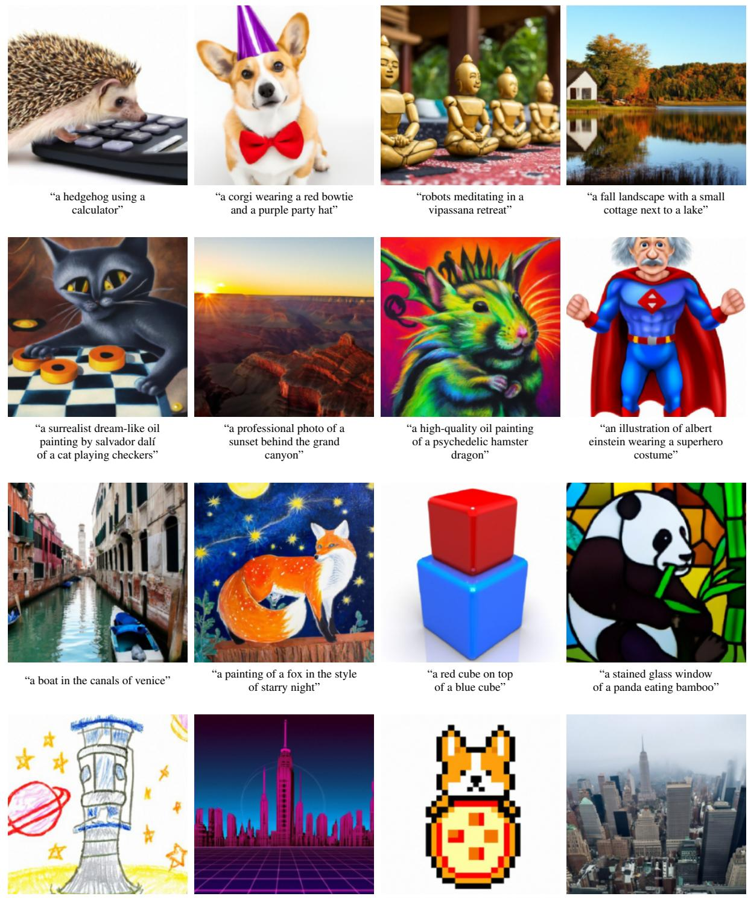  
“萨尔瓦多·达利（salvador dalí）风格的超现实主义梦幻油画，一只猫在下跳棋”  
“大峡谷后日落的专业摄影照片”  
“迷幻仓鼠龙的高质量油画”  
“身穿超级英雄服装的阿尔伯特·爱因斯坦的插画”  
“威尼斯运河中的一艘船”  
“《星夜》风格的狐狸画作”  
“蓝色立方体之上的红色立方体”  
“大熊猫吃竹子的彩色玻璃窗”  
“太空电梯的蜡笔画” “合成器波风格的未来主义城市”  
“像素艺术柯基披萨”  
“大雾涌入纽约”

Figure 1. 使用无分类器引导的 GLIDE 精选样本。我们观察到，我们的模型能够生成带有阴影和倒影的照片级逼真图像，能够以正确的方式组合多个概念，并能对新颖概念进行艺术化渲染。随机样本网格图见 Figure 17 和 18。

虽然我们的模型能够进行零样本（zero-shot）渲染生成各种文本提示词对应的图像，但在面对复杂提示词时，生成逼真的图像仍存在困难。因此，除了零样本生成之外，我们还为模型赋予了编辑功能，使用户能够迭代改进模型生成的样本，直到它们符合更复杂的提示词。具体来说，我们对模型进行了微调以执行图像修复（image inpainting），发现该模型能够根据自然语言提示词对现有图像进行逼真的编辑。模型生成的编辑结果与周围上下文的风格和光照相匹配，包括令人信服的阴影和反射。未来这些模型的应用可能会以前所未有的速度和便捷性辅助人类创作引人注目的自定义图像。

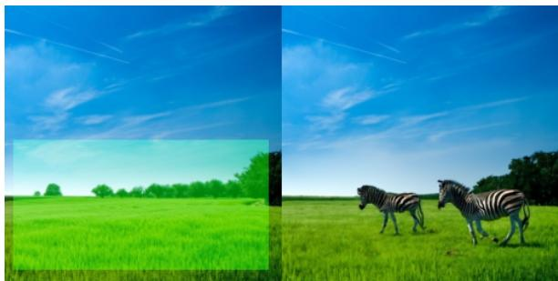  
“在田野里漫步的斑马”

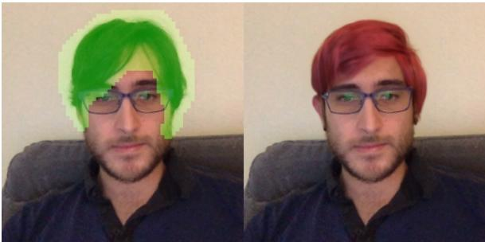  
“红头发的男人”

  
“在底座上抱着柯基犬的女孩”

  
“一瓶花”

  
“雪林中的一辆旧车”

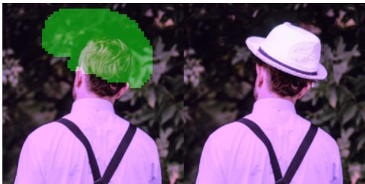  
“戴白帽子的男人”  
Figure 2. GLIDE 的文本条件图像修复示例。绿色区域被擦除，模型在给定提示词的条件下将其填补。我们的模型能够匹配周围上下文的风格和光照，从而生成逼真的补全结果。

我们注意到，由此得到的模型可以显著降低生成具有说服力的虚假信息或 Deepfakes 所需的工作量。为了防范这些恶意用例并同时促进未来的研究，我们发布了一个在经过滤的数据集上训练的较小规模扩散模型和一个加噪的 CLIP 模型。

我们将我们的系统称为 GLIDE，代表基于引导的文本到图像扩散生成与编辑系统（Guided Language to Image Diffusion for Generation and Editing）。我们将过滤后的小型模型称为 GLIDE (filtered)。

## 2. 背景

在接下来的章节中，我们将概述即将评估的最终模型的各个组成部分：扩散模型、无分类器引导（classifier-free guidance）和 CLIP 引导（CLIP guidance）。

## 2.1. 扩散模型

我们考虑由 Sohl-Dickstein et al. (2015) 提出并由 Song & Ermon (2020b) 以及 Ho et al. (2020) 改进的高斯扩散模型。给定一个来自数据分布的样本 $x _ { 0 } \sim q ( x _ { 0 } )$，我们通过向该样本逐步添加高斯噪声来生成隐变量的马尔可夫链 $x _ { 1 } , . . . , x _ { T }$：

$$
q (x _ {t} | x _ {t - 1}) := \mathcal {N} (x _ {t}; \sqrt {\alpha_ {t}} x _ {t - 1}, (1 - \alpha_ {t}) \mathcal {I})
$$

如果每一步添加的噪声幅度 $1 \ - \ \alpha _ { t }$ 足够小，后验分布 $q ( x _ { t - 1 } | x _ { t } )$ 可以很好地被对角高斯分布近似。此外，如果在整个链中添加的总噪声幅度 $1 - \alpha _ { 1 } . . . \alpha _ { T }$ 足够大，则 $x _ { T }$ 可以很好地被 $\mathcal { N } ( 0 , \mathcal { T } )$ 近似。这些性质表明可以学习一个模型 $p _ { \theta } ( x _ { t - 1 } | x _ { t } )$ 来近似真实的后验分布：

  
“温馨的客厅”

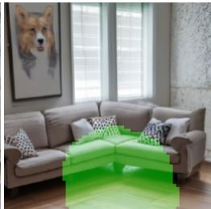  
“沙发上方墙上的一幅柯基画作”

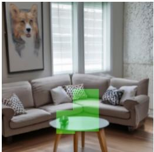  
“沙发前的一张圆形茶几”

  
“茶几上的一瓶花”

  
“房间角落里的一张沙发”

Figure 3. 使用 GLIDE 迭代创建复杂场景。首先，我们针对提示词“温馨的客厅”生成一张图像，然后使用所示的修复掩码（inpainting masks）和后续文本提示词在墙上添加一幅画、一张茶几以及茶几上的一瓶花，最后将墙面移至贴近沙发处。  
  
“戴着领结和生日帽的柯基”

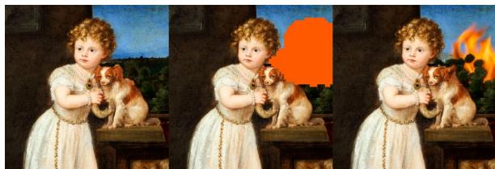  
“背景中的一团火”

  
“今天天空中只有一朵云”  
Figure 4. 结合 GLIDE 进行文本条件 SDEdit (Meng et al., 2021) 的示例，用户将草图与文本描述相结合，对图像进行更受控的修改。

$$
p _ {\theta} (x _ {t - 1} | x _ {t}) := \mathcal {N} (\mu_ {\theta} (x _ {t}), \Sigma_ {\theta} (x _ {t}))
$$

其可用于生成样本 $x _ { 0 } \sim p _ { \theta } ( x _ { 0 } )$，方法是从高斯噪声 $x _ { T } \sim \mathcal { N } ( 0 , \mathcal { T } )$ 开始，并在由 $x _ { T - 1 } , x _ { T - 2 } , . . . , x _ { 0 }$ 组成的序列步骤中逐渐减少噪声。

尽管对 log $p _ { \theta } ( x _ { 0 } )$ 存在一个可处理的变分下界（variational lower-bound，VLB），但通过优化一个对 VLB 中的各项进行重加权的代理目标（surrogate objective）可以获得更好的结果。为了计算这个代理目标，我们通过对 $x _ { 0 }$ 添加高斯噪声来生成样本 $x _ { t } \sim q ( x _ { t } | x _ { 0 } )$，然后使用标准的均方误差损失训练一个模型 $\epsilon _ { \theta }$ 来预测添加的噪声：

$$
L _ {\text { simple }} := E _ {t \sim [ 1, T ], x _ {0} \sim q (x _ {0}), \epsilon \sim \mathcal {N} (0, \mathbf {I})} [ | | \epsilon - \epsilon_ {\theta} (x _ {t}, t) | | ^ {2} ]
$$

Ho et al. (2020) 展示了如何从 $\epsilon _ { \theta } ( x _ { t } , t )$ 推导 $\mu _ { \theta } ( x _ { t } )$ 并将 $\Sigma _ { \theta }$ 固定为常数。他们还证明了该方法与先前基于去噪分数匹配（denoising score-matching）的模型（Song & Ermon, 2020b;a）等价，其中分数函数为 $\nabla _ { x _ { t } } \log { p ( x _ { t } ) }$ ∝ $\epsilon _ { \theta } ( x _ { t } , t )$。在后续工作中，Nichol & Dhariwal (2021) 提出了一种学习 $\Sigma _ { \theta }$ 的策略，使模型能够用更少的扩散步数生成高质量样本。我们在本文训练模型时采用了这一技术。

扩散模型也已成功应用于图像超分辨率（Nichol & Dhariwal, 2021; Saharia et al., 2021b）。遵循扩散的标准表述，高分辨率图像 $y _ { 0 }$ 在一系列步骤中被逐步加噪。然而，$p _ { \theta } \big ( y _ { t - 1 } | y _ { t } , x \big )$ 额外以低采样输入 $x$ 为条件，该输入通过在通道维度拼接 $x$（双三次上采样后）提供给模型。这些模型的结果在 FID、IS 以及人类对比评分上均优于先前的方法。

## 2.2. 引导扩散（Guided Diffusion）

Dhariwal & Nichol (2021) 发现，类别条件扩散模型的样本通常可以通过分类器引导（classifier guidance）得到改进，其中均值为 $\mu _ { \boldsymbol { \theta } } ( \boldsymbol { x } _ { t } | \boldsymbol { y } )$、方差为 $\Sigma _ { \theta } ( x _ { t } | y )$ 的类别条件扩散模型通过分类器预测的目标类别 $y$ 的对数概率梯度 $\log p _ { \phi } ( \boldsymbol { y } | \boldsymbol { x } _ { t } )$ 进行可加扰动。所得的新扰动均值 $\hat { \mu } _ { \boldsymbol { \theta } } ( \boldsymbol { x } _ { t } | \boldsymbol { y } )$ 给出如下：

$$
\hat {\mu} _ {\theta} (x _ {t} | y) = \mu_ {\theta} (x _ {t} | y) + s \cdot \Sigma_ {\theta} (x _ {t} | y) \nabla_ {x _ {t}} \log p _ {\phi} (y | x _ {t})
$$

系数 $s$ 被称为引导尺度（guidance scale），Dhariwal & Nichol (2021) 发现，增大 $s$ 能够以牺牲多样性为代价提高样本质量。

## 2.3. 无分类器引导（Classifier-free guidance）

Ho & Salimans (2021) 最近提出了无分类器引导（classifier-free guidance），这是一种用于引导扩散模型且无需训练独立分类器模型的技术。对于无分类器引导，在训练期间，类别条件扩散模型 $\epsilon _ { \theta } ( x _ { t } | y )$ 中的标签 $y$ 以固定概率被替换为空标签 ∅。在采样期间，模型的输出在 $\epsilon _ { \theta } ( x _ { t } | y )$ 的方向上进一步外推，并远离 $\epsilon _ { \theta } ( x _ { t } | \emptyset )$，具体如下：

$$
\hat {\epsilon} _ {\theta} (x _ {t} | y) = \epsilon_ {\theta} (x _ {t} | \emptyset) + s \cdot (\epsilon_ {\theta} (x _ {t} | y) - \epsilon_ {\theta} (x _ {t} | \emptyset))
$$

这里 $s \geq 1$ 是引导尺度（guidance scale）。该函数形式的灵感来源于隐式分类器

$$
p ^ {i} (y | x _ {t}) \propto \frac {p (x _ {t} | y)}{p (x _ {t})}
$$

其梯度可以用真实分数 $\epsilon ^ { * }$ 表示为

$$
\begin{array}{r} \nabla_ {x _ {t}} \log p ^ {i} (x _ {t} | y) \propto \nabla_ {x _ {t}} \log p (x _ {t} | y) - \nabla_ {x _ {t}} \log p (x _ {t}) \\ \propto \epsilon^ {*} (x _ {t} | y) - \epsilon^ {*} (x _ {t}) \end{array}
$$

为了使用通用文本提示词实现无分类器引导（classifier-free guidance），我们在训练过程中有时会将文本描述替换为空序列（我们也表示为 ∅）。然后，我们使用修改后的预测 ˆ 向描述 $c$ 进行引导：

$$
\hat {\epsilon} _ {\theta} (x _ {t} | c) = \epsilon_ {\theta} (x _ {t} | \emptyset) + s \cdot (\epsilon_ {\theta} (x _ {t} | c) - \epsilon_ {\theta} (x _ {t} | \emptyset))
$$

无分类器引导具有两个吸引人的特性。首先，它允许单个模型在引导过程中利用自身的知识，而不是依赖于一个单独的（有时规模更小的）分类模型的知识。其次，当以难以用分类器预测的信息（例如文本）为条件时，它简化了引导过程。

## 2.4. CLIP 引导

Radford et al. (2021) 提出了 CLIP，作为一种用于学习文本和图像之间联合表示的可扩展方法。CLIP 模型由两个独立的部分组成：图像编码器 $f ( x )$ 和描述编码器 $g ( c )$。在训练过程中，从大型数据集中采样 $( x , c )$ 对的批次，模型优化一个对比交叉熵损失：如果图像 $x$ 与给定的描述 $c$ 配对，则促使点积 $f ( x ) \cdot g ( c )$ 变高；如果图像和描述对应于训练数据中的不同对，则促使点积变低。

由于 CLIP 能够提供图像与描述有多接近的评分，一些研究工作已利用它来引导诸如 GAN 等生成模型朝向用户定义的文本描述生成（Galatolo et al., 2021; Patashnik et al., 2021; Murdock, 2021; Gal et al., 2021）。为了将相同的思想应用于扩散模型，我们可以在分类器引导中用 CLIP 模型替换分类器。具体而言，我们使用图像和描述编码的点积相对于图像的梯度来扰动逆向过程均值：

$$
\hat {\mu} _ {\theta} (x _ {t} | c) = \mu_ {\theta} (x _ {t} | c) + s \cdot \Sigma_ {\theta} (x _ {t} | c) \nabla_ {x _ {t}} \left(f (x _ {t}) \cdot g (c)\right)
$$

与分类器引导类似，我们必须在加噪图像 $x _ { t }$ 上训练 CLIP，以便在逆向过程中获得正确的梯度。在整个实验中，我们使用经过显式训练以具备噪声感知能力的 CLIP 模型，我们将其称为加噪 CLIP（noised CLIP）模型。

先前的工作 Crowson (2021a;b) 表明，未在加噪图像上训练过的公开 CLIP 模型仍可用于引导扩散模型。在附录 D 中，我们表明我们的加噪 CLIP 引导方法优于该方法，且无需数据增强或感知损失等额外技巧。我们推测，使用公开的 CLIP 模型进行引导会对样本质量产生不利影响，因为在采样过程中遇到的加噪中间图像对于该模型而言属于分布外（out-of-distribution）数据。

## 3. 相关工作

许多工作都探讨了文本条件图像生成（text-conditional image generation）问题。Xu et al. (2017)；Zhu et al. (2019)；Tao et al. (2020)；Zhang et al. (2021)；Ye et al. (2021) 使用公开可用的图像描述数据集训练带有文本条件的 GAN。Ramesh et al. (2021) 基于 van den Oord et al. (2017) 的方法合成以文本为条件的图像，其中自回归生成模型是在离散潜在编码（discrete latent codes）之上训练的。与我们的工作同期，Gu et al. (2021) 在离散潜在编码之上训练了文本条件的离散扩散模型，发现所产生的系统能够生成具有竞争力的图像样本。

有若干工作探索了使用扩散模型进行图像修复（image inpainting）。Meng et al. (2021) 发现扩散模型不仅可以修复图像的某些区域，还可以在图像的粗略草图（或一组颜色）为条件进行修复。Saharia et al. (2021a) 发现，当直接在修复任务上训练时，扩散模型可以平滑地修复图像区域而不会产生边缘伪影。

CLIP 此前已被用于引导图像生成。Galatolo et al. (2021)；Patashnik et al. (2021)；Murdock (2021)；Gal et al. (2021) 使用 CLIP 引导 GAN 向文本提示生成图像。在线 AI 生成艺术社区在使用未加噪 CLIP 引导的扩散模型方面取得了令人鼓舞的早期成果（Crowson, 2021a;b）。Kim & Ye (2021) 通过微调扩散模型以 CLIP 损失为目标，同时重建原始图像的 DDIM（Song et al., 2020a）潜在变量，从而使用文本提示编辑图像。Zhou et al. (2021) 训练了以受扰动 CLIP 图像嵌入为条件的 GAN 模型，从而得到了一个可以将图像建立在 CLIP 文本嵌入条件之上的模型。这些工作都没有探索加噪 CLIP 模型，因此通常依赖于数据增强和感知损失。

若干工作探索了基于文本的图像编辑。Zhang et al. (2020) 提出了一种双重注意力机制，用于使用文本嵌入来修复图像的缺失区域。Stap et al. (2020) 提出了一种使用基于文本的特征向量编辑人脸图像的方法。Bau et al. (2021) 将 CLIP 与最先进的 GAN 模型结合，以使用文本目标修复图像。与我们的工作同期，Avrahami et al. (2021) 使用 CLIP 引导的扩散模型以文本为条件修复图像区域。

## 4. 训练

在主要实验中，我们训练了一个在 64 × 64 分辨率下的 35 亿参数文本条件扩散模型（text-conditional diffusion model），以及另一个 15 亿参数的文本条件上采样扩散模型，以将分辨率提升至 $2 5 6 \times 2 5 6$。对于 CLIP 引导（CLIP guidance），我们还训练了一个加噪的 64 × 64 ViT-L CLIP 模型 (Dosovitskiy et al., 2020)。

## 4.1. 文本条件扩散模型

我们采用了 Dhariwal & Nichol (2021) 提出的 ADM 模型架构，但使用文本条件信息对其进行了增强。对于每个加噪图像 $x _ { t }$ 及其对应的文本描述 $c ,$，我们的模型预测 $p ( x _ { t - 1 } | x _ { t } , c )$。为了以文本为条件，我们首先将其编码为一个由 K 个标记（token）组成的序列，并将这些标记输入到 Transformer 模型中 (Vaswani et al., 2017)。该 Transformer 的输出以两种方式使用：首先，最终标记的嵌入（embedding）被用来替代 ADM 模型中的类别嵌入；其次，最后一层的标记嵌入（一个由 K 个特征向量组成的序列）被分别投影到整个 ADM 模型中各个注意力层的维度，然后拼接到各层的注意力上下文中。

我们在与 DALL-E (Ramesh et al., 2021) 相同的数据集上训练模型。我们采用了与 Dhariwal & Nichol (2021) 的 ImageNet 64 × 64 模型相同的模型架构，但将模型宽度扩展到 512 个通道，从而使模型的视觉部分拥有约 23 亿参数。对于文本编码 Transformer，我们使用了 24 个宽度为 2048 的残差块，参数量约为 12 亿。

此外，我们训练了一个 15 亿参数的上采样扩散模型，用于将分辨率从 $6 4 \times 6 4$ 提升至 256 × 256。

该模型以与基础模型相同的方式以文本为条件，但使用了一个较小的文本编码器，其宽度为 1024 而非 2048。除此之外，架构与 Dhariwal & Nichol (2021) 的 ImageNet 上采样器相匹配，只是我们将基础通道数增加到了 384。

我们在批大小为 2048 的情况下将基础模型训练了 250 万次迭代。在批大小为 512 的情况下将上采样模型训练了 160 万次迭代。我们发现这些模型在 16 位精度和传统的损失缩放（loss scaling）下能够稳定训练 (Micikevicius et al., 2017)。总训练计算量大致等于训练 DALL-E 所用的计算量。

## 4.2. 无分类器引导的微调

在初始训练运行之后，我们对基础模型进行了微调以支持无条件图像生成。该训练过程与预训练完全相同，只是有 20% 的文本标记序列被替换为空序列。这样，模型既保留了生成文本条件输出的能力，也可以无条件地生成图像。

## 4.3. 图像修复

大多数使用扩散模型进行图像修复（inpainting）的先前工作都没有专门针对该任务训练扩散模型（Sohl-Dickstein et al., 2015; Song et al., 2020b; Meng et al., 2021）。具体而言，扩散模型图像修复可以通过照常从扩散模型中采样来进行，但在每个采样步骤之后，将图像的已知区域替换为来自 $q ( x _ { t } | x _ { 0 } )$ 的样本。这种方法的缺点是模型在采样过程中无法看到完整的上下文（只能看到其加噪版本），在我们早期的实验中偶尔会导致不期望出现的边缘伪影。

为了获得更好的结果，我们类似于 Saharia et al. (2021a) 显式微调我们的模型以执行图像修复。在微调过程中，训练样本的随机区域被擦除，剩余部分与一个掩码通道一起作为额外的条件信息输入到模型中。我们修改了模型架构，使其具有四个额外的输入通道：第二组 RGB 通道和一个掩码通道。在微调之前，我们将这些新通道对应的输入权重初始化为零。对于上采样模型，我们始终提供完整的低分辨率图像，但仅提供高分辨率图像的未掩码区域。

## 4.4. 加噪 CLIP 模型

为了更好地匹配来自 Dhariwal & Nichol (2021) 的分类器引导（classifier guidance）技术，我们训练了加噪 CLIP 模型，该模型具有一个图像编码器 $f ( x _ { t } , t )$，用于接收加噪图像 $x _ { t }$，并在其他方面使用与原始 CLIP 模型相同的目标进行训练。我们在 $6 4 \times 6 4$ 分辨率下训练这些模型，

“a small kitchen with a low ceiling”

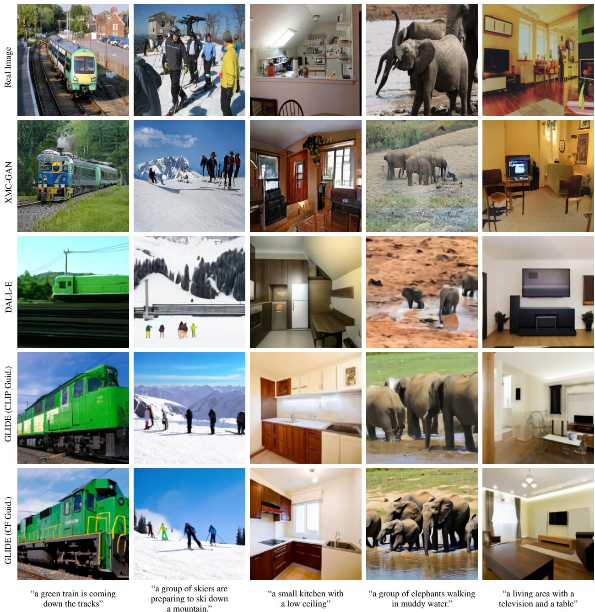  
Figure 5. MS-COCO 提示词上的随机图像样本。对于 XMC-GAN，我们采用来自 Zhang et al. (2021) 的样本。对于 DALL-E，我们在温度 0.85 下生成样本，并使用 CLIP 重排序从 256 个样本中选择最佳样本。对于 GLIDE，我们使用尺度为 2.0 的 CLIP 引导和尺度为 3.0 的无分类器引导（classifier-free guidance）。我们没有对 GLIDE 进行任何 CLIP 重排序或精心挑选（cherry-picking）。

并采用与我们基础模型相同的噪声调度。

## 5. 结果

## 5.1. 定性结果

在 Figure 5 中直观对比 CLIP 引导与无分类器引导时，我们发现无分类器引导生成的样本通常比使用 CLIP 引导生成的样本看起来更逼真。我们其余的样本均使用无分类器引导生成，我们将在下一节中阐述这一选择的理由。

在 Figure 1 中，我们观察到采用无分类器引导（classifier-free guidance）的 GLIDE 能够泛化到各种各样的提示词。该模型通常能生成逼真的阴影和倒影，以及高质量的纹理。它还能够生成各种风格的插图，例如特定艺术家或画作的风格，或是像素艺术（pixel art）等通用风格。最后，该模型能够组合多个概念（例如柯基犬、领结和生日帽），同时将属性（例如颜色）准确绑定到这些物体上。

  
(a) 精确率/召回率（Precision/Recall）

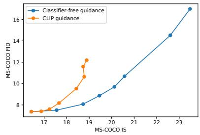  
(b) IS/FID

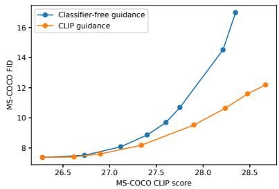  
(c) CLIP 得分/FID

Figure 6. 在 MS-COCO 64 × 64 上比较无分类器引导与 CLIP 引导的多样性-保真度权衡（diversity-fidelity trade-off）。  
  
(a) 照片逼真度（Photorealism）

  
(b) 描述相似度（Caption Similarity）  
Figure 7. 用于寻找无分类器引导和 CLIP 引导最佳引导尺度的由人工评估得出的 Elo 分数。无分类器引导和 CLIP 引导的比较是分别进行的，但通过对无引导采样的 Elo 分数进行归一化，可以将它们叠加在同一张图表上。

在图像修复（inpainting）任务中，我们发现 GLIDE 可以使用文本提示真实地修改现有图像，并在必要时插入新物体、阴影和倒影（Figure 2）。该模型在将物体编辑到画作中时甚至可以匹配风格。我们还在 Figure 4 中使用 SDEdit（Meng et al., 2021）进行了实验，发现我们的模型能够将草图转化为逼真的图像编辑。在 Figure 3 中，我们展示了如何通过零样本生成后接一系列修复编辑，迭代地使用 GLIDE 来生成复杂的场景。

在 Figure 5 中，我们在 MS-COCO 的描述上将我们的模型与先前最先进的文本条件图像生成模型进行了比较，发现我们的模型在无需 CLIP 重排序或精心挑选（cherrypicking）的情况下生成了更逼真的图像。

有关更多的定性比较，请参见附录 C、D、E。

## 5.2. 定量结果 (Quantitative Results)

我们首先通过观察质量-保真度权衡的帕累托前沿（Pareto frontier），来评估无分类器引导（classifier-free guidance）与 CLIP 引导（CLIP guidance）之间的差异。在 Figure 6 中，我们在 64 × 64 分辨率下的零样本 MS-COCO 生成任务上评估了这两种方法。我们考察了 Precision/Recall（Kynka¨anniemi et al., 2019）¨、FID（Heusel et al., 2017）、Inception Score（Salimans et al., 2016）以及 CLIP score1（Radford et al., 2021）。随着我们增加两者的引导尺度，我们在 FID 对比 IS、Precision 对比 Recall 以及 CLIP score 对比 FID 中观察到了清晰的权衡关系。在前两条曲线中，我们发现无分类器引导（几乎）达到了帕累托最优。而在绘制 CLIP score 与 FID 的关系图时，我们观察到了完全相反的趋势；特别是，CLIP 引导似乎比无分类器引导能够更显著地提高 CLIP score。

我们推测，CLIP 引导是在为用于评估的 CLIP 模型寻找对抗性样本（adversarial examples），而不是在匹配提示词（prompt）方面真正优于无分类器引导。为了验证这一假设，我们雇佣了人类评估人员来评判生成图像的样本质量。在此设定中，人类评估员会看到两张 256 × 256 的图像，并必须选择哪一个样本 1) 更好地匹配给定的描述文本（caption），或 2) 看起来更加逼真（photorealistic）。人类评估员也可以表明两张图像都没有明显优于另一方，在这种情况下，两个模型各得半胜。

利用我们的人工评估方案，我们首先分别遍历了两种方法的引导尺度（Figure 7），然后使用上一阶段的最佳尺度对这两种方法进行了比较（Table 1）。我们发现人类的评判结果与 CLIP score 不一致，人类认为无分类器引导能够产生更高质量且与对应提示词更吻合的样本。

Table 1. 在 256 × 256 分辨率的 MS-COCO 验证集提示词上，对无引导扩散采样（unguided diffusion sampling）、无分类器引导和 CLIP 引导进行人工评估所得的 Elo 分数。对于无分类器引导，我们使用的尺度为 3.0；对于 CLIP 引导，尺度为 2.0。关于 Elo 分数计算方式的更多细节，请参见 Appendix A.1。

<table><tr><td>引导方式</td><td>逼真度</td><td>描述匹配度</td></tr><tr><td>Unguided</td><td>-88.6</td><td>-106.2</td></tr><tr><td>CLIP guidance</td><td>-73.2</td><td>29.3</td></tr><tr><td>Classifier-free guidance</td><td>82.7</td><td>110.9</td></tr></table>

Table 2. 在 MS-COCO 256 × 256 上的 FID 对比。与以往的工作类似，我们为模型采样了 30k 条描述文本，并与整个验证集进行对比。对于我们的模型，我们报告了尺度为 1.5 的无分类器引导的数值，因为该尺度能取得最佳的 FID。

<table><tr><td>模型</td><td>FID</td><td>零样本 FID</td></tr><tr><td>AttnGAN (Xu et al., 2017)</td><td>35.49</td><td></td></tr><tr><td>DM-GAN (Zhu et al., 2019)</td><td>32.64</td><td></td></tr><tr><td>DF-GAN (Tao et al., 2020)</td><td>21.42</td><td></td></tr><tr><td>DM-GAN + CL (Ye et al., 2021)</td><td>20.79</td><td></td></tr><tr><td>XMC-GAN (Zhang et al., 2021)</td><td>9.33</td><td></td></tr><tr><td>LAFITE (Zhou et al., 2021)</td><td>8.12</td><td></td></tr><tr><td>DALL-E (Ramesh et al., 2021)</td><td></td><td> $\sim 28$ </td></tr><tr><td>LAFITE (Zhou et al., 2021)</td><td></td><td>26.94</td></tr><tr><td>GLIDE</td><td></td><td>12.24</td></tr><tr><td>GLIDE (验证集过滤)</td><td></td><td>12.89</td></tr></table>

我们还将 GLIDE 与其他文本条件图像生成模型进行了对比。从表 2 可以看出，我们的模型在从未在该数据集上显式训练的情况下，在 MS-COCO 上取得了具有竞争力的 FID。如 Ramesh et al. (2021) 所做的那样，我们还针对 MS-COCO 验证集的一个子集计算了 FID，该子集已经清除了所有与我们训练集中的图像相似的图像。这使得验证批次减少了 21%。我们发现，在这种情况下我们的 FID 从 12.24 略微增加到 12.89，这在很大程度上可以通过使用较小的参考批次时 FID 偏差的变化来解释。

最后，我们使用人工评估协议将 GLIDE 与 DALL-E 进行了对比（Table 3）。需要注意的是，GLIDE 是在与 DALL-E 大致相同的训练算力下训练的，但模型规模要小得多（35 亿对 120 亿参数）。它还具有更低的采样延迟，且无需 CLIP 重排序（reranking）。

我们在 DALL-E 和 GLIDE 之间进行了三组对比。首先，我们在两个模型均不使用 CLIP 重排序的情况下进行了对比。其次，我们仅对 DALL-E 使用 CLIP 重排序。最后，我们对 DALL-E 使用 CLIP 重排序，同时将 GLIDE 的样本通过 DALL-E 所使用的离散 VAE 进行投影。后者使我们能够评估 DALL-E 的模糊样本如何影响人类的评判。我们针对 DALL-E 模型使用两种温度进行了所有评估。在所有设置中，人类评估者都更青睐我们的模型，即使在极度偏向 DALL-E 的配置下也是如此——即允许 DALL-E 使用多得多的测试期计算（通过 CLIP 重排序），同时降低 GLIDE 的样本质量（通过 VAE 模糊）。

Table 3. GLIDE 与 DALL-E 的人工评估对比结果。我们报告了我们的模型在图片真实感和字幕相似度方面的胜率。在最后一行中，我们将 DALL-E 使用的 dVAE 应用到了 GLIDE 的输出上。

<table><tr><td></td><td>DALL-E 温度 (Temp.)</td><td>真实感 (Photo-realism)</td><td>描述相似度 (Caption Similarity)</td></tr><tr><td rowspan="2">无重排序 (No reranking)</td><td>1.0</td><td>91%</td><td>83%</td></tr><tr><td>0.85</td><td>84%</td><td>80%</td></tr><tr><td rowspan="2">DALL-E 重排序 (DALL-E reranked)</td><td>1.0</td><td>89%</td><td>71%</td></tr><tr><td>0.85</td><td>87%</td><td>69%</td></tr><tr><td rowspan="2">DALL-E 重排序 + GLIDE 模糊 (DALL-E reranked+ GLIDE blurred)</td><td>1.0</td><td>72%</td><td>63%</td></tr><tr><td>0.85</td><td>66%</td><td>61%</td></tr></table>

有关带有 CLIP 重排序的 DALL-E 和带有各种引导策略的 GLIDE 的样本网格，请参见附录 G。

## 6. 安全考量 (Safety Considerations)

我们的模型能够生成虚假但逼真的图像，并使非专业用户能够快速对现有图像进行令人信服的编辑。因此，在没有安全保障措施的情况下发布我们的模型，将大幅降低制作令人信服的虚假信息或深度伪造 (Deepfakes) 所需的技术门槛。此外，由于模型的生成样本反映了包括源自数据集在内的各种偏见，应用该模型可能会在无意中助长有害的社会偏见。

为了减轻发布这些模型可能带来的负面影响，我们在训练用于发布的模型之前对训练图像进行了过滤。首先，我们从互联网上收集了一个包含数亿张图像的数据集（该数据集与用于训练 CLIP 和 DALL-E 的数据集基本不重叠），随后对这些数据应用了多种过滤器。我们过滤掉了包含人物的训练图像，以降低模型在许多以人物为中心的问题用例中的能力。我们还担心模型可能被用于生成暴力图像和仇恨符号，因此也过滤掉了其中的一部分内容。有关我们数据过滤过程的更多详细信息，请参见附录 F.1。

我们训练了一个 3 亿参数的小型模型，我们

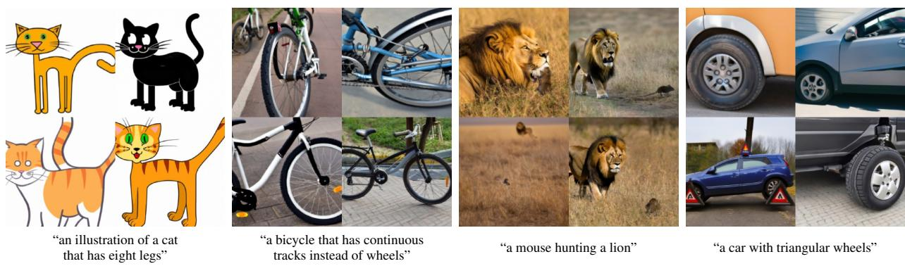  
“一辆用履带代替车轮的自行车”  
“一只老鼠在捕猎一只狮子”  
“一辆带有三角形车轮的汽车”

Figure 8. 当提示词为某些不寻常的物体或场景时，GLIDE 的失败案例。

称为 GLIDE (filtered)，该模型在我们的过滤数据集上进行训练。接着，我们调研了如果开源模型权重，GLIDE (filtered) 如何降低被滥用的风险。在这一包含使用一组对抗性提示词对模型进行红队测试（red teaming）的调查中，我们没有发现任何模型能够生成可识别的人类图像的情况，这表明我们的数据过滤器具有足够低的假阴性率。我们还探究了 GLIDE (filtered) 中的某些偏见形式，发现它保留了数据集中的偏见，甚至可能放大了这些偏见。例如，当被要求生成“女孩的玩具”（toys for girls）时，相比于提示词“男孩的玩具”（toys for boys），我们的模型会生成更多粉红色的玩具和毛绒玩具。此外，我们还发现，当给出诸如“宗教场所”（a religious place）等通用文化图像的提示词时，我们的模型往往会强化西方刻板印象。我们还观察到，当使用无分类器引导（classifier-free guidance）时，模型的偏见会被放大。最后，虽然我们削弱了模型生成特定类别图像的能力，但它仍保留了图像修复（inpainting）能力，其被滥用的潜在风险是未来跨学科研究的一个重要领域。有关详细示例和图像，请参见附录 F.2。

上述调研仅针对 GLIDE (filtered) 本身，但没有任何模型是孤立存在的。例如，通常可以通过组合多个模型来获得一组新功能。为了探讨这一问题，我们将 GLIDE (filtered) 替换进一个公开可用的 CLIP 引导扩散程序（Crowson, 2021a）中，并研究了所构成的模型对的生成能力。我们普遍发现，虽然 CLIP 模型（在未过滤的数据上训练）使我们的模型能够生成一些可识别的面部表情或仇恨图像，但同一个 CLIP 模型在与公开可用的 ImageNet 扩散模型配对时，也生成了质量大致相同的图像。有关更多详细信息，请参见附录 F.2。

为了促进对 CLIP 引导扩散的进一步研究，我们还训练并发布了一个在过滤数据集上训练的加噪 ViT-B CLIP 模型。我们将用于训练 GLIDE (filtered) 的数据集与原始 CLIP 数据集的过滤版本进行了合并。为了对该模型进行红队测试，我们使用它来同时引导

GLIDE (filtered) 和一个公开的 64 × 64 ImageNet 模型。在我们尝试的提示词中，我们发现与现有的公开 CLIP 模型所生成的此类图像质量相比，新的 CLIP 模型并没有显著提高暴力图像或人物图像的生成质量。

我们还测试了 GLIDE (filtered) 直接复现训练图像的能力。在该实验中，我们针对训练集中的 30K 个提示词进行了图像采样，并计算了每张生成图像与原始训练图像在 CLIP 隐空间（latent space）中的距离。随后我们检查了距离最小的图像对。在我们检查的所有图像对中，模型均未完全复现训练图像。

## 7. 局限性

尽管我们的模型通常能够以复杂的方式组合截然不同的概念，但有时无法捕捉到某些描述极不寻常的物体或场景的提示词（prompts）。在 Figure 8 中，我们提供了这些失败案例的一些示例。

我们未经优化的模型在单张 A100 GPU 上采样一张图像需要 15 秒。这比相关的 GAN 方法的采样速度慢得多，后者通过单次前向传播生成图像，因此更适合用于实时应用。

## 8. 致谢

我们要感谢 Lama Ahmad、Rosie Campbell、Gretchen Krueger、Steven Adler、Miles Brundage 和 Tyna Eloundou 对我们模型及其社会影响进行的深入探索与讨论。我们还要感谢 Yura Burda 对本论文早期草稿提供的反馈，以及 Mikhail Pavlov 为文本条件生成模型寻找高难度提示词。

## 参考文献

Avrahami, O., Lischinski, D., and Fried, O. Blended diffusion for text-driven editing of natural images. arXiv:2111.14818, 2021.

Bau, D., Andonian, A., Cui, A., Park, Y., Jahanian, A., Oliva, A., and Torralba, A. Paint by word. arXiv:2103.10951, 2021.

Brock, A., Donahue, J., and Simonyan, K. Large scale gan training for high fidelity natural image synthesis. arXiv:1809.11096, 2018.

Buolamwini, J. and Gebru, T. Gender shades: Intersectional accuracy disparities in commercial gender classification. In Friedler, S. A. and Wilson, C. (eds.), Proceedings of the 1st Conference on Fairness, Accountability and Transparency, volume 81 of Proceedings of Machine Learning Research, pp. 77–91. PMLR, 23–24 Feb 2018. URL https://proceedings.mlr.press/v81/ buolamwini18a.html.

Crowson, K. Clip guided diffusion hq 256x256. https: //colab.research.google.com/drive/ 12a\_Wrfi2\_gwwAuN3VvMTwVMz9TfqctNj, 2021a.

Crowson, K. Clip guided diffusion 512x512, secondary model method. https:// twitter.com/RiversHaveWings/status/ 1462859669454536711, 2021b.

Dhariwal, P. and Nichol, A. Diffusion models beat gans on image synthesis. arXiv:2105.05233, 2021.

Dosovitskiy, A., Beyer, L., Kolesnikov, A., Weissenborn, D., Zhai, X., Unterthiner, T., Dehghani, M., Minderer, M., Heigold, G., Gelly, S., Uszkoreit, J., and Houlsby, N. An image is worth 16x16 words: Transformers for image recognition at scale. arXiv:2010.11929, 2020.

Gal, R., Patashnik, O., Maron, H., Chechik, G., and Cohen-Or, D. Stylegan-nada: Clip-guided domain adaptation of image generators. arXiv:2108.00946, 2021.

Galatolo, F. A., Cimino, M. G. C. A., and Vaglini, G. Generating images from caption and vice versa via clip-guided generative latent space search. arXiv:2102.01645, 2021.

Gu, S., Chen, D., Bao, J., Wen, F., Zhang, B., Chen, D., Yuan, L., and Guo, B. Vector quantized diffusion model for text-to-image synthesis. arXiv:2111.14822, 2021.

Heusel, M., Ramsauer, H., Unterthiner, T., Nessler, B., and Hochreiter, S. Gans trained by a two time-scale update rule converge to a local nash equilibrium. Advances in Neural Information Processing Systems 30 (NIPS 2017), 2017.

Ho, J. and Salimans, T. Classifier-free diffusion guidance. In NeurIPS 2021 Workshop on Deep Generative Models and Downstream Applications, 2021. URL https:// openreview.net/forum?id=qw8AKxfYbI.

Ho, J., Jain, A., and Abbeel, P. Denoising diffusion probabilistic models. arXiv:2006.11239, 2020.

Ho, J., Saharia, C., Chan, W., Fleet, D. J., Norouzi, M., and Salimans, T. Cascaded diffusion models for high fidelity image generation. arXiv:2106.15282, 2021.

Karras, T., Laine, S., and Aila, T. A style-based generator architecture for generative adversarial networks. arXiv:arXiv:1812.04948, 2019a.

Karras, T., Laine, S., Aittala, M., Hellsten, J., Lehtinen, J., and Aila, T. Analyzing and improving the image quality of stylegan. arXiv:1912.04958, 2019b.

Kim, G. and Ye, J. C. Diffusionclip: Text-guided image manipulation using diffusion models. arXiv:2110.02711, 2021.

Kynka¨anniemi, T., Karras, T., Laine, S., Lehtinen, J., and¨ Aila, T. Improved precision and recall metric for assessing generative models. arXiv:1904.06991, 2019.

Meng, C., Song, Y., Song, J., Wu, J., Zhu, J.-Y., and Ermon, S. Sdedit: Image synthesis and editing with stochastic differential equations. arXiv:2108.01073, 2021.

Micikevicius, P., Narang, S., Alben, J., Diamos, G., Elsen, E., Garcia, D., Ginsburg, B., Houston, M., Kuchaiev, O., Venkatesh, G., and Wu, H. Mixed precision training. arXiv:1710.03740, 2017.

Murdock, R. The big sleep. https://twitter.com/ advadnoun/status/1351038053033406468, 2021.

Nichol, A. and Dhariwal, P. Improved denoising diffusion probabilistic models. arXiv:2102.09672, 2021.

Patashnik, O., Wu, Z., Shechtman, E., Cohen-Or, D., and Lischinski, D. Styleclip: Text-driven manipulation of stylegan imagery. arXiv:2103.17249, 2021.

Radford, A., Kim, J. W., Hallacy, C., Ramesh, A., Goh, G., Agarwal, S., Sastry, G., Askell, A., Mishkin, P., Clark, J., Krueger, G., and Sutskever, I. Learning transferable visual models from natural language supervision. arXiv:2103.00020, 2021.

Ramesh, A., Pavlov, M., Goh, G., Gray, S., Voss, C., Radford, A., Chen, M., and Sutskever, I. Zero-shot text-toimage generation. arXiv:2102.12092, 2021.

Razavi, A., van den Oord, A., and Vinyals, O. Generating diverse high-fidelity images with VQ-VAE-2. arXiv:1906.00446, 2019.

Saharia, C., Chan, W., Chang, H., Lee, C. A., Ho, J., Salimans, T., Fleet, D. J., and Norouzi, M. Palette: Image-toimage diffusion models. arXiv:2111.05826, 2021a.

Saharia, C., Ho, J., Chan, W., Salimans, T., Fleet, D. J., and Norouzi, M. Image super-resolution via iterative refinement. arXiv:arXiv:2104.07636, 2021b.

Salimans, T., Goodfellow, I., Zaremba, W., Cheung, V., Radford, A., and Chen, X. Improved techniques for training gans. arXiv:1606.03498, 2016.

Santurkar, S., Tsipras, D., Tran, B., Ilyas, A., Engstrom, L., and Madry, A. Image synthesis with a single (robust) classifier. arXiv:1906.09453, 2019.

Sohl-Dickstein, J., Weiss, E. A., Maheswaranathan, N., and Ganguli, S. Deep unsupervised learning using nonequilibrium thermodynamics. arXiv:1503.03585, 2015.

Song, J., Meng, C., and Ermon, S. Denoising diffusion implicit models. arXiv:2010.02502, 2020a.

Song, Y. and Ermon, S. Improved techniques for training score-based generative models. arXiv:2006.09011, 2020a.

Song, Y. and Ermon, S. Generative modeling by estimating gradients of the data distribution. arXiv:arXiv:1907.05600, 2020b.

Song, Y., Sohl-Dickstein, J., Kingma, D. P., Kumar, A., Ermon, S., and Poole, B. Score-based generative modeling through stochastic differential equations. arXiv:2011.13456, 2020b.

Stap, D., Bleeker, M., Ibrahimi, S., and ter Hoeve, M. Conditional image generation and manipulation for userspecified content. arXiv:2005.04909, 2020.

Tao, M., Tang, H., Wu, S., Sebe, N., Jing, X.-Y., Wu, F., and Bao, B. Df-gan: Deep fusion generative adversarial networks for text-to-image synthesis. arXiv:2008.05865, 2020.

van den Oord, A., Vinyals, O., and Kavukcuoglu, K. Neural discrete representation learning. arXiv:1711.00937, 2017.

Vaswani, A., Shazeer, N., Parmar, N., Uszkoreit, J., Jones, L., Gomez, A. N., Kaiser, L., and Polosukhin, I. Attention is all you need. arXiv:1706.03762, 2017.

Xu, T., Zhang, P., Huang, Q., Zhang, H., Gan, Z., Huang, X., and He, X. Attngan: Fine-grained text to image generation with attentional generative adversarial networks. arXiv:1711.10485, 2017.

Ye, H., Yang, X., Takac, M., Sunderraman, R., and Ji, S. Improving text-to-image synthesis using contrastive learning. arXiv:2107.02423, 2021.

Zhang, H., Koh, J. Y., Baldridge, J., Lee, H., and Yang, Y. Cross-modal contrastive learning for text-to-image generation. arXiv:2101.04702, 2021.

Zhang, L., Chen, Q., Hu, B., and Jiang, S. Text-guided neural image inpainting. In Proceedings ofthe 28th ACM International Conference on Multimedia, MM ’20, pp. 1302–1310, New York, NY, USA, 2020. Association for Computing Machinery. ISBN 9781450379885. doi: 10. 1145/3394171.3414017. URL https://doi.org/ 10.1145/3394171.3414017.

Zhou, S., Gordon, M. L., Krishna, R., Narcomey, A., Fei-Fei, L., and Bernstein, M. S. Hype: A benchmark for human eye perceptual evaluation of generative models, 2019.

Zhou, Y., Zhang, R., Chen, C., Li, C., Tensmeyer, C., Yu, T., Gu, J., Xu, J., and Sun, T. Lafite: Towards language-free training for text-to-image generation. arXiv:2111.13792, 2021.

Zhu, M., Pan, P., Chen, W., and Yang, Y. Dm-gan: Dynamic memory generative adversarial networks for textto-image synthesis. arXiv:1904.01310, 2019.

## A. 评估设置

## A.1. 人工评估

在收集人工评估时，我们在评估照片级真实感（photorealism）时总是收集 1,000 次成对比较。在评估描述相似度（caption similarity）时，我们同样收集 1,000 次比较，除了在对引导尺度（guidance scales）进行参数扫描时仅收集 500 次。

在计算胜场和 Elo 分数时，我们将平局计为每个模型各获胜半场。通过这种方式，平局有效地稀释了每个模型的胜场数。

为了计算 Elo 分数，我们构建了一个矩阵 A，其中条目 $A _ { i j }$ 表示模型 i 击败模型 j 的次数。我们将所有 N 个模型的 Elo 分数初始化为 $\sigma _ { i } = 0 , i \in [ 1 , N ]$。我们通过最小化以下目标函数来计算 Elo 分数：

$$
L _ {\mathrm{elo}} := - \sum_ {i, j} A _ {i j} \cdot \log \left(\frac {1}{1 + 1 0 ^ {(\sigma_ {i} - \sigma_ {j}) / 4 0 0}}\right)
$$

## A.2. 自动化评估

我们使用来自验证集提示词（validation prompts）的 30,000 个样本来计算 MS-COCO FID 和其他评估指标。除非另有说明，我们使用整个验证集作为参考批次（reference batch），并对验证图像进行中心裁剪（center-crop）。这种裁剪方式与 Ramesh et al. (2021) 一致，但与大多数先前的文本条件图像合成（text-conditional image synthesis）文献不同，后者通常对图像进行挤压拉伸（squeeze）而非中心裁剪。然而，中心裁剪在无条件和类别条件图像合成的大多数工作中都是标准做法，我们希望它在未来也能成为文本条件图像合成的标准做法。

对于 CLIP 分数，我们采用 Radford et al. (2021) 发布的 CLIP ViT-B/16 模型，并按 CLIP logit 尺度（此处为 100）对分数进行缩放。

## B. 超参数

## B.1. 训练超参数

我们的加噪 CLIP（noised CLIP）模型使用补丁大小（patch size）为 4 × 4 的 ViT (Dosovitskiy et al., 2020) 处理 64 × 64 的图像。我们在 Radford et al. (2021) 和 Ramesh et al. (2021) 所使用数据集各占 50% 的混合数据集上，以 32K 的批次大小（batch size）对 CLIP 模型训练了 390K 次迭代。对于最终的 CLIP 模型，我们训练了一个权重衰减（weight decay）为 0.0125 的 ViT-L。训练完成后，我们在更广泛的互联网图像数据集上对最终的 ViT-L 进行了 30K 次迭代的微调。

我们对 GLIDE (filtered) 进行了 1.1M 次迭代的预训练，随后针对无分类器引导（classifier-free guidance）和图像修复（inpainting）又进行了 500K 次迭代的微调。此外，我们训练了一个具有 192 个基础通道和 512 个文本编码器通道的小型过滤上采样器（filtered upsampler）模型，共训练了 400K 次迭代。

Table 4. 比较我们的小模型与大模型的人工评估所得 Elo 分数

<table><tr><td>模型大小</td><td>引导尺度</td><td>照片级真实感</td><td>描述相似度</td></tr><tr><td>300M</td><td>1.0</td><td>-131.8</td><td>-136.4</td></tr><tr><td>300M</td><td>4.0</td><td>28.2</td><td>70.9</td></tr><tr><td>3.5B</td><td>1.0</td><td>-23.9</td><td>-27.1</td></tr><tr><td>3.5B</td><td>3.0</td><td>133.0</td><td>140.5</td></tr></table>

## B.2. 采样超参数

对于本文中展示的样本，除了修复（inpainting）样本仅使用 100 步之外，我们使用 150 个扩散步对基础模型进行采样。对于评估，我们使用 250 个扩散步对基础模型进行采样，因为这能在 FID 上带来微弱的提升。

对于上采样器，我们采用了一种特殊的跨步采样策略（strided sampling schedule），仅需 27 个扩散步即可获得良好的样本质量。具体而言，我们将采样过程分为五个分段，并在每个分段内按等间距步数进行采样，步数分别为：10、10、3、2、2。这意味着我们在 (800, 1000] 区间内仅采样两个时间步，而在 (0, 200] 区间内采样 10 个时间步。该策略是通过在我们的内部验证集上对 FID 进行参数扫描确定的。

## C. 与较小模型的比较

训练我们的大型 GLIDE 模型是否值得？为了回答这个问题，我们在完整数据集上使用与 GLIDE (filtered) 相同的超参数训练了另一个 3 亿（300M）参数的模型（称为 GLIDE (small)）。我们对比了大型、小型和安全模型的样本，以确定在庞大且多样化的数据集上训练如此大的模型能带来哪些能力提升。

在 Figure 9 中，我们观察到较小的模型往往无法将属性绑定到对象上（例如柯基犬），并且在组合任务中表现较差（例如积木）。所有模型通常都能生成逼真的图像，但在我们完整数据集上训练的两个模型在结合不寻常概念（例如使用计算器的刺猬）方面表现要好得多。

我们还进行了一项人工评估，对比了小型和大型模型在有无无分类器引导（classifier-free guidance）情况下的表现。我们首先通过人工评估对 300M 模型的引导尺度进行了参数扫描，发现对于该小型模型，人类对 4.0 尺度的偏好略高于 3.0。随后我们进行了人工评估，比较了两个模型在有无引导下的表现（Table 4）。我们发现，无分类器引导带来的 Elo 提升比将模型规模扩大约 10 倍还要显著。

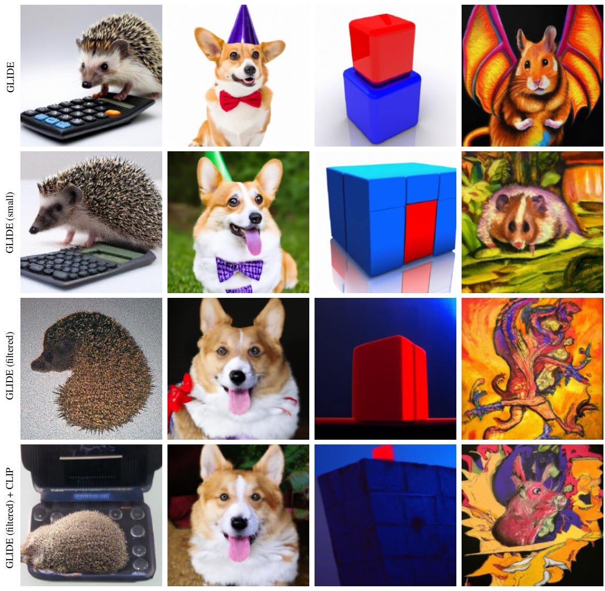  
“一只使用计算器的刺猬”  
“一只戴着红色领结和紫色派对帽的柯基犬”  
“蓝色立方体上面的红色立方体”  
“迷幻仓鼠龙的高质量油画”

Figure 9. 比较来自我们的大型模型（第一行）、在相同数据上训练的小型版本（第二行）以及我们在较小的过滤数据集上训练的已发布小型模型（第三行）的无分类器引导样本。在最后一行中，我们展示了使用在过滤数据上训练的 CLIP 模型引导我们的小型模型生成的样本。样本未经精心挑选。

## D. 与无噪声 CLIP 引导的比较

现有工作使用了公开可用的 CLIP 模型来引导扩散模型。为了通过这种方法获得可识别的样本，通常需要为生成过程精心设计一组数据增强和辅助损失。我们推测，这在很大程度上是由于 CLIP 模型的训练方式所致：它并没有被训练去识别扩散采样过程中产生的带噪或模糊图像。

为了检验这一假设，我们将一个流行的 CLIP 引导扩散程序 (Crowson, 2021a) 与我们基于加噪 CLIP 模型的方法进行了对比（Figure 10）。我们使用与 Radford et al. (2021) 相同的数据集在 64 × 64 图像上训练了一个加噪 ViT-B CLIP 模型。然后，我们使用该加噪 CLIP 模型引导预训练的 ImageNet 模型生成符合文本提示的图像，并采用 15.0 的固定梯度尺度。由于 ImageNet 模型是类别条件的，我们在每个时间步随机选择一个不同的类别标签。接着，我们使用扩散上采样器将生成的 64 × 64 图像上采样至 256 × 256。我们发现，尽管该方法比该 notebook 中使用的方法简单得多，但生成的图像质量相当甚至更高，这表明让 CLIP 具备噪声感知能力确实有所助益。

未加噪 CLIP（+ 辅助损失）  
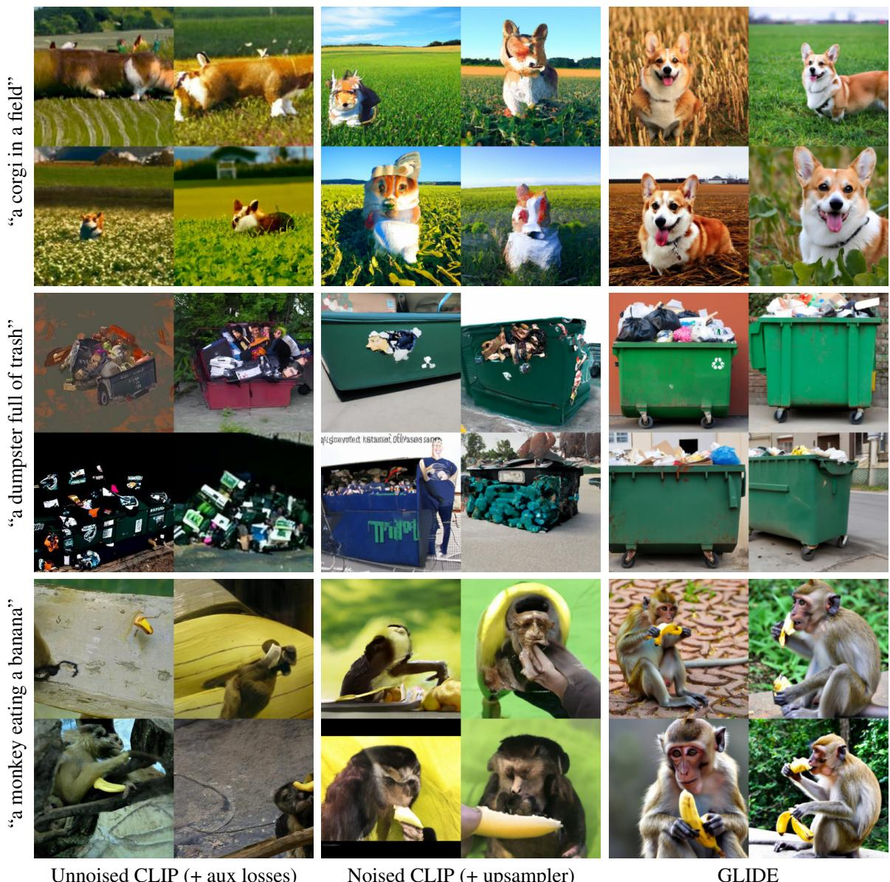

“acorgiinafield”

加噪 CLIP（+ 上采样器）

GLIDE

Figure 10. GLIDE 与应用于预训练 ImageNet 扩散模型的两种 CLIP 引导策略的对比。左侧：我们使用原生 CLIP 模型引导来自 Dhariwal & Nichol (2021) 的 256 × 256 扩散模型，并结合了精心设计的感知损失和数据增强 (Crowson, 2021a)。中间：我们使用加噪 ViT-B CLIP 模型引导来自 Dhariwal & Nichol (2021) 的 ImageNet 64 × 64 扩散模型，然后应用扩散上采样器。右侧：我们展示了无分类器引导（classifier-free guidance）尺度为 3.0 时 GLIDE 的随机样本。

## E. 与 Blended Diffusion 的对比

虽然 Blended Diffusion (Avrahami et al., 2021) 的代码尚未公开，但我们在该论文中展示的几个提示上评估了我们的模型（Figure 11）。我们发现，微调后的模型有时会忽略给定的文本提示，转而生成似乎仅受周围上下文影响的图像。为了缓解这一现象，我们还在将上下文完全掩码的情况下对模型进行了评估。这是 Sohl-Dickstein et al. (2015) 首次提出的图像修复（inpainting）技术，其中模型仅通过加噪掩码后的 xt 接收关于上下文的信息。采用这种方法后，模型似乎能更一致地遵循文本描述，但有时生成的物体与场景的融合不够平滑。

## F. GLIDE（过滤版）

## F.1. GLIDE（过滤版）的数据过滤

为了从我们的数据集中移除人类和类人物体的图像，我们首先为训练集中的随机样本收集了数千个布尔标签。为了训练分类器，我们将每张图像调整为较短边为 224 像素，然后沿较长边的两端和中间进行三次裁剪。我们将所有三次裁剪的图像输入到预训练的 CLIP ViT-B/16 中，并对生成的特征向量进行均值池化（mean-pool）。最后，我们使用带有 RBF 核的 SVM 拟合生成的特征向量，并调整偏置以使假阴性率（false negative rate）低于 1%。我们在另一批 1024 个样本上测试了该模型，发现它没有产生假阴性（即我们人工目测检查了被该模型分类为不包含人物的图像，我们自己也没有发现人物图像）。

  
Figure 11. 真实图像上的图像修复（image inpainting）质量对比。(1) Local CLIP-guided diffusion (Crowson, 2021a)，(2) PaintByWord++ (Bau et al., 2021; Avrahami et al., 2021)，(3) Blended Diffusion (Avrahami et al., 2021)。对于我们的结果，我们遵循 Avrahami et al. (2021) 的做法，使用 CLIP 从 64 个样本中选择最佳样本。我们微调后的样本具有更真实的光照、阴影和纹理，但有时未能聚焦于提示词（例如金色项链），而隐式样本能更好地捕捉提示词。

在开发人物过滤器时，我们的目标是在各种环境中可靠地检测出所有人物，这一任务对于现代人脸检测系统来说通常很困难，尤其是在处理涵盖所有人口统计学特征的人群时（Buolamwini & Gebru, 2018; Santurkar et al., 2019）。在我们最初使用 ViT-B/32 代替 ViT-B/16 的实验中，我们观察到在弱光或遮挡条件下的人物有时会被分类器漏检。然而，在改用 ViT-B/16 进行特征提取（其隐藏状态分辨率高于 ViT-B/32）后，我们发现先前观察到的所有失败案例中的这一问题均得到了解决。

为了移除暴力物体的图像，我们首先使用 CLIP 在数据集中搜索“weapon”（武器）、“violence”（暴力）等词语和短语。在收集了数百个正例和负例后，我们训练了一个类似于上述的 SVM。然后，我们在该 SVM 的决策边界附近对样本进行标注，以获得另外数百个正负样本。我们将此过程迭代了数次，然后调整最终 SVM 的偏置以使假阴性率低于 1%。在另外一批 1024 个样本上进行测试时，该分类器没有产生假阴性。

我们最初以相同的方式处理仇恨符号的去除，即使用 CLIP 在数据集中搜索特定关键词。然而，我们发现这种方法筛选出的相关图像非常少，这表明我们的数据来源已经在某种程度上对此类内容进行了过滤。尽管如此，我们还是使用搜索引擎收集了美国两种常见的仇恨符号——纳粹十字标记（swastika）和美利坚联盟国国旗（confederate flag）的图像，并在这些数据上训练了一个 SVM。我们使用上述主动学习流程在决策边界附近收集了更多的负例（但未能找到正例），并调整了所得 SVM 的偏置，使得在这一精选数据集上的假阴性率（false negative rate）低于 1%。

  
(a) “toys for boys”（男孩玩具）

  
(b) “toys for girls”（女孩玩具）  
Figure 12. 在更改提示词中的性别时，相同随机种子下的 GLIDE (filtered) 样本。

## F.2. GLIDE (filtered) 的偏见与 CLIP 引导

GLIDE (filtered) 仍然表现出偏见——这不仅证明了图像数据集中的偏见延伸到了对人物图像之外的领域，还揭示了我们在过滤选择中所产生的偏见。例如，当被要求生成“男孩玩具”和“女孩玩具”时，模型会产生不同的输出（Figure 12）。当被要求生成“宗教场所”（“a religious place”）时，模型往往偏向于类似教堂的建筑，而这种偏见会被无分类器引导（classifier-free guidance）进一步放大（Figure 13）。

我们预期我们的仇恨符号分类器具有强烈的美国和西方偏见，因为它仅在美国两种常见的仇恨符号上进行了训练。因此，训练数据中很可能仍保留了描绘我们未主动过滤的仇恨符号的图像。然而，我们确实发现过滤后的模型生成非仇恨符号的能力有所下降（Figure 14）。我们推测这可能是由于

  
(a) 无引导（Unguided）

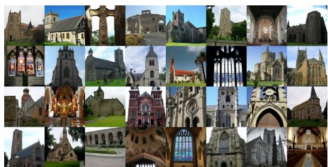  
(b) 无分类器引导（尺度 3.0）

Figure 13. 使用相同随机种子但不同引导尺度下，提示词“宗教场所”（“a religious place”）的 GLIDE (filtered) 样本。

GLIDE (filtered) 可用的数据集较小所致。

我们还将 GLIDE (filtered) 集成到了一个公开可用的 CLIP 引导扩散程序（Crowson, 2021a）中。我们发现，由此产生的组合具有生成类似人脸物体的某种能力（例如 Figure 15）。尽管使用公开可用扩散模型的原始 CLIP 引导扩散程序在响应我们的提示词时通常会生成更容易辨识的图像，但这些发现突显了我们过滤方法的局限性之一。我们还发现，GLIDE (filtered) 在某些情况下仍然表现出强烈的西方偏见，通常甚至超过了现有公开可用扩散模型所表现出的偏见（Figure 16）。

## G. 附加样本

在 Figure 17 和 Figure 18 中，我们展示了使用相同随机种子的无引导、无分类器引导和 CLIP 引导的模型随机样本的 4×4 网格，以及来自 DALL-E 的样本。我们发现无分类器引导最可靠地生成了最高质量的图像。对于 DALL-E，我们为每个提示词采样 512 张图像，并使用 CLIP 重排序（CLIP reranking）选出前 16 张。对于所有其他样本网格，我们展示了未经 CLIP 重排序的 16 个随机样本。

GLIDE (filtered)  
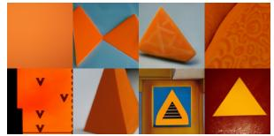

GLIDE (small)  
  
(a) “orange triangle”（橙色三角形）的生成结果

GLIDE (filtered)  
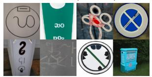

  
(b) “recycling symbol”（回收标志）的生成结果  
Figure 14. 针对提示词“orange triangle”（橙色三角形，左）和“recycling symbol”（回收标志，右）的 GLIDE (filtered) 与 GLIDE (small) 样本对比。尽管这些符号并未从模型中过滤掉，但过滤后的模型生成的还原度较低，这可能是由于可用数据集变小所致。

  
(a) GLIDE (filtered)

  
(a) GLIDE (filtered)

  
(b) GLIDE (filtered) + 未过滤的公开 CLIP

(b) GLIDE (filtered) + 未过滤的公开 CLIP  
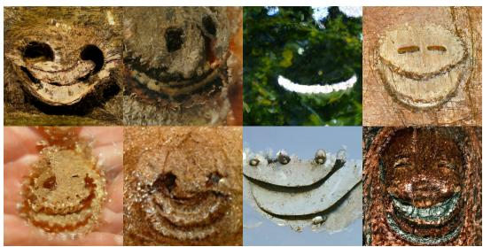  
(c) 基线（公开可用模型）

  
(c) 基线（公开可用模型）  
Figure 15. 提示词“a happy person”（一个快乐的人）的生成结果。在 (a) 中，我们展示了无分类器引导尺度为 3.0 的 GLIDE (filtered)。在 (b) 中，我们使用公开可用的 CLIP 模型来引导 GLIDE (filtered)。在 (c) 中，我们使用公开可用的 CLIP 模型来引导公开可用的 ImageNet 扩散模型。

Figure 16. 提示词“a place of worship”（礼拜场所）的生成结果。在 (a) 中，我们展示了使用无分类器引导（classifier-free guidance，scale 3.0）的 GLIDE（filtered）。在 (b) 中，我们使用公开可用的 CLIP 模型来引导 GLIDE（filtered）。在 (c) 中，我们使用公开可用的 CLIP 模型来引导公开可用的 ImageNet 扩散模型。

  
(a) DALL-E（Temp 0.85，经 CLIP 重排序从 512 个样本中选出前 16 个）

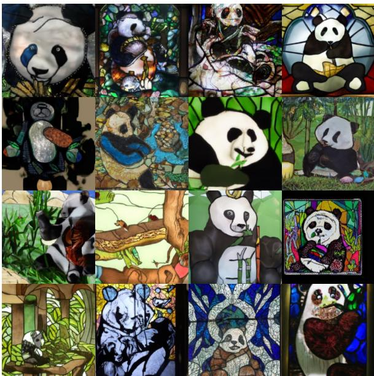  
(b) GLIDE（无引导）

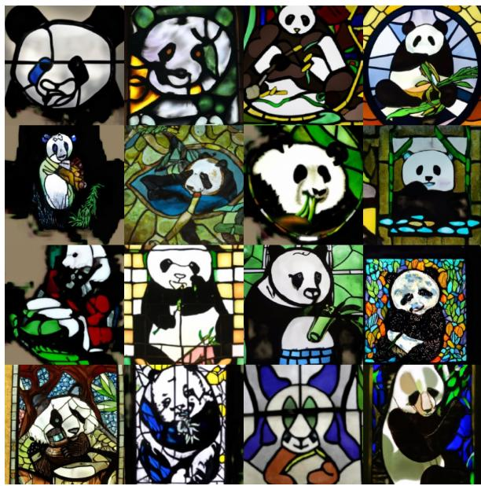  
(c) GLIDE（CLIP 引导，scale 2.0）

  
(d) GLIDE（无分类器引导，scale 3.0）  
Figure 17. DALL-E 和 GLIDE 在提示词“a stained glass window of a panda eating bamboo”（一只吃竹子的大熊猫的彩色玻璃窗）上的随机样本。我们不对 GLIDE 进行任何 CLIP 重排序。

  
(a) DALL-E（Temp 0.85，经 CLIP 重排序从 512 个样本中选出前 16 个）

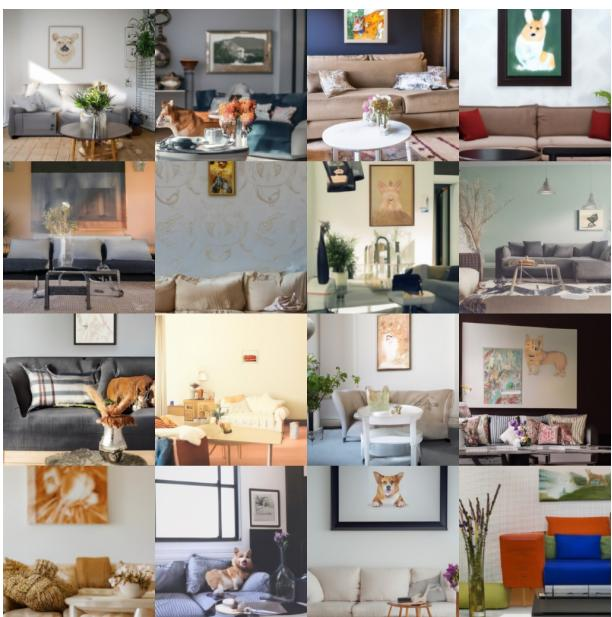  
(b) GLIDE（无引导）

  
(c) GLIDE（CLIP 引导，scale 2.0）

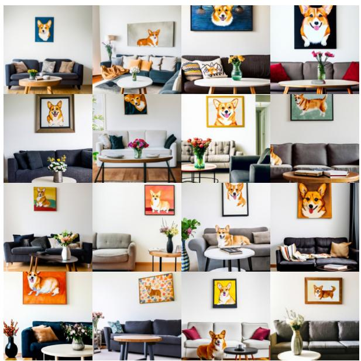  
(d) GLIDE（无分类器引导，scale 3.0）  
Figure 18. DALL-E 和 GLIDE 在提示词“A cozy living room with a painting of a corgi on the wall above a couch and a round coffee table in front of a couch and a vase of flowers on a coffee table”（一个舒适的起居室，沙发上方的墙上挂着一幅柯基犬的画，沙发前有一张圆形茶几，茶几上放着一瓶花）上的随机样本。我们不对 GLIDE 进行任何 CLIP 重排序。