# MaskGIT: 掩码生成式图像 Transformer（Masked Generative Image Transformer）

Huiwen Chang Han Zhang Lu Jiang Ce Liu˚ William T. Freeman Google Research

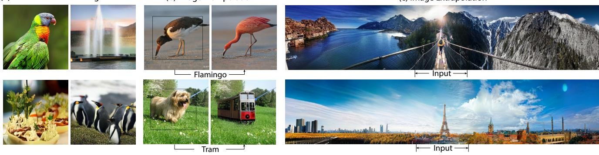  
Figure 1. MaskGIT 在图像合成和操作任务中的生成示例。我们展示了 MaskGIT 是一个灵活的模型，能够在以下任务中生成高质量样本：(a) 类别条件合成，(b) 类别条件图像操作，例如将边界框中选定的目标替换为给定类别的目标，以及 (c) 图像外推（extrapolation）。此处展示的三列示例的分辨率分别为 512ˆ512、512ˆ512 和 512ˆ2560。放大可查看细节。

## 摘要

生成式 Transformer 在计算机视觉领域合成高保真度和高分辨率图像方面经历了快速普及。然而，迄今为止最优秀的生成式 Transformer 模型仍然简单地将图像视为一个 token 序列，并按照光栅扫描顺序（即逐行）顺序解码图像。我们发现这种策略既非最优，也不高效。本文提出了一种使用双向 Transformer 解码器的新型图像合成范式，我们称之为 MaskGIT。在训练期间，MaskGIT 通过关注所有方向的 token 来学习预测随机掩码的 token。在推理阶段，该模型首先同时生成图像的所有 token，然后以先前的生成结果为条件迭代地细化图像。我们的实验表明，MaskGIT 在 ImageNet 数据集上显著优于最先进的 Transformer 模型，并将自回归解码加速高达 64 倍。此外，我们证明了 MaskGIT 可以轻松扩展到各种图像编辑任务，例如图像修复（inpainting）、图像外推（extrapolation）和图像操作。

## 1. 引言

作为一门研究领域，深度图像合成近年来取得了巨大进展。目前保持最先进成果的是生成对抗网络（Generative Adversarial Networks，GANs），它们能够以极快的速度合成高保真度图像。然而，它们存在众所周知的问题，包括训练不稳定和模式崩塌（mode collapse），这会导致样本多样性的匮乏。解决这些问题仍然是开放的研究课题。

受 Transformer [48] 和 GPT [5] 在 NLP 中取得成功的启发，生成式 Transformer 模型在图像合成领域受到的关注度日益增加 [7, 15, 37]。通常，这些方法旨在像处理序列一样对图像进行建模，并利用现有的自回归模型来生成图像。图像生成分为两个阶段；第一阶段是将图像量化为离散 token（或视觉单词）序列。在第二阶段中，学习一个自回归模型（例如 Transformer），以基于先前生成的结果按顺序生成图像 token（即自回归解码）。与 GAN 中精细的极小极大优化（min-max optimization）不同，这些模型是通过极大似然估计来学习的。由于设计上的差异，现有工作已经证明了它们相对于 GAN 的优势，即提供了稳定的训练过程以及改进的分布覆盖率或多样性。

现有的生成式 Transformer 相关工作大多集中在第一阶段，即如何量化图像以使信息损失最小化，并且共享从 NLP 借鉴来的相同的第二阶段。因此，即使是最先进的生成式 Transformer [15, 35] 仍然简单地将图像视为一个序列，即按照光栅扫描顺序（raster scan ordering）将图像展平成 1D token 序列——

Figure 2. 顺序解码与 MaskGIT 的调度并行解码之间的对比。第 1 行和第 3 行是每次迭代时的输入潜变量掩码（latent masks），第 2 行和第 4 行是每个模型在相应迭代时生成的样本。我们的解码从所有未知的 code（以浅灰色标出）开始，并逐步并行地用越来越多分散的预测填满潜表示（以深灰色标出），其中预测 token 的数量随着迭代急剧增加。与顺序方法所需的 256 轮相比，MaskGIT 仅用 8 次迭代就完成了解码。

——即逐行从左到右扫描（参见 Figure 2）。我们发现这种表示对于图像而言既不是最优的，也不是高效的。与文本不同，图像并非序列式的。试想一下艺术作品是如何创作出来的：画家从草图开始，然后通过填充或调整细节逐步进行完善，这与以往工作 [7, 15] 中采用的逐行打印方式形成了鲜明的对比。此外，将图像视为扁平序列意味着自回归序列的长度呈二次方增长，极易形成超长序列——比任何自然语言句子都要长。这不仅对长程相关性建模提出了挑战，而且使解码变得极其棘手。例如，在 GPU 上以自回归方式生成具有 32x32 个 token 的单张图像需要耗费长达 30 秒的时间。

本文提出了一种用于图像合成的新型双向 Transformer，称为掩码生成式图像 Transformer（Masked Generative Image Transformer，简称 MaskGIT）。在训练期间，MaskGIT 在类似于 BERT [11] 掩码预测的代理任务上进行训练。在推理阶段，MaskGIT 采用一种新颖的非自回归解码方法，在恒定步数内合成图像。具体而言，在每次迭代中，模型并行预测所有 token，但仅保留置信度最高的那些 token。其余 token 被掩码（mask）掉，并在下一次迭代中重新预测。掩码比例随之降低，直到通过几次迭代细化生成所有 token。如图 Figure 2 所示，MaskGIT 的解码速度比自回归解码快一个数量级，因为生成一张图像仅需 8 步（而非 256 步），并且每一步内的预测都是可并行的。此外，双向自注意力机制允许模型利用来自所有方向已生成的 token 来生成新 token，而无需仅依赖于光栅扫描顺序的前序 token。我们发现掩码调度（mask scheduling，即每次迭代中被掩码的图像比例）会显著影响生成质量。我们提出使用余弦调度（cosine schedule），并在消融实验中证实了其有效性。

在 ImageNet 基准测试中，我们通过实验证明，在 256ˆ256 和 512ˆ512 分辨率的类条件生成任务上，MaskGIT 不仅显著更快（最高提速达 64 倍），而且能够生成比最先进的自回归 Transformer（即 VQ-GAN）质量更高的样本。即使与领先的 GAN 模型（即 BigGAN）和扩散模型（即 ADM [12]）相比，MaskGIT 也能提供相当的样本质量，同时展现出更有优势的多样性。值得注意的是，我们的模型在用于合成 512ˆ512 图像的分类准确率得分（CAS）[36] 和 FID [23] 上均创下了新的 SOTA 纪录。据我们所知，本文首次提供了在通用 ImageNet 基准上掩码建模用于图像生成有效性的证据。

此外，MaskGIT 的多向性使其能够轻松扩展到自回归模型通常难以应对的图像操作任务。Fig. 1 展示了一种类条件图像编辑的新应用，其中 MaskGIT 根据给定类别重新生成边界框内的内容，同时保持上下文（框外部分）不变。这一任务对于自回归模型而言难以实现，对于 GAN 模型而言也颇具挑战，但对我们的模型来说却轻而易举。在定量方面，我们通过将 MaskGIT 应用于图像修复（image inpainting）和任意方向的图像外推（image extrapolation）展示了这种灵活性。尽管我们的模型并非专门为此类任务设计，但它在各项任务上均取得了与专用模型相当的性能。

## 2. 相关工作

## 2.1. 图像合成

深度生成模型 [12, 17, 29, 34, 41, 45, 46, 53] 在图像合成任务中取得了诸多成功。基于 GAN 的方法在生成高保真样本方面展现出了惊人的能力 [4, 17, 27, 44, 53]。相比之下，基于似然的方法，如变分自编码器（VAEs）[29, 45]、扩散模型（Diffusion Models）[12, 24, 41] 和自回归模型（Autoregressive Models）[34, 46]，提供了更好的分布覆盖度，因此能够生成更多样化的样本 [41, 45, 46]。

然而，直接在像素空间最大化似然具有很大挑战性。因此，VQVAE [37, 47] 提出分两个阶段在潜在空间中生成图像。在被称为分词（tokenization）的第一阶段中，它尝试将图像压缩到离散潜在空间中，主要由三个组件构成：

• 一个编码器 $E$，学习将图像 $x \in$ $\mathbb { R } ^ { H \times W \times 3 }$ 分词为潜在嵌入 $E ( x )$

• 一个码本 $\mathbf { e } _ { k } \in \mathbb { R } ^ { D } , k \in { 1 , 2 , \cdots , K }$，用于最近邻查找以将嵌入量化为视觉 token，以及

• 一个解码器 $G$，根据视觉 token $\mathbf{e}$ 预测重建图像 xˆ。

在第二阶段中，它首先使用深度自回归模型预测视觉 token 的潜在先验，然后使用第一阶段的解码器将 token 序列映射为图像像素。由于这种两阶段方法的有效性，已有多种方法遵循了该范式。DALL-E [35] 使用 Transformer [48] 来改进第二阶段的 token 预测。VQGAN [15] 在第一阶段添加了对抗损失和感知损失 [26,54] 以提升图像保真度。与我们同时期的一项工作 VIM [51] 提出使用 ViT 骨干网络 [13] 来进一步改进分词阶段。由于这些方法仍采用自回归模型，第二阶段的解码时间会随着 token 序列长度的增加而线性增长。

## 2.2. 基于双向 Transformer 的掩码建模

Transformer 架构 [48] 最初在 NLP 领域提出，最近已扩展到计算机视觉领域 [6, 13]。Transformer 由多个自注意力层组成，允许捕获序列中所有元素对之间的交互。特别是，BERT [11] 引入了掩码语言建模（MLM）任务用于语言表示学习。BERT [11] 中使用的双向自注意力机制使得 MLM 中的被掩码 token 能够利用来自双向的上下文信息进行预测。

  
Figure 3. 流程概览。MaskGIT 遵循两阶段设计，包含 1) 一个将图像分词为视觉 token 的分词器，以及 2) 一个执行 MVTM 的双向 Transformer 模型，即学习预测随机掩码的视觉 token。

在视觉领域，BERT [11] 中的掩码建模已被扩展到图像表示学习 [2, 21] 中，图像被量化为离散 token。然而，很少有工作成功地将相同的掩码建模应用于图像生成 [56]，这是由于使用双向注意力进行自回归解码存在困难。据我们所知，本文首次提供了在通用的 ImageNet 基准上证明掩码建模对图像生成有效性的证据。我们的工作受到 NLP 中双向机器翻译 [16, 19, 20] 的启发，而我们的创新之处在于提出了新的掩码策略和解码算法，正如我们的实验所证实的那样，这些对于图像生成至关重要。

## 3. 方法

我们的目标是设计一种利用并行解码和双向生成的新型图像合成范式。

我们遵循 2.1 节中讨论的两阶段方案，如图 Figure 3 所示。由于我们的目标是改进第二阶段，因此我们在第一阶段采用了与 VQGAN 模型 [15] 相同的设置，并将对 token 化步骤的潜在改进留待未来工作中进行。

对于第二阶段，我们提出通过掩码视觉 Token 建模（Masked Visual Token Modeling, MVTM）来学习一个双向 Transformer。我们在 3.1 节介绍 MVTM 训练，并在 3.2 节介绍采样过程。随后我们在 3.3 节讨论掩码设计的关键技术。

## 3.1. 训练中的 MVTM

令 $\mathbf { Y } = [ y _ { i } ] _ { i = 1 } ^ { N }$ 表示将图像输入 VQ-encoder 后获得的潜在 token，其中 N 是重塑后 token 矩阵的长度，$\mathbf { M } = [ m _ { i } ] _ { i = { \frac { N } { \alpha } } } ^ { N }$ 为对应的二进制掩码。在训练期间，我们采样一个 token 子集并用特殊的 [MASK] token 替换它们。如果 $m _ { i } ~ = ~ 1$，token $y _ { i }$ 会被替换为 [MASK]，否则当 $m _ { i } = 0$ 时，$y _ { i }$ 将保持原样。

采样过程由掩码调度函数 $\gamma ( r ) \in ( 0 , 1 ]$ 参数化，执行方式如下：我们首先在 0 到 1 之间采样一个比率，然后在 Y 中均匀选择 $\lceil \gamma ( r ) \cdot N \rceil$ 个 token 放置掩码，其中 N 为长度。掩码调度会显著影响图像生成的质量，并将在 3.3 节中进行讨论。

记 $Y _ { \overline { { \mathbf { M } } } }$ 为对 Y 应用掩码 M 后的结果。训练目标是最小化被掩码 token 的负对数似然：

$$
\mathcal {L} _ {\mathrm{mask}} = - \underset {\mathbf {Y} \in \mathcal {D}} {\mathbb {E}} \bigg [ \sum_ {\forall i \in [ 1, N ], m _ {i} = 1} \log p (y _ {i} | Y _ {\overline {{\mathbf {M}}}}) \bigg ],\tag{1}
$$

具体而言，我们将被掩码的 $Y _ { \overline { { \mathbf { M } } } }$ 输入到一个多层双向 Transformer 中，以预测每个被掩码标记的概率 $P ( y _ { i } | Y _ { \overline { { \mathbf { M } } } } )$，其中负对数似然计算为真实独热（one-hot）标记与预测标记之间的交叉熵。请注意与自回归建模的关键区别：MVTM 中的条件依赖具有双向性，这使得图像生成能够通过关注图像中的所有标记来利用更丰富的上下文。

## 3.2. 迭代解码

在自回归解码中，标记是根据先前生成的输出按顺序生成的。该过程无法并行化，因此对于图像而言非常缓慢，因为图像标记的长度（例如 256 或 1024）通常远大于语言标记的长度。我们提出了一种新颖的解码方法，图像中的所有标记都可以同时并行生成。得益于 MTVM 的双向自注意力机制，这是可行的。

理论上，我们的模型能够通过单次前向传播推断所有标记并生成整幅图像。我们发现由于与训练任务的不一致性，这具有一定挑战性。下面介绍所提出的迭代解码方法。为了在推理时生成图像，我们从所有标记均被掩码的空白画布开始，即 $i . e . \ : Y _ { \mathbf { M } } ^ { ( 0 ) }$。对于第 t 次迭代，我们的算法运行步骤如下：

1. 预测（Predict）。给定当前迭代中被掩码的标记 $Y _ { \mathbf { M } } ^ { ( t ) }$，我们的模型并行预测所有被掩码位置的概率，记作 $p ^ { ( t ) } \in \mathbb { R } ^ { N \times K }$。

2. 采样（Sample）。在每个被掩码的位置 i，我们根据其在码本（codebook）中所有可能标记上的预测概率 $p _ { i } ^ { ( t ) } \in \mathbb { R } ^ { K }$ 采样一个标记 $y _ { i } ^ { ( t ) }$。在采样得到标记 $y _ { i } ^ { ( t ) }$ 后，其对应的预测分数被用作“置信度”分数，表示模型对该预测的确信程度。对于 $Y _ { \mathbf { M } } ^ { ( t ) }$ 中未被掩码的位置，我们直接将其置信度分数设为 1.0。

3. 掩码调度（Mask Schedule）。我们根据掩码调度函数 $\gamma$ 计算需要掩码的标记数量：$\begin{array} { r } { n = \lceil \gamma ( \frac { t } { T } ) N \rceil } \end{array}$，其中 N 为输入长度，$T$ 为总迭代次数。

4. 掩码（Mask）。我们通过在 $Y _ { \mathbf { M } } ^ { ( t ) }$ 中掩码 n 个标记来获得 $Y _ { \mathbf { M } } ^ { ( t + 1 ) }$。迭代 t+1 的掩码 $\mathbf { M } ^ { ( t + 1 ) }$ 计算公式如下：

$$
m _ {i} ^ {(t + 1)} = \left\{ \begin{array}{l l} 1, & \text {if c_{i} <  sorted_{j} (c_{j})[n].} \\ 0, & \text {otherwise.} \end{array} \right.,
$$

其中 $c _ { i }$ 为第 i 个标记的置信度分数。

该解码算法在 $T$ 步内合成一张图像。在每次迭代中，模型同时预测所有 token，但仅保留置信度最高的 token。其余 token 被掩码并在下一次迭代中重新预测。掩码率逐渐降低，直到在 $T$ 次迭代内生成所有 token。在实践中，被掩码的 token 是通过带有温度退火的随机采样选取的，以增加多样性，我们将在 4.4 节讨论其效果。Figure 2 展示了我们解码过程的一个示例。它在 $T = 8$ 次迭代中生成一张图像，其中每次迭代时未被掩码的 token 在网格中突出显示，例如当 t “ 1 时，我们仅保留 1 个 token 并掩码其余部分。

## 3.3. 掩码设计

我们发现图像生成的质量受到掩码设计的显著影响。我们通过掩码调度函数 $\gamma ( \cdot )$ 对掩码过程进行建模，该函数计算给定潜变量 token 的掩码率。如前所述，函数 $\gamma$ 同时用于训练和推理。在推理阶段，它接收 $0 / T , 1 / T , \cdot \cdot \cdot , ( T - 1 ) / T$ 作为输入，指示解码的进度。在训练阶段，我们在 r0, 1q 中随机采样一个比率 r，以模拟各种解码场景。

BERT [11] 使用 15% 的固定掩码率，即它总是掩码 15% 的 token，这并不适用于我们的任务，因为我们的解码器需要从零开始生成图像。因此需要新的掩码调度机制。在讨论具体方案之前，我们首先检验掩码调度函数的性质。首先，对于 $r \in [ 0 , 1 ]$ ，$\gamma ( r )$ 需要是一个有界在 0 到 1 之间的连续函数。其次，$\gamma ( r )$ 应当关于 r（单调）递减，并满足 $\gamma ( 0 ) \to 1$ 且 $\gamma ( 1 )  0$ 。第二个性质确保了我们解码算法的收敛性。

本文考虑了常用函数并进行简单变换，使其满足上述性质。Figure 8 将这些函数可视化，它们分为三类：

• 线性函数（Linear function）是一种直截了当的解法，每次掩码相同数量的 token。

• 凹函数（Concave function）捕捉了图像生成遵循由少到多信息流的直觉。在初期，大多数 token 都被掩码，因此模型只需要做出少量其具有高置信度的正确预测。在接近尾声时，掩码率急剧下降，迫使模型做出多得多的正确预测。在此过程中，有效信息逐渐增加。凹函数族包括余弦（cosine）、平方（square）、立方（cubic）和指数（exponential）。

• 凸函数（Convex function）则相反，实现了一个由多到少的过程。模型需要在前几次迭代中确定绝大多数 token。该族包括平方根（square root）和对数（logarithmic）。

我们在 4.4 节中对上述掩码调度函数进行了实证对比，发现余弦函数在我们所有的实验中表现最佳。

## 4. 实验

在本节中，我们从质量、效率和灵活性方面对 MaskGIT 在图像生成上的表现进行实证评估。在 4.2 节中，我们在 ImageNet [10] 256ˆ256 和 512ˆ512 上的标准类别条件图像生成任务中评估 MaskGIT。在 4.3 节中，我们通过展示其在图像修复（inpainting）、图像外延（outpainting）和图像编辑这三项图像编辑任务上的性能，来证明 MaskGIT 的通用性。在 4.4 节中，我们验证了掩码调度设计的必要性。我们将开源代码和模型以供可复现研究。

## 4.1. 实验设置

对于每个数据集，在所有实验中，我们仅在裁剪后的 256x256 图像上训练包含 1024 个标记（tokens）的单个自编码器、解码器和码本（codebook）。图像始终按固定比例 16 进行压缩，即从 $H \times W$ 压缩为尺寸为 $h \times w$ 的标记网格，其中 $h { = } H / 1 6$ 且 $w { = } W / 1 6$。我们发现该自编码器连同码本可以复用于合成 512ˆ512 图像。

本工作中的所有模型均采用相同的配置：24 层、8 个注意力头、768 维嵌入维度以及 3072 维隐藏维度。我们的模型使用可学习的位置嵌入（positional embedding）[48]、LayerNorm [1] 以及截断正态初始化（stddev=0.02）。我们采用以下训练超参数：标签平滑（label smoothing）=0.1，dropout 率=0.1，$\beta _ { 1 } { = } 0 . 9$ 且 $\beta _ { 2 } { = } 0 . 9 6$ 的 Adam 优化器 [28]。我们使用 RandomResizeAndCrop 进行数据增强。所有模型均在 4x4 TPU 设备上训练，批量大小（batch size）为 256。ImageNet 模型训练 300 个周期（epochs），而 Places2 模型训练 200 个周期。

## 4.2. 类别条件图像合成

我们在 ImageNet 256ˆ256 和 512ˆ512 上评估了模型在类别条件图像合成上的性能。我们的主要结果总结在 Table 1 中。

质量。在 ImageNet 256ˆ256 上，无需任何特殊的采样策略（如束搜索（beam-search）、top-k 或核采样（nucleus sampling）启发式方法 [25]）或分类器引导（classifier guidance）[37]，我们在 Fréchet Inception Distance (FID) [23]（6.18 对比 15.78）和 Inception

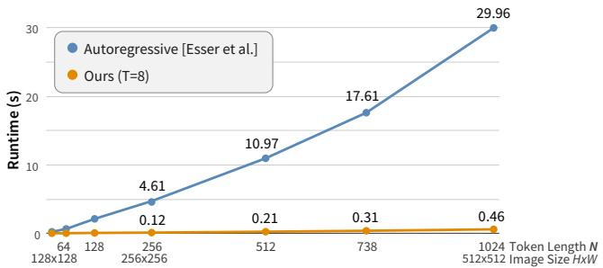  
Figure 4. VQGAN [15] 与我们方法的 Transformer 实际运行时间（wall-clock runtime）对比。所有结果均在单张 GPU 上运行。

Score (IS)（182.1 对比 78.3）两项指标上均显著优于 VQGAN [15]。我们还在附录 B 中报告了使用基于分类器的拒绝采样的结果。

我们还使用与 MaskGIT 相同的分词器（tokenizer）和超参数训练了一个 VQGAN 基线，以进一步突出双向和单向 Transformer 之间的差异，并发现无论在何种分辨率下，MaskGIT 仍然以显著优势超越了我们实现的基线。

此外，MaskGIT 在两种分辨率下都提升了 BigGAN 的 FID，在 512ˆ512 上以 7.32 的 FID 取得了新的最先进（state-of-the-art）水平。

速度。我们通过评估每个模型生成一个样本所需的步数（即前向传播次数）来评估模型速度。如 Table 1 所示，在两种分辨率下，MaskGIT 在所有非 GAN 模型中所需的步数都是最少的。

为了进一步证实 MaskGIT 与自回归模型之间的速度差异，我们对 MaskGIT 和 VQGAN 的解码过程进行了运行时间对比。如 Figure 4 所示，MaskGIT 相比 VQGAN 实现了 30-64 倍的显著加速，且随着图像分辨率（以及由此带来的输入 token 长度）的增加，加速效果愈发显著。

多样性。除样本质量外，我们还将分类准确率得分（Classification Accuracy Score，CAS）[36] 和精确率/召回率（Precision/Recall）[30] 作为评估样本多样性的两项指标。

CAS 的计算过程是首先仅在候选模型生成的样本上训练一个 ResNet-50 分类器 [22]，然后在 ImageNet 验证集上测量该分类器的分类准确率。Table 1 的最后两列展示了 CAS 结果，其中包含了在真实 ImageNet 训练数据上训练的分类器得分以供参考（top-1 和 top-5 准确率分别为 76.6% 和 93.1%）。对于图像分辨率 256ˆ256，我们遵循使用数据增强 RandAugment [9] 的通用做法，并在附录 B 中汇报了未经数据增强训练的得分。我们发现 MaskGIT 显著优于先前的研究 VQVAE-2 和 VQGAN，在两种分辨率下的 ImageNet 基准上均刷新了 CAS 的最先进水平（state-of-the-art）。

<table><tr><td>模型</td><td>FID ↓</td><td>IS ↑</td><td>Prec ↑</td><td>Rec ↑</td><td>参数量</td><td>步数</td><td colspan="2">CAS ×100 ↑</td></tr><tr><td>ImageNet 256×256</td><td></td><td></td><td></td><td></td><td></td><td></td><td>Top-1 (76.6)</td><td>Top-5 (93.1)</td></tr><tr><td>DCTransformer [32]°</td><td>36.51</td><td>n/a</td><td>0.36</td><td>0.67</td><td>738M</td><td>&gt;1024</td><td></td><td></td></tr><tr><td>BigGAN-deep [4]</td><td>6.95</td><td>198.2</td><td>0.87</td><td>0.28</td><td>160M</td><td>1</td><td>43.99</td><td>67.89</td></tr><tr><td>Improved DDPM [33]°</td><td>12.26</td><td>n/a</td><td>0.70</td><td>0.62</td><td>280M</td><td>250</td><td></td><td></td></tr><tr><td>ADM [12]°</td><td>10.94</td><td>101.0</td><td>0.69</td><td>0.63</td><td>554M</td><td>250</td><td></td><td></td></tr><tr><td>VQVAE-2 [37]°</td><td>31.11</td><td>~45</td><td>0.36</td><td>0.57</td><td>13.5B†</td><td>5120</td><td>54.83</td><td>77.59</td></tr><tr><td>VQGAN [15]°</td><td>15.78</td><td>78.3</td><td>n/a</td><td>n/a</td><td>1.4B</td><td>256</td><td></td><td></td></tr><tr><td>VQGAN*</td><td>18.65</td><td>80.4</td><td>0.78</td><td>0.26</td><td>227M</td><td>256</td><td>53.10</td><td>76.18</td></tr><tr><td>MaskGIT（本文）</td><td>6.18</td><td>182.1</td><td>0.80</td><td>0.51</td><td>227M</td><td>8</td><td>63.14</td><td>84.45</td></tr><tr><td colspan="9">ImageNet 512×512</td></tr><tr><td>BigGAN-deep [4]</td><td>8.43</td><td>232.5</td><td>0.88</td><td>0.29</td><td>160M</td><td>1</td><td>44.02</td><td>68.22</td></tr><tr><td>ADM [12]°</td><td>23.24</td><td>58.06</td><td>0.73</td><td>0.60</td><td>559M</td><td>250</td><td></td><td></td></tr><tr><td>VQGAN*</td><td>26.52</td><td>66.8</td><td>0.73</td><td>0.31</td><td>227M</td><td>1024</td><td>51.29</td><td>74.24</td></tr><tr><td>MaskGIT（本文）</td><td>7.32</td><td>156.0</td><td>0.78</td><td>0.50</td><td>227M</td><td>12</td><td>63.43</td><td>84.79</td></tr></table>

Table 1. 在 ImageNet 256×256 和 512×512 上与最先进生成模型的定量对比。“步数”指的是生成一个样本所需的神经网络运行次数。˚ 表示使用与本文相同的架构和设置训练的模型；˝ 表示数值取自先前的出版物；: 基于 PyTorch 实现 [39] 进行估算。

  
BigGAN-deep (FID=6.95)

  
MaskGIT (FID=6.18)

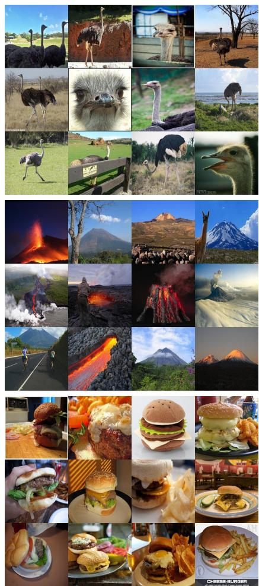  
训练集  
Figure 5. 本文提出的 MaskGIT 与 BigGAN-deep [4] 在 ImageNet 256×256 上的样本多样性对比。从上到下的样本类别 ID 分别为 009、980 和 993。更多比较请参阅附录。

—— MaskGIT（我们的样本）——

输入  
  
Figure 6. 类别条件图像编辑。给定每对左侧的输入图像和目标类别“虎斑猫”（tiger cat），MaskGIT 用虎斑猫替换边界框区域，展示了我们模型的组合能力。

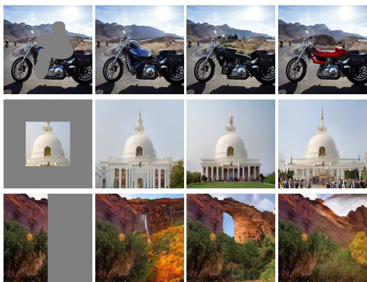  
Figure 7. 图像修复（inpainting）与外延（outpainting）。给定单张输入图像，MaskGIT 可以合成多样化的图像修复结果（第一行）以及不同方向的外延结果（后两行）。

表 1 中的 Precision/Recall 结果表明，与 BigGAN 相比，MaskGIT 实现了更好的覆盖率（Recall），与 VQVAE-2 和扩散模型（diffusion models）等基于似然的模型相比，实现了更好的样本质量（Precision）。与我们的基线 VQGAN 相比，我们在通过召回率衡量的多样性上有所提升，同时略微提高了其精确率。

与 BigGAN 的样本相比，MaskGIT 的样本更加多样化，具有更多变的光照、姿态、尺度和上下文环境，如图 5 所示。更多对比见附录 B。

## 4.3. 图像编辑应用

在本小节中，我们展示了 MaskGIT 在三项图像编辑任务中的直接应用：类别条件图像编辑、图像修复（inpainting）和图像外延（outpainting）。正如 3.2 节中所讨论的，如果我们将任务仅视为对 MaskGIT 在迭代解码中使用的初始二值掩码 M 的约束，那么所有这三项任务几乎都可以直接转化为 MaskGIT 能够处理的形式。我们表明，在不修改架构或进行任何特定任务训练的情况下，MaskGIT 能够在所有三项应用中生成极具说服力的结果。此外，尽管 MaskGIT 并非专门针对这两项任务设计，但它在图像修复和图像外延上均取得了与专用模型相当的性能。

<table><tr><td>任务</td><td>模型</td><td>FID ↓</td><td>IS ↑</td></tr><tr><td rowspan="5">图像外延右侧 50%</td><td>Boundless [43] $^{\square}$ </td><td>35.02</td><td>6.15</td></tr><tr><td>In&amp;Out [8] $^{\square}$ </td><td>23.57</td><td>7.18</td></tr><tr><td>InfinityGAN [31]</td><td>10.60</td><td>5.57</td></tr><tr><td>Boundless [43] TF $^{\diamond}$ </td><td>7.80</td><td>5.99</td></tr><tr><td>MaskGIT (Ours) $^{512}$ </td><td>6.78</td><td>11.69</td></tr><tr><td rowspan="5">图像修复中心 50% × 50%</td><td>DeepFill [52]</td><td>11.51</td><td>22.55</td></tr><tr><td>ICT [49] $^{\dagger}$ </td><td>13.63</td><td>17.70</td></tr><tr><td>HiFill [50] $^{512}$ </td><td>16.60</td><td>19.93</td></tr><tr><td>CoModGAN [57] $^{512}$ </td><td>7.13</td><td>21.82</td></tr><tr><td>MaskGIT (Ours) $^{512}$ </td><td>7.92</td><td>22.95</td></tr></table>

Table 2. Places2 上的图像修复（Inpainting）与图像外推（Outpainting）定量对比。512 表示在 512×512 样本上评估，而其他模型则在对应的 256×256 样本上评估，与其训练保持一致；˝ 取自先前工作；: 使用在 Places2 子集上训练的开源模型进行评估；˛ 使用 TFHub 模型 [18] 进行评估。

类别条件图像编辑（Class-conditional Image Editing）。我们定义了一个新的类别条件图像编辑任务来展示 MaskGIT 的灵活性。在该任务中，模型在保留上下文（即边界框外部内容）的同时，根据给定的类别重新生成边界框内指定的内容。对于自回归方法而言，由于这违背了它们的预测顺序，因此是不可行的。

然而，对于 MaskGIT 来说，如果我们将边界框区域视为迭代解码算法的初始掩码输入，这就是一项微不足道的简单任务。Figure 6 展示了一些示例结果。更多结果可在附录 C 中找到。

在这些示例中，我们观察到 MaskGIT 能够合理地替换所选对象，同时保留背景中的上下文，甚至在一定程度上补全背景。此外，我们发现 MaskGIT 似乎能够合成 ImageNet 训练集中未见过的、非自然但合理的组合，例如飞翔的猫、汤碗里的猫以及花朵中的猫。这表明 MaskGIT 顺带学习到了有助于图像组合的有用表征，未来工作中可以在相关任务中进一步加以利用。

图像修复（Image Inpainting）。图像修复或图像补全是图像编辑中的一项基础任务，旨在合成缺失区域的内容，使得补全后的图像在视觉上逼真。传统的基于图像块（patch-based）的方法 [3] 在纹理区域表现良好，而基于深度学习的方法 [14, 38, 50, 52, 57] 已被证明能够合成需要更强语义连贯性的图像。这两种方法在计算机视觉领域都得到了广泛的研究。

我们通过对带掩码的图像进行分词（tokenizing），并将修复掩码作为迭代解码中的初始掩码，将 MaskGIT 扩展到该问题上。然后，我们遵循 [8]，根据掩码边界将输出图像与输入图像进行线性混合以合成最终图像。为了与基线模型的训练相匹配，我们在来自 Places2 [58] 数据集的 512×512 中心裁剪图像上训练 MaskGIT。所有超参数均与在 ImageNet 上训练的 MaskGIT 模型保持一致。

我们在具有中心 $5 0 \% \times 5 0 \%$ 掩码的图像修复任务上，将 MaskGIT 与常见的基于 GAN 的基线模型（包括 DeepFillv2 [52] 和 HiFill [50]）进行了对比，所有评估均在 Places2 验证集上进行。Table 2 总结了定量对比结果。MaskGIT 在 FID 和 IS 指标上均大幅优于 Deep-Fill 和 HiFill，同时取得了接近最先进的图像修复方法 CoModGAN [57] 的得分。我们在附录 E 中展示了与 CoModGAN 的更多定性对比。

图像外延（Image Outpainting）。外延，即图像外推（image extrapolation），是一项近期受到广泛关注的图像编辑任务。与图像修复（inpainting）相比，由于周围像素施加的约束较少，预测区域存在更多的不确定性，因此该任务被认为更具挑战性。我们在该问题上的适配方法以及在后续评估中使用的模型均与图像修复相同。

我们在以 50% 的比例向右外推的任务上，与常见的基于 GAN 的基线模型进行了比较，包括 Boundless [43]、In&Out [8]、InfinityGAN [31] 和 CoModGAN [57]。我们在 InfinityGAN [31] 和 In&Out [8] 的作者慷慨提供的图像集上进行了评估。

Table 2 总结了定量比较结果。MaskGIT 击败了所有基线模型，并取得了最先进的（state-of-the-art）FID 和 IS。如 Figure 7 中的示例所示，在给定相同输入的情况下，MaskGIT 还能通过不同的随机种子合成多样化的结果。我们观察到 MaskGIT 在补全物体和全局结构方面表现尤为出色，并推测这是由于模型借助 Transformer 中的全局注意力机制学习到了有用的表征。

## 4.4. 消融实验

我们在 ImageNet 256ˆ256 上使用默认设置进行了消融实验。

掩码调度（Mask scheduling）。MaskGIT 的一个关键设计是在训练和迭代解码中均使用的掩码调度函数。我们对 3.3 节中讨论的函数进行了比较，在 Figure 8 中进行了可视化展示，并在 Table 3 中总结了结果。

我们观察到凹函数通常比线性函数获得更好的 FID 和 IS，其次是凸函数。虽然余弦函数和平方函数相对于其他函数表现相似，但余弦函数在所有指标上均略优于平方函数，因此余弦函数成为我们模型中的默认选择。

<table><tr><td> $\gamma$ </td><td>T</td><td>FID ↓</td><td>IS ↑</td><td>NLL</td></tr><tr><td>指数（Exponential）</td><td>8</td><td>7.89</td><td>156.3</td><td>4.83</td></tr><tr><td>三次（Cubic）</td><td>9</td><td>7.26</td><td>165.2</td><td>4.63</td></tr><tr><td>平方（Square）</td><td>10</td><td>6.35</td><td>179.9</td><td>4.38</td></tr><tr><td>余弦（Cosine）</td><td>10</td><td>6.06</td><td>181.5</td><td>4.22</td></tr><tr><td>线性（Linear）</td><td>16</td><td>7.51</td><td>113.2</td><td>3.75</td></tr><tr><td>平方根（Square Root）</td><td>32</td><td>12.33</td><td>99.0</td><td>3.34</td></tr><tr><td>对数（Logarithmic）</td><td>60</td><td>29.17</td><td>47.9</td><td>3.08</td></tr></table>

Table 3. 掩码调度函数的消融结果。我们汇报了每个候选调度函数的最佳 FID、IS 和负对数似然（Negative Log-Likelihood）损失。

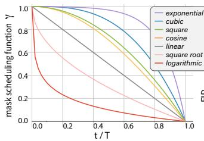

  
Figure 8. 掩码调度函数 $\gamma \big ( \frac { t } { T } \big )$ 的选择以及迭代次数 T。左侧展示了我们考虑用于 $\gamma$ 的七个函数。右侧展示了模型 FID 分数随解码迭代次数 T 变化的折线图。在所有候选函数中，我们发现余弦函数取得了最佳的 FID。

我们推测凹函数表现较好是因为它们：1）通过更具挑战性的样本来强化训练（即鼓励更大的掩码比例），以及 2）在整个解码过程中适当地优先遵循由少到多的预测策略。话虽如此，过度优先似乎也会带来负面代价，表现为三次函数（cubic）差于二次函数（square），而指数函数（exponential）则远差于所有其他凹函数。

迭代次数。我们通过使用不同的 T 运行所有候选掩码函数，来研究迭代次数（T）对我们模型的影响。如图 8 所示，在相同设置下，迭代次数并非越多越好：随着 T 的增加，除了始终表现较差的对数函数（logarithmic）外，所有其他函数都会达到一个“最佳平衡点”（sweet spot），在该点模型性能达到峰值，随后再次下降。随着函数的凹度减小，该最佳平衡点也会“推迟”。如图所示，在取得出色 FID 的函数中（即余弦、二次和线性），余弦函数不仅具有最佳的整体分数，而且在总计 8 到 12 次迭代时最早达到最佳平衡点。我们推测存在这种最佳平衡点是因为过多的迭代可能会阻碍模型保留置信度较低的预测，从而降低 token 的多样性。我们认为对掩码设计的进一步研究将是未来工作中很有意义的方向。

## 5. 结论

在本文中，我们提出了 MaskGIT，一种使用双向 Transformer 解码器的新型图像合成范式。MaskGIT 通过掩码视觉 Token 建模（Masked Visual Token Modeling）进行训练，学习在固定次数的迭代内使用迭代解码过程生成样本。实验结果表明，MaskGIT 在条件图像生成任务上显著优于最先进的 Transformer 模型，并且我们的模型可以轻松扩展到各种图像编辑任务中。鉴于 MaskGIT 取得了与最先进的 GAN 相当的竞争力，将我们的方法应用于其他合成任务是未来工作的一个有前景的方向。有关局限性及未来工作，请参见附录 F。

致谢 作者感谢 Xiang Kong 启发了相关工作，并感谢匿名审稿人提出的宝贵意见。

## 参考文献

[1] Jimmy Lei Ba, Jamie Ryan Kiros, and Geoffrey E. Hinton. Layer normalization, 2016. 5

[2] Hangbo Bao, Li Dong, Songhao Piao, and Furu Wei. BEit: BERT pre-training of image transformers. In International Conference on Learning Representations, 2022. 3

[3] Connelly Barnes, Eli Shechtman, Adam Finkelstein, and Dan B Goldman. PatchMatch: A randomized correspondence algorithm for structural image editing. ACM Transactions on Graphics (Proc. SIGGRAPH), 28(3), Aug. 2009. 7

[4] Andrew Brock, Jeff Donahue, and Karen Simonyan. Large scale gan training for high fidelity natural image synthesis. In ICLR, 2019. 3, 6, 13

[5] Tom Brown, Benjamin Mann, Nick Ryder, Melanie Subbiah, Jared D Kaplan, Prafulla Dhariwal, Arvind Neelakantan, Pranav Shyam, Girish Sastry, Amanda Askell, Sandhini Agarwal, Ariel Herbert-Voss, Gretchen Krueger, Tom Henighan, Rewon Child, Aditya Ramesh, Daniel Ziegler, Jeffrey Wu, Clemens Winter, Chris Hesse, Mark Chen, Eric Sigler, Mateusz Litwin, Scott Gray, Benjamin Chess, Jack Clark, Christopher Berner, Sam McCandlish, Alec Radford, Ilya Sutskever, and Dario Amodei. Language models are few-shot learners. In NeurIPS, 2020. 1

[6] Mathilde Caron, Hugo Touvron, Ishan Misra, Herve´ Jegou, Julien Mairal, Piotr Bojanowski, and Armand´ Joulin. Emerging properties in self-supervised vision transformers. In Proceedings ofthe International Conference on Computer Vision (ICCV), 2021. 3

[7] Mark Chen, Alec Radford, Rewon Child, Jeffrey Wu, Heewoo Jun, David Luan, and Ilya Sutskever. Gener-

ative pretraining from pixels. In International Conference on Machine Learning, pages 1691–1703. PMLR, 2020. 1, 2, 13, 19, 20

[8] Yen-Chi Cheng, Chieh Hubert Lin, Hsin-Ying Lee, Jian Ren, Sergey Tulyakov, and Ming-Hsuan Yang. In&out: Diverse image outpainting via gan inversion. arXiv preprint arXiv:2104.00675, 2021. 7, 8

[9] Ekin D. Cubuk, Barret Zoph, Jonathon Shlens, and Quoc V. Le. Randaugment: Practical automated data augmentation with a reduced search space, 2019. 5, 13

[10] Jia Deng, Wei Dong, Richard Socher, Li-Jia Li, Kai Li, and Li Fei-Fei. Imagenet: A large-scale hierarchical image database. In 2009 IEEE conference on computer vision and pattern recognition, pages 248–255. Ieee, 2009. 5

[11] Jacob Devlin, Ming-Wei Chang, Kenton Lee, and Kristina Toutanova. BERT: pre-training of deep bidirectional transformers for language understanding. In Jill Burstein, Christy Doran, and Thamar Solorio, editors, NAACL-HLT, 2019. 2, 3, 4

[12] Prafulla Dhariwal and Alexander Quinn Nichol. Diffusion models beat GANs on image synthesis. In A. Beygelzimer, Y. Dauphin, P. Liang, and J. Wortman Vaughan, editors, Advances in Neural Information Processing Systems, 2021. 2, 3, 6, 13

[13] Alexey Dosovitskiy, Lucas Beyer, Alexander Kolesnikov, Dirk Weissenborn, Xiaohua Zhai, Thomas Unterthiner, Mostafa Dehghani, Matthias Minderer, Georg Heigold, Sylvain Gelly, Jakob Uszkoreit, and Neil Houlsby. An image is worth 16x16 words: Transformers for image recognition at scale. In ICLR, 2021. 3

[14] Patrick Esser, Robin Rombach, Andreas Blattmann, and Bjorn Ommer. Imagebart: Bidirectional context¨ with multinomial diffusion for autoregressive image synthesis, 2021. 8

[15] Patrick Esser, Robin Rombach, and Bjorn Ommer. Taming transformers for high-resolution image synthesis. In CVPR, 2021. 1, 2, 3, 5, 6, 12, 13, 19, 20

[16] Marjan Ghazvininejad, Omer Levy, Yinhan Liu, and Luke Zettlemoyer. Mask-predict: Parallel decoding of conditional masked language models, 2019. 3

[17] Ian Goodfellow, Jean Pouget-Abadie, Mehdi Mirza, Bing Xu, David Warde-Farley, Sherjil Ozair, Aaron Courville, and Yoshua Bengio. Generative adversarial nets. In NeurIPS, 2014. 3

[18] Google. Tfhub model of boundless. https : //tfhub.dev/google/boundless/half/1, 2021. 7

[19] Jiatao Gu, James Bradbury, Caiming Xiong, Victor OK Li, and Richard Socher. Non-autoregressive neural machine translation. In ICLR, 2018. 3

[20] Jiatao Gu and Xiang Kong. Fully non-autoregressive neural machine translation: Tricks of the trade, 2020. 3

[21] Kaiming He, Xinlei Chen, Saining Xie, Yanghao Li, Piotr Dollar, and Ross Girshick. Masked autoencoders are scalable vision learners, 2021. 3, 12

[22] Kaiming He, Xiangyu Zhang, Shaoqing Ren, and Jian Sun. Deep residual learning for image recognition. In CVPR, 2016. 5, 13

[23] Martin Heusel, Hubert Ramsauer, Thomas Unterthiner, Bernhard Nessler, and Sepp Hochreiter. Gans trained by a two time-scale update rule converge to a local nash equilibrium. In NeurIPS, 2017. 2, 5

[24] Jonathan Ho, Chitwan Saharia, William Chan, David J Fleet, Mohammad Norouzi, and Tim Salimans. Cascaded diffusion models for high fidelity image generation. arXiv preprint arXiv:2106.15282, 2021. 3

[25] Ari Holtzman, Jan Buys, Li Du, Maxwell Forbes, and Yejin Choi. The curious case of neural text degeneration, 2019. 5

[26] Justin Johnson, Alexandre Alahi, and Li Fei-Fei. Perceptual losses for real-time style transfer and superresolution. In European conference on computer vision, pages 694–711. Springer, 2016. 3

[27] Tero Karras, Samuli Laine, Miika Aittala, Janne Hellsten, Jaakko Lehtinen, and Timo Aila. Analyzing and improving the image quality of StyleGAN. In CVPR, 2020. 3

[28] Diederik P Kingma and Jimmy Ba. Adam: A method for stochastic optimization. arXiv preprint arXiv:1412.6980, 2014. 5

[29] Diederik P. Kingma and Max Welling. Auto-encoding variational bayes. In ICLR, 2014. 3

[30] Tuomas Kynkäänniemi, Tero Karras, Samuli Laine, Jaakko Lehtinen, and Timo Aila. Improved precision and recall metric for assessing generative models. In NeurIPS, 2019. 5, 13

[31] Chieh Hubert Lin, Hsin-Ying Lee, Yen-Chi Cheng, Sergey Tulyakov, and Ming-Hsuan Yang. Infinitygan: Towards infinite-resolution image synthesis. arXiv preprint arXiv:2104.03963, 2021. 7, 8, 22

[32] Charlie Nash, Jacob Menick, Sander Dieleman, and Peter W. Battaglia. Generating images with sparse representations, 2021. 6

[33] Alex Nichol and Prafulla Dhariwal. Improved denoising diffusion probabilistic models. arXiv preprint arXiv:2102.09672, 2021. 6

[34] Niki Parmar, Ashish Vaswani, Jakob Uszkoreit, Lukasz Kaiser, Noam Shazeer, Alexander Ku, and Dustin Tran. Image transformer. In Jennifer G. Dy and Andreas Krause, editors, ICML, 2018. 3

[35] Aditya Ramesh, Mikhail Pavlov, Gabriel Goh, Scott Gray, Chelsea Voss, Alec Radford, Mark Chen, and Ilya Sutskever. Zero-shot text-to-image generation. In Marina Meila and Tong Zhang, editors, ICML, 2021. 1, 3

[36] Suman V. Ravuri and Oriol Vinyals. Classification accuracy score for conditional generative models. In Hanna M. Wallach, Hugo Larochelle, Alina Beygelzimer, Florence d’Alche Buc, Emily B. Fox, and Ro-´ man Garnett, editors, NeurIPS, pages 12247–12258, 2019. 2, 5

[37] Ali Razavi, Aaron van den Oord, and Oriol Vinyals.¨ Generating diverse high-fidelity images with VQ-VAE-2. In Hanna M. Wallach, Hugo Larochelle, Alina Beygelzimer, Florence d’Alche-Buc, Emily B. Fox,´ and Roman Garnett, editors, NeurIPS, 2019. 1, 3, 5, 6, 12, 14, 15, 16

[38] Chitwan Saharia, William Chan, Huiwen Chang, Chris A. Lee, Jonathan Ho, Tim Salimans, David J. Fleet, and Mohammad Norouzi. Palette: Image-toimage diffusion models, 2021. 8

[39] Kim Seonghyeon. Implementation of generating diverse high-fidelity images with vq-vae-2 in pytorch. https://github.com/rosinality/ vq-vae-2-pytorch, 2020. 6

[40] Karen Simonyan and Andrew Zisserman. Very deep convolutional networks for large-scale image recognition, 2015. 13

[41] Yang Song and Stefano Ermon. Generative modeling by estimating gradients of the data distribution. In Hanna M. Wallach, Hugo Larochelle, Alina Beygelzimer, Florence d’Alche-Buc, Emily B. Fox, and Ro-´ man Garnett, editors, NeurIPS, 2019. 3

[42] Christian Szegedy, Vincent Vanhoucke, Sergey Ioffe, Jon Shlens, and Zbigniew Wojna. Rethinking the inception architecture for computer vision. In 2016 IEEE Conference on Computer Vision and Pattern Recognition (CVPR), pages 2818–2826, 2016. 13

[43] Piotr Teterwak, Aaron Sarna, Dilip Krishnan, Aaron Maschinot, David Belanger, Ce Liu, and William T Freeman. Boundless: Generative adversarial networks for image extension. In Proceedings of the IEEE/CVF International Conference on Computer Vision, pages 10521–10530, 2019. 7, 8, 22

[44] Hung-Yu Tseng, Lu Jiang, Ce Liu, Ming-Hsuan Yang, and Weilong Yang. Regularizing generative adversarial networks under limited data. In CVPR, 2021. 3

[45] Arash Vahdat and Jan Kautz. NVAE: A deep hierarchical variational autoencoder. In Hugo Larochelle, Marc’Aurelio Ranzato, Raia Hadsell, Maria-Florina Balcan, and Hsuan-Tien Lin, editors, NeurIPS, 2020. 3

[46] Aaron van den Oord, Nal Kalchbrenner, Lasse Es-¨ peholt, Koray Kavukcuoglu, Oriol Vinyals, and Alex Graves. Conditional image generation with pixelcnn decoders. In Daniel D. Lee, Masashi Sugiyama, Ulrike von Luxburg, Isabelle Guyon, and Roman Garnett, editors, NeurIPS, 2016. 3

[47] Aaron van den Oord, Oriol Vinyals, and Koray¨ Kavukcuoglu. Neural discrete representation learning. In Isabelle Guyon, Ulrike von Luxburg, Samy Bengio, Hanna M. Wallach, Rob Fergus, S. V. N. Vishwanathan, and Roman Garnett, editors, NeurIPS, 2017. 3

[48] Ashish Vaswani, Noam Shazeer, Niki Parmar, Jakob Uszkoreit, Llion Jones, Aidan N. Gomez, Lukasz Kaiser, and Illia Polosukhin. Attention is all you need. In NeurIPS, 2017. 1, 3, 5

[49] Ziyu Wan, Jingbo Zhang, Dongdong Chen, and Jing Liao. High-fidelity pluralistic image completion with transformers. arXiv preprint arXiv:2103.14031, 2021. 7

[50] Zili Yi, Qiang Tang, Shekoofeh Azizi, Daesik Jang, and Zhan Xu. Contextual residual aggregation for ultra high-resolution image inpainting. In Proceedings of the IEEE/CVF Conference on Computer Vision and Pattern Recognition, pages 7508–7517, 2020. 7, 8, 21

[51] Jiahui Yu, Xin Li, Jing Yu Koh, Han Zhang, Ruoming Pang, James Qin, Alexander Ku, Yuanzhong Xu, Jason Baldridge, and Yonghui Wu. Vector-quantized image modeling with improved VQGAN. arXiv preprin arXiv:2110.04627, 2021. 3

[52] Jiahui Yu, Zhe Lin, Jimei Yang, Xiaohui Shen, Xin Lu, and Thomas S Huang. Free-form image inpainting with gated convolution. In Proceedings of the IEEE/CVF International Conference on Computer Vision, pages 4471–4480, 2019. 7, 8, 21

[53] Han Zhang, Ian J. Goodfellow, Dimitris N. Metaxas, and Augustus Odena. Self-attention generative adversarial networks. In ICML, 2019. 3

[54] Richard Zhang, Phillip Isola, Alexei A Efros, Eli Shechtman, and Oliver Wang. The unreasonable effectiveness of deep features as a perceptual metric. In Proceedings of the IEEE conference on computer vision and pattern recognition, pages 586–595, 2018. 3

[55] Richard Zhang, Phillip Isola, Alexei A Efros, Eli Shechtman, and Oliver Wang. The unreasonable ef-

fectiveness of deep features as a perceptual metric. In CVPR, 2018. 12

[56] Zhu Zhang, Jianxin Ma, Chang Zhou, Rui Men, Zhikang Li, Ming Ding, Jie Tang, Jingren Zhou, and Hongxia Yang. UFC-BERT: Unifying multimodal controls for conditional image synthesis. In A. Beygelzimer, Y. Dauphin, P. Liang, and J. Wortman Vaughan, editors, Advances in Neural Information Processing Systems, 2021. 3

[57] Shengyu Zhao, Jonathan Cui, Yilun Sheng, Yue Dong, Xiao Liang, Eric I Chang, and Yan Xu. Large scale image completion via co-modulated generative adversarial networks. In International Conference on Learning Representations (ICLR), 2021. 7, 8, 21, 22

[58] Bolei Zhou, Agata Lapedriza, Aditya Khosla, Aude Oliva, and Antonio Torralba. Places: A 10 million image database for scene recognition. IEEE Transactions on Pattern Analysis and Machine Intelligence, 2017. 8, 21

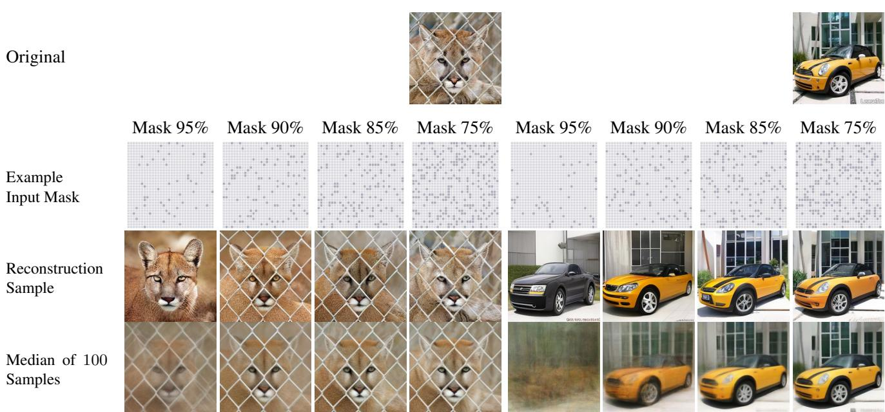  
Figure 9. MaskGIT 在图像重建上的示例。MaskGIT 接收从原始图像（第一行）中提取的掩码标记（通过随机输入掩码，第二行中未知标记以浅灰色表示），并输出重建图像（第三行）。随后，我们以相同的掩码比例随机采样 100 个掩码，并在第四行展示这 100 个重建样本的中位数。

## A. 关于图像重建的讨论

在 4.2 节中，我们主要在类别条件图像生成任务上对 MaskGIT 进行了评估。在此，我们将对其在图像重建上的表现展开更多讨论。我们的实验设置为：首先随机采样输入掩码 $M$，其中有掩码比例为 $r$ 的视觉标记被掩码掉，然后运行 MaskGIT 的迭代解码算法来重建图像。Figure 10 展示了重建样本的 PSNR 和 LPIPS [55] 随 $r$ 变化的函数关系，而 Figure 9 则直观展示了该过程的两个示例，其中 $r$ 的范围在 95% 到 75% 之间。

我们观察到，即使在极高比例（例如 95%）的标记被掩码掉的情况下，MaskGIT 仍能重建出整体信息（例如前景物体的姿态和形状）。更重要的是，在 90% 附近似乎存在一个拐点：虽然当掩码比例降至 90% 时，重建质量和一致性都会大幅提升，但在 90% 之后，进一步的提升速度明显放缓。Figure 9 中从 95% 到 90% 重建样本与原始图像之间视觉相似度的大幅跃升证实了这一观察结果，例如，一旦掩码比例低于 90%，老虎前面的栅栏和汽车的颜色都能被稳定地捕捉到，但在 95% 时则不然。

换句话说，我们发现视觉标记具有高度的冗余性。对于整体重建而言，仅有极小一部分（例如 10%）的标记是不可或缺的；其余标记仅用于改善更精细的外观或细节的恢复。这与我们在 3.3 节中阐述的掩码设计背后的直觉相吻合，即前几个标记的预测是图像生成的关键。同期发表的论文 MAE [21] 中也讨论了关于图像空间冗余的类似观察。在他们的工作中，他们发现掩码掉输入图像的大比例部分，能够为图像表征学习构建一个非平凡且富有意义的自监督任务。

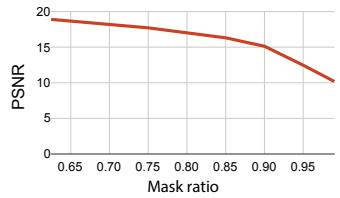

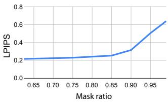  
Figure 10. 由 PSNR 和 LPIPS [55] 衡量的重建质量与多样性。

## B. 额外的类别条件图像生成结果

在本节中，我们汇报类别条件图像生成的额外结果。

我们遵循以往基于 Transformer 的方法 [15, 37]，采用基于分类器的拒绝采样（rejection sampling）来提高样本质量得分。具体而言，与 VQGAN [15] 类似，我们使用预训练的 ResNet 分类器 [22] 根据预测概率对输出样本进行打分，并保留接受率为 0.05 的样本。如 Table 4 所示，MaskGIT 相比 VQ-GAN 展现出持续的改进，且与带有分类器引导（classifier guidance）的 ADM [12] 相当。更重要的是，通过引入拒绝采样，MaskGIT 取得了最先进的 Inception Score（在 256ˆ256 上为 355.6，在 512ˆ512 上为 342.0）。

在 Table 5 中，我们报告了使用 Inception 特征 [42] 计算的精确率（Precision）和召回率（Recall）得分。与我们在 Table 1 中为与先前工作 [12, 30] 进行更直接比较而报告的基于 VGG [40] 特征的得分相比，我们发现基于 Inception 特征的得分与我们的定性观察更为一致，即 VQGAN 的样本比 BigGAN 的更具多样性。在这两项指标下，MaskGIT 的召回率得分均优于 BigGAN 和 VQGAN。我们还报告了在未使用 RandAugment [9] 增强训练的分类器上评估的 CAS。与我们的主要结果一致，MaskGIT 大幅超越了 Big-GAN 和我们的基线 VQGAN。

最后，我们在 Figure 11、12 和 13 中展示了 MaskGIT 生成的类别条件样本与 BigGAN-deep 和 VQVAE-2 生成样本的一些对比。

<table><tr><td>数据集</td><td>模型</td><td>分类器引导</td><td>FID</td><td>IS</td></tr><tr><td rowspan="3">ImageNet $256 \times 256$ </td><td>ADM [12]</td><td>1.0 guidance</td><td>4.59</td><td>186.70</td></tr><tr><td>VQGAN [15]</td><td>0.05 接受率</td><td>5.88</td><td>304.8</td></tr><tr><td>MaskGIT</td><td>0.05 接受率</td><td>4.02</td><td>355.6</td></tr><tr><td rowspan="2">ImageNet $512 \times 512$ </td><td>ADM [12]</td><td>1.0 guidance</td><td>7.72</td><td>172.71</td></tr><tr><td>MaskGIT</td><td>0.05 接受率</td><td>4.46</td><td>342.0</td></tr></table>

Table 4. 带有分类器引导的方法在 ImageNet 上的类别条件图像合成。

<table><tr><td rowspan="2">模型</td><td rowspan="2">Prec ↑</td><td rowspan="2">Rec ↑</td><td colspan="2">CAS ×100 ↑</td></tr><tr><td>Top-1 (73.1)</td><td>Top-5 (91.5)</td></tr><tr><td>BigGAN-deep [4]</td><td>0.82</td><td>0.27</td><td>42.65</td><td>65.92</td></tr><tr><td>VQ-GAN*</td><td>0.61</td><td>0.47</td><td>47.50</td><td>68.90</td></tr><tr><td>MaskGIT (Ours)</td><td>0.78</td><td>0.50</td><td>58.20</td><td>79.65</td></tr></table>

Table 5. 在 ImageNet 256ˆ256 上与 BigGAN-deep 及我们基线 VQGAN 的更多定量对比。˚ 表示我们使用与自身相同架构和设置训练的模型。

## C. 类别条件图像编辑应用的更多示例

我们在 Figure 14 中展示了类别条件图像编辑的更多示例，并在 Figure 15 中展示了图像条件全景合成的示例。

## D. 与基于 Transformer 的 SOTA 方法的图像外推比较

在 Figure 16 和 17 中，我们展示了 MaskGIT、ImageGPT [7] 和 VQGAN [15] 之间的一些外推（outpainting）比较。在每组图像中，我们展示了真实图像（左）、仅使用真实图像上半部分外推生成的样本（中），以及仅使用真实图像下半部分外推生成的样本（右）。

MaskGIT 和 VQGAN 都可以利用 tokenization 在更高分辨率下运行，从而获得比运行在最高分辨率 192 ˆ 192 下的 ImageGPT 更高的样本保真度。同时，MaskGIT 表现出比 ImageGPT 和 VQGAN 更强的灵活性，因为它可以在任意方向进行外推（例如同时向上和向下），而 ImageGPT 和 VQGAN 由于其自回归特性，单个模型只能处理一个方向的外推。

## E. 与基于 GAN 的 SOTA 方法的图像修复与外推比较

在本节中，我们在 Figure 18 和 Figure 19 中展示了与基于 GAN 的最新图像补全方法的更多定性比较。定量结果已在 4.3 节中讨论。

我们发现，与先前的基于 GAN 的方法相比，MaskGIT 展现出了更强的连贯补全结构的能力，且其生成的样本包含更少的伪影。在 Figure 19 中，MaskGIT 补全了第二行中的桥梁和倒数第二行中的建筑物，相比之下所有 GAN 方法都难以做到这一点。

此外，我们在大遮罩比例的图像补全任务上与 CoModGAN 进行了比较，即分别以中心 50%ˆ50% 和中心 31.25%ˆ31.25% 为条件，这对于传统 GAN 而言是非常具有挑战性的情况。示例见 Figure 20。

## F. 局限性与失败案例

在 Figure 21 中，我们展示了本方法的若干局限性和失败案例。(A) 和 (B) 是 MaskGIT 外推结果中语义和颜色偏移的示例。由于其有限的注意力大小，MaskGIT 在向一端进行外推时可能会“遗忘”另一端合成的语义或颜色。(C) 和 (D) 展示了本方法在应用于外推和修复（inpainting）时，有时可能会忽略或修改边界处物体的案例。(E) 展示了 MaskGIT 的失败模式，即在人脸、文本和对称物体等复杂结构上会导致过度平滑或产生不良伪影。针对这些情况的改进仍留待未来工作。

BigGAN-deep (FID=6.95)  
VQVAE-2: (FID=31)  
MaskGIT (FID=6.18)  
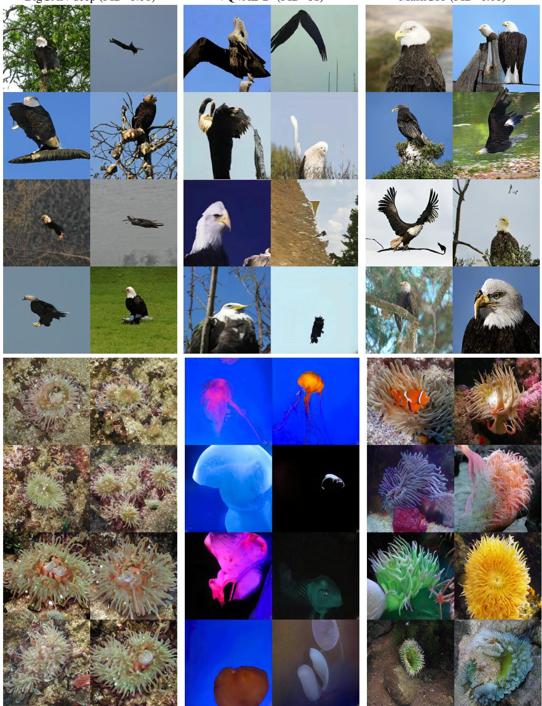  
Figure 11. 截断参数为 1.0 的 BigGAN-deep、VQVAE-2 [37] 以及我们提出的方法 MaskGIT 在 ImageNet 上的更多多样性比较。: 表示从原论文中提取的样本。

  
BigGAN-deep (FID=6.95)  
VQVAE-2 (FID=31)  
MaskGIT (FID=6.18)  
Figure 12. 截断参数为 1.0 的 BigGAN-deep、VQVAE-2 [37] 与我们提出的方法 MaskGIT 在 ImageNet 上的更多多样性对比。: 表示从原论文中提取的样本。

BigGAN-deep (FID=6.95)  
VQVAE-2 (FID=31)  
MaskGIT (FID=6.18)  
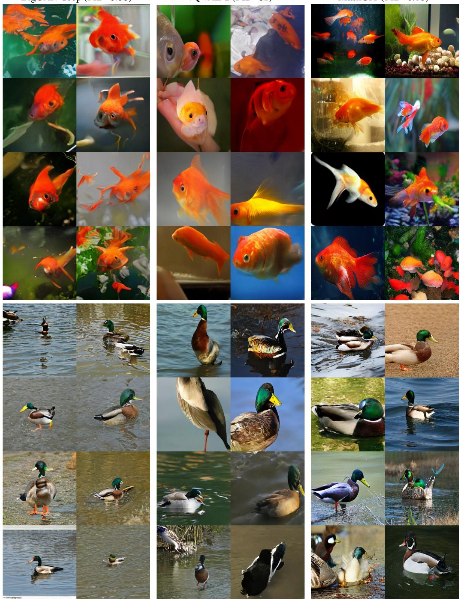  
Figure 13. 截断参数为 1.0 的 BigGAN-deep、VQVAE-2 [37] 与我们提出的方法 MaskGIT 在 ImageNet 上的更多多样性对比。: 表示从原论文中提取的样本。

输入图像

  
Figure 14. 类别条件图像编辑的更多示例。在每一列中，底部的图像均是利用顶部的图像、左侧的 ImageNet 类别标签以及下采样到潜在空间中的主要物体边界框（如第二行所示）合成的。

输入  
MaskGIT (Ours)  
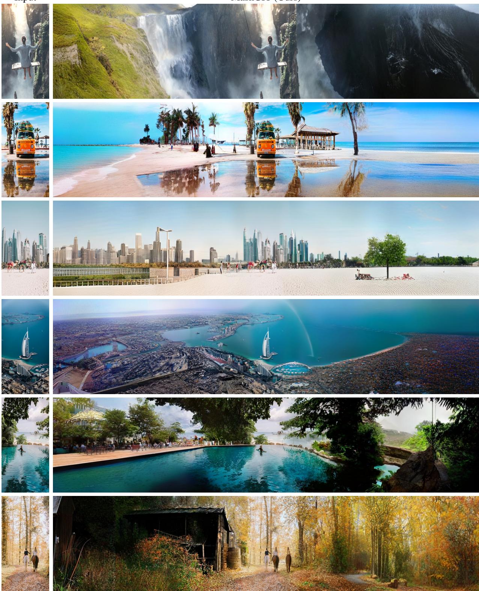  
Figure 15. 水平图像外推（从 512ˆ256 到 512ˆ2304）的更多样本。合成的“全景图”是通过沿两个水平方向反复应用 MaskGIT 的外推能力创建的。

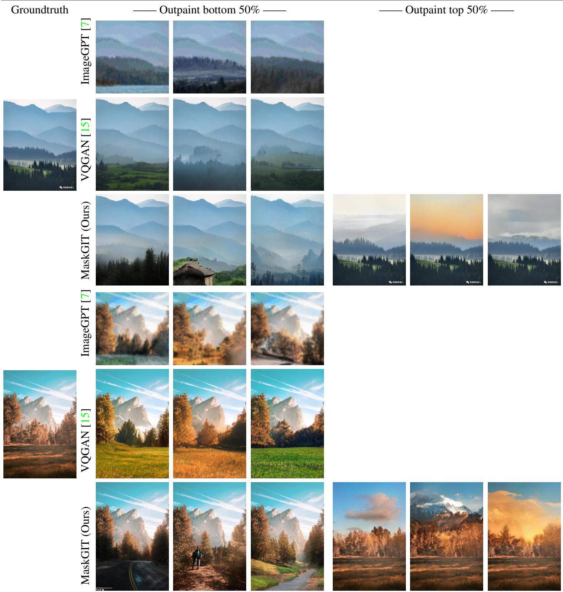  
Figure 16. 与基于像素的方法 ImageGPT [7] 及基于 Transformer 的方法 VQGAN [15] 的图像外推对比。

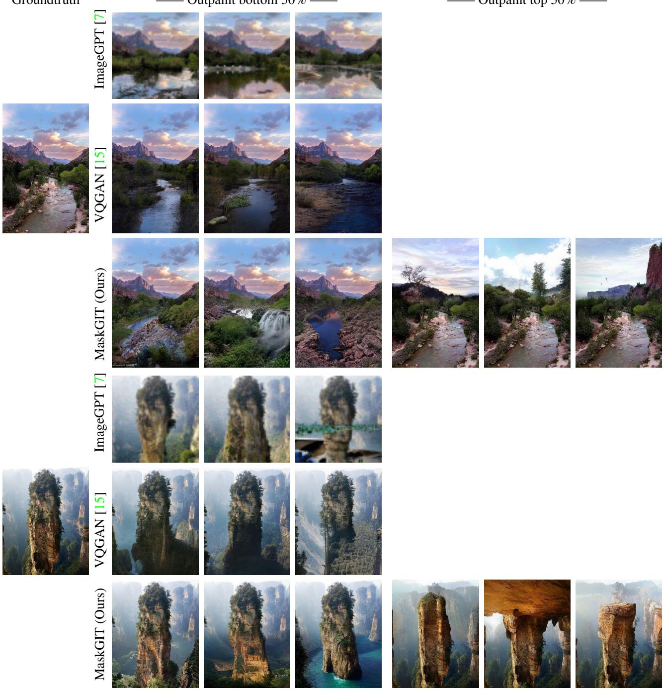  
Figure 17. 与基于像素的方法 ImageGPT [7] 及基于 Transformer 的方法 VQGAN [15] 的图像外推对比。

CoModGAN [57]  
输入  
DeepFillv2 [52]  
HiFill [50]  
MaskGIT (Ours)  
真实值  
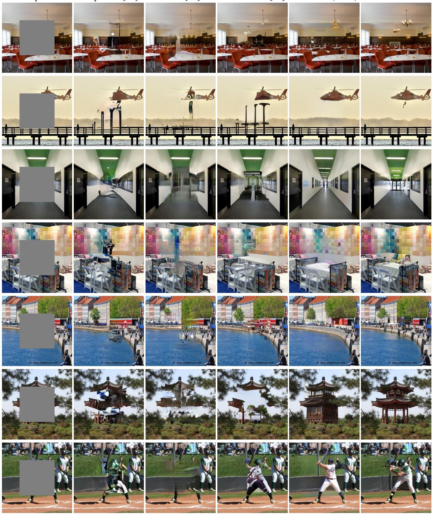  
Figure 18. 在 Places2 [58] 上与最先进的 GAN 方法在图像修复方面的更多视觉对比。

输入  
Boundless [43]  
InfinityGAN [31]✳  
CoModGAN  
MaskGIT (Ours)  
真实值  
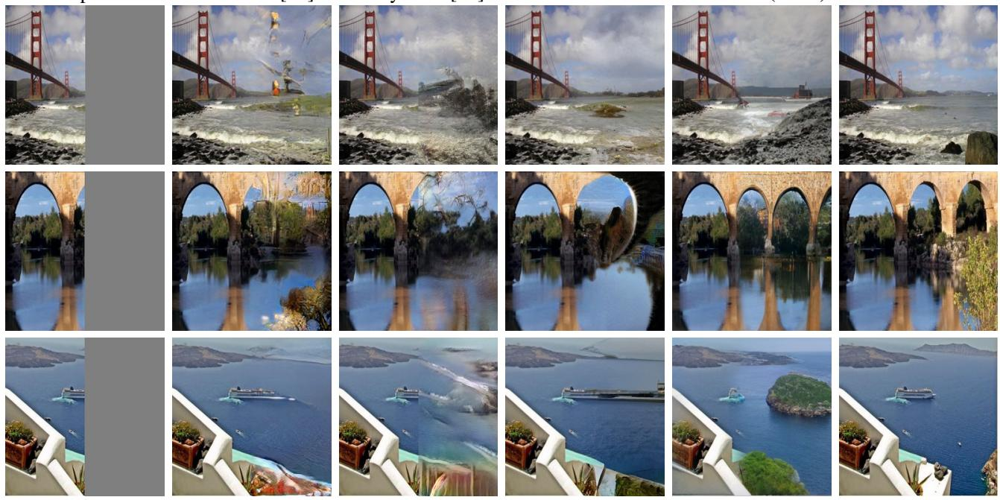  
Figure 19. 与最先进的 GAN 方法在图像外推方面的更多视觉对比。✳ 样本由原作者友情提供。

输入  
CoModGAN  
MaskGIT (Ours)  
输入  
CoModGAN  
MaskGIT (Ours)  
  
Figure 20. 在大面积外推掩模下与 CoModGAN [57] 进行图像外推的视觉对比。

  
Figure 21. 局限性与失败案例。