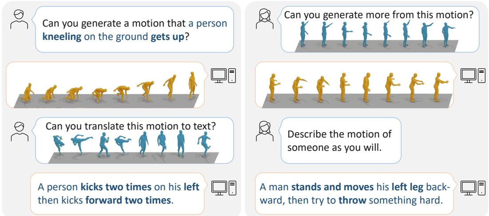
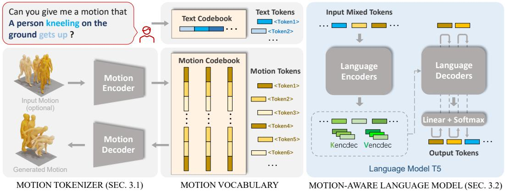
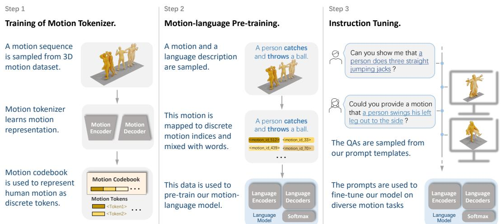
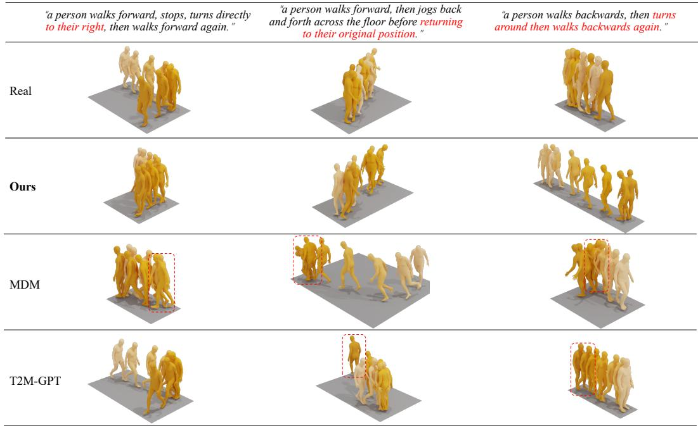
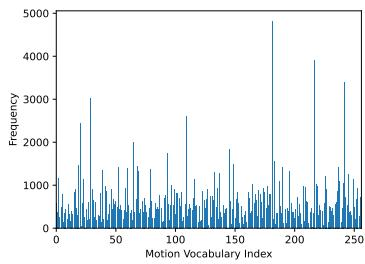
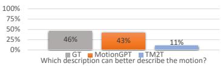
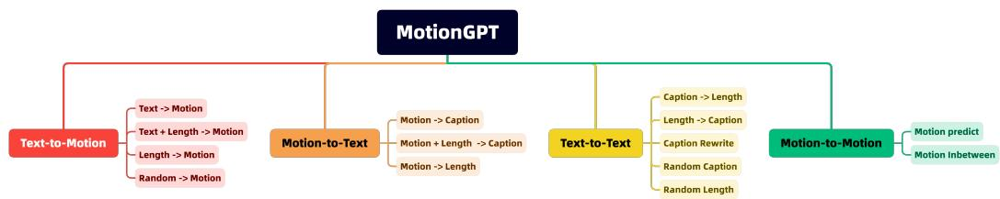

# MotionGPT：将人体动作视为一种外语

Biao Jiang1,2∗ Xin Chen2∗ Wen Liu2 Jingyi Yu3 Gang Yu2 Tao Chen1† 1Fudan University（复旦大学） 2Tencent PCG（腾讯 PCG） 3 ShanghaiTech University（上海科技大学） https://github.com/OpenMotionLab/MotionGPT

## 摘要

尽管预训练大语言模型取得了长足进展，但为语言和其他多模态数据（如动作）构建统一模型的探索目前仍极具挑战性且鲜有人涉足。幸运的是，人体动作表现出类似于人类语言的语义关联性，通常被视为一种肢体语言。通过将语言数据与大规模动作模型相融合，能够提升动作相关任务性能的动作-语言预训练变得切实可行。基于这一见解，我们提出了 MotionGPT，这是一个用于处理多种动作相关任务的统一、通用且用户友好的动作-语言模型。具体而言，我们对人体动作采用离散矢量量化（discrete vector quantization），将 3D 动作转换为动作词元（motion tokens），类似于单词词元的生成过程。基于这个“动作词表”（motion vocabulary），我们以统一的方式对动作和文本进行语言建模，将人体动作视为一种特定的语言。此外，受提示学习（prompt learning）的启发，我们使用动作-语言混合数据对 MotionGPT 进行预训练，并在基于提示的问答任务上对其进行微调。大量实验表明，MotionGPT 在多项动作任务上取得了最先进的（state-of-the-art）性能，包括文本驱动动作生成、动作描述（motion captioning）、动作预测和动作插帧（motion in-between）。

## 1 引言

近年来，诸如 GPT [36, 37, 3, 28]、BERT [7] 和 T5 [38, 5] 等预训练大语言模型取得了重大突破，推动了语言 [61, 49]、图像 [35, 52, 21]、网格（mesh）[57, 27] 以及多模态 [8] 建模的融合。然而，针对人体动作与语言的通用预训练模型尚未出现。这种能够通过提示支持众多动作相关任务的预训练动作-语言模型，将使游戏、机器人、虚拟助手和人类行为分析等众多领域受益。

以往关于人体动作（human motion）的研究探索了多种任务，包括动作生成 [31, 11, 48, 54, 59]、动作描述（motion captioning）[9, 12] 和动作预测 [58, 63, 25]。最近的文本生成动作（text-to-motion）工作 [48, 60, 32, 54] 尝试使用预训练的语言相关模型 [7, 35]。例如，MDM [48] 学习了一个带有来自 CLIP [35] 条件文本词元（token）的动作扩散模型，而 MLD [54] 结合动作潜在空间（motion latent space）以提高动作扩散过程的效率。另一方面，MotionCLIP [47] 和 TM2T [12] 专注于对动作与文本描述之间的耦合关系进行建模。然而，上述方法将动作和语言视为独立的模态，这通常需要严格配对的动作和文本数据。此外，由于监督是任务特定的，它们缺乏对动作与语言之间关系的全面理解，因此很难有效地泛化到未见过的任务或数据。因此，我们专注于构建一个预训练动作-语言模型，该模型能够泛化到各种任务，并从更易获取的动作和语言数据中学习深度的动作-语言关联知识。

  
Figure 1: MotionGPT 能够在给定不同指令的情况下统一处理多种动作相关任务。我们展示了在文本生成动作（左上）、动作描述（左下）、动作补全（右上）以及语言问答（右下）上的结果。动作从左到右代表时间顺序。蓝色动作表示输入，黄色表示生成结果。

预训练一个有前景的动作-语言模型面临两个关键且亟待解决的挑战。第一个是建模语言与动作之间的关系，第二个是构建一个能够泛化到新任务的统一多任务框架。幸运的是，人体动作表现出与人类语言相似的语义耦合，通常被解释为一种肢体语言。基于这一观察，我们遵循 BEiT-3 [52] 的视觉-语言预训练方法，将人体动作视为一种特定的外语。通过将动作和语言数据整合在一起并将它们编码在单个词表中，动作与语言之间的关系变得更加明确。因此，借助近期规模显著增大的语言数据和模型，动作-语言预训练在提升动作任务性能方面具有巨大潜力。同时，这种基于语言的预训练支持类似于 InstructGPT [28] 中的提示（prompt）等文本指令，使模型在各种动作任务中更加通用且用户友好。

在这项工作中，我们提出了一个统一的动作-语言框架，即 MotionGPT，该框架利用预训练语言模型强大的语言生成和零样本迁移（zero-shot transfer）能力来执行人体动作相关的任务。为了使 MotionGPT 能够理解并生成类人动作，我们首先学习一个特定于动作的矢量量化变分自编码器（vector quantized variational autoencoder, VQ-VAE）模型，以构建类似于英语词表的“动作词表”（motion vocabulary），进而将原始动作数据转换为动作标记（motion tokens）序列。然后，这些标记由预训练语言模型 [38, 5] 进行处理，以学习动作语言的潜在文法和句法，以及其与对应文本描述之间的关联。为了在 MotionGPT 中有效地整合语言和动作，我们设计了一种两阶段训练方案。我们首先在原始动作数据集上预训练语言模型，以学习动作语言的基本文法和句法。在提示微调（prompt tuning）阶段，我们在包含文本描述和动作数据的指令数据集上微调语言模型，以学习这两种模态之间的相关性。大量实验表明，MotionGPT 在文本到动作（text-to-motion）、动作到文本（motion-to-text）、动作预测（motion prediction）和动作插值（motion in-between）任务上均取得了最先进的性能。

我们将主要贡献总结如下：(1) 我们提出了一个统一的动作-语言生成式预训练模型 MotionGPT，该模型将人体动作视作一种外语，将自然语言模型引入动作相关生成中，并使用单一模型执行多种动作任务。(2) 我们引入了一种包含指令微调（instruction tuning）的动作-语言训练方案，以从任务反馈中学习，并通过提示（prompts）生成出色的结果。(3) 我们提出了一个用于多任务评估的通用动作基准，在该基准上，MotionGPT 在包括文本到动作、动作到文本、动作预测和动作插值在内的多种任务中均取得了极具竞争力的性能，并公开了所有代码和数据。

<table><tr><td>方法</td><td>文本到动作</td><td>动作到文本</td><td>动作预测</td><td>动作插值</td><td>随机动作</td><td>随机描述</td></tr><tr><td>T2M-GPT [48]</td><td>√</td><td>✗</td><td>✗</td><td>✗</td><td>√</td><td>✗</td></tr><tr><td>MLD [54]</td><td>√</td><td>✗</td><td>✗</td><td>✗</td><td>√</td><td>✗</td></tr><tr><td>TM2T [12]</td><td>√</td><td>√</td><td>✗</td><td>✗</td><td>✗</td><td>✗</td></tr><tr><td>MDM [48]</td><td>√</td><td>✗</td><td>√</td><td>√</td><td>√</td><td>✗</td></tr><tr><td>MotionDiffuse[60]</td><td>√</td><td>✗</td><td>√</td><td>√</td><td>√</td><td>✗</td></tr><tr><td>MotionGPT (Ours)</td><td>√</td><td>√</td><td>√</td><td>√</td><td>√</td><td>√</td></tr></table>

Table 1: 近期最先进方法在各种动作相关任务上的对比。Random Motion（随机动作）和 Random Caption（随机描述）代表动作和动作描述的无约束生成。

## 2 相关工作

人体动作合成（Human Motion Synthesis）涉及利用多模态输入生成多样化且逼真的类人动作，例如文本 [11, 32, 60, 48, 12, 1, 18]、动作类别 [31, 13, 48, 54] 和不完整动作 [58, 63, 25, 48]。由于语言输入具有用户友好且便捷的特性，文本生成动作（Text-to-motion）成为最重要的动作生成任务之一。MDM [48] 提出了一种基于扩散的生成模型 [15]，并在多个动作任务上分别进行了训练。MLD [54] 推进了潜在扩散模型（latent diffusion model）[45, 40] 的应用，以根据不同的条件输入生成动作。T2M-GPT [59] 研究了一种基于 VQ-VAE 和生成式预训练 Transformer（GPT）的生成框架用于动作生成。动作补全任务以部分动作为条件生成动作，例如经典的动作预测 [58, 63, 25] 或动作插值（motion in-between）[48]——即在首尾部分固定的情况下生成中间动作。尽管它们在各种人体动作任务中展现出了可观的效果，但上述大多数方法在使用单一模型处理多个任务方面仍存在局限。因此，我们提出了一种统一的方法，将人体动作视为一种外语，并利用预训练语言模型强大的语言生成和零样本迁移能力。

人体动作描述（Human Motion Captioning）。为了用自然语言描述人体动作，[46] 依靠两个统计模型来学习从动作到语言的映射。此外，循环网络也已在 [56, 34] 中得到应用。最近，TM2T [12] 提出了一种新的动作表征，将动作压缩为离散变量的短序列，然后使用神经翻译网络在两种模态之间建立映射。尽管先前如 TM2T [12] 等研究在其动作生成训练管线中引入了描述模块，但这些方法在统一框架内仍局限于文本与动作之间的双向翻译。

语言模型与多模态。大语言模型（Large-scale language models，LLMs）[7, 6, 38, 3, 61, 49]在海量数据集和庞大模型规模的赋能下，展现出令人瞩目的理解与生成能力，将自然语言处理推向了新的高度。BERT [7] 预训练了能够支持下游任务的深度双向语言表征。T5 [38] 引入了一个统一框架，将所有基于文本的语言问题转化为文本到文本（text-to-text）的形式。近期的研究 [53, 2, 28, 5] 发现，通过使用由指令及其配对答案组成的输入-输出对微调预训练模型，可以进一步提升预训练模型的性能。FLAN [5] 提出了一种指令微调技术，在未知任务上的表现超越了未微调的模型。最近，多模态模型 [21, 16, 20] 掀起了一股热潮，致力于将文本与其他模态协同处理，例如图像 [21, 16, 8]、音频 [14, 8] 以及视频 [55]。CLIP [35] 进一步学习了将图像与其对应的语言描述耦合的语义隐式表征。尽管语言模型在各种视觉-语言任务中取得了成功，但能够处理人体动作的多模态语言模型的发展仍然有限。

动作语言预训练。现有的文本到动作生成方法 [11, 32, 48, 12, 1, 18] 可被归类为描述到动作（caption-to-motion），其中模型接收目标动作的纯文本描述作为输入。尽管这些方法能够从文本描述中生成动作，但它们在支持类似于 InstructGPT [28] 的用户指令方面往往受到限制。换句话说，它们不允许用户针对特定应用提供具体上下文的指令。MotionCLIP [47] 利用 CLIP [35] 的语言和视觉理解能力，将其潜在空间与动作自编码器进行对齐。与此同时，许多语言模型（如 T5 [38] 和 InstructGPT [28]）已被开发用于处理多样化的语言处理任务，包括翻译、问答和分类。这些模型通常被设计为将给定的文本输入映射到目标输出，例如翻译结果或答案。然而，尽管这些模型在语言任务中表现出色，但它们尚未广泛应用于动作任务。因此，我们提出了 MotionGPT，以实现自然语言模型与人体动作任务的有效整合，为动作合成问题提供统一的解决方案。

  
Figure 2: 方法概览：MotionGPT 由动作分词器 V（Sec. 3.1）和动作感知语言模型（Sec. 3.2）组成。结合由 V 学习到的动作词元（Motion Tokens）与文本分词器生成的文本词元（Text Tokens），我们以语言模型为骨干网络联合学习动作与语言。

## 3 方法

为了将大规模语言数据和模型引入动作生成任务中，我们提出了一个名为 MotionGPT 的统一动作-语言框架。如图 Fig. 2 所示，MotionGPT 包含一个负责将原始动作数据转换为离散动作 token 的动作分词器（Sec. 3.1），以及一个动作感知语言模型，该模型通过相应的文本描述，利用大型语言预训练模型来学习理解动作 token（Sec. 3.2）。为了处理与动作相关的任务，我们为 MotionGPT 引入了一种三阶段训练方案（Sec. 3.3），包括动作分词器训练、动作-语言预训练和指令微调。

我们首先提出了由动作编码器 E 和动作解码器 D 组成的动作分词器，用于将一个 M 帧的动作 $m ^ { 1 : M } = \{ x ^ { i } \} _ { i = 1 } ^ { M }$ 编码为 L 个动作 token $z ^ { 1 : L } = \{ z ^ { i } \} _ { i = 1 } ^ { L } , L = M / l ,$ ，并将 $z ^ { 1 : L }$ 解码回动作 $\hat { m } ^ { 1 : M } \stackrel { \sim } { = } \mathcal { D } ( z ^ { 1 : L } ) = \mathcal { D } ( \mathcal { E } ( m ^ { 1 : M } ) )$ ，其中 l 表示动作长度上的时间下采样率。然后，给定一个描述动作相关问题或需求的长度为 N 的句子 $\boldsymbol { w ^ { 1 : N } } = \{ w ^ { i } \} _ { i = 1 } ^ { N }$ ，MotionGPT 旨在生成其答案，形式为长度为 L 的 token $\hat { x } ^ { 1 : L } = \{ \hat { x } ^ { i } \} _ { i = 1 } ^ { L }$ 。这可以是人体动作 token $\hat { x } _ { m } ^ { 1 : L }$ ，也可以是文本 token $\hat { x } _ { t } ^ { 1 : L }$ ，从而生成一个动作 $\hat { m } ^ { 1 : M }$ 或一个类似于给定动作描述的句子 $\hat { w } ^ { 1 : L }$ 。

## 3.1 动作分词器

为了用离散 token 表示动作，我们基于 [50, 44, 12, 59] 中使用的矢量量化变分自编码器（Vector Quantized Variational Autoencoders，VQ-VAE）架构预训练了一个 3D 人体动作分词器 V。我们的动作分词器由一个编码器 $\mathcal { E }$ 和一个解码器 D 组成。编码器生成具有高信息密度的离散动作 token，而解码器能够将动作 token 重建为动作序列 $\hat { m } ^ { 1 : M }$ 。该方法使我们能够有效地将动作表示为一种语言，从而促进动作与语言的融合以用于各种动作相关任务。

具体而言，动作编码器 E 首先沿时间维度对给定的逐帧动作特征 $\stackrel { \cdot } { m } ^ { 1 : M }$ 应用一维卷积，以获得潜在向量 $\hat { z } ^ { 1 : L } = \mathcal { E } ( m ^ { 1 : M } )$ 。接着，我们通过离散量化将 zˆ 转换为码本条目集合 z。可学习码本 $Z = \{ z ^ { i } \} _ { i = 1 } ^ { K } \subset \mathbb { R } ^ { d }$ 由 K 个潜在嵌入向量组成，每个向量的维度为 d。量化过程 $Q ( \cdot )$ 将每个行向量 b 替换为其在 $Z ,$ 中最接近的码本条目 $b _ { k }$ ，表示为

$$
z _ {i} = Q (\hat {z} ^ {i}) := \arg \min _ {z _ {k} \in Z} \| \hat {z} _ {i} - z _ {k} \| _ {2}.\tag{1}
$$

量化之后，动作解码器 $D$ 将 $z ^ { 1 : L } = \{ z ^ { i } \} _ { i = 1 } ^ { L }$ 投影回原始动作空间，作为包含 $M$ 帧的动作 $\hat { m } ^ { 1 : M }$。为了训练该动作分词器（motion tokenizer），我们遵循 [12, 59]，利用三个不同的损失函数来训练和优化动作分词器：$\mathcal { L } _ { \mathcal { V } } = \mathcal { L } _ { r } + \mathcal { L } _ { e } + \mathcal { L } _ { c }$，其中包含重构损失 ${ \mathcal { L } } _ { r }$、嵌入损失 $\mathcal { L } _ { e }$ 以及承诺损失 $\mathcal { L } _ { c }$。为了进一步提升生成动作的质量，我们遵循 [59]，在重构损失中采用 L1 平滑损失和速度正则化，并在训练期间使用指数移动平均（EMA，exponential moving average）和码本重置技术 [39] 来提高码本利用率。我们在补充材料中提供了关于动作分词器架构和训练的更多细节。

## 3.2 动作感知语言模型

利用该动作分词器，人体动作 $m ^ { 1 : M }$ 可以被映射为一个动作 token 序列 $\overset { \cdot } { z } { } ^ { 1 : \overline { { L } } }$，从而使其能够与语言模型中类似的词表嵌入进行联合表示 [19, 38, 28]。通过将它们结合在统一的词表中，我们随后对动作和语言进行联合学习。我们首先将动作 tokens $z ^ { 1 : L }$ 表示为一个索引序列 $s ^ { 1 : L } = \{ s ^ { i } \} _ { i = 1 } ^ { L }$，其中 ${ \bf \bar { \Phi } } _ { s } i$ 对应于动作 tokens $z ^ { 1 : L }$ 的索引编号。另一方面，以往的语言模型（如 T5 [38]）将文本编码为 WordPiece tokens。它们利用包含 $K _ { t }$ 个 word pieces 的词表，并在混合语言数据集上训练 SentencePiece [19] 模型。

大多数先前的文本到动作（text-to-motion）[12, 54, 59]或动作到文本（motion-to-text）[12]方法采用不同的模块分别处理文本和动作，而我们的目标是以相同的方式对文本和人体动作进行统一建模。为了实现这一点，我们将原始文本词表 $V _ { t } = \{ v _ { t } ^ { i } \} _ { i = 1 } ^ { K _ { t } }$ 与动作词表 $V _ { m } = \{ v _ { m } ^ { i } \} _ { i = 1 } ^ { K _ { m } }$ 相结合，该动作词表与我们的动作码本（codebook）$Z$ 保持顺序一致。此外，$V _ { m }$ 还包含若干诸如边界指示符等特殊标记（tokens），例如作为动作开始与结束的 </som> 和 </eom>。因此，我们采用了一个全新的统一文本-动作词表 $V = \{ V _ { t } , V _ { m } \}$，并能够以通用格式构建多种与动作相关的任务，其中输入“词”和输出“词”均来自同一个 $V$。根据具体要解决的任务，这些“词”可以代表自然语言、人体动作，甚至是两者的混合。因此，我们的 MotionGPT 允许在单个模型中灵活地表示和生成多种与动作相关的输出。

为了解决条件生成任务，我们采用了一个基于 [38] 中提出架构的 Transformer 模型，该模型能有效地将输入序列映射到输出。我们的源输入由一系列标记组成 $\ = X _ { s } \ \dot { = } \ \{ \dot { x _ { s } } ^ { i } \} _ { i = 1 } ^ { N }$，其中 $x _ { s } ~ \in ~ V$，且 N 代表输入长度。类似地，目标输出为 $X _ { t } ~ = ~ \{ x _ { t } ^ { ~ i } \} _ { i = 1 } ^ { L }$，其中 $x _ { t } ~ \in ~ V$，且 L 表示输出长度。如图 Fig. 2 所示，源标记被输入到 Transformer 编码器中，随后的解码器以自回归方式在每一步预测潜在下一个标记的概率分布 $\begin{array} { r } { p _ { \theta } ( x _ { t } \mid \bar { x _ { s } } ) = \prod _ { i } p _ { \theta } \left( \bar { x } _ { t } ^ { i } \mid x _ { t } ^ { < i } , x _ { s } \right) } \end{array}$。因此，在训练过程中，目标是最大化数据分布的对数似然：

$$
\mathcal {L} _ {L M} = - \sum_ {i = 0} ^ {L _ {t} - 1} \log p _ {\theta} \left(x _ {t} ^ {i} \mid x _ {t} ^ {<   i}, x _ {s}\right).\tag{2}
$$

通过优化这一目标，MotionGPT 学会从数据分布中捕获潜在的模式和关系，从而促进目标“词”的准确且有意义的生成。在推理过程中，目标 token 从预测分布 pθ $\left( \hat { x _ { t } } ^ { i } \mid \hat { x _ { t } } ^ { < i } , x _ { s } \right)$ 中被递归采样，直到遇到结束 token $( \mathrm { i } . \mathrm { e } . , < / \mathrm { s } > )$。这种采样策略能够以逐步的方式生成目标序列，其中每个 token 均根据先前生成的 token 和给定的源输入进行概率确定。

## 3.3 训练策略

由于 T5 模型仅接触过在文本词表 $V _ { t } ,$ 内表示的语言数据，因此我们通过学习运动词表 $V _ { m } .$ ，架起运动与语言之间的桥梁，使该语言模型能够理解人体运动概念。如图 3 所示，我们的训练方案包含三个阶段：(1) 运动分词器（motion tokenizer）训练，重点在于学习运动代码本以将人体运动表示为离散 token。(2) 运动-语言预训练阶段，包括无监督和有监督目标，以学习运动与语言之间的关系。(3) 指令微调（instruction tuning）阶段，根据基于提示的指令针对不同的运动相关任务对模型进行微调。

运动分词器训练。我们首先使用公式 3.1 中定义的目标来学习运动分词器。该训练过程允许将任意人体运动序列 $\hat { x } ^ { 1 : L }$ 表示为运动 token 序列，从而实现与文本信息的无缝集成。一旦优化完成，运动分词器在管线的后续阶段中保持不变。

  
Figure 3: 训练方案。我们为 MotionGPT 引入了三个训练步骤（第 3.3 节）：首先，我们学习用于离散运动表示的代码本。然后，我们使用语言和运动数据的混合数据训练语言模型，以学习文本与运动之间的语义耦合。最后，我们在带有指令的多任务文本-运动数据集上对模型进行微调。

动作-语言预训练阶段。T5 模型 [38, 5] 是在基于指令表述的自然语言数据集上进行训练和微调的 [5, 28]。我们通过无监督和有监督的方式，利用语言和动作的混合数据继续对该模型进行预训练：1) 为泛化到各类下游任务（如 [7, 37, 38, 28]），我们遵循 [38] 设计了一个目标函数，其中输入 token X 中一定比例（15%）的 token 会被随机替换为特殊的哨兵 token（sentinel token）。另一方面，通过提取被丢弃的 token 片段来构建相应的目标序列，并用输入序列中使用的相同哨兵 token 进行分隔，同时附加一个额外的哨兵 token 以指示目标序列的结束。2) 然后，我们在成对的文本-动作数据集 [11, 33] 的监督下学习动作与语言的关系。我们在有监督的动作-语言翻译任务上训练 MotionGPT，其中输入可以是人体动作或文本描述。经过无监督和有监督的训练过程，我们旨在使模型具备对文本与动作关系的理解能力。

指令微调阶段。我们在现有文本到动作（text-to-motion）数据集（如 HumanML3D [11] 和 KIT [33]）的基础上，通过将其构建为指令形式来构建一个多任务文本-动作数据集。具体而言，我们定义了 15 个核心动作任务，例如文本生成动作、动作描述（motion captioning）、动作预测等。对于每个任务，我们撰写了数十种不同的指令模板，从而生成了一千多个不同的任务，每个任务都具有唯一的指令提示词（instruction prompt）。例如，动作生成任务的指令提示词可以是“Can you generate a motion sequence that depicts ‘a person emulates the motions of a waltz dance’?”。类似地，对于动作描述任务，指令提示词可以是“Provide an accurate caption describing the motion of <motion\_tokens>”，其中 <motion\_tokens> 表示由我们的动作分词器（motion tokenizer）生成的动作 token 序列。我们在第 4.3 节（Sec. 4.3）中展示了指令微调的有效性，它带来了跨各种任务的提升，并增强了模型在未见任务或提示词上的性能。补充材料中提供了更多提示词示例。

## 4 实验

广泛的对比评估了我们的 MotionGPT 在多个动作相关任务和数据集上的性能。文中提供了数据集设置、评估指标以及实现细节（Sec. 4.1）。我们首先通过在各种任务上将我们的方法与其他 SOTA 方法进行比较，提出了一个统一的基准（Sec. 4.2）。然后，我们分别评估了在文本生成动作（Sec. 4.2）、动作生成文本（Sec. 4.2）、动作预测和动作插帧（motion in-between，Sec. 4.2）上的具体对比。补充材料中包含了更多定性结果、用户研究以及进一步的实现细节。

## 4.1 实验设置

数据集。通用动作合成可以支持多样化的任务设定，因此本文利用以往的数据集以及一个修改后的基准来评估 MotionGPT。本研究主要聚焦于两个文本生成动作（text-to-motion）数据集：HumanML3D [11] 和 KIT [33]。KIT 数据集提供了对应于 3,911 个动作序列的 $^ { 6 , 3 5 3 }$ 条文本描述；而 HumanML3D 数据集 [11] 是一个更新的数据集，包含从 AMASS [26] 获取的 14,616 个动作序列以及 44,970 条序列级文本描述。为了评估 MotionGPT 作为一个统一框架在动作预测（motion prediction）和动作补全（插值，motion completion/in-between）等任务上的表现，我们使用了 HumanML3D 中提供的动作序列，该数据集也是更大规模的 AMASS 数据集的子集。遵循先前的研究工作 [11, 54, 48]，为了公平比较，我们采用了相同的动作表示，该表示结合了关节速度、位置和旋转。通过使用这种一致的表示方式，MotionGPT 能够为该领域的进一步研究提供支持。（基准详情请参见补充材料。）

<table><tr><td rowspan="2">方法</td><td colspan="3">文本生成动作 (Text-to-Motion)</td><td colspan="3">动作生成文本 (Motion-to-Text)</td><td colspan="2">动作预测 (Motion Prediction)</td><td colspan="2">动作插值 (Motion In-between)</td></tr><tr><td>R TOP1↑</td><td>FID↓</td><td>DIV→</td><td>R TOP3↑</td><td>Bleu@4↑</td><td>Cider↑</td><td>FID↓</td><td>DIV→</td><td>FID↓</td><td>DIV→</td></tr><tr><td>Real</td><td> $0.511^{\pm .003}$ </td><td> $0.002^{\pm .000}$ </td><td> $9.503^{\pm .065}$ </td><td>0.828</td><td>-</td><td>-</td><td>0.002</td><td>9.503</td><td>0.002</td><td>9.503</td></tr><tr><td>MLD [54]</td><td> $0.481^{\pm .003}$ </td><td> $0.473^{\pm .013}$ </td><td> $9.724^{\pm .082}$ </td><td>-</td><td>-</td><td>-</td><td>-</td><td>-</td><td>-</td><td>-</td></tr><tr><td>T2M-GPT [48]</td><td> $0.491^{\pm .003}$ </td><td> $0.116^{\pm .004}$ </td><td> $9.761^{\pm .081}$ </td><td>-</td><td>-</td><td>-</td><td>-</td><td>-</td><td>-</td><td>-</td></tr><tr><td>TM2T [12]</td><td> $0.424^{\pm .017}$ </td><td> $1.501^{\pm .003}$ </td><td> $8.589^{\pm .076}$ </td><td>0.823</td><td>7.00</td><td>16.8</td><td>-</td><td>-</td><td>-</td><td>-</td></tr><tr><td>MDM [48]</td><td> $0.320^{\pm 005}$ </td><td> $0.544^{\pm .044}$ </td><td> $9.559^{\pm .086}$ </td><td>-</td><td>-</td><td>-</td><td>6.031</td><td>7.813</td><td>2.698</td><td>8.420</td></tr><tr><td>MotionGPT (Ours)</td><td> $0.492^{\pm .003}$ </td><td> $0.232^{\pm .008}$ </td><td> $9.528^{\pm .071}$ </td><td>0.827</td><td>12.47</td><td>29.2</td><td>0.905</td><td>8.972</td><td>0.214</td><td>9.560</td></tr></table>

Table 2: 在 HumanML3D [11] 数据集上四种动作相关任务的对比。评估指标使用 [11] 中介绍的编码器计算得出。以往方法中的空白列表示其无法处理该任务。箭头（→）表示越接近真实数据（Real）越好。粗体和下划线分别表示文本生成动作任务中的最优和次优结果。

评估指标总结为四个部分。(1) 动作质量：Frechet Inception Distance (FID) 是我们的主要评估指标，基于特征提取器 [11] 来评估生成动作与真实动作之间特征分布的距离。对于动作补全，我们使用动作预测研究 [58, 63, 25] 中常用的指标，如平均位移误差（Average Displacement Error，ADE）和最终位移误差（Final Displacement Error，FDE），来评估预测动作的准确性。(2) 生成多样性：我们利用多样性（Diversity，DIV）指标来评估动作的多样性，该指标通过从动作中提取的特征计算方差 [11]。多模态性（MultiModality，MM）衡量在相同动作文本描述下生成动作的多样性。(3) 文本匹配：基于来自 [11] 的特征空间，动作检索精度（R Precision）使用 Top 1/2/3 检索准确率来评估文本与动作之间的匹配精度。多模态距离（Multi-modal Distance，MM Dist）衡量动作与文本之间的距离。(4) 语言质量：我们遵循 [12]，使用自然语言研究中的语言学指标，包括 BLUE [29]、Rouge [24]、Cider [51] 和 BertScore [62] 来评估生成的动作描述的质量。

实现细节。在大多数对比中，我们将动作分词器（motion tokenizer）的代码本设置为 $K \in \mathbb { R } ^ { 5 1 2 \times 5 1 2 }$。动作编码器 E 包含为 4 的时间下采样率 l。我们利用 T5 [38] 作为语言模型的底层架构，基线模型的 Transformer 编码器和解码器均包含 12 层。前馈网络的输出维度为 $d _ { \mathrm { f f } } = 3 0 7 2$ ，注意力机制采用的内部维度为 $d _ { \mathrm { k v } } = 6 4$ 。其余子层和嵌入的维度为 $d _ { \mathrm { m o d e l } } = 7 6 8$。此外，我们所有的模型均采用 AdamW 优化器进行训练。动作分词器在训练时使用 $1 0 ^ { - 4 }$ 的学习率和 256 的 mini-batch 大小，而我们的语言模型在预训练阶段的学习率为 $\textrm { a 2 } \times 1 0 ^ { - 4 }$，在指令微调阶段为 $1 0 ^ { - 4 }$，两个阶段的 mini-batch 大小均为 16。动作分词器经历 150K 次迭代训练，而语言模型在预训练阶段经历 300K 次迭代，在指令微调阶段再经历 300K 次迭代。所有模型均在 8 块 Tesla V100 GPU 上进行训练。

## 4.2 动作相关任务的对比

多任务对比。通过引入一个将人体动作视为外语的统一框架，我们开辟了对多样化动作相关任务的探索。我们采用一个 220M 的预训练 Flan-T5-Base[38, 5] 模型作为骨干网络，并通过预训练和指令微调阶段（Sec. 3.3）对模型进行微调，以用于后续的所有对比。如 Tab. 2 所示，我们在关键任务上将 MotionGPT 与最先进的方法进行了评估对比，包括文本条件动作生成 [54, 59, 12, 48]、动作描述（motion captioning）[12]、动作预测 [48] 以及动作插帧（motion in-between）[48]。虽然对于文本到动作和动作到文本任务，我们直接沿用了以往工作或基准测试中的现有结果，但我们针对动作预测重新实现了动作扩散模型（motion diffusion models）[48]，并在相同的指标和设置下对其进行了评估。请注意，某些方法是专为特定任务设计的，因此对于它们无法处理的任务，部分指标为空。Tab. 2 中展示的结果表明，我们的 MotionGPT 在所有评估任务中均取得了具有竞争力的性能，凸显了其在单一模型内处理多种动作任务的能力。

<table><tr><td rowspan="2">方法</td><td colspan="3">RPrecision↑</td><td rowspan="2">FID↓</td><td rowspan="2">MMDist↓</td><td rowspan="2">Diversity→</td><td rowspan="2">MModality↑</td></tr><tr><td>Top1</td><td>Top2</td><td>Top3</td></tr><tr><td>真实</td><td> $0.511^{\pm .003}$ </td><td> $0.703^{\pm .003}$ </td><td> $0.797^{\pm .002}$ </td><td> $0.002^{\pm .000}$ </td><td> $2.974^{\pm .008}$ </td><td> $9.503^{\pm .065}$ </td><td>-</td></tr><tr><td>TM2T [12]</td><td> $0.424^{\pm .003}$ </td><td> $0.618^{\pm .003}$ </td><td> $0.729^{\pm .002}$ </td><td> $1.501^{\pm .017}$ </td><td> $3.467^{\pm .011}$ </td><td> $8.589^{\pm .076}$ </td><td> $2.424^{\pm .093}$ </td></tr><tr><td>T2M [11]</td><td> $0.457^{\pm .002}$ </td><td> $0.639^{\pm .003}$ </td><td> $0.740^{\pm .003}$ </td><td> $1.067^{\pm .002}$ </td><td> $3.340^{\pm .008}$ </td><td> $9.188^{\pm .002}$ </td><td> $2.090^{\pm .083}$ </td></tr><tr><td>MotionDiffuse [60]</td><td> $\underline{0.491}^{\pm .001}$ </td><td> $\underline{0.681}^{\pm .001}$ </td><td> $\underline{0.782}^{\pm .001}$ </td><td> $0.630^{\pm .001}$ </td><td> $\underline{3.113}^{\pm .001}$ </td><td> $9.410^{\pm .049}$ </td><td> $1.553^{\pm .042}$ </td></tr><tr><td>MDM [48]</td><td> $0.320^{\pm .005}$ </td><td> $0.498^{\pm .004}$ </td><td> $0.611^{\pm .007}$ </td><td> $0.544^{\pm .044}$ </td><td> $5.566^{\pm .027}$ </td><td> $\underline{9.559}^{\pm .086}$ </td><td> $\underline{2.799}^{\pm .072}$ </td></tr><tr><td>MLD [54]</td><td> $0.481^{\pm .003}$ </td><td> $0.673^{\pm .003}$ </td><td> $0.772^{\pm .002}$ </td><td> $0.473^{\pm .013}$ </td><td> $3.196^{\pm .010}$ </td><td> $9.724^{\pm .082}$ </td><td> $2.413^{\pm .079}$ </td></tr><tr><td>T2M-GPT [59]</td><td> $\underline{0.491}^{\pm .003}$ </td><td> $0.680^{\pm .003}$ </td><td> $0.775^{\pm .002}$ </td><td> $\underline{0.116}^{\pm .004}$ </td><td> $3.118^{\pm .011}$ </td><td> $9.761^{\pm .081}$ </td><td> $1.856^{\pm .011}$ </td></tr><tr><td>MotionGPT (Pre-trained)</td><td> $0.435^{\pm .003}$ </td><td> $0.607^{\pm .002}$ </td><td> $0.700^{\pm .002}$ </td><td> $\underline{0.160}^{\pm .008}$ </td><td> $3.700^{\pm .009}$ </td><td> $9.411^{\pm .081}$ </td><td> $\underline{3.437}^{\pm .091}$ </td></tr><tr><td>MotionGPT (Fine-tuned)</td><td> $\underline{0.492}^{\pm .003}$ </td><td> $\underline{0.681}^{\pm .003}$ </td><td> $\underline{0.778}^{\pm .002}$ </td><td> $0.232^{\pm .008}$ </td><td> $\underline{3.096}^{\pm .008}$ </td><td> $\underline{9.528}^{\pm .071}$ </td><td> $2.008^{\pm .084}$ </td></tr></table>

Table 3: 在 HumanML3D [11] 上的文本到动作（text-to-motion）对比。MModality 处为空表示真实动作是确定性的。这些方法按 FID 排序。Pre-trained 和 Fine-tuned 分别表示统一的动作-语言预训练和针对该任务的特定微调。（符号说明参见 Tab. 2。）

<table><tr><td rowspan="2">方法</td><td colspan="2">RPrecision↑</td><td rowspan="2">MMDist↓</td><td rowspan="2">Lengthavg↑</td><td rowspan="2">Bleu@1↑</td><td rowspan="2">Bleu@4↑</td><td rowspan="2">Rouge↑</td><td rowspan="2">Cider↑</td><td rowspan="2">BertScore↑</td></tr><tr><td>Top1</td><td>Top3</td></tr><tr><td>真实数据 (Real)</td><td>0.523</td><td>0.828</td><td>2.901</td><td>12.75</td><td>-</td><td>-</td><td>-</td><td>-</td><td>-</td></tr><tr><td>TM2T[12]</td><td>0.516</td><td>0.823</td><td>2.935</td><td>10.67</td><td>48.9</td><td>7.00</td><td>38.1</td><td>16.8</td><td>32.2</td></tr><tr><td>MotionGPT (本文方法)</td><td>0.543</td><td>0.827</td><td>2.821</td><td>13.04</td><td>48.2</td><td>12.47</td><td>37.4</td><td>29.2</td><td>32.4</td></tr></table>

Table 4: HumanML3D [11] 上的动作描述生成（motion captioning）对比。评估指标遵循 [12]，同时我们使用未经预处理的真实文本（ground truth texts）来计算语言学指标。

文本到动作（Text-to-Motion）对比。文本到动作任务涉及根据给定的文本输入生成人体动作序列。我们评估了所提出的 MotionGPT 模型，包括预训练的 MotionGPT（与 Tab. 2 中相同）以及在文本到动作任务上微调后的模型。我们将我们的 MotionGPT 与其他 SOTA 模型 [12, 11, 48, 54, 59] 进行了对比，并使用推荐的指标 [11] 在 HumanML3D 和 KIT 数据集上评估了性能。结果基于 20 次重复运行并在 95% 置信区间下计算得出。所列出的大多数结果直接取自它们各自的原论文或 [11] 中提供的基准。Tab. 3 总结了对比结果，MotionGPT 在大多数指标上均取得了具有竞争力的性能。

动作到文本（Motion-to-Text）对比。动作到文本任务涉及根据给定的人体动作序列生成文本描述。我们将预训练的 MotionGPT 与近期的工作 TM2T [12] 进行了对比。我们使用 [12] 推荐的指标在 HumanML3D 上评估了性能。此外，我们还测量了平均词数 Lengt $\mathbf { h } _ { \mathrm { a v g } }$ 以供进一步比较。请注意，[12] 中报告的结果是基于预处理后的真实文本评估的，该预处理忽略了单词的语法时态和复数形式。在 Tab. 4 中，我们直接使用原始的真实文本描述，以进行更准确的评估。这一对比表明，MotionGPT 在给定动作生成文本描述方面的表现优于近期的工作。

动作预测与动作插帧的比较。我们将动作预测与动作插帧统称为通用动作补全（general motion completion）。为了评估 MotionGPT 的动作补全能力，我们使用了纯动作数据集 AMASS 数据集 [26] 的一部分。对于动作预测任务，我们仅输入动作序列的前约 20% 作为条件。对于动作插帧任务，我们随机遮蔽约 50% 的动作进行补全。我们还专门针对该任务对 MotionGPT 进行了微调，并与第 4.1 节一样采用 FID、ADE 和 FDE 作为评估指标。此外，我们利用 MDM [48] 提供的模型对其在动作预测上的表现进行了评估，该模型还通过遮蔽动作“修复”（in-painting）支持动作插帧。真实动作数据被用作我们的基线之一。表 5 表明，我们的 MotionGPT 具有最佳的动作补全质量和多样性。

<table><tr><td rowspan="2">方法</td><td colspan="4">动作预测</td><td colspan="3">动作插帧</td></tr><tr><td>FID ↓</td><td>Diversity↑</td><td>ADE↓</td><td>FDE↓</td><td>FID ↓</td><td>Diversity↑</td><td>ADE↓</td></tr><tr><td>Real</td><td>0.002</td><td>9.503</td><td>-</td><td>-</td><td>0.002</td><td>9.503</td><td>-</td></tr><tr><td>MDM[48]</td><td>6.031</td><td>7.813</td><td>5.446</td><td>8.561</td><td>2.698</td><td>8.420</td><td>3.787</td></tr><tr><td>MotionGPT (Ours)</td><td>0.905</td><td>8.972</td><td>4.745</td><td>6.040</td><td>0.214</td><td>9.560</td><td>3.762</td></tr></table>

Table 5: 在仅使用动作数据的 AMASSS [26] 数据集子集上进行的动作预测与动作插帧比较。FID 表示动作质量，Diversity (DIV) 表示每个条件下的动作多样性。ADE 和 FDE 为生成结果与真实值之间的关节点距离。

<table><tr><td rowspan="2">规模</td><td rowspan="2">指令微调</td><td colspan="3">文本到动作</td><td colspan="3">动作到文本</td><td colspan="2">动作预测</td><td colspan="2">动作插值</td></tr><tr><td>R TOP3 ↑</td><td>FID ↓</td><td>DIV →</td><td>MMDist↓</td><td>Bleu@4↑</td><td>Cider↑</td><td>FID ↓</td><td>DIV →</td><td>FID ↓</td><td>DIV →</td></tr><tr><td>Real</td><td>-</td><td>0.797</td><td>0.002</td><td>9.503</td><td>2.901</td><td>-</td><td>-</td><td>0.002</td><td>9.503</td><td>0.002</td><td>9.503</td></tr><tr><td>Small</td><td></td><td>0.706</td><td>0.727</td><td>9.264</td><td>2.748</td><td>12.02</td><td>24.9</td><td>-</td><td>-</td><td>-</td><td>-</td></tr><tr><td>Small</td><td>√</td><td>0.663</td><td>0.336</td><td>9.239</td><td>2.931</td><td>10.54</td><td>24.3</td><td>0.954</td><td>8.727</td><td>0.326</td><td>9.618</td></tr><tr><td>Base</td><td></td><td>0.722</td><td>0.365</td><td>9.407</td><td>2.821</td><td>12.47</td><td>29.2</td><td>-</td><td>-</td><td>-</td><td>-</td></tr><tr><td>Base</td><td>√</td><td>0.700</td><td>0.160</td><td>9.411</td><td>3.019</td><td>11.42</td><td>28.2</td><td>0.905</td><td>8.972</td><td>0.214</td><td>9.560</td></tr><tr><td>Large</td><td></td><td>0.694</td><td>0.234</td><td>9.310</td><td>2.776</td><td>12.44</td><td>28.5</td><td>-</td><td>-</td><td>-</td><td>-</td></tr><tr><td>Large</td><td>√</td><td>0.708</td><td>0.159</td><td>9.301</td><td>3.011</td><td>11.71</td><td>29.1</td><td>0.556</td><td>8.975</td><td>0.223</td><td>9.358</td></tr></table>

Table 6: 在 HumanML3D [11] 数据集上的四个动作任务中，对 MotionGPT 的指令微调和不同模型规模的评估。（指标详情参见 Tab. 2）

## 4.3 消融实验

MotionGPT 采用 T5 [38] 作为动作感知语言骨干模型，我们通过预训练后进行指令微调来训练这些模型。因此，模型规模和训练策略都会影响 MotionGPT 的性能。我们在此针对典型的动作任务对其进行评估。更详细的消融实验在补充材料中提供。

模型规模。我们在四个动作任务上评估了不同规模模型的性能。除了第 4.1 节中的 220M 基础版 MotionGPT 之外，我们现在评估了 60M、220M 和 770M 的 MotionGPT。Tab. 6 表明，与较小的 60M 模型相比，220M 基础模型取得了显著的性能。然而，当前动作模型更大的模型规模并没有带来显著的提升，在少数情况下甚至会导致更差的结果，正如在动作插值任务中所观察到的那样。我们认为这可能是由于当前动作数据集的数据量较小所致。HumanML3D 仅包含 15k 个动作序列，远小于数十亿级的语言和图像数据。

指令微调的有效性（Effectiveness of Instruction Tuning）。我们评估了指令微调策略对不同模型大小的影响。Tab. 6 中的结果表明，指令微调增强了 MotionGPT 的多功能性，使其能够支持诸如动作补全等更多的动作任务，并提高了文本到动作（text-to-motion）任务的动作性能。然而，对于纯文本生成任务，模型性能有所下降，这可能是由于文本描述与对应动作的配对数据量所致。

## 5 讨论

据我们所知，作为使用语言模型探索人体动作生成的首次尝试，所提出的 MotionGPT 仍存在以下局限性。MotionGPT 仅利用了铰接人体（articulated human bodies）上的动作，而许多其他工作则侧重于面部 [17, 4]、手部 [41, 23, 22] 甚至动物 [42, 64] 的动作。此外，我们的方法也局限于多个人体，并未对人-物体或人-环境之间的交互进行建模 [43]。在动作-语言框架中对人类交互场景进行建模并生成可控动作 [43] 将是一个有趣的方向。

我们将所提出的 MotionGPT 总结为一个统一的动作-语言框架，通过基于提示的指令来生成合理的人体动作和自然语言描述。与具有可比性的动作扩散方法 [54, 48] 相比，我们的 MotionGPT 仅使用一个预训练生成模型，就在动作生成、动作描述（motion captioning）、动作预测和动作插帧（motion in-between）上取得了具有竞争力的结果。随着大规模语言数据和模型 [38, 5] 的发展，MotionGPT 还能够应对自然问答任务。在各种人体动作相关任务上的大量实验证明了 MotionGPT 的有效性和可扩展性。

## 参考文献

[1] Chaitanya Ahuja and Louis-Philippe Morency. Language2pose: Natural language grounded pose forecast ing. In 2019 International Conference on 3D Vision (3DV), pages 719–728. IEEE, 2019.

[2] Stephen H Bach, Victor Sanh, Zheng-Xin Yong, Albert Webson, Colin Raffel, Nihal V Nayak, Abheesht Sharma, Taewoon Kim, M Saiful Bari, Thibault Fevry, et al. Promptsource: An integrated development environment and repository for natural language prompts. arXiv preprint arXiv:2202.01279, 2022.

[3] Tom Brown, Benjamin Mann, Nick Ryder, Melanie Subbiah, Jared D Kaplan, Prafulla Dhariwal, Arvind Neelakantan, Pranav Shyam, Girish Sastry, Amanda Askell, et al. Language models are few-shot learners. Advances in neural information processing systems, 33:1877–1901, 2020.

[4] Xuan Cao, Zhang Chen, Anpei Chen, Xin Chen, Shiying Li, and Jingyi Yu. Sparse photometric 3d face reconstruction guided by morphable models. In Proceedings ofthe IEEE Conference on Computer Vision and Pattern Recognition, pages 4635–4644, 2018.

[5] Hyung Won Chung, Le Hou, Shayne Longpre, Barret Zoph, Yi Tay, William Fedus, Eric Li, Xuezhi Wang, Mostafa Dehghani, Siddhartha Brahma, et al. Scaling instruction-finetuned language models. arXiv preprint arXiv:2210.11416, 2022.

[6] Zihang Dai, Zhilin Yang, Yiming Yang, Jaime Carbonell, Quoc V Le, and Ruslan Salakhutdinov. Transformer-xl: Attentive language models beyond a fixed-length context. arXiv preprint arXiv:1901.02860, 2019.

[7] Jacob Devlin, Ming-Wei Chang, Kenton Lee, and Kristina Toutanova. Bert: Pre-training of deep bidirectional transformers for language understanding. arXiv preprint arXiv:1810.04805, 2018.

[8] Rohit Girdhar, Alaaeldin El-Nouby, Zhuang Liu, Mannat Singh, Kalyan Vasudev Alwala, Armand Joulin, and Ishan Misra. Imagebind: One embedding space to bind them all. arXiv preprint arXiv:2305.05665, 2023.

[9] Yusuke Goutsu and Tetsunari Inamura. Linguistic descriptions of human motion with generative adversarial seq2seq learning. In 2021 IEEE International Conference on Robotics and Automation (ICRA), pages 4281–4287. IEEE, 2021.

[10] John C Gower. Generalized procrustes analysis. Psychometrika, 40(1):33–51, 1975.

[11] Chuan Guo, Shihao Zou, Xinxin Zuo, Sen Wang, Wei Ji, Xingyu Li, and Li Cheng. Generating diverse and natural 3d human motions from text. In Proceedings of the IEEE/CVF Conference on Computer Vision and Pattern Recognition (CVPR), pages 5152–5161, June 2022.

[12] Chuan Guo, Xinxin Zuo, Sen Wang, and Li Cheng. Tm2t: Stochastic and tokenized modeling for the reciprocal generation of 3d human motions and texts. In ECCV, 2022.

[13] Chuan Guo, Xinxin Zuo, Sen Wang, Shihao Zou, Qingyao Sun, Annan Deng, Minglun Gong, and Li Cheng. Action2motion: Conditioned generation of 3d human motions. In Proceedings ofthe 28th ACM International Conference on Multimedia, pages 2021–2029, 2020.

[14] Andrey Guzhov, Federico Raue, Jörn Hees, and Andreas Dengel. Audioclip: Extending clip to image, text and audio. In ICASSP 2022-2022 IEEE International Conference on Acoustics, Speech and Signal Processing (ICASSP), pages 976–980. IEEE, 2022.

[15] Jonathan Ho, Ajay Jain, and Pieter Abbeel. Denoising diffusion probabilistic models. Advances in Neural Information Processing Systems, 33:6840–6851, 2020.

[16] Shaohan Huang, Li Dong, Wenhui Wang, Yaru Hao, Saksham Singhal, Shuming Ma, Tengchao Lv, Lei Cui, Owais Khan Mohammed, Qiang Liu, et al. Language is not all you need: Aligning perception with language models. arXiv preprint arXiv:2302.14045, 2023.

[17] Tero Karras, Timo Aila, Samuli Laine, Antti Herva, and Jaakko Lehtinen. Audio-driven facial animation by joint end-to-end learning of pose and emotion. ACM Transactions on Graphics (TOG), 36(4):1–12, 2017.

[18] Jihoon Kim, Jiseob Kim, and Sungjoon Choi. Flame: Free-form language-based motion synthesis & editing. arXiv preprint arXiv:2209.00349, 2022.

[19] Taku Kudo and John Richardson. Sentencepiece: A simple and language independent subword tokenizer and detokenizer for neural text processing. arXiv preprint arXiv:1808.06226, 2018.

[20] Junnan Li, Dongxu Li, Silvio Savarese, and Steven Hoi. Blip-2: Bootstrapping language-image pre-training with frozen image encoders and large language models. arXiv preprint arXiv:2301.12597, 2023.

[21] Junnan Li, Dongxu Li, Caiming Xiong, and Steven Hoi. Blip: Bootstrapping language-image pre-training for unified vision-language understanding and generation. In International Conference on Machine Learning, pages 12888–12900. PMLR, 2022.

[22] Yuwei Li, Minye Wu, Yuyao Zhang, Lan Xu, and Jingyi Yu. Piano: A parametric hand bone model from magnetic resonance imaging. arXiv preprint arXiv:2106.10893, 2021.

[23] Yuwei Li, Longwen Zhang, Zesong Qiu, Yingwenqi Jiang, Nianyi Li, Yuexin Ma, Yuyao Zhang, Lan Xu, and Jingyi Yu. Nimble: a non-rigid hand model with bones and muscles. ACM Transactions on Graphics (TOG), 41(4):1–16, 2022.

[24] Chin-Yew Lin. Rouge: A package for automatic evaluation of summaries. In Text summarization branches out, pages 74–81, 2004.

[25] Hengbo Ma, Jiachen Li, Ramtin Hosseini, Masayoshi Tomizuka, and Chiho Choi. Multi-objective diverse human motion prediction with knowledge distillation. In Proceedings of the IEEE/CVF Conference on Computer Vision and Pattern Recognition, pages 8161–8171, 2022.

[26] Naureen Mahmood, Nima Ghorbani, Nikolaus F. Troje, Gerard Pons-Moll, and Michael J. Black. Amass: Archive of motion capture as surface shapes. In Proceedings ofthe IEEE/CVF International Conference on Computer Vision (ICCV), October 2019.

[27] Nasir Mohammad Khalid, Tianhao Xie, Eugene Belilovsky, and Tiberiu Popa. Clip-mesh: Generating textured meshes from text using pretrained image-text models. In SIGGRAPH Asia 2022 Conference Papers, pages 1–8, 2022.

[28] Long Ouyang, Jeffrey Wu, Xu Jiang, Diogo Almeida, Carroll Wainwright, Pamela Mishkin, Chong Zhang, Sandhini Agarwal, Katarina Slama, Alex Ray, et al. Training language models to follow instructions with human feedback. Advances in Neural Information Processing Systems, 35:27730–27744, 2022.

[29] Kishore Papineni, Salim Roukos, Todd Ward, and Wei-Jing Zhu. Bleu: a method for automatic evaluation of machine translation. In Proceedings ofthe 40th annual meeting ofthe Associationfor Computational Linguistics, pages 311–318, 2002.

[30] Georgios Pavlakos, Vasileios Choutas, Nima Ghorbani, Timo Bolkart, Ahmed A. A. Osman, Dimitrios Tzionas, and Michael J. Black. Expressive body capture: 3d hands, face, and body from a single image. In Proceedings IEEE Conf. on Computer Vision and Pattern Recognition (CVPR), 2019.

[31] Mathis Petrovich, Michael J. Black, and Gül Varol. Action-conditioned 3D human motion synthesis with transformer VAE. In International Conference on Computer Vision (ICCV), 2021.

[32] Mathis Petrovich, Michael J. Black, and Gül Varol. TEMOS：从文本描述中生成多样化的人体动作. In European Conference on Computer Vision (ECCV), 2022.

[33] Matthias Plappert, Christian Mandery, and Tamim Asfour. KIT 动作-语言数据集. Big Data, 4(4):236–252, dec 2016.

[34] Matthias Plappert, Christian Mandery, and Tamim Asfour. 利用深度循环神经网络学习人体全身动作与自然语言的双向映射. Robotics and Autonomous Systems, 109:13–26, 2018.

[35] Alec Radford, Jong Wook Kim, Chris Hallacy, Aditya Ramesh, Gabriel Goh, Sandhini Agarwal, Girish Sastry, Amanda Askell, Pamela Mishkin, Jack Clark, et al. 从自然语言监督中学习可迁移的视觉模型. In International Conference on Machine Learning, pages 8748–8763. PMLR, 2021.

[36] Alec Radford, Karthik Narasimhan, Tim Salimans, Ilya Sutskever, et al. 通过生成式预训练提升语言理解能力. 2018.

[37] Alec Radford, Jeffrey Wu, Rewon Child, David Luan, Dario Amodei, Ilya Sutskever, et al. 语言模型是无监督多任务学习者. OpenAI blog, 1(8):9, 2019.

[38] Colin Raffel, Noam Shazeer, Adam Roberts, Katherine Lee, Sharan Narang, Michael Matena, Yanqi Zhou, Wei Li, and Peter J Liu. 利用统一的文本到文本 Transformer 探索迁移学习的极限. The Journal of Machine Learning Research, 21(1):5485–5551, 2020.

[39] Ali Razavi, Aaron Van den Oord, and Oriol Vinyals. 利用 VQ-VAE-2 生成多样化的高保真图像. Advances in Neural Information Processing Systems, 32, 2019.

[40] Robin Rombach, Andreas Blattmann, Dominik Lorenz, Patrick Esser, and Björn Ommer. 利用潜在扩散模型进行高分辨率图像合成. In Proceedings of the IEEE Conference on Computer Vision and Pattern Recognition (CVPR), 2022.

[41] Javier Romero, Dimitrios Tzionas, and Michael J Black. 具身手部：手部与身体的联合建模与捕获. arXiv preprint arXiv:2201.02610, 2022.

[42] Nadine Rueegg, Silvia Zuffi, Konrad Schindler, and Michael J. Black. BARC：利用品种信息从图像中回归 3D 狗体形态. In IEEE/CVF Conf. on Computer Vision and Pattern Recognition (CVPR), pages 3876–3884, June 2022.

[43] Yonatan Shafir, Guy Tevet, Roy Kapon, and Amit H Bermano. 人体动作扩散作为生成先验. arXiv preprint arXiv:2303.01418, 2023.

[44] Li Siyao, Weijiang Yu, Tianpei Gu, Chunze Lin, Quan Wang, Chen Qian, Chen Change Loy, and Ziwei Liu. Bailando：基于编舞记忆的 Actor-Critic GPT 进行 3D 舞蹈生成. In Proceedings of the IEEE/CVF Conference on Computer Vision and Pattern Recognition, pages 11050–11059, 2022.

[45] Jiaming Song, Chenlin Meng, and Stefano Ermon. 去噪扩散隐式模型. arXiv preprint arXiv:2010.02502, 2020.

[46] Wataru Takano and Yoshihiko Nakamura. Statistical mutual conversion between whole body motion primitives and linguistic sentences for human motions. The International Journal ofRobotics Research, 34(10):1314–1328, 2015.

[47] Guy Tevet, Brian Gordon, Amir Hertz, Amit H Bermano, and Daniel Cohen-Or. Motionclip: Exposing human motion generation to clip space. In Computer Vision–ECCV 2022: 17th European Conference, Tel Aviv, Israel, October 23–27, 2022, Proceedings, Part XXII, pages 358–374. Springer, 2022.

[48] Guy Tevet, Sigal Raab, Brian Gordon, Yonatan Shafir, Amit H Bermano, and Daniel Cohen-Or. Human motion diffusion model. arXiv preprint arXiv:2209.14916, 2022.

[49] Hugo Touvron, Thibaut Lavril, Gautier Izacard, Xavier Martinet, Marie-Anne Lachaux, Timothée Lacroix, Baptiste Rozière, Naman Goyal, Eric Hambro, Faisal Azhar, et al. Llama: Open and efficient foundation language models. arXiv preprint arXiv:2302.13971, 2023.

[50] Aaron Van Den Oord, Oriol Vinyals, et al. Neural discrete representation learning. Advances in neural information processing systems, 30, 2017.

[51] Ramakrishna Vedantam, C Lawrence Zitnick, and Devi Parikh. Cider: Consensus-based image description evaluation. In Proceedings of the IEEE conference on computer vision and pattern recognition, pages 4566–4575, 2015.

[52] Wenhui Wang, Hangbo Bao, Li Dong, Johan Bjorck, Zhiliang Peng, Qiang Liu, Kriti Aggarwal, Owais Khan Mohammed, Saksham Singhal, Subhojit Som, et al. Image as a foreign language: Beit pretraining for all vision and vision-language tasks. arXiv preprint arXiv:2208.10442, 2022.

[53] Jason Wei, Maarten Bosma, Vincent Y Zhao, Kelvin Guu, Adams Wei Yu, Brian Lester, Nan Du, Andrew M Dai, and Quoc V Le. Finetuned language models are zero-shot learners. arXiv preprint arXiv:2109.01652, 2021.

[54] Chen Xin, Biao Jiang, Wen Liu, Zilong Huang, Bin Fu, Tao Chen, Jingyi Yu, and Gang Yu. Executing your commands via motion diffusion in latent space. In Proceedings of the IEEE/CVF Conference on Computer Vision and Pattern Recognition (CVPR), June 2023.

[55] Hu Xu, Gargi Ghosh, Po-Yao Huang, Dmytro Okhonko, Armen Aghajanyan, Florian Metze, Luke Zettlemoyer, and Christoph Feichtenhofer. Videoclip: Contrastive pre-training for zero-shot video-text understanding. arXiv preprint arXiv:2109.14084, 2021.

[56] Tatsuro Yamada, Hiroyuki Matsunaga, and Tetsuya Ogata. Paired recurrent autoencoders for bidirectional translation between robot actions and linguistic descriptions. IEEE Robotics and Automation Letters, 3(4):3441–3448, 2018.

[57] Kim Youwang, Kim Ji-Yeon, and Tae-Hyun Oh. Clip-actor: Text-driven recommendation and stylization for animating human meshes. In Computer Vision–ECCV 2022: 17th European Conference, Tel Aviv, Israel, October 23–27, 2022, Proceedings, Part III, pages 173–191. Springer, 2022.

[58] Ye Yuan and Kris Kitani. Dlow: Diversifying latent flows for diverse human motion prediction. In Computer Vision–ECCV 2020: 16th European Conference, Glasgow, UK, August 23–28, 2020, Proceedings, Part IX 16, pages 346–364. Springer, 2020.

[59] Jianrong Zhang, Yangsong Zhang, Xiaodong Cun, Shaoli Huang, Yong Zhang, Hongwei Zhao, Hongtao Lu, and Xi Shen. T2m-gpt: Generating human motion from textual descriptions with discrete representations. In Proceedings of the IEEE/CVF Conference on Computer Vision and Pattern Recognition (CVPR), 2023.

[60] Mingyuan Zhang, Zhongang Cai, Liang Pan, Fangzhou Hong, Xinying Guo, Lei Yang, and Ziwei Liu. Motiondiffuse: Text-driven human motion generation with diffusion model. arXiv preprint arXiv:2208.15001, 2022.

[61] Susan Zhang, Stephen Roller, Naman Goyal, Mikel Artetxe, Moya Chen, Shuohui Chen, Christopher Dewan, Mona Diab, Xian Li, Xi Victoria Lin, et al. Opt: Open pre-trained transformer language models. arXiv preprint arXiv:2205.01068, 2022.

[62] Tianyi Zhang, Varsha Kishore, Felix Wu, Kilian Q Weinberger, and Yoav Artzi. Bertscore: Evaluating text generation with bert. arXiv preprint arXiv:1904.09675, 2019.

[63] Yan Zhang, Michael J Black, and Siyu Tang. We are more than our joints: Predicting how 3d bodies move. In Proceedings of the IEEE/CVF Conference on Computer Vision and Pattern Recognition, pages 3372–3382, 2021.

[64] Silvia Zuffi, Angjoo Kanazawa, and Michael J. Black. Lions and tigers and bears: Capturing non-rigid, 3D, articulated shape from images. In IEEE Conference on Computer Vision and Pattern Recognition (CVPR), pages 3955–3963. IEEE Computer Society, 2018.

## 附录

本附录提供了定性对比结果（第 A 节）、针对 MotionGPT 模型各组件的额外实验（第 B 节）、推理时间（第 C 节）、动作词表统计信息（第 D 节）、超参数评估（第 E 节）、用户研究（第 F 节）、统一评估协议（第 G 节）以及 MotionGPT 模型的更多实现细节（第 H 节）。请注意有关我们训练方案的评估（第 B.2 节）、与 T2M-GPT 差异的详细阐述（第 B.4 节）、动作补全的实现细节（第 B.5 节）以及更多指标定义（第 G 节）。

视频。我们提供了补充视频以展示我们的结果。在该视频中，我们展示了 1) 文本到动作（text-to-motion）的对比，2) 动作描述（motion captioning）的对比，以及 3) 动作预测和其他任务的更多结果。我们建议观看此视频以了解动态动作效果。

代码可在补充材料中获取。我们提供了示例代码文件，其中包括 MotionGPT 模型的训练和评估过程，以及若干示例结果。由于文件过大，我们难以在此上传大型模型文件，但所有代码、数据和预训练模型都将完全开源。

## A 定性结果

  
Figure 4: 文本驱动动作生成的对比。所提供的最先进方法均在 HumanML3D [11] 上的相同训练和推理设置下进行。红色文字和红框突出了未对齐的动作。结果表明，我们的动作-语言预训练在用于动作生成的文本理解方面表现出良好的前景。

  
Figure 5: 统一 MotionGPT 的结果展示。更多样本来自我们用于文本到动作合成、动作描述（motion captioning）以及文本问答任务的最佳模型。MotionGPT 的监督依赖于基于先前动作数据集 [11, 26] 构建的基于指令的动作-语言数据集（参见 Sec. G）。我们建议观看补充视频中的动态可视化效果。

  
Figure 6: 动作描述任务上最先进方法的对比。所有提供的方法均在 HumanML3D [11] 上的相同训练和推理设置下进行。结果表明，我们的文本描述与动作的对应程度更好，且语法正确。橙色文字表示匹配的结果，而红色文字标记了不正确的语法。

## B 附加实验

我们进行了多项实验，以继续对 MotionGPT 模型进行评估。我们首先在 KIT 数据集上评估文本到动作生成的结果（Sec. B.1）。随后，我们评估了动作分词器（motion tokenizer）V 的超参数（Sec. B.2）。之后，我们研究了训练方案的有效性（Sec. B.2）。我们还对与 T2M-GPT 的区别进行了阐述（Sec. B.4），并给出了动作补全（motion completion）的实现细节（Sec. B.5）。

## B.1 KIT 数据集上的文本到动作生成

遵循 HumanML3D [11] 数据集上的相同流程，我们在 KIT [33] 数据集上训练了一个 220M 的 MotionGPT 基础模型，且未进行任何预训练。我们在与 [11] 相同的设置下评估该模型。大多数结果直接引自 [11] 中基准对应的原论文。Tab. 7 表明，与以往的最先进方法相比，MotionGPT 取得了相当的性能。

<table><tr><td rowspan="2">方法</td><td colspan="3">RPrecision↑</td><td rowspan="2">FID↓</td><td rowspan="2">MMDist↓</td><td rowspan="2">Diversity→</td><td rowspan="2">MModality↑</td></tr><tr><td>Top1</td><td>Top2</td><td>Top3</td></tr><tr><td>Real</td><td> $0.424^{\pm .005}$ </td><td> $0.649^{\pm .006}$ </td><td> $0.779^{\pm .006}$ </td><td> $0.031^{\pm .004}$ </td><td> $2.788^{\pm .012}$ </td><td> $11.08^{\pm .097}$ </td><td>-</td></tr><tr><td>TM2T[12]</td><td> $0.280^{\pm .005}$ </td><td> $0.463^{\pm .006}$ </td><td> $0.587^{\pm .005}$ </td><td> $3.599^{\pm .153}$ </td><td> $4.591^{\pm .026}$ </td><td> $9.473^{\pm .117}$ </td><td> $3.292^{\pm .081}$ </td></tr><tr><td>MDM[48]</td><td> $0.164^{\pm .004}$ </td><td> $0.291^{\pm .004}$ </td><td> $0.396^{\pm .004}$ </td><td> $0.497^{\pm .021}$ </td><td> $9.191^{\pm .022}$ </td><td> $10.85^{\pm .109}$ </td><td> $1.907^{\pm .214}$ </td></tr><tr><td>MLD[54]</td><td> $0.390^{\pm .008}$ </td><td> $0.609^{\pm .008}$ </td><td> $0.734^{\pm .007}$ </td><td> $0.404^{\pm .027}$ </td><td> $3.204^{\pm .027}$ </td><td> $10.80^{\pm .117}$ </td><td> $2.192^{\pm .071}$ </td></tr><tr><td>T2M-GPT [59]</td><td> $0.416^{\pm .006}$ </td><td> $0.627^{\pm .006}$ </td><td> $0.745^{\pm .006}$ </td><td> $0.514^{\pm .029}$ </td><td> $3.007^{\pm .023}$ </td><td> $10.92^{\pm .108}$ </td><td> $1.570^{\pm .039}$ </td></tr><tr><td>MotionGPT (Ours)</td><td> $0.366^{\pm .005}$ </td><td> $0.558^{\pm .004}$ </td><td> $0.680^{\pm .005}$ </td><td> $0.510^{\pm .016}$ </td><td> $3.527^{\pm .021}$ </td><td> $10.35^{\pm .084}$ </td><td> $2.328^{\pm .117}$ </td></tr></table>

Table 7: 我们引入了 KIT [33] 数据集，并在文本驱动的动作生成任务上评估了各方法。有关评价指标和符号表示的更多细节，请参阅 Tab. 3。

## B.2 动作分词器消融实验。

我们对 MotionGPT 模型的动作分词器 V 进行了消融实验，研究了动作码本的大小 K。如 Tab. 8 所示，我们还将该 VQ-VAE 与先前工作 [30, 31, 54] 中的其他 VAE 模型进行了对比。该对比证明了 VQ-VAE 在动作重建方面的性能提升。基于对码本大小 K 的消融研究，我们在大多数实验中选择了 K = 512。

<table><tr><td rowspan="2">方法</td><td colspan="5">重建</td></tr><tr><td>MPJPE↓</td><td>PAMPJPE↓</td><td>ACCL↓</td><td>FID↓</td><td>DIV→</td></tr><tr><td>Real</td><td>-</td><td>-</td><td>-</td><td>0.002</td><td>9.503</td></tr><tr><td>VPoser-t [30]</td><td>75.6</td><td>48.6</td><td>9.3</td><td>1.430</td><td>8.336</td></tr><tr><td>ACTOR [31]</td><td>65.3</td><td>41.0</td><td>7.0</td><td>0.341</td><td>9.569</td></tr><tr><td>MLD-1 [54]</td><td>54.4</td><td>41.6</td><td>8.3</td><td>0.247</td><td>9.630</td></tr><tr><td>MotionGPT (Ours)</td><td>55.8</td><td>40.1</td><td>7.5</td><td>0.067</td><td>9.675</td></tr><tr><td>K=256</td><td>76.4</td><td>51.3</td><td>10.0</td><td>0.187</td><td>9.496</td></tr><tr><td>K=512</td><td>55.8</td><td>40.1</td><td>7.5</td><td>0.067</td><td>9.675</td></tr><tr><td>K=1024</td><td>60.3</td><td>44.0</td><td>8.6</td><td>0.086</td><td>9.677</td></tr><tr><td>K=2048</td><td>78.9</td><td>51.4</td><td>10.5</td><td>0.141</td><td>9.597</td></tr></table>

Table 8: 在 HumanML3D [11] 数据集的动作部分对我们的动作分词器（motion tokenizer）进行的评估。我们遵循 MLD [54] 评估我们的 VQ-VAE 模型 V：MPJPE 和 PAMPJPE 以毫米为单位进行测量。ACCL 表示加速度误差。我们以与 Tab. 3 相同的方式评估 FID 和多样性（Diversity）。VPoser-t [30] 和 ACTOR [31] 的基线模型结果取自 MLD。K 表示码本大小（codebook size），$K = 5 1 2$ 展现了动作重建的最佳性能。

## B.3 训练方案的有效性

动作-语言预训练 vs 指令微调。我们在 Fig. 3 中提供了训练方案的图解，并在 Tab. 6 中进行了评估。我们通过评估动作-语言预训练（第二步）和指令微调（第三步），在基础 MotionGPT 模型上进一步对该训练方案进行了消融实验。如 Tab. 9 所示，我们使用相同的 600K 次迭代训练了这些模型。与其他训练组合相比，完整阶段的 MotionGPT 在大多数动作任务上均取得了更优的性能。

<table><tr><td rowspan="2">规模</td><td rowspan="2">预训练</td><td rowspan="2">指令微调</td><td colspan="3">文本到动作</td><td colspan="3">动作到文本</td><td colspan="2">动作预测</td><td colspan="2">动作插帧</td></tr><tr><td>R TOP3 ↑</td><td>FID ↓</td><td>DIV →</td><td>MMDist↓</td><td>Bleu@4↑</td><td>Cider↑</td><td>FID ↓</td><td>DIV →</td><td>FID ↓</td><td>DIV →</td></tr><tr><td>真实</td><td>-</td><td>-</td><td>0.797</td><td>0.002</td><td>9.503</td><td>2.901</td><td>-</td><td>-</td><td>0.002</td><td>9.503</td><td>0.002</td><td>9.503</td></tr><tr><td>基础</td><td>✓</td><td>✕</td><td>0.722</td><td>0.365</td><td>9.407</td><td>2.821</td><td>12.47</td><td>29.2</td><td>-</td><td>-</td><td>-</td><td>-</td></tr><tr><td>基础</td><td>✓</td><td>✓</td><td>0.700</td><td>0.160</td><td>9.411</td><td>3.019</td><td>11.42</td><td>28.2</td><td>0.905</td><td>8.972</td><td>0.214</td><td>9.560</td></tr><tr><td>基础</td><td>✕</td><td>✓</td><td>0.607</td><td>0.324</td><td>9.563</td><td>3.374</td><td>10.92</td><td>27.7</td><td>1.643</td><td>8.829</td><td>0.323</td><td>9.628</td></tr></table>

Table 9: 基础 MotionGPT 模型训练方案的评估。我们采用第 G 节中提出的评估方案对结果进行评估。指标及详细信息请参见表 2。

指令微调与任务特定微调。尽管我们统一的指令微调 MotionGPT 模型在各种动作相关任务中均展示出了具有竞争力的性能，但进一步微调往往能提升其在特定任务上的表现。因此，我们以文本到动作任务和动作插帧任务作为说明性示例，展示模型在微调前后的性能。通过对比表 10 中的结果，我们可以评估微调在提升特定任务性能方面的有效性。

<table><tr><td rowspan="2">指令微调</td><td rowspan="2">特定微调</td><td colspan="3">文本到动作</td><td colspan="3">动作插帧</td></tr><tr><td>R TOP1↑</td><td>FID↓</td><td>DIV→</td><td>FID ↓</td><td>DIV↑</td><td>ADE↓</td></tr><tr><td>✓</td><td>✘</td><td>0.435</td><td>0.160</td><td>9.411</td><td>0.214</td><td>9.560</td><td>3.762</td></tr><tr><td>✓</td><td>✓</td><td>0.492</td><td>0.232</td><td>9.528</td><td>0.209</td><td>9.378</td><td>3.281</td></tr></table>

Table 10: 在 HumanML3D [11] 数据集上对不同规模模型的新任务微调评估。

## B.4 与 T2M-GPT 的区别

我们介绍了与 T2M-GPT [59] 的区别，以展示我们的统一框架。T2M-GPT 探索了一种基于 VQ-VAE 和 Transformer 的仅用于动作生成的生成框架。他们通过利用 CLIP [35] 提取文本嵌入作为动作生成条件来融入语言信息，这与大多数先前的工作（如 MDM [48]、MLD [54] 和 MotionDiffuse [60]）类似。然而，我们的 MotionGPT 基于预训练语言模型构建，因此能够自然地利用预训练语言模型强大的语言生成和零样本迁移能力。得益于动作-语言词表，MotionGPT 由此能够在统一模型中同时生成人类语言和人体动作。

## B.5 动作补全的实现细节

请注意，MDM [48] 在其论文中通过掩码动作“修复”（in-painting）来完成动作中间过渡（motion in-between）任务，该方法固定动作的前 25% 和后 25%，由模型生成中间剩余的 50%。为了使用 MDM 实现动作预测任务，我们固定动作的前 20%，然后生成其余部分。我们的所有结果均通过使用其提供的预训练模型计算得出。为了在 Tab. 5 中与 MDM 在动作中间过渡和动作预测任务上进行对比，我们在推理过程中使用相同的设置对 MotionGPT 进行了评估。

## C 推理时间

我们在下方对不同模型大小的推理时间进行了详细研究。由于我们采用自回归模型进行动作生成，我们使用每秒帧数（Frames Per Second，FPS）来评估时间成本。所有时间成本均在 8 块 Tesla V100 上使用大小为 1 的批次大小（batch size）进行评估。Tab. 11 表明，我们任何规模的 MotionGPT 均可支持实时人体动画，并能达到数百 FPS。

<table><tr><td>模型</td><td>骨干网络</td><td>参数量</td><td>FPS ↑</td></tr><tr><td>MotionGPT</td><td>Small</td><td>60 M</td><td>421.31</td></tr><tr><td>MotionGPT</td><td>Base</td><td>220 M</td><td>222.69</td></tr><tr><td>MotionGPT</td><td>Large</td><td>770 M</td><td>119.75</td></tr></table>

Table 11: 文本驱动动作生成的推理时间成本评估。我们通过计算每秒生成的平均帧数来评估每秒帧数（FPS）。我们展示了不同模型大小下的时间成本。在相同的 1 块 Tesla V100 下，较小的模型规模可获得更高的 FPS。所有模型均能支持实时动作动画应用。

## D 动作词表统计分析

我们可视化了由动作分词器（tokenizer）V 生成的动作词表 $V _ { m }$ 中每个“词”的使用情况。我们从 HumanML3D 数据集 [11] 的整个测试集中采样所有动作，并统计每个“词”。Fig. 7 展示了我们动作码本（codebook）的利用率，结果表明它是一个简洁但信息丰富的动作词表。

  
Figure 7: 不同大小的动作词表 $V _ { m }$ 中每个“词”的统计信息。从左到右，词表大小分别为 $K = 2 5 6 , 5 1 2$ , 1024。（参见 Tab. 8，$K = 5 1 2$ 时动作质量最佳。）

## E 超参数评估

我们进行了实验以探究不同采样策略对生成结果的影响。具体而言，我们对比了使用贪心搜索（在每一步选择概率最高的 token）、从概率分布中采样以及采用束搜索（beam search，在以往的语言模型 [38] 中进行过评估）的效果。束搜索扩展了搜索空间以提升序列概率匹配。Tab. 12 中的结果表明，虽然避免采样并使用束搜索可以略微提高生成质量，但它们也会显著降低针对同一文本描述所生成动作的多样性。

<table><tr><td>方法</td><td>采样</td><td>#beams</td><td>R Precision Top 3↑</td><td>FID↓</td><td>MM Dist↓</td><td>Diversity→</td><td>MModality↑</td></tr><tr><td>Real</td><td>-</td><td>-</td><td>0.797±.002</td><td>0.002±.000</td><td>2.974±.008</td><td>9.503±.065</td><td>-</td></tr><tr><td rowspan="4">MotionGPT</td><td></td><td>-</td><td>0.780±.002</td><td>0.224±.009</td><td>3.076±.009</td><td>9.492±.056</td><td>-</td></tr><tr><td></td><td>2</td><td>0.780±.002</td><td>0.199±.008</td><td>3.083±.007</td><td>9.512±.063</td><td>-</td></tr><tr><td></td><td>3</td><td>0.781±.002</td><td>0.179±.008</td><td>3.099±.009</td><td>9.516±.064</td><td>-</td></tr><tr><td></td><td>4</td><td>0.782±.002</td><td>0.160±.007</td><td>3.092±.010</td><td>9.536±.060</td><td>-</td></tr><tr><td rowspan="4">MotionGPT</td><td>✓</td><td>-</td><td>0.778±.002</td><td>0.232±.008</td><td>3.096±.008</td><td>9.528±.071</td><td>2.008±.084</td></tr><tr><td>✓</td><td>2</td><td>0.780±.002</td><td>0.194±.008</td><td>3.091±.010</td><td>9.508±.063</td><td>1.140±.064</td></tr><tr><td>✓</td><td>3</td><td>0.780±.002</td><td>0.190±.008</td><td>3.089±.011</td><td>9.529±.061</td><td>0.929±.055</td></tr><tr><td>✓</td><td>4</td><td>0.780±.002</td><td>0.182±.008</td><td>3.093±.008</td><td>9.537±.059</td><td>0.803±.044</td></tr></table>

Table 12: MotionGPT 生成中超参数的评估。我们研究了两个超参数的影响：sample 代表从分布中采样；#beams 表示束搜索的束数量，其中留空表示不进行束搜索。

## F 用户研究

对于文本到动作（text-to-motion）任务的对比，我们采用强制选择范式（force-choice paradigm），询问“这两个动作中哪一个更逼真？”以及“这两个动作中哪一个更好地对应了文本提示词？”。所提供的动作是根据来自 HumanML3D [11] 数据集测试集的 30 个文本描述生成的。对于动作到文本（motion-to-text）任务的对比，我们邀请了 15 位用户在来自 GT、TM2T [12] 和我们的 MotionGPT 的动作描述中进行选择。这些动作来自 HumanML3D [11] 数据集的测试集。如图 8 所示，在这两项任务中，我们的 MotionGPT 都优于其他最先进的方法，甚至可以与真实标注（ground truth）相媲美。

  
Figure 8: 用户研究。我们调查了动作质量以及与测试描述的对齐程度。左半部分是文本到动作的用户研究。右半部分是动作描述生成。

## G 统一动作-语言生成的评估协议

我们提出了一种协议，用于在多项动作-语言生成任务上评估我们的统一 MotionGPT。在先前数据集 [11, 33, 26] 的基础上，我们构建了一个指令动作-语言数据集，目前由 14 项核心任务组成（图 9）。如 Tab. 13 所示，每个核心任务都有数十个指令提示词（Tab. 13）。我们将开源预处理后的数据集。

  
Figure 9: 多项动作-语言任务的协议。对于每个任务，我们遵循 Tab. 13 将先前的数据集 [26, 11] 处理为基于指令的数据。

<table><tr><td>任务</td><td>输入</td><td>输出</td></tr><tr><td>文本到动作 (Text-to-Motion)</td><td>给我一个与 [caption] 对应的动作。演示一段描绘 [caption] 的动作序列。我需要一个传达 [caption] 的人体动作。你能为我生成它吗？</td><td>[motion]</td></tr><tr><td>包含长度的文本到动作 (Text-to-Motion w/ length)</td><td>给我一个持续约 [frames] 帧的动作。描述为：[caption]。请创建一个持续 [seconds] 秒并描绘 [caption] 的动作。</td><td>[motion]</td></tr><tr><td>长度到动作 (Length-to-Motion)</td><td>展示一个持续不超过 [frames] 帧的动作。创建一个持续时间为 [seconds] 秒的动作。</td><td>[motion]</td></tr><tr><td>随机动作 (Random Motion)</td><td>随意给我一些动作。生成未指定的动作。</td><td>[motion]</td></tr><tr><td>动作到文本 (Motion-to-Text)</td><td>用文字概括 [motion] 中展示的动作。用自然语言描述 [motion] 中展示的动作。</td><td>[caption]</td></tr><tr><td>包含长度的动作到文本 (Motion-to-Text w/ length)</td><td>描述 [motion] 中描绘的持续 [frames] 帧的动作。在时长为 [seconds] 秒的 [motion] 中发生了什么？</td><td>[caption]</td></tr><tr><td>动作到长度 (Motion-to-Length)</td><td>[motion] 的姿势持续多少帧？[motion] 的身体动作总持续时间是多少秒？</td><td>该动作包含 [frames] 帧。该动作持续 [seconds] 秒。</td></tr><tr><td>描述到长度 (Caption-to-Length)</td><td>与 [caption] 匹配的动作预计有多少帧？给定 [caption]，提供对应动作预期的秒数时长。</td><td>时长估计约为 [frames] 帧。该动作的时长为 [seconds] 秒。</td></tr><tr><td>长度到描述 (Length-to-Caption)</td><td>在 [frames] 帧内可以做出哪些可能的身体姿势？在 [seconds] 秒内可以执行什么动作？</td><td>[caption]</td></tr><tr><td>随机描述 (Random Caption)</td><td>描绘一个动作，就像你亲眼所见一样。随机描述某个人的动作。</td><td>[caption]</td></tr></table>

Table 13：我们统一评估协议中提示词模板的一些示例。

指标定义：我们在下文中提供了评估指标的更多细节。我们的评估指标大致可以分为五类，包括文本-动作匹配度、生成多样性、语言质量、动作质量和时间开销。对于前两类，[54] 已经进行了清晰的阐述；对于包括 BLEU [29]、ROUGE [24]、CIDEr [51] 和 BERTScore [62] 在内的语言指标，您可以参考其各自的论文以获取详细信息。在此，我们重点对剩余指标进行解释。

动作质量（Motion Quality）。FID、MPJPE、PAMPJPE [10]、ACCL 已在 [54] 中进行了清晰的阐述。因此，这里我们重点关注平均位移误差（Average Displacement Error, ADE）和最终位移误差（Final Displacement Error, FDE）以评估预测动作的准确性。遵循以往的动作预测工作 [58, 63, 25]，ADE 定义为整个序列中真实动作（ground truth）与预测动作之间的平均 L2 距离，而 FDE 是最后一帧中真实动作与预测动作之间的 L2 距离。

时间成本（Time Costs）。为了评估我们模型的计算效率，特别是推理效率，我们计算了生成动作时的平均每秒帧数（Frames Per Second, FPS）。在我们的实验中，我们在 HumanML3D [11] 的测试集上计算 FPS，将批大小（batch size）设置为 1，并忽略模型和数据集加载部分的时间成本。

## H MotionGPT 模型细节

## H.1 实现细节

除了拥有 220M 参数的 MotionGPT 之外，我们还实现了一个缩减模型维度的较小模型，其 $d _ { \mathrm { m o d e l } } = 5 1 2 , d _ { \mathrm { f f } } \stackrel { \cdot } { = } 2 0 4 8$，且编码器和解码器中仅有 6 层；以及一个拥有 7.7 亿（770M）参数的较大模型，其增大了模型维度，其中 $d _ { \mathrm { m o d e l } } = 1 0 2 4$ $d _ { \mathrm { f f } } = 4 0 9 6 , d _ { \mathrm { k v } } = 6 4 .$，每个 Transformer 均包含 24 层。除了指令微调（instruction tuning）阶段的训练迭代次数外，其余设置均相同。更多细节请参见 Tab. 14。

<table><tr><td>MotionGPT</td><td>Small</td><td>Base</td><td>Large</td></tr><tr><td>主干网络</td><td>Flan-T5-Small</td><td>Flan-T5-Base</td><td>Flan-T5-Large</td></tr><tr><td>训练批大小</td><td>64</td><td>16</td><td>4</td></tr><tr><td>模型大小</td><td>60M</td><td>220M</td><td>770M</td></tr><tr><td>预训练 - 迭代次数</td><td>300K</td><td>300K</td><td>300K</td></tr><tr><td>预训练 - 学习率</td><td>2e-4</td><td>2e-4</td><td>2e-4</td></tr><tr><td>指令微调 - 迭代次数</td><td>200K</td><td>300K</td><td>400K</td></tr><tr><td>指令微调 - 学习率</td><td>1e-4</td><td>1e-4</td><td>1e-4</td></tr><tr><td>动作词表数量  $V_m$ </td><td>512</td><td>512</td><td>512</td></tr><tr><td>动作码本维度</td><td>512</td><td>512</td><td>512</td></tr></table>

Table 14: 不同 MotionGPT 的超参数。我们在 64 块 Tesla V100 GPU 上训练这些模型。更小的模型尺寸降低了计算要求，从而提供更快的推理速度（参见 Sec. C）。根据 Tab. 6，Base 版 MotionGPT 模型在所有任务上的综合表现最佳。然而，我们认为这可能是由于当前动作数据集规模较小所导致的。当数据量达到数百万甚至数十亿时，Large 模型有望取得最佳性能。