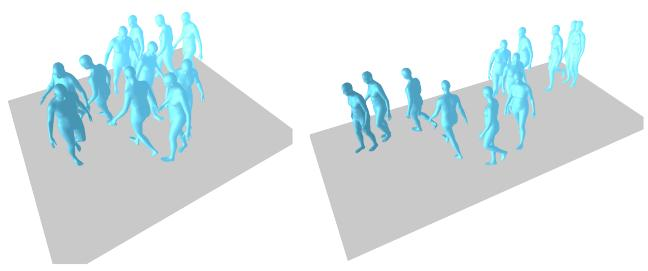
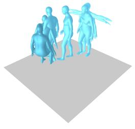
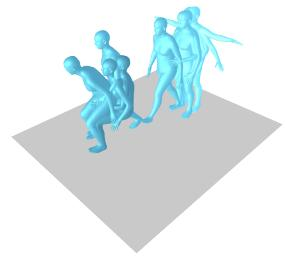
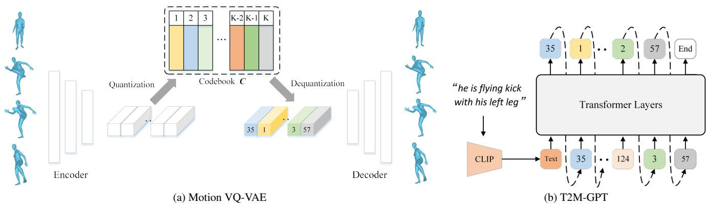
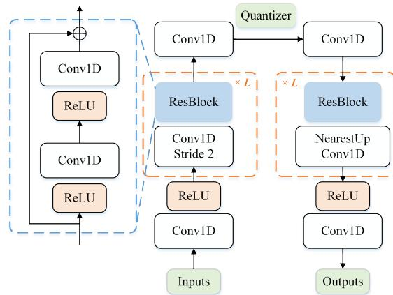
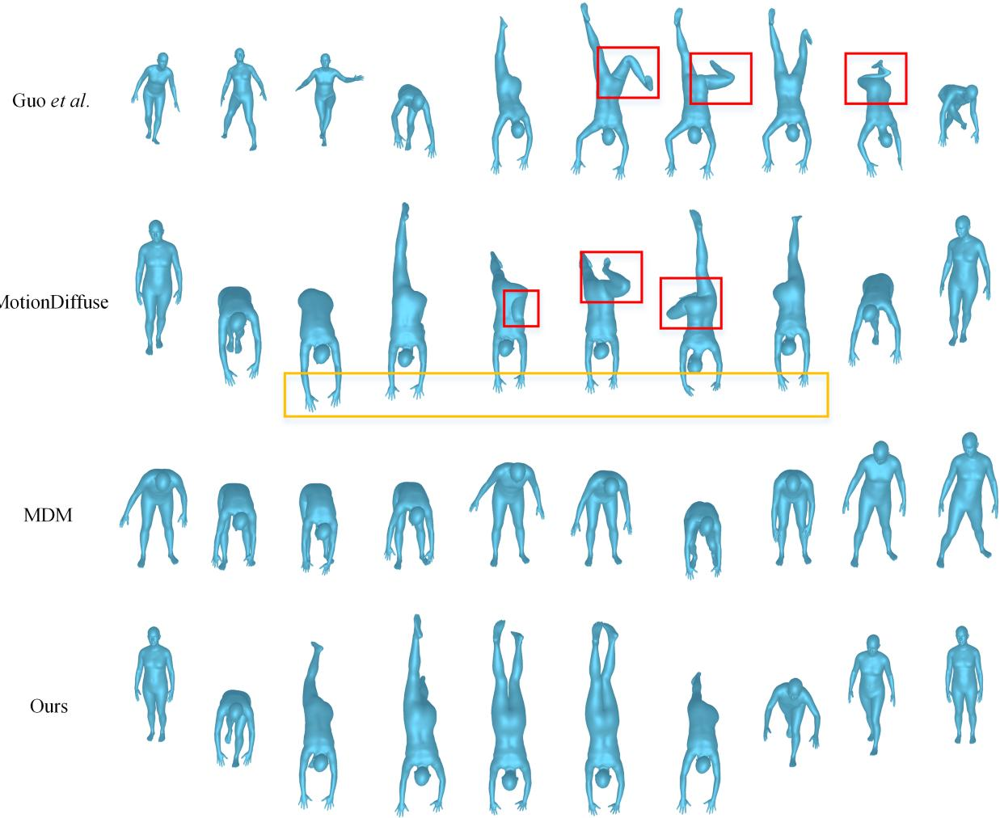

# T2M-GPT: 基于离散表示从文本描述生成人体动作

Jianrong Zhang1,3∗, Yangsong Zhang2,3∗, Xiaodong Cun3, Shaoli Huang3, Yong Zhang3 Hongwei Zhao1, Hongtao Lu2, Xi Shen3,†

同等贡献 †通讯作者

1吉林大学（Jilin University） 2上海交通大学（Shanghai Jiao Tong University） 3腾讯 AI Lab（Tencent AI Lab）

## 摘要

在这项工作中，我们研究了一种基于矢量量化变分自编码器（Vector Quantised-Variational AutoEncoder，VQ-VAE）和生成式预训练 Transformer（Generative Pretrained Transformer，GPT）的经典且必须了解的条件生成框架，用于从文本描述生成人体动作。我们表明，一个配合常用训练技巧（EMA 和 Code Reset）的简单 CNN-based VQ-VAE 就足以让我们获得高质量的离散表示。对于 GPT，我们在训练过程中引入了一种简单的扰动策略，以减轻训练与测试阶段的不一致性（training-testing discrepancy）。尽管结构简单，我们的 T2M-GPT 仍展现出了优于竞争方法的性能，包括最近基于扩散模型（diffusion-based）的方法。例如，在目前最大的数据集 HumanML3D 上，我们在文本与生成动作的一致性（R-Precision）上取得了可比的性能，但在 FID 方面达到了 0.116，大幅超越了 MotionDiffuse 的 0.630。此外，我们在 HumanML3D 上进行了分析，并观察到数据集规模是我们方法的一个局限性。我们的工作表明，VQ-VAE 在人体动作生成领域仍然是一种极具竞争力的方法。我们的代码实现已发布在项目主页：https://mael-zys.github.io/T2M-GPT/。

## 1. 引言

从文本描述生成动作可广泛应用于游戏工业、电影制作和机器人动画等众多领域。例如，游戏工业中获取新动作的典型方式是进行动作捕捉，这通常代价高昂。因此，从文本描述中自动生成动作以产生有意义的动作数据，不仅可以节省时间，而且更加经济。

以自然语言为条件的动作生成具有很大的挑战性，因为动作和文本属于不同的模态。模型需要学习从“一个人快速且有意地向前呈之字形走动”（“a person walks quickly and intentionally in a zig-zag pattern forward”）建立精确的映射关系。

  
“一个人起始呈直立姿势，双臂向身体两侧伸展，随后将双臂放下贴近身体并双手击掌，之后向左下方走去并在座位上坐下”（“a man starts off in an upright position with both arms extended out by his sides, he then brings his arms down to his body and claps his hands together after this he walks down and to the left where he proceeds to sit on a seat”）

  
Ground-truth

  
我们的生成结果  
Figure 1. HumanML3D [22] 上的可视化结果。我们的方法能够生成与具有挑战性的文本描述一致的精确且高质量的人体动作。更多可视化结果见项目主页。

语言空间映射到动作空间。为此，许多工作提议使用自编码器（auto-encoders）[3, 21, 65] 和 VAE [52, 53] 来学习语言与动作的联合嵌入。MotionClip [65] 将动作空间与 CLIP [55] 空间进行对齐。ACTOR [52] 和 TEMOES [53] 分别提出了基于 Transformer 的 VAE，用于动作类别到动作（action-to-motion）以及文本到动作（text-to-motion）的生成。这些工作在简单描述下展现出了良好的性能，但当文本描述变得冗长复杂时，在生成高质量动作方面便显得力不从心。Guo 等人 [22] 以及 TM2T [23] 旨在针对更具挑战性的文本描述生成动作序列。然而，这两种方法都并不直接，涉及文本到动作生成的三个阶段，且有时无法生成与文本一致的高质量动作（参见 Figure 4 以及项目主页上的更多可视化结果）。最近，基于扩散的模型（diffusion-based models）[32] 在图像生成 [60] 上展现出了令人瞩目的效果，随后被 MDM [66] 和 MotionDiffuse [74] 引入到动作生成中，并在文本到动作生成任务中占据主导地位。然而，我们发现，与 VQ-VAE [68] 等经典方法相比，基于扩散的方法 [66, 74] 带来的性能提升可能并没有那么显著。在这项工作中，我们受到近期用于生成的离散表征学习进展 [5, 15, 16, 19, 45, 58, 68, 70] 的启发，研究了一个基于矢量量化变分自编码器（Vector Quantized Variational Autoencoders，VQ-VAE）[68] 和生成式预训练 Transformer（Generative Pre-trained Transformer，GPT）[56, 69] 的简单且经典的框架，用于文本到动作生成。

具体而言，我们提出了一种从文本描述生成动作的两阶段方法。在第一阶段，我们使用标准的 1D 卷积网络将动作序列映射为离散的代码索引（code indices）。在第二阶段，训练一个标准的类 GPT 模型 [56, 69]，以从预训练的文本嵌入中生成代码索引序列。我们发现 VQ-VAE [68] 的朴素训练会遭遇代码崩溃（code collapse）问题。一个有效的解决方案是在训练过程中采用两项标准策略：EMA（指数移动平均）和代码重置（Code Reset）。我们对不同的量化策略进行了全面分析。对于 GPT，下一个词元预测（next token prediction）会导致训练与推理之间的不一致性。我们观察到，在训练期间对序列进行简单的破坏（corrupting）即可缓解这种差异。此外，纵观图像生成的演进历程，数据集规模一直扮演着重要角色。我们进一步探讨了数据集规模对模型性能的影响。实证分析表明，随着数据集规模的增大，我们模型的性能有望得到进一步提升。

尽管方法简单，我们的方法仍能生成与具有挑战性的文本描述一致的高质量动作序列（Figure 1 以及项目主页上的更多内容）。在经验上，在两个广泛使用的数据集 HumanML3D [22] 和 KIT-ML [54] 上，我们取得了与同期基于扩散的方法 MDM [66] 和 HumanDiffuse [74] 相当甚至更优的性能。例如，在目前最大的数据集 HumanML3D 上，我们在文本与生成动作之间的一致性（R-Precision）方面取得了相当的性能，但在 FID 上达到了 0.116，大幅优于 MotionDiffuse 的 0.630。我们进行了全面的实验来探索这一领域，并希望这些实验和结论能对未来的发展有所贡献。

总结而言，我们的贡献包括：

• 我们提出了一种简单而有效的基于文本描述生成动作的方法。我们的方法在 HumanML3D [22] 和 KIT-ML [54] 数据集上取得了最先进的（state-of-the-art）性能。

• 我们表明，结合离散表示的类 GPT 模型（GPT-like models）在动作生成方面仍然是一种极具竞争力的方法。

• 我们详细分析了量化策略和数据集规模的影响。我们表明，更大的数据集可能仍会为该社区提供广阔的前景。

我们的代码实现已在项目主页上提供。

## 2. 相关工作

VQ-VAE。矢量量化变分自编码器（Vector Quantized Variational Autoencoders，VQ-VAE）是 VAE [36] 的一种变体，最初在 [68] 中被提出。VQ-VAE 由自编码器（AutoEncoder）架构组成，旨在学习使用离散表示进行重构。最近，VQ-VAE 在不同模态的生成任务中取得了令人鼓舞的性能，包括：图像合成 [19, 70]、文本到图像生成 [58]、语音手势生成 [5]、音乐生成 [15, 16] 等。VQ-VAE 在生成方面的成功可能归因于它将离散表示的学习与先验的学习解耦。VQ-VAE 的朴素训练会遭遇码本崩溃（codebook collapse）问题，即只有少数编码被激活，这极大限制了重构以及生成的性能。为了缓解该问题，在训练过程中可以使用多种技术，包括用于优化码本的截断梯度（stop-gradient）及某些损失函数 [68]、用于码本更新的指数移动平均（EMA）[70]、在训练过程中重置未激活编码（Code Reset [70]）等。

人体动作合成。人体动作合成的研究历史悠久 [8]。其中最活跃的研究领域之一是人体动作预测，其旨在根据过去观察到的动作来预测未来的动作序列。各类方法主要侧重于高效且有效地融合时空信息，通过不同的模型来生成确定性的未来动作：RNN [12,20,50,51]、GAN [9,30]、GCN [49]、Attention [48]，甚至是简单的 MLP [11, 17, 25]。一些方法旨在通过 VAE [4, 26, 73] 生成多样化的动作。除了以过去动作为条件合成动作外，另一个相关的主题是动作“补帧”（in-betweening），即以过去和未来的姿态作为输入并填充它们之间的动作 [18,27,28,35,64]。[51] 考虑了针对行走和跑步等简单动作从给定轨迹生成移动序列。动作也可以结合音乐生成，从而产生 3D 舞蹈动作 [6,13,37,38,40,41]。对于无约束生成，[72] 通过对从高斯过程中采样得到的潜在向量序列进行变换，一次性生成长序列。在图形学文献中，许多工作侧重于动画师控制。Holden 等人 [34] 学习了一个卷积自编码器来重建动作，所学习到的潜在表示可用于合成和编辑动作。[33] 提出了相位功能神经网络来执行控制任务。[63] 使用深度自回归框架来处理场景交互行为。Starke 等人 [62] 提出通过周期性特征来重建动作，学习到的周期性嵌入提升了动作合成效果。最近，受用于图像合成的 SinGAN [61] 的启发，Li 等人 [39] 提出了一种从单个序列进行动作合成的生成模型方法。

  
Figure 2. 我们用于文本驱动动作生成的框架概览。它包含两个模块：Motion VQ-VAE（Figure 2a）和 T2M-GPT（Figure 2b）。在 T2M-GPT 中，插入了一个额外的可学习 End token 来指示生成的停止。在推理期间，我们首先以自回归方式生成代码索引，然后使用 Motion VQ-VAE 中的解码器获取动作。

文本驱动的人体动作生成。文本驱动的人体动作生成旨在根据文本描述生成 3D 人体动作。Text2Action [2] 训练了一个基于 RNN 的模型，用于根据简短文本生成动作。Language2Pose [3] 采用课程学习（curriculum learning）方法来学习文本和姿态的联合嵌入空间。因此，解码器可以利用文本嵌入来生成动作序列。Ghost 等人 [21] 针对上半身和下半身运动分别学习了两个流形表示，与 Language2Pose [3] 相比表现出更优的性能。类似地，MotionCLIP [65] 也倾向于对齐文本和动作嵌入，但提出利用 CLIP [55] 作为文本编码器，并采用渲染图像作为额外监督。它展示了生成分布外（out-of-distribution）动作的能力，并支持潜在编码编辑。然而，其生成的动作序列质量不高，且不包含全局平移。ACTOR [52] 提出了一种基于 Transformer 的 VAE，以非自回归方式根据预定义的动作类别生成动作。TEMOS [53] 扩展了 ACTOR [52] 的架构，引入了额外的文本编码器，并在给定文本描述的情况下生成多样化的动作序列。TEMOS 在以短句为主的 KIT Motion-Language [54] 上展示了其效果，但在面对分布外描述时表现欠佳 [53]。TEACH [7] 进一步扩展了 TEMOS，以从一系列自然语言描述中生成时序动作组合。最近，[22] 提出了一个大规模数据集 HumanML3D。Guo 等人 [22] 还提出结合从文本中预测动作长度，以生成具有合理长度的动作。TM2T [23] 同时考虑了文本到动作（text-to-motion）和动作到文本（motion-to-text）的任务。它还表明，通过联合训练这两个任务可以获得额外的性能提升。作为同期工作，MDM [66] 和 MotionDiffuse [74] 将基于扩散的模型引入了文本到动作生成中。在这项工作中，我们表明，无需任何复杂的专门设计，经典的 VQ-VAE 框架凭借其经典的架构和一些标准的训练技巧，就能取得具有竞争力甚至更优的性能。

## 3. 方法

我们的目标是生成与文本描述一致的高质量动作。整体框架由两个模块组成：Motion VQ-VAE 和 T2M-GPT，如图 Figure 2 所示。前者学习动作数据与离散编码序列之间的映射，后者根据文本描述生成编码索引。利用 Motion VQ-VAE 中的解码器，我们能够从编码索引中恢复动作。在 3.1 节中，我们介绍了 VQ-VAE 模块。T2M-GPT 则在 3.2 节中介绍。

## 3.1. Motion VQ-VAE

由 [68] 提出的 VQ-VAE 使模型能够为生成模型学习离散表示。给定动作序列 $X = [ x _ { 1 } , x _ { 2 } , \dots , x _ { T } ]$（其中 $\boldsymbol { x } _ { t } \in \mathbb { R } ^ { d }$，$T$ 为帧数，$d$ 为动作的维度），我们的目标是通过一个自动编码器和一个包含 $K$ 个编码的可学习码本 $C = \{ c _ { k } \} _ { k = 1 } ^ { K }$（其中 $c _ { k } \in \mathbb { R } ^ { d _ { c } }$，$d _ { c }$ 为编码的维度）来恢复动作序列。VQ-VAE 的概览如图 2a 所示。记自动编码器的编码器和解码器分别为 E 和 D，潜在特征 $Z$ 可以计算为 $Z = E ( X )$，其中 $Z = [ z _ { 1 } , z _ { 2 } , . . . , z _ { T / l } ]$ 且 $z _ { i } \in \mathbb { R } ^ { d _ { c } }$，此处 $l$ 表示编码器 E 的时间下采样率。对于第 $i$ 个潜在特征 $z _ { i }$，通过 $C$ 进行量化就是寻找 $C$ 中最相似的元素，这可以规范地表示为：

  
Figure 3. 动作 VQ-VAE 的架构。我们采用标准的基于 CNN 的架构，包含一维卷积（Conv1D）、残差块（ResBlock）和 ReLU 激活函数。$\cdot _ { L }$ 表示残差块的数量。我们使用步长为 2 的卷积和最近邻插值分别进行时间维度的下采样和上采样。

$$
\hat {z} _ {i} = \underset {c _ {k} \in C} {\arg \min} \| z _ {i} - c _ {k} \| _ {2}\tag{1}
$$

优化目标。为了优化 VQ-VAE，标准的优化目标 [68] $\mathcal { L } _ { \mathrm { v q } }$ 包含三个部分：重构损失 $\mathcal { L } _ { \mathrm { r e } }$、嵌入损失 $\mathcal { L } _ { e m b e d }$ 和承诺损失 $\mathcal { L } _ { c o m m i t }$

$$
\mathcal {L} _ {v q} = \mathcal {L} _ {r e} + \underbrace {| | s g [ Z ] - \hat {Z} | | _ {2}} _ {\mathcal {L} _ {e m b e d}} + \beta \underbrace {| | Z - s g [ \hat {Z} ] | | _ {2}} _ {\mathcal {L} _ {c o m m i t}}\tag{2}
$$

其中 $\beta$ 是承诺损失的超参数，sg 是停止梯度算子。对于重构部分，我们发现 L1 smooth 损失 $\mathcal { L } _ { 1 } ^ { s m o o t h }$ 效果最好，并且对速度的额外正则化可以提高生成质量。设 $X _ { \mathrm { r e } }$ 为 $X$ 的重构动作，即 $X _ { \mathrm { r e } } = D ( \hat { Z } )$，$V(X)$ 为 $X$ 的速度，其中 $V = \left[ v _ { 1 } , v _ { 2 } , \dots , v _ { T - 1 } \right]$ 且 $v _ { i } = x _ { i + 1 } - x _ { i }$。因此，重构的目标如下：

$$
\mathcal {L} _ {r e} = \mathcal {L} _ {1} ^ {s m o o t h} (X, X _ {r e}) + \alpha \mathcal {L} _ {1} ^ {s m o o t h} (V (X), V (X _ {r e}))\tag{3}
$$

其中 $\alpha$ 是用于平衡这两种损失的超参数。我们在附录 B 节中提供了关于 $\alpha$ 以及不同重构损失（${\mathcal{L}}_{1}$、${\mathcal{L}}_{1}^{smooth}$ 和 $\mathcal{L}_{2}$）的消融实验。

量化策略。直接对 VQ-VAE 进行朴素训练会遭遇码本崩溃（codebook collapse）[59, 68]。通常使用两种训练技巧 [59] 来提高码本利用率：指数移动平均（Exponential Moving Average, EMA）和码本重置（Code Reset）。EMA 使码本 $C$ 平滑演变：$C^{t} \gets \lambda C^{t-1} + (1-\lambda) C^{t}$，其中 $C^{t}$ 是迭代 $t$ 次时的码本，$\lambda$ 是指数移动常数。Code Reset 在训练过程中找出未激活的编码，并根据输入数据对它们进行重新分配。我们在第 4.3 节中提供了关于量化策略的消融实验。

架构。我们使用了一个由一维卷积、残差块（residual block）[29] 和 ReLU 组成的简单卷积架构。我们的 VQ-VAE 架构如图 Figure 3 所示。该架构受到了 [19, 41] 的启发。我们分别使用步长为 2 的卷积和最近邻插值来进行时间维度的下采样和上采样。因此下采样率为 $l = 2^{L}$，其中 $L$ 表示残差块的数量。我们在第 4.3 节中提供了关于该架构的消融实验。架构的详细信息在附录 F 节中提供。

## 3.2. T2M-GPT

借助学习到的动作 VQ-VAE，动作序列 $X = [x_{1}, x_{2}, \dots, x_{T}]$ 可以被映射为一个索引序列 $S = [s_{1}, s_{2}, \ldots, s_{T/l}, End]$，其中 $s_{i} \in \left[ 1, 2, \ldots, s_{T/l} \right]$，这些索引来自学习到的码本。需要注意的是，这里添加了一个特殊的 End 标记以指示动作的结束，这与利用额外模块来预测动作长度的 [22] 不同。通过将 $S$ 投影回其对应的码本条目，我们得到 $\hat{Z} = [\hat{z}_{1}, \hat{z}_{2}, \dots, \hat{z}_{T/l}]$，其中 $\hat{z}_{i} = c_{s_{i}}$，它可以通过解码器 $D$ 解码为动作 $X_{re}$。因此，文本生成动作可以被公式化为自回归的下一个索引预测：给定前面的 $i-1$ 个索引，即 $S_{<i}$，以及文本条件 $c$，我们的目标是预测可能的下一个索引的分布 $p(S_{i} | c, S_{<i})$，这可以通过 Transformer [69] 来解决。我们 Transformer 的概览如图 Figure 2b 所示。

优化目标。将完整序列的似然表示为 $\begin{array}{r}{p(S | c) = \prod_{i=1}^{|S|} p(S_{i} | c, S_{<i})}\end{array}$，我们直接最大化数据分布的对数似然：

$$
\mathcal {L} _ {t r a n s} = \mathbb {E} _ {S \sim p (S)} [ - \log p (S | c) ]\tag{4}
$$

我们利用 CLIP [55] 来提取文本嵌入 $c ,$，该方法在相关任务中已展现出其有效性 [14, 57, 65]。

因果自注意力（Causal Self-attention）。我们在 T2M-GPT 中应用了因果自注意力 [56]。确切地说，因果自注意力的输出计算如下：

$$
\text { Attention } = \text { Softmax } \left(\frac {Q K ^ {T} \times \text { mask }}{\sqrt {d _ {k}}}\right)\tag{5}
$$

<table><tr><td rowspan="2">方法</td><td colspan="3">R-Precision ↑</td><td rowspan="2">FID ↓</td><td rowspan="2">MM-Dist ↓</td><td rowspan="2">Diversity ↑</td><td rowspan="2">MModality ↑</td></tr><tr><td>Top-1</td><td>Top-2</td><td>Top-3</td></tr><tr><td>真实动作</td><td> $0.511^{\pm.003}$ </td><td> $0.703^{\pm.003}$ </td><td> $0.797^{\pm.002}$ </td><td> $0.002^{\pm.000}$ </td><td> $2.974^{\pm.008}$ </td><td> $9.503^{\pm.065}$ </td><td>-</td></tr><tr><td>我们的 VQ-VAE（重构）</td><td> $0.501^{\pm.002}$ </td><td> $0.692^{\pm.002}$ </td><td> $0.785^{\pm.002}$ </td><td> $0.070^{\pm.001}$ </td><td> $3.072^{\pm.009}$ </td><td> $9.593^{\pm.079}$ </td><td>-</td></tr><tr><td>Seq2Seq [42]</td><td> $0.180^{\pm.002}$ </td><td> $0.300^{\pm.002}$ </td><td> $0.396^{\pm.002}$ </td><td> $11.75^{\pm.035}$ </td><td> $5.529^{\pm.007}$ </td><td> $6.223^{\pm.061}$ </td><td>-</td></tr><tr><td>Language2Pose [3]</td><td> $0.246^{\pm.002}$ </td><td> $0.387^{\pm.002}$ </td><td> $0.486^{\pm.002}$ </td><td> $11.02^{\pm.046}$ </td><td> $5.296^{\pm.008}$ </td><td> $7.676^{\pm.058}$ </td><td>-</td></tr><tr><td>Text2Gesture [10]</td><td> $0.165^{\pm.001}$ </td><td> $0.267^{\pm.002}$ </td><td> $0.345^{\pm.002}$ </td><td> $5.012^{\pm.030}$ </td><td> $6.030^{\pm.008}$ </td><td> $6.409^{\pm.071}$ </td><td>-</td></tr><tr><td>Hier [21]</td><td> $0.301^{\pm.002}$ </td><td> $0.425^{\pm.002}$ </td><td> $0.552^{\pm.004}$ </td><td> $6.532^{\pm.024}$ </td><td> $5.012^{\pm.018}$ </td><td> $8.332^{\pm.042}$ </td><td>-</td></tr><tr><td>MoCoGAN [67]</td><td> $0.037^{\pm.000}$ </td><td> $0.072^{\pm.001}$ </td><td> $0.106^{\pm.001}$ </td><td> $94.41^{\pm.021}$ </td><td> $9.643^{\pm.006}$ </td><td> $0.462^{\pm.008}$ </td><td> $0.019^{\pm.000}$ </td></tr><tr><td>Dance2Music [37]</td><td> $0.033^{\pm.000}$ </td><td> $0.065^{\pm.001}$ </td><td> $0.097^{\pm.001}$ </td><td> $66.98^{\pm.016}$ </td><td> $8.116^{\pm.006}$ </td><td> $0.725^{\pm.011}$ </td><td> $0.043^{\pm.001}$ </td></tr><tr><td>TEMOS§ [53]</td><td> $0.424^{\pm.002}$ </td><td> $0.612^{\pm.002}$ </td><td> $0.722^{\pm.002}$ </td><td> $3.734^{\pm.028}$ </td><td> $3.703^{\pm.008}$ </td><td> $8.973^{\pm.071}$ </td><td> $0.368^{\pm.018}$ </td></tr><tr><td>TM2T [23]</td><td> $0.424^{\pm.003}$ </td><td> $0.618^{\pm.003}$ </td><td> $0.729^{\pm.002}$ </td><td> $1.501^{\pm.017}$ </td><td> $3.467^{\pm.011}$ </td><td> $8.589^{\pm.076}$ </td><td> $2.424^{\pm.093}$ </td></tr><tr><td>Guo et al. [22]</td><td> $0.455^{\pm.003}$ </td><td> $0.636^{\pm.003}$ </td><td> $0.736^{\pm.002}$ </td><td> $1.087^{\pm.021}$ </td><td> $3.347^{\pm.008}$ </td><td> $9.175^{\pm.083}$ </td><td> $2.219^{\pm.074}$ </td></tr><tr><td>MLD§ [71]</td><td> $0.481^{\pm.003}$ </td><td> $0.673^{\pm.003}$ </td><td> $0.772^{\pm.002}$ </td><td> $0.473^{\pm.013}$ </td><td> $3.196^{\pm.010}$ </td><td> $9.724^{\pm.082}$ </td><td> $2.413^{\pm.079}$ </td></tr><tr><td>MDM§ [66]</td><td>-</td><td>-</td><td> $0.611^{\pm.007}$ </td><td> $0.544^{\pm.044}$ </td><td> $5.566^{\pm.027}$ </td><td> $9.559^{\pm.086}$ </td><td> $2.799^{\pm.072}$ </td></tr><tr><td>MotionDiffuse§ [74]</td><td> $0.491^{\pm.001}$ </td><td> $0.681^{\pm.001}$ </td><td> $0.782^{\pm.001}$ </td><td> $0.630^{\pm.001}$ </td><td> $3.113^{\pm.001}$ </td><td> $9.410^{\pm.049}$ </td><td> $1.553^{\pm.042}$ </td></tr><tr><td>我们的 GPT ( $\tau = 0$ )</td><td> $0.417^{\pm.003}$ </td><td> $0.589^{\pm.002}$ </td><td> $0.685^{\pm.003}$ </td><td> $0.140^{\pm.006}$ </td><td> $3.730^{\pm.009}$ </td><td> $9.844^{\pm.095}$ </td><td> $3.285^{\pm.070}$ </td></tr><tr><td>我们的 GPT ( $\tau = 0.5$ )</td><td> $0.491^{\pm.003}$ </td><td> $0.680^{\pm.003}$ </td><td> $0.775^{\pm.002}$ </td><td> $0.116^{\pm.004}$ </td><td> $3.118^{\pm.011}$ </td><td> $9.761^{\pm.081}$ </td><td> $1.856^{\pm.011}$ </td></tr><tr><td>我们的 GPT ( $\tau \in \mathcal{U}[0,1]$ )</td><td> $0.492^{\pm.003}$ </td><td> $0.679^{\pm.002}$ </td><td> $0.775^{\pm.002}$ </td><td> $0.141^{\pm.005}$ </td><td> $3.121^{\pm.009}$ </td><td> $9.722^{\pm.082}$ </td><td> $1.831^{\pm.048}$ </td></tr></table>

Table 1. 在 HumanML3D [22] 测试集上与最先进方法的对比。我们遵循 Guo 等人 [22] 的方法计算标准指标。对于每个指标，我们重复评估 20 次并报告具有 95% 置信区间的平均值。红色和蓝色分别表示最佳和次佳结果。§ 报告了使用真实（ground-truth）动作长度的结果。

其中 $Q \in \mathbb { R } ^ { T \times d _ { k } }$ 和 $K \in \mathbb { R } ^ { T \times d _ { k } }$ 分别是查询（query）和键（key），而 mask 是因果掩码（causal mask），满足 $\begin{array} { r } { m a s k _ { i , j } = } \end{array}$ $- \infty \times \mathbf { 1 } \left( i < j \right) + \mathbf { 1 } \left( i \geq j \right)$，其中 1(·) 是指示函数。该因果掩码确保未来信息不允许参与当前 token 的计算。对于推理，我们从文本嵌入开始，以自回归方式生成索引，如果模型预测了 End token，生成过程将终止。需要注意的是，我们能够通过从 Transformer 给出的预测分布中进行采样来生成多样化的动作。

第 4.3 节中的讨论。

## 4.1. Datasets and evaluation metric

我们在两个用于文本驱动动作生成的标准数据集上进行了实验：HumanML3D [22] 和 KIT Motion-Language (KIT-ML) [54]。这两个数据集在该领域中都被普遍使用。我们遵循 [22] 中提出的评估协议。

针对训练-测试差异的损坏序列。训练和测试之间存在差异。在训练时，使用 i − 1 个正确索引来预测下一个索引。而在推理时，无法保证用作条件的索引是正确的。为了解决这个问题，我们采用了一种简单的数据增强策略：在训练期间，我们用随机索引替换 $\tau \times 1 0 0 \%$ 的真实代码索引。τ 可以是一个超参数，也可以从 $\tau \in \mathcal { U } [ 0 , 1 ]$ 中随机采样。我们在附录 C 节中提供了针对该策略的消融实验。

## 4. Experiment

在本节中，我们展示了实验结果。在第 4.1 节中，我们介绍了标准数据集以及评估指标。在第 4.2 节中，我们将我们的结果与具有竞争力的方法进行了比较。最后，我们提供了分析以及

KIT Motion-Language (KIT-ML)。KIT-ML [54] 包含 3,911 个动作序列和 6,278 条文本标注。在忽略大小写和标点符号的情况下，总词汇量（即不重复单词的数量）为 1,623。动作序列选自 KIT [47] 和 CMU [1] 数据集，但已下采样至每秒 12.5 帧（FPS）。每个动作序列由 1 到 4 个句子进行描述。描述的平均长度约为 8。遵循 [22, 23]，该数据集按 80%、5% 和 15% 的比例划分为训练集、验证集和测试集。我们选择在验证集上取得最佳 FID 的模型，并报告其在测试集上的性能。

HumanML3D。HumanML3D [22] 是目前最大的带有文本描述的 3D 人体动作数据集。该数据集包含 14,616 个动作和 44,970 条文本描述。全部文本描述由 5,371 个不同的单词组成。动作序列最初来自 AMASS [46] 和 HumanAct12 [24]，但经过了特定的预处理：动作被缩放至 20 FPS；长度超过 10 秒的动作被随机裁剪至 10 秒；随后将它们重定向（re-targeted）到默认的人体骨骼模板上，并进行适当旋转使其初始朝向 Z+ 方向。每个动作都配有至少 3 条精确的文本描述。描述的平均长度约为 12。根据 [22]，该数据集按 80%、5% 和 15% 的比例划分为训练集、验证集和测试集。我们选择在验证集上 FID 最佳的模型，并报告其在测试集上的性能。

<table><tr><td rowspan="2">方法</td><td colspan="3">R-Precision ↑</td><td rowspan="2">FID ↓</td><td rowspan="2">MM-Dist ↓</td><td rowspan="2">Diversity ↑</td><td rowspan="2">MModality ↑</td></tr><tr><td>Top-1</td><td>Top-2</td><td>Top-3</td></tr><tr><td>真实动作</td><td> $0.424^{\pm .005}$ </td><td> $0.649^{\pm .006}$ </td><td> $0.779^{\pm .006}$ </td><td> $0.031^{\pm .004}$ </td><td> $2.788^{\pm .012}$ </td><td> $11.08^{\pm .097}$ </td><td>-</td></tr><tr><td>我们的 VQ-VAE (重构)</td><td> $0.399^{\pm .005}$ </td><td> $0.614^{\pm .005}$ </td><td> $0.740^{\pm .006}$ </td><td> $0.472^{\pm .011}$ </td><td> $2.986^{\pm .027}$ </td><td> $10.994^{\pm .120}$ </td><td>-</td></tr><tr><td>Seq2Seq [42]</td><td> $0.103^{\pm .003}$ </td><td> $0.178^{\pm .005}$ </td><td> $0.241^{\pm .006}$ </td><td> $24.86^{\pm .348}$ </td><td> $7.960^{\pm .031}$ </td><td> $6.744^{\pm .106}$ </td><td>-</td></tr><tr><td>Language2Pose [3]</td><td> $0.221^{\pm .005}$ </td><td> $0.373^{\pm .004}$ </td><td> $0.483^{\pm .005}$ </td><td> $6.545^{\pm .072}$ </td><td> $5.147^{\pm .030}$ </td><td> $9.073^{\pm .100}$ </td><td>-</td></tr><tr><td>Text2Gesture [10]</td><td> $0.156^{\pm .004}$ </td><td> $0.255^{\pm .004}$ </td><td> $0.338^{\pm .005}$ </td><td> $12.12^{\pm .183}$ </td><td> $6.964^{\pm .029}$ </td><td> $9.334^{\pm .079}$ </td><td>-</td></tr><tr><td>Hier [21]</td><td> $0.255^{\pm .006}$ </td><td> $0.432^{\pm .007}$ </td><td> $0.531^{\pm .007}$ </td><td> $5.203^{\pm .107}$ </td><td> $4.986^{\pm .027}$ </td><td> $9.563^{\pm .072}$ </td><td>-</td></tr><tr><td>MoCoGAN [67]</td><td> $0.022^{\pm .002}$ </td><td> $0.042^{\pm .003}$ </td><td> $0.063^{\pm .003}$ </td><td> $82.69^{\pm .242}$ </td><td> $10.47^{\pm .012}$ </td><td> $3.091^{\pm .043}$ </td><td> $0.250^{\pm .009}$ </td></tr><tr><td>Dance2Music [37]</td><td> $0.031^{\pm .002}$ </td><td> $0.058^{\pm .002}$ </td><td> $0.086^{\pm .003}$ </td><td> $115.4^{\pm .240}$ </td><td> $10.40^{\pm .016}$ </td><td> $0.241^{\pm .004}$ </td><td> $0.062^{\pm .002}$ </td></tr><tr><td>TEMOS§ [53,71]</td><td> $0.353^{\pm .002}$ </td><td> $0.561^{\pm .002}$ </td><td> $0.687^{\pm .002}$ </td><td> $3.717^{\pm .028}$ </td><td> $3.417^{\pm .008}$ </td><td> $10.84^{\pm .071}$ </td><td> $0.532^{\pm .018}$ </td></tr><tr><td>TM2T [23]</td><td> $0.280^{\pm .006}$ </td><td> $0.463^{\pm .007}$ </td><td> $0.587^{\pm .005}$ </td><td> $3.599^{\pm .051}$ </td><td> $4.591^{\pm .019}$ </td><td> $9.473^{\pm .100}$ </td><td> $3.292^{\pm .034}$ </td></tr><tr><td>Guo 等人 [22]</td><td> $0.361^{\pm .006}$ </td><td> $0.559^{\pm .007}$ </td><td> $0.681^{\pm .007}$ </td><td> $3.022^{\pm .107}$ </td><td> $3.488^{\pm .028}$ </td><td> $10.72^{\pm .145}$ </td><td> $2.052^{\pm .107}$ </td></tr><tr><td>MLD§ [71]</td><td> $0.390^{\pm .008}$ </td><td> $0.609^{\pm .008}$ </td><td> $0.734^{\pm .007}$ </td><td> $0.404^{\pm .027}$ </td><td> $3.204^{\pm .027}$ </td><td> $10.80^{\pm .117}$ </td><td> $2.192^{\pm .071}$ </td></tr><tr><td>MDM§ [66]</td><td>-</td><td>-</td><td> $0.396^{\pm .004}$ </td><td> $0.497^{\pm .021}$ </td><td> $9.191^{\pm .022}$ </td><td> $10.847^{\pm .109}$ </td><td> $1.907^{\pm .214}$ </td></tr><tr><td>MotionDiffuse§ [74]</td><td> $0.417^{\pm .004}$ </td><td> $0.621^{\pm .004}$ </td><td> $0.739^{\pm .004}$ </td><td> $1.954^{\pm .062}$ </td><td> $2.958^{\pm .005}$ </td><td> $11.10^{\pm .143}$ </td><td> $0.730^{\pm .013}$ </td></tr><tr><td>我们的 GPT ( $\tau = 0$ )</td><td> $0.392^{\pm .007}$ </td><td> $0.600^{\pm .007}$ </td><td> $0.716^{\pm .006}$ </td><td> $0.737^{\pm .049}$ </td><td> $3.237^{\pm .027}$ </td><td> $11.198^{\pm .086}$ </td><td> $2.309^{\pm .055}$ </td></tr><tr><td>我们的 GPT ( $\tau = 0.5$ )</td><td> $0.402^{\pm .006}$ </td><td> $0.619^{\pm .005}$ </td><td> $0.737^{\pm .006}$ </td><td> $0.717^{\pm .041}$ </td><td> $3.053^{\pm .026}$ </td><td> $10.862^{\pm .094}$ </td><td> $1.912^{\pm .036}$ </td></tr><tr><td>我们的 GPT ( $\tau \in \mathcal{U}[0,1]$ )</td><td> $0.416^{\pm .006}$ </td><td> $0.627^{\pm .006}$ </td><td> $0.745^{\pm .006}$ </td><td> $0.514^{\pm .029}$ </td><td> $3.007^{\pm .023}$ </td><td> $10.921^{\pm .108}$ </td><td> $1.570^{\pm .039}$ </td></tr></table>

Table 2. 与当前最先进方法在 KIT-ML [54] 测试集上的比较。我们遵循 Guo 等人 [22] 计算标准评估指标。对于每个指标，我们重复评估 20 次，并报告带有 95% 置信区间的平均值。红色和蓝色分别表示最佳和次佳结果。§ 报告了使用真实动作长度的结果。

Implementation details. 对于 Motion VQ-VAE，码本大小设置为 512 × 512。下采样率 l 为 4。我们在附录 D 节提供了关于编码数量的消融实验。对于 HumanML3D [22] 和 KIT-ML [54] 数据集，动作序列被裁剪至 $T = 6 4$ 用于训练。我们使用 AdamW [44] 优化器，设置 $[ \beta _ { 1 } , \beta _ { 2 } ] = [ 0 . 9 , 0 . 9 9 ]$，批大小为 256，指数移动常数 $\lambda = 0 . 9 9$。我们在前 200K 次迭代中以 $2 \mathrm { e } { \cdot } 4 ,$ 的学习率进行训练，并在 100K 次迭代中以 1e-5 的学习率进行训练。$\mathcal { L } _ { \mathrm { v q } }$ 和 ${ \mathcal { L } } _ { \mathrm { r e } }$ 中的 β 和 α 分别设置为 0.02 和 0.5。遵循 [22]，KIT-ML 和 HumanML3D 数据集分别被提取为维度为 251 和 263 的动作特征，分别对应根空间中的局部关节位置、速度和旋转，以及全局位移和旋转。这些特征是由 SMPL [43] 的 21 和 22 个关节计算而来的。有关动作表示的更多细节见附录 E 节。

层，维度为 1,024 且包含 16 个头。附录 A 节提供了针对不同规模 Transformer 的消融实验。遵循 Guo 等人 [22]，两个数据集上的动作最大长度均为 196，HumanML3D [22] 和 KIT-ML [54] 的最小长度分别为 40 和 24。编码索引序列的最大长度为 $T ^ { \prime } = 5 0$。我们训练了一个额外的 End 标记作为停止索引生成的信号。Transformer 使用 AdamW [44] 进行优化，参数为 $[ \beta _ { 1 } , \beta _ { 2 } ] = [ 0 . 5 , 0 . 9 9 ]$，批大小为 128。初始学习率在前 150K 次迭代中设置为 1e-4，在另外 150K 次迭代中衰减至 5e-6。在单张 Tesla V100-32G GPU 上，训练 Motion VQ-VAE 和 T2M-GPT 分别需要约 14 小时和 78 小时。

Evaluation metric. 遵循 [22]，首先使用 [22] 中的预训练网络提取动作和文本描述的全局表示，然后通过以下五个指标进行衡量：

对于 T2M-GPT，我们采用 18 个 Transformer [69] 层-• R-Precision。给定一个动作序列和 32 个文本描述（1 个真实描述和 31 个随机选择的不匹配描述），我们对动作和文本嵌入之间的欧几里得距离进行排序。报告动作到文本检索的 Top-1、Top-2 和 Top-3 准确率。

• Frechet Inception Distance (FID)。我们计算生成的和真实的“一个人向前迈步并倒立”之间的分布距离

  
Figure 4. HumanML3D [22] 数据集上的可视化结果。我们将我们生成的结果与 Guo 等人 [22]、MotionDiffuse [74] 以及 MDM [66] 进行了对比。扭曲的动作（红色）和滑动（黄色）已被高亮标出。更多可视化结果见项目主页。

动作，并在提取的动作特征上使用 FID [31] 进行评估。

• 多模态距离（Multimodal Distance，MM-Dist）。每个文本特征与由该文本生成的动作特征之间的平均欧氏距离。

• 多样性（Diversity）。从一组动作中随机抽取 300 对动作。我们提取动作特征并计算这些动作对之间的平均欧氏距离，以衡量该集合中的动作多样性。

• 多模态性（Multimodality，MModality）。对于一个文本描述，我们生成 20 个动作序列以组成 10 对动作。我们提取动作特征并计算这些动作对之间的平均欧氏距离。最终汇报在所有文本描述上的平均值。

请注意，有关评估指标的更多细节见附录 E 节。

## 4.2. 与最先进方法的对比

定量结果。我们在 Table 1 和 Table 2 中展示了在 HumanML3D [22] 测试集和 KIT-ML [54] 测试集上的对比结果。在这两个数据集上，我们使用 VQ-VAE 的重构性能均接近真实动作，这表明我们的 VQ-VAE 学习到了高质量的离散表示。在生成方面，与最先进的方法 MotionDiffuse [74] 相比，我们的方法在文本-动作一致性（R-Precision 和 MM-Dist）上取得了相当的性能，而在 FID 指标上显著优于 MotionDiffuse。KIT-ML [54] 和 HumanML3D [22] 处于不同的规模，这证明了所提方法的鲁棒性。在 GPT 训练过程中手动破坏序列带来了持续的改进（τ = 0.5 v.s. τ = 0）。更详细的分析见附录 C 节。与 Guo 等人 [22] 引入额外模块来预测动作长度不同，我们通过额外的 End token 隐式地学习动作长度，这种方式更为直接，且被证明更为有效。需要注意的是，MDM [66] 和 MotionDiffuse [74] 是使用真实动作长度（ground-truth motion length）对其模型进行评估的，这在实际应用中并不切合实际。

<table><tr><td colspan="2">量化器</td><td colspan="2">重建</td><td colspan="2">生成</td></tr><tr><td>Code Reset</td><td>EMA</td><td>FID ↓</td><td>Top-1 ↑</td><td>FID ↓</td><td>Top-1 ↑</td></tr><tr><td></td><td></td><td> $0.492^{\pm .004}$ </td><td> $0.436^{\pm .003}$ </td><td> $42.797^{\pm .156}$ </td><td> $0.048^{\pm .001}$ </td></tr><tr><td></td><td>✓</td><td> $0.097^{\pm .001}$ </td><td> $0.499^{\pm .002}$ </td><td> $0.176^{\pm .008}$ </td><td> $0.490^{\pm .002}$ </td></tr><tr><td>✓</td><td></td><td> $0.102^{\pm .001}$ </td><td> $0.494^{\pm .003}$ </td><td> $0.248^{\pm .009}$ </td><td> $0.461^{\pm .002}$ </td></tr><tr><td>✓</td><td>✓</td><td> $0.070^{\pm .001}$ </td><td> $0.501^{\pm .002}$ </td><td> $0.116^{\pm .004}$ </td><td> $0.491^{\pm .003}$ </td></tr></table>

Table 3. HumanML3D [22] 测试集上 VQ-VAE 量化器的分析。对于所有量化器，我们设置 τ = 0.5 并使用第 4.1 节中描述的相同架构（VQ-VAE 和 GPT）。我们报告了重建和生成的 FID 与 Top-1 指标。对于每个指标，我们重复评估 20 次，并报告具有 95% 置信区间的平均值。

定性比较。图 4 展示了在 HumanML3D [22] 上的可视化结果。我们将我们的生成结果与当前最先进的模型进行了对比：Guo et al. [22]、MDM [66] 和 MotionDiffuse [74]。从图 4 中的示例可以看出，我们的模型生成的人体动作质量优于其他模型，我们用红色高亮标出了 Guo et al. [22] 和 Motion-Diffuse [74] 生成的不真实动作。此外，MDM [66] 生成的动作与文本描述无关。注意，更多的可视化结果和失败案例已在项目主页提供。

## 4.3. 讨论

量化策略。我们首先探究了第 3.1 节中提出的不同量化策略的影响。重建和生成的结果如表 3 所示。我们注意到，朴素的 VQ-VAE 训练既无法重建也无法生成高质量的动作。然而，使用 EMA 或 Code Reset 进行训练可以显著提升重建和生成的性能。

数据集规模的影响。我们进一步分析了数据集规模的影响。为了了解最大的数据集 HumanML3D [22] 是否包含足够的动作生成数据，我们在训练数据的不同子集上训练了我们的动作 VQ-VAE 和 T2M-GPT，这些子集分别由训练数据的 10%、20%、50%、80% 和 100% 组成。训练好的模型在整个测试集上进行评估。结果如图 5 所示。我们使用四个指标评估了动作 VQ-VAE 的重建性能以及 T2M-GPT 的生成性能：FID、MM-Dist、Top-1 和 Top-3 准确率。可以得出几点见解：i) 动作质量指标（FID）与动作-文本一致性指标（MM-Dist、Top-1 和 Top-3）应当同时予以考虑。

  
(a) FID

(b) MM-Dist  
  
(c) Top-1 准确率  
(d) Top-3 准确率  
Figure 5. 数据集规模对 HumanML3D [22] 的影响。我们分别在由 HumanML3D [22] 训练集的 10%、20%、50%、80% 和 100% 构成的子集上训练了我们的动作 VQ-VAE（重建）和 T2M-GPT（生成）。所有模型均在整个测试集上进行评估。我们汇报了所有模型的 FID、MM-Dist、Top-1 和 Top-3 准确率。结果表明，我们的模型可能会从更多训练数据中受益。

仅使用 10% 的数据时，动作质量可能尚可，然而模型无法生成与文本描述相对应的正确动作；ii) 随着训练数据的增加，性能变得更好。这一趋势表明，额外的训练数据可以为重建和生成带来不可忽视的提升。

## 5. 结论

在这项工作中，我们研究了一种基于 VQ-VAE 和 GPT 从文本描述合成人体动作的经典框架。我们的方法取得了与同期基于扩散（diffusion-based）的方法相当甚至更好的性能，这表明该经典框架在动作生成方面仍然是一种极具竞争力的途径。我们详细探讨了各种量化策略对动作重建和生成的影响。此外，我们还提供了关于数据集规模的分析。我们的发现表明，更大的数据集仍能为我们的方法带来进一步的改进。

致谢 我们感谢 Mathis Petrovich、Yuming Du、Yingyi Chen、Dexiong Chen 和 Xuelin Chen 带来的启发性讨论和宝贵反馈。本论文得到了国家自然科学基金（No. 62176155）和吉林省（20200201037JC）等的资助。更多资助信息见附录 H 节。

## 参考文献

[1] Cmu graphics lab motion capture database. http:// mocap.cs.cmu.edu/. Accessed: 2022-11-11. 5

[2] Hyemin Ahn, Timothy Ha, Yunho Choi, Hwiyeon Yoo, and Songhwai Oh. Text2action: Generative adversarial synthesis from language to action. In International Conference on Robotics and Automation (ICRA), 2018. 3

[3] Chaitanya Ahuja and Louis-Philippe Morency. Language2pose: Natural language grounded pose forecasting. In International Conference on 3D Vision (3DV), 2019. 1, 3, 5, 6

[4] Sadegh Aliakbarian, Fatemeh Sadat Saleh, Mathieu Salzmann, Lars Petersson, and Stephen Gould. A stochastic conditioning scheme for diverse human motion prediction. In Proceedings of the Conference on Computer Vision and Pattern Recognition (CVPR), 2020. 2

[5] Tenglong Ao, Qingzhe Gao, Yuke Lou, Baoquan Chen, and Libin Liu. Rhythmic gesticulator: Rhythm-aware co-speech gesture synthesis with hierarchical neural embeddings. In SIGGRAPH Asia, 2022. 2

[6] Andreas Aristidou, Anastasios Yiannakidis, Kfir Aberman, Daniel Cohen-Or, Ariel Shamir, and Yiorgos Chrysanthou. Rhythm is a dancer: Music-driven motion synthesis with global structure. arXiv, 2021. 2

[7] Nikos Athanasiou, Mathis Petrovich, Michael J. Black, and Gul Varol. TEACH: Temporal Action Compositions for 3D¨ Humans. In International Conference on 3D Vision (3DV), 2022. 3

[8] Norman I Badler, Cary B Phillips, and Bonnie Lynn Webber. Simulating humans: computer graphics animation and control. Oxford University Press, 1993. 2

[9] Emad Barsoum, John Kender, and Zicheng Liu. Hp-gan: Probabilistic 3d human motion prediction via gan. In Proceedings ofthe Conference on Computer Vision and Pattern Recognition Workshops (CVPRW), 2018. 2

[10] Uttaran Bhattacharya, Nicholas Rewkowski, Abhishek Banerjee, Pooja Guhan, Aniket Bera, and Dinesh Manocha. Text2gestures: A transformer-based network for generating emotive body gestures for virtual agents. In Virtual Reality and 3D User Interfaces (VR), 2021. 5, 6

[11] Arij Bouazizi, Adrian Holzbock, Ulrich Kressel, Klaus Dietmayer, and Vasileios Belagiannis. Motionmixer: Mlp-based 3d human body pose forecasting. In International Joint Conference on Artificial Intelligence (IJCAI), 2022. 2

[12] Judith Butepage, Michael J Black, Danica Kragic, and Hedvig Kjellstrom. Deep representation learning for human motion prediction and classification. In Proceedings of the Conference on Computer Vision and Pattern Recognition (CVPR), 2017. 2

[13] Kang Chen, Zhipeng Tan, Jin Lei, Song-Hai Zhang, Yuan-Chen Guo, Weidong Zhang, and Shi-Min Hu. Choreomaster: choreography-oriented music-driven dance synthesis. ACM Transactions on Graphics (TOG), 2021. 2

[14] Katherine Crowson, Stella Biderman, Daniel Kornis, Dashiell Stander, Eric Hallahan, Louis Castricato, and Edward Raff. Vqgan-clip: Open domain image generation and editing with natural language guidance. In Proceedings ofthe European Conference on Computer Vision (ECCV), 2022. 4

[15] Prafulla Dhariwal, Heewoo Jun, Christine Payne, Jong Wook Kim, Alec Radford, and Ilya Sutskever. Jukebox: A genera tive model for music. arXiv, 2020. 2

[16] Sander Dieleman, Aaron van den Oord, and Karen Simonyan. The challenge of realistic music generation: modelling raw audio at scale. In Advances in Neural Information Processing Systems (NeurIPS), 2018. 2

[17] Yuming Du, Robin Kips, Albert Pumarola, Sebastian Starke, Ali Thabet, and Artsiom Sanakoyeu. Avatars grow legs: Gen erating smooth human motion from sparse tracking inputs with diffusion model. In Proceedings ofthe Conference on Computer Vision and Pattern Recognition (CVPR), 2023. 2

[18] Yinglin Duan, Tianyang Shi, Zhengxia Zou, Yenan Lin, Zhehui Qian, Bohan Zhang, and Yi Yuan. Single-shot motion completion with transformer. arXiv, 2021. 2

[19] Patrick Esser, Robin Rombach, and Bjorn Ommer. Taming transformers for high-resolution image synthesis. In Proceedings of the Conference on Computer Vision and Pattern Recognition (CVPR), 2021. 2, 4

[20] Katerina Fragkiadaki, Sergey Levine, Panna Felsen, and Jitendra Malik. Recurrent network models for human dynamics. In Proceedings of the International Conference on Computer Vision (ICCV), 2015. 2

[21] Anindita Ghosh, Noshaba Cheema, Cennet Oguz, Christian Theobalt, and Philipp Slusallek. Synthesis of compositional animations from textual descriptions. In Proceedings of the International Conference on Computer Vision (ICCV), 2021. 1, 3, 5, 6

[22] Chuan Guo, Shihao Zou, Xinxin Zuo, Sen Wang, Wei Ji, Xingyu Li, and Li Cheng. Generating diverse and natural 3d human motions from text. In Proceedings of the Conference on Computer Vision and Pattern Recognition (CVPR), 2022. 1, 2, 3, 4, 5, 6, 7, 8, 12, 13

[23] Chuan Guo, Xinxin Zuo, Sen Wang, and Li Cheng. Tm2t: Stochastic and tokenized modeling for the reciprocal generation of 3d human motions and texts. In Proceedings of the European Conference on Computer Vision (ECCV), 2022. 1, 3, 5, 6

[24] Chuan Guo, Xinxin Zuo, Sen Wang, Shihao Zou, Qingyao Sun, Annan Deng, Minglun Gong, and Li Cheng. Action2motion: Conditioned generation of 3d human motions. In Proceedings of the ACM International Conference on Multimedia (ACMMM), 2020. 5

[25] Wen Guo, Yuming Du, Xi Shen, Vincent Lepetit, Xavier Alameda-Pineda, and Francesc Moreno-Noguer. Back to mlp: A simple baseline for human motion prediction. In Proceedings of the Winter Conference on Applications of Computer Vision (WACV), 2022. 2

[26] Ikhsanul Habibie, Daniel Holden, Jonathan Schwarz, Joe Yearsley, and Taku Komura. A recurrent variational autoencoder for human motion synthesis. In Proceedings of the British Machine Vision Conference (BMVC), 2017. 2

[27] Felix G Harvey and Christopher Pal. Recurrent transition networks for character locomotion. In SIGGRAPH Asia 2018 Technical Briefs, 2018. 2

[28] Felix G Harvey, Mike Yurick, Derek Nowrouzezahrai, and Christopher Pal. Robust motion in-betweening. ACM Transactions on Graphics (TOG), 2020. 2

[29] Kaiming He, Xiangyu Zhang, Shaoqing Ren, and Jian Sun. Deep residual learning for image recognition. In Proceedings of the Conference on Computer Vision and Pattern Recognition (CVPR), 2016. 4

[30] Alejandro Hernandez, Jurgen Gall, and Francesc Moreno-Noguer. Human motion prediction via spatio-temporal inpainting. In Proceedings of the Conference on Computer Vision and Pattern Recognition (CVPR), 2019. 2

[31] Martin Heusel, Hubert Ramsauer, Thomas Unterthiner, Bernhard Nessler, and Sepp Hochreiter. 双时间尺度更新规则训练的 GAN 收敛至局部纳什均衡（Gans trained by a two timescale update rule converge to a local nash equilibrium）. In Advances in Neural Information Processing Systems (NeurIPS), 2017. 7

[32] Jonathan Ho, Ajay Jain, and Pieter Abbeel. 去噪扩散概率模型（Denoising diffusion probabilistic models）. In Advances in Neural Information Processing Systems (NeurIPS), 2020. 2

[33] Daniel Holden, Taku Komura, and Jun Saito. 用于角色控制的相位函数神经网络（Phasefunctioned neural networks for character control）. ACM Transactions on Graphics (TOG), 2017. 3

[34] Daniel Holden, Jun Saito, and Taku Komura. 用于角色动作合成与编辑的深度学习框架（A deep learning framework for character motion synthesis and editing）. ACM Transactions on Graphics (TOG), 2016. 3

[35] Manuel Kaufmann, Emre Aksan, Jie Song, Fabrizio Pece, Remo Ziegler, and Otmar Hilliges. 用于人体动作修补的卷积自编码器（Convolutional autoencoders for human motion infilling）. In International Conference on 3D Vision (3DV), 2020. 2

[36] Diederik P Kingma and Max Welling. 变分自编码贝叶斯（Auto-encoding variational bayes）. In International Conference on Learning Representations (ICLR), 2014. 2

[37] Hsin-Ying Lee, Xiaodong Yang, Ming-Yu Liu, Ting-Chun Wang, Yu-Ding Lu, Ming-Hsuan Yang, and Jan Kautz. 闻乐起舞（Dancing to music）. In Advances in Neural Information Processing Systems (NeurIPS), 2019. 2, 5, 6

[38] Jiaman Li, Yihang Yin, Hang Chu, Yi Zhou, Tingwu Wang, Sanja Fidler, and Hao Li. 基于 Transformer 学习生成多样化的舞蹈动作（Learning to generate diverse dance motions with transformer）. arXiv, 2020. 2

[39] Peizhuo Li, Kfir Aberman, Zihan Zhang, Rana Hanocka, and Olga Sorkine-Hornung. GANimator：基于单序列的神经动作合成（Ganimator: Neural motion synthesis from a single sequence）. ACM Transactions on Graphics (TOG), 2022. 3

[40] Ruilong Li, Shan Yang, David A Ross, and Angjoo Kanazawa. AI 编舞师：基于 AIST++ 的音乐条件 3D 舞蹈生成（Ai choreographer: Music conditioned 3d dance generation with aist++）. In Proceedings of the Conference on Computer Vision and Pattern Recognition (CVPR), 2021. 2

[41] Siyao Li, Weijiang Yu, Tianpei Gu, Chunze Lin, Quan Wang, Chen Qian, Chen Change Loy, and Ziwei Liu. Bailando：基于具备编舞记忆的 Actor-Critic GPT 生成 3D 舞蹈（Bailando: 3d dance generation by actor-critic gpt with choreographic memory）. In Proceedings of the Conference on Computer Vision and Pattern Recognition (CVPR), 2022. 2, 4

[42] Angela S Lin, Lemeng Wu, Rodolfo Corona, Kevin Tai, Qixing Huang, and Raymond J Mooney. 根据自然语言描述生成人类活动的动画视频（Generating animated videos of human activities from natural language descriptions）. In Advances in Neural Information Processing Systems (NeurIPS), 2018. 5, 6

[43] Matthew Loper, Naureen Mahmood, Javier Romero, Gerard Pons-Moll, and Michael J Black. SMPL：蒙皮多人线性模型（Smpl: A skinned multiperson linear model）. ACM transactions on graphics (TOG), 2015. 6

[44] Ilya Loshchilov and Frank Hutter. 解耦权重衰减正则化（Decoupled weight decay regularization）. In International Conference on Learning Representations (ICLR), 2019. 6

[45] Thomas Lucas, Fabien Baradel, Philippe Weinzaepfel, and Gregory Rogez. PoseGPT：基于量化的 3D 人体动作生成与预测（Posegpt: Quantization-based 3d human motion generation and forecasting）. In Proceedings of the European Conference on Computer Vision (ECCV), 2022. 2

[46] Naureen Mahmood, Nima Ghorbani, Nikolaus F Troje, Gerard Pons-Moll, and Michael J Black. AMASS: 作为表面形状的动作捕捉归档 (AMASS: Archive of motion capture as surface shapes). In Proceedings of the International Conference on Computer Vision (ICCV), 2019. 5

[47] Christian Mandery, Omer Terlemez, Martin Do, Nikolaus¨ Vahrenkamp, and Tamim Asfour. KIT 全身人体运动数据库 (The KIT whole-body human motion database). In International Conference on Robotics and Automation (ICRA), 2015. 5

[48] Wei Mao, Miaomiao Liu, and Mathieu Salzmann. 历史重演：基于运动注意力机制的人体运动预测 (History repeats itself: Human motion prediction via motion attention). In Proceedings of the European Conference on Computer Vision (ECCV), 2020. 2

[49] Wei Mao, Miaomiao Liu, Mathieu Salzmann, and Hongdong Li. 学习人体运动预测的轨迹依赖关系 (Learning trajectory dependencies for human motion prediction). In Proceedings of the International Conference on Computer Vision (ICCV), 2019. 2

[50] Julieta Martinez, Michael J Black, and Javier Romero. 论使用循环神经网络进行人体运动预测 (On human motion prediction using recurrent neural networks). In Proceedings of the Conference on Computer Vision and Pattern Recognition (CVPR), 2017. 2

[51] Dario Pavllo, David Grangier, and Michael Auli. Quaternet: 基于四元数的循环人体运动模型 (Quaternet: A quaternion-based recurrent model for human motion). In Proceedings of the British Machine Vision Conference (BMVC), 2018. 2

[52] Mathis Petrovich, Michael J. Black, and Gül Varol. 基于 Transformer VAE 的动作条件 3D 人体运动合成 (Action-conditioned 3D human motion synthesis with transformer VAE). In Proceedings of the International Conference on Computer Vision (ICCV), 2021. 1, 3

[53] Mathis Petrovich, Michael J. Black, and Gül Varol. TEMOS: 从文本描述生成多样化的人体运动 (TEMOS: Generating diverse human motions from textual descriptions). In Proceedings of the European Conference on Computer Vision (ECCV), 2022. 1, 3, 5, 6

[54] Matthias Plappert, Christian Mandery, and Tamim Asfour. KIT 运动-语言数据集 (The KIT motion-language dataset). Big data, 2016. 2, 3, 5, 6, 7, 13

[55] Alec Radford, Jong Wook Kim, Chris Hallacy, Aditya Ramesh, Gabriel Goh, Sandhini Agarwal, Girish Sastry, Amanda Askell, Pamela Mishkin, Jack Clark, et al. 从自然语言监督中学习可迁移的视觉模型 (Learning transferable visual models from natural language supervision). In International Conference on Machine Learning (ICML), 2021. 1, 3, 4

[56] Alec Radford, Karthik Narasimhan, Tim Salimans, Ilya Sutskever, et al. 通过生成式预训练提升语言理解能力 (Improving language understanding by generative pre-training). In Advances in Neural Information Processing Systems (NeurIPS), 2018. 2, 4

[57] Aditya Ramesh, Prafulla Dhariwal, Alex Nichol, Casey Chu, and Mark Chen. 利用 CLIP 隐空间的分层文本条件图像生成 (Hierarchical text-conditional image generation with CLIP latents). arXiv, 2022. 4

[58] Aditya Ramesh, Mikhail Pavlov, Gabriel Goh, Scott Gray, Chelsea Voss, Alec Radford, Mark Chen, and Ilya Sutskever. 零样本从文本到图像生成 (Zero-shot text-to-image generation). In International Conference on Machine Learning (ICML), 2021. 2

[59] Ali Razavi, Aaron Van den Oord, and Oriol Vinyals. 利用 VQ-VAE-2 生成多样化的高保真图像 (Generating diverse high-fidelity images with VQ-VAE-2). In Advances in Neural Information Processing Systems (NeurIPS), 2019. 4

[60] Robin Rombach, Andreas Blattmann, Dominik Lorenz, Patrick Esser, and Bjorn Ommer. High-resolution image synthesis with latent diffusion models. In Proceedings of the Conference on Computer Vision and Pattern Recognition (CVPR), 2022. 2

[61] Tamar Rott Shaham, Tali Dekel, and Tomer Michaeli. Singan: Learning a generative model from a single natural image. In Proceedings of the Conference on Computer Vision and Pattern Recognition (CVPR), 2019. 3

[62] Sebastian Starke, Ian Mason, and Taku Komura. Deepphase: periodic autoencoders for learning motion phase manifolds. ACM Transactions on Graphics (TOG), 2022. 3

[63] Sebastian Starke, He Zhang, Taku Komura, and Jun Saito. Neural state machine for character-scene interactions. ACM Transactions on Graphics (TOG), 2019. 3

[64] Xiangjun Tang, He Wang, Bo Hu, Xu Gong, Ruifan Yi, Qilong Kou, and Xiaogang Jin. Real-time controllable motion transition for characters. ACM Transactions on Graphics (TOG), 2022. 2

[65] Guy Tevet, Brian Gordon, Amir Hertz, Amit H Bermano, and Daniel Cohen-Or. Motionclip: Exposing human motion generation to clip space. In Proceedings of the European Conference on Computer Vision (ECCV), 2022. 1, 3, 4

[66] Guy Tevet, Sigal Raab, Brian Gordon, Yonatan Shafir, Amit H Bermano, and Daniel Cohen-Or. Human motion diffusion model. arXiv, 2022. 2, 3, 5, 6, 7, 8

[67] Sergey Tulyakov, Ming-Yu Liu, Xiaodong Yang, and Jan Kautz. Mocogan: Decomposing motion and content for video generation. In Proceedings of the Conference on Computer Vision and Pattern Recognition (CVPR), 2018. 5, 6

[68] Aaron Van Den Oord, Oriol Vinyals, et al. Neural discrete representation learning. In Advances in Neural Information Processing Systems (NeurIPS), 2017. 2, 3, 4

[69] Ashish Vaswani, Noam Shazeer, Niki Parmar, Jakob Uszkoreit, Llion Jones, Aidan N Gomez, Łukasz Kaiser, and Illia Polosukhin. Attention is all you need. In Advances in Neural Information Processing Systems (NeurIPS), 2017. 2, 4, 6

[70] Will Williams, Sam Ringer, Tom Ash, David MacLeod, Jamie Dougherty, and John Hughes. Hierarchical quantized autoencoders. In Advances in Neural Information Processing Systems (NeurIPS), 2020. 2

[71] Chen Xin, Biao Jiang, Wen Liu, Zilong Huang, Bin Fu, Tao Chen, Jingyi Yu, and Gang Yu. Executing your commands via motion diffusion in latent space. arXiv, 2022. 5, 6

[72] Sijie Yan, Zhizhong Li, Yuanjun Xiong, Huahan Yan, and Dahua Lin. Convolutional sequence generation for skeleton-

based action synthesis. In Proceedings of the International Conference on Computer Vision (ICCV), 2019. 2

[73] Xinchen Yan, Akash Rastogi, Ruben Villegas, Kalyan Sunkavalli, Eli Shechtman, Sunil Hadap, Ersin Yumer, and Honglak Lee. Mt-vae: Learning motion transformations to generate multimodal human dynamics. In Proceedings of the European Conference on Computer Vision (ECCV), 2018. 2

[74] Mingyuan Zhang, Zhongang Cai, Liang Pan, Fangzhou Hong, Xinying Guo, Lei Yang, and Ziwei Liu. Motiondiffuse: Text driven human motion generation with diffusion model. arXiv, 2022. 2, 3, 5, 6, 7, 8

<table><tr><td>层数</td><td>维度数</td><td>头数</td><td>FID ↓</td><td>Top-1 ↑</td><td>训练时间（小时）</td></tr><tr><td>4</td><td>512</td><td>8</td><td> $0.469^{\pm .014}$ </td><td> $0.469^{\pm .002}$ </td><td>17</td></tr><tr><td>8</td><td>512</td><td>8</td><td> $0.339^{\pm .010}$ </td><td> $0.481^{\pm .002}$ </td><td>23</td></tr><tr><td>8</td><td>768</td><td>8</td><td> $0.338^{\pm .009}$ </td><td> $0.490^{\pm .003}$ </td><td>30</td></tr><tr><td>8</td><td>768</td><td>12</td><td> $0.296^{\pm .009}$ </td><td> $0.484^{\pm .002}$ </td><td>31</td></tr><tr><td>12</td><td>768</td><td>12</td><td> $0.273^{\pm .007}$ </td><td> $0.487^{\pm .002}$ </td><td>40</td></tr><tr><td>12</td><td>1024</td><td>16</td><td> $0.149^{\pm .007}$ </td><td> $0.489^{\pm .002}$ </td><td>55</td></tr><tr><td>16</td><td>768</td><td>12</td><td> $0.145^{\pm .006}$ </td><td> $0.486^{\pm .003}$ </td><td>47</td></tr><tr><td>16</td><td>1024</td><td>16</td><td> $0.143^{\pm .007}$ </td><td> $0.490^{\pm .004}$ </td><td>59</td></tr><tr><td>18</td><td>768</td><td>12</td><td> $\mathbf{0.130}^{\pm .006}$ </td><td> $0.483^{\pm .003}$ </td><td>51</td></tr><tr><td>18</td><td>1024</td><td>16</td><td> $0.141^{\pm .005}$ </td><td> $\mathbf{0.492}^{\pm .003}$ </td><td>78</td></tr></table>

Table 4. 在 HumanML3D [22] 测试集上对 T2M-GPT 架构进行的消融实验。对于所有架构，我们均使用相同的动作 VQ-VAE。T2M-GPT 在 $\tau \in \mathcal { U } [ 0 , 1 ]$ 下进行训练。训练时间是在单张 Tesla V100-32G GPU 上评估的。

## 附录

在本附录中，我们提供：

• 章节 A：T2M-GPT 架构的消融实验。

• 章节 B：动作 VQ-VAE 重建损失（公式 [3] 中的 $( \mathcal { L } _ { r e }$）的消融实验。

• 章节 C：T2M-GPT 训练中损坏策略的 τ 的消融实验。

• 章节 D：VQ-VAE 中码字数量的消融实验。

• 章节 E：关于评估指标与动作表示的更多细节。

• 章节 F：动作 VQ-VAE 架构的细节。

• 章节 G：我们所提方法的局限性。

• 章节 H：更多资助信息。

## A. T2M-GPT 架构的消融实验

在本节中，我们展示了 T2M-GPT 采用不同 Transformer 架构的结果。结果如 Table 4 所示。我们注意到，采用更大的架构可以获得更好的性能。我们最终采用了一个包含 18 层、16 个注意力头和 1024 维的 Transformer。

## B. 动作 VQ-VAE 中重建损失的影响

在本节中，我们研究了重构损失（公式 [3] 中的 $\mathcal { L } _ { r e }$）以及超参数 $\alpha$（公式 [3]）的影响。结果如表 5 所示。我们发现 L1 Smooth 在重构上取得了最佳性能，且 L1 损失的性能接近 L1 Smooth 损失。对于超参数 $\alpha$，我们发现 $\alpha = 0 . 5$ 能带来最佳性能。

<table><tr><td rowspan="2"> $\mathcal{L}_{cons}$ </td><td rowspan="2">α</td><td colspan="2">重构</td></tr><tr><td>FID ↓</td><td>Top-1 (%)</td></tr><tr><td>L1</td><td>0</td><td>0.095±.001</td><td>0.493±.002</td></tr><tr><td>L1</td><td>0.5</td><td>0.144±.001</td><td>0.495±.003</td></tr><tr><td>L1</td><td>1</td><td>0.160±.001</td><td>0.496±.003</td></tr><tr><td>L1Smooth</td><td>0</td><td>0.112±.001</td><td>0.496±.003</td></tr><tr><td>L1Smooth</td><td>0.5</td><td>0.070±.001</td><td>0.501±.002</td></tr><tr><td>L1Smooth</td><td>1</td><td>0.128±.001</td><td>0.499±.003</td></tr><tr><td>L2</td><td>0</td><td>0.321±.002</td><td>0.478±.003</td></tr><tr><td>L2</td><td>0.5</td><td>0.292±.002</td><td>0.483±.002</td></tr><tr><td>L2</td><td>1</td><td>0.213±.002</td><td>0.490±.003</td></tr></table>

Table 5. HumanML3D [22] 测试集上 VQ-VAE 损失函数的消融实验。我们报告了训练 300K 次迭代的模型的 FID 和 Top1 指标。

C. T2M-GPT 训练中损坏策略中 $\tau$ 的影响

<table><tr><td>τ</td><td>FID ↓</td><td>Top-1 ↑</td><td>MM-Dist ↓</td></tr><tr><td>0.0</td><td> $0.140^{\pm .006}$ </td><td> $0.417^{\pm .003}$ </td><td> $3.730^{\pm .009}$ </td></tr><tr><td>0.1</td><td> $0.131^{\pm .005}$ </td><td> $0.453^{\pm .002}$ </td><td> $3.357^{\pm .007}$ </td></tr><tr><td>0.3</td><td> $0.147^{\pm .006}$ </td><td> $0.485^{\pm .002}$ </td><td> $3.157^{\pm .007}$ </td></tr><tr><td>0.5</td><td> $\mathbf{0.116}^{\pm .004}$ </td><td> $0.491^{\pm .003}$ </td><td> $\mathbf{3.118}^{\pm .011}$ </td></tr><tr><td>0.7</td><td> $0.155^{\pm .006}$ </td><td> $0.480^{\pm .004}$ </td><td> $3.183^{\pm .011}$ </td></tr><tr><td> $\mathcal{U}[0,1]$ </td><td> $0.141^{\pm .005}$ </td><td> $\mathbf{0.492}^{\pm .003}$ </td><td> $3.121^{\pm .009}$ </td></tr></table>

Table 6. HumanML3D [22] 测试集上关于 τ 的分析。

在本节中，我们研究了用于在 T2M-GPT 训练期间损坏序列的 $\tau$。结果如表 6 所示。我们可以看到，与 $\tau = 0 ,$ 相比，使用损坏序列 $\tau = 0 . 5$ 进行训练显著提升了 Top-1 准确率和 FID。与 $\tau \in \mathcal { U } [ 0 , 1 ]$ 相比，$\tau = 0 . 5$ 对于 HumanML3D [22] 而言可能是更优的选择，因为与 $\tau \in \mathcal { U } [ 0 , 1 ]$ 相比，它在取得相当的 Top-1 准确率的同时具有好得多的 FID。

<table><tr><td rowspan="2">编码数量</td><td colspan="2">重建</td></tr><tr><td>FID ↓</td><td>Top-1 (%)</td></tr><tr><td>256</td><td> $0.145^{\pm .001}$ </td><td> $0.497^{\pm .002}$ </td></tr><tr><td>512</td><td> $\mathbf{0.070}^{\pm .001}$ </td><td> $\mathbf{0.501}^{\pm .002}$ </td></tr><tr><td>1024</td><td> $0.090^{\pm .001}$ </td><td> $0.498^{\pm .003}$ </td></tr></table>

Table 7. 在 HumanML3D [22] 测试集上关于码本中编码数量的研究。

## D. VQ-VAE 中编码数量的消融实验

我们在 Table 7 中研究了码本中的编码数量。我们发现 512 个编码的性能略优于 1024 个编码。结果表明 256 个编码不足以进行高质量重建。

## E. 关于评估指标和动作表征的更多细节。

## E.1. 评估指标

我们详细介绍了在 [22] 中提出的几个评估指标的计算方法。我们将真实动作特征、生成动作特征和文本特征分别表示为 $f _ { g t } ,$ $f _ { p r e d } .$ 和 $f _ { t e x t }$。请注意，这些特征是使用 [22] 中的预训练网络提取的。

FID。FID 被广泛用于评估生成的整体质量。我们通过以下公式计算 FID：

$$
\mathrm{FID} = \left\| \mu_ {g t} - \mu_ {p r e d} \right\| ^ {2} - \mathrm{Tr} (\Sigma_ {g t} + \Sigma_ {p r e d} - 2 (\Sigma_ {g t} \Sigma_ {p r e d}) ^ {\frac {1}{2}})\tag{6}
$$

其中 $\mu _ { g t }$ 和 $\mu _ { p r e d }$ 分别是 $f _ { g t }$ 和 $f _ { p r e d }$ 的均值。$\Sigma$ 是协方差矩阵，$\mathrm{Tr}$ 表示矩阵的迹。

MM-Dist。MM-Dist 衡量文本嵌入与生成动作特征之间的距离。给定 $N$ 个随机生成的样本，MM-Dist 衡量动作与文本之间的特征级距离。具体而言，它按如下方式计算每个文本特征与生成的动作特征之间的平均欧氏距离：

$$
\mathrm{MM-Dist} = \frac {1}{N} \sum_ {i = 1} ^ {N} \| f _ {p r e d, i} - f _ {t e x t, i} \|\tag{7}
$$

其中 $f _ { p r e d , i }$ 和 $f _ { t e x t , i }$ 分别是第 $i$ 个文本-动作对的特征。

<table><tr><td rowspan="2">膨胀率</td><td colspan="2">重建</td></tr><tr><td>FID ↓</td><td>Top-1 (%)</td></tr><tr><td>1, 1, 1</td><td>0.145±.001</td><td>0.500±.003</td></tr><tr><td>4, 2, 1</td><td>0.138±.001</td><td>0.502±.002</td></tr><tr><td>9, 3, 1</td><td>0.070±.001</td><td>0.501±.002</td></tr><tr><td>16, 4, 1</td><td>57.016±.084</td><td>0.032±.001</td></tr></table>

Table 8. 在 HumanML3D [22] 测试集上针对 VQ-VAE 中不同膨胀率的消融实验。

Diversity（多样性）。Diversity 衡量整个数据集中所有动作序列的方差。我们随机采样 $S _ { d i s }$ 对动作，每对动作特征表示为 $f _ { p r e d , i }$ i 和 $f _ { p r e d , i } ^ { \prime }$。多样性可通过以下公式计算：

$$
\text { Diversity } = \frac {1}{S _ {d i s}} \sum_ {i = 1} ^ {S _ {d i s}} | | f _ {p r e d, i} - f _ {p r e d, i} ^ {\prime} | |\tag{8}
$$

在我们的实验中，我们遵循 [22] 将 $S _ { d i s }$ 设置为 300。

MModality。MModality 衡量从相同文本描述生成的人体动作的多样性。具体而言，对于第 $i$ 个文本描述，我们生成动作 30 次，然后采样包含 10 个动作的两个子集。我们将第 $i$ 个文本描述的第 $j$ 对特征记为 $( f _ { p r e d , i , j } , f _ { p r e d , i , j } ^ { \prime } )$。MModality 的定义如下：

$$
\text { MModality } = \frac {1}{1 0 N} \sum_ {i = 1} ^ {N} \sum_ {j = 1} ^ {1 0} \| f _ {\text { pred }, i, j} - f _ {\text { pred }, i, j} ^ {\prime} \|\tag{9}
$$

## E.2. 动作表示

我们使用与 [22] 相同的动作表示。每个姿态表示为 $( \dot { r } ^ { a } , \dot { r } ^ { x } , \dot { r } ^ { z } , r ^ { y } , \dot { \jmath } ^ { p } , \dot { \jmath } ^ { v } , \dot { \jmath } ^ { r } , c ^ { f } )$，其中 ${ \dot { r } } ^ { a } \in \mathbb { R }$ 为全局根关节角速度；$\dot { r } ^ { x } \in \mathbb { R } , \dot { r } ^ { z } \in \mathbb { R }$ 为 X-Z 平面内的全局根关节速度；$j ^ { p } \in \mathbb { R } ^ { 3 j } , j ^ { v } \in$ $\mathbb { R } ^ { 3 j } , j ^ { r } \in \mathbb { R } ^ { 6 j }$ 为局部姿态位置、速度和旋转，其中 $j$ 为关节数量；$c ^ { f } \in \mathbb { R } ^ { 4 }$ 是由脚后跟和脚尖关节速度计算得到的足部接触特征。

## F. VQ-VAE 架构

我们在 Table 9 中展示了 VQ-VAE 的详细架构。HumanML3D [22] 和 KIT-ML [54] 数据集的特征维度分别为 263 和 259。

空洞率（Dilation rate）。我们探究了 VQ-VAE 中所用卷积层的不同空洞率的影响，重构结果展示在 Table 8 中。我们注意到，将空洞率设置为 (9, 3, 1) 能带来最有效且最稳定的性能。

## G. 局限性

我们的方法存在两个局限性：i) 对于过长的文本，生成的动作可能会遗漏文本描述中的某些细节。注意，这一典型的失败案例在所有具有竞争力的竞品方法中均存在。ii) 某些生成的动作序列在腿部和手部运动上存在轻微抖动，这可以从附录中提供的可视化结果中看出。我们认为该问题源自 VQ-VAE 架构，若能采用更好设计的架构，这一问题可能会得到缓解。对于实际应用而言，抖动问题可以通过使用时间平滑滤波器作为后处理步骤来解决。

## H. 资助支持

本工作受到以下基金资助：

• 国家自然科学基金（Natural Science Foundation of China，No. 62176155）。

• 吉林省自然科学基金（Natural Science Foundation of Jilin Province，20200201037JC）。

• 吉林省科技创新专项资金项目（Provincial Science and Technology Innovation Special Fund Project of Jilin Province，20190302026GX）。

• 上海市市级科技重大专项 (Shanghai Municipal Science and Technology Major Project) (2021SHZDZX0102)

<table><tr><td>组件</td><td>架构</td></tr><tr><td>VQ-VAE 编码器 (VQ-VAE Encoder)</td><td>(0): Conv1D( $D_{in}$ , 512, kernel_size=(3,), stride=(1,), padding=(1,))(1): ReLU()(2): 2 × Sequential( (0): Conv1D(512, 512, kernel_size=(4,), stride=(2,), padding=(1,))(1): Resnet1D( (0): ResConv1DBlock( (activation1): ReLU( (conv1): Conv1D(512, 512, kernel_size=(3,), stride=(1,), padding=(9,), dilation=(9,))(activation2): ReLU( (conv2): Conv1D(512, 512, kernel_size=(1,), stride=(1,)))) (1): ResConv1DBlock( (activation1): ReLU( (conv1): Conv1D(512, 512, kernel_size=(3,), stride=(1,), padding=(3,), dilation=(3,))(activation2): ReLU( (conv2): Conv1D(512, 512, kernel_size=(1,), stride=(1,)))) (2): ResConv1DBlock( (activation1): ReLU( (conv1): Conv1D(512, 512, kernel_size=(3,), stride=(1,), padding=(1,))(activation2): ReLU( (conv2): Conv1D(512, 512, kernel_size=(1,), stride=(1,))))))</td></tr><tr><td>码本 (Codebook)</td><td>nn.Parameter((512, 512), requires_grad=False)</td></tr><tr><td>VQ-VAE 解码器 (VQ-VAE Decoder)</td><td>(0): 2 × Sequential( (0): Conv1D(512, 512, kernel_size=(3,), stride=(1,), padding=(1,))(1): Resnet1D( (0): ResConv1DBlock( (activation1): ReLU( (conv1): Conv1D(512, 512, kernel_size=(3,), stride=(1,), padding=(9,), dilation=(9,))(activation2): ReLU( (conv2): Conv1D(512, 512, kernel_size=(1,), stride=(1,)))) (1); ResConv1DBlock( (activation1): ReLU( (conv1): Conv1D(512, 512, kernel_size=(3,), stride=(1,), padding=(3,), dilation=(3,))(activation2): ReLU( (conv2): Conv1D(512, 512, kernel_size=(1,), stride=(1,))) (2): ResConv1DBlock( (activation1): ReLU( (conv1): Conv1D(512, 512, kernel_size=(3,), stride=(1,), padding=(1,))(activation2): ReLU( (conv2): Conv1D(512, 512, kernel_size=(1,), stride=(1,)))))(2): Upsample(scale_factor=2.0, mode=nearest)(3): Conv1D(512, 512, kernel_size=(3,), stride=(1,), padding=(1,))(1): ReLU( (2): Conv1D(512,  $D_{in}$ , kernel_size=(3,), stride=(1,), padding=(1,))</td></tr></table>

Table 9. 我们的 Motion VQ-VAE 架构。