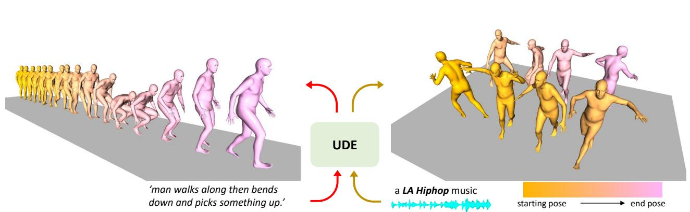
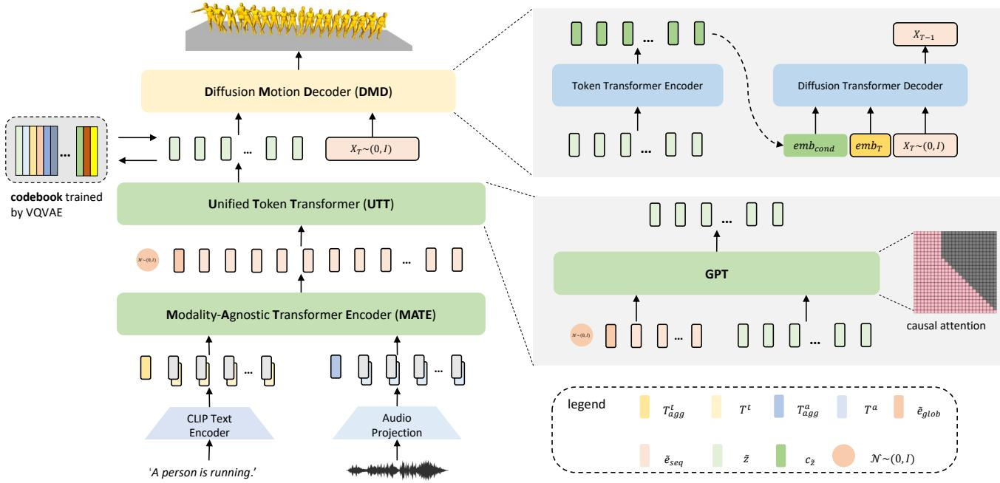
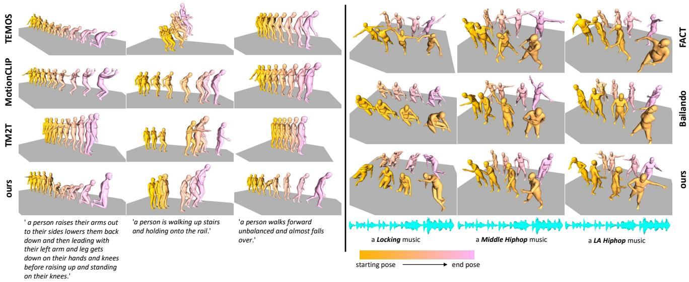
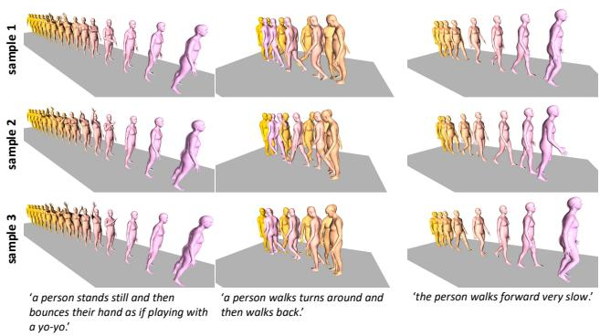
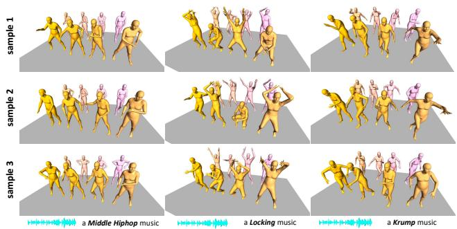

# UDE：面向人体动作生成的统一驱动引擎

Zixiang Zhou zhouzixiang@xiaobing.ai

Baoyuan Wang wangbaoyuan@xiaobing.ai

  
Figure 1. 我们共享的统一驱动引擎（UDE）可以同时支持文本驱动和音频驱动的人体动作生成。左图展示了由文本描述驱动的动作序列示例，而右图展示了由一段洛杉矶嘻哈（LA Hiphop）音乐片段驱动的示例。

## 摘要

生成可控且可编辑的人体动作序列是 3D 数字人（3D Avatar）生成中的一项关键挑战。长期以来，生成和制作人体动作动画一直是一项劳动密集型工作，直到最近基于学习的方法被开发和应用。然而，这些方法仍然局限于特定任务或特定模态 [1] [6] [5] [18]。在本文中，我们提出了“UDE”，这是首个能够从自然语言或音频序列生成人体动作序列的统一驱动引擎（见图 1）。具体而言，UDE 包含以下关键组件：1）基于 VQVAE 的动作量化模块，将连续动作序列表示为离散潜在编码 [33]；2）模态无关的 Transformer 编码器 [34]，学习将感知模态的驱动信号映射到联合空间；3）统一的 Token Transformer（类 GPT [24]）网络，以自回归方式预测量化潜在编码索引；4）扩散动作解码器，将动作 token 作为输入，并将其解码为具有高多样性的动作序列。我们在 HumanML3D [8] 和 AIST+ [19] 基准上评估了我们的方法，实验结果表明我们的方法达到了最先进的性能。项目网站：https://zixiangzhou916.github.io/UDE/

## 1. 引言

合成逼真的人体动作序列一直是许多现实应用中的核心组件。制作单段动作序列合成既费时费力又繁琐，且需要专业技能，这使得它难以在大众内容生成中普及。近年来，得益于深度学习的发展，动作捕捉和姿态估计 [15] [38] [27] [36] 的出现使得从虚拟主播（VTubers）或源视频中合成人体动作序列成为可能。尽管这些方法简化了动作序列的制作，但动作演员或强相关的视频仍然不可或缺，从而限制了其可扩展性以及可控性。

多模态机器学习的发展为人体动作合成（human motion synthesis）开辟了一条新途径 [1] [6] [8] [12] [17] [2]。例如，自然语言描述可以直接用于驱动人体动作序列 [1] [6] [8]。语言描述是人类用户控制合成过程的一种直观表示方式。它提供了合成动作序列应具有外观的语义线索，并且仅需通过更改语言描述即可进行编辑。然而，语言并不能涵盖人体动作序列的全部领域。例如，在舞蹈动作合成方面，自然语言不足以描述舞蹈节奏。

针对此类场景，音频序列被用作引导以辅助动作合成，从而使合成的动作能够在节奏上与音乐节拍及编舞风格相匹配。然而，以往的研究中这些方法都是被分别探讨的。在许多实际应用中，角色往往需要执行复杂的动作序列，该序列既包含由音乐驱动的有节奏舞蹈，又包含由语言描述的特定动作，因此混合模态输入之间的平滑过渡变得至关重要。由此可见，如果采用孤立的特定模态模型，多模态动作的一致性将成为一个亟待解决的问题。

为了解决上述问题，在本文中，我们提出了统一驱动引擎（Unified Driving Engine, UDE），它将自然语言和音乐片段驱动的人体动作生成统一在一个共享模型中。我们的模型由四个关键组件组成。首先，我们使用 VQ-VAE 训练一个码本（codebook）。对于该码本，每个编码（code）代表动作序列的某种特定模式。其次，我们引入了模态不可知 Transformer 编码器（Modality-Agnostic Transformer Encoder, MATE）。它接收不同模态的输入，并将其转换为统一联合空间中的序列嵌入（sequential embedding）。第三个组件是统一 Token Transformer（Unified Token Transformer, UTT）。我们将 MATE 获得的序列嵌入输入其中，并以自回归方式预测动作 token 序列。第四个组件是扩散动作解码器（Diffusion Motion Decoder, DMD）。与近期特定模态的研究 [30] [37] 不同，我们的 DMD 是模态不可知的。给定动作 token 序列，DMD 通过反向扩散过程将其解码为连续空间中的动作序列。

我们从四个方面总结我们的贡献：1）我们将连续人体动作生成问题建模为离散 token 预测问题。2）我们将文本驱动和音频驱动的动作生成整合为一个单一的统一模型。通过学习 MATE，我们能够将不同模态的输入序列映射到联合空间中。然后，无论输入的模态为何，我们都可以使用 UTT 预测动作 token。3）我们提出了 DMD 将动作 token 解码为动作序列。与生成确定性样本的 VQ-VAE 解码器相比，我们的 DMD 可以生成具有高度多样性的样本。4）我们对方法进行了广泛的评估，结果表明我们的方法在文本驱动和音频驱动场景下均优于现有方法。更重要的是，我们的实验还表明，我们的 UDE 能够实现混合模态输入之间的平滑过渡。

## 2. 相关工作

文本到动作（Text to Motion） 多模态机器学习近期的成功使得从文本描述合成人体动作成为可能。[1] 提出了一种从自然语言生成人体动作的方法。他们使用不同的编码器学习语言与姿态之间的联合嵌入，并使用基于 GRU 的动作解码器将该嵌入映射为人体动作。[6] 进一步提出学习自然语言、人体上半身与下半身之间的联合嵌入。他们使用双流编码器将上半身姿态和下半身姿态映射到联合嵌入空间，并使用预训练的 BERT 模型 [3] 来编码文本描述。一般来说，单个文本描述可以衍生出多个动作序列。为了实现概率性的文本引导合成，[22] 提出从动作序列和自然语言中学习联合分布。除了学习连续隐空间外，离散隐空间在表示人体动作方面也得到了成功验证 [7]。在该工作中，动作序列被离散化为一个码本。文中提出了一个文本到动作模块以从文本描述中预测动作码索引，并使用一个动作到文本模块来引入循环一致性。此外，动作合成也得益于多模态预训练（如 CLIP [23]）的最新进展。[29] 采用了 CLIP 的概念从自然语言合成人体动作。近期，扩散模型（Diffusion models）已成为动作生成中的一种新兴替代方案 [30] [37]。它们使用预训练模型对文本描述进行编码，并在每个逆向扩散步骤中直接估计高斯噪声 [37] 和最终结果 [30]。

音乐到动作 与文本到动作（text-to-motion）相比，音乐到动作（music-to-motion）具有不同的理念。音乐与动作之间不存在严格的映射关系，但节奏、节拍和风格 [2] 是建立音乐与动作之间关联的关键要素。[5] 提出了一种基于 GAN 的方法，用于从音乐输入中合成舞蹈动作。他们使用 CNN 编码器提取音乐特征，并使用 ST-GCN [35] 模块解码舞蹈动作。[12] 中引入了一种自回归方法，其中音乐序列首先由 Transformer 编码器编码，然后采用基于 RNN 的解码器在给定音乐特征和先前姿态的情况下预测逐步姿态。类似地，[25] [18] 也以自回归方式合成舞蹈姿态，但采用了 Transformer [34] 架构。这些方法分别使用不同的 Transformer 编码器对音频序列和先前的动作序列进行编码，并利用融合模块以音乐和舞蹈姿态为条件合成未来的姿态。这两种方法是确定性的。为了引入多样性，[32] 提出了一种基于归一化流（normalizing-flow）[26] 的方法。在该工作中，采用了 [18] 中描述的相同跨模态特征来提取条件特征，同时使用归一化流模块 [10] 在给定跨模态特征和随机噪声的情况下生成姿态。[16] 提出了一种基于 GAN 的方法，以音乐输入为条件合成多样化的舞蹈动作。他们使用 Transformer 解码器将输入的音乐和种子姿态映射为长程动作姿态，其中通过将舞蹈流派映射为风格隐码来约束舞蹈流派。Transformer 编码器被用作判别器，以区分合成动作的真伪。[28] 没有使用连续隐变量来表示条件信息，而是提出使用离散表示。他们的方法首先使用 VQ-VAE 学习一个码本（codebook），然后使用类 GPT 的 Transformer 模块在给定音乐输入的情况下预测动作编码索引。此外，他们提出将人体姿态分解为上半身和下半身部分，最终合成的姿态由上半身和下半身姿态组合而成。

然而，这些方法都是特定于单一模态的。目前尚缺乏一种能够统一多模态驱动的人体动作生成任务的解决方案。

## 3. 方法

我们整个框架的概述如图 2 所示，它包含四个模块：1) 动作量化（Motion Quantization）模块，2) 模态无关 Transformer（Modality-Agnostic Transformer）模块，3) 统一 Token Transformer（Unified Token Transformer）模块，以及 4) 扩散动作解码器（Diffusion Motion Decoder）模块，下文将分别对它们进行阐述。

## 3.1. 动作量化（Motion Quantization, MQ）

我们通过训练 VQ-VAE 模型来学习富含语义的码本（codebook）。我们将动作序列表示为 $\boldsymbol { x } \in \mathbb { R } ^ { T \times c }$，其中 T 是动作序列的长度，c 是每帧的维度。为了学习码本 $\mathcal { Z } = \{ z ^ { q } | z ^ { q } \in$ $\mathbb { R } ^ { T ^ { q } \times d } \}$，我们训练一个编码器将 x 映射到 e $\in \mathbb { R } ^ { T ^ { \prime } \times \mathsf { \bar { d } } }$。给定时序嵌入 $e \in \mathbb { R } ^ { T ^ { \star } \times d } .$，我们如公式 (1) 所示，通过将每个 $e _ { i }$ 替换为其在 $\mathcal { Z }$ 中最近的码 $z _ { j } ^ { q }$ 来对其进行量化：

$$
\mathcal {Q} (e _ {i}) = \underset {z _ {j} ^ {q} \in \mathcal {Z}} {\arg \min} \| e _ {i} - z _ {j} ^ {q} \|\tag{1}
$$

为了从 $z ^ { q }$ 重构动作，我们采用一个解码器将时序码 $z ^ { q } \in \mathbb { R } ^ { T ^ { \prime } \times \hat { d } }$ 解码回动作序列 $\tilde { { \boldsymbol { x } } } ~ = ~ \mathcal { D } ( z ^ { q } ) ~ \in ~ \mathbb { R } ^ { T ^ { \prime } \times d }$。编码器、解码器和码本通过优化以下损失函数进行联合训练：

$$
\mathcal {L} _ {V Q} = \mathcal {L} _ {r e c} (\tilde {x}, x) + \beta_ {1} \| s g [ e ] - \mathcal {Q} (e) \| + \beta_ {2} \| e - s g [ \mathcal {Q} (e) ] \|\tag{2}
$$

在公式 (2) 中，$\mathcal { L } _ { r e c } ( \tilde { x } , x )$ 是重构项，用于促使解码得到的 x˜ 尽可能接近 x。第二项 $\lVert s g [ e ] - \mathcal { Q } ( e ) \rVert$ 是码本损失（codebook loss），促使 $z _ { j } ^ { q }$ 靠近编码后的嵌入 $e _ { i }$。第三项 $\| e - s g [ \mathcal { Q } ( e ) ] \|$ 是承诺损失（commitment loss），它促使嵌入 $e _ { i }$ 保持靠近相应的离散码 $z _ { j } ^ { q }$，从而使训练过程保持稳定。编码器和解码器均采用一维时序卷积（1D temporal convolution）架构。

## 3.2. 动作无关 Transformer 编码器（Motion-Agnostic Transformer Encoder, MATE）

MATE 旨在将多模态输入数据转换为模态无关的输出。我们的编码器接收两种不同的模态作为输入：文本描述和音频序列。对于文本输入，使用 CLIP 文本编码器 [23] 来提取词级嵌入。我们跳过了 CLIP 文本编码器中的最后一步（即最大池化操作），以获得输入文本描述的词级序列嵌入 $\tilde { e } ^ { t } = \mathcal { E } ( x _ { t } )$ 。对于音频输入，我们仅应用一个线性层将原始音频输入序列特征向量投影为 $\tilde { e } ^ { a } = \mathcal { E } ( x _ { a } )$ 。为简明起见，我们将 MATE 映射表示为 $\tilde { e } ^ { k } = \mathcal { E } ( x ^ { k } )$ ，其中 ${ \dot { x } } ^ { k }$ 代表模态 k 的输入，此处的 k 可以指代音频或文本。在将各模态的序列特征向量输入模型之前，我们为它们添加对应模态的可学习 token 嵌入，并在特征序列前拼接可学习的聚合 token 嵌入。最后，我们对特征序列应用位置编码以获得最终的输入序列：

$$
\tilde {e} = [ T _ {a g g} ^ {k}, \tilde {e} _ {0} ^ {k} + T ^ {k}, \tilde {e} _ {1} ^ {k} + T ^ {k},..., \tilde {e} _ {i} ^ {k} + T ^ {k},..., \tilde {e} _ {I} ^ {k} + T ^ {k} ] + e _ {p o s}\tag{3}
$$

其中在公式 (3) 中，$\boldsymbol { T } _ { a g g } ^ { k }$ 是模态 $k$ 的可学习聚合 token 嵌入，而 $T _ { k }$ 是添加到模态 k 特征序列上的可学习 token 嵌入。Transformer 架构遵循 [4]，其中堆叠了 n 个 Transformer 编码器层，并采用了全自注意力机制。对于长度为 m 的输出序列，我们取第一个元素作为全局嵌入 $\tilde { e } _ { g l o b }$ ，而其余 $m - 1$ 个元素分别为序列嵌入 $\tilde { e } _ { s e q }$ 。

## 3.3. 统一 Token Transformer (Unified Token Transformer, UTT)

我们的 UTT 采用具有因果注意力机制的堆叠 Transformer 编码器层架构。我们将嵌入 $\tilde { e } _ { g l o b }$ 和 $\tilde { e } _ { s e q }$ 以及目标动作 token 的嵌入 $\tilde { e } _ { m o t } .$ 作为条件输入给 UTT。我们将它们沿时间维度拼接为 $e _ { i n } =$ $[ \tilde { e } _ { g l o b } , \tilde { e } _ { s e q } , \tilde { e } _ { m o t } ]$ 。我们在训练 UTT 时采用因果自注意力（causal self-attention），以确保无法访问未来信息。然而，我们希望在训练过程中始终可以访问条件信息，因此我们不对条件区域进行掩码，而仅掩码对应于未来动作 token 的区域。将条件表示为 $\tilde { e } _ { c o n d } ^ { 0 : \bar { L } }$，动作 token 嵌入表示为 ${ \tilde { e } } _ { m o t } ^ { 0 : T }$，则动作 token 嵌入 ${ \tilde { e } _ { m o t } ^ { i } }$ 的注意力区域为 $[ \tilde { e } _ { c o n d } ^ { 0 : L } , \tilde { e } _ { m o t } ^ { < = i } ]$。随后，UTT 自回归地将 $e _ { i n }$ 转换为 token 序列 $z ^ { q } \in \mathbb { R } ^ { T \times d }$。

如图 2 所示，我们可以注入 $z \sim \mathcal { N } ( 0 , I )$ 以提升多样性。给定一个采样的 z，我们通过 MLP 将其映射到 z˜，使得 z 与 $\tilde { e } _ { g l o b }$ 具有相同的维度，然后我们得到新的全局条件嵌入 $\tilde { e } _ { g l o b } ^ { \tilde { z } } = \tilde { z } + \tilde { e } _ { g l o b }$。因此，UTT 的新输入现在变为 $e _ { i n } = [ \tilde { e } _ { q l o b } ^ { z } , \tilde { e } _ { s e q } , \tilde { e } _ { m o t } ] .$。

我们引入了一个判别器（discriminator）以辅助端到端训练 UTT 和 MATE。我们使用一个条件判别器，其输入为全局嵌入 $\tilde { e } _ { g l o b }$ 和动作序列。与传统判别器为每个序列预测一个分数不同，我们采用了 PatchGAN [13] 中描述的策略。动作序列 $\boldsymbol { x } \in \mathbb { R } ^ { T \times c }$ 被输入到判别器中，并通过一维时间卷积架构提取序列特征向量 $\tilde { e } _ { x } ^ { D } \in \mathbb { R } ^ { T ^ { \prime } \times c }$，其中 $T \ : = \ : T / 4$。我们对 $\tilde { e } _ { g l o b }$ 应用线性层以获得 $\tilde { e } _ { q l o b } ^ { D } = \dot { F } C ( \tilde { e } _ { g l o b } )$，从而使 $\tilde { e } _ { x } ^ { \bar { D } }$ 和 $\tilde { e } _ { g l o b } ^ { D }$ 具有相同的维度。然后，我们将相加后的特征 $\tilde { e } ^ { D } = \tilde { e } _ { q l o b } ^ { D } + \tilde { e } _ { x } ^ { D }$ 输入到一个双层 Transformer 编码器中以计算其序列嵌入。对于每个嵌入，应用线性投影将其转换为有效性得分。

  
Figure 2. 我们方法的流程。左侧是我们方法的概览。我们通过训练一个称为动作量化（Motion Quantization，MQ）的 VQVAE 来学习码本。然后，模态无关 Transformer 编码器（Modality-Agnostic Transformer Encoder，MATE）以文本描述或音频序列作为输入，并将它们映射到联合空间中的序列嵌入 e˜。接着将序列嵌入 e˜ 输入到统一标记 Transformer 解码器（Unified Token Transformer Decoder，UTT）中以预测标记序列 z˜。最后，我们提出了一个扩散动作解码器（Diffusion Motion Decoder，DMD），将标记序列 z˜ 映射为具有高多样性的动作序列。UTT 和 DMD 的细节展示在右侧的放大区域中。

MATE 和 UTT 的总体优化目标为：

$$
\mathcal {L} = \mathcal {L} _ {c e} + \beta_ {a d v} \mathcal {L} _ {a d v}\tag{4}
$$

其中 $\mathcal { L } _ { c e }$ 是用于标记预测的交叉熵损失，$\mathcal { L } _ { a d v }$ 是针对动作序列的对抗损失。

$$
\mathcal {L} _ {c e} = - \sum_ {i = 1} ^ {I} p (z _ {i} ^ {q}) \log q _ {\theta} (\tilde {z} _ {i} ^ {q})\tag{5}
$$

$$
\mathcal {L} _ {a d v} = - \mathbb {E} _ {p \sim P _ {g e n}, q \sim Q _ {d a t a}} D (G (p), q)\tag{6}
$$

在式 $( 6 )$ 中，$p \sim P _ { g e n }$ 分别表示生成样本分布，$q \sim Q _ { d a t a }$ 表示真实样本分布。$\beta _ { a d v }$ 为平衡权重。

## 3.4. 扩散动作解码器（Diffusion Motion Decoder, DMD）

预训练的 VQ 解码器在给定相同输入标记 $\tilde { x } = \mathcal { D } ( z ^ { q } )$ 时会产生确定性的输出。然而，在标记解码阶段，多样性同样是所期望的。我们提出了一种扩散动作解码器来替代 VQ 解码器，以引入额外的多样性。与直接以文本描述作为输入因而具有模态特异性的方法 [30] [37] 不同，我们的方法是一种模态无关的模型，它将离散标记作为条件输入，而无需考虑原始输入是何种模态。扩散过程 [11] 是一个马尔可夫加噪过程，从真实数据 $X _ { 0 }$ 开始，在每一步添加高斯噪声，将 $X _ { 0 }$ 转换为 $X _ { T } \sim \mathcal { N } ( 0 , I )$。该过程表示为

$$
q (X _ {t} | X _ {t - 1}) = \mathcal {N} (X _ {t}; \sqrt {1 - \beta_ {t}} X _ {t - 1}, \beta \mathbf {I})\tag{7}
$$

整个扩散过程可以公式化为

$$
q (X _ {1: T} | X _ {0}) = \prod_ {t = 0} ^ {T} q (X _ {t} | X _ {t - 1})\tag{8}
$$

令 $\alpha _ { t } ~ = ~ 1 - \beta _ { t }$ 且 $\tilde { \alpha } _ { t } = \prod _ { i = 1 } ^ { t } \alpha _ { i }$，则在任意步 t 的带噪数据可以由 $X _ { 0 }$ 导出为

$$
q (X _ {t} | X _ {0}) = \mathcal {N} (X _ {t}; \sqrt {\tilde {\alpha} _ {t}} X _ {0}, (1 - \tilde {\alpha} _ {t}) \mathbf {I})\tag{9}
$$

逆向扩散过程尝试对 $X _ { t }$ 进行逐步去噪。在我们的语境中，该逆向扩散过程以 $c _ { \tilde { z } } = \mathcal { E } _ { z } ( z ^ { q } )$ 为条件，其中 $z ^ { q }$ 是码本（codebook）中的预测 token，而 $\mathcal { E } _ { z } ( z ^ { q } )$ 从 token 序列中提取嵌入。我们遵循 [11] 中的策略，将添加到 $X _ { t }$ 中的噪声 ϵ 预测为 $\epsilon _ { t } ~ = ~ \epsilon _ { \theta } ( X _ { t } , t , c _ { \tilde { z } } )$。我们的扩散运动解码器如图 Fig. 2 所示。它由两部分组成。第一部分是一个 token Transformer 编码器，它将码本 token 序列映射为序列嵌入 $c _ { \tilde { z } } = \mathcal { E } _ { z } ( z ^ { q } )$。序列嵌入 $c _ { \tilde { z } }$ 用作条件嵌入。对于每个逆向扩散步骤 t，扩散 Transformer 解码器将序列嵌入 $c _ { \tilde { z } } .$、时间步嵌入 embT 以及加噪数据 $X _ { t } ,$ 作为输入，并将噪声预测为 ${ \epsilon _ { t } = \epsilon _ { \theta } ( c _ { \tilde { z } } , e m b _ { T } , X _ { t } ) }$，其中 θ 是扩散 Transformer 解码器的可学习参数。我们通过优化以下目标来训练扩散运动解码器：

<table><tr><td rowspan="2">方法</td><td colspan="2">文本检索准确率</td><td colspan="2">FID</td><td colspan="2">多样性</td><td colspan="3">多模态性</td><td colspan="3">重建准确率</td></tr><tr><td>Top-1 准确率 ↑</td><td>Top-5 准确率 ↑</td><td> $FID_{K}$  ↓</td><td> $FID_{m}$  ↓</td><td> $Div_{k}$  ↑</td><td> $Div_{m}$  ↑</td><td> $MM_{k}$  ↑</td><td> $MM_{m}$  ↑</td><td>APE ↓</td><td>AVE ↓</td><td>APE(root) ↓</td><td>AVE(root) ↓</td></tr><tr><td>GT</td><td>9.99</td><td>27.74</td><td>4.84</td><td>1.11</td><td>7.82</td><td>6.47</td><td>-</td><td>-</td><td>0.00</td><td>0.00</td><td>0.00</td><td>0.00</td></tr><tr><td>TEMOS [22]</td><td>4.86</td><td>16.58</td><td>45.31</td><td>21.37</td><td>3.48</td><td>7.63</td><td>-</td><td>-</td><td>0.24</td><td>0.03</td><td>0.50</td><td>0.38</td></tr><tr><td>MotionCLIP [29]</td><td>7.01</td><td>22.49</td><td>37.46</td><td>10.76</td><td>4.11</td><td>9.07</td><td>-</td><td>-</td><td>0.26</td><td>0.03</td><td>0.52</td><td>0.37</td></tr><tr><td>TM2T [7]</td><td> $7.76^{\pm 1.12}$ </td><td> $22.54^{\pm 1.67}$ </td><td> $13.25^{\pm 1.136}$ </td><td> $6.39^{\pm 0.938}$ </td><td> $4.78^{\pm 0.289}$ </td><td> $6.34^{\pm 0.117}$ </td><td> $2.63^{\pm 2.464}$ </td><td> $2.17^{\pm 2.118}$ </td><td> $0.19^{\pm 0.0002}$ </td><td> $0.02^{\pm 0.0000}$ </td><td> $0.44^{\pm 0.0007}$ </td><td> $0.34^{\pm 0.0014}$ </td></tr><tr><td>Ours</td><td> $8.21^{\pm 1.00}$ </td><td> $26.06^{\pm 1.33}$ </td><td> $19.35^{\pm 0.548}$ </td><td> $2.67^{\pm 0.190}$ </td><td> $6.75^{\pm 0.049}$ </td><td> $7.82^{\pm 0.107}$ </td><td> $2.34^{\pm 1.123}$ </td><td> $2.51^{\pm 0.605}$ </td><td> $0.19^{\pm 0.0002}$ </td><td> $0.02^{\pm 0.0000}$ </td><td> $0.44^{\pm 0.0011}$ </td><td> $0.33^{\pm 0.0016}$ </td></tr></table>

Table 1. 文本生成动作任务在各种指标下的定量结果。为了公平比较，我们在 HumanML3D 数据集 [8] 上使用相同的划分复现了 [22] [29] [7] 的结果。动作表示与本文相同，并使用其官方代码进行训练。对于本文方法，我们使用 UTT 为每个输入生成 3 个样本，并针对每个标记序列使用 DMD 生成 30 个样本。然后我们报告了平均指标和 95% 置信区间（±）。粗体表示最佳结果，下划线表示次佳结果。

<table><tr><td rowspan="2">方法</td><td rowspan="2">节拍对齐 ↑</td><td colspan="2">FID</td><td colspan="2">多样性</td><td colspan="3">多模态性</td><td colspan="3">重构精度</td></tr><tr><td> $FID_{K} \downarrow$ </td><td> $FID_{m} \downarrow$ </td><td> $Div_{k} \uparrow$ </td><td> $Div_{m} \uparrow$ </td><td> $MM_{k} \uparrow$ </td><td> $MM_{m} \uparrow$ </td><td>APE ↓</td><td>AVE ↓</td><td>APE(root) ↓</td><td>AVE(root) ↓</td></tr><tr><td>GT</td><td>0.237</td><td>17.10</td><td>10.60</td><td>8.19</td><td>7.45</td><td>-</td><td>-</td><td>0.00</td><td>0.00</td><td>0.00</td><td>0.00</td></tr><tr><td>FACT [18]</td><td>0.2209</td><td>35.35</td><td>22.11</td><td>5.94</td><td>6.18</td><td>-</td><td>-</td><td>0.26</td><td>0.04</td><td>0.70</td><td>0.11</td></tr><tr><td>Bailando [28]</td><td>0.2332</td><td>28.16</td><td>9.62</td><td>7.83</td><td>6.34</td><td>-</td><td>-</td><td>0.27</td><td>0.03</td><td>0.32</td><td>0.13</td></tr><tr><td>Ours</td><td> $0.2311^{\pm 0.01937}$ </td><td> $17.25^{\pm 1.442}$ </td><td> $8.69^{\pm 1.568}$ </td><td> $7.78^{\pm 0.543}$ </td><td> $5.81^{\pm 0.253}$ </td><td> $4.27^{\pm 1.123}$ </td><td> $2.82^{\pm 0.706}$ </td><td> $0.29^{\pm 0.0010}$ </td><td> $0.03^{\pm 0.0004}$ </td><td> $0.28^{\pm 0.0312}$ </td><td> $0.12^{\pm 0.0596}$ </td></tr></table>

Table 2. 音频到动作（audio-to-motion）任务的定量结果。对于我们的方法，我们使用 UTT 为每个输入生成 3 个样本，并针对每个 token 序列使用 DMD 生成 30 个样本。然后我们汇报平均指标和 95% 置信区间（±）。

<table><tr><td rowspan="2">方法</td><td colspan="2">文本到动作</td><td colspan="4">音频到动作</td></tr><tr><td>Top-1 准确率 ↑</td><td>Top-5 准确率 ↑</td><td> $\text{FID}_K$  ↓</td><td> $\text{FID}_m$  ↓</td><td> $\text{Div}_k$  ↑</td><td> $\text{Div}_m$  ↑</td></tr><tr><td>Ours (gru)</td><td>7.89</td><td>23.45</td><td>47.21</td><td>23.13</td><td>6.71</td><td>3.72</td></tr><tr><td>Ours (gpt)</td><td>8.11</td><td>25.01</td><td>28.44</td><td>15.70</td><td>6.13</td><td>4.07</td></tr></table>

Table 3. 统一 Token Transformer（UTT）架构的消融实验。Ours (gru) 表示 UTT 的架构基于 GRU，Ours (gpt) 表示我们为 UTT 采用基于 GPT 的架构。两种架构均采用确定性 token 预测策略，表明在推理过程中不注入 $z \sim \mathcal { N } ( 0 , I )$。

$$
\mathcal {L} _ {\text { diff }} = \mathbb {E} _ {t \in [ 1, T ], X _ {0} \sim q (X _ {0}), \epsilon \sim \mathcal {N} (0, \mathbf {I})} [ \| \epsilon - \epsilon_ {\theta} (c _ {\tilde {z}}, e m b _ {T}, X _ {t}) \| ]\tag{10}
$$

## 4. 实验

我们分别训练 MQ、DMD 以及 MATE + UTT，并在两类任务上对其进行评估：文本到动作生成和音频到动作生成，下文将对此进行详细描述。

## 4.1. 数据集

由于目前没有同时支持文本驱动和音频驱动动作生成的公开数据集，我们在实验中使用了两个独立的数据集。第一个数据集是 HumanML3D [8]，这是一个基于 AMASS 数据集 [20] 和 HumanAct12 [9] 构建的文本到动作（Text-to-Motion）数据集。它提供了广泛的动作-语言对，涵盖诸如“跳跃”、“行走”、“跑步”等日常活动。第二个数据集是 AIST++ [18]，一个基于 [31] 构建的大规模舞蹈动作数据集。它包含 1409 个舞蹈动作序列，涵盖 10 种不同的舞蹈流派以及数百种编舞动作。

## 4.2. 实现细节

数据预处理。HumanML3D 的原始动作格式遵循具有 22 个关节的 SMPL 骨架，而 AIST++ 的格式遵循具有 24 个关节的 SMPL 骨架，因此进行了预处理以统一它们的格式。对于每个数据集，我们使用 [21] 将它们的动作表示转换为具有 24 个关节表示的 SMPL 骨架。此外，我们通过将初始姿态朝向转换为同一方向来归一化每个动作序列。对于音频预处理，使用了一个公开工具箱 Librosa [14] 来提取音频特征。该特征由梅尔频率倒谱系数（MFCC）、MFCC 一阶差分（MFCC delta）、常数Q音级图（constant-Q chromagram）、速度图（tempogram）以及起始强度（onset strength）组成。对于每个音频特征序列，它被表示为一个 $T \times 4 3 8$ 的矩阵。

动作量化。码本（codebook）大小设置为 2048× 1024，其中离散 token 的数量为 2048，每个 token 的维度为 1024。对于 VQ 编码器（VQ-encoder）和 VQ 解码器（VQ-decoder），采用了三层时序一维卷积网络。我们设置 $\beta _ { 1 } = 1$ ，以及 $\beta _ { 2 } = 1$。

  
Figure 3. 在文本到动作（左）和音频到动作（右）任务上与现有方法的定性比较。左图展示了在相同文本描述驱动下，本文方法与 [22] [29] [7] 之间的比较。右图展示了本文方法与 [18] [28] 之间的比较。为了获得更好的可视化效果，我们对每个姿态的位置进行了适当调整。

<table><tr><td rowspan="2">方法</td><td colspan="6">文本到动作</td><td colspan="4">音频到动作</td></tr><tr><td>Top-1 Acc. ↑</td><td>Top-5 Acc. ↑</td><td> $FID_{K}$  ↓</td><td> $FID_{m}$  ↓</td><td> $Div_{k}$  ↑</td><td> $Div_{m}$  ↑</td><td> $FID_{K}$  ↓</td><td> $FID_{m}$  ↓</td><td> $Div_{k}$  ↑</td><td> $Div_{m}$  ↑</td></tr><tr><td>ours</td><td>8.11</td><td>25.01</td><td>27.66</td><td>4.92</td><td>4.28</td><td>6.77</td><td>28.44</td><td>15.70</td><td>6.13</td><td>4.07</td></tr><tr><td>ours+z</td><td>8.33</td><td>25.78</td><td>26.93</td><td>4.49</td><td>5.05</td><td>7.63</td><td>27.99</td><td>15.26</td><td>6.32</td><td>4.14</td></tr></table>

Table 4. 词元预测中多样性的消融实验。我们验证了我们的统一词元转换器（Unified Token Transformer, UTT）在注入或不注入 $z \sim \mathcal { N } ( 0 , I )$ 时的性能，其中 ours 表示确定性预测，ours+z 表示概率性预测模式。对于 ours+z，我们为每个输入生成 30 个样本并测量平均指标。

模态无关的 Transformer 编码器（Modality-Agnostic Transformer Encoder）。对于文本编码器，我们使用预训练的 CLIP 文本编码器；对于音频编码器，采用单层全连接层（FC）。对于两种模态的输入，我们将其投影到 256 维。Transformer 编码器层数设置为 6，注意力头数设为 8，隐藏层维度为 1024。

统一词元 Transformer（Unified Token Transformer）。我们将 Transformer 编码器层数设置为 8，隐藏层维度设置为 1024。对于损失函数，我们设置 $\beta _ { a d v } = 1$

扩散动作解码器（Diffusion Motion Decoder）。对于条件编码器 $\mathcal { E } _ { z }$，编码器层数为 8，解码器的层数也设置为 8。对于编码器和解码器，隐藏层维度均为 1024，注意力头数均为 8。在我们的实验中，扩散步数设置为 1000。

学习率与优化器（Learning rate and Optimizer）。在所有阶段中，我们使用 Adam 作为优化器，学习率为 0.0001。

## 4.3. 评估指标

文本到动作评估指标（Text-to-Motion Evaluation Metrics）。我们在文本到动作任务上使用五类指标评估我们的方法。1) 文本检索准确率（Text Retrieval Accuracy）。我们分别通过 Top-1 Acc 和 Top-5 Acc 评估动作序列与文本描述之间的相关性。遵循 [29]，我们采用对比学习范式训练一个动作编码器，使成对的动作与文本描述的嵌入表示彼此接近。在评估过程中，我们计算成对动作和文本描述的嵌入，并从测试集中随机选取另外 60 个不相关的文本描述。然后我们计算动作嵌入与这 61 个文本嵌入之间的相似度。如果成对文本的嵌入在这些文本嵌入中相似度最高，则计为 Top-1 Acc，Top-5 Acc 同理。2) 弗雷歇初始距离（Frechet Inception Distance, FID）。FID 用于度量两个分布之间的相似度，我们使用预定义模型来提取特征。在此我们定义 $\mathrm { F I D } _ { k }$ 来衡量运动学特征，定义 $\mathrm { F I D } _ { m }$ 来衡量人工定义的几何特征。3) 多样性（Diversity）。我们衡量运动学和几何特征的多样性。特征由与 FID 相同的模型提取。4) 多模态性（Multimodality）。我们衡量由单一驱动信号生成的动作序列特征的平均方差。特征提取方式同前。5) 重建精度（Reconstruction Accuracy）。我们测量真实样本与生成样本之间的平均关节位置距离和根关节轨迹距离 [22]，以表明生成样本在姿态几何方面与真实样本的接近程度。

<table><tr><td rowspan="2">方法</td><td colspan="6">Text-to-Motion</td><td colspan="4">Audio-to-Motion</td></tr><tr><td>Top-1 Acc. ↑</td><td>Top-5 Acc. ↑</td><td> $FID_K$  ↓</td><td> $FID_m$  ↓</td><td> $Div_k$  ↑</td><td> $Div_m$  ↑</td><td> $FID_K$  ↓</td><td> $FID_m$  ↓</td><td> $Div_k$  ↑</td><td> $Div_m$  ↑</td></tr><tr><td>vq-decoder</td><td>8.11</td><td>25.01</td><td>27.66</td><td>4.92</td><td>4.28</td><td>6.77</td><td>28.44</td><td>15.70</td><td>6.13</td><td>4.07</td></tr><tr><td>diffusion-decoder</td><td>8.12</td><td>25.18</td><td>23.93</td><td>3.15</td><td>6.98</td><td>7.17</td><td>18.43</td><td>10.39</td><td>6.84</td><td>5.03</td></tr></table>

Table 5. 标记解码的多样性消融实验。我们对比了使用我们的扩散动作解码器（Diffusion Motion Decoder，DMD）与预训练 VQ-Decoder 进行标记解码的性能。为了公平对比，两组实验均采用基于 GPT 的 UTT 预测的标记序列作为输入，且不注入 $z \sim \mathcal { N } ( 0 , I )$。对于 DMD，我们对每个输入生成 30 个样本。

  
Figure 4. Text-to-Motion 的多样性。每列展示由相同文本描述生成的 3 个样本。我们观察到，我们的方法在保持驱动文本描述语义的同时，生成了具有高多样性的动作序列。

音频驱动动作（Audio-to-Motion）评估指标。我们采用四类指标在音频驱动动作任务上评估我们的方法。1) 节拍对齐度（Beat Align）。我们衡量生成的动作在节奏节拍方面与驱动音频序列的贴合程度。节拍对齐得分计算如下：$\begin{array} { r } { \frac { 1 } { \left| B ^ { a } \right| } \sum _ { t ^ { a } \in B ^ { a } } \exp \left\{ - \frac { \operatorname* { m i n } _ { t } m \in B ^ { m } \left\| t ^ { m } - t ^ { a } \right\| ^ { 2 } } { 2 \sigma ^ { 2 } } \right\} } \end{array}$，其中 $B ^ { m }$ 和 $B ^ { a }$ 分别对应动作节拍和音频节拍。对于 FID、多样性（Diversity）和重构准确率（Reconstruction Accuracy），我们遵循与文本驱动动作部分中所述相同的定义。

## 4.4. 实验结果

我们将我们的方法与几种具有代表性的前沿方法进行了对比。对于文本驱动动作，我们将我们的方法与

  
Figure 5. Audio-to-Motion 的多样性。我们展示了由 3 个不同音乐片段驱动的结果。每个片段生成 3 个样本。为了更好地进行可视化，我们从每个样本中均匀抽取 8 帧并以网格形式展示。正如所见，我们的方法生成了具有高多样性的音频驱动动作序列。

TEMOS [22]、MotionCLIP [29] 和 TM2T [7]。对于音频生成动作（audio-to-motion），我们与 FACT [18] 和 Bailando [28] 进行了对比。定量对比（Quantitative Comparison）。Tab. 1 和 Tab. 2 汇总了定量对比结果。1) 对于文本生成动作任务，Tab. 1 显示我们的方法在 Text Retrieval Acc. 和 Recon Acc. 指标上均优于所有具有竞争力的现有方法。具体而言，我们的结果在 Text Retrieval Acc. 上显著超越了所有现有方法，这表明在所有方法中，我们的方法生成的样本在语义上具有更高的相关性。得益于我们的概率 token 预测（UTT）和 token 解码（DMD），我们的方法在所有方法中取得了显著更高的运动学特征多样性。2) Tab. 2 显示，我们的方法在 $\mathrm { F I D } _ { k }$ 和 $\mathrm { F I D } _ { m } .$ 方面取得了远优于其他方法的结果。我们的 FID 指标显著改善，表明我们方法生成的样本在所有方法中展现出了最佳的运动学和几何质量。此外，我们方法在 $\operatorname { D i v } _ { k }$ 指标上名列第二，仅略低于 [28]。这表明我们的方法同样能够生成具有极强竞争力的运动学多样性的音频驱动动作。

定性对比（Qualitative Comparison）。Fig. 3 展示了我们的方法与现有方法之间的定性对比。1) 对于文本生成动作任务，我们的方法展现出了最佳的质量和语义相关性。即（$i . e . .$），对于由文本“a person raises their arms out to their sides lowers them back down and then leading with their left arm and leg gets down on their hands and knees before raising up and standing on their knees.”驱动的样本，该文本描述了一个非常复杂的场景，[22] 生成的结果未能展现“standing on their knees”动作，[29] 仅展现了“raises their arms out to their sides”动作，[7] 的结果同样仅展现了“raises their arms out to their sides”动作，而我们的方法则展现出了文本描述中所刻画的完整动作序列。2) 对于音频生成动作任务，与 [18] 和 [28] 相比，我们的方法同样展现出了最高的质量和相关性。例如，当由 Locking 风格音乐驱动时，[28] 的动作序列重复了类似的模式，而 [18] 的动作序列看起来像是人在伴随 Ballet（芭蕾）风格的音乐起舞，而不是 Locking 风格音乐，相比之下，我们的方法在展现出丰富多样姿态的同时，保持了与驱动音乐风格的高度相关性。

多样性。Fig. 4 和 Fig. 5 分别展示了文本驱动和音频驱动任务的定性结果。对于每张图，我们展示了由相同驱动输入生成的 3 个样本。我们可以观察到，我们的方法在生成具有高多样性的动作序列的同时，也保持了语义相关性。例如由文本“the person walks forward very slowly（那个人非常缓慢地向前走）”驱动的样本，动作序列正确地匹配了文本输入，即使对于这样简单的场景也展现出了不同的细节。Fig. 5 展示了音频驱动任务结果的均匀截取姿态。我们展示了由 3 种不同类型音乐驱动的结果，并且对于每个音乐序列，均展示了 3 个样本。可以看出，我们的方法生成了具有高质量和多样性的动作序列。

平滑过渡 我们还依次以文本描述和音乐片段为条件生成动作序列，并在补充材料（Fig. 1）中展示了结果。

## 4.5. 消融实验

我们针对以下方面进行了消融实验：(1) UTT 的设计，(2) UTT 的确定性生成与概率生成对比，以及 (3) DMD 与 VQ-Decoder 相比的多样性。

统一词元变换器（Unified Token Transformer, UTT）的变体。我们探索了具有两种不同架构的 UTT 设计：基于 GRU 和基于 GPT，其中基于 GPT 是本工作所采用的模型。我们未注入随机噪声 $z \sim \mathcal { N } ( 0 , I )$ 以消除随机性。Tab. 3 展示了这些设计之间的定量比较。我们可以观察到，基于 GPT 的模型在文本到动作（text-to-motion）任务和音频到动作（audio-to-motion）任务上均取得了更好的结果。对于文本到动作任务，基于 GPT 的方法取得了更高的文本检索准确率，这意味着样本与输入文本在语义上更加相关。此外，基于 GPT 的方法在音频到动作任务上的 FID 表现也显著更优，表明其具备为音频生成更逼真动作的能力。这可能是因为在基于 GPT 的方法中，一个词元（token）可以关注到其之前的所有词元，从而使其长期生成更加稳定且在语义上更加相关。

统一令牌变换器（Unified Token Transformer, UTT）的多样性。我们探索了统一令牌变换器 UTT 在令牌预测上的多样性。我们采用 VQ-Decoder 作为令牌解码器，以消除令牌解码阶段的多样性对最终结果的影响。对于概率预测模式（ours+z），我们为每个输入生成 30 个样本并评估平均指标。而对于确定性预测模式（ours），我们为每个输入仅生成 1 个样本。Tab. 4 汇总了定量结果。结果表明，与确定性生成相比，带有概率生成的 UTT 取得了更好的结果。具体而言，在文本到动作（text-to-motion）任务中，ours+z 在 Top-1 Acc. 和 Top-5 Acc. 上表现更优，并且正如预期的那样，分别获得了更高的 $\operatorname { D i v } _ { k }$ 和 $\operatorname { D i v } _ { m }$ 得分。对于音频到动作（audio-to-motion）任务，ours+z 相比 ours 也取得了更好的结果。对于 $\mathrm { F I D } _ { k }$ 和 $\mathrm { F I D } _ { m }$ 指标，概率生成模式带来了更好的运动学质量（28.44 对比 27.99）和几何质量（15.70 对比 15.26）。它还表明，在令牌预测阶段注入 $z \sim \mathcal { N } ( 0 , I )$ 分别带来了略高的运动学多样性 $\mathrm { D I V } _ { k }$ 和几何多样性 $\mathrm { D I V } _ { m }$。定量对比表明，正如预期的那样，向 UTT 中注入 $z \sim \mathcal { N } ( 0 , I )$ 不仅带来了动作质量的提升，还带来了更高的多样性。

扩散动作解码器（Diffusion Motion Decoder, DMD）的多样性。与 VQ-Decoder 相比，我们在动作质量和多样性方面探索了 DMD 在令牌解码上的性能。在本次实验中，我们采用基于 GPT 的 UTT，并且不注入 $z \sim \mathcal { N } ( 0 , I )$，以消除令牌预测阶段的随机性。我们对比了概率生成模块 DMD 与确定性生成模块 VQ-Decoder 之间的动作解码效果。Tab. 5 汇总了对比结果。对于文本到动作任务，我们可以观察到 DMD 取得了略高的文本检索准确率。它在 $\mathrm { F I D } _ { k } , \mathrm { F I D } _ { m } , \mathrm { D i v } _ { k }$ 和 $\operatorname { D i v } _ { m }$ 上也大幅领先。在音频到动作任务中也观察到了类似的趋势，其中 DMD 在 $\mathrm { F I D } _ { k }$ 和 $\mathrm { F I D } _ { m }$ 上显著优于对比模块。对于 $\mathrm { F I D } _ { k }$，DMD 将其降低了 35%（从 28.44 降至 18.43），对于 $\mathrm { F I D } _ { m }$，DMD 也带来了 33% 的质量提升（从 15.70 降至 10.39）。在多样性（Diversity）方面，DMD 同样带来了显著的性能增益。该对比表明，我们的 DMD 设计在保持高样本质量的同时，对生成多样性起到了至关重要的作用。显而易见的是，该设计在音频到动作任务上的表现尤为出色。

## 5. 讨论

在本文中，我们提出了一种用于人体动作生成的统一驱动引擎（Unified Driving Engine）。我们的方法将文本驱动和音频驱动的人体动作生成任务统一到一个模型中。我们学习了一个富含语义的码本（codebook）来表示人体动作的各种模式，并提出了模态无关的 Transformer 编码器（Modality-Agnostic Transformer Encoder）以将不同模态的输入映射到一个联合空间中。我们提出了统一词元 Transformer（Unified Token Transformer）来预测具有高多样性的动作词元（motion tokens），最后，我们提出了扩散动作解码器（Diffusion Motion Decoder）以为词元解码过程带来额外的多样性。实验表明，我们的方法分别在文本到动作（text-to-motion）和音频到动作（audio-to-motion）任务上取得了最先进（state-of-the-art）的性能。我们目前的方法可以被视为一种后期融合机制，在未来的工作中探索不同模态之间的早期融合将是一个有趣的研究方向。

## 参考文献

[1] Chaitanya Ahuja and Louis-Philippe Morency. Language2pose: Natural language grounded pose forecasting. In 2019 International Conference on 3D Vision (3DV), pages 719–728. IEEE, 2019. 1, 2

[2] Kang Chen, Zhipeng Tan, Jin Lei, Song-Hai Zhang, Yuan-Chen Guo, Weidong Zhang, and Shi-Min Hu. Choreomaster: choreography-oriented music-driven dance synthesis. ACM Transactions on Graphics (TOG), 40(4):1–13, 2021. 1, 2

[3] Jacob Devlin, Ming-Wei Chang, Kenton Lee, and Kristina Toutanova. Bert: Pre-training of deep bidirectional transformers for language understanding. arXiv preprint arXiv:1810.04805, 2018. 2

[4] Alexey Dosovitskiy, Lucas Beyer, Alexander Kolesnikov, Dirk Weissenborn, Xiaohua Zhai, Thomas Unterthiner, Mostafa Dehghani, Matthias Minderer, Georg Heigold, Sylvain Gelly, et al. An image is worth 16x16 words: Transformers for image recognition at scale. arXiv preprint arXiv:2010.11929, 2020. 3

[5] Joao P Ferreira, Thiago M Coutinho, Thiago L Gomes, Jose F Neto, Rafael Azevedo, Renato Martins, and Erick-´ son R Nascimento. Learning to dance: A graph convolutional adversarial network to generate realistic dance motions from audio. Computers & Graphics, 94:11–21, 2021. 1, 2

[6] Anindita Ghosh, Noshaba Cheema, Cennet Oguz, Christian Theobalt, and Philipp Slusallek. Synthesis of compositional animations from textual descriptions. In Proceedings of the IEEE/CVF International Conference on Computer Vision, pages 1396–1406, 2021. 1, 2

[7] Chuan Guo, Xinxin Xuo, Sen Wang, and Li Cheng. Tm2t: Stochastic and tokenized modeling for the reciprocal generation of 3d human motions and texts. arXiv preprint arXiv:2207.01696, 2022. 2, 5, 6, 7

[8] Chuan Guo, Shihao Zou, Xinxin Zuo, Sen Wang, Wei Ji, Xingyu Li, and Li Cheng. Generating diverse and natural 3d human motions from text. In Proceedings of the IEEE/CVF Conference on Computer Vision and Pattern Recognition (CVPR), pages 5152–5161, June 2022. 1, 5

[9] Chuan Guo, Xinxin Zuo, Sen Wang, Shihao Zou, Qingyao Sun, Annan Deng, Minglun Gong, and Li Cheng. Action2motion: Conditioned generation of 3d human motions. In Proceedings ofthe 28th ACM International Conference on Multimedia, pages 2021–2029, 2020. 5

[10] Gustav Eje Henter, Simon Alexanderson, and Jonas Beskow. Moglow: Probabilistic and controllable motion synthesis using normalising flows. ACM Transactions on Graphics (TOG), 39(6):1–14, 2020. 2

[11] Jonathan Ho, Ajay Jain, and Pieter Abbeel. Denoising diffusion probabilistic models. Advances in Neural Information Processing Systems, 33:6840–6851, 2020. 4, 5

[12] Ruozi Huang, Huang Hu, Wei Wu, Kei Sawada, Mi Zhang, and Daxin Jiang. Dance revolution: Long-term dance generation with music via curriculum learning. arXiv preprint arXiv:2006.06119, 2020. 1, 2

[13] Phillip Isola, Jun-Yan Zhu, Tinghui Zhou, and Alexei A Efros. Image-to-image translation with conditional adver-

sarial networks. In Proceedings of the IEEE conference on computer vision and pattern recognition, pages 1125–1134, 2017. 4

[14] Yanghua Jin, Jiakai Zhang, Minjun Li, Yingtao Tian, Huachun Zhu, and Zhihao Fang. Towards the automatic anime characters creation with generative adversarial networks. arXiv preprint arXiv:1708.05509, 2017. 5

[15] Hanbyul Joo, Tomas Simon, and Yaser Sheikh. Total capture: A 3d deformation model for tracking faces, hands, and bodies. In Proceedings ofthe IEEE conference on computer vision and pattern recognition, pages 8320–8329, 2018. 1

[16] Jinwoo Kim, Heeseok Oh, Seongjean Kim, Hoseok Tong, and Sanghoon Lee. A brand new dance partner: Musicconditioned pluralistic dancing controlled by multiple dance genres. In Proceedings of the IEEE/CVF Conference on Computer Vision and Pattern Recognition, pages 3490– 3500, 2022. 2

[17] Buyu Li, Yongchi Zhao, Shi Zhelun, and Lu Sheng. Danceformer: Music conditioned 3d dance generation with parametric motion transformer. In Proceedings ofthe AAAI Conference on Artificial Intelligence, volume 36, pages 1272– 1279, 2022. 1

[18] Ruilong Li, Shan Yang, David A Ross, and Angjoo Kanazawa. Ai choreographer: Music conditioned 3d dance generation with aist++. In Proceedings ofthe IEEE/CVF International Conference on Computer Vision, pages 13401– 13412, 2021. 1, 2, 5, 6, 7, 8

[19] Ruilong Li, Shan Yang, David A. Ross, and Angjoo Kanazawa. Learn to dance with aist++: Music conditioned 3d dance generation, 2021. 1

[20] Naureen Mahmood, Nima Ghorbani, Nikolaus F Troje, Gerard Pons-Moll, and Michael J Black. Amass: Archive of motion capture as surface shapes. In Proceedings of the IEEE/CVF international conference on computer vision, pages 5442–5451, 2019. 5

[21] Georgios Pavlakos, Vasileios Choutas, Nima Ghorbani, Timo Bolkart, Ahmed A. A. Osman, Dimitrios Tzionas, and Michael J. Black. Expressive body capture: 3d hands, face, and body from a single image. In Proceedings IEEE Conf. on Computer Vision and Pattern Recognition (CVPR), 2019. 5

[22] Mathis Petrovich, Michael J Black, and Gul Varol. Temos:¨ Generating diverse human motions from textual descriptions. arXiv preprint arXiv:2204.14109, 2022. 2, 5, 6, 7

[23] Alec Radford, Jong Wook Kim, Chris Hallacy, Aditya Ramesh, Gabriel Goh, Sandhini Agarwal, Girish Sastry, Amanda Askell, Pamela Mishkin, Jack Clark, et al. Learning transferable visual models from natural language supervision. In International Conference on Machine Learning, pages 8748–8763. PMLR, 2021. 2, 3

[24] Alec Radford, Jeffrey Wu, Rewon Child, David Luan, Dario Amodei, Ilya Sutskever, et al. Language models are unsupervised multitask learners. OpenAI blog, 1(8):9, 2019. 1

[25] Xuanchi Ren, Haoran Li, Zijian Huang, and Qifeng Chen. Music-oriented dance video synthesis with pose perceptual loss. arXiv preprint arXiv:1912.06606, 2019. 2

[26] Danilo Rezende and Shakir Mohamed. Variational inference with normalizing flows. In International conference on machine learning, pages 1530–1538. PMLR, 2015. 2

[27] Yu Rong, Takaaki Shiratori, and Hanbyul Joo. Frankmocap: Fast monocular 3d hand and body motion capture by regression and integration. arXiv preprint arXiv:2008.08324, 2020. 1

[28] Li Siyao, Weijiang Yu, Tianpei Gu, Chunze Lin, Quan Wang, Chen Qian, Chen Change Loy, and Ziwei Liu. Bailando: 3d dance generation by actor-critic gpt with choreographic memory. In Proceedings of the IEEE/CVF Conference on Computer Vision and Pattern Recognition, pages 11050– 11059, 2022. 3, 5, 6, 7, 8

[29] Guy Tevet, Brian Gordon, Amir Hertz, Amit H Bermano, and Daniel Cohen-Or. Motionclip: Exposing human motion generation to clip space. arXiv preprint arXiv:2203.08063, 2022. 2, 5, 6, 7

[30] Guy Tevet, Sigal Raab, Brian Gordon, Yonatan Shafir, Daniel Cohen-Or, and Amit H Bermano. Human motion diffusion model. arXiv preprint arXiv:2209.14916, 2022. 2, 4

[31] Shuhei Tsuchida, Satoru Fukayama, Masahiro Hamasaki, and Masataka Goto. Aist dance video database: Multi-genre, multi-dancer, and multi-camera database dance information processing. In Proceedings of the 20th International Society for Music Information Retri Conference, ISMIR 2019, pages 501–510, Delft, Netherlands, Nov. 2019. 5

[32] Guillermo Valle-Perez, Gustav Eje Henter, Jonas Beskow,´ Andre Holzapfel, Pierre-Yves Oudeyer, and Simon Alexanderson. Transflower: probabilistic autoregressive dance generation with multimodal attention. ACM Transactions on Graphics (TOG), 40(6):1–14, 2021. 2

[33] Aaron Van Den Oord, Oriol Vinyals, et al. Neural discrete representation learning. Advances in neural information processing systems, 30, 2017. 1

[34] Ashish Vaswani, Noam Shazeer, Niki Parmar, Jakob Uszkoreit, Llion Jones, Aidan N Gomez, Łukasz Kaiser, and Illia Polosukhin. Attention is all you need. Advances in neural information processing systems, 30, 2017. 1, 2

[35] Sijie Yan, Yuanjun Xiong, and Dahua Lin. Spatial temporal graph convolutional networks for skeleton-based action recognition. In Thirty-second AAAI conference on artificial intelligence, 2018. 2

[36] Ye Yuan, Umar Iqbal, Pavlo Molchanov, Kris Kitani, and Jan Kautz. Glamr: Global occlusion-aware human mesh recovery with dynamic cameras. In Proceedings ofthe IEEE/CVF Conference on Computer Vision and Pattern Recognition, pages 11038–11049, 2022. 1

[37] Mingyuan Zhang, Zhongang Cai, Liang Pan, Fangzhou Hong, Xinying Guo, Lei Yang, and Ziwei Liu. Motiondiffuse: Text-driven human motion generation with diffusion model. arXiv preprint arXiv:2208.15001, 2022. 2, 4

[38] Yuxiang Zhang, Zhe Li, Liang An, Mengcheng Li, Tao Yu, and Yebin Liu. Lightweight multi-person total motion capture using sparse multi-view cameras. In Proceedings of the IEEE/CVF International Conference on Computer Vision, pages 5560–5569, 2021. 1