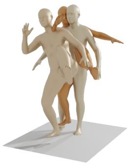
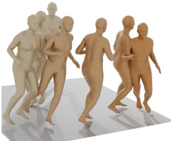
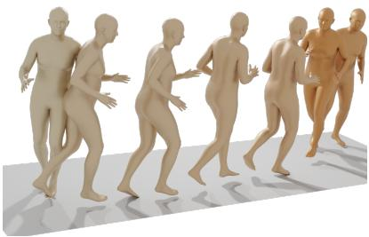
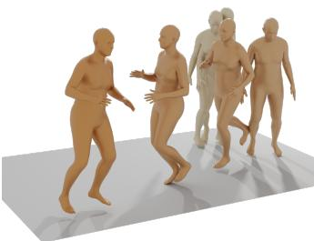
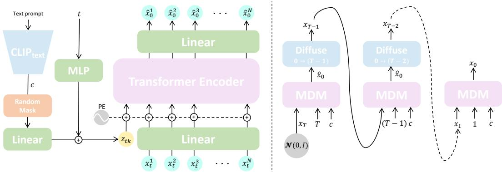
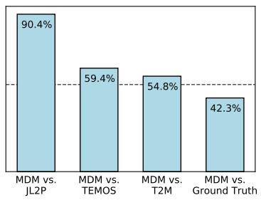
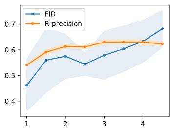

# 人体运动扩散模型 (HUMAN MOTION DIFFUSION MODEL)

Guy Tevet, Sigal Raab, Brian Gordon, Yonatan Shafir,

Tel Aviv University, Israel

Daniel Cohen-Or and Amit H. Bermano

guytevet@mail.tau.ac.il

## 摘要

自然且富有表现力的人体运动生成是计算机动画领域的圣杯。这是一项极具挑战性的任务，原因在于可能产生的运动具有多样性、人类对其感知的敏感性，以及准确描述运动的困难性。因此，当前的生成式解决方案要么质量较低，要么在表现力上受限。扩散模型（Diffusion models）已在其他领域展现出卓越的生成能力，由于其“多对多”的特性，成为人体运动生成的有前途的候选方案，但它们往往耗费资源且难以控制。在本文中，我们提出了运动扩散模型（Motion Diffusion Model，MDM），这是一种针对人体运动领域精心适配的无分类器引导（classifier-free）基于扩散的生成模型。MDM 基于 Transformer 架构，融合了运动生成文献中的见解。一个值得注意的设计选择是在每个扩散步骤中预测样本本身，而非预测噪声。这有利于对运动的位置和速度使用已有的几何损失（geometric losses），例如足部接触损失（foot contact loss）。正如我们所展示的，MDM 是一种通用方法，支持不同的条件模式以及不同的生成任务。我们展示了该模型在轻量级资源下进行训练，依然在文本到运动（text-to-motion）和动作到运动（action-to-motion）的主流基准测试中取得了最先进的（state-of-the-art）结果1。https://guytevet.github.io/mdm-page/。

## 1 引言

人体运动生成是计算机动画中的一项基础任务，应用范围涵盖从游戏到机器人技术。这是一个充满挑战的领域，其原因包括：可能运动的跨度巨大，以及获取高质量数据的难度和成本高昂。对于最近兴起的文本到运动（text-to-motion）设定（即从自然语言生成运动），另一个固有的问题是数据标注。例如，标签“kick”（踢）既可以指足球中的踢球，也可以指空手道中的踢腿。同时，给定一个具体的踢腿动作，有许多种描述方式，从它是如何执行的到它传达的情感，构成了多对多（many-to-many）的问题。当前的方法在该领域已取得了一定成功，展示了从文本到运动的合理映射（Petrovich et al., 2022; Tevet et al., 2022; Ahuja & Morency, 2019）。然而，所有这些方法仍然限制了所学习的分布，因为它们主要采用自编码器（auto-encoders）或 VAE（Kingma & Welling, 2013）（分别隐含了一对一映射或正态潜在分布假设）。在这一方面，扩散模型是人体运动生成的更佳候选方案，因为它们对目标分布没有任何预设假设，并且以能够很好地表达我们所描述的多对多分布匹配问题而著称。

扩散模型（Diffusion models）（Sohl-Dickstein et al., 2015; Song & Ermon, 2020; Ho et al., 2020）是一种在计算机视觉和图形学界受到广泛关注的生成方法。当用于条件生成训练时，近期的扩散模型（Ramesh et al., 2022; Saharia et al., 2022b）在图像质量和语义表达方面展现出了突破性的进展。这些模型在其他领域的能力也得到了验证，包括视频（Ho et al., 2022）和 3D 点云（Luo & Hu, 2021）。然而，此类模型存在的问题在于它们极其消耗资源且难以控制。

在本文中，我们提出了动作扩散模型（Motion Diffusion Model，MDM）——这是一种针对人体动作领域精心适配的基于扩散的生成模型。基于扩散机制，MDM 受益于该领域原生的

“A person kicks with their left leg.”（一个人用左腿踢击。）

  
“A man runs to the right then runs to the left then back to the middle.”（一个男人向右跑，然后向左跑，最后跑回中间。）

  
Figure 1: 我们的动作扩散模型（MDM）通过在给定文本提示下生成多样的动作，反映了文本到动作映射的多对多特性。我们的定制架构和几何损失有助于生成高质量的动作。颜色越深表示序列中越靠后的帧。

上述多对多表达能力，生成的动作质量和多样性证明了这一点（Figure 1）。此外，MDM 结合了动作生成领域中已经确立的见解，使其更加轻量化且更具可控性。

首先，MDM 基于 Transformer，而不是无处不在的 U-net（Ronneberger et al., 2015）主干网络。正如我们所展示的，我们的架构（Figure 2）非常轻量，且更好地契合了动作数据（表示为关节点集合）的时间性与非空间性特征。大量的动作生成研究致力于使用几何损失进行学习（Kocabas et al., 2020; Harvey et al., 2020; Aberman et al., 2020）。例如，有些研究通过约束动作速度（Petrovich et al., 2021）来防止抖动，或者使用专门的损失项特别考虑脚部滑动（Shi et al., 2020）。与这些工作相一致，我们证明了在扩散模型设定下应用几何损失能够有效改善生成效果。

MDM 框架具有通用设计，支持不同形式的条件控制。我们展示了三项任务：文本到动作（text-to-motion）、动作类别到动作（action-to-motion）和无条件生成。我们以无分类器（classifier-free）方式训练模型 (Ho & Salimans, 2022)，这使得在多样性与保真度之间进行权衡成为可能，并且能够从同一模型中进行条件采样和无条件采样。在文本到动作任务中，我们的模型生成了连贯的动作 (Figure 1)，并在 HumanML3D (Guo et al., 2022a) 和 KIT (Plappert et al., 2016) 基准测试上取得了最先进（state-of-the-art）的结果。此外，我们的用户研究表明，人类评估者在 42% 的情况下更偏好我们生成的动作而非真实动作 (Figure 4(a))。在动作类别到动作任务中，尽管现有最先进方法 (Guo et al., 2020; Petrovich et al., 2021) 是专门针对该任务设计的，但 MDM 在常用的 HumanAct12 (Guo et al., 2020) 和 UESTC (Ji et al., 2018) 基准测试上仍然超越了它们。

最后，我们还展示了补全和编辑功能。通过借鉴扩散图像修复（diffusion image-inpainting）技术 (Song et al., 2020b; Saharia et al., 2022a)，我们设定了动作的前缀和后缀，并使用我们的模型来填补中间空白。在文本条件引导下进行该操作，可以指导 MDM 使用特定的动作填补空白，同时依然保持原始输入的语义。通过在关节空间而非时间维度上执行修复，我们还展示了在不改变其他部位的情况下对特定身体部位进行语义编辑的能力 (Figure 3)。

总之，我们提出了运动扩散模型（Motion Diffusion Model，MDM），这是一个在多项动作生成任务中均达到最先进质量的动作框架，同时在单个中端 GPU 上仅需约三天的训练时间。它支持几何损失（geometric losses）——这在扩散设置中并不平凡，但在动作领域却至关重要——并将最先进的生成能力与经过深思熟虑的领域知识结合在一起。

## 2 相关工作

## 2.1 人体动作生成

从动作捕捉数据中学习的神经动作生成（Neural motion generation），可以通过描述动作的任何信号来进行条件引导。许多研究利用动作自身的部分信息作为引导。一些工作通过前缀姿态来预测后续动作 (Fragkiadaki et al., 2015; Martinez et al., 2017; Hernandez et al., 2019; Guo et al., 2022b)。另一些工作 (Harvey & Pal, 2018; Kaufmann et al., 2020; Harvey et al., 2020; Duan et al., 2021) 则利用双向 GRU (Cho et al., 2014) 和 Transformer (Vaswani et al., 2017) 架构来解决中间帧生成（in-betweening）和超分辨率任务。Holden et al. (2016) 使用自编码器学习动作的潜在表征，进而利用该表征结合根节点轨迹和骨骼长度等空间约束来编辑和控制动作。动作也可以通过由动作类别 (Guo et al., 2020; Petrovich et al., 2021; Cervantes et al., 2022)、音频 (Li et al., 2021; Aristidou et al., 2022) 以及自然语言 (Ahuja & Morency, 2019; Petrovich et al., 2022) 提供的高层引导来进行控制。在大多数情况下，研究者们提出了专门的方法将各个条件域映射到动作中。

近年来，文本到动作（Text-to-Motion）任务的主流方法是为语言和动作学习一个共享的潜在空间。JL2P (Ahuja & Morency, 2019) 使用自编码器在 KIT 动作-语言数据集 (Plappert et al., 2016) 上进行学习，限制了文本到动作的一对一映射。TEMOS (Petrovich et al., 2022) 和 T2M (Guo et al., 2022a) 提出使用变分自编码器（VAE，Kingma & Welling, 2013）将文本提示映射到潜在空间中的正态分布。最近，MotionCLIP (Tevet et al., 2022) 利用 CLIP (Radford et al., 2021) 学习到的文本-图像共享潜在空间，使文本到动作生成突破了数据限制，并实现了潜在空间编辑。

人体动作流形也可以在没有标签的情况下进行学习，正如 Holden et al. (2016)、V-Poser (Pavlakos et al., 2019) 以及最近专门的 MoDi 架构 (Raab et al., 2022) 所展示的那样。我们表明，我们的模型同样具备在这种无监督设定下工作的能力。

## 2.2 扩散生成模型

扩散模型（Diffusion models）（Sohl-Dickstein et al., 2015; Song & Ermon, 2020）是一类基于热力学中建模的随机扩散过程的神经生成模型。在这种设定下，来自数据分布的样本通过扩散过程逐渐被添加噪声。然后，一个神经网络模型学习逐步对样本进行去噪的逆过程。对学习到的数据分布进行采样是通过对纯初始噪声进行去噪来完成的。Ho et al. (2020) 和 Song et al. (2020a) 进一步发展了针对图像生成应用的方法实践。对于条件生成，Dhariwal & Nichol (2021) 引入了分类器引导的扩散（classifier-guided diffusion），随后 GLIDE (Nichol et al., 2021) 将其改编以支持基于 CLIP 文本表征的条件化。无分类器引导（Classifier-Free Guidance）方法（Ho & Salimans, 2022）能够在权衡保真度与多样性的同时实现条件化，并取得了更好的结果（Nichol et al., 2021）。在本文中，我们类似于文本到图像（text-to-image）（Ramesh et al., 2022; Saharia et al., 2022b），以无分类器引导的方式基于 CLIP 实现文本到动作（text-to-motion）生成。图像的局部编辑通常被定义为一个图像修复（inpainting）问题，其中图像的一部分保持不变，而需要修复的部分则由模型在可能存在的某种条件下进行去噪（Song et al., 2020b; Saharia et al., 2022a）。我们借鉴该技术，根据可选条件来编辑动作的特定身体部位或时间间隔（动作插帧/in-betweening）。

最近，与本研究同期的 Zhang et al. (2022) 和 Kim et al. (2022) 也提出了用于动作生成的扩散模型。我们的工作所需的 GPU 资源明显更少，并做出了能够引入几何损失的设计选择，从而提升了生成效果。

## 3 动作扩散模型

Figure 2 描述了我们方法的概览。我们的目标是在给定任意条件 $c$ 的情况下，合成长度为 $N$ 的人体动作 $x ^ { 1 : N }$。该条件可以是指导合成的任何真实世界信号，例如音频（Li et al., 2021; Aristidou et al., 2022）、自然语言（文本到动作）（Tevet et al., 2022; Guo et al., 2022a）或离散类别（动作类别到动作）（Guo et al., 2020; Petrovich et al., 2021）。此外，也可以进行无条件动作生成，我们将其表示为空条件 $c = \emptyset$。生成的动作 $\boldsymbol { x } ^ { 1 : N } = \{ x ^ { i } \} _ { i = 1 } ^ { N }$ 是由关节旋转或关节位置 $\boldsymbol { x } ^ { i } \in \mathbb { R } ^ { J \times D }$ 表示的人体姿态序列，其中 $J$ 是关节数量，$D$ 是关节表征的维度。MDM 可以接受由位置、旋转或两者共同表示的动作（参见 Section 4）。

  
Figure 2: （左）动作扩散模型（Motion Diffusion Model，MDM）概览。在加噪步长 t，向模型输入长度为 N 的动作序列 $\boldsymbol { x } _ { t } ^ { 1 : N }$，以及 t 本身和条件编码 c。在此处，c 是基于 CLIP（Radford et al., 2021）的文本嵌入，首先被随机掩码以进行无分类器引导学习（classifier-free learning），然后与 t 一起投影到输入标记 $z _ { t k }$ 中。在每个采样步中，Transformer 编码器预测最终的无噪动作 $\hat { x } _ { 0 } ^ { 1 : N }$。（右）MDM 采样过程。给定条件 c，我们在目标动作的维度上采样随机噪声 $x _ { T }$，然后从 $T$ 迭代到 1。在每个步长 t，MDM 预测无噪样本 ${ \hat { x } } _ { 0 }$，并将其重新扩散回 $x _ { t - 1 }$。

框架。扩散过程被建模为一个马尔可夫加噪过程 $\{ x _ { t } ^ { 1 : N } \} _ { t = 0 } ^ { T }$，其中 $x _ { 0 } ^ { 1 : N }$ 从数据分布中抽取，且

$$
q (x _ {t} ^ {1: N} | x _ {t - 1} ^ {1: N}) = \mathcal {N} (\sqrt {\alpha_ {t}} x _ {t - 1} ^ {1: N}, (1 - \alpha_ {t}) I),\tag{1}
$$

其中 $\alpha _ { t } \in ( 0 , 1 )$ 为常数超参数。当 $\alpha _ { t }$ 足够小时，我们可以近似得到 $x _ { T } ^ { 1 : N } \sim \dot { \mathcal { N } } ( 0 , \dot { I } )$。下文中我们使用 $x _ { t }$ 表示加噪步长 t 时的完整序列。

在我们的语境中，条件动作合成将分布 $p ( x _ { 0 } | c )$ 建模为逐步去除 $x _ { T }$ 噪声的逆向扩散过程。我们没有像 Ho et al. (2020) 所构建的那样去预测 $\epsilon _ { t }$，而是遵循 Ramesh et al. (2022) 的方法直接预测信号本身，即 $\hat { x } _ { 0 } = G ( x _ { t } , t , c )$，并采用简单的目标函数（Ho et al., 2020）：

$$
\mathcal {L} _ {\mathrm{simple}} = E _ {x _ {0} \sim q (x _ {0} | c), t \sim [ 1, T ]} [ \| x _ {0} - G (x _ {t}, t, c) \| _ {2} ^ {2} ]\tag{2}
$$

几何损失。在动作领域，生成网络通常使用几何损失进行正则化 Petrovich et al. (2021); Shi et al. (2020)。这些损失增强了物理特性并防止伪影，从而促进生成自然且连贯的动作。在这项工作中，我们尝试了三种常见的几何损失，分别用于约束 (1) 位置（在我们预测旋转的情况下）、(2) 脚部接触，以及 (3) 速度。

$$
\mathcal {L} _ {\mathrm{pos}} = \frac {1}{N} \sum_ {i = 1} ^ {N} \| F K (x _ {0} ^ {i}) - F K (\hat {x} _ {0} ^ {i}) \| _ {2} ^ {2},\tag{3}
$$

$$
\mathcal {L} _ {\mathrm{foot}} = \frac {1}{N - 1} \sum_ {i = 1} ^ {N - 1} \| (F K (\hat {x} _ {0} ^ {i + 1}) - F K (\hat {x} _ {0} ^ {i})) \cdot f _ {i} \| _ {2} ^ {2},\tag{4}
$$

$$
\mathcal {L} _ {\mathrm{vel}} = \frac {1}{N - 1} \sum_ {i = 1} ^ {N - 1} \| (x _ {0} ^ {i + 1} - x _ {0} ^ {i}) - (\hat {x} _ {0} ^ {i + 1} - \hat {x} _ {0} ^ {i}) \| _ {2} ^ {2}\tag{5}
$$

在我们预测关节旋转的情况下，$F K ( \cdot )$ 表示将关节旋转转换为关节位置的正向运动学函数（forward kinematic function）（否则，它表示恒等函数）。$f _ { i } \in \{ 0 , 1 \} ^ { J }$ 是每帧 i 的二值脚部接触掩码。它仅与脚部相关，用于指示脚部是否接触地面，并根据二值真实值数据（Shi et al., 2020）进行设置。本质上，它通过在接触地面时将速度归零来缓解脚部滑动效应。

总体而言，我们的训练损失为

$$
\mathcal {L} = \mathcal {L} _ {\text { simple }} + \lambda_ {\text { pos }} \mathcal {L} _ {\text { pos }} + \lambda_ {\text { vel }} \mathcal {L} _ {\text { vel }} + \lambda_ {\text { foot }} \mathcal {L} _ {\text { foot }}.\tag{6}
$$

模型。我们的模型如图 Figure 2 所示。我们使用直截了当的 Transformer (Vaswani et al., 2017) 纯编码器（encoder-only）架构来实现 G。Transformer 架构具有时间感知能力，能够学习任意长度的运动，并且在运动领域已得到充分验证 (Petrovich et al., 2021; Duan et al., 2021; Aksan et al., 2021)。噪声时间步 t 和条件编码 c 分别通过独立的前馈网络投影到 Transformer 维度，然后相加生成词元 $z _ { t k }$。加噪输入 $x _ { t }$ 的每一帧都被线性投影到 Transformer 维度，并与标准位置嵌入相加。然后将 $z _ { t k }$ 和投影后的各帧输入到编码器中。排除第一个输出词元（对应于 $z _ { t k } )$，编码器的输出被投影回原始运动维度，并作为预测值 ${ \hat { x } } _ { 0 }$。我们通过使用 CLIP (Radford et al., 2021) 文本编码器将文本提示编码为 c 来实现文本到运动（text-to-motion），并通过每个类别的可学习嵌入来实现动作到运动（action-to-motion）。

根据 Ho et al. (2020)，从 $p ( x _ { 0 } | c )$ 中采样是以迭代方式进行的。在每个时间步 t，我们预测无噪样本 $\hat { x } _ { 0 } = G ( x _ { t } , t , c )$ 并对其重新加噪回 $x _ { t - 1 }$。该过程从 $t = T$ 开始重复，直到获得 $x _ { 0 }$（Figure 2 右侧）。我们使用无分类器引导（classifier-free guidance, Ho & Salimans, 2022）来训练我们的模型 $G$。在实践中，G 通过对 10% 的样本随机设置 $c = \emptyset$ 来同时学习条件分布和无条件分布，从而使 $G ( x _ { t } , t , \emptyset )$ 近似于 $p ( x _ { 0 } )$。随后，在对 G 进行采样时，我们可以使用 s 对这两种变体进行插值甚至外推，从而在多样性和保真度之间进行权衡：

$$
G _ {s} (x _ {t}, t, c) = G (x _ {t}, t, \emptyset) + s \cdot (G (x _ {t}, t, c) - G (x _ {t}, t, \emptyset))\tag{7}
$$

编辑。通过将扩散图像修复（diffusion inpainting）适配到动作数据，我们实现了时间域上的动作中间帧生成（motion in-betweening）以及空间域上的身体部位编辑。编辑仅在采样过程中完成，无需涉及任何训练。给定动作序列输入的一个子集，在对模型进行采样时（Figure 2 右侧），我们在每次迭代中用动作的输入部分覆盖 $\scriptstyle { \hat { x } } _ { 0 }$。这促使生成结果在补全缺失部分的同时，与原始输入保持连贯。在时间设置中，动作序列的前缀帧和后缀帧作为输入，我们以此解决动作中间帧生成问题 (Harvey et al., 2020)。编辑既可以是有条件的，也可以是无条件的（通过设置 $c = \varnothing )$。在空间设置中，我们表明通过使用相同的补全技术，可以在保持其余部位完好的同时，根据条件 $c$ 重新合成身体部位。

## 4 实验

我们针对三种动作生成任务实现了 MDM：文本到动作（Text-to-Motion，4.1）、动作类别到动作（Action-to-Motion，4.2）以及无条件生成（5.2）。每个小节回顾了所用基准的数据和评估指标，提供了实现细节，并展示了定性与定量结果。随后，我们展示了通过将扩散图像修复适配到动作中所实现的动作中间帧生成（包括条件和无条件）以及身体部位编辑（5.1）。我们的模型采用 $\bar { \boldsymbol { T } } = 1 0 0 0$ 个加噪步长和余弦噪声调度（cosine noise schedule）进行训练。所有模型均在单块 NVIDIA GeForce RTX 2080 Ti GPU 上训练了大约 3 天的时间。

## 4.1 文本到动作

文本到动作是指根据输入的文本提示生成动作的任务。所输出的动作不仅应符合文本描述，还应是来自数据分布的有效样本（即符合人类常规能力和物理规律）。此外，对于每个文本提示，我们也期望得到与之匹配的动作分布，而不仅仅是单一结果。我们使用两个主流基准——KIT (Plappert et al., 2016) 和 HumanML3D (Guo et al., 2022a)，并基于 Guo et al. (2022a) 提出的指标集对模型进行评估：R-precision 和 Multimodal-Dist 用于衡量生成的动作与输入提示的相关性，FID 用于衡量生成分布与真实分布之间的差异（在隐空间中），Diversity 用于衡量生成动作分布的多样性，而 MultiModality 则是给定单一文本提示下的平均方差。有关指标的完整实现，请参阅 Guo et al. (2022a)。我们使用 HumanML3D 作为平台来对比我们模型的不同骨干网络（backbones），发现扩散框架对这一属性相对不敏感。此外，我们进行了一项用户研究，将我们的模型与当前最先进方法以及真实动作进行了比较。

  
Figure 3: 编辑应用。浅蓝色帧代表动作输入，古铜色帧代表生成的动作。动作补帧（左+中）可由同一模型在有文本条件或无条件下执行。右侧展示了使用文本对特定身体部位进行编辑：下半身关节点固定为输入动作，而上半身则根据输入的文本提示词进行修改。

数据。HumanML3D 是一个近期发布的数据集，它对来自 AMASS (Mahmood et al., 2019) 和 HumanAct12 (Guo et al., 2020) 集合的动作捕捉数据进行了文本重新标注。它包含 14, 616 个动作，由 44, 970 条文本描述进行标注。此外，它提出了一种冗余数据表示，包括根节点速度、关节点位置、关节点速度、关节旋转以及足部接触二元标签的拼接。我们在本节中对 KIT 数据集也采用了相同的表示，该表示由相同的发布者提供。尽管样本数量（3, 911）和多样性有限，但大多数文本到动作的研究都是基于 KIT 的，因此我们认为使用它进行评估同样重要。

实现细节。除了我们的 Transformer 纯编码器骨干网络（第 3 节）之外，我们还针对 MDM 尝试了另外三种骨干网络：(1) Transformer 解码器，它通过交叉注意力层注入 z，而不是作为输入 token。(2) Transformer 解码器 + 输入 token，其中 ztk 以这两种方式同时注入，以及 (3) GRU (Cho et al., 2014)，它将 z 拼接到每个输入帧上（Table 1）。我们的模型训练采用批大小 64、8 层（除了在 2 层时达到最优的 GRU）以及潜空间维度 512。为了对文本进行编码，我们使用了冻结的 CLIP-ViT-B/32 模型。每个模型训练 500K 步，之后选择最小化 FID 指标的检查点进行报告。由于足部接触和关节点位置在 HumanML3D 中已明确表示，因此我们在本节中不应用几何损失。我们在评估模型时采用引导尺度 s = 2.5，这提供了多样性与保真度之间的最佳平衡点（Figure 4）。

定量评估。我们使用 Guo et al. (2022a) 提出的指标评估并将我们的模型与现有最先进技术（JL2P Ahuja & Morency (2019)、Text2Gesture (Bhattacharya et al., 2021) 和 T2M (Guo et al., 2022a)）进行对比。可以看出，MDM 在 FID、Diversity 和 MultiModality 方面均取得了最先进的结果，表明每个输入文本提示词都具有高度的多样性和高质量的样本，这在 Figure 1 中也可以定性地看出。

用户研究（User study）。我们邀请了 31 位用户在并排视图中对 MDM 与最先进的方法进行二选一评估，两个样本均由从 KIT 测试集中随机抽取的相同文本提示生成。我们对每个模型测试 10 个样本，每个样本重复 10 次该过程。这项用户研究实现了与近期 TEMOS 模型（Petrovich et al., 2022）的对比，该模型未包含在 HumanML3D 基准测试中。Fig. 4 显示，在绝大多数情况下，MDM 相比对比模型更受青睐，甚至在 42.3% 的情况下优于真实样本（ground truth）。

## 4.2 动作到人体运动（ACTION-TO-MOTION）

动作到运动（Action-to-motion）是指在给定由标量表示的输入动作类别的情况下生成人体运动的任务。输出的运动应当忠实地呈现输入的动作，同时保持自然并反映模型训练数据集的分布。有两个数据集常用于评估动作到运动模型：HumanAct12（Guo et al., 2020）和 UESTC（Ji et al., 2018）。

<table><tr><td>方法</td><td>R Precision (top 3)↑</td><td>FID↓</td><td>Multimodal Dist↓</td><td>Diversity→</td><td>Multimodality↑</td></tr><tr><td>真实数据 (Real)</td><td>0.797±.002</td><td>0.002±.000</td><td>2.974±.008</td><td>9.503±.065</td><td>-</td></tr><tr><td>JL2P</td><td>0.486±.002</td><td>11.02±.046</td><td>5.296±.008</td><td>7.676±.058</td><td>-</td></tr><tr><td>Text2Gesture</td><td>0.345±.002</td><td>7.664±.030</td><td>6.030±.008</td><td>6.409±.071</td><td>-</td></tr><tr><td>T2M</td><td>0.740±.003</td><td>1.067±.002</td><td>3.340±.008</td><td>9.188±.002</td><td>2.090±.083</td></tr><tr><td>MDM (本文)</td><td>0.611±.007</td><td>0.544±.044</td><td>5.566±.027</td><td>9.559±.086</td><td>2.799±.072</td></tr><tr><td>MDM (decoder)</td><td>0.608±.005</td><td>0.767±.085</td><td>5.507±.020</td><td>9.176±.070</td><td>2.927±.125</td></tr><tr><td>+ input token</td><td>0.621±.005</td><td>0.567±.051</td><td>5.424±.022</td><td>9.425±.060</td><td>2.834±.095</td></tr><tr><td>MDM (GRU)</td><td>0.645±.005</td><td>4.569±.150</td><td>5.325±.026</td><td>7.688±.082</td><td>1.2646±.024</td></tr></table>

Table 1: HumanML3D 测试集上的定量结果。所有方法均使用来自真实值（ground truth）的真实运动长度。$\cdot _ {  } ,$ 表示指标越接近真实分布结果越好。我们对所有评估运行 20 次（MultiModality 运行 5 次除外），± 表示 95% 置信区间。粗体表示最佳结果。

<table><tr><td>方法</td><td>R Precision (top 3)↑</td><td>FID↓</td><td>多模态距离↓</td><td>多样性→</td><td>多模态性↑</td></tr><tr><td>真实数据</td><td>0.779±.006</td><td>0.031±.004</td><td>2.788±.012</td><td>11.08±.097</td><td>-</td></tr><tr><td>JL2P</td><td>0.483±.005</td><td>6.545±.072</td><td>5.147±.030</td><td>9.073±.100</td><td>-</td></tr><tr><td>Text2Gesture</td><td>0.338±.005</td><td>12.12±.183</td><td>6.964±.029</td><td>9.334±.079</td><td>-</td></tr><tr><td>T2M</td><td>0.693±.007</td><td>2.770±.109</td><td>3.401±.008</td><td>10.91±.119</td><td>1.482±.065</td></tr><tr><td>MDM（我们的）</td><td>0.396±.004</td><td>0.497±.021</td><td>9.191±.022</td><td>10.847±.109</td><td>1.907±.214</td></tr></table>

Table 2: KIT 测试集上的定量结果。

我们使用 Guo 等人 (2020) 建议的一组指标来评估我们的模型，即 Fréchet Inception Distance (FID)、动作识别准确率、多样性和多模态性。这些指标的结合很好地衡量了生成动作的真实感和多样性。

数据。HumanAct12 (Guo et al., 2020) 提供了约 1200 个动作片段，分为 12 个动作类别，每个标签包含 47 到 218 个样本。UESTC (Ji et al., 2018) 包含 40 个动作类别、40 位受试者和 2.5 万个样本，并分为训练集和测试集。我们遵循当前工作所采用的跨受试者测试协议，每个动作类别包含 225-345 个样本。对于这两个数据集，我们均使用 Petrovich 等人 (2021) 提供的序列。

  
(a) KIT 用户调研  
(b) 无分类器引导尺度扫描  
Figure 4: (a) KIT 数据集的文本到动作（Text-to-motion）用户调研。每个柱状图代表 MDM 相比于对比模型的受偏好率。MDM 在大多数情况下都比其他模型更受偏好，甚至在 42.3% 的情况下优于真实（ground truth）样本。虚线标出 50% 处。(b) HumanML3D 数据集的引导尺度扫描。FID（越低越好）和 R-precision（越高越好）指标作为尺度 $s ,$ 的函数，在 $s = 2 . 5$ 附近勾勒出准确率与保真度之间的最佳平衡点。

<table><tr><td>方法</td><td>FID↓</td><td>准确率↑</td><td>多样性→</td><td>多模态性→</td></tr><tr><td>Real (INR)</td><td> $0.020^{\pm.010}$ </td><td> $0.997^{\pm.001}$ </td><td> $6.850^{\pm.050}$ </td><td> $2.450^{\pm.040}$ </td></tr><tr><td>Real (ours)</td><td> $0.050^{\pm.000}$ </td><td> $0.990^{\pm.000}$ </td><td> $6.880^{\pm.020}$ </td><td> $2.590^{\pm.010}$ </td></tr><tr><td>Action2Motion (2020)</td><td> $0.338^{\pm.015}$ </td><td> $0.917^{\pm.003}$ </td><td> $6.879^{\pm.066}$ </td><td> $\underline{2.511^{\pm.023}}$ </td></tr><tr><td>ACTOR (2021)</td><td> $0.120^{\pm.000}$ </td><td> $0.955^{\pm.008}$ </td><td> $\underline{6.840^{\pm.030}}$ </td><td> $2.530^{\pm.020}$ </td></tr><tr><td>INR (2022)</td><td> $\underline{0.088^{\pm.004}}$ </td><td> $\underline{0.973^{\pm.001}}$ </td><td> $6.881^{\pm.048}$ </td><td> $2.569^{\pm.040}$ </td></tr><tr><td>MDM (ours)</td><td> $0.100^{\pm.000}$ </td><td> $\underline{0.990^{\pm.000}}$ </td><td> $\underline{6.860^{\pm.050}}$ </td><td> $2.520^{\pm.010}$ </td></tr><tr><td>w/o foot contact</td><td> $\underline{0.080^{\pm.000}}$ </td><td> $\underline{0.990^{\pm.000}}$ </td><td> $\underline{6.810^{\pm.010}}$ </td><td> $\underline{2.580^{\pm.010}}$ </td></tr></table>

Table 3: 在 HumanAct12 数据集上的动作到人体运动（action-to-motion）评估。我们的模型在四项指标中的三项均名列榜首。由于实现方式的差异（如 Python 依赖包版本），各项工作的真实值（Ground-truth）评估结果略有不同。使用各模型自身的真实值结果来评估其多样性和多模态性非常重要，因为这些指标是根据与 GT 的距离来衡量的。我们展示了由我们的模型以及领先的对比工作 INR（Cervantes et al., 2022）所测得的 GT 指标。粗体表示最佳结果，下划线表示次佳结果，± 表示 95% 置信区间，→ 表示越接近真实值越好。

<table><tr><td>方法</td><td> $FID_{train} \downarrow$ </td><td> $FID_{test} \downarrow$ </td><td>准确率↑</td><td>多样性→</td><td>多模态性→</td></tr><tr><td>Real</td><td>2.92±.26</td><td>2.79±.29</td><td>0.988±.001</td><td>33.34±.320</td><td>14.16±.06</td></tr><tr><td>ACTOR (2021)</td><td>20.49±2.31</td><td>23.43±2.20</td><td>0.911±.003</td><td>31.96±.33</td><td>14.52±.09</td></tr><tr><td>INR (2022)（最佳变体）</td><td>9.55±.06</td><td>15.00±.09</td><td>0.941±.001</td><td>31.59±.19</td><td>14.68±.07</td></tr><tr><td>MDM (ours)</td><td>9.98±1.33</td><td>12.81±1.46</td><td>0.950±.000</td><td>33.02±.28</td><td>14.26±.12</td></tr><tr><td>w/o foot contact</td><td>9.69±.81</td><td>13.08±2.32</td><td>0.960±.000</td><td>33.10±.29</td><td>14.06±.05</td></tr></table>

Table 4: 在 UESTC 数据集上的动作到人体运动（action-to-motion）评估。我们模型带来的性能提升与当前最先进方法（state-of-the-art）拉开了明显差距。粗体表示最佳结果，下划线表示次佳结果，± 表示 95% 置信区间，→ 表示越接近真实值越好。

实现细节。Figure 2 中展示的实现适用于我们工作的所有变体。在动作生成动作（action-to-motion）的情况下，唯一的改动是用动作嵌入（action embedding）替代文本嵌入。由于动作由标量表示，其嵌入非常简单；每个输入的动作类别标量都被转换为与 transformer 维度相同的可学习嵌入。

实验在批次大小（batch size）为 64、潜空间维度（latent dimension）为 512 以及 encoder-transformer 架构下运行。在 HumanAct12 和 UESTC 上的训练分别进行了 750K 和 2M 步。在我们的表格中，展示了使 FID 指标最小化的检查点（checkpoint）的评估结果。

定量评估。Table 3 和 Table 4 分别反映了 MDM 在 HumanAct12 和 UESTC 数据集上的性能。我们进行了 20 次评估，每次包含 1000 个样本，并报告其平均值和 95% 置信区间。我们测试了两种变体，分别包含和不包含脚部接触损失（foot contact loss）。我们的模型在两个数据集上均处于领先地位。没有脚部接触损失的变体获得了稍好的结果；然而，正如我们在补充视频中所展示的，脚部接触损失对结果质量的贡献非常重要，没有它，我们会观察到抖动和不自然手势等伪影。

## 5 额外应用

## 5.1 动作编辑

在本节中，我们实现了两种动作编辑应用——补帧（in-betweening）和身体部位编辑，两者分别在时间域和空间域中采用了相同的方法。对于补帧，我们固定动作的前 25% 和后 25%，由模型生成中间剩余的 50%。对于身体部位编辑，我们固定不想编辑的关节点，让模型生成其余部分。特别是，我们进行了仅编辑上半身关节点的实验。在 Figure 3 中，我们展示了在这两种情况下，使用 Section 3 中描述的方法生成的平滑动作既符合动作的固定部分，又符合条件（如果给定了条件）。

<table><tr><td>方法</td><td>FID↓</td><td>KID↓</td><td>Precision↑Recall↑</td><td>Multimodality↑</td></tr><tr><td>ACTOR (2021)</td><td>48.80</td><td>0.53</td><td>0.72, 0.74</td><td>14.10</td></tr><tr><td>MoDi (2022)</td><td>13.03</td><td>0.12</td><td>0.71, 0.81</td><td>17.57</td></tr><tr><td>MDM (ours)</td><td>31.92</td><td>0.36</td><td>0.66, 0.62</td><td>17.00</td></tr></table>

Table 5: HumanAct12 数据集上无约束合成的评估。我们在具有挑战性的无约束设定下测试了 MDM，并与专为此类设定设计的 MoDi (Raab et al., 2022) 进行了比较。我们证明，除了能够支持任意条件外，我们在无约束设定下也能取得合理的结果。粗体表示最佳结果。

## 5.2 无约束合成

无约束合成（unconstrained synthesis）这一具有挑战性的任务仅被少数研究探讨过（Holden et al., 2016; Raab et al., 2022）。在存在数据标注（例如动作类别或文本描述）的情况下，标签起到了监督因子的作用，并为训练网络促进了结构化的潜在空间。缺乏标注则使训练变得更加困难。人体动作领域拥有丰富的未标注数据集（Adobe Systems Inc., 2021），能够在其基础上进行训练是一项优势。为了在具有挑战性的无约束设定下测试 MDM，我们遵循 MoDi（Raab et al., 2022）进行评估。我们使用了他们建议的评估指标（FID、KID、precision/recall 和 multimodality），并在 HumanAct12（Guo et al., 2020）数据集的无约束版本上运行。

数据。尽管 HumanAct12 带有标注（见第 4.2 节），我们以无约束的方式使用它，忽略其标签。选择 HumanAct12 而非完全没有标签的数据集（例如 Mixamo（Adobe Systems Inc., 2021）），是为了与先前的出版物保持兼容性。

实现细节。对于所有形式的条件设定以及无约束设定，我们的模型均使用相同的架构。对图 Figure 2 中所示结构的唯一改动是移除了条件输入，使得 ztk 仅由 $t$ 的投影组成。为了模拟无约束行为，ACTOR Petrovich et al. (2021) 被 (Raab et al., 2022) 采用将所有动作标注为单一类别的方式进行了训练。

定量评估。我们的评估结果如表 Table 5 所示。我们展示了相较于并非专为无约束设定设计的作品的优越性，并逼近了 MoDi（Raab et al., 2022）。MoDi 是专门针对无约束设定精心设计的，而我们的工作可以应用于任何（或无）约束，并且还提供了编辑功能。

## 6 讨论

我们提出了 MDM，一种适用于各种人体动作生成任务的方法。MDM 是一种非典型的无分类器引导扩散模型（classifier-free diffusion model），采用 transformer-encoder 骨干网络，并直接预测信号而非噪声。这不仅产生了一个易于训练的轻量级模型，而且是一个精确的模型，极大地受益于可应用的几何损失。我们的实验表明了其在条件生成方面的优越性，同时也表明该方法对架构的选择并不十分敏感。

扩散方法的一个显著局限性是推理时间较长，单次结果需要大约 1000 次前向传播。由于我们的动作模型本身很小，使用的维度比图像小几个数量级，我们的推理时间从不到一秒变为大约仅需一分钟，这是一个可以接受的折衷方案。随着扩散模型的不断演进，除了更强的计算能力之外，在未来我们有兴趣探索如何将更好的控制融入生成过程中，并进一步拓宽应用场景的选择。

## 致谢

我们感谢 Rinon Gal 提出的宝贵建议和文献引用。本研究得到了以色列科学基金会（Israel Science Foundation，资助编号：2492/20 和 3441/21）、Len Blavatnik 与 Blavatnik 家族基金会（Blavatnik family foundation），以及特拉维夫大学创新实验室（The Tel Aviv University Innovation Laboratories，TILabs）的部分资助。

## 参考文献

Kfir Aberman, Peizhuo Li, Dani Lischinski, Olga Sorkine-Hornung, Daniel Cohen-Or, and Baoquan Chen. Skeleton-aware networks for deep motion retargeting. ACM Transactions on Graphics (TOG), 39(4):62–1, 2020.

Adobe Systems Inc. Mixamo, 2021. URL https://www.mixamo.com. Accessed: 2021-12-25.

Chaitanya Ahuja and Louis-Philippe Morency. Language2pose: Natural language grounded pose forecasting. In 2019 International Conference on 3D Vision (3DV), pp. 719–728. IEEE, 2019.

Emre Aksan, Manuel Kaufmann, Peng Cao, and Otmar Hilliges. A spatio-temporal transformer for 3d human motion prediction. In 2021 International Conference on 3D Vision (3DV), pp. 565–574. IEEE, 2021.

A Aristidou, A Yiannakidis, K Aberman, D Cohen-Or, A Shamir, and Y Chrysanthou. Rhythm is a dancer: Music-driven motion synthesis with global structure. IEEE Transactions on Visualization and Computer Graphics, 2022.

Uttaran Bhattacharya, Nicholas Rewkowski, Abhishek Banerjee, Pooja Guhan, Aniket Bera, and Dinesh Manocha. Text2gestures: A transformer-based network for generating emotive body gestures for virtual agents. In 2021 IEEE Virtual Reality and 3D User Interfaces (VR), pp. 1–10. IEEE, 2021.

Pablo Cervantes, Yusuke Sekikawa, Ikuro Sato, and Koichi Shinoda. Implicit neural representations for variable length human motion generation. arXiv preprint arXiv:2203.13694, 2022.

Kyunghyun Cho, Bart Van Merrienboer, Caglar Gulcehre, Dzmitry Bahdanau, Fethi Bougares, Hol-¨ ger Schwenk, and Yoshua Bengio. Learning phrase representations using rnn encoder-decoder for statistical machine translation. arXiv preprint arXiv:1406.1078, 2014.

Prafulla Dhariwal and Alexander Nichol. Diffusion models beat gans on image synthesis. Advances in Neural Information Processing Systems, 34:8780–8794, 2021.

Yinglin Duan, Tianyang Shi, Zhengxia Zou, Yenan Lin, Zhehui Qian, Bohan Zhang, and Yi Yuan. Single-shot motion completion with transformer. arXiv preprint arXiv:2103.00776, 2021.

Katerina Fragkiadaki, Sergey Levine, Panna Felsen, and Jitendra Malik. Recurrent network models for human dynamics. In Proceedings of the IEEE international conference on computer vision, pp. 4346–4354, 2015.

Chuan Guo, Xinxin Zuo, Sen Wang, Shihao Zou, Qingyao Sun, Annan Deng, Minglun Gong, and Li Cheng. Action2motion: Conditioned generation of 3d human motions. In Proceedings of the 28th ACM International Conference on Multimedia, pp. 2021–2029, 2020.

Chuan Guo, Shihao Zou, Xinxin Zuo, Sen Wang, Wei Ji, Xingyu Li, and Li Cheng. Generating diverse and natural 3d human motions from text. In Proceedings ofthe IEEE/CVF Conference on Computer Vision and Pattern Recognition, pp. 5152–5161, 2022a.

Wen Guo, Yuming Du, Xi Shen, Vincent Lepetit, Xavier Alameda-Pineda, and Francesc Moreno-Noguer. Back to mlp: A simple baseline for human motion prediction. arXiv preprint arXiv:2207.01567, 2022b.

Felix G Harvey and Christopher Pal. Recurrent transition networks for character locomotion. In SIGGRAPH Asia 2018 Technical Briefs, pp. 1–4. 2018.

Felix G Harvey, Mike Yurick, Derek Nowrouzezahrai, and Christopher Pal. Robust motion in-betweening. ACM Transactions on Graphics (TOG), 39(4):60–1, 2020.

Alejandro Hernandez, Jurgen Gall, and Francesc Moreno-Noguer. Human motion prediction via spatio-temporal inpainting. In Proceedings of the IEEE/CVF International Conference on Computer Vision, pp. 7134–7143, 2019.

Jonathan Ho and Tim Salimans. Classifier-free diffusion guidance. arXiv preprint arXiv:2207.12598, 2022.

Jonathan Ho, Ajay Jain, and Pieter Abbeel. Denoising diffusion probabilistic models. Advances in Neural Information Processing Systems, 33:6840–6851, 2020.

Jonathan Ho, Tim Salimans, Alexey Gritsenko, William Chan, Mohammad Norouzi, and David J Fleet. Video diffusion models. arXiv preprint arXiv:2204.03458, 2022.

Daniel Holden, Jun Saito, and Taku Komura. A deep learning framework for character motion synthesis and editing. ACM Transactions on Graphics (TOG), 35(4):1–11, 2016.

Yanli Ji, Feixiang Xu, Yang Yang, Fumin Shen, Heng Tao Shen, and Wei-Shi Zheng. A large-scale rgb-d database for arbitrary-view human action recognition. In Proceedings of the 26th ACM international Conference on Multimedia, pp. 1510–1518, 2018.

Manuel Kaufmann, Emre Aksan, Jie Song, Fabrizio Pece, Remo Ziegler, and Otmar Hilliges. Convolutional autoencoders for human motion infilling. In 2020 International Conference on 3D Vision (3DV), pp. 918–927. IEEE, 2020.

Jihoon Kim, Jiseob Kim, and Sungjoon Choi. Flame: Free-form language-based motion synthesis & editing. arXiv preprint arXiv:2209.00349, 2022.

Diederik P Kingma and Max Welling. Auto-encoding variational bayes. arXiv preprint arXiv:1312.6114, 2013.

Muhammed Kocabas, Nikos Athanasiou, and Michael J Black. Vibe: Video inference for human body pose and shape estimation. In Proceedings of the IEEE/CVF conference on computer vision and pattern recognition, pp. 5253–5263, 2020.

Ruilong Li, Shan Yang, David A. Ross, and Angjoo Kanazawa. Ai choreographer: Music conditioned 3d dance generation with aist++. In The IEEE International Conference on Computer Vision (ICCV), 2021.

Shitong Luo and Wei Hu. Diffusion probabilistic models for 3d point cloud generation. In Proceedings of the IEEE/CVF Conference on Computer Vision and Pattern Recognition, pp. 2837–2845, 2021.

Naureen Mahmood, Nima Ghorbani, Nikolaus F. Troje, Gerard Pons-Moll, and Michael J. Black. AMASS: Archive of motion capture as surface shapes. In International Conference on Computer Vision, pp. 5442–5451, October 2019.

Julieta Martinez, Michael J Black, and Javier Romero. On human motion prediction using recurrent neural networks. In Proceedings of the IEEE conference on computer vision and pattern recognition, pp. 2891–2900, 2017.

Alex Nichol, Prafulla Dhariwal, Aditya Ramesh, Pranav Shyam, Pamela Mishkin, Bob McGrew, Ilya Sutskever, and Mark Chen. Glide: Towards photorealistic image generation and editing with text-guided diffusion models. arXiv preprint arXiv:2112.10741, 2021.

Georgios Pavlakos, Vasileios Choutas, Nima Ghorbani, Timo Bolkart, Ahmed A. A. Osman, Dimitrios Tzionas, and Michael J. Black. Expressive body capture: 3D hands, face, and body from a single image. In Proceedings IEEE Conf. on Computer Vision and Pattern Recognition (CVPR), pp. 10975–10985, 2019.

Mathis Petrovich, Michael J. Black, and Gul Varol. Action-conditioned 3D human motion synthesis¨ with transformer VAE. In International Conference on Computer Vision (ICCV), pp. 10985– 10995, October 2021.

Mathis Petrovich, Michael J. Black, and Gul Varol. TEMOS: Generating diverse human motions¨ from textual descriptions. In European Conference on Computer Vision (ECCV), 2022.

Matthias Plappert, Christian Mandery, and Tamim Asfour. The kit motion-language dataset. Big data, 4(4):236–252, 2016.

Sigal Raab, Inbal Leibovitch, Peizhuo Li, Kfir Aberman, Olga Sorkine-Hornung, and Daniel Cohen-Or. Modi: Unconditional motion synthesis from diverse data. arXiv preprint arXiv:2206.08010, 2022.

Alec Radford, Jong Wook Kim, Chris Hallacy, Aditya Ramesh, Gabriel Goh, Sandhini Agarwal, Girish Sastry, Amanda Askell, Pamela Mishkin, Jack Clark, et al. Learning transferable visual models from natural language supervision. In International Conference on Machine Learning, pp. 8748–8763. PMLR, 2021.

Aditya Ramesh, Prafulla Dhariwal, Alex Nichol, Casey Chu, and Mark Chen. Hierarchical textconditional image generation with clip latents. arXiv preprint arXiv:2204.06125, 2022.

Olaf Ronneberger, Philipp Fischer, and Thomas Brox. U-net: Convolutional networks for biomedical image segmentation. In International Conference on Medical image computing and computerassisted intervention, pp. 234–241. Springer, 2015.

Chitwan Saharia, William Chan, Huiwen Chang, Chris Lee, Jonathan Ho, Tim Salimans, David Fleet, and Mohammad Norouzi. Palette: Image-to-image diffusion models. In ACM SIGGRAPH 2022 Conference Proceedings, pp. 1–10, 2022a.

Chitwan Saharia, William Chan, Saurabh Saxena, Lala Li, Jay Whang, Emily Denton, Seyed Kamyar Seyed Ghasemipour, Burcu Karagol Ayan, S Sara Mahdavi, Rapha Gontijo Lopes, et al. Photorealistic text-to-image diffusion models with deep language understanding. arXiv preprint arXiv:2205.11487, 2022b.

Mingyi Shi, Kfir Aberman, Andreas Aristidou, Taku Komura, Dani Lischinski, Daniel Cohen-Or, and Baoquan Chen. Motionet: 3d human motion reconstruction from monocular video with skeleton consistency. ACM Transactions on Graphics (TOG), 40(1):1–15, 2020.

Jascha Sohl-Dickstein, Eric Weiss, Niru Maheswaranathan, and Surya Ganguli. Deep unsupervised learning using nonequilibrium thermodynamics. In International Conference on Machine Learning, pp. 2256–2265. PMLR, 2015.

Jiaming Song, Chenlin Meng, and Stefano Ermon. Denoising diffusion implicit models. arXiv preprint arXiv:2010.02502, 2020a.

Yang Song and Stefano Ermon. Improved techniques for training score-based generative models. Advances in neural information processing systems, 33:12438–12448, 2020.

Yang Song, Jascha Sohl-Dickstein, Diederik P Kingma, Abhishek Kumar, Stefano Ermon, and Ben Poole. Score-based generative modeling through stochastic differential equations. arXiv preprint arXiv:2011.13456, 2020b.

Guy Tevet, Brian Gordon, Amir Hertz, Amit H Bermano, and Daniel Cohen-Or. Motionclip: Exposing human motion generation to clip space. arXiv preprint arXiv:2203.08063, 2022.

Ashish Vaswani, Noam Shazeer, Niki Parmar, Jakob Uszkoreit, Llion Jones, Aidan N Gomez, Łukasz Kaiser, and Illia Polosukhin. Attention is all you need. Advances in neural information processing systems, 30, 2017.

Mingyuan Zhang, Zhongang Cai, Liang Pan, Fangzhou Hong, Xinying Guo, Lei Yang, and Ziwei Liu. Motiondiffuse: Text-driven human motion generation with diffusion model. arXiv preprint arXiv:2208.15001, 2022.