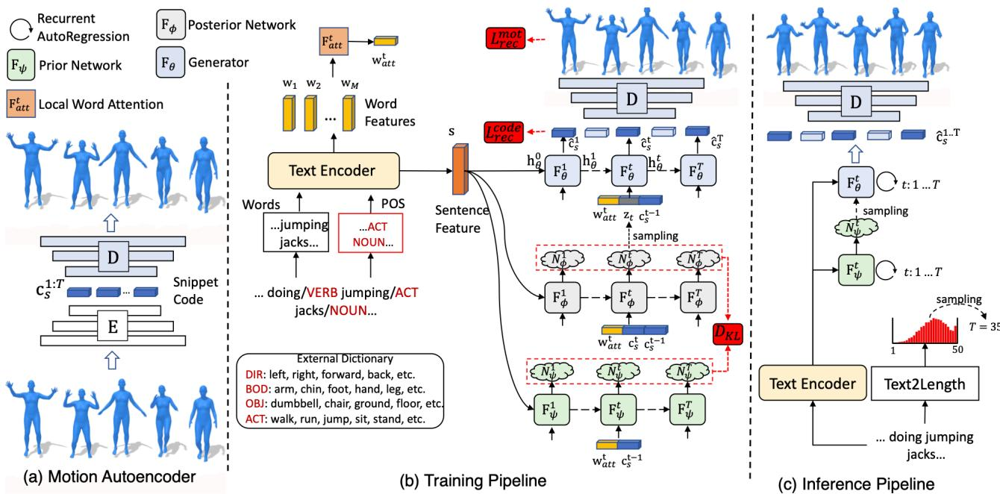
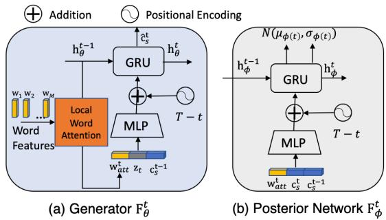
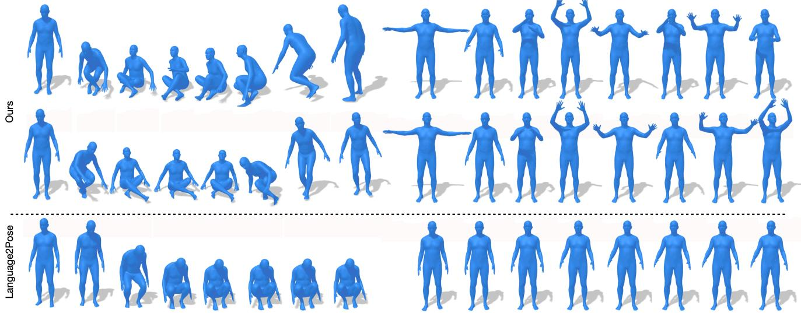
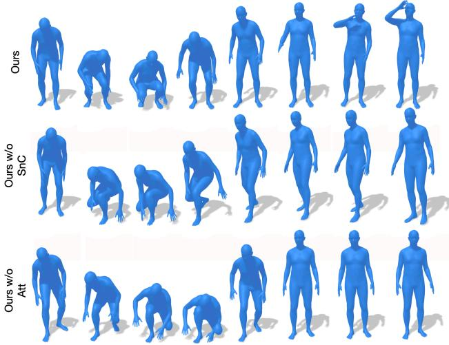

# 从文本生成多样且自然的 3D 人体动作

Chuan Guo

Shihao Zou

Xinxin Zuo

Sen Wang

Wei Ji

Xingyu Li

Li Cheng University of Alberta {cguo2, szou2,wji3,xingyu,lcheng5}@ualberta.ca

  
Figure 1. 以文本描述“人物从平躺姿势起身并逆时针绕圈行走，然后重新躺回地面”作为输入，我们的方法生成了多个符合指定文本内容且各不相同的 3D 人体动作（例如左图和中图）。右图展示了真实动作以供参考。

## 摘要

从文本自动生成 3D 人体动作是一个极具挑战性的问题。生成的动作既需要在基于文本的动作空间中具备充分的多样性，更重要的是能够准确描摹指定文本描述中的内容。在本文中，我们采用两阶段方法来解决该问题：text2length（文本到长度）采样和 text2motion（文本到动作）生成。Text2length 阶段通过从以输入文本为条件的已学习动作长度分布函数中进行采样。随后，我们的 text2motion 模块利用时间变分自编码器（temporal variational autoencoder）合成对应采样长度的多样化人体动作。我们提出动作片段编码（motion snippet code）作为内部动作表征，取代直接处理姿态序列的方式，该编码能够捕捉局部语义动作上下文，并经实验证明有助于生成符合输入文本且合理逼真的动作。此外，我们构建了一个大规模带有文本标注的 3D 人体动作数据集 HumanML3D，包含 14,616 个动作片段和 44,970 条文本描述。

## 1. 引言

给定一段关于角色动作的简短文本描述（例如小说或剧本中的片段），人类能够在脑海中构想甚至通过绘画将这些动作可视化。然而，如何让机器自动化这一过程，换言之，如何从文本生成逼真的 3D 人体动作？这正是本文所要解决的问题。如图 1 所示，给定输入文本“人物从平躺姿势起身并逆时针绕圈行走，然后重新躺回地面”，我们的目标是生成一组多样且合理的 3D 人体动作动态，严格遵循文本所指定的动作类型、方向、速度、时序和风格。这一自动化过程可为 AR/VR 内容创作、游戏、机器人技术以及人机交互等众多领域带来广泛的应用价值。

与此同时，从文本描述中生成 3D 人体动作的现有工作 [1, 4, 21, 32, 44] 相对零星，且结果远不尽如人意。存在几个常见的不足：输入的文本通常是一句短句；该任务几乎都被表述为确定性的序列到序列（sequence-to-sequence）生成，导致合成的动作往往显得静止且毫无生气；此外，生成的动作被限制为相同的长度；最后，现有方法所依赖的唯一数据集——KIT Motion-Language (KIT-ML) [31]，仅包含 3,010 个动作序列，且主要集中于位移动作。特别是有三个内在挑战尚未得到解决。

首先，由同一模型从文本生成的动作应当具备可变长度。其次，角色遵循相同的文本描述时通常有多种表现方式。第三，从自然语言的角度来看，输入的描述形式多样，既可能是简短简单的短句，也可能是极长且复杂的表述。

为了应对上述不足和挑战，我们提出了一种由 text2length（文本到长度）采样和 text2motion（文本到动作）生成组成的两阶段流程。text2length 基于输入文本估计视觉动作长度的分布函数。text2motion 的作用则是根据输入文本和采样得到的动作长度生成不同的 3D 动作；这是通过采用由先验网络、后验网络和生成器网络构成的三元组形式的时序变分自编码器（temporal variational autoencoder, VAE）框架来实现的；此外，引入动作片段编码（motion snippet code）作为 VAE 编码中以及贯穿我们整个流程的内部表示，用于刻画时序动作语义，其作用将在后续的消融实验中进行实证检验。最后，构建了一个专门的数据集（HumanML3D），包含针对 14,616 个 3D 人体动作的 44,970 条文本描述。它涵盖了包括但不限于位移动作在内的广泛动作类型。在 HumanML3D 和 KIT-ML 两个数据集上的实证评估表明，我们的方法性能优于现有方法。

我们的主要贡献总结如下。首先，据我们所知，我们的工作首次实现了从文本随机生成 3D 动作，能够生成具有可变长度、逼真且忠实于输入文本的多样化 3D 人体动作。其次，我们的方法能够灵活处理从简单到复杂形式的输入文本。这得益于 text2length 和 text2motion 模块，以及将在后续章节详细介绍的动作片段编码。最后，构建了一个大规模人体动作数据集。它包含丰富的动作类别，每个动作序列均配有三条文本描述。

## 2. 相关工作

3D 人体动作生成（3D Human Motion Generation）。此前已有若干基于动作类别或来自音频和文本等模态合成 2D 或 3D 人体动作的研究工作。对于基于动作类别的方法，通常会引入一个 one-hot 条件向量来合成姿态序列。在这一领域中，[5, 43] 均采用了两阶段生成对抗网络（GAN）框架，利用新生成的姿态逐步拓展局部动作序列；[45] 的工作则利用基于 GCN 的 GAN 对人体动态的时空结构进行建模；同时，[11, 12, 29] 提倡采用 VAE 建模和 Transformer 架构来结合时间依赖性。就音频信号输入而言，由于音频与其动作输出在时间上是对齐的，一种常见策略是采用时间滑动窗口，利用循环神经网络（RNN）将声学特征表示（例如 MFCC）转换为单个人体姿态。在 [35] 中，采用了双向 LSTM 网络从语音输入中生成上半身手势。[34] 也探讨了类似的 LSTM 类模型，以从钢琴和小提琴独奏音频中预测上半身动态，而在 [36] 中则用于捕获音乐到舞蹈的映射。近期的研究开始着手解决基于音频信号的人体动态的随机性本质。[17] 采用 VAE 和 GAN 的混合模型从音乐中生成非确定性的人体舞蹈动作。[14] 的工作进一步通过课程学习（curriculum training）支持长期的音乐到舞蹈生成。

将文本描述转化为人体动作是一个新兴课题。诸如 [10, 21, 32, 44] 等先前的研究求助于经典的编码器-解码器 RNN 模型，而 [1] 则提出学习自然语言与 3D 人体动态之间的联合嵌入空间。[10] 考虑了分层姿态结构并利用了姿态判别器。然而，这些方法存在不足之处，因为它们是具有固定动作长度的确定性一对一过程。相反，针对这些问题，我们训练的模型被证明能够生成具有可变长度的随机一对多序列映射。

视频生成与基于文本的视频生成（Video Generation, and Text-based Video Generation）。在视频生成方面，诸如 GAN 和 VAE 等深度生成模型一直是最流行的选择。例如，MoCo-GAN [38] 提出了一种循环结构的 GAN，分别对静止像素和动态运动进行建模。随后 [37] 引入了对比学习。[8] 利用带有 RNN 架构的 VAE，基于历史视频序列随机预测未来帧，[42] 进一步将其扩展为合成具有指定起始帧和结束帧的视频。

文本到视频生成（Text-to-video generation）是一个相对新兴的领域。为了解决该任务，包括 [20] 和 [25] 在内的若干项工作引入了 GAN 框架。随后，[6] 进一步引入了注意力机制，以将局部视频区域与文本中的单词对齐。此外，[24] 利用短时和长时跨域注意力向量作为 VAE 框架的输入。

视频描述（Video Captioning）。本工作的课题可以被视为动作描述（motion captioning）或更广泛的视频描述的逆问题。因此，提及这一研究方向也是合理的。早期工作如 [16] 通常求助于包含受限动作和物体类别的受限手工语言学规则的预定义句子模板。在深度学习时代，这一情况发生了根本性的改变，通过采用包括 RNN [30,40]、transformer [18]、注意力上下文建模 [41]、记忆网络 [28, 46]、GAN [26] 和强化学习 [19, 27] 在内的多种强大技术，我们见证了显著的性能提升。

  
Figure 2. 方法概览。(a) 作为预处理步骤，在我们的训练动作数据上训练了一个专用的动作自编码器，用于将动作序列编码为动作片段码流，随后可将其解码回动作。(b) 我们的训练管线。通过文本编码器，注意力词特征 $\mathbf { \Psi } ( \mathbf { w } _ { a t t } )$ 被 VAE 网络所使用，如图 3 所示。时间 VAE 的三元组结构包含先验网络、后验网络和生成器网络，用于处理动作片段码 $( \mathbf { c } _ { s } )$ 和重构动作片段码 $( \hat { \mathbf { c } } _ { s } ) .$ .。由此分别产生评估重构姿态序列的损失项 $( \mathcal { L } _ { r e c } ^ { m o t } )$ 和重构代码序列的损失项 $( \mathcal { L } _ { r e c } ^ { c o d e } )$ )。由于篇幅限制，一些关键组成部分移至图 3 中展示。(c) 我们的推理管线。从输入文本中激活 text2length 模块以采样预期的动作长度。通过文本编码器提取的文本特征随后被送入先验网络，生成先验分布。生成器从先验分布中采样潜在向量，并生成一系列动作片段码 $( \hat { \mathbf { c } } _ { s } ) .$。最后，通过在 (a) 中预训练的动作解码器对片段码进行解码，从而获得姿态序列。

语言与 3D 人体动作数据。KIT Motion-Language Dataset [31] 是迄今为止唯一一个同时包含 3D 人体动作及其文本描述的公开可用数据集，该数据集由 3,911 个动作序列和 6,278 个句子组成，并且主要集中于移动动作（locomotion movements）。此外，还有许多现有的 3D 动作捕捉人体动作数据集，例如 CMU Mocap [7]、Human3.6M [15]、MoVi [9] 和 BABEL [33]，形式涵盖日常动作和体育运动。然而，它们都没有包含动作的语言描述。

## 3. 我们的方法

给定包含 M 个单词的文本描述 $X = ( x _ { 1 } , . . . , x _ { M } ) .$，我们的目标是生成一个 3D 姿态序列 $\begin{array} { r l } { P } & { { } = } \end{array}$ $\left( \mathbf { p } _ { 1 } , . . . , \mathbf { p } _ { T ^ { \prime } } \right)$，其长度 $T ^ { \prime }$ 在测试时确定。如图 2 所示，我们首先通过一个预处理步骤来训练一个动作自编码器（motion autoencoder）。随后从文本中确定一个合理的动作长度（第 3.2 节），并通过引入一种内部动作表示——动作片段编码（motion snippet codes，第 3.1 节），继而以输入的文本和采样的动作长度为条件合成动作（第 3.3 节）。

## 3.1. 动作自编码器

作为图 2(a) 中描述的预处理步骤，编码器 E 通过在时间线上应用一维卷积，将姿态序列 $P = \left( \mathbf { p } _ { 1 } , . . . , \mathbf { p } _ { T ^ { \prime } } \right)$ 转换为动作片段编码序列 $C _ { s } ~ = ~ \left( \mathbf { c } _ { s } ^ { 1 } , . . . , \mathbf { c } _ { s } ^ { T } \right)$；随后使用反卷积解码器 D 重建出 $\hat { P }$。在数学上，该过程公式化为

$$
C _ {s} = \mathrm{E} (P), \hat {P} = \mathrm{D} (C _ {s}).\tag{1}
$$

为了避免脚部滑动（foot sliding），我们的解码器 D 还会额外预测未提供给编码器 E 的每帧脚部接触情况。此外，有必要约束片段编码的值以及连续编码之间的差异，以促进稀疏性和时间平滑性。最终的目标函数为

$$
\mathcal {L} _ {E, D} = \sum_ {t ^ {\prime}} \| \hat {\mathbf {p}} _ {t ^ {\prime}} - \mathbf {p} _ {t ^ {\prime}} \| _ {1} + \lambda_ {s p r} \sum_ {t} \| \mathbf {c} _ {s} ^ {t} \| _ {1} + \lambda_ {s m t} \sum_ {t} \| \mathbf {c} _ {s} ^ {t} - \mathbf {c} _ {s} ^ {t - 1} \| _ {1}.\tag{2}
$$

自动编码器由两层卷积核大小为 4、步长为 2 的卷积层组成，其结构在补充材料中进行了详细说明。因此，一个动作片段编码（motion snippet code）$\mathbf { c } _ { s } ^ { t }$ 具有 8 帧的感受野，对于 20 帧每秒（fps）的姿态流而言相当于约 0.5 秒；这也带来了一个更为紧凑的内部编码序列，满足 $\begin{array} { r l } { T } & { { } = } & { \frac { T ^ { \prime } } { 4 } } \end{array}$。与单个姿态相比，片段编码捕获了时序语义信息，这对于生成平滑且忠实的动作至关重要。

  
Figure 3. 用于文本到动作（text2motion）生成的时序 VAE 结构：(a) 生成器 $\mathrm { F } _ { \theta } ^ { t } ,$ 以及 (b) 后验网络 $\mathrm { F } _ { \phi } ^ { t }$。先验网络 $\mathrm { F } _ { \phi } ^ { t }$ 与 $\mathrm { F } _ { \phi } ^ { t }$ 具有相同的架构，仅输入不同。

## 3.2. Text2length 采样

如图 2(c) 所示，我们的 text2length 采样模块的目的是在给定文本的条件下近似离散动作长度 $T$ 的概率分布，从而在推理阶段，能够通过从该学习到的分布函数 $p ( T | x _ { 1 } , . . . , x _ { M } )$ 中采样来获得给定输入文本的离散时间长度 $T$。因此，该模块使我们的方法能够生成不同长度的动作。

这是一个典型的密度估计问题，有许多可行的方案，我们在其中采用了 PixelCNN [39] 的神经网络方案。由于在我们的工作中，动作序列在内部被表示为一系列片段编码，因此我们的目标具体归结为确定片段编码的长度。在推理时，文本编码器从输入文本中提取句子级特征，然后将其输入到带有 softmax 激活函数的 MLP 层中，从而生成关于离散长度索引 $\{ 1 , 2 , . . . , T _ { m a x } \}$ 的多项分布。这里每增加 1 对应于 4 个姿态帧，设置 $T _ { m a x } = 5 0$ 则对应于 200 帧，对于 20 fps 的视频相当于 10 秒。其训练目标由交叉熵损失定义。

## 3.3. Text2motion 生成

我们的 text2motion 生成器包含一个文本编码器和一个时序 VAE 模型，该模型由生成器 ${ \mathrm { ~ } } \operatorname { F } _ { \theta } .$、后验网络 $\mathrm { F } _ { \phi }$ 和先验网络 $\mathrm { F } _ { \psi } ,$ 组成的三元网络构成，如图 2(b) 所示。文本编码器从输入文本中提取词级特征 $\mathbf { w } _ { 1 : M }$ 和句子级特征 $\mathbf{s}$；我们的 VAE 通过循环架构逐一生成动作片段编码 $\mathbf { c } _ { s } ^ { 1 : T }$：在时间步 $t$，我们的后验网络 $\mathrm { F } _ { \phi }$ 在部分编码序列 $\mathbf { c } _ { s } ^ { 1 : t }$ 以及词和句子特征 $\mathbf { c } ~ = ~ ( \mathbf { w } _ { 1 : M } , \mathbf { s } , \ldots )$ 的条件下近似后验分布 $q _ { \phi } \left( \mathbf { z } _ { t } | \mathbf { c } _ { s } ^ { 1 : t } , \mathbf { c } \right)$。与文献中将后验分布与先验正态分布 $\mathsf { \bar { N } } ( 0 , \bar { I } )$ 关联不同，在此处它与一个学得的先验分布 $p _ { \psi } ( \mathbf { z } _ { t } | \mathbf { c } _ { s } ^ { 1 : t - 1 } , \mathbf { c } )$ 相关联，该先验分布是由我们的先验网络 $\mathrm { F } _ { \psi }$ 基于先前状态 $\mathbf { c } _ { s } ^ { 1 : t - \bar { 1 } }$ 和条件 $\mathbf{c}$ 获得的。总体而言，我们的 VAE 通过最大化以下变分下界来进行训练，

$$
\begin{array}{l} \log p (C _ {s}) \geq \sum_ {t = 1} ^ {T} \left[ \mathbb {E} _ {q _ {\phi} (\mathbf {z} _ {t} | \mathbf {c} _ {s} ^ {1: t}, \mathbf {c})} \log p _ {\theta} (\mathbf {c} _ {s} ^ {t} | \mathbf {c} _ {s} ^ {1: t - 1}, \mathbf {z} _ {1: t}, \mathbf {c}) \right. \\ \left. - \lambda_ {K L} D _ {\mathrm{KL}} \left(q _ {\phi} (\mathbf {z} _ {t} | \mathbf {c} _ {s} ^ {1: t}, \mathbf {c}) \| p _ {\psi} (\mathbf {z} _ {t} | \mathbf {c} _ {s} ^ {1: t - 1}, \mathbf {c})\right) \right]. \end{array}\tag{3}
$$

第一项用于降低重建误差 $\mathcal { L } _ { r e c } { , }$，而第二项则惩罚后验分布与先验分布之间的 KL 散度 $\mathcal { L } _ { K L }$。

文本编码器（Text Encoder）。除词嵌入外，我们提出将词的词性（POS）标签融入文本编码器中。POS 标签明确指示了词的类别，从而有助于在句子中定位重要词汇。此外，如图 2(b) 所示，我们手动构建了一个外部词典以收集与动作相关的词汇，并将其分为四类：方向、身体部位、物体和动作。这些 one-hot 词标签被送入嵌入层，并与词嵌入向量相加。我们的文本编码器采用双向 GRU 的形式实现，它以这些嵌入向量为输入，并生成句子特征 s 和词特征 $\mathbb { W } 1 { : } M$。前者提供全局上下文信息，用于初始化 VAE 的隐藏单元；后者以局部词注意力的形式作为每个时间步的部分输入，这将在下文进行讨论。文本编码器的具体结构详见补充文件。

局部词注意力 $( \mathrm { F } _ { a t t } )$。在从文本预测动作的过程中，分配给每个词的注意力可能会发生变化。针对这一问题，我们的局部词注意力单元 $\mathrm { F } _ { a t t }$ 将词特征 $\mathrm { w } _ { 1 : M }$ 与动作上下文记忆 hθ（即生成器隐藏单元）相结合并进行交互，如图 3 所示。局部词注意力的过程可以描述为

$$
\begin{array}{c} \mathbf {Q} = \mathbf {h} _ {\theta} ^ {t - 1} \mathbf {W} ^ {Q}, \mathbf {K} = \mathbf {w} _ {1: M} \mathbf {W} ^ {K}, \mathbf {V} = \mathbf {w} _ {1: M} \mathbf {W} ^ {V}, \\ \mathbf {w} _ {a t t} ^ {t} = \text {softmax} \left(\frac {\mathbf {Q K} ^ {T}}{\sqrt {d _ {a t t}}}\right) \mathbf {V}, \end{array}\tag{4}
$$

其中 $\mathbf { W } ^ { K } , \mathbf { W } ^ { V } \in \mathbb { R } ^ { d _ { w } \times d _ { a t t } }$ 和 $\mathbf { W } ^ { Q } \in \mathbb { R } ^ { d _ { h } \times d _ { a t t } }$ 为可训练权重，$d _ { h } , d _ { w }$ 和 $d _ { a t t }$ 分别表示生成器隐藏单元 $\mathbf { h } _ { \theta } ^ { t - 1 }$、词特征 $\mathrm { w } _ { 1 : M }$ 和注意力层的通道数。$\mathbf { w } _ { a t t } ^ { t }$ 是在时间 t 获得的多模态注意力向量。

剩余时间位置编码（Time-to-Arrival Positional Encoding）。在生成可变长度的动作时，感知当前所处位置以及距离结束还有多远至关重要。这促使我们在每个时间步使用位置编码对剩余时间信息 T−t 进行编码，如图 3 所示。其公式表示为

$$
\begin{array}{c} \mathrm{PE} _ {T - t, 2 i} = \sin \left(\frac {T - t}{1 0 0 0 0 ^ {\frac {2 i}{d}}}\right), \\ \mathrm{PE} _ {T - t, 2 i + 1} = \cos \left(\frac {T - t}{1 0 0 0 0 ^ {\frac {2 i}{d}}}\right), \end{array}\tag{5}
$$

其中向量 PE 的第二个下标表示维度索引；d 是输入嵌入的维度。时序 VAE 的架构。Fig. 2(b) 展示了我们用于 text2motion 生成的时序 VAE 的总体架构；随后是 Fig. 3，展示了生成器和后验网络结构的放大细节图。

在时间 t，词特征首先与生成器记忆单元 $h _ { \theta } ^ { t - 1 }$ 相互作用以产生注意力向量 $\mathbf { w } _ { a t t } ^ { t } .$。接着将当前和先前的片段代码 $( \mathbf { c } _ { s } ^ { t }$ 与 $\mathbf { c } _ { s } ^ { t - 1 } )$ 以及注意力向量 $\mathbf { w } _ { a t t } ^ { t }$ 拼接形成输入向量，并送入多层感知机（MLP）；其输出与到达时间位置编码 $\mathrm { P E } _ { T - t } ,$ 相加，然后通过一个 GRU 层产生后验分布 $\mathcal { N } ( \mu _ { \phi } ( t ) , \sigma _ { \phi } ( t ) )$。产生先验分布 $\mathcal { N } ( \mu _ { \psi } ( t ) , \sigma _ { \psi } ( t ) )$ 的过程相同，不同之处在于不将 $\mathbf { c } _ { s } ^ { t }$ 作为输入。在训练阶段，生成器学习从输入 $\mathbf { c } _ { s } ^ { t - 1 }$、$\mathbf { w } _ { a t t } ^ { t } .$ 以及从后验分布中采样的噪声向量 $\mathbf { z } _ { t }$ 中重构当前片段代码 $\hat { \mathbf { c } } _ { s } ^ { t }$。在测试阶段，由于来自真实数据的 $\mathbf { c } _ { s } ^ { t }$ 不可用，$\mathbf { z } _ { t }$ 则改为从估计的先验分布 $p _ { \psi } ( \mathbf { z } _ { t } | \mathbf { c } _ { s } ^ { 1 : t - 1 }$ , c) 中采样（Fig. 2(c)）。最后，通过预训练的动作解码器 D（Sec. 3.1）对内部片段代码序列 $\mathbf { c } _ { s } ^ { 1 : T }$ 进行解码，生成输出姿态序列 $\hat { \bf p } _ { 1 : T ^ { \prime } }$。在 text2motion 中，动作解码器 D 与其余网络一起进行微调。网络的详细结构在补充文件中提供。

最终目标。我们用于 text2motion 生成的最终目标函数为

$$
\begin{array}{c} \mathcal {L} = \mathcal {L} _ {r e c} ^ {c o d e} + \lambda_ {m o t} \mathcal {L} _ {r e c} ^ {m o t} + \lambda_ {K L} \mathcal {L} _ {K L}, \quad \text {with} \\ \mathcal {L} _ {r e c} ^ {c o d e} = \sum_ {t} \| \hat {\mathbf {c}} _ {s} ^ {t} - \mathbf {c} _ {s} ^ {t} \| _ {1}, \\ \mathcal {L} _ {r e c} ^ {m o t} = \sum_ {t ^ {\prime}} \| \hat {\mathbf {p}} _ {t ^ {\prime}} - \mathbf {p} _ {t ^ {\prime}} \| _ {1}, \\ \mathcal {L} _ {K L} = \sum_ {t} \mathrm{KL} (\mathcal {N} (\mu_ {\phi} (t), \sigma_ {\phi} (t)) \| \mathcal {N} (\mu_ {\psi} (t), \sigma_ {\psi} (t))) \end{array}\tag{6}
$$

训练方案。为应对变长序列到序列（sequence-to-sequence）生成任务，我们的训练过程同时采用了课程学习（curriculum learning）[3]和计划采样（scheduled sampling）[2]策略，具体如下。从旨在按顺序生成前 $T _ { c u r }$ 个片段代码（snippet codes）开始，我们在片段代码长度大于或等于 $T _ { c u r }$ 的训练数据上优化模型。一旦验证集上的重构损失开始上升，我们便通过在目标序列中增加一个片段代码进入下一阶段；任务的复杂度在每个阶段逐步增加，直至达到预测的最大时间步 $T _ { m a x }$（即 $T _ { c u r } = T _ { m a x } )$。此外，为了弥合序列预测中训练与推理之间的差距，以概率 $p _ { t f }$ 对整个目标片段代码序列 $\mathbf { c } _ { s } ^ { 1 : T }$ 应用 Teacher Forcing，即使用真实片段代码作为下一步生成的输入。

<table><tr><td>数据集</td><td>#动作数</td><td>#文本数</td><td>时长</td><td>词表大小</td></tr><tr><td>HumanML3D</td><td>14,616</td><td>44,970</td><td>28.59h</td><td>5,371</td></tr><tr><td>KIT-ML [31]</td><td>3,911</td><td>6,278</td><td>10.33h</td><td>1,623</td></tr></table>

Table 1. 3D 人体动作-语言数据集的比较。

相应地，生成的片段代码将以概率 $1 - p _ { t f }$ 作为输入。作为边界条件，$\mathbf { c } _ { s } ^ { 0 }$ 是一个使用动作编码器 E 编码平均姿态的常数向量。

## 4. 我们的 HumanML3D 数据集

我们的 HumanML3D 数据集源自 HumanAct12 [12] 和 AMASS [23] 数据集中动作序列的融合，这两个数据集是公开可用的大规模 3D 人体动作捕捉数据集。它们包含来自各种人类动作的运动，例如日常活动（如“行走”、“跳跃”）、体育运动（如“游泳”、“空手道”）、杂技（如“侧手翻”）和艺术动作（如“跳舞”）。遗憾的是，这些数据集并未提供动作的文本描述。

数据归一化包含以下几个处理步骤。动作被缩放到 20 FPS，且时长超过 10 秒的动作被随机裁剪至 10 秒；随后将它们重定向到一个默认的人体骨骼模板，并适当旋转以在初始状态下面向 $Z +$ 方向。随后是通过 Amazon Mechanical Turk (AMT) 进行的文本标注过程，我们雇用了平均工作批准率在 92% 以上的母语为英语的标注员，并要求他们用至少 5 个单词来描述一个动作。我们从不同的标注员处为每个动作片段收集 3 条文本描述。接着进行人工后处理步骤，以过滤掉异常的文本描述。

因此，据我们所知，我们的 HumanML3D 数据集成为了规模最大且最多样化的带文本描述人体动作集合，包含 14,616 个动作以及由 5,371 个不同词汇构成的 44,970 条描述。动作总时长达到 28.59 小时，其中平均动作时长为 7.1 秒。最短和最长持续时间分别为 2s 和 10s。在文本描述方面，其平均长度和中位数长度分别为 12 和 10。表 1（Table 1）展示了我们的 HumanML3D 与唯一现有的动作-文本数据集 KIT Motion-Language [31] 的表格对比。

## 5. 实验

我们在自建的 HumanML3D 和 KIT-ML [31] 数据集上进行了实证评估。我们通过镜像动作并适当地替换描述中的某些关键词（例如 ’left’→ ’right’）来增强这两个数据集。两个数据集均按照 0.8 : 0.15 : 0.05 的比例划分为训练集、测试集和验证集。在训练中，所有动作都被裁剪以使帧数为 4 的倍数。我们采用了与 [13] 相同的姿态处理步骤。

<table><tr><td rowspan="2">方法</td><td colspan="3">R Precision↑</td><td rowspan="2">FID↓</td><td rowspan="2">多模态距离↓</td><td rowspan="2">多样性→</td><td rowspan="2">多模态性↑</td></tr><tr><td>Top 1</td><td>Top 2</td><td>Top 3</td></tr><tr><td>真实动作</td><td>0.511±.003</td><td>0.703±.003</td><td>0.797±.002</td><td>0.002±.000</td><td>2.974±.008</td><td>9.503±.065</td><td>-</td></tr><tr><td>Seq2Seq [21]</td><td>0.180±.002</td><td>0.300±.002</td><td>0.396±.002</td><td>11.75±.035</td><td>5.529±.007</td><td>6.223±.061</td><td>-</td></tr><tr><td>Language2Pose [1]</td><td>0.246±.002</td><td>0.387±.002</td><td>0.486±.002</td><td>11.02±.046</td><td>5.296±.008</td><td>7.676±.058</td><td>-</td></tr><tr><td>Text2Gesture [4]</td><td>0.165±.001</td><td>0.267±.002</td><td>0.345±.002</td><td>7.664±.030</td><td>6.030±.008</td><td>6.409±.071</td><td>-</td></tr><tr><td>MoCoGAN [38]</td><td>0.037±.000</td><td>0.072±.001</td><td>0.106±.001</td><td>94.41±.021</td><td>9.643±.006</td><td>0.462±.008</td><td>0.019±.000</td></tr><tr><td>Dance2Music [17]</td><td>0.033±.000</td><td>0.065±.001</td><td>0.097±.001</td><td>66.98±.016</td><td>8.116±.006</td><td>0.725±.011</td><td>0.043±.001</td></tr><tr><td>Ours（使用真实长度）</td><td>0.457±.002</td><td>0.639±.003</td><td>0.740±.003</td><td>1.067±.002</td><td>3.340±.008</td><td>9.188±.002</td><td>2.090±.083</td></tr><tr><td>Ours</td><td>0.455±.003</td><td>0.636±.003</td><td>0.736±.002</td><td>1.087±.021</td><td>3.347±.008</td><td>9.175±.083</td><td>2.219±.074</td></tr></table>

Table 2. HumanML3D 测试集上的定量评估。所有基线方法均直接使用真实动作长度，而我们的方法（Ours）则采用从 text2length 模块中采样的序列长度。± 表示 95% 置信区间，→ 表示越接近真实动作（Real motions）越好。粗体表示最佳结果，下划线表示次优结果。

<table><tr><td rowspan="2">方法</td><td colspan="3">R Precision↑</td><td rowspan="2">FID↓</td><td rowspan="2">MultiModal Dist↓</td><td rowspan="2">Diversity→</td><td rowspan="2">MultiModality↑</td></tr><tr><td>Top 1</td><td>Top 2</td><td>Top 3</td></tr><tr><td>真实动作</td><td> $0.424^{\pm .005}$ </td><td> $0.649^{\pm .006}$ </td><td> $0.779^{\pm .006}$ </td><td> $0.031^{\pm .004}$ </td><td> $2.788^{\pm .012}$ </td><td> $11.08^{\pm .097}$ </td><td>-</td></tr><tr><td>Seq2Seq [21]</td><td> $0.103^{\pm .003}$ </td><td> $0.178^{\pm .005}$ </td><td> $0.241^{\pm .006}$ </td><td> $24.86^{\pm .348}$ </td><td> $7.960^{\pm .031}$ </td><td> $6.744^{\pm .106}$ </td><td>-</td></tr><tr><td>Language2Pose [1]</td><td> $0.221^{\pm .005}$ </td><td> $0.373^{\pm .004}$ </td><td> $0.483^{\pm .005}$ </td><td> $6.545^{\pm .072}$ </td><td> $5.147^{\pm .030}$ </td><td> $9.073^{\pm .100}$ </td><td>-</td></tr><tr><td>Text2Gesture [4]</td><td> $0.156^{\pm .004}$ </td><td> $0.255^{\pm .004}$ </td><td> $0.338^{\pm .005}$ </td><td> $12.12^{\pm .183}$ </td><td> $6.964^{\pm .029}$ </td><td> $9.334^{\pm .079}$ </td><td>-</td></tr><tr><td>MoCoGAN [38]</td><td> $0.022^{\pm .002}$ </td><td> $0.042^{\pm .003}$ </td><td> $0.063^{\pm .003}$ </td><td> $82.69^{\pm .242}$ </td><td> $10.47^{\pm .012}$ </td><td> $3.091^{\pm .043}$ </td><td> $0.250^{\pm .009}$ </td></tr><tr><td>Dance2Music [17]</td><td> $0.031^{\pm .002}$ </td><td> $0.058^{\pm .002}$ </td><td> $0.086^{\pm .003}$ </td><td> $115.4^{\pm .240}$ </td><td> $10.40^{\pm .016}$ </td><td> $0.241^{\pm .004}$ </td><td> $0.062^{\pm .002}$ </td></tr><tr><td>Ours w/ real length</td><td> $0.370^{\pm .005}$ </td><td> $0.569^{\pm .007}$ </td><td> $0.693^{\pm .007}$ </td><td> $2.770^{\pm .109}$ </td><td> $3.401^{\pm .008}$ </td><td> $10.91^{\pm .119}$ </td><td> $1.482^{\pm .065}$ </td></tr><tr><td>Ours</td><td> $0.361^{\pm .006}$ </td><td> $0.559^{\pm .007}$ </td><td> $0.681^{\pm .007}$ </td><td> $3.022^{\pm .107}$ </td><td> $3.488^{\pm .028}$ </td><td> $10.72^{\pm .145}$ </td><td> $2.052^{\pm .107}$ </td></tr></table>

Table 3. KIT-ML 测试集上的定量评估。所有基线方法均直接使用真实动作长度，而我们的方法（Ours）则采用从 text2length 模块中采样的序列长度。± 表示 95% 置信区间，→ 表示越接近真实动作越好。

姿态表示（Pose Representation）。在我们的工作中，姿态 $p$ 定义为一个元组 $( \dot { r } ^ { a } , \dot { r } ^ { x } , \dot { r } ^ { z } , r ^ { y } , \mathbf { j } ^ { p } , \mathbf { j } ^ { v } , \mathbf { j } ^ { r } , \mathbf { c } ^ { f } )$，其中 $\therefore a \in$ R 是沿 Y 轴的根节点角速度；$( \dot { r } ^ { x } , \dot { r } ^ { z } \in \mathbb { R } )$ 是 XZ 平面上的根节点线速度；$r ^ { y } \in \mathbb { R }$ 是根节点高度；$\mathbf { j } ^ { p } \in \mathbb { R } ^ { 3 j } , \mathbf { j } ^ { v } \in \mathbb { R } ^ { 3 j }$ 和 $\mathbf { j } ^ { r } \in \mathbb { R } ^ { 6 j }$ 分别是根节点空间中的局部关节位置、速度和旋转，其中 $j$ 表示关节数量；$\mathbf { c } ^ { f } \in \mathbb { R } ^ { 4 }$ 是通过对脚后跟和脚尖关节速度进行阈值化处理以强调脚部地面接触的二值特征。特别地，采用了 [47] 中的 6D 连续旋转表示。HumanML3D 数据集中的动作遵循包含 22 个关节的 SMPL [22] 骨架结构。KIT-ML 中的姿态具有 21 个关节。实现细节在附录文件中提供。

## 5.1. 实验结果

由于篇幅限制，具体的文本和动作特征提取器被移至补充文件中。此外，本文提出了 R-precision 和 MultiModal distance 作为互补指标，具体如下。考虑 R-precision：对于每个生成的动作，其真实的文本描述与从测试集中随机选取的 31 个不匹配描述共同构成一个描述池。随后计算并排序该动作特征与描述池中每个描述的文本特征之间的欧几里得距离。然后我们统计 top-1、top-2 和 top-3 位置的平均准确率。若真实条目落入前 $k$ 个候选结果中，则视为检索成功，否则失败。同时，MultiModal distance 计算为每个生成动作的动作特征与其在测试集中对应描述的文本特征之间的平均欧几里得距离。

## 5.1.1 评估指标与基准模型

此处采用了来自 [12] 的评估指标，包括弗雷歇初始距离（Frechet Inception Distance, FID）、多样性（diversity）和多模态性（multimodality）。为了进行定量评估，在对比损失下训练了一个动作特征提取器和文本特征提取器，以为匹配的文本-动作对生成几何上接近的特征向量，反之亦然。对上述指标的进一步说明以及具体的文本和动作特征提取器由于篇幅限制移至补充文件中。

基线方法（Baseline Methods）。我们将我们的工作与三种最先进的方法进行了比较：Seq2Seq [21]、Language2Pose [1] 和 Text2Gesture [4]。与所有现有方法一样，它们都是确定性方法。考虑到我们任务的随机性，为了进行更公平和全面的评估，我们从相关领域借鉴了两种非确定性方法：MoCo-GAN [38] 和 Dance2Music [17]。前者广泛用于条件视频合成，后者根据音频信号生成 2D 舞蹈动作序列。我们进行了适当的修改，以使这些方法能够生成

Figure 4. 我们的方法与 Language2Pose [1] 的可视化结果对比。对于每个输入的文本描述，我们展示了通过我们方法生成的两个动作，以及通过 Language2Pose 生成的一个动作（因为它是确定性方法）。由于我们生成的动作长度可变，因此仅展示了每个序列的关键帧。完整片段见演示视频。更多结果见补充材料。  
  
Figure 5. 生成动作的用户偏好定量评估。对于每种对比方法，彩色条（从蓝到红）表示其偏好程度的百分比（从最不喜欢到最喜欢）。

基于文本的 3D 动作。

## 5.1.2 定量评估

Table 2 和 Table 3 分别展示了在 HumanML3D 和 KIT-ML 数据集上的定量结果。为了公平比较，每个实验均重复 20 次，并报告了置信度为 95% 的统计区间。由于所有基线方法在生成新动作时都直接使用真实的动作长度（ground-truth motion length），为了公平比较，我们还考虑了移除 text2length 采样模块的方法变体（即 ours w/ real length）。

真实动作的高 R 精度（R precision）证明了所提出的 R-precision 指标的可靠性，它为所有方法设定了性能上限。总体而言，我们从 Table 2 和 Table 3 中得出以下观察结果。首先，我们的方法在所有指标以及两个数据集上均以显著优势明显优于所有对比方法。Seq2Seq [21] 和 Text2Gesture [4] 通过其编码器-解码器和 Transformer 的神经机器翻译架构直接将文本数据映射到人体动力学；然而，它们在这一过程中难以保持真实动作的逼真感。这导致基于动作的文本检索精度较低，且 FID 值较高。Language2Pose [1] 通过引入协同嵌入空间（co-embedding space）在生成质量上表现更好，但其结果与真实动作相比仍相去甚远。遗憾的是，非确定性方法 MoCoGAN [38] 和 Dance2Music [36] 生成的动作质量极低，这体现在它们较低的多样性（diversity）和多模态（multimodality）得分上——这是未能忠实于输入文本的结果。相反，直接使用真实动作长度的我们方法的变体（Ours w/ real length）在几乎所有指标上都达到了最佳性能。我们采用 text2length 采样的默认方法（Ours）在 R-precision 和 FID 得分上具有相当的性能，但它更擅长合成多样化的动作，这尤其体现在多样性与多模态得分上。

用户研究（User Study） 除了上述客观评估之外，我们还通过 Amazon Mechanical Turk（AMT）针对生成动作的视觉感知质量进行了众包主观评估。对于每种对比方法，使用从测试集中随机选取的 50 条描述来生成动作。对于每条描述，不同方法的结果将展示给 5 位 AMT 用户，他们被要求根据动作的真实感以及与目标文本描述的一致性程度，对这些动作进行偏好排序。我们仅考虑具有 Master 资质认证的 AMT 用户。

<table><tr><td rowspan="2">方法</td><td colspan="3">R 精度（R Precision）↑</td><td rowspan="2">FID↓</td></tr><tr><td>Top 1</td><td>Top 2</td><td>Top 3</td></tr><tr><td>Ours</td><td> $0.455^{\pm .003}$ </td><td> $0.636^{\pm .003}$ </td><td> $0.736^{\pm .002}$ </td><td> $1.087^{\pm .021}$ </td></tr><tr><td>w/o SnC</td><td> $0.370^{\pm .002}$ </td><td> $0.538^{\pm .003}$ </td><td> $0.642^{\pm .003}$ </td><td> $1.200^{\pm .027}$ </td></tr><tr><td>w/o Att</td><td> $0.396^{\pm .002}$ </td><td> $0.570^{\pm .002}$ </td><td> $0.674^{\pm .003}$ </td><td> $1.833^{\pm .032}$ </td></tr><tr><td>w/o PoS</td><td> $0.443^{\pm .003}$ </td><td> $0.622^{\pm .003}$ </td><td> $0.723^{\pm .003}$ </td><td> $1.157^{\pm .016}$ </td></tr><tr><td>w/o PoE</td><td> $0.444^{\pm .005}$ </td><td> $0.627^{\pm .003}$ </td><td> $0.729^{\pm .002}$ </td><td> $1.229^{\pm .020}$ </td></tr></table>

Table 4. HumanML3D 数据集上的消融实验，其中 SnC 表示动作片段编码（motion snippet code），Att 表示局部词注意力（local word attention），PoS 表示词性标注（Part-of-Speech tag），PoE 表示位置编码（Positional Encoding）。

偏好结果如图 Fig. 5 所示。总体而言，我们的方法最受用户青睐；同时，两种非确定性方法最不受欢迎，因为它们的动作表现出严重的失真；Seq2Seq 和 Text2Gesture 获得了用户相对较多的正面评分；Language2Pose 成为第二受青睐的方法。此外，我们方法生成的大部分动作（约 72%）被用户评为前二（top-2），即与真实人体动作相当或仅次于真实人体动作。该用户研究有力证明了我们的方法能够合成视觉上逼真的动作。

## 5.1.3 定性评估

Fig. 4 展示了我们的方法与表现最佳的基线模型 Language2Pose [1] 的定性比较。其他对比方法的动作失真过于严重，无法使用 SMPL 人体形状 [22] 进行渲染。Language2Pose 有时能捕捉输入文本中的部分概念（例如“坐下”）。然而，它未能理解全局文本信息。此外，生成的动作往往在短时间内就陷入停滞。相比之下，我们的方法能够生成视觉上令人满意的动作，在手势、动作、身体部位和时序方面准确反映文本描述中的精细细节。此外，基于相同的输入文本，我们生成的动作具有足够的多样性。更多结果见附录。

## 5.1.4 消融分析、Text2length 结果、失败案例与局限性

Table 4 量化了我们方法中不同组件在 HumanML3D 数据集上的效果。当移除片段编码（即 SnC）或词注意力（即 Att）时，观察到性能急剧下降，R-Precision 降低了 6% 以上。相反，位置编码（即 PoE）和词性标注（即 POS）的影响相对较小，R-Precision 降幅约 2%。在 Fig. 6 中，展示了在相同输入文本下，我们的方法、ours w/o SnC 以及 ours w/o Att 合成动作的视觉对比。虽然动作片段编码未

一个人俯身在地上，似乎在系鞋带，然后站起身并将右手放到脸前。

  
Figure 6. 在提供相同描述的情况下，由我们的方法、ours w/o SnC 以及 ours w/o Att 生成的动作结果视觉对比。更多示例请参阅补充材料。

应用时，生成的动作在初始阶段视觉上显得合理且具备上下文感知能力；然而随着时间的推移，它未能忠实地遵循文本描述。这可能是由于缺乏对时间依赖性的表征。在 ours w/o word attentions（去除词注意力的消融版本）所生成的动作中也观察到了类似的现象。另一方面，我们方法生成的结果自始至终都与文本概念充分对齐。由于篇幅限制，我们将进一步的消融实验结果移至补充视频，并将 text2length 学习到的长度分布的实证结果、失败案例以及局限性讨论移至补充文件中。

## 6. 结论与展望

我们的论文探讨了一个新兴的研究问题，即基于自然语言描述生成 3D 人体动作，其中我们特别强调生成动作的多样性与自然性。为此，我们提出了一个两阶段管线：text2length 模块根据给定的文本描述从估计的动作长度分布中进行采样；text2motion 模块则通过我们的时间 VAE（temporal VAE）根据输入文本生成采样长度的动作。我们构建了一个大规模人体动作-语言数据集，期望能够促进该领域新方法的开发与评估。广泛的定量与定性实验证明了我们方法的有效性。未来的计划包括探索简化评估指标集的方法，以及研究本任务的逆向任务——动作描述（motion captioning）。

## 致谢

本研究得到了阿尔伯塔大学启动基金（University of Alberta Start-up Grant）、UAHJIC 基金以及 NSERC Discovery Grants（编号 RGPIN-2019-04575）的部分资助。

## 参考文献

[1] Chaitanya Ahuja and Louis-Philippe Morency. Language2pose: Natural language grounded pose forecasting. In International Conference on 3D Vision (3DV), pages 719– 728. IEEE, 2019. 1, 2, 6, 7, 8

[2] Samy Bengio, Oriol Vinyals, Navdeep Jaitly, and Noam Shazeer. Scheduled sampling for sequence prediction with recurrent neural networks. page 1171–1179, 2015. 5

[3] Yoshua Bengio, Jer´ ome Louradour, Ronan Collobert, and Ja-ˆ son Weston. Curriculum learning. In Proceedings of the 26th annual International Conference on Machine Learning, pages 41–48, 2009. 5

[4] Uttaran Bhattacharya, Nicholas Rewkowski, Abhishek Banerjee, Pooja Guhan, Aniket Bera, and Dinesh Manocha. Text2gestures: A transformer-based network for generating emotive body gestures for virtual agents. In IEEE Virtual Reality and 3D User Interfaces (VR), pages 1–10. IEEE, 2021. 1, 6, 7

[5] Haoye Cai, Chunyan Bai, Yu-Wing Tai, and Chi-Keung Tang. Deep video generation, prediction and completion of human action sequences. In Proceedings of the European Conference on Computer Vision (ECCV), pages 366–382, 2018. 2

[6] Qi Chen, Qi Wu, Jian Chen, Qingyao Wu, Anton van den Hengel, and Mingkui Tan. Scripted video generation with a bottom-up generative adversarial network. IEEE Transactions on Image Processing, 29:7454–7467, 2020. 2

[7] CMU. Cmu graphics lab motion capture database. 2003. 3

[8] Emily Denton and Rob Fergus. Stochastic video generation with a learned prior. In International Conference on Machine Learning, pages 1174–1183. PMLR, 2018. 2

[9] Saeed Ghorbani, Kimia Mahdaviani, Anne Thaler, Konrad Kording, Douglas James Cook, Gunnar Blohm, and Nikolaus F Troje. Movi: A large multipurpose motion and video dataset. arXiv preprint arXiv:2003.01888, 2020. 3

[10] Anindita Ghosh, Noshaba Cheema, Cennet Oguz, Christian Theobalt, and Philipp Slusallek. Synthesis of compositional animations from textual descriptions. arXiv preprint arXiv:2103.14675, 2021. 2

[11] Chuan Guo, Xinxin Zuo, Sen Wang, Xinshuang Liu, Shihao Zou, Minglun Gong, and Li Cheng. Action2video: Generating videos of human 3d actions. International Journal of Computer Vision, pages 1–31, 2022. 2

[12] Chuan Guo, Xinxin Zuo, Sen Wang, Shihao Zou, Qingyao Sun, Annan Deng, Minglun Gong, and Li Cheng. Action2motion: Conditioned generation of 3d human motions. In Proceedings of the 28th ACM International Conference on Multimedia, pages 2021–2029, 2020. 2, 5, 6

[13] Daniel Holden, Taku Komura, and Jun Saito. Phasefunctioned neural networks for character control. ACM Transactions on Graphics (TOG), 36(4):1–13, 2017. 6

[14] Ruozi Huang, Huang Hu, Wei Wu, Kei Sawada, Mi Zhang, and Daxin Jiang. Dance revolution: Long-term dance generation with music via curriculum learning. In International Conference on Learning Representations (ICLR), 2021. 2

[15] Catalin Ionescu, Dragos Papava, Vlad Olaru, and Cristian Sminchisescu. Human3. 6m: Large scale datasets and pre-

dictive methods for 3d human sensing in natural environments. IEEE transactions on pattern analysis and machine intelligence, 36(7):1325–1339, 2013. 3

[16] Atsuhiro Kojima, Takeshi Tamura, and Kunio Fukunaga. Natural language description of human activities from video images based on concept hierarchy of actions. International Journal ofComputer Vision, 50(2):171–184, 2002. 2

[17] Hsin-Ying Lee, Xiaodong Yang, Ming-Yu Liu, Ting-Chun Wang, Yu-Ding Lu, Ming-Hsuan Yang, and Jan Kautz. Dancing to music. In Proceedings of the 33rd International Conference on Neural Information Processing Systems, 2019. 2, 6

[18] Jie Lei, Liwei Wang, Yelong Shen, Dong Yu, Tamara L Berg, and Mohit Bansal. Mart: Memory-augmented recurrent transformer for coherent video paragraph captioning. arXiv preprint arXiv:2005.05402, 2020. 2

[19] Lijun Li and Boqing Gong. End-to-end video captioning with multitask reinforcement learning. In 2019 IEEE Winter Conference on Applications of Computer Vision (WACV), pages 339–348. IEEE, 2019. 2

[20] Yitong Li, Martin Min, Dinghan Shen, David Carlson, and Lawrence Carin. Video generation from text. In Proceedings of the AAAI Conference on Artificial Intelligence, volume 32, 2018. 2

[21] Angela S Lin, Lemeng Wu, Rodolfo Corona, Kevin Tai, Qixing Huang, and Raymond J Mooney. Generating animated videos of human activities from natural language descriptions. Learning, 2018:1, 2018. 1, 2, 6, 7

[22] Matthew Loper, Naureen Mahmood, Javier Romero, Gerard Pons-Moll, and Michael J Black. Smpl: A skinned multiperson linear model. ACM transactions on graphics (TOG), 34(6):1–16, 2015. 6, 8

[23] Naureen Mahmood, Nima Ghorbani, Nikolaus F Troje, Gerard Pons-Moll, and Michael J Black. Amass: Archive of motion capture as surface shapes. In Proceedings of the IEEE/CVF International Conference on Computer Vision, pages 5442–5451, 2019. 5

[24] Tanya Marwah, Gaurav Mittal, and Vineeth N Balasubramanian. Attentive semantic video generation using captions. In Proceedings of the IEEE International Conference on Computer Vision, pages 1426–1434, 2017. 2

[25] Yingwei Pan, Zhaofan Qiu, Ting Yao, Houqiang Li, and Tao Mei. To create what you tell: Generating videos from captions. In Proceedings of the 25th ACM international conference on Multimedia, pages 1789–1798, 2017. 2

[26] Jae Sung Park, Marcus Rohrbach, Trevor Darrell, and Anna Rohrbach. Adversarial inference for multi-sentence video description. In Proceedings of the IEEE/CVF Conference on Computer Vision and Pattern Recognition, pages 6598– 6608, 2019. 2

[27] Ramakanth Pasunuru and Mohit Bansal. Reinforced video captioning with entailment rewards. arXiv preprint arXiv:1708.02300, 2017. 2

[28] Wenjie Pei, Jiyuan Zhang, Xiangrong Wang, Lei Ke, Xiaoyong Shen, and Yu-Wing Tai. Memory-attended recurrent network for video captioning. In Proceedings of the IEEE/CVF Conference on Computer Vision and Pattern Recognition, pages 8347–8356, 2019. 2

[29] Mathis Petrovich, Michael J Black, and Gul Varol. Action-conditioned 3d human motion synthesis with transformer vae. 2021. 2

[30] Yongri Piao, Wei Ji, Jingjing Li, Miao Zhang, and Huchuan Lu. Depth-induced multi-scale recurrent attention network for saliency detection. In ICCV, pages 7254–7263, 2019. 2

[31] Matthias Plappert, Christian Mandery, and Tamim Asfour. The kit motion-language dataset. Big data, 4(4):236–252, 2016. 1, 3, 5

[32] Matthias Plappert, Christian Mandery, and Tamim Asfour. Learning a bidirectional mapping between human wholebody motion and natural language using deep recurrent neural networks. Robotics and Autonomous Systems, 109:13–26, 2018. 1, 2

[33] Abhinanda R Punnakkal, Arjun Chandrasekaran, Nikos Athanasiou, Alejandra Quiros-Ramirez, and Michael J Black. Babel: Bodies, action and behavior with english labels. In Proceedings of the IEEE/CVF Conference on Computer Vision and Pattern Recognition, pages 722–731, 2021. 3

[34] Eli Shlizerman, Lucio Dery, Hayden Schoen, and Ira Kemelmacher-Shlizerman. Audio to body dynamics. In Proceedings of the IEEE Conference on Computer Vision and Pattern Recognition, pages 7574–7583, 2018. 2

[35] Kenta Takeuchi, Dai Hasegawa, Shinichi Shirakawa, Naoshi Kaneko, Hiroshi Sakuta, and Kazuhiko Sumi. Speech-togesture generation: A challenge in deep learning approach with bi-directional lstm. In Proceedings of the 5th International Conference on Human Agent Interaction, pages 365– 369, 2017. 2

[36] Taoran Tang, Jia Jia, and Hanyang Mao. Dance with melody: An lstm-autoencoder approach to music-oriented dance synthesis. In Proceedings of the 26th ACM international conference on Multimedia, pages 1598–1606, 2018. 2, 7

[37] Yu Tian, Jian Ren, Menglei Chai, Kyle Olszewski, Xi Peng, Dimitris N Metaxas, and Sergey Tulyakov. A good image generator is what you need for high-resolution video synthesis. arXiv preprint arXiv:2104.15069, 2021. 2

[38] Sergey Tulyakov, Ming-Yu Liu, Xiaodong Yang, and Jan Kautz. Mocogan: Decomposing motion and content for video generation. In Proceedings ofthe IEEE conference on computer vision and pattern recognition, pages 1526–1535, 2018. 2, 6, 7

[39] Aaron Van Oord, Nal Kalchbrenner, and Koray Kavukcuoglu. Pixel recurrent neural networks. In International Conference on Machine Learning, pages 1747–1756. PMLR, 2016. 4

[40] Subhashini Venugopalan, Marcus Rohrbach, Jeffrey Donahue, Raymond Mooney, Trevor Darrell, and Kate Saenko. Sequence to sequence-video to text. In Proceedings of the IEEE international conference on computer vision, pages 4534–4542, 2015. 2

[41] Limin Wang, Yuanjun Xiong, Zhe Wang, Yu Qiao, Dahua Lin, Xiaoou Tang, and Luc Van Gool. Temporal segment networks: Towards good practices for deep action recognition. In European conference on computer vision, pages 20–36. Springer, 2016. 2

[42] Tsun-Hsuan Wang, Yen-Chi Cheng, Chieh Hubert Lin, Hwann-Tzong Chen, and Min Sun. Point-to-point video generation. In Proceedings ofthe IEEE/CVF International Conference on Computer Vision, pages 10491–10500, 2019. 2

[43] Zhenyi Wang, Ping Yu, Yang Zhao, Ruiyi Zhang, Yufan Zhou, Junsong Yuan, and Changyou Chen. Learning diverse stochastic human-action generators by learning smooth latent transitions. In Proceedings of the AAAI Conference on Artificial Intelligence, volume 34, pages 12281–12288, 2020. 2

[44] Tatsuro Yamada, Hiroyuki Matsunaga, and Tetsuya Ogata. Paired recurrent autoencoders for bidirectional translation between robot actions and linguistic descriptions. IEEE Robotics and Automation Letters, 3(4):3441–3448, 2018. 1, 2

[45] Ping Yu, Yang Zhao, Chunyuan Li, Junsong Yuan, and Changyou Chen. Structure-aware human-action generation. In European Conference on Computer Vision, pages 18–34. Springer, 2020. 2

[46] Miao Zhang, Jingjing Li, Wei Ji, Yongri Piao, and Huchuan Lu. Memory-oriented decoder for light field salient object detection. In NeurIPS, pages 896–906, 2019. 2

[47] Yi Zhou, Connelly Barnes, Jingwan Lu, Jimei Yang, and Hao Li. On the continuity of rotation representations in neural networks. In Proceedings of the IEEE/CVF Conference on Computer Vision and Pattern Recognition, pages 5745– 5753, 2019. 6