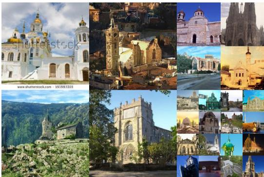
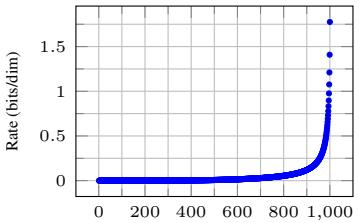
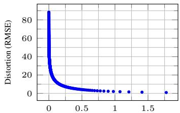
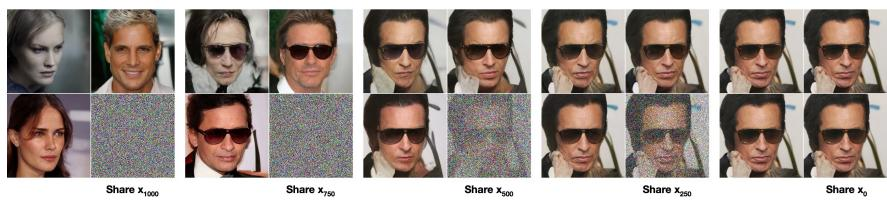
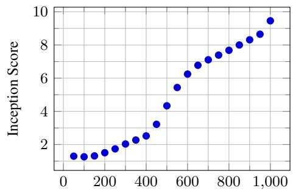
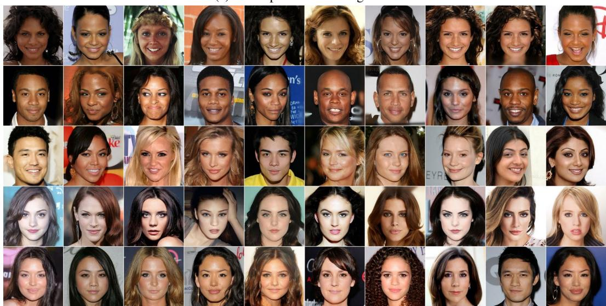
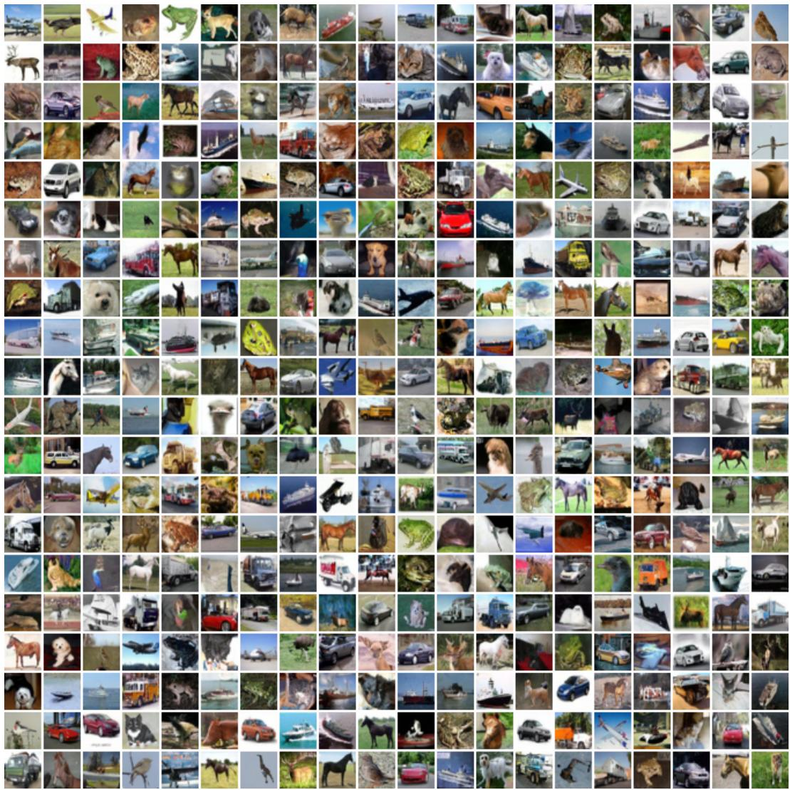
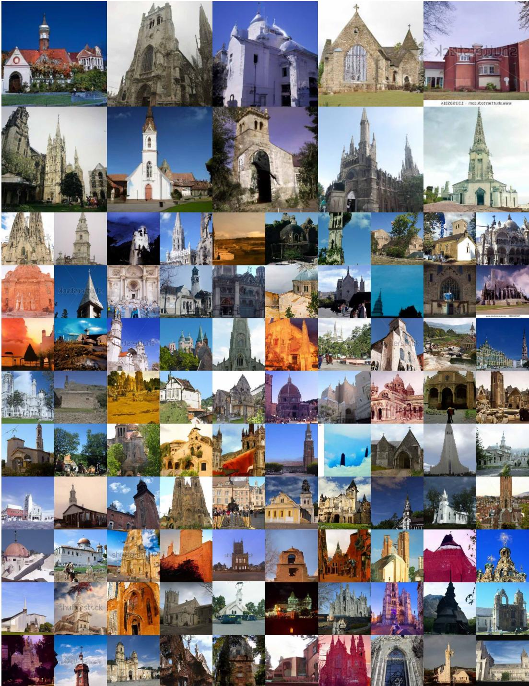
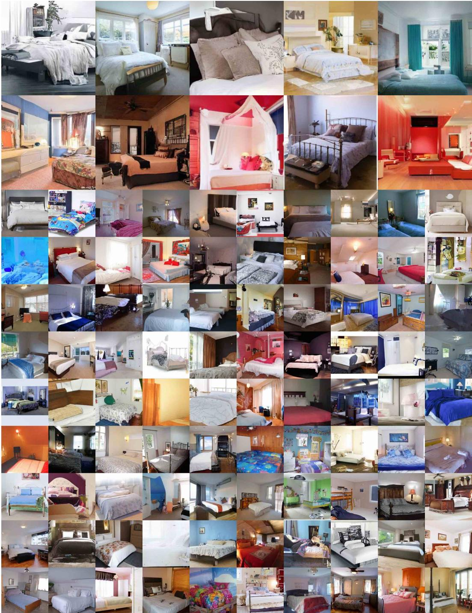
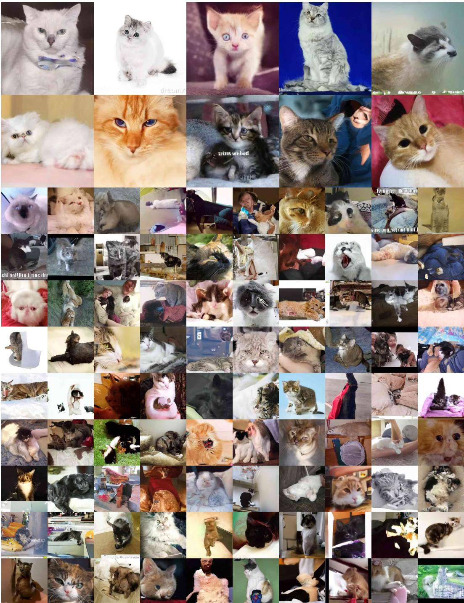

# 去噪扩散概率模型 (Denoising Diffusion Probabilistic Models)

Jonathan Ho UC Berkeley jonathanho@berkeley.edu

Ajay Jain UC Berkeley ajayj@berkeley.edu

Pieter Abbeel UC Berkeley pabbeel@cs.berkeley.edu

## 摘要

我们展示了使用扩散概率模型（diffusion probabilistic models）生成高质量图像合成的结果，这是一类受非平衡热力学（nonequilibrium thermodynamics）启发而建立的隐变量模型（latent variable models）。通过根据扩散概率模型与带有朗之万动力学的去噪得分匹配（denoising score matching with Langevin dynamics）之间的新型联系所设计的加权变分下界进行训练，我们获得了最佳结果；此外，我们的模型自然支持一种渐进式有损解压缩方案，该方案可被解释为自回归解码的推广。在无条件 CIFAR10 数据集上，我们获得了 9.46 的 Inception 分数和达到当前最优水平（SOTA）的 3.17 FID 分数。在 256x256 LSUN 上，我们获得了与 ProgressiveGAN 相似的生成样本质量。我们的代码实现可在 https://github.com/hojonathanho/diffusion 获取。

## 1 引言

近年来，各类深度生成模型在多种数据模态中均展现出了高质量的样本生成能力。生成对抗网络（GANs）、自回归模型（autoregressive models）、流模型（flows）以及变分自编码器（VAEs）已经合成了令人惊叹的图像和音频样本 [14, 27, 3, 58, 38, 25, 10, 32, 44, 57, 26, 33, 45]，并且在基于能量的模型（energy-based modeling）和得分匹配（score matching）领域也取得了显著进展，生成的图像质量可与 GAN 相媲美 [11, 55]。

  
Figure 1: 在 CelebA-HQ 256 × 256（左）和无条件 CIFAR10（右）上的生成样本  
第 34 届神经信息处理系统大会（NeurIPS 2020），加拿大温哥华。

  
Figure 2: 本文所考虑的有向图模型。

本文展示了扩散概率模型（diffusion probabilistic models）[53] 的进展。扩散概率模型（为简明起见，我们称之为“扩散模型”）是一种参数化的马尔可夫链，通过变分推断进行训练，以在有限时间后生成与数据相匹配的样本。该链的转移被学习用于逆转一个扩散过程，而该扩散过程是一个在采样的反方向上逐步向数据添加噪声直至信号被破坏的马尔可夫链。当扩散过程由少量高斯噪声构成时，将采样链的转移同样设为条件高斯分布就足够了，这使得神经网络的参数化设计格外简单。

扩散模型（Diffusion models）定义简单且训练高效，但据我们所知，此前尚未有研究证明它们能够生成高质量的样本。我们展示了扩散模型实际上有能力生成高质量样本，有时甚至优于其他类型生成模型已发表的结果（第 4 节）。此外，我们还证明了扩散模型的某种参数化形式揭示了在训练期间与跨多个噪声水平的去噪分数匹配（denoising score matching）以及在采样期间与退火朗之万动力学（annealed Langevin dynamics）的等价性（第 3.2 节）[55, 61]。我们使用这种参数化取得了最佳的样本质量结果（第 4.2 节），因此我们认为这种等价性是我们的主要贡献之一。

尽管具有出色的样本质量，但与其他基于似然的模型相比，我们的模型在对数似然（log likelihoods）方面并没有竞争力（然而，我们模型的对数似然确实优于退火重要性采样针对基于能量的模型和分数匹配所报告的大估计值 [11, 55]）。我们发现，我们模型的大部分无损编码长度（lossless codelengths）都被消耗在描述难以察觉的图像细节上（第 4.3 节）。我们用有损压缩的语言对这一现象进行了更精细的分析，并证明了扩散模型的采样过程是一种渐进式解码，它类似于沿着某种比特顺序的自回归解码，而这种比特顺序极大地泛化了自回归模型通常所能实现的形式。

## 2 背景

扩散模型 [53] 是形式为 $\begin{array} { r } { p _ { \theta } ( \mathbf { x } _ { 0 } ) : = \int p _ { \theta } ( \mathbf { x } _ { 0 : T } ) d \mathbf { x } _ { 1 : T } } \end{array}$ 的隐变量模型，其中 $\mathbf { x } _ { 1 } , \ldots , \mathbf { x } _ { T }$ 是与数据 $\mathbf { x } _ { 0 } \sim q ( \mathbf { x } _ { 0 } )$ 具有相同维度的隐变量。联合分布 $p _ { \theta } ( \mathbf { x } _ { 0 : T } )$ 被称为逆向过程（reverse process），它被定义为一个具有可学习高斯转移的马尔可夫链，起始于 $p ( \mathbf { x } _ { T } ) = \mathcal { N } ( \mathbf { x } _ { T } ; \mathbf { 0 } , \mathbf { I } )$：

$$
p _ {\theta} (\mathbf {x} _ {0: T}) := p (\mathbf {x} _ {T}) \prod_ {t = 1} ^ {T} p _ {\theta} (\mathbf {x} _ {t - 1} | \mathbf {x} _ {t}), \qquad p _ {\theta} (\mathbf {x} _ {t - 1} | \mathbf {x} _ {t}) := \mathcal {N} (\mathbf {x} _ {t - 1}; \boldsymbol {\mu} _ {\theta} (\mathbf {x} _ {t}, t), \boldsymbol {\Sigma} _ {\theta} (\mathbf {x} _ {t}, t))\tag{1}
$$

扩散模型与其他类型的隐变量模型（latent variable models）的区别在于，其近似后验分布 $q \big ( \mathbf { x } _ { 1 : T } | \mathbf { x } _ { 0 } \big )$（称为前向过程或扩散过程）被固定为一个马尔可夫链，该过程根据方差计划（variance schedule）$\beta _ { 1 } , \dots , \beta _ { T }$ 逐步向数据中添加高斯噪声：

$$
q (\mathbf {x} _ {1: T} | \mathbf {x} _ {0}) := \prod_ {t = 1} ^ {T} q (\mathbf {x} _ {t} | \mathbf {x} _ {t - 1}), \qquad q (\mathbf {x} _ {t} | \mathbf {x} _ {t - 1}) := \mathcal {N} (\mathbf {x} _ {t}; \sqrt {1 - \beta_ {t}} \mathbf {x} _ {t - 1}, \beta_ {t} \mathbf {I})\tag{2}
$$

训练是通过优化负对数似然的常规变分界来进行的：

$$
\mathbb {E} \left[ - \log p _ {\theta} (\mathbf {x} _ {0}) \right] \leq \mathbb {E} _ {q} \left[ - \log \frac {p _ {\theta} (\mathbf {x} _ {0 : T})}{q (\mathbf {x} _ {1 : T} | \mathbf {x} _ {0})} \right] = \mathbb {E} _ {q} \left[ - \log p (\mathbf {x} _ {T}) - \sum_ {t > 1} \log \frac {p _ {\theta} (\mathbf {x} _ {t - 1} | \mathbf {x} _ {t})}{q (\mathbf {x} _ {t} | \mathbf {x} _ {t - 1})} \right] =: L\tag{3}
$$

前向过程的方差 $\beta _ { t }$ 可以通过重参数化 [33] 进行学习，也可以作为超参数保持常数；而反向过程的表达能力在一定程度上通过在 $p _ { \theta } ( \mathbf { x } _ { t - 1 } | \mathbf { x } _ { t } )$ 中选择高斯条件分布来保证，因为当 $\beta _ { t }$ 较小时，这两个过程具有相同的函数形式 [53]。前向过程的一个显著特性是，它允许在任意时间步 t 以闭式形式对 $\mathbf { x } _ { t }$ 进行采样：使用记号 $\alpha _ { t } : = 1 - \beta _ { t }$ 和 $\textstyle { \bar { \alpha } } _ { t } : = \prod _ { s = 1 } ^ { t } \alpha _ { s }$，我们有

$$
q (\mathbf {x} _ {t} | \mathbf {x} _ {0}) = \mathcal {N} (\mathbf {x} _ {t}; \sqrt {\bar {\alpha} _ {t}} \mathbf {x} _ {0}, (1 - \bar {\alpha} _ {t}) \mathbf {I})\tag{4}
$$

因此，通过使用随机梯度下降优化 $L$ 的随机项，可以实现高效的训练。通过将 $L \left( 3 \right)$ 重写为以下形式进行方差缩减（variance reduction），可以获得进一步的改进：

$$
\mathbb {E} _ {q} \bigg [ \underbrace {D _ {\mathrm{KL}} (q (\mathbf {x} _ {T} | \mathbf {x} _ {0}) \parallel p (\mathbf {x} _ {T}))} _ {L _ {T}} + \sum_ {t > 1} \underbrace {D _ {\mathrm{KL}} (q (\mathbf {x} _ {t - 1} | \mathbf {x} _ {t} , \mathbf {x} _ {0}) \parallel p _ {\theta} (\mathbf {x} _ {t - 1} | \mathbf {x} _ {t}))} _ {L _ {t - 1}} \underbrace {- \log p _ {\theta} (\mathbf {x} _ {0} | \mathbf {x} _ {1})} _ {L _ {0}} \bigg ]\tag{5}
$$

（详情参见附录 A。各项上的标签在第 3 节中使用。）公式 (5) 使用 KL 散度将 $p _ { \theta } ( \mathbf { x } _ { t - 1 } | \mathbf { x } _ { t } )$ 与前向过程后验分布进行直接比较，而后者在以 x 为条件时是易于处理的（tractable）：

$$
q (\mathbf {x} _ {t - 1} | \mathbf {x} _ {t}, \mathbf {x} _ {0}) = \mathcal {N} (\mathbf {x} _ {t - 1}; \tilde {\pmb {\mu}} _ {t} (\mathbf {x} _ {t}, \mathbf {x} _ {0}), \tilde {\beta} _ {t} \mathbf {I}),\tag{6}
$$

$$
\text { where } \quad \tilde {\boldsymbol {\mu}} _ {t} (\mathbf {x} _ {t}, \mathbf {x} _ {0}) := \frac {\sqrt {\bar {\alpha} _ {t - 1}} \beta_ {t}}{1 - \bar {\alpha} _ {t}} \mathbf {x} _ {0} + \frac {\sqrt {\alpha_ {t} (1 - \bar {\alpha} _ {t - 1})}}{1 - \bar {\alpha} _ {t}} \mathbf {x} _ {t} \quad \text { and } \quad \tilde {\beta} _ {t} := \frac {1 - \bar {\alpha} _ {t - 1}}{1 - \bar {\alpha} _ {t}} \beta_ {t}\tag{7}
$$

因此，公式 (5) 中的所有 KL 散度都是高斯分布之间的比较，所以它们可以通过 Rao-Blackwellized 方式用闭式表达式计算，而不是使用高方差的蒙特卡洛（Monte Carlo）估计。

## 3 扩散模型与去噪自编码器

扩散模型表面上可能属于一类受限的隐变量模型，但它们在实现中提供了大量的自由度。必须选择前向过程的方差 $\beta _ { t }$，以及反向过程的模型架构和高斯分布参数化方式。为了指导我们的选择，我们在扩散模型与去噪分数匹配（denoising score matching，第 3.2 节）之间建立了一种新的明确联系，从而导出了扩散模型的一个简化的、加权的变分边界目标（第 3.4 节）。最终，我们的模型设计因其简洁性和实证结果而得到验证（第 4 节）。我们的讨论按公式 (5) 的各项展开分类。

## 3.1 前向过程与 $L _ { T }$

我们忽略了前向过程方差 $\beta _ { t }$ 可以通过重参数化进行学习这一事实，而是将它们固定为常数（详见第 4 节）。因此，在我们的实现中，近似后验 q 没有可学习参数，所以 $L _ { T }$ 在训练期间是一个常数，可以忽略。

## 3.2 反向过程与 $L _ { 1 : T - 1 }$

现在我们讨论对于 $1 < t \leq T$ 时 $p _ { \theta } ( \mathbf { x } _ { t - 1 } | \mathbf { x } _ { t } ) = \mathcal { N } ( \mathbf { x } _ { t - 1 } ; \mu _ { \theta } ( \mathbf { x } _ { t } , t ) , \Sigma _ { \theta } ( \mathbf { x } _ { t } , t ) )$ 的选择。首先，我们将 $\begin{array} { r } { \pmb { \Sigma } _ { \theta } ( \mathbf { x } _ { t } , t ) = \sigma _ { t } ^ { 2 } \mathbf { I } } \end{array}$ 设为未经训练的随时间变化的常数。实验表明，$\sigma _ { t } ^ { 2 } = \beta _ { t }$ 和 $\begin{array} { r } { \sigma _ { t } ^ { 2 } = \tilde { \beta } _ { t } = \frac { 1 - \bar { \alpha } _ { t - 1 } } { 1 - \bar { \alpha } _ { t } } \bar { \beta _ { t } } } \end{array}$ 取得了相似的结果。第一种选择在 $\mathbf { x } _ { 0 } \sim \mathcal { N } ( \mathbf { 0 } , \mathbf { I } )$ 时是最优的，而第二种在 $\mathbf { x } _ { \mathrm { 0 } }$ 确定性地设为一个单点时是最优的。这两个极端选择对应于具有逐坐标单位方差的数据的反向过程熵的上限和下限 [53]。

其次，为了表示均值 $\mu _ { \theta } ( \mathbf { x } _ { t } , t )$，受以下对 $L _ { t }$ 的分析启发，我们提出了一种特定的参数化方法。取 $p _ { \theta } ( \mathbf { x } _ { t - 1 } | \mathbf { x } _ { t } ) = \bar { \mathcal { N } } ( \mathbf { x } _ { t - 1 } ; \bar { \mu } _ { \theta } ( \mathbf { x } _ { t } , t ) , \sigma _ { t } ^ { 2 } \mathbf { I } )$，我们可以写出：

$$
L _ {t - 1} = \mathbb {E} _ {q} \bigg [ \frac {1}{2 \sigma_ {t} ^ {2}} \| \tilde {\pmb {\mu}} _ {t} (\mathbf {x} _ {t}, \mathbf {x} _ {0}) - \pmb {\mu} _ {\theta} (\mathbf {x} _ {t}, t) \| ^ {2} \bigg ] + C\tag{8}
$$

其中 $C$ 是一个不依赖于 θ 的常数。因此，我们看到 $\mu _ { \theta }$ 最直接的参数化方式是一个预测前向过程后验均值 $\tilde { \pmb { \mu } } _ { t }$ 的模型。然而，我们可以通过将公式 (4) 重新参数化为 $\mathbf { x } _ { t } ( \mathbf { x } _ { 0 } , \epsilon ) = \sqrt { \bar { \alpha } _ { t } } \mathbf { x } _ { 0 } + \sqrt { 1 - \bar { \alpha } _ { t } } \epsilon$（其中 $\mathbf { \epsilon } \in \sim \mathcal { N } ( \mathbf { 0 } , \mathbf { I } )$）并应用前向过程后验公式 (7) 来进一步展开公式 (8)：

$$
L _ {t - 1} - C = \mathbb {E} _ {\mathbf {x} _ {0}, \epsilon} \left[ \frac {1}{2 \sigma_ {t} ^ {2}} \left\| \tilde {\boldsymbol {\mu}} _ {t} \left(\mathbf {x} _ {t} (\mathbf {x} _ {0}, \epsilon), \frac {1}{\sqrt {\bar {\alpha} _ {t}}} \left(\mathbf {x} _ {t} (\mathbf {x} _ {0}, \epsilon) - \sqrt {1 - \bar {\alpha} _ {t}} \epsilon\right)\right) - \boldsymbol {\mu} _ {\theta} \left(\mathbf {x} _ {t} (\mathbf {x} _ {0}, \epsilon), t\right) \right\| ^ {2} \right]\tag{9}
$$

$$
= \mathbb {E} _ {\mathbf {x} _ {0}, \boldsymbol {\epsilon}} \left[ \frac {1}{2 \sigma_ {t} ^ {2}} \left\| \frac {1}{\sqrt {\alpha_ {t}}} \left(\mathbf {x} _ {t} (\mathbf {x} _ {0}, \boldsymbol {\epsilon}) - \frac {\beta_ {t}}{\sqrt {1 - \bar {\alpha} _ {t}}} \boldsymbol {\epsilon}\right) - \boldsymbol {\mu} _ {\theta} (\mathbf {x} _ {t} (\mathbf {x} _ {0}, \boldsymbol {\epsilon}), t) \right\| ^ {2} \right]\tag{10}
$$

<table><tr><td>算法 1 训练 (Algorithm 1 Training)</td><td>算法 2 采样 (Algorithm 2 Sampling)</td></tr><tr><td>1: 重复 (repeat)</td><td>1:  $\mathbf{x}_T \sim \mathcal{N}(\mathbf{0}, \mathbf{I})$ </td></tr><tr><td>2:  $\mathbf{x}_0 \sim q(\mathbf{x}_0)$ </td><td>2: 对于  $t = T, \ldots, 1$  循环执行</td></tr><tr><td>3:  $t \sim \text{Uniform}(\{1, \ldots, T\})$ </td><td>3: 若  $t > 1$ 则  $\mathbf{z} \sim \mathcal{N}(\mathbf{0}, \mathbf{I})$ ，否则  $\mathbf{z} = \mathbf{0}$ </td></tr><tr><td>4:  $\boldsymbol{\epsilon} \sim \mathcal{N}(\mathbf{0}, \mathbf{I})$ </td><td>4:  $\mathbf{x}_{t-1} = \frac{1}{\sqrt{\alpha_t}} \left( \mathbf{x}_t - \frac{1 - \alpha_t}{\sqrt{1 - \bar{\alpha}_t}} \boldsymbol{\epsilon}_\theta(\mathbf{x}_t, t) \right) + \sigma_t \mathbf{z}$ </td></tr><tr><td>5: 对 $\nabla_\theta \left\| \boldsymbol{\epsilon} - \boldsymbol{\epsilon}_\theta (\sqrt{\bar{\alpha}_t} \mathbf{x}_0 + \sqrt{1 - \bar{\alpha}_t} \boldsymbol{\epsilon}, t) \right\|^2$ 执行梯度下降步</td><td>5: 结束循环</td></tr><tr><td>6: 直至收敛</td><td>6: 返回  $\mathbf{x}_0$ </td></tr></table>

公式 (10) 表明，在给定 $\mathbf { x } _ { t }$ 的情况下，$\mu _ { \theta }$ 必须预测 $\begin{array} { r } { \frac { 1 } { \sqrt { \alpha _ { t } } } \left( \mathbf { x } _ { t } - \frac { \beta _ { t } } { \sqrt { 1 - \bar { \alpha } _ { t } } } \mathbf { \epsilon } \right) } \end{array}$。由于 $\mathbf { x } _ { t }$ 可作为模型的输入，我们可以选择如下参数化形式：

$$
\boldsymbol {\mu} _ {\theta} (\mathbf {x} _ {t}, t) = \tilde {\boldsymbol {\mu}} _ {t} \left(\mathbf {x} _ {t}, \frac {1}{\sqrt {\bar {\alpha} _ {t}}} \left(\mathbf {x} _ {t} - \sqrt {1 - \bar {\alpha} _ {t}} \boldsymbol {\epsilon} _ {\theta} (\mathbf {x} _ {t})\right)\right) = \frac {1}{\sqrt {\alpha_ {t}}} \left(\mathbf {x} _ {t} - \frac {\beta_ {t}}{\sqrt {1 - \bar {\alpha} _ {t}}} \boldsymbol {\epsilon} _ {\theta} (\mathbf {x} _ {t}, t)\right)\tag{11}
$$

其中 $\epsilon _ { \theta }$ 是一个旨在从 $\mathbf { x } _ { t }$ 预测   的函数近似器。从 $\mathbf { x } _ { t - 1 } \sim p _ { \theta } \big ( \mathbf { x } _ { t - 1 } \big | \mathbf { x } _ { t } \big )$ 中采样即为计算 $\begin{array} { r } { \mathbf { x } _ { t - 1 } = \frac { 1 } { \sqrt { \alpha _ { t } } } \left( \mathbf { x } _ { t } - \frac { \beta _ { t } } { \sqrt { 1 - \bar { \alpha } _ { t } } } \boldsymbol { \epsilon } _ { \theta } ( \mathbf { x } _ { t } , t ) \right) + \sigma _ { t } \mathbf { z } , } \end{array}$，其中 $\mathbf { z } \sim \mathcal { N } ( \mathbf { 0 } , \mathbf { I } )$。完整的采样过程，即 Algorithm 2，类似于以 $\epsilon _ { \theta }$ 作为学得的数据密度梯度的朗之万动力学（Langevin dynamics）。此外，在参数化形式 (11) 下，式 (10) 简化为：

$$
\mathbb {E} _ {\mathbf {x} _ {0}, \epsilon} \bigg [ \frac {\beta_ {t} ^ {2}}{2 \sigma_ {t} ^ {2} \alpha_ {t} (1 - \bar {\alpha} _ {t})} \left\| \epsilon - \epsilon_ {\theta} (\sqrt {\bar {\alpha} _ {t}} \mathbf {x} _ {0} + \sqrt {1 - \bar {\alpha} _ {t}} \epsilon , t) \right\| ^ {2} \bigg ]\tag{12}
$$

这类似于在由 t 索引的多个噪声尺度上的去噪分数匹配（denoising score matching）[55]。由于式 (12) 等于类朗之万逆向过程 (11) 变分界中的（其中一项），我们发现优化类似于去噪分数匹配的目标函数，等价于使用变分推断来拟合类似于朗之万动力学的采样链的有限时间边际分布。

概括而言，我们可以训练逆向过程均值函数近似器 $\mu _ { \theta }$ 来预测 $\tilde { \mu } _ { t } ,$ 或者通过修改其参数化形式，我们可以训练它来预测  。（也有预测 $\mathbf { x } _ { 0 }$ 的可能性，但在我们的早期实验中发现这会导致较差的样本质量。）我们已经表明，  预测参数化既类似于朗之万动力学，又将扩散模型的变分界简化为类似于去噪分数匹配的目标。尽管如此，它只是 $p _ { \theta } ( \mathbf { x } _ { t - 1 } | \mathbf { x } _ { t } )$ 的另一种参数化形式，因此我们在第 4 节通过消融实验比较预测   与预测 $\tilde { \pmb { \mu } } _ { t }$ 来验证其有效性。

## 3.3 Data scaling, reverse process decoder, and $L _ { 0 }$

我们假设图像数据由 $\{ 0 , 1 , \ldots , 2 5 5 \}$ 中的整数组成，并线性缩放到 $[ - 1 , 1 ]$。这确保了神经网络逆向过程在从标准正态先验 $p ( \mathbf { x } _ { T } )$ 开始时，能在尺度一致的输入上运行。为了获得离散对数似然，我们将逆向过程的最后一项设置为由高斯分布 $\mathcal { N } ( \mathbf { x } _ { 0 } ; \pmb { \mu } _ { \theta } ( \mathbf { x } _ { 1 } , 1 ) , \sigma _ { 1 } ^ { 2 } \mathbf { I } )$ 导出的独立离散解码器。

$$
\begin{array}{c} p _ {\theta} (\mathbf {x} _ {0} | \mathbf {x} _ {1}) = \prod_ {i = 1} ^ {D} \int_ {\delta_ {-} (x _ {0} ^ {i})} ^ {\delta_ {+} (x _ {0} ^ {i})} \mathcal {N} (x; \mu_ {\theta} ^ {i} (\mathbf {x} _ {1}, 1), \sigma_ {1} ^ {2})   d x \\ \delta_ {+} (x) = \left\{ \begin{array}{l l} \infty & \text {if x = 1} \\ x + \frac {1}{2 5 5} & \text {if x <   1} \end{array} \right. \quad \delta_ {-} (x) = \left\{ \begin{array}{l l} - \infty & \text {if x = -1} \\ x - \frac {1}{2 5 5} & \text {if x > -1} \end{array} \right. \end{array}\tag{13}
$$

其中 D 是数据维度，上标 i 表示提取某个坐标。（引入像条件自回归模型这样更强大的解码器也是非常直接的，但我们将其留待未来工作。）与 VAE 解码器和自回归模型 [34, 52] 中使用的离散化连续分布类似，我们这里的选择确保了变分界是离散数据的无损编码长度，而无需向数据添加噪声或将缩放操作的雅可比行列式（Jacobian）计入对数似然。在采样结束时，我们无噪声地输出 $\mu _ { \theta } ( \mathbf { x } _ { 1 } , 1 )$。

## 3.4 简化的训练目标

通过上述定义的反向过程和解码器，由公式 (12) 和 (13) 推导出的各项组成的变分界显然关于 θ 可微，并且可以直接用于训练。然而，我们发现针对以下变分界变体进行训练有利于提高样本质量（且实现起来更简单）：

Table 1: CIFAR10 结果。NLL 测量单位为 bits/dim。

<table><tr><td>模型</td><td>IS</td><td>FID</td><td>NLL 测试集 (训练集)</td><td colspan="3"></td></tr><tr><td colspan="4">条件生成</td><td rowspan="5" colspan="3">Table 2: 无条件 CIFAR10 逆向过程参数化与训练目标消融实验。空白项表示训练不稳定并生成了超出评分范围的较差样本。</td></tr><tr><td>EBM [11]</td><td>8.30</td><td>37.9</td><td></td></tr><tr><td>JEM [17]</td><td>8.76</td><td>38.4</td><td></td></tr><tr><td>BigGAN [3]</td><td>9.22</td><td>14.73</td><td></td></tr><tr><td>StyleGAN2 + ADA (v1) [29]</td><td>10.06</td><td>2.67</td><td></td></tr><tr><td colspan="4">无条件生成</td><td>目标函数</td><td>IS</td><td>FID</td></tr><tr><td>Diffusion (original) [53]</td><td></td><td></td><td>≤ 5.40</td><td colspan="3">μ 预测（基线）</td></tr><tr><td>Gated PixelCNN [59]</td><td>4.60</td><td>65.93</td><td>3.03 (2.90)</td><td>L，可学习对角 Σ</td><td>7.28±0.10</td><td>23.69</td></tr><tr><td>Sparse Transformer [7]</td><td></td><td></td><td>2.80</td><td>L，固定各向同性 Σ</td><td>8.06±0.09</td><td>13.22</td></tr><tr><td>PixelIQN [43]</td><td>5.29</td><td>49.46</td><td></td><td>||μ - μθ||2</td><td>-</td><td>-</td></tr><tr><td>EBM [11]</td><td>6.78</td><td>38.2</td><td></td><td></td><td></td><td></td></tr><tr><td>NCSNv2 [56]</td><td></td><td>31.75</td><td></td><td colspan="3">ε 预测（本文）</td></tr><tr><td>NCSN [55]</td><td>8.87±0.12</td><td>25.32</td><td></td><td>L，可学习对角 Σ</td><td>-</td><td>-</td></tr><tr><td>SNGAN [39]</td><td>8.22±0.05</td><td>21.7</td><td></td><td>L，固定各向同性 Σ</td><td>7.67±0.13</td><td>13.51</td></tr><tr><td>SNGAN-DDLS [4]</td><td>9.09±0.10</td><td>15.42</td><td></td><td>||ε - εθ||2(Lsimple)</td><td>9.46±0.11</td><td>3.17</td></tr><tr><td>StyleGAN2 + ADA (v1) [29]</td><td>9.74 ± 0.05</td><td>3.26</td><td></td><td></td><td></td><td></td></tr><tr><td>Ours (L, fixed isotropic Σ)</td><td>7.67±0.13</td><td>13.51</td><td>≤ 3.70 (3.69)</td><td></td><td></td><td></td></tr><tr><td>Ours (Lsimple)</td><td>9.46±0.11</td><td>3.17</td><td>≤ 3.75 (3.72)</td><td></td><td></td><td></td></tr></table>

$$
L _ {\mathrm{simple}} (\theta) := \mathbb {E} _ {t, \mathbf {x} _ {0}, \epsilon} \Big [ \big \| \boldsymbol {\epsilon} - \boldsymbol {\epsilon} _ {\theta} (\sqrt {\bar {\alpha} _ {t}} \mathbf {x} _ {0} + \sqrt {1 - \bar {\alpha} _ {t}} \boldsymbol {\epsilon}, t) \big \| ^ {2} \Big ]\tag{14}
$$

其中 $t$ 在 1 到 $T$ 之间均匀分布。$t = 1$ 的情况对应于 $L _ { 0 }$，其中离散解码器定义 (13) 中的积分被近似为高斯概率密度函数乘以箱宽（bin width），忽略了 $\sigma _ { 1 } ^ { 2 }$ 和边缘效应。$t > 1$ 的情况对应于公式 (12) 的未加权版本，类似于 NCSN 去噪得分匹配（denoising score matching）模型 [55] 所采用的损失加权。（$L _ { T }$ 没有出现是因为前向过程方差 $\beta _ { t }$ 是固定的。）算法 1 展示了使用该简化目标的完整训练过程。

由于我们的简化目标 (14) 舍弃了公式 (12) 中的加权，与标准变分界 [18, 22] 相比，它是一个强调重构不同方面的加权变分界。特别是，我们在第 4 节中的扩散过程设置使得简化目标降低了对应于较小 $t$ 的损失项的权重。这些项训练网络对带有极少噪声的数据进行去噪，因此降低它们的权重是有益的，这样网络可以专注于在更大 $t$ 项处更困难的去噪任务。我们将在实验中看到，这种重新加权带来了更好的样本质量。

## 4 实验

我们在所有实验中设置 $T = 1 0 0 0$，以便采样期间所需的神经网络评估次数与先前的工作相匹配 [53, 55]。我们将前向过程方差设置为从 $\stackrel { \bullet } { \beta } _ { 1 } = 1 0 ^ { - 4 }$ 线性增加到 $\beta _ { T } ~ = ~ 0 . 0 2$ 的常数。选择这些相对于缩放到 [ 1, 1] 的数据而言较小的常数，是为了确保逆向过程和前向过程具有大致相同的函数形式，同时保持 xT 处的信噪比尽可能小（在我们的实验中，$L _ { T } =$ $D _ { \mathrm { K L } } ( q ( \mathbf { x } _ { T } | \mathbf { x } _ { 0 } ) \parallel \mathcal { N } ( \mathbf { 0 } , \mathbf { I } ) ) \approx 1 0 ^ { - 5 }$ 比特/维度）。

为了表示逆向过程，我们使用了一个类似于无掩码 PixelCNN++ [52, 48] 的 U-Net 骨干网络，并全程使用群组归一化（group normalization）[66]。参数在各个时间步之间共享，并通过 Transformer 正弦位置嵌入（Transformer sinusoidal position embedding）[60] 将时间步指定给网络。我们在 $1 6 \times 1 6$ 特征图分辨率下使用自注意力（self-attention）[63, 60]。详细信息见附录 B。

## 4.1 样本质量

Table 1 显示了 CIFAR10 上的 Inception score、FID score 和负对数似然（无损编码长度）。凭借 3.17 的 FID 得分，我们的无条件模型取得了优于文献中大多数模型的样本质量，包括类别条件模型。按照常规做法，我们的 FID 得分是针对训练集计算的；当我们针对测试集进行计算时，得分为 5.24，这仍然优于文献中许多在训练集上计算的 FID 得分。

  
Figure 3: LSUN Church 样本。FID=7.89

  
Figure 4: LSUN Bedroom 样本。FID=4.90

Algorithm 3 Sending $\mathbf{x}_0$ Algorithm 4 Receiving  
1: Send $\mathbf{x}_T \sim q(\mathbf{x}_T | \mathbf{x}_0)$ using $p(\mathbf{x}_T)$  
2: for $t = T - 1, \ldots, 2, 1$ do  
3: Send $\mathbf{x}_t \sim q(\mathbf{x}_t | \mathbf{x}_{t+1}, \mathbf{x}_0)$ using $p_\theta(\mathbf{x}_t | \mathbf{x}_{t+1})$  
4: end for  
5: Send $\mathbf{x}_0$ using $p_\theta(\mathbf{x}_0 | \mathbf{x}_1)$  
1: Receive $\mathbf{x}_T$ using $p(\mathbf{x}_T)$  
2: for $t = T - 1, \ldots, 1, 0$ do  
3: Receive $\mathbf{x}_t$ using $p_\theta(\mathbf{x}_t | \mathbf{x}_{t+1})$  
4: end for  
5: return $\mathbf{x}_0$

我们发现，正如预期的那样，在真实的变分界上训练模型比在简化目标上训练能获得更优的码长（codelengths），但后者能产生最好的样本质量。CIFAR10 和 CelebA-HQ 256 256 样本参见 Fig. 1，LSUN 256 256 样本参见 Fig. 3 和 Fig. 4 [71]，更多内容参见附录 D。

## 4.2 逆向过程参数化与训练目标消融实验

在 Table 2 中，我们展示了逆向过程参数化和训练目标对样本质量的影响（第 3.2 节）。我们发现，预测 µ˜ 的基线方案仅在基于真实变分界训练时表现良好，而在基于未加权均方误差（类似于公式 (14) 的简化目标）训练时效果不佳。我们还发现，与固定方差相比，学习逆向过程方差（通过将参数化的对角矩阵 $\pmb { \Sigma } _ { \theta } ( \mathbf { x } _ { t } )$ 纳入变分界）会导致训练不稳定且样本质量较差。正如我们所提出的，在采用固定方差的变分界上训练时，预测   的表现与预测 µ˜ 大致相当，但在使用我们提出的简化目标训练时表现要好得多。

## 4.3 渐进式编码

Table 1 还展示了我们 CIFAR10 模型的码长。训练集与测试集之间的差距至多为每维度 0.03 比特（bits per dimension），这与其他基于似然的模型报告的差距相当，表明我们的扩散模型（diffusion model）没有发生过拟合（最近邻可视化参见附录 D）。尽管如此，虽然我们的无损码长优于基于能量的模型以及使用退火重要性采样（annealed importance sampling）的分数匹配所报告的较差估计值 [11]，但与其他类型的基于似然的生成模型相比仍缺乏竞争力 [7]。

由于我们的样本仍然具有高质量，我们得出结论：扩散模型（diffusion models）具有一种归纳偏置，使其成为优秀的有损压缩器。将变分界项 $L _ { 1 } + \cdots + L _ { T }$ 视为码率（rate），将 $L _ { 0 }$ 视为失真（distortion），我们生成最高质量样本的 CIFAR10 模型具有 1.78 bits/dim 的码率和 1.97 bits/dim 的失真，这相当于在 0 到 255 的尺度上均方根误差为 0.95。无损编码长度中有一半以上用于描述难以察觉的失真。

渐进式有损压缩（Progressive lossy compression） 我们可以通过引入一种反映公式 (5) 形式的渐进式有损编码，来进一步探讨模型的率失真行为：参见算法 3 和 4，它们假设可以访问一个过程（例如最小随机编码 [19, 20]），该过程对于任意分布 p 和 $q$（其中接收端预先仅能获取 p），平均可以使用大约 $D _ { \mathrm { K L } } ( q ( \mathbf { x } ) \parallel p ( \mathbf { x } ) )$ 比特传输样本 $\mathbf { x } \sim q ( \mathbf { x } )$。当应用于 $\mathbf { x } _ { 0 } \sim q ( \mathbf { x } _ { 0 } )$ 时，算法 3 和 4 按顺序传输 $\mathbf { x } _ { T } , \ldots , \mathbf { x } _ { 0 }$，所使用的总期望码长等于公式 (5)。接收端在任意时刻 t 都完全拥有部分信息 $\mathbf { x } _ { t }$，并可以逐步估计：

$$
\mathbf {x} _ {0} \approx \hat {\mathbf {x}} _ {0} = \left(\mathbf {x} _ {t} - \sqrt {1 - \bar {\alpha} _ {t}} \boldsymbol {\epsilon} _ {\theta} (\mathbf {x} _ {t})\right) / \sqrt {\bar {\alpha} _ {t}}\tag{15}
$$

这得益于公式 (4)。（随机重构 $\mathbf { x } _ { 0 } \sim p _ { \theta } ( \mathbf { x } _ { 0 } | \mathbf { x } _ { t } )$ 也是有效的，但我们在此不予考虑，因为它使失真更难以评估。）Figure 5 展示了 CIFAR10 测试集上得到的率失真曲线。在每个时刻 t，失真被计算为均方根误差 $\sqrt { \| \mathbf { x } _ { 0 } - \hat { \mathbf { x } } _ { 0 } \| ^ { 2 } / D } .$，而码率被计算为在时刻 t 迄今接收到的累积比特数。失真在率失真曲线的低码率区域急剧下降，这表明大部分比特确实被分配给了难以察觉的失真。

  
反向过程步数 (T − t)

  
反向过程步数 (T − t)

  
码率 (bits/dim)  
Figure 5: 无条件 CIFAR10 测试集率失真与时间的关系。失真以 [0, 255] 尺度上的均方根误差进行衡量。详情见 Table 4。

渐进式生成 我们还运行了一个由随机比特渐进式解压缩所给出的渐进式无条件生成过程。换句话说，我们在使用 Algorithm 2 从反向过程中采样的同时，预测反向过程的结果 $\hat { \mathbf { x } } _ { 0 }$。图 6 和图 10 展示了在反向过程进行中所得 $\hat { \mathbf { x } } _ { 0 }$ 的样本质量。大尺度图像特征最先出现，而细节最后出现。图 7 展示了在不同 $t$ 下固定 $\mathbf { x } _ { t }$ 时的随机预测 $\mathbf { x } _ { 0 } \sim p _ { \theta } ( \mathbf { x } _ { 0 } | \mathbf { x } _ { t } )$。当 $t$ 较小时，除精细细节外的所有特征都被保留；而当 $t$ 较大时，仅保留了大尺度特征。这或许体现了概念压缩（conceptual compression）[18]的迹象。

Figure 6: 无条件 CIFAR10 渐进式生成（$\hat { \mathbf { x } } _ { 0 }$ 随时间变化，从左至右）。附录中提供了更多扩展样本以及随时间变化的样本质量指标（图 10 和图 14）。  
  
Figure 7: 当以相同潜在变量为条件时，CelebA-HQ $2 5 6 \times 2 5 6$ 样本共享高层属性。右下角象限为 ${ \bf x } _ { t } ,$，其余象限为来自 $p _ { \theta } ( \mathbf { x } _ { 0 } | \mathbf { x } _ { t } )$ 的样本。

与自回归解码的联系 注意，变分界 (5) 可以重写为：

$$
L = D _ {\mathrm{KL}} (q (\mathbf {x} _ {T}) \parallel p (\mathbf {x} _ {T})) + \mathbb {E} _ {q} \left[ \sum_ {t \geq 1} D _ {\mathrm{KL}} (q (\mathbf {x} _ {t - 1} | \mathbf {x} _ {t}) \parallel p _ {\theta} (\mathbf {x} _ {t - 1} | \mathbf {x} _ {t})) \right] + H (\mathbf {x} _ {0})\tag{16}
$$

（推导见附录 A。）现在考虑将扩散过程的长度 $T$ 设置为数据的维度，定义前向过程使得 $q ( \mathbf { x } _ { t } | \mathbf { x } _ { 0 } )$ 将所有概率质量置于前 $t$ 个坐标被掩蔽的 $\mathbf { x } _ { \mathrm { 0 } }$ 上（即 $\left( \mathbf { i . e . \ d } ( \mathbf { x } _ { t } | \mathbf { x } _ { t - 1 } ) \right)$ 掩蔽掉第 $t ^ { \mathrm { { t h } } }$ 个坐标），将 $p ( \mathbf { x } _ { T } )$ 设置为将所有概率质量置于空白图像上，并且为了便于论证，假设 $p _ { \theta } ( \mathbf { x } _ { t - 1 } | \mathbf { x } _ { t } )$ 是一个具有充分表达能力的条件分布。基于这些选择，$D _ { \mathrm { K L } } ( q ( \mathbf { x } _ { T } ) \parallel p ( \mathbf { x } _ { T } ) ) = 0 .$，并且最小化 $\bar { D } _ { \mathrm { K L } } \big ( q \big ( \mathbf { x } _ { t - 1 } \big | \mathbf { x } _ { t } \big ) \big | \big | p _ { \theta } \big ( \mathbf { x } _ { t - 1 } \big | \mathbf { x } _ { t } \big ) \big )$ ) 会训练 $p _ { \theta }$ 原封不动地复制坐标 $t + 1 , \dots , T$，并在给定 $t + 1 , \dots , T$ 的情况下预测第 $\dot { t } ^ { \mathrm { { t h } } }$ 个坐标。因此，使用这种特定的扩散过程训练 $p _ { \theta }$ 实际上就是在训练一个自回归模型。

  
Figure 8: 使用 500 个扩散时间步的 CelebA-HQ 256x256 图像插值。

因此，我们可以将高斯扩散模型 (2) 解释为一种具有广义比特序（generalized bit ordering）的自回归模型，这种比特序无法通过重排数据坐标来表达。先前的研究表明，这种重排引入的归纳偏置（inductive biases）会对样本质量产生影响 [38]，因此我们推测高斯扩散起到了类似的作用，并且效果可能更显著，因为与掩蔽噪声相比，向图像中添加高斯噪声可能更加自然。此外，高斯扩散的长度并不受限于必须等于数据维度；例如，在我们的实验中，我们使用 $T = 1 0 0 0$，这小于 $3 2 \times 3 2 \times 3$ 或 $2 5 6 \times 2 5 6 \times 3$ 图像的维度。高斯扩散可以缩短以实现快速采样，也可以延长以增强模型的表达能力。

## 4.4 插值

我们可以将 q 作为随机编码器，在隐空间中对源图像 $\mathbf { x } _ { 0 } , \mathbf { x } _ { 0 } ^ { \prime } \sim q ( \mathbf { x } _ { 0 } )$ 进行插值，即 $\mathbf { x } _ { t } , \mathbf { x } _ { t } ^ { \prime } \sim q ( \mathbf { x } _ { t } | \mathbf { x } _ { 0 } )$，然后通过反向过程 $\bar { \mathbf { x } } _ { 0 } \sim p ( \mathbf { x } _ { 0 } | \bar { \mathbf { x } } _ { t } )$ 将线性插值的隐变量 $\bar { \mathbf { x } } _ { t } = ( 1 - \lambda ) \mathbf { x } _ { 0 } + \lambda \mathbf { x } _ { 0 } ^ { \prime }$ 解码到图像空间。实际上，我们利用反向过程来消除对受损源图像进行线性插值所产生的伪影，如图 Fig. 8（左）所示。我们针对不同的 λ 值固定了噪声，因此 $\mathbf { x } _ { t }$ 和 $\mathbf { x } _ { t } ^ { \prime }$ 保持不变。Fig. 8（右）展示了原始 CelebA-HQ 256 256 图像的插值和重建结果 $( t = 5 0 0 )$。反向过程产生了高质量的重建，以及合理且平滑改变姿态、肤色、发型、表情和背景等属性（但不包括眼镜）的插值结果。更大的 t 会导致更粗粒度且更多样化的插值，并在 $t = 1 0 0 0$ 时生成全新的样本（附录 Fig. 9）。

## 5 相关工作

尽管扩散模型可能与流模型（flows）[9, 46, 10, 32, 5, 16, 23] 和 VAEs [33, 47, 37] 相似，但扩散模型的设计使得 q 不包含任何参数，且最顶层的隐变量 $\mathbf { x } _ { T }$ 与数据 $\mathbf { x } _ { \mathrm { 0 } }$ 之间的互信息几乎为零。我们的  -prediction 反向过程参数化建立了扩散模型与结合退火朗之万动力学（Langevin dynamics）采样的多噪声尺度去噪得分匹配（denoising score matching）之间的联系 [55, 56]。然而，扩散模型支持直接的对数似然评估，且其训练过程利用变分推断（variational inference）显式地训练了朗之万动力学采样器（详见附录 C）。这一联系还具有反向含义，即去噪得分匹配的某种加权形式等同于用于训练类朗之万采样器的变分推断。其他用于学习马尔可夫链（Markov chains）转移算子的方法包括 infusion training [2]、variational walkback [15]、生成随机网络（generative stochastic networks）[1] 等 [50, 54, 36, 42, 35, 65]。

根据分数匹配与基于能量的建模之间的已知联系，我们的工作可能会对近期其他关于基于能量的模型的研究产生启示 [67–69, 12, 70, 13, 11, 41, 17, 8]。我们的率失真曲线是在单次变分界评估中随时间计算得出的，这令人联想到在退火重要性采样的一次运行中如何针对失真惩罚计算率失真曲线 [24]。我们的渐进式解码论述可以在卷积 DRAW 及相关模型中看到 [18, 40]，并且还可能为自回归模型的子尺度排序或采样策略带来更通用的设计 [38, 64]。

## 6 结论

我们展示了使用扩散模型生成的高质量图像样本，并且我们发现了扩散模型与用于训练马尔可夫链的变分推断、去噪分数匹配和退火朗之万动力学（以及由此延伸的基于能量的模型）、自回归模型以及渐进式有损压缩之间的联系。由于扩散模型似乎对图像数据具有极佳的归纳偏置，我们期待探索它们在其他数据模态中的实用性，以及作为其他类型生成模型和机器学习系统组成部分的潜力。

## 更广泛的影响

我们关于扩散模型的工作与现有的其他类型深度生成模型的研究范围相似，例如致力于提高 GAN、流模型、自回归模型等样本质量的工作。我们的论文代表了在使扩散模型成为此类技术家族中有用工具方面取得的进展，因此它可能会放大生成模型对更广泛的世界已经产生（并将产生）的任何影响。

不幸的是，生成模型存在许多众所周知的恶意用途。样本生成技术可用于出于政治目的制作知名人物的虚假图像和视频。尽管在软件工具出现之前很久就可以人工制作虚假图像，但像我们这样的生成模型使这一过程变得更加容易。幸运的是，目前 CNN 生成的图像具有细微的缺陷，可用于检测 [62]，但生成模型的改进可能会使检测变得更加困难。生成模型还会反映训练它们的数据集中的偏见。由于许多大型数据集是通过自动化系统从互联网收集的，因此消除这些偏见可能很困难，尤其是在图像未标记时。如果基于这些数据集训练的生成模型所生成的样本在整个互联网上泛滥，那么这些偏见只会被进一步强化。

另一方面，扩散模型可能对数据压缩有用；随着数据分辨率越来越高以及全球互联网流量的增长，数据压缩对于确保广大受众对互联网的可访问性可能至关重要。我们的工作可能有助于针对从图像分类到强化学习等广泛下游任务的无标签原始数据表征学习，并且扩散模型在艺术、摄影和音乐等创意应用领域也可能变得切实可行。

## 致谢与资助披露

本工作得到了 ONR PECASE 和 NSF Graduate Research Fellowship（资助号 DGE-1752814）的支持。Google 的 TensorFlow Research Cloud (TFRC) 提供了 Cloud TPU。

## 参考文献

[1] Guillaume Alain, Yoshua Bengio, Li Yao, Jason Yosinski, Eric Thibodeau-Laufer, Saizheng Zhang, and Pascal Vincent. GSNs: generative stochastic networks. Information and Inference: A Journal ofthe IMA, 5(2):210–249, 2016.

[2] Florian Bordes, Sina Honari, and Pascal Vincent. Learning to generate samples from noise through infusion training. In International Conference on Learning Representations, 2017.

[3] Andrew Brock, Jeff Donahue, and Karen Simonyan. Large scale GAN training for high fidelity natural image synthesis. In International Conference on Learning Representations, 2019.

[4] Tong Che, Ruixiang Zhang, Jascha Sohl-Dickstein, Hugo Larochelle, Liam Paull, Yuan Cao, and Yoshua Bengio. Your GAN is secretly an energy-based model and you should use discriminator driven latent sampling. arXiv preprint arXiv:2003.06060, 2020.

[5] Tian Qi Chen, Yulia Rubanova, Jesse Bettencourt, and David K Duvenaud. Neural ordinary differential equations. In Advances in Neural Information Processing Systems, pages 6571–6583, 2018.

[6] Xi Chen, Nikhil Mishra, Mostafa Rohaninejad, and Pieter Abbeel. PixelSNAIL: An improved autoregres sive generative model. In International Conference on Machine Learning, pages 863–871, 2018.

[7] Rewon Child, Scott Gray, Alec Radford, and Ilya Sutskever. Generating long sequences with sparse transformers. arXiv preprint arXiv:1904.10509, 2019.

[8] Yuntian Deng, Anton Bakhtin, Myle Ott, Arthur Szlam, and Marc’Aurelio Ranzato. Residual energy-based models for text generation. arXiv preprint arXiv:2004.11714, 2020.

[9] Laurent Dinh, David Krueger, and Yoshua Bengio. NICE: Non-linear independent components estimation. arXiv preprint arXiv:1410.8516, 2014.

[10] Laurent Dinh, Jascha Sohl-Dickstein, and Samy Bengio. Density estimation using Real NVP. arXiv preprint arXiv:1605.08803, 2016.

[11] Yilun Du and Igor Mordatch. Implicit generation and modeling with energy based models. In Advances in Neural Information Processing Systems, pages 3603–3613, 2019.

[12] Ruiqi Gao, Yang Lu, Junpei Zhou, Song-Chun Zhu, and Ying Nian Wu. Learning generative ConvNets via multi-grid modeling and sampling. In Proceedings of the IEEE Conference on Computer Vision and Pattern Recognition, pages 9155–9164, 2018.

[13] Ruiqi Gao, Erik Nijkamp, Diederik P Kingma, Zhen Xu, Andrew M Dai, and Ying Nian Wu. Flow contrastive estimation of energy-based models. In Proceedings of the IEEE/CVF Conference on Computer Vision and Pattern Recognition, pages 7518–7528, 2020.

[14] Ian Goodfellow, Jean Pouget-Abadie, Mehdi Mirza, Bing Xu, David Warde-Farley, Sherjil Ozair, Aaron Courville, and Yoshua Bengio. Generative adversarial nets. In Advances in Neural Information Processing Systems, pages 2672–2680, 2014.

[15] Anirudh Goyal, Nan Rosemary Ke, Surya Ganguli, and Yoshua Bengio. Variational walkback: Learning a transition operator as a stochastic recurrent net. In Advances in Neural Information Processing Systems, pages 4392–4402, 2017.

[16] Will Grathwohl, Ricky T. Q. Chen, Jesse Bettencourt, and David Duvenaud. FFJORD: Free-form continuous dynamics for scalable reversible generative models. In International Conference on Learning Representations, 2019.

[17] Will Grathwohl, Kuan-Chieh Wang, Joern-Henrik Jacobsen, David Duvenaud, Mohammad Norouzi, and Kevin Swersky. Your classifier is secretly an energy based model and you should treat it like one. In International Conference on Learning Representations, 2020.

[18] Karol Gregor, Frederic Besse, Danilo Jimenez Rezende, Ivo Danihelka, and Daan Wierstra. Towards conceptual compression. In Advances In Neural Information Processing Systems, pages 3549–3557, 2016.

[19] Prahladh Harsha, Rahul Jain, David McAllester, and Jaikumar Radhakrishnan. The communication complexity of correlation. In Twenty-Second Annual IEEE Conference on Computational Complexity (CCC’07), pages 10–23. IEEE, 2007.

[20] Marton Havasi, Robert Peharz, and José Miguel Hernández-Lobato. Minimal random code learning: Getting bits back from compressed model parameters. In International Conference on Learning Representations, 2019.

[21] Martin Heusel, Hubert Ramsauer, Thomas Unterthiner, Bernhard Nessler, and Sepp Hochreiter. GANs trained by a two time-scale update rule converge to a local Nash equilibrium. In Advances in Neural Information Processing Systems, pages 6626–6637, 2017.

[22] Irina Higgins, Loic Matthey, Arka Pal, Christopher Burgess, Xavier Glorot, Matthew Botvinick, Shakir Mohamed, and Alexander Lerchner. beta-VAE: Learning basic visual concepts with a constrained variational framework. In International Conference on Learning Representations, 2017.

[23] Jonathan Ho, Xi Chen, Aravind Srinivas, Yan Duan, and Pieter Abbeel. Flow++: Improving flow-based generative models with variational dequantization and architecture design. In International Conference on Machine Learning, 2019.

[24] Sicong Huang, Alireza Makhzani, Yanshuai Cao, and Roger Grosse. Evaluating lossy compression rates of deep generative models. In International Conference on Machine Learning, 2020.

[25] Nal Kalchbrenner, Aaron van den Oord, Karen Simonyan, Ivo Danihelka, Oriol Vinyals, Alex Graves, and Koray Kavukcuoglu. Video pixel networks. In International Conference on Machine Learning, pages 1771–1779, 2017.

[26] Nal Kalchbrenner, Erich Elsen, Karen Simonyan, Seb Noury, Norman Casagrande, Edward Lockhart, Florian Stimberg, Aaron van den Oord, Sander Dieleman, and Koray Kavukcuoglu. Efficient neural audio synthesis. In International Conference on Machine Learning, pages 2410–2419, 2018.

[27] Tero Karras, Timo Aila, Samuli Laine, and Jaakko Lehtinen. Progressive growing of GANs for improved quality, stability, and variation. In International Conference on Learning Representations, 2018.

[28] Tero Karras, Samuli Laine, and Timo Aila. A style-based generator architecture for generative adversarial networks. In Proceedings ofthe IEEE Conference on Computer Vision and Pattern Recognition, pages

4401–4410, 2019.

[29] Tero Karras, Miika Aittala, Janne Hellsten, Samuli Laine, Jaakko Lehtinen, and Timo Aila. Training generative adversarial networks with limited data. arXiv preprint arXiv:2006.06676v1, 2020.

[30] Tero Karras, Samuli Laine, Miika Aittala, Janne Hellsten, Jaakko Lehtinen, and Timo Aila. Analyzing and improving the image quality of StyleGAN. In Proceedings ofthe IEEE/CVF Conference on Computer Vision and Pattern Recognition, pages 8110–8119, 2020.

[31] Diederik P Kingma and Jimmy Ba. Adam: A method for stochastic optimization. In International Conference on Learning Representations, 2015.

[32] Diederik P Kingma and Prafulla Dhariwal. Glow: Generative flow with invertible 1x1 convolutions. In Advances in Neural Information Processing Systems, pages 10215–10224, 2018

[33] Diederik P Kingma and Max Welling. Auto-encoding variational Bayes. arXiv preprint arXiv:1312.6114, 2013.

[34] Diederik P Kingma, Tim Salimans, Rafal Jozefowicz, Xi Chen, Ilya Sutskever, and Max Welling. Improved variational inference with inverse autoregressive flow. In Advances in Neural Information Processing Systems, pages 4743–4751, 2016.

[35] John Lawson, George Tucker, Bo Dai, and Rajesh Ranganath. Energy-inspired models: Learning with sampler-induced distributions. In Advances in Neural Information Processing Systems, pages 8501–8513, 2019.

[36] Daniel Levy, Matt D. Hoffman, and Jascha Sohl-Dickstein. Generalizing Hamiltonian Monte Carlo with neural networks. In International Conference on Learning Representations, 2018.

[37] Lars Maaløe, Marco Fraccaro, Valentin Liévin, and Ole Winther. BIVA: A very deep hierarchy of latent variables for generative modeling. In Advances in Neural Information Processing Systems, pages 6548–6558, 2019.

[38] Jacob Menick and Nal Kalchbrenner. Generating high fidelity images with subscale pixel networks and multidimensional upscaling. In International Conference on Learning Representations, 2019.

[39] Takeru Miyato, Toshiki Kataoka, Masanori Koyama, and Yuichi Yoshida. Spectral normalization for generative adversarial networks. In International Conference on Learning Representations, 2018.

[40] Alex Nichol. VQ-DRAW: A sequential discrete VAE. arXiv preprint arXiv:2003.01599, 2020.

[41] Erik Nijkamp, Mitch Hill, Tian Han, Song-Chun Zhu, and Ying Nian Wu. On the anatomy of MCMC-based maximum likelihood learning of energy-based models. arXiv preprint arXiv:1903.12370, 2019.

[42] Erik Nijkamp, Mitch Hill, Song-Chun Zhu, and Ying Nian Wu. Learning non-convergent non-persistent short-run MCMC toward energy-based model. In Advances in Neural Information Processing Systems, pages 5233–5243, 2019.

[43] Georg Ostrovski, Will Dabney, and Remi Munos. Autoregressive quantile networks for generative modeling. In International Conference on Machine Learning, pages 3936–3945, 2018.

[44] Ryan Prenger, Rafael Valle, and Bryan Catanzaro. WaveGlow: A flow-based generative network for speech synthesis. In ICASSP 2019-2019 IEEE International Conference on Acoustics, Speech and Signal Processing (ICASSP), pages 3617–3621. IEEE, 2019.

[45] Ali Razavi, Aaron van den Oord, and Oriol Vinyals. Generating diverse high-fidelity images with VQ-VAE-2. In Advances in Neural Information Processing Systems, pages 14837–14847, 2019.

[46] Danilo Rezende and Shakir Mohamed. Variational inference with normalizing flows. In International Conference on Machine Learning, pages 1530–1538, 2015.

[47] Danilo Jimenez Rezende, Shakir Mohamed, and Daan Wierstra. Stochastic backpropagation and approximate inference in deep generative models. In International Conference on Machine Learning, pages 1278–1286, 2014.

[48] Olaf Ronneberger, Philipp Fischer, and Thomas Brox. U-Net: Convolutional networks for biomedical image segmentation. In International Conference on Medical Image Computing and Computer-Assisted Intervention, pages 234–241. Springer, 2015.

[49] Tim Salimans and Durk P Kingma. Weight normalization: A simple reparameterization to accelerate training of deep neural networks. In Advances in Neural Information Processing Systems, pages 901–909, 2016.

[50] Tim Salimans, Diederik Kingma, and Max Welling. Markov Chain Monte Carlo and variational inference: Bridging the gap. In International Conference on Machine Learning, pages 1218–1226, 2015.

[51] Tim Salimans, Ian Goodfellow, Wojciech Zaremba, Vicki Cheung, Alec Radford, and Xi Chen. Improved techniques for training gans. In Advances in Neural Information Processing Systems, pages 2234–2242, 2016.

[52] Tim Salimans, Andrej Karpathy, Xi Chen, and Diederik P Kingma. PixelCNN++: Improving the PixelCNN with discretized logistic mixture likelihood and other modifications. In International Conference on Learning Representations, 2017.

[53] Jascha Sohl-Dickstein, Eric Weiss, Niru Maheswaranathan, and Surya Ganguli. Deep unsupervised learning using nonequilibrium thermodynamics. In International Conference on Machine Learning, pages 2256–2265, 2015.

[54] Jiaming Song, Shengjia Zhao, and Stefano Ermon. A-NICE-MC: Adversarial training for MCMC. In Advances in Neural Information Processing Systems, pages 5140–5150, 2017.

[55] Yang Song and Stefano Ermon. Generative modeling by estimating gradients of the data distribution. In Advances in Neural Information Processing Systems, pages 11895–11907, 2019.

[56] Yang Song and Stefano Ermon. Improved techniques for training score-based generative models. arXiv preprint arXiv:2006.09011, 2020.

[57] Aaron van den Oord, Sander Dieleman, Heiga Zen, Karen Simonyan, Oriol Vinyals, Alex Graves, Nal Kalchbrenner, Andrew Senior, and Koray Kavukcuoglu. WaveNet: A generative model for raw audio. arXiv preprint arXiv:1609.03499, 2016.

[58] Aaron van den Oord, Nal Kalchbrenner, and Koray Kavukcuoglu. Pixel recurrent neural networks. International Conference on Machine Learning, 2016.

[59] Aaron van den Oord, Nal Kalchbrenner, Oriol Vinyals, Lasse Espeholt, Alex Graves, and Koray Kavukcuoglu. Conditional image generation with PixelCNN decoders. In Advances in Neural Information Processing Systems, pages 4790–4798, 2016.

[60] Ashish Vaswani, Noam Shazeer, Niki Parmar, Jakob Uszkoreit, Llion Jones, Aidan N Gomez, Łukasz Kaiser, and Illia Polosukhin. Attention is all you need. In Advances in Neural Information Processing Systems, pages 5998–6008, 2017.

[61] Pascal Vincent. A connection between score matching and denoising autoencoders. Neural Computation, 23(7):1661–1674, 2011.

[62] Sheng-Yu Wang, Oliver Wang, Richard Zhang, Andrew Owens, and Alexei A Efros. Cnn-generated images are surprisingly easy to spot...for now. In Proceedings ofthe IEEE Conference on Computer Vision and Pattern Recognition, 2020.

[63] Xiaolong Wang, Ross Girshick, Abhinav Gupta, and Kaiming He. Non-local neural networks. In Proceedings of the IEEE Conference on Computer Vision and Pattern Recognition, pages 7794–7803, 2018.

[64] Auke J Wiggers and Emiel Hoogeboom. Predictive sampling with forecasting autoregressive models. arXiv preprint arXiv:2002.09928, 2020.

[65] Hao Wu, Jonas Köhler, and Frank Noé. Stochastic normalizing flows. arXiv preprint arXiv:2002.06707, 2020.

[66] Yuxin Wu and Kaiming He. Group normalization. In Proceedings of the European Conference on Computer Vision (ECCV), pages 3–19, 2018.

[67] Jianwen Xie, Yang Lu, Song-Chun Zhu, and Yingnian Wu. A theory of generative convnet. In International Conference on Machine Learning, pages 2635–2644, 2016.

[68] Jianwen Xie, Song-Chun Zhu, and Ying Nian Wu. Synthesizing dynamic patterns by spatial-temporal generative convnet. In Proceedings of the IEEE Conference on Computer Vision and Pattern Recognition, pages 7093–7101, 2017.

[69] Jianwen Xie, Zilong Zheng, Ruiqi Gao, Wenguan Wang, Song-Chun Zhu, and Ying Nian Wu. Learning descriptor networks for 3d shape synthesis and analysis. In Proceedings of the IEEE Conference on Computer Vision and Pattern Recognition, pages 8629–8638, 2018.

[70] Jianwen Xie, Song-Chun Zhu, and Ying Nian Wu. Learning energy-based spatial-temporal generative convnets for dynamic patterns. IEEE Transactions on Pattern Analysis and Machine Intelligence, 2019.

[71] Fisher Yu, Yinda Zhang, Shuran Song, Ari Seff, and Jianxiong Xiao. LSUN: Construction of a large-scale image dataset using deep learning with humans in the loop. arXiv preprint arXiv:1506.03365, 2015.

[72] Sergey Zagoruyko and Nikos Komodakis. Wide residual networks. arXiv preprint arXiv:1605.07146, 2016.

## 补充信息

LSUN 数据集的 FID 分数包含在 Table 3 中。标有 ∗ 的分数是由 StyleGAN2 作为基线报告的，其他分数由各自的作者报告。

Table 3: LSUN 256 256 数据集的 FID 分数

<table><tr><td>模型</td><td>LSUN Bedroom</td><td>LSUN Church</td><td>LSUN Cat</td></tr><tr><td>ProgressiveGAN [27]</td><td>8.34</td><td>6.42</td><td>37.52</td></tr><tr><td>StyleGAN [28]</td><td>2.65</td><td>4.21*</td><td>8.53*</td></tr><tr><td>StyleGAN2 [30]</td><td>-</td><td>3.86</td><td>6.93</td></tr><tr><td>Ours ( $L_{simple}$ )</td><td>6.36</td><td>7.89</td><td>19.75</td></tr><tr><td>Ours ( $L_{simple}$ , large)</td><td>4.90</td><td>-</td><td>-</td></tr></table>

渐进式压缩 我们在第 4.3 节中的有损压缩论证仅作为概念验证，因为算法 3 和算法 4 依赖于诸如最小随机编码 [20] 的过程，而这对于高维数据是不可行的。这些算法仅作为 Sohl-Dickstein 等人 [53] 变分下界 (5) 的一种压缩解释，目前尚未构成实用的压缩系统。

Table 4: 无条件 CIFAR10 测试集率失真值（附属于 Fig. 5）

<table><tr><td>逆向过程时间 (T-t+1)</td><td>速率 (bits/dim)</td><td>失真 (RMSE [0, 255])</td></tr><tr><td>1000</td><td>1.77581</td><td>0.95136</td></tr><tr><td>900</td><td>0.11994</td><td>12.02277</td></tr><tr><td>800</td><td>0.05415</td><td>18.47482</td></tr><tr><td>700</td><td>0.02866</td><td>24.43656</td></tr><tr><td>600</td><td>0.01507</td><td>30.80948</td></tr><tr><td>500</td><td>0.00716</td><td>38.03236</td></tr><tr><td>400</td><td>0.00282</td><td>46.12765</td></tr><tr><td>300</td><td>0.00081</td><td>54.18826</td></tr><tr><td>200</td><td>0.00013</td><td>60.97170</td></tr><tr><td>100</td><td>0.00000</td><td>67.60125</td></tr></table>

## A 扩展推导

以下是扩散模型方差减小的变分下界公式 (5) 的推导。该材料源自 Sohl-Dickstein 等人 [53]；我们在此列出仅为了保证完整性。

$$
L = \mathbb {E} _ {q} \biggl [ - \log \frac {p _ {\theta} (\mathbf {x} _ {0 : T})}{q (\mathbf {x} _ {1 : T} | \mathbf {x} _ {0})} \biggr ]\tag{17}
$$

$$
= \mathbb {E} _ {q} \left[ - \log p (\mathbf {x} _ {T}) - \sum_ {t \geq 1} \log \frac {p _ {\theta} (\mathbf {x} _ {t - 1} | \mathbf {x} _ {t})}{q (\mathbf {x} _ {t} | \mathbf {x} _ {t - 1})} \right]\tag{18}
$$

$$
= \mathbb {E} _ {q} \Bigg [ - \log p (\mathbf {x} _ {T}) - \sum_ {t > 1} \log \frac {p _ {\theta} (\mathbf {x} _ {t - 1} | \mathbf {x} _ {t})}{q (\mathbf {x} _ {t} | \mathbf {x} _ {t - 1})} - \log \frac {p _ {\theta} (\mathbf {x} _ {0} | \mathbf {x} _ {1})}{q (\mathbf {x} _ {1} | \mathbf {x} _ {0})} \Bigg ]\tag{19}
$$

$$
= \mathbb {E} _ {q} \Biggl [ - \log p (\mathbf {x} _ {T}) - \sum_ {t > 1} \log \frac {p _ {\theta} (\mathbf {x} _ {t - 1} | \mathbf {x} _ {t})}{q (\mathbf {x} _ {t - 1} | \mathbf {x} _ {t} , \mathbf {x} _ {0})} \cdot \frac {q (\mathbf {x} _ {t - 1} | \mathbf {x} _ {0})}{q (\mathbf {x} _ {t} | \mathbf {x} _ {0})} - \log \frac {p _ {\theta} (\mathbf {x} _ {0} | \mathbf {x} _ {1})}{q (\mathbf {x} _ {1} | \mathbf {x} _ {0})} \Biggr ]\tag{20}
$$

$$
= \mathbb {E} _ {q} \Biggl [ - \log \frac {p (\mathbf {x} _ {T})}{q (\mathbf {x} _ {T} | \mathbf {x} _ {0})} - \sum_ {t > 1} \log \frac {p _ {\theta} (\mathbf {x} _ {t - 1} | \mathbf {x} _ {t})}{q (\mathbf {x} _ {t - 1} | \mathbf {x} _ {t} , \mathbf {x} _ {0})} - \log p _ {\theta} (\mathbf {x} _ {0} | \mathbf {x} _ {1}) \Biggr ]\tag{21}
$$

$$
= \mathbb {E} _ {q} \Biggl [ D _ {\mathrm{KL}} (q (\mathbf {x} _ {T} | \mathbf {x} _ {0}) \parallel p (\mathbf {x} _ {T})) + \sum_ {t > 1} D _ {\mathrm{KL}} (q (\mathbf {x} _ {t - 1} | \mathbf {x} _ {t}, \mathbf {x} _ {0}) \parallel p _ {\theta} (\mathbf {x} _ {t - 1} | \mathbf {x} _ {t})) - \log p _ {\theta} (\mathbf {x} _ {0} | \mathbf {x} _ {1}) \Biggr ]\tag{22}
$$

以下是 $L .$ 的另一种形式。虽然它难以直接估计，但对我们在第 4.3 节中的讨论很有用。

$$
L = \mathbb {E} _ {q} \Bigg [ - \log p (\mathbf {x} _ {T}) - \sum_ {t \geq 1} \log \frac {p _ {\theta} (\mathbf {x} _ {t - 1} | \mathbf {x} _ {t})}{q (\mathbf {x} _ {t} | \mathbf {x} _ {t - 1})} \Bigg ]\tag{23}
$$

$$
= \mathbb {E} _ {q} \Bigg [ - \log p (\mathbf {x} _ {T}) - \sum_ {t \geq 1} \log \frac {p _ {\theta} (\mathbf {x} _ {t - 1} | \mathbf {x} _ {t})}{q (\mathbf {x} _ {t - 1} | \mathbf {x} _ {t})} \cdot \frac {q (\mathbf {x} _ {t - 1})}{q (\mathbf {x} _ {t})} \Bigg ]\tag{24}
$$

$$
= \mathbb {E} _ {q} \left[ - \log \frac {p (\mathbf {x} _ {T})}{q (\mathbf {x} _ {T})} - \sum_ {t \geq 1} \log \frac {p _ {\theta} (\mathbf {x} _ {t - 1} | \mathbf {x} _ {t})}{q (\mathbf {x} _ {t - 1} | \mathbf {x} _ {t})} - \log q (\mathbf {x} _ {0}) \right]\tag{25}
$$

$$
= D _ {\mathrm{KL}} (q (\mathbf {x} _ {T}) \parallel p (\mathbf {x} _ {T})) + \mathbb {E} _ {q} \left[ \sum_ {t \geq 1} D _ {\mathrm{KL}} (q (\mathbf {x} _ {t - 1} | \mathbf {x} _ {t}) \parallel p _ {\theta} (\mathbf {x} _ {t - 1} | \mathbf {x} _ {t})) \right] + H (\mathbf {x} _ {0})\tag{26}
$$

## B 实验细节

我们的神经网络架构遵循了 PixelCNN++ [52] 的骨干网络，即基于 Wide ResNet [72] 的 U-Net [48]。为了简化实现，我们将权重归一化（weight normalization）[49] 替换为组归一化（group normalization）[66]。我们的 $3 2 \times 3 2$ 模型使用了四个特征图分辨率（$3 2 \times 3 2$ 到 $4 \times 4$），我们的 $2 5 6 \times 2 5 6$ 模型使用了六个。所有模型在每个分辨率层级上都具有两个卷积残差块，并在卷积块之间的 $1 6 \times 1 6$ 分辨率处设有自注意力块（self-attention blocks）[6]。扩散时间 $t$ 是通过将 Transformer 的正弦位置嵌入（sinusoidal position embedding）[60] 添加到每个残差块中来指定的。我们的 CIFAR10 模型拥有 3570 万个参数，而我们的 LSUN 和 CelebA-HQ 模型拥有 1.14 亿个参数。我们还通过增加滤波器数量训练了一个参数量约为 2.56 亿的更大版本的 LSUN Bedroom 模型。

在所有实验中，我们均使用了 TPU v3-8（类似于 8 块 V100 GPU）。我们的 CIFAR 模型在批大小为 128 时以每秒 21 步的速度进行训练（在 800k 步时完成训练耗时 10.6 小时），采样一批 256 张图像需要 17 秒。我们的 CelebA-HQ/LSUN $( 2 5 6 ^ { 2 } )$ 模型在批大小为 64 时以每秒 2.2 步的速度进行训练，采样一批 128 张图像需要 300 秒。我们在 CelebA-HQ 上训练了 0.5M 步，在 LSUN Bedroom 上训练了 2.4M 步，在 LSUN Cat 上训练了 1.8M 步，在 LSUN Church 上训练了 1.2M 步。更大的 LSUN Bedroom 模型训练了 1.15M 步。

除了一开始为了使网络大小适应显存限制而进行的一组初始超参数选择之外，我们的大部分超参数搜索都是为了优化 CIFAR10 的采样质量，然后将得到的设置迁移到其他数据集上：

• 我们从一组常数、线性和二次调度中选择了 $\beta _ { t }$ 调度方案，所有方案均被约束为满足 $L _ { T } \approx 0$。我们在未进行参数扫描的情况下设定了 $T = 1 0 0 0$，并选择了从 $\beta _ { 1 } = 1 0 ^ { - 4 } \mathrm { t o } \beta _ { T } = 0 . 0 2$ 的线性调度。

• 我们通过在 0.1、0.2、0.3、0.4 这些值中进行扫描，将 CIFAR10 上的 dropout 率设定为 0.1。在 CIFAR10 上不使用 dropout 时，我们获得了较差的采样结果，让人联想到未正则化的 PixelCNN++ [52] 中的过拟合伪影。在未经扫描的情况下，我们将其他数据集上的 dropout 率设定为了零。

• 我们在 CIFAR10 的训练过程中使用了随机水平翻转；我们尝试了使用和不使用翻转的训练，发现翻转略微改善了采样质量。除 LSUN Bedroom 外，我们对其余所有数据集也使用了随机水平翻转。

• 我们在实验过程的早期尝试了 Adam [31] 和 RMSProp，并选择了前者。我们将超参数保持为其标准值。我们未进行任何超参数搜索，直接将学习率设为 $2 \times 1 0 ^ { - 4 }$；对于 $2 5 6 \times 2 5 6$ 图像，由于使用较大的学习率训练似乎不稳定，我们将其降低到了 $2 \times 1 0 ^ { - 5 }$。

• 我们将 CIFAR10 的批次大小设为 128，较大图像设为 64。我们没有对这些值进行搜索。

• 我们对模型参数使用了衰减因子为 0.9999 的 EMA。我们没有对该值进行搜索。

最终实验只训练了一次，并在整个训练过程中对采样质量进行了评估。采样质量评分和对数似然是基于训练过程中的最小 FID 值报告的。在 CIFAR10 上，我们分别使用来自 OpenAI [51] 和 TTUR [21] 代码库的原始代码，在 50000 个样本上计算了 Inception 和 FID 分数。在 LSUN 上，我们使用来自 StyleGAN2 [30] 代码库的代码在 50000 个样本上计算了 FID 分数。CIFAR10 和 CelebA-HQ 是按 TensorFlow Datasets (https://www.tensorflow.org/datasets) 提供的版本加载的，LSUN 则使用来自 StyleGAN 的代码进行准备。数据集划分（或未划分的情况）均遵循在生成建模背景下引入它们使用的标准论文。所有细节均可在开源代码中找到。

## C 关于相关工作的讨论

我们的模型架构、前向过程定义以及先验与 NCSN [55, 56] 在细微但重要的方面存在差异，这些差异提高了采样质量；值得注意的是，我们直接将采样器作为潜变量模型进行训练，而不是在训练后事后添加（post-hoc）。更详细地讲：

1. 我们使用了带有自注意力机制（self-attention）的 U-Net；NCSN 使用了带有空洞卷积的 RefineNet。我们通过加入 Transformer 正弦位置嵌入使所有层都以 t 为条件，而不是仅在归一化层中（NCSNv1）或仅在输出端（v2）。

2. 扩散模型在每个前向过程步骤中按比例缩小数据（缩放因子为 $\sqrt { 1 - \beta _ { t } }$），使得在添加噪声时方差不会增长，从而为神经网络逆向过程提供尺度一致的输入。NCSN 省略了该缩放因子。

3. 与 NCSN 不同，我们的前向过程会破坏信号 $( D _ { \mathrm { K L } } ( q ( \mathbf { x } _ { T } | \mathbf { x } _ { 0 } ) \parallel \mathcal { N } ( \mathbf { 0 } , \mathbf { I } ) ) \approx 0 )$，从而确保先验与 $\mathbf { x } _ { T }$ 的聚合后验（aggregate posterior）高度匹配。同样与 NCSN 不同的是，我们的 $\beta _ { t }$ 非常小，这确保了前向过程可以通过具有条件高斯分布的马尔可夫链来逆转。这两个因素都可以防止采样时的分布偏移。

4. 我们的类朗之万采样器（Langevin-like sampler）所包含的系数（学习率、噪声尺度等）均由前向过程中的 $\beta _ { t }$ 严格推导得出。因此，我们的训练过程直接训练采样器以在 T 步后匹配数据分布：它通过变分推断将采样器作为隐变量模型进行训练。相比之下，NCSN 的采样器系数是事后人工设定的，且其训练过程无法保证直接优化其采样器的质量指标。

## D 样本

额外样本见 Figure 11、13、16、17、18 和 19，展示了在 CelebA-HQ、CIFAR10 和 LSUN 数据集上训练的扩散模型的未经挑选的样本。

隐结构与反向过程随机性 在采样期间，先验 $\mathbf { x } _ { T } \sim$ $\mathcal { N } ( \mathbf { 0 } , \mathbf { I } )$ 和朗之万动力学（Langevin dynamics）均具有随机性。为了理解第二种噪声来源的重要性，我们针对 CelebA $2 5 6 \times 2 5 6$ 数据集，在以相同中间隐变量为条件的设置下采样了多幅图像。Figure 7 展示了来自反向过程 $\mathbf { x } _ { 0 } \sim p _ { \theta } ( \mathbf { x } _ { 0 } | \mathbf { x } _ { t } )$ 的多个抽取样本，它们共享 $\bar { t } \in \{ 1 0 0 0 , 7 5 0 , 5 0 0 , 2 5 0 \}$ 时的隐变量 $\mathbf { x } _ { t }$。为此，我们从先验的初始抽取运行单个反向链。在中间时间步，该链被拆分以采样多幅图像。当在 ${ \bf x } _ { T = 1 0 0 0 }$ 处的先验抽取之后拆分链时，样本之间差异显著。然而，在更多步之后拆分链时，样本会共享高级属性，如性别、发色、眼镜、饱和度、姿态和面部表情。这表明尽管像 $\mathbf { x } _ { 7 5 0 }$ 这样的中间隐变量是难以察觉的，但它们编码了这些属性。

由粗到细的插值 Figure 9 展示了一对源 CelebA $2 5 6 \times 2 5 6$ 图像之间的插值，其中改变了隐空间插值之前的扩散步数。增加扩散步数会破坏源图像中更多的结构，模型会在反向过程中对这些结构进行补全。这使我们能够在细粒度和粗粒度上都进行插值。在 0 扩散步的极限情况下，插值在像素空间中混合源图像。另一方面，在 1000 次扩散步后，源信息丢失，插值生成的是全新的样本。

Source Rec. λ=0.1 λ=0.2 λ=0.3 λ=0.4 λ=0.5 λ=0.6 λ=0.7 λ=0.8 λ=0.9 Rec. Source  
  
Figure 9: 改变隐变量混合前扩散步数的由粗到细的插值。

  
反向过程步数 (T − t)

  
反向过程步数 (T − t)  
Figure 10: 无条件 CIFAR10 随时间变化的渐进采样质量

  
Figure 11: CelebA-HQ 256 256 生成样本

(a) 像素空间最近邻  
  
(b) Inception 特征空间最近邻  
Figure 12: CelebA-HQ 256 256 最近邻，基于围绕人脸的 100 100 裁剪区域计算。生成样本位于最左侧列，训练集最近邻位于其余各列。

  
Figure 13: 无条件 CIFAR10 生成样本

  
Figure 14: 无条件 CIFAR10 渐进生成

(a) 像素空间最近邻  
  
(b) Inception 特征空间最近邻  
Figure 15: 无条件 CIFAR10 最近邻。生成样本位于最左侧列，训练集最近邻位于其余各列。

  
Figure 16: LSUN Church 生成样本。FID=7.89

  
Figure 17: LSUN Bedroom 生成样本，大型模型。FID=4.90

  
Figure 18: LSUN Bedroom 生成样本，小型模型。FID=6.36

  
Figure 19: LSUN Cat 生成样本。FID=19.75