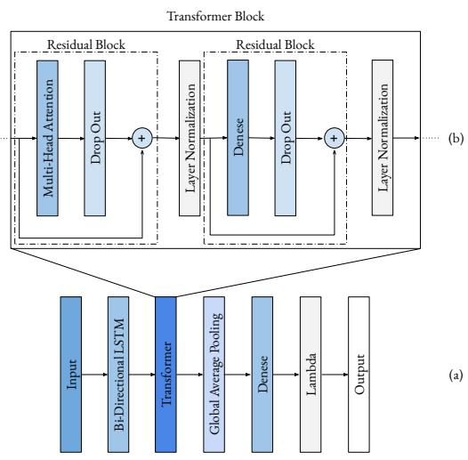
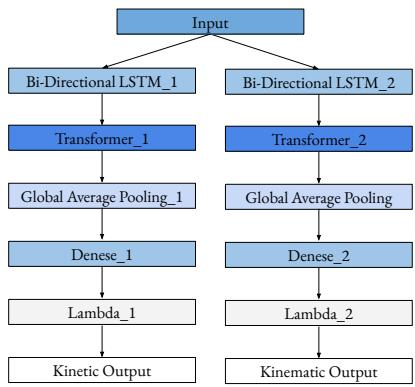

# 基于 Transformer 的利用 sEMG 和 IMU 数据预测步态中全下肢关节角度与力矩的新方法

F.H. Daryakenari1, T. Farizeh∗2

摘要—本研究提出了一种基于 Transformer 的深度学习框架，利用表面肌电（surface electromyography, sEMG）和惯性测量单元（inertial measurement unit, IMU）信号对全下肢关节角度和关节力矩进行长时域预测。设计了两个独立的 Transformer 神经网络（Transformer Neural Networks, TNN）：一个用于运动学（kinematic）预测，另一个用于动力学（kinetic）预测。该模型的开发充分考虑了实时应用，仅使用适用于实验室外环境的可穿戴传感器。研究考虑了两个预测时域以评估短期和长期性能。该网络在两项任务中均取得了高精度，在所有关节上的 Spearman 相关系数均超过 ρ = 0.96，$R ^ { 2 }$ 分数均高于 0.92。值得注意的是，该模型在关节角度预测方面始终优于近期的基准方法，将 RMSE 误差降低了一个数量级。结果证实了 sEMG 和 IMU 信号在捕捉运动学和动力学信息方面的互补作用。这项工作展示了基于 Transformer 的模型在可穿戴设备和机器人应用中进行实时、全肢体生物力学预测的潜力，未来的研究方向包括输入最小化和模态特异性加权策略，以提高模型的效率和精度。

索引词—Transformer 神经网络，关节角度和力矩预测，sEMG，IMU

## I. 引言

在开发实际系统（尤其是涉及重复性任务的系统）时，一个关键要求是优化。如果系统未经优化，我们将面临能耗过高、体力或计算负担增加以及最终导致运行成本上升的风险，而这些都是不可取的。然而，实现这种优化需要一个基础步骤：在整个任务执行过程中分析系统的动力学特性。当系统面向人体应用时——例如在康复、运动表现提升或老年人护理中——由于严格的安全要求和个性化自适应的需求，这种分析变得更加关键。尽管人类可以在无意识中完成广泛的日常运动，但分析这些运动仍然具有挑战性。这在很大程度上归因于人体的生物力学复杂性，以及即使在步态等基本活动中也很难估计外力和运动。这些挑战凸显了在运动过程中开发一种可靠且实时的方法以提取运动学和动力学信息的必要性。

人体运动数据的重要性及其精确提取方法已在广泛的学科领域中得到了深入研究 [1]–[3]。早期的研究主要试图解释人体运动的基础机制，例如关节力和力矩在肌腱动力学中的作用。这些基础知识已成为康复、骨科评估以及提升运动表现的关键资产 [3]–[7]。随后，人体运动分析在娱乐产业（包括电影、动画和电子游戏）中崭露头角，它使得创建逼真且富有表现力的人物动作成为可能 [8]–[12]。近年来，其重要性扩展到了机器人领域，其中关于关节运动学和动力学的详细信息已成为假肢、外骨骼和辅助设备控制的关键 [11]–[15]。

早期的运动分析方法严重依赖数学和统计模型，需要大量的计算工作，这使得它们不适用于实时应用。此外，由于这些模型固有的简化性，它们未能准确模拟人体运动。随后，基于红外（infrared, IR）光学动作捕捉系统的方法得到了开发与完善 [9]–[12]。使用这些系统实现精确的数据采集需要多台红外相机，这使得该方法成本高昂且难以广泛普及。此外，来自红外相机的记录数据需要使用逆运动学和逆动力学求解器进行处理以计算运动参数。由于这种数据转换过程不是即时的，这些系统不适用于实时应用。它们对实验室环境的依赖进一步将其使用限制在受控环境中。尽管存在这些缺点，基于标记点的动作捕捉系统的高精度使其成为可靠的真实基准（ground-truth）数据来源，特别适用于验证其他运动分析方法。

为了解决光学动作捕捉系统的局限性并实现真实世界环境中的人体运动分析，基于传感器的方法应运而生 [16]–[19]。早期的尝试（例如 [20] 和 [21] 的研究）旨在为测量人体运动和表现创造一个自然的环境。他们利用回归神经网络（neural network, NN），通过安装在足部和小腿上的运动传感器获取的角速度和线性加速度数据，来预测矢状面内的髋关节、膝关节和踝关节运动学。尽管传统的神经网络回归器具有开创性，但此后它们已被具有更强时序数据预测能力的更先进模型所取代。为了验证其预测结果，这些早期工作均依赖光学动作捕捉系统作为黄金标准。

如今，惯性测量单元（Inertial Measurement Units, IMU）已成为记录运动数据的一种极具前景的替代方案 [22]–[28]。其便携性以及在实验室环境之外记录数据的能力，使其成为光学动作捕捉系统的实用替代品。事实证明，IMU 数据在提取关节运动学 [24]–[32]、关节动力学 [33]–[35] 或两者兼有 [36]–[42] 方面是可靠的。这种多功能性和实用性使 IMU 成为运动分析领域的变革性工具。IMU 数据在关节动力学估计和预测中展现出了良好的效果 [36]–[42]。但是，其固有的运动学特性限制了其在单独用于精确估计关节动力学时的性能。为了提高关节动力学估计的准确性，可以将 IMU 数据与本身包含动力学信息的其他传感器数据进行融合。这种融合可以增强动力学数据的预测能力，特别是在处理非周期性或扰动引起的运动时。

长期以来，表面肌电图（Surface electromyography, sEMG）数据一直作为关节动力学和肌肉力估计的补充来源而被广泛研究 [43]–[51]。与运动学相比，它在动力学分析中表现出更好的性能 [52]–[55]，但也已被探索用于关节运动学估计或预测，尽管精度相对较低 [44]–[50], [56]–[59]。融合 IMU 和 sEMG 数据有望构建一个用于关节运动学和动力学估计或预测的综合数据集。IMU 数据作为运动学的主要来源和动力学的补充来源，而 sEMG 的作用则恰好相反。sEMG 的一个显著优势在于其预激活特性 [60]，该特性揭示了在实际运动发生之前的肌肉激活状态。这一特征在预测性应用中特别有利，例如辅助机器人技术或需要快速、精确动作的任务。基于这种互补关系，我们假设结合 IMU 和 sEMG 信号能够为准确预测关节角度和力矩提供足够的信息。为实现这一目标，必须建立融合传感器数据与关节运动学和动力学之间的映射关系，类似于 [20] 和 [21] 开创的使用神经网络的方法。

已有多种方法被提出用于将惯性数据映射到关节运动学或动力学，但许多方法在实时性能和泛化能力方面面临挑战。基于卡尔曼滤波（Kalman Filter, KF）的方法，包括扩展卡尔曼滤波（Extended Kalman Filter, EKF），具有较高的计算效率 [30]–[32], [61]–[64]，但它们对线性假设、高斯噪声和较短时间窗口的依赖，使其难以对人体关节运动的非线性和动态特性进行有效建模。此外，这些方法还需要精确的系统和噪声建模，这通常既困难又容易出错。类似地，肌骨模型（Musculoskeletal Models, MSMs）通过结合解剖学参数提供了极高的生物力学保真度 [27], [36]，但其受试者特异性以及高计算需求限制了其可扩展性和实时应用性。调优和求解这些模型的复杂性仍然是在人机交互等交互式场景中应用的主要障碍。

人工智能（Artificial Intelligence, AI）特别是深度学习（Deep Learning, DL）的最新进展，使得对人体运动等复杂非线性系统的建模成为可能。神经网络（Neural Networks, NNs），尤其是长短期记忆网络（Long Short-Term Memory, LSTM）和编码器–解码器（encoder–decoder）模型等序列架构，由于具备捕获时间依赖关系的能力，非常适合用于时间序列预测。已有多项研究应用 DL 技术从 IMU [65]–[69] 或 sEMG 数据 [70]–[78] 中预测关节运动学和动力学。尽管这些方法大多依赖单一模态，从而限制了泛化能力。值得注意的是，Wang 等人 [15] 提出了一种使用时间卷积网络–双向 LSTM（Temporal Convolution Network–Bidirectional LSTM）的 sEMG–IMU 融合模型用于关节角度预测，但未包含关节力矩估计。据作者所知，最近唯一尝试从融合信号中同时估计运动学和动力学的研究是 Mohammadi Moghadam 等人 [41]，他们表明卷积神经网络（Convolutional Neural Networks, CNNs）的表现优于传统机器学习（ML）方法。然而，他们对离线预处理的依赖以及 CNN 有限的时间建模能力，使得该方法不适合实时部署。这些局限性突出了对一种能够实时捕获时空特征并准确预测关节角度和力矩的统一多模态方法的需求。

在序列预测任务中受到广泛关注的基于神经网络的方法之一是 Transformer 神经网络（Transformer Neural Networks，TNNs）[79]。TNNs 利用注意力机制（attention mechanism）[80], [81]，使这些网络能够有效捕捉序列间的关系。TNNs 最初设计用于序列翻译任务，利用自注意力（self-attention）机制来识别和建模序列内元素之间的关系，例如句子中的单词。为了应对实时应用中预测延迟的挑战，TNNs 引入了多头注意力（Multi-Head Attention）模块。这种并行架构通过同时处理多个注意力机制，显著加速了序列预测。在运动学和动力学预测方面，TNNs 具有独特的优势。它们将神经网络的通用优势与分析数据序列的能力相结合，能够同时捕捉短期和长期依赖关系。在处理运动学和动力学数据时，这一特性尤为宝贵，因为这些模式通常跨越较长的时间序列。

此外，TNNs 中的多头注意力结构使其特别适用于涉及融合传感输入数据的任务。该结构根据各数据源的重要性动态分配权重，使网络能够根据任务需求优先处理某些传感器输入。这在传感器数据融合（例如 IMU 和 sEMG 信号）对精确预测至关重要的场景中尤为有利。此外，TNNs 的编码器-解码器（encoder-decoder）架构增强了其对噪声传感器输出的鲁棒性，减少了在将数据输入网络之前对大量预处理或特征提取的依赖。虽然 TNNs 最初是为序列翻译任务开发的，但只需极少的修改，其架构即可适用于时间序列预测。这种适应性使其成为需要实时序列预测的应用（例如人体运动建模或机器人控制）的极具吸引力的选择。

本文的目标是将惯性测量单元（IMU）传感数据与表面肌电（sEMG）传感数据进行融合，以预测行走——这一重要日常生活活动（ADL）中的下肢关节运动学和动力学。为了验证我们的预测精度，我们将利用来自光学动作捕捉摄像机的数据作为黄金标准。我们假设 IMU 数据可以作为运动运动学信息的主要来源和动力学信息的辅助来源，而 sEMG 数据可以作为动力学信息的主要来源和运动学信息的辅助来源。通过结合这两种互补的数据源，我们旨在实现行走过程中精确的关节角度和力矩预测。对于这一回归任务，我们将利用 Transformer 神经网络（TNNs）作为将融合传感数据映射到关节运动学和动力学的模型。TNNs 已展现出保持序列内和序列间关系的能力，这使得它们在捕捉人体运动数据中复杂的时间动态方面特别有效。

除了标准的下一步预测之外，我们还将通过重点关注双下肢所有主要自由度上的两个预测时间跨度来探索 TNNs 的鲁棒性：一个近期预测（未来 30 毫秒）和一个远期预测（未来 250 毫秒）。此外，我们还将检验该网络处理运动速度突变的能力，以此模拟涉及人体突然运动的场景。这项研究将评估我们的方法适应现实世界动态条件的能力。我们相信，所提出的训练模型将为该领域的未来研究提供宝贵的资源。通过利用大型数据集，我们的模型可以作为迁移学习和元学习应用的基础，使研究人员能够基于我们的研究结果进一步推进人体运动建模与预测的发展。

## II. 方法

## A. 方法概述

为了实现我们的目标，我们需要三类数据：IMU、sEMG 和动作捕捉（Motion Capture）。其中，IMU 和 sEMG 数据将被处理并用作我们 TNN 的输入，而动作捕捉数据将作为关节角度和力矩的真实值（ground truth），而非直接用作输入。这些真实值代表髋关节、膝关节和踝关节的关节角度与力矩，这也是 TNN 的预测任务所在。具体而言，TNN 的输出将执行多元回归，以在两个不同的预测时间跨度上预测这些值：30 毫秒的近期预测和 250 毫秒的远期预测。此外，作为对网络鲁棒性研究的一部分，特别是在涉及运动突变的情景中，输入数据将包含此类变化，以评估网络在动态条件下的性能。接下来的章节将详细介绍所使用的数据集、预处理步骤、网络输入的数据准备以及所提出的 TNN 架构。

## B. 数据集

为了训练我们的模型以预测关节运动学和动力学，必须拥有一个包含 sEMG、IMU 和光学动作捕捉数据的综合数据集。在本研究中，我们使用了来自 Camargo et al. [55] 的开源数据集，该数据集包含来自 22 名健康成年受试者（平均年龄：$2 1 \pm 3 . 4$ 岁，身高：$1 . 7 \pm 0 . 0 7 \mathrm { ~ m ~ }$，体重：$6 8 \pm 1 0 . 3 9 \mathrm { k g } )$ 的记录数据。该数据集包括从右腿 11 块肌肉采集的 sEMG 数据：臀中肌、腹外斜肌、半腱肌、股薄肌、股二头肌、股直肌、股外侧肌、股内侧肌、比目鱼肌、胫骨前肌和腓肠肌内侧头。原始 sEMG 信号以 1000 Hz 的频率记录，并使用数字带通滤波器（20–400 Hz，20 阶巴特沃斯滤波器）进行处理。IMU 数据采集自躯干以及右下肢的三个节段——大腿、小腿和足部——传感器放置在每个节段长度的大约四分之三处。IMU 信号的采样频率为 200 Hz，并使用数字低通滤波器（截止频率 100 Hz，6 阶巴特沃斯滤波器）进行滤波。

双腿的动作捕捉数据以 200 Hz 的采样频率进行采集，并采用低通滤波器（截止频率 6 Hz，4阶零滞后 Butterworth 滤波器）进行处理，同时辅以 1000 Hz 的地面反作用力测量数据，该测量数据使用低通滤波器（截止频率 15 Hz，10阶零滞后 Butterworth 滤波器）进行滤波。尽管还使用测角仪记录了关节角度，但在我们的研究中不会使用这部分数据。为了基于动作捕捉相机记录的数据提取关节角度和力矩，数据集作者使用 Opensim 求解了逆运动学和逆动力学 [55]。该数据集涵盖了多种运动模式，包括平地行走、跑步机行走、爬楼梯和斜坡行走。在本研究中，我们专门聚焦于跑步机行走数据，因为它为研究运动模式的变化提供了一个契机——这也是我们研究的核心目标之一。

在上述数据集中，跑步机行走实验在 28 种速度下进行，速度范围为 0.5 m/s 至 1.85 m/s，递增步长为 0.05 m/s。各速度穿插在七次试验中，每次试验包含四种速度，按模拟运动渐变的时序排列。例如，一次试验可能包含从静止过渡到慢速，然后到中快速和快速，最后减速到中慢速并停止（例如，第一次试验的速度为 0.5 m/s、1.2 m/s、1.55 m/s、0.85 m/s，第二次试验为 0.55 m/s、1.25 m/s、1.6 m/s、0.9 m/s）。这种渐进式速度变化模式提供了一个受控的实验环境，用以探究运动变化对我们模型预测结果的影响。

## C. 预处理

在获取数据集后，下一步是对传感器数据进行预处理以提取有意义的信息。预处理的一个重要方面是确保所采用的方法适用于实时应用。正如 II-B 节数据集描述中所述，发布的数据集已经包含了对 IMU 和动作捕捉数据的预处理，我们认为这已足以满足我们的研究需求。该预处理在保持实时可行性的同时，确保了信号的干净与可靠。然而，由于 sEMG（表面肌电）数据天生比 IMU 和动作捕捉数据包含更多噪声，因此需要额外的预处理步骤。基于以往研究 [41], [82] 建议的方法，sEMG 数据经过以下处理流程：

1) 高通滤波——应用截止频率为 25 Hz 的二阶 Butterworth 滤波器，以去除低频噪声和基线漂移。

2) 整流——对信号进行整流以获取绝对值，确保所有信号值均为正值。

3) 低通滤波——使用截止频率为 6 Hz 的二阶 Butterworth 滤波器来提取信号包络。

该预处理过程将初步处理后的 sEMG 信号转换为一种简化的特征——信号包络，而无需依赖复杂的特征提取方法。这种方法的简单性与高效性确保了其具有鲁棒性，并适用于实时应用。

由于 IMU 和 sEMG 传感器的工作采样频率不同（IMU 为 200 Hz，sEMG 为 1000 Hz），因此需要最后一步来统一数据以进行融合。IMU 和预处理后的 sEMG 数据均被降采样至 100 Hz，以匹配从动作捕捉数据中计算出的关节角度和力矩的采样频率。在该预处理阶段结束时，所有数据流——IMU、处理后的 sEMG，以及来自动作捕捉相机的关节运动学和动力学数据——均已对齐，并准备调整为适合输入神经网络的形式。

在将数据输入神经网络之前，必须对其进行正确的结构化处理。我们的数据集包含了来自 22 名受试者的 IMU、sEMG 以及真实关节运动学和动力学数据。为确保网络的泛化能力，我们采用了留一受试者（leave-one-subject-out）验证和测试方法。具体而言，20 名受试者的数据用于训练，1 名受试者的数据保留用于验证，剩余 1 名受试者的数据用于测试。为了防止对特定试验或受试者产生学习偏差，我们在数据准备前对跨试验和受试者的数据进行了打乱。此步骤确保了网络学习到代表整个数据集的模式，而不是过拟合于特定个体或序列。

为了准备输入网络的数据，我们采用滑动窗口方法将其分割为帧，如图 Fig.1 所示。每个窗口包含 125 个样本点，对应于 100 Hz 采样频率下的 1.25 秒。这 125 个样本点的 IMU 和 sEMG 数据作为输入，而随后的 25 个样本点（250 毫秒）的关节角度和力矩则代表每帧的目标预测值。然后窗口滑动 4 个样本点（0.04 秒）以生成下一帧。为了在受试者和传感器之间标准化数据，我们采用了 Min-Max 归一化（Min-Max Normalization）方法。该归一化将所有特征缩放到统一的范围内，有助于一致的训练并提高学习过程的稳定性。在这一步结束时，数据集已被分割、归一化，并格式化为适用于神经网络训练、验证和测试的输入-输出对。

## D. 神经网络架构

所提出的用于关节运动学和动力学预测的模型是一个基于回归的 Transformer 神经网络（Transformer Neural Network, TNN）。由于最初的 Transformer 架构是为句子翻译等序列到序列（sequence-to-sequence）任务设计的，因此对其进行了修改以适应多变量时间序列预测。网络的整体架构如图 Fig.2(a) 所示。为了确保最佳的权重调整并解决梯度消失或爆炸等问题，我们在 Transformer 块之前加入了一个双向 LSTM（Bidirectional LSTM, Bi-LSTM）层。该层在正向和反向两个方向上处理输入序列，改善了梯度流动并减轻了序列遗忘问题。处理后的输出随后被送入 Transformer 块，该块严格遵循 [79] 中定义的结构。Transformer 的一个关键组成部分是其残差连接（residual connections），其灵感来源于残差块（residual blocks）的概念 [83]。如图 Fig.2(b) 所示，其中包含了两种类型的残差块：一种包含带有 dropout 的多头注意力（Multi-Head Attention）机制，另一种包含带有 dropout 的全连接层（dense layer）。这些残差连接创建了旁路路径，缓解了梯度消失问题，使网络能够保留更长的时间依赖性。

  
Fig. 1. 从输入和输出数据中提取数据帧的示意图。

在网络的最后阶段（Fig.2(a)），我们利用一个 lambda 层将全连接层的输出重塑为多变量回归格式，使其与真实数据（ground truth data）的维度保持一致。对于该架构，采用了两个并行的 TNN，分别专用于不同的预测任务：一个用于关节角度预测，另一个用于关节力矩预测，如图 Fig.3 所示。

网络组件的配置如 Table I 所示。所有超参数均基于广泛的试错法进行选择，以优化性能。网络使用 Keras 和 TensorFlow 库 [84] 进行实现和训练。使用的损失函数为均方误差（Mean Squared Error, MSE），并选择平均绝对误差（Mean Absolute Error, MAE）作为评估指标。该架构旨在鲁棒地预测不同预测跨度下的未来关节角度和力矩，从而实现针对时间序列数据的精确多变量回归。

## III. 结果

所提出的运动学和动力学网络训练了 40 个轮次（epochs），批大小（batch size）为 128。网络的主要目标是预测 250 毫秒时域内的关节角度和力矩。为了评估网络性能，提取了该时域内的两个特定样本：一个在 30 毫秒处，另一个在 250 毫秒处。用于性能评估的测试数据来自于在预处理和数据准备阶段被排除的测试受试者。网络预测值与相同输入的真实值如图 4 所示。为了有效评估结果，我们从测试受试者中随机选择了一批连续的 1000 个数据帧（相当于 10 秒）来计算误差。然而，由于篇幅限制，图 4 的可视化中仅展示了 200 个数据帧（2 秒）。

TABLE I  
神经网络超参数

<table><tr><td>超参数</td><td>数值</td></tr><tr><td>Bi-LSTM 单元数</td><td>125</td></tr><tr><td>嵌入维度</td><td>256</td></tr><tr><td>多头注意力头数</td><td>8</td></tr><tr><td>全连接层神经元数</td><td>512</td></tr><tr><td>Dropout 率</td><td>0.1</td></tr><tr><td>层归一化 epsilon</td><td> $10^{-6}$ </td></tr><tr><td>优化器- $Adam, \beta_1$ </td><td>0.9</td></tr><tr><td>优化器- $Adam, \beta_2$ </td><td>0.999</td></tr><tr><td>初始学习率</td><td>0.0008</td></tr><tr><td>AMSGrad</td><td>True</td></tr></table>

  
Fig. 2. 神经网络架构。(a) 网络的总体层结构，(b) Transformer 模块内部。

为了更好地理解网络性能，我们在 10 秒的数据上从定性和定量两方面汇报了预测结果。对于定性评估，我们使用决定系数 $( R ^ { 2 } )$ 以及斯皮尔曼相关系数（Spearman correlation，基于 Shapiro-Wilk 检验，p 值 < 0.05）。这两个统计指标有助于我们理解图 4 中所见的预测曲线与真实曲线之间的相似性和一致性。对于定量评估，我们报告了平均绝对误差（MAE）、均方根误差（RMSE）和归一化均方根误差（nRMSE）。所有上述指标均进行了评估

  
Fig. 3. 所提出的用于近时域（Close Horizon, CH）和远时域（Distant Horizon, DH）关节角度与关节力矩预测的网络，并在表 II 中进行了汇报。

## IV. 讨论

本研究的主要目标是在扩展的时间跨度内预测完整的下肢关节角度和关节力矩。为此，我们使用来自 IMU 和 sEMG 传感器的数据作为两个独立设计的 Transformer 神经网络（Transformer Neural Networks, TNNs）的输入：一个专门用于关节角度预测，另一个用于关节力矩预测。研究中定义了两个不同的预测时间跨度：30 毫秒的短期跨度（近程跨度，close-horizon, CH）和 250 毫秒的长期跨度（远程跨度，distant-horizon, DH）。选择这些预测跨度是为了系统地评估网络在即时和远期未来时间范围内的预测性能。我们的基本假设认为，结合使用 IMU 和 sEMG 信号能够提供互补的运动学和神经肌肉信息，这对于准确预测关节角度和关节力矩至关重要。

Fig. 4 和 Table II 的统计结果均表明，该网络准确预测了未知测试受试者的运动学和动力学数据。针对运动学预测的 Spearman 相关性检验表明，预测值与真实值数据之间存在具有统计学意义的强正相关。具体而言，对于近程跨度（CH）预测，相关系数的最低值为 $\rho = 0 . 9 7 3 \ ( p < 0 . 0 0 1 )$ ，而对于远程跨度（DH）预测，其最低值为 $\rho = 0 . 9 6 3 \ ( p < 0 . 0 0 1 )$ ）。在所有关节中，左踝关节的相关系数最低，但仍表现出很强的正相关关系。

除 Spearman 相关系数外，还使用决定系数 $R ^ { 2 }$ 进一步评估了网络的预测性能。该模型在左踝关节处取得的最低 $R ^ { 2 }$ 值在 CH 下为 0.963，在 DH 下为 0.949；CH 下的 RMSE 为 $0 . 0 4 2 ^ { \circ }$、MAE 为 0.028◦，DH 下的 RMSE 为 0.050◦、MAE 为 0.035◦。这些结果表明，对于准确度最低的关节，真实关节角度中约 95%（CH）和 92%（DH）的方差仍能被该模型的预测所解释。这表明所提出的网络对下肢运动学和动力学展现出了强大的预测能力。

对于预测的动力学结果，Spearman（斯皮尔曼）相关性检验表明预测的关节力矩与真实关节力矩之间存在显著的统计学相关性。在 CH（近距离视界）中，Spearman 相关系数最低值为左踝关节的 $\rho = 0 . 9 7 3 \ ( p$ $< 0 . 0 0 1 )$，在 DH（远距离视界）中，左踝关节同样为 $\rho = 0 . 9 7 3 \ ( p < 0 . 0 0 1 )$。所有关节力矩的 $R ^ { 2 }$ 分数均表明具有很强的预测能力。在 CH 中，预测关节力矩最低的 $R ^ { 2 }$ 分数属于左膝，得分为 0.952（MAE = 0.022 N.m/kg，RMSE = 0.03 N.m/kg）；而在 DH 中，最低的 $R ^ { 2 }$ 分数属于右膝，得分为 0.924（MAE = 0.025 N.m/kg，$\mathrm { R M S E } \ : = \ : 0 . 0 3 3$ N.m/kg）。同时，关节力矩记录到的最高 MAE 和 RMSE 在 CH（MAE = 0.038 N.m/kg，RMSE = 0.051 N.m/kg）和 DH（MAE = 0.041 N.m/kg，RMSE = 0.061 N.m/kg）中均出现在左踝。基于归一化 RMSE 的最高关节力矩预测误差在 CH 中出现在左踝，误差为 5.46%；在 DH 中出现在右踝，误差为 6.97%。

  
Fig. 4. 在两个时间跨度（30 毫秒，即第 3 个值；250 毫秒，即第 25 个值）下的完整下肢关节角度和关节力矩预测。  
TABLE II  
近距离视界（30 毫秒）- CH 和远距离视界（250 毫秒）- DH 在 10 秒周期内网络预测值的 SPEARMAN’S ρ、决定系数 $R ^ { 2 } ,$ 平均绝对误差 (MAE)、最大 MAE、均方根误差 (RMSE) 以及归一化均方根误差 (NRMSE)。表中包含关节运动学和关节动力学。MAE、RMSE 和 NRMSE 值以百分比报告。

<table><tr><td rowspan="2" colspan="2"></td><td colspan="2"> $\rho$ </td><td colspan="2"> ${R}^{2}$ </td><td colspan="2">MAE*</td><td colspan="2">RMSE*</td><td colspan="2">nRMSE*</td></tr><tr><td>关节</td><td>CH</td><td>DH</td><td>CH</td><td>DH</td><td>CH</td><td>DH</td><td>CH</td><td>DH</td><td>CH</td></tr><tr><td rowspan="6">运动学</td><td>右髋</td><td>0.995</td><td>0.992</td><td>0.988</td><td>0.983</td><td>2.59</td><td>3.04</td><td>3.1</td><td>3.7</td><td>3.84</td><td>4.56</td></tr><tr><td>右膝</td><td>0.982</td><td>0.974</td><td>0.989</td><td>0.980</td><td>2.64</td><td>3.16</td><td>3.2</td><td>3.9</td><td>3.36</td><td>4.14</td></tr><tr><td>右踝</td><td>0.985</td><td>0.976</td><td>0.971</td><td>0.954</td><td>2.15</td><td>3.47</td><td>2.6</td><td>4.4</td><td>3.08</td><td>4.84</td></tr><tr><td>左髋</td><td>0.993</td><td>0.992</td><td>0.986</td><td>0.988</td><td>2.97</td><td>2.53</td><td>3.5</td><td>3.2</td><td>4.16</td><td>3.81</td></tr><tr><td>左膝</td><td>0.978</td><td>0.972</td><td>0.979</td><td>0.972</td><td>3.48</td><td>4.04</td><td>4.3</td><td>5</td><td>4.61</td><td>5.61</td></tr><tr><td>左踝</td><td>0.973</td><td>0.963</td><td>0.963</td><td>0.949</td><td>2.86</td><td>3.58</td><td>4.2</td><td>5</td><td>4.62</td><td>5.59</td></tr><tr><td rowspan="6">动力学</td><td>右髋</td><td>0.985</td><td>0.979</td><td>0.955</td><td>0.933</td><td>2.14</td><td>2.50</td><td>2.7</td><td>3.1</td><td>4.54</td><td>5.35</td></tr><tr><td>右膝</td><td>0.983</td><td>0.966</td><td>0.959</td><td>0.924</td><td>2.15</td><td>2.5</td><td>2.6</td><td>3.3</td><td>4.28</td><td>5.35</td></tr><tr><td>右踝</td><td>0.966</td><td>0.937</td><td>0.981</td><td>0.945</td><td>2.40</td><td>4.1</td><td>3.1</td><td>5.9</td><td>3.46</td><td>6.97</td></tr><tr><td>左髋</td><td>0.981</td><td>0.979</td><td>0.965</td><td>0.952</td><td>2.5</td><td>2.7</td><td>3.2</td><td>3.5</td><td>4.79</td><td>5.38</td></tr><tr><td>左膝</td><td>0.966</td><td>0.956</td><td>0.952</td><td>0.930</td><td>2.2</td><td>2.6</td><td>3.0</td><td>3.8</td><td>4.14</td><td>5.38</td></tr><tr><td>左踝</td><td>0.952</td><td>0.937</td><td>0.962</td><td>0.950</td><td>3.8</td><td>4.1</td><td>5.1</td><td>6.1</td><td>5.46</td><td>6.78</td></tr></table>

\* 表中报告的 MAE、RMSE、nRMSE 值均乘以了 100。

在关节运动学中，基于 MAE 和 RMSE，在 CH $( \mathrm { M A E } = 0 . 0 4 8 ^ { \circ }$ , RMSE $= \ 0 . 0 4 3 ^ { \circ } )$ 和 DH (MAE = 0.0404◦, RMSE = 0.050◦) 中误差最大的关节均为左膝。然而，DH 中左踝的 RMSE 与左膝相同。根据归一化 RMSE，CH 中误差最大的是左踝（4.62%），而在 DH 中，误差最大的是左膝（5.61%）。正如所观察到的，较高的误差值对应于未佩戴传感器的腿，这表明尽管可以使用对侧腿的传感数据预测一侧腿的关节角度和力矩，但要获得同等精度的预测仍需要在双腿上均佩戴传感器，这与预期相符。此外，在我们研究的六个关节中，预测误差最大的关节通常是左踝，这表明需要更多的传感信息来提高左踝预测的精度。

与同类研究相比，与我们工作最接近的是 Mohammadi-Moghadam 等人 [41] 的研究。通过从融合的 sEMG 和 IMU 信号中提取关键特征，并利用 CNN 作为预测模型，他们成功预测了三个运动平面上的关节角度和关节力矩。然而，他们工作的一个局限在于其网络虽然适用于真实场景，但不支持实时应用。此外，他们的预测时域仅限于单步超前预测，这可能不适用于机器人控制系统。相比之下，我们提出的方法通过实现实时预测并扩展预测时域解决了这些局限性，使其更适用于机器人控制。此外，我们的方法提高了关节角度和关节力矩的预测精度，优于他们所报道的最佳被试间（inter-subject）RMSE 值。

对于髋关节角度，我们的 RMSE 结果在右腿的 CH 和 DH 预测中分别为 $0 . 0 3 1 ^ { \circ }$ 和 $0 . 0 3 7 ^ { \circ }$，在左腿的 CH 和 DH 预测中分别为 $0 . 0 3 5 ^ { \circ }$ 和 $0 . 0 3 2 ^ { \circ }$。与他们报道的 $4 . 7 9 ^ { \circ }$ 相比，这些数值表明了显著的改进。对于膝关节角度，我们的 RMSE 值在右腿的 CH 和 DH 中分别为 $0 . 0 3 2 ^ { \circ }$ 和 $0 . 0 3 9 ^ { \circ }$，在左腿的 CH 和 DH 中分别为 $0 . 0 4 3 ^ { \circ }$ 和 $0 . 0 5 0 ^ { \circ }$。与我们的髋关节角度结果类似，这些数值与他们报道的 $5 . 4 6 ^ { \circ }$ 相比也有所改善。对于踝关节角度，我们的 RMSE 值在右腿的 CH 和 DH 中分别为 $0 . 0 2 6 ^ { \circ }$ 和 $0 . 0 4 4 ^ { \circ }$，在左腿的 CH 和 DH 中分别为 0.042◦ 和 $0 . 0 5 0 ^ { \circ }$。与此同时，他们报道的踝关节角度 RMSE 为 6.52◦。这些结果表明，我们提出的运动学预测模型在所有三个关节角度上均优于他们提出的模型。

对于髋关节力矩，我们的网络在右腿的 CH 和 DH 预测中分别实现了 0.021 N.m/kg 和 0.025 N.m/kg 的 RMSE。对于左腿髋关节力矩，我们在 CH 和 DH 预测中获得的 RMSE 分别为 0.025 N.m/kg 和 0.027 N.m/kg。基线研究 [41] 中报道的跨受试者髋关节力矩 RMSE 在论文中未被明确提及。然而，根据箱线图，髋关节屈曲/伸展误差中位数的下限约为 0.15 N.m/kg，对应于随机森林（Random Forest）方法。对于右膝关节力矩，我们提出的方法在 CH 和 DH 中实现的 RMSE 值分别为 0.026 N.m/kg 和 0.033 N.m/kg，而左膝关节力矩的值分别为 0.030 N.m/kg 和 0.038 N.m/kg。相比之下，Mohammadi-Moghadam et al. 报道的膝关节力矩跨受试者 RMSE 为 0.187 N.m/kg。对于踝关节力矩，右腿在 CH 和 DH 中的 RMSE 分别为 0.031 N.m/kg 和 0.059 N.m/kg，而左腿的值分别为 0.051 N.m/kg 和 0.061 N.m/kg。[41] 中报道的最佳 RMSE 值为 0.066 N.m/kg（针对受试者内预测，由于网络能看到该用户的一部分数据，通常比跨受试者 RMSE 更准确）。因此，我们可以得出结论：我们的模型在动力学预测方面也优于基线模型。

Wang et al. [78] 最近提出了双 Transformer 网络（Dual Transformer Network，DTN），利用 sEMG 信号求解关节运动学与动力学。与提出的 DTN 方法相比，我们的模型超越了短期预测，能够预测未来多步的关节轨迹，从而实现前瞻性控制策略，这对穿戴式辅助设备尤为有利。相比之下，DTN 模型的预测时域固定为 50 ms，在动态环境中可能不足以进行预防性调整。此外，我们的框架旨在预测双腿完整的下肢关节运动学与动力学——包括髋关节、膝关节和踝关节。这种整体建模方法提供了对双侧步态动力学更丰富的理解，并支持其在康复和机器人辅助中的应用。相比之下，DTN 模型仅限于单腿的单平面预测，限制了其在实际应用场景中的通用性。

此外，与 Wang et al. [78] 提出的模型相比，我们的模型在所有预测关节角度上均表现出更低的均方根误差（RMSE），而 DTN 报告的 RMSE 值要高出一个数量级。这突显了我们模型优异的数值精度，这在涉及实时控制或生物力学评估的应用中尤为关键。然而，值得注意的是，DTN 报告了更高的 $R ^ { 2 }$ 和斯皮尔曼相关系数（Spearman’s correlation coefficients），表明预测信号相对于真实值在时间模式对齐和秩次一致性方面更强。这表明，虽然 DTN 有效地捕捉了关节轨迹的形状和趋势，但其在幅值上缺乏精度，可能会限制其在需要精细运动学精度的应用中的使用。尽管我们的运动学模型优于他们的模型，但在右腿的关节力矩预测中，我们的模型在 CH 和 DH 条件下的髋关节和踝关节精度略高，他们报告的值分别为 0.048 Nm/Kg 和 0.060 Nm/Kg。而膝关节力矩在 CH 条件下相同，在 DH 条件下误差略有增加，他们报告的膝关节力矩值为 0.026 Nm/Kg。对于左腿，在 CH 和 DH 条件下，我们模型在髋关节和膝关节上的 RMSE 值均更低，而踝关节在 CH 中具有较低的 RMSE，在 DH 中的 RMSE 略高。此外，我们的模型通过融合 sEMG 和 IMU 数据受益于多模态传感器融合，而 DTN 仅依赖 sEMG，后者可能对信号变异性敏感且缺乏运动状态上下文。综合来看，我们的方法为关节角度和力矩预测提供了更稳健、更精确的解决方案，尤其是在绝对精度至关重要的场景中。

## V. 结论

我们在本项研究中的目标是基于传感器数据在长时域内预测完整的下肢关节力矩和关节角度。为了实现这一目标，我们开发了一种受 Transformer 神经网络（Transformer Neural Networks, TNNs）启发的回归网络，并利用 IMU 和 sEMG 数据对模型进行了训练。我们的假设是，IMU 和 sEMG 信号对于运动学和动力学预测而言均是互补的信息源。结果表明，我们的网络能够准确预测关节力矩和关节角度，展现出优于基线模型的性能。此外，我们认为所提出的模型可以有效地部署在实时应用中，因为其并行神经网络结构提高了计算效率，使其非常适用于实时场景。

## VI. 未来工作

作为未来研究的一个潜在方向，可以通过优化输入数据来探索提高网络计算效率的方法。具体而言，研究是否可以通过减少 IMU 信号或 sEMG 信号的输入数量来实现准确预测将是有益的。此外，在本研究中，关节角度预测网络和关节力矩预测网络对 sEMG 和 IMU 信号进行了同等对待。然而，根据具体的预测任务（运动学还是动力学），在 IMU 和 sEMG 输入之间引入动态加权机制可能会进一步提高预测精度。

## 参考文献

[1] T. S. Buchanan, D. G. Lloyd, K. Manal, and T. F. Besier, “Estimation of muscle forces and joint moments using a forward-inverse dynamics model,” in Medicine and Science in Sports and Exercise, vol. 37, pp. 1911–1916, 11 2005.

[2] P. Crenna and C. Frigo, “Dynamics of the ankle joint analyzed through moment-angle loops during human walking: Gender and age effects,” Human Movement Science, vol. 30, pp. 1185–1198, 12 2011.

[3] S. Chowdhury and N. Kumar, “Estimation of forces and moments of lower limb joints from kinematics data and inertial properties of the body by using inverse dynamics technique,” 2013.

[4] M. G. Hoy, F. E. Zajac, and M. E. Gordon, “A musculoskeletal model of the human lower extremity: The effect of muscle, tendon, and moment arm on the moment-angle relationship of musculotendon actuators at the hip, knee, and ankle,” Journal of biomechanics, 1990

[5] C. N. Maganaris, “A predictive model of moment-angle characteristics in human skeletal muscle: Application and validation in muscles across the ankle joint,” Journal of Theoretical Biology, vol. 230, pp. 89–98, 9 2004.

[6] E. Ceseracciu, Z. Sawacha, and C. Cobelli, “Comparison of markerless and marker-based motion capture technologies through simultaneous data collection during gait: Proof of concept,” PLoS ONE, vol. 9, 3 2014.

[7] R. M. Kanko, E. K. Laende, E. M. Davis, W. S. Selbie, and K. J. Deluzio, “Concurrent assessment of gait kinematics using marker-based and markerless motion capture（基于标记和无标记动作捕捉的步态运动学同步评估）,” Journal of Biomechanics, vol. 127, 10 2021.

[8] D. Thalmann and M. Panne, Computer Animation and Simulation ’97, vol. VIII. Springer Vienna, 1 ed., 9 1997.

[9] L. Herda, P. Fua, R. Plankers, R. Boulic, and D. Thalmann, “Skeletonbased motion capture for robust reconstruction of human motion（用于人体运动鲁棒重建的基于骨架动作捕捉）,” IEEE, 5 2000.

[10] G. Liu and L. McMillan, “Estimation of missing markers in human motion capture（人体动作捕捉中缺失标记点的估计）,” Visual Computer, vol. 22, pp. 721–728, 9 2006.

[11] A. Aristidou, J. Cameron, and J. Lasenby, “Real-time estimation of missing markers in human motion capture-aristidou（人体动作捕捉中缺失标记点的实时估计）,” IEEE, 5 2008.

[12] A. Aristidou and J. Lasenby, “Real-time marker prediction and cor estimation in optical motion capture（光学动作捕捉中的实时标记点预测与旋转中心估计）,” Visual Computer, vol. 29, pp. 7– 26, 2013.

[13] T. S. Buchanan, D. G. Lloyd, K. Manal, and T. F. Besier, “Neuromusculoskeletal modeling: Estimation of muscle forces and joint moments and movements from measurements of neural command（神经-肌肉骨骼建模：通过神经指令测量估计肌肉力量以及关节力矩和运动）,” 2004.

[14] B. Gabbasov, I. Danilov, I. M. Afanasyev, and E. Magid, “Toward a human-like biped robot gait: Biomechanical analysis of human locomotion recorded by kinect-based motion capture system（迈向类人双足机器人步态：基于 Kinect 动作捕捉系统记录的人体运动生物力学分析）,” IEEE International Symposium on Mechatronics and its Applications, 12 2015.

[15] J. ping Wang, S. hua Wang, Y. qing Wang, H. Hu, J. wei Yu, X. Zhao, J. lai Liu, X. Chen, and Y. Li, “A data process of human knee joint kinematics obtained by motion-capture measurement（通过动作捕捉测量获取的人体膝关节运动学数据处理）,” BMC Medical Informatics and Decision Making, vol. 21, 12 2021.

[16] A. Willemsen, J. V. Alste, and H. Boom, “Real-time gait assessment utilizing a new way of accelerometry（利用新型加速度测量方法进行实时步态评估）.”

[17] R. Moe-Nilssen and J. L. Helbostad, “Estimation of gait cycle characteristics by trunk accelerometry（利用躯干加速度测量法估计步态周期特征）,” Journal of Biomechanics, vol. 37, pp. 121–126, 2004.

[18] R. W. Selles, M. A. Formanoy, J. B. Bussmann, P. J. Janssens, and H. J. Stam, “Automated estimation of initial and terminal contact timing using accelerometers; development and validation in transtibial amputees and controls（利用加速度计自动估计初始和终末接触时间：在经胫骨截肢患者和对照组中的开发与验证）,” IEEE Transactions on Neural Systems and Rehabilitation Engineering, vol. 13, pp. 81–88, 3 2005.

[19] P. Picerno, “25 years of lower limb joint kinematics by using inertial and magnetic sensors: A review of methodological approaches（使用惯性和磁传感器研究下肢关节运动学的 25 年：方法学综述）,” 1 2017.

[20] J. Y. Goulermas, D. Howard, C. J. Nester, R. K. Jones, and L. Ren, “Regression techniques for the prediction of lower limb kinematics（用于预测下肢运动学的回归技术）,” Journal of Biomechanical Engineering, vol. 127, pp. 1020–1024, 11 2005.

[21] A. Findlow, J. Y. Goulermas, C. Nester, D. Howard, and L. P. Kenney, “Predicting lower limb joint kinematics using wearable motion sensors（使用可穿戴运动传感器预测下肢关节运动学）,” Gait and Posture, vol. 28, pp. 120–126, 7 2008.

[22] H. Lim, B. Kim, and S. Park, “Prediction of lower limb kinetics and kinematics during walking by a single imu on the lower back using machine learning（利用机器学习通过下背部单个 IMU 预测行走过程中的下肢动力学与运动学）,” Sensors (Switzerland), vol. 20, 1 2020.

[23] I. Weygers, M. Kok, M. Konings, H. Hallez, H. D. Vroey, and K. Claeys, “基于惯性传感器的下肢关节运动学：方法学系统综述（Inertial sensor-based lower limb joint kinematics: A methodological systematic review）,” 2 2020.

[24] W. Niswander, W. Wang, and K. Kontson, “用于下肢关节运动学测量的 IMU 传感器放置优化（Optimization of imu sensor placement for the measurement of lower limb joint kinematics）,” Sensors (Switzerland), vol. 20, pp. 1–16, 11 2020.

[25] W. Pitt, S. H. Chen, and L. S. Chou, “利用基于 IMU 的运动学标记监测急性脑震荡患者双任务步态平衡控制恢复（Using imu-based kinematic markers to monitor dual-task gait balance control recovery in acutely concussed individuals）,” Clinical Biomechanics, vol. 80, 12 2020.

[26] S. Majumder and M. J. Deen, “用于下肢关节实时监测的穿戴式基于 IMU 系统（Wearable imu-based system for realtime monitoring of lower-limb joints）,” IEEE Sensors Journal, vol. 21, pp. 8267–8275, 3 2021.

[27] T. McGrath and L. Stirling, “跑步机行走期间基于穿戴式 IMU 的人体髋关节和膝关节运动学估计（Body-worn imu-based human hip and knee kinematics estimation during treadmill walking）,” Sensors, vol. 22, 4 2022.

[28] L. Carcreff, G. Payen, G. Grouvel, F. Masse, and S. Armand, “利用加速度计和陀螺仪配合简易最小化功能校准任务的三维下肢运动学测量：在无症状受试者中的验证（Three-dimensional lower-limb kinematics from accelerometers and gyroscopes with simple and minimal functional calibration tasks: Validation on asymptomatic participants）,” Sensors, vol. 22, 8 2022.

[29] M. Versteyhe, H. D. Vroey, F. Debrouwere, H. Hallez, and K. Claeys, “一种利用低成本 IMU 传感器估计完整膝关节运动学的新方法，用于易于实施的低成本诊断（A novel method to estimate the full knee joint kinematics using low cost imu sensors for easy to implement low cost diagnostics）,” Sensors (Switzerland), vol. 20, 3 2020.

[30] J. S. Lora-Millan, A. F. Hidalgo, and E. Rocon, “用于控制穿戴式机器人设备的基于 IMU 扩展卡尔曼滤波估计步态下肢矢状面运动学（An imus-based extended kalman filter to estimate gait lower limb sagittal kinematics for the control of wearable robotic devices）,” IEEE Access, vol. 9, pp. 144550– 144554, 2021.

[31] L. Sy, M. Raitor, M. D. Rosario, H. Khamis, L. Kark, N. H. Lovell, and S. J. Redmond, “利用减少的可穿戴传感器数量估计下肢运动学（Estimating lower limb kinematics using a reduced wearable sensor count）,” IEEE Transactions on Biomedical Engineering, vol. 68, pp. 1293–1304, 4 2021.

[32] M. V. Potter, S. M. Cain, L. V. Ojeda, R. D. Gurchiek, R. S. McGinnis, and N. C. Perkins, “评估用于在各种行走步态中估计人体下肢运动学的误差状态卡尔曼滤波方法（Evaluation of error-state kalman filter method for estimating human lower-limb kinematics during various walking gaits）,” Sensors, vol. 22, 11 2022.

[33] M. Lee and S. Park, “利用机器学习通过贴附于骶骨的单个 IMU 估计行走过程中的三维下肢动力学数据（Estimation of three-dimensional lower limb kinetics data during walking using machine learning from a single imu attached to the sacrum）,” Sensors (Switzerland), vol. 20, pp. 1–16, 11 2020.

[34] C. J. Lee and J. K. Lee, “用于估计关节动力学的基于惯性动作捕捉的可穿戴系统：系统综述（Inertial motion capture-based wearable systems for estimation of joint kinetics: A systematic review）,” 4 2022.

[35] S. Krishnakumar, B. J. F. van Beijnum, C. T. Baten, P. H. Veltink, and J. H. Buurke, “利用 IMU 估计动力学以在 ACL 康复期间监测并辅助临床决策：系统综述（Estimation of kinetics using imus to monitor and aid in clinical decision-making during acl rehabilitation: A systematic review）,” 4 2024.

[36] E. Dorschky, M. Nitschke, A. K. Seifer, A. J. van den Bogert, and B. M. Eskofier, “利用肌肉骨骼模型的最优控制从惯性传感器数据估计步态运动学和动力学（Estimation of gait kinematics and kinetics from inertial sensor data using optimal control of musculoskeletal models）,” Journal of Biomechanics, vol. 95, 10 2019.

[37] M. Mundt, W. Thomsen, T. Witter, A. Koeppe, S. David, F. Bamer, W. Potthast, and B. Markert, “基于人工神经网络的步态过程中下肢关节角度与力矩预测,” Medical and Biological Engineering and Computing, vol. 58, pp. 211–225, 2020.

[38] M. Mundt, A. Koeppe, S. David, T. Witter, F. Bamer, W. Potthast, and B. Markert, “基于人工神经网络利用仿真和实测 IMU 数据进行步态力学估计,” Frontiers in Bioengineering and Biotechnology, vol. 8, pp. 1–16, 2020.

[39] D. Stanev, K. Filip, D. Bitzas, S. Zouras, G. Giarmatzis, D. Tsaopoulos, and K. Moustakas, “康复中基于标记和 IMU 方案的实时肌肉骨骼运动学与动力学分析,” Sensors, vol. 21, pp. 1–20, 3 2021.

[40] C. Yi, F. Jiang, M. Z. A. Bhuiyan, C. Yang, X. Gao, H. Guo, J. Ma, and S. Su, “基于数据驱动神经信号解码的智慧医疗下肢运动学与动力学在线预测,” Future Generation Computer Systems, vol. 114, pp. 96–105, 1 2021.

[41] S. M. Moghadam, T. Yeung, and J. Choisne, “基于可穿戴传感器预测下肢关节运动学、动力学及肌力的机器学习模型准确性比较,” Scientific Reports, vol. 13, pp. 1–16, 2023.

[42] H. Dimitrov, A. M. Bull, and D. Farina, “用于综合运动活动的高密度 EMG、IMU、动力学与运动学开源数据集,” Scientific Data, vol. 10, 12 2023.

[43] M. M. Ardestani, X. Zhang, L. Wang, Q. Lian, Y. Liu, J. He, D. Li, and Z. Jin, “人体下肢关节力矩预测：一种小波神经网络方法,” Expert Systems with Applications, vol. 41, pp. 4422–4433, 7 2014.

[44] J. A. Brantley, S. Member, T. P. Luu, S. Nakagome, J. L. Contreras-Vidal, and S. Member, “地面运动过程中基于表面肌电信号的下肢关节运动学预测,” 2017.

[45] J. Chen, X. Zhang, Y. Cheng, and N. Xi, “利用深度信念网络基于表面肌电信号连续估计人体下肢关节角度,” Biomedical Signal Processing and Control, vol. 40, pp. 335– 342, 2 2018.

[46] L. Bi, A. Feleke, and C. Guan, “面向人机协作的基于肌电信号的人体上肢连续运动意图预测综述,” 5 2019.

[47] B. Xiong, N. Zeng, H. Li, Y. Yang, Y. Li, M. Huang, W. Shi, M. Du, and Y. Zhang, “人体下肢关节力矩的智能预测：一种人工神经网络方法,” IEEE Access, vol. 7, pp. 29973–29980, 2019.

[48] Y. Huang, Z. He, Y. Liu, R. Yang, X. Zhang, G. Cheng, J. Yi, J. P. Ferreira, and T. Liu, “基于深度循环神经网络的实时膝关节预期运动预测,” IEEE Sensors Journal, vol. 19, pp. 11503–11509, 12 2019.

[49] J. Liang, Z. Shi, F. Zhu, W. Chen, X. Chen, and Y. Li, “基于 sEMG 信号的高斯过程自回归关节角度预测,” Frontiers in Public Health, vol. 9, 5 2021.

[50] S. P. Sitole and F. C. Sup, “基于 EMG 信号的人体关节力学连续预测：基于模型与无模型方法综述（Continuous prediction of human joint mechanics using emg signals: A review of model-based and modelfree approaches）,” IEEE Transactions on Medical Robotics and Bionics, vol. 5, pp. 528–546, 8 2023.

[51] N. A. E. Yaakoubi, C. McDonald, and O. Lennon, “步态运动学与动力学预测：EMG 和 EEG 信号的应用及其对预测精度贡献的系统综述（Prediction of gait kinematics and kinetics: A systematic review of emg and eeg signal use and their contribution to prediction accuracy）,” 10 2023.

[52] S. J. Olney and D. A. Winter, “基于 EMG 和运动学数据预测步行中的膝关节和踝关节力矩（Predictions of knee and ankle moments of force in walking from emg and kinematic data）,” 1985.

[53] T. K. Koo and A. F. Mak, “利用 EMG 驱动的神经肌肉骨骼模型预测肘部动态运动的可行性（Feasibility of using emg driven neuromusculoskeletal model for prediction of dynamic movement of the elbow）,” Journal of Electromyography and Kinesiology, vol. 15, pp. 12–26, 2 2005.

[54] Q. Shao, D. N. Bassett, K. Manal, and T. S. Buchanan, “用于估计中风患者肌肉力和关节力矩的 EMG 驱动模型（An emg-driven model to estimate muscle forces and joint moments in stroke patients）,” Computers in Biology and Medicine, vol. 39, pp. 1083–1088, 12 2009.

[55] J. Camargo, D. Molinaro, and A. Young, “在多种行走任务中预测生物关节力矩（Predicting biological joint moment during multiple ambulation tasks）,” Journal of Biomechanics, vol. 134, 3 2022.

[56] K. G. Rabe and N. P. Fey, “利用高斯过程回归评估肌电与超声肌动图传感器融合以估计下肢运动学（Evaluating electromyography and sonomyography sensor fusion to estimate lower-limb kinematics using gaussian process regression）,” Frontiers in Robotics and AI, vol. 9, 3 2022.

[57] Y. Koike and M. Kawato, “生物控制论：使用神经网络模型从表面肌电信号估计动态关节力矩和轨迹生成（Biological cybernetics estimation of dynamic joint torques and trajectory formation from surface electromyography signals using a neural network model）,” Biol. Cybern, vol. 73, p. 300, 1995.

[58] D. G. Lloyd and T. F. Besier, “用于体内估计肌肉力和膝关节力矩的 EMG 驱动肌肉骨骼模型（An emg-driven musculoskeletal model to estimate muscle forces and knee joint moments in vivo）,” Journal of Biomechanics, vol. 36, pp. 765–776, 6 2003.

[59] Q. Zhang, R. Hosoda, and G. Venture, “用于基于肌电（EMG）的动态运动控制的人体关节运动估计（Human joint motion estimation for electromyography (emg)-based dynamic motion control）,” 35th Annual International Conference of the IEEE EMBS, 2013.

[60] R. Merletti and G. L. Cerone, “教程：表面 EMG 采集、调理和预处理的最佳实践（Tutorial. surface emg detection, conditioning and pre-processing: Best practices）,” Journal of Electromyography and Kinesiology, vol. 54, 10 2020.

[61] A. Baghdadi, L. A. Cavuoto, and J. L. Crassidis, “步态中基于踝部 IMU 数据利用卡尔曼滤波进行髋关节和躯干运动学估计（Hip and trunk kinematics estimation in gait through kalman filter using imu data at the ankle）,” IEEE Sensors Journal, vol. 18, pp. 4253–4260, 5 2018.

[62] M. Abdelhady, A. J. V. D. Bogert, and D. Simon, “用于测量下肢动力学和运动学的高保真可穿戴系统（A high-fidelity wearable system for measuring lower-limb kinetics and kinematics）,” IEEE Sensors Journal, vol. 19, pp. 12482–12493, 12 2019.

[63] W. Teufl, M. Miezal, B. Taetz, M. Frohlichi, and G. Bleser, “基于惯性传感器的静态和动态运动及物理治疗特定动作三维关节运动学的有效性（Validity of inertial sensor based 3d joint kinematics of static and dynamic sport and physiotherapy specific movements）,” PLoS ONE, vol. 14, 2 2019.

[64] L. Sy, N. H. Lovell, and S. J. Redmond, “使用李群约束扩展卡尔曼滤波结合精简可穿戴 IMU 数量与距离测量估计下肢运动学（Estimating Lower Limb Kinematics Using a Lie Group Constrained Extended Kalman Filter with a Reduced Wearable IMU Count and Distance Measurements）,” MDPI Sensors, 2020.

[65] X. Marimon, I. Mengual, C. L. de Celis, A. Portela, J. Rodríguez-Sanz, I. A. Herraez, 和 A. Pérez-Bellmunt, “使用 IMU 传感器对健康年轻人的步态进行运动学分析：探索用于临床应用的相关机器学习特征,” Bioengineering, vol. 11, 2 2024.

[66] M. S. B. Hossain, Z. Guo, 和 H. Choi, “在多种行走条件下使用 IMU 传感器估计下肢关节力矩和三维地面反作用力：一种深度学习方法,” IEEE Journal of Biomedical and Health Informatics, vol. 27, pp. 2829–2840, 6 2023.

[67] M. S. Renani, A. M. Eustace, C. A. Myers, 和 C. W. Clary, “在深度学习模型训练中使用合成 IMU 信号显著提升关节运动学预测的准确性,” Sensors, vol. 21, 9 2021.

[68] V. Hernandez, D. Dadkhah, V. Babakeshizadeh, 和 D. Kulic, “基于可穿戴传感器估计步行和跑步时的下半身运动学：一种深度学习方法,” Gait and Posture, vol. 83, pp. 185–193, 1 2021.

[69] Y. L. Chen, I. J. Yang, L. C. Fu, J. S. Lai, H. W. Liang, 和 L. Lu, “基于图卷积网络的 IMU 下肢运动轨迹估计,” IEEE Sensors Journal, vol. 21, pp. 24549–24557, 11 2021.

[70] E. Kaya 和 H. Argunsah, “基于 LSTM 深度学习技术探索关节角度和 sEMG 信号对关节力矩预测精度的贡献,” Computer Methods in Biomechanics and Biomedical Engineering, 2024.

[71] J. Zhang, Y. Zhao, F. Shone, Z. Li, A. F. Frangi, S. Q. Xie, 和 Z. Q. Zhang, “用于肌肉骨骼建模的物理感知深度学习：利用表面肌电预测肌肉力和关节运动学,” IEEE Transactions on Neural Systems and Rehabilitation Engineering, vol. 31, pp. 484–493, 2023.

[72] Q. Song, X. Ma, 和 Y. Liu, “基于深度学习方法利用 sEMG 信号对下肢关节角度进行连续在线预测,” Computers in Biology and Medicine, vol. 163, 9 2023.

[73] Y. Shi, S. Ma, Y. Zhao, 和 Z. Zhang, “基于 sEMG 估计肌肉力和关节运动学的物理感知少样本学习,” archive, 7 2023.

[74] M. T. N. Truong, A. E. A. Ali, D. Owaki, 和 M. Hayashibe, “使用长短期记忆网络基于 EMG 估计下肢关节角度和力矩,” Sensors, vol. 23, 3 2023.

[75] A. Foroutannia, M. R. Akbarzadeh-T, 和 A. Akbarzadeh, “用于髋关节外骨骼助行机器人中基于 EMG 预测关节位置的深度学习策略,” Biomedical Signal Processing and Control, vol. 75, 5 2022.

[76] W. Wu, K. R. Saul, 和 H. Huang, “利用强化学习基于肌电图或关节运动学估计人体关节力矩：基于肌肉骨骼生物力学的一种替代方案,” Journal of Biomechanical Engineering, vol. 143, 4 2021.

[77] L. Zhang, Z. Li, Y. Hu, C. Smith, E. M. Farewik, and R. Wang, “Ankle joint torque estimation using an emg-driven neuromusculoskeletal model and an artificial neural network model,” IEEE Transactions on Automation Science and Engineering, vol. 18, pp. 564–573, 4 2021.

[78] Z. Wang, C. Chen, H. Chen, Y. Zhou, X. Wang, X. Wu, S. Member, and X. W. Z. Wang, “Dual transformer network for predicting joint angles and torques from multi-channel emg signals in the lower limbs,” IEEE Journal of Biomedical and Health Informatics, 2025.

[79] A. Vaswani, N. Shazeer, N. Parmar, J. Uszkoreit, L. Jones, A. N. Gomez, Łukasz Kaiser, and I. Polosukhin, “Attention is all you need,” Advances in Neural Information Processing Systems, vol. 2017-Decem, pp. 5999– 6009, 2017.

[80] D. Bahdanau, K. H. Cho, and Y. Bengio, “Neural machine translation by jointly learning to align and translate,” 3rd International Conference on Learning Representations, ICLR 2015 - Conference Track Proceedings, pp. 1–15, 2015.

[81] M. T. Luong, H. Pham, and C. D. Manning, “Effective approaches to attention-based neural machine translation,” Conference Proceedings -

EMNLP 2015: Conference on Empirical Methods in Natural Language Processing, pp. 1412–1421, 2015.

[82] H. Wang, A. Basu, G. Durandau, and M. Sartori, “A wearable realtime kinetic measurement sensor setup for human locomotion,” Wearable Technologies, vol. 4, 2023.

[83] K. He, X. Zhang, S. Ren, and J. Sun, “Deep residual learning for image recognition,” preprint, 12 2015.

[84] M. Abadi, P. Barham, J. Chen, Z. Chen, A. Davis, J. Dean, M. Devin, S. Ghemawat, G. Irving, M. Isard, M. Kudlur, J. Levenberg, R. Monga, S. Moore, D. G. Murray, B. Steiner, P. Tucker, V. Vasudevan, P. Warden, M. Wicke, Y. Yu, and X. Zheng, “Tensorflow: A system for largescale machine learning,” Proceedings of the 12th USENIX Symposium on Operating Systems Design and Implementation (OSDI ’16), p. 786, 11 2016.