Article

# A Dual-Task Improved Transformer Framework for Decoding Lower Limb Sit-to-Stand Movement from sEMG and IMU Data †

Xiaoyun Wang 1, Changhe Zhang 2, Zidong Yu 1, Yuan Liu 3 and Chao Deng 1,\*

1 School of Mechanical Science and Engineering, Huazhong University of Science and Technology, Wuhan 430074, China

2 School of Electrical and Information Engineering, Zhengzhou University, Zhengzhou 450001, China

3 Department of Engineering, University of Cambridge, Cambridge CB2 1PZ, UK

米 Correspondence: dengchao@hust.edu.cn

This paper is an extended version of our paper published in Wang, X.; Zhang, C.; Yu, Z. Exploration of Lower Limb Multi-Intent Recognition based on Improved Transformer during Sit-to-Stand Movements. In Proceedings of the 2025 10th International Conference on Automation, Control and Robotics Engineering (CACRE), Wuxi, China, 16–19 July 2025; pp. 306–310, htps://doi.org/10.1109/CACRE66141.2025.11119620.

## Abstract

Academic Editor: Dan Zhang

Received: 19 September 2025 Revised: 13 October 2025 Accepted: 14 October 2025 Published: 16 October 2025

Citation: Wang, X.; Zhang, C.; Yu, Z.; Liu, Y.; Deng, C. A Dual-Task Improved Transformer Framework for Decoding Lower Limb Sit-to-Stand Movement from sEMG and IMU Data. Machines 2025, 13, 953. htps://doi.org/10.3390/ machines13100953

Copyright: © 2025 by the authors. Licensee MDPI, Basel, Switzerland. This article is an open access article distributed under the terms and conditions of the Creative Commons Atribution (CC BY) license (htps://creativecommons.org/license s/by/4.0/).

Recent advances in exoskeleton-assisted rehabilitation have highlighted the significance of lower limb movement intention recognition through deep learning. However, discrete motion phase classification and continuous real-time joint kinematics estimation are typically handled as independent tasks, leading to temporal misalignment or delayed assistance during dynamic movements. To address this issue, this study presents iTransformer-DTL, a dual-task learning framework with an improved Transformer designed to identify end-to-end locomotion modes and predict joint trajectories during sit-to-stand transitions. Employing a learnable query mechanism and a non-autoregressive decoding approach, the proposed iTransformer-DTL can produce the complete output sequence at once, without relying on any previously generated elements. The proposed framework has been tested with a dataset of lower limb movements involving seven healthy individuals and seven stroke patients. The experimental results indicate that the proposed framework achieves satisfactory performance in dual tasks. An average angle prediction Mean Absolute Error (MAE) of 3.84° and a classification accuracy of 99.42% were obtained in the healthy group, while 4.62° MAE and 99.01% accuracy were achieved in the stroke group. These results suggest that iTransformer-DTL could support adaptable rehabilitation exoskeleton controllers, enhancing human–robot interactions.

Keywords: lower limb movement intention recognition; exoskeleton control; dual-task learning; transformer; learnable query

## 1. Introduction

Stroke-induced motor dysfunction can severely impair the patient’s ability to perform activities of daily living such as siting, standing, and walking [1]. Clinical studies have demonstrated that rehabilitation training can help rebuild motor neural pathways, im-proving or even restoring lower limb motor functions [2]. Exoskeleton-Assisted Rehabilitation Training (EART) has atracted considerable atention in recent years [3] due to its ability to reduce the workloads of physical therapists and substantially enhance the patient’s motor capabilities.

The key EART methods can be divided into passive training and Active Rehabilitation Training (ART). In the former training mode, the exoskeleton drives the afected limb along a predefined exercise trajectory in the early stage, enabling the patient to train passively without actively intending to move, as demonstrated in the LLR-Ro with teaching mode [4]. In contrast, ART promotes the active involvement of patients and is crucial for enhancing rehabilitation results. For instance, impedance control strategies and the assist-as-needed [5] approach encourage voluntary participation, which supports muscle function recovery. In real rehabilitation scenarios, ART requires the precise detection of the subject’s movement intentions [6], which enables dynamic adjustments of control parameters to improve patient voluntary engagement.

Accurate recognition of movement intention is essential for efective ART. Currently, research on Lower Limb Motion Intent Recognition (LLMIR) [7] is centered on two main approaches: (1) Discrete Motion Patern Recognition (DMPR), which triggers a variety of control strategies in exoskeletons, including motion patern recognition and motion phase division, and (2) Continuous Motion Intent Prediction (CMIP), in which real-time predicted values translate into adjustments of control parameters, specifically kinematic (e.g., joint angles, angular velocities) and kinetic parameters (e.g., torque, stifness), to achieve personalized and adaptive control.

The signals used for LLMIR studies can be broadly categorized into two types: (1) Physical signals, collected by measuring devices such as angle sensors, accelerometers, and force sensors, have high signal-to-noise ratios and strong anti-interference capabilities and can provide accurate motion. However, because of the measurement delays inherent in these devices, they cannot predict motions before they occur. (2) Bioelectrical signals, such as surface electromyography (sEMG) signals, can be obtained non-invasively from the skin’s surface and reflect muscle activity levels and movement paterns [8]. While these signals enable movement prediction, they can be afected by physiological factors such as muscle fatigue, body hair, and perspiration. To address these issues, research has been increasingly devoted to the dynamic fusion of these two signals through deep learning techniques [9]. A spatiotemporal embedded Long Short-Term Memory (LSTM) network model was developed [10] to address the issues of sparse sequence data and suboptimal data inference, which significantly improved the precision of intention recognition. A hybrid Convolutional Neural Network–Bidirectional LSTM (CNN-BiLSTM) model with an atention mechanism was proposed for extracting and fusing features from different signal sources for knee joint trajectory prediction [11]. A parallel Graph Neural Network (GNN) was introduced for the fusion of graph-level and domain knowledge, thus im-proving the accuracy and robustness of the model [12].

In fact, previous approaches [10–12] typically focus on single recognition tasks. However, advanced control strategies for exoskeletons in ART usually need to account for both DMPR and CMIP. For instance, a subject-adaptive control scheme requires recognizing motion paterns and predicting joint trajectories, while an assisted-as-needed control scheme necessitates the simultaneous execution of movement mode identification and joint moment prediction [7,8]. Thus, a multi-task learning framework is an efective solution. By sharing certain model parameters and exploiting the similarity or complementarity between diferent tasks, this framework enhances the model’s generalization ability and learning eficiency, especially for limited data [13]. Gautam et al. introduced a longterm recurrent convolution network that classifies lower limb movements and predicts the corresponding knee joint angle for clinical assessment [14]. Xue and Lai established a CNN-based lower limb multi-intent prediction method for intrinsic and extrinsic control [15]. Wang et al. developed a multi-branch neural network for angle and gait phase prediction [16], and Li et al. presented a Transformer-based multi-task model that recognizes motion paterns and predicts muscle forces [17].

Despite these significant advances in previous studies, some non-negligible challenges remain. CNNs usually sufer from short-range dependencies because feature extraction occurs through local receptive fields, and events further away in the sequence are ignored. RNNs face challenges in handling long sequences because they sequentially update hidden states, with each new state and output relying on the previous state and the current input, which hampers their ability to model long-term dependencies. Emerging as a solution, Transformers succeed in capturing intricate long-range dependencies in lengthy sequences by utilizing a multi-head self-atention mechanism. However, the conventional Transformer architecture relies on an autoregressive decoding method [18] to produce high-quality text, which means that one output is generated at a time, with each newly generated word being re-input for the next output until a termination signal is reached. Because each word’s generation depends on the preceding word, there is a sequential dependency in this process, resulting in slower output.

Considering the aforementioned limitations—specifically, the separation of discrete and continuous intent estimation and the ineficiency of autoregressive decoding in traditional Transformers—this study introduces an end-to-end dual-task LLMIR method that can synchronously decode the continuous and discrete lower limb movement intentions from fused sEMG and IMU signal data. The main contributions are summarized as follows:

(1) A dual-task learning framework is proposed for recognizing lower limb motion intentions during sit-to-stand (STS) movements based on the fusion of sEMG signals and kinematic data, enabling the eficient concurrent learning of various tasks through a shared feature representation.

(2) A dual-task learning framework with an improved Transformer (iTransformer-DTL) architecture is created to carry out both classification and prediction tasks simultaneously. The framework incorporates a learnable query mechanism to efectively extract information from the contextual representations and directly decodes the entire sequence at once, significantly improving generation eficiency.

(3) The model underwent efective experimental validation on a lower limb sit-to-stand transfer movement dataset collected from healthy individuals and stroke patients.

The rest of this paper is organized as follows: Section 2 provides the theoretical background, Section 3 presents the methodology proposed in this work, Section 4 discusses the experimental results, and Section 5 concludes this article.

## 2. Theoretical Background

## 2.1. STS Movement Segmentation

The STS transfer is one of the key lower limb functional movements in daily activity of life and is afected after stroke, making recovery dificult. Consequently, researching the STS movement is vital for developing efective rehabilitation strategies to restore independent mobility. Specifically, in the context of exoskeleton control, accurately recognizing the STS phases is crucial for determining the assistance level. The detection of events and segmentation of phases during STS motion used in this study are based on the existing literature [9,19].

As illustrated in Figure 1, STS event timing was determined using kinematic data, with five sequential events characterizing the STS motion: STS initiation (E0), seat-of initiation (E1), momentum transfer completion (E2), stabilization onset (E3), and STS termination (E4). E0 is identified as the point when the trunk’s absolute angular velocity exceeds 5% of the peak-to-peak (PP) value, while E4 is defined as the moment when it decreases below this threshold. E1 corresponds to the timing of the maximum hip angle, E2 to the maximum ankle dorsiflexion, and E3 to the point when the knee angle decreases by $1 0 ^ { \circ }$ from its value at STS termination.

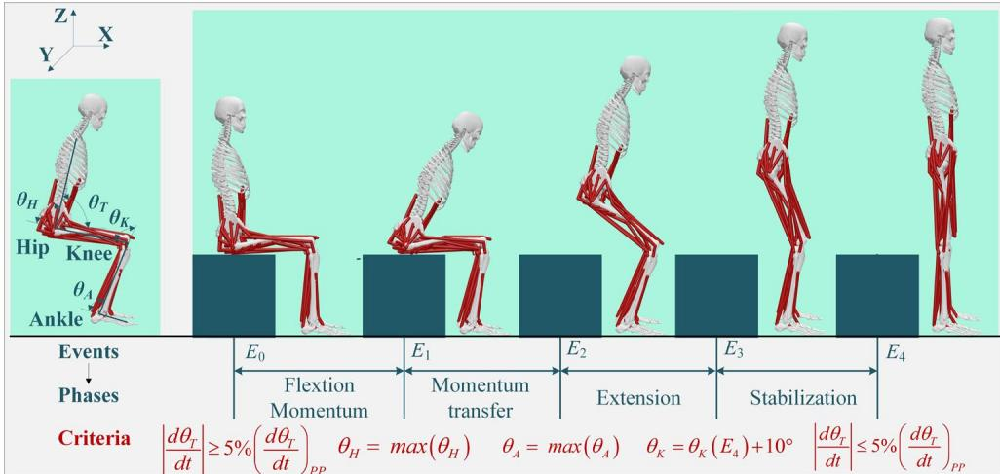  
Figure 1. STS movement divided into five phases: flexion momentum (E0–E1), momentum transfer (E1–E2), extension (E2–E3), and stabilization (E3–E4). Events E1 to E5 are defined by angular displacement and angular velocity thresholds for torso (θT), hip (θH), knee (θK), and ankle (θA) joint angles.

Based on these event markers, the STS transition is divided into four phases: (1) the flexion momentum (FM) phase, which begins at the initiation of the movement, includes forward bending of the torso and pelvis, and ends at the seat-of; (2) momentum transfer (MT), spanning from the start of seat-of to maximum ankle dorsiflexion; (3) extension (ET), initiated immediately after maximum ankle dorsiflexion and continuing until hip extension cessation; and (4) stabilization (STA), starting from hip extension achievement and terminating at the stable upright position.

## 2.2. Traditional Transformer Networks

Compared to RNNs, the Transformer is beter at handling long-range dependencies in sequence data. It consists of an encoder and a decoder: the encoder converts an input sequence into hidden representations capturing contextual information, while the decoder generates an output sequence from these representations. As shown in Figure 2, each encoder consists of two submodules. The first consists of a multi-head atention (MHA) layer and an “Add & Norm” operation (i.e., residual connection and layer normalization). The second includes a feed-forward layer and another “Add & Norm” operation. Stacking multiple encoders can efectively enhance the model’s overall performance.

As the core of the Transformer, the MHA mechanism works as follows. Let n denote the time step, d the feature dimension, and X∈ℝn×d the input data. Apply a set of positional encodings to obtain the query matrix (Q), key matrix (K), and value matrix (V); W is the weight matrix. The atention coeficient of the i-th head can be computed as follows:

$$
\operatorname{head} _ {i} = \operatorname{Attention} \left(\mathbf {Q} _ {i}, \mathbf {K} _ {i}, \mathbf {V} _ {i}\right) = \operatorname{Softmax} \left(\mathbf {Q} _ {i} \mathbf {K} _ {i} ^ {\mathrm{T}} / \sqrt {d _ {k}}\right) \mathbf {V} _ {i}.\tag{1}
$$

Then, the output of the MHA can be illustrated as below:

$$
\text { Multi - head } (\mathbf {Q}, \mathbf {K}, \mathbf {V}) = \text { Concatenation } (\text { head } _ {1}, \dots , \text { head } _ {H}) \mathbf {W}  .\tag{2}
$$

Each decoder consists of three submodules: (1) a masked MHA layer with an “Add & Norm” operation, using an upper triangular matrix with negative infinity to mask future information, ensuring that each position only accesses prior information; (2) an encoder–decoder MHA layer with an “Add & Norm” operation, where the decoder’s output serves as a query and the encoder’s output as the key and value, enabling the decoder to use input sequence information when generating each output; and (3) a feed-forward layer and an “Add & Norm” operation. During the model inference process, the decoder’s target sequence is right-shifted so that each symbol can only access its predecessor at the time of generation. The embedded input sequence is then processed through the decoder’s three submodules, which produce a probability distribution of the target output for sequence prediction using a linear layer and Softmax layer. As a result, the traditional Transformer has an autoregressive property—i.e., the output of each step will depend on the generation result of the previous step, thus gradually generating the target sequence.

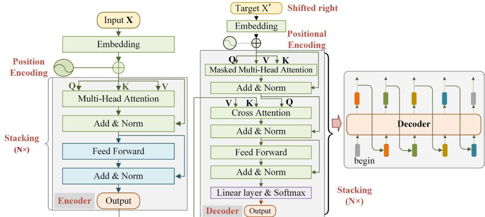  
Figure 2. Schematic diagram of the encoder, decoder and inference mechanism in the traditional Transformer structure.

## 3. Methods

## 3.1. Dataset

A customized dataset encompassing both healthy subjects and stroke patients was employed for further experimental validation, with detailed subject demographics are presented in Table 1. Specifically, this dataset comprised information from 7 healthy subjects (denoted as HS1-HS7) and 7 stroke patients (denoted as PS1–PS7). This study was approved by the Ethics Commitee of Tongji Medical College, Huazhong University of Science and Technology (approval number: [2020] S296-1). All participants provided written informed consent prior to enrollment. As shown in Figure 3, the data acquisition system included a wireless Ultimu EMG system (Noraxon USA Inc., Scotsdale, AZ, USA) with an embedded IMU and a smart laptop running MR3.10 myoMUS-CLETM software. Bipolar sEMG electrodes were positioned 20 mm apart and aligned parallel to the muscle fibers, with the skin cleaned using alcohol wipes to minimize impedance. Seven IMU sensors were atached to the pelvis, both thighs, calves, and feet of the participant. Each subject was instructed to perform the sit-to-stand task approximately 10 times in a heightadjustable chair without any assistance. sEMG data were recorded from 16 lower limb muscles on both sides (8 muscles per side: including RF, VM, VL, BF, SEM, UTA, MG, and

SOL) at a sampling rate of 2 kHz, while kinematic data were collected simultaneously with the IMU system at a sampling rate of 200 Hz. It is important to mention that sEMG data for abnormal and resting states were excluded based on the synchronized visual animations produced by using the MR3 software [20]. Figure 4 shows the raw data of 16 channels of sEMG signals and 21 channels of kinematic signals.

Figure 3. Experimental setup: (a) data collection system; (b) front view of sensor placement on healthy subject; (c) back view of sensor placement on healthy subject; (d) front view of stroke patient.  

(a)  

(c)  
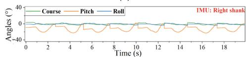

(e)  
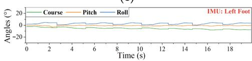  
(g)

(b)  
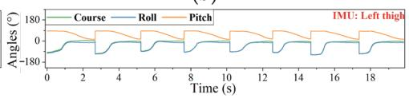

(d)  

(f)  
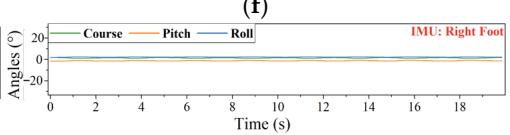  
(h)

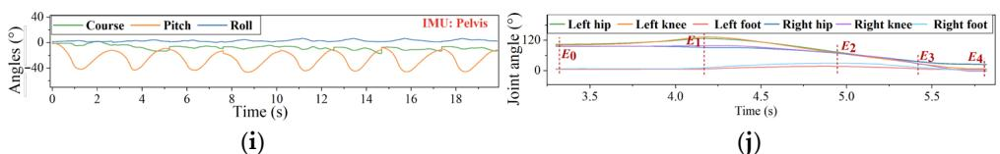  
(j)  
Figure 4. Raw sEMG and kinematic data for subject PS4 during STS motion: (a,b) present bilateral lower limb sEMG signals (right healthy and left paretic leg, respectively); (c–i) show the kinematic signals of the right thigh, left thigh, right shank, left shank, right foot, left foot and pelvis, respectively; (j) shows the joint angles and marked events.

Table 1. Basic information of the subjects.

<table><tr><td>Sub</td><td>M/F</td><td>Age (years)</td><td>Height (cm)</td><td>Weight (kg)</td><td>Sub</td><td>M/F</td><td>Age (years)</td><td>Height (cm)</td><td>Weight (kg)</td><td>Paretic Side</td><td>FMA-LE Score</td></tr><tr><td> $HS_1$ </td><td>M</td><td>26</td><td>181</td><td>75</td><td> $PS_1$ </td><td>M</td><td>45</td><td>175</td><td>70</td><td>R</td><td>14</td></tr><tr><td> $HS_2$ </td><td>M</td><td>22</td><td>183</td><td>72</td><td> $PS_2$ </td><td>F</td><td>54</td><td>160</td><td>60</td><td>R</td><td>10</td></tr><tr><td> $HS_3$ </td><td>M</td><td>23</td><td>180</td><td>85</td><td> $PS_3$ </td><td>M</td><td>53</td><td>176</td><td>73</td><td>R</td><td>14</td></tr><tr><td> $HS_4$ </td><td>M</td><td>21</td><td>178</td><td>72</td><td> $PS_4$ </td><td>M</td><td>49</td><td>173</td><td>66</td><td>L</td><td>12</td></tr><tr><td> $HS_5$ </td><td>M</td><td>21</td><td>185</td><td>80</td><td> $PS_5$ </td><td>M</td><td>47</td><td>170</td><td>64</td><td>R</td><td>12</td></tr><tr><td> $HS_6$ </td><td>M</td><td>20</td><td>175</td><td>72</td><td> $PS_6$ </td><td>M</td><td>45</td><td>168</td><td>62</td><td>L</td><td>16</td></tr><tr><td> $HS_7$ </td><td>M</td><td>24</td><td>168</td><td>62</td><td> $PS_7$ </td><td>F</td><td>33</td><td>160</td><td>40</td><td>R</td><td>12</td></tr><tr><td>Mean ± Std</td><td>/</td><td>22.4 ± 1.9</td><td>178.6 ± 5.3</td><td>74.0 ± 6.1</td><td>Mean ± Std</td><td>/</td><td>46.6 ± 6.5</td><td>168.9 ± 6.2</td><td>62.1 ± 9.9</td><td>/</td><td>12.9 ± 1.8</td></tr></table>

Sub, Subject; M/F, Male/Female; R/L, Right leg/Left leg; Std, Standard Deviation.

## 3.2. Data Preprocessing

## 3.2.1. Resampling and Filtering

The recorded sEMG signals were bandpass filtered between 20 Hz and 450 Hz using a 4th-order Buterworth filter, with zero-phase forward-backward filtering applied to prevent phase distortion. A notch filter was also applied at 60 Hz (−3 dB bandwidth: 4 Hz) to suppress powerline interference while preserving the nearby spectral content. For the IMU signals, a 6th-order Buterworth low-pass filter with a cutof frequency of 25 Hz was applied. To synchronize the data, the sEMG and IMU data are resampled o a common sampling rate (e.g., 1000 Hz).

## 3.2.2. Data Normalization

To enhance model convergence, the positive–negative-one normalization technique was applied to the resampled sEMG and IMU signals, scaling them to the range of [−1, 1]. However, a discrepancy between the training and test data arises in the angle labels, and this normalization approach could lead to errors during reverse normalization. Therefore, given the periodic nature of lower limb joint angles, the angle data can be normalized to [−1, 1] by dividing by π.

## 3.2.3. Sample Segmentation

The dataset was segmented using an overlapping window method to efectively capture temporal features [21]. Given the short duration of each STS phase, window lengths were set at 32/48/64/80/96 ms, with an overlapping window of 16 ms. For example, normalized data for the time interval (0, 32] corresponds to the STS phases, while the joint angle label is defined as (32, 32 + PL] ms, where PL is the predicted length, initially set to 16 ms. This setup allows the first 32 ms of input data to predict joint angle changes in the following 16 ms. Additionally, if a window spans two phases, the data are discarded to prevent ambiguity during phase transitions.

## 3.2.4. Dataset Partitioning

In the STS dual task, 80% of the sample was randomly chosen to serve as the training set, while the remaining 20% was designated as the test set. Additionally, 10% of the training set was randomly selected as a validation set to tune hyperparameters and select the best model configuration, aiming to ensuring maximize that the model’s performance is maximized without relying too heavily on the training data. To reduce the influence of random variables, five independent experiments were performed for each participant performed five independent experiments, each with a diferent random seed.

## 3.3. Network Structure Design

As shown in Figure 5, the iTransformer-DTL network consists of the input layer, encoder and decoder, learnable query, classifier, and predictor. The parameter configuration of the constructed model is shown in Table 2. Detailed descriptions are as follows:

## (1) Input layer

The input format of the proposed model consists of batch size, sequence length, and channels. The sEMG and IMU signals are concatenated along the channel dimension to form the input data, which is then processed by an input embedding layer and a location encoding layer.

## (2) Encoder

The encoder consists of a stack of N encoder layers. The overall output dimension of the MHA module is equal to the output dimension of the single head multiplied by the number of heads. Typically, the middle layer of the feed-forward network selects a value that is a multiple of the hidden dimension, often a multiple of four.

## (3) Decoder

The decoder consists of N decoder layers. It is noted that the input dimension of the decoder should align with that of the encoder. In the cross-atention module, the K (key) and V (value) are derived from the encoder’s output, while the LQ (query) is obtained from the current input of the decoder.

## (4) Learnable Query (LQ)

The LQ is a trainable vector, initialized as a random vector with position encoding and optimized during training. Unlike traditional autoregressive models, the LQ ofers a new decoding mechanism that directly interacts with the encoder’s output, allowing for the extraction of task-specific features. This interaction provides more flexible decoder inputs, enabling dynamic output adjustments based on the task goals and significantly reducing the inference time.

## (5) Classifier

The output of the encoder is averaged along the sequence length and then fed into the fully connected layer, which uses a softmax function to produce the motion class.

## (6) Predictor

The decoder’s output is passed through a dropout layer and a fully connected layer to generate the predicted angles.

In this model, the learnable vector and target sequence have the same length, and positional relationships are calculated using the standard MHA mechanism without masking, as all the learnable vectors from diferent positions can be included in the computation simultaneously. The processed learnable vector replaces the stepwise-generated input sequences in the traditional decoder and directly serves as a query for the cross-MHA module, so the entire target sequence can be generated at once, without the need for step-by-step prediction. Compared with the autoregressive method, the described non-autoregressive method enhances both inference speed and training eficiency while preserving generation quality, making it suitable for various sequence prediction and text generation applications.

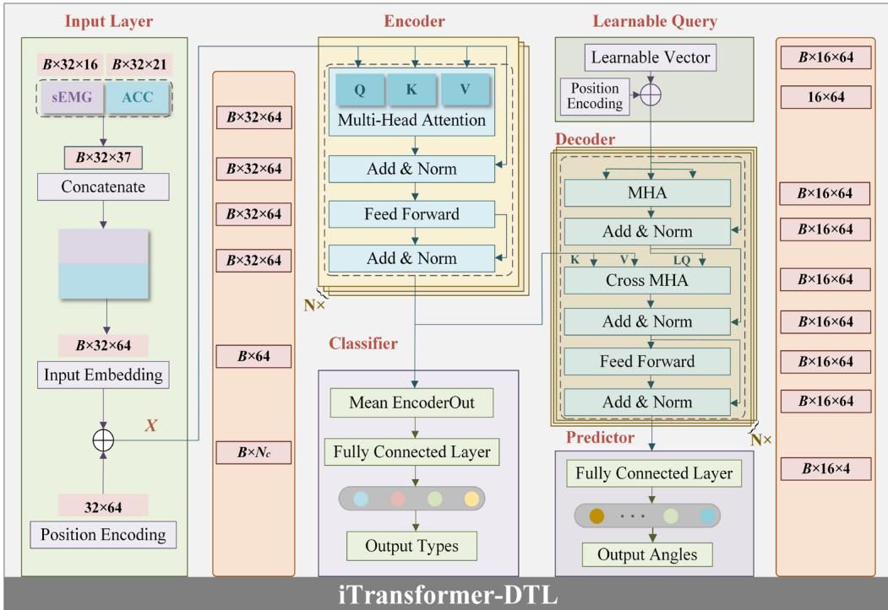  
Figure 5. Model structure of the designed iTransformer-DTL.

Table 2. Detailed parameters of the constructed model.

<table><tr><td>Parameter Description</td><td>Settings</td><td>Parameter Description</td><td>Settings</td></tr><tr><td>Sequence length/predicted length</td><td>32/16</td><td>Dropout</td><td>0.2</td></tr><tr><td>Output categories</td><td>4</td><td>Decoder layers</td><td>2</td></tr><tr><td>Total channels</td><td>37</td><td>Decoder input dim</td><td>64</td></tr><tr><td>Encoder layers</td><td>2</td><td>Decoder MHA output dim</td><td>16</td></tr><tr><td>Encoder input dim</td><td>64</td><td>Decoder MHA heads</td><td>4</td></tr><tr><td>Encoder MHA output dim</td><td>16</td><td>Decoder cross MHA output dim</td><td>16</td></tr><tr><td>Encoder MHA heads</td><td>4</td><td>Decoder cross MHA heads</td><td>4</td></tr><tr><td>Encoder last linear middle dim</td><td>128</td><td>Decoder last linear middle dim</td><td>128</td></tr></table>

## 3.4. Loss Functions

Typically, multi-type DMPR tasks use Cross-Entropy (CE) as the loss function which is defined below:

$$
L _ {C E} = - \frac {1}{N _ {s}} \sum_ {i = 1} ^ {N _ {s}} \sum_ {j = 1} ^ {N _ {c}} y _ {i j} \log (p _ {i j}), \text {   where   } \sum_ {j = 1} ^ {N _ {c}} p _ {i j} = 1.\tag{3}
$$

where $N _ { s }$ and $N _ { c }$ refer to the total number of samples and the number of classifications, respectively; $p _ { i j }$ indicates the forecasted probability that the i-th sample belongs to category $j ,$ with values ranging from 0 to 1 and with the sum of probabilities across all categories for each sample being equal to 1; and yij represents the one-hot representation of the true label $y _  i , $ where yij equals 1 if the sample belongs to category j and 0 if it does not.

In addition, for CMIP tasks, Mean Squared Error (MSE) is often selected as the loss function, which is defined as follows:

$$
L _ {M S E} = - \frac {1}{N _ {s}} \sum_ {i = 1} ^ {N _ {s}} \left(\theta_ {i} - \hat {\theta} _ {i}\right).\tag{4}
$$

To balance the classification and regression losses during training, a scaling factor α is introduced to adjust the weight of the MSE. The overall training loss is then defined as follows:

$$
L _ {L o s s} = L _ {C E} + \alpha L _ {M S E}.\tag{5}
$$

In this study, α is initially set to 0.01, as referenced in [22].

## 3.5. Training Setings and Evaluation Metrics

The optimization procedure uses the Adam algorithm with a batch size of 32 and a maximum of 100 training epochs. The initial learning rate is set to 0.001, and the Multi-StepLR method is applied with milestones at [60, 80, 100] and a decay factor of $0 . 0 1 \sqrt { 0 . 1 }$ Additionally, early stopping is implemented to improve training eficiency, indicating that training will stop if the validation loss does not drop by at least 0.0001 over a span of 20 epochs.

In the dual tasks of motion recognition and angle prediction, the classification performance is evaluated using metrics such as accuracy, F1-score, and the confusion matrix. For angle prediction performance, the evaluation metrics include the Mean Absolute Error (MAE) and the Coeficient of Determination (R2), as shown below.

$$
A c c u r a c y = \left(\sum_ {i = 1} ^ {N _ {c}} \frac {T P _ {i}}{T P _ {i} + F P _ {i}}\right) / N _ {c},\tag{6}
$$

$$
\text { Recall } = \left(\sum_ {i = 1} ^ {N _ {c}} \frac {T P _ {i}}{T P _ {i} + F N _ {i}}\right),\tag{7}
$$

$$
F 1 - s c o r e = \frac {2 \times \text { Accuracy } \times \text { Recall }}{\text { Accuracy } + \text { Recall }},\tag{8}
$$

$$
M A E = \sqrt {\frac {1}{N _ {s}} \sum_ {i = 1} ^ {N _ {s}} \left| \theta_ {i} - \hat {\theta} _ {i} \right|},\tag{9}
$$

$$
R ^ {2} = 1 - \frac {\sum_ {i = 1} ^ {N _ {s}} \left(\theta_ {i} - \hat {\theta} _ {i}\right) ^ {2}}{\sum_ {i = 1} ^ {N _ {s}} \left(\theta_ {i} - N _ {s} ^ {- 1} \sum_ {i = 1} ^ {N _ {s}} \theta_ {i}\right) ^ {2}},\tag{10}
$$

where $T P , T N , F P ,$ and FN are indicators of true positives, true negatives, false positives, and false negatives in the classification results, respectively; $\theta _ { i }$ and $\widehat { \theta } _ { i }$ represents the actual angle and the predicted angle.

All experiments are conducted on a laptop featuring an AMD Ryzen 7 5800H CPU (3.20 GHz), an NVIDIA GeForce RTX 3060Ti GPU with 8 GB VRAM, and 16 GB of RAM using the software environment (Python 3.9, PyTorch 1.13.0).

## 4. Results and Discussion

## 4.1. Recognition Results

First, the training process of the iTransformer model is presented in Figure $6 ,$ which demonstrates that the model exhibits rapid and stable convergence for both healthy and stroke subjects.

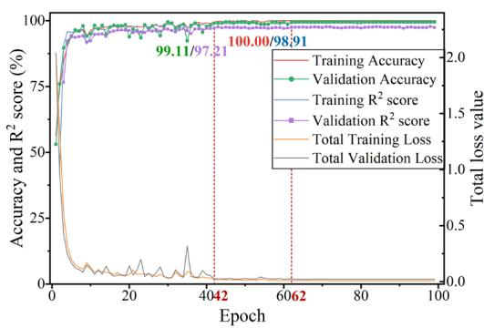  
(a)

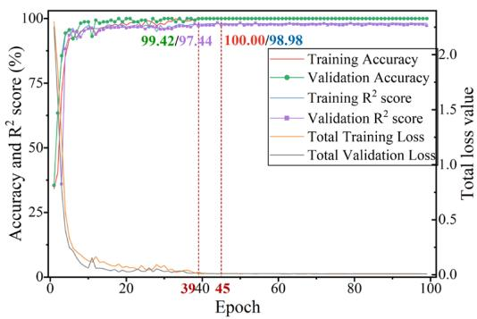  
(b)  
Figure 6. (a,b) Accuracy, $\mathrm { R } ^ { 2 }$ score, and total loss value during model training on HS3 and PS3, respectively.

Additionally, Figure 7 displays the confusion matrices for the classification outcomes and knee angle predictions of iTransformer-DTL for subjects HS4 and $\mathrm { P S } _ { 4 } ,$ respectively. As shown in Figure $^ { 7 } \mathsf { a } , \mathsf { b } ,$ all true samples in the FM category are accurately classified for HS4 achieving a 100% accuracy rate. The other categories also demonstrate high accuracy with minimal misclassifications. The brief duration of each phase and the similarity of data between adjacent phases in the feature space may create unclear class boundaries, leading to frequent misclassifications. The test results for joint angles of subjects HS4 and PS4 are illustrated in Figure 7c,d, using inverse normalization without data shufling.

  
(a)

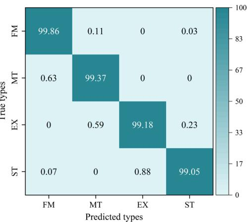  
(b)

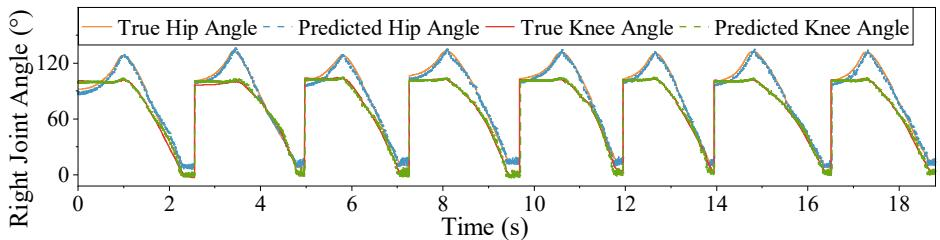  
(c)

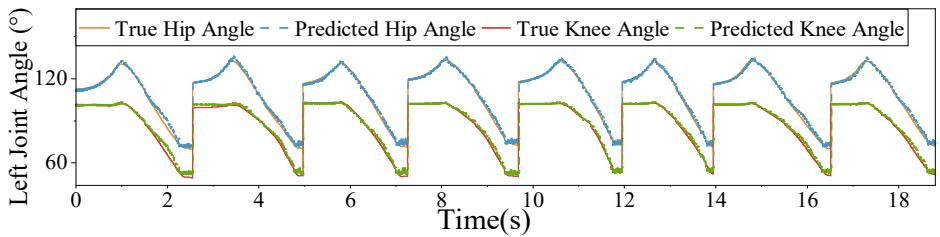  
(d)  
Figure 7. Experimental results: (a,b) normalized confusion matrices of the test results for STS phase classification on subjects HS4 and PS4, respectively; (c,d) angle prediction results on subjects HS4 and PS4, respectively.

Then, experimental validation was carried out using data from each subject to assess the performance of the proposed model. The test results for both healthy subjects and stroke patients across five duplicated experiments are shown in Figure 8.

As can be seen in Figure 8, (1) the accuracy of STS phase classification in healthy individuals ranged from 98.93% (HS2) to 99.84% (HS6), while in stroke patients, it fluctuated between 97.86% (PS6) and 99.72% (PS7); (2) the average accuracy, F1-score, and recall for healthy subjects were 99.42%, 98.71%, and 98.89%, respectively, compared to 99.01%, 97.93%, and 98.11% for patients; (3) for STS angle prediction, the R2 value ranged from 97.49% (HS7) to 99.26% (HS3) for healthy subjects and from 96.51% (PS4) to 98.52% (PS6) for patients; (4) the mean MAE was 3.84° for healthy subjects and 4.62° for patients, with mean R2 values of 98.31% and 97.45%, respectively.

(a)  
  
(b)  
Figure 8. Experimental results of the proposed method across five repeated trials for each subject in (a) the healthy group and (b) the patient group, with performance metrics for the motion recognition task (accuracy, F1-score, recall) and joint angle prediction task (R2, MAE).

These results indicate that the proposed model performs efectively in the dual task across diferent subject groups, achieving an average recognition accuracy of over 99% and R2 values above 97%.

## 4.2. Ablation Study

The proposed framework was initially evaluated by comparing it with several widely used deep learning models, including BERT, a traditional Transformer model without LQ, a Convolutional Neural Network (CNN) [23], MobileNet [24], a Long Short-Term Memory Network (LSTM) [10], and a Gated Recurrent Unit (GRU) [25]. All models were trained and tested using the same preprocessed multimodal inputs and window sizes as those utilized in the proposed framework. To ensure a fair comparison, the same loss function and learning rate schedule were applied across all models. The results of the comparison, including model complexity metrics such as the Number of Parameters (NPs), Multiply–Accumulate Operations (MACs), and inference time (IT, average time over 100 experimental runs) are provided in Table 3.

Table 3. Performance evaluation of diferent models.

<table><tr><td>Mode</td><td>Accuracy (%)</td><td>F1-score (%)</td><td>Recall (%)</td><td>R2 score (%)</td><td>MAE (°)</td><td>NPs</td><td>MACs</td><td>IT (ms)</td></tr><tr><td>CNN</td><td>97.48 ± 0.81</td><td>96.15 ± 1.89</td><td>96.49 ± 1.69</td><td>91.79 ± 2.84</td><td>6.05 ± 1.29</td><td>2,387,140</td><td>332,037,120</td><td>34.13</td></tr><tr><td>MobileNet</td><td>97.33 ± 0.83</td><td>95.75 ± 1.64</td><td>96.22 ± 1.52</td><td>90.98 ± 2.79</td><td>6.39 ± 1.57</td><td>2,370,830</td><td>226,246,656</td><td>32.71</td></tr><tr><td>LSTM</td><td>97.01 ± 1.17</td><td>95.13 ± 2.74</td><td>95.61 ± 2.45</td><td>94.12 ± 2.55</td><td>5.873 ± 1.37</td><td>259,396</td><td>170,278,912</td><td>31.20</td></tr><tr><td>GRU</td><td>97.23 ± 0.65</td><td>95.73 ± 1.73</td><td>96.13 ± 1.54</td><td>94.31 ± 2.45</td><td>5.54 ± 1.13</td><td>204,996</td><td>150,307,968</td><td>29.91</td></tr><tr><td>BERT</td><td>96.78 ± 1.49</td><td>95.21 ± 2.50</td><td>95.49 ± 2.69</td><td>94.01 ± 2.37</td><td>5.63 ± 1.34</td><td>268,214</td><td>141,582,592</td><td>38.83</td></tr><tr><td>Transformer</td><td>97.21 ± 0.84</td><td>95.97 ± 1.56</td><td>96.13 ± 1.48</td><td>94.76 ± 2.09</td><td>5.16 ± 1.15</td><td>312,190</td><td>353,863,552</td><td>43.64</td></tr><tr><td>iTransformer-DTL</td><td>99.22 ± 0.76</td><td>98.17 ± 1.41</td><td>98.50 ± 1.28</td><td>97.88 ± 2.21</td><td>4.23 ± 1.11</td><td>170,376</td><td>130,228,224</td><td>29.61</td></tr></table>

The results show the following: (1) The iTransformer-DTL with the LQ mechanism outperforms both BERT and traditional Transformer models. (2) The CNN and MobileNet exhibit strong feature extraction capabilities, performing well in the STS classification task. However, both models struggle with angle prediction, likely due to their architectures being more suited for classification rather than regression. (3) Regarding angle prediction, the iTransformer-DTL, Transformer, GRU, and LSTM outperform the CNN and MobileNet. (4) In terms of dual-task performance, the iTransformer-DTL demonstrates the highest overall performance, followed by Transformer, GRU, and LSTM. (5) iTransformer-DTL is distinguished by its simplicity, featuring the fewest parameters and MAC, along with the shortest inference time and fastest computation speed. These findings substantiate the efectiveness and superiority of the proposed framework, which successfully addresses both the STS classification and angle prediction tasks without a significant increase in computational complexity.

## 4.3. Comparison with State-of-the-Art Methods

Additionally, the proposed model was evaluated against various machine learning classifiers, including KNN [26], RF [27], and SVM [28]. Table 4 presents a comparative analysis of the model’s performance, emphasizing the similarities and diferences in terms of subject types, signal types, and model performance.

In general, most studies on this topic focus on experimental validation using healthy subjects to ensure the reliability and validity of the model under standard conditions. Furthermore, many machine learning studies tend to rely only on a single type of sensor data, such as sEMG or kinematic signals. However, with the growing need for multimodal data integration, an increasing number of studies are utilizing deep learning methods to process various types of sensor data and to analyze information across multiple dimensions. Additionally, the proposed model outperforms the 1D-RSCN and LCRN models in motion recognition and joint trajectory prediction.

Table 4. Comparative results with state-of-the-art models.

<table><tr><td>Mode</td><td>Accuracy (%)</td><td>MAE (°)</td><td>Ref.</td></tr><tr><td>KNN</td><td>96.66</td><td>/</td><td>[26]</td></tr><tr><td>SVM</td><td>99.63</td><td>/</td><td>[28]</td></tr><tr><td>RF</td><td>99.17</td><td>/</td><td>[27]</td></tr><tr><td>CNN-GRU</td><td>99.11</td><td>4.82 ± 1.24</td><td>[29]</td></tr><tr><td>CNN-BiLSTM</td><td>99.02</td><td>4.77 ± 1.18</td><td>[30]</td></tr><tr><td>1D-RSCN</td><td>91.66 ± 0.78</td><td>5.25 ± 1.22</td><td>[15]</td></tr><tr><td>LCRN</td><td>97.01 ± 1.25</td><td>8.65 ± 1.34</td><td>[14]</td></tr><tr><td>Our model</td><td>99.22 ± 0.76</td><td>4.23 ± 1.11</td><td>/</td></tr></table>

## 4.4. Efect of Window Length on Model Performance

This subsection analyzes the impact of dataset segmentation using the overlapping sliding window technique. The sliding window lengths were set to 32, 48, 64, 80, and 96 to obtain diferent sample subsets. The prediction lengths were set to 16, 32, 48, 64, 80, and 96, with the window length fixed at 32. The model was evaluated with optimal configurations, and the corresponding results are shown in Figure 9.

From Figure 9a,b, the following can be deduced: (1) A larger window size facilitates the incorporation of more contextual information, thereby enhancing the model’s capability to capture long-term dependencies. However, this advantage is accompanied by a trade-of—an increase in window size leads to higher computational overhead during training, including extended training duration and elevated resource consumption (e.g., memory usage). (2) The model’s performance exhibits minimal variation with increasing prediction length. This stability can be atributed to the model’s inherent design of generating the entire output sequence in a single inference step. Specifically, the LQ-based decoding mechanism enables parallel processing of the output sequence, which decouples the model’s performance from the prediction length and thus mitigates the performance degradation that commonly occurs with longer prediction horizons. Furthermore, when prioritizing both a prediction accuracy exceeding 99% and reliable angle prediction results, a prediction length of 16 is determined to be the optimal choice.

  
(a)

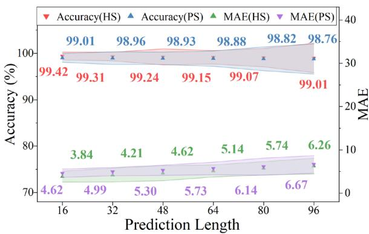  
(b)  
Figure 9. Experimental results using the best model for various sample subsets: (a) accuracy and MAE for healthy and patient subjects with diferent window length; (b) results with diferent predicted lengths.

## 4.5. Efect of Scaling Factor α in the Loss Function

The efect of the scaling factor α in Equation (5) on model performance was evaluated, with the results presented in Figure 10, which shows the mean and standard deviation of accuracy and MAE as α varies from 0.001 to 100. A detailed analysis of these results reveals that variations in α exert a non-negligible impact on both the classification and predictive capabilities of the model. Notably, when α is set to 0.01, the model achieves its optimal performance, as indicated by the highest accuracy and the lowest MAE. Clearly, fine-tuning this parameter is essential for balancing these underlying mechanisms, ultimately enhancing the overall model performance.

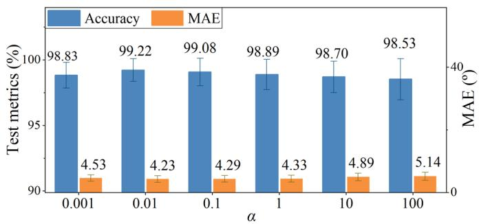  
Figure 10. Accuracy and MAE for all subjects with various scaling factors.

## 4.6. Healthy vs. Abnormal Subjects in STS Motion

Figure 11 presents the event detection results for healthy and abnormal subjects using data from both legs.

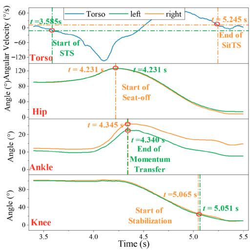  
(a)

  
(b)  
Figure 11. Event detection results for the first STS motion with bilateral legs: (a) subject HS4; (b) subject PS4.

As shown in Figure 11, healthy individuals completed one STS motion faster than stroke patients, with times of 1.66 s and 2.68 s for HS4 and $\mathrm { P S } _ { 4 } ,$ respectively. In healthy individuals, the flexion and extension angles of both lower limbs were generally consistent throughout the STS motion, with only negligible timing diferences. The variation in ankle joint angles between the legs was due to foot misalignment.

In contrast, stroke patients with unilateral lower limb motor dysfunction showed inconsistent flexion and extension angles between the afected and healthy limbs. The timing of events also difered, with the afected limb responding more slowly, especially between E2 and E3. In PS4, the detection times were 4.942 and 5.622 for the healthy right leg and 5.037 and 5.732 for the afected left leg.

These findings highlight the importance of considering asymmetry and timing differences in stroke patients’ limb movements when designing exoskeleton control and human–robot interaction systems. This consideration can improve system adaptability and provide tailored movement assistance during rehabilitation.

## 5. Conclusions

This study presents an improved Transformer-based deep learning framework for simultaneously recognizing motion paterns and forecasting joint trajectories using sEMG and IMU signals during STS movements. The proposed iTransformer-DTL model incorporates learnable query and non-autoregressive methods, enabling the direct decoding of the complete output sequence during model inference and substantially improving computational eficiency. Evaluation results from the HS-PS dataset indicate that the proposed framework performs well in recognizing motion and predicting angles for both healthy individuals and stroke patients, and it outperforms existing state-of-the-art deep learning models in dual-task learning. The method can be applied in mirror rehabilitation therapy, where real-time movement intention recognition from the unafected limb enables the synchronous delivery of temporally aligned and phase-adapted assistive torques to the afected limb. This framework holds significant promise for real-time control of rehabilitation exoskeletons in tasks essential for activities of daily living, such as STS transition, enabling more flexible and eficient human–computer interaction.

Despite these promising results, several limitations warrant further investigation:

(1) The learnable queries are currently initialized randomly, which may not be optimal for all tasks or subjects. Future work will explore task-informed or anatomy-guided initialization strategies to enhance convergence and performance.

(2) The current framework was evaluated in an intra-subject seting; its generalizability across individuals—especially across those with diverse impairment levels—remains limited. We plan to integrate cross-subject transfer learning or domain adaptation techniques to improve robustness in real-world clinical deployment.

(3) The system relies on a relatively high number of sEMG channels, which increases hardware complexity and cost. Ongoing eforts will focus on channel selection or sensor reduction methods to develop a lightweight, cost-efective version suitable for the practical rehabilitation seting.

Author Contributions: Conceptualization, X.W. and C.Z.; methodology, X.W.; software, C.Z.; validation, Z.Y.; formal analysis, Y.L.; investigation, Y.L.; data curation, C.Z.; writing—original draft preparation, X.W.; writing—review and editing, X.W.; visualization, Z.Y.; supervision, C.D.; project administration, C.D.; funding acquisition, C.D. All authors have read and agreed to the published version of the manuscript.

Funding: The work here is supported by the National Natural Science Foundation of China under grant numbers 52450259 and 52575113.

Institutional Review Board Statement: This study was approved by the Ethics Commitee of Tongji Medical College, Huazhong University of Science and Technology (Approval No.: [2020] S296-1), on 27 January 2021.

Informed Consent Statement: Informed consent for participation was obtained from all subjects involved in the study.

Data Availability Statement: Data in this research is available at htps://github.com/Xiaoy-Wang/Code-V1.0-of-multi-task-DL-2025 (accessed on 19 September 2025).

Conflicts of Interest: The authors declare no conflicts of interest.

## References

1. Arene, N.; Hidler, J. Understanding Motor Impairment in the Paretic Lower Limb after a Stroke: A Review of the Literature. Top. Stroke Rehabil. 2009, 16, 346–356. htps://doi.org/10.1310/tsr1605-346.

2. Chen, J.-C. Progress in Sensorimotor Rehabilitative Physical Therapy Programs for Stroke Patients. World J. Clin. Cases 2014, 2, 316. htps://doi.org/10.12998/wjcc.v2.i8.316.

3. Morone, G.; Iosa, M.; Calabrò, R.S.; Cerasa, A.; Paolucci, S.; Antonucci, G.; Ciancarelli, I. Robot- and Technology-Boosting Neu roplasticity-Dependent Motor-Cognitive Functional Recovery: Looking towards the Future of Neurorehabilitation. Brain Sci 2023, 13, 12–14. htps://doi.org/10.3390/brainsci13121687.

4. Feng, Y.; Wang, H.; Lu, T.; Vladareanuv, V.; Li, Q.; Zhao, C. Teaching Training Method of a Lower Limb Rehabilitation Robot. Int. J. Adv. Robot. Syst. 2016, 13, 57. htps://doi.org/10.5772/62445.

5. Banala, S.K.; Kim, S.H.; Agrawal, S.K.; Scholz, J.P. Robot Assisted Gait Training with Active Leg Exoskeleton (ALEX). In Proceedings of the 2nd Biennial IEEE/RAS-EMBS International Conference on Biomedical Robotics and Biomechatronics, BioRob 2008, Scotsdale, AZ, USA, 19–22 October 2008; Volume 17, pp. 653–658. htps://doi.org/10.1109/BIOROB.2008.4762885

6. Baud, R.; Manzoori, A.R.; Ijspeert, A.; Bouri, M. Review of Control Strategies for Lower-Limb Exoskeletons to Assist Gait. J. Neuroeng. Rehabil. 2021, 18, 119. htps://doi.org/10.1186/s12984-021-00906-3.

7. Zhang, Y.P.; Cao, G.Z.; Li, L.L.; Diao, D.F. Interactive Control of Lower Limb Exoskeleton Robots: A Review. IEEE Sens. J. 2024, 24, 5759–5784. htps://doi.org/10.1109/JSEN.2024.3352005.

8. Su, D.; Hu, Z.; Wu, J.; Shang, P.; Luo, Z. Review of Adaptive Control for Stroke Lower Limb Exoskeleton Rehabilitation Robot Based on Motion Intention Recognition. Front. Neurorobot. 2023, 17, 1186175. htps://doi.org/10.3389/fnbot.2023.1186175.

9. Zhang, C.; Yu, Z.; Wang, X.; Chen, Z.J.; Deng, C.; Xie, S.Q. Exploration of Deep Learning-Driven Multimodal Information Fusion Frameworks and Their Application in Lower Limb Motion Recognition. Biomed. Signal Process. Control 2024, 96, 106551. htps://doi.org/10.1016/j.bspc.2024.106551.

10. Zhang, P.; Zhang, J.; Chen, Y.; Jia, J.; Elsabbagh, A. Research on Human-Machine Synergy Control Method of Lower Limb Exoskeleton Based on Multi-Sensor Fusion Information. IEEE Sens. J. 2024, 24, 35346–35358. htps://doi.org/10.1109/JSEN.2024.3399697.

11. Wang, X.; Zhang, C.; Yu, Z.; Deng, C. Decoding of Lower Limb Continuous Movement Intention from Multi-Channel SEMG and Design of Adaptive Exoskeleton Controller. Biomed. Signal Process. Control 2024, 94, 106245. htps://doi.org/10.1016/j.bspc.2024.106245.

12. Zhang, C.; Yu, Z.; Wang, X.; Chen, Z.J.; Deng, C. Temporal-Constrained Parallel Graph Neural Networks for Recognizing Motion Paterns and Gait Phases in Class-Imbalanced Scenarios. Eng. Appl. Artif. Intell. 2025, 143, 110106. htps://doi.org/10.1016/j.engappai.2025.110106.

13. Wang, E.; Chen, X.; Li, Y.; Fu, Z.; Huang, J. Lower Limb Motion Intent Recognition Based on Sensor Fusion and Fuzzy Multitask Learning. IEEE Trans. Fuzzy Syst. 2024, 32, 2903–2914. htps://doi.org/10.1109/TFUZZ.2024.3364382.

14. Gautam, A.; Panwar, M.; Biswas, D.; Acharyya, A. MyoNet: A Transfer-Learning-Based LRCN for Lower Limb Movement Recognition and Knee Joint Angle Prediction for Remote Monitoring of Rehabilitation Progress from SEMG. IEEE J. Transl. Eng Health Med. 2020, 8, 2100310. htps://doi.org/10.1109/JTEHM.2020.2972523.

15. Xue, J.; Lai, K.W.C. Continuous Lower Limb Multi-Intent Prediction for Electromyography-Driven Intrinsic and Extrinsic Control. Adv. Intell. Syst. 2024, 6, 2300318. htps://doi.org/10.1002/aisy.202300318.

16. Wang, X.; Dong, D.; Chi, X.; Wang, S.; Miao, Y.; An, M.; Gavrilov, A.I. SEMG-Based Consecutive Estimation of Human Lower Limb Movement by Using Multi-Branch Neural Network. Biomed. Signal Process. Control 2021, 68, 102781. htps://doi.org/10.1016/j.bspc.2021.102781.

17. Li, X.; Zhang, X.; Zhang, L.; Chen, X.; Zhou, P. A Transformer-Based Multi-Task Learning Framework for Myoelectric Patern Recognition Supporting Muscle Force Estimation. IEEE Trans. Neural Syst. Rehabil. Eng. 2023, 31, 3255–3264. htps://doi.org/10.1109/TNSRE.2023.3298797.

18. Sun, Z.; Li, Z.; Wang, H.; He, D.; Lin, Z.; Deng, Z.H. Fast Structured Decoding for Sequence Models. Adv. Neural Inf. Process. Syst. 2019, 32, 3016–3026.

19. Norman-Gerum, V.; McPhee, J. Comprehensive Description of Sit-to-Stand Motions Using Force and Angle Data. J. Biomech. 2020, 112, 110046. htps://doi.org/10.1016/j.jbiomech.2020.110046.

20. Li, Y.A.; Chen, Z.J.; He, C.; Wei, X.P.; Xia, N.; Gu, M.H.; Xiong, C.H.; Zhang, Q.; Kesar, T.M.; Huang, X.L.; et al. Exoskeleton-Assisted Sit-to-Stand Training Improves Lower-Limb Function Through Modifications of Muscle Synergies in Subacute Stroke Survivors. IEEE Trans. Neural Syst. Rehabil. Eng. 2023, 31, 3095–3105. htps://doi.org/10.1109/TNSRE.2023.3297737.

21. Al-Quraishi, M.S.; Elamvazuthi, I.; Tang, T.B.; Al-Qurishi, M.; Parasuraman, S.; Borboni, A. Multimodal Fusion Approach Based on EEG and EMG Signals for Lower Limb Movement Recognition. IEEE Sens. J. 2021, 21, 27640–27650. htps://doi.org/10.1109/JSEN.2021.3119074.

22. Wang, X.; Zhang, C.; Yu, Z. Exploration of Lower Limb Multi-Intent Recognition based on Improved Transformer during Sit to-Stand Movements. In Proceedings of the 2025 10th International Conference on Automation, Control and Robotics Engineering (CACRE), Wuxi, China, 16–19 July 2025; pp. 306–310. htps://doi.org/10.1109/CACRE66141.2025.11119620

23. Su, B.Y.; Wang, J.; Liu, S.Q.; Sheng, M.; Jiang, J.; Xiang, K. A Cnn-Based Method for Intent Recognition Using Inertial Measurement Units and Intelligent Lower Limb Prosthesis. IEEE Trans. Neural Syst. Rehabil. Eng. 2019, 27, 1032–1042. htps://doi.org/10.1109/TNSRE.2019.2909585.

24. Howard, A.; Sandler, M.; Chen, B.; Wang, W.; Chen, L.C.; Tan, M.; Chu, G.; Vasudevan, V.; Zhu, Y.; Pang, R.; et al. Searching for MobileNetV3. In Proceedings of the IEEE International Conference on Computer Vision 2019, Seoul, Republic of Korea, 27 October–2 November 2019; pp. 1314–1324. htps://doi.org/10.1109/ICCV.2019.00140.

25. Xia, Y.; Li, J.; Yang, D.; Wei, W. Gait Phase Classification of Lower Limb Exoskeleton Based on a Compound Network Model. Symmetry 2023, 15, 163. htps://doi.org/10.3390/sym15010163.

26. Zhang, Y.; Wang, X.; Xiu, H.; Ren, L.; Han, Y.; Ma, Y.; Chen, W.; Wei, G.; Ren, L. An Optimization System for Intent Recognition Based on an Improved KNN Algorithm with Minimal Feature Set for Powered Knee Prosthesis. J. Bionic Eng. 2023, 20, 2619– 2632. htps://doi.org/10.1007/s42235-023-00419-w.

27. Cai, C.; Yang, C.; Lu, S.; Gao, G.; Na, J. Human Motion Patern Recognition Based on the Fused Random Forest Algorithm. Meas. J. Int. Meas. Confed. 2023, 222, 113540. htps://doi.org/10.1016/j.measurement.2023.113540.

28. Wei, C.; Wang, H.; Lu, Y.; Hu, F.; Feng, N.; Zhou, B.; Jiang, D.; Wang, Z. Recognition of Lower Limb Movements Using Empirical Mode Decomposition and K-Nearest Neighbor Entropy Estimator with Surface Electromyogram Signals. Biomed. Signal Process. Control 2022, 71, 103198. htps://doi.org/10.1016/j.bspc.2021.103198.

29. Yang, Y.; Tao, Q.; Li, S.; Fan, S. EMG-Based Dual-Branch Deep Learning Framework with Transfer Learning for Lower Limb Motion Classification and Joint Angle Estimation. Concurr. Comput. Pract. Exp. 2025, 37, e70263. htps://doi.org/10.1002/cpe.70263

30. Han, J.; Wang, H.; Tian, Y. SEMG and IMU Data-Based Angle Prediction-Based Model-Free Control Strategy for Exoskeleton-Assisted Rehabilitation. IEEE Sens. J. 2024, 24, 41496–41507. htps://doi.org/10.1109/JSEN.2024.3486443.

Disclaimer/Publisher’s Note: The statements, opinions and data contained in all publications are solely those of the individual author(s) and contributor(s) and not of MDPI and/or the editor(s). MDPI and/or the editor(s) disclaim responsibility for any injury to people or property resulting from any ideas, methods, instructions or products referred to in the content.