# 基于 sEMG 的人体肘关节运动关节角度预测

1st Jinqiang Wang School of Engineering Qufu Normal University Rizhao, China wang jinqiang@163.com

2nd Dianguo Cao School of Engineering Qufu Normal University Rizhao, China caodg@qfnu.edu.cn

3rd Hongyu Liu School of Engineering Qufu Normal University Rizhao, China 1521129553@qq.com

4th Yuqiang Wu\* School of Engineering Qufu Normal University Rizhao, China wyq@qfnu.edu.cn

摘要—在智能康复领域，主要依赖于康复机器人，但这些机器人往往难以实时、准确且连续地响应患者的运动意图。为了提高人机交互（human-robot interaction, HRI）水平，并提供患者主动参与的个性化康复训练，本研究开发了一种基于表面肌电信号（surface electromyography, sEMG）的关节角度预测模型。首先，选取了六名健康受试者，并采用 sEMG 和角度采集设备同步采集每位参与者的 sEMG 与肘关节角度数据。随后，将预处理后的数据输入到所设计的基于 Transformer 的关节角度预测模型中。最后，将基于 Transformer 的模型性能与循环神经网络（Recurrent Neural Networks, RNN）和卷积神经网络-长短期记忆网络（Convolutional Neural Network-Long Short-Term Memory, CNN-LSTM）模型进行了对比。实验结果表明，基于 Transformer 的关节角度预测模型优于对比模型，其平均绝对误差（Mean Absolute Error, MAE）小于 0.065，表明其在未来应用中具有良好的潜力。

关键词—人机交互（human-robot interaction, HRI），关节角度，表面肌电（surface Electromyography, sEMG），Transformer

## I. 引言

随着康复机器人技术的飞速发展，单纯依靠人工或机器人康复已无法满足医疗保健行业日益增长的需求。因此，人机交互（HRI）与协作已成为康复机器人发展的重要方向 [1], [2]。

表面肌电（sEMG）是一种与人体运动密切相关的生理信号，能够以非侵入式方式捕获肌肉的电活动 [3]。该技术无需扎针或手术操作，使得记录肌肉收缩与舒张过程中产生的电信号变得更加容易。

sEMG 信号非常适合用作康复外骨骼机器人的控制与反馈信号 [4]。在上肢外骨骼系统的应用场景中，根据 sEMG 信号精确预测关节角度至关重要。这一能力使得外骨骼机器人能够根据用户的肌肉活动自适应调整其运动，从而实现更加个性化和自然的运动辅助。本研究的目的是探索上肢连续肘关节运动的关节角度预测。

目前，用于估计连续关节运动意图的主要技术包括生物力学建模方法和回归建模方法。生物力学建模方法从微观角度解释了运动生成的机制。例如，一些研究人员利用基于 Hill 的肌肉模型（Hill-based muscle modeling, HMM）[5] 结合生物力学来估计连续运动关节的状态。Jianda Han 等人 [6] 开发了一种基于肌肉模型的连续运动估计方法，该模型结合了多种复杂的生理参数，展示了一种显著的参数拟合方法。另一方面，机器学习方法也受到了广泛关注。He Li 等人 [7] 提出了一种基于两阶段遗传算法（GA）的特征选择方法，以构建多用户共享模型。该共享模型的实验结果表明预测误差保持在 10° 以内。在最近的一项研究中，Feiyun Xiao 及其同事提出表面肌电（sEMG）信号的多时间延迟特征（MTDF）可以有效预测关节角度信息 [8]。与随机森林（RF）模型相结合后，该系统能够在连续运动过程中快速估计关节状态，展现出高鲁棒性与实时性。

随着深度学习技术的进步，Transformer 模型已广泛应用于自然语言处理（NLP）任务中，如机器翻译、文本生成和文本分类 [9]。在本研究中，Transformer 模型首次被引入肌电关节角度估计领域，进而开发了一种基于 Transformer 的模型，用于利用肌电信号连续估计关节角度。

本研究的主要贡献概述如下：

开发了一种基于 Transformer 的关节角度预测模型，该模型利用多通道表面肌电（sEMG）信号和历史关节角度数据作为输入特征。

构建了循环神经网络（RNN）[10] 和卷积神经网络-长短期记忆网络（CNN-LSTM）[11] 两种机器学习模型，并与 Transformer 预测模型进行了对比。实验结果表明，Transformer 模型在预测性能上表现更优。

本文其余部分的结构安排如下：第 II 节详细阐述数据采集过程、数据预处理方法、预测模型架构以及模型性能评估指标；第 III 节展示关节角度预测实验；第 IV 节给出结论。

## II. 方法

## A. 数据采集

在本研究中，共招募了 6 名年龄在 22 至 29 岁之间的健康个体（4 名男性和 2 名女性）。所有参与者均确认身体健康。在实验开始前，向参与者详细说明了实验流程，并获得了每位参与者的知情同意。

在关节角度预测中，精确选择与运动相关的肌肉可以减少信息冗余，从而提高预测精度。本实验侧重于肘关节的屈曲和伸展，以评估上肢运动。参与肘关节屈曲的主要肌肉是肱二头肌（biceps brachii）和肱桡肌（brachioradialis），而肱三头肌（triceps brachii）和肘肌（anconeus）则参与肘关节伸展。肌肉选择过程如图 1 (a) 所示。

使用采样率为 2000 Hz 的 Delsys 无线 sEMG 设备采集每位受试者 4 个通道的 sEMG 信号。关节角度数据使用采样率为 200 Hz 的角度传感器（JY-ME02-CAN）采集。在贴附电极之前，对皮肤进行刮毛处理，以尽量减少对 sEMG 信号的潜在干扰。

在每次数据采集之前，均提供了充足的休息时间，以防止肌肉疲劳导致的异常 sEMG 信号。每次采集持续 18 秒，在此期间，受试者在不感到疲劳的情况下尽可能多地进行肘部运动。每位受试者完成了 20 次数据采集。为确保上肢运动在垂直平面内被限制在单一自由度，受试者被要求在整个实验过程中保持手腕与前臂呈一条直线。

实验过程中，sEMG 信号通过 socket 协议直接传输到本地脚本，而角度信息则通过串口传输到同一脚本。这种方法实现了 sEMG 信号和角度信息的同步采集。该脚本是在 Visual Studio 2021 中使用 C# 开发的。用于采集 sEMG 信号和角度数据的实验装置如图 1 (b) 所示。

## B. 数据预处理

原始 sEMG 信号是一种特别微弱且易受干扰的生物信号，这使得数据预处理成为获取高质量信号的关键步骤。首先，使用 60 Hz 陷波滤波器对采集到的 sEMG 信号进行滤波，以消除工频干扰。随后，考虑到 sEMG 信号的有效带宽在 0 至 500 Hz 之间，且大部分频谱分布在 10 至 250 Hz 之间 [12]，对数据进行了 20 至 450 Hz 频率范围的带通滤波。

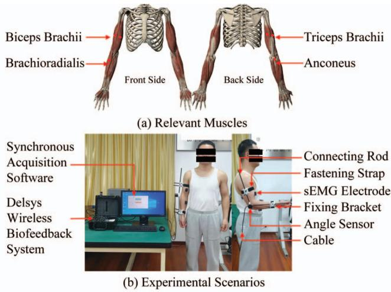  
Fig. 1. 上肢肌肉选择与数据采集实验现场。

为了将角度数据与 sEMG 信号对齐，通过计算均方根（RMS）将 sEMG 数据降采样至 200 Hz。每个 sEMG 通道的 RMS 计算如下：

$$
R M S (t) = \sqrt {\frac {1}{N} \sum_ {n = t - N + 1} ^ {t} x [ n ] ^ {2}}\tag{1}
$$

其中 N = 10 表示时间窗口内的采样点数，x[n] 是采样点 n 处的 sEMG 信号。

在训练阶段，来自四个通道的 sEMG（表面肌电）信号特征以及对应的角度数据被用作输入来训练模型。数据集样本结构如下：

$$
I n p u t (t) = [ R M S _ {1} (t), R M S _ {2} (t), R M S _ {3} (t), R M S _ {4} (t), \theta (t) ]\tag{2}
$$

在测试阶段，系统的输入仅由来自四个通道的 sEMG 信号特征组成。

## C. 预测模型结构

Transformer 神经网络架构具有重要意义，特别是在计算机视觉（CV）和自然语言处理（NLP）领域 [13]。该模型通过并行处理数据，显著提高了训练效率和效果。如图 2 所示，它包含以下四个基本组件：

嵌入层（Embedding layer）[14]：位于 Transformer 模型起始处的输入嵌入层将输入序列转换为高维向量空间，使模型能够更好地捕获序列中的关键信息。通常，Transformer 会将使用正弦和余弦函数生成的位置编码直接添加到输入嵌入中。这使得模型能够有效地精确定位序列中关键信息的位置，克服了传统神经网络在处理时间序列数据时的局限性。在本研究中，输入嵌入层和位置编码层的输入维度均为 5，输出维度均为 512。

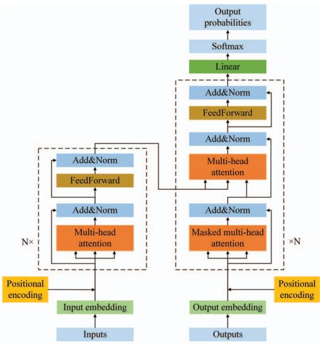  
Fig. 2. Transformer 模型架构。

编码器网络（Encoder network）：Transformer 编码器网络由两个子层组成：多头注意力层和前馈层 [15]。每个子层通过前馈网络输出，随后进行层归一化（layer normalization）。通常，在 Transformer 架构中会串联使用多个编码器网络，在本研究中采用了三个编码器网络。在 Transformer 模型的初始编码层中，多头注意力机制所需的 Query、Key 和 Value 向量均来自位置嵌入层。在此阶段，输入序列首先被转换为词嵌入向量，随后通过位置编码添加位置信息 [16]。在后续的编码器网络中，多头注意力子层的输入来自前一个编码器网络产生的输出，而非直接来自嵌入层。因此，每个编码器网络都会基于上一层的输出重新计算 Query、Key 和 Value 向量，从而逐步细化和抽象输入信息。

解码器网络：与编码器网络平行，解码器网络具有相同数量的层。每个解码器网络包含三个子层：掩码多头注意力（masked multihead attention）子层、编码器-解码器多头注意力子层和前馈子层。解码器网络同样在每个子层中使用前馈和层归一化技术来生成输出，这与编码器网络的处理过程类似。然而，解码器网络在自注意力机制的处理中增加了一个掩码步骤。在该掩码的多头自注意力子层中，Transformer 掩盖了未来的输入嵌入，以防止模型提前获取未来信息。这样做的目的是确保模型在每个当前位置上，仅基于其先前生成的输出信息做出决策和预测，而不会提前看到未来的信息 [17]。

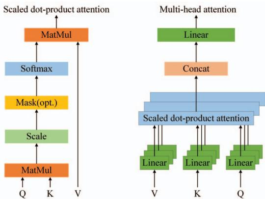  
Fig. 3. Transformer 中的注意力机制

Softmax 层：与其他神经机器翻译框架一致，解码器网络的输出在送入 Softmax 层之前需经过线性变换。该层随后将对数几率得分转换为概率分布 [18]。

自注意力机制是 Transformer 架构的核心组成部分，在编码器网络和解码器网络中均有使用 [13]。其主要作用是学习 sEMG 特征的全局时序依赖关系，有助于弥补卷积模块由于感受野有限而无法捕获全局信息的不足。具体而言，在 Transformer 模型中使用了所谓的多头注意力机制，它实际上是缩放点积注意力（scaled dot-product attention）机制的扩展。缩放点积注意力和多头注意力的详细运行原理如图 Fig. 3 所示。

缩放点积注意力涉及将嵌入层或编码层的输出线性变换为三个形状相同的矩阵：查询（Q）、键（K）和值（V），每个矩阵的维度均为 $d _ { k }$ 。这些矩阵的计算公式如下：

$$
Q = X W _ {Q}, \quad K = X W _ {K}, \quad V = X W _ {V}\tag{3}
$$

其中 X 是上一层的输出，其维度为批大小 $\times$ 序列长度 $\times \ d _ { k }$ ，在本研究中为 $3 2 \times 1 0 \times 5 1 2$ 。矩阵 $W _ { Q } , \ W _ { K }$ 和 $W _ { V }$ 分别是查询、键和值的线性变换矩阵。

接下来，计算查询 Q 和键 K 的点积，然后除以 $d _ { k }$ 以防止数值过大。最后使用 softmax 函数获得注意力权重：

$$
\text { Attention } (Q, K, V) = \operatorname{softmax} \left(\frac {Q K ^ {\mathrm{T}}}{\sqrt {d _ {k}}}\right) V\tag{4}
$$

在此处，$Q K ^ { T }$ 生成一个注意力矩阵，用于衡量每个查询（query）与键（key）之间的相似度。Softmax 函数对该矩阵进行归一化，所得权重矩阵作用于值 $V$ 上以产生最终输出。该机制通过在计算每个位置的输出时考虑输入序列中的所有位置，使模型能够捕获长距离依赖关系 [19]。这一能力是 Transformer 模型能够有效处理时间序列任务的关键原因。

多头注意力机制（multi-head attention mechanism）是 Transformer 架构的核心创新，它增强了模型在不同子空间中捕获特征的能力。通过引入多个注意力头，该机制在不同的表示空间中并行执行注意力计算，从而捕获序列中更复杂的依赖关系和上下文信息 [20]。多头注意力机制的计算过程可表示如下：

$$
\operatorname{MultiHead} (Q, K, V) = \operatorname{Concat} \left(\operatorname{head} _ {1}, \dots , \operatorname{head} _ {h}\right) W ^ {O}\tag{5}
$$

其中每个头的计算方式为：

$$
\mathrm{head} _ {i} = \mathrm{Attention} (Q W _ {i} ^ {Q}, K W _ {i} ^ {K}, V W _ {i} ^ {V})\tag{6}
$$

此处，$W _ { i } ^ { Q } , W _ { i } ^ { K }$ 和 $W _ { i } ^ { V }$ 分别是第 $i$ 个头对应的查询、键和值的线性变换矩阵。$W ^ { \dot { O } }$ 是用于将拼接结果投影回目标维度的线性变换矩阵 [21]。

## D. 模型性能评估

在实验中，使用平均绝对误差（Mean Absolute Error, MAE）和标准差（Standard Deviation, STD）这两个评估指标来评估预测系统的有效性 [22]。在模型训练阶段，进行了五折交叉验证以确定最优模型参数。在该过程中，15 个数据集用于带交叉验证的训练，其余 5 个数据集保留用于测试。随后，计算预测肘关节角度与实际肘关节角度之间的 MAE 以评估模型的准确性。最后，计算每个受试者在多次试验中的 STD。

MAE 的计算公式为：

$$
\mathrm{MAE} = \frac {1}{M} \sum_ {i = 1} ^ {M} | y _ {i} - \hat {y} _ {i} |\tag{7}
$$

其中 $M$ 为下采样点数，$y _ { i }$ 为实际值，$\hat { y } _ { i }$ 为预测值。标准差（STD）的计算公式为：

$$
\mathrm{STD} = \sqrt {\frac {1}{S} \sum_ {i = 1} ^ {S} (m _ {i} - \mu) ^ {2}}\tag{8}
$$

在此处，$m _ { i }$ 表示受试者每次试验的 MAE 值，$\mu$ 是每个受试者 5 次测试试验的平均 MAE，$S$ 是测试试验的总数，即 5。

## III. 实验结果

本实验的模型训练在配备 RTX3090 图形处理器的本地服务器上进行，使用 Python 3.7 和 PyTorch 1.12。主要训练参数设置如下：epoch=300，batch size=64，learning rate=0.0001。在 Transformer 预测模型中，Encoder（编码器）和 Decoder（解码器）层数均设置为 3，多头注意力机制中的头数设置为 8。对于每位受试者，70% 的数据用作训练和验证数据集，其余 30% 用作测试数据集。每位受试者的预测结果如图 Fig. 4 所示，所有预测结果的 MAE 如表 Table I 所示。

本研究还建立了另外两个预测模型：RNN 和 CNN-LSTM。将这些模型与 Transformer 模型进行了对比评估。以受试者 A 为例，三种模型预测关节角度的对比分析如图 Fig. 5 所示。所有受试者的真实值与预测值之间的 MAE 统计情况如表 Table I 所示。

如图 Fig. 4 所示，Transformer 模型在预测六位受试者的肘关节角度方面表现出极高的准确性。此外，Fig. 5 突显了与 RNN 和 CNN-LSTM 模型相比，Transformer 模型在预测连续关节角度方面具有更优越的精度，Table I 中的数据进一步支持了这一结论。此外，对运行时间和资源消耗的初步比较表明，虽然 RNN 模型的运行时间最长，但其消耗的资源较少，更适合短序列任务。CNN-LSTM 具有更快的运行时间，但代价是更高的资源消耗，因此在复杂时间序列任务中更为有效。并行处理整个序列的 Transformer 模型实现了最短的运行时间，并在长序列任务中表现出色，尽管其资源消耗最高。

## IV. 结论

为了实现预测肘关节角度的目标，本研究首先设计了 sEMG（表面肌电信号）和关节角度数据采集实验，并完成了数据采集与预处理流程。随后，开发了一种基于 Transformer 架构的关节角度预测模型，该模型利用多通道 sEMG 信号和时间序列角度作为输入。实验对比了 Transformer 模型与 RNN、CNN-LSTM 模型的关节角度预测性能。实验结果表明，基于 Transformer 的模型预测值与真实值之间的 MAE 小于 0.065，低于在 RNN 和 CNN-LSTM 模型中观察到的误差，从而证明了本方法的有效性。

所提出的用于预测肘关节运动角度的模型在预测用户关节运动方面表现出更高的准确性，为控制算法和康复机器人控制提供了新的见解。然而，仍需进一步研究以探索几个有前景的方向。未来的工作可以聚焦于优化模型架构以提高预测精度和效率，将其应用扩展到其他关节，并结合额外的生物信号进行多模态数据融合。这些进展将拓宽研究范围，并有助于为康复设备开发更先进的控制算法。

六名受试者在三种模型下预测肘关节角度与实际肘关节角度之间的平均绝对误差（MAE）和标准差（STD）  
TABLE I

<table><tr><td>模型</td><td>评估指标</td><td>受试者 A</td><td>受试者 B</td><td>受试者 C</td><td>受试者 D</td><td>受试者 E</td><td>受试者 F</td></tr><tr><td rowspan="2">RNN</td><td>MAE</td><td>0.0795</td><td>0.1018</td><td>0.0678</td><td>0.0975</td><td>0.0594</td><td>0.0922</td></tr><tr><td>STD</td><td>0.0080</td><td>0.0110</td><td>0.0090</td><td>0.0070</td><td>0.0081</td><td>0.0102</td></tr><tr><td rowspan="2">CNN-LSTM</td><td>MAE</td><td>0.0635</td><td>0.0863</td><td>0.0408</td><td>0.0729</td><td>0.0502</td><td>0.0750</td></tr><tr><td>STD</td><td>0.0075</td><td>0.0090</td><td>0.0107</td><td>0.0140</td><td>0.0095</td><td>0.0131</td></tr><tr><td rowspan="2">Transformer</td><td>MAE</td><td>0.0403</td><td>0.0600</td><td>0.0377</td><td>0.0539</td><td>0.0274</td><td>0.0484</td></tr><tr><td>STD</td><td>0.0045</td><td>0.0052</td><td>0.0060</td><td>0.0088</td><td>0.0090</td><td>0.0080</td></tr></table>

## 参考文献

[1] K. Li, J. Zhang, L. Wang, M. Zhang, J. Li, and S. Bao, “A review of the key technologies for semg-based human-robot interaction systems,” Biomedical Signal Processing and Control, vol. 62, p. 102074, 2020. [Online]. Available: https://www.sciencedirect.com/science/article/pii/S1746809420302305

[2] A. Mohebbi, “Human-robot interaction in rehabilitation and assistance: a review,” Current Robotics Reports, vol. 1, no. 3, pp. 131–144, 2020.

[3] A. Goen and D. Tiwari, “Review of surface electromyogram signals: its analysis and applications,” International Journal of Electrical and Computer Engineering, vol. 7, no. 11, pp. 1429–1437, 2013.

[4] T. du Plessis, K. Djouani, and C. Oosthuizen, “A review of active hand exoskeletons for rehabilitation and assistance,” Robotics, vol. 10, no. 1, 2021. [Online]. Available: https://www.mdpi.com/2218-6581/10/1/40

[5] S.-H. Yeo, J. Verheul, W. Herzog, and S. Sueda, “Numerical instability of hill-type muscle models,” Journal of the Royal Society Interface, vol. 20, no. 199, p. 20220430, 2023.

[6] J. Han, Q. Ding, A. Xiong, and X. Zhao, “A state-space emg model for the estimation of continuous joint movements,” IEEE Transactions on Industrial Electronics, vol. 62, no. 7, pp. 4267–4275, 2015.

[7] H. Li, S. Guo, D. Bu, and H. Wang, “A two-stage ga-based semg feature selection method for user-independent continuous estimation of elbow angles,” IEEE Transactions on Instrumentation and Measurement, vol. 72, pp. 1–9, 2023.

[8] F. Xiao, Y. Wang, Y. Gao, Y. Zhu, and J. Zhao, “Continuous estimation of joint angle from electromyography using multiple timedelayed features and random forests,” Biomedical Signal Processing and Control, vol. 39, pp. 303–311, 2018. [Online]. Available: https://www.sciencedirect.com/science/article/pii/S1746809417301775

[9] K. Han, Y. Wang, H. Chen, X. Chen, J. Guo, Z. Liu, Y. Tang, A. Xiao, C. Xu, Y. Xu, Z. Yang, Y. Zhang, and D. Tao, “A survey on vision transformer,” IEEE Transactions on Pattern Analysis and Machine Intelligence, vol. 45, no. 1, pp. 87–110, 2023.

[10] R. B. Azhiri, M. Esmaeili, and M. Nourani, “Real-time emg signal classification via recurrent neural networks,” in 2021 IEEE International Conference on Bioinformatics and Biomedicine (BIBM), 2021, pp. 2628– 2635.

[11] T. Kim and S. Cho, “Predicting residential energy consumption using cnn-lstm neural networks,” Energy, vol. 182, pp. 72–81, 2019. [Online]. Available: https://www.sciencedirect.com/science/article/pii/S0360544219311223

[12] E. A. Clancy, E. L. Morin, G. Hajian, and R. Merletti, “Tutorial. surface electromyogram (semg) amplitude estimation: Best practices,” Journal of Electromyography and Kinesiology, vol. 72, p. 102807, 2023. [Online]. Available: https://www.sciencedirect.com/science/article/pii/S1050641123000664

[13] Y. Zhao, J. Zhang, and C. Zong, “Transformer: A general framework from machine translation to others,” Machine Intelligence Research, vol. 20, no. 4, pp. 514–538, 2023.

[14] T. Mickus, D. Paperno, and M. Constant, “How to Dissect a Muppet: The Structure of Transformer Embedding Spaces,” Transactions of the Association for Computational Linguistics, vol. 10, pp. 981–996, 09 2022. [Online]. Available: https://doi.org/10.1162/tacl a 00501

[15] E. Voita, D. Talbot, F. Moiseev, R. Sennrich, and I. Titov, “Analyzing multi-head self-attention: Specialized heads do the heavy lifting, the rest can be pruned,” arXiv preprint arXiv:1905.09418, 2019.

[16] D. Qiu and B. Yang, “Text summarization based on multi-head selfattention mechanism and pointer network,” Complex & Intelligent Sys tems, pp. 1–13, 2022.

[17] L. Gong, Y. Li, J. Guo, Z. Yu, and S. Gao, “Enhancing low-resource neural machine translation with syntax-graph guided self-attention,” Knowledge-Based Systems, vol. 246, p. 108615, 2022. [Online]. Available: https://www.sciencedirect.com/science/article/pii/S0950705122002763

[18] F. Stahlberg, “Neural machine translation: A review,” Journal of Artifi cial Intelligence Research, vol. 69, pp. 343–418, 2020.

[19] S. Ahmed, I. E. Nielsen, A. Tripathi, S. Siddiqui, R. P. Ramachandran, and G. Rasool, “Transformers in time-series analysis: A tutorial,” Circuits, Systems, and Signal Processing, vol. 42, no. 12, pp. 7433– 7466, 2023.

[20] Z. Niu, G. Zhong, and H. Yu, “A review on the attention mechanism of deep learning,” Neurocomputing, vol. 452, pp. 48–62, 2021. [Online]. Available: https://www.sciencedirect.com/science/article/pii/S092523122100477X

[21] T. Fang, J. Wang, W. Mu, Z. Song, X. Zhang, G. Zhan, P. Wang, J. Bin, L. Niu, L. Zhang, and X. Kang, “Noninvasive neuroimaging and spatial filter transform enable ultra low delay motor imagery eeg decoding,” Journal of Neural Engineering, vol. 19, no. 6, p. 066034, dec 2022. [Online]. Available: https://dx.doi.org/10.1088/1741-2552/aca82d

[22] D. Chicco, M. J. Warrens, and G. Jurman, “The coefficient of determination r-squared is more informative than smape, mae, mape, mse and rmse in regression analysis evaluation,” Peerj computer science, vol. 7, p. e623, 2021.

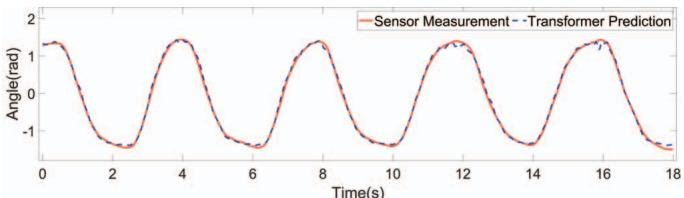

(a) 受试者 A 的预测关节角度与真实关节角度  
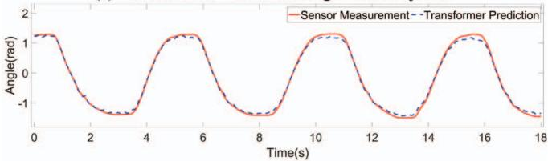

(b) 受试者 B 的预测关节角度与真实关节角度  
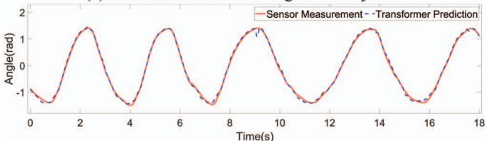

(c) 受试者 C 的预测关节角度与真实关节角度  
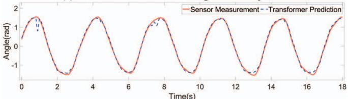

(d) 受试者 D 的预测关节角度与真实关节角度  
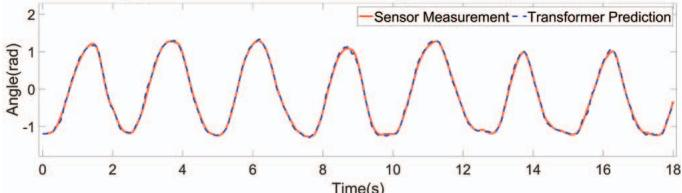  
(e) 受试者 E 的预测关节角度与真实关节角度

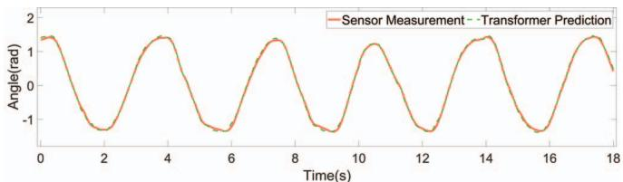  
(b) CNN-LSTM 模型预测肘关节角度与实际角度对比

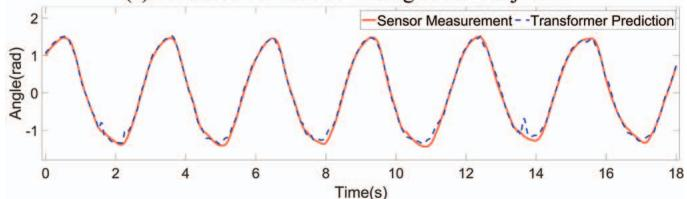

(a) Transformer 模型预测肘关节角度与实际角度对比  
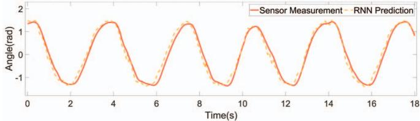  
(f) 受试者 F 的预测关节角度与真实关节角度  
(c) RNN 模型预测肘关节角度与实际角度对比

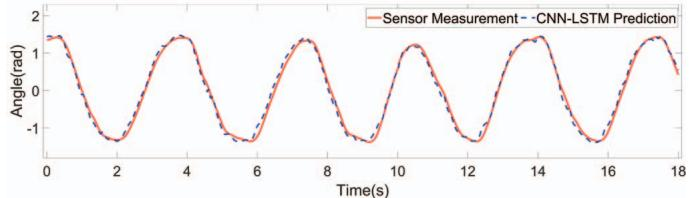  
Fig. 4. 六名受试者的 Transformer 模型预测与实际肘关节角度对比  
Fig. 5. 肘关节角度预测对比：Transformer 模型 vs. RNN 模型与 CNN-LSTM 模型