# 零样本文本到图像生成

Aditya Ramesh <sup>1</sup> Mikhail Pavlov <sup>1</sup> Gabriel Goh <sup>1</sup> Scott Gray <sup>1</sup> Chelsea Voss <sup>1</sup> Alec Radford <sup>1</sup> Mark Chen <sup>1</sup> Ilya Sutskever <sup>1</sup>

## 摘要

传统上，文本到图像生成一直专注于寻找更好的建模假设以在固定数据集上进行训练。这些假设可能涉及复杂的架构、辅助损失，或在训练期间提供的附加信息（如物体部件标签或分割掩码）。我们针对该任务描述了一种简单的方法，该方法基于 Transformer，将文本和图像标记（token）自回归地建模为单一数据流。在拥有充足数据和模型规模的情况下，以零样本方式进行评估时，我们的方法与先前的特定领域模型相比具有竞争力。

## 1. 引言

现代用于文本到图像合成的机器学习方法始于 Mansimov et al. (2015) 的工作，他们展示了当 DRAW（Gregor et al., 2015）生成模型扩展为以图像描述为条件时，也能够生成新颖的视觉场景。随后，Reed et al. (2016b) 证明了使用生成对抗网络（generative adversarial network, Goodfellow et al., 2014）而非循环变分自编码器可以提高图像保真度。Reed et al. (2016b) 表明，该系统不仅能够生成具有可识别属性的物体，而且还能够零样本泛化到保留类别。

在接下来的几年里，通过结合多种方法，该领域继续取得进展。这些方法包括通过多尺度生成器（Zhang et al., 2017; 2018）等改进生成模型架构、融合注意力机制与辅助损失（Xu et al., 2018），以及利用纯文本之外的其他条件信息源（Reed et al., 2016a; Li et al., 2019; Koh et al., 2021）。

此外，Nguyen et al. (2017) 提出了一种用于条件图像生成的基于能量的框架，相比同期方法大幅提升了样本质量。他们的方法可以结合预训练判别模型，并展示了在应用于基于 MS-COCO 预训练的图像描述模型时执行文本到图像生成的能力。近期，Cho et al. (2020) 还提出了一种涉及优化预训练跨模态掩码语言模型输入的方法。尽管自 Mansimov et al. (2015) 以来的研究工作使视觉保真度得到了显著提升，但生成的样本仍可能存在严重的伪影，例如物体失真、物体位置不合逻辑，或前景与背景元素的不自然融合。

  
Figure 1. 原始图像（上）与离散 VAE（discrete VAE，下）重建图像的对比。编码器将空间分辨率下采样了 8 倍。尽管细节（例如猫毛的纹理、店面上的字迹以及插图中的细线条）有时会丢失或失真，但图像的主要特征通常仍然可以识别。我们使用了高达 8192 的大词表容量以减少信息损失。

由大规模生成模型推动的最新进展为进一步改进指明了一条可行的路径。具体而言，当算力、模型规模和数据量经过精心扩展时，自回归 Transformer（Vaswani 等人，2017）已经在文本（Radford 等人，2019）、图像（Chen 等人，2020）和音频（Dhariwal 等人，2020）等多个领域取得了令人瞩目的成果。

相比之下，文本到图像的生成通常是在相对较小的数据集上进行评估的，例如 MS-COCO 和 CUB-200（Welinder 等人，2010）。数据集规模和模型大小会是当前方法的限制因素吗？在本研究中，我们证明了在 2.5 亿从互联网收集的图像-文本

(c) 一个写着“backprop”的霓虹灯招牌。一个写着“backprop”的霓虹灯招牌。backprop 霓虹灯招牌

(a) 由手风琴做成的貘。具有手风琴纹理的貘。(b) 一只穿着圣诞毛衣遛狗的幼年刺猬插画  
  
(d) 顶部完全相同的猫在底部呈现为草图  
Figure 2. 在不同可靠程度下，我们的模型似乎能够以合理的方式组合不同的概念、创作动物的拟人化版本、渲染文本，并执行某些类型的图像到图像转换。

对上训练一个 120 亿参数的自回归 Transformer，可以获得一个可通过自然语言控制的、灵活且高保真的图像生成模型。

所得系统在流行的 MS-COCO 数据集上实现了零样本（zero-shot）高质量图像生成，且未使用任何训练标签。在人类评估中，它在 90% 的情况下优于在该数据集上训练的先前工作。我们还发现，它能够在初步水平上执行复杂的任务，例如图像到图像的转换（image-to-image translation）。这在以往需要定制的方法（Isola 等人，2017），而现在则是作为单个大型生成模型的能力自然涌现出来的。

## 2. 方法

我们的目标是训练一个 Transformer（Vaswani et al., 2017），将文本和图像 token 作为单一数据流进行自回归建模。然而，对于高分辨率图像，直接将像素用作图像 token 会占用过多的内存。似然目标往往会优先对像素之间的短程依赖关系进行建模（Salimans et al., 2017），因此大部分建模能力会被用于捕捉高频细节，而不是使物体在我们视觉上可识别的低频结构。

我们通过使用类似于（Oord et al., 2017; Razavi et al., 2019）的两阶段训练过程来解决这些问题：

• 阶段 1。我们训练一个离散变分自编码器（discrete variational autoencoder，简称 dVAE）<sup>1</sup>，将每张 256×256 的 RGB 图像压缩为一个 32 × 32 的图像 token 网格，其中每个元素可以取 8192 个可能的值。这在视觉质量没有大幅下降的情况下，将 Transformer 的上下文大小减少了 192 倍（见图 1）。

• 阶段 2。我们将最多 256 个 BPE 编码的文本 token 与 $3 2 \times 3 2 = 1 0 2 4$ 个图像 token 拼接起来，并训练一个自回归 Transformer 来建模文本和图像 token 的联合分布。

整个过程可以看作是最大化图像 x、描述文本 y 以及编码 RGB 图像的 token z 上的模型分布联合似然的证据下界（ELB）（Kingma & Welling, 2013; Rezende et al., 2014）。我们使用因子分解 $p _ { \theta , \psi } ( x , y , z ) = p _ { \theta } ( x | y , z ) p _ { \psi } ( y , z )$ 对该分布进行建模，由此得出下界：

$$
\begin{array}{c}\ln p_{\theta ,\psi}(x,y)\geqslant \mathop{\mathbb{E}}_{z\sim q_{\phi}(z  |  x)}\big(\ln p_{\theta}(x  |  y,z) - \\ \beta   D_{\mathrm{KL}}(q_{\phi}(y,z  |  x),p_{\psi}(y,z))\big), \end{array}\tag{1}
$$

其中：

$q _ { \phi }$ 表示在给定 RGB 图像 ${ \overset { \mathbf { - } } { x } } ^ { 2 } ;$ 的情况下，由 dVAE 编码器生成的 $3 2 \times 3 2$ 图像 token 上的分布；

• p<sub>θ</sub> 表示在给定图像 token 的情况下，由 dVAE 解码器生成的 RGB 图像上的分布；以及

• p<sub>ψ</sub> 表示由 Transformer 建模的文本和图像 token 上的联合分布。

请注意，该界仅在 $\beta = 1$ 时成立，而在实践中我们发现使用更大的值会有所帮助（Higgins et al., 2016）。以下小节将更详细地描述这两个阶段。<sup>3</sup>

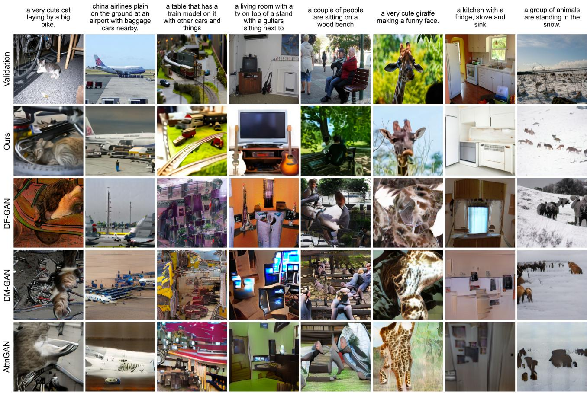  
Figure 3. 我们模型的样本与先前方法在 MS-COCO 描述文本上的样本对比。我们模型的每个样本都是由对比模型在 512 个样本中排序选出的最佳样本。在描述文本或任何模型的样本选择中，我们均未使用任何人工挑选。

## 2.1. 阶段一：学习视觉码本（Visual Codebook）

在训练的第一阶段，我们关于 $\phi$ 和 θ 最大化 ELB，这相当于仅在图像上训练一个 dVAE。我们将初始先验 $p _ { \psi }$ 设置为在 $K = 8 1 9 2$ 个码本（codebook）向量上的均匀分类分布，并将 $q _ { \phi }$ 设置为由编码器输出的 $3 2 \times 3 2$ 网格中相同空间位置处的 8192 个 logits 参数化的分类分布。

此时 ELB 变得难以优化：因为 $q _ { \psi }$ 是离散分布，我们无法使用重参数化梯度（reparameterization gradient）来最大化它。Oord et al. (2017)；Razavi et al. (2019) 结合直通估计器（straight-through estimator, Bengio et al., 2013）使用在线聚类分配过程解决了这个问题。我们则使用 Gumbel-Softmax 松弛（Jang et al., 2016; Maddison et al., 2016），将关于 $q _ { \phi }$ 的期望替换为关于 $q _ { \phi } ^ { \tau } .$ 的期望，其中当温度 $\tau  0$ 时，松弛变得紧致。$p _ { \theta }$ 的似然使用 Log-Laplace 分布进行评估（推导见 Appendix A.3）。

松弛后的 ELB 使用结合指数加权迭代平均的 Adam (Kingma & Ba, 2014) 进行最大化。Appendix A.2 给出了超参数的完整描述，但我们发现以下几点对于稳定训练尤为重要：

• 用于松弛温度和步长的特定退火调度。我们发现将 τ 退火至 $1 / 1 6$ 足以弥合松弛后的验证集 ELB 与使用 $q _ { \phi }$ 代替 $q _ { \phi } ^ { \tau }$ 的真实验证集 ELB 之间的差距。

• 在编码器末端和解码器开头使用 1 × 1 卷积。我们发现减小松弛操作周围卷积的感受野大小有助于其更好地泛化到真实 ELB。

• 将编码器和解码器残差块（resblocks）的输出激活值乘以一个较小的常数，以确保初始化时的稳定训练。

我们还发现，将 KL 权重增加到 $\beta = 6 . 6$ 可以促进更好的码本利用率，并最终在训练结束时获得更小的重建误差。<sup>4</sup>

## 2.2. Stage Two: Learning the Prior

在第二阶段，我们固定 $\phi$ 和 $\theta ,$，并通过关于 ψ 最大化 ELB 来学习文本和图像标记（token）上的先验分布。在此，$p _ { \psi }$ 由一个 120 亿参数的稀疏 Transformer（Sparse Transformer, Child et al., 2019）表示。

给定一个文本-图像对，我们使用词表大小为 16,384 的 BPE 编码（Sennrich et al., 2015）将转为小写的标题编码为至多 256 个标记<sup>5</sup>，并使用词表大小为 8192 的标记将图像编码为 $3 2 \times 3 2 = 1 0 2 4$ 个标记。图像标记是通过对 dVAE 编码器 logits 进行 argmax 采样获得的，不添加任何 Gumbel 噪声。<sup>6</sup> 最后，将文本和图像标记拼接起来，作为单一数据流进行自回归建模。

Transformer 是一个仅包含解码器（decoder-only）的模型，在其 64 个自注意力层中的任意一层，每个图像 token 都可以关注所有文本 token。完整架构见 $\mathsf { A p - }$ pendix B.1。该模型中使用了三种不同的自注意力掩码。注意力掩码中对应于文本到文本注意力的部分是标准因果掩码，而图像到图像注意力的部分则使用行、列或卷积注意力掩码。<sup>7</sup>

我们将文本标题的长度限制为 256 个 token，尽管目前尚不完全清楚在最后一个文本 token 与图像起始 token 之间的“填充（padding）”位置应该如何处理。一种选择是在自注意力操作中将这些 token 的 logits 设为 −∞。相反，我们选择为 256 个文本位置分别学习一个专用的填充 token。仅当没有可用的文本 token 时才使用该 token。在 Conceptual Captions (Sharma et al., 2018) 上的初步实验中，我们发现这种做法会导致验证损失更高，但在分布外（out-of-distribution）标题上的表现更好。

我们通过一个批次数据中各类 token 的总数来对文本和图像 token 的交叉熵损失进行归一化。由于我们主要关注图像建模，因此我们将文本的交叉熵损失乘以 $1 / 8$，并将图像的交叉熵损失乘以 7/8。该目标使用带有指数加权迭代平均（exponentially weighted iterate averaging）的 Adam 进行优化；Appendix B.2 更详细地描述了训练过程。我们保留了约 606,000 张图像用于验证，收敛时未发现过拟合迹象。

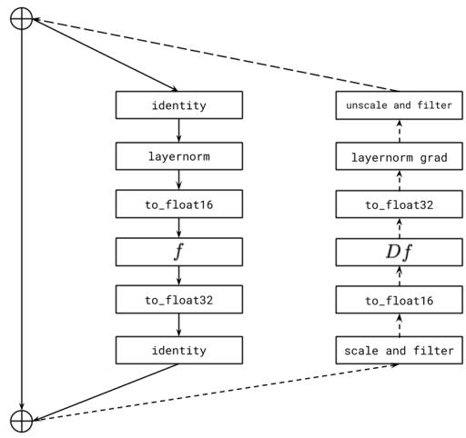  
Figure 4. Transformer 残差块（resblock）的逐残差块梯度缩放示意图。实线表示前向传播的操作序列，虚线表示反向传播的操作序列。我们按每个残差块的梯度缩放因子对其输入梯度进行缩放，并在将输出梯度加到后续残差块的梯度总和之前对其进行反缩放。恒等路径上的激活值和梯度均以 32 位精度存储。“filter”（过滤）操作将激活梯度中的所有 Inf 和 NaN 值设为零。如果不这样做，当前残差块中的非有限值事件将导致所有先前残差块的梯度缩放因子不必要地下降，从而导致下溢。

## 2.3. 数据收集

我们针对参数量高达 12 亿的模型所开展的初步实验是在 Conceptual Captions 上进行的，该数据集包含 330 万个文本-图像对，是作为 MS-COCO (Lin et al., 2014) 的扩展而构建的。

为了扩展到 120 亿（12-billion）参数，我们通过从互联网收集 2.5 亿图文对，创建了一个与 JFT-300M (Sun et al., 2017) 规模类似的数据集。该数据集不包含 MS-COCO，但包含 Conceptual Captions 以及 YFCC100M (Thomee et al., 2016) 的过滤子集。由于 MS-COCO 是基于后者构建的，我们的训练数据包含了 MS-COCO 验证集图像的一小部分（但不包含任何标题）。我们在第 3 节呈现的定量结果中对此进行了控制变量分析，发现它对结果没有明显影响。我们在附录 C 中提供了有关数据收集过程的更多细节。

  
Figure 5. 用于分布式训练的通信模式。模型中的每个参数数组被分片（sharded）到每台机器的八个 GPU 上。在正向传播过程中，我们在计算当前残差块（resblock）的激活值时，预取下一个 resblock 的参数分片（使用 all-gather）。为了节省内存，来自其他 GPU 的参数分片会立即被丢弃。类似地，在反向传播过程中，我们在计算当前 resblock 的激活值和梯度的同时，预取上一个 resblock 的参数分片。在所有 GPU 计算出针对 all-gathered 参数的梯度之后，reduce-scatter 操作使得每个 GPU 仅保留一个切片——即在其 8 个 GPU 间平均后的自身参数分片的梯度。

## 2.4. 混合精度训练

为了节省 GPU 显存并提高吞吐量，大多数参数、Adam 矩以及激活值都以 16 位精度存储。我们还使用了激活检查点（activation checkpointing），并在反向传播期间重新计算 resblocks 内部的激活值。让超过 10 亿参数的模型在 16 位精度下训练且不发生发散，是本项目最具挑战性的部分。

我们认为造成这种不稳定的根本原因是 16 位梯度中的下溢（underflow）。附录 D 给出了我们总结的一套指导原则，用于在训练大规模生成模型时避免下溢。在此，我们介绍其中一条原则：逐残差块（per-resblock）梯度缩放。

与先前的研究 (Liu et al., 2020) 类似，我们发现从较早的 resblock 向较后的 resblock 移动时，来自 resblock 的激活梯度的范数单调递减。<sup>8</sup> 随着模型变得更深更宽，后面 resblock 的激活梯度的真实指数可能会低于 16 位格式的最小指数。因此，它们会被舍入为零，这种现象被称为下溢。我们发现，消除下溢可以实现稳定的训练直至收敛。

<table><tr><td>有效参数量</td><td>压缩秩</td><td>压缩率</td></tr><tr><td> $2.8 \cdot 10^{9} (d_{model} = 1920)$ </td><td>512</td><td> $\approx 83\%$ </td></tr><tr><td> $5.6 \cdot 10^{9} (d_{model} = 2688)$ </td><td>640</td><td> $\approx 85\%$ </td></tr><tr><td> $12.0 \cdot 10^{9} (d_{model} = 3968)$ </td><td>896</td><td> $\approx 86\%$ </td></tr></table>

表 1. 我们展示了模型大小与避免在训练的前 10% 期间出现训练损失差距所需的梯度最小压缩秩（取 128 的倍数）之间的关系。这些结果表明，在我们的设置中，无论模型大小如何，我们都可以实现约 85% 的压缩率。

当最小和最大激活梯度（按绝对值计）所跨越的范围适应 16 位格式的指数范围时，标准损失缩放（loss scaling，Micikevicius 等人，2017）能够避免下溢。在 NVIDIA V100 GPU 上，该指数范围由 5 位指定。尽管这足以训练相同大小的原生语言模型，但我们发现该范围对于文本到图像（text-to-image）模型来说太小了。

我们的解决方案如图 4 所示，涉及在模型中为每个残差块（resblock）使用单独的“梯度缩放（gradient scale）”。这可以看作是一种名为 Flexpoint（Köster 等人，2017）的更通用混合精度训练框架的实用替代方案，其优势在于不需要专门的 GPU 内核。我们发现 Sun 等人（2020）独立开发了用于以 4 位精度训练卷积网络的类似过程。

## 2.5. 分布式优化

我们的 120 亿参数模型在以 16 位精度存储时消耗约 24 GB 显存，这超过了 16 GB NVIDIA V100 GPU 的容量。我们使用参数分片（parameter sharding，Rajbhandari 等人，2019）解决了这个问题。如图 5 所示，参数分片允许我们通过将机内通信与计算密集型操作重叠，几乎完全隐藏机内通信的延迟。

在用于训练该模型的集群上，机器之间的带宽远低于同一机器上 GPU 之间的带宽。这使得在机器之间用于平均梯度的操作（all-reduce）成本成为训练期间的主要瓶颈。我们

一组小便池靠近树木，一群人站在海滩上。

一名女子和一名男子站在灌木长椅旁。

一个带有两个水槽、一个柜子和一个浴缸的浴室。

一辆卡车停在竖起施工路障的十字路口。

一名男子坐在蛞蝓旁边的长椅上。

一辆覆盖着各种空牙膏管的汽车。

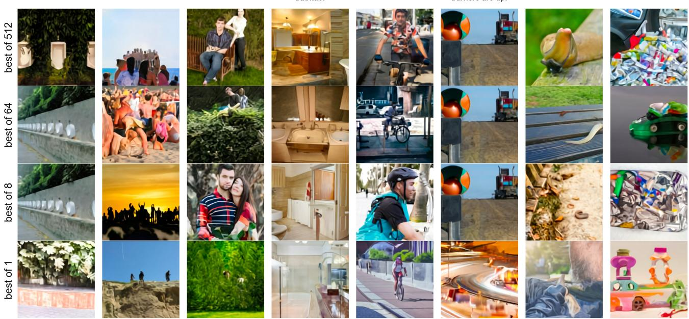  
图 6. 在 MS-COCO 图像描述上，增加对比重排序过程的图像数量所产生的影响。

能够通过使用 PowerSGD（Vogels 等人，2019）压缩梯度来大幅降低这一成本。

在我们的实现中，一台机器内的每个 GPU 都会独立于其相邻的 GPU 计算其参数分片（parameter shard）梯度的低秩因子。<sup>9</sup>计算出低秩因子后，每台机器将其误差缓冲区设置为在其八个 GPU 上平均的未压缩梯度（通过 reduce-scatter 获得）与从低秩因子获得的解压缩梯度之间的残差。

PowerSGD 将未压缩参数梯度的大通信操作替换为其低秩因子的两次小得多的通信操作。对于给定的压缩秩 r 和 transformer 激活大小 $d _ { \mathrm { m o d e l } }$，压缩率由 1 − $5 r / ( 8 d _ { \mathrm { m o d e l } } )$ 给出（见附录 E.1）。Table 1 显示，无论模型大小如何，我们都可以实现约 85% 的压缩率。

在附录 E.2 中，我们描述了使 PowerSGD 在大规模下表现良好所必需的各种细节。其中包括：

• 在反向传播期间通过将梯度累积到误差缓冲区中来节省内存，而不是分配单独的缓冲区。

<sup>9</sup>对于其他操作，仍然存在机器内部通信；我们的意思是，各个分片间的低秩因子在拼接时，不被视为共同近似完整参数矩阵的梯度。

• 尽量减少将误差缓冲区清零的情况（例如，由于在混合精度反向传播期间遇到非有限值，或者从检查点恢复训练时）。

• 通过使用 Householder 正交化代替 Gram-Schmidt 正交化，并在输入中添加一个小的单位矩阵倍数，来提高数值稳定性。

• 通过对误差缓冲区、其低秩因子以及涉及它们的全规约（all-reduce）通信操作使用自定义的 16 位浮点格式，来避免下溢。

我们还发现 Vogels et al. (2019) 中描述的 Q 矩阵热启动过程是不必要的：我们通过在训练开始时将 Q 固定为随机高斯矩阵且从不更新它，能够获得等效的结果。<sup>10</sup>

## 2.6. 样本生成

与 Razavi et al. (2019) 类似，我们使用预训练的对比模型（Radford et al., 2021）对从 transformer 中抽取的样本进行重排序（rerank）。给定一个描述（caption）和一个候选图像，对比模型会根据图像与描述的匹配程度给出一个分数。Figure 6 展示了增加从中选择前 k 张图像的样本数 N 的效果。这个过程可以被看作是一种语言引导搜索（Andreas et al., 2017），并且也类似于 Xu et al. (2018) 提出的辅助文本-图像匹配损失。除非另有说明，用于定性和定量结果的所有样本都是在没有降低采样温度的情况下获得的（即使用 t = 1）（Figure 2 除外），并使用 N = 512 的重排序。

  
Figure 7. 我们的模型（在不降低温度的情况下进行零样本评估）与先前工作（DF-GAN）在 MS-COCO 图像描述上的人工评估对比。在五人投票机制中，我们模型的样本在 90.0% 的情况下被选为最逼真，在 93.3% 的情况下被选为与共享描述最匹配的图像。

## 3. 实验

## 3.1. 定量结果

我们通过将模型与三种先前的方法进行比较来评估其零样本（zero-shot）性能：AttnGAN (Xu et al., 2018)、DM-GAN (Zhu et al., 2019) 和 DF-GAN (Tao et al., 2020)，其中后者在 MS-COCO 上报告了最佳的 Inception Score (Salimans et al., 2016) 和 Fréchet Inception Distance (Heusel et al., 2017)。Figure 3 定性对比了我们模型的样本与先前工作的样本。

我们还开展了类似于 Koh et al. (2021) 中使用的人工评估，以将我们的方法与 DF-GAN 进行比较，其结果如 Figure 7 所示。给定一段图像描述，我们模型的样本在 93% 的情况下获得了更多投票以表明其更好地匹配了描述。同时在 90% 的情况下获得了更多投票以表明其更加逼真。

Figure 9(a) 显示，尽管从未在这些描述上进行过训练，我们的模型在 MS-COCO 上的 FID 分数与最佳先前方法相比差距仍在 2 分以内。我们的训练数据包含过滤后的 YFCC100M 子集，并且通过下一节中描述的去重程序，我们发现其中包含了 MS-COCO 验证集中约 21% 的图像。为了隔离这种影响，我们分别在包含这些图像（实线）和去除这些图像（虚线）的情况下计算了验证集的 FID 统计数据，发现结果没有显著变化。

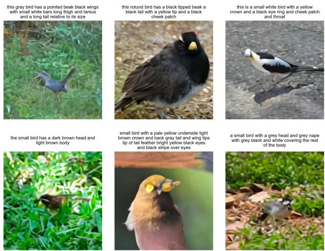  
Figure 8. 我们的模型在 CUB 数据集上的零样本生成样本。

在来自 dVAE 编码器的 token 上训练 transformer，使我们能够将其建模能力分配给能让我们在视觉上辨认出图像的低频信息。然而，这也会给模型带来劣势，因为高强度的压缩使其无法生成高频细节。为了测试这一定量评估的影响，我们在对验证集图像和模型生成的样本应用不同半径的高斯滤波器后，计算了 Figure 9(a) 中的 FID 和 IS。在半径为 1 的轻微模糊下，我们的方法以约 6 分的优势取得了最佳的 FID。随着模糊半径的增加，我们的方法与其他方法之间的差距呈现扩大的趋势。当模糊半径大于或等于 2 时，我们也取得了最高的 IS。

我们的模型在 CUB 数据集上的表现显著较差，我们的模型与领先的先前方法在 FID 上有将近 40 点的差距（Figure 9(b)）。我们发现该数据集有 12% 的重叠率，并且在移除这些图像后同样观察到结果没有显著差异。我们推测，我们的零样本（zero-shot）方法在诸如 CUB 这类专用分布上不太可能具有优势。我们认为微调是一个有前景的改进方向，并将这一探索留待未来工作。Figure 8 展示了我们模型针对该数据集中描述生成的样本。

最后，Figure 9(c) 显示，随着用于对比模型重排的样本大小增加，MS-COCO 上的 FID 和 IS 出现了明显的改善。这种趋势一直持续到样本大小达到 32，之后我们观察到收益


  
(a) MS-COCO 上的 FID 和 IS 随模糊半径的变化关系。

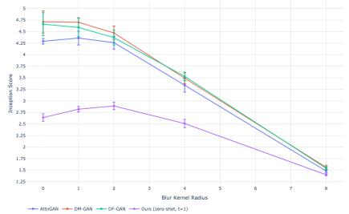  
(b) CUB 上的 FID 和 IS 随模糊半径的变化关系。

  
(c) MS-COCO 上的 FID 和 IS 随用于重排的样本大小的变化关系。  
Figure 9. MS-COCO 和 CUB 上的定量结果。实线表示基于原始验证集计算的 FID，虚线表示基于移除了重叠图像的验证集计算的 FID（见第 3.2 节）。对于 MS-COCO，我们在从验证集中采样的 30,000 个描述文本子集上评估所有模型。对于 CUB，我们在测试集中的所有唯一样本描述文本上评估所有模型。我们使用 DM-GAN 代码计算 FID 和 IS，代码可在 https://github.com/MinfengZhu/DM-GAN 获取。

递减。

## 3.2. 数据重叠分析

我们使用 Radford et al. (2021) 中描述的去重流程来确定要移除的图像。对于每个验证集图像，我们使用专门为该任务训练的对比模型在训练数据中找到最接近的图像。然后，我们按照与训练数据中最近匹配项的接近程度降序排列这些图像。在进行人工检查后，我们通过手动选择一个旨在最小化假阴性率（false negative rate）的保守阈值来确定要移除的图像。

## 3.3. 定性发现

我们发现，我们的模型具备以我们最初未预料到的方式进行泛化的能力。当给出“由手风琴制成的貘……”这一图注时（Figure 2a），该模型似乎能够画出一只身体为手风琴的貘，或者键盘或低音键呈貘的长鼻或腿部形状的手风琴。这表明它已经在高抽象层次上形成了一种组合不寻常概念的初步能力。

我们的模型似乎也具备组合泛化（combinatorial generalization）的能力，例如在渲染文本时（Figure 2b），或者在针对“一只穿着圣诞毛衣遛狗的小刺猬插画”等句子进行测试时（Figure 2c）。像后者这样的提示要求模型执行变量绑定（variable binding）（Smolensky, 1990; Greff et al., 2020）——穿圣诞毛衣的是刺猬，而不是狗。然而，我们注意到模型在这一任务上的表现不够稳定，有时会画出两只动物都穿着圣诞毛衣，或者画出一只刺猬牵着一只更小的刺猬。

在一定程度的可靠性下，我们还发现模型能够进行受自然语言控制的零样本图像到图像转换（zero-shot image-to-image translation）（Figure 2d）。当向模型输入“上方完全相同的猫，下方呈现为素描”这一图注，以及一张猫的照片上方 $15 \times 32$ 区域的图像 token 网格时，它能够在下方绘制出一只看起来相似的猫的素描。

这同样适用于其他几种变换，包括图像操作（例如改变图像颜色、转换为灰度图或上下翻转）以及风格迁移（例如将猫画在贺卡、邮票或手机壳上）。某些变换（例如仅涉及改变动物颜色的变换）表明该模型具备执行初步目标分割的能力。我们在 Section G 中提供了零样本图像到图像转换的更多示例。

## 4. 结论

我们研究了一种在大规模运行状态下基于自回归 Transformer 进行文本到图像生成的简单方法。我们发现，无论是在相对于以往特定领域方法的零样本性能方面，还是在单个生成模型涌现出的能力范围方面，扩大规模都能带来泛化能力的提升。我们的研究结果表明，将提高泛化能力作为规模的函数，可能是推动该任务取得进展的有效驱动力。

## 致谢

我们感谢 Matthew Knight 审查了本工作的代码发布，感谢 Rewon Child、John Schulman、Heewoo Jun 和 Prafulla Dhariwal 对论文提出的宝贵早期反馈。我们还要感谢 Jong Wook Kim 编写了 Radford et al. (2019) 中描述的对比模型的 PyTorch 软件包，我们使用该包对我们模型的样本进行了重排序。

## 参考文献

Abadi, M., Barham, P., Chen, J., Chen, Z., Davis, A., Dean, J., Devin, M., Ghemawat, S., Irving, G., Isard, M., et al. Tensorflow: A system for large-scale machine learning. In 12th {USENIX} symposium on operating systems design and implementation ({OSDI} 16), pp. 265–283, 2016.

Andreas, J., Klein, D., and Levine, S. Learning with latent language. arXiv preprint arXiv:1711.00482, 2017.

Bengio, Y., Léonard, N., and Courville, A. Estimating or propagating gradients through stochastic neurons for conditional computation. arXiv preprint arXiv:1308.3432, 2013.

Bowman, S. R., Vilnis, L., Vinyals, O., Dai, A. M., Jozefowicz, R., and Bengio, S. Generating sentences from a continuous space. arXiv preprint arXiv:1511.06349, 2015.

Chen, M., Radford, A., Child, R., Wu, J., Jun, H., Luan, D., and Sutskever, I. Generative pretraining from pixels. In International Conference on Machine Learning, pp. 1691–1703. PMLR, 2020.

Child, R., Gray, S., Radford, A., and Sutskever, I. Generating long sequences with sparse transformers. arXiv preprint arXiv:1904.10509, 2019.

Cho, J., Lu, J., Schwenk, D., Hajishirzi, H., and Kembhavi, A. X-lxmert: Paint, caption and answer questions with multi-modal transformers. arXiv preprint arXiv:2009.11278, 2020.

Deng, J., Dong, W., Socher, R., Li, L.-J., Li, K., and Fei-Fei, L. Imagenet: A large-scale hierarchical image database. In 2009 IEEE conference on computer vision and pattern recognition, pp. 248–255. Ieee, 2009.

Dhariwal, P., Jun, H., Payne, C., Kim, J. W., Radford, A., and Sutskever, I. Jukebox: A generative model for music. arXiv preprint arXiv:2005.00341, 2020.

Goodfellow, I. J., Pouget-Abadie, J., Mirza, M., Xu, B., Warde-Farley, D., Ozair, S., Courville, A., and Bengio, Y. Generative adversarial networks. arXiv preprint arXiv:1406.2661, 2014.

Greff, K., van Steenkiste, S., and Schmidhuber, J. On the binding problem in artificial neural networks. arXiv preprint arXiv:2012.05208, 2020.

Gregor, K., Danihelka, I., Graves, A., Rezende, D., and Wierstra, D. Draw: A recurrent neural network for image generation. In International Conference on Machine Learning, pp. 1462–1471. PMLR, 2015.

He, K., Zhang, X., Ren, S., and Sun, J. Identity mappings in deep residual networks. In European conference on computer vision, pp. 630–645. Springer, 2016.

Heusel, M., Ramsauer, H., Unterthiner, T., Nessler, B., and Hochreiter, S. Gans trained by a two time-scale update rule converge to a local nash equilibrium. arXiv preprint arXiv:1706.08500, 2017.

Higgins, I., Matthey, L., Pal, A., Burgess, C., Glorot, X., Botvinick, M., Mohamed, S., and Lerchner, A. betavae: Learning basic visual concepts with a constrained variational framework. 2016.

Isola, P., Zhu, J.-Y., Zhou, T., and Efros, A. A. Image-toimage translation with conditional adversarial networks. In Proceedings of the IEEE conference on computer vision and pattern recognition, pp. 1125–1134, 2017.

Jang, E., Gu, S., and Poole, B. Categorical reparameterization with gumbel-softmax. arXiv preprint arXiv:1611.01144, 2016.

Kingma, D. P. and Ba, J. Adam: A method for stochastic optimization. arXiv preprint arXiv:1412.6980, 2014.

Kingma, D. P. and Welling, M. Auto-encoding variational bayes. arXiv preprint arXiv:1312.6114, 2013.

Koh, J. Y., Baldridge, J., Lee, H., and Yang, Y. Text-toimage generation grounded by fine-grained user attention. In Proceedings ofthe IEEE/CVF Winter Conference on Applications ofComputer Vision, pp. 237–246, 2021.

Köster, U., Webb, T. J., Wang, X., Nassar, M., Bansal, A. K., Constable, W. H., Elibol, O. H., Gray, S., Hall, S., Hornof, L., et al. Flexpoint: An adaptive numerical format for efficient training of deep neural networks. arXiv preprint arXiv:1711.02213, 2017.

LeCun, Y., Bottou, L., Bengio, Y., and Haffner, P. Gradientbased learning applied to document recognition. Proceedings of the IEEE, 86(11):2278–2324, 1998.

Li, W., Zhang, P., Zhang, L., Huang, Q., He, X., Lyu, S., and Gao, J. Object-driven text-to-image synthesis via adversarial training. In Proceedings of the IEEE/CVF Conference on Computer Vision and Pattern Recognition, pp. 12174–12182, 2019.

Lin, T.-Y., Maire, M., Belongie, S., Hays, J., Perona, P., Ramanan, D., Dollár, P., and Zitnick, C. L. Microsoft coco: Common objects in context. In European conference on computer vision, pp. 740–755. Springer, 2014.

Liu, L., Liu, X., Gao, J., Chen, W., and Han, J. Understanding the difficulty of training transformers. arXiv preprint arXiv:2004.08249, 2020.

Loshchilov, I. and Hutter, F. Decoupled weight decay regularization. arXiv preprint arXiv:1711.05101, 2017.

Maddison, C. J., Mnih, A., and Teh, Y. W. The concrete distribution: A continuous relaxation of discrete random variables. arXiv preprint arXiv:1611.00712, 2016.

Mansimov, E., Parisotto, E., Ba, J. L., and Salakhutdinov, R. Generating images from captions with attention. arXiv preprint arXiv:1511.02793, 2015.

Micikevicius, P., Narang, S., Alben, J., Diamos, G., Elsen, E., Garcia, D., Ginsburg, B., Houston, M., Kuchaiev, O., Venkatesh, G., et al. Mixed precision training. arXiv preprint arXiv:1710.03740, 2017.

Nguyen, A., Clune, J., Bengio, Y., Dosovitskiy, A., and Yosinski, J. Plug & play generative networks: Conditional iterative generation of images in latent space. In Proceedings ofthe IEEE Conference on Computer Vision and Pattern Recognition, pp. 4467–4477, 2017.

Oord, A. v. d., Vinyals, O., and Kavukcuoglu, K. Neural discrete representation learning. arXiv preprint arXiv:1711.00937, 2017.

Provilkov, I., Emelianenko, D., and Voita, E. Bpe-dropout: Simple and effective subword regularization. arXiv preprint arXiv:1910.13267, 2019.

Radford, A., Wu, J., Child, R., Luan, D., Amodei, D., and Sutskever, I. Language models are unsupervised multitask learners. 2019.

Radford, A., Kim, J. W., Hallacy, C., Ramesh, A., Goh, G., Agarwal, S., Sastry, G., Askell, A., Mishkin, P., Clark, J., Krueger, G., and Sutskever, I. Learning transferable visual models from natural language supervision. 2021.

Rajbhandari, S., Rasley, J., Ruwase, O., and He, Y. Zero: Memory optimization towards training a trillion parameter models. arXiv preprint arXiv:1910.02054, 2019.

Razavi, A., Oord, A. v. d., and Vinyals, O. Generating diverse high-fidelity images with vq-vae-2. arXiv preprint arXiv:1906.00446, 2019.

Reed, S., Akata, Z., Mohan, S., Tenka, S., Schiele, B., and Lee, H. Learning what and where to draw. arXiv preprint arXiv:1610.02454, 2016a.

Reed, S., Akata, Z., Yan, X., Logeswaran, L., Schiele, B., and Lee, H. Generative adversarial text to image synthesis. In International Conference on Machine Learning, pp. 1060–1069. PMLR, 2016b.

Rezende, D. J., Mohamed, S., and Wierstra, D. Stochastic backpropagation and approximate inference in deep generative models. In International conference on machine learning, pp. 1278–1286. PMLR, 2014.

Salimans, T., Goodfellow, I., Zaremba, W., Cheung, V., Radford, A., and Chen, X. Improved techniques for training gans. arXiv preprint arXiv:1606.03498, 2016.

Salimans, T., Karpathy, A., Chen, X., and Kingma, D. P. Pixelcnn++: Improving the pixelcnn with discretized logistic mixture likelihood and other modifications. arXiv preprint arXiv:1701.05517, 2017.

Sennrich, R., Haddow, B., and Birch, A. Neural machine translation of rare words with subword units. arXiv preprint arXiv:1508.07909, 2015.

Sharma, P., Ding, N., Goodman, S., and Soricut, R. Conceptual captions: A cleaned, hypernymed, image alt-text dataset for automatic image captioning. In Proceedings ofthe 56th Annual Meeting ofthe Associationfor Computational Linguistics (Volume 1: Long Papers), pp. 2556– 2565, 2018.

Smolensky, P. Tensor product variable binding and the representation of symbolic structures in connectionist systems. Artificial intelligence, 46(1-2):159–216, 1990.

Sun, C., Shrivastava, A., Singh, S., and Gupta, A. Revisiting unreasonable effectiveness of data in deep learning era. In Proceedings of the IEEE international conference on computer vision, pp. 843–852, 2017.

Sun, X., Wang, N., Chen, C.-Y., Ni, J., Agrawal, A., Cui, X., Venkataramani, S., El Maghraoui, K., Srinivasan, V. V.,

and Gopalakrishnan, K. Ultra-low precision 4-bit training of deep neural networks. Advances in Neural Information Processing Systems, 33, 2020.

Tao, M., Tang, H., Wu, S., Sebe, N., Wu, F., and Jing, X.-Y. Df-gan: Deep fusion generative adversarial networks for text-to-image synthesis. arXiv preprint arXiv:2008.05865, 2020.

Thomee, B., Shamma, D. A., Friedland, G., Elizalde, B., Ni, K., Poland, D., Borth, D., and Li, L.-J. Yfcc100m: The new data in multimedia research. Communications ofthe ACM, 59(2):64–73, 2016.

Vaswani, A., Shazeer, N., Parmar, N., Uszkoreit, J., Jones, L., Gomez, A. N., Kaiser, L., and Polosukhin, I. Attention is all you need. arXiv preprint arXiv:1706.03762, 2017.

Vogels, T., Karimireddy, S. P., and Jaggi, M. Powersgd: Practical low-rank gradient compression for distributed optimization. arXiv preprint arXiv:1905.13727, 2019.

Welinder, P., Branson, S., Mita, T., Wah, C., Schroff, F., Belongie, S., and Perona, P. Caltech-ucsd birds 200. 2010.

Xu, T., Zhang, P., Huang, Q., Zhang, H., Gan, Z., Huang, X., and He, X. Attngan: Fine-grained text to image generation with attentional generative adversarial networks. In Proceedings of the IEEE conference on computer vision and pattern recognition, pp. 1316–1324, 2018.

Zhang, H., Xu, T., Li, H., Zhang, S., Wang, X., Huang, X., and Metaxas, D. N. Stackgan: Text to photo-realistic image synthesis with stacked generative adversarial networks. In Proceedings ofthe IEEE international conference on computer vision, pp. 5907–5915, 2017.

Zhang, H., Xu, T., Li, H., Zhang, S., Wang, X., Huang, X., and Metaxas, D. N. Stackgan++: Realistic image synthesis with stacked generative adversarial networks. IEEE transactions on pattern analysis and machine intelligence, 41(8):1947–1962, 2018.

Zhu, M., Pan, P., Chen, W., and Yang, Y. Dm-gan: Dynamic memory generative adversarial networks for textto-image synthesis. In Proceedings of the IEEE/CVF Conference on Computer Vision and Pattern Recognition, pp. 5802–5810, 2019.

```python
def preprocess_image(img, target_res):
    h, w = tf.shape(img)[0], tf.shape(img)[1]
    s_min = tf.minimum(h, w)
    img = tf.image.random_crop(img, 2 * [s_min] + [3])

    t_min = tf.minimum(s_min, round(9 / 8 * target_res))
    t_max = tf.minimum(s_min, round(12 / 8 * target_res))
    t = tf.random.uniform([], t_min, t_max + 1, dtype=tf.int32)
    img = tf.image.resize_images(img, [t, t], method=tf.image.ResizeMethod.AREA,
    align_corners=True)
    img = tf.cast(tfrint(tf.clip_by_value(img, 0, 255)), tf.uint8)
    img = tf.image.random_crop(img, 2 * [target_res] + [channel_count])
    return tf.image.random_flip_left_right(img)
```

Listing 1. 用于训练 dVAE 的 TensorFlow (Abadi et al., 2016) 图像预处理代码。我们使用 target\_res = 256 和 channel\_count = 3。

## A. 离散 VAE 细节

## A.1. 架构

dVAE 编码器和解码器是带有瓶颈风格残差块（bottleneck-style resblock）的卷积（LeCun et al., 1998）ResNet（He et al., 2016）。模型主要使用 $3 \times 3$ 卷积，并在残差块输入和输出之间特征图数量发生变化的跳跃连接（skip connection）上使用 1 × 1 卷积。编码器的第一个卷积为 $7 \times 7 .$，编码器的最后一个卷积（产生用作图像 token 分类分布 logits 的 $3 2 \times 3 2 \times 8 1 9 2$ 输出）为 $1 \times 1$。解码器的第一个和最后一个卷积均为 $1 \times 1$。编码器使用最大池化（我们发现这比平均池化能获得更好的 ELB）来下采样特征图，解码器则使用最近邻上采样。具体的架构细节在开源代码的文件 dvae/encoder.py 和 dvae/decoder.py 中给出。

## A.2. 训练

dVAE 使用 Listing 1 中给出的数据增强代码，在与 transformer 相同的数据集上进行训练。训练过程中有几个量会发生衰减，它们均采用余弦调度（cosine schedule）：

1. 在前 5000 次更新中，KL 权重 $\beta$ 从 0 增加到 6.6。Bowman et al. (2015) 使用了类似的基于 sigmoid 函数的调度策略。

2. 在前 150,000 次更新中，松弛温度 τ 从 1 退火到 1/16。对此使用线性退火调度通常会导致发散。

3. 在 1,200,000 次更新中，步长从 $1 \cdot 1 0 ^ { - 4 } \mathrm { t o } 1 . 2 5 \cdot 1 0 ^ { - 6 }$ 进行退火。

松弛温度和步长的衰减调度对于稳定性和成功优化尤为重要。

我们使用 AdamW（Loshchilov & Hutter, 2017）更新参数，其中 $\beta _ { 1 } = 0 . 9 , \beta _ { 2 } = 0 . 9 9 9 , { \epsilon } = 1 0 ^ { - 8 }$，权重衰减乘数为 $1 0 ^ { - 4 }$。我们对参数采用衰减系数为 0.999 的指数加权迭代平均。ELB 中的重构项是图像像素 $2 5 6 \times 2 5 6 \times 3$ 个值的联合分布，KL 项是编码器输出的空间网格中 $3 2 \times 3 2$ 个位置上的联合分布。我们将总损失除以 $2 5 6 \times 2 5 6 \times 3 .$，使得 KL 项的权重变为 $\beta / 1 9 2$，其中 β 为 KL 权重。该模型在 64 块 16 GB NVIDIA V100 GPU 上采用标准（即全局）损失缩放进行混合精度训练，每块 GPU 的 batch size 为 8，总 batch size 为 512。模型共训练了 3,000,000 次更新。

## A.3. Logit-Laplace 分布

$\ell _ { 1 }$ 和 $\ell _ { 2 }$ 重建目标在训练 VAE 时常被使用。这些目标分别对应于在公式 1 中将拉普拉斯分布和高斯分布用于 ln $p _ { \theta } ( x \mid y , z )$。这种建模选择存在一种奇怪的不匹配：像素值位于一个有界区间内，但这两种分布的支撑集却覆盖整个实数轴。因此，必然会有一部分似然被分配在像素值的允许范围之外。

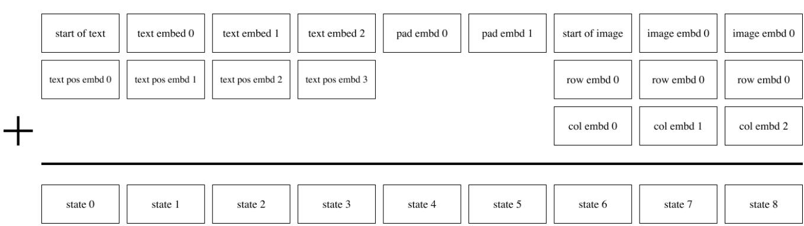  
Figure 10. 最大文本长度为 6 个 token 的假设版本 Transformer 的嵌入方案示意图。每个方框表示一个大小为 $d _ { \mathrm { m o d e l } } = 3 9 6 8$ 的向量。在此示意图中，图注长度为 4 个 token，因此使用了 2 个填充 token（如第 2.2 节所述）。每个图像词表嵌入均与行嵌入和列嵌入相加。

我们提出了一种同样以有界区间为支撑集的拉普拉斯分布变体。这解决了被建模像素值的范围与用于建模它们的分布的支撑集之间的差异。我们考虑将 sigmoid 函数应用于服从拉普拉斯分布的随机变量后所获得的随机变量的概率密度函数（pdf）。该概率密度函数定义在 (0, 1) 上，由下式给出：

$$
f (x \mid \mu , b) = \frac {1}{2 b x (1 - x)} \exp \left(- \frac {| \log i (x) - \mu |}{b}\right);\tag{2}
$$

我们称之为 logit-Laplace 分布。我们使用公式 2 右侧的对数作为 dVAE 训练目标的重建项。

dVAE 的解码器生成六个特征图，代表被重建图像 RGB 通道的 logit-Laplace 分布的充分统计量。前三个特征图表示 RGB 通道的 µ 参数，后三个表示 ln b。在将图像输入 dVAE 编码器之前，我们使用 $\varphi : [ 0 , 2 5 5 ]  ( \epsilon , 1 - \epsilon )$ 转换其数值，该变换由下式给出：

$$
\varphi : x \mapsto \frac {1 - 2 \epsilon}{2 5 5} x + \epsilon .\tag{3}
$$

这将由 dVAE 解码器建模的像素值范围限制在 $( \epsilon , 1 - \epsilon )$，从而避免了由公式 2 中的 $x ( 1 - x )$ 引起的数值问题。我们使用 $\epsilon = 0 . 1$。为了重建图像以进行人工检查或计算评估指标，我们忽略 ln b 并计算 $\hat { x } = \varphi ^ { - 1 } ( \mathrm { s i g m o i d } ( \mu ) )$，其中 $\mu$ 由 dVAE 解码器输出的前三个特征图给出。<sup>11</sup>

## B. Transformer 细节

## B.1. 架构

我们的模型是一个与 Child et al. (2019) 中所描述相同的仅解码器稀疏 Transformer（decoder-only sparse transformer），并在上下文的图像标记（image tokens）部分采用了广播行和列嵌入。我们模型中使用的嵌入方案的完整描述如图 Figure 10 所示。我们使用了 64 个注意力层，每层包含 62 个注意力头，每个头的状态维度大小为 64。

该模型使用了三种稀疏注意力掩码，如图 Figure 11 所示。卷积注意力掩码（Figure 11(d)）仅在最后一个自注意力层中使用。在其他情况下，给定自注意力层的索引 $i$（其中 $i \in [1, 63]$），若 $i - 2 \bmod 4 = 0$ 则使用列注意力掩码（Figure 11(c)），否则使用行注意力。例如，前四个自注意力层分别使用“行、列、行、行”。除了卷积注意力掩码（我们发现在最终的自注意力层中使用时，相较于行注意力和密集因果注意力掩码能带来轻微的性能提升）之外，这与 Child et al. (2019) 中使用的配置相同。

  
(a) 行注意力掩码。

  
(b) 列注意力掩码。

  
(c) 转置图像状态下的列注意力掩码。

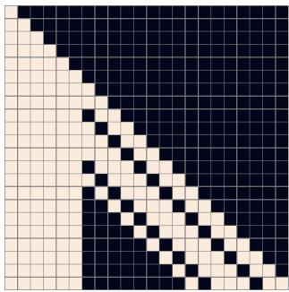  
(d) 卷积注意力掩码。  
Figure 11. 针对假设版本的 Transformer 所展示的三种注意力掩码类型说明，该假设模型具有最大 6 个标记的文本长度和 16 个标记的图像长度（即对应于 $\mathbf { a } 4 \times 4 \mathrm { g r i d } )$ ）。掩码 (a) 对应于行注意力，其中每个图像标记按光栅扫描顺序关注前 5 个图像标记。范围选择为 5，以便被关注的最后一个标记是上一行同一列中的标记。为了获得更好的 GPU 利用率，我们在应用列注意力时转置了图像状态的行和列维度，从而可以使用掩码 (c) 代替掩码 (b)。掩码 (d) 对应于具有环绕行为（类似于行注意力）和 $3 \times 3$ 核的因果卷积注意力模式。我们的模型使用了对应于 $11 \times 11$ 核的掩码。

## B.2. 训练

在训练 Transformer 时，我们在使用 dVAE 编码器对图像进行编码之前，先对图像应用数据增强。我们使用的数据增强与训练 dVAE 时所用的略有不同；相关代码见代码清单 2（Listing 2）。在对用于训练的标题进行 BPE 编码时，我们还应用了 10% 的 BPE dropout。模型采用逐残差块缩放（per-resblock scaling，见 2.4 节）和总压缩秩为 896 的梯度压缩（gradient compression，见 2.5 节）进行训练（使得每个 GPU 对其参数分片使用的压缩秩为 112）。如表 1（Table 1）所示，这带来了约 86% 的压缩率，我们将在 E.1 节中对此进行分析。

我们使用 AdamW 更新参数，其中 $\beta _ { 1 } = 0 . 9 , \beta _ { 2 } = 0 . 9 6 , { \epsilon } = 1 0 ^ { - 8 }$，权重衰减乘数为 $4 . 5 \cdot 1 0 ^ { - 2 }$。在应用 Adam 更新之前，我们使用阈值 4 对解压缩后的梯度按范数进行裁剪。梯度裁剪仅在训练开始时的预热（warm-up）阶段被触发。为了节省内存，大多数 Adam 动量（详见 D 节）以 16 位格式存储，其中滑动均值采用 1-6-9 格式（即 1 位符号位、6 位指数位和 9 位尾数位），滑动方差采用 0-6-10 格式。在用于更新参数或动量之前，我们按数值将滑动方差的估计值截断到 5。最后，我们应用指数加权迭代平均，每 25 次更新将模型参数从 GPU 异步复制到 CPU 一次，衰减系数为 0.99。

我们使用 1024 块 16 GB NVIDIA V100 GPU 和 1024 的总批大小训练了该模型，总共进行了 430,000 次更新。在训练开始时，我们在 5000 次更新内使用线性调度将步长逐步提升至 $4 . 5 \cdot 1 0 ^ { - 4 }$，并在每次训练损失出现停滞时将步长减半。我们共进行了五次这样的操作，训练结束时的最终步长比初始步长小 32 倍。我们保留了约 606,000 张图像用于验证，并且在整个训练过程中的任何时刻均未观察到过拟合现象。

## C. 数据收集详情

为了训练这个 120 亿参数的 Transformer，我们通过从互联网收集 2.5 亿个图文对，创建了一个规模与 JFT-300M 类似的数据集。如 2.3 节所述，该数据集整合了 Conceptual Captions、来自 Wikipedia 的图文对，以及经过过滤的 YFCC100M 子集。我们使用 Sharma et al. (2018) 中描述的文本、图像以及图文联合过滤器的一个子集来构建该数据集。这些过滤器包括丢弃以下样本：标题过短、被 Python 工具包 cld3 分类为非英语，或者主要由样本模板文字构成的样本

```python
def preprocess_image(img, target_res):
    h, w = tf.shape(img)[0], tf.shape(img)[1]
    s_min = tf.minimum(h, w)

    off_h = tf.random.uniform([], 3 * (h - s_min) // 8,
    tf.maximum(3 * (h - s_min) // 8 + 1, 5 * (h - s_min) // 8),
    dtype=tf.int32)
    off_w = tf.random.uniform([], 3 * (w - s_min) // 8,
    tf.maximum(3 * (w - s_min) // 8 + 1, 5 * (w - s_min) // 8),
    dtype=tf.int32)

# Random full square crop.
img = tf.image.crop_to_bounding_box(img, off_h, off_w, s_min, s_min)
t_max = tf.minimum(s_min, round(9 / 8 * target_res))
t = tf.random.uniform([], target_res, t_max + 1, dtype=tf.int32)
img = tf.image.resize_images(img, [t, t], method=tf.image.ResizeMethod.AREA,
    align_corners=True)
img = tf.cast(tfrint(tf.clip_by_value(img, 0, 255)), tf.uint8)

# We don't use hflip aug since the image may contain text.
return tf.image.random_crop(img, 2 * [target_res] + [channel_count])
```

Listing 2. 用于训练 transformer 的 TensorFlow (Abadi et al., 2016) 图像预处理代码。我们使用 target\_res = 256 以及 channel\_count = 3。

诸如“photographed on <date>”之类的短语，其中 <date> 匹配我们在数据中发现的各种日期格式。我们还会丢弃图像宽高比不在 [1/2, 2] 范围内的样本。如果我们使用非常高或非常宽的图像，那么训练期间使用的正方形裁剪很可能会排除图注中提到的物体。

## D. 混合精度训练指南

本项目最具挑战性的部分是让参数量超过 10 亿的模型能够以 16 位精度进行训练。在检测了训练各个阶段的下溢（underflow）并修改代码消除之后，我们成功实现了这一点。在此过程中我们总结了一套指南，并在此呈现。<sup>12</sup>

1. 使用逐残差块（per-resblock）梯度缩放（Figure 4）代替标准的损失缩放（loss scaling）。我们的模型使用了 128 个梯度缩放因子，对应其每一个残差块。所有的梯度缩放因子都初始化为 M · 2<sup>13</sup>，其中 M 是数据并行副本的数量（即 GPU 的数量）。在我们的设置中，如果在该残差块中任何参数梯度均不存在非有限值，则每次参数更新时将每个梯度缩放因子乘以 2<sup>1/1000</sup>。否则，我们将梯度缩放因子除以 √2 并跳过本次更新。我们还禁止在 125 次更新的时间窗口内对同一梯度缩放因子进行连续相除。更新后，所有梯度缩放因子都被截断到 [M · 2<sup>7</sup>, M · 2<sup>24</sup>] 的范围内。Figure 12 展示了一个 28 亿参数模型在训练初期的梯度缩放因子变化情况。

2. 仅在确实对性能有必要的地方使用 16 位精度。具体而言，将所有增益（gains）、偏置（biases）、嵌入（embeddings）和反嵌入（unembeddings）以 32 位精度存储，并使用 32 位梯度（包括用于远程通信）以及 32 位 Adam 动量。我们对这些参数禁用了梯度压缩（尽管对于增益和偏置等一维参数使用 PowerSGD 也没有意义）。文本和图像 token 的 logits 是以 32 位精度计算和存储的。我们发现，以 16 位精度存储嵌入有时会在优化早期导致发散，而使用 16 位 logits 会导致训练曲线出现微小偏移，因此出于极其谨慎的考虑，我们转而使用 32 位精度。

3. 避免梯度相除时的下溢。对于数据并行训练，我们需要将梯度除以数据并行 worker 的总数 M。实现这一目标的一种方法是将损失除以每台机器的批大小（per-machine batch size），然后在通过跨机器求和（使用 all-reduce）之前将参数梯度除以 M。为了节省时间和空间，梯度通常以 16 位精度计算和存储。当 M 很大时，这种除法可能会在梯度求和之前导致下溢。另一方面，如果我们尝试先对梯度求和然后再进行相除，则可能会在 all-reduce 中遇到溢出。

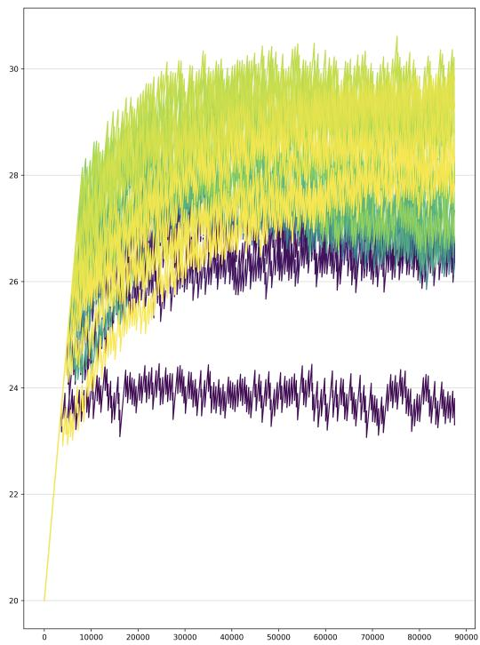  
Figure 12. 未使用梯度压缩训练的 28 亿参数文本到图像 Transformer 的每个残差块（resblock）梯度缩放比例图。x 轴为参数更新次数，y 轴为梯度缩放比例的以 2 为底的对数。最深的紫罗兰色对应第一个残差块，最亮的黄色对应最后一个（总共 128 个）。第二个 MLP 残差块的梯度缩放比例徘徊在 $\overline { { 2 } } ^ { 2 4 }$ 左右，而其他残差块则保持在 4 位的范围内。随着模型变大，该范围的幅度也会增加。

针对该问题，我们的解决方案试图在没有溢出危险的情况下，最大程度地减少 all-reduce 之前除法中的信息损失。为此，我们将损失除以总批大小（包含因子 M）而不是每台机器的批大小，并将梯度缩放比例乘以 M 以进行补偿，如 (1) 中所述。然后，在执行 all-reduce 操作之前，我们将梯度除以一个经过手动调整的常数，以同时避免下溢和溢出。这是通过检查每个参数梯度的标量分量绝对值的指数（即以 2 为底的对数）的直方图来完成的。由于梯度缩放使梯度保持在接近 16 位格式指数范围右端的位置，我们发现相同的常数适用于模型中所有具有 16 位梯度的参数。在使用 PowerSGD 时，我们为 P 和 $Q$ 矩阵选择了不同的常数。

## E. 分布式优化细节

我们使用 PowerSGD (Vogels et al., 2019) 来压缩除嵌入（embeddings）、反嵌入（unembeddings）、增益（gains）和偏置（biases）之外的所有参数的梯度。在第 E.1 节中，我们推导了通信数据量减少与压缩秩和模型大小之间关系的表达式。在第 E.2 节中，我们详细概述了对 PowerSGD 的适配，以及为了修复性能下降所做的修改，其中一些性能下降仅在十亿参数规模下才会显现。

## E.1. 带宽分析

梯度压缩采用了因式分解 $G \approx P Q ^ { t }$，其中 $P$ 和 $Q$ 的秩均为 $r$。我们没有使用单个 all-reduce 来传输 $G$，而是先后使用两次较小的 all-reduce 来分别传输 $P$ 和 $Q ^ { t }$。因此，压缩比为 $P$ 和 $Q$ 矩阵大小之和除以 $G$ 矩阵大小之和。除第二个 MLP 矩阵外，我们对所有参数都沿轴 1 进行分片（shard）。我们设定下的压缩比推导见 Table 2。我们注意到，分片轴的选择会改变 MLP 矩阵的压缩比。最后，该分析排除了嵌入层（embeddings）、解嵌入层（unembeddings）、增益（gains）和偏置（biases），我们不对这些参数使用压缩。随着模型规模的增加，这些参数所占用的带宽总比例会变小。

零样本文字到图像生成（Zero-Shot Text-to-Image Generation）

<table><tr><td>参数名称</td><td>参数分片梯度形状（无压缩）</td><td>P 形状</td><td>Q 形状</td></tr><tr><td>qkv 和后注意力矩阵</td><td> $d \times (d/m)$ </td><td> $d \times (r/m)$ </td><td> $(r/m) \times (d/m)$ </td></tr><tr><td>第一个 MLP 矩阵</td><td> $d \times (4d/m)$ </td><td> $d \times (r/m)$ </td><td> $(r/m) \times (4d/m)$ </td></tr><tr><td>第二个 MLP 矩阵</td><td> $(4d/m) \times d$ </td><td> $(4d/m) \times (r/m)$ </td><td> $(r/m) \times d$ </td></tr><tr><td>总大小</td><td> $12d^{2}/m$ </td><td> $(5drm + 4dr)/m^{2}$ </td><td> $(drm + 8dr)/m^{2}$ </td></tr></table>

Table 2. 在我们将参数分片到每台机器的 $m$ 个 GPU 上的情况下，我们分析了从某台机器上的每个 GPU 发送到其他机器上 GPU 的数据量。在此，$r$ 表示用于压缩的秩，$d$ 表示 transformer 的隐藏层大小。压缩比由最后一行最后两列之和除以最后一行第一列给出。其计算结果为 $r ( m + 2 ) / ( 2 d m )$，对于 $m = 8$ 时为 $5 r / 8 d$。

## E.2. 实现细节

我们详细描述了 PowerSGD 实现中的各个步骤，因为这些细节对于使其在十亿级参数规模下高效且可靠地工作至关重要。

1. 我们的训练设置结合了参数分片和梯度压缩，如第 2.5 节所述。在反向传播期间，当重新计算当前残差块（resblock）的激活值并计算梯度时，我们使用 all-gather 预取前一个残差块的参数。一旦每个 GPU 计算出关于完整参数矩阵的梯度，我们就会计算与该 GPU 参数分片相对应的那部分梯度的平均值，并立即丢弃完整梯度以节省显存。这个平均值是在一台机器上的所有 GPU 之间使用 reduce-scatter 计算得出的。

2. 如果 reduce-scatter 的结果中没有非有限值（这可能是由反向传播或 reduce-scatter 中的溢出引起的），我们将结果除以 resblock 的梯度缩放系数，并将其添加到误差缓冲区（即用于误差校正的缓冲区）中。否则，我们不执行任何操作并继续进行反向传播；梯度中出现单个非有限值意味着整个更新将被跳过，这种情况大约有 5% 的发生概率。误差缓冲区采用与 Adam 均值相同的 1-6-9 格式（我们在第 B.2 节中进行了描述）；更大的指数范围确保了该除法运算不会导致下溢。直接将梯度添加到误差缓冲区中，避免了冗余地分配另一组与参数分片梯度大小相同的缓冲区。

3. 一旦 resblock 的 reduce-scatter 操作完成，我们就会调度操作，以根据误差缓冲区和 Q 矩阵计算 $P$ 矩阵，Q 矩阵的值在训练开始时固定（见第 2.5 节）。正如第 D 节中所讨论的，$P$ 矩阵和 Q 矩阵均以 1-6-9 格式存储，并且其值按预定的常数进行了缩放。

4. 在每个 GPU 计算出 resblock 中参数分片的 P 矩阵后，使用单个分组 all-reduce 操作，将它们与所有其他机器上具有相同序号的 GPU 的 P 矩阵进行平均。该 all-reduce 操作使用自定义内核以 1-6-9 格式执行。分组带来了更好的带宽利用率，因为它避免了为较小的单个参数调度多次具有一定开销的 all-reduce 调用。我们将 all-reduce 结果中的所有无穷大值截断为 1-6-9 格式的最大值（略小于 16），同时保留符号。基于我们为 P 和 Q 矩阵选择的缩放因子，这种截断极少发生。

5. 一旦针对 resblock 的 $P$ 矩阵的 all-reduce 操作完成，我们就会对所得矩阵的列进行正交化。我们使用自定义的 Householder 正交化内核，而不是 Gram-Schmidt，因为我们发现后者在数值上不稳定。我们还将 $\epsilon I _ { m \times r }$ 添加到 $P$ 中，以确保结果不会接近秩亏，其中 $\epsilon = 1 0 ^ { - 6 }$。这里，$I _ { m \times r }$ 是一个与被相加的 $P$ 矩阵大小相同的矩形矩阵；它包含一个 $r \times r$ 的单位矩阵，其余位置为零。正交化后的 $P$ 矩阵以 1-6-9 格式存储，但未经缩放。

6. 一旦 resblock 的 P 矩阵完成正交化，我们就会调度操作，以根据误差缓冲区和 P 矩阵计算新的 Q 矩阵。

7. 一旦计算出残差块（resblock）的新 Q 矩阵，我们就会调度另一次分组 all-reduce，类似于我们对 P 矩阵所做的操作。与步骤 (4) 中一样，我们将 all-reduce 结果中的所有无穷大值截断（clamp）为 1-6-9 格式的最大值，同时保留符号。此时，该残差块的误差缓冲区已被分解为低秩因子 P 和 Q<sup>t</sup>。

8. 所有未压缩参数的梯度都被分组到一个单独的 32 位精度 all-reduce 中。Section D 解释了我们为何对这些参数及其梯度使用 32 位精度。

9. 一旦一台机器上的所有 GPU 完成了模型中每个残差块的步骤 (7) 和 (8)，所有机器上相同参数分片（parameter shard）的 P 和 Q 矩阵值将完全一致。然后，我们计算全局梯度范数（global gradient norm），它是两个量的总和：(a) 一台机器上所有参数分片的 Q 矩阵 Frobenius 范数平方和，以及 (b) 一台机器上所有未使用压缩的参数分片的梯度范数平方和。我们需要计算该值以进行梯度裁剪（gradient clipping，参见 Section B.2）。

10. 在计算全局范数的同时，我们还同步来自步骤 (2) 的信息，即在 reduce-scatter 之后哪些参数分片梯度包含非有限值（nonfinite values）。完成此操作后，我们为每个参数分片获得了两项信息：(a) 其来自步骤 (2) 的误差缓冲区在当前 GPU 上是否包含非有限值，以及 (b) P 或 Q 是否包含非有限值。我们无法依赖 P 和 Q 矩阵的值来确定 (b)，因为如步骤 (4) 所述，我们对无穷大值进行了截断。如果我们发现机器上对应于任何参数分片的梯度包含非有限值，则将全局范数设置为无穷大。

11. 一旦所有的 all-reduce 都已完成且全局范数计算完毕，我们就可以应用参数更新。与反向传播类似，参数更新逐个残差块进行。第一步是通过计算给定残差块中所有参数的乘积 PQ<sup>t</sup> 来得到解压缩后的梯度。为避免溢出，这些乘积均在 32 位精度下计算。然后，我们可以使用解压缩后的梯度以及在步骤 (9) 中计算的全局范数对参数应用 Adam 更新。如果全局范数不是有限值，则跳过对参数和 Adam 矩（moments）的更新。需要注意的是，解压缩后的梯度必须除以 Q 矩阵的缩放因子（P 矩阵在正交化后不带缩放存储）。

12. 第二步是更新误差缓冲区（error buffers）。首先，我们利用步骤 (10) 的结果来检查给定参数分片（parameter shard）的 P 和 Q 矩阵是否仅包含有限值。如果是这样，我们就将解压缩后的梯度除以机器总数，并从误差缓冲区的当前值中减去该值。这会将误差缓冲区设置为：使用规约散播（reduce-scatter）在该机器的 GPU 上平均得到的“本地”梯度与“远程”解压缩梯度之间的差值（即“误差”）。如果 P 或 Q 中任一矩阵包含非有限值，那么我们检查步骤 (2) 中计算的误差缓冲区是否仅包含有限值。如果是，则保留其值并不执行任何操作。如果不是，则将其置零。这种繁琐逻辑的目的是仅在误差缓冲区被非有限值污染、必须置零时才将其置零。我们发现，由于梯度缩放事件导致误差缓冲区过于频繁地置零会引发性能退化。

13. 梯度未被压缩的参数分片会单独更新。

我们还要指出以下重要优化：

1. 在上述步骤中，计算与通信之间存在若干重叠（overlap）的机会。例如，当我们对残差块（resblock）i 执行步骤 (2) 时，我们可以对所有残差块 j > i 继续执行步骤 (3)–(8)。利用重叠机会对于实现良好性能是必不可少的。

2. 我们对容易耗尽所有可用内存的特定操作进行节流（throttle）。例如，我们仅在当前残差块的规约散播（reduce-scatter）操作完成时，才预取前一个残差块的参数。否则，因保留完整参数我们可能会面临内存耗尽的风险。我们还对 Adam 更新进行节流，以免同时解压缩所有梯度。

3. 在实现中，有两个地方涉及转置操作的选择：(a) MLP 矩阵分片轴的选择，以及 (b) 我们是针对梯度还是其转置计算低秩分解。前者影响带宽分析，我们将在第 E.1 节中介绍。后者影响正交化的开销。假设

图像 2

任务：评估以下两幅图像并回答下方问题。

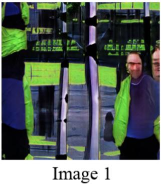


哪张图像更逼真？○ 图像 1 更逼真 ○ 图像 2 更逼真

哪张图像与此标题更匹配？标题：“a man walks across a street with a stop sign in the foreground.”（一名男子穿过街道，前景中有一个停止标志。）○ 图像 1 更匹配 ○ 图像 2 更匹配 ○ 图像 1 和 2 都不匹配 提交

Figure 13. 展示给标注人员的任务界面示例。

梯度 $G$ 是 $m \times n$ 的，其低秩因子 $P$ 和 $Q^t$ 分别为 $m \times r$ 和 $r \times n$，其中 $r \ll m, n$。为了降低正交化的计算开销，我们对 $G$ 进行适当地转置，使得 $m \leqslant n$。

乍一看，NCCL 的 all-gather 和 reduce-scatter 原语仅沿轴 0（axis 0）进行分片似乎是一个限制。由于 (a) 和 (b)，我们可能需要在通信操作之前和之后转置某些矩阵，这将需要额外的时间，并且可能需要特别注意以避免内存溢出（out-of-memory）错误。实际上，我们从未真正需要这样做。这是因为我们将部分参数存储为其转置格式，并利用了前向传播、反向传播以及上述步骤 (1)–(13) 中所使用的矩阵乘法内核的 transpose\_a 和 transpose\_b 参数。这使我们能够避免显式转置，同时保留了选择如何处理 (a) 和 (b) 的自由度。

4. 在上述步骤 (12) 中，我们注意到过于频繁地将误差缓冲区（error buffers）置零可能会导致性能下降。我们希望在从检查点（checkpoint）恢复训练时避免这样做，而在较大规模的任务中，由于机器可能会周期性地发生故障，这种情况发生得更为频繁。从朴素的角度来看，这将需要将所有机器的误差缓冲区与模型检查点一起上传。由于我们总共使用 128 台机器进行训练，这将导致存储使用量增加 128 倍，这是极其浪费的。

幸运的是，这是不必要的，因为误差校正仅取决于误差缓冲区的总和。该性质由线性性质以及 PowerSGD 所采用的操作顺序决定。因此，只需存储具有相同序号（ordinal）的所有 GPU 上的误差缓冲区之和即可。在从检查点恢复时，我们可以将误差缓冲区除以机器总数并进行广播。

## F. 人工评估实验细节

我们首先准备一份包含 1000 个提示词（captions）的列表，并为每个提示词由每个模型生成一张样本图像。然后使用提示词和样本图像在每个实验中创建 1000 个图像对比任务，我们将这些任务提交至 Amazon's Mechanical Turk。每个任务由五名不同的标注人员完成。标注人员被要求对比两张图像并回答关于它们的两个问题：(1) 哪张图像最逼真，以及 (2) 哪张图像与共同的提示词最匹配。提供给标注人员的实验设置如图 Figure 13 所示。其中一名标注人员的答案因与其他标注人员的不一致率过高且答题速度过快（多次提交时间少于 4 秒）而被取消资格；其余所有标注人员的答案均予以保留。

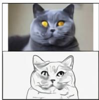


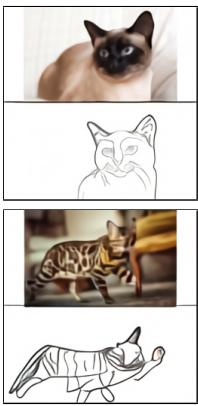  
(a) “the exact same cat on the top as a sketch on the bottom”（上方是完全相同的猫，下方是其素描）

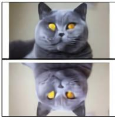

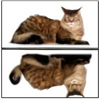

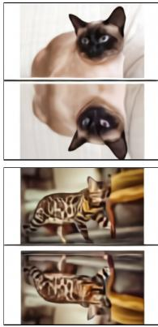  
(b) “顶部完全相同的照片在底部上下倒影”


  
(c) “同一只猫的双拼图。顶部是这只猫的照片。底部是照片中猫的特写微距视图。”

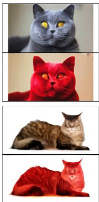

  
(d) “顶部完全相同的猫在底部被涂成红色”


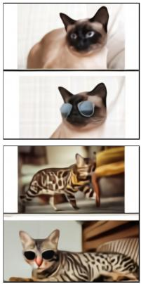  
(e) “同一只猫的双拼图。顶部是这只猫的照片。底部是戴着太阳镜的猫。”

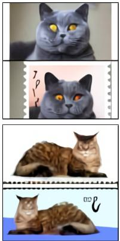

  
(f) “顶部完全相同的猫在底部作为邮票呈现”  
Figure 14. 零样本图像到图像转换的更多示例。

## G. 零样本图像到图像转换（Zero-Shot Image-to-Image Translation）

Figure 14 展示了我们在第 3.3 节中讨论的零样本图像到图像转换的更多示例。我们并未预料到会出现这种能力，也未对训练过程进行任何修改来促成它。