David Ha <sup>1</sup> Jurgen Schmidhuber¨ <sup>2</sup> <sup>3</sup>

## 摘要

我们探索为流行的强化学习环境构建生成式神经网络模型。我们的世界模型（world model）可以通过无监督方式快速训练，以学习环境在空间和时间上的压缩表征。通过将从世界模型中提取的特征作为智能体（agent）的输入，我们可以训练出一个非常紧凑且简单的策略来解决既定任务。我们甚至可以完全在智能体自身世界模型生成的幻觉梦境中训练智能体，并将该策略迁移回实际环境中。

本文的交互式版本可在 https://worldmodels.github.io 获取。

## 1. 引言

人类根据其有限感官所能感知到的内容，建立起对世界的心智模型（mental model）。我们所做出的决策和行动都基于这一内部模型。系统动力学之父 Jay Wright Forrester 曾将心智模型描述为：

我们头脑中所保留的周围世界的图景，仅仅是一个模型。没有人的头脑能装下整个世界、政府或国家。他只是挑选了部分概念以及它们之间的关系，并用这些来代表真实的系统。(Forrester, 1971)

为了处理日常生活中奔流涌现的浩瀚信息，我们的大脑学习了这些信息在空间和时间维度上的抽象表征。我们能够观察一个场景并记住其抽象描述 (Cheang & Tsao, 2017; Quiroga et al., 2005)。亦有证据表明，我们在任何特定时刻所感知到的内容，都受到大脑基于内部模型对未来的预测所支配 (Nortmann et al., 2015; Gerrit et al., 2013)。

理解我们大脑内部预测模型的一种视角是：它可能不仅仅是对未来进行泛泛的预测，而是在给定我们当前运动动作的情况下预测未来的感官数据 (Keller et al., 2012; Leinweber et al., 2017)。面对危险时，我们能够本能地依据该预测模型行动并做出快速的条件反射行为 (Mobbs et al., 2015)，而无需有意识地去构思一套行动方案。

  
Figure 1. 世界模型，出自 Scott McCloud 的《理解漫画》（Understanding Comics）。(McCloud, 1993; E, 2012)

以棒球为例。击球手只有几毫秒的时间来决定如何挥棒——这比视觉信号传递到我们大脑所需的时间还要短。我们之所以能够击中时速 100 英里的快速球，是因为我们具备本能地预测球将在何时何地到达的能力。对于职业选手而言，这一切都是在潜意识中发生的。他们的肌肉根据其内部模型的预测，在正确的时间和位置反射性地挥棒 (Gerrit et al., 2013)。他们可以迅速根据对未来的预测采取行动，而无需有意识地推演可能发生的未来场景来制定计划 (Hirshon, 2013)。


  
Figure 2. 我们所看到的景象是基于我们大脑对未来的预测 (Kitaoka, 2002; Watanabe et al., 2018)。

在许多强化学习（Reinforcement Learning，RL）问题中 (Kaelbling et al., 1996; Sutton & Barto, 1998; Wiering & van Otterlo, 2012)，人工智能体同样受益于对过去和当前状态的良好表征，以及对未来的良好预测模型 (Werbos, 1987; Silver, 2017)，最好是在通用计算机上实现的强大预测模型，例如循环神经网络（Recurrent Neural Network，RNN）(Schmidhuber, 1990a;b; 1991a)。

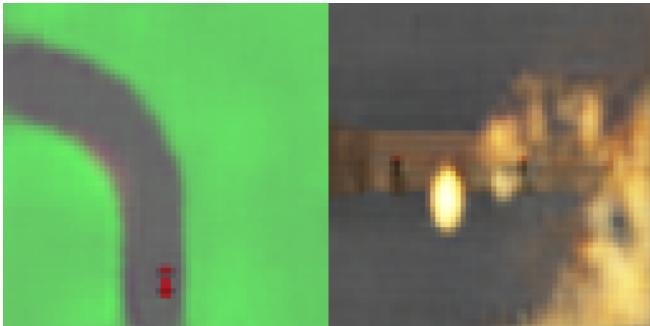  
Figure 3. 在这项工作中，我们为 OpenAI Gym 环境构建了概率生成模型。基于 RNN 的世界模型是利用从实际游戏环境中记录并收集的观测数据训练而成的。训练完世界模型后，我们可以用它们来模拟完整的环境，并利用它们来训练智能体。

大型 RNN 是具有极强表达能力的模型，能够学习数据中丰富的空间和时间表征。然而，文献中的许多无模型强化学习（model-free RL）方法通常只使用参数量较少的小型神经网络。RL 算法往往受到信用分配问题（credit assignment problem）的瓶颈限制，这使得传统 RL 算法很难学习大型模型的数百万个权重；因此在实践中，较小的网络更常被使用，因为它们在训练过程中能更快地迭代收敛至良好策略。

理想情况下，我们希望能够高效地训练基于 RNN（循环神经网络）的大型智能体。反向传播算法（Linnainmaa, 1970; Kelley, 1960; Werbos, 1982）可用于高效训练大型神经网络。在这项工作中，我们着眼于通过将智能体划分为一个大型世界模型（world model）和一个小型控制器模型（controller model），来训练一个大型神经网络<sup>1</sup>以解决 RL（强化学习）任务。我们首先以无监督的方式训练一个大型神经网络来学习智能体所处世界的模型，然后训练较小的控制器模型以利用该世界模型来学习执行任务。小型的控制器使得训练算法能够专注于较小搜索空间内的信用分配问题（credit assignment problem），同时通过较大的世界模型保证了容量和表达能力不被牺牲。通过世界模型的视角训练智能体，我们展示了它可以学习到一个高度紧凑的策略来执行其任务。

尽管有大量与基于模型的强化学习（model-based reinforcement learning）相关的研究，但本文并非旨在对该领域的现状进行综述（Arulkumaran et al., 2017; Schmidhuber, 2015b）。相反，本文的目标是从 1990 年至 2015 年间关于基于 RNN 的世界模型与控制器结合的一系列论文中提炼出几个关键概念（Schmidhuber, 1990a;b; 1991a; 1990c; 2015a）。我们还将讨论文献中其他具有类似思想（即学习世界模型并利用该模型训练智能体）的相关工作。

在本文中，我们提出了一个简化框架，可用于通过实验论证这些论文中的一些关键概念，并提出了将这些思想有效应用于各种 RL 环境的进一步见解。在描述我们的方法论和实验时，我们采用了与《On Learning to Think: Algorithmic Information Theory for Novel Combinations of RL Controllers and RNN World Models》（Schmidhuber, 2015a）相似的术语和符号。

## 2. 智能体模型

我们提出了一个受人类认知系统启发而设计的简单模型。在该模型中，我们的智能体包含一个视觉感官组件，用于将看到的内容压缩成一个紧凑的代表性编码。它还包含一个记忆组件，用于根据历史信息对未来的编码进行预测。最后，我们的智能体包含一个决策组件，仅根据视觉和记忆组件生成的表征来决定采取何种动作。

  
Figure 4. 我们的智能体由三个紧密协作的组件组成：视觉（Vision，V）、记忆（Memory，M）和控制器（Controller，C）

## 2.1. VAE (V) 模型

环境在每个时间步为我们的智能体提供高维输入观测。该输入通常是作为视频序列一部分的二维图像帧。V 模型的作用是学习每个观测输入帧的抽象、压缩表征。

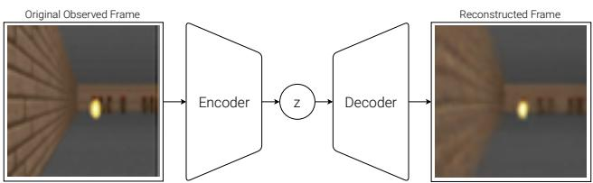  
Figure 5. 变分自编码器（Variational Autoencoder, VAE）流程图。

在这里，我们使用一个简单的变分自编码器（Kingma & Welling, 2013; Rezende et al., 2014）作为我们的 V 模型，将每个图像帧压缩为一个较小的隐向量 z。

## 2.2. MDN-RNN (M) 模型

尽管 V 模型的作用是压缩智能体在每个时间帧所看到的内容，但我们也希望压缩随时间发生的事情。为此，M 模型的作用是预测未来。M 模型充当预测 V 预计将生成的未来 z 向量的预测模型。由于许多复杂环境本质上是随机的，我们训练 RNN 输出概率密度函数 p(z)，而不是对 z 的确定性预测。

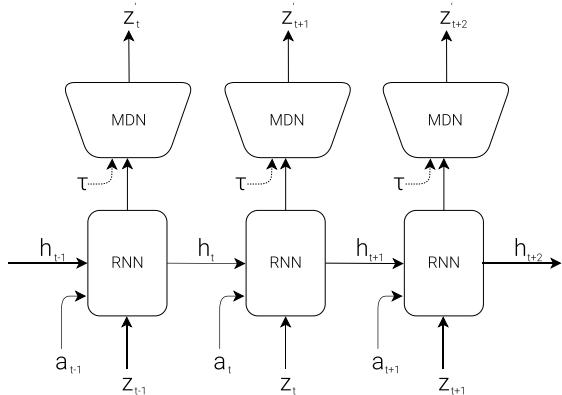  
Figure 6. 带有混合密度网络（Mixture Density Network）输出层的 RNN。MDN 输出混合高斯分布的参数，用于采样预测下一个隐向量 z。

在我们的方法中，我们将 $p ( z )$ 近似为混合高斯分布，并训练 RNN 在给定当前和过去可用信息的情况下输出下一个隐向量 $z _ { t + 1 }$ 的概率分布。

更具体地说，RNN 将对 $P ( z _ { t + 1 } \mid a _ { t } , z _ { t } , h _ { t } )$ 进行建模，其中 $a _ { t }$ 是在时间 t 采取的动作，$h _ { t }$ 是 RNN 在时间 t 的隐藏状态。在采样期间，我们可以像 (Ha & Eck, 2017) 中那样调整温度参数 τ 来控制模型的不确定性——稍后我们会发现调整 τ 对训练我们的控制器很有用。

这种方法被称为混合密度网络（Mixture Density Network, Bishop, 1994）结合 RNN（MDN-RNN）（Graves, 2013; Ha, 2017a），并且过去已被应用于序列生成问题，例如生成手写笔迹（Graves, 2013）和草图（Ha & Eck, 2017）。

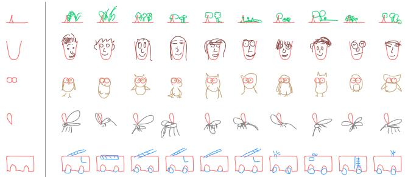  
Figure 7. SketchRNN（Ha & Eck, 2017）是用于预测素描下一笔画的 MDN-RNN 的一个示例。我们使用类似的模型来预测下一个隐向量 z<sub>t</sub>。

## 2.3. 控制器 (C) 模型

控制器（Controller, C）模型负责确定要采取的一系列动作，以最大化智能体在环境展开（rollout）过程中的期望累积奖励。在我们的实验中，我们特意使 C 尽可能简单且小，并与 V 和 M 分开训练，从而使智能体的大部分复杂性都保留在世界模型（V 和 M）中。

C 是一个简单的单层线性模型，在每个时间步将 $z _ { t }$ 和 $h _ { t }$ 直接映射到动作 $a _ { t }$：

$$
a _ {t} = W _ {c} \left[ z _ {t} h _ {t} \right] + b _ {c}\tag{1}
$$

在该线性模型中，$W _ { c }$ 和 $b _ { c }$ 是将拼接后的输入向量 $\left[ z _ { t } \ h _ { t } \right]$ 映射到输出动作向量 $a _ { t }$ 的权重矩阵和偏置向量。

## 2.4. 整合 V、M 和 C

下面的流程图说明了 V、M 和 C 如何与环境进行交互：

  
Figure 8. 我们的智能体（Agent）模型流程图。在每个时间步 t，原始观测首先由 V 处理以生成 $z _ { t }$。输入到 C 的是在每个时间步由该隐向量 $z _ { t }$ 与 $\mathbf { M } \mathbf { \hat { s } }$ 隐藏状态 $h _ { t }$ 拼接而成的向量。随后 C 会输出用于运动控制的动作向量 $a _ { t }$，进而影响环境。之后 M 将当前的 $z _ { t }$ 和动作 $a _ { t }$ 作为输入，以更新其自身的隐藏状态并生成在时间 $t + 1$ 使用的 $h _ { t + 1 }$

以下是在 OpenAI Gym (Brockman et al., 2016) 环境中使用我们智能体模型的伪代码：

```python
def rollout(controller):
    ''' env, rnn, vae are '''
    ''' global variables '''
    obs = env.reset()
    h = rnn.initial_state()
    done = False
    cumulative_reward = 0
    while not done:
    z = vae.encode(obs)
    a = controller.action([z, h])
    obs, reward, done = env.step(a)
    cumulative_reward += reward
    h = rnn.forward([a, z, h])
    return cumulative_reward
```

在给定的控制器 C 上运行此函数将返回一次展开（rollout）过程中的累积奖励。

这种对 C 的极简设计还带来了重要的实际益处。只要我们能够定义一个性质良好且可微的损失函数，深度学习的进展就为我们提供了高效训练大型复杂模型的工具。我们的 V 和 M 模型被设计为可以使用现代 GPU 加速器通过反向传播算法进行高效训练，因此我们希望模型的大部分复杂度和模型参数都存在于 V 和 M 中。相比之下，作为线性模型的 C，其参数量极少。这种选择使我们能够探索更多非常规的方法来训练 C——例如，甚至可以使用进化策略（Evolution Strategies, ES）(Rechenberg, 1973; Schwefel, 1977) 来解决信用分配问题困难的更具挑战性的强化学习（RL）任务。

为了优化 C 的参数，我们选择协方差矩阵自适应进化策略（Covariance-Matrix Adaptation Evolution Strategy, CMA-ES）(Hansen, 2016; Hansen & Ostermeier, 2001) 作为我们的优化算法，因为已知该算法在参数量多达数千个的解空间中表现良好。我们在单台多核 CPU 机器上演化 C 的参数，并行运行环境的多个展开过程。

有关我们实验中使用的模型、训练流程和环境的更具体信息，请参阅附录部分。

## 3. 赛车实验 (Car Racing Experiment)

在本节中，我们将描述如何训练前面介绍的 Agent 模型来解决赛车任务。据我们所知，我们的智能体是第一个达到解决此任务所需分数的已知解决方案。<sup>2</sup>

## 3.1. 用于特征提取的世界模型

一个具备预测能力的世界模型（world model）可以帮助我们提取空间和时间的有用表征。通过将这些特征作为控制器的输入，我们可以训练一个紧凑且极简的控制器来执行连续控制任务，例如在一个名为 CarRacing-v0 (Klimov, 2016) 的俯视视角赛车环境中，学习直接根据像素输入进行驾驶。

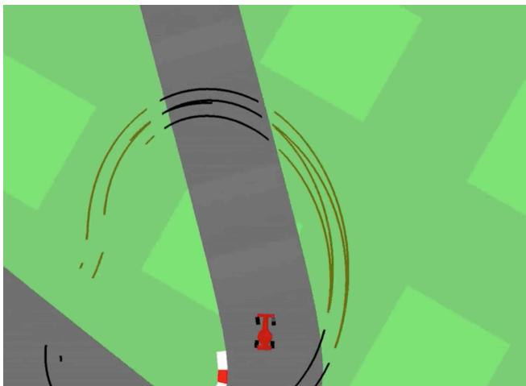  
Figure 9. 我们的智能体在 CarRacing-v0 中学习导航。

在该环境中，每次试验的赛道都是随机生成的，智能体的奖励取决于在最短的时间内访问尽可能多的地块。智能体控制三个连续动作：左/右转向、加速和刹车。

为了训练我们的 V 模型，我们首先收集一个由 10,000 次环境随机推演（rollouts）组成的数据集。我们首先让一个采取随机动作的智能体多次探索环境，并记录所采取的随机动作 $a _ { t }$ 以及环境产生的相应观测。我们使用该数据集训练 V 以学习每个观测帧的潜在空间（latent space）。我们通过最小化给定帧与解码器从 z 重构的帧之间的差异，训练我们的 VAE 将每个帧编码为低维潜在向量 z。

现在，我们可以使用训练好的 V 模型将时间 t 处的每一帧预处理为 $z _ { t }$，以训练我们的 M 模型。利用这些预处理后的数据，结合所记录的采取的随机动作 $a _ { t }$，我们现在可以训练 MDN-RNN 将 $P ( z _ { t + 1 } \mid a _ { t } , z _ { t } , h _ { t } )$ 建模为高斯混合模型。<sup>3</sup>

并获得平庸的分数，但 CarRacing-v0 将“解决任务”定义为在连续 100 次试验中获得 900 分的平均奖励，这意味着智能体几乎不能犯任何驾驶错误。

<sup>3</sup>原则上，我们可以以端到端（end-to-end）的方式将两个模型联合训练，不过我们发现分别训练每个模型更为实用，并且也能取得令人满意的效果。在单个 GPU 上训练每个模型仅需要不到一小时的计算时间。我们还可以训练单独的 VAE 和 MDN-RNN 模型，而无需详尽地调优超参数。

<sup>2</sup>我们发现这个任务很有趣，因为尽管训练一个智能体在随机生成的赛道上摇摇晃晃地行驶并不困难

在本实验中，世界模型（V 和 M）对来自环境的实际奖励信号一无所知。它的任务仅仅是压缩和预测观察到的图像帧序列。只有控制器（Controller，C）模型能够获取来自环境的奖励信息。由于线性控制器模型内部仅有 867 个参数，因此 CMA-ES 等进化算法非常适合此优化任务。

我们可以使用 VAE 在每个时间步利用 $z _ { t }$ 重构每一帧，以直观展示智能体在一次运行（rollout）过程中实际看到的信息质量。下图是在来自 CarRacing-v0 的屏幕截图上训练的 VAE 模型。

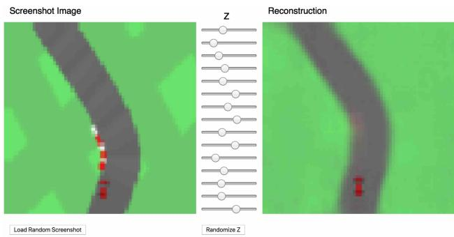  
Figure 10. 尽管在这种有损压缩过程中丢失了细节，但隐向量 z 仍捕捉到了每个图像帧的精髓。

在本文的在线版本中，可以加载随机选取的屏幕截图并编码为一个小的隐向量 $z ,$，该隐向量用于重构原始屏幕截图。读者还可以尝试使用滑块调整 z 向量的值，以观察其对重构的影响，或者随机化 z 来观察可能生成的屏幕截图空间。

## 3.2. 实验步骤

为了总结赛车（Car Racing）实验，以下是所采取的步骤：

5. 使用 CMA-ES 求解使期望累积奖励最大化的 $W _ { c }$ 和 $b _ { c }$。

<table><tr><td>模型</td><td>参数量</td></tr><tr><td>VAE</td><td>4,348,547</td></tr><tr><td>MDN-RNN</td><td>422,368</td></tr><tr><td>CONTROLLER</td><td>867</td></tr></table>

## 3.3. 实验结果

## 仅 V 模型

如果我们对观测有良好的表征，训练智能体驾驶并不是一项困难的任务。先前的研究（Hnermann, 2017；Bling, 2015；Lau, 2016）表明，借助一套良好的人工设计的观测信息（例如激光雷达 LIDAR 信息、角度、位置和速度），人们可以轻松训练一个小型前馈网络来接收这些人工设计的输入并输出令人满意的导航策略。出于这个原因，我们首先想通过限制 C 仅能访问 V 而不能访问 M 来测试我们的智能体，因此我们将控制器定义为 $a _ { t } = W _ { c } \ : z _ { t } \ : + \ : b _ { c } .$。

1. 从随机策略中收集 10,000 次运行（rollout）。  
2. 训练 VAE（V）将图像帧编码为 $z \in \mathcal { R } ^ { 3 2 }$  
3. 训练 MDN-RNN（M）来建模 $P ( z _ { t + 1 } \mid a _ { t } , z _ { t } , h _ { t } )$  
4. 将控制器（C）定义为 $a _ { t } = W _ { c } \left[ z _ { t } \ h _ { t } \right] \ + \ b _ { c }$  
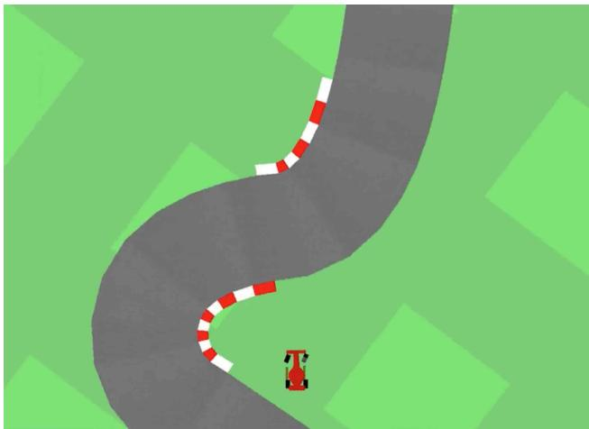  
Figure 11. 限制我们的控制器只能看到 $z _ { t }$ 而看不到 $h _ { t }$ 会导致摇摆且不稳定的驾驶行为。

尽管智能体在这种设置下仍然能够在赛道上行驶，但我们注意到它会出现晃动，并在较急的弯道上偏离赛道。这个受限的智能体在 100 次随机试验中取得了 632 ± 251 的平均得分，这与 OpenAI Gym 排行榜（Klimov, 2016）上的其他智能体以及传统深度强化学习（Deep RL）方法（如 A3C）（Khan & Elibol, 2016; Jang et al., 2017）的表现一致。在控制器 C 的策略网络中添加一个隐藏层有助于将结果提升至 $7 8 8 \pm 1 4 1$ ，但这仍不足以解决该环境任务。

## 完整世界模型（V 与 M）

由我们的 V 模型提供的表征 $z _ { t }$ 仅捕获了某一时刻的表征，并没有太多的预测能力。相比之下，M 模型的训练目标非常专一且表现优异，即预测 $z _ { t + 1 }$ 。由于 M 对 $z _ { t + 1 }$ 的预测是由时间步 $t$ 处的 RNN 隐藏状态 $h _ { t }$ 生成的，因此该向量非常适合作为我们提供给智能体的学习特征集。将 $z _ { t }$ 与 $h _ { t }$ 相结合，可以为我们的控制器 C 提供关于当前观测以及未来预期的良好表征。

  
Figure 12. 如果让我们的控制器同时访问 $z _ { t }$ 和 $h _ { t }$ ，驾驶会更加稳定。

我们发现，允许智能体同时访问 $z _ { t }$ 和 $h _ { t }$ 大大提升了其驾驶能力。驾驶过程更加平稳，并且智能体似乎能够有效地应对急转弯。此外，我们看到在赛车比赛中做出这些快速反射性的驾驶决策时，智能体并不需要提前规划并展开未来的假设情景。由于 $h _ { t }$ 包含了关于未来概率分布的信息，智能体只需凭本能查询 RNN 即可指导其动作决策。就像经验丰富的一级方程式赛车手或前面讨论过的棒球运动员一样，智能体可以在紧要关头本能地预测何时以及何处进行转向。

<table><tr><td>方法</td><td>平均得分</td></tr><tr><td>DQN (PRIEUR, 2017)</td><td>343 ± 18</td></tr><tr><td>A3C (连续) (JANG ET AL., 2017)</td><td>591 ± 45</td></tr><tr><td>A3C (离散) (KHAN &amp; ELIBOL, 2016)</td><td>652 ± 10</td></tr><tr><td>CEOBILLIONAIRE (GYM 排行榜)</td><td>838 ± 11</td></tr><tr><td>V 模型</td><td>632 ± 251</td></tr><tr><td>带隐藏层的 V 模型</td><td>788 ± 141</td></tr><tr><td>完整世界模型</td><td>906 ± 21</td></tr></table>

Table 1. 使用各种方法在 CarRacing-v0 上取得的得分。

我们的智能体在 100 次随机试验中取得了 $9 0 6 \pm 2 1$ 的分数，有效地解决了该任务并取得了当前最优（state of the art）的结果。先前使用深度强化学习（Deep RL）方法的尝试（Khan & Elibol, 2016; Jang et al., 2017）获得了 591–652 范围内的平均分，而排行榜上报告的最佳方案在 100 次随机试验中获得了 $8 3 8 \pm 1 1$ 的平均分。传统的深度强化学习方法通常需要对每一帧进行预处理，例如采用边缘检测（Jang et al., 2017），此外还要将最近的几帧堆叠（Khan & Elibol, 2016; Jang et al., 2017）到输入中。相比之下，我们的世界模型接收原始 RGB 像素图像流，并直接学习时空表征。据我们所知，我们的方法是首个报告解决该任务的方案。

## 3.4. 赛车梦境

由于我们的世界模型能够对未来进行建模，因此我们还可以让它自主构想出假设的赛车场景。我们可以要求它在给定当前状态的情况下生成 $z _ { t + 1 }$ 的概率分布，采样一个 $z _ { t + 1 }$ 并将该样本用作真实的观测。我们可以将训练好的 C 放回由 M 生成的这个幻象环境中。本文在线版本的交互式演示中的以下图片展示了如何使用我们的世界模型来虚构赛车环境：

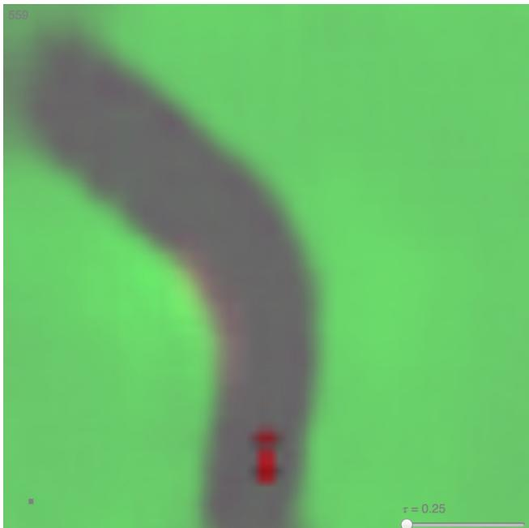  
Figure 13. 我们的智能体在自己的梦境世界中驾驶。在这里，我们将训练好的策略部署到由 MDN-RNN 生成并通过 VAE 解码器渲染的虚拟环境中。在演示中，用户可以覆盖智能体的动作，并调整 $\tau$ 来控制由 M 生成的环境的不确定性。

## 4. VizDoom 实验

## 4.1. 在梦境中学习

我们刚才看到，在真实环境中学习到的策略在梦境环境中似乎也能在某种程度上发挥作用。这引出了一个问题——我们能否训练智能体在它自己的梦境中学习，并将这种策略迁移回实际环境中？

如果我们的世界模型对于其目标足够精确，并且对于当前问题足够完备，我们就应该能够用这个世界模型来替代实际环境。毕竟，我们的智能体并不直接观察现实，而只是看到世界模型让它看到的内容。在本实验中，我们在由世界模型生成的幻象中训练智能体，该世界模型经过训练以模拟 Viz-Doom（Kempka et al., 2016）环境。

  
Figure 14. 我们最终的智能体解决 VizDoom: Take Cover 任务。

智能体必须学会躲避房间另一侧怪物发射的火球，这些怪物的唯一目的就是消灭智能体。该环境中没有显式奖励，因此为了模拟自然选择，累积奖励可定义为智能体在一次运行过程（rollout）中成功存活的时间步数。环境的每次运行最多持续 2100 个时间步（约 60 秒），若连续 100 次运行的平均存活时间超过 750 个时间步（约 20 秒），则认为该任务已解决（Paquette, 2016）。

## 4.2. 实验步骤

我们的 VizDoom 实验设置与赛车（Car Racing）任务基本相同，仅有几处关键差异。在赛车任务中，M 仅被训练用于对下一个 $z _ { t } .$ 建模。由于我们希望构建一个可以在其中训练智能体的世界模型，因此这里的 M 模型除了预测下一帧 $z _ { t }$ 之外，还将预测智能体是否在下一帧死亡（作为二元事件 done，简写作 $d _ { t }$）。

由于 M 模型除了能预测下一个观测值之外，还能预测 done 状态，我们现在拥有了构建完整强化学习（RL）环境所需的全部要素。我们首先通过在 M 外层封装一个 gym.Env 接口（宛如一个真实的 Gym 环境），构建出一个 OpenAI Gym 环境接口，然后在这个虚拟环境中训练智能体，而不是使用真实环境。

在该模拟中，我们在生成虚幻体验（hallucination）的过程中不需要 V 模型来编码任何真实的像素帧，因此我们的智能体将完全在潜空间环境中进行训练。正如我们将看到的，这带来了诸多优势。

该虚拟环境具有与真实环境完全相同的接口，因此在智能体于虚拟环境中学习到满意的策略后，我们可以轻松将该策略重新部署到真实环境中，以检验该策略迁移的效果。

为了总结寻找掩体（Take Cover）实验，具体步骤如下：

1. 从随机策略中收集 10,000 次运行（rollouts）。

2. 训练 VAE（V）将每一帧编码为潜向量 $z \in \mathcal { R } ^ { 6 4 }$，并使用 V 将从 (1) 中收集的图像转换为潜空间表示。

3. 训练 MDN-RNN（M）以对 $P ( z _ { t + 1 } , d _ { t + 1 } \mid a _ { t } , z _ { t } , h _ { t } ) .$ 建模。

4. 将控制器（Controller, C）定义为 $a _ { t } = W _ { c } \ [ z _ { t } \ h _ { t } ]$

5. 使用 CMA-ES 求解 $W _ { c }$，以最大化虚拟环境中的预期存活时间。

6. 将从 (5) 中学到的策略应用于真实环境。

<table><tr><td>模型</td><td>参数量</td></tr><tr><td>VAE</td><td>4,446,915</td></tr><tr><td>MDN-RNN</td><td>1,678,785</td></tr><tr><td>控制器</td><td>1,088</td></tr></table>

## 4.3. 在梦境中训练

经过一段时间的训练后，我们的控制器学会在梦境环境中穿梭，并躲避由 M 生成的怪物所发射的致命火球。我们的智能体（agent）在虚拟环境中取得了约 900 个时间步的得分。

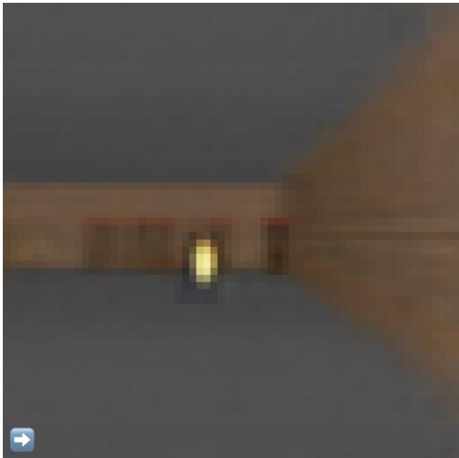  
Figure 15. 我们的智能体发现了一种躲避虚构火球的策略。在本文的在线版本中，读者可以在此演示中与环境进行交互。

在这里，我们基于 RNN 的世界模型经过训练，可以模拟由人类程序员设计的完整游戏环境。仅通过从随机回合中收集的原始图像数据进行学习，它就学会了如何模拟游戏的关键方面——例如游戏逻辑、敌人行为、物理机制以及 3D 图形渲染。

例如，如果智能体选择了向左移动的操作，M 模型就会学会将智能体向左移动，并相应地调整其对游戏状态的内部表示。如果智能体试图向任一方向移动太远，它还学会了阻止智能体穿过关卡两侧的墙壁。有时，M 模型需要跟踪从几个不同怪物发射出的多个火球，并连贯地让它们沿着预定方向移动。它还必须检测智能体是否被这些火球之一击杀。

然而，与实际的游戏环境不同，我们注意到可以向虚拟环境中添加额外的不确定性，从而使梦境环境中的游戏更具挑战性。我们可以在采样 z<sub>t+1</sub> 的过程中通过提高温度 $\tau$ 参数来实现这一点。通过增加不确定性，与真实环境相比，我们的梦境环境变得更加困难。与真实游戏相比，火球可能会以更随机、更不可预测的轨迹移动。有时智能体甚至可能仅仅因为纯粹的厄运而莫名死亡。

我们发现在较高温度设置下表现良好的智能体，在正常设置下通常表现得更好。事实上，增大 $\tau$ 有助于防止我们的控制器利用世界模型的不完善之处——稍后我们将对此进行更深入的讨论。

## 4.4. 将策略迁移到实际环境

  
Figure 16. 将在梦境 RNN 环境中学习到的策略重新部署回实际的 VizDoom 环境中。

我们将在虚拟环境中训练的智能体拿来在原始 VizDoom 场景中测试其性能。在 100 次连续随机试验中的平均得分约为 1100 个时间步，远超要求的 750 个时间步，并且也远高于在更困难的虚拟环境中获得的得分。

  
Figure 17. 在线文章中 Doom 的交互式 VAE。

我们看到，尽管 V 模型（V model）无法完全正确地捕捉每一帧的所有细节（例如无法准确呈现怪物的数量），智能体仍然能够利用学到的策略在真实环境中进行导航。由于虚拟环境本身甚至无法精确追踪怪物的确切数量，因此能够在更加嘈杂且充满不确定性的虚拟“噩梦”环境中存活下来的智能体，在原始且更规整的环境中必然能够表现得游刃有余。

## 4.5. 欺骗世界模型

在童年时期，我们可能遇到过利用游戏漏洞（exploit）来玩电子游戏的情况，而这些方式并非游戏设计者的初衷（Wikipedia, 2017）。玩家们发现了获取无限生命或体力的方法，并通过利用这些漏洞轻松通关原本困难的游戏。然而，在这个过程中，他们可能也放弃了按照游戏设计者的预期去掌握游戏所需技能的机会。

例如，在最初的实验中，我们注意到智能体发现了一种对抗性策略（adversarial policy）：它以某种特定的方式移动，使得在由 M 模型（M model）控制的虚拟环境中，怪物在某些展开轨迹（rollouts）中甚至从未发射过一个火球。即使出现了火球正在形成的迹象，智能体也能通过某种移动方式神奇地扑灭火球，就好像它在环境中拥有超能力一样。

由于我们的世界模型仅仅是环境的近似概率模型，它偶尔会生成不符合真实环境运行规律的轨迹。正如我们之前所见，即使是真实环境中房间另一侧的怪物数量，也无法被世界模型精确重现。就像一个孩子知道空中的物体通常会掉落到地面，但他也可能会想象在天空中翱翔的不切实际的超级英雄一样。正因如此，我们的世界模型是存在漏洞可被控制器利用的，即便在真实环境中这些漏洞根本不存在。

而且，由于我们使用 M 模型为智能体生成虚拟的梦境环境，我们同时也赋予了控制器访问 M 的所有隐藏状态的权限。这实质上是赋予了智能体访问游戏引擎所有内部状态和内存的权限，而不仅仅是玩家能看到的游戏观测。因此，智能体在追求最大化其预期累积奖励的过程中，能够高效地探索直接操纵游戏引擎隐藏状态的方法。这种在学习得到的动力学模型内部学习策略的方法的弱点在于，智能体很容易找到一种能够欺骗我们动力学模型的对抗性策略——它会找到一种在动力学模型下表现良好，但在真实环境中会失败的策略，这通常是因为该策略访问了模型出错的状态，而这些状态偏离了模型的训练分布。

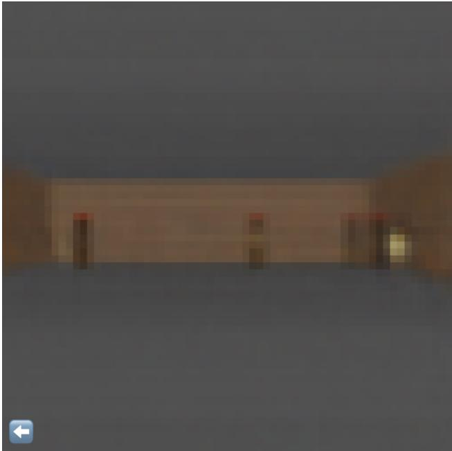  
Figure 18. 智能体（Agent）发现了一种对抗性策略，在某些轨迹展开（rollouts）中，火球发射后会自动熄灭。

这一弱点可能是许多以往学习强化学习（RL）环境动力学模型、但并未真正使用这些模型完全替代实际环境的工作的原因（Oh et al., 2015; Chiappa et al., 2017）。正如在（Schmidhuber, 1990a;b; 1991a）中提出的 M 模型一样，该动力学模型是一个确定性模型，一旦模型不够完美，就极易被智能体利用其漏洞。使用贝叶斯模型（如 PILCO（Deisenroth & Rasmussen, 2011）中所示）在一定程度上有助于通过不确定性估计来解决该问题，但并未完全解决。最近的研究（Nagabandi et al., 2017）将基于模型的方法与传统的无模型 RL 训练相结合，首先用学到的策略初始化策略网络，但随后必须依赖无模型方法在实际环境中对该策略进行微调。

在《Learning to Think》（Schmidhuber, 2015a）中，RNN M 并不总是一个可靠的预测器是可以接受的。一个（可能基于进化的）RNN C 原则上可以学会忽略有缺陷的 M，或者利用 M 的某些有用部分来进行包括分层规划等在内的任意计算目的。但这并不是我们在此所做的事情——我们目前的方法仍然更接近一些较早的系统（Schmidhuber, 1990a;b; 1991a），其中 RNN M 被用于逐步预测和前向规划。然而，与这些早期工作不同的是，我们对 C 使用了进化算法（如在《Learning to Think》中一样），而不是传统的 RL 结合 RNN，这兼具了简单性和通用性的优势。

为了增加我们的 C 模型利用 M 模型缺陷的难度，我们选择使用 MDN-RNN 作为动力学模型，它建模的是实际环境中可能结果的分布，而不仅仅是预测一个确定性的未来。即使实际环境是确定性的，MDN-RNN 实际上也会将其近似为一个随机环境。这样做的优势在于允许我们在任何环境的更具随机性的版本中训练我们的 C 模型——我们只需调整温度参数 $\tau$ 来控制 M 模型中的随机程度，从而控制真实性与可利用性之间的权衡。

鉴于使用 VAE 模型编码的隐空间（latent space）仅是一个单一的对角高斯分布，采用高斯混合模型（mixture of Gaussian model）似乎有些大材小用。然而，混合密度模型中的离散模式对于具有随机离散事件的环境非常有用，例如怪物是决定发射火球还是留在原地。尽管单一的对角高斯分布可能足以对单帧进行编码，但具有混合密度输出层的 RNN 更容易对具有离散随机状态的更复杂环境背后的逻辑进行建模。

例如，如果我们将温度参数设置为极低的值 $\tau = 0.1$，实际上就是用一个几乎等同于确定性 LSTM 的 M 模型来训练我们的 C 模型，由于模式崩溃（mode collapse），无论智能体（agent）做什么，这个梦境环境中的怪物都不会发射火球。M 模型无法跳转到高斯混合模型中形成并发射火球的另一个模式。在这个梦境中学习到的任何策略大多数时候都能获得 2100 的满分，但一旦被置于实际世界的残酷现实中，显然会失败，其表现甚至不如随机策略。

然而，再次需要注意的是，Learning to Think 中更简单且更鲁棒的方法并不坚持使用 M 进行逐步规划。相反，C 可以学习将 M 的子程序（M 权重矩阵的一部分）用于任意计算目的，但也可以在 M 无用以及忽略 M 能产生更好性能时学会忽略 M。尽管如此，至少在我们目前的 C–M 变体中，M 的预测对于指导 C 是必不可少的，这更类似于某些早期的 C–M 系统 (Schmidhuber, 1990a;b; 1991a)，但结合了演化（evolution）或黑盒优化。

通过将温度 $\tau$ 设为 M 模型的一个可调参数，我们可以观察在具有不同不确定性水平的虚构虚拟环境中训练 C 模型的效果，并观察它们向实际环境迁移的表现。我们尝试改变虚拟环境的温度，并在具有给定温度的虚拟环境中训练智能体后，观察实际环境中 100 次随机展开（rollouts）所获得的平均得分：

<table><tr><td>温度  $\tau$ </td><td>虚拟得分</td><td>实际得分</td></tr><tr><td>0.10</td><td> $2086 \pm 140$ </td><td> $193 \pm 58$ </td></tr><tr><td>0.50</td><td> $2060 \pm 277$ </td><td> $196 \pm 50$ </td></tr><tr><td>1.00</td><td> $1145 \pm 690$ </td><td> $868 \pm 511$ </td></tr><tr><td>1.15</td><td> $918 \pm 546$ </td><td> $1092 \pm 556$ </td></tr><tr><td>1.30</td><td> $732 \pm 269$ </td><td> $753 \pm 139$ </td></tr><tr><td>随机策略</td><td>N/A</td><td> $210 \pm 108$ </td></tr><tr><td>GYM LEADER</td><td>N/A</td><td> $820 \pm 58$ </td></tr></table>

Table 2. 不同温度设置下的 Take Cover 得分。

我们看到，虽然提高 M 模型的温度会增加 C 模型寻找对抗性策略的难度，但如果过度提高温度，会导致虚拟环境过于困难，以至于智能体（agent）无法学到任何东西，因此在实践中这是一个我们可以调整的超参数。温度还会影响智能体所发现的策略类型。例如，尽管在 $\tau = 1 . 1 5$ 时获得的最高得分为 $1 0 9 2 \pm$ 556，但将 τ 稍微提高到 1.30 会导致得分降低，但同时也产生了一种风险更低且回报方差更小的策略。作为对比，OpenAI Gym 排行榜（Paquette, 2016）上的最高得分为 $8 2 0 \pm 5 8$。

## 5. 迭代训练流程

在我们的实验中，任务相对简单，因此使用从随机策略收集的数据集就可以训练出一个合理的世界模型。但是如果我们的环境变得更加复杂呢？在任何困难的环境中，智能体只有在学会如何策略性地探索其世界之后，该世界的某些部分才会对其开放。

对于更复杂的任务，需要采用迭代训练流程。我们需要智能体能够探索其世界，并不断收集新的观测结果，从而使其世界模型能够随着时间的推移得到改进和细化。一种迭代训练流程（Schmidhuber, 2015a）如下：

1. 使用随机模型参数初始化 M、C。

2. 在真实环境中展开（rollout）N 次。将展开期间的所有动作 $a _ { t }$ 和观测 $x _ { t }$ 保存到存储中。

3. 训练 M 来对 $P ( x _ { t + 1 } , r _ { t + 1 } , a _ { t + 1 } , d _ { t + 1 } \vert x _ { t } , a _ { t } , h _ { t } )$ 建模，并训练 C 来在 M 内部优化预期奖励。

4. 如果任务尚未完成，则返回 (2)。

我们已经表明，该训练循环的一次迭代就足以解决简单任务。对于更困难的任务，我们需要步骤 2 中的控制器积极探索环境中对其改进世界模型有益的部分。一个令人兴奋的研究方向是探索在智能体中引入人工好奇心与内在动机（Schmidhuber, 2010; 2006; 1991b; Pathak et al., 2017; Oudeyer et al., 2007）以及信息寻求（Schmidhuber et al., 1994; Gottlieb et al., 2013）能力的方法，以鼓励新颖性探索（Lehman & Stanley, 2011）。特别是，我们可以根据压缩质量的提升来增强奖励函数（Schmidhuber, 2010; 2006; 1991b; 2015a）。

在本方法中，由于 M 是一个对下一帧的概率分布进行建模的 MDN-RNN，如果它表现不佳，则意味着智能体（agent）遇到了它不熟悉的世界部分。因此，我们可以调整并复用 M 的训练损失函数来激发好奇心。通过在实际环境中翻转 M 损失函数的正负符号，智能体将被激励去探索它不熟悉的世界部分。其收集的新数据可能会改进世界模型。

迭代训练过程要求 M 模型不仅要预测下一个观测值 x 和 done，还要预测下一时间步的动作和奖励。对于更复杂的任务，这可能是必需的。例如，如果我们的智能体需要学习复杂的运动技能以便在其环境中行走，世界模型将学会模仿其自身已经学会行走的 C 模型。在像行走这样困难的运动技能被吸收到具有大容量的大型世界模型中之后，较小的 C 模型便可以依赖世界模型中已吸收的运动技能，并专注于学习更高级别的技能，利用其已经掌握的运动技能来进行自我导航。

  
Figure 19. 信息如何转化为记忆。

与神经科学文献的一个有趣联系是关于海马体回放（hippocampal replay）的研究，该研究考察了动物休息或睡眠时大脑如何重放近期的经历。重放近期经历在记忆巩固（Foster, 2017）中发挥着重要作用——在此过程中，依赖海马体的记忆会随着时间的推移变得独立于海马体。正如 (Foster, 2017) 所述，重放不太像做梦，而更像思考。我们建议读者阅读《Replay Comes of Age》(Foster, 2017)，以便从神经科学的角度详细了解重放及其与理论强化学习的联系。

迭代训练可以使 C–M 模型发展出一种自然的层次化学习方式。近期关于强化学习中自我博弈（self-play）（Sukhbaatar et al., 2017; Bansal et al., 2017; Al-Shedivat et al., 2017）和 PowerPlay（Schmidhuber, 2013; Srivastava et al., 2012）的研究也探索了走向自然课程学习（curriculum learning）（Schmidhuber, 2002）的方法，我们认为这是强化学习中最令人兴奋的研究领域之一。

## 6. 相关工作

关于学习动力学模型并使用该模型训练策略，已有大量的文献研究。许多最初在 20 世纪 80 年代针对前馈神经网络（feed-forward neural networks, FNNs）（Werbos, 1987; Munro, 1987; Robinson & Fallside, 1989; Werbos, 1989; Nguyen & Widrow, 1989）以及在 20 世纪 90 年代针对 RNNs（Schmidhuber, 1990a;b; 1991a; 1990c）探索的概念，为“学会思考”（Learning to Think）（Schmidhuber, 2015a）奠定了一定的基础。较近期的 PILCO（Deisenroth & Rasmussen, 2011; Duvenaud, 2016; McAllister & Rasmussen, 2016）是一种旨在解决困难控制问题的基于概率模型的策略搜索方法。PILCO 利用从环境中收集的数据，使用高斯过程（Gaussian process, GP）模型来学习系统动力学，然后利用该模型采样多条轨迹，以训练控制器执行目标任务，例如单摆起摆或骑独轮车。

  
Figure 20. 带有内部 RNN 世界模型的控制器 (Schmidhuber, 1990a)。

尽管高斯过程在一小组低维数据上表现良好，但其计算复杂度使得它们难以扩展到对具有较长历史的高维观测进行建模。其他近期的工作（Gal et al., 2016; Depeweg et al., 2016）使用贝叶斯神经网络（Bayesian neural networks）代替 GP 来学习动力学模型。这些方法在状态已知且定义明确、且观测维度相对较低的具有挑战性的控制任务上展现了良好的效果（Hein et al., 2017）。

在这里，我们感兴趣的是对从高维视觉数据中观测到的动力学进行建模，其中我们的输入是一系列原始像素帧。

在机器人控制应用中，仅通过观测基于摄像头的视频输入来学习系统动力学的能力是一个具有挑战性但至关重要的问题。早期关于主动视觉（active vision）强化学习（RL）的工作训练了一个 FNN，以视频序列的当前图像帧作为输入来预测下一帧（Schmidhuber & Huber, 1991），并利用该预测模型训练一个尝试在视觉场景中寻找目标的中央凹移动（fovea-shifting）控制网络。为了克服直接从高维像素图像中训练动力学模型的困难，研究人员探索了利用神经网络首先学习视频帧的压缩表示。沿着这一思路的近期工作（Wahlstrm et al., 2014; 2015）能够使用自编码器（autoencoder）的瓶颈隐藏层作为低维特征向量来训练控制器，从而通过像素输入控制单摆。从压缩的潜在空间学习动力学模型使得 RL 算法的数据效率大大提高（Finn et al., 2015; Watter et al., 2015; Finn, 2017）。我们建议读者观看 Finn 关于基于模型的强化学习（Model-Based RL）的讲座（Finn, 2017）以了解更多信息。

视频游戏环境在基于模型的强化学习（model-based RL）研究中也很受欢迎，常被用作验证新想法的试验场。(Matthew Guzdial, 2017) 使用前馈卷积神经网络（CNN）来学习视频游戏的前向模拟模型。学习预测不同的动作如何影响环境中的未来状态对游戏智能体非常有用，因为如果智能体能够根据当前状态和动作预测未来会发生什么，它就可以直接选择最符合其目标的最佳动作。这不仅在早期工作（Nguyen & Widrow, 1989; Schmidhuber & Huber, 1991）（当时算力成本比现在高出一百万倍）中得到了证明，在近期针对若干具有竞争性的 VizDoom 环境的研究（Dosovitskiy & Koltun, 2016）中也得到了证实。

上述工作使用 FNN 来预测下一帧视频画面。我们可能希望使用能够捕捉更长时间依赖关系的模型。RNN 是适用于序列建模的强大模型（Graves, 2013）。在题为 *Hallucination with RNNs*（Graves, 2015）的演讲中，Graves 展示了 RNN 学习 Atari 游戏环境概率模型的能力。他训练 RNN 来学习此类游戏的结构，随后展示了它们能够自主幻觉生成类似的游戏关卡。

使用 RNN 构建用于推理未来的内部模型早在 1990 年题为 *Making the World Differentiable*（Schmidhuber, 1990a）的论文中就已被探索，并在随后的研究中得到了进一步拓展（Schmidhuber, 1990b; 1991a; 1990c）。近期一篇题为 *Learning to Think*（Schmidhuber, 2015a）的论文提出了一个统一框架，用于构建基于 RNN 的通用问题求解器，该求解器能够学习其环境的世界模型（world model），并学会利用该模型对未来进行推理。随后的工作使用基于 RNN 的模型来生成未来多个时间步的帧（Chiappa et al., 2017; Oh et al., 2015; Denton & Birodkar, 2017），并将其作为内部模型来推理未来（Silver et al., 2016; Weber et al., 2017; Watters et al., 2017）。

在这项工作中，我们使用演化策略（evolution strategies, ES）来训练我们的控制器，因为它具有诸多优势。例如，我们只需要向优化器提供最终的累积奖励，而不需要提供整个历史记录。ES 也易于并行化——我们可以将带有不同解决方案的多次轨迹采样（rollout）实例分派给多个工作节点（worker），并快速并行计算出一组累积奖励。近期的工作（Fernando et al., 2017; Salimans et al., 2017; Ha, 2017b; Stanley & Clune, 2017）证实，在许多强基准上，ES 是传统深度强化学习（Deep RL）方法的一种可行替代方案。

在深度强化学习（Deep RL）方法（Mnih et al., 2013）流行之前，基于进化的算法已被证明在解决强化学习任务方面非常有效（Stanley & Miikkulainen, 2002; Gomez et al., 2008; Gomez & Schmidhuber, 2005; Gauci & Stanley, 2010; Sehnke et al., 2010; Miikkulainen, 2013）。基于进化的算法甚至能够从高维像素输入中解决困难的 RL 任务（Koutnik et al., 2013; Hausknecht et al., 2013; Parker & Bryant, 2012）。较近期的工作（Alvernaz & Togelius, 2017）结合了 VAE 和 ES，这与我们的方法类似。

## 7. 讨论

  
Figure 21. 基于 RNN 的控制器与环境交互的早期草图（1990年）（Schmidhuber, 1990a）。

我们已经展示了完全在智能体自身模拟的潜空间梦境世界中训练其执行任务的可能性。这种方法提供了许多实际的好处。例如，运行计算密集型的游戏引擎需要消耗大量的计算资源来将游戏状态渲染为图像帧，或者计算与游戏非直接相关的物理效果。我们可能不希望将计算周期浪费在真实环境中训练智能体上，而是在其模拟环境内部根据需要进行任意多次的训练。在真实世界中训练智能体的代价甚至更高，因此通过增量训练以模拟现实的世界模型，可能会被证明对于将策略迁移回现实世界非常有用。我们的方法可以作为 (Bousmalis et al., 2017; Higgins et al., 2017) 中概述的 sim2real（仿真到真实）方法的补充。

此外，我们可以利用深度学习框架，在分布式环境中使用 GPU 来加速我们的世界模型仿真。将世界模型实现为一个完全可微的循环计算图的好处还意味着，我们或许可以直接使用反向传播算法在梦境中训练智能体，以微调其策略来最大化目标函数（Schmidhuber, 1990a;b; 1991a）。

将 VAE 用作 V 模型并将其作为一个独立模型进行训练的选择也存在局限性，因为它可能会编码与任务无关的观测部分。毕竟，根据定义，无监督学习无法预知对于手头的任务什么是有用的。例如，在 Doom 环境中，它复现了侧墙上不重要的砖块细节图案，但却未能在 Car Racing 环境中复现道路上与任务相关的瓦片图案。通过与预测奖励的 M 模型一起联合训练，VAE 或许可以学会聚焦于图像中与任务相关的区域，但这里的权衡是，在不重新训练的情况下，我们可能无法有效地将 VAE 复用于新任务。

学习与任务相关的特征也与神经科学存在联系。当初级感觉神经元接收到奖励时会解除抑制，这表明它们通常会学习与任务相关的特征，而不仅仅是任意特征，至少在成年期是如此 (Pi et al., 2013)。

另一个令人担忧的问题是我们世界模型的容量有限。虽然现代存储设备可以存储使用迭代训练过程生成的海量历史数据，但我们基于 LSTM (Hochreiter & Schmidhuber, 1997; Gers et al., 2000) 的世界模型可能无法在其权重连接中存储所有记录的信息。尽管人类大脑可以在一定分辨率下容纳数十年甚至数百年的记忆 (Bartol et al., 2015)，但我们通过反向传播训练的神经网络容量更为有限，并且面临灾难性遗忘 (Ratcliff, 1990; French, 1994; Kirkpatrick et al., 2016) 等问题。未来的工作可能会探索用更高容量的模型 (Shazeer et al., 2017; Ha et al., 2016; Suarez, 2017; van den Oord et al., 2016; Vaswani et al., 2017) 来替代小型 MDN-

RNN 网络，或者引入外部记忆模块 (Gemici et al., 2017)，以便让我们的智能体学会探索更复杂的世界。

与早期基于 RNN 的 C–M 系统 (Schmidhuber, 1990a;b; 1991a; 1990c) 类似，我们的系统逐个时间步地模拟可能的未来，而没有受益于类似人类的分层规划或抽象推理（这些推理通常会忽略无关的时空细节）。然而，更为通用的 Learning To Think (Schmidhuber, 2015a) 方法并不局限于这种较为朴素的方法。相反，它允许循环 C 学习寻址循环 M 的子程序，并以任意可计算的方式重用它们来解决问题，例如通过分层规划或以其他方式利用 M 的类似程序的权重矩阵的一部分。C–M 方法最近的一项扩展 One Big Net (Schmidhuber, 2018) 将 C 和 M 合并为单一网络，并使用类似 PowerPlay (Schmidhuber, 2013; Srivastava et al., 2012) 的行为重放机制（其中教师网络的行为被压缩到学生网络中 (Schmidhuber, 1992)），以避免在学习新的预测和控制技能时遗忘旧技能。针对这些更通用方法的实验留待未来的工作中进行。

## 致谢

我们要感谢 Blake Richards、Kai Arulkumaran、Ankur Handa、Kory Mathewson、Kyle McDonald、Denny Britz、Elwin Ha 和 Natasha Jaques 对本文提出的深刻反馈，并从他们各自的专业领域提供了宝贵的视角和见解。

本文的交互式在线版本是使用 distill.pub 的网页技术构建的。我们要感谢 Chris Olah 以及 Distill 编辑团队的其他成员，感谢他们提供的宝贵反馈和慷慨的编辑支持，以及对使用 Distill 技术所提供的支持。

worldmodels.github.io 上的交互式演示全部使用 p5.js 构建。在 Web 浏览器中部署所有这些机器学习模型得益于 deeplearn.js，这是由 Google 的 People+AI Research Initiative (PAIR) 团队开发的一个用于浏览器的硬件加速机器学习框架。特别感谢 Nikhil Thorat 和 Daniel Smilkov 在开发过程中提供的帮助。

我们要向 Alex Graves、Douglas Eck、Mike Schuster、Rajat Monga、Vincent Vanhoucke、Jeff Dean 以及 Google Brain 团队表示感谢，感谢他们提供的宝贵反馈以及鼓励我们探索这一研究领域。实验是在由 Google Cloud Platform 提供的 Ubuntu 虚拟机上进行的。文中的任何错误均由我们自行承担，并不代表我们的校对人员和同事的观点。

## A. 附录

在本节中，我们将更详细地描述这项工作中使用的模型和训练方法。

## A.1. 变分自编码器 (Variational Autoencoder)

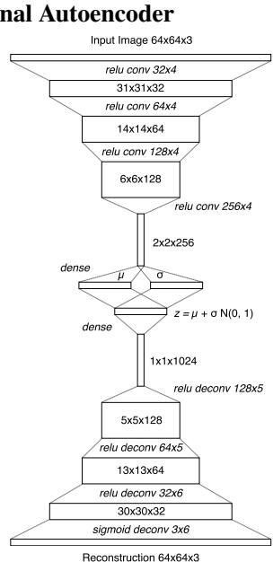  
Figure 22. ConvVAE 各层张量形状的说明。

我们训练了一个卷积变分自编码器（Convolutional Variational Autoencoder，ConvVAE）模型作为我们智能体的 V 模型（V Model）。与传统自编码器不同，对隐向量 z 施加高斯先验限制了压缩每一帧的信息容量，但这种高斯先验也使得世界模型对 M 模型（M Model）生成的非真实 z 向量更加鲁棒。

由于环境可能会以高维像素图像的形式提供观测，我们首先将每张图像的大小调整为 64x64 像素，并将调整大小后的图像用作 V 模型的观测。每个像素存储为 0 到 1 之间的三个浮点数值，以表示各个 RGB 通道。ConvVAE 接收此 64x64x3 输入张量，并通过 4 个卷积层传递这些数据，将其编码为低维向量 µ 和 σ，每个向量的大小均为 $N _ { z }$。隐向量 z 从高斯先验 $N ( \mu , \sigma I )$ 中采样。在 Car Racing 任务中，$N _ { z }$ 为 32，而对于 Doom 任务，$N _ { z }$ 为 64。隐向量 z 会通过 4 个用于解码和重构图像的反卷积层。

每个卷积层和反卷积层的步幅（stride）均为 2。图中各层以斜体表示为 Activation-type Output Channels x Filter Size。除输出层外，所有卷积层和反卷积层均使用 relu 激活函数，因为我们需要输出介于 0 和 1 之间。我们使用从随机策略收集的数据将该模型训练了 1 个 epoch，除了 KL 损失外，还使用输入图像与重构图像之间的 $L ^ { 2 }$ 距离来量化我们优化的重构损失。

## A.2. 循环神经网络 (Recurrent Neural Network)

对于 M 模型（M Model），我们使用 LSTM（Hochreiter & Schmidhuber, 1997）循环神经网络结合混合密度网络（Mixture Density Network，MDN，Bishop, 1994）作为输出层。我们使用该网络将下一个时间步中下一个 z 的概率分布建模为高斯混合分布。该方法与 (Graves, 2013) 中“无条件手写生成”（Unconditional Handwriting Generation）部分以及 SketchRNN (Ha & Eck, 2017) 的仅解码器（decoder-only）部分非常相似。所用方法的唯一区别在于，我们没有对 $z ,$ 的各元素之间的相关性参数进行建模，而是让 MDN-RNN 输出因子化高斯分布的对角协方差矩阵。

  
Figure 23. 类似于 (Graves, 2013; Ha & Eck, 2017) 的 MDN-RNN 解码器

与手写和草图生成工作不同的是，我们没有使用 MDN-RNN 来建模下一笔画的概率密度函数（pdf），而是建模了下一个潜在向量 z 的 pdf。我们在每个时间步从该 pdf 中采样以生成虚构环境（hallucinated environments）。在 Doom 任务中，我们还使用 MDN-RNN 来预测智能体（agent）是否在当前帧死亡的概率。如果该概率高于 50%，则我们在虚拟环境中将 done 设为 true。鉴于死亡在每个时间步都是一个小概率事件，我们发现与从伯努利分布中采样相比，截断阈值方法更加稳定。

MDN-RNN 在从随机策略智能体收集的数据上训练了 20 个轮次（epoch）。在 Car Racing 任务中，LSTM 使用了 256 个隐藏单元，而在 Doom 任务中使用了 512 个隐藏单元。在这两项任务中，我们均使用了 5 个高斯混合分量，并且未对相关性 ρ 参数进行建模，因此 z 是从因子化高斯混合分布中采样的。

当使用来自记录数据的教师强制（teacher forcing）训练 MDN-RNN 时，我们为每一帧存储一组预先计算好的 $\mu$ 和 σ，并在每次构建训练批次时采样一个输入 $z \sim N ( \mu , \sigma )$，以防止 MDN-RNN 对特定采样的 z 发生过拟合。

## A.3. 控制器（Controller）

对于这两个环境，我们应用了 tanh 非线性变换来裁剪并将动作空间限制在适当的范围内。例如，在 Car Racing 任务中，方向盘的取值范围为 -1 到 1，油门踏板为 0 到 1，刹车为 0 到 1。在 Doom 环境中，我们将离散动作转换为 -1 到 1 之间的连续动作空间，并将该范围均分为三份，分别表示智能体向左移动、原地停留或向右移动。我们向 C 模型（C Model）提供一个特征向量作为其输入，该特征向量由 z 和 MDN-RNN 的隐藏状态组成。在 Car Racing 任务中，该隐藏状态是 LSTM 的输出向量 h，而在 Doom 任务中，它是 LSTM 的细胞状态向量 c 和输出向量 h。

## A.4. 进化策略（Evolution Strategies）

我们使用协方差矩阵自适应进化策略（Covariance-Matrix Adaptation Evolution Strategy，CMA-ES）（Hansen, 2016）来演化 C Model 的权重。遵循 Evolving Stable Strategies（Ha, 2017b）中描述的方法，我们使用的种群大小为 64，并让每个智能体使用不同的初始随机种子执行该任务 16 次。智能体的适应度值是这 16 次随机推演（rollout）的平均累积奖励。下图展示了每一代中由 64 个智能体组成的种群的最佳表现者、最差表现者以及平均适应度：

  
Figure 24. CarRacing-v0 的训练过程

由于该环境的要求是智能体在 100 次随机推演中获得超过 900 分的平均分，因此我们每隔 25 代取出表现最好的智能体，并在 1024 个随机推演场景中测试该智能体，从而在红线上记录这一平均值。在 1800 代之后，一个智能体能够在 1024 次随机推演中获得 900.46 的平均分。我们使用 1024 次随机推演而不是 100 次，是因为这台 64 核机器的每个进程已经被配置为运行 16 次，这相当于每隔 25 代就使用整整一代的计算量对最佳智能体进行 1024 次评估。下方绘制了同一智能体在 100 次推演中评估的结果：

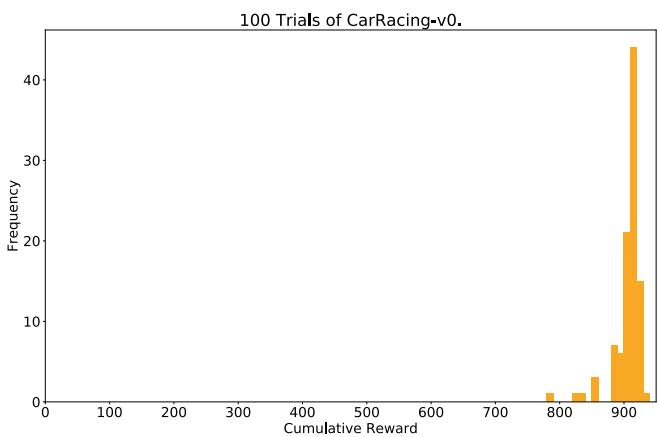  
Figure 25. 累积奖励直方图。分数为 $9 0 6 \pm 2 1$

我们还对仅能访问来自 VAE 的 z 向量、而无法看到 RNN 隐藏状态的智能体进行了实验。我们尝试了 2 种变体：在第一种变体中，C Model 将 z 直接映射到动作空间 a。在第二种变体中，我们尝试在 z 和 $^ { a , }$ 之间添加一个具有 40 个 tanh 激活单元的隐藏层，使 C Model 的模型参数数量增加到 1443 个，使其与原始设置更具可比性。

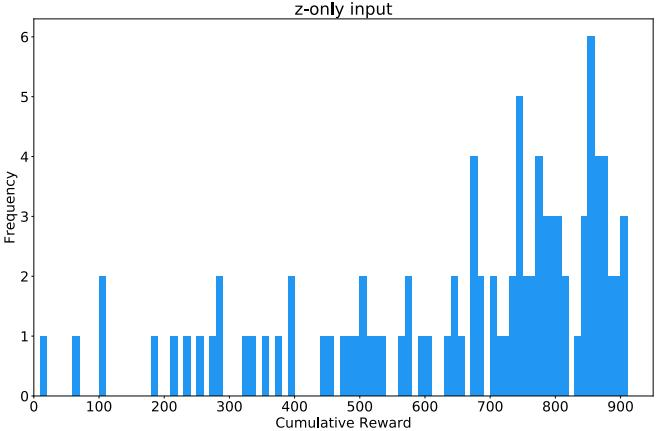  
Figure 26. 当智能体仅看到 $z _ { t } ,$ 时，分数为 $6 3 2 \pm 2 5 1$

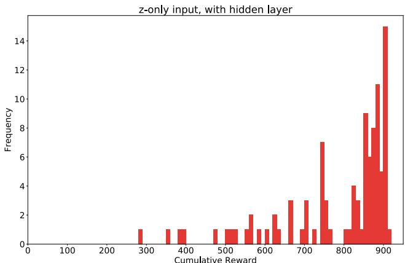  
Figure 27. 当智能体仅看到 $z _ { t } ,$ 且带有一个隐藏层时，分数为 788 ± 141。

## A.5. DoomRNN

我们在被称为 DoomRNN 的幻觉 Doom 环境中进行了类似的实验。请注意，我们实际上并没有尝试在真实的 VizDoom 环境中训练我们的智能体，而仅仅是使用随机策略通过 VizDoom 来收集训练数据。与 VizDoom 相比，DoomRNN 的计算效率更高，因为它仅在潜在空间中运行，无需在每个时间步渲染屏幕截图，也不需要运行实际的 Doom 游戏引擎。

  
Figure 28. DoomRNN 的训练过程。

在我们构建的虚拟 DoomRNN 环境中，我们稍微提高了温度，使用 $\tau = 1 . 1 5$ 以使智能体（agent）在更具挑战性的环境中学习。表现最佳的智能体在 1024 次随机展开（rollout）中获得了 959 的平均分（图中红线对应的最高得分）。当部署到实际的 DoomTakeCover-v0（Paquette, 2016）环境中时，这同一个智能体在 100 次随机展开中取得了 $1 0 9 2 \pm 5 5 6$ 的平均分。

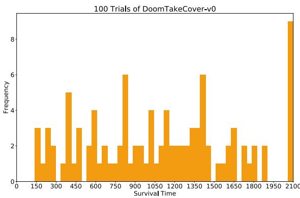  
Figure 29. 在实际 VizDoom 环境中连续 100 次试验的存活时间步直方图。得分为 $1 0 9 2 \pm 5 5 6$

## 参考文献

Al-Shedivat, M., Bansal, T., Burda, Y., Sutskever, I., Mordatch, I., and Abbeel, P. Continuous adaptation via meta-learning in nonstationary and competitive environments. ArXiv preprint, October 2017. URL https: //arxiv.org/abs/1710.03641.

Alvernaz, S. and Togelius, J. Autoencoder-augmented neuroevolution for visual doom playing. ArXiv preprint, July 2017. URL https://arxiv.org/abs/1707. 03902.

Arulkumaran, K., Deisenroth, M. P., Brundage, M., and Bharath, A. A. Deep reinforcement learning: A brief survey. IEEE Signal Processing Magazine, 34(6):26–38, Nov 2017. ISSN 1053-5888. doi: 10.1109/MSP.2017. 2743240. URL https://arxiv.org/abs/1708. 05866.

Bansal, T., Pachocki, J., Sidor, S., Sutskever, I., and Mordatch, I. Emergent complexity via multi-agent competition. ArXiv preprint, October 2017. URL https: //arxiv.org/abs/1710.03748.

Bartol, Thomas M, Jr, Bromer, Cailey, Kinney, Justin, Chirillo, Michael A, Bourne, Jennifer N, Harris, Kristen M, and Sejnowski, Terrence J. Nanoconnectomic upper bound on the variability of synaptic plasticity. eLife Sciences Publications, Ltd, 2015. doi: 10.7554/ eLife.10778. URL https://doi.org/10.7554/ eLife.10778.

Bishop, Christopher M. Mixture density networks. Technical Report, 1994. URL http://publications. aston.ac.uk/373/.

Bling, Seth. Mar i/o kart, 2015. URL https://youtu. be/S9Y\_I9vY8Qw.

Bousmalis, K., Irpan, A., Wohlhart, P., Bai, Y., Kelcey, M., Kalakrishnan, M., Downs, L., Ibarz, J., Pastor, P., Konolige, K., Levine, S., and Vanhoucke, V. Using simulation and domain adaptation to improve efficiency of deep robotic grasping. ArXiv e-prints, September 2017. URL https://arxiv.org/abs/1709.07857.

Brockman, G., Cheung, V., Pettersson, L., Schneider, J., Schulman, J., Tang, J., and Zaremba, W. Openai gym. ArXiv preprint, June 2016. URL https://arxiv. org/abs/1606.01540.

Cheang, L. and Tsao, D. The code for facial identity in the primate brain. Cell, 2017. doi: 10.1016/j.cell. 2017.05.011. URL http://www.cell.com/cell/ fulltext/S0092-8674%2817%2930538-X.

Chiappa, S., Racaniere, S., Wierstra, D., and Mohamed, S. Recurrent environment simulators. ArXiv preprint, April 2017. URL https://arxiv.org/abs/ 1704.02254.

Deisenroth, M. and Rasmussen, C. Pilco: A modelbased and data-efficient approach to policy search. 2011. URL http://mlg.eng.cam.ac.uk/pub/ pdf/DeiRas11.pdf.

Denton, E. and Birodkar, V. Unsupervised learning of disentangled representations from video. ArXiv preprint, May 2017. URL https://arxiv.org/abs/1705. 10915.

Depeweg, S., Hernandez-Lobato, J, Doshi-Velez, F., and Udluft, S. Learning and policy search in stochastic dynamical systems with bayesian neural networks. ArXiv preprint, May 2016. URL https://arxiv.org/ abs/1605.07127.

Dosovitskiy, A. and Koltun, V. Learning to act by predicting the future. ArXiv preprint, November 2016. URL https: //arxiv.org/abs/1611.01779.

Duvenaud, David. Lecture slides on pilco. CSC 2541 Course at University of Toronto, 2016. URL https://www.cs.toronto.edu/ duvenaud/ courses/csc2541/slides/pilco.pdf.

E, M. More thoughts from understanding comics by scott mccloud, 2012. URL https://goo.gl/5Tndi4.

Fernando, C., Banarse, D., Blundell, C., Zwols, Y., Ha, D., Rusu, A., Pritzel, A., and Wierstra, D. Pathnet: Evolution channels gradient descent in super neural networks. ArXiv preprint, January 2017. URL https://arxiv.org/ abs/1701.08734.

Finn, C., Tan, X., Duan, Y., Darrell, T., Levine, S., and Abbeel, P. Deep spatial autoencoders for visuomotor learning. ArXiv preprint, September 2015. URL https: //arxiv.org/abs/1509.06113.

Finn, Chelsea. Model-based rl lecture at deep rl bootcamp 2017, 2017. URL https://youtu.be/ iC2a7M9voYU?t=44m35s.

Forrester, Jay Wright. Counterintuitive behavior of social systems, 1971. URL https://en.wikipedia. org/wiki/Mental\_model. [Online; accessed 01- Nov-2017].

Foster, David J. Replay comes of age. Annual Review of Neuroscience, 40(1):581–602, 2017. doi: 10.1146/annurev-neuro-072116-031538. URL https://doi.org/10.1146/ annurev-neuro-072116-031538.

French, Robert M. Catastrophic interference in connectionist networks: Can it be predicted, can it be prevented? In Cowan, J. D., Tesauro, G., and Alspector, J. (eds.), Advances in Neural Information Processing Systems 6, pp. 1176–1177. Morgan-Kaufmann, 1994. URL https://goo.gl/jwpLsk.

Gal, Y., McAllister, R., and Rasmussen, C. Improving pilco with bayesian neural network dynamics models. April 2016. URL http://mlg.eng.cam.ac.uk/ yarin/PDFs/DeepPILCO.pdf.

Gauci, Jason and Stanley, Kenneth O. Autonomous evolution of topographic regularities in artificial neural networks. Neural Computation, 22(7):1860–1898, July 2010. ISSN 0899-7667. doi: 10.1162/neco.2010. 06-09-1042. URL http://eplex.cs.ucf.edu/ papers/gauci\_nc10.pdf.

Gemici, M., Hung, C., Santoro, A., Wayne, G., Mohamed, S., Rezende, D., Amos, D., and Lillicrap, T. Generative temporal models with memory. ArXiv preprint, February 2017. URL https://arxiv.org/abs/1702. 04649.

Gerrit, M., Fischer, J., and Whitney, D. Motion-dependent representation of space in area mt+. Neuron, 2013. doi: 10.1016/j.neuron.2013.03.010. URL http://dx.doi. org/10.1016/j.neuron.2013.03.010.

Gers, F., Schmidhuber, J., and Cummins, F. 学会遗忘：基于 LSTM 的持续预测（Learning to forget: Continual prediction with lstm）. Neural Computation, 12(10):2451–2471, 2000年10月. ISSN 0899-7667. doi: 10.1162/089976600300015015. URL ftp://ftp. idsia.ch/pub/juergen/FgGates-NC.pdf.

Gomez, F. and Schmidhuber, J. 协同进化的循环神经元学习深层记忆 POMDP（Co-evolving recurrent neurons learn deep memory pomdps）. Proceedings of the 7th Annual Conference on Genetic and Evolutionary Computation, pp. 491–498, 2005. doi: 10.1145/ 1068009.1068092. URL ftp://ftp.idsia.ch/ pub/juergen/gecco05gomez.pdf.

Gomez, F., Schmidhuber, J., and Miikkulainen, R. 通过协同进化突触加速神经进化（Accelerated neural evolution through cooperatively coevolved synapses）. Journal of Machine Learning Research, 9: 937–965, 2008年6月. ISSN 1532-4435. URL http:// people.idsia.ch/<sub>˜</sub>juergen/gomez08a.pdf.

Gottlieb, J., Oudeyer, P., Lopes, M., and Baranes, A. 信息寻求、好奇心与注意力：计算与神经机制（Information-seeking, curiosity, and attention: computational and neural mechanisms）. Cell, 2013年9月. doi: 10.1016/j.tics.2013.09.001. URL http://www. pyoudeyer.com/TICSCuriosity2013.pdf.

Graves, Alex. 利用循环神经网络生成序列（Generating sequences with recurrent neural networks）. ArXiv 预印本, 2013. URL https: //arxiv.org/abs/1308.0850.

Graves, Alex. 循环神经网络的幻觉（Hallucination with recurrent neural networks）, 2015. URL https://www.youtube.com/ watch?v=-yX1SYeDHbg&t=49m33s.

Ha, D. 面向艺术家的循环神经网络教程（Recurrent neural network tutorial for artists）. blog.otoro.net, 2017a. URL http://blog.otoro.net/2017/01/01/ recurrent-neural-network-artist/.

Ha, D. 进化稳定策略（Evolving stable strategies）. blog.otoro.net, 2017b. URL http://blog.otoro.net/2017/ 11/12/evolving-stable-strategies/.

Ha, D. and Eck, D. 素描草图的神经表征（A neural representation of sketch drawings）. ArXiv 预印本, 2017年4月. URL https://magenta.tensorflow.org/ sketch-rnn-demo.

Ha, D., Dai, A., and Le, Q. 超网络（Hypernetworks）. ArXiv 预印本, 2016年9月. URL https://arxiv.org/abs/ 1609.09106.

Hansen, N. CMA 进化策略教程（The cma evolution strategy: A tutorial）. ArXiv 预印本, 2016. URL https://arxiv.org/abs/ 1604.00772.

Hansen, Nikolaus and Ostermeier, Andreas. 进化策略中的完全去随机化自适应（Completely derandomized self-adaptation in evolution strategies）. Evolutionary Computation, 9(2):159–195, 2001年6月. ISSN 1063-6560. doi: 10.1162/106365601750190398. URL http://www.cmap.polytechnique.fr/ nikolaus.hansen/cmaartic.pdf.

Hausknecht, M., Lehman, J., Miikkulainen, R., and Stone, P. 面向通用 Atari 游戏游玩的神经进化方法（A neuroevolution approach to general atari game playing）. IEEE Transactions on Computational Intelligence and AI in Games, 2013. URL http://www.cs.utexas. edu/<sub>˜</sub>ai-lab/?atari.

Hein, D., Depeweg, S., Tokic, M., Udluft, S., Hentschel, A., Runkler, T., and Sterzing, V. 由工业控制问题驱动的基准环境（A benchmark environment motivated by industrial control problems）. ArXiv 预印本, 2017年9月. URL https://arxiv.org/abs/ 1709.09480.

Higgins, I., Pal, A., Rusu, A., Matthey, L., Burgess, C., Pritzel, A., Botvinick, M., Blundell, C., and Lerchner, A. DARLA：改善强化学习中的零样本迁移（Darla: Improving zero-shot transfer in reinforcement learning）. ArXiv 预印本, 2017年7月. URL https:// arxiv.org/abs/1707.08475.

Hirshon, B. Tracking fastballs, 2013. URL http: //sciencenetlinks.com/science-news/ science-updates/tracking-fastballs/.

Hochreiter, Sepp and Schmidhuber, Juergen. Long shortterm memory. Neural Computation, 1997. URL ftp: //ftp.idsia.ch/pub/juergen/lstm.pdf.

Hnermann, Jan. Self-driving cars in the browser, 2017. URL http://janhuenermann.com/projects/ learning-to-drive.

Jang, S., Min, J., and Lee, C. Reinforcement car racing with a3c. 2017. URL https: //www.scribd.com/document/358019044/ Reinforcement-Car-Racing-with-A3C.

Kaelbling, L. P., Littman, M. L., and Moore, A. W. Reinforcement learning: a survey. Journal ofAI research, 4: 237–285, 1996.

Keller, GeorgB., Bonhoeffer, Tobias, and Hbener, Mark. Sensorimotor mismatch signals in primary visual cortex of the behaving mouse. Neuron, 74(5):809 – 815, 2012. ISSN 0896-6273. doi: https://doi.org/10.1016/j.neuron.2012.03.040. URL http://www.sciencedirect.com/science/ article/pii/S0896627312003844.

Kelley, H. J. Gradient theory of optimal flight paths. ARS Journal, 30(10):947–954, 1960.

Kempka, Michael, Wydmuch, Marek, Runc, Grzegorz, Toczek, Jakub, and Jaskowski, Wojciech. Vizdoom: A doom-based ai research platform for visual reinforcement learning. In IEEE Conference on Computational Intelligence and Games, pp. 341–348, Santorini, Greece, Sep 2016. IEEE. URL http://arxiv.org/abs/1605. 02097. 最佳论文奖（The best paper award）.

Khan, M. and Elibol, O. Car racing using reinforcement learning. 2016. URL https: //web.stanford.edu/class/cs221/2017/ restricted/p-final/elibol/final.pdf.

Kingma, D. and Welling, M. Auto-encoding variational bayes. ArXiv preprint, 2013. URL https://arxiv. org/abs/1312.6114.

Kirkpatrick, J., Pascanu, R., Rabinowitz, N., Veness, J., Desjardins, G., Rusu, A.and Milan, K., Quan, J., Ramalho, T., Grabska-Barwinska, A., Hassabis, D., Clopath, C., Kumaran, D., and Hadsell, R. Overcoming catastrophic forgetting in neural networks. ArXiv preprint, December 2016. URL https://arxiv.org/abs/1612. 00796.

Kitaoka, Akiyoshi. Akiyoshi’s illusion pages, 2002. URL http://www.ritsumei.ac.jp/<sub>˜</sub>akitaoka/ index-e.html.

Klimov, Oleg. Carracing-v0, 2016. URL https://gym. openai.com/envs/CarRacing-v0/.

Koutnik, J., Cuccu, G., Schmidhuber, J., and Gomez, F. Evolving large-scale neural networks for vision-based

reinforcement learning. Proceedings of the 15th Annual Conference on Genetic and Evolutionary Computation, pp. 1061–1068, 2013. doi: 10.1145/2463372. 2463509. URL http://people.idsia.ch/ <sub>˜</sub>juergen/compressednetworksearch.html.

Lau, Ben. Using keras and deep deterministic policy gradient to play torcs, 2016. URL https://yanpanlau.github.io/2016/ 10/11/Torcs-Keras.html.

Lehman, Joel and Stanley, Kenneth. Abandoning objectives: Evolution through the search for novelty alone. Evolutionary Computation, 19(2):189–223, 2011. ISSN 1063-6560. URL http://eplex.cs.ucf.edu/ noveltysearch/userspage/.

Leinweber, Marcus, Ward, Daniel R., Sobczak, Jan M., Attinger, Alexander, and Keller, Georg B. 小鼠大脑皮层中用于视觉流预测的感觉运动回路. Neuron, 95(6):1420 – 1432.e5, 2017. ISSN 0896- 6273. doi: https://doi.org/10.1016/j.neuron.2017.08. 036. URL http://www.sciencedirect.com/ science/article/pii/S0896627317307791.

Linnainmaa, S. 将算法的累积舍入误差表示为局部舍入误差的泰勒展开. 硕士学位论文, Univ. Helsinki, 1970.

Matthew Guzdial, Boyang Li, Mark O. Riedl. 从视频中学习游戏引擎. In Proceedings of the Twenty-Sixth International Joint Conference on Artificial Intelligence, IJCAI-17, pp. 3707–3713, 2017. doi: 10.24963/ijcai.2017/518. URL https://doi.org/ 10.24963/ijcai.2017/518.

McAllister, R. and Rasmussen, C. 连续状态 POMDP 中的高数据效率强化学习. ArXiv 预印本, 2016年2月. URL https://arxiv.org/abs/ 1602.02523.

McCloud, Scott. 理解漫画：看不见的艺术（Understanding Comics: The Invisible Art）. Tundra Publishing, 1993. URL https://en.wikipedia.org/wiki/ Understanding\_Comics.

Miikkulainen, R. 演化神经网络. IJCNN, 2013年8月. URL http://nn.cs.utexas.edu/ downloads/slides/miikkulainen.ijcnn13. pdf.

Mnih, V., Kavukcuoglu, K., Silver, D., Graves, A., Antonoglou, I., Wierstra, D., and Riedmiller, M. 利用深度强化学习玩 Atari 游戏. ArXiv 预印本, 2013年12月. URL https://arxiv.org/abs/ 1312.5602.

Mobbs, Dean, Hagan, Cindy C., Dalgleish, Tim, Silston, Brian, and Prvost, Charlotte. 人类恐惧生态学：生存优化与神经系统., 2015. URL https://www.frontiersin.org/ article/10.3389/fnins.2015.00055.

Munro, P. W. 用于标量强化学习的双重反向传播方案. Proceedings of the Ninth Annual Conference of the Cognitive Science Society, Seattle, WA, pp. 165–176, 1987.

Nagabandi, A., Kahn, G., Fearing, R., and Levine, S. 基于模型的深度强化学习中的神经网络动力学及无模型微调. ArXiv 预印本, 2017年8月. URL https://arxiv.org/abs/1708. 02596.

Nguyen, N. and Widrow, B. 卡车倒车器：神经网络自我学习的一个范例. In Proceedings of the International Joint Conference on Neural Networks, pp. 357–363. IEEE Press, 1989.

Nortmann, Nora, Rekauzke, Sascha, Onat, Selim, Knig, Peter, and Jancke, Dirk. 初级视觉皮层表征过去与现在的差异. Cerebral Cortex, 25(6):1427–1440, 2015. doi: 10.1093/cercor/ bht318. URL http://dx.doi.org/10.1093/ cercor/bht318.

Oh, J., Guo, X., Lee, H., Lewis, R., and Singh, S. 在 Atari 游戏中使用深度网络进行动作条件视频预测. ArXiv 预印本, 2015年7月. URL https:// arxiv.org/abs/1507.08750.

Oudeyer, P., Kaplan, F., and Hafner, V. 自主心智发展的内在动机系统. Trans. Evol. Comp, 2007年4月. doi: 10.1109/TEVC.2006.890271. URL http://www.pyoudeyer.com/ims.pdf.

Paquette, Philip. Doomtakecover-v0, 2016. URL https://gym.openai.com/envs/ DoomTakeCover-v0/.

Parker, M. and Bryant, B. Neuro-visual control in the quake ii environment. IEEE Transactions on Computational Intelligence and AI in Games, 2012. URL https://www.cse.unr.edu/<sub>˜</sub>bdbryant/ papers/parker-2012-tciaig.pdf.

Pathak, D., Agrawal, P., A., Efros, and Darrell, T. Curiositydriven exploration by self-supervised prediction. ArXiv preprint, May 2017. URL https://pathak22. github.io/noreward-rl/.

Pi, H., Hangya, B., Kvitsiani, D., Sanders, J., Huang, Z., and Kepecs, A. Cortical interneurons that specialize in disinhibitory control. Nature, November 2013. doi: 10.1038/nature12676. URL http://dx.doi.org/ 10.1038/nature12676.

Prieur, Luc. Deep-q learning for box2d racecar rl problem., 2017. URL https://goo.gl/VpDqSw.

Quiroga, R., Reddy, L., Kreiman, G., Koch, C., and Fried, I. Invariant visual representation by single neurons in the human brain. Nature, 2005. doi: 10.1038/nature03687. URL http://www.nature.com/nature/journal/ v435/n7045/abs/nature03687.html.

Ratcliff, Rodney Mark. Connectionist models of recognition memory: constraints imposed by learning and forgetting functions. Psychological review, 97 2:285–308, 1990.

Rechenberg, I. Evolutionsstrategie: optimierung technischer systeme nach prinzipien der biologischen evolution. Frommann-Holzboog, 1973. URL https://en. wikipedia.org/wiki/Ingo\_Rechenberg.

Rezende, D., Mohamed, S., and Wierstra, D. Stochastic backpropagation and approximate inference in deep generative models. ArXiv preprint, 2014. URL https: //arxiv.org/abs/1401.4082.

Robinson, T. and Fallside, F. Dynamic reinforcement driven error propagation networks with application to game playing. In CogSci 89, 1989.

Salimans, T., Ho, J., Chen, X., Sidor, S., and Sutskever, I. Evolution strategies as a scalable alternative to reinforcement learning. ArXiv preprint, 2017. URL https://arxiv.org/abs/1703.03864.

Schmidhuber, J. Making the world differentiable: On using self-supervised fully recurrent neural networks for dynamic reinforcement learning and planning in non-stationary environments. 1990a. URL http://people.idsia.ch/<sub>˜</sub>juergen/ FKI-126-90\_(revised)bw\_ocr.pdf.

Schmidhuber, J. An on-line algorithm for dynamic reinforcement learning and planning in reactive environments. 1990 IJCNN International Joint Conference on Neural Networks, pp. 253–258 vol.2, June 1990b. doi: 10.1109/IJCNN.1990.137723. URL ftp://ftp. idsia.ch/pub/juergen/ijcnn90.ps.gz.

Schmidhuber, J. A possibility for implementing curiosity and boredom in model-building neural controllers. Proceedings ofthe First International Conference on Simulation ofAdaptive Behavior on From Animals to Animats, pp. 222–227, 1990c. URL ftp://ftp.idsia.ch/ pub/juergen/curiositysab.pdf.

Schmidhuber, J. Reinforcement learning in markovian and non-markovian environments. Advances in Neural Information Processing Systems 3, pp. 500–506, 1991a. URL https://goo.gl/ij1uYQ.

Schmidhuber, J. Curious model-building control systems. In Proc. International Joint Conference on Neural Networks, Singapore, pp. 1458–1463, 1991b.

Schmidhuber, J. Learning complex, extended sequences using the principle of history compression. Neural Computation, 4(2):234–242, 1992. (Based on TR FKI-148-91, TUM, 1991).

Schmidhuber, J. Optimal ordered problem solver. ArXiv preprint, July 2002. URL https://arxiv.org/ abs/cs/0207097.

Schmidhuber, J. Developmental robotics, optimal artificial curiosity, creativity, music, and the fine arts. Connection Science, 18(2):173–187, 2006.

Schmidhuber, J. Formal theory of creativity, fun, and intrinsic motivation (1990-2010). IEEE Trans. Autonomous Mental Development, 2010. URL http://people. idsia.ch/ juergen/creativity.html.

Schmidhuber, J. Powerplay: Training an increasingly general problem solver by continually searching for the simplest still unsolvable problem. Frontiers in Psychology, 4:313, 2013. ISSN 1664-1078. doi: 10.3389/fpsyg.2013. 00313. URL https://www.frontiersin.org/ article/10.3389/fpsyg.2013.00313.

Schmidhuber, J. On learning to think: Algorithmic information theory for novel combinations of reinforcement learning controllers and recurrent neural world models. ArXiv preprint, 2015a. URL https://arxiv.org/ abs/1511.09249.

Schmidhuber, J. Deep learning in neural networks: An overview. Neural Networks, 61:85–117, 2015b. doi: 10.1016/j.neunet.2014.09.003. Published online 2014; based on TR arXiv:1404.7828 [cs.NE].

Schmidhuber, J. One big net for everything. Preprint arXiv:1802.08864 [cs.AI], February 2018. URL https: //arxiv.org/abs/1802.08864.

Schmidhuber, J. and Huber, R. Learning to generate artificial fovea trajectories for target detection. International Journal ofNeural Systems, 2(1-2):125–134, 1991. doi: 10.1142/S012906579100011X. URL ftp://ftp. idsia.ch/pub/juergen/attention.pdf.

Schmidhuber, J., Storck, J., and Hochreiter, S. Reinforcement driven information acquisition in nondeterministic environments. Technical Report FKI- -94, TUM Department of Informatics, 1994.

Schwefel, H. Numerical Optimization ofComputer Models. John Wiley and Sons, Inc., New York, NY, USA, 1977. ISBN 0471099880. URL https://en.wikipedia. org/wiki/Hans-Paul\_Schwefel.

Sehnke, F., Osendorfer, C., Ruckstieb, T., Graves, A., Peters, J., and Schmidhuber, J. Parameter-exploring policy gradients. Neural Networks, 23(4):551– 559, 2010. doi: 10.1016/j.neunet.2009.12.004. URL http://citeseerx.ist.psu. edu/viewdoc/download;jsessionid= A64D1AE8313A364B814998E9E245B40A? doi=10.1.1.180.7104&rep=rep1&type=pdf.

Shazeer, N., Mirhoseini, A., Maziarz, K., Davis, A., Le, Q., Hinton, G., and Dean, J. 超大规模神经网络：稀疏门控混合专家层（Outrageously large neural networks: The sparsely-gated mixture-of-experts layer）. ArXiv 预印本，2017年1月. URL https://arxiv. org/abs/1701.06538.

Silver, D., van Hasselt, H., Hessel, M., Schaul, T., Guez, A., Harley, T., Dulac-Arnold, G., Reichert, D., Rabinowitz, N., Barreto, A., and Degris, T. Predictron：端到端学习与规划（The predictron: Endto-end learning and planning）. ArXiv 预印本，2016年12月. URL https://arxiv.org/abs/1612. 08810.

Silver, David. David Silver 关于结合学习与规划的讲座（David silver’s lecture on integrating learning and planning），2017. URL http://www0.cs.ucl.ac.uk/staff/d. silver/web/Teaching\_files/dyna.pdf.

Srivastava, R., Steunebrink, B., and Schmidhuber, J. PowerPlay 的首次实验（First experiments with powerplay）. ArXiv 预印本，2012年10月. URL https://arxiv.org/abs/1210.8385.

Stanley, Kenneth and Clune, Jeff. 迎接深度神经进化时代（Welcoming the era of deep neuroevolution），2017. URL https://eng. uber.com/deep-neuroevolution/.

Stanley, Kenneth O. and Miikkulainen, Risto. 通过扩充拓扑结构进化神经网络（Evolving neural networks through augmenting topologies）. Evolutionary Computation, 10(2):99–127, 2002. URL http: //nn.cs.utexas.edu/?stanley:ec02.

Suarez, Joseph. 基于循环高速公路超网络的语言建模（Language modeling with recurrent highway hypernetworks）. In Guyon, I., Luxburg, U. V., Bengio, S., Wallach, H., Fergus, R., Vishwanathan, S., and Garnett, R. (eds.), Advances in Neural Information Processing Systems 30, pp. 3269–3278. Curran Associates, Inc., 2017. URL https://goo.gl/4nqHXw.

Sukhbaatar, S., Lin, Z., Kostrikov, I., Synnaeve, G., Szlam, A., and Fergus, R. 基于非对称自博弈的内在动机与自动课程（Intrinsic motivation and automatic curricula via asymmetric self-play）. ArXiv 预印本，2017年10月. URL https://arxiv.org/abs/1703. 05407.

Sutton, Richard S. and Barto, Andrew G. 强化学习导论（Introduction to Reinforcement Learning）. MIT Press, Cambridge, MA, USA, 第1版, 1998. ISBN 0262193981. URL http://ufal.mff.cuni.

cz/<sub>˜</sub>straka/courses/npfl114/2016/ sutton-bookdraft2016sep.pdf.

van den Oord, A., Dieleman, S., Zen, H., Simonyan, K., Vinyals, O., Graves, A., Kalchbrenner, N., Senior, A., and Kavukcuoglu, K. WaveNet：原始音频的生成模型（Wavenet: A generative model for raw audio）. ArXiv 预印本，2016年9月. URL https://arxiv.org/abs/1609.03499.

Vaswani, A., Shazeer, N., Parmar, N., Uszkoreit, J., Jones, L., Gomez, A, Kaiser, L., and Polosukhin, I. 注意力机制就是你所需要的一切（Attention is all you need）. ArXiv 预印本，2017年6月. URL https: //arxiv.org/abs/1706.03762.

Wahlstrm, N., Schn, T., and Deisenroth, M. 从图像像素中学习深度动力学模型（Learning deep dynamical models from image pixels）. ArXiv 预印本，2014年10月. URL https://arxiv.org/abs/ 1410.7550.

Wahlstrm, N., Schn, T., and Deisenroth, M. 从像素到力矩：基于深度动力学模型的策略学习（From pixels to torques: Policy learning with deep dynamical models）. ArXiv 预印本，2015年6月. URL https://arxiv. org/abs/1502.02251.

Watanabe, Eiji, Kitaoka, Akiyoshi, Sakamoto, Kiwako, Yasugi, Masaki, and Tanaka, Kenta. Illusory motion reproduced by deep neural networks trained for prediction. Frontiers in Psychology, 9:345, 2018. ISSN 1664-1078. doi: 10.3389/fpsyg.2018. 00345. URL https://www.frontiersin.org/ article/10.3389/fpsyg.2018.00345.

Watter, M., Springenberg, J., Boedecker, J., and Riedmiller, M. Embed to control: A locally linear latent dynamics model for control from raw images. ArXiv preprint, June 2015. URL https://arxiv.org/abs/1506. 07365.

Watters, N., Tacchetti, A., Weber, T., Pascanu, R., Battaglia, P., and Zoran, D. Visual interaction networks. ArXiv preprint, June 2017. URL https://arxiv.org/ abs/1706.01433.

Weber, T., Racanire, S., Reichert, D., Buesing, L., Guez, A., Rezende, D., Badia, A., Vinyals, O., Heess, N., Li, Y., Pascanu, R., Battaglia, P., Silver, D., and Wierstra, D. Imagination-augmented agents for deep reinforcement learning. ArXiv preprint, July 2017. URL https:// arxiv.org/abs/1707.06203.

Werbos, P. J. Learning how the world works: Specifications for predictive networks in robots and brains. In Proceedings ofIEEE International Conference on Systems, Man and Cybernetics, N.Y., 1987.

Werbos, P. J. Neural networks for control and system identification. In Proceedings of IEEE/CDC Tampa, Florida, 1989.

Werbos, Paul J. Applications of advances in nonlinear sensitivity analysis. In System modeling and optimization, pp. 762–770. Springer, 1982.

Wiering, Marco and van Otterlo, Martijn. Reinforcement Learning. Springer, 2012.

Wikipedia, Authors. Video game exploits, 2017. URL https://en.wikipedia.org/wiki/Video\_ game\_exploits. [Online; accessed 01-Nov-2017].