David Ha <sup>1</sup> Jürgen Schmidhuber¨ <sup>2</sup> <sup>3</sup>

## 摘要

我们探索为流行的强化学习环境构建生成式神经网络模型。我们的世界模型（world model）可以以无监督的方式快速训练，从而学习到环境在空间与时间维度上的压缩表示。通过将世界模型提取出的特征作为智能体（agent）的输入，我们能够训练出一条极其紧凑且简洁的策略（policy），以完成所需的任务。我们甚至可以将智能体完全置于由其世界模型所生成的幻觉梦境（hallucinated dream）中进行训练，并将所学策略迁移回真实环境中。

本文的交互式版本可访问 https://worldmodels.github.io 。

## 1. 引言

人类基于其有限感官所能感知的事物，会在脑海中构建一个关于世界的心智模型（mental model）。我们所做的决策与行动，正是建立在这一内部模型之上。系统动力学（system dynamics）之父 Jay Wright Forrester 曾这样描述心智模型：

我们头脑中所承载的关于周围世界的图像，仅仅是一个模型。没有人会在脑海中想象整个世界、政府或国家。他只选择了若干概念，以及这些概念之间的关系，并借助它们来表征真实系统。（Forrester, 1971）

为应对日常生活中川流不息的海量信息，我们的大脑学会了抽取这些信息在空间与时间两个维度上的抽象表示。我们能够观察一个场景，并记住其抽象的描述（Cheang & Tsao, 2017; Quiroga 等, 2005）。同样有证据表明，任一时刻我们所感知的内容，受制于大脑基于其内部模型对未来作出的预测（Nortmann 等, 2015; Gerrit 等, 2013）。

理解大脑内部预测模型的一种思路是：它或许不仅仅是为了对未来的泛化性预测，而是为了在给定当前运动动作（motor actions）的前提下，对未来将到来的感官数据进行预测（Keller 等, 2012; Leinweber 等, 2017）。我们能够本能地依据这一预测模型迅速采取行动，在面临危险时做出快速的反射性反应（Mobbs 等, 2015），而无须有意识地规划行动方案。

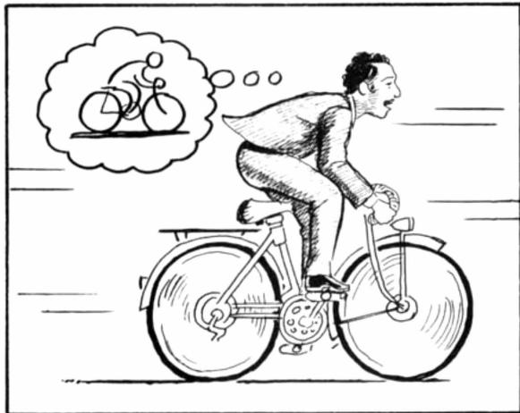  

图 1. 世界模型（World Model），出自 Scott McCloud 的《理解漫画（Understanding Comics）》。（McCloud, 1993; E, 2012）

以棒球为例，击球手只有几毫秒的时间来决定如何挥棒——这甚至比视觉信号到达我们大脑所需的时间还要短。我们之所以能够击中时速 100 英里的快速球，是因为我们能够本能地预测球的去向和落点。对于职业球员来说，这一切都是下意识发生的。他们的肌肉会依据其内部模型的预测，在正确的时间和位置反射性地挥棒（Gerrit et al., 2013）。他们能够迅速基于对未来的预测做出行动，而无需有意识地展开各种可能的未来情境来制定计划（Hirshon, 2013）。

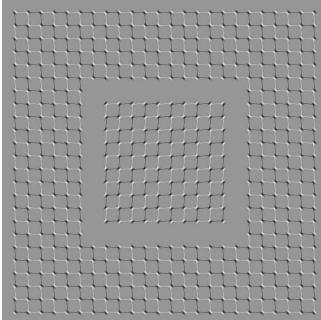

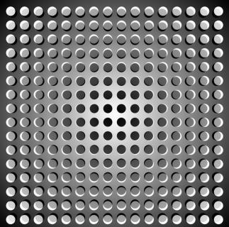  

图 2. 我们所看到的基于大脑对未来的预测（Kitaoka, 2002; Watanabe et al., 2018）。

在许多强化学习（RL）问题（Kaelbling 等，1996；Sutton & Barto，1998；Wiering & van Otterlo，2012）中，智能体同样受益于拥有对过去及当前状态的良好表征，以及对未来的良好预测模型（Werbos，1987；Silver，2017），最好是实现于通用计算机（例如循环神经网络（RNN））之上的强大预测模型（Schmidhuber，1990a;b；1991a）。

  

图 3. 在本工作中，我们构建了 OpenAI Gym 环境的概率生成模型。基于 RNN 的世界模型使用从实际游戏环境中收集到的观测数据进行训练。训练完世界模型之后，我们可以利用它们来模拟完整的环境，并基于它们训练智能体。

大型循环神经网络（Recurrent Neural Network, RNN）是表达能力极强的模型，能够学习数据丰富的空间与时序表征。然而，文献中的许多无模型强化学习（Reinforcement Learning, RL）方法往往只使用参数量较少的小型神经网络。强化学习算法通常受困于信用分配问题，这使得传统强化学习算法难以学习具有数百万权重的大型模型，因此实际中常常使用较小的网络，因为它们在训练过程中能够更快地迭代到一个不错的策略。

理想情况下，我们希望能够高效地训练基于大型 RNN 的智能体。反向传播算法（Linnainmaa, 1970; Kelley, 1960; Werbos, 1982）可以被用来高效地训练大型神经网络。在本文中，我们着眼于训练一个大型神经网络<sup>1</sup>来解决强化学习任务，方法是将智能体划分为一个大型世界模型（World Model）和一个小型控制器（Controller）模型。我们首先以无监督方式训练一个大型神经网络来学习智能体所处世界的模型，然后训练较小的控制器模型，利用该世界模型来学习完成任务。较小的控制器使得训练算法能够在较小的搜索空间中专注于信用分配问题，同时通过较大的世界模型不牺牲容量与表达能力。通过借助世界模型的视角来训练智能体，我们展示了它能够学习到一个高度紧凑的策略来执行任务。

尽管已有大量关于基于模型的强化学习的研究，但本文并不意味着是一篇综述（Arulkumaran et al., 2017; Schmidhuber, 2015b）来回顾该领域的当前现状。相反，本文的目标是从 1990—2015 年的一系列关于基于 RNN 的世界模型与控制器相结合的论文（Schmidhuber, 1990a;b; 1991a; 1990c; 2015a）中提炼若干关键概念。我们还将讨论文献中其他一些具有相似思想的、有关学习世界模型并利用该模型训练智能体的工作。

在本文中，我们提出了一个简化的框架，可用于实验性地展示这些论文中的若干关键概念，并就如何将这些思想有效地应用于各种强化学习环境给出进一步的见解。在描述我们的方法与实验时，我们使用了与《论学习思考：强化学习控制器与 RNN 世界模型新组合的算法信息论》（On Learning to Think: Algorithmic Information Theory for Novel Combinations of RL Controllers and RNN World Models, Schmidhuber, 2015a）一文相似的术语与记号。

## 2. 智能体模型

我们提出了一个受我们自身认知系统启发的简单模型。在该模型中，我们的智能体具有一个视觉感知组件，将其所见内容压缩成一段小的代表性编码。它还具有一个记忆组件，能够基于历史信息对未来编码进行预测。最后，我们的智能体具有一个决策组件，仅根据其视觉与记忆组件所生成的表征来决定采取何种动作。

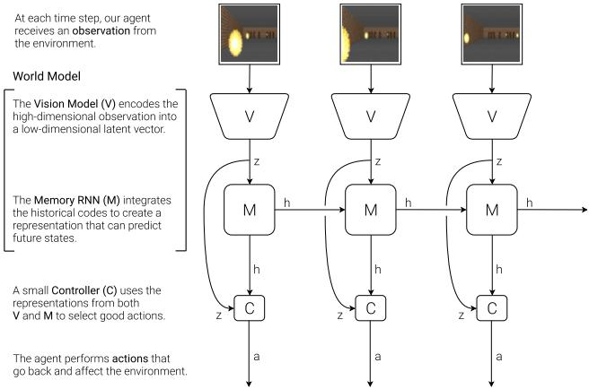  

图 4. 我们的智能体（agent）由三个紧密协作的组件构成：视觉（Vision, V）、记忆（Memory, M）和控制器（Controller, C）

## 2.1. VAE（V）模型

智能体所处的环境会在每个时间步向其提供一个高维度的输入观测。该输入通常是一段视频序列中的二维图像帧。V 模型的作用是学习对每一个观测到的输入帧的一种抽象的、压缩后的表征形式。

  

图 5. 变分自编码器（Variational Autoencoder, VAE）的流程图。

这里，我们使用一个简单的变分自编码器（Variational Autoencoder, Kingma & Welling, 2013; Rezende et al., 2014）作为我们的 V 模型，将每一帧图像压缩为一个小型的潜向量 z。

## 2.2. MDN-RNN（M）模型

虽然 V 模型的作用是压缩智能体在每个时间帧所看到的内容，但我们也希望对随时间发生的事情进行压缩。为此，M 模型的作用是预测未来。M 模型充当未来 z 向量的预测模型，而这些 z 向量正是 V 模型预期会生成的。由于许多复杂环境本质上具有随机性，我们训练 RNN 输出概率密度函数 p(z)，而不是对 z 进行确定性预测。

  

图 6. 具有混合密度网络（Mixture Density Network，MDN）输出层的循环神经网络（Recurrent Neural Network，RNN）。MDN 输出一个高斯混合分布（mixture of Gaussian distribution）的参数，用于对下一个潜向量 z 的预测值进行采样。

在我们的方法中，我们将 $p ( z )$ 近似为高斯混合分布（mixture of Gaussian distribution），并训练 RNN 输出下一时刻潜向量 $z _ { t + 1 }$ 在给定当前及历史信息下的概率分布。

更具体地说，RNN 将对 $P ( z _ { t + 1 } \mid a _ { t } , z _ { t } , h _ { t } )$ 进行建模，其中 $a _ { t }$ 是在时刻 t 采取的动作，$h _ { t }$ 是 RNN 在时刻 t 的隐藏状态。在采样过程中，我们可以调节温度参数 τ 来控制模型的不确定性，正如 (Ha & Eck, 2017) 中所做的那样——我们将会发现调节 τ 对后续控制器的训练非常有用。

该方法被称为混合密度网络（Mixture Density Network, Bishop, 1994）与 RNN 的结合（MDN-RNN）(Graves, 2013; Ha, 2017a)，过去已被应用于序列生成任务，例如生成手写体 (Graves, 2013) 和草图 (Ha & Eck, 2017)。

  

图 7. SketchRNN（Ha & Eck, 2017）是一个用于预测素描绘画中下一笔笔触的 MDN-RNN 示例。我们使用类似的模型来预测下一个潜向量 z<sub>t</sub>。

## 2.3. 控制器（Controller, C）模型

控制器（Controller, C）模型负责确定应采取的动作序列，以在环境的一次展开（rollout）过程中最大化智能体的期望累积回报。在我们的实验中，我们刻意使 C 尽可能简单且规模尽可能小，并与 V 和 M 分别训练，从而使智能体的绝大部分复杂度集中在世界模型（V 和 M）中。

C 是一个简单的单层线性模型，在每个时间步将 $z_t$ 和 $h_t$ 直接映射为动作 $a_t$：

$$
a _ {t} = W _ {c} \left[ z _ {t} h _ {t} \right] + b _ {c}\tag{1}
$$

在这个线性模型中，$W _ { c }$ 和 $b _ { c }$ 是将拼接后的输入向量 $\left[ z _ { t } \ h _ { t } \right]$ 映射到输出动作向量 $a _ { t }$ 的权重矩阵和偏置向量。

## 2.4. 将 V、M 和 C 组合在一起

下图展示了 V、M 和 C 如何与环境进行交互：

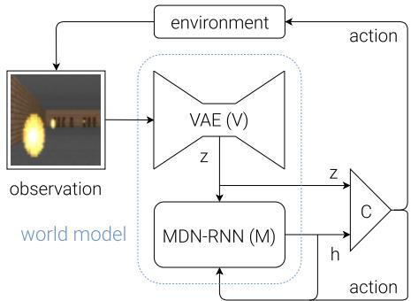  

图 8. 我们的 Agent 模型（Agent model）的流程图。原始观测在每个时间步 $t$ 首先由 V 处理，以生成 $z _ { t }$。C 的输入是该潜在向量 $z _ { t }$ 与 $\mathbf { M } \mathbf { \hat { s } }$ 隐藏状态 $h _ { t }$ 在每个时间步的拼接。随后 C 输出用于运动控制（motor control）的动作向量 $a _ { t }$，并作用于环境。M 接着将当前的 $z _ { t }$ 和动作 $a _ { t }$ 作为输入，更新其自身的隐藏状态以生成 $h _ { t + 1 }$，供时间步 $t + 1$ 使用。

以下是我们的智能体模型在 OpenAI Gym（Brockman et al., 2016）环境中的使用方式的伪代码：

```python
def rollout(controller):
    ''' env, rnn, vae are '''
    ''' global variables '''
    obs = env.reset()
    h = rnn.initial_state()
    done = False
    cumulative_reward = 0
    while not done:
    z = vae.encode(obs)
    a = controller.action([z, h])
    obs, reward, done = env.step(a)
    cumulative_reward += reward
    h = rnn.forward([a, z, h])
    return cumulative_reward
```

在给定的控制器 C 上运行此函数，将返回一次推演过程中的累积奖励。

这种对 C 的极简设计还带来了重要的实践优势。深度学习的进步为我们提供了高效训练大型、精密模型的工具，前提是我们能定义一个行为良好的、可微的损失函数。我们的 V 模型和 M 模型被设计为可以使用反向传播算法在现代 GPU 加速器上进行高效训练，因此我们希望模型的大部分复杂度和模型参数都集中在 V 和 M 中。相比之下，线性模型 C 的参数量极少。这一选择使我们能够探索更为非常规的方式来训练 C——例如，甚至可以使用进化策略（Evolution Strategies, ES）（Rechenberg, 1973; Schwefel, 1977）来处理那些信用分配问题更为棘手的 RL 任务。

为了优化 C 的参数，我们选择了协方差矩阵自适应进化策略（Covariance-Matrix Adaptation Evolution Strategy, CMA-ES）（Hansen, 2016; Hansen & Ostermeier, 2001）作为我们的优化算法，因为它在最多几千个参数的解空间上表现良好。我们在单台机器上对 C 的参数进行进化，机器的多核 CPU 并行运行多次环境推演。

关于实验中使用的模型、训练过程和环境的更具体信息，请参阅附录部分。

## 3. 赛车实验

在本节中，我们描述如何训练前面提到的 Agent 模型来解决赛车任务。据我们所知，我们的智能体是已知的首个在该任务上达到要求分数的解决方案。<sup>2</sup>

## 3.1. 用于特征提取的世界模型

预测式世界模型可以帮助我们提取空间和时间的有用表示。通过将这些特征作为控制器的输入，我们可以训练一个紧凑且极简的控制器来执行连续控制任务，例如从像素输入中学习驾驶，用于一个名为 CarRacing-v0（Klimov, 2016）的俯视角赛车环境。

  

图 9. 我们的智能体在 CarRacing-v0 中学习导航。

在该环境中，每次试验的赛道都是随机生成的，我们的智能体（agent）依据在尽可能短的时间内访问尽可能多的地块（tile）来获得奖励。智能体控制三个连续动作：左/右转向、加速和刹车。

为了训练我们的 V 模型，我们首先收集了环境中 10,000 次随机展开（rollout）的数据集。我们先让一个智能体随机行动以多次探索环境，并记录所采取的随机动作 $a _ { t }$ 以及来自环境的观测结果。我们利用该数据集训练 V，以学习每帧观测的潜在空间。我们训练 VAE，将每帧编码为低维潜在向量 z，方法是最小化给定帧与解码器从 z 重建出的帧之间的差异。

现在我们可以使用已训练的 V 模型，将时刻 t 的每帧预处理为 $z _ { t }$，用以训练我们的 M 模型。利用这些预处理后的数据以及所记录的随机动作 $a _ { t }$，我们的 MDN-RNN 现在可以训练为以高斯混合的形式建模 $P ( z _ { t + 1 } \mid a _ { t } , z _ { t } , h _ { t } )$。<sup>3</sup>

并取得平庸的分数，CarRacing-v0 将"解决"定义为在连续 100 次试验中获得平均奖励 900，这意味着智能体只能承受极少的驾驶失误。

<sup>3</sup>原则上，我们可以以端到端的方式同时训练两个模型，尽管我们发现将二者分开训练更为切实可行，并且也能取得令人满意的结果。每个模型的训练在单块 GPU 上所需的计算时间均不到一小时。我们还可以分别训练 VAE 与 MDN-RNN 模型，而无需详尽地调参。

<sup>2</sup>我们觉得这一任务饶有趣味，因为虽然在随机生成的赛道上训练智能体摇摇晃晃地行驶并不困难，

在该实验中，世界模型（World Model，由 V 与 M 组成）并不知晓来自环境的实际奖励信号。它的任务仅仅是压缩并预测所观测到的图像帧序列。只有控制器（Controller, C）模型能够访问来自环境的奖励信息。由于线性控制器模型内部仅有区区 867 个参数，像 CMA-ES 这样的进化算法非常适合完成这一优化任务。

我们可以利用 VAE，在每个时刻使用 $z _ { t }$ 重建每帧，以可视化智能体在一次展开过程中实际所"看到"信息的质量。下图所示为在 CarRacing-v0 的截屏上训练得到的 VAE 模型。

  

图 10. 尽管在有损压缩过程中丢失了一些细节，但隐向量 z 仍捕捉到了每帧图像的精髓。

在本文的在线版本中，用户可以加载随机选取的截图，将其编码为一个小的潜在向量 $z$ ，该向量用于重建原始截图。用户还可以通过滑块调整 $z$ 向量的取值，以观察其对重建效果的影响，或者随机化 $z$ 来观察可能的截图空间。

## 3.2. 流程（Procedure）

总结 Car Racing 实验，所采取的步骤如下：

5. 使用 CMA-ES 求解使期望累积奖励最大化的 $W _ { c }$ 和 $b _ { c }$。

<table><tr><td>MODEL</td><td>PARAMETER COUNT</td></tr><tr><td>VAE</td><td>4,348,547</td></tr><tr><td>MDN-RNN</td><td>422,368</td></tr><tr><td>CONTROLLER</td><td>867</td></tr></table>

## 3.3. 实验结果

## 仅 V 模型

如果我们拥有对观察的良好表示，那么训练一个智能体去驾驶并不是一项困难的任务。先前的研究（Hnermann, 2017; Bling, 2015; Lau, 2016）已经表明，借助关于观察的一套精心手工设计的信息（例如激光雷达信息、角度、位置和速度），我们可以轻松地训练一个小型的前馈网络，让它接收这些手工设计的输入并输出令人满意的导航策略。出于这个原因，我们首先希望通过限制 C 仅能访问 V 而不能访问 M 来测试我们的智能体，因此我们将控制器定义为 $a _ { t } = W _ { c } \ : z _ { t } \ : + \ : b _ { c } .$

  

1. 从随机策略（random policy）中收集 10,000 次轨迹（rollouts）。
2. 训练 VAE（V）将帧编码为 $z \in \mathcal { R } ^ { 3 2 }$
3. 训练 MDN-RNN（M）对 $P ( z _ { t + 1 } \mid a _ { t } , z _ { t } , h _ { t } )$ 进行建模
4. 将控制器（Controller, C）定义为 $a _ { t } = W _ { c } \left[ z _ { t } \ h _ { t } \right] \ + \ b _ { c }$
图 11. 将控制器限制为只能看到 $z _ { t }$ 而无法看到 $h _ { t }$，会导致摇摆且不稳定的驾驶行为。

在这种设置下，智能体仍然能够在赛道上导航，但我们注意到它会出现左右摇摆，并且在较急的弯道上会偏离赛道。这个受限的智能体在 100 次随机试验中取得了 632 ± 251 的平均分，与 OpenAI Gym 排行榜上其他智能体的表现（Klimov, 2016）以及 A3C 等传统深度强化学习方法的表现（Khan & Elibol, 2016; Jang et al., 2017）相当。在 C 的策略网络中增加一个隐藏层可以将结果提升至 $7 8 8 \pm 1 4 1$，但仍不足以解决该环境。

## 完整世界模型（V 与 M）

我们的 V 模型所提供的表征 $z _ { t }$ 仅能捕捉某一时刻的信息，并不具备较强的预测能力。相比之下，M 模型只被训练去做一件事——预测 $z _ { t + 1 }$，并且把它做到极致。由于 M 对 $z _ { t + 1 }$ 的预测是由 RNN 在时刻 $t$ 的隐藏状态 $h _ { t }$ 生成的，因此该向量可以作为我们提供给智能体的一组优质学习特征的候选。将 $z _ { t }$ 与 $h _ { t }$ 相结合，能让控制器 C 同时获得对当前观测以及对未来预期的良好表征。

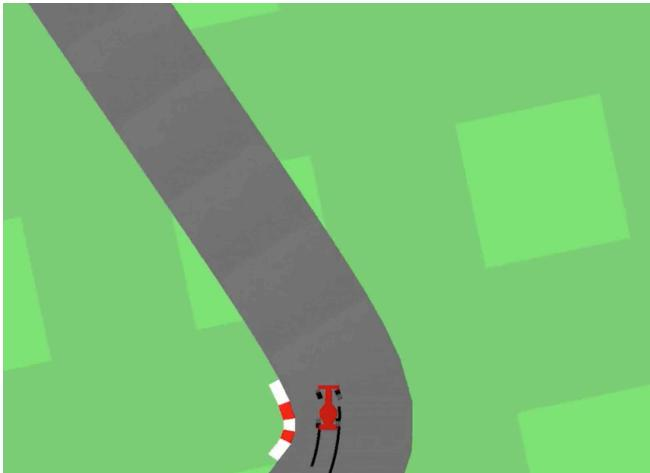  

图 12. 如果让我们的控制器同时访问 $z _ { t }$ 和 $h _ { t }$，驾驶会更加稳定。

我们发现，允许智能体同时访问 $z _ { t }$ 和 $h _ { t }$ 极大地提升了其驾驶能力。驾驶过程更加稳定，并且智能体似乎能够有效地攻入急弯。此外，我们观察到，在赛车过程中做出这些快速的反射式驾驶决策时，智能体无需提前规划，也无需展开未来的假设性情景。由于 $h _ { t }$ 包含了关于未来概率分布的信息，智能体可以本能地查询 RNN 来指导其动作决策。正如一位经验丰富的一级方程式（Formula One）车手或前文所讨论的棒球选手一样，智能体能够在千钧一发之际本能地预测何时以及朝何处行进。

<table><tr><td>METHOD</td><td>AVG. SCORE</td></tr><tr><td>DQN (PRIEUR, 2017)</td><td>343 ± 18</td></tr><tr><td>A3C (CONTINUOUS) (JANG ET AL., 2017)</td><td>591 ± 45</td></tr><tr><td>A3C (DISCRETE) (KHAN &amp; ELIBOL, 2016)</td><td>652 ± 10</td></tr><tr><td>CEOBILLIONAIRE (GYM LEADERBOARD)</td><td>838 ± 11</td></tr><tr><td>V MODEL</td><td>632 ± 251</td></tr><tr><td>V MODEL WITH HIDDEN LAYER</td><td>788 ± 141</td></tr><tr><td>FULL WORLD MODEL</td><td>906 ± 21</td></tr></table>

表 1. 使用各种方法获得的 CarRacing-v0 得分。

我们的智能体（agent）能够在 100 次随机试验中获得 $9 0 6 \pm 2 1$ 的分数，有效地解决了该任务并取得了新的最先进结果。先前使用深度强化学习方法（Deep RL methods）的尝试（Khan & Elibol, 2016; Jang et al., 2017）所获得的平均分数在 591–652 范围内，而排行榜上报告的最佳解决方案在 100 次随机试验中获得了 $8 3 8 \pm 1 1$ 的平均分数。传统的深度强化学习方法通常需要对每一帧进行预处理，例如采用边缘检测（edge detection）（Jang et al., 2017），并将最近的几帧堆叠（Khan & Elibol, 2016; Jang et al., 2017）作为输入。相比之下，我们的世界模型（world model）接收原始 RGB 像素图像流，并直接学习时空表示（spatial-temporal representation）。据我们所知，我们的方法是第一个报告的解决该任务的方法。

## 3.4. Car Racing 梦境

由于我们的世界模型能够对未来进行建模，我们也能够让其自行构想出假想的赛车场景。我们可以要求它在给定当前状态的情况下生成 $z _ { t + 1 }$ 的概率分布，采样一个 $z _ { t + 1 }$，并将该样本用作真实观测。我们可以将训练好的 C 重新放回由 M 生成的这种幻觉环境（hallucinated environment）中。本文在线版本的交互式演示中的下图展示了我们的世界模型如何用于对赛车环境进行幻觉化：

  

图 13. 我们的智能体在其梦境世界内部进行驾驶。在此，我们将训练好的策略部署到由 MDN-RNN 生成的虚拟环境中，并使用 VAE 的解码器进行渲染。在演示中，可以覆盖智能体的动作，也可以调整 τ 以控制由 M 所生成环境的不确定性。

## 4. VizDoom 实验

## 4.1. 在梦境中学习

我们刚刚看到，在真实环境中学习到的策略似乎在梦境环境中也能一定程度上起作用。这就引出了一个自然而然的问题——我们能否训练智能体在自己的梦境中进行学习，然后将这个策略迁移回真实环境？

如果我们的世界模型（world model）足够精确，并且对于当前问题足够完备，那么我们应该能够用这个世界模型替代真实环境。毕竟，我们的智能体并不直接观察现实，而只看到世界模型让它看到的东西。在本实验中，我们在由世界模型生成的幻觉中训练智能体，该世界模型被训练用于模拟 VizDoom（Kempka et al., 2016）环境。

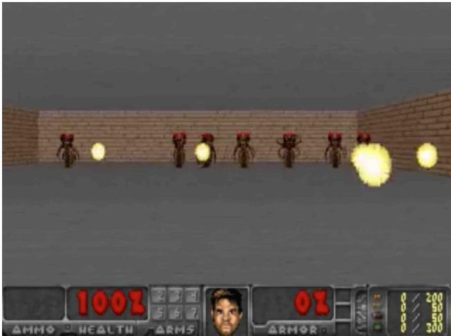  

图 14. 我们的最终智能体在 VizDoom: Take Cover 上的表现。

智能体必须学会躲避房间另一侧怪物发射的、唯一目的就是杀死智能体的火球。本环境中没有显式的奖励信号，因此为了模拟自然选择，可以将累积奖励定义为智能体在一轮推演（rollout）过程中存活的时间步数。环境的每一轮推演最多运行 2100 个时间步（约 60 秒），如果在连续 100 轮推演中的平均存活时间大于 750 个时间步（约 20 秒），则认为该任务已解决（Paquette, 2016）。

## 4.2. 流程

我们的 VizDoom 实验设置与 Car Racing 任务大体相同，仅存在若干关键差异。在 Car Racing 任务中，M 仅被训练用于建模下一时刻的 $z_{t}$。而由于我们希望构建一个可用于训练智能体的世界模型（world model），因此此处我们的 M 模型除了预测下一帧 $z_{t}$ 之外，还会预测智能体是否在下一帧死亡（作为一个二元事件 done，简记为 $d_{t}$）。

由于 M 模型除了预测下一观测之外，还能预测 done 状态，我们现在便已具备了构建完整强化学习环境所需的所有要素。我们首先通过在 M 之上包装一个 gym.Env 接口来构建一个 OpenAI Gym 环境接口，仿佛它就是一个真实的 Gym 环境，然后在这一虚拟环境中训练智能体，而非使用真实环境。

在该仿真过程中，我们无需 V 模型在幻觉（hallucination）过程中编码任何真实的像素帧，因此智能体将完全在一个潜空间（latent space）环境中进行训练。如我们将看到的，这带来了诸多优势。

该虚拟环境与真实环境具有完全一致的接口，因此在智能体于虚拟环境中习得令人满意的策略之后，我们可以轻松地将该策略部署回真实环境中，观察该策略的迁移效果。

总结而言，Take Cover 实验的步骤如下：

1. 使用随机策略收集 10,000 条推演数据。

2. 训练 VAE（V），将每一帧编码为一个潜向量 $z \in \mathcal{R}^{64}$，并使用 V 将从步骤 (1) 收集到的图像转换至潜空间表示。

3. 训练 MDN-RNN（M），以建模 $P(z_{t+1}, d_{t+1} \mid a_{t}, z_{t}, h_{t})$。

4. 将控制器（Controller, C）定义为 $a_{t} = W_{c} [z_{t}\ h_{t}]$

5. 使用 CMA-ES 求解 $W_{c}$，使其在虚拟环境中的期望存活时间最大化。

6. 将步骤 (5) 中学到的策略应用于真实环境中。

<table><tr><td>MODEL</td><td>PARAMETER COUNT</td></tr><tr><td>VAE</td><td>4,446,915</td></tr><tr><td>MDN-RNN</td><td>1,678,785</td></tr><tr><td>CONTROLLER</td><td>1,088</td></tr></table>

## 4.3. 在梦境中训练

经过一段时间的训练后，我们的控制器学会了在梦境环境中进行导航，并躲避由 M 所生成的怪物发射的致命火球。我们的智能体在虚拟环境中取得了约 ∼ 900 个时间步的得分。

  

图 15. 我们的智能体发现了一种策略来规避幻觉的（hallucinated）火球。在本文的在线版本中，读者可以与此演示中的环境进行交互。

在这里，我们的基于 RNN 的世界模型被训练来模仿人类程序员设计的完整游戏环境。通过仅从随机回合中收集的原始图像数据进行学习，它学会了如何模拟游戏的关键方面——例如游戏逻辑、敌人行为、物理效果，以及 3D 图形渲染。

例如，如果智能体选择向左的动作，M 模型会学会将智能体向左移动，并相应地调整其对游戏状态的内部表示。它还会学会在智能体试图向任一方向移动过远时，阻止其越过关卡两侧的墙壁。有时，M 模型需要追踪从若干怪物射出的多颗火球，并使其沿预期方向连贯地移动。它还必须检测智能体是否被这些火球之一杀死。

然而，与实际游戏环境不同，我们注意到可以在虚拟环境中加入额外的不确定性，从而使梦境环境中的游戏更具挑战性。我们可以通过在 z<sub>t+1</sub> 的采样过程中增大温度参数 τ 来实现这一点。通过增加不确定性，我们的梦境环境相比实际环境变得更加困难。与实际游戏相比，火球可能会以更不可预测的路径更加随机地移动。有时智能体甚至可能毫无缘由地因纯粹的厄运而死亡。

我们发现，在较高温度设置下表现良好的智能体通常在正常设置下也表现得更好。事实上，增大 τ 有助于防止我们的控制器利用世界模型的缺陷——我们将在后文更深入地讨论这一点。

## 4.4. 将策略迁移到实际环境

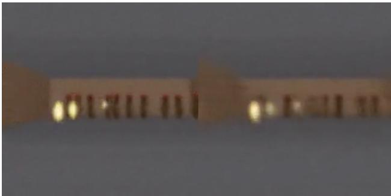  

图 16. 将我们在 Dream RNN 环境中学习到的策略部署回实际的 VizDoom 环境中。

我们将该智能体在虚拟环境中训练后，在原始 VizDoom 场景中对其性能进行了测试。在 100 次随机连续试验中的得分约为 1100 个时间步（time steps），远远超过了 750 个时间步的要求得分，同时也显著高于在难度更高的虚拟环境中所获得的得分。

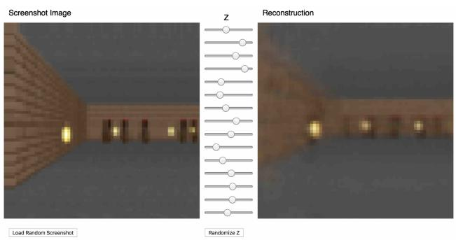  

图 17. 在线文章中 Doom 的交互式 VAE。

我们发现，尽管 V 模型（V model）无法正确捕捉每一帧的所有细节——例如无法准确还原怪物的数量——但智能体仍然能够使用所学到的策略在真实环境中进行导航。由于虚拟环境本身甚至无法准确追踪怪物的数量，因此能够在噪声更大、更不确定的虚拟噩梦环境中存活下来的智能体，在原始、更干净的环境中也会表现出色。

## 4.5. 欺骗世界模型

在我们的童年时期，可能曾遇到过以非原始游戏设计师本意的方式来"利用"电子游戏的方法（Wikipedia, 2017）。玩家会发现收集无限生命值或血量的方法，并利用这些漏洞轻而易举地通关原本困难的游戏。然而，在此过程中，他们可能已经失去了学习游戏设计师本意所需掌握的游戏技能的机会。

例如，在我们最初的实验中，我们注意到智能体发现了一种对抗性策略，使其能够以这样的方式四处移动，以至于在某些回合中，由 M 模型（M model）管控的虚拟环境中的怪物从未发射过一颗火球。即使出现火球即将形成的迹象，智能体也会以某种方式移动，仿佛拥有超能力一般神奇地"熄灭"火球。

由于我们的世界模型（world model）仅仅是环境的一个近似概率模型，它偶尔会生成不遵循真实环境运行规律的轨迹。正如我们之前所见，即使是房间另一侧怪物的数量，也无法被世界模型精确再现。就像一个学会了"空中物体通常会落到地面"的孩子一样，孩子也可能想象出能飞越天空的不切实际的超级英雄。因此，即使在真实环境中并不存在这样的漏洞，世界模型仍然会被控制器所利用。

而且，由于我们正在使用 M 模型为智能体生成虚拟梦境环境（virtual dream environment），我们也让控制器能够访问 M 的所有隐藏状态（hidden states）。这实质上等同于授予智能体访问游戏引擎（game engine）所有内部状态和内存的权限，而非仅限于玩家所能看到的游戏观测结果。因此，智能体可以高效地探索在最大化其期望累积奖励过程中直接操纵游戏引擎隐藏状态的方法。

这种在已学习到的动力学模型（learned dynamics model）内部学习策略的方法的弱点在于：我们的智能体可以轻易地找到一种能够欺骗我们动力学模型的对抗性策略——它将找到一种在我们的动力学模型下表现良好的策略，但在真实环境中却会失败，通常是因为它访问了那些远离训练分布、模型预测不准确的状态。

  

图 18. 在某些回合（rollouts）中，智能体发现了一种对抗性策略，能够在火球被发射后自动将其扑灭。

这种局限性可能是许多先前研究所面临的问题——它们虽然学习强化学习环境中的动力学模型，但实际上并未真正用这些模型去完全替代真实环境（Oh 等人, 2015; Chiappa 等人, 2017）。例如在（Schmidhuber, 1990a;b; 1991a）中提出的 M 模型里，动力学模型是确定性的（deterministic），因此如果模型不够完美，智能体就很容易对其进行利用。PILCO（Deisenroth & Rasmussen, 2011）中采用的贝叶斯模型在一定程度上借助不确定性估计缓解了这一问题，但仍未能彻底解决。最近的研究（Nagabandi 等人, 2017）将基于模型的方法与传统无模型强化学习训练相结合，先用学习到的策略初始化策略网络，之后仍需依赖无模型方法在真实环境中对该策略进行微调。

在《Learning to Think》（Schmidhuber, 2015a）中，循环神经网络 M 不总是可靠的预测器这一点是可以接受的。一个（可能基于进化方法的）循环神经网络 C 原则上可以学会忽略有缺陷的 M，或利用 M 中某些有用的部分来完成任意计算任务，包括层次化规划等。不过我们这里所做的并非如此——我们当前的方法其实更接近一些更早期的系统（Schmidhuber, 1990a;b; 1991a），在这些系统中，循环神经网络 M 被用于逐步预测和规划。然而与这些早期工作不同的是，我们采用进化方法来训练 C（正如《Learning to Think》中所做的那样），而不是将传统强化学习与循环神经网络相结合，这样做兼具简洁性与通用性。

为了让 C 模型更难利用 M 模型的缺陷，我们选择使用 MDN-RNN 作为动力学模型，它对真实环境中可能的结果分布进行建模，而不是仅仅预测一个确定性的未来。即便真实环境是确定性的，MDN-RNN 实际上也会将其近似为一个随机环境。这样的好处在于我们可以在任意环境的一个更具随机性的版本中训练 C 模型——只需调节温度参数 τ 即可控制 M 模型中随机性的量，从而在真实性和可利用性之间进行权衡。

考虑到由 VAE 编码的潜空间只是单个对角高斯分布，使用高斯混合模型似乎有些杀鸡用牛刀。然而，对于具有离散随机事件的环境（例如某个怪物决定发射火球还是原地不动）而言，混合密度模型中的离散模态非常有用。虽然单个对角高斯可能足以编码单帧画面，但带有混合密度输出层的循环神经网络能够更轻松地刻画包含离散随机状态的更为复杂的环境背后的逻辑。

例如，若将温度参数设为很低的 $\tau = 0.1$，本质上就是用一个几乎等同于确定性 LSTM 的 M 模型来训练 C 模型，那么在这个梦境环境中，无论智能体采取何种行动，由于模式坍缩（mode collapse），怪物都无法喷出火球。M 模型无法跳跃到混合高斯模型（mixture of Gaussian model）中火球生成与发射所对应的另一个模式。无论智能体在此梦境中学习到何种策略，多数时候都能在游戏中获得 2100 的完美分数，但当其被释放到真实世界的严酷环境中时必然会失败，表现甚至不如随机策略。

然而需要再次指出的是，在 Learning to Think 中，一种更简单也更稳健的方案并不坚持使用 M 进行逐步规划（step by step planning）。C 可以学习将 M 的子程序（即 M 权重矩阵的若干部分）用于任意计算目的，同时也可以在 M 无用且忽略 M 能带来更好性能时学会忽略 M。尽管如此，至少在当前这一 C–M 变体中，M 的预测对于教导 C 而言是不可或缺的——这更接近某些早期 C–M 系统（Schmidhuber, 1990a;b; 1991a）的做法，只是结合了进化算法或黑箱优化。

通过将温度 $\tau$ 作为 M 模型的一个可调参数，我们可以观察在不同不确定性水平的虚拟（幻觉）环境中训练 C 模型的效果，并考察这些效果向真实环境的迁移程度。我们对虚拟环境的温度进行了变化实验：在给定的温度下于虚拟环境中训练智能体，然后在真实环境中执行 100 次随机展开（rollout），观察其平均得分：

<table><tr><td>TEMPERATURE  $\tau$ </td><td>VIRTUAL SCORE</td><td>ACTUAL SCORE</td></tr><tr><td>0.10</td><td> $2086 \pm 140$ </td><td> $193 \pm 58$ </td></tr><tr><td>0.50</td><td> $2060 \pm 277$ </td><td> $196 \pm 50$ </td></tr><tr><td>1.00</td><td> $1145 \pm 690$ </td><td> $868 \pm 511$ </td></tr><tr><td>1.15</td><td> $918 \pm 546$ </td><td> $1092 \pm 556$ </td></tr><tr><td>1.30</td><td> $732 \pm 269$ </td><td> $753 \pm 139$ </td></tr><tr><td>RANDOM POLICY</td><td>N/A</td><td> $210 \pm 108$ </td></tr><tr><td>GYM LEADER</td><td>N/A</td><td> $820 \pm 58$ </td></tr></table>

Table 2. Take Cover（掩护）任务在不同温度设置下的得分。

我们观察到，虽然提高 M 模型（the M model）的温度会让 C 模型（the C model）更难找到对抗策略，但如果温度提得过高，又会让虚拟环境变得过于困难，以至于智能体什么也学不到，因此在实际中温度是一个可以调节的超参数。温度还会影响智能体所发现策略的类型。例如，尽管在 $\tau = 1 . 1 5$ 时取得的最佳得分为 $1 0 9 2 \pm$ 556，但将 τ 调高一档到 1.30 会使得分略有下降，不过相应的策略风险更低、回报的方差也更小。作为参照，OpenAI Gym 排行榜（Paquette, 2016）上的最佳得分为 $8 2 0 \pm 5 8$。

## 5. 迭代训练过程

在我们的实验中，任务相对简单，因此可以使用从随机策略采集的数据集训练出一个合理的世界模型。但假如我们的环境变得更加复杂，情况又会怎样呢？在任何困难的环境中，世界中只有一部分内容会在智能体学会如何策略性地在其中穿行之后，才对其变得可用。

对于更复杂的任务，需要一种迭代训练过程。我们需要让智能体能够探索其世界，并持续收集新的观测，从而使其世界模型能够随时间不断改进和精炼。一种迭代训练过程（Schmidhuber, 2015a）如下：

1. 用随机模型参数初始化 M 和 C。

2. 向真实环境回放 N 次。在回放过程中，将所有动作 $a _ { t }$ 和观测 $x _ { t }$ 保存到存储器中。

3. 训练 M 以建模 $P ( x _ { t + 1 } , r _ { t + 1 } , a _ { t + 1 } , d _ { t + 1 } \vert x _ { t } , a _ { t } , h _ { t } )$，并训练 C 以优化 M 内部的期望回报。

4. 若任务尚未完成，则回到第 (2) 步。

我们已经证明，这一训练循环的一次迭代足以求解简单的任务。对于更困难的任务，我们需要第 2 步中的控制器主动探索环境中那些有助于改进其世界模型的部分。一个令人兴奋的研究方向是探索如何在智能体中引入人工好奇心（artificial curiosity）和内在动机（intrinsic motivation）（Schmidhuber, 2010; 2006; 1991b; Pathak et al., 2017; Oudeyer et al., 2007）以及信息寻求（information seeking）（Schmidhuber et al., 1994; Gottlieb et al., 2013）能力，以鼓励新颖探索（novel exploration）（Lehman & Stanley, 2011）。具体而言，我们可以基于压缩质量的提升来增强奖励函数（Schmidhuber, 2010; 2006; 1991b; 2015a）。

在当前方法中，由于 M 是一个 MDN-RNN，它对下一帧的概率分布进行建模，如果其预测效果较差，则意味着智能体遭遇了不熟悉的环境部分。因此，我们可以改造并复用 M 的训练损失函数，以激发好奇心。通过在实际环境中将 M 损失函数的符号翻转，智能体将被鼓励去探索其不熟悉的世界部分。其新收集的数据可能有助于改进世界模型。

迭代训练过程要求 M 模型不仅要预测下一观测 x 和 done，还要预测下一时间步的动作和奖励。这对于更困难的任务可能是必需的。例如，如果智能体需要学习复杂的运动技能以在环境中行走，世界模型将学会模仿其自身的 C 模型，因为 C 模型已经学会了行走。在像行走这样的复杂运动技能被吸收进一个容量更大的世界模型之后，更小的 C 模型可以依赖世界模型已吸收的运动技能，转而专注于学习更高层级的技能，以利用其已习得的运动技能来导航自身。

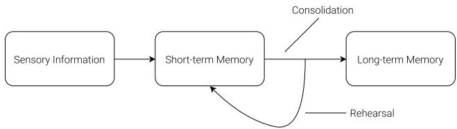  

图 19. 信息如何成为记忆（How information becomes memory）。

与神经科学文献之间存在一个有趣的联系，即关于海马回放（hippocampal replay）的研究，探讨了当动物休息或睡眠时大脑如何回放最近的经历。回放最近的经历在记忆巩固中起着重要作用（(Foster, 2017)）——即海马依赖性记忆在经过一段时间后变得不再依赖于海马。正如 (Foster, 2017) 所言，回放更像思考，而不太像做梦。我们邀请读者阅读《Replay Comes of Age》(Foster, 2017)，以从神经科学的角度详细了解回放，并了解其与理论强化学习的联系。

迭代训练可以使 C–M 模型发展出一种自然的层次化学习方式。关于强化学习中自我对弈（self-play）的近期研究（Sukhbaatar et al., 2017; Bansal et al., 2017; Al-Shedivat et al., 2017）以及 PowerPlay（Schmidhuber, 2013; Srivastava et al., 2012）也探讨了通向自然课程学习（curriculum learning）(Schmidhuber, 2002) 的方法，我们认为这是强化学习中较为令人兴奋的研究领域之一。

## 6. 相关工作

关于学习动力学模型并使用该模型来训练策略的文献非常丰富。许多概念最早在 1980 年代针对前馈神经网络（FNNs）（Werbos, 1987; Munro, 1987; Robinson & Fallside, 1989; Werbos, 1989; Nguyen & Widrow, 1989）进行了探索，并在 1990 年代针对循环神经网络（RNNs）（Schmidhuber, 1990a;b; 1991a; 1990c）进行了探索，这些工作为《Learning to Think》(Schmidhuber, 2015a) 奠定了一些基础。更为近期的工作 PILCO（Deisenroth & Rasmussen, 2011; Duvenaud, 2016; McAllister & Rasmussen, 2016）是一种基于概率模型的搜索策略方法，旨在解决困难的控制问题。PILCO 使用从环境中收集的数据，通过高斯过程（GP）模型来学习系统动力学，然后利用该模型采样大量轨迹，以训练控制器完成期望的任务，例如摆动单摆或骑行独轮车。

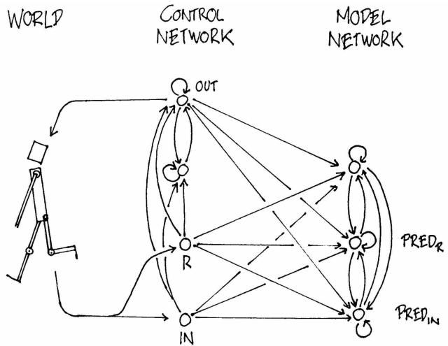  

图 20. 带有内部 RNN 世界模型的控制器（Schmidhuber, 1990a）。

虽然高斯过程（Gaussian processes）在处理小规模低维数据时表现良好，但其计算复杂性使其难以扩展，以对大量高维观测数据进行建模。其他近期工作（Gal 等人，2016；Depeweg 等人，2016）使用贝叶斯神经网络（Bayesian neural networks）代替高斯过程（GPs）来学习动力学模型。这些方法在具有挑战性的控制任务（Hein 等人，2017）上取得了令人瞩目的成果，这类任务中状态是已知且定义明确的，观测维度也相对较低。

在本文中，我们关注的是对从高维视觉数据中观察到的动力学进行建模，其输入为原始像素帧的序列。

在机器人控制应用中，仅通过观察基于摄像头的视频输入来学习系统动力学是一项困难但重要的问题。关于主动视觉强化学习的早期研究训练了一个前馈神经网络（FNN），以接收视频序列的当前图像帧来预测下一帧（Schmidhuber & Huber，1991），并利用该预测模型来训练一个注视点转移（fovea-shifting）控制网络，以在视觉场景中寻找目标。为了克服直接对高维像素图像训练动力学模型的困难，研究者们探索了使用神经网络首先学习视频帧的压缩表示。沿着这一思路的近期工作（Wahlström 等人，2014；2015）能够利用自编码器的瓶颈隐藏层作为低维特征向量，从像素输入控制一个倒立摆。在压缩的潜在空间中学习动力学模型能够使强化学习算法在数据效率上大幅提升（Finn 等人，2015；Watter 等人，2015；Finn，2017）。我们推荐读者观看 Finn 关于基于模型的强化学习的讲座（Finn，2017）以了解更多内容。

视频游戏环境也是基于模型的强化学习研究中流行的测试平台，用于验证新想法。（Matthew Guzdial，2017）使用前馈卷积神经网络（CNN）来学习视频游戏的前向仿真模型。学习预测不同动作如何影响环境中的未来状态对于游戏智能体非常有用，因为如果智能体能够根据当前状态和动作预测未来会发生什么，它就可以简单地选择最符合其目标的动作。这一点不仅在早期工作（Nguyen & Widrow，1989；Schmidhuber & Huber，1991）（当时计算成本比今天高出一百万倍）中得到证实，也在关于多个竞争性 VizDoom 环境的近期研究（Dosovitskiy & Koltun，2016）中得到了展示。

上述工作使用前馈神经网络（FNN）来预测下一帧视频帧。我们可能希望使用能够捕捉更长时时间依赖关系的模型。循环神经网络（RNN）是适用于序列建模的强大模型（Graves, 2013）。在一场名为《使用循环神经网络进行幻觉生成》（Hallucination with RNNs）的讲座中（Graves, 2015），Graves 展示了 RNN 学习雅达利（Atari）游戏环境概率模型的能力。他训练 RNN 学习此类游戏的结构，然后展示了它们能够自行"幻觉"生成相似的游戏关卡。

早在 1990 年，一篇名为《使世界可微分》（Making the World Differentiable）的论文（Schmidhuber, 1990a）就探索了使用 RNN 构建内部模型以推理未来，此后在（Schmidhuber, 1990b; 1991a; 1990c）中得到进一步探索。一篇较新的论文《学习思考》（Learning to Think）（Schmidhuber, 2015a）提出了一个统一框架，用于构建基于 RNN 的通用问题求解器，该求解器能够学习其环境的世界模型，并学会利用该模型对未来的进行推理。后续工作已使用基于 RNN 的模型来生成未来许多帧的图像（Chiappa et al., 2017; Oh et al., 2015; Denton & Birodkar, 2017），同时也将其作为推理未来的内部模型（Silver et al., 2016; Weber et al., 2017; Watters et al., 2017）。

在本工作中，我们使用进化策略（Evolution Strategies, ES）来训练控制器，因为它提供了诸多优势。例如，我们只需向优化器提供最终的累积奖励，而无需提供整个历史过程。ES 也易于并行化——我们可以将许多带有不同解的轨迹回放实例分派给众多工作节点，并快速并行地计算一组累积奖励。最近的研究工作（Fernando et al., 2017; Salimans et al., 2017; Ha, 2017b; Stanley & Clune, 2017）已证实，在许多强基线上，ES 是传统深度强化学习方法的可行替代方案。

在深度强化学习方法流行之前（Mnih et al., 2013），基于进化的算法已被证明在解决强化学习任务上是有效的（Stanley & Miikkulainen, 2002; Gomez et al., 2008; Gomez & Schmidhuber, 2005; Gauci & Stanley, 2010; Sehnke et al., 2010; Miikkulainen, 2013）。基于进化的算法甚至能够从高维像素输入中解决困难的强化学习任务（Koutnik et al., 2013; Hausknecht et al., 2013; Parker & Bryant, 2012）。最近的工作（Alvernaz & Togelius, 2017）将 VAE 与 ES 相结合，这与我们的方法类似。

## 7. 讨论

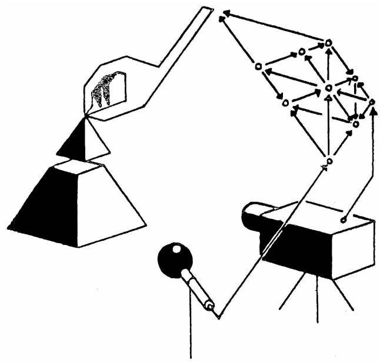  

图 21. 1990 年关于基于循环神经网络（RNN）的控制器与环境交互的古老示意图（Schmidhuber, 1990a）。

我们已经证明了训练一个智能体完全在其模拟的潜空间梦境世界中执行任务的可能性。这种方法带来了许多实际的好处。例如，运行计算密集型的游戏引擎需要消耗大量算力来将游戏状态渲染成图像帧，或计算与游戏不直接相关的物理过程。我们可能不想浪费算力在真实环境中训练智能体，而是希望在它的模拟环境中任意次地训练智能体。在真实世界中训练智能体的成本更高，因此以增量方式训练以模拟现实的世界模型，可能有助于将策略迁移回真实世界。我们的方法可以补充 Bousmalis 等人（2017）和 Higgins 等人（2017）所提出的 sim2real 方法。

此外，我们可以利用深度学习框架的优势，在分布式环境中使用 GPU 加速世界模型的仿真。将世界模型实现为一个完全可微的循环计算图，还意味着我们可以直接在梦境中利用反向传播算法训练智能体，以微调其策略来最大化目标函数（Schmidhuber, 1990a;b; 1991a）。

选用 VAE 作为 V 模型并将其作为独立模型进行训练，这种做法也存在局限性，因为它可能会编码出与任务无关的观测部分。毕竟，按照定义，无监督学习无法知道什么对当前任务有用。例如，它在 Doom 环境中重建了无关紧要的侧面墙壁砖块图案的细节，但在 Car Racing 环境中却未能重建与任务相关的路面纹理。通过与一个能预测奖励的 M 模型一起训练，VAE 也许能学会聚焦于图像中的任务相关区域，但这里的权衡在于，如果不重新训练，我们可能无法将 VAE 有效地复用到新任务上。

学习任务相关特征也与神经科学存在关联。当接收到奖励时，初级感觉神经元会从抑制状态中释放出来，这表明它们通常学习的是任务相关特征，而非任意特征，至少在成年期是如此（Pi et al., 2013）。

另一个关注点在于我们世界模型的有限容量。虽然现代存储设备能够容纳大量通过迭代训练程序生成的历史数据，但我们的基于 LSTM（Hochreiter & Schmidhuber, 1997; Gers et al., 2000）的世界模型可能无法将所有记录的信息都存储在其权重连接之中。虽然人脑能够在一定分辨率下保存数十年乃至数世纪的记忆（Bartol et al., 2015），但我们用反向传播训练的神经网络容量更为有限，并且会遭受诸如灾难性遗忘（catastrophic forgetting）（Ratcliff, 1990; French, 1994; Kirkpatrick et al., 2016）等问题。未来的工作可以探索将小型 MDN-RNN 网络替换为更高容量的模型（Shazeer et al., 2017; Ha et al., 2016; Suarez, 2017; van den Oord et al., 2016; Vaswani et al., 2017），或者引入外部记忆模块（external memory module）（Gemici et al., 2017），从而使我们的智能体能够学习探索更为复杂的世界。

与早期基于 RNN 的 C–M 系统（Schmidhuber, 1990a;b; 1991a; 1990c）类似，我们的系统按时间步逐步模拟可能的未来，无法从类人式的分层规划或抽象推理中获益，而后者往往会忽略不相关的时空细节。然而，更为通用的「学习思考（Learning To Think）」（Schmidhuber, 2015a）方法并不局限于这种相当朴素的方式。它允许一个循环式控制器 C 学会调用循环式世界模型 M 的子例程，并以任意可计算的方式重用它们进行问题求解，例如通过分层规划或其他利用 M 类程序式权重矩阵部分的方式。最近的「一个大网络（One Big Net）」（Schmidhuber, 2018）对 C–M 方法的扩展将 C 与 M 合并为一个单一网络，并使用「类 PowerPlay 行为回放（PowerPlay-like behavioural replay）」（Schmidhuber, 2013; Srivastava et al., 2012）——即把教师网络的行为压缩进学生网络（Schmidhuber, 1992）——以避免在学习新技能时遗忘旧的预测与控制技能。这些更为通用方法的实验留待未来的工作开展。

## 致谢

我们要感谢 Blake Richards、Kai Arulkumaran、Ankur Handa、Kory Mathewson、Kyle McDonald、Denny Britz、Elwin Ha 和 Natasha Jaques 对本文所提供的深思熟虑的反馈，以及他们从各自专业领域贡献的宝贵视角与深刻洞见。

本文的交互式在线版本使用了 distill.pub 的网络技术构建。我们要感谢 Chris Olah 以及 Distill 编辑团队其余成员所提供的宝贵反馈与慷慨的编辑支持，此外还要感谢他们支持我们使用其 Distill 技术。

worldmodels.github.io 上的交互式演示都是使用 p5.js 构建的。所有这些机器学习模型能够在网页浏览器中部署，归功于 deeplearn.js —— 一个由 Google 旗下 People+AI Research Initiative（PAIR）团队开发的硬件加速机器学习框架。特别感谢 Nikhil Thorat 和 Daniel Smilkov 在开发过程中提供的帮助。

我们还想向 Alex Graves、Douglas Eck、Mike Schuster、Rajat Monga、Vincent Vanhoucke、Jeff Dean 以及 Google Brain 团队表示感谢，感谢他们提供的宝贵反馈以及鼓励我们探索这一研究方向。实验在由 Google Cloud Platform 提供的 Ubuntu 虚拟机上完成。文中的任何错误均由作者本人承担，不代表审稿人和同事的观点。

## A. 附录

在本节中，我们将更详细地描述本文工作中所使用的模型与训练方法。

## A.1. 变分自编码器（Variational Autoencoder）

  

图 22. ConvVAE（卷积变分自编码器）各层张量形状的说明。

我们训练了一个卷积变分自编码器（Convolutional Variational Autoencoder, ConvVAE）模型作为智能体（agent）的 V 模型。与普通的自编码器不同，对潜在向量 z 施加高斯先验也限制了压缩每一帧时所使用的信息容量，但这种高斯先验同时也使世界模型（world model）对由 M 模型生成的、不真实的 z 向量更加鲁棒。

由于环境可能以高维像素图像的形式给出观测值，我们首先将每张图像缩放至 64×64 像素，然后将该缩放后的图像用作 V 模型的观测输入。每个像素被存储为介于 0 到 1 之间的三个浮点数值，分别表示 RGB 三个颜色通道。ConvVAE 接收该 64×64×3 的输入张量，并将其数据通过 4 个卷积层编码为低维向量 µ 和 σ，每个向量的维度为 $N _ { z }$。潜在向量 z 从高斯先验 $N ( \mu , \sigma I )$ 中采样得到。在 Car Racing 任务中，$N _ { z }$ 为 32，而在 Doom 任务中，$N _ { z }$ 为 64。潜在向量 z 通过 4 个反卷积层用于解码并重建图像。

每个卷积层和反卷积层的步幅（stride）均为 2。图中各层以斜体形式标注为「激活函数类型-输出通道数×滤波器尺寸」。所有卷积层和反卷积层均使用 ReLU 激活函数，但输出层除外，因为我们需要输出值介于 0 到 1 之间。我们使用由随机策略收集的数据对该模型进行了 1 个 epoch 的训练，采用输入图像与重建图像之间的 $L ^ { 2 }$ 距离作为重建损失进行优化，此外还加入了 KL 损失。

## A.2. 循环神经网络

对于 M 模型，我们使用 LSTM（Hochreiter & Schmidhuber, 1997）循环神经网络，并将混合密度网络（Mixture Density Network, MDN）（Bishop, 1994）作为其输出层。我们使用该网络对下一时间步中下一个 z 的概率分布进行建模，将其表示为高斯混合分布（Mixture of Gaussian distribution）。该方法与 Graves（2013）中「无条件手写体生成」（Unconditional Handwriting Generation）部分以及 SketchRNN（Ha & Eck, 2017）的解码器部分非常相似。我们所用方法的唯一区别在于，我们没有对 $z$ 的各个元素之间的相关性参数进行建模，而是让 MDN-RNN 输出一个因子化高斯分布（factored Gaussian distribution）的对角协方差矩阵。

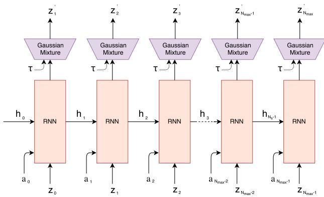  

图 23. 与 (Graves, 2013; Ha & Eck, 2017) 相似的 MDN-RNN 解码器

与手写体和草图生成工作不同，我们不使用 MDN-RNN 来建模下一笔画的概率密度函数（probability density function, pdf），而是对下一个潜向量 z 的概率密度函数进行建模。我们会在每个时间步从该概率密度函数中采样，以生成幻觉环境。在 Doom 任务中，我们还使用 MDN-RNN 来预测智能体是否在本帧中死亡的概率。如果该概率高于 50%，则我们在虚拟环境中将 done 设为 true。鉴于死亡在每个时间步都是低概率事件，我们发现与从伯努利分布（Bernoulli distribution）中采样相比，这种截断方法更加稳定。

MDN-RNN 在随机策略智能体收集的数据上训练了 20 个周期（epochs）。在 Car Racing 任务中，LSTM 使用了 256 个隐藏单元，而 Doom 任务使用了 512 个隐藏单元。在两个任务中，我们都使用了 5 个高斯混合分量，并且没有建模相关性参数 ρ，因此 z 是从因式分解的高斯混合分布中采样得到的。

在使用教师强制法（teacher forcing）从记录数据训练 MDN-RNN 时，我们为每一帧存储一组预先计算好的 μ 和 σ，并在每次构建训练批次时采样一个输入 $z \sim N(\mu, \sigma)$，以防止 MDN-RNN 对某一个特定采样得到的 z 产生过拟合。

## A.3. 控制器

对于这两个环境，我们都应用 tanh 非线性来将动作空间裁剪并限制在适当的范围内。例如，在 Car Racing 任务中，方向盘的范围为 -1 到 1，油门踏板为 0 到 1，刹车为 0 到 1。在 Doom 环境中，我们将离散动作转换为介于 -1 到 1 之间的连续动作空间，并将该范围三等分以表示智能体是向左移动、原地保持不动，还是向右移动。我们将一个由 z 和 MDN-RNN 隐藏状态组成的特征向量作为 C Model 的输入。在 Car Racing 任务中，这个隐藏状态是 LSTM 的输出向量 h，而对于 Doom 任务，则是 LSTM 的细胞向量 c 与输出向量 h。

## A.4. 演化策略

我们使用协方差矩阵自适应演化策略（Covariance-Matrix Adaptation Evolution Strategy, CMA-ES）（Hansen, 2016）来演化 C Model 的权重。遵循《演化稳定策略》（Evolving Stable Strategies）（Ha, 2017b）中描述的方法，我们使用了 64 的种群大小，并让每个智能体使用不同的初始随机种子执行任务 16 次。智能体的适应度值是 16 次随机推演（rollout）的平均累积奖励。下图描绘了每一代中 64 个智能体种群的最优个体、最差个体以及平均适应度：

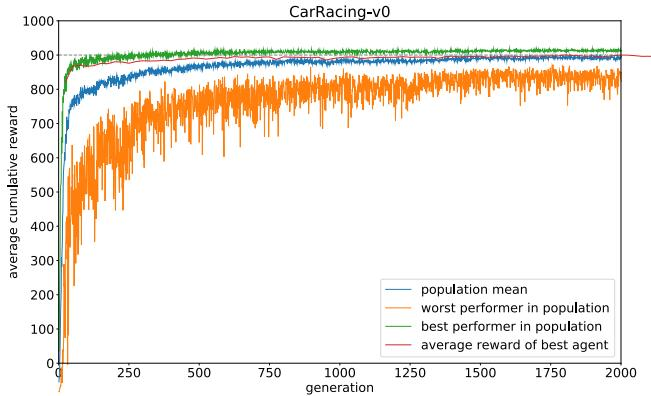  

图 24. CarRacing-v0 的训练过程

由于本环境要求智能体在 100 次随机测试中取得高于 900 的平均分收益（score），因此我们在每 25 代结束时选取当时表现最好的智能体，并在 1024 次随机测试场景中对其进行测试，将该平均值绘制成红线。经过 1800 代的演化后，最终有一个智能体在 1024 次随机测试中取得了 900.46 的平均分收益。我们之所以采用 1024 次随机测试而非 100 次，是因为这台 64 核机器的每个进程已被配置为并行运行 16 次，相当于每 25 代就消耗一整代算力来对最优智能体进行 1024 次评估。下图展示了同一智能体在 100 次随机测试中的评估结果：

  

图 25. 累积奖励的直方图。得分为 $906 \pm 21$

我们还实验了一个智能体，该智能体只能访问来自 VAE 的 z 向量，而无法看到 RNN 的隐藏状态。我们尝试了 2 种变体，在第一种变体中，C 模型将 z 直接映射到动作空间 a。在第二种变体中，我们尝试在 z 和 $^ { a , }$ 之间添加一个具有 40 个 tanh 激活的隐藏层，将 C 模型的参数数量增加到 1443，使其更接近原始设置。

  

图 26. 当智能体（agent）仅观察到 $z_t$ 时，得分为 $632 \pm 251$

  

图 27. 当智能体仅观测 $z _ { t }$ 并使用一个隐藏层时，得分为 788 ± 141。

## A.5. DoomRNN

我们在我们称之为 DoomRNN 的幻觉版 Doom 环境中进行了类似的实验。请注意，我们实际上并未尝试在真实的 VizDoom 环境中训练智能体，仅出于使用随机策略收集训练数据的目的使用过 VizDoom。与 VizDoom 相比，DoomRNN 在计算上更为高效，因为它仅在潜在空间中运行，无需在每个时间步渲染屏幕截图，也无需运行实际的 Doom 游戏引擎。

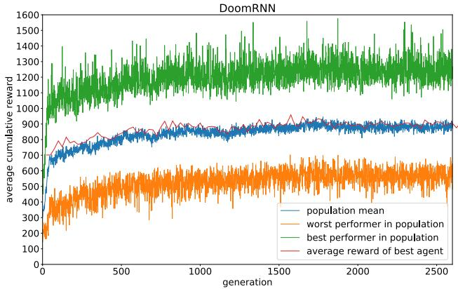  

图 28. DoomRNN 的训练。

在我们构建的虚拟 DoomRNN 环境中，我们略微提升了温度参数，并采用 $\tau = 1 . 1 5$ 以使智能体在更具挑战性的环境中进行学习。表现最佳的智能体在 1024 次随机 rollout 中取得了 959 的平均得分（即图中红色曲线的最高得分）。将该智能体部署到真实的 DoomTakeCover-v0 (Paquette, 2016) 环境中后，其在 100 次随机 rollout 中取得了 $1 0 9 2 \pm 5 5 6$ 的平均得分。

  

图 29. 在连续 100 次试验中，在实际 VizDoom 环境中存活时间步数的直方图。得分为 $1 0 9 2 \pm 5 5 6$

## 参考文献

Al-Shedivat, M., Bansal, T., Burda, Y., Sutskever, I., Mordatch, I., and Abbeel, P. 在非平稳和竞争环境中通过元学习实现持续自适应. ArXiv preprint, October 2017. URL https://arxiv.org/abs/1710.03641.

Alvernaz, S. and Togelius, J. 用于视觉《毁灭战士》（Doom）游戏的自编码器增强神经进化. ArXiv preprint, July 2017. URL https://arxiv.org/abs/1707.03902.

Arulkumaran, K., Deisenroth, M. P., Brundage, M., and Bharath, A. A. 深度强化学习：简要综述. IEEE Signal Processing Magazine, 34(6):26–38, Nov 2017. ISSN 1053-5888. doi: 10.1109/MSP.2017.2743240. URL https://arxiv.org/abs/1708.05866.

Bansal, T., Pachocki, J., Sidor, S., Sutskever, I., and Mordatch, I. 通过多智能体竞争产生的涌现复杂性. ArXiv preprint, October 2017. URL https://arxiv.org/abs/1710.03748.

Bartol, Thomas M, Jr, Bromer, Cailey, Kinney, Justin, Chirillo, Michael A, Bourne, Jennifer N, Harris, Kristen M, and Sejnowski, Terrence J. 基于纳米连接组学的突触可塑性变异性上界. eLife Sciences Publications, Ltd, 2015. doi: 10.7554/eLife.10778. URL https://doi.org/10.7554/eLife.10778.

Bishop, Christopher M. 混合密度网络. 技术报告, 1994. URL http://publications.aston.ac.uk/373/.

Bling, Seth. 马里奥卡丁车（Mar I/O Kart）, 2015. URL https://youtu.be/S9Y_I9vY8Qw.

Bousmalis, K., Irpan, A., Wohlhart, P., Bai, Y., Kelcey, M., Kalakrishnan, M., Downs, L., Ibarz, J., Pastor, P., Konolige, K., Levine, S., and Vanhoucke, V. 利用仿真和领域自适应提升深度机器人抓取效率. ArXiv e-prints, September 2017. URL https://arxiv.org/abs/1709.07857.

Brockman, G., Cheung, V., Pettersson, L., Schneider, J., Schulman, J., Tang, J., and Zaremba, W. OpenAI Gym：一个用于强化学习研究的工具包. ArXiv preprint, June 2016. URL https://arxiv.org/abs/1606.01540.

Cheang, L. and Tsao, D. 灵长类大脑中面部身份的编码. Cell, 2017. doi: 10.1016/j.cell.2017.05.011. URL http://www.cell.com/cell/fulltext/S0092-8674%2817%2930538-X.

Chiappa, S., Racaniere, S., Wierstra, D., and Mohamed, S. 循环环境模拟器. ArXiv preprint, April 2017. URL https://arxiv.org/abs/1704.02254.

Deisenroth, M. and Rasmussen, C. PILCO：一种基于模型且数据高效的策略搜索方法. 2011. URL http://mlg.eng.cam.ac.uk/pub/pdf/DeiRas11.pdf.

Denton, E. and Birodkar, V. 从视频中无监督学习解耦表示. ArXiv preprint, May 2017. URL https://arxiv.org/abs/1705.10915.

Depeweg, S., Hernandez-Lobato, J, Doshi-Velez, F., and Udluft, S. 使用贝叶斯神经网络在随机动力系统中进行学习与策略搜索. ArXiv preprint, May 2016. URL https://arxiv.org/abs/1605.07127.

Dosovitskiy, A. and Koltun, V. 通过预测未来学习行动. ArXiv preprint, November 2016. URL https://arxiv.org/abs/1611.01779.

Duvenaud, David. 多伦多大学 CSC 2541 课程关于 PILCO 的讲义, 2016. URL https://www.cs.toronto.edu/ duvenaud/ courses/csc2541/slides/pilco.pdf.

E, M. 关于 Scott McCloud《Understanding Comics》的更多思考, 2012. URL https://goo.gl/5Tndi4.

Fernando, C., Banarse, D., Blundell, C., Zwols, Y., Ha, D., Rusu, A., Pritzel, A., 和 Wierstra, D. Pathnet: 超神经网络中演化通道梯度下降. ArXiv 预印本, 2017 年 1 月. URL https://arxiv.org/ abs/1701.08734.

Finn, C., Tan, X., Duan, Y., Darrell, T., Levine, S., 和 Abbeel, P. 用于视觉运动学习的深度空间自编码器. ArXiv 预印本, 2015 年 9 月. URL https: //arxiv.org/abs/1509.06113.

Finn, Chelsea. 2017 年深度强化学习训练营关于基于模型的强化学习的讲座, 2017. URL https://youtu.be/ iC2a7M9voYU?t=44m35s.

Forrester, Jay Wright. 社会系统的反直觉行为, 1971. URL https://en.wikipedia. org/wiki/Mental\_model. [在线; 访问于 2017 年 11 月 1 日].

Foster, David J. 重放走向成熟. *Annual Review of Neuroscience*, 40(1):581–602, 2017. doi: 10.1146/annurev-neuro-072116-031538. URL https://doi.org/10.1146/ annurev-neuro-072116-031538.

French, Robert M. 连接主义网络中的灾难性干扰：能否预测，能否防止？ 收录于 Cowan, J. D., Tesauro, G., 和 Alspector, J. (编), *Advances in Neural Information Processing Systems 6*, 第 1176–1177 页. Morgan-Kaufmann, 1994. URL https://goo.gl/jwpLsk.

Gal, Y., McAllister, R., 和 Rasmussen, C. 使用贝叶斯神经网络动力学模型改进 PILCO. 2016 年 4 月. URL http://mlg.eng.cam.ac.uk/ yarin/PDFs/DeepPILCO.pdf.

Gauci, Jason 和 Stanley, Kenneth O. 人工神经网络中拓扑规则性的自主演化. *Neural Computation*, 22(7):1860–1898, 2010 年 7 月. ISSN 0899-7667. doi: 10.1162/neco.2010. 06-09-1042. URL http://eplex.cs.ucf.edu/ papers/gauci\_nc10.pdf.

Gemici, M., Hung, C., Santoro, A., Wayne, G., Mohamed, S., Rezende, D., Amos, D., 和 Lillicrap, T. 带记忆的生成式时间模型. ArXiv 预印本, 2017 年 2 月. URL https://arxiv.org/abs/1702. 04649.

Gerrit, M., Fischer, J., 和 Whitney, D. MT+ 区域中运动依赖的空间表征. *Neuron*, 2013. doi: 10.1016/j.neuron.2013.03.010. URL http://dx.doi. org/10.1016/j.neuron.2013.03.010.

Gers, F., Schmidhuber, J., 和 Cummins, F. 学习遗忘：使用 LSTM 的持续预测. *Neural Computation*, 12(10):2451–2471, 2000 年 10 月. ISSN 0899-7667. doi: 10.1162/089976600300015015. URL ftp://ftp. idsia.ch/pub/juergen/FgGates-NC.pdf.

Gomez, F. 和 Schmidhuber, J. 协同进化的循环神经元学习深度记忆 POMDP. *Proceedings of the 7th Annual Conference on Genetic and Evolutionary Computation*, 第 491–498 页, 2005. doi: 10.1145/ 1068009.1068092. URL ftp://ftp.idsia.ch/ pub/juergen/gecco05gomez.pdf.

Gomez, F., Schmidhuber, J., and Miikkulainen, R. 通过协作协同进化突触实现加速神经进化（Accelerated neural evolution through cooperatively coevolved synapses）. *Journal of Machine Learning Research*, 9: 937–965, June 2008. ISSN 1532-4435. URL http:// people.idsia.ch/<sub>˜</sub>juergen/gomez08a.pdf.

Gottlieb, J., Oudeyer, P., Lopes, M., and Baranes, A. 信息寻求、好奇心与注意力：计算与神经机制（Information-seeking, curiosity, and attention: computational and neural mechanisms）. *Cell*, September 2013. doi: 10.1016/j.tics.2013.09.001. URL http://www. pyoudeyer.com/TICSCuriosity2013.pdf.

Graves, Alex. 使用循环神经网络生成序列（Generating sequences with recurrent neural networks）. ArXiv preprint, 2013. URL https: //arxiv.org/abs/1308.0850.

Graves, Alex. 循环神经网络的"幻觉"（Hallucination with recurrent neural networks）, 2015. URL https://www.youtube.com/ watch?v=-yX1SYeDHbg&t=49m33s.

Ha, D. 面向艺术家的循环神经网络教程（Recurrent neural network tutorial for artists）. blog.otoro.net, 2017a. URL http://blog.otoro.net/2017/01/01/ recurrent-neural-network-artist/.

Ha, D. 进化稳定策略（Evolving stable strategies）. blog.otoro.net, 2017b. URL http://blog.otoro.net/2017/ 11/12/evolving-stable-strategies/.

Ha, D. and Eck, D. 素描的神经表征（A neural representation of sketch drawings）. ArXiv preprint, April 2017. URL https://magenta.tensorflow.org/ sketch-rnn-demo.

Ha, D., Dai, A., and Le, Q. 超网络（Hypernetworks）. ArXiv preprint, September 2016. URL https://arxiv.org/abs/ 1609.09106.

Hansen, N. CMA 进化策略教程（The cma evolution strategy: A tutorial）. ArXiv preprint, 2016. URL https://arxiv.org/abs/ 1604.00772.

Hansen, Nikolaus and Ostermeier, Andreas. 进化策略中完全去随机化的自适应（Completely derandomized self-adaptation in evolution strategies）. *Evolutionary Computation*, 9(2):159–195, June 2001. ISSN 1063-6560. doi: 10.1162/106365601750190398. URL http://www.cmap.polytechnique.fr/ nikolaus.hansen/cmaartic.pdf.

Hausknecht, M., Lehman, J., Miikkulainen, R., and Stone, P. 一种用于通用 Atari 游戏博弈的神经进化方法（A neuroevolution approach to general atari game playing）. *IEEE Transactions on Computational Intelligence and AI in Games*, 2013. URL http://www.cs.utexas. edu/<sub>˜</sub>ai-lab/?atari.

Hein, D., Depeweg, S., Tokic, M., Udluft, S., Hentschel, A., Runkler, T., and Sterzing, V. 一种受工业控制问题启发的基准环境（A benchmark environment motivated by industrial control problems）. ArXiv preprint, September 2017. URL https://arxiv.org/abs/ 1709.09480.

Higgins, I., Pal, A., Rusu, A., Matthey, L., Burgess, C., Pritzel, A., Botvinick, M., Blundell, C., and Lerchner, A. DARLA：提升强化学习中的零样本迁移能力（Darla: Improving zero-shot transfer in reinforcement learning）. ArXiv e-prints, July 2017. URL https:// arxiv.org/abs/1707.08475.

Hirshon, B. 追踪快速球（Tracking fastballs）, 2013. URL http: //sciencenetlinks.com/science-news/ science-updates/tracking-fastballs/.

Hochreiter, Sepp and Schmidhuber, Juergen. 长短期记忆网络（Long shortterm memory）. *Neural Computation*, 1997. URL ftp: //ftp.idsia.ch/pub/juergen/lstm.pdf.

Hnermann, Jan. 浏览器中的自动驾驶汽车（Self-driving cars in the browser）, 2017. URL http://janhuenermann.com/projects/ learning-to-drive.

Jang, S., Min, J., and Lee, C. 基于 A3C 的强化学习赛车（Reinforcement car racing with a3c）. 2017. URL https: //www.scribd.com/document/358019044/ Reinforcement-Car-Racing-with-A3C.

Kaelbling, L. P., Littman, M. L., and Moore, A. W. 强化学习：综述。Journal of AI Research，4：237–285，1996 年。

Keller, Georg B., Bonhoeffer, Tobias, and Hübener, Mark. 行为中小鼠初级视觉皮层中的感觉运动失配信号。Neuron，74(5)：809–815，2012 年。ISSN 0896-6273。doi：https://doi.org/10.1016/j.neuron.2012.03.040。URL http://www.sciencedirect.com/science/article/pii/S0896627312003844。

Kelley, H. J. 最优飞行路径的梯度理论。ARS Journal，30(10)：947–954，1960 年。

Kempka, Michael, Wydmuch, Marek, Runc, Grzegorz, Toczek, Jakub, and Jaśkowski, Wojciech. ViZDoom：基于 Doom 的人工智能研究平台，用于视觉强化学习。收录于：IEEE 计算智能与游戏会议（Santorini, Greece），第 341–348 页，2016 年 9 月。IEEE。URL http://arxiv.org/abs/1605.02097。最佳论文奖。

Khan, M. and Elibol, O. 使用强化学习进行赛车。2016 年。URL https://web.stanford.edu/class/cs221/2017/restricted/p-final/elibol/final.pdf。

Kingma, D. and Welling, M. 自编码变分贝叶斯。ArXiv 预印本，2013 年。URL https://arxiv.org/abs/1312.6114。

Kirkpatrick, J., Pascanu, R., Rabinowitz, N., Veness, J., Desjardins, G., Rusu, A. and Milan, K., Quan, J., Ramalho, T., Grabska-Barwinska, A., Hassabis, D., Clopath, C., Kumaran, D., and Hadsell, R. 克服神经网络中的灾难性遗忘。ArXiv 预印本，2016 年 12 月。URL https://arxiv.org/abs/1612.00796。

Kitaoka, Akiyoshi. Kitaoka 的错觉页面，2002 年。URL http://www.ritsumei.ac.jp/~akitaoka/index-e.html。

Klimov, Oleg. CarRacing-v0，2016 年。URL https://gym.openai.com/envs/CarRacing-v0/。

Koutnik, J., Cuccu, G., Schmidhuber, J., and Gomez, F. 针对基于视觉的强化学习演化大规模神经网络。第 15 届遗传与进化计算年会论文集，第 1061–1068 页，2013 年。doi：10.1145/2463372.2463509。URL http://people.idsia.ch/~juergen/compressednetworksearch.html。

Lau, Ben. 使用 Keras 和深度确定性策略梯度玩 TORCS，2016 年。URL https://yanpanlau.github.io/2016/10/11/Torcs-Keras.html。

Lehman, Joel and Stanley, Kenneth. 抛弃目标函数：仅通过搜索新颖性进行演化。Evolutionary Computation，19(2)：189–223，2011 年。ISSN 1063-6560。URL http://eplex.cs.ucf.edu/noveltysearch/userspage/。

Leinweber, Marcus, Ward, Daniel R., Sobczak, Jan M., Attinger, Alexander, and Keller, Georg B. 小鼠皮层中用于视觉光流预测的感觉运动回路。Neuron，95(6)：1420–1432.e5，2017 年。ISSN 0896-6273。doi：https://doi.org/10.1016/j.neuron.2017.08.036。URL http://www.sciencedirect.com/science/article/pii/S0896627317307791。

Linnainmaa, S. 一个算法的累积舍入误差作为局部舍入误差的泰勒展开表示。硕士学位论文，赫尔辛基大学，1970 年。

Matthew Guzdial, Boyang Li, Mark O. Riedl. 从视频中学习游戏引擎. 发表于：第二十六届国际人工智能联合大会（International Joint Conference on Artificial Intelligence, IJCAI-17）论文集，第3707–3713页，2017年. doi: 10.24963/ijcai.2017/518. URL https://doi.org/ 10.24963/ijcai.2017/518.

McAllister, R. and Rasmussen, C. 连续状态部分可观测马尔可夫决策过程中的数据高效强化学习. arXiv预印本，2016年2月. URL https://arxiv.org/abs/ 1602.02523.

McCloud, Scott. 理解漫画：看不见的艺术. Tundra出版社，1993年. URL https://en.wikipedia.org/wiki/ Understanding\_Comics.

Miikkulainen, R. 演化神经网络. 国际神经网络联合大会（International Joint Conference on Neural Networks, IJCNN），2013年8月. URL http://nn.cs.utexas.edu/ downloads/slides/miikkulainen.ijcnn13. pdf.

Mnih, V., Kavukcuoglu, K., Silver, D., Graves, A., Antonoglou, I., Wierstra, D., and Riedmiller, M. 使用深度强化学习玩雅达利游戏. arXiv预印本，2013年12月. URL https://arxiv.org/abs/ 1312.5602.

Mobbs, Dean, Hagan, Cindy C., Dalgleish, Tim, Silston, Brian, and Prvost, Charlotte. 人类恐惧的生态学：生存优化与神经系统. 2015年. URL https://www.frontiersin.org/ article/10.3389/fnins.2015.00055.

Munro, P. W. 标量强化学习的对偶反向传播方案. 发表于：第九届认知科学学会年会论文集，华盛顿州西雅图，第165–176页，1987年.

Nagabandi, A., Kahn, G., Fearing, R., and Levine, S. 基于模型的深度强化学习结合无模型微调的神经网络动力学. arXiv预印本，2017年8月. URL https://arxiv.org/abs/1708. 02596.

Nguyen, N. and Widrow, B. 卡车倒车控制器：神经网络自学习的实例. 发表于：国际神经网络联合大会论文集，第357–363页，IEEE出版社，1989年.

Nortmann, Nora, Rekauzke, Sascha, Onat, Selim, Knig, Peter, and Jancke, Dirk. 初级视觉皮层表征过去与现在的差异. Cerebral Cortex，25(6)：1427–1440，2015年. doi: 10.1093/cercor/ bht318. URL http://dx.doi.org/10.1093/ cercor/bht318.

Oh, J., Guo, X., Lee, H., Lewis, R., and Singh, S. 在雅达利游戏中使用深度网络进行动作条件视频预测. arXiv预印本，2015年7月. URL https:// arxiv.org/abs/1507.08750.

Oudeyer, P., Kaplan, F., and Hafner, V. 用于自主心智发展的内在动机系统. Trans. Evol. Comp，2007年4月. doi: 10.1109/TEVC.2006.890271. URL http://www.pyoudeyer.com/ims.pdf.

Paquette, Philip. Doomtakecover-v0，2016年. URL https://gym.openai.com/envs/ DoomTakeCover-v0/.

Parker, M. and Bryant, B. 雷神之锤II环境中的神经视觉控制. IEEE Transactions on Computational Intelligence and AI in Games，2012年. URL https://www.cse.unr.edu/<sub>˜</sub>bdbryant/ papers/parker-2012-tciaig.pdf.

Pathak, D., Agrawal, P., A., Efros, and Darrell, T. 通过自监督预测实现的好奇心驱动探索. arXiv预印本，2017年5月. URL https://pathak22. github.io/noreward-rl/.

Pi, H., Hangya, B., Kvitsiani, D., Sanders, J., Huang, Z., and Kepecs, A. 专门执行去抑制控制的皮层中间神经元. Nature, 2013年11月. doi: 10.1038/nature12676. URL http://dx.doi.org/10.1038/nature12676.

Prieur, Luc. 适用于 Box2D 赛车强化学习问题的深度 Q 学习., 2017. URL https://goo.gl/VpDqSw.

Quiroga, R., Reddy, L., Kreiman, G., Koch, C., and Fried, I. 人脑中由单个神经元产生的不变视觉表征. Nature, 2005. doi: 10.1038/nature03687. URL http://www.nature.com/nature/journal/v435/n7045/abs/nature03687.html.

Ratcliff, Rodney Mark. 识别记忆的联结主义模型：学习与遗忘函数所施加的约束. Psychological review, 97 2:285–308, 1990.

Rechenberg, I. 进化策略：依据生物进化原理对技术系统的优化. Frommann-Holzboog, 1973. URL https://en.wikipedia.org/wiki/Ingo_Rechenberg.

Rezende, D., Mohamed, S., and Wierstra, D. 深度生成模型中的随机反向传播与近似推断. ArXiv preprint, 2014. URL https://arxiv.org/abs/1401.4082.

Robinson, T. and Fallside, F. 动态强化驱动的误差传播网络及其在博弈中的应用. 发表于认知科学会议（CogSci）'89, 1989.

Salimans, T., Ho, J., Chen, X., Sidor, S., and Sutskever, I. 进化策略——强化学习的一种可扩展替代方案. ArXiv preprint, 2017. URL https://arxiv.org/abs/1703.03864.

Schmidhuber, J. 让世界可微分：论在非平稳环境中使用自监督全循环神经网络进行动态强化学习与规划. 1990a. URL http://people.idsia.ch/<sub>˜</sub>juergen/FKI-126-90\_(revised)bw\_ocr.pdf.

Schmidhuber, J. 一种用于反应式环境中动态强化学习与规划的在线算法. 1990年国际神经网络联合会议（IJCNN）论文集, 第253–258页 第2卷, 1990年6月. doi: 10.1109/IJCNN.1990.137723. URL ftp://ftp.idsia.ch/pub/juergen/ijcnn90.ps.gz.

Schmidhuber, J. 在建模式神经控制器中实现好奇与厌倦的一种可能性. 第一届"从动物到类动物"自适应行为仿真国际会议论文集, 第222–227页, 1990c. URL ftp://ftp.idsia.ch/pub/juergen/curiositysab.pdf.

Schmidhuber, J. 马尔可夫与非马尔可夫环境中的强化学习. 神经信息处理系统进展3, 第500–506页, 1991a. URL https://goo.gl/ij1uYQ.

Schmidhuber, J. 好奇的建模控制系统. 发表于新加坡国际神经网络联合会议论文集, 第1458–1463页, 1991b.

Schmidhuber, J. 基于历史压缩原理学习复杂扩展序列. Neural Computation, 4(2):234–242, 1992.（基于1991年慕尼黑工业大学技术报告 FKI-148-91）

Schmidhuber, J. 最优有序问题求解器. ArXiv preprint, 2002年7月. URL https://arxiv.org/abs/cs/0207097.

Schmidhuber, J. 发展机器人学、最优人工好奇心、创造性、音乐与美术（Developmental robotics, optimal artificial curiosity, creativity, music, and the fine arts）。*Connection Science*，18(2):173–187，2006。

Schmidhuber, J. 创造性、趣味与内在动机的形式化理论（1990-2010）（Formal theory of creativity, fun, and intrinsic motivation (1990-2010)）。*IEEE Trans. Autonomous Mental Development*，2010。网址 http://people.idsia.ch/~juergen/creativity.html。

Schmidhuber, J. Powerplay：通过持续搜索最简单仍未解决的问题来训练日益通用的问题求解器（Powerplay: Training an increasingly general problem solver by continually searching for the simplest still unsolvable problem）。*Frontiers in Psychology*，4:313，2013。ISSN 1664-1078。doi: 10.3389/fpsyg.2013.00313。网址 https://www.frontiersin.org/article/10.3389/fpsyg.2013.00313。

Schmidhuber, J. 论学习思考：用于强化学习控制器与循环神经世界模型新颖组合的算法信息论（On learning to think: Algorithmic information theory for novel combinations of reinforcement learning controllers and recurrent neural world models）。*ArXiv preprint*，2015a。网址 https://arxiv.org/abs/1511.09249。

Schmidhuber, J. 神经网络中的深度学习：综述（Deep learning in neural networks: An overview）。*Neural Networks*，61:85–117，2015b。doi: 10.1016/j.neunet.2014.09.003。2014年在线发表；基于技术报告 arXiv:1404.7828 [cs.NE]。

Schmidhuber, J. 一个用于一切的大网络（One big net for everything）。预印本 arXiv:1802.08864 [cs.AI]，2018年2月。网址 https://arxiv.org/abs/1802.08864。

Schmidhuber, J. 与 Huber, R. 学习生成用于目标检测的人工中央凹轨迹（Learning to generate artificial fovea trajectories for target detection）。*International Journal of Neural Systems*，2(1-2):125–134，1991。doi: 10.1142/S012906579100011X。网址 ftp://ftp.idsia.ch/pub/juergen/attention.pdf。

Schmidhuber, J., Storck, J., 与 Hochreiter, S. 非确定性环境中由强化驱动的信息获取（Reinforcement driven information acquisition in nondeterministic environments）。技术报告 FKI-94，TUM 计算机科学系，1994。

Schwefel, H. 计算机模型的数值优化（Numerical Optimization of Computer Models）。John Wiley and Sons, Inc.，纽约，纽约州，美国，1977。ISBN 0471099880。网址 https://en.wikipedia.org/wiki/Hans-Paul_Schwefel。

Sehnke, F., Osendorfer, C., Ruckstieb, T., Graves, A., Peters, J., 与 Schmidhuber, J. 参数探索策略梯度（Parameter-exploring policy gradients）。*Neural Networks*，23(4):551–559，2010。doi: 10.1016/j.neunet.2009.12.004。网址 http://citeseerx.ist.psu.edu/viewdoc/download;jsessionid=A64D1AE8313A364B814998E9E245B40A?doi=10.1.1.180.7104&rep=rep1&type=pdf。

Shazeer, N., Mirhoseini, A., Maziarz, K., Davis, A., Le, Q., Hinton, G., 与 Dean, J. 极大规模神经网络：稀疏门控专家混合层（Outrageously large neural networks: The sparsely-gated mixture-of-experts layer）。*ArXiv preprint*，2017年1月。网址 https://arxiv.org/abs/1701.06538。

Silver, David. David Silver 关于整合学习与规划的讲座（David silver's lecture on integrating learning and planning），2017。网址 http://www0.cs.ucl.ac.uk/staff/d.silver/web/Teaching_files/dyna.pdf。

Srivastava, R., Steunebrink, B., 与 Schmidhuber, J. Powerplay 的初步实验（First experiments with powerplay）。*ArXiv preprint*，2012年10月。网址 https://arxiv.org/abs/1210.8385。

Stanley, Kenneth and Clune, Jeff. Welcoming the era of deep neuroevolution, 2017. URL https://eng. uber.com/deep-neuroevolution/. 欢迎深度神经进化时代的到来，2017年。网址 https://eng.uber.com/deep-neuroevolution/。

Wahlstrm, N., Schn, T., and Deisenroth, M. Learning deep dynamical models from image pixels. ArXiv preprint, October 2014. URL https://arxiv.org/abs/ 1410.7550. Wahlstrm, N.、Schn, T. 与 Deisenroth, M.。从图像像素学习深度动力学模型（Learning Deep Dynamical Models from Image Pixels）。arXiv 预印本，2014年10月。网址 https://arxiv.org/abs/1410.7550。

Wahlstrm, N., Schn, T., and Deisenroth, M. From pixels to torques: Policy learning with deep dynamical models. ArXiv preprint, June 2015. URL https://arxiv. org/abs/1502.02251. Wahlstrm, N.、Schn, T. 与 Deisenroth, M.。从像素到力矩：基于深度动力学模型的策略学习（From Pixels to Torques: Policy Learning with Deep Dynamical Models）。arXiv 预印本，2015年6月。网址 https://arxiv.org/abs/1502.02251。

Werbos, P. J. Learning how the world works: Specifications for predictive networks in robots and brains（《学习世界如何运作：机器人与大脑中预测网络的规范》）. 收录于：IEEE 系统、人与控制论国际会议（IEEE International Conference on Systems, Man and Cybernetics）论文集，纽约，1987。

Werbos, P. J. Neural networks for control and system identification（《用于控制与系统辨识的神经网络》）. 收录于：IEEE/CDC 会议论文集，佛罗里达州坦帕，1989。

Werbos, Paul J. Applications of advances in nonlinear sensitivity analysis（《非线性灵敏度分析进展的应用》）. 收录于：系统建模与优化（System Modeling and Optimization），第 762–770 页。Springer，1982。

Wiering, Marco and van Otterlo, Martijn. Reinforcement Learning（《强化学习》）. Springer，2012。

Wikipedia, Authors. Video game exploits（《电子游戏漏洞》），2017。网址 https://en.wikipedia.org/wiki/Video\_game\_exploits。[在线资源；访问日期 2017 年 11 月 1 日]。